# 东南亚电商：红利退潮后的破局笔记

文/夏冰雹  
2023-07-25

各位好，我是夏冰雹，在东南亚跨境电商这条路上已经走了三年。早些年我就在分享这里的创业经历和行业观察，这次把两场演讲的内容重新梳理出来，给赚钱的朋友们同步出海、尤其是东南亚电商出海的新情况。因为时间有限，原文没有做逐字重编，还请包涵。

分享分成两块：

上半场叫《穿越寒冬，东南亚卖家的增长困局与自我跃迁》，主要讲我在平台红利期里，因为模式选择不同而碰到的瓶颈，以及后来怎么找突破口。

下半场叫《拥抱变革：东南亚卖家的持续增长与创新之路》，会从跨境底层逻辑的变化和卖家成长路径出发，聊【卖货人】必须迈过去的几道坎。

在我看来，对赚钱圈友最有价值的是三点：

1. 国内增速放缓，跨越中等规模陷阱的过程中，就业不充分的问题会更突出，更多国人会向外找机会。东南亚是绕不开的必争之地，越早出海，越早受益。
2. 印尼、菲律宾、越南人口都过亿，发展相对落后，又具备承接产业转移的潜力，对中国卖家有时光机效应。未来3—5年，它们仍是出海热地。要出海，先看这三地。
3. 东南亚电商已经过了小白大量入场捡钱的阶段，但另一种本地化机遇正在出现。

以下是正文。

**上半场：《穿越寒冬，东南亚卖家的增长困局与自我跃迁》**

（2022年11月26日）

大家好，我是一名暂时还没被市场淘汰的小卖家。今天想聊三个问题：我为什么陷在增长泥潭里，接下来该怎么办，未来往哪走。说寒冬不完全准确，但增长确实卡住了。

先看一组媒体数据：2021年全年，Shopee订单增长116%。也就是说，卖家如果在2021年初开店，就有机会吃到这波平台增速红利。

也是那一年，我看到不少“几个人”的小团队，用半年到一年，在东南亚任意一个市场迅速做到月流水几百万，包括我们自己的团队。

到了2022年，全年确切数字我给不出，但团队体感是0—20%。增幅很慢，甚至没有增长，不过也没有死掉。

所以说寒冬还谈不上，因为没有出现大面积卖家倒闭。对比亚马逊2021年大规模封店、限制库容，对比国内电商卖家几个月发不出货，东南亚卖家更多是卡在增长瓶颈里。

瓶颈从哪里来？

先看市场空间。必须承认：第一，东南亚整体盘子相对欧美、中国有限，单个市场体量更小。东南亚前三名（印尼+泰国+菲律宾）GDP加起来，才勉强抵得上一个广东省；第二名泰国，还不及湖南省。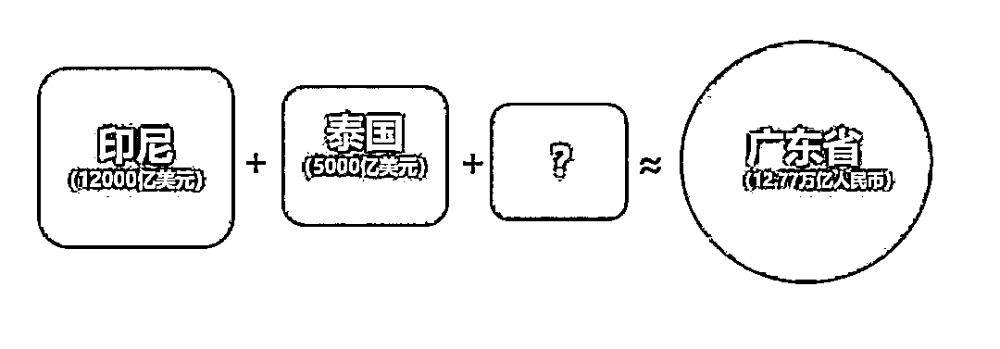

我曾在群里看到一段对话：“什么？你在做印尼电商？那地方交易量还没坂田多！”话糙理不糙，东南亚尤其单个市场的天花板，确实很低。

有限空间里，大多数时候只会出现一种结局：强者越强，弱者越弱，最终赢家通吃。

再看电商市场。2014、2015年，移动互联网浪潮下，Lazada、Shopee在东南亚快速兴起。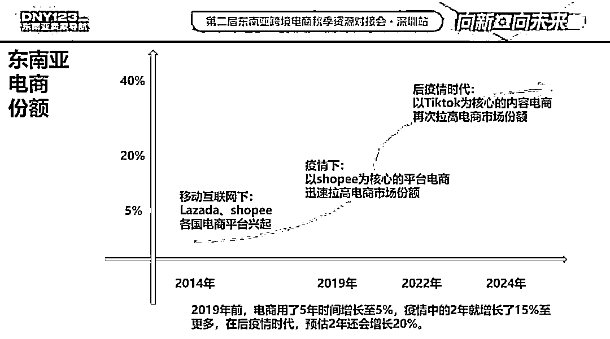 直到疫情爆发，线下交易近乎冻结，以Shopee为核心的平台电商快速发展，推高了电商在零售总市场中的份额。

所谓东南亚市场红利，本质上是线上电商对传统线下零售的侵蚀。2022年上半年，多国宣布疫情结束，线下零售全面恢复，线上发展进入相对瓶颈，电商机会也放缓了。与此同时，Shopee股价大跌，很难再以高市值向市场拿钱。线下恢复、平台减少买量之后，电商份额增长不再由平台电商驱动，以TikTok Shop为代表的内容电商成了新的领头羊。“红利期”平台的势能，开始转变。

第三，Shopee正式进入成熟期。具体表现是：东南亚产品供给开始大于用户需求，大多数关键词下都有几十甚至几百上千个产品。卖家也一样。疫情下，卖家可以通过价格更低、时效更快的本土模式，省下物流成本，享受市场和平台双重红利；疫情后全面放开，市场红利消失，需求红利也消失。

潮水退去，才知道谁在裸泳。这个时候拼的不是谁游得快，而是谁更有肌肉、谁更有性价比。产品大差不差，谁价格更低，谁就更容易获得用户。东南亚市场，已经全面进入本土供应链竞争态势。

市场空间有限、平台增速有限、市场内卷严重，在这三重大前提下，卖家怎么办？

必须正视：过去的发展，好像不全是自己的实力，更多是时代的运气。潮水退去后，发现自己只有：

1. 称不上正规军的团队：内部不够专业化，人才稀缺，运营也比较粗犷。典型Shopee卖家是老板一头牛，干全公司40%、50%、60%的业绩，拉着公司一起跑。
2. 算不上有竞争力的供应链：Shopee客单价大多在30—50元，这类产品多数从1688采购，能便宜几块钱？很难和竞争对手拉开明显优势。
3. 不够性感的投资回报，以及躺在仓库里的一堆死货。除中国台湾外，东南亚卖家的订单利润率其实很高，但客单价和周转率非常低。
4. 面对未来增长的深深无力感。

我们卖家怎么办？

讲一个我们自己的故事。我是本土精铺型卖家。什么叫精铺？就是2021年精选产品，挑一挑，然后本土备货过去。在市场与模式双重红利下，Shopee任何一个站点，都有30%利润以上的产品，都卖得好、都好卖。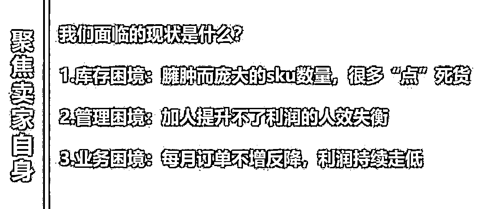

于是今年上半年，我做Shopee一年半，团队选了超过3000个品。好消息是，陆陆续续淘汰了1000个；坏消息是，还有1500个不动销。不动销的品，剩几个、十几个、二十几个，不算不知道，一算吓一跳。

感觉自己赚钱了，结果钱都在货里，货卖不掉了，成了“死货”。

不仅如此，随着SKU不断增加，每周还在产生新的选品，总要有人管吧？于是团队不断加人，利润一算，全发工资了。人效失衡开始成为严重问题。平台没有增长，内部管不过来，销量不增反降，利润持续走低。我当时甚至在想：公司是不是要倒闭了。

1. 定方向：得转型做精品。

作为卖家，我们不是来东南亚市场扶贫的。如果有朴素的使命，就是赚钱；朴素的愿景，就是在东南亚电商里赚到1个亿；朴素的价值观，只要赚到钱就是好猫。

但实际上，原有商业模式已经支持不了我们赚钱了。必须转型，不能只卖货，要做精品，要搞品牌。怎么搞？

目前，Shopee上80%的卖家都在朴素地抄作业，包括我自己。只有极少数卖家在搞开发。这些卖家辛辛苦苦开发，自己还没赚几天钱，马上又被跟卖的盯上了。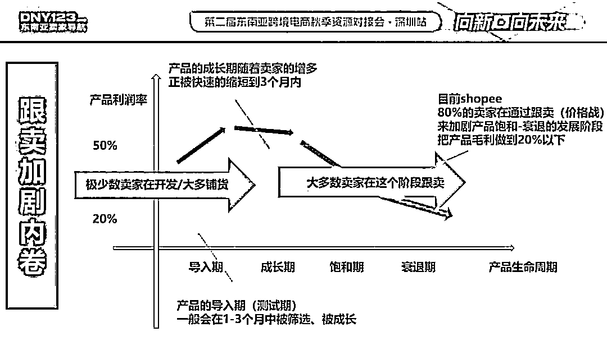

我这里不是讲开发和跟卖的区别，而是讲我的做法：

电商市场的产品都有生命周期。我把所有处在衰退期、没有利润的产品全部砍掉，全场7折。当然，部分有供应链资源的伙伴，可以从工厂端再次降低成本，继续内卷。

我把所有处在饱和期的产品，让小伙伴全面开启价格战：你降1块，我就降2块，直到没有利润就砍掉。

成长期的产品怎么办？那是我们的宝贝。我把它从剩下的500个SKU里找出来，未来1到3个月，70%的利润都靠这些宝贝贡献。

我尤其重视：在我聚焦的方向上，引入东南亚市场还没有的20%产品，把它做起来。它们能支持我们未来6个月甚至1年的利润。

既然平台上绝大多数卖家在偷懒，在轻易跟卖，而不是往重了做分析、理解用户、挖掘和打造属于这个市场的产品，那我们就得做产品开发。

这就来到第二个环节：算账。

2. 算清账，把有限资源集中到最有产出的事情上。

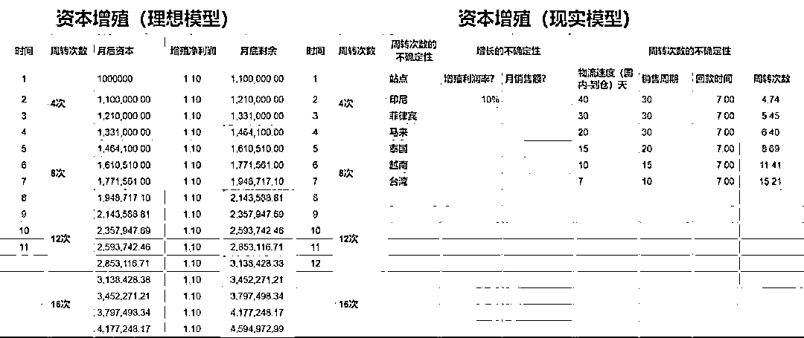

这里的账，不是财务账，是业务账。

每个企业的资源都有限：你的精力、员工的精力、资金，包括平台资源包、广告预算，都是有限的。要把最好的资源放到最好的产品上，不能分散。

所以，看你的项目，投资回报比怎么样？要不要做东南亚电商？

看你的市场，哪个市场资金周转率更高？选择哪个站点？

看你的产品，哪个产品更好、更有潜力、更能帮你赚钱？怎么挑选类目和产品？

也就是在算完账之后，我暂时性放弃了印尼，全面主攻泰国。

也是在算完账之后，才能快刀斩乱麻，把那些产品都清掉。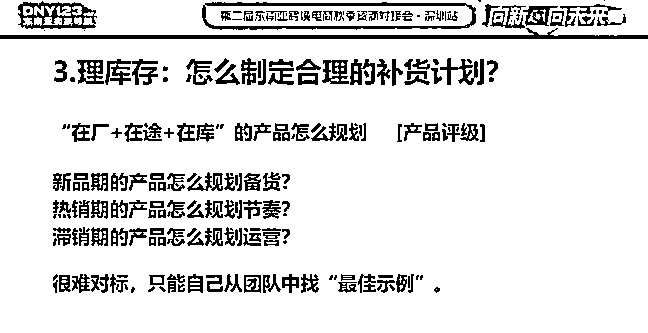

3. 理库存：进行产品分级，加快库存周转。

这里的库存，不是那堆死货的库存，东南亚本身就是全球清货市场。

我指的是，那些要聚焦的品类、那些很有潜力的新品，应该怎么补货备货。

我们团队内部有一个共识：如果这个品，没有把握做起来，就不要做。既然要做，就要做TOP。

我们把产品分为A、B、C、D四个等级，重点在两个环节去动态调整产品评级。

第一个是市场调研阶段：这个产品在市场里处于什么周期？目前TOP10的月销是多少？销售趋势是持续上升，还是已经进入饱和？

在这个阶段，我们会进行第一次产品评级。

按照A、B、C、D四个等级，进行第一次备货，就应该瞄着TOP打，不成功便成仁。

但是，有没有可能分析不够到位，盲目判断了？

所以要在第一次测试时，根据我们的干预手段+流量释放，进行第二次产品评级：点击、加购、转化率有没有达到TOP产品的指标？然后调整评级排序，再次分配倾斜资源。

每个类目、每个产品情况都不一样，不可能每个产品都能上TOP。只不过在你有限的资源里，给A、B、C、D产品不同的备货和运营资源罢了。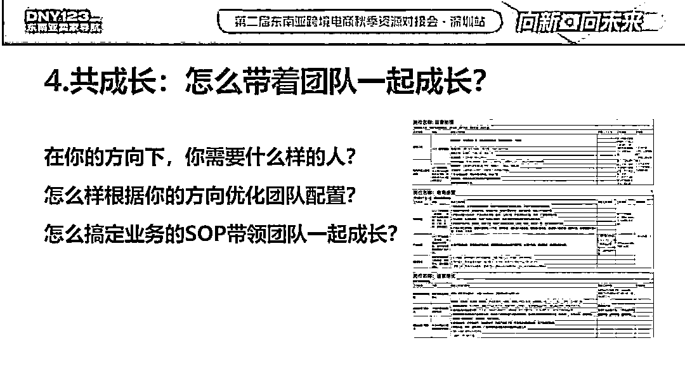

最后一块，是共成长。

你的方向在哪里？你想做一个什么事情？

你想做精品，就需要往供应链去挖。

你想做品牌，就需要内容方面的人才。

你想简简单单赚点钱，就应该把能开掉的人都开掉，能省出来的钱都省出来。

你要想管理省事，就必须搭建从运营助理到运营、再到运营组长的SOP。（可以加我🛰️获取：xiabingbaol）

你想要业务流畅，就必须搭建从定市场、品类，再到选品及产品运营的精细化运营链路。

也就是在这一系列动作之后，我们团队实现了连续4个月12—15%的订单与利润双增长。

2022年，我和很多卖家交流。因为我做了一个卖家俱乐部，叫起航俱乐部，大家在一起交流，逐步得到的共识是：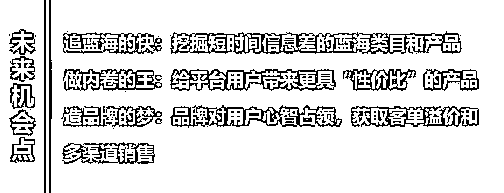

卖家在东南亚的未来机会，有且只有：

追蓝海的快：挖掘短时间信息差的蓝海类目和产品。一些玩蓝海的卖家跟我说，只要Shopee不倒台，消费者需求就会拓展和迭代；只要软件扒得够快，蓝海产品永远在。

做内卷的王：给平台用户带来更具“性价比”的产品。还有一群玩家，拼命搞内卷。我都不爱跟他们玩。局外人会说，东南亚市场真卷啊，卖这么便宜怎么赚钱啊？

造品牌的梦：建立品牌对用户心智的占领，带来客单溢价和多渠道销售。最后，也是我最敬佩的一群人，他们通过提前布局，在TikTok内容成本低廉的时候，快速把市场认知打出来，初步构建了品牌模型。

我放到最后讲。

我们先聊聊精品卖家。

为什么不聊蓝海？Shopee的蓝海机会太小了，一个月可以做几万、十几万的利润空间，但最终，还是得回到内卷赛道上来。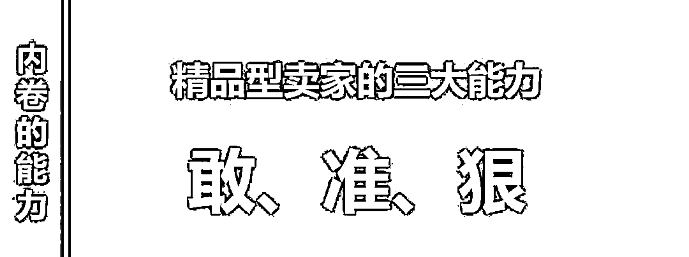

在我们今年举办的广州、深圳、厦门线下聚会上，我发现一个很有趣的现象：

今年还能跑赢大盘、拥有月20%增速的卖家，是精品型卖家。

我仔细分析了他们的核心能力：

一是在于他们敢。在绝大多数人都在跟卖的时候，敢根据用户需求做“东南亚市场上”没有的新产品，去享受完整产品生命周期的产品红利。

二是在于他们准。总能抓住市场量大、用户刚需的产品。

三是在于他们狠。为了最大化享受产品红利，玩命扩大产品规模效应，降低边际成本。坚信利润是优化出来的，完全抛弃小农的高毛利思维，做TOP Seller，做霸屏式TOP Seller，挤死对手，赢者通吃。

跨境电商，80%的卖家都是贸易商。贸易商的核心竞争力，就是性价比：让消费者用更低的价格，买到更好的产品。

“敢、准、狠”背后的核心逻辑，性价比的核心逻辑，就是因为他们洞穿了卖家的增长飞轮：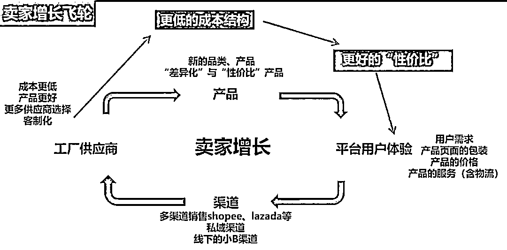

只有通过市场上的新品类和新产品，找到更有差异化、更有性价比的产品，才能给平台消费者带来更好的用户体验，获得平台更多流量资源。

只有获得平台TOP的位置，才能有相对稳定且量大的销量，才能优化整个供应链的成本结构。

才能带来更强的“性价比”产品和市场竞争力。

只有拥有更强的性价比产品，才能通过多平台、多渠道销售，扩大规模效应，获得所有卖家都想拥有的壁垒：总成本相对优势。

在这其中，要特别重视平台运营：

1. 整体上拥抱Mall店。核心原因：第一，在Shopee手机端，有专门的Mall店入口，有更好的流量位置和产品排名。第二，Mall有专属经理，意味着更优质的活动位置、资源包，以及资源包带来的广告返佣。
2. 虽然Shopee是一个重价格、轻运营的平台，运营技术很难拉开明显差距。但是，强化团队在平台获取流量的能力、把产品运营上TOP的能力，在一些基础细节，比如标题关键词布局、图片视频及评论，把各个环节优化一点，就可以积累差距优势。
3. 多平台运营能力，千万不要吊死在一棵树上。比如做Shopee的，不应该放过Lazada。起航俱乐部从去年年底就号召做Shopee的卖家拓展Lazada渠道。目前绝大多数Shopee卖家，都获得了Lazada新渠道带来的20%—50%订单利润增长。

除此之外，在飞轮增长中，你可以通过四个方面，通过规模效应放大成本优势，盈余20%左右的成本空间，卷死大部分对手。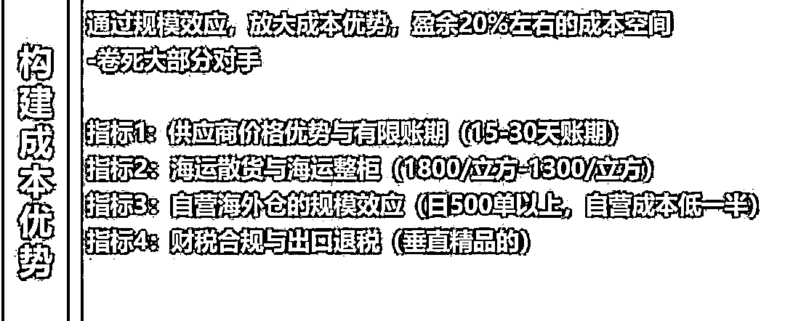

如果这是可以通过团队努力实现的增长飞轮：你抓住品类机会（抓TikTok的品类机会），抓住产品生命周期红利，抓住机会上TOP获得销量，放大规模优势，从而稳定库存，形成多渠道销售网，提高周转。

你就有可能，在典型的价格敏感、产品差异化小的东南亚市场，构建起自己的初步核心壁垒：成本优势。

再次强调，作为贸易型卖家的核心：

“就是不断优化整个（供应链+营销链）链条的成本，给消费者创造更低价格、更多选择、更好产品的需求解决方案。”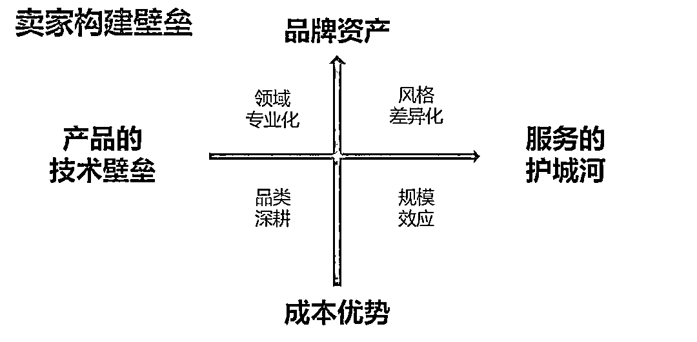

除此之外，我提一个特点：

以更精准用户人群为画像的风格店模式，开始成为中小卖家高客单、高转化的新出路。比如Lolita、大码女装。

在Shopee中国台湾站点，风格化趋势表现最突出。

而东南亚任何一种风格化模式，都可以在淘宝找到对标。

何为自我跃迁？跃是一种姿态，迁是一种转移。

大家都玩过跳一跳吧？

作为平台电商卖家，实际上就是站在跳一跳的台子上。

当你在思考跃迁，你需要“减负”，需要“助推器”，需要拼全部力量，并且找准落脚点，才有机会够得着。

我们先聊聊转移。

跃迁一：从平台电商到内容电商的迁移。

在电商层面，平台电商和内容电商获取流量的方式完全不一样。

平台电商三要素：流量、点击、转化率。根据用户需求去选品，做图片价格，搞评价提升转化率。你是在平台1.0的规则下，满足用户已有的需求。

而内容电商，是通过视频、通过所见即所得、通过更真实的人货场，激发、创造用户需求。

还记得开局的那张图吗？

后疫情时代，以TikTok为核心的内容电商，将再次拉高电商的市场份额。

而最核心的，就是内容能力。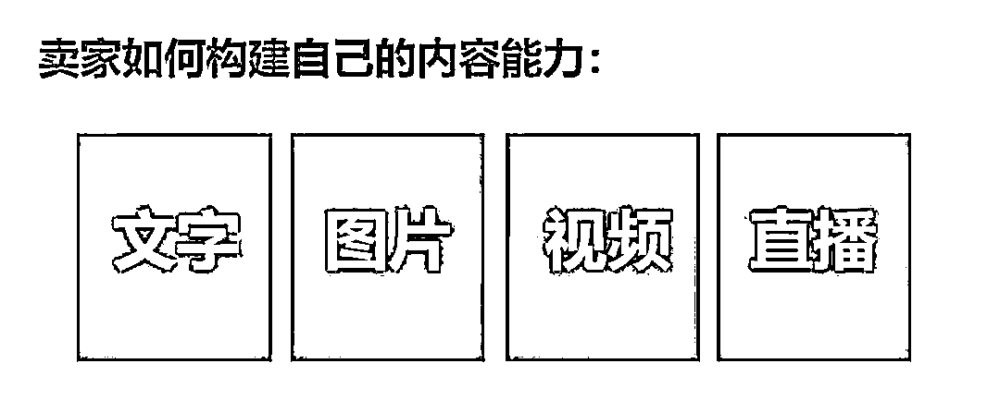

绝大多数平台卖家，是具备内容能力的。

我们有文字能力。每个产品的标题，也就是关键词，是我们获取平台能力的密码。我们有图片能力。为了吸引消费者注意力，我们恨不得在主图上玩出花来。

但从视频开始，我们就开始失去主动权了。

视频生产成本更高。从脚本到演员“产品”，再到服化道以及场景，从拍摄到剪辑成品，在专业MCN机构里，平均一个视频的生产成本都在500—1000元。

而直播，就更不具备了。除了马来，其他东南亚国家基本上都是自有语种国家，直播成本更加高昂。国内一个成熟的直播团队，基本上需要3—5万元固定人工成本。

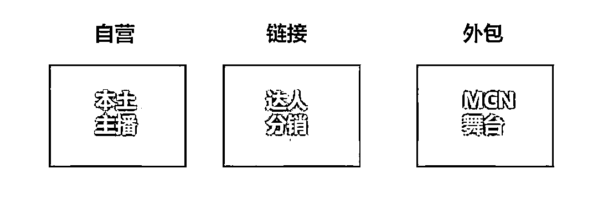

但是，东南亚不用。如果你选择自营电商。

在印尼，一个主播的成本是1000—1500元人民币一个月。也就是，2万元人民币可以请10多个主播，全职直播，创造你的产品直播内容。与此相似的还有菲律宾市场。

这也催生了很多市场“利润”。有些朋友有机会，直接在当地搭建直播基地，获取红利。

目前，起航群内自营TikTok的月销天花板是近150万元人民币/月，还在高速增长。这都是我们俱乐部真实的案例。

如果你在当地拥有比较充足的货源，也不想自营直播，或者感觉还没到时候，可以考虑达人分销。只要你的产品有竞争力、价格和分佣比例合适，就可以躺着出单。

因为，东南亚目前不缺MCN，不缺机构和达人，缺的是优质的供应链货盘。

俱乐部的梁总，提了一个很有意思的“达人分销”玩法，叫“TK渣男论”。

拿样品当饵，先把网撒开，再把表现力强的达人筛出来重点捞，之后做长期绑定。这套打法跑顺了，达人分销带来的收益基本就是“躺赚”。想更省事，干脆全盘甩给MCN。TikTok的带货能量已经被市场验证过，这轮渠道迁移中，卖家不该袖手旁观。

接着聊“跳跃”。

二、卖货到品牌：一次思维跃升

在东南亚，TikTok已经长成最大的内容平台之一。站在这样一个流量高地上，未来十年是中国卖家围绕本土人群需求去创造品牌的最佳窗口。怎么从卖货的，变成做品牌的人？这个台阶怎么迈？

我的看法是，TikTok当下的流量，极有可能是未来十年里最便宜的“内容”流量。大量卖家已经用真金白银证明过：在国内打一个消费品牌，起步投入3000万以上；而在东南亚、在TikTok，做品牌的成本可能只是300万级别，甚至更低。支撑这个判断的核心，正是TikTok目前仍处于低位的流量价格。

你或达人生产的视频，有机会被传播百万次、千万次；有机会带动新一批用户继续模仿；再一步步扎进消费者心智里，完成种草。

未来的品牌，“品”落在产品，“牌”落在内容。内容需要足够有分量的平台，内容需要被反复地传播和种草。TikTok天生具备这种土壤。

私域、品牌、兴趣电商——我们听过的这些概念，内核都是内容。从低阶卖货郎走向高阶卖货郎，那道分水岭就是创造内容的能力。卖家的自我跃迁，说到底，是把那个依赖市场红利、平台黑科技、供应链成本优势的“自己”，整个搬到内容电商的船上。

最后送大家一句：有资本就贪婪一点，没资本就稳住。只要公司不去盲目做大，你就很难死。活着，才有机会完成自我跃迁！

下半部分：《变革中的机会：东南亚卖家如何持续增长与创新》

（2023年6月30日）

过去半年，有个问题一直缠着我：作为东南亚卖家，未来3到5年，到底该走一条什么样的路？

因为起航俱乐部，我有幸和不少千万级、亿级卖家做过深度交流，也在这些对话里沉淀出一些想法，趁今天分享出来。

这次分享分4个部分，大约7000字，阅读时间10到15分钟。

我的总判断是：东南亚电商的开荒期已经结束，浅海红利正在退去，行业进入深海搏杀。这时的东南亚卖家，呈现出一条典型的K线分野：一半是海水，一半是火焰。很大比例的卖家在悄悄退场，仍昂着头往前走的是精品型卖家。我会拆解他们持续增长的精品五维模型，也谈谈未来东南亚市场里能带来十倍速增长的创新机会。每个创业者，都有自己的路要走。

先讲几个我个人的论断。

2021年，我从欧美亚马逊转身进入东南亚，是因为我笃定未来10年东南亚的经济走势，一定是一股非常强劲的增长力量。

两年前，我认为以中国为核心的周边经济新秩序正在成形，而周边最核心的一环就是东南亚。

两年后，我的理解往前又走了一步：在这种新秩序形成的过程中，未来10年中国对东南亚的经济牵引，会表现为一批优秀的中国企业家，带着资金、人才、技术和管理，把中国优质的产品供应链送达东南亚。

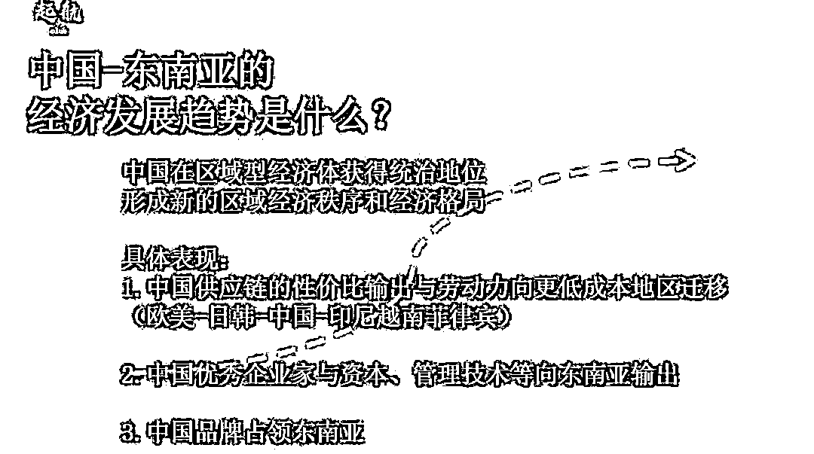

中国在区域型经济体中逐步拿到主导地位，新的区域经济秩序和格局随之建立。这个过程有3个具体表现：

1. 中国供应链的性价比输出和劳动力，向成本更低的地区转移。
2. 中国的优秀企业家，连同资本、管理、技术，一起涌向东南亚。
3. 中国品牌占领东南亚。

这并非现在才开始。几十年前，华侨华人就已经遍布东南亚各国。到了今天这个节点，在当地深耕多年的华侨华人与国内创业者互相碰撞、联手，国内创业者和东南亚本土力量加速融合，生出一股“井喷”式的势能，直接击穿了从量变到质变的临界点。

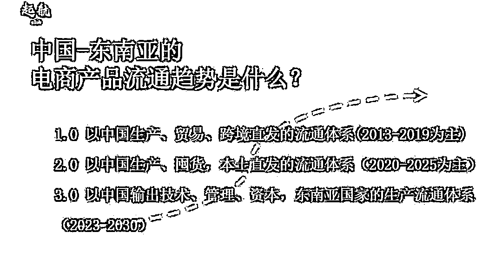

中国加速崛起的大潮里，很多事正自发地发生：

中国供应链在迁往劳动力成本更低的地区。电商市场上，中国产品从自产直发，迈入当地组装、当地流通，并朝着终局演进：中国输出技术、管理、资本，东南亚国家承担生产流通销售。

这个过程中会跑出3个劳动力机会市场：印尼、菲律宾、越南。它们人口体量相对可观，开始享受一部分人口红利，同时接住中国溢出的产品供应链，拿它去拉动本国经济和民生改善。

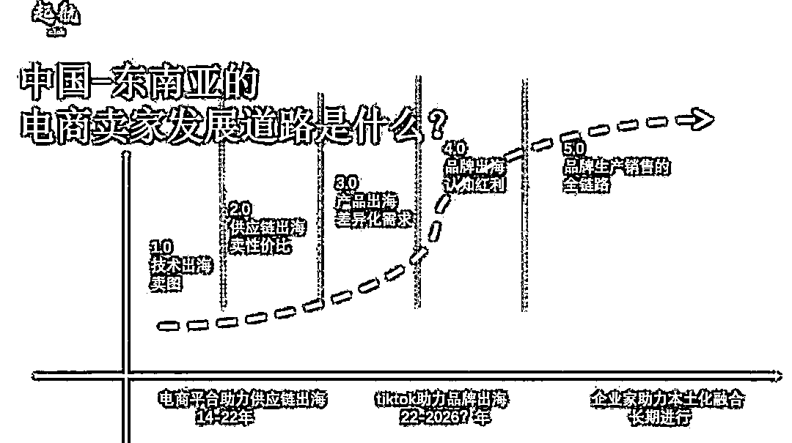

顺着大势往回看电商本身，行业大致走过了几个阶段：

1.0阶段，供给小于需求，消费者缺货、平台缺货、市场缺货，上架就能出单，店群模式风光一时。

2.0阶段，供需走向平衡，产品供给极大丰富，大量低质低价的货开始互相消耗，性价比成了胜负手。

3.0阶段，供给大于需求，同质化和内卷变成主旋律，差异化新品、升级款、组合款、本土化产品，成了新的增长点。

4.0阶段，品牌跳出单纯的“产品”视野，不再被平台和线上渠道框住，而是把产品做好，用产品叠加达人不断产出内容，激活用户认知，跑通认知-信任-复购的品牌循环。

（真实商业中，这些阶段是并行交织的，并不是关掉前一扇门才打开后一扇。）

最终，行业会走向企业深耕、产品本地、渠道多元的产销全链路。

2023年，Shopee、Lazada、Tokopedia这些货架电商，集体撞上同一堵墙：原本100%甚至200%的增速突然熄火，掉到两位数、个位数甚至负增长。平台把真正的难题传导给了卖家：进入成熟期之后，该怎么从增量市场的打法，切换到存量市场的打法？

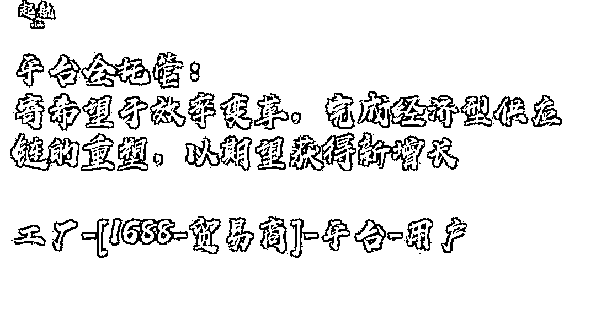

Lazada、TikTok、Shopee都跟进了全托管，平台自己也在变。

平台做全托管，说到底是平台内部商品生态的一场效率改革，是对经济型供应链的一次重塑。经济型供应链指的是那些需求长期好预测、供应稳定度容易满足，所以可以把成本无限压低的品类。客单价集中在5美金上下的大路货，没有谁比平台亲自下场更省成本。

平台增长失速，还要亲自下场革经济型供应链的命，生态里的卖家处境如何？

我的判断是：2023年，会是东南亚电商一个真正的分水岭。那些源源不断涌进来的新手卖家，曾经是平台金字塔的底座，如今这个底座正以肉眼可见的速度退场、消失。一场底层结构性的演化，正在发生。

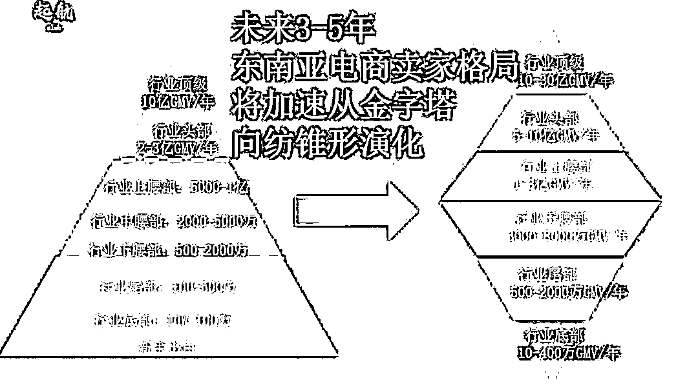

未来3到5年，东南亚卖家格局会从金字塔形走向纺锤形。演化过程有几个明显特征：

1. 上腰部分的大卖，在SKU、性价比、供应链渠道上攒下长期优势，靠规模效应把雪球滚大，一步步走向市场主导位置，同时向品牌化、产品力、多元本土渠道延伸。

2. 中腰部分的卖家，会遭遇较猛的市场震荡，卡在中等规模陷阱里：理智派收缩团队、保住利润、稳稳赚钱；激进派融资扩量，抢向上渠道，往供应链和多平台运营里扎。

3. 尾部和底部的小卖家，会尝到商业生态中最赤裸裸的恶意，在竞争压力和高门槛之间求生存，或者直接离场。这批人数量最大。同时，小白新手进场的数量会大幅收缩，成长难度会被迅速抬高。

4. 专业化的工厂型、工贸一体型、品牌型玩家会挑时机入场，把整个生态推向更高段位。

至此，东南亚卖家市场在金字塔向纺锤形的演变中，会呈现出一条典型的卖家K型发展路线。

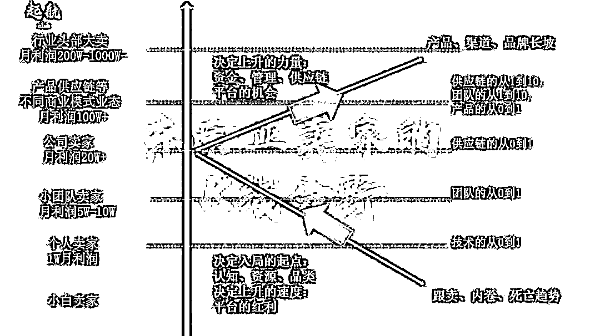

阶梯第一层是技术：从小白做到个人卖家，月利润能到5000到1万，关键是把选品、运营、广告这些基本功从0做到1。

第二层是团队：月利润从1万突破到5万、10万，关键不再是个人能力，而是能力能不能被团队复制，以及团队怎么搭、怎么磨合。

第三层是供应链：产品上能按品类跟工厂做深入合作，物流上能完成散货到整柜的跨越，把供应链里的利润空间真正挤出来，这决定了月利润20万以上的想象空间。

第四层是产品：团队完成1到10的复制，供应链品类完成1到10的复制之后，核心课题是能不能针对东南亚市场，打磨出一套自己的精品运营模型。

在卖家的K型发展图里，有两条非常重要的曲线。一条是底部逆向的，没有趋势可借，没有红利可乘，只能靠自身一点点往上爬。

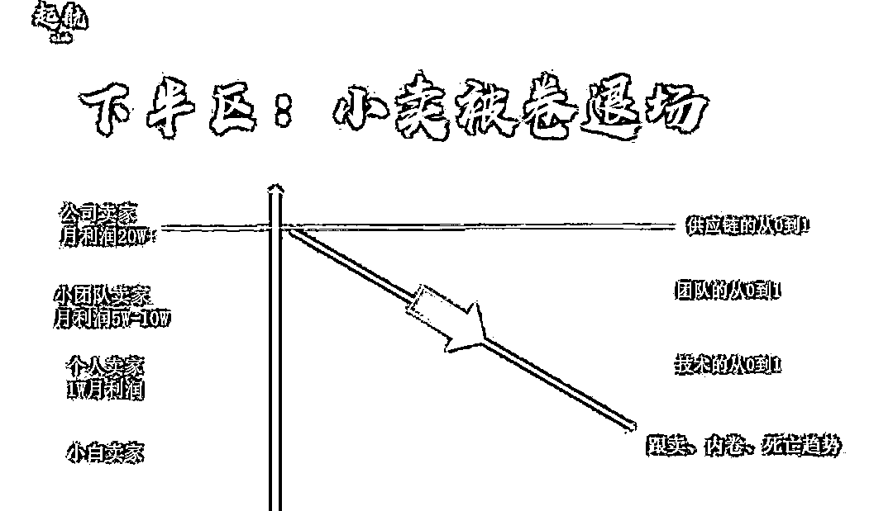

今年我在不少东南亚电商社群里，看到卖家清货离场，连着项目和本土团队一起打包卖掉。原因五花八门，但归根结底是对东南亚理解不够、信心不足，以及错过红利期之后，自己那套商业模式和能力撑不住了。

最关键的一点是：在性价比的搏杀里，大多数卖家根本压不下产品价格、供应链成本、海外仓成本。

2023年了，供应链已经从过去的加分项，变成生存的底线。比如印尼物流，散货和整柜之间仍有每立方300到500的价差，但这种机会窗口可能只剩一年甚至半年。窗口一关，优势差就会被彻底抹平。有供应链，你活；没有，你被洗出去。

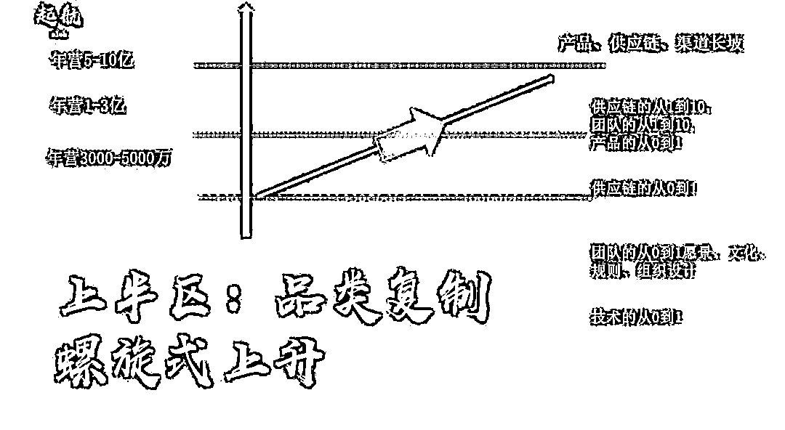

另一条是顶部顺向的，那些击穿供应链的卖家，正快速复制供应链、复制团队、推进产品创新。和下半区截然相反，他们反而跑出了更快的速度。

这也是我今年跟年营收5000万甚至几个亿的卖家深聊之后的直接体感：越是头部，增长越猛。商业世界从来如此，大鱼吃小鱼。

为什么？凭什么？

把时间拨回2021年，疫情这个特殊变量把东南亚电商推到爆发式增长的位置。但2021到2023这近三年里，同样的入局者，甚至同样的入场资金，最后却站在完全不同的高度上。

我大量跟卖家深聊，又复盘自己过去两年的决策得失，越来越认同一件事：选择的分量大于努力，而连续选对，分量又远远大于单次努力。

第一是平台的选择。Shopee的机会和天花板都高过Lazada，数据上看大约4倍。

第二是模式的选择。一方面，跨境和本土之间已经划出一条清晰的鸿沟；另一方面，铺货、精铺、精品这三条路的难易顺序是反过来的，先甜后苦还是先苦后甜，直接决定2023年你还在不在牌桌上。

第三是市场的选择。不同站点的资金周转率和市场容量，能把规模的差距拉到几何级别。

第四是品类的选择。竞争度高、有门槛、有供应链可挖、有产品可以做出差异化的品类，营业额能差出4到6倍。

第五是产品的选择。跟着市场卖现成货，还是根据市场开发新品，决定你的产品生命周期是3到6个月，还是2到3年。

这些选择一层层叠上去，在市场增速放缓的时候，就成了一道几乎迈不过去的坎。坎的背后，是年营规模、月利规模、团队组织、是否深耕供应链这层层【阶梯】。

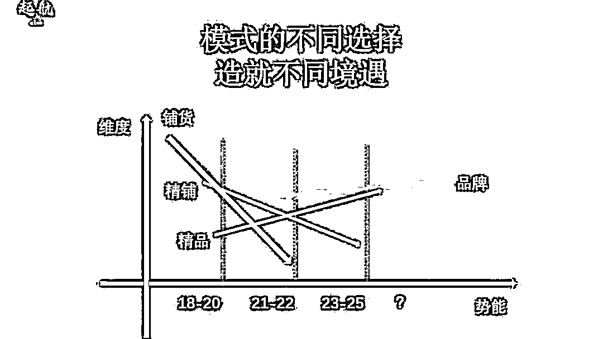

先说模式。2020年之前，最赚钱的是铺货店群型卖家；2021年，本土精铺型卖家走上快车道；到了2022年，本土精铺型卖家增长乏力，精品型和品牌型卖家开始接棒。

选什么模式，同时能不能随市场变化做模式升级，这决定了2023年牌桌上还坐着谁。

再说市场。前两天有人问我，想做母婴品类，先做菲律宾还是印尼？

母婴这个品类很有意思，它和一个国家的人口出生率直接挂钩。2022年，新加坡一年新增人口大概5万，印尼是550万，整整100倍。看到这个数字根本不用纠结——做印尼。

接着聊品类赛道。目前除了美妆，东南亚的小家电赛道已经跑出一批品牌，它也是资本市场重点关注的赛道之一。

小家电品牌Simplus创始人Jack说过：“东南亚市场超6亿人口，其中50%以上是30岁以下的年轻人，随着在国际供应链中的地位不断提升，整体东南亚市场特别是年轻人的消费市场，也迎来快速增长和消费品质升级的时代。”

这句话背后，是Jack对小家电赛道的一个洞察：用户刚需、增速快、发展空间极其开阔。

小池子养不出大鱼。想成为大鱼，就跳进海里。

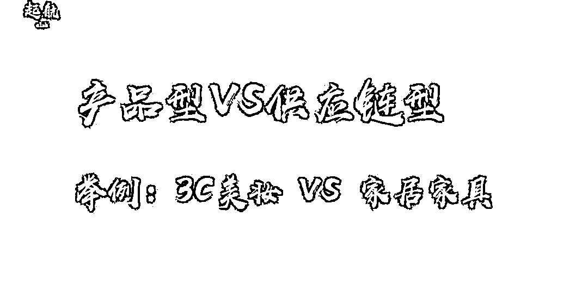

最后聊产品型卖家和供应链型卖家。

3C和美妆属于典型的产品型品类，款式迭代极快，每年都有大量新品冒出来，而且产品体积小，供应链优化空间不大，只能在产品迭代上死磕。

家居特别是家具则是另一个极端，款式迭代相对慢，产品又大又重，在当前的东南亚市场上，供应链优化空间还很大，还能结合当地市场特性做微创新。

聊到这里我又忍不住感慨：选择的分量大于努力，而且远远大于努力。只有连续做对选择的卖家，才有资格活下来。

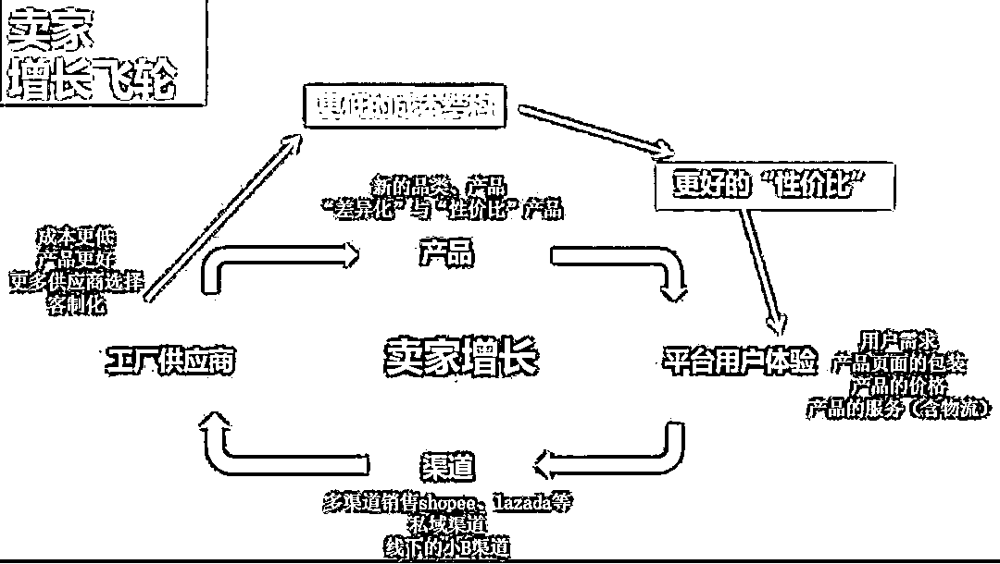

去年的分享里，我提过一个卖家增长飞轮。核心就一句话：卖家要抓新品类、新产品的窗口，给市场带去差异化的新品和更有性价比的货。差异化+性价比，两条腿同时跑，飞轮才能越转越快。

精品型卖家的飞轮是怎么高效转起来的？靠的是五维模型：产品 × 供应链 × 渠道 × 财务能力 × 组织能力。

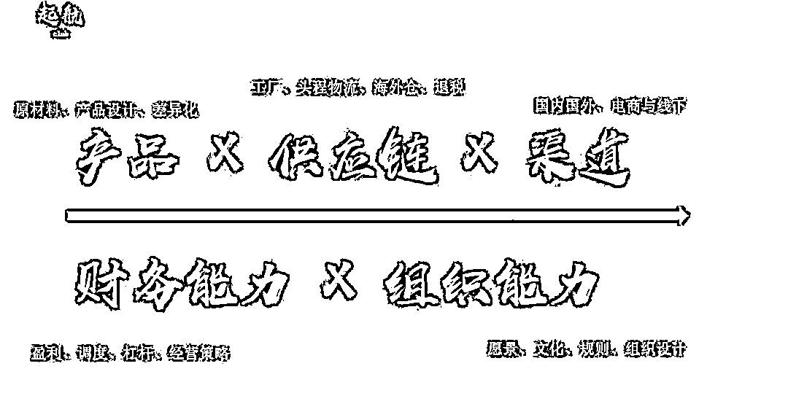

产品端：从运营部门的数据和需求出发，用爆款逻辑主动选方向、定路径，把供应链的价值挖出来。同时跟工厂、上游原材料做深度捆绑，在产品设计和功能上做出差异化。

供应链端：借工厂深度合作拿到价格优势，借整柜运输和自报关拿到物流优势，借自营海外仓或深度第三方合作拿到仓储效率，再借产品合规拿到出口退税——整个链条的成本优势就是这样一层层抠出来。

渠道端：一边在Shopee、Lazada这类货架电商拿TOP链接，甚至做到霸榜级的链接矩阵；一边通过平台小B打通线下批发，包括自建或合作线下代理；同时到TikTok这些新渠道里找增量。

产品、供应链、渠道这三个维度打通之后，底座是企业的财务模型和商业模式——在算得清“投多少钱、多久回本、赚多少”的确定性之上，才敢适度激进地去加杠杆、做多赢合作。

另一个关键变量是组织能力。我见过10个人的精品团队，干出5000万到8000万的年销售额。但今年目标放到1.5亿到2亿，组织架构就得跟着调：一是从扁平化走向层级化，二是从业务中心转向使命愿景价值观驱动，三是管理层的选用育留要跟业务模型重新匹配。

2023年，是东南亚精品卖家集体补课的一年。五维模型缺一不可，缺哪块补哪块，才能把【财务支撑】×【团队复制】×【品类深耕】×【供应链优化】×【渠道站点多元化】这套模型完整搭起来。结硬寨，打呆仗，最后拼的都是综合实力。

最后一段，讲增长的核心——创新。

机会一：产品创新。分享一个跨境一哥安克创新阳萌常讲的故事：

2013年，欧美市场原装电池卖80到100美元，在亚马逊上评分约4.5星；出口卖家在亚马逊卖的电池只要25美元，但评分只有3星或3.5星。阳萌认为这里面一定有机会——在40到50美元的价格区间，做出4星到4.5星的产品。

我相信在座的东南亚卖家，听到这段话会有非常强的共鸣。这真是beautiful、Amazing的一段话。

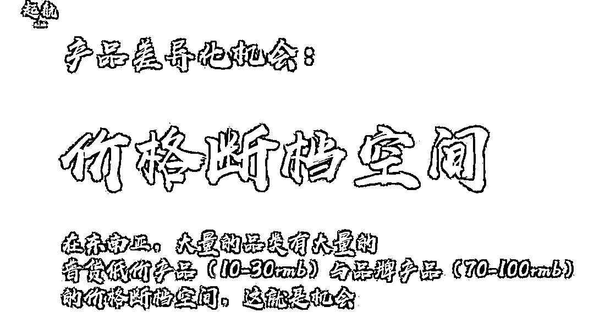

我的观察是，东南亚大量品类里，10到30元人民币的普货低价产品，和100元人民币的品牌产品之间，存在大片的稀缺价格断层，这就是机会。（不同品类的价格带不同，别硬套公式。）而且因为低价产品严重同质化，中高价位还有大量产品组合、产品升级的需求。卖家应该把火力集中在当地市场还没有的新品上，去做产品创新。

机会二：吃下供应链转移的增量。

2022到2023年，TikTok Shop起来之后，新玩家会发现一个很有意思的现象：东南亚居然还在缺货——缺好货、缺高性价比的货、缺有差异化的新奇特货。本地制造能力实在跟不上，而从中国过去，又要面对漫长的海运和清关周期。

卖家买家两边需求都旺，当地供应链却接不住，这个供需矛盾，叠加供应链转移的大潮，衍生出一堆机会点。

比如货盘。印尼缺的从来不是MCN和达人，而是优质货盘。

比如仓库。在东南亚这种不稳定的市场环境里，谁能提供稳定的仓配能力，谁就有价值。

比如服务。那些带资出海的创业者，需要旅游、游学、当地工厂对接、签证、置业等一连串配套服务。

比如资源整合。中国创业者的资金、供应链、管理能力，和当地创业者的土地、人力、本地资源，完全可以拼合到一起。

这背后的市场空间，旺盛且巨大。

机会三、四：TikTok的渠道红利与品牌空间。

去年4月到6月，我写过两篇文章：一篇是关于TikTok作为渠道增量的，一篇是关于TikTok作为内容传播工具、会催生新品牌的。从渠道增量的角度看，部分月销500万到1000万的卖家里，TikTok每月销量占比已经超过40%，而且还在往上走。

2022到2023年，从TTS店群、短视频二剪、无人直播，一路走到TTS精品店本土直播，市场上沉淀出三大主流卖家派别：本土自播、联盟达人分销、短视频投流。我们相信，本土直播能力才是卖家承接渠道增量、获取长期效益的核心能力。

换个角度看，TikTok 本身就是一个体量惊人的内容供给场、流量蓄水池和传播杠杆。眼下它的获客成本还很低。传播工具的价格一旦被打到足够低，普通人也有机会入场搏一把，那么东南亚品牌集中爆发的阶段就会加速到来。未来东南亚市场，大概率会迎来中国品牌集体闪耀的局面。

## 机会五：服务做深，私域才长久

最后，聊一个容易被忽略的词：服务。

我在一位做国内电商的朋友社群里学习，他的👸号叫“刘玮冬创业手记”（感兴趣可以关注）。群里有人问：电商的服务到底指什么？

他给出的解释，核心有四层：

1. 我有运费险而你没有，这就算服务更优；
2. 退货时限：别家 7 天，我们放宽到 14 天；第 14 天顾客说最近出差没来得及退，也照样处理；
3. 价格保障：我们给 30 天保价，不少店铺压根不保，或者只保 7 天、15 天；一个月内发现买贵了，随时补差价；
4. 售后兜底：洗过之后说掉色、不满意，吊牌剪了说穿着不满意，也能退；退完差价还会补一句：在我们家，不会让顾客吃亏。

当消费者被其他商家亏待时，就像一个人身边有个长期体贴但不够刺激的伴侣，平时不觉得珍贵；等被不靠谱的人伤过一次，才会念起从前那份稳。当然，好服务不会从天上掉下来，它要靠产品与服务挣出的溢价来托底。

反观东南亚，当多数人陷在低质低价的内卷里，卖家盯的是退货率、怎样少赔一点，服务似乎跟当地消费者没什么关系。

果真如此吗？

如果你认定未来 3 年、5 年仍要扎根这个市场、服务这批消费者，服务怎么会无关？那些一点点攒下的优势、好评和消费者口碑，很可能就是你 3 到 5 年后赢下局面的关键支点。

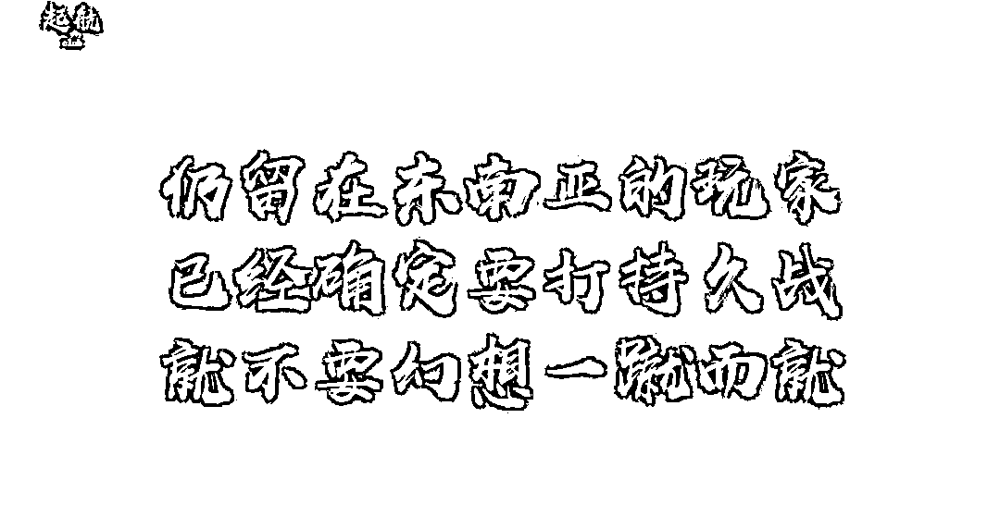

只有真正扎下去，把本土化和产品供应链做深，才可能看见更长周期的确定性。把视线放到未来 5 到 10 年，供应链产业转移，加上中国的资金、人才和供应链出海，这些挑战几乎不可逆。我们能做的，是努力把自己做成一家跨国企业，再进一步做成跨国企业集团。

以上，就是这次想分享的内容。

评论区：

谦墨：细节写得很足[强]

夏冰雹：这是线下大会演讲稿整理出的文字稿，比较细，谢谢阅读~

edo：快来我们虾皮，把业务做起来，我就不用天天担心被裁了[呲牙]

夏冰雹：哈哈哈哈，你快去招商

巧巧：怎么联系