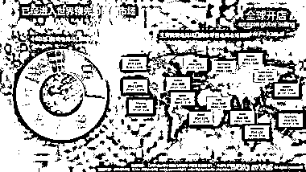
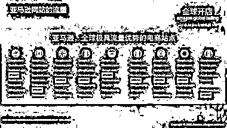
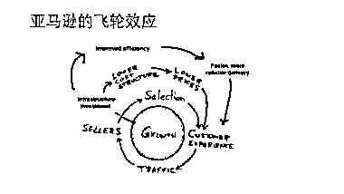

# 出口跨境电商真相：机会仍在，但别把它当蓝海

文 / Moss

早前受亦仁邀请，我做过一期生财合伙人分享，聊了些创业故事和经历，却一直没系统讲过专业干货，心里总觉得欠着。今天难得有空，正好补上。

自我介绍就不展开了，节省篇幅。想了解我的朋友，可以翻翻之前亦仁发过的生财合伙人介绍帖，或者看看知识星球官方那篇介绍。也希望能多认识朋友，寻找交流合作的机会。

下面直接上干货。我做的领域是出口跨境电商，很多国内电商朋友和想了解跨境的人应该都关心这一块。这篇的目的，就是带大家看清真实的出口跨境电商世界。

从行业大盘数据看，各国线上零售规模和中国出口跨境体量仍处在快速扩张期。传统外贸B2B逐年走低，跨境电商却逆势上涨，说明这仍是不错的赛道。但蓝海这个词早已不适用，竞争已经进入白热化；不过相比国内电商格局固化，出口跨境仍存机会。

## 1 亚马逊：品牌出海绕不开的巨无霸

从从业者结构看，亚马逊卖家大约占跨境出口电商从业者的四成，体量上是当之无愧的巨无霸。不少人会把亚马逊看作海外版天猫、淘宝或京东，其实并不准确。它更像网易严选：用算法规则取代传统买手，直接挖掘供应链末端的优质工厂，强调产品而非店铺。因此这个平台不会出现阶层固化，新卖家始终有入场机会；它偏爱更新、价格更低、品质更好的产品。飞轮理论正好解释了亚马逊算法的底层逻辑，这也是它与淘宝、天猫最大的不同。

亚马逊更适合做单品爆款，而不是走海量SKU铺货、强调动销率的老路；SKU较少的国内大型外贸工厂和一线品牌会更匹配。这也是为什么不少大型工厂和国内一线品牌陆续入驻亚马逊——它仍是海外创牌的首选阵地，Anker、科沃斯都是借亚马逊在海外打响品牌的例子。

不过，亚马逊现在的流量成本已经不低：站内广告平均CPC普遍在1美元以上，像Bluetooth headphones这样的红海词，单次点击甚至冲到5到7美元。再加上FBA压货模式，规模越大库存压力越重，赚到的钱很容易变成仓里的货。我之前写过一篇文章放在文末，想了解亚马逊真实问题可以看看。

总体看，亚马逊依旧是品牌出海和跨境出口的首选：操作相对简单，流量获取也更容易；产品足够好时，运营压力会小很多，不必非得是玩流量高手。但它早就不是蓝海，进入前要多方考证、谨慎调研，贸然冲进去很容易栽大跟头。

## 2 其他跨境平台：铺货卖家的主阵地

亚马逊之外，跨境平台还有不少。老牌的有eBay、AliExpress、Wish等；新一些的有vova、joom、Shoppe、Lazada、Jumia等。它们除了欧美，还能覆盖中东、东欧、东南亚等发展中市场。

这类平台更适合多平台海量SKU铺货的卖家，以及做drop-shipping的玩家。但别指望靠单个平台把体量做很大——每个平台都有天花板，小平台一个月做到100万美元销量基本就到头了。铺货模式必须多平台布局，选品和供应链很关键，还得雇一批人负责打包。

国外也有类似公司，比如Channel Advisor这类软件适合多平台、多渠道分发；但国内人力成本相对低，多数卖家还是靠人工上货，这类工具很难有市场。我以前去过以铺货为主的跨境公司，工作场景和富士康差不多。

铺货模式的好处是资金链健康，不用压货；但在品牌打造、客户沉淀和突破销售瓶颈上，还是不如亚马逊。另外，做海运抛货、重货、大货的卖家不适合这些小平台，亚马逊更匹配。

## 3 独立站：Shopify+Facebook的机会与门槛

跨境独立站目前最火的玩法是Shopify+Facebook：建站比以前省事很多，十分钟搭一个站并不夸张。引流主要靠Facebook，Google涉及得很少；一方面是FB流量成本还算便宜，另一方面Shopify把建站成本压得很低。

但独立站的难度比做平台高不少。平台自带流量，哪怕铺货也有曝光；独立站得自己引流，不推就没流量，某种意义上没有自然流量，基本靠付费投放，非常考验投放能力。尤其是平台卖家转做独立站，大概率会不适应，容易摔得很惨。

这种模式还要求产品有style、有调性，比如指尖陀螺这类新奇特商品，Facebook才带得动。如果是普货快销品，FB很难推起来——你在抖音或微信刷到充电宝、耳机，会立刻下单吗？普货还是更适合做平台。参考学习网站：www.soulfeel.com。

## 4 COD：暴利外表下的高风险游戏

COD就是货到付款。一些发展中国家基础设施不完善，比如东南亚部分国家，不少老百姓连信用卡和智能手机都没有，货到付款正好满足他们网购的需求。印度亚马逊的COD比例甚至超过一半。

另外，一些发展中国家还没有亚马逊这样的巨头，消费者很难比价，COD产品卖到正常价值的3到5倍并不稀奇。再加上这类模式主打新奇特商品，尽量激发购物欲望、促成冲动购买，价格标得高也就可以理解了。

但COD暴利背后坑也最多，很多人亏得血本无归，建议谨慎尝试。先是拒收问题：签收率如果低于50%，哪怕售价翻三五倍也很难赚钱；做到60%以上签收，才有利润空间。COD物流体系复杂，要跟当地建仓和物流配合。举个简单例子，买家想退货却退不了，可能直接报警，当地邮局跟着遭殃；这种事多了，合作方就不愿再接你的单。再比如有些邮局不配合，懒得送货直接标拒收，你也没辙，签收率立刻掉下来；东南亚一些从业者的职业素养确实参差不齐。所谓COD专线也基本是伪命题，很容易一颗老鼠屎坏一锅粥，除非体系是自己的。

另一方面，COD在选品、拍图、Facebook广告投放上都有很多技巧。冲动购买不是谁都能激发出来的，投放老鸟才搞得定，选品和拍图也是大学问，以后有空可以多聊。还有，COD模式很难算清利润：就算日出千单，也不知道最终签收率如何，爆单说不定反而血亏，利润反馈往往要等2到3个月。当然，拿COD割韭菜、玩hei wu lei的另说，但这种事最好别碰。

今天就先聊到这里。跨境电商和海外流量的话题，欢迎一起交流；更多干货可以关注公众号：Moss的精神家园。

https://mp.weixin.qq.com/s/ddOk5QrmFVhKZv4TtOcsZw
https://mp.weixin.qq.com/s/vH_V3RWz2kiUQDslLrEnwA

 