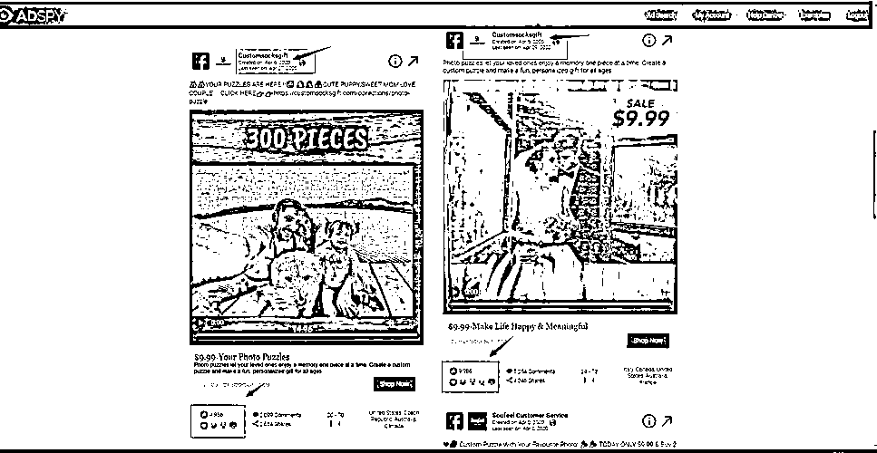

# 第一笔45美元：独立站从失败到出单

这是 seven 在 2020 年 5 月 5 日发在龙哥盟的精华复盘，当时拿到 308 个赞。先给结论：那笔“第一桶金”其实只有 45 美金，来自独立站成交。金额不大，却让我第一次完整经历从搭站到收到订单，也让我看清后面要走的路。

一、首单是怎样跑出来的

四月十八日，我进了龙哥盟，之后一段时间几乎昼夜连轴。刚入圈先到处乱翻，兴奋得停不下来。等熟悉了环境，我从精华区挑中两个方向：TikTok，以及 Shopify 搭配 Facebook。

方法很笨：在圈里搜 TikTok、Shopify 等词，把能找到的帖子尽量全读。TikTok 相关内容我熬了整夜；Shopify 读完就立刻动手。

四月二十七日，第一轮尝试失败。我在自己的工作日记里留下两篇复盘，题目是《shopify 从零到一，从入门到转行》和《Facebook 广告，从入门到转行》。我原先在亚马逊平台做事，转去独立站并不顺；真正卡住我的，是原来的平台惯性。当天总结出三点：一是平台思路太重，视频里的产品我自己不买账；二是独立站基本功不牢，得继续补；三是最要紧的 Facebook 广告，我根本不会。那时我以为挑到好货直接推就能成交，结果五百多美金打了水漂，现在仍心疼。情绪低到谷底，我问自己：难道这辈子只能靠一项技能吃饭？亚马逊不可能做一生。

四月二十八日，我把圈内 Shopify 主题帖重新细读。某条线索提到，新手可以从 waimaob2c 论坛入手。于是工作日记重新开篇，题为《1.初识 shopify，重新出发，从零搭建系统框架》。这篇内容也作为附件随文发布，里面有摘录、重点、我的理解以及需要注意的细节。此后我逼自己空杯，从零对待独立站。waimaob2c 不收费，教程细到保姆级，由浅入深，对新手很友好。我的判断：照着教程把 Shopify 每一步做好，新手搭站基本够；若以后想靠 TikTok+Shopify 变现，Shopify 仍值得学。

四月三十日，论坛里说新手最好先看 Tristan Broughton 的课程，我马上买下。这一回不再拿旧思路套，而是照着视频一比一复刻，图标、颜色都直接抄教学。相关笔记在附件《2.Shopify 从零到一实操课》，课程全英文，笔记也用英文写。

五月一日到四日，我每天学、每天动手，重点攻 Facebook 广告，笔记为附件《3.shopify 的 Facebook 广告》。四日晚按视频方法建广告，五日开始有成交，ACOS 尚可，扣掉投放成本还有利润。

六日到八日，订单持续出现，广告也进入正向，跑得越来越稳。表现最好的两条广告：一条是剪了 TikTok 上百万播放的视频当素材；另一条是用不便宜的 adspy，照着对手一条九千多赞的广告复刻，连标点都对齐。adspy 显示当时只有两个竞品，都是四月上架，一个四千多赞，一个九千多赞，说明市场尚早，切入还有空间。截图里也能看到，对手就两家，但销量很好，竞争未饱和。

五月八日，我过去十来天主要在摸独立站逻辑，如今算是有浅层理解。不过我先暂停 Facebook 广告，因为 Shopify 的订单与客户管理还没学，不想精力分散。整体跑下来，我意识到三个关键：产品本身、广告素材与文案、店铺装潢带来的信任感。后面我想探索的是“会选品+独立站思路+不压货+低成本流量”的新手赚钱路径。目前手头四台 iPhone、一台安卓，接下来重点研究 TikTok，有进展再在圈里汇报。

二、资源清单与实操步骤

先放资源。custom puzzle 相关素材、竞品分析、描述、标题、视频、图片我都整理在原帖链接里，提取码 ee4j。大家可以配合我的学习笔记、操作路径、产品资料与数据，加上教程和成品站，几乎能贴身走一遍我从建站到出单的全过程。这里要特别谢 @轨迹 在我帖子下给的关键提醒。带图评价我用 loox 做，倒计时、折扣展示等也都落地了。

产品是 custom puzzle，四月二十四日靠热词加自建关键词库挖出的单品。我偏向高阶产品，零基础和中级选品对我意义有限。以前上班时我就有个念头：以后做公司，要留一点人文空间，一年只做少数高阶产品，能撑住每天五个半小时的工作时长。因此我把 custom puzzle 发到圈里，也更新了零基础选品教程；同时把产品发给朋友，他在亚马逊上架九天，一天接近二十单。

虽然我按教程做 Shopify，但有一个点不让步：不想把独立站做成随便搬货的 dropshipping。我坚持把产品思维放进独立站，一定要验证这个打法。若只是靠搬货成交，对我没有意义，因为我想做的，本来就是别人难以轻松复制的产品。

为什么起手选 Shopify+TikTok？因为文章要触达更多人，不能只围亚马逊转。亚马逊注册对小白门槛太高，Shopify 几乎没什么门槛。为照顾新手，我的选品路线也从零基础选品转向无货模式：不囤库存，有单再采。零基础很累，我已准备下一篇中级选品教程，同样无货，但不会那么耗人，也会有一定积累。我隐约感到，好产品加上低成本流量，可能让 dropshipping 再起一波。会选品+独立站思路+无货模式+低成本流量，才是新手更顺的赚钱姿势。后续我会继续钻 Shopify 和 TikTok，Facebook 也不丢，练流量感。

Facebook 的文案与视频，我从 TikTok 搜到一个百万播放视频后剪辑，再拼上自己能找到的素材。做 AB 测试时，我直接套用那条 TikTok 爆款视频和文案，效果比课程里教的写法好很多。这也侧面说明，TikTok 可以成为出海赚钱的利器。Facebook 广告会看完播率等指标判断质量，拿 TikTok 热门视频剪成产品广告，至少完播率更有保障。

以上就是我在龙哥盟赚到的第一笔钱：成交 45 美金，不多，却给未来职业方向提了个醒。哪怕只进步一点，也够我继续学独立站，以及独立站里很重要的客户维护。

TikTok 那边，后来有两位圈友自己动手做到过万粉。我坚持发原创，粉丝不多，圈里现有资料我也暂时超不过，所以五月九日起重点学 TikTok，有进展再分享。

换成公式：成交 = 选品过关 × 素材文案有创意 × 店铺可信且带紧迫感 × 落地页顺畅。

Shopify 实操可分四步：

1. 选品是根。用下面四个办法反复验证“好卖”——销量好、竞争小。
   a. 用 adspy，国家选中东（不选也行，任意国家），看近期热度高、竞争少的产品。重点看时间和点赞量，挑近期高热的，再看同类卖家数量，越少越好切。然后从文案、素材到产品资料，找两家最强对手拼起来，连标点都照搬。这样文案和广告集合了两家之长，对手也难挑毛病。
   b. 筛出单品后，用谷歌插件 commerce inspector 再验一遍。点开插件，点 best selling，确认它确实热卖。
   c. 还可装 facebook pixel helper，通过改 content ID 抓订单号，推算对手一天多少单，对产品少的店尤其好用。
   d. 在店名后加 /collections/all?sort_by=best-selling 看热卖排序；若对手做了反查，这招失效。
   产品确认无误后，后续不成交就好排查：是广告不行，还是装潢不行，还是落地页/详情页有问题。

2. Facebook 广告创意素材很关键。可从 TikTok 找素材，也可用 adspy 搬对手广告。adspy 能直接整合最强对手的素材，让创意与文案有底。

3. 店铺装潢可照我的笔记和 waimaob2c 保姆教程做，也可参考我的店。要有评价、倒计时、折扣、信任购买标识，别花里胡哨，就能兼顾信任和紧迫感。

4. 落地页要对齐最强两家对手，反复比较对方页面与自己页面，把两家优点融进来，先做到不输。

四步都做了还不成交，就逐项查：产品经四步反复验证，基本没问题；落地页和对手持平，也过得去；店铺速度自己去体验，速度很影响转化。若都正常，剩下就是调 Facebook 广告。

调广告看数据：点击少，多半素材有问题；不过照对手整合过，一般不会太差。有点击就看 pixel 里的 view content。没人看内容，大概率落地页出问题。有浏览却没人加购，可能是折扣、价格不够打动人，多比对手，适当让利。

三、这趟试错给我的十条体会

1. 看到成交那刻，我兴奋到不行。从定项到出单，几十天里醒多睡少。也是这次，我开始靠自己获取能力。过去我把平台当本事，把大公司的培训、格局、视野、技能和大资金试产品的机会当成自己的能耐，还暗自得意。其实，能主动啃下一个问题并掌握技能，才算真正属于自己。

2. 写作是提升能力的好办法，反馈快、试错快。我卡住时，圈友 @轨迹 的关键解答帮了大忙。别人的赞、评论、一点小进步，都会变成大动力。前辈一句点评，点到关键处，收益很大。所以我劝潜水的朋友迈出第一步。为了输出有质量的内容，我开始研究精华帖，向明白老师、白一喵老师、v 先生老师等学习怎么表达。比如我的零基础教程好用，但我不会写，于是潜入盗坤老师星球偷师；也加入亿级投手阿发的星球补 Facebook。

3. TikTok 的学习让我明白，对新生事物要保持好奇。就算不参与，也别在不懂时先排斥。比如抖音，我起初跟身边人说它“有毒”，先抵触，再懒得理，后来看不懂，现在追不上。

4. 跨界学习，大概是检验和拓展能力边界的最好方式。第一波钱若靠前公司给的能力，未来就得靠自己的学习、思考和技能。

5. 想变优秀，就跟优秀的人一起走。进圈已是第一步。怎么有效学？写作。写的时候必须参考圈里人，而圈里人强得吓人，会逼你加把劲。

6. 小成本试错的一条路，是报课学习，借前辈思路和打法，跨界时少绕弯、少交学费。

7. 信息是死的。只有自己照着圈里的信息做出差不多的东西，那才归自己。

8. 看圈里文章会焦虑。我一开始也是走马观花、东看西看，后来改成盯一篇文章、一个关键词认真学、动手做。借前辈的话：做得再差，0.001 也大于 0；一路只看，不如直接干。

9. 我最早的文章毛病很多，不友好，也很自我。做久了总觉得很多思路理所当然；真跨界做独立站才发现，小白要过的坎非常多。跨界这块我也边做边写工作日志，有突破再分享。后面的文章我觉得更接地气、更理性。比如“新手如何开始亚马逊”，我把出单必备条件理性列全；有兴趣的人可以按条件、路径逐项打通技能，并克服路上阻滞。以我这次跨界体验，打通技能困难重重，就像我稍稍突破 Shopify，中间也起伏不断。做陌生的事，天天没效果，每天怀疑自己；但不畏难、真去克服，还是会有突破。

10. 前辈李婕_Zoe 的话很在理：建站工具不是独立站的门槛，找个系统稳定、短期不会倒的就行；真正门槛是会不会玩流量、舍不舍得花钱测渠道、能不能忍前期一直投入还没单。不花心思引流，真的一单都不会有。每次平台封店，总有人来买“安心符”，太平两天又忘了。我第一次就是硬让广告烧，五百多美金颗粒无收。独立站出单的关键条件包括：选品（第一次我做到了）+店铺装潢给信任、倒计时制造紧迫、产品带图评价、描述符合独立站写法+有创意广告素材（广告技巧差些没关系，好产品+好装潢+好素材能补很多）。第一次后两项完全没做到，乱烧才白亏。

第二次重来后，我认真补独立站出单的关键条件，逐项打通技能，结果好一些，能做到广告盈利并持续出单。所以有心学一件事，我建议先把大框架、出单逻辑、盈利模式和原理弄通，再打通必备技能。我认真学基础时很枯燥，几天都是基础且没进展。若不是先知道框架，很可能坚持不住，因为每天没进展、天天质疑自己、甚至觉得在倒退。但我告诉自己：学它是为了跑通出单逻辑；为目标，再忍忍、再忍忍。遇到困难垂头丧气想放弃时，也告诉自己：为目标，调整一下，再忍忍、再忍忍。

以上，希望这份复盘对你有一点帮助。

资源入口：
https://t.zsxq.com/E2vN7uf
https://pan.baidu.com/s/1nNWP565tPCbjmQqgEDxgxw
https://t.zsxq.com/I66iaAI
https://t.zsxq.com/E2vN7uf
https://t.zsxq.com/BIEAAmI

