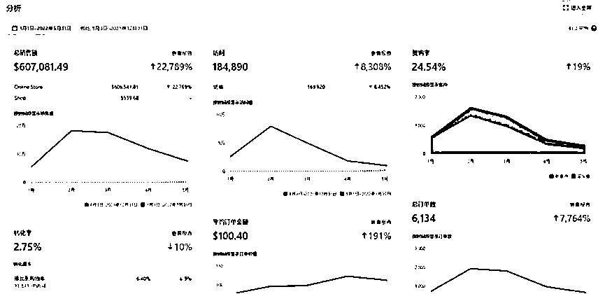
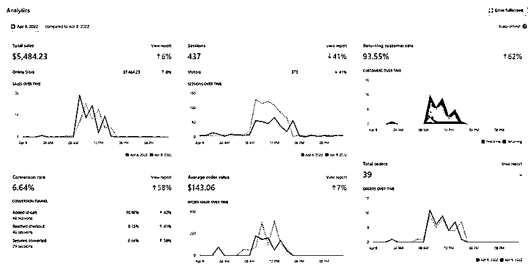
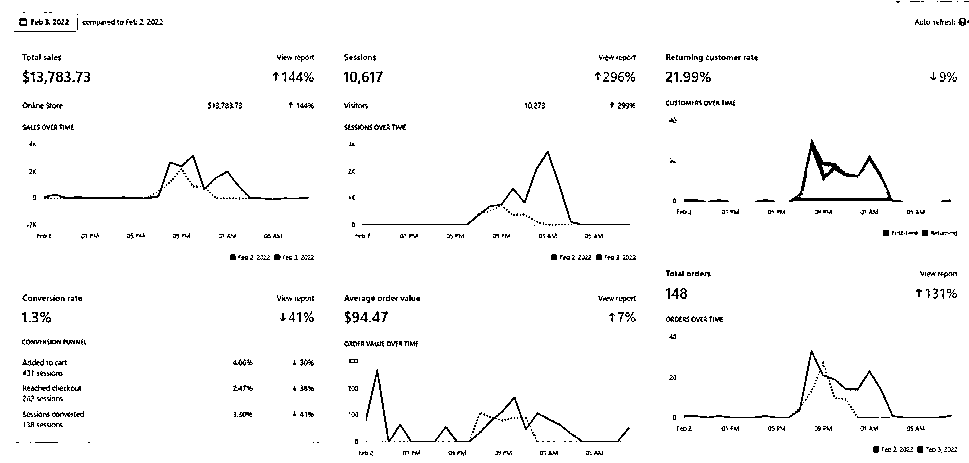
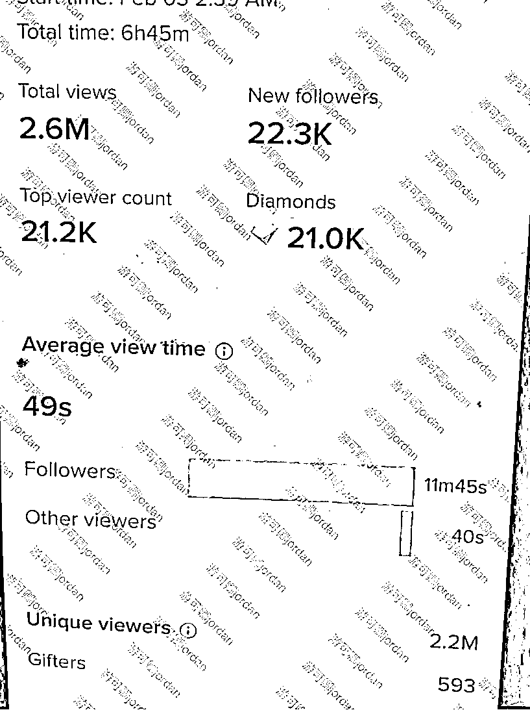

# 半年挣下300万：TikTok海外直播的踩坑复盘

我是游可卿。赴美读书、工作加起来八年，2020年夏天才算真正扎进TikTok。眼下这个盘子是前一年年底开的局，最初只有我一个人摸爬滚打，坑没少踩，如今队伍十个人，账面跑出了三百万元人民币的净利——注意，是利润，不是流水GMV。

朋友圈晒过其中一个站点的后台，放图不为炫耀，只想说明：下面这些体会，是一线打出来的。

基础运营全网已经讲得够多，这次不重复。我更想聊那些会左右项目结局的环节，再结合创始人、主播、运营三种身份，说说各自该盯什么。

先摆几个判断。

## 一、TikTok实战判断

**1. 掌舵的人不能脱离一线业务**

见过没做起来的班子，带头人对业务大多没手感；反过来，拿到成绩的团队，领头人基本都懂行。别指望例外。

**2. 先算利润，别把成交额当战果**

GMV只是面子，净利才是里子。小团队起步，最好从利润倒推结构：客单价、复购、人效、固定支出都要摆进去算。同样一个月做一百万流水，有的团队赚钱，有的团队越忙越亏，结局可能完全相反。

**3. 供应链先别急，流量和承接更值钱**

这个阶段还没到供应链肉搏的时候。朋友问我，万一爆单怎么办？我说，还没学会走，就先担心跑起来摔伤，没必要。爆单没那么容易；真来了，临时救火也来得及。成交靠两头：流量面够宽，转化够深。

平台标签没有抖音那么准，低场观很难稳定出单，所以要有流量底盘，也要有健康账号。流量来了，承接还得接得住。我们有过在线五千人挂零的时候，也试过流量掉到一百多人在线、三小时收五千多美金。

流量加承接，粗暴但有效。现在就是前端能力说话。

**4. 预期别拉满，耐心要留足**

对多数人来说，TikTok眼下还不是暴利机器。抖音能，TikTok还差口气。目标定太高，创始人容易冒进，耐心一崩，项目就危险。稳住，今天能变现几万美金，未来也许能放大到几十万、几百万美金。你要的是这种变现本事，然后等势能。

**5. 多复盘败局，少追成功神话**

成功项目各有各的路，失败病因却常常相似。先看别人怎么倒下，把坑避开，就赢了一半。

财务风险尤其要管：公司停摆，很多时候就是工资发不出。备足十到十二个月零收入也能活的现金；钱不够，就别养那么多人，先缩队伍。

## 二、创始人视角

**1. 认知到几分，筹码押几分**

我的原则是：对项目理解多少，就投多少，对自己绝对诚实。十分制，手里十块钱，认知只有三分、看不清，那最多押三块。理论上认知满分甚至超出、足够有底，借钱也能上，但我不提倡负债创业。

现实里，很多人开局就做错决定。2020年我认识一位老板，89年生，做跨境赚过钱，专门从福建跑到杭州ALL IN TikTok。他热情很足，租写字楼，招二十多人。那时平台没有直播、没有小店，刚有基金，大家都很懵。他带着三百万，大概是大部分积蓄，给自己一年期限：钱花完或时间到，做不出成绩就撤。

他当面跟我说，兄弟，现在不是按天按月算，是按秒算，赶快上车。我当时既被焦虑到，也强烈质疑那种浮躁。项目一启动，他请律师做了厚厚一本竞业协议，怕员工乱来；招人时，会点英语就多给，是外国人就一万五起，在字节体系做过、哪怕只是后台视频审查，也能来当负责人，底薪两万。

在我看来，很多事本末倒置。这个盘子起步只有一个目标：小团队先把完整变现闭环跑通，不管一百美金还是一千美金，先跑通最要紧。一年后，他回福建，背着三百万损失。典型的不懂业务却重仓投入。接下来两年，类似故事在大大小小团队里反复上演。也不能全怪他们，我们都活在焦虑和暴富故事里，很难独善其身，只能时刻提醒自己。

**2. 利润意识是活下来的底线**

创始人必须盯利润，因为利润决定你能撑多久。最朴素的公式：收入减成本，剩下才是利润。

多数团队启动时，创收还没头绪，那就先控成本。别一上来租七百平方米，钱省下来，这个盘子真用不了那么大；别一上来堆人，四五个人跑不正盈利，四五十个人也未必跑得出来，它不是劳动密集型生意。

时间上，两个月不盈利，已经暴露出战斗力问题。平台爆发力强，只要方向对、方法匹配，短期应该有进账。没有进账，就说明方向或能力有毛病，这个信号比亏点钱更重要。还有，及时盈利很关键：多砸钱不会自动带来先发优势。不赚钱的团队，最后除了一堆废号，什么都攒不下，钱买不来未来。

**3. 搭班子要创始人亲自盯，主播尤其关键**

这块工作量不算大，却是命门。行业新，有经验的人少，所以要筛有潜质的人，这往往得创始人亲自把关。

今年应聘者里做过TikTok的多了，那就问一句：之前参与的项目赚钱吗？没赚钱，就按零经验看。在一个长期没结果的团队待久了，反而容易对行业和业务产生误判。

主播方面，语言是门槛。很多人说自己英文好，但标准因人而异。会英文、英文好、能当合格主播，是三码事。你我都说中文，就一定能做好国内抖音主播吗？我面试过不少主播，有朋友介绍的ABC，英文中文都不错，聊完发现对业务没理解、要求也不现实，后期很难融入。

还有人现场面完被婉拒，第二天朋友圈就晒新注册公司的执照；也有人应聘全职主播，却问能不能不坐班，说播完就回家，因为自己经验丰富。我问：你应聘的是全职吗？答：是。那不坐班不是不行，但得足够优秀。怎么算优秀？答：有经验。之前项目赚钱吗？答：没有。每场成交多少？答：一两百磅。国内觉得李佳琦强，是因为他一场能卖几个亿、养活一大帮人。那中国有特别强的TikTok主播吗？答：没有。这种情况下还提只坐班，其实就是行业错误信息带来的误导。等行业成熟，这类情况会少。

**4. 大方向不能押错**

做什么业务变现、打哪个市场、选什么类目，这些关键决定不能偏。没有标准答案，只有合不合适。

我们立项后第一个决定：不做英区，主攻北美。原因很直接，我太了解自己的团队。拼价格不占优，拼努力不算最狠，拼资源更拼不过；我个人也不喜欢太卷的方向。英区开小店后，会涌进大批熟悉国内小店玩法的玩家，再加上平台补贴，一旦卷红眼，我们没胜算。做北美，我熟悉当地，同时它也是最大、最有挑战的市场。

没有小店，就得靠别的路引流落地，主要是在简介挂独立站。购买链路更长，转化率更低，也没有官方扶持。但我判断能干：团队沟通能力偏高，能啃下一些问题。后来我们教很多奶奶级客户一步步下单，链路长、耗时长，但她们忠诚度高，有人还开玩笑认主播当孙女。

再比如，主流逻辑是英区小店练兵，等美区打开再转移。我们很早就判断，美区电商化不会太顺，与其等，不如主动进攻。依据是，字节在美国那么多双眼睛盯着，很难强推全闭环：CREATORS不愿意，竞争对手不愿意，大环境更不愿意。美国人是freedom nuts，热爱自由，也包括自由地把流量引到独立站。我坚定看好TikTok、看好字节，但这次电商不同于当年阿里赴美上市。阿里当年是TO B，帮美国人挣钱；字节电商是TO C，是去分蛋糕，加上紧张的大环境，难度可想而知。我也希望字节能坚持下去，找到解法。

小一点的事，比如平台不成熟时尽量做非标品，选品要小、轻、售后简单、国内供应链有优势、容易冲动消费、不需要大量囤货。业务上尽量把复购做高，一方面说明客户有黏性，另一方面也省物流费。跨境物流占大头，按每单核算，物流费用至少占25%；客户多下几单、打包在一个盒子里，运费就能分摊，整体利润会上去。怎么让客户多下单？用各种促销结合提炼好的话术；也可以把最热销的产品放到页面最后展示，客户为了找它，会先看到其他产品，购买几率就提高了。

**5. 长期主义，格局打开**

做生意尽量做长期、有沉淀的事，雪球才会一点点滚起来；否则哪怕赚到钱，也会无限焦虑。

我们之前有个决定，短期造成损失，但长期一定对。项目启动一段时间后，发现其中一个品类的品牌名已经被注册，很多客户也熟悉现有名称。改名会流失客户，还要重新把新名称植入用户心里；不改，时间越久越难改，后面有隐患。我们还是改了，直接间接损失至少三十万，但换来长期安全发展。

格局大一点，还包括不要对员工遮遮掩掩。前期把关严一点，进来后就尽最大能力帮员工成长。我常跟团队说，如果大家能力强到可以出去自己做，也没关系。一方面证明我们体系成功；另一方面，员工出去也要面对所有创业者的问题，要找资源、找合伙人。如果彼此信任，为什么不能用联营方式合作？

**6. 决心要能落地**

人和人智力差距真不大，关键在后天认知、学习能力、韧性和决心。我认为决心最重要。TikTok任何一个细分赛道都能做出结果，就看决心有多大。

平台的内容推荐、风控、标签等都不算特别成熟，一定会有各种不确定性。业务上要不断测试，对冲不确定性。决心不足，很容易放弃，而测试是常态。决心也不是嘴上说说，要有具体行动。

春节我回老家只待了一天半。当时我是团队核心主播，年初二赶回杭州直接开播，当天做了一万三千多美金。

不光为钱，也为多圈客户、多拿竞争优势。回杭州路上我想的是：我必须有所付出，否则凭什么比别人好？我要做别人不想做的事。比如跟客户兼MOD各种聊，有点像“三陪”：直播间陪聊、WhatsApp陪聊、电话陪聊，少陪一个都感觉感情不到位。

**7. 管理是第二道生死关**

现在圈内交流多在纯业务层面。我认为做TikTok，业务只是最基础的坎，更多坎来自团队管理。

有些入局TikTok的老板，其实已进入一个无解、必输的局：项目失败，你输；项目做起来，你还是输。因为管理上面临巨大挑战，运营和主播都不稳定。在一个起跑线差不多、又很轻的项目赛道里，面对不懂业务、管理又薄弱的老板，跑路或单干几乎是必然。

所以创始人一定要想清楚：能给团队成员带来什么真正的长期价值，让大家绑在一条船上共同前进。我理解，好的团队一定是东西结合：有人懂国内短视频和直播，有人懂海外目标市场的消费心理和内容审美，大家在开放环境里不断打磨最优解。

目前从业者大多来自传统跨境、国内抖音或有海外背景的创业群体。传统跨境人最大的问题，是怎么从LISTING图文时代过渡到去中心化推荐的短视频时代，两者对团队能力要求完全不同。做过抖音的人曾认为去TikTok是降维打击，现在大家基本看到，这并不是事实；甚至做过抖音，反而容易背着抖音包袱做TikTok，一定要空杯，否则会走更多弯路。海外背景群体，比如我，最大挑战是怎么趴到地上做苦活累活，做接地气的创业者，胜算才更大。

最后，创始人没事别选择ALL IN TikTok，这听起来赌的成分太重。赌也许能赢，但不赌也能赢才是更好的选择。喜欢德州扑克的人知道，面对搏概率的事，要尽一切办法把它从不确定推向相对确定，长期看一定会赢。TikTok只是一个工具，一个很牛的工具，但不能完全依靠工具。真要ALL IN，我建议永远ALL IN在自己身上。

## 三、主播篇

粗略算，项目至少一半GMV是我自己播出来的，尤其启动阶段。我最多一次连播七个小时，基本不停，场观到过两百六十万；还有一次在线三万多人，有点离谱。

作为公司第一个开疆破土的主播，我简单分享几点。

**1. 别照搬国内叫卖式**

这和海外用户消费心理有关。国内大主播可以卖所有产品，因为大家喜欢热闹，喜欢大主播的极致性价比；美国用户更偏专业导向，也更容易受主播个人影响。有个单子我印象很深，客户直言：我下单只是因为你这个销售很靠谱。对方还是男性，不是因为看上了我，而是认可你、想表示支持，他对产品根本没有需求。

换个角度，北美用户总体愿意为知识付费，尊重别人的劳动，不喜欢买盗版，哪怕知道能省更多钱。所以主播要展示努力、专业和能带来的价值，尤其是情绪价值，一定会有回报。

**2. 懂一点流量推荐和运营逻辑**

对流量推荐要有基础理解。直播间推流现在核心指标就一个：用户停留，停留就是最高权重，简单直接。对运营工作也要有基础理解，才能更好配合。主播预热不要放在开播后，必须放在开播前。一旦开播，要强迫自己调整好状态，迎接第一波急速推流；这波承接会直接影响整场结果。

**3. 节奏感是主播的硬功夫**

主播最核心的能力是节奏感，很务虚。你要知道什么时候慢下来，多介绍产品，耐心积累直播间的购物情绪和氛围；也要知道什么时候嗨起来，感觉到了就快马加鞭释放情绪，让大家争先恐后下单。就像NBA的卢卡·东契奇，不一定是最高、最壮、最快，但可以是最有节奏感的那一个，依然很强。

**4. 接受不完美，放大长板**

没有主播是完美的，要找到自己的优势。我擅长沉淀老客户，抓newbie的能力就不强。也许因为我在德克萨斯待过，德州客户很多；也可能德州客户真有钱又豪爽。我常跟他们聊以前的趣事，甚至主动聊婚姻、家庭、情感、八卦。最容易互动的话题之一是：女士们，如果伴侣出轨，你会原谅吗？评论区就会刷“绝不”“永远不会”“除非我也能出轨”“我会让他付出代价”等等，互动就来了。只是作为男性，我越看评论越害怕，广大同胞管好自己。

当然也有禁忌话题：所有容易引起大争议的都不聊，比如政治、宗教、性取向、男女权力。只要聊了，直播间那么多人，一定有人被冒犯。

**5. 状态不好就别硬播**

可以让别人上，不要消耗受众和账号，更不要无理由拉时长。在线都个位数了，为什么还要继续播？我如果感觉状态一般，或数据下滑幅度较大，就果断下播，重整旗鼓再来。

**6. 真心在意你的观众**

发自内心去CARE你的受众，别只把他们当流量。

**数字背后，都是人**

别只盯着数据。每一个数字都对应一个有温度的人，也对应一段旁人未必知道的故事。你是不是真心在感受，对方往往能察觉。把心力放在支持你的人身上，别被负能量的人牵走注意力。

我听过一句很打动我的话：直播的本质，是陪伴。后来越想越对。有人家里遭遇亲人离世，会来跟我们讲；有人正在和病魔较劲，也会来跟我们讲；甚至遇到开心事，也愿意第一时间分享。这些内容跟产品无关，跟销售也无关，只是陪伴。人活着，陪伴本身就是刚需。平时多翻客户的主页，多了解他们，对直播同样有帮助。

**7. 语言这关，要下笨功夫**

我的理解是，非母语者想把语言讲到特别出色，真的很难，不必苛责。语言只是整场表达里的一小块，情绪、内容、产品、个人特质，都是综合表达的一部分。

但我给直播间立了规矩：直播时别讲中文；核心词一个都不能说错；该做的准备必须提前做足。

不用中文，是因为对方听不懂。你在他面前讲中文，潜意识里就是不尊重，也会在细节上暴露不专业。核心词尤其要准，比如卖点，必须提炼得短、明白。

日常话术要顺，低级错误不能犯。语法或措辞上的小毛病，会让母语者听出距离感。

反过来也一样。外国人到中国直播、赚中国人的钱，理想状态同样是越地道、越抠细节，距离感越小，越容易成。国内抖音上变现做得好的外国博主，中文都很好，这是底子。

**8. 常客要当宝，不要当流量**

你的 regulars 可能不多，但别嫌少，火种虽小也能烧起来。主播一定要和他们保持强黏性：每天见面打招呼、问候，不能省；人多时点她的名，说声谢谢；每个月对贡献突出的常客，送点礼物或折扣码。

钱多钱少不是重点，重点是让人看到你的态度。很多常客每天会在直播间待两三个小时，帮你暖场、解答新人问题、跟你互动。他们要的只有一个：精神上的满足。这个一定要给到，满足了，你的工作也会更有趣。

做主播和做任何职业一样，靠谱是底线。靠谱放在哪里，都是核心品质。

我们最大的客户，恰好也来自德克萨斯。她看我播了两个月，才下第一单。觉得靠谱之后，她支持得非常坚定，累计花了 31000 多美金。（附截图）

四、运营这摊事

1. TikTok 运营，难在明天不可知

TikTok 运营挺苦的，因为你真不知道明天会怎样。

全公司最焦虑的人，除了老板，恐怕就是运营。真该给运营加个鸡腿。和国内抖音比，TikTok 有个抖音兄弟感受不到的痛点：硬件和网络能把人头搞大。

一个中国团队做的海外应用，对国内玩家的风控，在我看来属于最严的那一档。普通网络环境，玩玩 IG、YouTube 没事；不拔卡、不关定位，你再看 TikTok 试试？发视频？网络得收拾得更干净。开直播？试试不插卡、拉专线，做到一设备一账号一地址。

2. 细节要抠，还要会举一反三

TikTok 是实时变化的。一个只会等指令、没有解决问题能力的运营，很快会被淘汰。

比如收工后先断 WIFI 还是先退节点，这俩顺序有差别吗？表面看差不多，实际有讲究，还挺关键。流量突然掉了，是自己的问题、平台抽疯，还是同赛道对手变强了？

TikTok 和抖音一样有赛马机制。你水平没退，只要别人更强，你还是会掉。好运营要能判断问题出在哪。

3. 耐心和韧性，一个都不能少

不管短视频还是直播，平台每次塞来的测试流量，精准度可能还不如国内抖音。比如你卖 LEGGINGS，它给你推一波小孩，你接不住，这跟你没关系，不用太懊恼。

你要做的是不断试，等到好运来。

这行细节多，想当好 TikTok 运营门槛不低：直播间要懂、账号要懂，独立站或小店后台也要能对接（我们没设中控岗），每个环节都不能卡壳。

运营篇写到这，突然思绪很多，已经不知道写啥了。这块内容各渠道都挺多，大家有机会再聊。

一不小心啰嗦了挺多，想加几句题外话。真得感谢团队小伙伴，大家都鼓励我出来多做分享和交流。我本人不算擅长分享，更喜欢安静下来钻研业务。

眼下 TikTok 正处在近几年的低位。做这行、尤其靠电商变现的人，至少九成还没赚到钱。可我还是坚定看多这条赛道。它的天花板远没到，可做的方向很多，我们不过是在电商变现上边学边走。

所以我希望大家先活下来。这份生存指南给到你，请一定先苟住，等光明来。牌桌上想赢，第一件事是先留在牌桌上。我们山顶见。

团队下一步会啃更难、但长期更对的事：所有想出海做品牌的跨境团队，迟早都会撞上两堵墙——视觉设计和品牌故事。

我们自己有杭州算顶尖的 STUDIO，内容层面也有自己的理解，希望在这块和大家多交流。把流量做起来、产品做好、服务做好，是本分；真正拉开差距的，是视觉设计和品牌故事，这些能帮我们抢占用户心智、做出更高溢价。

最后，TikTok 里不只有财富机会，也有值得感受的内容。

之前刷到一个在美国做临终关怀的护士账号，她会讲病人临走前的一些状态。其中一位老人安详离开前说了一句话，让她很受触动。老人说：“It was all worth it.” 翻过来，我认为就是“人间值得”。当你回头看，只要觉得值、没白来，这就是最好的人生。具体形式不重要。就像亦仁做生财这个社群，回头看他做过一个帮助普通人赚钱、改变很多人人生轨迹的社群，不管赚了多少钱、经历了多少坎，他应该都会觉得值。

所以，感谢生财，祝大家生财有术，人间值得。

评论区：

江苏淮安邵闯：感谢分享。

jordan：就是想帮大家避坑。

Lio：感谢，可以交流下吗？

jordan：大家对 TikTok 这块有哪些问题想了解探讨，可以加我 WX:sfajordan。

何轩：学习了，感谢；不仅是反向思维，而且是长期思维。

jordan：能做长期，尽量做长期。

沐云丰：感谢分享，先 mark，很有启发。以后遇到问题再来回顾，应该会更有收获[强]。

jordan：可以哈。