# 7000元投TikTok红人，换来15万App新增

董见一在2022年12月5日发过一篇复盘，拿到89赞。他的履历大致是：2019年去澳洲打工度假，约半年挣了30万元；2020年因疫情提前回国；2021年做亚马逊；2022年开始试TikTok推广。真正试水约两周，营销预算7000元，App新增15万，曝光约1800万；单个标签累计播放8000万。对刚入门海外红人投放的人，这份记录比较友好。

全文分五块：
1、产品适不适合在TikTok拿流量；
2、怎样与海外创作者合作；
3、广告投放、直播这两种还没试的玩法；
4、坑与常见问题；
5、过程中的经验补充。

**一、什么产品更适合在TikTok获客**

**1. 需求得是真痛点**

市面上有些需求很旺，却没人满足；补上缺口的产品，甚至能在TikTok自己传开。

Compose App在2022年9月就出现了不错的自传播，流量表现也可以（图0-1）。它抓住的是普通用户想做高级转场的愿望：这种效果往往难学、难剪，而Compose把门槛压低，同时保留灵活度。

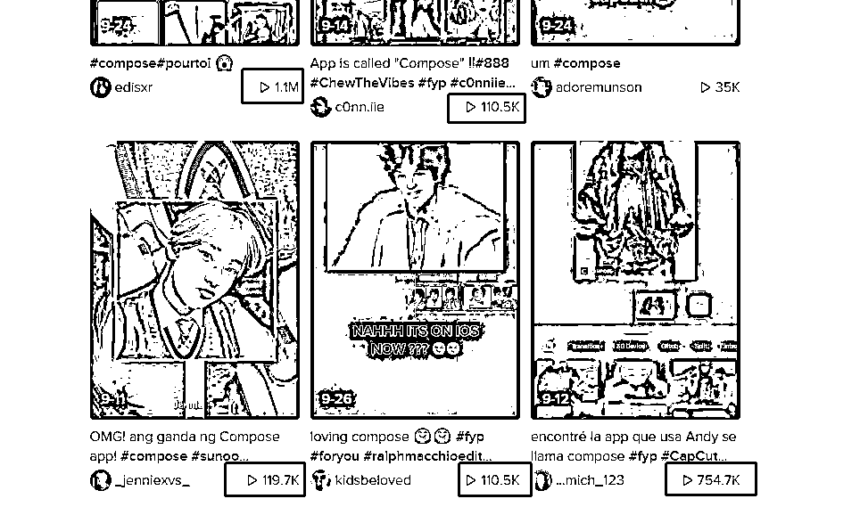

图0-1

Compose具体做了什么？把剪视频类比成下厨：从零做要备菜、烹制、调味；套模板像买固定套餐；Compose更像半成品自选台，用户自己挑、自己拼，最后得到一份专属“自热饭”。

下面这些花哨视频，就是不同转场自由组合的结果。

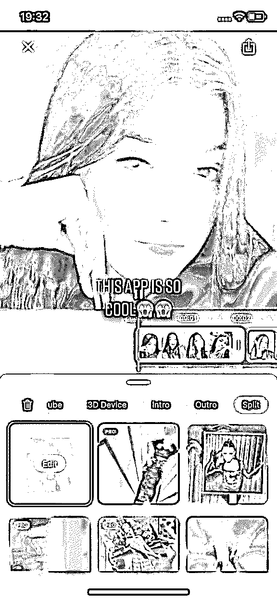

痛点从哪来？Compose的母产品funimate（视频编辑App）在市场里先总结出了它。若没有这样的靠山，怎么找？

**1.1 怎么挖需求**

**1.1.1 借Google搜索词找线索**

两条路：通配符*放在品类词前面；品类词后逐个接a—z。以AI painting为例，搜“*Ai painting”：

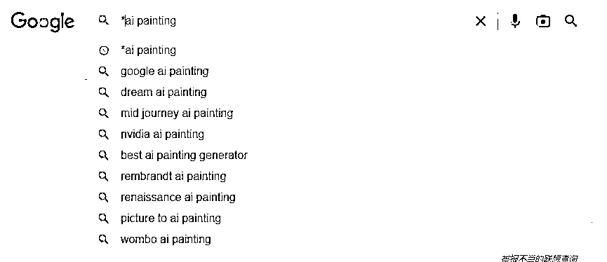

结果里google ai painting最多，后面还有mid journey、dream这类产品名。顺着这些词往下查。

点开mid journey ai painting，能看到有人在问“如何创造mid journey的ai图片”。

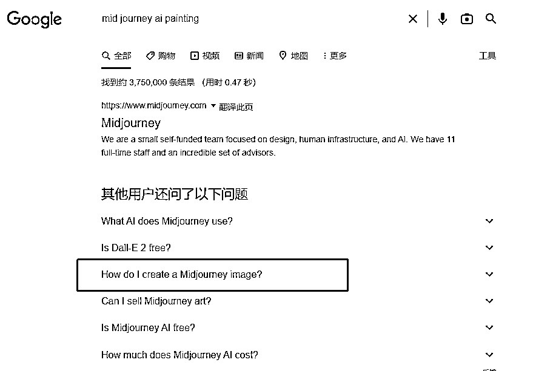

这类提问就是需求：用户想用mid journey出图，但不会。跟电脑卡了去搜“怎么解决电脑卡顿”一个道理。

进去后，AI绘图常见路径有两种：给prompt直接出图；或给图再加prompt出图。

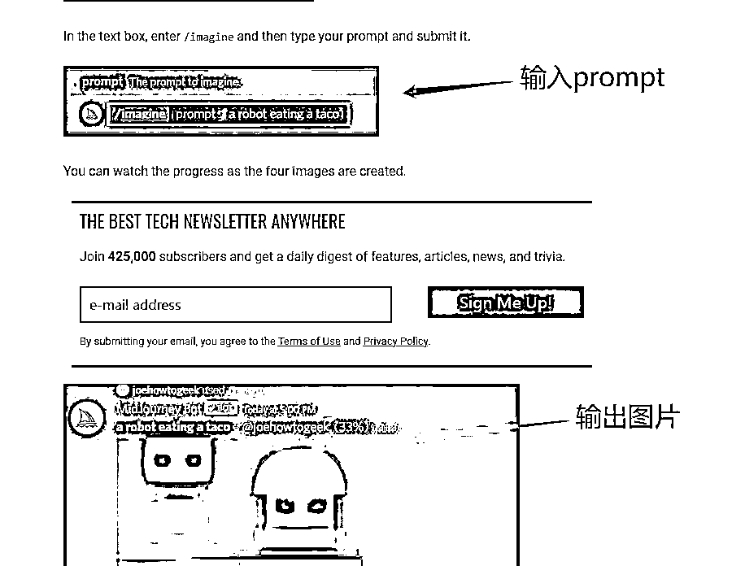

可提炼两个要素：输入——文字prompt、用户图片；输出——成图。

再发散：输入端能否做提示词买卖平台？能否按prompt关键词分类？若输入图片，能否做人物姿势参考站？提示词还可拆成风格、参数、关键词三层，能否做风格/参数分类平台？

**1.1.2 从自身需求里找痛点**

问自己：哪些事想借AI绘画完成？再以用户身份体验产品，记下问题。问题分三类：用前想完成什么；用中哪里想卸载/差评；哪里改了你更满意。前后一直有点别扭、但改善后你还愿意用的，可能就是真痛点。

例：我做创作有一段时间，发现AI人物脸部、服装难一致，特定分镜也难生成。这两点就可能是同类创作者的痛点。

内容来源：【9月航海 英语工具站 航海手册】

**1.2 验证需求**

需求要落到人身上。

**1.2.1 受众素描**

基础资料：年龄、性别、学历、地区、婚否；动态：常看直播、爱打球、遛狗；心理行为：白领压力大、情绪起伏、偏宅。目标人群18—34岁，在TikTok更合适。

**1.2.2 落地场景**

同一需求，场景不同、人群不同，购买决策不同。AI绘画：TikTok创作者做视频为涨粉或垂直号；游戏公司设计师做人物参考为找灵感。场景不同，卖点不同。

**1.2.3 同类玩家**

人群场景定了，就看现成方案、竞品怎么做、优劣在哪。

**1.2.4 解法**

产品方案能否解决问题？用户用完得到什么？在TikTok推广，核心就是向痛点人群展示方案。

内容来源：【Google付费插件 实战手册】

ps：没做过TikTok推广的产品，首次入场常有红利；第一次被大众看见容易引发好奇，也更容易火。这是共性。

**二、海外创作者合作怎么谈**

**1. 怎样找人与筛人**

**1.1 找人**

以下建议手机端操作，海外星图除外，建议电脑。

**1.1.1 在TikTok站内搜词**

关键词分行业词、竞品词。Compose是视频编辑类：

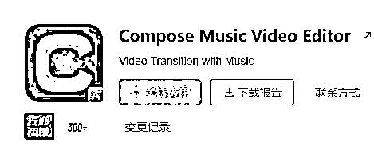

行业词可试video transition、music edit，以及video editor；竞品名里，capcut、alightmotion、videostar都能搜。打开TikTok，以video editor为例，输入video就会跳出联想词（图1-1），都值得看。

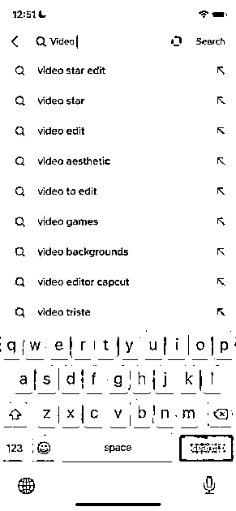

图1-1

搜video editor（图1-2），先看更新时间近不近，再看关键词完整不完整；不完整可能内容不相关。合适就进主页，后面再筛再联系。

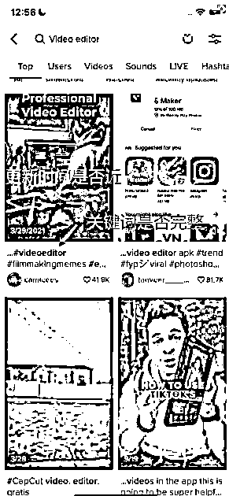

图1-2

想看近期发布（图1-3），点筛选选近一周/近几月，其他别选；most liked结果多半不相关。

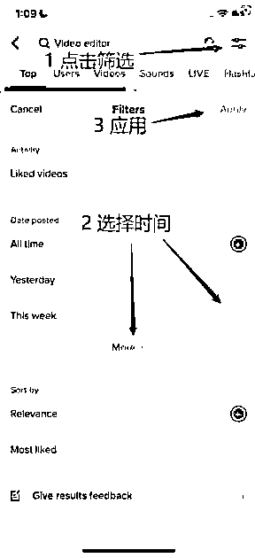

图1-3

若video editor不理想，换video transition、music edit继续找。每次下滑会提示别人搜什么（图1-4），可扩词。

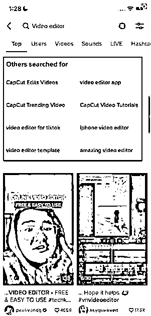

图1-4

**1.1.2 借红人关系链扩散**

前提：先找到一个合适垂直达人。如何更快扩？

**① 关注与相似号**

部分达人隐私设置，关注不可见。分布类似抖音（图2-1）。

图2-1

**A 关注列表**

能看到的话，通常两类（图2-2）：同垂直领域账号；符合达人所在国审美的账号。优质号关注里出现优质号概率更高。

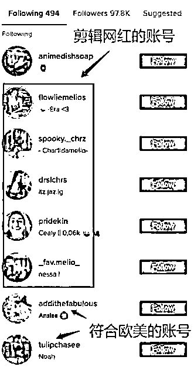

图2-2

图2-3可点进去看剪辑网红账号（图2-4），再顺关注继续套娃。

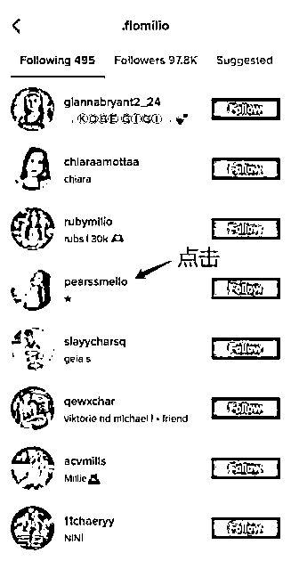

图2-3

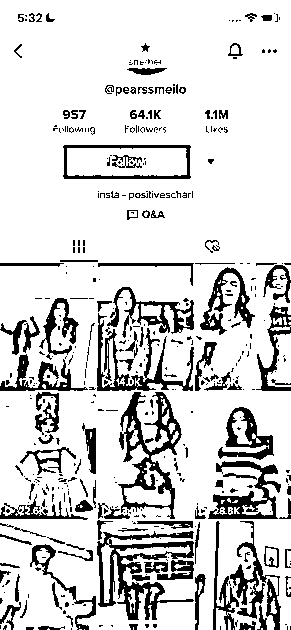

图2-4

粗判：近期播放50K—1M；粉丝低于100K更可能谈到友好价，曝光也不错。

**B 相似账号**

路径：相似推荐（图3-2）更随机，但能找到相近号。图3-3电影剪辑号，手法模糊+卡点，与编辑相关，Compose可考虑。

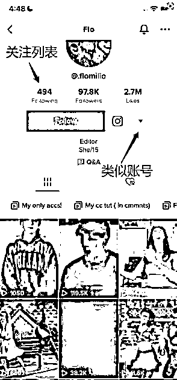

图3-1

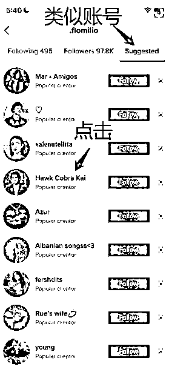

图3-2

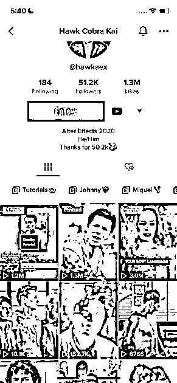

图3-3

**② 合作后问推荐**

完成一次合作后再问。达人圈子有资源，推荐通常不差（图4-1），有朋友背书谈判更顺。可提前承诺推荐成功给5—50 tips，视粉丝量定。

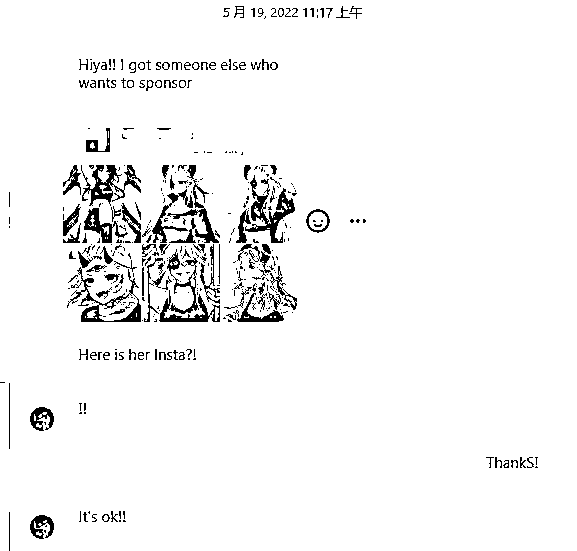

图4-1

**1.1.3 顺着话题标签挖人**

例（图5-1）：优秀垂直博主标签有#capcut #cccreator #capcutvsalightmotion #naruto #narutoedit等。#capcut #naruto #narutoedit对应#剪映 #火影 #火影剪辑；#cccreator没见过，点进去看。

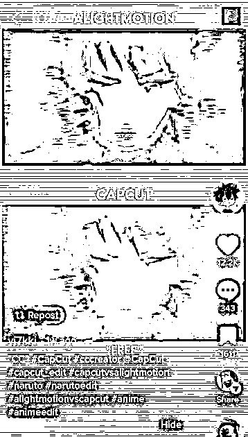

图5-1

浏览后（图5-2）发现cccreator下多用capcut，推测是capcut creator，而非color correction creator。可作挖capcut合作达人的标签。标签也能无限扩。

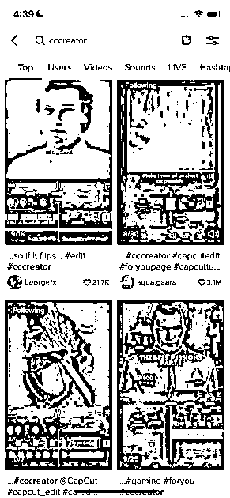

图5-2

**1.1.4 用TikTok Creator Marketplace找人**

前提：公司营业执照，注册后提交，可能多次失败，坚持提交几轮通常能过。方便，但不少优秀KOC未入驻，搜索结果有时少，仍以站内找为主。找大型KOL且预算足，这里不错。

图6-1

**① 搜索**

用竞品词（图7-1），点竞品连带App，能直观看到合作达人。

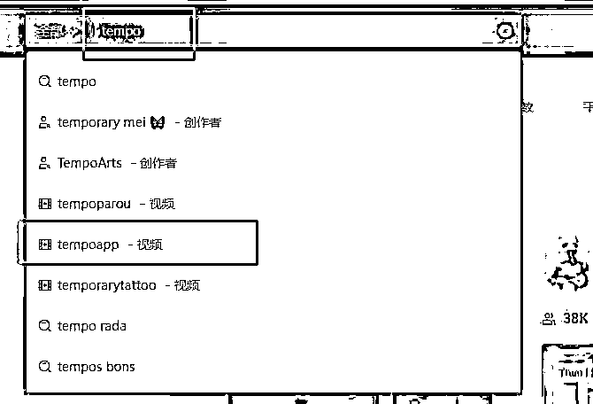

图7-1

结果（图7-2）有价格、作者、数据，体验好。

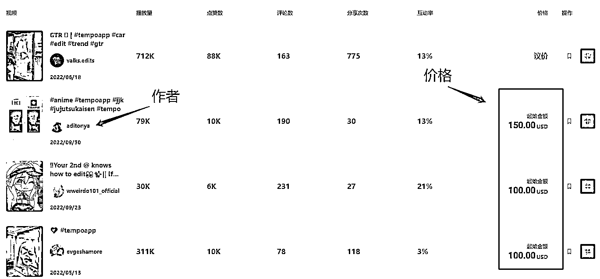

图7-2

进主页看粉丝画像：性别、年龄、国家。三项不符利基市场就别谈。欧美变现强；巴西、菲律宾、土耳其等偏弱。

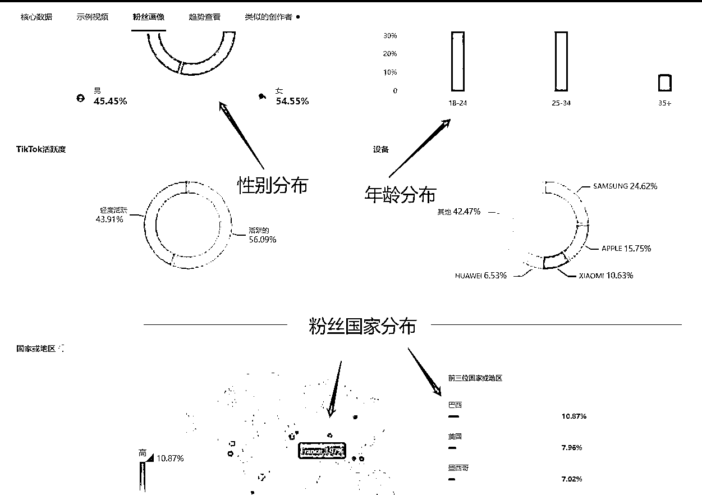

图7-3

**② 筛选器**

一般配合搜索，筛粉丝国家+平均播放量。

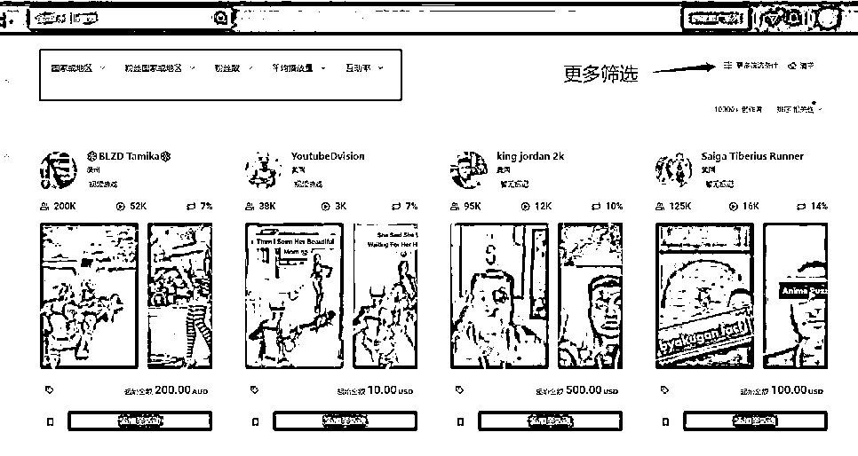

图8-1

更多条件可选达人主题/领域；分类不够垂直，有时还会错，可试，未来可能优化；受众年龄性别可筛。

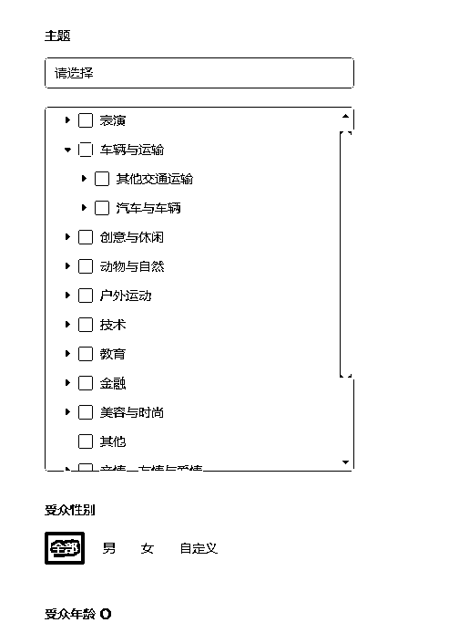

图8-2

**1.2 怎么筛人**

**1.2.1 内容垂不垂直**

几个作品看完就清楚：排版清晰、主题统一，多为典型垂直号。

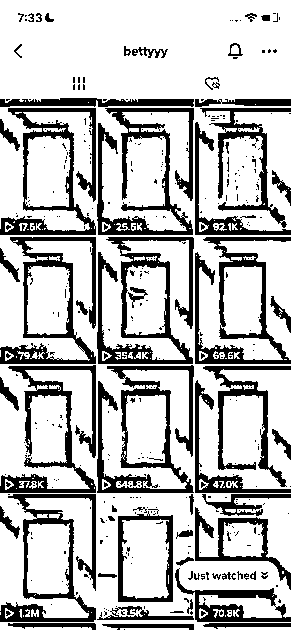

图9-1

**1.2.2 更新节奏与播放表现**

两天一更还是一周一更？近一月有无更新？近一月停更，合作有风险；近期流量差，先观望。

**1.2.3 从作品判断受众市场是否对味**

**① 看文案语言**

文案/主页BIO为英语或难判断（图10-1），看评论区（图10-2）。小语种常出现且其他视频也如此，利基市场大概率是该语种人群。不知语言，复制到谷歌翻译自动检测（图10-3），如葡萄牙语，基本巴西/葡萄牙。

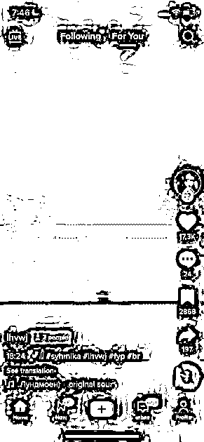

图10-1

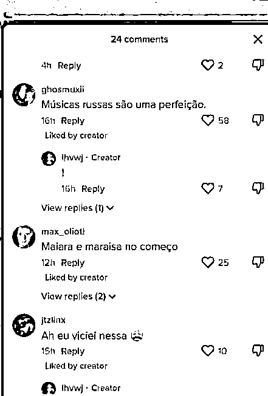

图10-2

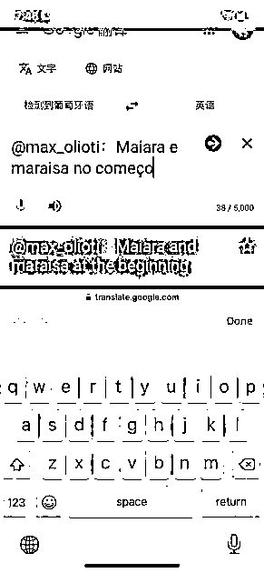

图10-3

**② 看作品风格**

不同文化偏好歌曲与呈现方式，阿三有阿三风格，欧美有欧美格调。不熟就多刷，很快有感觉。

**③ 最后确认**

前两点初筛省精力；最后去Creator Marketplace搜。搜不到，就在沟通中让对方给“Anlysis of followers regoins”或“Video views by region”截图，一般会给。

**2. 怎样触达创作者**

原文明确：TikTok上直接私信通常行不通。

# TikTok达人合作全流程：找人、谈价、避坑

## 2.1 Instagram：两个入口，一个通向聊天，一个通向更多线索

每个TikTok达人主页，都有两个可以尝试对接的入口（图11-1）：一个是Insta图标，另一个是bio区域里的外链。

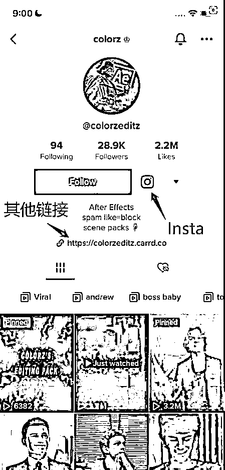

图 11-1

点一下Insta图标，页面会跳到图11-2所示的界面，按message就能直接发消息对话。

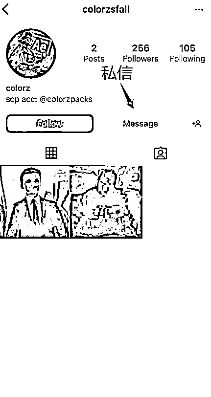

图 11-2

点外链的话，则是跳转到第三方站点，打开的通常是达人其他社交平台的资料汇总（图11-3）。这里偶尔也能看到第二个Insta账号，有些达人还会挂出Discord群组邀请。Discord里也能沟通，不过实际使用频率偏低。

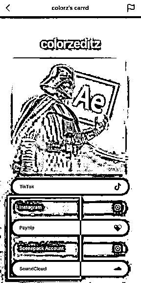

图 11-3

Insta的特点比较鲜明：响应非常快；但消息很容易被新对话淹没。特别是用电脑浏览器访问Insta时，对方发来的消息偶尔会完全看不到，换成手机端基本就不会出现这个情况。

## 2.2 邮箱：顺着bio外链往深处挖，往往有惊喜

达人有留下邮箱的话，位置基本就在主页bio区域（图12-1）。bio里看不到也不要紧，点进外链再找找看。如果主页带有YouTube的入口（图12-1），点YouTube图标就能进入达人的YouTube主页（图12-2）。

比如我们在about页没有翻到邮箱（图12-3），但注意到对方还有一个其他账号。顺着这个账号搜过去，果然在那个账号的简介里看到了专门用于广告谈判的邮箱和Insta（图12-4）——而这条Insta信息，达人的TikTok主页上始终没有公开。

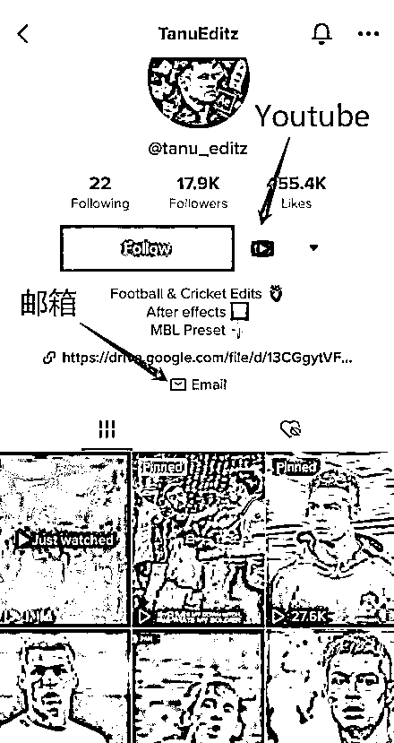

图 12-1

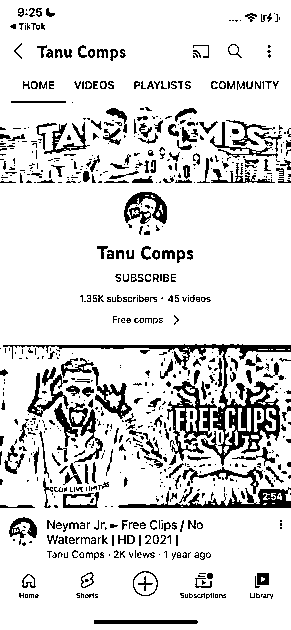

图 12-2

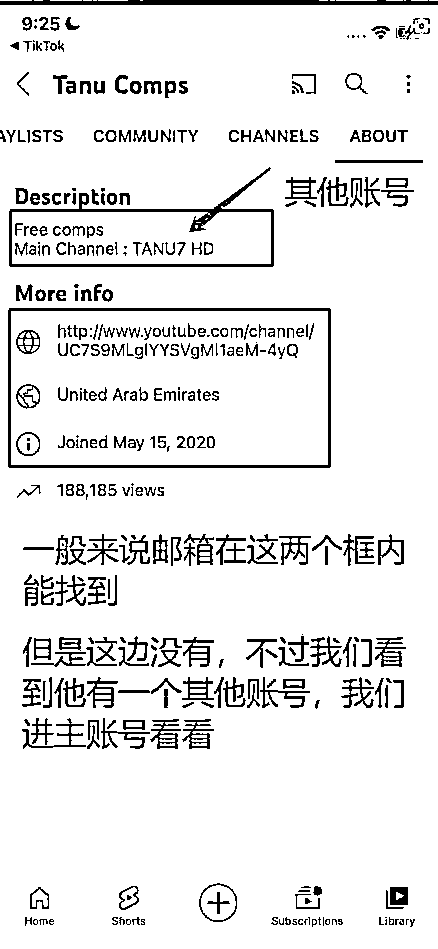

图 12-3

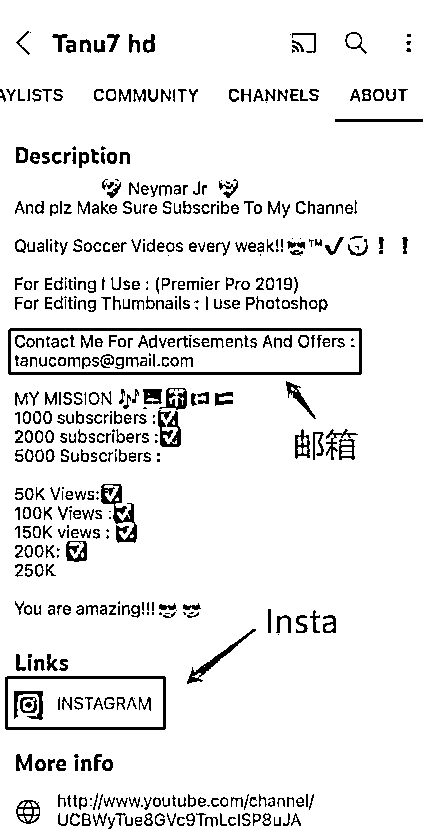

图 12-4

思路其实很清晰：TikTok上没有留下任何联系渠道，并不代表断联。只要他还活跃在其他社媒平台，顺着那根线继续挖，大概率能摸到人。

邮箱的适用场景主要有两类：Insta发出去迟迟没有回音，或者达人是带团队在运营的。它的特点是能等到回复的概率更高，但等待周期也更长。

## 2.3 星图（Creator Marketplace）：直接在站内发合作邀请

在星图后台新建一条广告邀请，入口是“添加活动”。

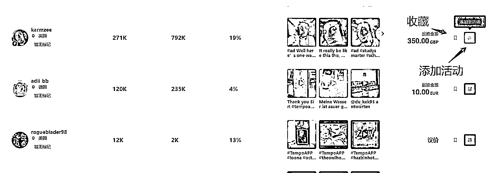

详情页里同样有操作入口。

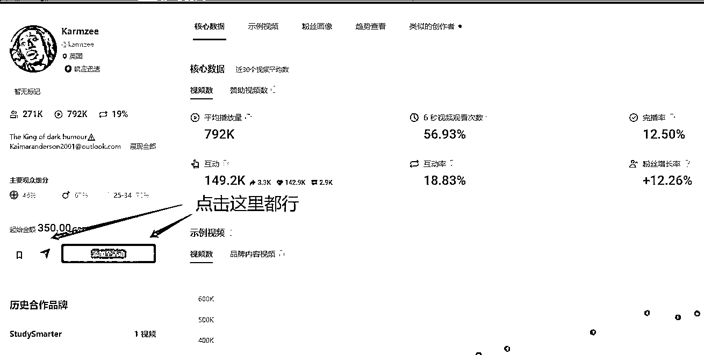

点击之后会弹出一个界面，引导你选择“创建推广系列”。（这边会提示不符合在线支付条件，费用结算一般要私下完成，PayPal和Payoneer都行。）

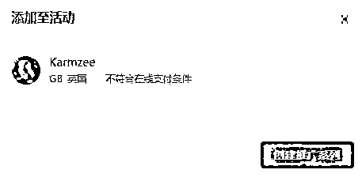

进去之后会让你选推广目标：知名度、考虑因素、转化，按需点一个。

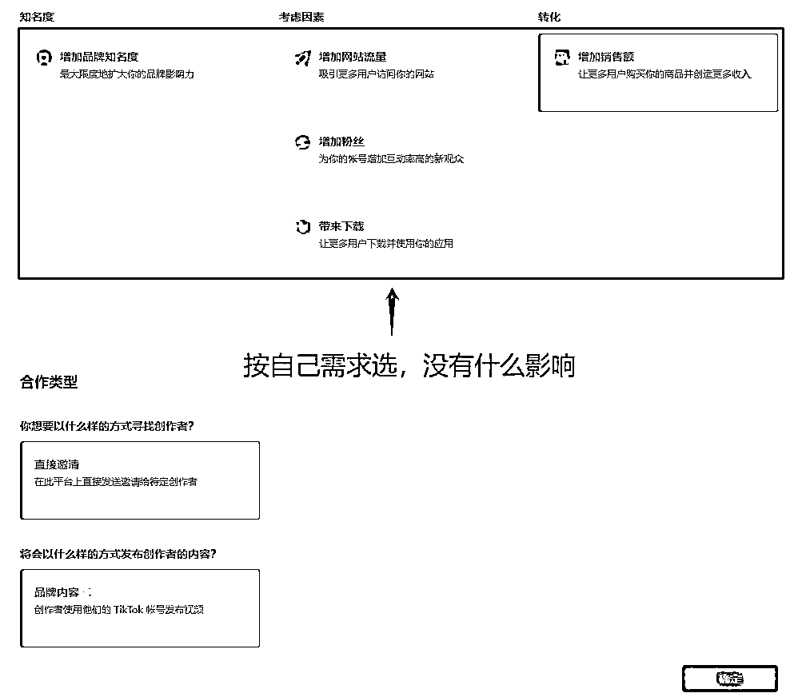

接下来就是填写品牌、联系方式、合作要求的环节，同时也能把更多达人加进这个邀请里。

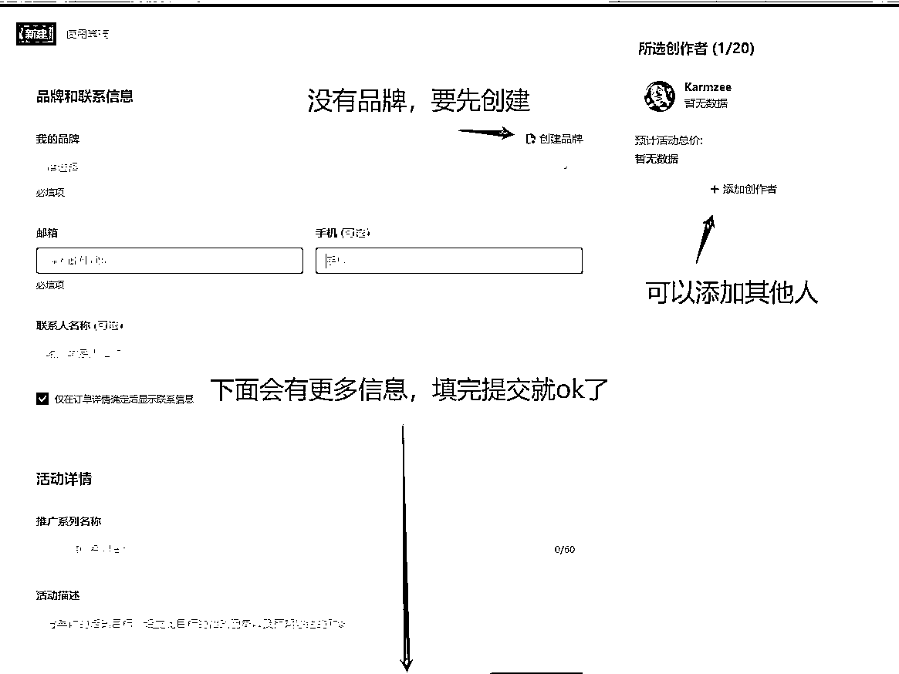

星图的槽点在于：入驻的达人并不全，很多优质博主根本不在里面；同时我们发过任务后，达人的响应速度也不算快。千万粉以上的头部KOL我们没有合作经历，所以上面聊的主要还是针对腰部KOL和KOC。

## 2.4 把留言作为一种最后的联络方式

有的达人既没有留任何联系方式，你又十分看好他，那就只剩一个办法：直接跑到他视频底下写留言，表达合作意愿。留言一般选最新发布的视频，视频越新，被博主看到的可能性越大。

什么情况下这招最有效？当某个博主粉丝基数不大，但刚发的一条视频突然冲到几百万播放的时候。不过务必要鉴别一下，他到底是底子扎实的潜力股，还是纯靠运气爆了一下。一两条视频说明不了问题，连着看上3到5条，如果平均播放还能保持高位，那就可以大胆冲，合作价格大概率有商量余地。

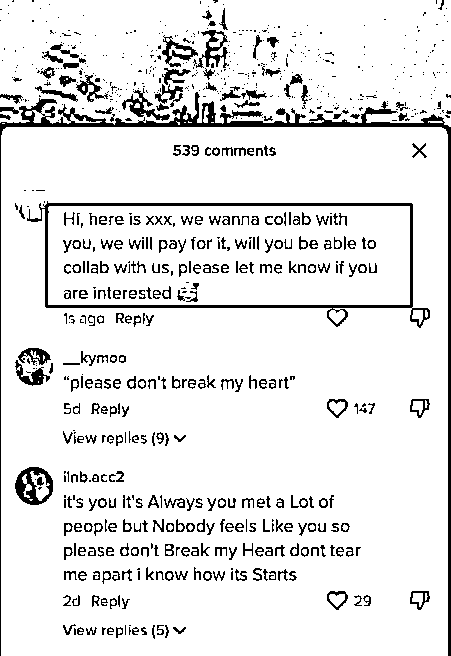

## 2.5 联系达人的话术参考

首次破冰，一句话模板基本就够了：

Hi, here is xxx, we wanna collab with you, and we will pay for it, will you be able to collab with us, please let me know if you are interested.

xxx换成你的品牌名称。发消息的号一定要有“背书感”，至少头像、个人主页和用户名得弄得专业一些。举例来说：主页放几条品牌相关内容，或者把名称重命名为 xxx_collab、xxx_business 的样式。后续怎么聊没有标准答案，等达人对合作表现出兴趣，再把具体要求、预算和价格抛出来就行。

## 3.如何和达人建立合作关系（定价方式）

### 3.1 全款一次结清

走法很直接：先同步合作要求，达人去制作视频；你确认成片没问题，再安排付款；达人那边发布TikTok，整个流程走完。

适用场景：流量数据稳定是采用这种模式的前提。比如近四条视频播放量稳定在20w到100w区间，那么就可以把这种方案拿出来谈。

参考价格粗略给一个方向：150w粉以内的真人出镜博主，即便是美国垂直类目，200美金左右基本能谈拢；50w粉以内的，不妨按50美金来谈。当然，实际交易中情况千差万别，不同赛道定价也可能完全不同，所以这两个数只是参考坐标系，多找达人聊一聊心里才有底。

### 3.2 订金+点赞激励

基础费用在视频通过确认后立即转账，点赞激励则统一在7天之后结算。

这个模式更适合两种对象：流量表现不稳定的博主，或者主动提出长期合作的达人。后者通常一个月会出好几条视频，每一条都享受点赞奖励政策。

报价框架参考：

保底定价xx，加上点赞

1k likes = $10

5k likes = $20

10k likes = $40

50k likes = $60

100k likes = $100

200k likes = $120

300k likes = $140

400k likes = $160

### 3.3 订金+下载量奖励（这方案我们没用过，有点遗憾）

## 三、没试过的玩法路子

### 1.TikTok广告投放

TikTok广告投放也算一种可玩的方式。达人视频走红后，基本可以判断这个内容对达人的垂直赛道有很强的吸引力，那就不如拿这条视频去投信息流广告。

没试的理由：收费机制和订阅服务当时都谈不上完善。在那种状态下烧钱投信息流，几乎注定是亏本买卖，换算成性价比也拼不过红人营销。后来订阅体系终于搭起来了，才意识到产品本身撑不住——用户想要的解决方案，竞品app早就妥妥覆盖了。

### 2.TikTok直播

对比短视频，TikTok直播的转化效率通常更胜一筹，但目前直播盘子里娱乐内容仍占大头，电商直播还处在蓄势阶段。

没试的原因在于我们的产品在直播里缺少天然的展示场景。展开说：第一，上手门槛不低，教学直播太难落地；第二，英语表达流利的主播摆弄不明白app，能搞定app操作的又张不开口。现阶段真正适合直播的是那些能一眼看明白的产品。如果是app这类的产品，更理想的方式是达人愿意自发批量去播，但前提还是把利益链条设计清楚，比如一场直播达到多少下载量给多少分成。

## 四、高频疑问与踩坑实录

### 1.常见问题

#### 1.1 问：邀请信发了一堆，就是没人理，怎么回事？

答：这属于正常基数，能有30%的回复率就算过得去了。要是你特别不甘心某个博主，那就Insta和邮箱双通道同时发邀请。实在没回响，再去他的视频留言区蹲守，或者转战Instagram、Facebook的评论区和Discord，把能想到的路径全部走一遍。

#### 1.2 问：产品视频怎么做比较合适？

答：答案和你的产品强绑定，同时要接住当下正热的话题。比较顺手的方式是把当下流行的音乐和产品画面拼在一起，或者附加一组对比镜头，这种内容更容易跑出来。

#### 1.3 问：数据忽高忽低怎么处理？

答：TikTok红人营销的流量确实来去都快，爆完一波最多撑一阵子。但一旦摸清了爆款的视频模板，靠批量复制的打法往往能续上两三个星期的热度。想追求更长线的流量，那YouTube博主是更值得押注的伙伴。联系渠道前文提过，他们的about页通常挂着邮箱。

#### 1.4 问：给达人打款一般走哪个平台？

答：PayPal是我们最常用的方式。选它主要是看中三点：注册门槛低；覆盖面够广，绝大多数国家和地区的博主都用得上；转账流程也不费劲。缺点是资金到账偏慢，得等48小时之后去交易记录里手动确认账单，达人这才能拿到钱。我们大部分时候不去动它，任由状态挂着on hold。PayPal走不通的话，备选通常是Payoneer。流程就是让达人申请一个Payoneer账号，双方账户互转即可。千万别图省事用Payoneer直接转银行，那一堆手续和表格会填到怀疑人生。

### 2.踩坑实录

#### 2.1 产品问题

我们app的首日留存低于同类产品。开启付费后，转化数据卡在1%门口，偶尔连这个线都碰不到。事后复盘，问题出在两层：产品并没能接住用户的真实需求，体验打磨也远远不够。所以产品本身一定要立得住，建议先做个MVP丢到TikTok里做一轮测试，验证不过关就别急着推。

#### 2.2 人群问题

有一次我们合作了一个数据非常好的博主，但栽在了对受众的判断上。后台画像明明是欧美用户，真实购买力却低得可怜，到头来等于做了一堆无用功。这里特别提醒：TikTok creator marketplace里的年龄选项只有18+这一档，等于18岁以下的用户也被划入了成人类别。想判断年龄结构，建议顺手去评论区瞄一眼，点开那些高赞评论者的头像，能获取更直接的人群线索。

## 五、过程中的一些经验分享

1.挖痛点用关键词叠加自身需求来找，第三方工具也要玩熟。

2.验证需求守住四关：描绘清楚目标用户、找到真实使用场景、摸一遍行业竞品、确认产品真有解法。

3.在TikTok上物色博主，光用搜索会漏掉大片资源。多看目标达人的关注列表和同类型账号，再去关注对应的#话题标签。

4.TikTok creator marketplace是分析创作者数据的利器，只是它的收录库有缺口，很多达人并不在列。

5.和达人建立联络时，Insta或邮箱的优先级最高；星图和留言区次之；私信放到最后。

6.结算模式按体量区分：头部流量博主适合全款一次结清，小体量博主则走订金+点赞激励的组合。

7.播放量不高不等于没效果，评价维度要回到细分赛道里去看。

8.粉丝在目标市场的占比若能超过70%，对你在该区域的推广会是一股强大的助力。别省维护关系的投入，日常多互动，处好交情。

9.别被TikTok的瞬时爆发迷住眼睛，YouTube才是长尾流量的主场。

10.分享一下亲身经历：我们曾在一位百万粉丝的TikTok博主的Discord群里做过一次营销，引流数据完全超出预期。希望这些内容能对你有切实的帮助。

评论区补充：亦仁在评论区表示内容很有价值，直接加精；董见一回了一句感谢；飞扬说学到了。有读者追问：“150w以下真人出镜博主200美金、50w以下50美金，是你们给app做推广时的真实开销吗？”董见一解释：价格很接近，但那是理想定价而非固定标准。具体数字取决于谈判情况、达人所在赛道以及他近期视频的曝光数据。