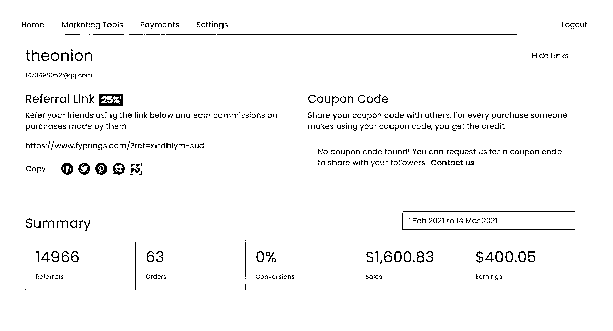
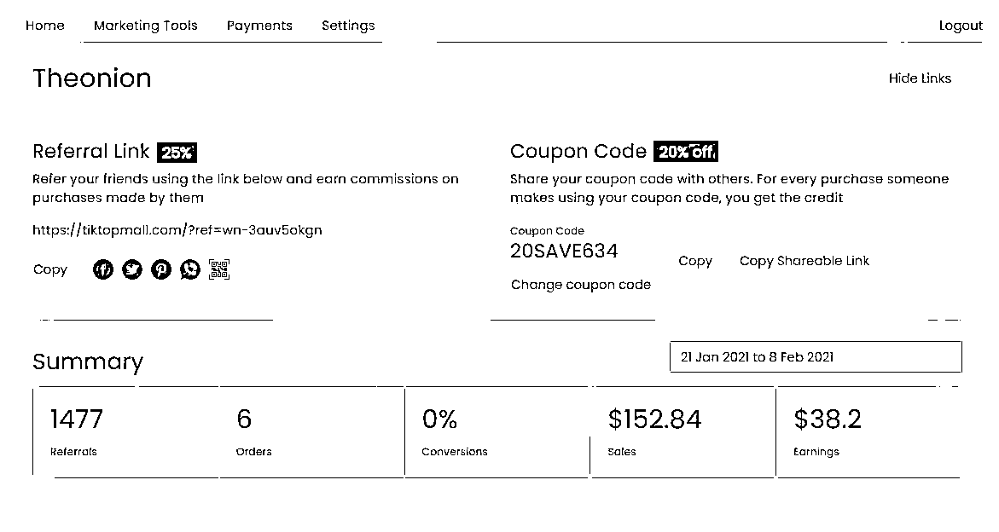
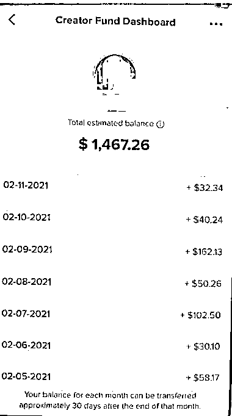
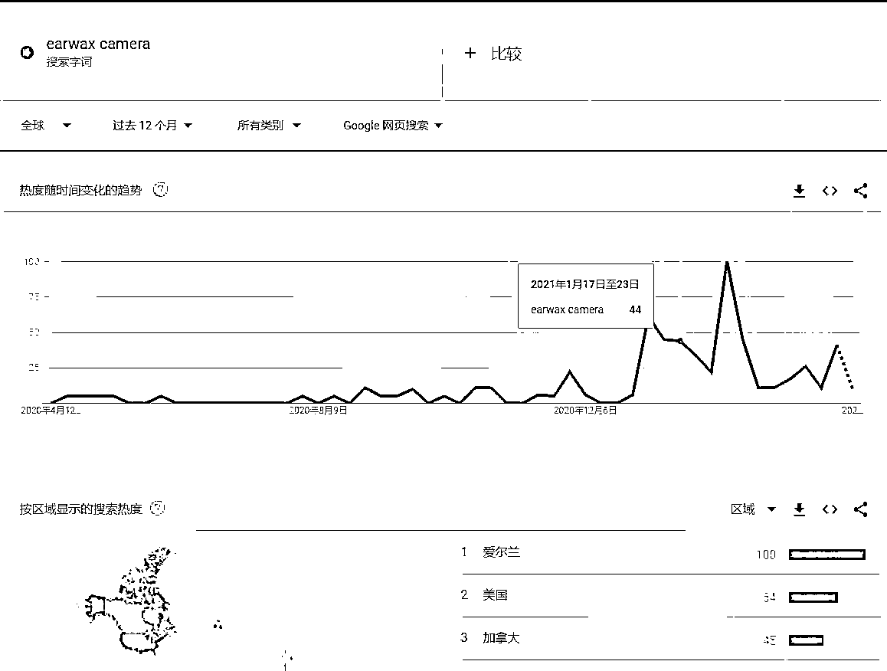
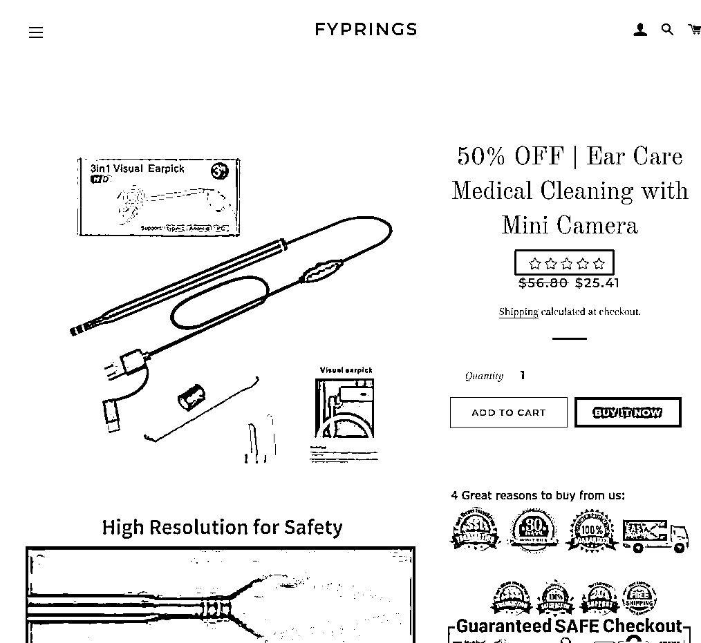
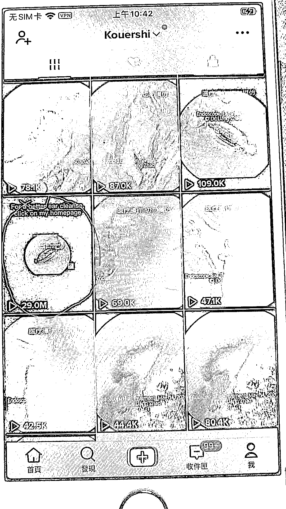
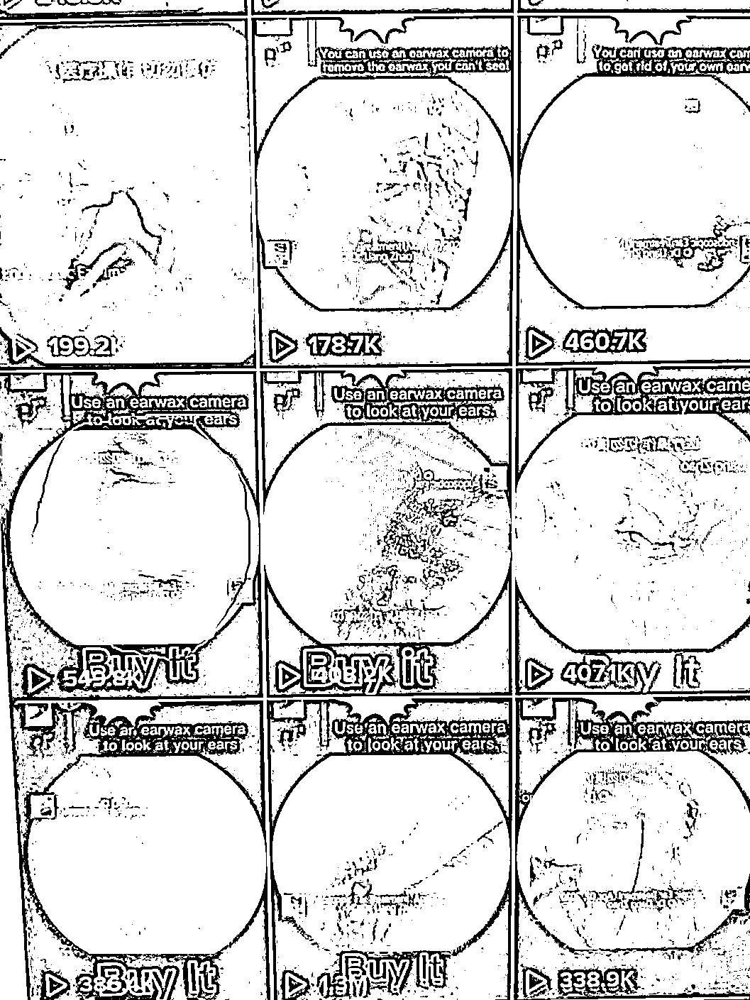

# 30天TikTok航海，我从0做到3000美金变现

大家好，我是洋葱 onion。今年1月21日，我加入了生财有术组织的TikTok小航海，直到2月27日靠岸。这期间，我通过带货拿到1752美元，加上创作者基金1467美元，总营收超过了3000美元，还拿下了小航海期间营销额第三名的成绩。

趁热打铁，复盘一下我这一路的操作和思考。全文稍长，想要更好的阅读体验，可以移步文末石墨链接。

## 选品：先做调研，别急着拍视频

这次小航海的带货目标定在1000美元，所以必须有明确带货属性的品类才行。船长给了几个细分方向：面膜、去黑头、采耳、修脚、多功能插座。

拿到这些关键词，我没有马上开干，而是逐个做了调查。我判断的标准有三个：产品是否有真实需求、能否解决用户的问题；价格是否在“冲动消费”区间内，最好不要超过30美元（这是以前跑FB广告的经验，这个价位内转化率更高）；视频爆点是否容易找。

### 面膜：第一个被排除

TikTok上面膜相关的视频，表现都特别夸张，有点像国内那种“一刀999”的广告。一抹变白、一抹祛痘，确实能抓住皮肤不好或者痘痘多的人，老外也爱美。价格19.98美元一瓶，也在冲动消费范围内。

但问题出在第三个标准——爆点。我本身性格比较直板，实在想不到怎么拍出那种夸张效果，光这一条，面膜就被我划掉了。后来船友@Yuan做出了单日带货1000+美元的成绩，面膜也是这次小航海里带货最多的品，我是真佩服他。

### 采耳：能实打实看到需求

再看采耳，对应的是可视化挖耳勺。这个产品我早前在国外众筹网站上见过，当时已经筹集了500万美元的资金，说明需求是实打实的。可惜那个众筹网站后来找不到了，没法给大家看截图。

于是我去Google Trends查了产品关键词的热度趋势。当时那个关键词正处在非常高的位置，离历史峰值只差20点左右，侧面上验证了这个品的潜力。价格25.41美元，在范围内。

最后我去TikTok看相关视频，结果发现几乎全是干巴巴的挖耳屎画面，连文案都懒得写。这哪是竞争，简直是TikTok在向我招手。那还想什么？果断选采耳号。

补充一个细节：为了更快拿到正反馈，新注册的账号最好直接设为企业号，把选好的产品链接挂上去。

## 内容：四个小技巧让流量和转化都起飞

### 1. 用“新奇特”制造爆点

采耳号本身就是解压属性，天然吸引人看，有的观众甚至觉得身临其境。但缺点是内容太同质化，不容易跳出来。所以得往里面加点新东西。

我做了一个视频：耳朵里钻进去一个饰品。观众看到后，要么倒回去再看一遍，想弄清楚那是什么；要么直接翻评论，找答案。无论哪种行为，都在拉高完播率，系统自然更容易给推荐。

### 2. 评论区用小号带节奏

我们小航海内部流行用“小号演戏”的方式。我会用小号在评论留言：“这个男人的耳朵里有颗无限宝石”，再换大号回复：“这是空间宝石，它穿越空间来到了他的耳朵。”你可以想象一下自己刷抖音看到段子时的反应。

老外脑洞其实特别大，越不着边际的说法他们越容易信，然后评论区就会有一堆人跟着脑补，疯狂互动。

### 3. 文案刻意误导

比如视频配文写：“这个男孩从他的鼻子里掏出了耳屎！”再配个表情。很快就会有人认真纠错：“这是耳朵，不是鼻子。”这时候我再补一句：“这是因为使用挖耳勺可以清楚地知道这是耳朵。”顺势就把产品卖点带出来了。

### 4. 导购语引导下单

好的导购语能让转化翻倍。我那支“无限宝石”的视频，早期只在封面写了导购信息，结果300万播放没带来一单，太亏了。

常用的文案有两种：一种是说明用途，比如“你可以使用耳屎相机清理你的耳屎”；一种是指明购买路径，比如“想要更好的清洁耳屎，点击我的主页”。后者很重要，很多用户其实想买，但不知道在哪买，你得明明白白告诉他。

另外一个关键点：把折扣信息放在显眼位置。我写的是“50% off”，也就是打五折。但有一次我无意中写成了30% off，结果那段时间出单率反而更高。我猜原理是：用户看到7折，心动点进去，发现实际是5折，会以为是网站设置出了问题，自己捡了个大便宜。

## 音乐：用系统推荐曲库

企业号初期最好尽量用系统推荐的音乐，否则容易下架视频。但推荐音乐不容易让人上头，节奏也不太好卡，需要耐心剪辑。

我的做法是：先刷一段时间视频，遇到爆款就把音乐点开看能不能收藏，能收藏就意味着这首歌是官方授权可用的，后面配乐就方便了。

## 账号与节点：一点小玄机

为了解决手机黑屏，我在淘宝上买了一批giffgaff卡（英国SIM卡）和knowroaming卡（美国SIM卡），顺便养了一批账号。有意思的是，插这些卡的账号，流量普遍来自东南亚，哪怕你用美国或英国节点，流量也不会跑偏。

至于这个点有什么用，大家可以大胆猜一下，我留个悬念。

## 复盘：少即是多

刚做账号的时候，我看到新奇特产品就想拍视频，结果自然好不到哪去。后来慢慢明白，用最少的时间做出最有效的事，才是优先考虑的。我们作为第一批出海的人，更该懂这个道理。

就拿选品来说，不是看到新奇东西就要冲上去。花点时间调研市场热度、真实需求和竞争程度，再研究下视频爆点，反而能省下大把时间，更快达成目标。

最重要的还是心态。账号低权重、视频限流、内容没爆点，这些都是家常便饭。一个稳定的心态，能让你推倒重来的时候，依然愿意继续走下去。这份心态，才是真正无可替代的财富。

最后感谢Sky船长、各位助教、小组长和后勤小伙伴，也感谢所有船友，感谢生财有术。

完整版可以看石墨文档：https://shimo.im/docs/8k9K9cYC9yvwK8gq/

 

 

  

评论区：

shang.su : 你电商成交的国家是哪个？

洋葱 onion : 后台数据以美国为主，具体订单归属国我看不到，得问Sky船长。

Sky 老思 : 洋葱很棒，继续冲！

甜瓜 : 洋葱优秀。

一峰 : 显示中国移动不会封号吗？还有那个悬念我猜不到。

洋葱 onion : TikTok检测的是SIM卡的ICCID，跟信号显示没关系。而且国外卡在中国境内本来就只能显示中国移动或联通，反过来，中国卡在国外也不会显示中国移动。

shang.su : 是做东南亚COD吗？

小木槿 : 用美国节点开购物车（如果早期只有美国有购物车设置），也能卖到东南亚吗？