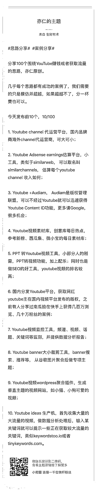

# YouTube 变现再补十招

上一轮已经拆过一批玩法，这次把另外十个方向补齐。核心思路仍然一致：围绕 YouTube 的流量、工具、内容和跨境流转，找到能收费的切口。

1. **高清图标聚合下载**  
把 YouTube 和各大品牌图标收拢起来，按尺寸、类型、风格、授权状态整理成结构化图库，供设计师和内容创作者取用。有站点月访问量 430 万，约七成由搜索带来；靠 AdSense 变现，按每千次展示约 1 美元估算，月收入大致 4300 美元。

2. **电影预告片聚合频道**  
只做电影预告片也能聚集流量，素材大多为知识共享（CC）授权，版权风险较低。缺预告片时，可以用海报生成短视频，跟进热点。

3. **年度热门视频生成或聚合**  
类似 Instagram 上的年度 top9 拼图工具，把一年高光内容合成便于分享的成品；在 YouTube 上做同类工具或聚合频道，仍有机会。

4. **TrueView 海外广告代投**  
国内品牌出海、外贸产品要在 YouTube 推广，存在代投需求。轻量做法是先在社交平台或付费渠道接单，再到 Fiverr 找执行供应方。

5. **粉丝运营工具**  
包括粉丝维护、垃圾评论清理等。案例里有订阅解锁视频、收集粉丝邮件列表、搭建 YouTube 着陆页等功能，按月收费，价格从 19 美元到 129 美元不等。

6. **盈利交流社区**  
做 YouTube 创作者的交流论坛，已有案例月访问量 46.8 万。

7. **YouTube + CPS**  
挑垂直主题，接 Clickbank、Amazon 或 dropshipping。以大疆无人机为例，官方频道不少视频是 CC 授权，可下载二创；重新上传时换标题和缩略图，再把用户引到官方购买页。

8. **YouTube 转 GIF**  
视频转 GIF 小工具也有流量。快手早年就切入过 GIF 转换相关工具，参考案例月访问量 540 万。

9. **多平台一键分发**  
做代发布服务，一次上传到多个视频平台。

10. **搬砖方向**  
国内内容转到海外，海外内容转回国内，操作空间一直存在。

**评论区声音**：有读者感慨，用了多年 YouTube 才发现它能养活自己；也有人回看四年前的内容，感叹第五年才刷到。