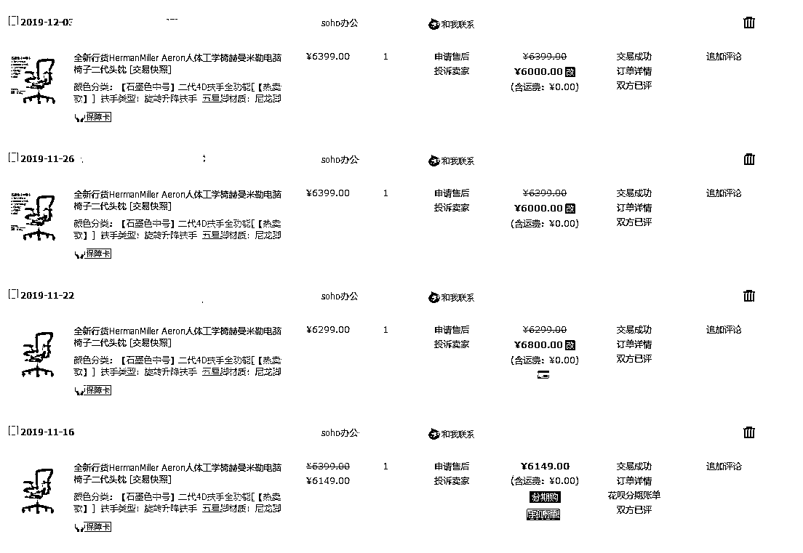
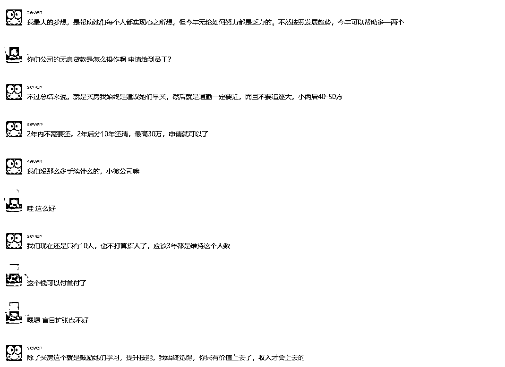
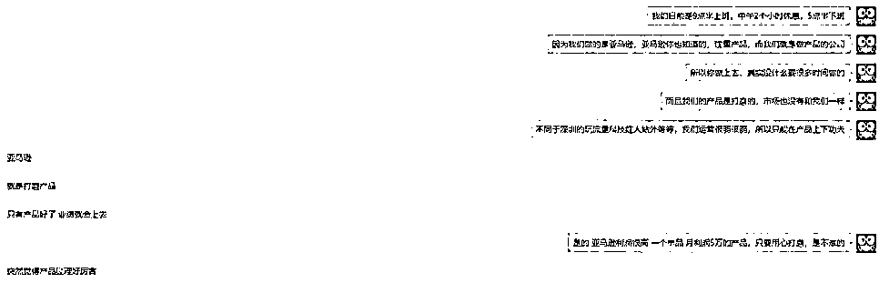

# 窄类目做到第一，一年利润七位数

跨境生意里，货的权重约七成，运营约三成。先把结论放这：挑一个玩家稀、诉求密的窄赛道，把单款磨到同细分无人能打，坐稳类目头把交椅，一年挣五十万到七位数并不夸张。我自己跑通过这条路，它给我的回报远不止七位数。

2019年1月4日，我和合伙人注册公司，股权对半，表决权我占65%。满一年，两人分红各自过了七位数。所以这个结论不是标题党。

创业前我在巨型企业管产品，岗位像螺丝钉，除了货本身别的都不精；启动资金也薄，烧不起流量，正面拼运营拼不过，只能把单款做深做透，做到窄类目第一。因此下面只聊货，不聊投放和流量——那些我确实不擅长。

2014年2月我进某谷，后来做到产品经理。那里每三个月把销售指标拔高三成，完不成提成打折；晚上九点后离开工位是常态，回报与付出不匹配，人像甘蔗被榨完还要再压一道。但有一件事改变了我：创始人老邹平时很少搭理小角色，有次把亚马逊线产品经理叫到一起，开口就把全场贬得一文不值，随后说他精力在独立站、无暇管我们，但当天要教一个压箱底本事，值七位数；学会它，以后去哪都能在平台立足。

我犹豫再三才决定放出来。这是我七年熬夜试错换来的东西；招数一旦烂大街就不灵了，而且它不是早年合并、踢跟卖之类的旧套路，而是没基础、本钱少也能较高概率切进去赚七位数的打法，至少还能用三五年甚至更久。为什么还是公开？有两件事推着我。

第一件，我希望国内企业别把求职者当耗材。盈利了还借疫情名义减薪、欠加班费，强制加班不给钱，吃相别太难看。我更希望薪资至少够到发达经济体的四分之一，周工时控制在人家的1.3倍，而不是1.5倍、1.7倍；人家工时短收入高，靠的是效率。同样做亚马逊，差距为什么这么大？我们团队现在六个人，四位校招、两位社招，我当伙伴看。因为自己长期加班，颈椎肩膀落下毛病，给每人配了赫曼Aeron工学椅和Bose降噪耳机；九点半开工、五点半收工，午间留足两小时，折叠床备好，一点半后必须躺下休息；大小周轮转，小周周六中午十二点即可走人；上午下午各有十分钟断网放空，连续坐三小时本就不合理也不健康；体检预算按每人一千二走。盈利分配上，15%给团队分红，15%给管理分红；四到五成留在公司做发展和抗风险；剩下两到三成作为无息借款帮大家成长，单笔五万起、三十万封顶；头两年不催还，第三年起分十年慢慢还。已有两位伙伴靠这笔钱上车，一套买在老家，一套落在广州；没疫情的话今年还能再帮一到两位。我能力有限，很多地方没做好，大环境下也乏力，但会尽力。这周有两晚直接睡在办公室，另一半哭着说我满脑子都是打钱——给合伙人、给伙伴、给供应链、给物流；凌晨一点往办公室走的路上，真觉得快撑不住，现在缓和了，可那根刺还在，彼此默契不提。要实现理念，只能继续提效率；盈利高了，很多事才容易落地。

另一层原因，是希望同行把出海功夫练扎实，别总喊亚马逊难，更别自己人打自己人：半夜爬起来对付跟卖狗、主图标题被人动过、差评被恶意投过、链接被投诉到下架，这些我都经历过。说穿了，是同胞卖家在同一个池子里互抢，盘子大、水平参差，恶性竞争自然多。我悟到的选品杀招，是绕开同胞内卷，去和本土卖家争：聚焦一个窄赛道，把单款磨到绝对领先，做到窄类目第一，一年利润五十万甚至七位数。真正吃透，年收益远不止七位数。下面上实操。

a. 赛道判断
一看可塑性够不够；二看是不是本土玩家在主理；三看对手密度低不低、需求旺不旺；四看这个池子活了多久——Keepa能翻到历史，说明我们也有机会撑两三年甚至更长；五看自己能不能在细分里把单款做到头名。只有单款领先，才谈得上类目份额第一；接着围绕它继续开发，把一条单款的油水榨到位。

b. 流量与对手销量
Keepa翻走势；排名看位置；Helium 10看出单；再把竞品加进购物车，盯库存变化。

c. 利润测算
先问自己有没有七成把握拿第一；用利润表套预估单量，单款天花板就出来了。配送费更简单，把对手ASIN丢进亚马逊物流计算器即可。

d. 落地选品流程
1. 先圈一个可塑性强的单款，顺着它往窄处钻。把热卖元素当需求记录：心理层面的、生理层面的，衣食住行、吃喝玩乐、喜怒哀乐都算（比如在谷歌搜衣着相关关键词）；再按材质/产品、使用对象、场景、功能拆，找细分口子和设计灵感。搜索时先用大词，优先亚马逊，把元素记下来，别先入为主，也别拿刻板印象当结论，除非你亲自试过；接着看亚马逊长尾词、关联推荐，自己再列关键词组合去搜。
2. 看货不能只看皮相，得对买家诉求有极强感知。单款只有好到绝对领先，才可能坐稳类目头名，甚至把价格往上抬；我们最能打的款，就是比原先前最好的对手更贵，还卖得动。
3. 在亚马逊创业，前提是确认自己能持续产出高质量单款。

底层是一套围着本土卖家转的开发逻辑：找一个需求旺、供给少的池子，把素材收全、揉进设计，用本地人的审美和习惯切进去，做出细分里最能打的单款，再把类目份额第一拿下来。这就是本土思维。跟本土卖家争，麻烦会少很多：他们人少、整体素质高、货的质量高，单款利润也高，所以收入高、工时短；我们比一般公司工时短、福利相对好，但仍是初创，很多地方达不到。只要把他们的需求摸得门儿清，再把需求元素融进产品，就能做出贴合的货，拿下细分头名。

行业外的朋友可能没画面，我拿狗碗举例，只是举例，不保证这个品一定成。本土卖家的单款利润，竞争小到超出想象，利润高到超出想象，年利润200到500万以上的并不稀奇。狗碗本身需求就大。部分国内同行的打法是：盯住10美金档需求最大的款，发4000件到亚马逊，刷单、刷好评、广告站外全开，再把对手链接变狗、改主图标题、丢差评。这条路咱别走，小白本钱少更别走，又累，成功率还低。记住，货占七分，运营占三分。普通狗碗只卖几美元，叠加细分功能后能站上三十美元档，用组合搜索和长尾词就能挖到。比如升降式狗碗这个窄口，卖家数得过来，且清一色本土玩家；工具显示日销能过八十件，把组合款和配送成本优化后，单件毛利可做到五十美元以上，日毛利约四千，一年就是七位数。

那直接抄升降款？不。大资金、懂运营、会流量，做升降一年赚五十万以上当然行；但就算你啥都不会、只会做货，也能在本土卖家中冒头。要和本土卖家争、拿下升降细分头名，只加一个升降远远不够，必须把单款磨到绝对领先。我们会拆狗碗最大的五个需求（防过快进食、升降等五个核心点），渠道看亚马逊、谷歌、独立站，重点放在亚马逊，把有价值评价提炼出来，一边改缺陷，一边把几个最强需求糅进同一款，比如既升降又防过快进食，还同时覆盖五大诉求。做出来的就是市面上没见过的货：先积累元素，再糅合。过去买家想一次凑齐五项核心诉求，往往要花八十美元往上；我们做出来的款定价三十美元即可。到这一步，不需要复杂推广，每天广告花费压在五美元以内，先让目标买家看见，产品本身就足以让他们心动下单；售价还有上探空间——能一次满足核心诉求的款，市面上找不到第二个。

一句话收束：盯住长尾池子的份额头名，把对手换成本土玩家——这就是本土思维。本地玩家常能做出独一份的款，因为他们对本地生活细节熟；我们靠调研把本地诉求吃透，也能做出只有你有的款。本土卖家基本不碰价格战；低价互砍、互相拆台，是部分中国卖家的惯性。

我已经把核心思路和小白实操都摊开了。我也担心，庞大的中国卖家群体都涌进来，原本好走的路会被挤窄；但我更希望同行像华为、抖音这些出海企业一样，去和本土卖家掰手腕，别再做低附加值甚至互相拆台。利润抬上去，才有余力善待雇员。一个国家要迈进发达行列，比如日本、韩国（韩国早期比某鲜还穷），起步阶段可以low，但后期必须拿出能和本土卖家匹敌的产品和技术。真心希望这个行业别再这么low、这么卷，去打磨产品和技术吧。还有卡点，可以来问我。

最后说说我对伙伴们的打算：尽量帮她们在广州市区就近买套小两居老破小，小两居也够一位老人带小孩，挤一挤，先把通勤这个大头解决。人一天清醒时间，扣掉上班和睡觉，只剩三四个小时，通勤一占就没了。工作本身要能长本事，是成长型岗位，不是机械重复的工具活；我什么都愿意教，只要人肯上进，工作带来的成长会让年资变成收入。业余再学习，价值又往上走；未来收入叠加通胀，现在买不起，以后也能买，比如第二套小两居。如果觉得什么都难，那多半是默认收入不会涨，或对未来涨幅预期不高。希望身边每个人持续学习、提升价值，最后落到收入上。

https://sellercentral.amazon.com/fba/profitabilitycalculator/index
https://www.amazon.com/gp/product/B00TV1A6IA

 