# 半年月销千万：疫情期的选品突围

运费一路狂飙，利润被一层层刮薄，这是疫情初起时跨境卖家共同的难关。节流走不通，只能在开源上找路。特殊时期，用户到底缺什么？本期「赚钱合伙人」请来 @图帕先生，讲讲他的答案。

他早年在上市公司带过 6 人小组，一年内让日均 20 万+独立访客的自然流量又涨了两成；如今在一家初创公司主管谷歌推广渠道，团队 20 人，峰值 GMV 做到上千万。从零搭建能稳定赚钱的谷歌广告账户、操盘垂直品牌独立站，都是他的拿手活。

本篇他将完整复盘：怎么借 Google Trends 挑品、怎么让广告有效起量、如何在半年里把一个品牌独立站重新做到月销千万。

⒋ 跨境营销主要有哪些方式？如何锁定优质又稳定的流量入口？
⒌ 网站从零到一千万，经历了什么？
⒍ 品牌与权威如何树立，网站怎样才能长期盈利？
⒎ 收尾

## Part 1｜疫情压顶，运费吞掉利润

疫情暴发之前，他刚从大厂转去一家创业公司，接手跨境业务的谷歌渠道流量规划与投放优化，打动他的是公司分成给得爽快。8 个人的小班子，月 GMV 跑过了百万美金；公司一年里还张罗了欧洲 10 日游和日本 7 日游各一趟。后来队伍扩到二十几号人。

福利之外，更让他认同的是老板的长期主义做派：不搞爆款游击，而是往品牌站点的方向深耕。这跟他的想法不谋而合。

运气这东西，说不好。日本游回来没隔多久，新冠就来了。人平安落地当然好，可接下来的难关一个接一个，最要命的是运费。

摆在面前的事实很扎心：国内外疫情一夹击，单票跨境物流成本飙到上百元人民币，是此前的四五倍，抵得上货品本身的价值。

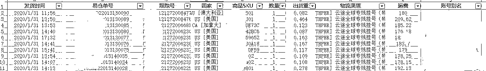

细算一笔账：进货约 23 美金，卖价约 100 美金，疫情前运费 8 美金，中间有 70 美金的操作空间。再刨去广告开销——那时一个 CPA 在 40 到 50 美金——每单还能落下十几二十美金，人工、仓租等杂费还没算进去。

疫情之后，运费涨到约 20 美金，剩下的利润被挤得干干净净。

这种局面下，公司只能消耗老本。这大概也是做品牌的好处：碰上意外，不至于摔得太惨。老站点在 Instagram 攒了 80 多万粉丝，品牌词月搜索量也有一万多，还能撑一阵。

## Part 2｜困局之中，需求藏在哪儿？

坐吃山空不是长久之计。不过危险的反面，常常就是机会。

疫情刚起那阵，国内一度疯抢口罩。一个客单价几毛钱、平时没人瞧得上的东西，转眼成了抢手货。

他们因此琢磨：眼下会不会还有别的商品，正好接住疫情期间冒出来的新需求？

要是能踩准这一步，公司或许就能熬过这段苦日子；等风波平息，发展说不定还能更顺。口罩这条路他们没走。原因很现实：当时不少国内商家兜售没资质的口罩，海外广告平台对防疫类产品打击极狠，卖口罩的账户和站点几乎冒头就被封。

他想起龙哥早前文章里提过的一招：在谷歌搜一个词，再看看相关搜索词里藏着什么机会。比如输入 Instagram Download，会跳出 Instagram Download for PC 之类的词，这些词往往更能反映用户的真实需求。

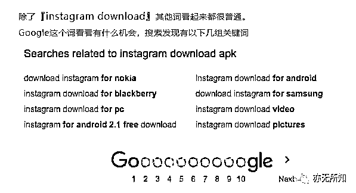

他本来就做谷歌渠道，这个工具正好派上用场。

于是他搬出了另一个谷歌产品——Google Trends（谷歌趋势）：

https://trends.google.com/trends/

操作不难：敲进关键词，页面就会呈现该词在一段时间内的搜索热度。搜的人越多，说明需求越旺。

要是毫无头绪也没事，里面自带一个搜索词趋势追踪功能：

选择目标国家

选择时间段

选择目标领域

选择网络搜索

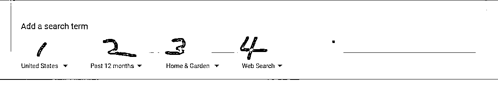

接着就跳出这样的页面：

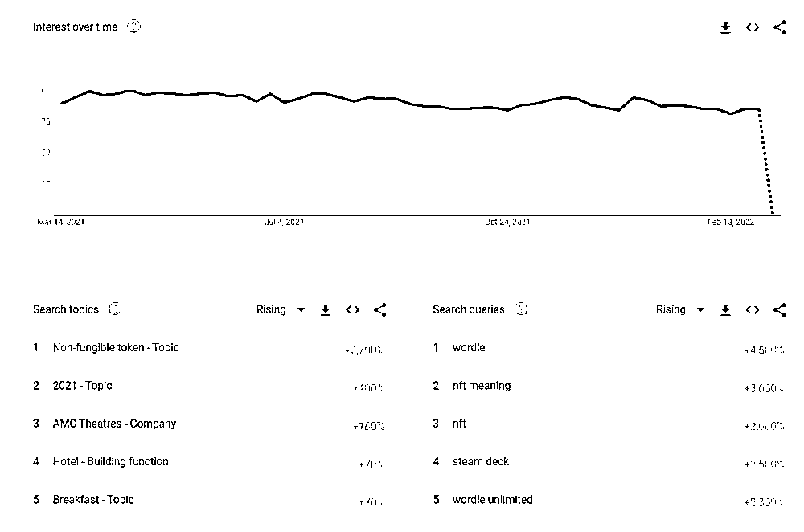

最上面那条趋势线反映该领域的整体需求走向，真正要盯的是右下角。

右下角会列出搜索量正在爬升的具体词，比如刚上市不久的 Steam deck 游戏机。旁边的百分比就是变化幅度，表示 Steam deck 的搜索热度涨了 2500%。

用法简单，真正的难点在于：得挨个把具体词输进去查走势，才能拍板做哪款产品。很多时候，方向选对比埋头苦干更重要。

比方说，疫情期间大量人居家隔离或减少出门（Lockdown），他就从居家类关键词切进去，在工具里选了 home&garden。

不久他注意到 beard trimmer（胡子修剪器，也就是剃须刀）的搜索曲线在往上走，便把这个词单独拎出来细看需求变化。

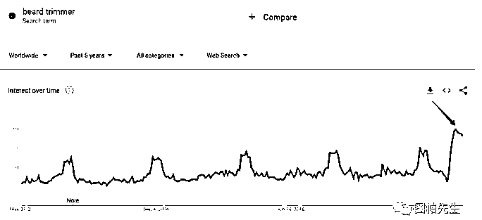

果不其然，全球美发店停业之后，各地对毛发修剪工具的需求猛增——出不了门理发，索性自己动手。

再看 Chair Cushion（椅子靠枕）：

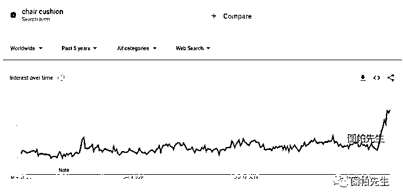

居家办公政策直接拉动了办公用品的需求，坐垫正是其中之一。

他本人就有切身体会：家里的办公椅太硬，坐久了屁股发疼，他马上下单买了一个垫子。

后来在 Fitness 健身类目里，他又发现了 Resistant Bad（助力带）：

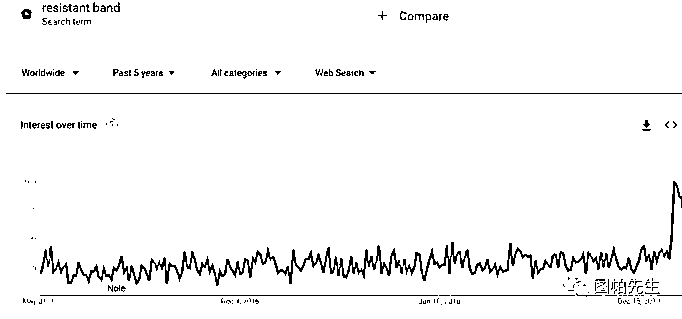

居家期间，大家也没把锻炼落下。很多老外从小就健身，甚至把车库改成健身房，所以健身类商品卖得相当火。

类似的关键词还有很多，这里就不逐个列举。

品类有了，还得看能不能长久。老板和他都偏爱长期主义，所以需求暴涨只是第一道筛子，第二道是这门生意有没有持续发展的空间。办法是翻行业报告：在谷歌输入「关键词」+「目标市场」+「Market Report」。以剃须刀为例，一份美国市场报告显示，2019 至 2025 年该品类仍能保持 2.5% 的复合年增长率（CARG）。换句话说，它不是一阵风就停的生意。

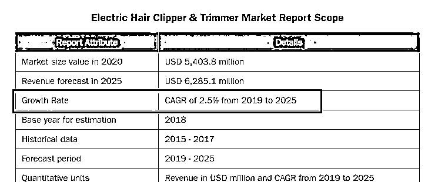

确认了有需求、又有长期空间，接下来就是找靠得住的供应商，目标平台是 1688。中国号称世界工厂，制造底子摆在那儿。

仍旧拿剃须刀举例，第一步挑综合服务评分高的供应商：

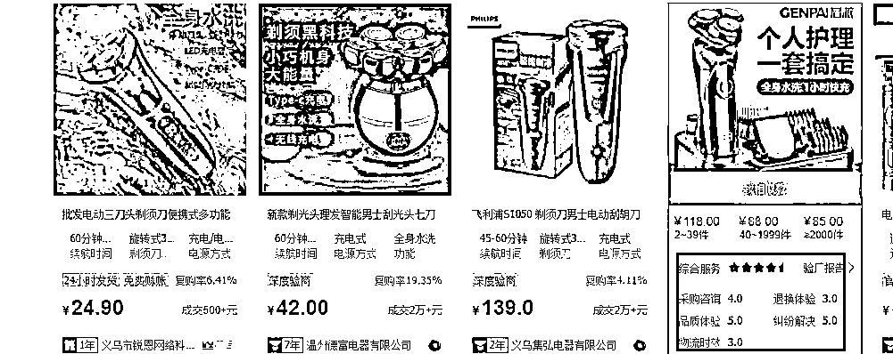

第二步看买家评价，他反而会挑评价条数不太多的。

不少人会纳闷：评价少为什么还入选？在淘宝买东西，不都应该往好评多的挑吗？

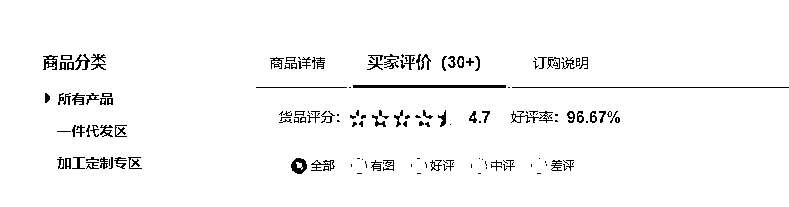

他的逻辑是：买的人多，说明市场上见过这个款式的人也多。而新品牌恰恰需要独特性和差异感。所以他偏向评价数量不多、但评分不至于难看的商品。

对新生品牌来说，差异化几乎是命门。用户习惯某种产品，多半是因为它常见的类型、功能与风格。这时候你若端出不一样的设计、更强的功能，甚至全新的服务方式，那份新鲜感很容易让人产生下单冲动。用着满意，就会回来复购，还会自发替你传播，把影响力滚大。

那碰上自己并不熟悉的产品，怎么在设计、功能上找到切口？

他有两招，屡试不爽：

第一招，去亚马逊搜一搜，看看哪些款式卖得动。

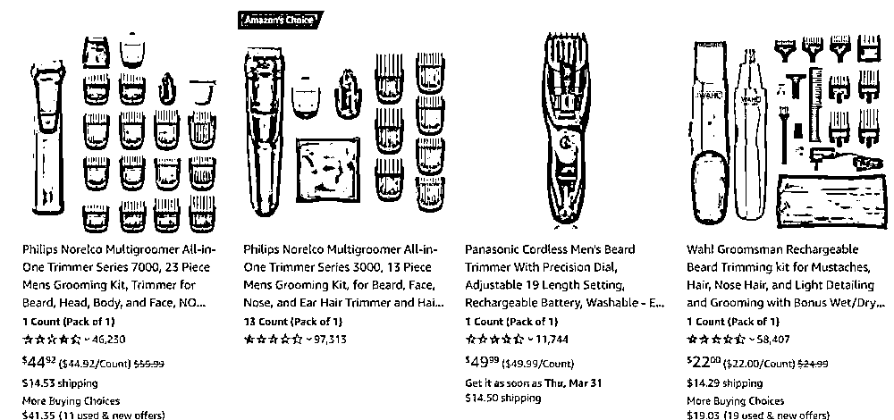

把它们的颜色、配件种类与数量、主打卖点、用户评论（好评夸的是什么，差评又卡在哪里）都记下来。这些活儿看着琐碎，但做扎实了，突破口往往就浮出水面。

第二招，去看别的品牌网站的「帮助中心」，重点研究「服务内容」。

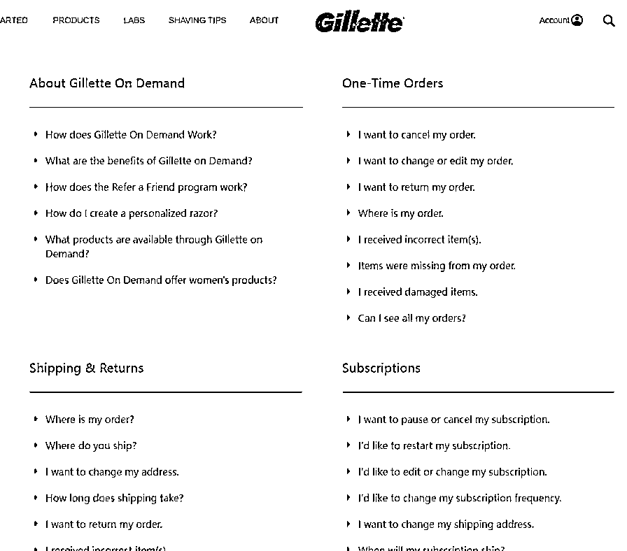

比如吉列的帮助中心，就写明了运费、退换货规则、物流时效等信息。

这样你能摸清这个品类里用户习惯接受怎样的服务，再判断自己有没有升级的空间。

当然，光在电脑前做功课远远不够，样品必须买回来实测：产品功能与质量有没有被供应商吹大、包装做得如何、英文说明书有没有中式英语、配件是否齐全等等。

样品过关，就该和供应商谈了。

其一，问清楚对方能不能做贴牌和包装定制，起订量多少。这是塑造品牌特色绕不开的一步。

其二，观察对方回复快不快。如果想长期合作，沟通拖拖拉拉会严重拖累效率与销售，比如产品出了状况，需要供应商配合跟进、查验。

最后是物流。起步阶段可以用一件代发来验证用户是否买账。这种方式省掉了前期仓储投入，自己基本不用压货，走 4px、DHL 等渠道，把包裹寄到物流商仓库，再转运到目标国家。短板是时效偏慢。所以后期要铺海外仓，把送达时间压到 3 天以内，让用户尽快用上产品。

## Part 3｜需求和产品都定了，独立站怎么开跑？

产品和市场都敲定后，就该动手启动了。

第一步是选销售平台。团队一直做独立站，对亚马逊生态也熟，所以仍然从独立站入手。小团队建站常用 WordPress 和 Shopify，他比较之后选了 Shopify。

Shopify 几乎是傻瓜化操作，能省下大量时间。WordPress 则要处理域名注册与绑定、服务器搭建和维护等一堆事，技术和人力成本都更高。Shopify 把电商该有的功能几乎都整合好了，支付接口、弃购挽回之类一应俱全，只需按月付费并接受交易抽成。

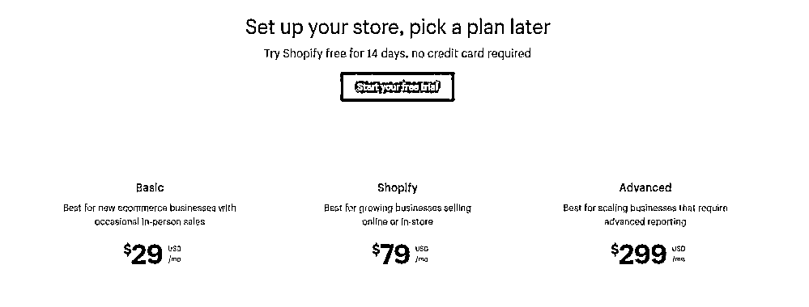

它的插件生态也很能打，在线客服、邮件营销、用户评论管理、CRM 工具对接等，都能找到现成插件，用起来很省心。

平台定下来，接着安排人手。

他自己推广、运营、客服都能顶上，算是个多面手。但为了效率，还是得有同事搭手，部分任务甚至可以外包给海外 freelancer（自由职业者）。

先把自己的角色定清楚：整个新网站、新项目由他牵头，加上营销推广经验丰富，所以主抓推广与统筹策划。另外还兼一个岗——客服。

没错，前期他亲自盯客服，为的是第一时间掌握客户的疑问、诉求以及使用后的真实反馈。

然后一位同事管运营，一位同事管采购加物流（后期也兼客服），一位同事负责社媒和 PR。

至于设计、文案本地化润色这些，交给老外外包。一来提效，二来他们更懂外国人的审美，写文案的优势更不必说。

就这样，一支小而精的队伍搭起来了。

## Part 4｜跨境营销渠道怎么挑，稳定流量入口在哪？

身为项目负责人，推广策略上他必须多花心思，做出最优判断，挑出最贴合自家产品的流量渠道。

跨境独立站的营销渠道大致有这几类：谷歌广告、Facebook 广告、联盟、SEO、网红社媒以及邮件营销（EDM）。

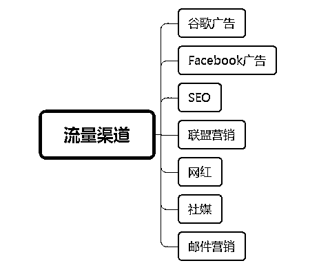

做出海营销，打交道最多的广告平台通常是谷歌与 Facebook。新站起步阶段，几乎 99% 的人会先砸广告，因为见效快，能验证素材和产品成色，起量也猛。

所以一开始，他也把广告排在优先位。

其他渠道并非不用，后面会细说。

那到底投谷歌还是 Facebook？他的经验是：产品不同，平台效果可能天差地别。

先看根本差异——两者承载的用户需求性质不同。

⑴ Facebook：兴趣驱动

在 Facebook 后台设置广告时，要先圈定受众类型，比如自定义受众、按兴趣细分的受众等。

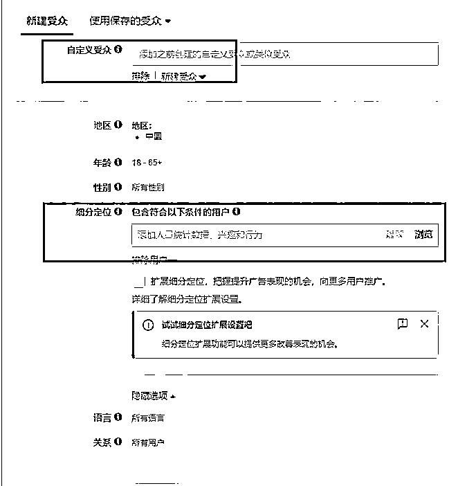

这正是它和谷歌广告的一大分野。

注意，这里只拿 Facebook 广告与谷歌搜索广告、购物广告作对比；谷歌也有展示广告，同样按兴趣投放，但转化通常远不如 Facebook（当然也分产品），所以不在此比较，他也不建议对谷歌广告还不熟的人过早碰展示广告。

拿他自己举例：他的 Facebook 小号加了不少讨论脸书投放的群组，比如图中下框的 Facebook Ad Hacks。于是 Facebook 就判定他是个 Facebook 广告爱好者，甚至是同行（他个人简介里也写了）。

所以他信息流里，才会冒出上框那条谷歌广告服务的推广。

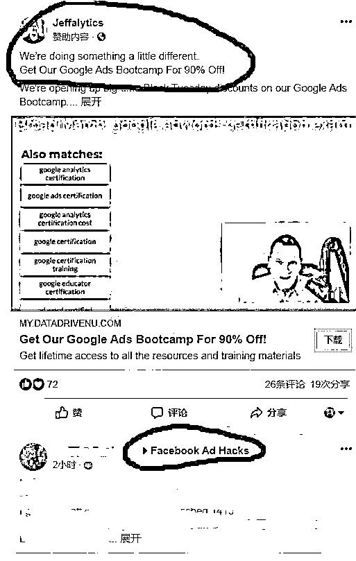

为什么人在看 Facebook，推的却是谷歌广告？这就是兴趣驱动。

他未必有投谷歌广告的打算，但广告主通过兴趣标签，把像他这样关注 marketing 和广告投放的人圈了进去，广告自然就推到眼前。

⑵ 谷歌：需求驱动

谷歌广告又叫关键词广告。投放设置里必然有关键词环节：搜索广告直接填词，购物广告的词放在 feed 里；展示广告虽也能设词，这里先不展开。

同时，投谷歌广告的头一件事，就是先把词收集齐。

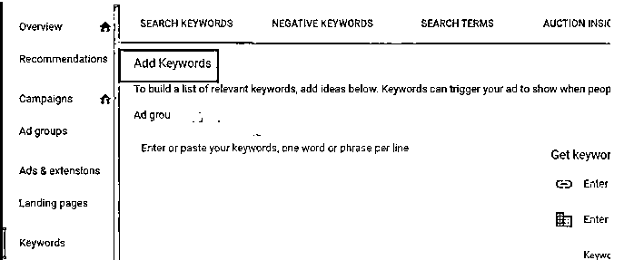

这意味着什么？

用户得在谷歌搜索框里敲下词，广告才有机会出现。

用户为什么会搜？因为他们需求明确。

比如搜女性包包，页面就会给出包包的购物广告。

搜女性包包的人或许对服饰整体感兴趣，但谷歌不会把女装上衣或裤子的广告塞给他——因为他没搜过那些词。

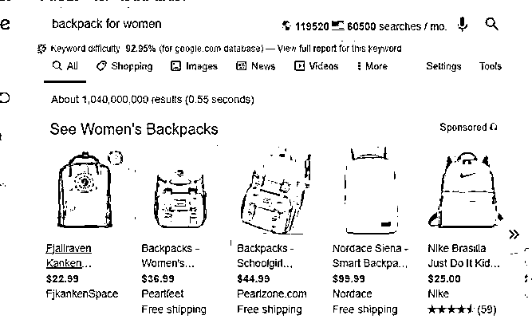

到这里应该很清楚了，两者的根本差别是：

⑴ Facebook 按兴趣圈人，哪怕用户当下没有购物念头，广告也可能撞到他眼前。所以 FB 素材格外关键，得一眼勾住购买欲。

⑵ 谷歌靠关键词触发，用户有明确搜索动作时才展示。所以谷歌这边要拼专业度和特色：用户已经想买了，凭什么选你？

这种差异，也决定了它们各自适配的产品类型。

⑴ 谷歌广告：更适合利基、专业性强、已有一定品牌认知、用户需求清晰的产品。广告现身的那一刻，顾客正在主动搜索，对内容高度关注，购买意愿也高。主动搜索，往往就是购买冲动最强的节点。

⑵ Facebook 广告：更适合新潮、时尚，尤其是市场上还没人知道的全新品类，可以用图片或视频把卖点直观呈现。用户刷着刷着就撞见广告，能点赞、能评论，然后在「不知不觉」中完成下单。

综合自家产品的属性，他最终把票投给了谷歌广告。

理由在于：产品本就是从谷歌搜索趋势里筛出来的，在「搜索」端有爆发性流量，以搜索为底座的谷歌广告最对路。再者，产品偏专业、属于利基垂直品类，也正好落在谷歌广告适配的范围内。

## Part 5｜从零到一千万，网站是怎么长起来的

1. 从 0 到 1：广告冷启动阶段怎么熬

开头总是最难的。广告刚跑的那段时间尤其煎熬，因为前期得拿不少预算去喂平台的系统学习。而且谷歌见效比 Facebook 慢，越是大路货，测试周期越长。

Facebook 可能 1000 刀就能试出爆款，一般同时开几组广告，每组一天 20 刀跑着，哪组不行立刻关掉。谷歌不是这个玩法。以购物广告为例，新上传的产品 Feed 至少要经过一周学习期，这一周数据会难看到极点，量起不来，一天只烧掉几刀。这时候你若断定产品不行、匆匆关广告，那等于什么有效结论都拿不到。

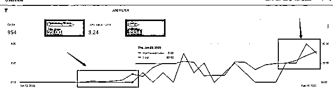

刚起步时，他的账户一天连 10 美金都花不出去，日预算设的是 40 美金；到后来，平均每天能出 2 单。整个周期大约一个月，ROAS 做到 3.24。看得出，曲线是在缓慢往上抬的。

在谷歌广告体系里，他们优先投搜索广告和购物广告。因为用户在谷歌搜词时，最先露出的就是这两类，位置压在自然结果上方，很容易接住有相关需求的人，把他们引到站内。而购物广告带图片展示，转化表现通常更好。

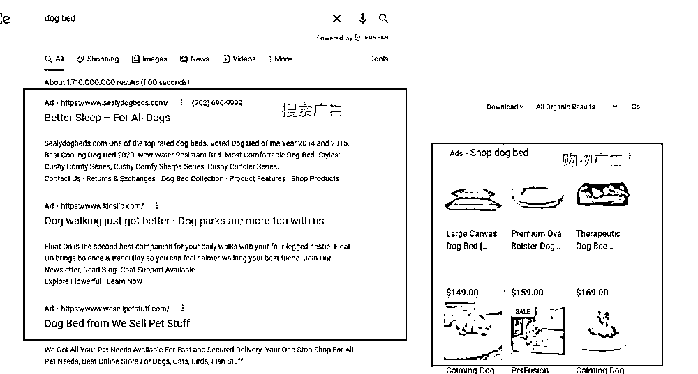

由于谷歌广告靠关键词触发，前期必须在关键词调研上砸大量精力。他常用的调研工具叫「SEMRush」，是付费的；谷歌官方也有免费工具「关键词规划师」，有需要的不妨试试。他个人习惯用付费版，毕竟花钱有花钱的道理。

在工具里填入目标词，比如 dog bed（狗床）：

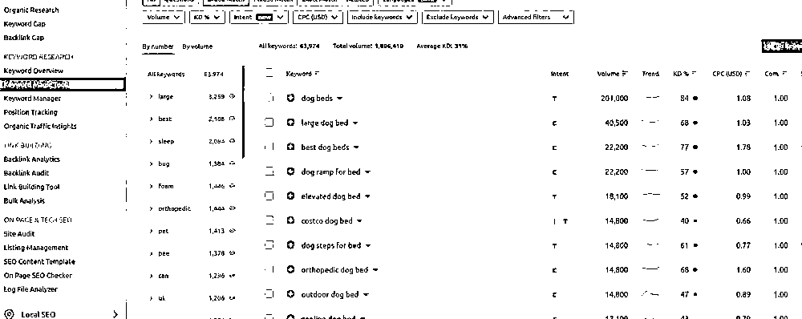

系统会吐出一堆相关关键词供你挑选。同时还会给出预估 CPA（每次点击成本），这样预算大概怎么定，心里就有数了。

此外还有个很猛的功能：「竞争对手分析」。在这里能看到哪些网站正在投你想用的词：

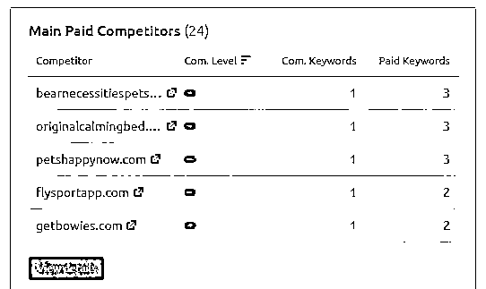

甚至能扒出对手当前在投哪些关键词。这个功能对调研效率的提升非常明显。

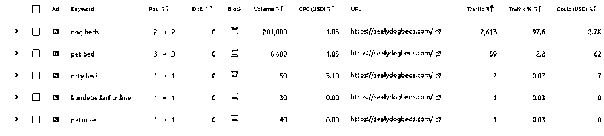

关键词敲定之后，就该认真打磨广告内容了。

搜索广告怎么优化：

# Google Ads 从回本到放量：我的完整实战复盘

## 关键词广告文案：别再只写 cheap 和 sale

投放 Search Ads 时，广告文案既要放关键词，也要用更有吸引力的词汇。与其用 cheap、sale、low 这种干巴巴的词，不如换成 amazing、unbelievable、astonishing 等更有画面感的形容词。原因在于 Google 的 Quality Score 会评估 Landing Page 体验、广告相关性和预期点击率。评分变高后，CPC 有机会下降，广告排名也能上升，还可以附带更多额外信息。

广告设置上，我会把排除功能用起来，同时加入否定词。出价阶段先选 Max Clicks，让系统更快学习；预算不要省，尽量给足。广告调优不能太急，至少留出 7 天观察期。我曾经一天内连续调整多次，结果系统学习被打乱，后面几天几乎跑不出数据，白白浪费了不少时间。

Shopping Ads 的学习周期通常比 Search Ads 更长，刚上线时展示量低，甚至会出现 0 展示。我的对策是：ROAS 目标别一开始就定太高；预算充足，按每天 100 美元准备；产品 Feed 要认真优化，Feed 相当于记录网站产品资料的文档；之前做的关键词调研可以用于产品标题和描述，把最相关的词放进去。同样，不要频繁改动。

投放期间，我会持续观察 CPC、CTR、ROAS、impression share、CPA 这几项指标。CPC 反映预算消耗是否平稳，CTR 体现关键词和文案是否精准，ROAS 直接说明广告投入带来了多少销售额，impression share 能看出我们广告在市场中的位置，CPA 则衡量每次转化成本。目前我们的 impression share 只落后于 SHEIN（希音）和亚马逊，也就是说已经高于大多数同行，前方只剩少量顶级卖家。

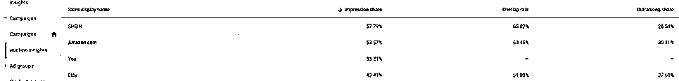

在账户慢慢养起来的同时，我们也开始联系海外网红做测评，并让海外媒体为品牌背书。网红按粉丝数大致分五档：入门级 5,000—15,000，低级 20,000—50,000，中级 60,000—150,000，高级 200,000—500,000，大咖 500,000—1,000,000+。粉丝太少，传播力不够；粉丝太多，费用又太高。我们优先选中级和高级。开发信尽量针对每位网红写个性化内容，而不是发同一套模板，这样更有合作诚意。按照这个节奏推进，3 个月我们就实现了收支平衡。

## 2. 从 1 到 100：如何把广告量级再做大？

回本之后，下一步是扩大生意规模，为黑五做准备。Search Ads 本身起量偏慢，想快速放量，最有效的思路是使用购买漏斗（funnel）。

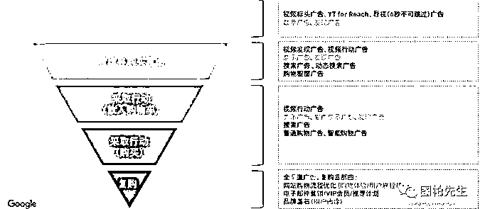

从用户第一次看到品牌，到最终反复购买，通常会经历：发现我们→考虑是否购买→加入购物车→下单→再次购买。不同阶段要用不同广告形式去触达。早期我只投 Search Ads 和 Shopping Ads，正好覆盖漏斗中间三层；现在需要把触角伸到漏斗顶部，同时让老客户重新考虑购买。之前不这么做，是因为那时只想快速回本，精力全部放在加购和下单两个环节。现在模式跑通了，就可以把营销布局做得更深更全。

漏斗顶部首先想到的是 Display Ads。它以图片为载体，和 Facebook 广告很接近：设置受众兴趣后，系统会把素材推给对应的人。大家在网页上看到带“广告”标记的图片，就是 Display Ads。

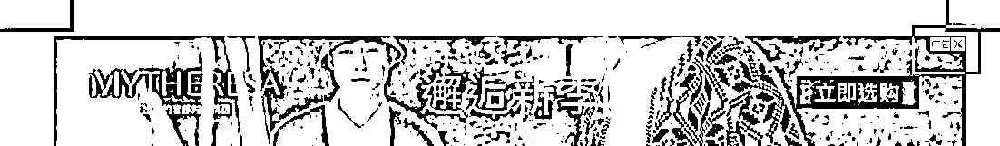

所以图片素材是重中之重，要能吸引用户点进网站。Google Display 的尺寸有十几种，我一般只用版位最多的三类：300x250、300x600、250x250。图片里必须有 CTA 按钮，比如 Shop Now，还要放品牌 logo。这样用户既看到产品，也记住了品牌。

这类广告消耗非常快，因为用户不用搜索关键词就能被触达；但投产比通常不高，毕竟第一次接触品牌的人很少立即购买。怎么把花钱买来的流量用得更好？答案是重定向（Remarketing）。简单讲，就是把进过网站但没下单的用户单独挑出来，再次向他们推送产品。

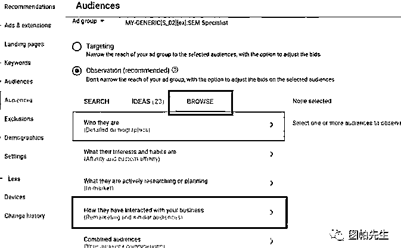

我会在 Search Ads 中也加入这批受众，并针对重定向场景重新写广告文案，比如增加“额外折扣”“包邮”等福利。用户第二次看到的优惠比第一次更有吸引力，购买意愿就会上升。Display Ads 也能这样做：在素材里突出优惠信息，或者提示库存快见底，制造紧迫感。

最后是邮件营销，相当于临门一脚。邮件在国外常被称为 dark social（暗社交），类似国内私域。老外使用邮件的频率很高，所以我会给新进用户单独设置一两封邮件，让品牌和产品再次出现在他们面前。

这里有个小技巧：我不会一上来就硬推折扣。而是先讲产品优势、品牌理念，或者给一些针对用户痛点的解决方案，这样显得更专业。用户先信任我们，之后自然而然会下单。邮件成本极低，一封只要几分钱，就算先发 10 封介绍性内容，也比单纯投广告便宜。所以我不急着推销。

熬过艰难的账户养成期和小段战略性亏损后，黑五当月（11月），我们的营业额达到约 11,199,291 元人民币（对应 1,770,55 美元）。

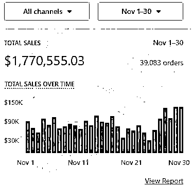

项目终于看到希望，国外疫情又反复，没法旅游，我们干脆去了趟西藏。希望在这片纯净的地方把浮躁的心安顿下来，继续坚持当初的信念。

## —Part 6— 品牌与权威：让网站长期发展并持续盈利

整个流程验证成功，产品被市场认可，品牌词搜索量也达到 1 万以上。下一步，该认真规划品牌了。

为什么要下决心做品牌？2021 年之前是铺货时代，广告效率很高，但也有很多乱象。比如视频里那个老外，在 Facebook 刷到一架又大又好玩的飞机，价格也不贵，结果收到的是地摊货——货不对板，而卖货的正是国人卖家。

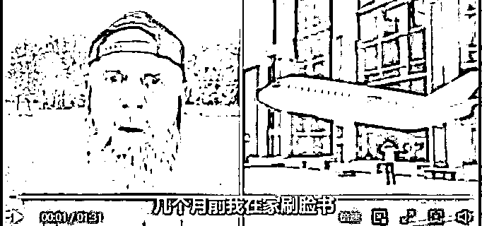

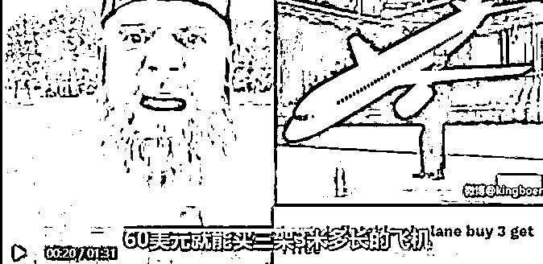

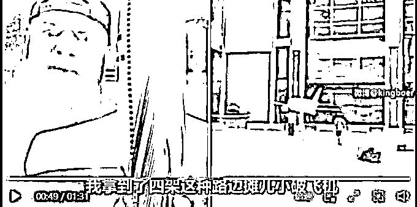

与此同时，一些国内大卖家因为货不对板问题被美国政府盯上，账号遭到封杀。那段时间，不少中国卖家的广告账户、店铺账户被一锅端。再加上 Facebook 广告受苹果 iOS14 隐私政策更新的影响，转化追踪几乎失效，以 Facebook 广告为主的铺货爆品模式就此终结。

我们一直在想：中国是制造大国，有资源、有条件、有实力，为什么不能把更多优质产品和品牌输出到国外，却要一直用仿造伪劣的产品被人看轻？我们带着这个信念做独立站和品牌，并且有信心：就算明说这是中国来的产品，老外也愿意买、愿意信任，而且使用体验不差。

品牌打法分为进攻和防御两类。进攻是把产品和品牌理念推出去，防御是守住已建立的品牌资产。

### 1. 进攻：如何把品牌推出去？

首先，用户体验永远排第一。我本人练阿斯汤加瑜伽，很喜欢 lululemon 的瑜伽服。这个品牌的质量不用多说，细节也做得很好。比如我网购了几件衣服，里面塞了一张小卡片，封口写着一句话：You are important（您很重要）；开头那句是“诚挚感谢您选择 lululemon”，之后才引导关注👸号。

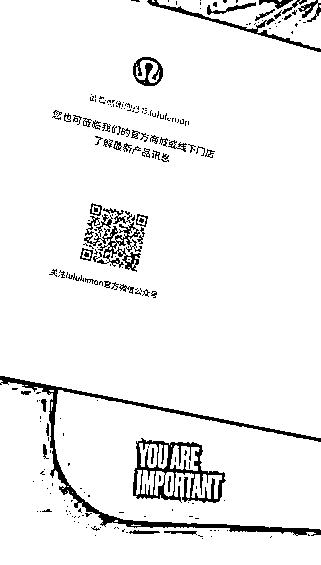

收到货之后，你会觉得品牌在和自己说话，它在对我说“我很重要”。我对它的忠诚度就这么一点点提高了。后来我们也在每个包裹里放了感谢卡，印上一小段手写感谢语，同时强调产品理念。

其次，做多渠道布局。前期靠广告引流，长期还要有 SEO。SEO 的价值有三点：第一，能建立长期流量。虽然页面要进入搜索结果首页不容易，甚至一两周都没动静，但一旦有了好排名，流量就会持续稳定。按固定成本算，SEO 的时效比 Search Ads 更长，回报率也更高。第二，能建立权威。做好 SEO 不只是研究自然排名，更要关注用户体验、内容和网站结构。自然排名不是付费买来的，用户天然会更信任。第三，能增加网站价值。网站是虚拟资产，可以交易，而流量、排名、设计、安全都会影响估值，这些都和 SEO 相关。记住，SEO 不是只为了把某个关键词做到第一页或第一，那只是手段，不是目的。

我一直走白帽 SEO 路线，专注优质内容和外链。比如我有一条页面，没有靠任何外链就覆盖了 500 多个关键词，主力词排在搜索结果第一。

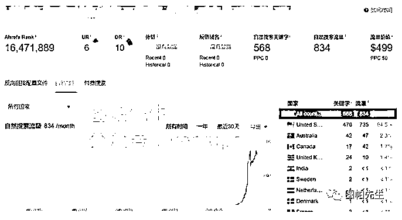

这正好说明：内容做得好，Google 会给你奖励。

再谈品牌溢价。马斯洛需求层次理论认为，人的需求从食物、住房这些基本层次开始，逐步上升到自尊和自我实现。

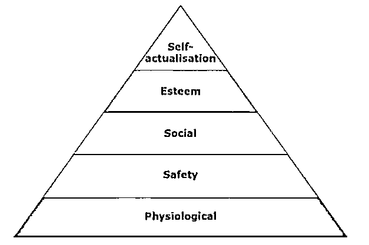

这套理论怎么落地？同一个产品，用不同方式包装或重新设计，能满足不同层次的需求。以自行车为例：只解决通勤，算生理需求，可能只能卖 500 元；加上刹车等安全设计，满足安全需求，可以卖 1000 元；加入车友会文化或与 IP 联名，带来归属感，属于社交需求，可以卖 2000 元；请知名艺术家重新涂装，体现时尚、高级，对应尊重需求，可以卖 5000 元；如果支持个性化定制，帮用户表达自我，对应自我实现需求，甚至可以卖到 10000 元。像那种可以自行组装的自行车，起步价就是 999 美元。所以我们接下来要升级产品，去满足不同用户的需求，从而放大利润空间。

如果完全以流量为导向，把所有精力放在渠道和打折上，却不在产品迭代上下功夫，那么一旦流量和渠道生变，网站和品牌就会垮掉。

### 2. 防御：保护品牌资产

品牌建立后要懂得自我保护。商标不能被抢注；同时可以在 Google Ads 后台提交商标声明，防止竞争对手侵权或恶意跟卖。

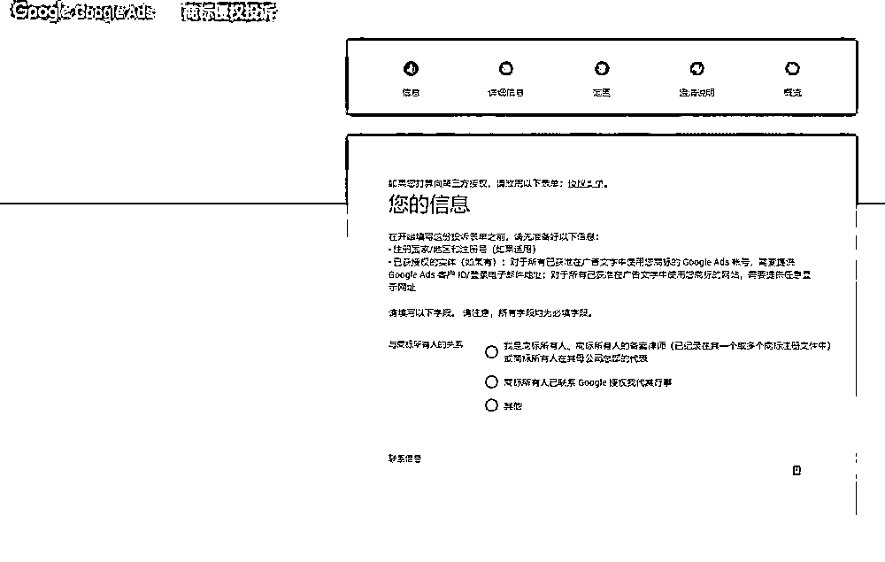

提交真实资料后，如果对方抄袭你，就能向 Google 投诉，让平台对竞争对手作出惩罚。

## —Part 7— 总结

最后总结几点经验：第一，找一个能长期发展的市场和产品；第二，熟悉广告平台的功能和规则，包括出价策略、广告类型等，不然调广告时容易碰壁，扩量也会卡住；第三，站在用户角度体验自己的产品，一旦用户信任你，很多事都会水到渠成。

都说风口来了，猪也能飞。买卖的本质就是供需匹配：找到用户需求，提供优质产品。说起来简单，做起来压力很大。我们这只小猪也算抓住了一点机会，稍微飞起来一些。但我们更在意的不是飞得多高，而是飞得稳、飞得远。比如非旺季时，我们也能保持月销售额百万美元以上。

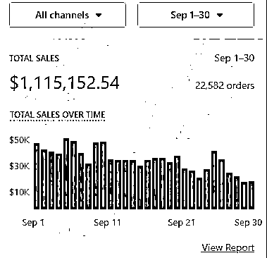

能走到这一步，是因为我们不是用“打爆品割韭菜”的心态做买卖，而是踏踏实实做一款让客户认可的产品。

另外，我自己创建了付费社群“Google 研讨社”，希望把正规的 Google 推广方式和品牌打造心得分享出去，帮助中国产品与品牌建立世界影响力。欢迎来聊。也欢迎大家关注同名👸号“图帕先生”，关注后按提示可获得 SEO 工作表和相关 Google 广告电子书，我会持续更新 Google Ads、Google SEO 等海外营销实操内容。谢谢阅读。Peace Out！

P.S. 如果你也想在龙哥盟专栏分享经验和认知，可以点击 http://form.shengcaiyoushu.com/f/HA1G1g 填写表单，我们会陆续邀请有赚钱经验和案例的嘉宾来分享。如已填写，请忽略。

评论区精选：
西昂：关注博客很久了[强]。
鱼丸|龙哥助理：感谢老师的分享，有问题欢迎在评论区留言。
图帕先生：如果大家不会用 Google，也可以用百度练手：百度搜索“百度指数”，进入带“官方”标识的页面，输入一个关键词就能看到搜索趋势；在“需求图谱”版块还能看到相关关键词的热度。数据虽然是国内的，但工具和思路可以试试。
图帕先生：谢谢支持[嘿哈]。
子不语：我去找行业报告时，会用“关键词+目标市场+Market Report”来搜，受教了。
图帕先生：希望能给大家一些启发。
超越：感谢，虽然我现在还在工厂上班，但看完分享后，我莫名坚信自己也能在网上赚到钱！
图帕先生：谢谢你的支持，坚持住，一切都会好起来的。[嘿哈]