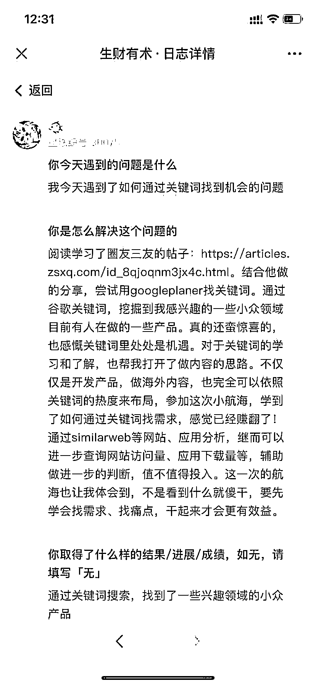
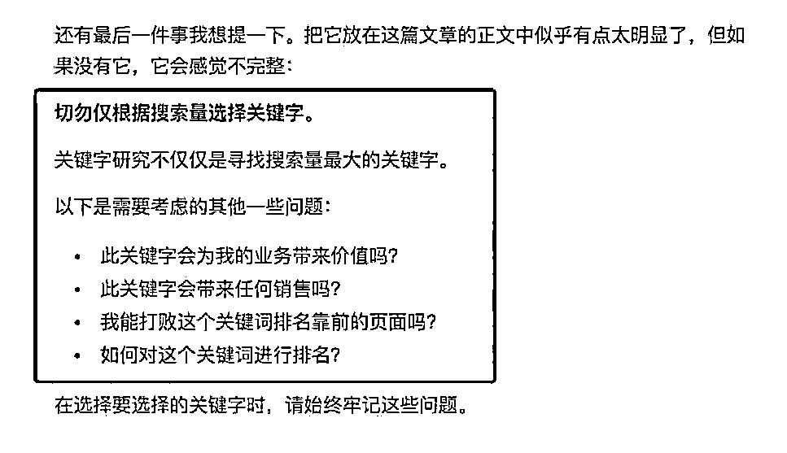

# 用 Google 关键词找产品机会

三林在 2022 年 10 月 21 日发布了一篇原创分享，主题是借助 Google 关键词发现需求；这篇帖子拿到 113 个赞，内容上周也在“英文工具站小航海”社群讲过一轮。

做产品出海，第一步常卡在“做什么”。一个可操作的路子是：围绕某个领域或平台去挖关键词，再用数据做验证，从中判断哪些产品方向值得试。先做有人会搜的东西——Make Something People Search For… 不过，找到词只是起点，Ahrefs 博客也表达过相近看法（见图 2）。

分享后收到的反馈不错，有伙伴说，学会用关键词反推需求后，感觉像捡到宝，收获感很强。也欢迎你来交流自己的方法，一起探讨、共同进步。

完整内容可看飞书文档：
https://t88igkhvrr.feishu.cn/docx/doxcnrJry2EmhMT562lM9wEob6d

 

评论区也有不少延伸讨论：do 小鱼说被三林老师“翻牌”后很不好意思，还把名字打错了，作业已过又改不了；三林笑着表示理解。向上的塔皮感叹三林更新快，自己还在学前一篇精华帖，升级版就又来了；三林希望他能有所收获。林锅补充，亚马逊产品开发同样会靠关键词确定开发方向，三林也认同亚马逊站内搜索数据很有参考价值。地铁馒头问，为什么工具站大多聊海外、少提国内；三林解释，国内工具产品并非没有，只是更多以 App 形式出现，网页形态在海外面对的人群更广；海外 web tool/SaaS 生态百花齐放，细分领域也能有可观收益，而国内产品往往更追求大而全。