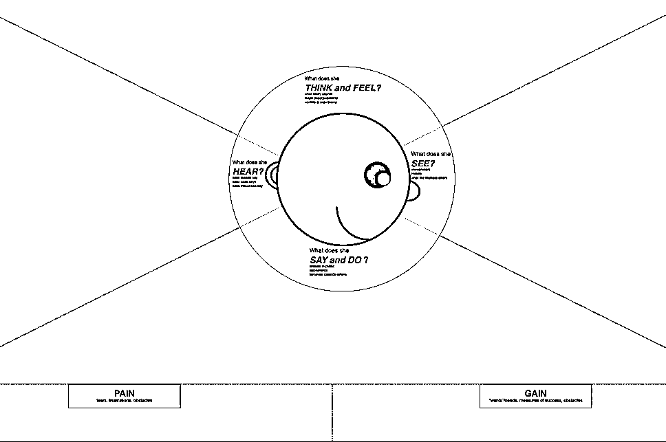
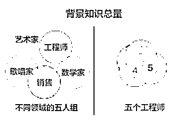
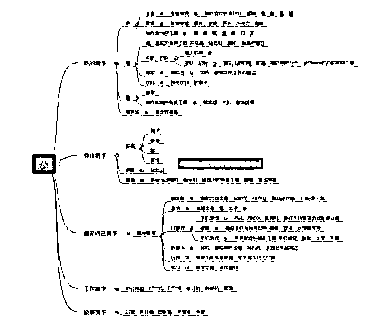
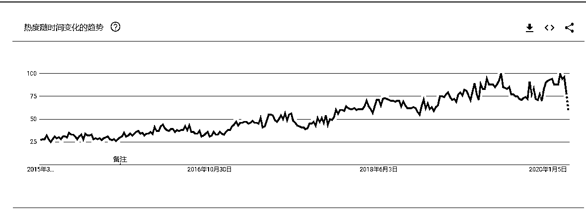
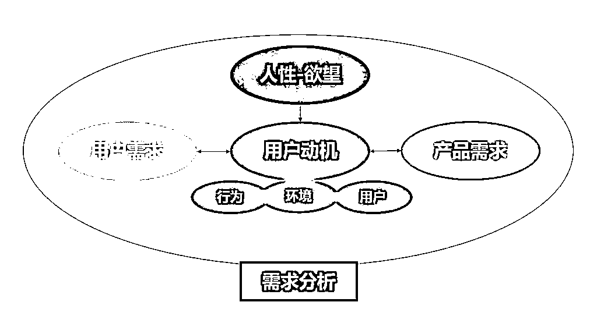

# 选Niche，抓住这三个关键

这算是我在生财有术这一期收尾前交的一份作业，聊聊挑Niche的方法和体会。要是能得到亦仁老师@亦仁 的中肯点评，这次收官就挺圆满。原标题起得有点“端着”，这回换个直白点的说法；哪里写得不好，也请大家指正。

当初我选Niche时没方向，也找不到切入点。为了破这个局，我翻了不少选品和选Niche的文章，自己搭了个思考框架，便有了这篇。如果你正好刷到，希望它能给你一点参考。

下面会依次聊三件事：一是Niche到底是什么；二是从哪三个维度挑Niche；三是这三个维度具体怎么落地。

一、先把Niche说清楚

Niche该怎么理解？查完资料后，我比较认可以下两种说法：

第一，把市场切细，企业把力量集中到一个明确的目标市场上，或者只盯住某类细分市场，或者重点做某一款产品/服务，从而做出优势。

第二，利基市场是整体市场中的一块，它把人群圈得更窄，而这部分人的需要还没有被服务好；他们有自己的需求、偏好和特征，同时也能认可你提供的价值。

这两段定义里藏着三个重点：一是有独特性的消费者或人群；二是一个细分市场；三是有待发现的需求。这三点既是找Niche的抓手，也是我选品时的思考框架：人群上哪找、细分市场去哪找、需求从哪发现。

二、先圈出潜在人群

我特意说“潜在群体”，而不是“目标群体”。原因是，信息还不完整、产品连雏形都没有的时候，确定目标受众很难；这个阶段只要去发现并列出可能的人群就够了。

怎么定义潜在人群？举个例子就清楚了：糖尿病患者，人群够特殊；火影忍者粉丝、LOL玩家，特征够明显。这么一想，多少有点感觉了吧。

这里推荐一个很好用的工具——移情图（Empathy mapping，配图1）。它适用范围很广，放在这里也合适。确定潜在受众后，可以用它来更深入地理解用户。使用顺序没有硬性要求；有时你会发现用户所说的和所想的差不多，也不用刻意区分。

拿买电视举例：用户说“想买个多大尺寸的？”心里想“电视这么多，真难选”；行动是“先淘宝搜一圈，再去实体店看看”；感受是“这个功能不如上一台，纠结”。信息列得越细，越能体会用户的情绪、看法和期待。建议把图打印出来，头脑风暴后用便利贴贴标签；下次再看这张图，能更快进入用户角色。

有人会问：选品时凭空硬想一个特殊群体，真不容易，因为思维容易定势。我也被这个问题困过。我的解法是：一个人经历和见识有限，那就拉不同岗位、不同生活经历、知识背景的人一起讨论。别人输出的东西，往往正是你没想到的（配图2）。

还有一个办法：从微博找一张覆盖日常所需的图（配图3，只是举例），给里面的东西打标签。比如看到“裙子”，就想有人偏爱棉麻，于是发现“喜欢棉麻材质衣服的人”。这样做的好处是，能比较快也比较全地设想出很多群体。

另外，记得及时更新“人群地图”：随手记录，比如糖尿病患者可以归到“身体健康”下的“疾病”分类；“火影忍者”记到“动漫”里，后面继续发散。

三、顺着类目找细分市场

这块大家比较熟，教程和文章也不少。常用方法有这些：

1. 亚马逊、速卖通类目；
2. 社交媒体类目，比如Pinterest类目（bit.ly/3doJtAu）；
3. Trustpilot类目；
4. Flippa网站交易平台；
5. Google News行业订阅；
6. 书籍分类；
7. 线上二手交易市场类目；
8. Reddit类目与Communities。

以第一点为例：先看大平台类目，顺着大类往下追子类，再看子类里哪些产品卖得好；接着去Google、Amazon搜关键词，用工具收集并拓展行业相关词，再用Excel把搜索需求分类，找出细分需求，统计搜索量，观察趋势和竞争程度。这属于用关键词思维挖细分市场，靠信息差快速试错验证。

这里要强调：找到细分领域，往往能同时解决“细分市场”和“特征群体”这两个并行问题。比如亚马逊书籍：我从畅销榜发现美国消费者爱用空气炸锅、爱吃keto（酮食）。酮食这个Niche，既对应“为了减肥吃酮食”的特征人群，也对应一个细分市场。所以找细分市场和找特征人群不一定孤立，可以看情况交叉、灵活使用。

AMZ的书籍分类和畅销榜，我觉得很能带来灵感。愿意花钱专门买这类书，本身就暗示了一个可能的细分市场。你自己平时会在什么情况下买书？我也是借这个思路找到一个趋势不错的Niche，目前还在研究（配图4是趋势）。

四、把真实需求挖出来

先用一个例子说明需求。某天我刷Reddit热点（原帖当时没存），看到一位司机发现前车车窗抛物，别停对方后打了起来。起初我当热闹看，觉得好笑；后来细想，里面有几条重要信息：

1. 前车有人在驾驶，车在行驶——人物与场景；
2. 前车司机往窗外扔东西——动作；
3. 说不清具体原因，反正手上的东西不想留在车里（可能刚吃完、可能是习惯、可能垃圾难处理又烦躁，于是扔了）——诱因与情绪；
4. 为什么不愿放车里？不想弄脏自己的车——目标与期待。

试着还原一下。当然有假设成分；信息不完整时，也可以把自己放进场景里体察用户（又回到移情图）。如果我是用户（有车、开过车），在行驶中吃完东西（场景），手上黏黏的、带汁带菜，放车里难受（诱因与情绪），为了不弄脏车（目的），又半天找不到处理垃圾的东西，那就扔窗外（行为）。推完这个过程会发现：用户可能需要一个能装手上湿垃圾的容器。于是发现了一个Niche——车载垃圾桶。既定义了人群，又找到了市场，还解决了用户问题。

这里可以用一个完形填空来提炼需求：用户需要通过（解决方案/产品/服务）____完成（目标）____，因为____。（配图5）

这个Niche还挺好发散，比如车载空气清新剂、车用吸尘器等汽车用品。

怎么发现Niches？最好的起点是观察自己：你的兴趣是什么、今天遇到了什么困难、情绪如何？比如久坐后颈椎不舒服；电脑桌下线路杂乱，绊到脚；美工跑来问怎么下载shutterstock无水印图片。

除了看自己，也要看别人。去用户集中的地方：比如你对cycling感兴趣，可以在Similarweb选cycling行业，再选国家，看网站排名；bikeforums.net、cyclingnews这类网站是行业新闻和论坛，内容大量与用户相关，相当于一个需求库（配图6）。这样筛出的网站相关度高、流量大，流量就是用户，很好用。

总之，不管小白还是大神，选品选Niche都可以从这三个角度切入思考和发散；这三个角度是强抓手，也是思考框架。

以上就是今天的分享。觉得有帮助就点个赞，顺便关注公众号“小白产品进化论”。后面我还会写“上帝视角”系列，比如如何评估你的Niche、选好产品后怎么给网站做USP定位等。另外，4月份起我会和一些朋友（有留美营销专家，也有工作中认识的朋友）做一系列从选品到网站定位、测试启动的免费微课程，面向独立站过程中对行业和产品拿不准的运营或创业者，帮他们获得并掌握从信息收集到产品定位、测试启动的一整套方法，降低后期运营风险，实现品牌出海。有兴趣可加微信610533908关注，欢迎提建议或意见，互相交流，I want you.

 

  