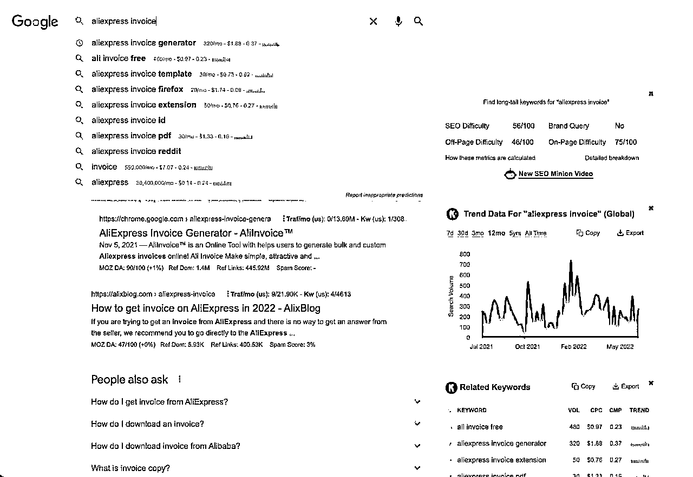
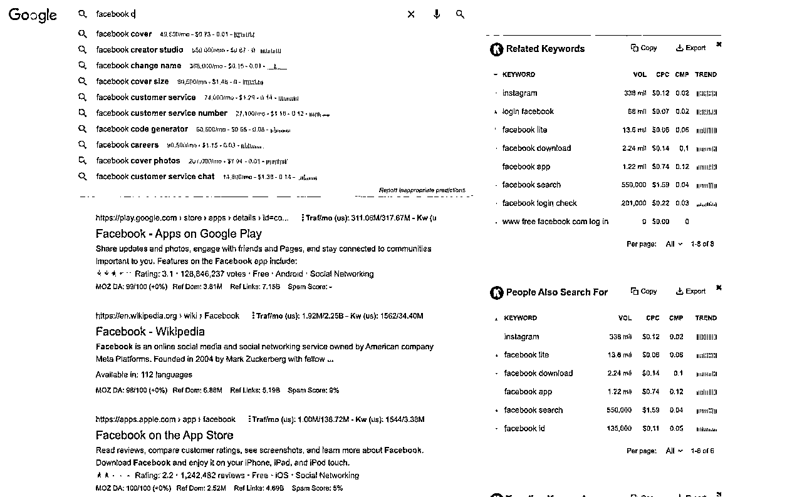
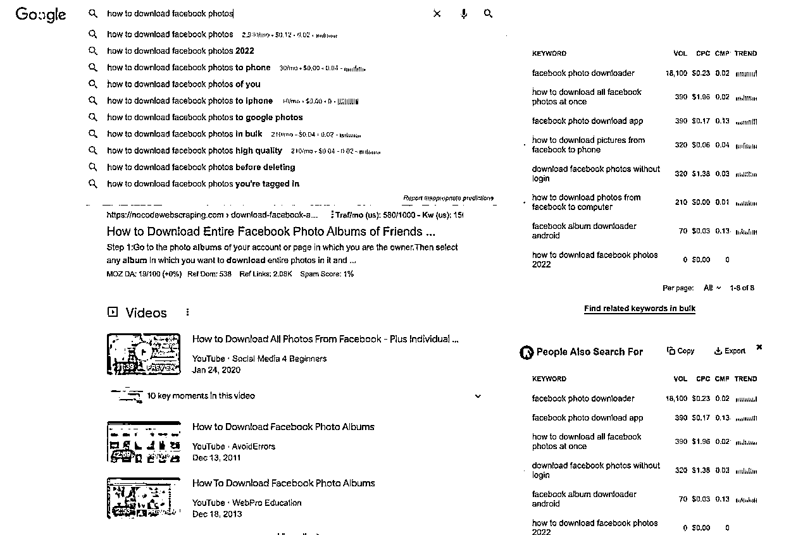
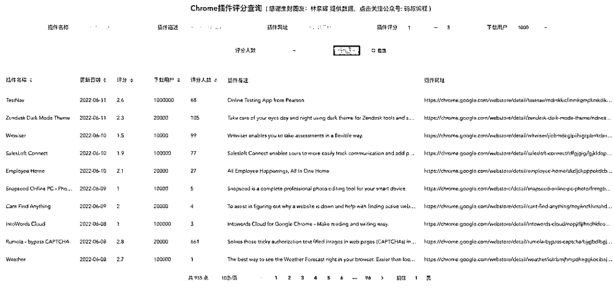
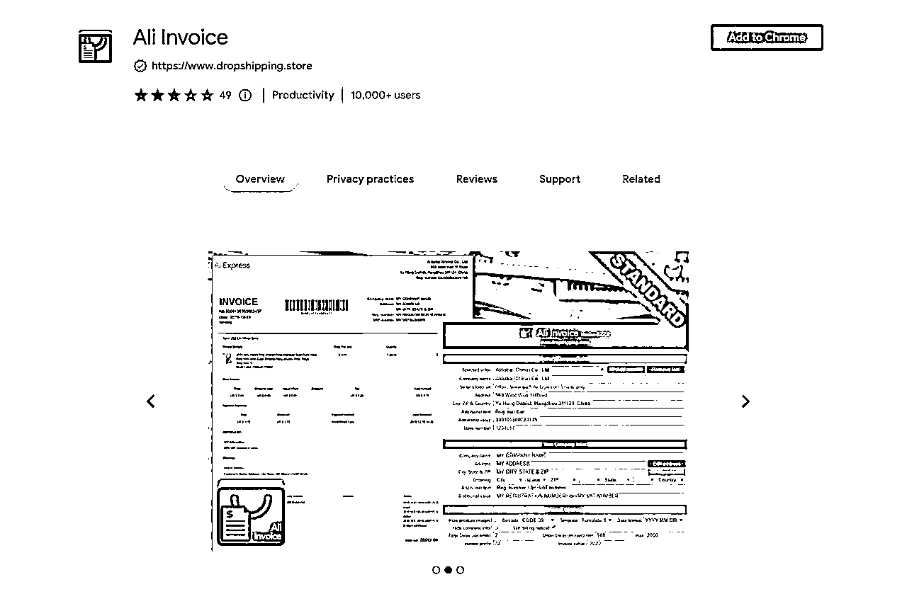
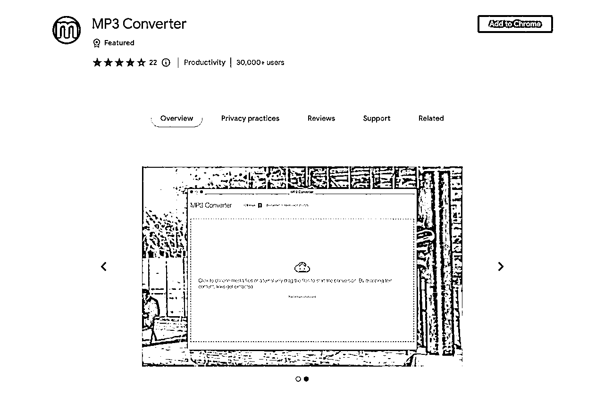
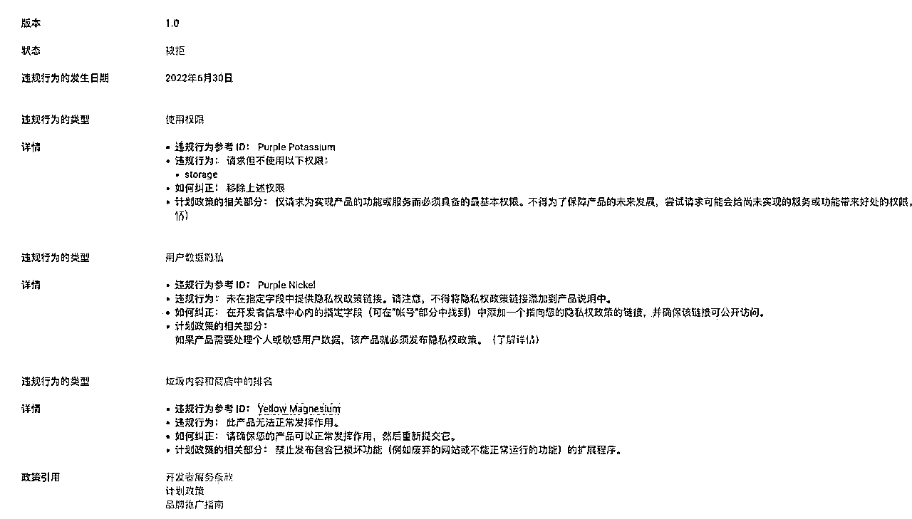

# 插件掘金第一课：把需求想透，代码只是顺手的事

我是帆，前端出身，也是这趟 Google 插件航海里的一员。群里我属于话比较密的那种，这次阿蓝喊我来聊聊，就说说自己怎么摸方向、怎么验证需求，顺带讲讲上线路上踩过的小坑和后续找新点子的思路。整篇大概五千字，十分钟能翻完。

## 一、方向先行，需求是命门

这趟航海下来，我最大的感触是：做成一个插件，写代码那部分反而是最轻松的。用户掏不掏钱、产品活不活，取决于你解决的问题是不是真需求，跟你代码多优雅、功能表拉多长，关系不大。动手之前，把“这事到底成不成”翻来覆去地想，比什么都值。

用户为什么愿意为看起来不起眼的小工具买单？Google 有一条铁律叫“单一功能”（Single Purpose）：一个插件只能专心干好一件事，还得让人一眼看懂。功能一多，审核直接卡掉。所以你做的本质上是帮人省时间的工具，像挖词用的 Keywords Everywhere、亚马逊卖家离不开的 Keepa，都是这个路子。时间就是钱，用户省了时间，自然肯付费；更何况这批人多半是拿工具去挣更多钱，掏钱的时候更利索。

**从零起步，先围着大生态打转**

目标虽然是工具，但我真心不建议第一个插件就奔着付费工具去。头一个作品越轻越好，核心目标是跑通整条链路：怎么开发、怎么上架、上架备什么材料、流量从哪儿冒出来。我当时的算盘就是先弄个免费小插件把流程趟一遍，后面做付费产品心里才有谱，不会瞎撞。

找方向的时候，航海实战｜Google | 付费插件｜实战手册务必认真读。里面方法和细节都写得很细，卡住了就回头多翻几遍，再上手试，八九不离十。起步阶段跟着手册走就行，Facebook、Instagram、YouTube 这类大平台优先。道理很直白：人海足够大，再冷门的需求，哪怕只吃下万分之一的用户，也是万级起步的量；何况这些平台的需求好查、SEO 也好做。要是你想一上来就挑战盈利，那就换个池子，Amazon、Ebay、Etsy、Shopify 这些电商场子更适合。除开第一个练手插件，后面每一个在动工前都要反复盘，把调研做扎实。

壹树有句话我记到现在：瞄到一个需求，先别急着敲键盘，搁一周再回头看；要是还觉得香，再搁一个月来拍板。开发是实打实的时间投入，需求没潜力，沉没成本会压得你喘不过气——写代码的时间、等审核上线的日子、修 Bug 和改内容重新过审的周期、做 SEO 推广的精力，还有做完之后那股倦怠劲儿，全得算进去。

**用数据判断市场冷热和竞争烈度**

群里要是问“这需求能做吗”，十有八九会被壹树哥一句“去问搜索引擎，它比咱们靠谱”怼回来。行不行，答案都藏在搜索数据里。配合工具，你能摸到这些：

1. 核心词和周边词的月搜索量、广告出价；
2. 盯这块的竞品有多少家；
3. 长尾词都长什么样；
4. 每个月从某个词导进目标站的流量，以及站点月总流量。

流量（Traf/mo）是估出来的。关键词搜索量、费用、竞争强度这些，调研口径来自 Google 关键词规划师（相对靠谱）。这里我用的是 Keywords Everywhere 扩展，功能就俩：查词，拿到相关词的搜索量，以及从词进站的流量。主要用来判断需求量级和竞争烈度。

**反过来用工具找需求**

既然 Keywords Everywhere 能看词的容量和难度，那倒过来用它挖需求也成立。手册里教过一招：关键词加 a-z 去搜。

把 A 到 Z 挨个过一遍，大多数平台的高流量搜索词就浮出来了。英文好的圈友扫一眼下拉词就懂；英文一般的点进去看结果，掂量下内容和搜索量，再决定要不要深挖。操作上就是按定好的方向，拿 Facebook、Amazon、Gmail、Ebay 这些词去跑 a-z。方向有了，再去搜长尾，看看现在的人是怎么解决的，比如 how to xxxx in xxxx 这种句式，最能暴露真实需求。

**照着竞品做，见效最快**

除了搜词，另一条路是仿竞品，这大概是出结果最快的打法。这里需要一份圈友整理的数据：Google 插件市场 15w 条完整数据 | 圈友基于此做的筛选工具。拿到表以后，先按评分和用户量粗筛，再人工过一遍，挑出近一两个月还有新评价、但分数偏低的产品，然后用 Keywords Everywhere 去查长尾。

这么筛出来的东西，基本都是有真实需求的（近一个月还有人在评）。用工具看长尾，核心是判断需求大小、市场空间和竞争格局。比如 Ali Invoice 这个插件，就是这么从表里刨出来的。

它的功能一句话说清：抓速卖通订单信息，生成可打印的发票 PDF。实现不难，基础版却卖 20 美金。这插件已经很久没人管了，翻翻同类竞品的评价区，一堆“not working”——需求摆在那儿，没人解决，直接一比一对着做，推起来很轻松。当然这需求偏窄（问过做速卖通的朋友，说没这需求），所以我没往下钻，但这种项目挺适合刚入门的圈友拿来练手。

**免费插件靠什么活**

挖需求的时候肯定会撞见大量免费插件。别费劲猜它们怎么变现，多数就是凭热爱发电（爱好、炫技，或者嫌那点钱不值当），这也是商店里躺着一堆停更插件的原因。当然免费不等于绝收，只是路子绕一些：

1. 把人往自家站点引，再用别的产品承接转化（有开发商专做免费插件给自家小游戏导流）；
2. 引流卖货（Tabby Cat 这个宠物标签页，就在独立站卖周边贴纸）；
3. 增值服务（比如把插件拿到的数据做云同步）；
4. 挂联盟链接吃佣金（挖需求时见过一款免费插件，评论区都吐槽它会自动弹天猫超市，作者八成是淘客）；
5. 引导点广告（这类通常会被用户骂惨）。

**先把心理预期摆正**

刚入坑的圈友得有个准备：你的第一个插件很可能因为各种奇葩问题被驳回、开发完发现版本上不了架（MV2 已经不让发了）、网上找的解法试了没效果、上线了却没人用……这也是我劝你先做个简单免费插件把流程走完的原因。真碰上了也别泄气，事后复盘，下一次做得更好。这种事就跟做亚马逊遇到刷单被抓、投 Facebook 广告被封号一样，没经历过都不好意思说自己是插件掘金人。

## 二、别被技术绑架，先把 MVP 做出来

插件是拿来解决问题的，用什么手段解决不重要。我习惯在确认需求可行之后，先花点时间看看实现路径：有没有现成库能直接用；没有的话，再估一下自己写起来复不复杂。比如下面这个：

我第一眼就想到了 FFMPEG，拿它复刻一个同款甚至更强的工具完全可行——比如叫 Media Converter，音视频、图片通吃，连视频抽帧、图片转视频都不在话下，自己只需要搭个界面、把转码参数预设好就能上架。动工前建议拉一张 todo list，把想做的功能一条条列上，再一条条划掉，只留最核心的，先做出 MVP 好拿去推广；数据好看再慢慢补。

再补一句：技术选型真不用纠结，插件本质就是最简单的网页程序（HTML+JS+CSS）。会写代码就用自己顺手的栈；不会写，找圈友搭伙一起赚钱也行。想自己啃，稍微学一下前端三件套就能直接开工。

## 三、把扩展送上线

开发收尾后，第一道坎是开发者账户。注册、绑卡、付费，很可能卡在支付失败这一步。这多半是 Google 内部的小毛病：绑完卡关掉页面再重开，问题就没了。我当时查了一圈，没看到任何银行拒付的提示，基本都是重进页面就能过，我自己也是这么绑好卡、关掉重开就付成了。实在搞不定，某宝花点钱也能解决。

第二道坎是版本踩坑。Google 扩展分 v2 和 v3，商店现在已经不收 v2 了，可网上大量教程还是旧版本。这次航海就有圈友中招。

因为版本不对被拒。碰到这种情况不用慌，升级版本本身不复杂，只要没用到被砍掉的功能（比如引用外部 JS），基本都能过。

最后一道是审核。要描述清楚程序大致干什么（也就是前面说的单一功能）、每项权限为什么需要（一项一项单独写），涉及收集用户数据还得附隐私声明。权限申请了没用、该提供的没提供，都会被退回。

圈友插件因为权限问题被拒。审核一般两三天，期间撤不回来（上新和编辑都是这节奏，哪怕只改了一个字）。所以开发完务必自查一遍：有没有多要权限、有没有影响功能的 Bug，别因为这些拖了上线或招来差评。

## 四、上线之后怎么推

扩展上架后光等自然流量，起量会比较慢。我的插件上线半个月才攒了 100+ 用户 🤣。如果你的产品正好补了某个失效竞品的缺，可以去它的评价区留言，把用户往自己页面引。很多失效插件底下有现成模板，存几个随时能用。再就是搜相关长尾词和关键词，在对应帖子里留下自己的扩展或官网地址。

免费流量还有一招：做视频发 YouTube，标题直接用长尾词，很容易挤到 Google 搜索结果前面（大站权重高，可以这么理解）。付费流量就是 Facebook 广告、YouTube 广告，这块展开又是大课题……不过还是建议先从免费的玩起。

插件开始有用户之后，可以用 Vercel 搭个小站，接住各个渠道来的流量，顺手赚点广告费，也能放插件优化说明和使用指南。

## 五、做自己真正喜欢的事

龙哥有段话我很认同：总开心指数是正的，就值得做；是负的，就别做。说白了就是做自己喜欢的事。

今年是我加入赚钱的第四年，期间上过好几趟航海，副业试了一堆：视频号、抖音、TK、好物、📕。这些 UGC 平台每次发完内容，我都会陷入自我怀疑。这次换到开发这个方向，反而觉得顺其自然、舒服得很。

以前那些副业虽说也有点收获，可总坚持不下去。现在回头想，大概是因为：做它们就是为了赚钱，每次输出没结果，都在一点点磨掉行动力。而做自己喜欢的事，每天都能保持满格状态。

现在第一个插件用户 100+ 了，每天都在自然涨（SEO 计划一直没落地😂）。人不多，但我挺开心。

最后补一张壹树大佬最常发的图。感谢各位读完，祝大家在插件出海路上一路砍瓜切菜，早日做到人生第一个 $10K MRR。

评论区里也有人留言：有夸厉害的，有想加🛰️的，还有说分享很接地气、正好解了做工具时的困惑。