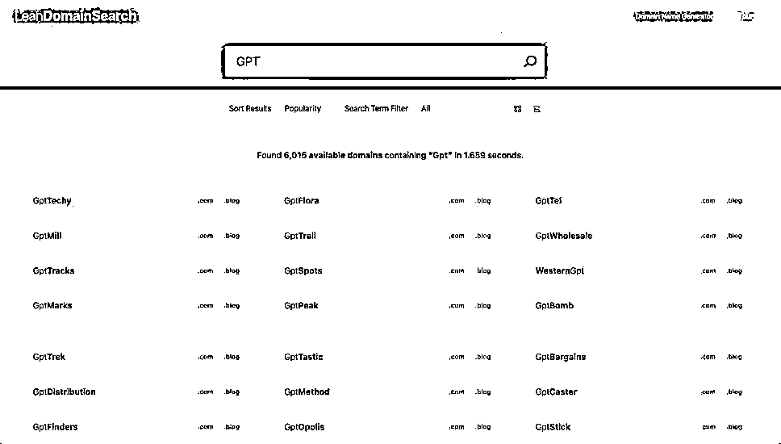
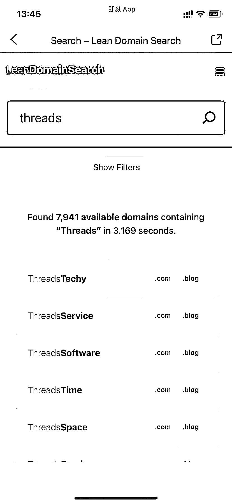
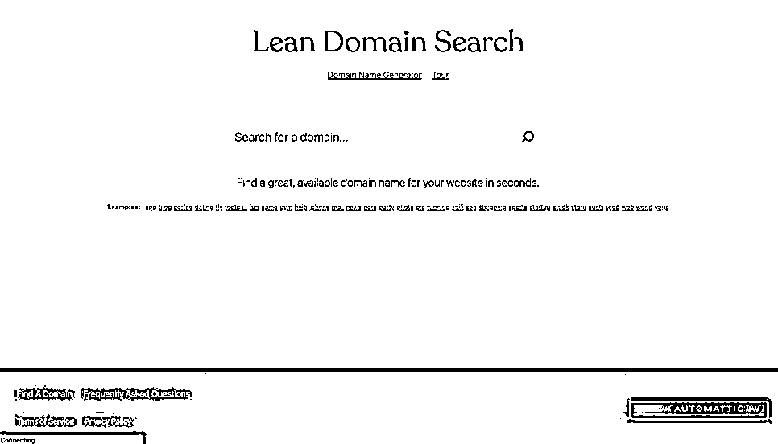

# 5秒，5000个域名灵感

做海外产品时，给产品定一个既准确又有格调、还不土气的名字，再找到能拿下的域名，常常让人卡壳。昨晚我试了 Lean Domain Search（leandomainsearch.com），它专做域名组合与命名查询。这个站上月访问量约20万，平均停留4分30秒；其中七成流量来自直接访问，侧面说明它已经积累了一批稳定用户。

## 上手流程

- 输入关键词：在搜索框填一个词，比如 GPT，或者当下的热门词 threads。
- 快速出组合：系统会自动拼词，大约5秒给出5000个候选域名。
- 查看注册状态：结果里会标出是否已被注册；默认排序靠前的通常还能注册。
- 继续筛选：可按热度、字符长度、字母ABC排序，也能限定关键词放在前面还是后面。
- 一个实用细节：所有结果都放在同一页，直接按 Command 或 Ctrl+F，就能在页面里搜自己喜欢的词。

短板也有：用户无法维护个人词表。比如我偏爱某个单词，目前不能自定义加入。其余细节就等你自己去试了。

## 它靠什么赚钱

它把用户顺畅地引向 WordPress 官方，去注册域名或搭建新站。我一度猜它是不是被 WordPress 官方收了；查证后确认，收购方正是 Automattic，这家公司真厉害。

## 再延伸一步

我通过它很快找到了满意的域名。若由我来做这个产品，我会接入它的 API，并加上自定义词表，让需求更个性化。整体很强。玩域名的朋友，推荐体验：https://leandomainsearch.com/search/?q=threads

评论区也有补充：

木桶伯：可以试试秋玉米。

三林：两者不一样；秋域名的作者也夸它“这个好”。

三林：它不只是批量查域名，重点在取名和组合。

龙哥：中标，术值+1；在上方专栏点 #中标，能查看全部中标风向标。

胡二虎🐯：这个好，以前我全靠脑子想、手动排列组合。它是不是在 GPT 上有插件？看着有点眼熟。

三林：这个不清楚，你可以确认下；现在也有 ai domain generator 这类工具。

三林：识货。

 