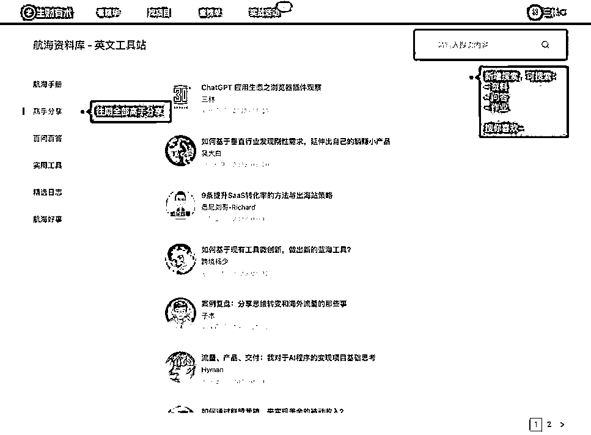
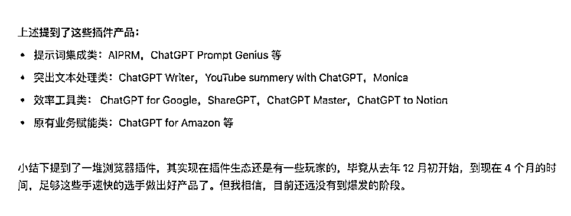

# 67 赞：ChatGPT 浏览器插件的产品机会

大家好，我是三林，在生财有术团队担任产品经理，主要负责航海产品等业务。本周三晚上，我在“英文工具站”航海群里做了一次分享，聊的是围绕 ChatGPT 成长起来的一批第三方浏览器插件：它们怎么找产品定位，以及我在体验过程中产生的一些思考。

为什么说浏览器插件是值得考虑的产品形态？因为 ChatGPT 官方入口本身就是一个网页。插件相当于在这个网页上做增强，在用户已经熟悉的浏览场景里把体验再往前推一步。它顺应使用习惯，用户更愿意尝试，也能补上原生产品暂时没覆盖到的地方——等于借了巨人的力。

这次我观察了十款左右的插件，大致分成两类：提示语模板型，以及效率工具型（文末有图）。

从这些产品里，我提炼出几点认知：

1. 开发者的参照系正在变化：过去是面向 Google 编程，现在越来越多地转向面向 ChatGPT 编程。做开发的朋友应该体会很深。

2. 可以把 ChatGPT 看成一个装满魔法的百宝箱，而 Prompts 就是开箱密码。它既是流量密码，也是财富密码。

3. 浏览器插件只是一种产品外壳。一旦 API 开放，可发挥的空间会大得多：一句 Prompt 可以相当于一个 Mini tool，一组 Prompts 可以撑起一个 Mini SAAS。

4. 回到自己的业务，找到真正匹配的场景，大胆用 ChatGPT 给个人和业务加杠杆。

5. 最后一点也最重要：考虑到原生体验和内容安全，创业者不妨把目光放到海外市场。这也正是我们做英文工具站的意义所在。

需要说明的是：本文说的“插件”并非今天凌晨 ChatGPT 开放的 Plugins 能力，而是以 Chrome 为主的浏览器插件。新 Plugins 带来的变化很大，我之后再单独写一篇。

https://shengcaiyoushu01.feishu.cn/docx/A27Md68WVox13FxPZFeczOVgnKc

 