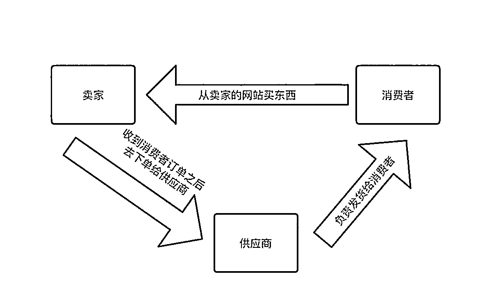
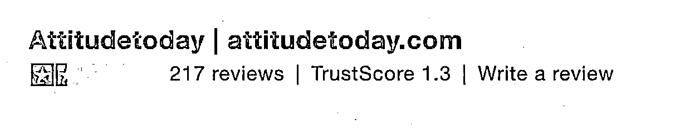
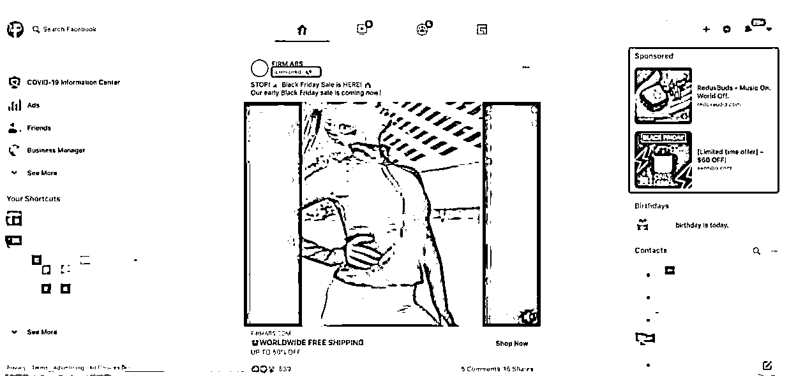
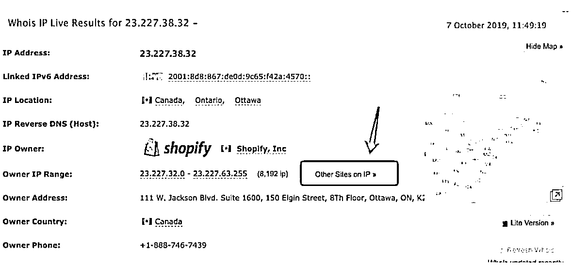
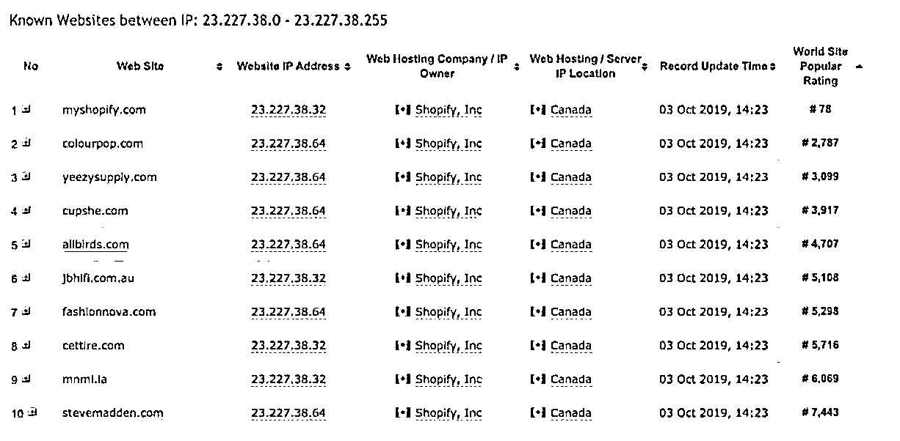
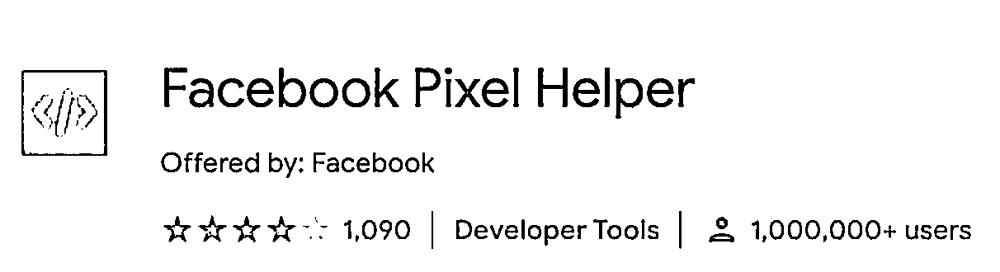
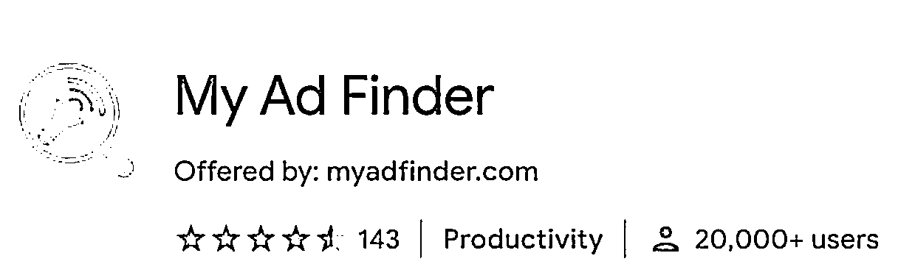
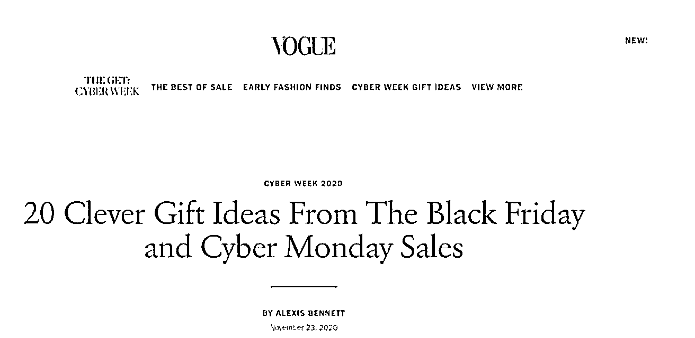
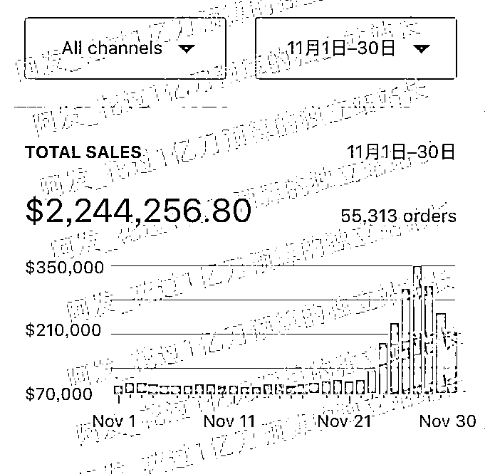

# 5个700万月销站点停摆后，我120天跑出1500万新站

第一期龙珠俱乐部毕业在即，回看这一程，收获远超预期。先谢谢龙哥盟和龙珠俱乐部，这篇就当作我的毕业复盘。

我是阿发，独立站老兵，累计花过1亿美元广告预算；做过中国出海50强品牌的独立站负责人，也在跨境电商独角兽Fordeal管过渠道投放；爆品站、精品站、品牌站都操盘过。如今离开公司，开始自己创业。今天想聊的，是我手上5个单站月营收约700万元的爆品站停摆后，怎样用120天把新站做到单月销售1500万元级别。

## 爆品站起量那两年

2016到2018年，Dropshipping（海外版一件代发）刚爆红，最常见的是爆品站：市面上什么火就卖什么，几乎不做垂直细分。所谓Dropshipping，就是卖家不压库存，只在网站上做营销；顾客下单后，由供应商直接把货发给买家。

它吸引人的地方有三点：一是无库存，不压货，不承担仓储费，也不用处理物流；二是起步资金压力小，不必提前备货，等确认能起量再大量采购；三是发货环节交给别人，团队可以把精力放在建站、营销和客服上。新手常用速卖通做供应商，因为发货方便。那用户为什么不直接去速卖通买？关键不在货在谁仓里，而在谁先触达用户、谁先说服用户。接触和说服都要成本和本事，不是有货就能赚钱；否则大家直接找工厂买更便宜。

为什么偏偏在那几年爆发？三个问题被解决了：货端，速卖通已经相对成熟，找货发货方便；建站端，Shopify把建站门槛降到几乎为零，有网有电脑的人一两个小时就能搭出能卖货的站；流量端，Facebook加速商业化，广告还不算贵、监管相对宽松，流量质量和转化都不错。当时流行的打法就是Shopify建站加Facebook广告引流。

那几年我靠爆品站吃到红利，最多同时运营5个，其中一个女装爆品站，其余是常规爆品站，每个站月营收约700万元人民币。下面这个站起量后很长一段时间平均每月有100多万美元营收，后来因客服、售后、供应链等问题没能持续，域名已废弃，现在输入会跳到乱七八糟的网站，大家别尝试。Trustpilot上还能搜到它，有217条评论，做过的人知道这代表曾经流量不小。

找品上有个偏门但好用的办法：盯社交媒体和礼品网站。社交媒体首推Reddit，可以理解为英语世界的贴吧，活跃用户多、流量大，很多潮流先从Reddit冒头再到Facebook爆。可以重点看这三个和购买欲直接相关的板块：
https://www.reddit.com/r/shutupandtakemymoney/
https://www.reddit.com/r/BuyItForLife/
https://www.reddit.com/r/FindItOnAmazon/
礼品网站也值得跟，因为它们为了生存会持续搜罗新奇、有趣、流行或可能流行的产品。推荐：
http://www.dudeiwantthat.com/
https://odditymall.com/
他们卖的东西有时连我自己都忍不住想买。

## 风向变了

爆品站跑了快一年，问题开始出现。女装站销售额涨了，但公司在服装供应链和设计上的短板越来越明显，增长很难继续。常规爆品站也受限制：广告平台和支付平台对售后要求越来越严，而爆品站本身很难把物流、供应链、客服做到完美；我们已经努力，仍与平台要求有差距，站点被限制后赚钱不再舒服，也没法做长期积累。

面对高成本和一堆衍生问题，老板决定先暂停团队，给大家内部创业机会，公司出资源支持，只有一个要求：能赚钱，并且有长期潜力。

我本来就想做更长期的事。爆品站做到最后除了赚钱，留下的东西不多。于是我连夜做了20页PPT，讲清方案：先选海外一个垂直细分领域并选好品；用Dropshipping起步；销量稳定后自己囤货、整仓库、做贴牌；再往供应链深入；最终把站点做成品牌。和老板诚恳聊了2小时，他认可思路，给我安排了几个人先干起来。

## 最头疼的两道选择题：赛道和产品

团队有了，第一个难题是选垂直细分领域和产品。这几乎是独立站开头最重要的一步，开头错了站基本废掉，开头对了后面会顺很多。

我们试过不少方法：看eBay、亚马逊等电商平台数据，也看其他站点数据，能选出一些，但测试效果一般。快绝望时我们换了个思路：前期主要靠付费推广，那直接看别人正在投的广告不是更快？

先找广告监测平台，https://adspy.com/ 是我们发现最好、最及时的Facebook广告收集监测站，可以看到近期什么产品和品类好卖，先收集备选。但只靠它不够有效：量虽大，抓取不够及时，参考意义有限。怎么拿到最新最热的Facebook广告？我把目光放到了自己刷Facebook时的信息流广告上。

Facebook广告类似朋友圈广告：正常刷好友动态、明星动态、关注主页动态时，中间会夹“Sponsored”广告。很多人看一眼就划走，但我发现信息流里不少广告是监测工具没有的，很多来自新秀站点。

我就想，怎样让Facebook给我推更多、更好的广告？了解机制后明白：系统会给每个人打标签。你买过贵价奢侈品，系统就更可能推奢侈品广告；你常买高价值商品，系统就标记你为“常购买奢侈品的高价值人群”，新奢侈品站投放时更容易推给你，因为系统判断你大概率会买。

当然，系统收集这些信息有两个前提：你的Facebook个人号在浏览器里开着，或者你直接从自己的信息流进站购买更好；网站本身装有Facebook广告追踪代码。两者缺一不可。所以想让系统推更多优质广告，就去感兴趣的站点真实购买，买得越多，在系统里的价值越高，收到的广告越好。

实操时我先拿自己的号做实验：做这件事时浏览器一直开着Facebook个人号。我不可能真花大钱买那么多货，于是用Paypal（类似国外支付宝）下单，在发货前申请退款。为什么强调Paypal？国内Visa和Master信用卡有时能买有时不行，不稳定；Paypal对买家保护强，卖家很怕买家通过Paypal投诉，投诉多了轻则冻结资金，重则暂停账号，所以基本没人愿意惹Paypal。发货前尽早联系卖家，说买错了，卖家通常痛快退款；不理就去Paypal投诉。个人Paypal申请很简单。

初始关注哪些站？登录https://myip.ms/，输入下面四个IP之一：
<23.227.38.32> <23.227.38.64> <23.227.38.71> <23.227.38.68>
然后点“Other sites on IP”，能找大量用Shopify建的独立站，基本按流量大小排好。推荐装Similar Web谷歌插件看具体流量，装Commerce Inspector看热销品。原理是Shopify用加拿大服务器，用它的店家基本集中在几个固定IP上。

还要确认对方网站有没有Facebook广告追踪代码，可装谷歌插件Facebook Pixel Helper查看。

网站有了，刷购买的方法有了，我开始猛刷。保险起见，建议多准备几个Paypal号分开刷，否则老做购买退款，Paypal也可能反过来查你。刷到足够量后，我和伙伴的Facebook信息流开始出现大量优质新广告，大家收集起来分析测试。再推荐一个谷歌插件My Ad Finder，它能让Facebook信息流只展示广告、不展示普通帖子，刷广告很合适。

测试一段时间后，我们找到可以专注的垂直细分领域和能跑的品，第一个难题解决。

## 流量进来了，订单却没来

赛道定了，站建好，品上传，第二个问题来了：用户进站但转化率只有1%左右。花钱买了不少流量，进站后转化很少，整体不赚钱。

我们把自己的落地页和卖得好的站大量对比，发现差距不在图片，也不在用户评论，而在产品描述。这是一款功能性产品，描述完用户没感觉，转化自然低。我们一开始直接用供应商信息，里面多是参数：长宽高、镜头像素、续航时间，平铺直叙。

这像什么？像一个自说自话的推销员，上来就讲产品多好，完全不管消费者感受。卖得好的对手用三段式写描述：第一段，提出问题并强调严重性；第二段，抛出解决方案并论证合理性和优越性；第三段，交易刺激加行动号召。

第一段，问题要是目标受众有感知的。比如脱发：不仅影响形象、干扰找对象，还会影响健康（只是举例）。问题不一定非是大困难，也可以是小麻烦：每天切菜花太多时间？这个工具能让你2分钟切完。我们一开始没提问题，直接介绍产品，就像那种不管别人听不听的推销员一样讨厌。

第二段介绍产品时注意两点。其一，多讲产品给用户带来的好处，而不是只讲功能。很多人把技术参数解释一遍，我们最初也大段讲功能、材质，效果一般。用户不关心你用了什么材料工艺，关心这些特性给他什么好处。展现好处要生动：比如生发剂用了名贵中药成分，用户会“哦，那又怎样”；说生发比较快，用户没感觉；换成“2个月内助你生发多少，而一般产品要半年才有同样效果”，用户就懂了。其二，多用对比图、动图或视频展现特性，比纯文字和静态图更有说服力。生发剂放使用前后对比动图，肯定更能打动人。但别造假：效果只有60%不能说90%，虚假信息可能招来Facebook、收款渠道等严打。案例可看https://blendjet.com/，一个年营收千万美金级、专卖搅拌机的垂直电商站产品页。

第三段是交易刺激加行动号召。刺激下单常用两招：赠品，今天下单送什么、前100位送什么，买生发剂送发套，短期长期问题一起解决；限量稀缺或紧急，全球限量100个卖完没，倒计时2小时结束。行动号召就是页面按钮，常用“加入购物车”“立刻购买”，可以用插件把按钮固定在页面下方，让用户更快按到。

同时我们优化了图片、网页速度和用户评论，转化率从1%左右提到3.5%。团队小伙伴高兴坏了，开始畅想日出千单，连钉钉群名都改成“日出千单小分队”激励自己。但事实再次证明，事情没那么简单。

## 不扩量，项目就活不下去

转化率上去了，也开始挣钱，但销售额扩不上去，每天单量就几十个。强行多投广告，站点立刻从赚钱变不赚钱。我愁坏了，和老板聊，他的意思是这么点量养这么多人没意义，不如搞别的项目。我心里凉了半截：好不容易找到方向、选好品、优化好落地页，不能死在扩量上。

最后我把Facebook广告系统里所有能调整的地方列出来，针对每个地方做扩量猜想和测试。测了1个月，终于有突破。这个突破点我自己都有点意外，后来想想又合理：人为手动竞价。

Facebook广告的竞价规则，其实很多人都没搞透。今天把这套基础逻辑，加上我们冲量过程中验证过的实操方法，一起讲清楚。

先讲基础。Facebook的广告是竞价售卖模式。自动竞价下，你只管设置预算，系统自动出价，预算基本每天都能花完。手动竞价则是你自己控制预算和出价，出价直接影响实际消耗，而且不一定每次都能把预算完全花掉。

手动竞价存在的意义，是帮你找一个平衡点：钱花得够，同时还能赚。这个点会变，所以你必须经常关注手动广告的花费，随时手动调出价。

我们早期一直用自动竞价，跑得也算顺畅，但一旦想冲销量，成本就压不住。后来转手动竞价，先挑了一条表现好的广告，标准是：每天消耗20美金，连续超过3天都在盈利。然后按下面流程测试：

先拉出这条广告过去的平均每转化订单成本；复制6条广告，每条日预算30美金；给这6条分别设最高出价，依次是历史每转化成本的1倍、1.5倍、2倍、2.5倍、3倍、3.5倍。

跑大约18小时后，按转化成本和加购成本来淘汰：
- 单转化成本高于原始目标，关闭；
- 单转化成本和单次加购成本同时高于原始目标，也关闭；
- 如果只有加购成本超标，但转化成本低于原始目标，留1天再看；
- 如果加购成本低于原始目标，但转化成本超标，同样再留1天。

最终赢家判定：
- 如果所有测试广告的转化成本都高于原始目标，那就先别扩量；
- 只有一条达标，这条赢；
- 多条达标，出单最多的赢；
- 多条达标且出单一样多，加购成本最低的赢。

赢家出来后，复制它，日预算调到500美金，设置账号所在时区的0点开始投放。次日早上看数据：转化成本高于预期，出价下调1-3美金；转化成本低于预期但消耗少，出价上调1-2美金；转化成本低于预期且消耗正常，暂时不用动。

如果复制出来的这条广告离盈亏平衡太远，果断关闭，等账号平时表现好的日子再测。如果500美金的广告能连续盈利超过2天，我们会在好日子再复制一条，日预算提到1000美金，继续优化。

最终，靠着这套手动竞价和其他冲量手段，我们做到了日销1000单，成了真正的日出千单小分队。产品也慢慢开始做贴牌，至少印上了自己的品牌，不再是普通大路货。团队去吃了顿日料刺身，庆祝项目终于熬过第一阶段。这个单量已经能完全养活团队，也有余力去招新人了。

黑五攻坚

黑五终于来了。对海外市场，黑五相当于国内的双11，是全年最重要的电商节点。我们当然想借机猛冲一波。常规投放能带一些量，但远远不够。我们翻遍各种渠道和玩法，最后发现，除了投放，最管用的是Gift Guide。

Gift Guide是什么？简单说，就像国内👸号做的《双11必买清单》《双11剁手指南》《XXX好物清单》。国外很多杂志、电视台、媒体都会弄《黑五礼物指南》一类的专题，比如这个Vogue链接：https://www.vogue.com/slideshow/black-friday-gifts

真正的难点在于：怎么找到这些Gift Guide的主编，以及怎么说动人家把我们放进清单。我们研究了很久，最后决定找国外专门的代理机构来做。原因很直接——我们对海外媒体生态不熟，远程沟通又费劲，想确保事情办成，找代理最稳妥。

很幸运，我们遇到了一家非常靠谱的代理，成功把我们推进一个大媒体的Gift Guide。那家媒体发文当天，销售额直接飙到平时的20倍，效果惊人。

贴一下那个站在黑五当月的成绩：224万美金，约合1500万人民币。

关键要点

这些点我觉得特别重要。

垂直细分赛道+选品：用自己的个人Facebook账号配合Paypal，去不同优秀独立站刷购买记录，让Facebook判断你是超顶级优质用户，之后它会给你推荐更多优质产品和广告机会。

页面转化率与产品描述优化：[1] 先抛出问题，把严重性讲透；[2] 再给解决方案，并论证方案的合理性和优势。另外两个细节：一是多讲产品能给用户带来什么好处，而不是堆砌功能；二是多用对比图、动图或视频来展现产品特点；[3] 最后加交易刺激和行动号召。

关于Facebook广告扩量，手动竞价是一个特别好用的手段。

黑五冲量：在常规广告投放、邮件和短信之外，Gift Guide也是高效的补充渠道，如果能挤进大媒体的Gift Guide，效果会更明显。

写在最后

最后，交代一下我目前的动态，以及我在找什么资源。我和合伙人开了一家独立站公司，主业依然做站。如果你手上有好产品，欢迎来聊合作，我的🛰️是 <afaalpha>。再次感谢龙哥盟和龙珠俱乐部。