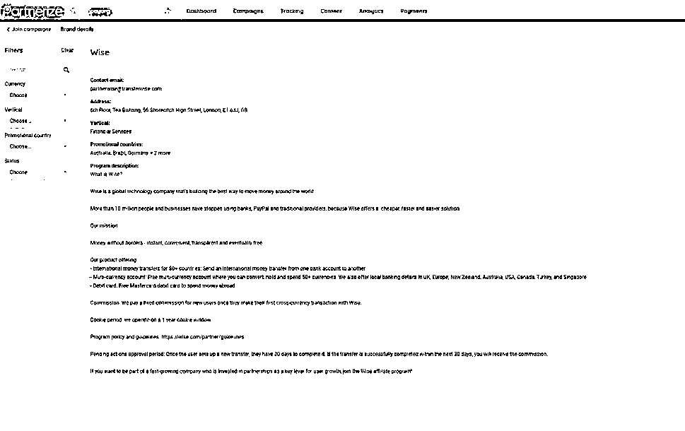
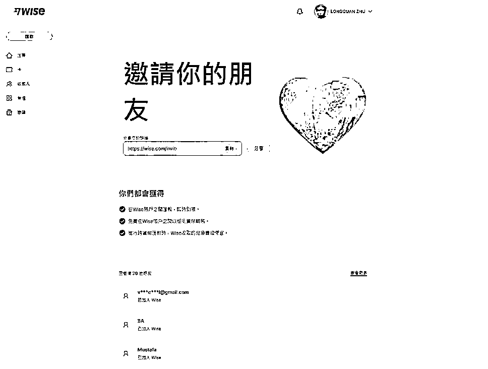
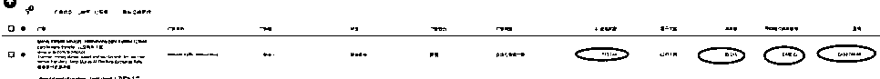
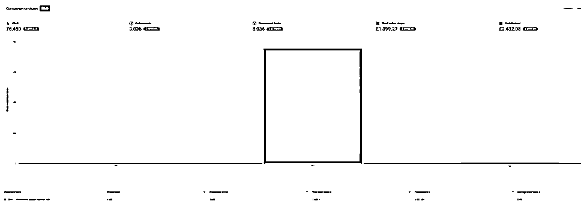
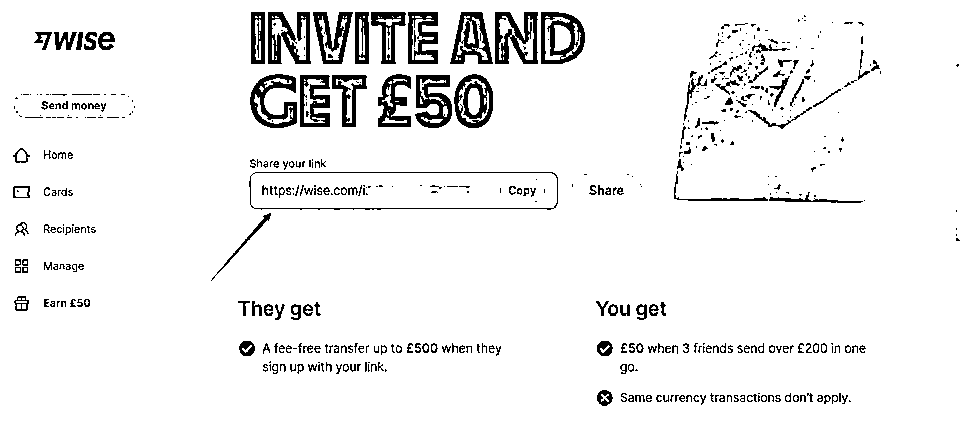
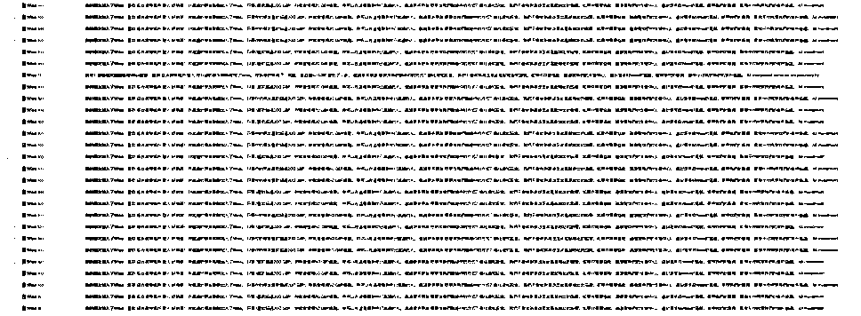
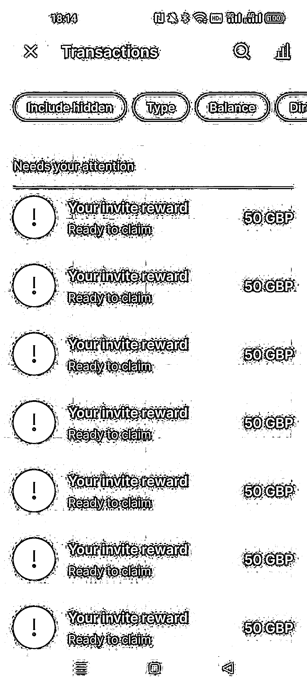

# Wise 推荐项目：单人日入万镑

大家好，我是静水流深，英文工具站教练组的一员。之前答应亦仁要多写点优质出海内容，这次也感谢生财有术又给了我一个分享机会。

前一篇《分享 3 个单人就能做的海外赚钱案例》收到不少好评，真心谢谢大家。之后我又放出一个新项目，同样是单干就能跑，月入万刀基本跑不掉。但还是有不少人存疑，所以今天就拿一个我正在跑的项目，把细节摊开讲。

这个项目一年前我在星球“丝绸之路”里就提醒过会员可以做，只是没人像我一样把规模玩到这么大。

之前 chatGPT 正火时，我写过一篇关于国内合法合规使用 chatGPT 的文章，可惜因为太敏感被删了。正好那篇文章解释了 Wise 是什么——你可以把 Wise 理解成支付宝的海外版。它同时也在广告联盟里当广告主，推广有佣金；自带邀请项目，照样给佣金。

先看广告联盟里的 Wise：

个人用户推荐可以获得 50 英镑佣金：

于是我直接套用 Mediabuy 的思路，在 Google 或 Bing 上买相关关键词，赚取中间的利差。广告成本有多低？

一开始出价 0.01 就行，后来为了放量才提到 0.02。这点广告支出在这个项目里完全不是决定因素，几乎可以忽略不计。

我在广告联盟测试时，一天的数据是这样：

有人担心这种投放涉嫌违规，广告主可能拒付。我倒不怕这个，更在意的是账期太长，而且推荐佣金反而更香：

于是每天点开邮箱，看到的都是这类邮件：

Wise 的靠谱程度不用多说，我每天点 50 英镑的提现点到手累。系统只要集齐三个合格用户，马上就会显示可提现 50 英镑：

至于能不能一天做到一万英镑？把每天的广告费、点击次数拉出来算一下就明白了。这些都是品牌相关词，转化率注定低不了。我基本只是上去看一遍报表收工，剩下全是谷歌在帮我干活。

能写的都写完了。对海外赚钱感兴趣的朋友，不用私信我，直接评论区留言，或者去我星球看相关内容。愿意认真深耕一年，通常比上班强不少。这个案例其实很多人知道，但敢像我这样玩的很少——这就是认知差距：你能预判结果，而结果也已经按预判发生。