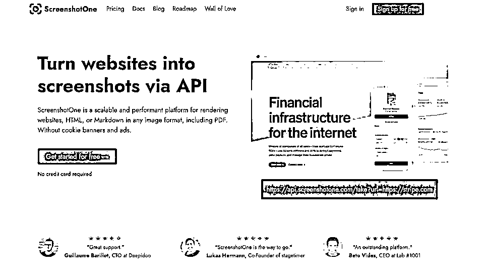

# (77 赞)个人开发者的成功案例：一个函数的产品带来稳定收入

一个函数，月入1.8万

有人把极简产品做成了可持续的生意，ScreenshotOne 就是值得个人开发者拆解的样本。它的能力一句话说完：传入网址，接口返回该页面的截图。看似不起眼，但在自动化运营等场景里，这类能力确实有真实需求。

这位开发者公开了经营数据：每月经常性收入（MRR）2500 美元，折合约 1.8 万元人民币。作为自由职业收入，这个水平已经站得住，后续也还有继续上涨的可能。

他还在推进别的小工具，共同点是“只做一个函数”。一个人用一个周末就足以完成。譬如用 API 从任意网站抓取结构化数据。多数需要权限校验的网站，这类函数大概率拿不到数据——但这并不妨碍尝试。发布后市场若证明需求太少，停掉即可，转身去做下一个单函数产品。

关注海外市场的朋友，不妨多翻翻他的博客和 Twitter。他很有 build in public 的味道，把产品从想法到上线的过程公开出来。有一篇文章就完整记录了 Product Hunt 发布经过，结果还得到了头号竞争对手的声援。不得不说，海外社区的氛围确实让人羡慕。

评论区里，伟业的提炼很到位：细分再细分，越细分越容易变现。自媒体起号也一样，比如做小红书，先别贪大讲“怎么起号”，只聚焦“怎么引流”反而更容易切进去。大而全拼不过前人，找细分缝隙才有机会；张 sir 只教投抖加，就是现成例子。亦仁回复“中标，术值+1”。在专栏中点 #中标，可以查看全部中标风向标。张小吉连发表情，周彦充则留下“不明觉厉”。

生财朋友圈：https://geturldata.com/ https://dmytrokrasun.com/posts/the-product-hunt-launch-for-screenshotone/

