# 2023.11 旅游获客起盘：📕从0到1变现手册

整理自飞书公开手册  
版本日期：2023.11.12  
检索建议：用浏览器页内查找功能输入关键词，可快速跳到对应段落。

开篇说明

💡欢迎翻到这本「旅游引流实战手册」。后面我们还会反复碰面。

正式动手前，先把两件事想明白：

1）这个项目到底做什么？现在进场还有没有窗口？

简单说，就是帮线下旅行社在线上找客源。你从内容平台把有意向的游客引出来，可以转交给合作旅行社，也可以自己跟进成交。转交模式分佣少一些，自己成交拿得更多。

看行业：出行限制解除后，旅游需求集中回补。2023 年上半年，国内旅游收入达到 2.3 万亿元，同比增幅 95.9%。市场往上走的时候，新玩家更容易找到切入点。

看平台：QuestMobile 2020 年数据里，📕平均带货转化率是 21.4%；同一口径下，抖音 8.1%、快手 2.7%、🧣 9.1%。另外，63.7% 的用户会参考📕做旅游决策，它也是影响出行选择的关键平台之一；短图文接受度高，普通人上手门槛不算高，变现空间也不小。

2）哪些人适合下场？

如果你想找一个能长期经营的副业，或者想在旅游需求释放期占个位置，“内容平台+旅游”值得试。

⚠️但有个前提：平台对站外导流的审查越来越细，新手不熟悉规则时，容易踩违规线，严重时账号会被封。比较稳妥的做法是至少准备 2 个账号，一个出状况，另一个还能接着跑。

也希望大家除了拿到结果，还能遇到一批同路人。

以下内容由龙哥盟联合圈友制作，仅供航海船员及龙哥盟星球圈友学习。实践中有反馈，欢迎一起完善；可联系鱼丸（yuwan387）提修改建议。

【使用说明】这本手册怎么读

开始之前，先花几分钟了解手册的用法，方便你按自己的节奏安排。

整体内容按“从 0 到 1 跑完一个旅游引流项目”的顺序展开。你可以顺着航线图一步步做，也可以只挑自己需要的部分看。

要提醒的是：这次改版幅度不小。过去版本尽量铺开更多玩法，让大家自由挑；现在分成【必修】和【选修】两块：

必修篇：把从 0 到 1 跑出最小可行闭环的步骤讲全，也就是航线图对应的行动路径。如果你还在摸索期，想先完整走一遍流程，建议从必修篇开始读和做，不要在玩法选择上反复纠结。

选修篇：放更多玩法、案例和项目放大思路。如果你已经跑出最小闭环，想继续找灵感、看更多可能，这部分别跳过。

📌如果你还没接触过这个方向：正式动手前，先看项目全貌👇

✅【项目概述】旅游赛道的窗口与操作思路

📌如果你已经对项目有整体印象：从航线图第一阶段开始，也就是手册第二章，按顺序把整个项目走完👇

✅【项目实操 1/3】谈下旅行社合作

✅【项目实操 2/3】做出能引流的内容，把客户批量引到🛰️

✅【项目实操 3/3】在🛰️里完成成交

✅【复盘优化】反复迭代内容，让爆款数量增加

📌如果你已经跑出最小闭环，想放大项目：重点看下面这些章节👇

✅【项目放大】3 种放大项目的方法

✅【项目拓展】更多变现方式

本航海项目的【航线图】如下：

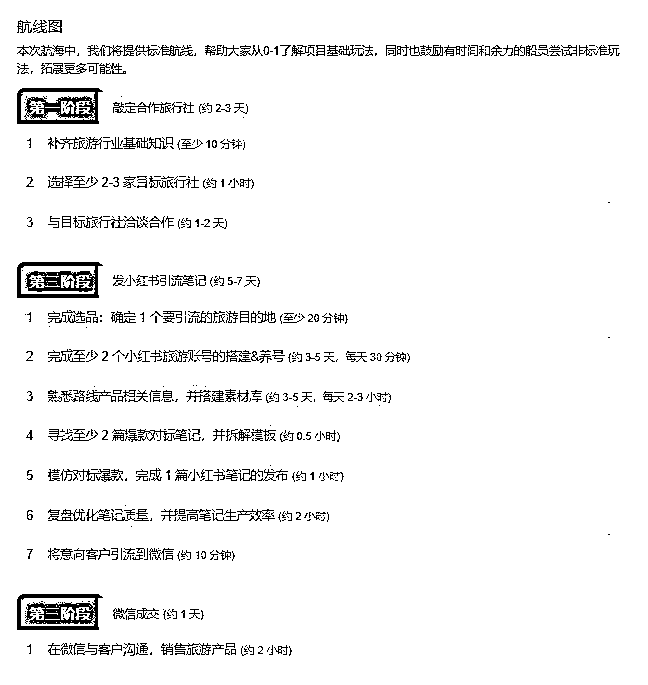

航线图和手册是强关联的。你在哪个环节，就去看对应步骤。

第一、第二阶段建议在航海前两周内完成。之后把重心放到复盘、优化和提效上，多产出优质内容，提高引流和成交概率。

# 必修篇：先完成最小可行闭环

💡必修篇概要

必修篇讲两件事：这个项目的基本情况，以及基础操作步骤。目的是让你先看清全貌，再按步骤完成 0-1，跑出最小可行闭环。

如果你是这个项目的新手，正式动手前建议先看项目全貌：✅【项目概述】旅游赛道的窗口与操作思路。

如果你已经对项目有大致了解，就按核心步骤开始学：

✅【项目实操 1/3】谈下旅行社合作

✅【项目实操 2/3】做出能引流的内容，把客户批量引到🛰️

✅【项目实操 3/3】在🛰️里完成成交

✅【复盘优化】反复迭代内容，让爆款数量增加

必修篇的顺序和航线图是对应的。按手册顺序学，就能一项项完成航线图里的任务。

后面每个关键步骤的章节概要，也会提到对应航线图，提醒你该完成哪一步。

下面正式开始。

# 一、【项目概览】旅游赛道的窗口与操作思路

## 1.1 这个赛道的红利有多厚？

### 1.1.1 市场恢复情况与普通人的切入点

#### 1.1.1.1 旅游市场恢复情况

出行限制解除后，积压的出游需求快速释放，热门景区人流密集，酒店和民宿预订也明显紧张。

从数据看，上半年国内旅游总人次 23.84 亿，同比增加 63.9%；国内旅游收入 2.3 万亿元，同比增加 95.9%。人次和收入两项指标都回升明显，市场恢复势头比较明确。

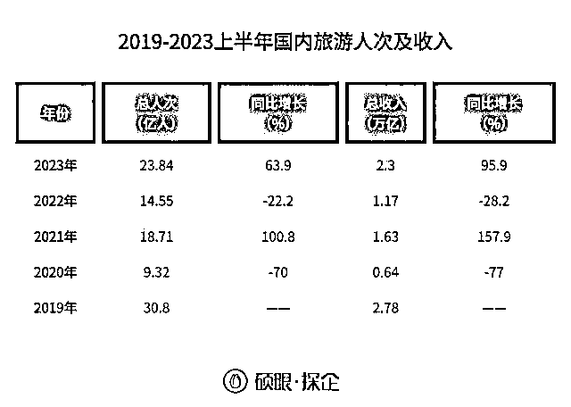

#### 1.1.1.2 普通人怎么切进去

市场往上走，说明需求旺；政策端对旅游也有支持。普通人想从中找到机会，关键是选自己能上手的那一段。

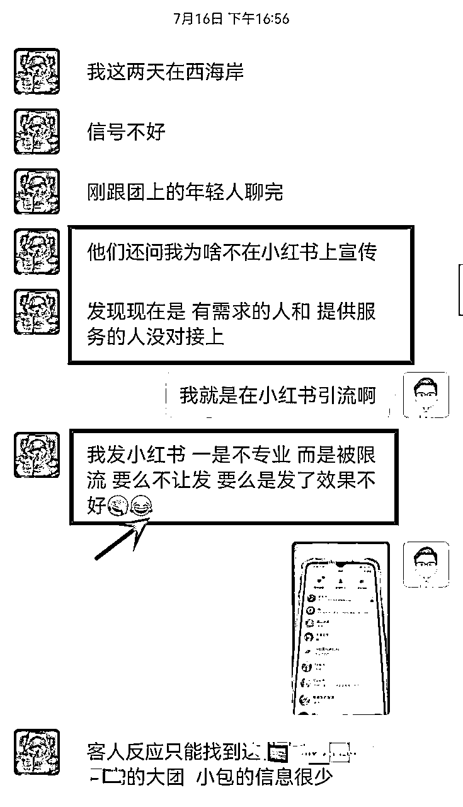

聊天记录里能看出一个共性，也是我和不少旅游从业者聊完后得到的判断：很多导游和旅行社知道线上重要，却缺人手、缺方法，做不起来。

我之前教过一个做旅游的朋友做内容。她每天要联系车辆和导游、处理游客问题，手机一直响，根本抽不出整块时间，没多久就停了。

这就是空档：帮那些没精力、没方法做线上获客的旅行社做引流。

还有一个原因：大量客源被携程、途牛这类平台握着，佣金比例不低。旅行社有点像平台上的商家，不合作没单，合作利润又被压薄，忙一圈钱大头被渠道拿走，处境很被动。

谁能把客源带进来，谁就有谈判价值，旅行社自然愿意聊。

### 1.1.2 为什么优先选📕？

既然要做旅行社的线上获客，渠道选择很关键。为什么先看📕？

#### 1.1.2.1 平台数据表现

📕的用户体量不是最大的，但转化表现很突出。

QuestMobile 2020 年统计显示：📕平均带货转化率 21.4%；抖音 8.1%、快手 2.7%、🧣 9.1%。

2020 年，📕已经是影响旅游出行决策的头部平台，63.7% 的用户会参考它做旅游决策。

不少人的路径是：先在别的平台初步看产品，再带着疑问到📕看细节，确认服务后下单，体验完又回到平台发种草或吐槽。

另外，82.2% 的用户更愿意看短图文来做旅游决策，这正是📕的强项。

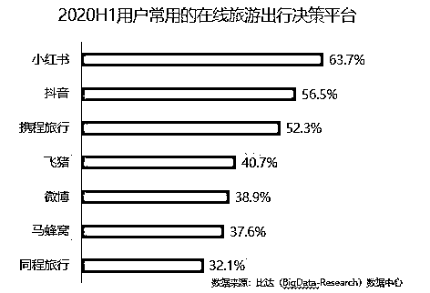

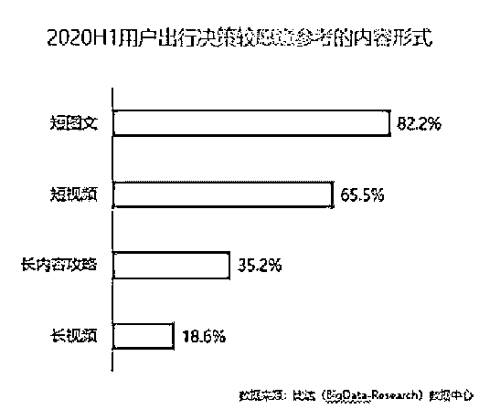

这几年平台持续加码旅游内容，加上种草氛围强，📕在旅游线上渠道里一直占着重要位置。2022 年，它还成立了旅游公司，进一步加大旅游业务布局。

#### 1.1.2.2 实操反馈

我们起号阶段，第一条内容发出去曝光只有两位数，结果却成交了一单，团队都很意外。朋友感叹，这波机会比预想的大得多。

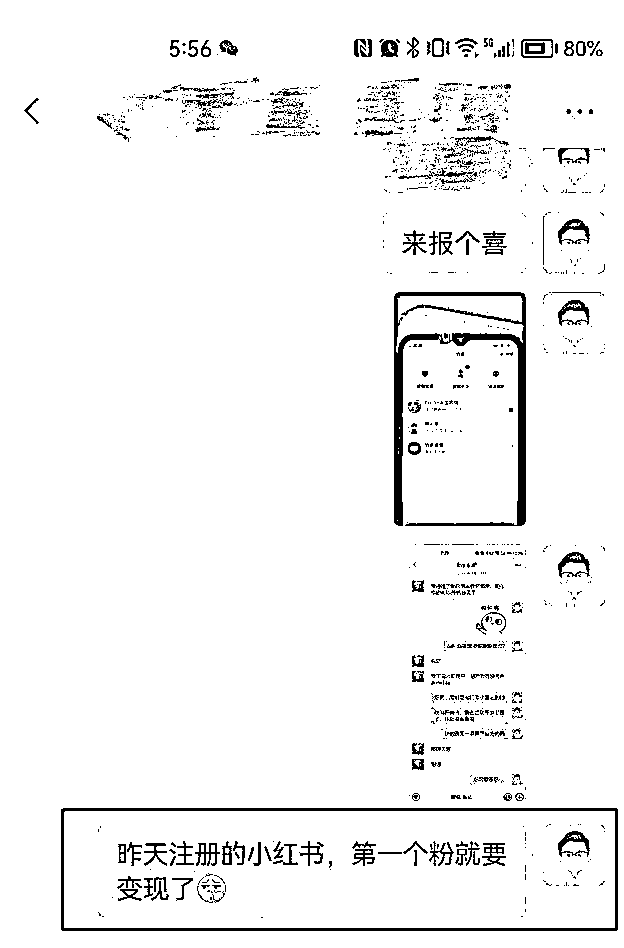

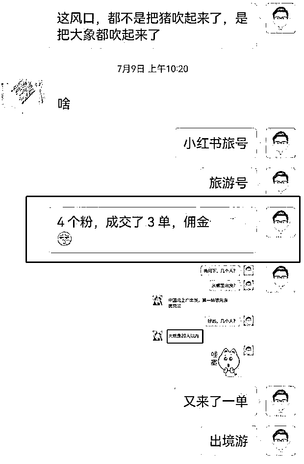

还看到有同行写文章提到：某次 20 人成团，其中 18 位客源来自📕报名。

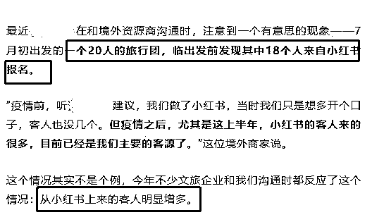

2023 年，📕确实是触达旅游用户决策的重要入口。

## 1.2 这个项目怎么落地？

### 1.2.1 第一步：先谈下旅行社合作

为什么先把旅行社定下来？

新手的长处通常在平台引流；路线怎么选、内容图片素材怎么准备、🛰️里怎么成交，这些需要后端支持。所以第一步是先确定至少 1 家合作旅行社。

旅行社在项目里怎么配合？

1. 选品：按季节推荐好卖的线路。寒暑假亲子游是热门，可以让旅行社挑几条当季产品。

2. 内容：提供线路介绍文案、景点高清图等素材。

3. 成交：客户加到🛰️后帮忙答疑。遇到答不上来的问题就请教工作人员；如果是跟团游，把培训资料看熟，约九成问题能自己处理，剩下再求助，效率更高。

4. 交付与返佣：客户付款后，后续交付由旅行社完成。旅游是面对面服务，变数多，只有顺利交付，佣金才稳。一般客人出发当天返佣。

行业水比较深，旅行社不靠谱会带来投诉和佣金结算风险：能不能足额给、能不能及时给，都要提前考虑。抖音创作者“superB太”的云南跟团系列视频里，就展示了连环坑，游客很难防。

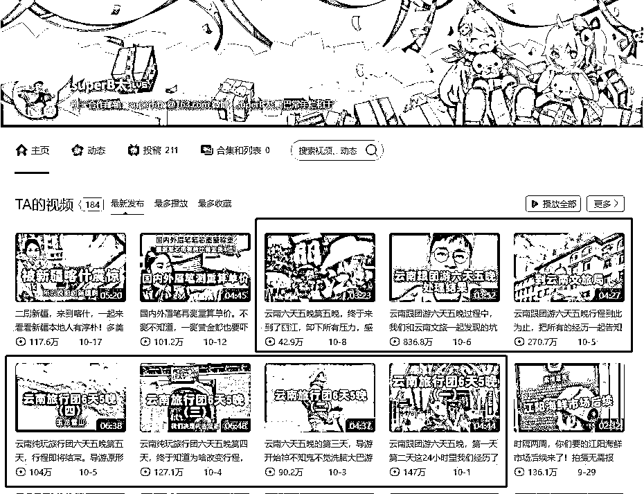

所以，选一家有保障的旅行社很关键。这次航海筛选了几家合作方，新手可以优先选；想自己找，后面实操章节会讲方法。

### 1.2.2 第二步：批量引流到🛰️

引流是整个项目的核心。流量是 1，其他都是后面的 0，这一步也最耗时间。航海期间，大半精力要放在内容引流上。

📕的内容有什么不同？

它主要做以 IP 为核心的图文软种草，因此有三点要注意：

1. 人设更重要。平台重人设，博主更像“可信任的陌生人”。用户会看你的主页和内容，判断你真实、可靠或专业，才愿意进一步连接和交易。

2. 内容更真实全面。账号由人设五件套（名字、头像、简介、背景图、个人资料）和内容组成；单篇内容建立连接，主页其他内容补全立体人设，信息更完整。硬广容易被限流，也不讨用户喜欢，所以内容要真实、接地气。

3. 图文为主。平台虽然在扶持视频，但阅读习惯仍偏图文；图文制作门槛低于视频，很多创作者会优先做图文。

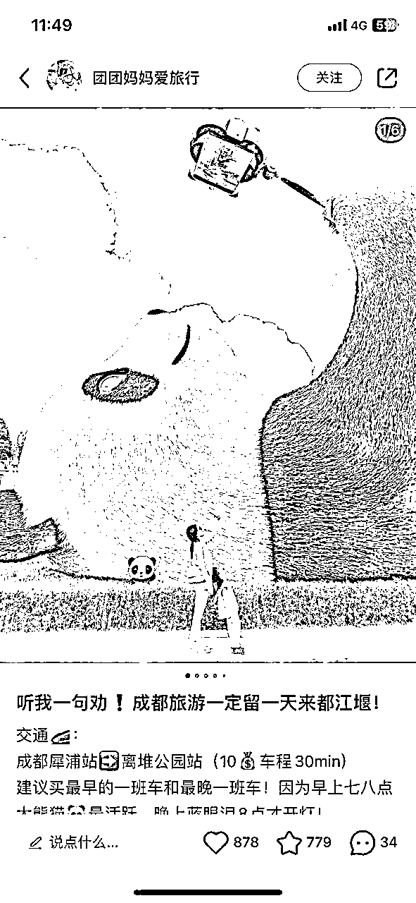

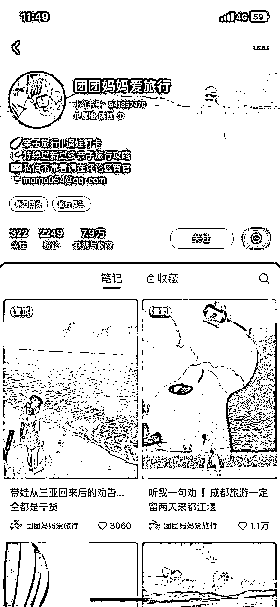

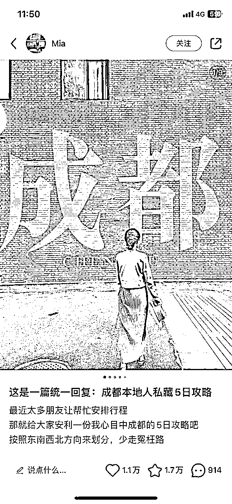

写内容时要瞄准目标人群、围绕关键词，才更容易出爆款。有流量后要埋钩子，这决定多少意向客户会来咨询；再把咨询者引到🛰️私域完成成交。

注意：平台对引流审核更严，但办法总比困难多；除了看实操部分，也可以在群里多交流。

### 1.2.3 第三步：在🛰️里成交变现

用户到🛰️后，就进入成交环节。两个关键动作：

1. 了解客户信息，推荐线路产品。及时打招呼，问清出行日期、人数、天数等，再匹配线路。

2. 及时答疑，引导成交。客户看完介绍会有问题，快速回应是成交关键。

注意：引流和🛰️成交最大的风险是封号。哪些情况容易封、怎么规避，实操环节会具体讲。

参考案例：零基础旅游博主首周成交 6.2 万元的经验帖。

# 二、【项目实操 1/3】谈下旅行社合作

💡章节概要

旅游引流项目离不开旅行社支持。找到一个优质稳定的后端，成交概率更高，也利于后续放大。

本章讲怎么洽谈，找到 1 家靠谱后端：

✅联系前掌握基础行业知识，方便对话；

✅联系旅行社不难，找到好后端要层层沟通筛选。

为降低试错成本，这次航海赚钱会提供一批相对有保障的旅行社供选择，帮助大家尽快开展并跑完最小可行闭环。如果你自己有资源，也可以参考本章去谈。

需要航海提供旅行社的，请先读完【章节 3.1】里的选品方法，再到该章末尾报名；航海群也会发布链接并提醒。

💡本章航线图

完成本章学习和实操，就能完成航线图第一阶段：谈下合作旅行社（约 2-3 天）

1. 补齐旅游行业基础知识（至少 10 分钟）

2. 选择至少 2-3 家目标旅行社（约 1 小时）

3. 与目标旅行社洽谈合作（约 1-2 天）

现在开始准备。

## 2.1 了解旅游行业基础知识

找旅行社之前，先掌握行业术语和基础认知；否则沟通起来很费劲，甚至没人愿意接话，更别说合作。

新手先了解 2 个概念：

1. 旅游行业基本供应链关系

2. 旅游行业主要产品类型

### 2.1.1 旅游行业基本供应链关系

我们做内容引流，主要接触旅行社。旅行社分为组团社和地接社。

#### 2.1.1.1 组团社

组团社是客户报名时签合同的一方，签完后把团交给别的旅行社执行。

比如你在杭州 A 社报了一个西安团，到西安接你的司机、导游和车来自西安 B 社；杭州 A 就是组团社，西安 B 是地接社。

#### 2.1.1.2 地接社

地接社在旅游目的地，与当地酒店、景区、车队、餐厅、司机、导游等长期合作，能拿到优惠价；因为扎根当地，导游服务更专业，对游客人身和财物安全也更有保障。

地接社给出结算价，组团社加价卖出。做内容引流可以直接找地接社，少一层中间加价。

### 2.1.2 旅游行业主要产品类型

主要分 3 类：散客拼团、独立成团、私人定制。

#### 2.1.2.1 散客拼团

又叫散拼团、跟团游，是旅行社组织的常规旅游，在固定团期里系统游览某个目的地，比如“海南六日游”“厦门五日游”。

这种形式的特点是车、房、餐统一安排，不用自己操心；景点和日程有导游带着，能减少人生地不熟带来的麻烦。

## 散拼团：低预算试水，首单更易破零

散拼线路在做市场推广时，往往倾向选择认知度高、客流大的热门目的地。游客能去的地方会受线路安排限制，整体节奏偏快，常常是匆匆打卡，沿途细节很难慢慢品味。不过在预算层面，它通常是各类出游形式里花费最低的一种。

这类线路咨询基数大、下单链路短，对刚入行的人相当友好。因此本期航海把散拼作为切入点，带大家争取尽快完成首笔成交。

#### 2.1.2.2 独立成团：熟人组队，按需排行程

包团游通常指20人以上团体单独出行，不和陌生客源混拼，成员彼此熟识。旅行社会围绕客户诉求和费用上限设计方案，出行、住宿、餐饮都能按需调整。

企业团建、研学、考察、会务等场景都适用，客户不必被当地细节牵绊，接待方会给出更合逻辑的安排。

合作路径取决于组团社能力：有的直接对接目的地接待方，有的整团转给资源供应商。包团客户同样受预算约束，产品升级空间有限，于是性价比更高的资源方更容易被组团社选中。

若咨询团队人数偏多、费用空间又比散拼稍宽，旅行社会倾向推荐包团。

#### 2.1.2.3 私人定制：小包团，体验优先

小包团面向亲友小圈子或兴趣一致的客人，由旅行社按需设计。规模灵活，但为了体验和资源供给，通常十人上下最合适，上限二十人；超出就建议拆成多批。

方案更看重好友相聚的松弛感和自由空间，主题可围绕自然、都市、山水、极限挑战、野外扎营、别墅放松等展开。餐饮住宿也强调特色，资源允许时优先本地有辨识度的社会餐厅；方案中要写明酒店和餐厅名称、房型、菜单。

设计时还要结合客人偏好、档期和预算，让行程更有记忆点。行业里有人把“安排当地最奢华的食宿”当成定制，我不认同这种理解。

定制产品方面，组团社会多路径筛选供应方或接待方，甚至在目的地直采资源；为打磨方案会反复修改或提前踩线，目标就是提升客户体验。此类客户通常被组团社视为重点对象。

## 2.2 挑旅行社：跟着淡旺季走

选合作方要结合旅游季节节奏：先锁定当下走俏的目的地，再匹配相应旅行社。

以西安为例，4月至10月是旺季，其余月份客流明显下滑；据西安国旅数据，淡季客流仅为旺季的六分之一到九分之一。冬季则东北和三亚更热，于是可以把东北或三亚放在冬天，西安放在其他时段。

淡旺季既可按自然季节分，也可按节假日分。

自然季节上，5月至10月（夏秋）通常更旺，11月至次年4月（冬春）相对淡。但国内地域跨度大，各地旺季并不同步：东北雪乡、海南三亚的旺季恰在冬季。若把境外算进来，北半球与我国大体同步，南半球如澳大利亚、新西兰则相反——我国冬季对应他们的夏季，所以澳新旺季是10月至次年4月，淡季是4月至10月。

节假日方面，元旦、春节、五一、十一黄金周及小长假，加上寒假（1—2月）、暑假（7—8月），都属于旺季。

## 2.3 旅行社资源从哪里找？国内、国外两条线

合作资源分国内社和国外社。

刚入局建议先用国内社练手，难度低；若后续能对接靠谱的海外社，再尝试。

### 2.3.1 国内社怎么找

新疆、云南、西安、贵州、北京、呼伦贝尔、东北等传统热点，客流都很旺。

先问亲友，大概率能挖出做旅游的人；若没有，直接去目标城市的旅行社拜访老板谈合作——对方不花底薪就能多一个网络销售，通常愿意聊。

也可以在龙哥盟星球发帖，找做旅游的圈友。

### 2.3.2 国外社怎么找

问亲友中谁在海外留学或工作，多打听，请对方推当地华人旅行社🛰️。

跨国合作尤其看口碑，服务质量要有保障，最好让朋友多侧面了解。

## 2.4 合作模式怎么选：引流还是同行

佣金合作分两类：引流合作、同行合作。

### 2.4.1 引流合作

你在📕加到客户后，把旅行社人员拉进群，由对方在群里完成成交，你只盯结果。

成单有佣金，没成单为零。

比例偏低，常见5%。

市面上还有旅行社找大学生、宝妈批量做号，一篇笔记10元、一个🛰️5元，甚至不给佣金。

### 2.4.2 同行合作

你需要掌握产品知识，能独立答疑，从发笔记到收款基本一人完成，佣金比例更高，通常15%—20%。

最简单的切入是跟团游，也是本期推荐玩法。

跟团线路吃住行固定，你只需熟悉几条线，旅行社半天培训就能让你接待咨询。

定制游难度更高，本期新手先不推；它要求对目的地酒店、景点、餐馆、行程都熟，需要有人带。勤快的话，最快1个月、最慢3个月可独立操作。

更省事的办法是去旅行社上几个月班，边拿工资边学；业余学就找业内人一对一。

定制游本质类似做攻略，门槛不算高，但要经历学习期。

选同行模式时，建议先聚焦1个目的地，深挖更容易出单，别同时铺多个目的地。

## 2.5 洽谈要问清：佣金、支持、结算

### 2.5.1 产品佣金怎么算？

各产品佣金不同，整体在3%—20%，散拼大约8%—10%。

别误以为售价越高佣金越高。

新景点或自费项目（如演出）在推广期返佣更高，含这类内容的产品佣金也会高；反之，兵马俑、华清池、长恨歌等成熟知名项目佣金很低甚至为零。

定制游没有固定售价，可按销售额比例算；散拼有固定售价，通常会写明具体佣金金额。

### 2.5.2 后端支持有哪些？

主要包括高清产品图、产品培训。

跟团游要问能否安排一位工作人员做日常答疑；定制游要问能否配人手把手带。

### 2.5.3 结算时间和打款方式

#### 2.5.3.1 结算时间

多数按月结；也有单笔结，客人出发当天账清。

#### 2.5.3.2 打款方式

常见🛰️转账：

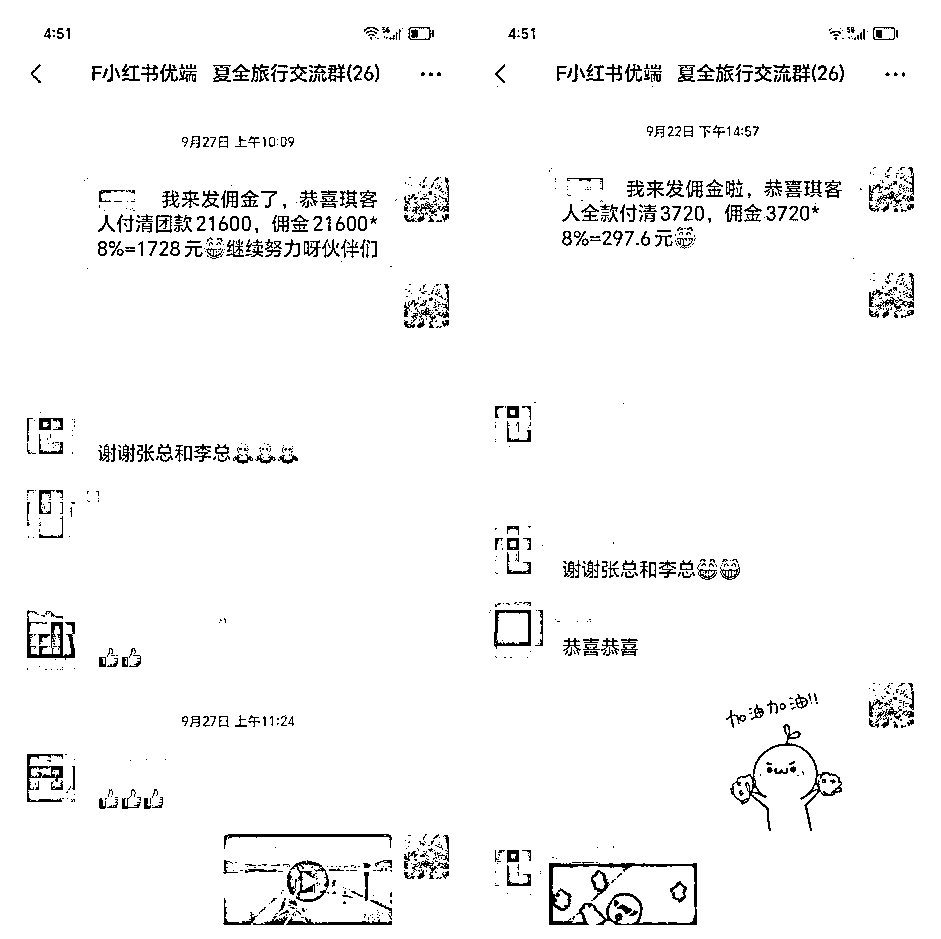

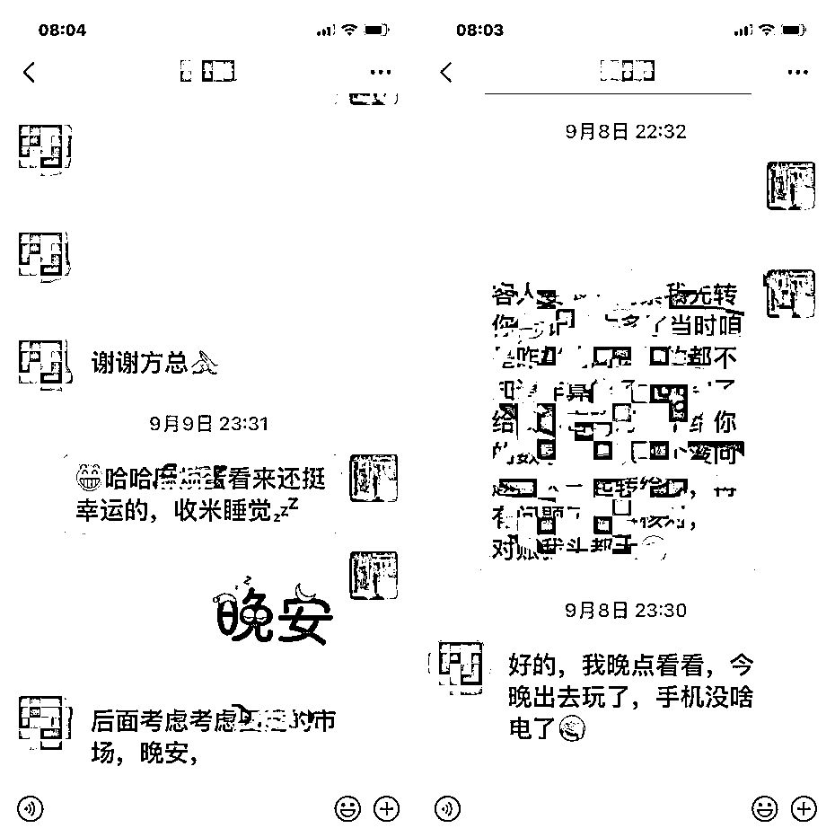

## 2.6 避坑核对表

### 2.6.1 先验旅行社资质

合作前查资质，有证即可放心。

第一步：打开国家文旅部官方查询网址：https://mr.mct.gov.cn/

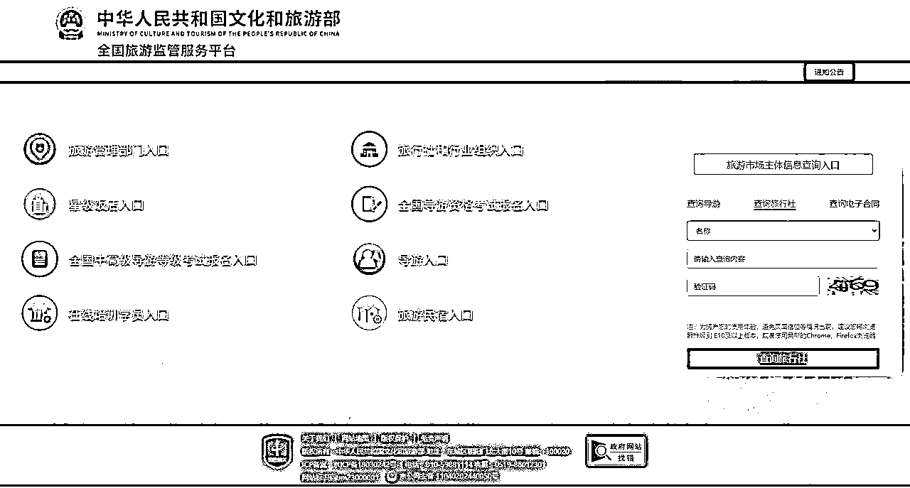

第二步：进入旅游市场主体信息查询入口，找到“查询旅行社”，用名称、经营许可证号、统一社会信用代码三者之一检索。

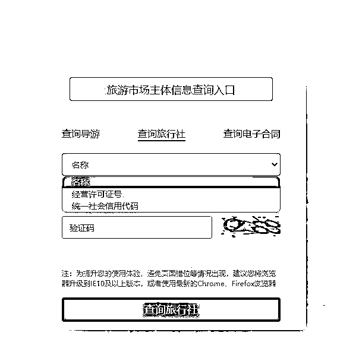

第三步：看结果，正规社一定有经营许可证。

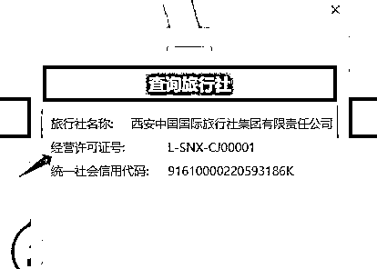

### 2.6.2 是否KB团、是否推自费？

重点看口碑。

KB（keepback，返点团）就是购物团，香港、云南是重灾区，新闻屡见。

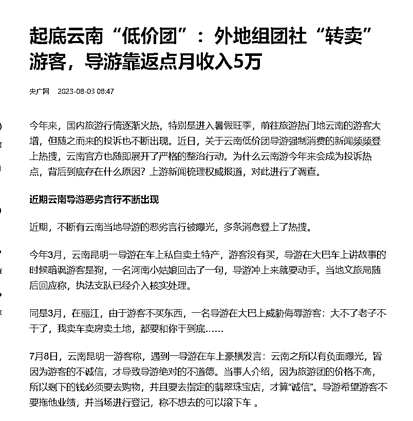

购物团名声差后手法更隐蔽：抖音直播里不少低价团打着“0购物纯玩”旗号。它们靠“加点”赚钱——导游途中推自费，最后自费总额远超团费，回扣可观。

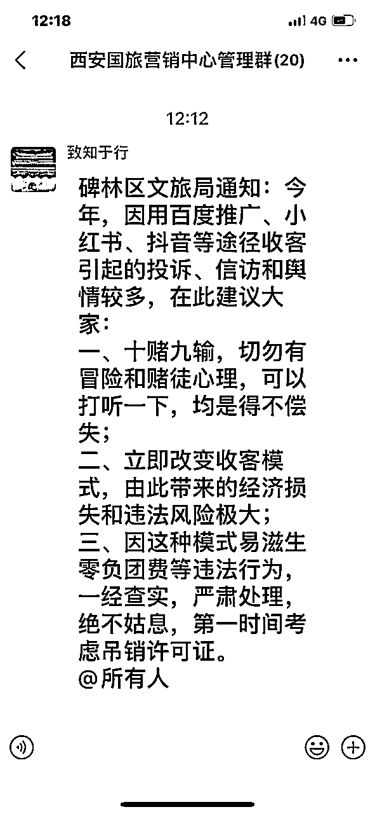

做不做这类团，自己判断。

### 2.6.3 佣金能否按时结？

旅行社间拖欠普遍，甚至不拖欠就难运转，这种习惯可能传导到你的佣金。

注意，客人款项进入旅行社账户，不会进你私人账户，一旦拖欠，你制约手段有限。

避免办法有两个：一是选口碑好的社；二是合作前约定单笔结算，这单没结清，下一单先不给。

### 2.6.4 后续服务是否靠谱？

先确保产品为0购物纯玩，部分导游为业绩搞强制购物，最伤体验也最砸口碑。

其次，游玩、住宿、团餐质量要与行程单宣传一致，提前聊透。

最后，投诉和不满要快速处理，否则客人去📕发负面，影响很大。

我们操作中的客人，无论跟团还是定制，我基本隔两天回访一次，有问题直接找旅行社老板处理。

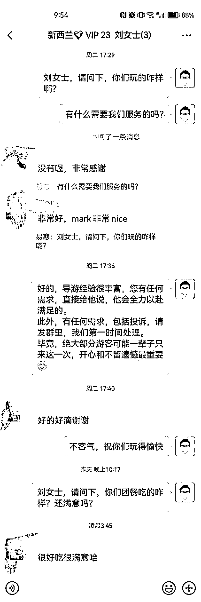

# 三、【项目实操 2/3】做出📕爆款笔记，把客户批量导进🛰️

💡 章节概要

这一章是项目核心，也最耗时间。掌握笔记流程后，要持续复盘、多发笔记，提升爆款数量。

本章学习：选品（目的地）—账号搭建与定位—发布笔记—引流到🛰️。

有📕经验能快速上手；纯新手按步骤也能发出第一篇。

正式做笔记前先完成选品；航海已筛出3个热门产品及合作旅行社，读完3.1再报名。

💡 本章航线图

完成学习和实操，即完成第二阶段“发📕引流笔记”（约5—7天）。

1. 选品：确定1个引流目的地（至少20分钟）

2. 搭建并养至少2个📕旅游号（约3—5天，每天30分钟）

3. 熟悉线路产品并建素材库（约3—5天，每天2—3小时）

4. 找至少2篇爆款对标并拆模板（约0.5小时）

5. 模仿爆款发布1篇笔记（约1小时）

6. 把意向客户引到🛰️（约10分钟）

现在开始执行。

## 3.1 先定引流目的地（选品）

### 3.1.1 为何先选目的地？

做带货先选品，旅游同理。先定目的地，才能围绕当地景点和产品设计笔记。可倒推：目标客群是谁；他们的需求和痛点是什么；对应哪些搜索词；前期要补哪些产品知识；账号定位是什么。

### 3.1.2 目的地怎么挑？

目的地会影响成交，也影响笔记呈现。看两个维度：

一是熟悉度。完全不熟就要多花时间补课，否则内容容易只有技巧没有真实感，表达偏硬，转化差。越熟，文字越可信，也更能传递情绪价值；客户提问时你能专业解答，甚至语音沟通，语音带来的信任通常强于文字。

二是竞争度。📕盘子有限，每个目的地的客群也有限；做的人多，抢客就难。航海给每个目的地设了报名人数建议，就是避免自己人内卷，分散后更多人能更快跑通0到1、赚到第一笔。

### 3.1.3 为何建议只做1个目的地？

新手精力有限，把一个目的地的产品学精已很费时间，再铺其他目的地容易贪多嚼不烂。也建议一个月内不换目的地，中途重学很耗时间。

📕账号讲究垂直，越垂直粉丝越精准，变现越快；新号什么都发，短期难建立信任。

为聚焦笔记能力提升，我们筛了3个目的地及对应旅行社，按需报名（报名链接：https://jinshuju.net/f/rSK5Ty）。

报名后可在下表下载产品资料学习：旅行社名单 & 产品资料（11月航海）。

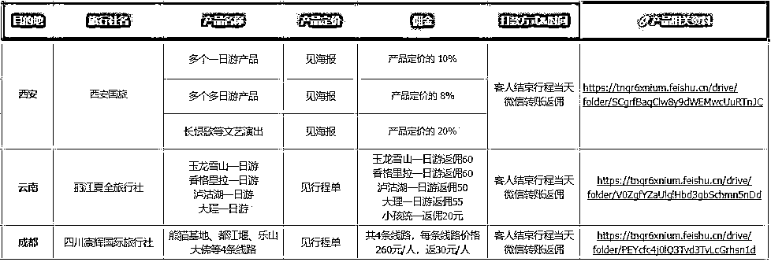

## 3.2 搭建并完善📕账号

### 3.2.1 至少准备2个账号

📕对站外导流审查趋严，旅游又是敏感赛道，不熟规则时容易违规甚至封号。因此至少注册2个号，其中一个作小号，辅助主号导流。

第一步：准备手机号

2个号需2个手机号；只有1个可借家人或线上办新卡。我目前用电信副卡：一张宽带主卡可申请2—3张副卡（取决于宽带等级），副卡与主卡流量共享，比较方便。

第二步：登录账号

能否一机登两号？若手机自带📕应用分身（部分安卓如红米），可以；若没有，别装分身神器，容易封号，需另备一台手机，闲鱼或拼多多三四百元的二手机够用。

第三步：个人实名认证

个人号可认证旅行博主。注意一个身份证只能认证一个号，认证后只有注销才能解绑。

一般主号认证，小号不认证。

路径：我—左上角三条杠—创作中心—创作服务更多服务—开通专业号—成为专业号—选择个人点击立刻申请—输入实名信息—选择“出行—旅行博主”。

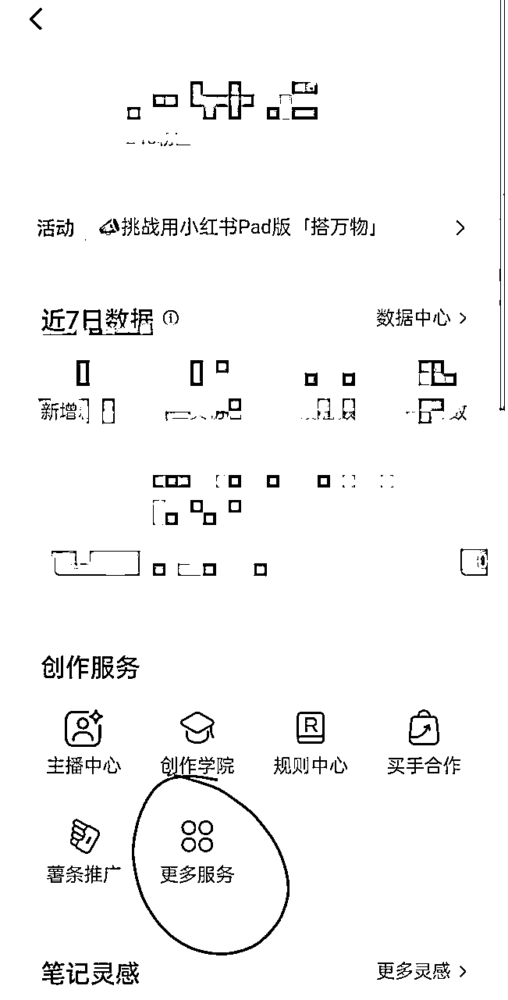

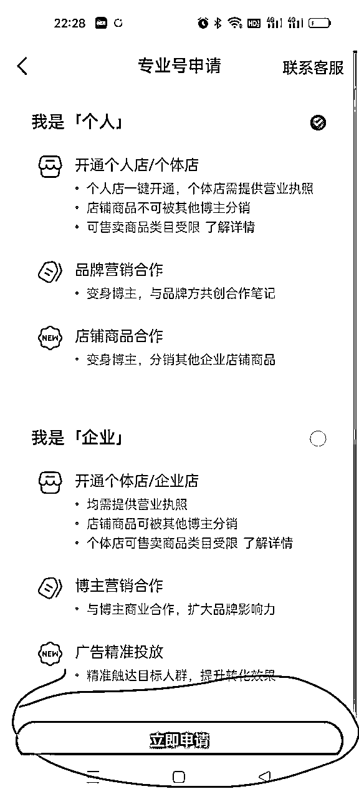

第四步：养号

新号每天至少半小时模拟正常用户，刷同领域笔记并关注、点赞、评论，持续3—5天。

### 3.2.2 账号定位与包装

#### 3.2.2.1 账号定位

账号前期，40%的精力应放在定位上，之后才是选题、内容和引流。

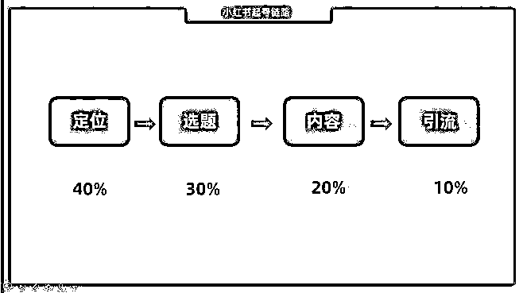
# 先锁人群，再谈增长

运营账号，底层逻辑可归为三点：收窄、对准、切细。

找方向，说到底是明确受众：作品拍给谁、想吸引哪一类人。比如青年旅行赛道，受众是18—28岁群体，人设就按他们偏好的风格来塑造，内容围绕能促使他们来问价、下单的方向做。

赛道切细后，人设与作品都要服务于这批人。以西安带娃游为例，后端具备成交能力，人设可做成“常带娃出门的妈妈”，内容就发家长愿意看、容易被打动的东西。

在平台内，不管选什么赛道，方向都要落到细分层，转化才会更准，变现也更稳。

#### 3.2.2.2 账号包装

把主页理解成店门口：客人还没进门，先看到招牌和陈列。装修不必复杂，关键是一致。比如主攻云南线，头像、名字、签名档就都围着一个“云南”来铺。

一个人点关注前，通常不只看单篇内容。对方会进主页，扫一眼名字、头像、签名、主页背景，再翻翻历史发布，最后才做决定。主页呈现因此很关键：它既影响被关注的概率，也在相当程度上影响对方愿不愿意为你的旅行产品付费。

站在运营者角度，资料填得越全，平台越容易识别账号属性。属性清楚，推荐来的用户就更贴合；人群贴合，点击和浏览数据会抬升，账号评分也会跟着走高。

下面按名字、头像、签名档、主页背景、整体布局逐项拆。

**名字**

名字是用户认识你的起点。对方第一眼往往靠它判断“你是谁、卖什么”。最容易踩的坑是过于含蓄或过于自我，别人看不出业务，甚至一头雾水。好名字还能靠关键词带来搜索入口。

几个能直接套的框架：

- 称呼+地区+身份：云南导游XX、西安定制师XX
- 称呼+地区：XX带你游云南、法国XX爱旅游
- 称呼+品类：XX爱旅游、XX的旅行日记、XX环游记
- 个性+称呼：不油腻露营大叔、大漂亮的遛娃日记

一句话，名字要让人一眼看出方向。还有：个人号要保留“人”的痕迹。别起成大品类名，如XX旅行、XX定制游、云南旅游、XX周边游；这类名字没有个人感，通常也只有企业号能申请。

**头像**

头像有两种常见做法：文字型、真人型。文字头像和名字打配合，用户扫一眼就明白业务；真人头像更容易建立近距离感与可信度。若做人设号，优先考虑真人出镜，也可用名字或地区元素替代。

风景照用的人不少。它虽和旅行相关，但画面里只有景、没有人、也没有地区提示，辨识度与记忆点都会偏弱，不建议作为首选。

**签名档**

会点开签名档的人，多半是从某篇内容跳进主页，想进一步了解你。这个位置很重要，常常直接影响关不关注。

一段合格的签名档，要讲清四件事：你是谁、做什么、为什么值得关注、能给TA什么。

示例：

1. 身份与业务：在新8年司导、私人订制行程、本地跟团、新西兰旅行服务团队
2. 专业背书：新西兰旅游协会TAANZ会员
3. 差异点：专注高品质纯玩、累计服务5000人+，包括陈道明、靳东等明星

排版建议：3—4行，短句为主，数字适量。

还要避开违规表述：可单独写私人订制、定制游，或专注XX旅游；但“提供私人订制服务”“专注私人订制旅行”等写法，我们实测容易触发违规。

**主页背景**

背景页可围绕产品、人设、场景来选：

1. 用文字说明你能提供哪些服务；
2. 放有辨识度的地标，主做哪条线就放哪里的景；
3. 放真人旅行照，注意画面美感，别堆得太满；
4. 放线下旅行社门头照；
5. 发些像朋友圈的生活、旅行打卡，尽量贴合你的赛道，用来缩短距离。

**整体布局**

每篇内容的首图要能体现你的风格。视觉尽量统一，颜色协调，别太花。首图可以优化，但不要频繁换风格。

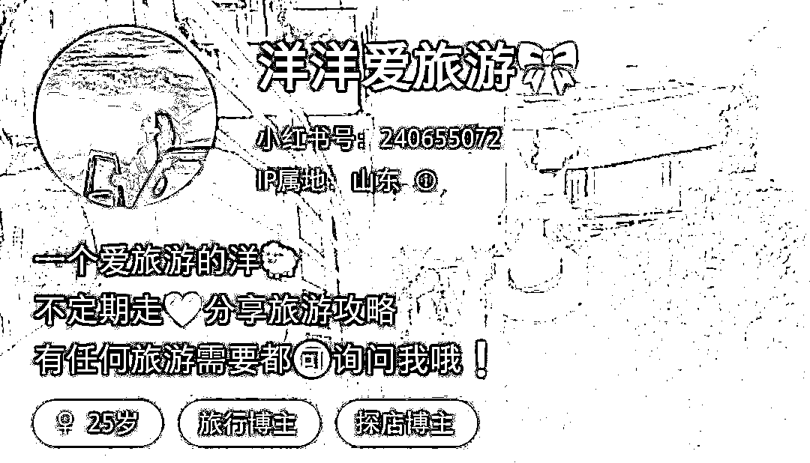

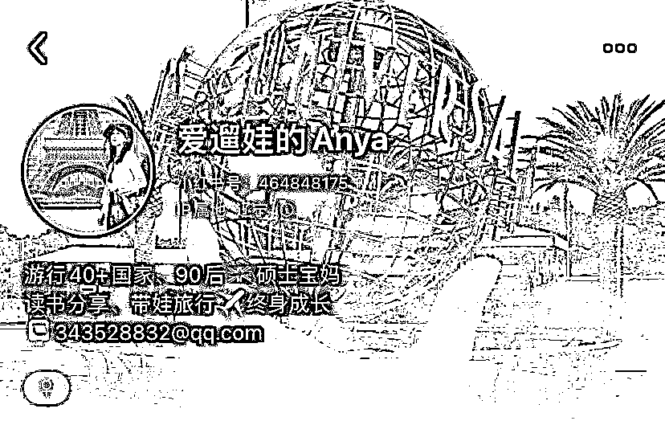

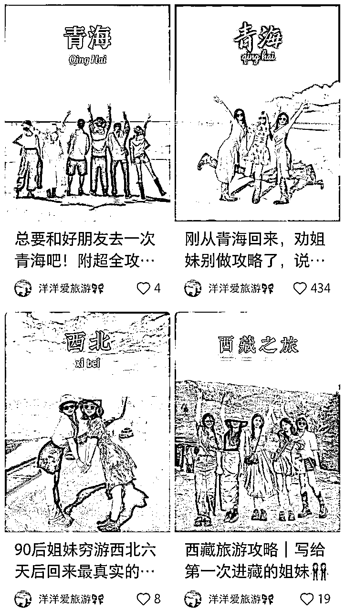

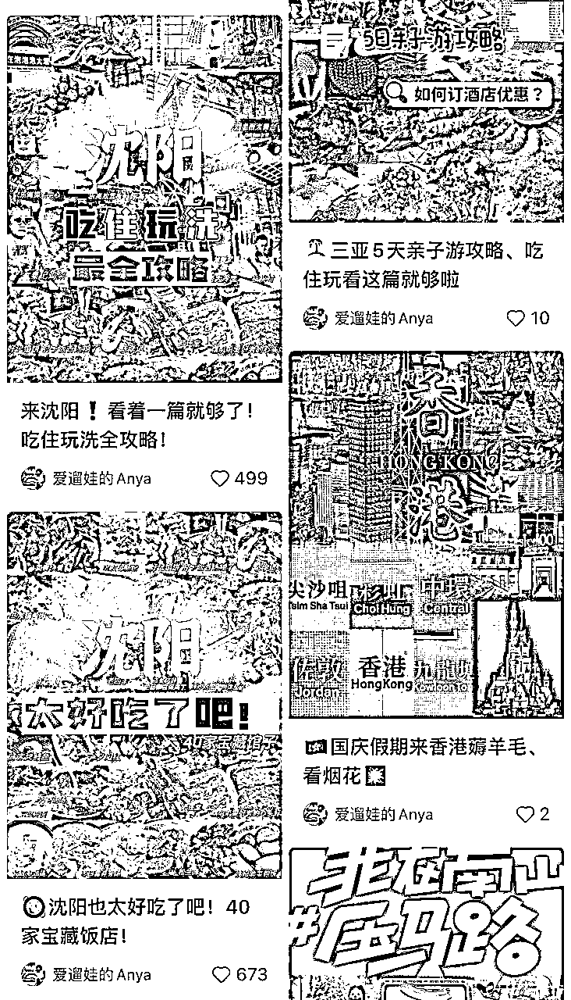

## 3.3 发布首篇平台引流笔记

💡 **本节任务**

这一节要带你走完第一篇笔记的上线流程，也是项目中的关键节点。核心任务如下：

✅ 熟悉所选线路产品的资料
✅ 学会搭建素材池，并持续补充
✅ 掌握旅游笔记从制作到发布的完整流程

想做到10分钟产出一篇，前期练习不能少。流程跑熟，出高互动内容就是自然结果。

### 3.3.1 先确定引流线路

目的地已经定下后，还要落到具体产品。一个目的地常有多条线路，所以动笔前先明确推哪一条。可以只写1条，也可以把多条打包成合集。

### 3.3.2 熟悉线路资料

写之前，先看旅行社提供的路线材料；需要更多信息，可去携程、途牛、百度等渠道补充。

散拼团要弄清这些：

1. 线路覆盖哪些景区？
2. 各景区卖点是什么？
3. 拼团发车时间？
4. 集合时刻？
5. 团队人数上限？
6. 报价多少？成人与儿童差异？
7. 是否留自由活动时间？
8. 是否配导游讲解？
9. 是否安排接送？

### 3.3.3 建立图片与景区文案资料池

旅游赛道做内容，资料池很关键。一篇笔记的基础材料，无非是景区介绍文字加配图。比如做西安散拼团，内容必然涉及线路里的景区、不同玩法，再配相应图片。

所以前期查资料时，就同步归档到文件里。后面写内容直接查、直接取用，不必每次重新搜索景区介绍和玩法，能省下大量时间。

**文字资料**

比如西安散拼团有华山一日游、兵马俑一日游，就分别建“华山一日游”“兵马俑一日游”文档，把景区信息收进去。像华山介绍、华山玩法、西上北下与北上西下的区别，都提前整理好，后续写内容直接调用。

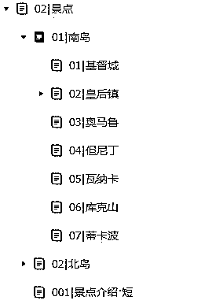

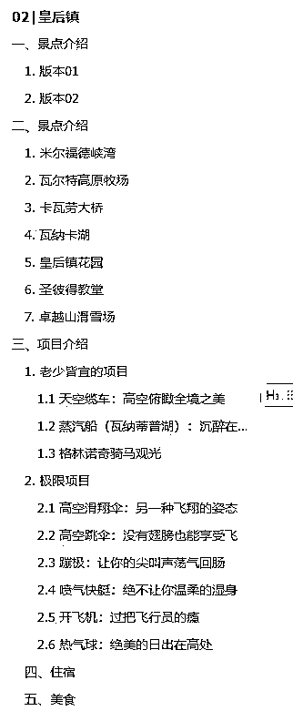

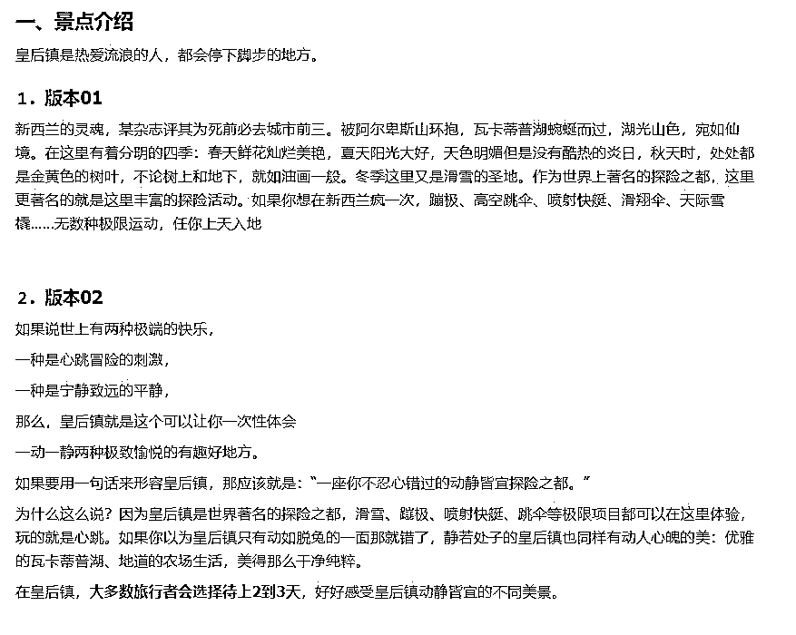

**图片资料**

文字之外，图片也要分类。一个目的地景区很多，每次发内容都要配图，临时找很耗时。最好的做法是：集中整理一次，或每次看到合适图片就立刻放进对应景区文件夹，下次直接上传。

图片可分两层：一层按景区归档；另一层按每个景区涉及的餐饮、景色、住宿、体验项目、用车等归档。

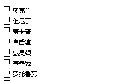

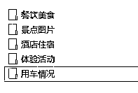

### 3.3.4 笔记创作与发布流程

优质内容怎么写？先要知道用户偏好。现成的高互动笔记，就是用户偏好的直接体现。找参考、拆热门，是快速起号必备的能力。

**第一步：找到可参考的热门笔记模板**

1）怎么找参考笔记？

- 搜领域关键词：比如做“华山一日游”，就在平台搜索框搜相关词，从主页结果里筛选适合参考的对象。
- 点热门笔记里的话题：打开互动较好的内容，正文底部通常带话题标签，点进赛道话题，顺着标签继续找其他热门笔记。

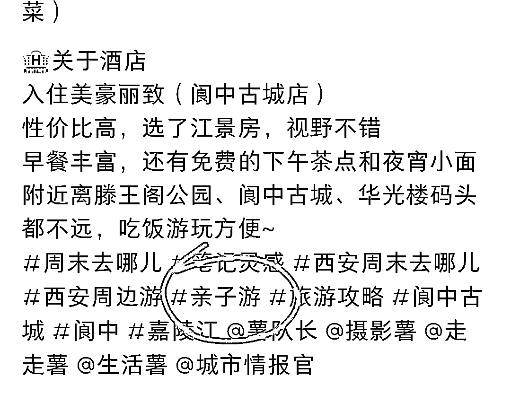

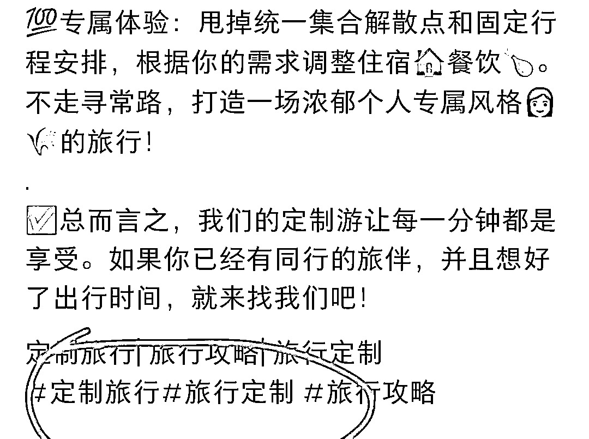

- 持续刷同类参考笔记：连续看与账号调性相符的内容后，系统会按你的阅读偏好，在发现页推送相似笔记，再从里面挑合适对象。
- 去数据平台找：用灰豚数据、千瓜等平台搜低粉爆文，模仿这类内容，再次爆的概率会高不少。（这些功能要开会员，可以去淘宝闲鱼买个账号，问题不大。）

2）哪些笔记适合参考？

- 看互动数据：一般来说，互动数据大于100算小爆，大于1000算大爆。找参考时尽量选大爆笔记。
- 看评论：有些内容赞藏不显眼，但评论区全是精准询单，询单和赞藏接近1:1，甚至超过赞藏，这类内容也值得重点借鉴。
- 看时间：发布时间在3个月内最好。如果是季节性产品，比如冬天滑雪泡温泉、夏天避暑胜地，可以借鉴往年高互动内容。
- 看博主粉丝量：腰部甚至头部百万粉博主的爆款，参考意义不大，因为数据很大程度靠粉丝，你复制不了。

3）热门笔记通用模板总结

分析热门内容后，可以归纳出旅游赛道的通用模板，照着做更容易出高互动内容。

**模板一：旅游全攻略**

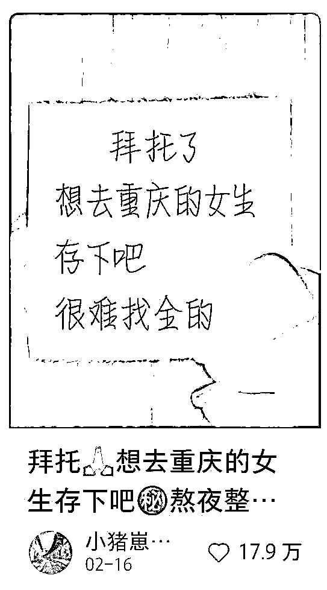

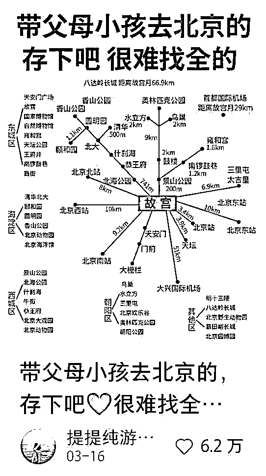

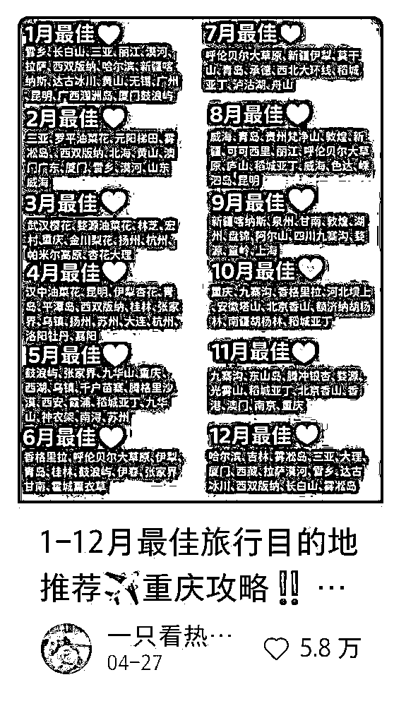

**模板二：一定要做的**件事、**条建议**

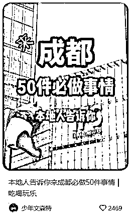

这类内容的核心也是展示“内容多”，只是用数字把“多”突出出来。数字越大，干货感越强。

**模板三：红黑榜**

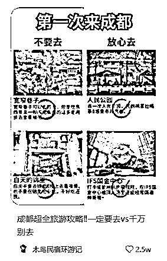

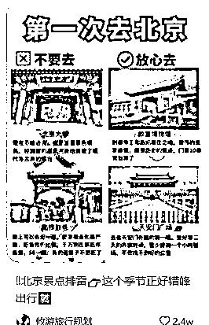

红黑榜数据通常不错，常见形式是“要做/不要做”“要去/不要去”。用得好，赞藏很快能起来。但它有违规风险。平台可能发违规通知，说内容展示了不合理、没有依据的效果对比，容易误导用户。

**模板四：低价**

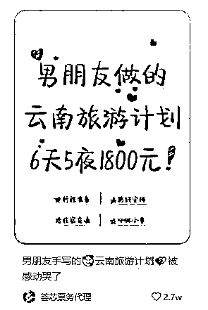

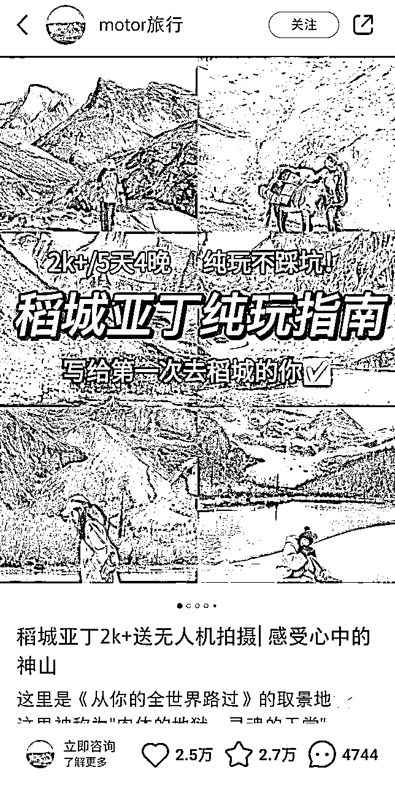

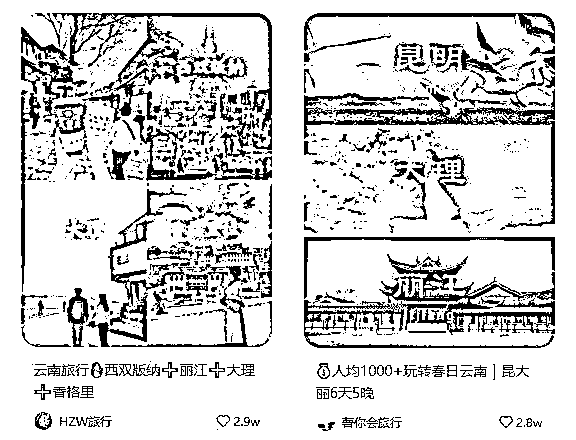

这类内容核心就是价格低，比如几天几夜人均1k+、2k+。引流效果通常较好，不过吸引的多是预算偏低的客户。跟团游、散拼团可以多发这类内容。

**第二步：准备相关素材**

确定参考对象后，按对方的内容准备图片和文字材料。

1）图片素材

图片可以从自己的资料池找，也可以去百度、携程、平台搜。但要注意：除了旅行社对接提供的图片，其他图片尽量不要用有真人出镜的。

如果确实想用真人出镜图，尽量别在国内平台找，容易被本人刷到并举报。可以私信或去博主内容下留言要授权，说明会备注图片来源。这样对方同意的概率更大，也相当于多一次曝光。

2）文字素材

来源主要有两类：

① 旅行社提供：旅行社会给相关产品资料，把内容整理进自己的资料池。
② 网上搜索：百度、携程、途牛、平台、知乎等都能查到相关信息，也可以用ChatGPT辅助。

**第三步：制作图片**

1. 制作首图

怎么对标热门内容做像素级拆解，再做出首图？思路就是：贴近参考，精准拆解。

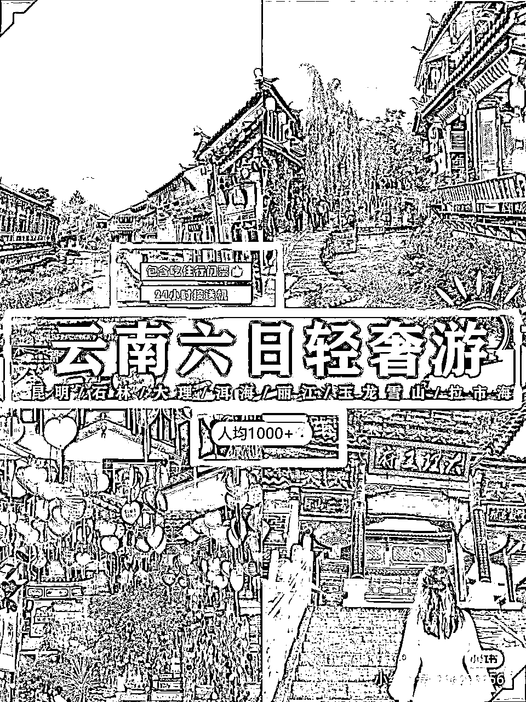

一张图可拆成四部分：

1. 四宫格真实景区拍摄+真人出镜；
2. 图片正中间放主标题“XX6日轻奢游”，再加副标题写行程主要景区；
3. 主标题正下方放“人均1000+”小标题，突出低价；
4. 主标题左上方写行程能提供的服务亮点。

拆完后，按模板找对应素材。步骤是：

1. 从第二步搭的资料池里找4张偏真实的目的地景区照片，其中一张带真人出镜（背影或正面都行，注意是否侵权），用稿定设计或WPS拼成四宫格；
2. 在首图正中间找笔刷图形做底色，在底色上排主标题+副标题。主标题写：XX（目的地，可以是单个景区，如华山）几日（散拼团多为1日游）轻奢游；副标题写目的地下级小景区或玩法（如华山：索道、滑道、西上北下、东峰日出、山顶帐篷）；
3. 主标题正下方写：“人均XXX（散拼团价格多在300左右）”；
4. 主标题正上方写一日游能提供的服务（如全程接送、吃喝门票一价全含）。

从初始首图到热门首图，优化时记住三点：

- 真实好看：旅游赛道最好的图，是既好看又真实，真人出镜最佳。
- 氛围营造：整体配色、背景、选角都要和选题强相关，突出氛围感，让用户有好感。
- 突出卖点：主标题字体要精准吸引、放大突出，有“一眼记住”的效果；小标题简单罗列主要卖点，比如玩法、价格、服务。

快速判断首图合不合适：把图发到🛰️聊天框，只给自己1—2秒停留时间，看能不能快速抓到首图主体和标题关键词。能，就说明首图合格；还要停下来细看才能发现，就说明不合格，排版和花字需要优化。注意别自嗨，少走弯路。

1. 制作其他图片（图片去重）

平台图文内容现在最多可发18张图，除去首图还有17张。建议每条内容多传几张，让用户更全面了解目的地信息，包括攻略、景色美图、游玩项目美图、酒店、美食、车等，内容越丰富全面越好。

制图会涉及图片来源、制作和去重。来源和制作前面讲过，这里重点说去重。

方法一：加滤镜，或改变尺寸。

改变尺寸示例：

方法二：把两张图拼成一张。以新西兰但尼丁为例，找4张图，分别记为1、2、3、4。作图时可以1+2拼一张、1+3拼一张、1+4拼一张、2+3拼一张、2+4拼一张、3+4拼一张，这样4张图就能变成6张不同图片。再在图片上标文字，不同内容用不同颜色、不同大小的文字，也能达到不错的去重效果。

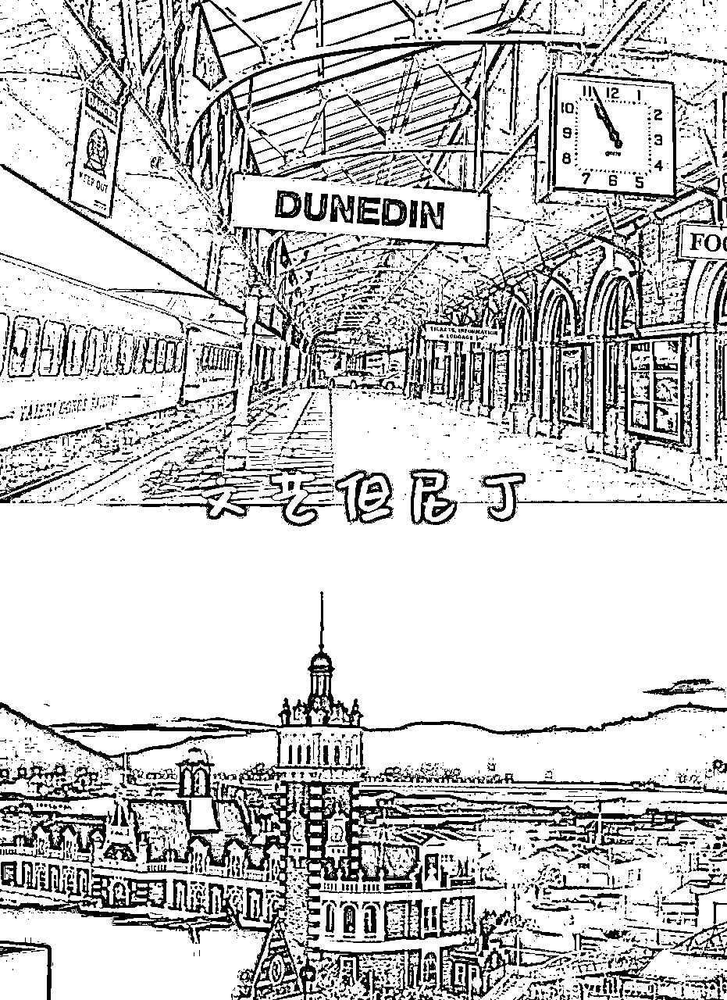

**第四步：写文案**

旅游赛道的内容框架并不复杂，基本由这些部分组成：①用户痛点；②自我介绍；③景区介绍；④行程线路；⑤行程亮点；⑥产品细节；⑦亮点细节。

几乎所有旅游内容都绕不开这些模块，具体开头可以按偏好设计。建议用下面3种开头：

第一种：痛点切入。开头先点出去目的地景区可能遇到的问题，比如人太多、太累，再接到这篇内容的主题。

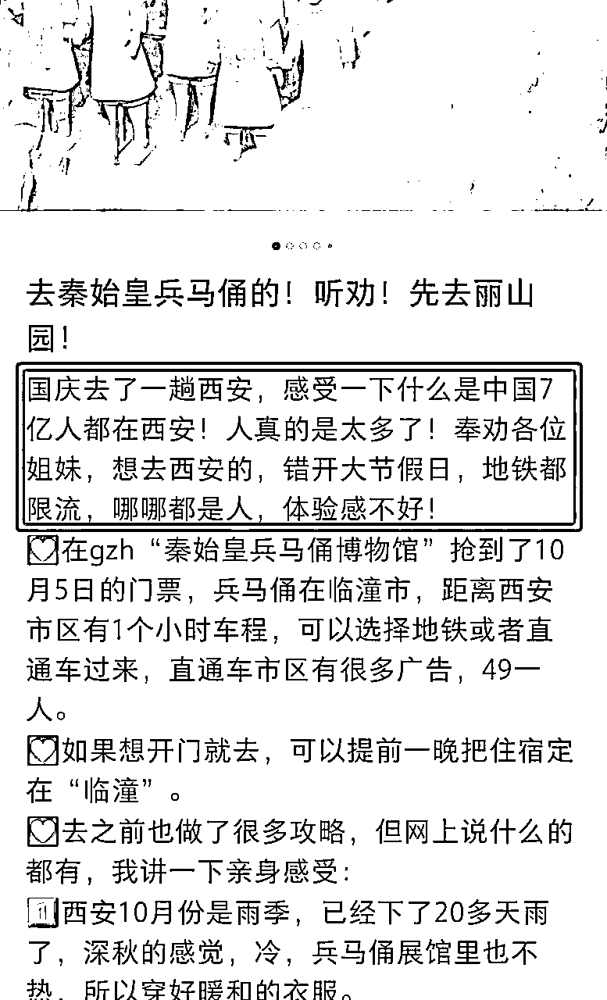

后面接景区介绍、行程线路、行程亮点、产品细节、亮点细节，最后放自我介绍。

第二种：自我介绍开头。

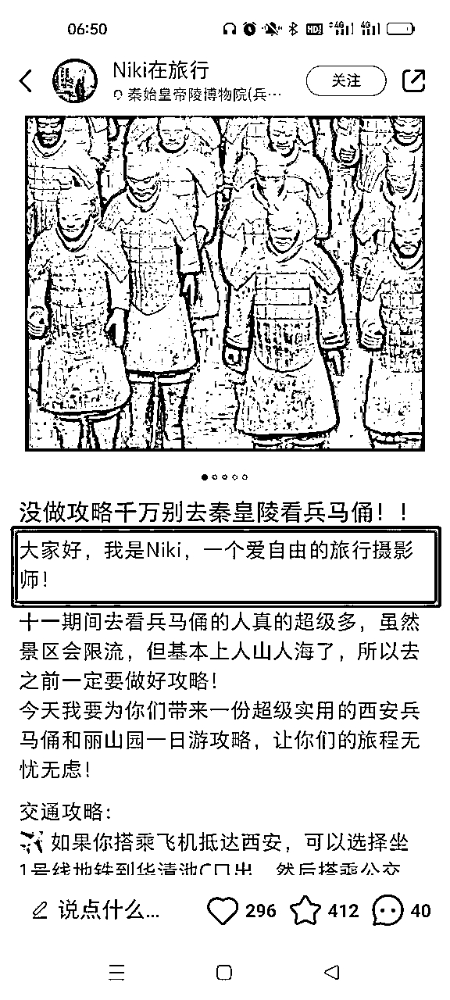

第三种：景区介绍开头。这类开头在平台很常见，简单直接，先说明这篇内容讲哪个目的地。

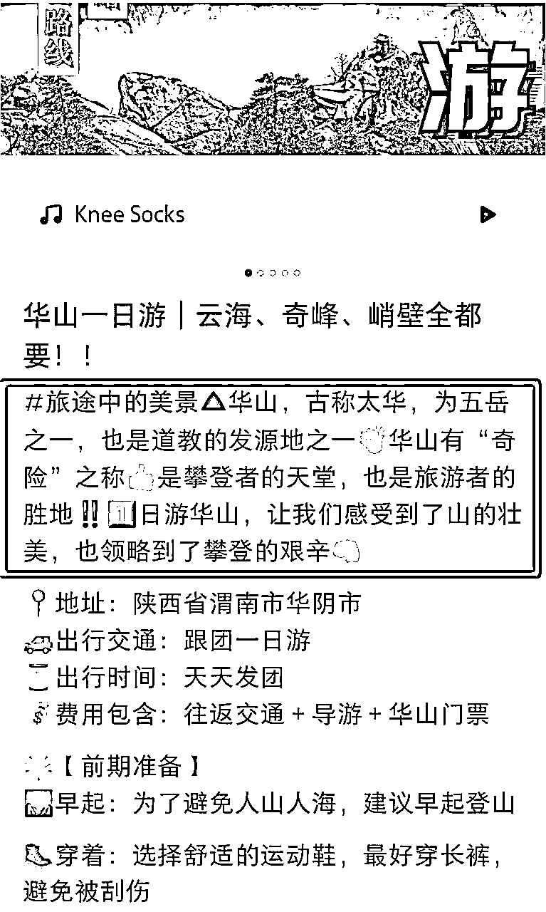

景区切入后，继续接行程线路、行程亮点、产品细节、亮点细节，最后接自我介绍。

要注意：景区介绍开头别像企业号那样生硬照搬景区资料，容易像产品推销。可以写得生动一点，避免被判营销违规。

看到这里，你应该能感觉到：旅游内容的写法并不神秘，难的是把方向、资料、首图和正文一步步做扎实。

# 旅游笔记提效：素材库先搭好，模板套用才快

模板框架一旦固定，笔记中段通常不用反复重写。等你把景点与线路产品摸透，把资料塞进对应位置即可；熟手十分钟左右就能做出一条能引客的笔记。

旅游内容最耗时的是配图搜集、景点资料和产品信息整理。三块素材准备到位，动笔并不费时；但前期必须下功夫积累自己的素材库，库建好后产出会轻松许多。

## 第五步：标题怎么写

平台标题一般限制在20字内。实用思路是“大词+小词”，例如西安配华山；也可先收集同赛道数据好的标题，拆出关键词再重新组合。

旅游关键词大致分八组：①地域：国内、国外；②月份：1月、2月、12—1月；③节假日：寒假、暑假、国庆、五一、春节、元旦等；④季节：春、夏、秋、冬；⑤景点：大词如桂林、宁波、厦门、深圳、西安、云南、长沙，小词如华山、兵马俑；⑥天数：5天4晚、2天1晚等；⑦主题：徒步、星空、露营、滑雪、蹦极等；⑧酒店：星星酒店、野奢酒店等有知名度的住宿。

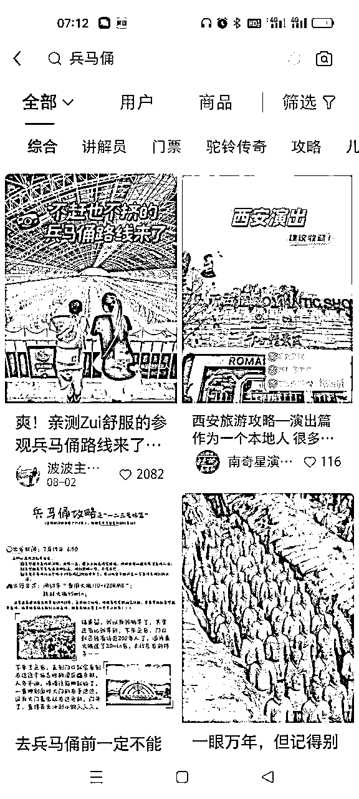

这一步不能轻视。平台流量偏搜索，结果页要出现你的笔记，内容与搜索词必须有关联，标题又占搜索词权重的大头。

可把“推荐、知识、分享、如何、搭配、新手、怎么做、必备、教程、技巧、步骤”按语境嵌入。数字式标题也可用：“2个方法、10大、4个要点”，比如“来新疆旅游必打卡的3个地方”。取标题逻辑与👸号、知乎相通。

攻略类笔记的标题示例：

新疆必玩景点
新疆旅行人均5K 12日游的游玩攻略
去了趟新疆回来朋友圈被拉黑了
刚从新疆回来总结的33个避坑建议
来新疆旅游，这20件事千万不能做
2022新疆赏花攻略
毕业旅行/情侣旅行，去新疆玩嗨了：8天9晚毕业旅行
在线回答新疆旅游问题
这趟新疆旅行，全靠男朋友熬夜做的攻略笔记（真实笔记本）
来新疆旅游必须知道的10件事

负面案例：内容不错，标题却没提供点开理由，用户自然看不到：

## 第六步：发布

全部步骤结束，按目标人群活跃时段发布；也可参考同赛道爆款发布时间，推断人群在线时间后发布。

### 3.3.5 散拼团旅游产品笔记要点

#### 3.3.5.1 低价要突出

“低价”是天然流量入口。散拼团客单不高，价格可直写进笔记，明示费用通常更利于转化。

#### 3.3.5.2 与攻略笔记搭配

攻略笔记是干货，用来起号、抬账号权重、吸流量。起号阶段可多发，旅游攻略、避坑、景点介绍等数据容易起。

#### 3.3.5.3 设置转化钩子

一，在攻略里塞行程速览，写清每日路线；二，文末做简短自介：我是谁、何时可找你、能提供什么，表达含蓄些；三，评论区演小剧场：小号或朋友模仿真实用户留言，或写“留下时间+人数”并置顶；四，另发产品笔记，用户从攻略进主页看产品笔记，也能转化。

## 3.4 合规引流到🛰️怎么做？

💡

小节概要

“合规”是重点。平台对导流管控不松，这是创作者普遍难点；规则不清容易违规甚至封号。

但也别慌。平台不鼓励导流，却通常留些缝隙给创作者，这是双方默契。找到缝隙并利用好，个人号仍可获客。

下面看相对安全的做法。

### 3.4.1 钩子怎么设？

钩子可用粉丝想要的资料，以内容筛客户，如“打卡城市99个必拍照景点及姿势合集”“XX优惠券200元”。先引到平台群聊，再在群里往🛰️导。

### 3.4.2 引流路径有哪些？

平台严控交易导流，加微方法要定期换。既然加微，就要有封号预案；多号并行，封一个还有备用。一机一卡一号，用手机流量，别多号共用WiFi，以免连坐。

实测可用的路径如下：

#### 3.4.2.1 收藏夹

客户来问，用话术让其看收藏。

#### 3.4.2.2 群聊配合小助手

私信咨询后，聊几句就邀进群。

进群后小号与顾客互动，用图片发🛰️，或向顾客要🛰️。

“🛰️”要换同义词，防屏蔽；必须图片发，直接打字可能不显示。

提醒：发出进群邀请后要及时同意，进群后小号尽快发🛰️。回复慢，加微通过率约30%—40%；回复快可到70%—80%。

#### 3.4.2.3 PK组件藏号

把🛰️号藏进PK组件。操作：打开平台→底部中间加号→图文笔记→编辑页点投票→互动组件→PK组件→填标题和观点→发布。之后在PK信息中可见🛰️号。

注意：平台规则变化快，手册可能滞后，引流问题多留意群内讨论。

#### 3.4.2.4 📕ID暗示

把📕号改成🛰️号，私聊引导看ID，例如“免费定制行程看📕号”或“看📕号发具体行程和报价”。懂的人自然会加。

📕ID仅能改一次，可改成🛰️号。建议英文+数字或纯英文，便于识别；纯数字不易分辨，最好8位以内。

### 3.4.2.6 评论区配合小号

评论区@小号并置顶，小号发一篇含🛰️的笔记。

### 3.4.2.7 一对一私聊

咨询少时适用。用户私信后直接问“你蔚多少，给你发具体行程和报价”。

### 3.4.3 引流避坑经验

1. 选题过泛，客户不精准。航海做散拼团路线，选题文案都围绕散拼团，咨询才精准；偏离主题，来客不精准，难成交，还白耗精力、担风险，低质量客户多而单少。
2. 文案太硬，容易限流。个人号要用素人体验口吻，口语化，避开高危词；营销感过强会被系统审核，轻则限流重则违规。文末少写“关注”“留言”，被检测概率高。
3. 引流过冒险，账号会违规。私信导流别为单个顾客冒险发🛰️，账号安全第一。可引导进群或看📕ID；实在不行放弃该顾客。
4. 回复不及时，客户会流失。平台回复、加好友、引导到🛰️后都要尽快回，能明显提高通过率和成单率。

# 四、【项目实操 3/3】在🛰️端完成成交

💡

章节概要

为让新手尽快出首单，前面选了“散拼团”这个较简单产品。🛰️成交不难，没销售经验也不用怕。关键两点：✅熟悉路线产品；✅及时回复顾客。

下面用案例讲🛰️成交散拼团。

💡

本章航线图

学完并实操本章，可完成航线图第三阶段：🛰️成交（约1天）

1. 在🛰️与客户沟通，销售旅游产品（约2小时）

现在开始。

## 4.1 🛰️成交步骤与技巧

散拼团（跟团游）多按固定日期发团，如每周四，也有天天发。行程景点固定不可改，因此成交流程也固定，上手快。

第一步：问清客人信息

客人来问，先确认：到达日期、人数、有无老人小孩、想去哪些景点。再据此匹配散拼团。

有老人，少推步行长的产品；有小孩，可推亲子多的产品，如海洋馆、科普馆。

话术可参考：

您好，计划哪天到？几位同行？玩几天？想去哪些景点？有老人或小朋友吗？

第二步：讲产品特色

散拼团同质化高，价格战凶。前期熟悉资料时，要提炼特色亮点，再引导客户看你的优势，促使选择你的产品。

散拼团学习成本低，但别松懈，卖点必须提炼。你越专业，客户越信任，下单越干脆。

话术可参考：

我们是本地旅行社，经营20多年，路线和服务经验丰富
纯玩团，无强制消费
专业导游领队讲解，含酒店接送
你们2号下午到，晚上可先逛不夜城；3号走兵马俑华清宫专线，需1天；4号去钟鼓楼，看驼铃传奇演出。

跨行例子：几年前卖藏红花，有中医在客户群质疑我的说法，还亮出执业医师资格证。因我查过大量藏红花文献，知识储备足，并不慌。我引《国家药典》和参考文献证明观点。一番辩论后，他说：中医我是专业的，但藏红花你是专业的。随后他当场买2万元藏红花，群里其他客户也下单。当晚销售额3.6万元，次日还有人翻聊天记录继续下单。

第三步：收款成交

介绍完产品、答完疑问，客人决定付款，就发二维码收款。

话术参考：

这是公司收款码，先扫码交200定金
付完发截图，我拉对接群并签合同
收到，3人，兵马俑一日游，12月2日出发
请提供3人身份信息、电话和酒店地址
收到，出行前导游联系你们，有问题随时说

注意：收款要发旅行社二维码，让客人转到旅行社账户。曾有学员让客人🛰️转给他，结果被当骗子拉黑。

客人付款后，让其发截图，我们转旅行社工作人员查账。确认到账，旅行社会出全国统一电子合同，客人在

以西安为例，典型散拼团从咨询到成交全过程如下图：

## 4.2 🛰️成交避坑

最大风险是封号。哪些情况易封？怎么避？

情况一：加好友太频繁。🛰️加人无论主动被动，旅游顾客入口无非🛰️号、二维码、手机号、🐧号；主动加手机号最敏感，加多必限。

笔记爆了，很多客户想加，怎么办？较稳妥的是让顾客加你，安全且通过率高。我们通常给🛰️号让对方来加，也能筛掉意向弱的。

情况二：网络环境异常。同一WiFi接多个🛰️号，或同IP封过很多号，IP长期不流动、频繁换设备、异地登录；以及总群发广告、频繁加人、异地收款、快进快出转账，都会影响账户。及时换网络或IP即可。

情况三：新号马上批量加人。新注册🛰️号先养一养，日常消费付款也用起来；否则主动被动加多了，照样受限。

# 五、【复盘优化】持续打磨笔记，增加爆款

💡

章节概要

笔记发布流程掌握后，要不断优化质量、提高效率，争取更多曝光和客户。本章两个方向：✅优化笔记质量，做内容必做，新手前几篇数据不好别急，持续复盘优化，爆款会来；✅提高生产效率，以量变促质变。相比押1篇大爆款，多篇小爆款性价比更高，所以效率提升也是迭代重点。

怎么优化质量？怎么提效？往下看。

💡

本章航线图

学完并实操本章，可完成航线图第二阶段：发📕引流笔记（约5-7天）中的【复盘优化】任务。

1. 复盘优化笔记质量，并提高笔记生产效率（约2小时）

现在开始。

## 5.1 数据不好怎么优化？

怎么判断数据好坏？

有人问：浏览量100—300、300—500，是否限流？

明确说：正常。浏览量不低于50，在50—500间基本正常，多半是内容质量导致数据差。

其次，和正常内容比。发过多篇后，找出自己数据较好的那几篇，分析原因。

再次，和同量级博主比。对方500粉左右，你也500粉左右，才有参考性；你500粉硬比10000粉，意义不大。

对比时看点赞收藏和评论区。别人评论多、收藏多，为什么？看其内容与互动引导，尽量模仿学习。

若确认数据差，从以下方面反思：

### 5.1.1 阅读量（小眼睛）差

发布后2—3小时阅读差，或长期100—200甚至低于100，可查：

运营初期正常，账号权重还低；

# 旅游号起量前，先排掉这些雷

先做减法：平台反感的表达别碰，敏感词、违规说法要避开；还有一些天生难拿到推荐的词，比如“旅行社”“定制联系我”“留言”“景点费用”“1对1咨询沟通”，都别直接塞进正文。选题切口、标题、首图如果不够抓眼，也要回头重点排查。

### 5.1.2 赞藏评不涨，先别往运气上推

读者愿意收藏，说明这篇东西有实用价值，眼下或以后能用上；愿意点赞、评论，说明作品被认可，或者戳中了情绪；愿意因此关注，则是认可你这个人，并期待你继续更新。

互动不理想，排除违规和玄学因素，十有八九还是内容质量不够硬。可以逐条对照：标题勾人但正文跑偏；广告味太重，通篇硬推（企业号可适当放宽）；读者看完收获有限，实用性不强；读起来像随手发的朋友圈，情绪价值和实用价值都缺；满屏学术腔或百科式搬运，让人没耐心看；视频画质或图片质感太差，阅读体验不佳。

### 5.1.3 发布后改作品，什么时候该忍住

改已发作品会不会压曝光？从观察到的数据看，阅读率会重新计算，不过只要不频繁动手，影响不大。改动后可能触发复审，复审通过才会正常放出；有时把敏感词处理掉、标题再优化，数据反倒变好。也有相反情况：原本审核过了、流量正常，改完后审核人员觉得有问题，反而开始限流，数据更差。所以爆款作品要管住手，先别改，可以在置顶评论里补充。图文作品所有内容都能替换；视频作品只能动文本和首图，视频本身换不了。提交后平台会复审，不违规就照常通过。已经是爆款且热度还在往上走，别轻易改，可能拖累增长。短时间内别反复改，改太多次数据可能还不如之前；一般控制在2-3次没问题。

## 5.2 违规处理：先申诉，再决定账号去留

平台限流，可以连续申诉三天，有机会解除；轻度违规，比如小眼睛一直卡在50以下，申诉三次并联系客服尝试解除。引流类作品火了以后很容易被判违规，几乎每个爆贴都经历过。别轻易放弃，申诉一定要做。申诉入口有两个：违规作品提醒界面，点开违规提醒就能看到。

两个渠道一起申诉，因为处理人员可能不是同一批，标准也会有差异。我的违规作品中，只有一条没收到回复，其余都恢复了，包括评论数超过5000的帖子。话术得自己总结，方向不同不能照抄。我经常遇到两种情况：提示内容引流，我会写“我是按照官方视频里推荐的，让客户留下自己喜欢的产品，并未刻意引导，请官方核实。”官方确实有教如何正确引导评论的视频；提示内容违规，我会写“图片上文字较多，可能被机器识别误判，实际上没有违规，请人工核实后予以恢复，感谢官方。”只要不是特别明显的违规，基本都能申诉通过，尽量把问题往合理方向解释。

补充：账号数据明显低得异常，一周后仍没恢复，可以考虑注销重来。我测试过一个1.6万粉账号，连续一周每天只涨几十粉，后来果断注销重开，用10篇帖子涨了7600粉。

## 5.3 如何提高爆款率

### 5.3.1 流量优化

标题是给系统看的。系统检索标题里的关键词，把作品推给更精准的人群，后续搜索展现也靠系统完成。所以写标题既要符合系统规则，也要贴合读者需求。怎么写出好标题，可以回看【章节 3.3.4 第五步：写标题】，再结合【章节 5.3.3 关键词优化】。

封面是给读者看的。旅游赛道和其他赛道不同，无论图片还是视频，一定要美，让人产生想去的冲动。旅游本身就是靠图片、视频勾起向往；素材太low，这种情绪就起不来。有个做法国旅游的朋友，发了不少作品很努力，小眼睛只有几十。我一看首图就不行，读者连点进去的欲望都没有。

同类作品在搜索列表页排开，读者为什么点你的？因为你的首图和别人有差异。读者是否打开，唯美首图大概占九成因素。举个最简单的首图例子：这两个作品首图，你会点开哪个？

左图色彩阴暗，一看就压抑；右图春光明媚，心情都变好。做旅游博主，提升审美永远在路上。对普通人来说，最快的方法就是多观察、多总结。

### 5.3.2 做好评论区互动

作品写完发布并不是结束，之后还有一个非常重要的动作——做好评论区。一个好的评论区是获得更多推荐流量和提高转化率的点睛之笔。先简单说一下平台的算法：

重点结论：读者的动作对爆款作品的积极影响排序是：关注 > 评论 > 收藏 = 点赞；也就是说，互动量增加，整体数据会增长很快。

所以，作品发布之后，可以先自己用小号或者让朋友帮忙在评论区留言，以此增加作品评分，让作品获得更多推荐流量。其次，如果有读者留言评论，尽量每条都回复，回复评论也会计算到 CES 评分里。

除了能增加作品评分，做好评论区还有一个好处——提高转化率。其实很多时候读者可能自己都不知道自己要什么，或者压根没想到来找你咨询，但当你直接告诉他可以留言咨询，或者他看到别人做出这个行为，他也更容易做出相同的行为；如果你想引导读者私聊或进你的粉丝群，也可以先回复其中一条评论，让她私你或者进群，然后把这条评论置顶，这样后面来的读者就有更大概率采取相同动作。

怎么做评论区互动？

1.

评论区主动留言互动

在评论区直接引导读者留言，然后把这条评论置顶。把转化信息放在评论区，会减少放在文本框中被系统检测到营销引流动作的概率，也可以引导读者在评论区按照你的节奏留言。

2.

评论区回复引导

当有读者评论区留言，或者用自己的小号在评论区留言之后，可对评论进行回复，引导私聊或者引导进群，然后选择其中一条置顶。

这里要注意：“私信”“咨询我”这些词不能直接用，尽量模仿个人号来回复。不过我们测试过，把“私信”中的“信”字换成符号，目前也是安全的。

### 5.3.3 关键词优化

搜索是旅游流量的主要来源，平台搜索流量85%以上都是精准的，而且几年前发的内容依然能被搜到。很多女生把平台当百度和谷歌，遇到任何问题都上来搜一下。旅游也是，她们直接搜索目的地。你只要根据挖掘出的读者搜索词，把作品做好，等她来搜就行了。读者只要搜，就会看到你的作品。

第一步：先找到行业各个领域的细分垂直关键词

除了前面【3.3.4 第五步】列举出的旅游赛道相关关键词，你也可以通过数据平台（以下拿灰豚数据举例）查看相关关键词，做更精细化的布局。

（这里需要开通平台会员，对于想要深耕做好这个赛道的圈友，建议可以开一个。）

第二步：有了关键词，我们就可以做关键词布局的优化了。

比如，关键词“重庆”的布局这样做：

1.

在作品的标题和正文中引用大关键词+小关键词；

2.

这里需要注意：一定要避免堆砌关键词。比如一篇作品堆十几二十个关键词，这会被系统判定为广告，长期这样操作，账号会被系统降权。

第三步：关键词复盘

每发布一篇作品，做一波数据分析，五篇作品做一波复盘，根据数据结果去优化下一步的关键词布局。

数据分析方法：

通过“创作中心”里的数据中心分析单篇作品的数据。主要分析观众来源里的“首页推荐”和“搜索数据”。“首页推荐”占观众来源高，说明作品正在被算法推荐；“搜索”来源占比高，说明关键词的布局是没问题的。

如果搜索流量占比比较低，那有两种情况：一个就是你的作品进入了推荐流量池，这时候你的作品数据应该非常好；第二种情况

### 5.3.4 不同类型作品如何搭配使用

我大概把旅游作品分为3个类型：

第一种：流量作品

也就是干货作品，目的是为了起号、提升账号权重、吸引流量。流量作品在起号初期可以多发一点，因为这类作品非常

第二种：赚钱作品

赚钱作品有两种表现形式：一是直接展示产品，即产品作品，比如XX景点、几天几夜、包含什么项目、什么价格等；二是展示和读者的聊天截图，用聊天截图去引导转化。

再说一次，赚钱作品可以走两条路：直接上产品信息，或者用聊天记录带转化。

除了故事名片，其实我们也可以通过干货作品去增强读者对我们的信任感。只要你的作品足够真诚、足够专业、足够详细，给读者带来足够的价值，慢慢也会让读者对你产生信任。

流量作品、赚钱作品、人设作品。这三类相辅相成，流量作品和人设作品就是给赚钱作品保驾护航的保镖，要有流量和信任，读者才能通过赚钱作品来找你成交。

这三种类型的作品，故事名片有一篇置顶就可以了，攻略类型的作品总的占比20%左右，但是前期多写一点，可以占个40%左右，后期可以偶尔秀一下客户转账截图，剩下的就写展示产品的作品。这个是个人号的玩法，等大家做起来之后，是建议大家注册企业号，搭配企业号一起玩的。

## 5.4 如何提高作品生产速度

### 5.4.1 完善素材库

提高生产速度，就是学会批量制作作品，它的精髓就是素材库。除了前面【章节 3.3.3】讲过的最基础的素材库（文案和图片）之外，还有选题、标题、关键词素材库：

1.

选题库

平时刷对标账号，或者刷平台主页时，刷到好的爆款作品选题可以及时整理到自己的选题库中，这样方便写作品时可直接参照，也方便团队成员进行相关的操作。

2.

标题库

在平台，标题是提高点击率的重要组成部分，但想要快速起一个爆款标题，对于新人来说还是相对困难的。这时我们可以搭建一个标题库，和选题库一样，平时遇到好的标题就整理进去，后面写作品时套入核心关键词进行改写。

如下图，“带娃去北京请一定要慎重啊！！”就可以改成“带娃去西安请一定要慎重啊！！”或者改成其他目的地都可以，这样的话，制作一个爆款标题的时间甚至连1分钟都用不到。

3.

关键词库

前面【章节 3.3.4】部分有提到怎么去找关键词，并且旅游赛道有哪些高频的关键词。当我们找到这些关键词之后，可以将关键词也整理出来，方便后续写标题以及文本框关键词布局时使用。

### 5.4.2 利用作图工具

1.

WPS 作图

我本身不会 ps，审美也不达标，WPS 可以批量输出图片，用起来非常顺手，而且会员便宜，不用担心字体等版权。

比如，我用 WPS 编辑完成后，直接点击输出，就可以批量生成图片。无论你的资料类型是 word 还是 ppt。

我个人更倾向于使用 PPT 编辑平台图片，非常便捷。

2.

稿定设计作图

稿定设计是一款非常适合新人创作者制图的软件，可以直接登陆网页版，也有相应的软件支持下载。

# 选修篇：更多玩法和赛道推荐

💡 选修篇概要

当我们完成项目最小 MVP，基本掌握项目的操作流程后，可以尝试看看选修篇的内容。

无论你是想要进一步放大项目，还是挖掘更多玩法，都可以重点阅读本章节：✅【项目放大】3 种放大项目的方法

✅【项目放大】3 种放大项目的方法

✅【项目拓展】更多变现方式

现在，快来发掘项目的更多可能性~

# 六、【项目放大】3 种放大项目的方法

💡

章节概要

如果你已经跑通了项目 0-1，且有能够稳定转化的后端旅行社，这时候就可以考虑做项目的放大了。

旅游项目放大的 3 种玩法：

✅矩阵号运营✅付费投放

✅付费投放

✅📕直播

下面我们一起来了解这几种放大玩法，尝试找到一款适合你的玩法吧~

## 6.1 矩阵号运营

如果想要深耕旅游赛道，搭建矩阵号是必不可少的。以下将从 3 个方面来讲怎样做矩阵号运营。

### 6.1.1 注册多个账号

这一步主要涉及手机号、手机的准备。

搭建矩阵账号的第一步，就是注册多个账号。我们可以用自己或家人的手机号注册，和前面提到的两个账号注册流程一样。电信宽带可以一拖三，四个手机号的套餐共用；如果账号不够，也可以直接在网上办电信29元一个月的卡，每月有100多G的流量。

手机可以在闲鱼、拼多多或者淘宝上买二手手机，不用买很贵的，三四百够用就行。或者买红米的手机，可以双开平台，一部手机就能注册两个账号。

### 6.1.2 批量制作作品

#### 6.1.2.1 单人批量操作

单人批量操作适合项目前期 all in，精力足够想要快速放大项目的个人操作，主要有2个核心操作：

①素材库搭建

前面【章节 3.3.3】和【章节 5.4.1】讲过，搭建基础的图片库、文案库，以及选题库、标题库、关键词库，这里就不再赘述了。

②多账号发布：主账号+矩阵号

要确保有一个认真运营的主账号。这个主账号需要已经完成前期的作品发布，作品周更2-3篇，且已经成功引流到🛰️；那么接下来就可以批量化复制，同步运营矩阵号。

只要保证作品的质量，首图、标题、关键词以及内容没什么太大的问题，一个账号周更2-3篇作品是能拿到不错的流量的。那么多余的精力，就用来搭建矩阵号，通过搭建的素材库内容，批量化用其他的小号发作品。

不需要把精力平均分配到每个账号上，这样你可能一个号都做不好。一个好的搭配就是1+N的形式：1个主账号+N个矩阵号。

但是，主账号一定会是流量的主要来源，也是后面你跟其他旅行社谈合作的门面担当，所以我们要用心经营。把有风险的动作可以都用其他矩阵号来完成，比如评论区引流、群内要🛰️等，导流成功一个算一个，成功一双算一双，如果被系统检测到了，那就注销之后重新注册。

这里还有一个重点：做矩阵号并不是每个账号都发一模一样的内容，账号主页风格和内容还是需要有差异化，否则这些同质化的内容容易被判定抄袭。每个账号的作品最好保证一定程度上的原创度，比如不同的首图模板，不同的文本框架等。

以下为典型的差异化矩阵号举例：

不同的账号定位可以切不同角度，包括首图风格、账号简介&作品等，不要一模一样。

相反，什么是同质化，就是你不同的账号首图风格一样，内容也一样，基本没什么改动，只是把一篇作品从A账号搬到了B账号，这种是会被判为抄袭的。

#### 6.1.2.2 多人合作生产内容

如果你是团队操作，那就可以使用团队玩法，把整个流量前端拆分成不同部分，然后分工合作。

# 3人小组跑通旅游📕：获客、投放、直播与7种变现

旅游类📕项目，前端获客可以拆成三段，配三个人就能形成闭环。

①内容供给：两人协作

第一段分两块：资料仓和写稿。

其中一人专管资料仓。建库耗时多、脑力消耗却不算大，单独交给一人正合适。把选题、标题、关键词、图片、文案分别归档到飞书文档里，写稿的人随取随用。

另一人负责产出内容。按资料仓里的储备，每天成批制作风格、结构各不相同的稿件，保持新鲜感与原创性。

②笔记发布

发布这件事，写稿人或后面承接转化的人来做都行。

若由承接转化者发布，设备和账号要留在其手中，因为之后还要回评论、回私信、拉群做承接；写稿人发布就用电脑端操作；承接者发布则直接在手机上完成。

③导流承接：一人

多账号矩阵进来的人，尽量汇入同一个社群，由这一人集中沟通、统一转化。

## 6.2 花钱买流量：@陈铭 ivy 的实战拆解

### 6.2.1 哪些情况下值得花钱买量？

1.

后端成交已经跑稳，想继续做大

买量之前，先让后端转化跑顺；否则放大的不是业绩，而是风险。

2.

个人号导流被卡，需要付费开私信白名单

账号体量小还没事，一旦做大，限流、封号就容易出现；付费之后导流更安心，笔记曝光也相对稳定。

### 6.2.2 聚光投流落地步骤

#### 6.2.2.1 第一步：拿到聚光投放资格

只有企业号才能投聚光，所以先做企业认证。注意：营业执照上的经营范围，要覆盖你准备投放的广告类目。

认证完成后，平台销售会来电询问是否充值；从联系你的销售里挑一个开户即可，最低首充5000。余款可退，发邮件给官方邮箱，通常一周左右到账。

连续投放约三天后，可让销售与社区沟通私信白名单；开通后发🛰️号，文字或图片都行，不再提示违规。

要保住白名单：两次投放间隔别超过7天，每周消耗不少于100。

#### 6.2.2.2 第二步：把投放账算明白

想导私域成交的人常问：花出去的钱值不值？ROI怎么判断？还该不该继续投？

这里给两种算法。

第一种，按投产比算。

聚光后台能看到单个私信的成本。

假设私信10元/个；

投1000元，得到100个私信；

加微率40%，即40人加到🛰️；

成交率10%，即4单成交；

客单价3000元，4单共12000元，ROI=1000：12000=1:12。

这个投产比不错，可以继续。

第二种，按单流量价格算。

同样1000元换40人加微，每个加微成本25元。

若🛰️每10人成交1单，单值3000元；

那么每个加微价值=3000/10=300元。

25元买入流量，带来300元价值，ROI=25：300=1:12。

这个投产比同样可观，可以继续投。

账算清楚，再进入实操。

#### 6.2.2.3 第三步：正式开投

不建议找官方运营；真要找，必须守住价格底线。

更推荐自己试，算清每个私信与导流的成本，把出价控住。

1.

价格控制

价格分两块：

私信咨询价，由自己设。

根据前面的ROI反推可接受区间。我的经验是20—30元/个。部分运营会建议50元/个，若觉得高，直接拒绝，最终价由自己拍板。

也可以先低后高，隔段时间看数据再上调。

每日预算。

官方运营常建议3—5篇笔记配3—5个计划，先跑一周；每个计划日低消100，100×3×7=2100，一周要花2100。运营还会说计划跑起来别暂停、短期看不出效果、要长期跑。单账号这样烧确实吓人，所以分享省钱版：

开投前先定3—5篇笔记；每篇建一个计划，各设不同投放日。比如笔记1计划1投周一，笔记2计划2投周二，笔记3计划3投周三……也可以一个计划放3篇、日预算100。用赛马机制跑一周，总花费500—700，就能明显看出哪篇笔记、哪个计划更强，之后反复投优胜项。或者拿一篇好笔记搭多个出价计划，比较哪个出价位置数据更好、成本更合适。

2.

投放笔记怎么挑

先研究同行，提取共性。

付费与免费流量的逻辑不同：免费流量不必算ROI，发领资料也行，哪怕来的人难转化，能帮账号涨粉、做权重也值；付费则必须考虑谁会买单，精准优先。

选投放笔记的第一动作，就是看同行。

同行持续花钱投的笔记，说明其中有“能带来成交”的共性——他们已经在用预算投票。花一天刷本赛道笔记，用Excel记录带“赞助”标识的投放内容；分析主题、标题、封面有哪些共同元素，再融入自己的笔记。自然流原本不错的稿子，按这些共性修改后再投；也可以重写，但我更推荐改旧稿。

观察同行时还要找异常值：同选题有的爆、有的不爆；知道正确做法重要，知道错误做法同样重要，能帮你避坑。某账号多数数据差但单篇突出，也是异常值，值得分析原因并模仿。

再看自己的笔记：曾带来较多成交的，可优先尝试投放。

投放后看数据、复盘迭代。后台重点关注每日消费、点击价格、点击率、评论、私信价格、私信开口价格。建一个Excel，记录各账号账密、每天投放的笔记和数据。起步时按昨日效果决定今日投什么、投多少；跑1—2周基本能摸清“什么笔记配什么计划能达预期”，之后固定计划重复执行，比较省事。

### 6.2.3 聚光投放避雷指南

#### 6.2.3.1 常见误区

1.

目标若是导私域，别选产品种草，否则会买到大量无用的赞藏；直接选客资收集。

2.

推广目标选【私信开口量】；若选【私信咨询量】，私信开口成本会更高。

以上内容整理自聚光投放实战攻略。

## 6.3 直播板块

### 6.3.1 直播红利在哪

2023年下半年，平台对直播扶持力度很大，这是📕直播的重要红利。

但要说清楚：直播只能锦上添花，不能雪中送炭。

笔记先行且质量过关，才有开播的基础。不写笔记、或笔记不够好，直接开播行不通。

第一步，靠发笔记给账号打标签，让平台知道该推什么流量；第二步，直播政策送的是笔记曝光，如果没有笔记，或笔记质量差，送的流量也会浪费。

### 6.3.2 直播落地方法

先看一个典型场景：

从后往前，画面分三层：

最后面是帆船酒店，播放视频；

中间人物由绿幕抠像完成；

前面图文层通过直播软件叠加。

这是旅游直播间的基础配置，可按这个标准搭建。

# 七、【项目拓展】旅游之外的7条变现路径

💡本章导读

如果已经跑通📕旅游玩法，并对这个行业有兴趣，可以继续看为毛总结的7种进阶路径：

✅国内定制游

✅接商家广告

✅卖旅游卡

✅周末徒步

✅本地周末亲子游

✅亲子研学旅游

✅境外高客单游

下面围绕商业路径、适配人群、操作要点展开；正文另补充卖民宿酒店。

## 7.1 国内定制游：从引流到成交

### 7.1.1 模式说明

1.

定制游是什么？

定制游最早流行于海外，以游客需求为主导设计行程。通俗说，就是按个人偏好与需求安排旅行。业内特点是减少甚至去掉中间商，服务更个性化。近几年，国内需求也在增长。

2.

怎么做？

在📕发笔记，把有定制需求的人导到🛰️私域，由后端旅行社协助成交；再按订单金额抽取一定佣金。

### 7.1.2 人群画像

适合有旅行社后端资源、熟悉项目流程、具备🛰️成交经验的人；也适合有可靠旅行社愿意花时间带教的新手。

### 7.1.3 关键动作

1.

找供应链

定制游与散拼团一样，先找可靠旅行社做后端；找法相同，但要确认对方是否提供定制游服务。定制游较新，不少传统社并没有这块业务。

2.

📕发笔记导流

围绕定制游做人设五件套，打造定制师IP或其他个人IP，笔记核心词用“定制游+目的地”：

人设型：“为什么要做私人定制游”，附旅行社营业执照；

产品型：“定制游是什么”“XX高端定制游5天4晚”；

攻略型：“XX必去的10个景点”“XX旅游攻略大全”“XX旅游省钱攻略”“定制游和跟团游有什么区别”。

3.

🛰️成交

先快速采集顾客信息。

无论对方问“有定制游吗”“什么价格”“能安排导游吗”，都先回：“有的，需要了解一些你的信息。”有些顾客会主动说人数；若缺少以下信息必须补齐：

1.出发日期？

2.几个人？有无小孩？是否65岁以上？70多岁不建议接，保险可能买不了。

3.游玩几天？

4.想去哪些景点？

拿到这些基础信息，就能快速判断能否承接。

若能做定制，再介绍详情：比如预算800—1200元/人/天能否接受；说明定制游特点及服务，包括门票、导游、景点、车辆司机等。对方认可后，排一个初步行程——注意只是初步，防止有人空手套行程。行程与预算都合适，再收定制费；打款后拉群，由旅行社专业人员介绍并细化方案。

## 7.2 接商家广告：做旅行纯博主

### 7.2.1 模式说明

在📕做旅行纯博主，用图文或视频记录旅途见闻与感受，粉丝积累后会有甲方来谈合作；粉丝满1000，可去官方申请达人，通过官方渠道接广告。

### 7.2.2 人群画像

适合环球旅行的数字游民、带娃旅行或旅居的宝妈，以及一二线城市本地爱探索景点和玩法的人，类似探店。

### 7.2.3 关键动作

1.

外出旅行+会拍会剪

旅行博主说难也难，说简单也简单：得出去玩，拍照或录像，再加工成笔记分享，建立真实旅行IP。外形好是天然加分项，颜值确实有优势。

2.

积累粉丝

纯博主接广告对粉丝量有要求，前期变现会难一些。多发高质量笔记涨粉，出爆款或定位足够垂直后，商家会陆续找来。粉丝过1000可申请达人，走官方渠道接广。

## 7.3 卖旅游卡：低价引流成交

### 7.3.1 模式说明

在📕发笔记卖旅游一卡通，分地方卡和全国卡，价格便宜，导到🛰️成交。

### 7.3.2 人群画像

1.旅行博主

2.掌握旅游一卡通渠道的新手

### 7.3.3 关键动作

1.

发📕笔记

操作简单：实拍卡面，列出能去的景点；景点多就挑几个知名的，再用数字说明总量，比如“畅游全国500家5A级”，最后强调低价形成对比。

2.

导流

在正文和评论区让用户知道你有一卡通资源，并且可以找你购买。

## 7.4 卖民宿酒店：赚代订差价

### 7.4.1 模式说明

在📕发民宿酒店图片，把目标人群导到私域，代订民宿或酒店，赚中间差价。

### 7.4.2 人群画像

1.民宿/酒店老板

2.能拿到民宿/酒店优惠价的人

### 7.4.3 关键动作

1.找到可靠且出片的民宿酒店资源

2.有足够多好看图片发笔记，图片美感非常关键

## 7.5 周末徒步：接广或招募

### 7.5.1 模式说明

在📕发本地周末徒步图文或视频。可做徒步纯博主，后期接广；也可自己是商家，招募本地常驻人群付费参加。

### 7.5.2 人群画像

1.专业徒步机构或商家

2.喜欢周末徒步的人

3.愿意组局招募同行者的人

### 7.5.3 关键动作

1.先定变现方式：接广还是招募

2.由变现方式倒推笔记设计

接广变现：

若走接广告路线，真人出镜+真实分享，标题带本地tag，方便本地商家博主找到你。

招募变现：

若走招募路线，可用“每周一山”做选题，或写明具体时间地点，比如“11.10，XXX徒步招募”，让有空且有兴趣的目标用户直接来咨询。

## 7.6 本地周末亲子游：接广与自办活动

### 7.6.1 模式说明

本地周末亲子游和本地徒步很像，也分接广与商家两种。接广：分享周末带娃路线、攻略，接本地亲子项目商家合作；商家：自己办亲子活动，通过内容吸引本地宝妈参与并变现。

### 7.6.2 人群画像

1.有娃且有时间遛娃的宝妈

2.亲子活动商家

### 7.6.3 关键动作

1.明确变现方式：接广还是招募

2.由变现方式倒推笔记设计

接广变现：

若走接广告路线，带娃真人出镜+真实分享，标题带本地tag，方便本地商家博主找到你。

招募变现：

思路与徒步招募相通，把活动时间、地点、适龄段和体验亮点讲清楚，吸引本地宝妈咨询报名。

假如你经营着一家门店，不妨把顾客参加活动后的真实反馈晒出来，持续介绍各类亲子主题活动怎么玩，并每周发布带娃出行的招募帖，逐步塑造本地周末亲子游的个人品牌，再把📕上的潜在客户沉淀到🛰️。

## 7.7 亲子研学游

### 7.7.1 玩法说明

在📕分享亲子研学线路，把浏览笔记的宝爸宝妈转化为咨询客户，再导入私域完成交易。

### 7.7.2 适用人群

1. 手握亲子研学旅行社资源的分销商
2. 亲子研学机构

### 7.7.3 落地要点

1. 对接供应商

亲子研学属于相对细分的赛道，内容只围绕亲子研学旅行展开。除了专门经营亲子研学的旅行社，普通旅行社往往只有一两条相关路线，后端资源并不充足。

2. 📕发笔记引流

发布以“亲子研学/亲子研学旅行+目的地”为核心关键词的笔记，常见有三类：

1. 人设型：例如“亲子研学旅行的价值是什么”“亮出旅行社营业执照”
2. 产品型：例如“亲子研学包含哪些内容”“XX高端亲子研学五日四晚”“XX亲子研学旅行路线合集”
3. 攻略型：例如“手头再紧也要带孩子去的十个景点”“寒假适合带娃打卡的十个景点”

3. 🛰️成交

这类线路客单价普遍不低。若自己卖过旅游产品，转化会更顺手；也可以让旅行社协助你完成成交。

## 7.8 境外高客单游

### 7.8.1 玩法说明

在📕推广境外游产品，跟团或定制均可，客单价通常较高；随后把用户引到私域完成交易。

### 7.8.2 适用人群

1. 拥有境外旅行社供应链的人
2. 具备高客单转化能力的人

### 7.8.3 落地要点

1. 找境外旅行社合作

最卡人的一步，是找到靠谱且愿意跟你对接的境外旅行社。你要么人在当地，要么有资源过硬的朋友牵线，否则对方大多不会回应。

2. 境外佣金汇款

还要打通把佣金从境外汇回境内的路径。这涉及跨境资金往来，同样是一个难点。

3. 🛰️成交

最好有当地人手帮你做客服并促成订单。境外旅行社人员时薪普遍较高，通常不愿承担转化工作，会觉得麻烦。可如果你没有该国旅行或常驻经历，顾客的问题就答不上来，成交也会很困难。

