# 教育直播从零起步：一份可复用的实战手册（2023.12）

> 文件出处：[`remhu1p2pr.feishu.cn/docx/HFOOdjaHqo3S2exxwqdcbIgHnge`](https://remhu1p2pr.feishu.cn/docx/HFOOdjaHqo3S2exxwqdcbIgHnge)

成稿时间：2023 年 12 月 27 日

小贴士：如需精准定位内容，可按下 Ctrl + F（Mac 用 Command + F），输入关键词即可跳转。

## 写在开头

💡

很高兴在 12 月航海与大家相遇。这份手册陪伴的是教育直播实战训练，接下来我们大概率还会在这里多次碰面。本期聚焦高中升学这一垂直领域，陪大家把整个项目从起步走到跑通。

开播之前，先把几个核心问题厘清：

**1）教育直播为什么值得做？**

一句话概括：主播在直播间输出学科内容，吸引有学习诉求的观众，再借助挂车把课程、教辅等产品卖出去。没有自家课程体系的普通人同样能参与——用小课包做承接，向教育机构输送意向学员，赚取佣金。

《2022 教育行业研究白皮书》给出的几项指标很能说明问题：知识类直播的观看总时长抬升了 165%；对教育内容有兴趣的用户里，超过一半产生过实际消费；这些消费中低价小课包占比居首。需求体量可见一斑。

官方口径还透露，升学方向仍在稳步扩容，算是尚未拥挤的蓝海。当下行业最突出的短板是规划师供给不足，暑期尤其吃紧；单个规划师服务的学员数量有天花板，因此竞争压力天然偏低。交付上偏服务、轻产品，初入者负担相对小，也没有强势的头部品牌占位。

结论就是：这片市场尚存空白，且比较适合个人打造 IP。

**2）谁适合此刻入场？**

① 把教育直播当作副业来试水的新手。眼下入场窗口还在，不必先备好自有课程；话术和直播下足功夫，起号并不算难。

② 想在抖音做知识类内容输出，或者对知识直播、知识付费有热情的人，这条路径值得一试。

假如能把直播流量做出稳定增长、引流课转化也过得去，往后可以转向升学规划师，把它经营成长期的主业主线。

机会之外，也有几道门槛，动手前应当心里有数：

① 高中升学是细分领域，相关专业知识要花时间补齐。有高中及以上学历，学起来会轻松一些。

② 起号阶段，直播的稳定性很重要。最好保证每天有 1—2 小时甚至更多时间用于开播和推进，项目跑通的概率才更高。

还需要提醒：知识类直播要先学后讲，积累足够才能在镜头前顺畅输出，转化也才跟得上。这既是项目的门槛，也解释了为什么变现周期可能拉长。

建议大家做好长期学习专业内容的心理准备，持续优化直播内容，靠一次次开播和复盘把直播手感练出来。

先做踏实的学生，再做合格的老师，最后才是成熟的主播。新手起步的周期可能偏长，不过每进一步都能亲眼看到自己的成长。

最后，愿大家这趟航行既拿到结果，也收获一群并肩的伙伴。

以下内容由生财有术联合圈友共同制作，仅供航海船员及生财有术星球圈友学习使用。

也盼着圈友们在实操中不断回传反馈，与我们一道完善，可联系鱼丸（yuwan387）提出修改建议～

【更新提示】新版手册的使用方法

动手之前，先花几分钟弄清这份手册该怎么用，以便按自己的节奏灵活取用。

手册的编排逻辑是：按从零完成直播起号、转化、复盘的完整链路依次展开。你可以对照航线图按顺序动手，也可以只挑自己需要的内容读。

有一点需要说明：与以往的航海手册相比，这次改动比较大。旧版尽量铺陈各种玩法供自由挑选；新版则划为必修、选修两大板块：

必修板块：涵盖项目从零跑通最小 MVP 所需的全部动作，对应航线图的行动路线。如果你仍处在前期摸索，想先把整个流程走完一遍，建议从必修板块认真读起、踏实操作，不必在玩法取舍上反复纠结。

选修板块：收纳更多进阶玩法以及项目放大的相关内容。如果你的最小 MVP 已经跑通，想进一步拓展思路、寻找灵感，选修板块值得仔细翻阅。

📌对于还没接触过教育类抖音直播的朋友：

建议动手前先摸清项目全貌，把认知摆正👇

✅【项目概述】教育直播赛道的机会和玩法

📌

如果你对项目大体已有数：那就从航线图第一阶段的任务开始，这一阶段可以从手册第三章进入👇

✅【项目实操 1/4】做好前期筹备，准备开播话术，完成之后即可熟悉内容，开启直播起号👇

✅【项目实操 2/4】练习话术，完成起号。走完上一步，你应该已经在抖音开播 3—5 场，顺利突破风控完成起号。接下来，通过拉升互动、停留等直播数据，冲破流量层级，达到带货门槛后就能挂车👇

✅【项目实操 3/4】突破流量环节

✅【项目实操 4/4】转化带货环节

必修板块的最后一章，还附上了复盘与优化的方法，帮助你持续拔高直播质量👇

✅【复盘和优化】持续提升直播质量

📌

如果你已跑通 MVP，想探索更多打法：可继续阅读以下章节，拓展玩法、让账号状态更健康👇

✅七、抖音短视频图文制作

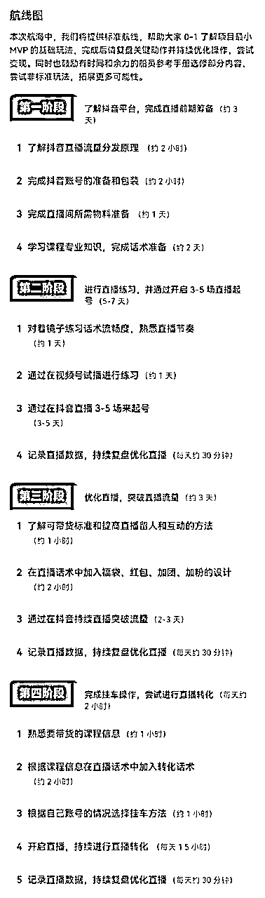

航线图与手册一一对应，按照自己眼下所处的环节，翻到对应章节学习即可。

必修篇

💡

章节概要在这一章，我们从认识教育类抖音直播项目切入，逐步带你走完整个项目流程。你可以跟着本章的步骤动手实做，跑通最小 MVP。

如果你是本项目新手，建议正式实操前先摸清项目全貌：✅【项目概述】教育直播赛道的机会和玩法

如果对项目整体已心中有数，就可以围绕核心步骤开始学习与实操：

✅【项目实操 1/4】做好前期筹备，准备开播

✅【项目实操 2/4】练习话术，完成起号

✅【项目实操 3/4】突破流量环节

✅【项目实操 4/4】转化带货环节

在必修篇里，航线图与手册内容顺序一致。你顺着手册读下去，就能把航线图上的任务逐项完成。

之后每个关键步骤的章节概要里，我们也会同步点出对应的航线图，提示你完成那个环节。

那我们就开始吧！

# 一、教育直播赛道：机会与落地路径

💡

章节概要

这一章里，我们将一起逐步了解教育类抖音直播这个项目。

抖音上的教育赛道还有多少腾挪空间？需求盘子大不大？为什么偏偏选抖音做这件事？……这些疑问，都会在本章一一解开。

我们会围绕两个问题呈现项目全貌：

❓ 教育直播的市场机会有多大？

❓ 教育直播项目该如何落地？

另外，本次航海还为大家对接了一个引流课包的合作渠道，帮大家解决课源难找的问题，也降低个人对接教育机构的踩坑风险。

不过我们对接的这个渠道只是选项之一，最终怎么选，还是看你自己。

⚠️ 但无论最后选哪一家，都请先把产品、结算规则等关键信息弄明白，再做决定。

本次航海要教的重点，就是如何从零到一跑通教育类抖音直播项目。先把整体项目情况摸透，这一步省不了，一起来看。

## 1.1 市场机会到底有多大？

抖音日活约 7 亿；全球范围内刷抖音的人超过 32 亿。这么大规模的用户盘子，意味着流量充足，商业空间自然不小。

《2022 教育行业研究白皮书》给出的几项指标很能说明问题：知识类直播的观看总时长抬升了 165%；对教育内容有兴趣的用户里，超过一半产生过实际消费；这些消费中低价小课包占比居首。需求体量可见一斑。

教育类抖音直播，简单讲就是主播在直播间讲课程相关内容，把有学习诉求的观众吸引过来，再借助挂车销售课程、图书等产品。抖音上刷到的学而思、高途、网易有道等机构的直播，以及各类升学规划、成长规划老师的账号，走的都是这个路子。

那作为个体，我们靠这个项目怎么挣钱？

可以采用【镜头对着专业内容展示，手里拿笔划重点】的方式（也就是下图说的“手播”），把相关知识点讲清楚。

用这种形式吸引目标人群后，再和前面提到的教育机构合作，在直播后半程推知识关联的课程或图书。比如挂上机构的低价引流小课，把下单用户的线索交给机构，换回分销佣金。

直播形式如下：

个人做教育直播，主流变现方式可以概括成“卖流量”。举例来说，直播间看着卖 15 块钱的小课包，实际课程方私下给的佣金能到 60 甚至更高；具体数额要看流量最终的 ROI 表现。

本次航海主要带大家做升学赛道。升学赛道值不值得花力气深耕？先看官方数据：

教育部统计，2023 年高考报名人数 1291 万，比上年多了 98 万，创下历史峰值。这一届竞争空前激烈，求学过程也格外曲折：中考推迟、高中三年大半在疫情里度过，同届毕业的高校生还赶上就业难。

在这些背景下，“高考志愿规划师”（下文简称“规划师”）成为抢手职业。据我们采访了解，今年志愿填报市场的人均客单价普遍在 5000 元以上；艾媒咨询 6 月 8 日发布的报告显示，2022 年中国高考志愿填报市场付费规模为 8.8 亿元，预计 2023 年能达到 9.5 亿元。

单看官方数据，升学方向仍在稳步扩容，算是尚未拥挤的蓝海。当下行业最突出的短板是规划师供给不足，暑期尤其吃紧；单个规划师服务的学员数量有天花板，因此竞争压力天然偏低。交付上偏服务、轻产品，初入者负担相对小，也没有强势的头部品牌占位。

确认了整个市场属于蓝海，接下来要判断的是：线上能不能做？有没有头部 IP？发力点在哪里？

目前升学规划行业基本扎堆在线下，从 2012 年起一路发展至今，新高考改革算是一波爆发点。

线上业务的现状是：头部 IP 只有张雪峰，头部机构则缺席。张雪峰本人也是从考研转进升学领域。这说明线上是一块巨大的空白，并且相当适合做个人 IP。

前面提过，这个行业的交付偏重服务、轻产品，知识面广。张雪峰的 IP 流量再大，其公司可服务的学员终究有限。内容对个性化的要求又极高，所以头部 IP 与机构带来的压力并不大。从教育行业角度看，这是一个可以长期做高价续费和转介绍的项目。

眼下升学规划业务大多集中在线下，线上玩家少之又少。再叠加内容本身的属性，线上空间相当可观：

个性化＋内容深度这两项特质，让线上既能批量复制，又能长期深耕。足够深代表有壁垒、能延续；个性化则意味着不同风格的规划师都能圈住自己的受众，用户的差异化需求也为 IP 塑造和变现提供了抓手。

## 1.2 项目如何落地？

### 1.2.1 第一阶段：把地基打稳

别急，第一场直播开播之前，其实有一连串准备工作要做。前期铺垫到位，后面直播才能得心应手。

这个阶段要落实的事情有：

1.

准备直播用的实名抖音账号

建议优先选一个此前没开过播的账号。开过播的账号可能已被系统贴上其他内容标签，想重洗这类标签难度不小。

如果是全新账号，建议先养号 3—5 天，能让账号状态更健康。

2.

准备直播设备，直播支架、补光灯等都要备齐

3.

学习课程专业知识，完成直播话术准备（重点环节）

教育类直播间靠专业知识来吸引目标观众，学透升学考试、所授课程相关内容非常关键。我们得先当好学生，再当好老师，最后才是好主播。

### 1.2.2 第二阶段：起号，冲破流量

流量是成交的前提，在整个项目里占据绝对关键的位置。记牢一句话：流量是 1，其他都是 0。

所以刚开播阶段，先别急着盯变现，而是通过持续稳定的直播突破抖音流量池，让直播间被更多用户刷到。

这一步的注意点：

1.

开播先不挂车，否则平台容易把账号判定为带货号，进而拖慢流量突破的速度；

2.

盯紧互动量、粉丝灯牌、加团转粉这些指标，用一些互动技巧辅助流量攀升。

### 1.2.3 第三阶段：成交转化

当流量池突破到一定程度——至少连续两场直播的场观都站上 1500+——就可以挂车带货了。

和之前突破流量阶段的直播相比，这里有两处明显不同的动作：

1.

挂车：粉丝过 1000 就能挂小黄车。为满足这个门槛，第二步就得安排一些引导关注的动作；暂时没到 1000 粉但想带货的朋友也别慌，可以先挂小雪花链接带货，涨到 1000 粉后再切回小黄车。

2.

话术调整：把所带产品的信息和转化引导融进直播话术里，推动目标观众在直播间完成下单。

每一步具体怎么操作？接下来的实操环节会逐步展开。

## 1.3 🎯课包渠道与结算说明

账号流量起来后，通常会有商务主动找上门，也少不了渠道商（也就是二道贩子）来谈合作。遇到这类邀约，先把风险摸清：渠道商跑路的情况并不少见；自己对接的话，建议直接找甲方商务，但个人对甲方合作往往需要公司主体，结算一般是次月，临近年底可能还会更慢。而自己对接甲方时，如果引流数量不稳定，后续转化也会跟着不稳定，可能出现 ROI 不达标、佣金单价偏低甚至颗粒无收。

为规避上面两个风险，航海期间我们备好了一个渠道，信息如下：

1.

目前对接的是高途 19 元课包，分高一、高二、高三 3 个 SKU，都属于升学提分引流课，对应不同用户群体。

2.

大家出的订单会合并统计，这样跟甲方谈佣金时能拿到更高的价格，ROI 的稳定性也更有保障。当然，每个人的带货链接都是定向的，哪个客资完成转化，都能追溯到具体个人。

这里的“客资”，指在你的直播间购买了 19 元课包的用户；只要拿到收货地址和手机号，就算一个有效客资。

“客资完成转化”，指该用户在体验 19 元课包之后，又在甲方那边购买了后续的高客单课程。

3.

单个客资的佣金大致在 60—100 元区间，保底（即只有客资、没有后续转化）约 60 元。实际单价会根据订单转化情况（也就是 ROI）来定，转化到一定水平，佣金就在这个区间内浮动。

4.

每月月初对账，15 号左右结算上个月的佣金。

5.

若选择这个渠道，航海期间会提供定向商品链接，每个引流客资的来源都标得清清楚楚，方便结算。

当然，准备挂车时，我们对接的渠道只是备选项之一，其他渠道也完全可以考虑。不管走哪条渠道，能结算的客资必须是真实目标用户，刷单一律禁止，否则极易被判无效订单，佣金拿不到。

最终怎么对接、怎么带货，请大家自己权衡、自行选择。

# 二、【项目实操 1/4】做好开播前的筹备

💡

章节概要

摸清教育类抖音直播的整体情况后，就要正式动手了。在抖音顺利完成一场教育直播，前提是把账号准备和话术准备做扎实。

因此这一章，我们把开播前要筹备的事项做了整理，包括：

✅ 搞懂抖音直播流量的分发原理

✅ 完成抖音账号包装与养号

✅ 备齐直播所需设备

✅ 学习专业知识，完成话术准备

其中，话术准备是整场直播内容的核心。章节 2.4 会展示升学教育赛道里常见的五个话术方向，并给出话术拆解步骤，方便你找到对标账号后，自己拆出对应内容。

不过话术中涉及的专业信息细节较多，这一节暂时很难用文字讲得清楚、全面。

所以我们会在第一场高手领航直播里，重点教大家如何准备一场直播的话术，千万别错过。

💡

本章航线图：完成本章学习与实操，即可走完航线图第一阶段——了解抖音平台、完成直播前期筹备（约 3 天）

1.

搞懂直播流量分发原理（约 2 小时）

2.

完成账号准备与包装（约 2 小时）

3.

备齐直播间所需物料（约 1 天）

4.

学习课程专业知识，完成话术准备（约 2 天）

那现在，就开始把这些筹备步骤一项项落实吧。

## 2.1 抖音的流量分发逻辑

想做好抖音，头一件事就是弄明白流量是怎么分的。

这部分我们从四个角度展开：

第一，流量从哪 8 个入口进来，各是什么类型，不同直播间该重点关注哪个入口。

第二，抖音依据什么逻辑切分流量，为什么有的直播间人气高、有的冷清。

第三，开播后会经历哪 4 个流量阶段，每一步怎么做才能更快晋级下一阶段。

第四，平台重点考核哪些数据，这些数据又该如何拉升。

把这四块吃透，抖音的玩法基本就心里有数了，后续行动也更有方向。

### 2.1.1 流量入口有八个

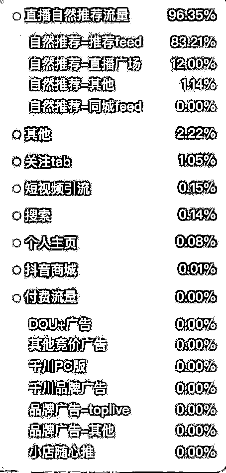

上图是抖音后台的流量来源统计，直播间进来的流量分别来自哪些渠道一目了然。

各个入口的具体含义，可以参考下面这张表，我们做了详细注解。

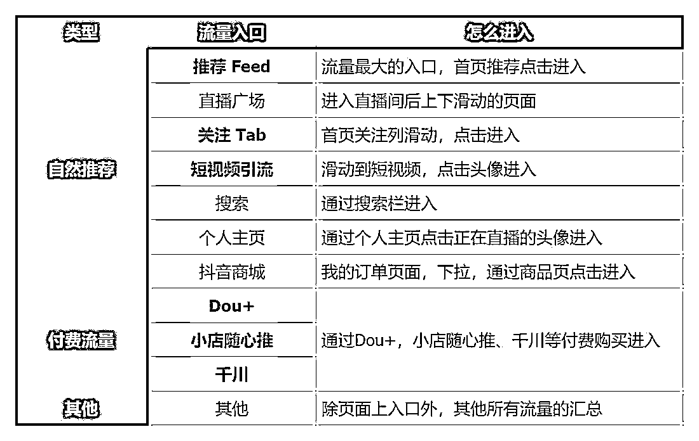

需要留意的几点：

1.

上述入口里，推荐 Feed 是把直播间人气做高的最关键来源，从这里进来的主要是新流量。

2.

关注 Tab 要等直播间积累了基础粉丝之后，占比才会慢慢抬升，以粉丝流量为主。

3.

短视频引流带来的用户精准度高于推荐 Feed，所以做知识付费的博主切不可忽视这块流量。

### 2.1.2 六层流量梯队

抖音把开播房间划为 S 到 E 六档，档位越高，平台给的小时观看越大。各档位的小时观看均值、房间规模与占比可以这样看：

S 档：每小时约一百八十六万人观看，房间二百六十二间，占全部开播房间的百分之零点零三；
A 档：每小时约三十六万人，房间三千三百四十八间，占百分之零点三六；
B 档：每小时约六点七万人，房间三点三万个，占百分之三点五六；
C 档：每小时约一点一万人，房间十五点四万个，占百分之十六点五二；
D 档：每小时约一千五百四十人，房间三十二点一万个，占百分之三十四点三七；
E 档：每小时约一百六十五人，房间四十二点一万个，占百分之四十五点一六。

排布很直观：曝光向头部聚集，大流量只落在少数房间。七成以上开播房间，小时观看不到一千六百；小时观看能过万的比例不到两成；能站上五万人门槛的，大约只有百分之五。

不过，观看规模与变现水平不是一回事。做知识付费，若每位用户能贡献一元以上，哪怕只在五百人左右的小池子里，播满两小时，销售额也能超过一千元。

新号刚起步，流量少、人群不准，属于常见阶段。持续产出内容后，平台才有机会识别并匹配更对路的人群。熬过前段冷清，才更可能拿到后面的结果。

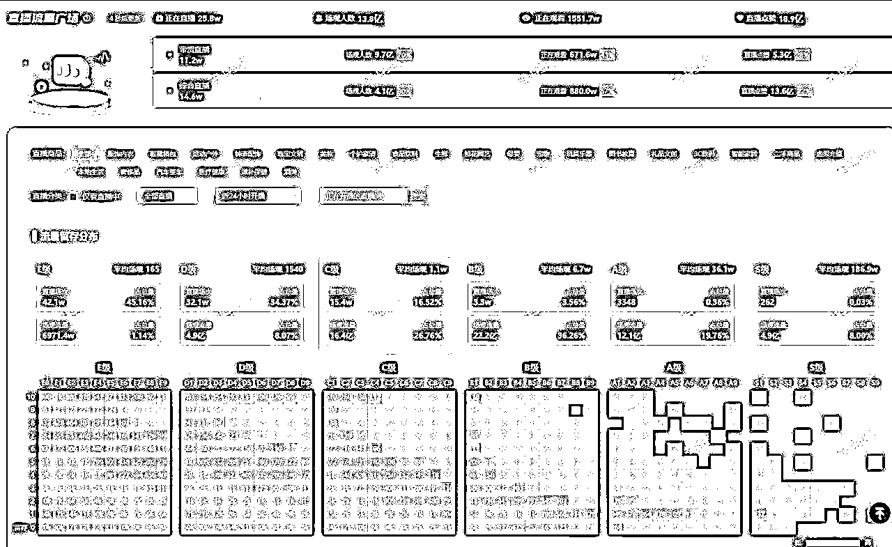

层级呈倒三角：新号从底部开始，整体数据跑赢同层其他房间，才有机会升到上一档，逻辑类似游戏打怪升级。

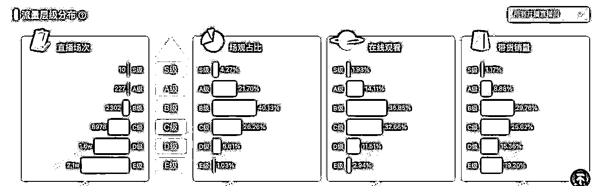

### 2.1.3 新号起号四步走

开播房间的流量由层级决定，层级又看数据在同层中的排名。新号通常会走过四个阶段，每个阶段做对动作，才能更快进入下一层。

**风控期**

特点：首小时观看不到两百。房间常出现“大头人”，既不说话也不离开，整场总量偏低。平台在对账号做风险控制，前期不会给大流量，一般持续一至七天，正常练话术即可。

目标：让平台判定你是正常开播房间。单场播满六十分钟以上，用户驻留均值超过二十秒，互动占比高于百分之一。

注意：流量很小的这段时间，下面几件事先别做，等后续流量正常再考虑——
1. 别让熟人主动搜索、转发，也别用成群小号连同一个 WiFi 进房；
2. 别频繁切换城市登录；
3. 注册卡、物联卡不要用；
4. 别用一张身份证绑定多个实名账号；
5. 开场别踩违规线；
6. 大头娃娃别急着拉黑。

**二、测时段**

1. 选一个你能长期坚持、同时目标人群活跃的时段；早期参考同行，后期看自己的画像分析；
2. 分别开播一至两小时，比较哪个时段流量更大；
3. 一天可以播两到三场，场与场之间尽量隔两小时以上。

**三、练话术**

开播期间持续讲当前领域的内容。平台时刻在识别房间话题，越早让它抓到关键词数据，越容易熬过风控期。这个阶段也适合熟悉话术和开播流程。

**冷启动期**

特点：首小时流量约两百到五百。

目标：把层级往上抬。单场播满六十分钟以上，用户驻留均值超过三十秒，互动占比高于百分之一，并且有成交人数。

这时在线人数往往只有十到二十人，硬卖产品难度大，重点应放在停留和互动上。可以用福利产品、福利资料配合互动话术做数据。基础指标达标后，大约五到七场，单场流量就可能突破到下一池。

**增长期**

特点：首小时流量约两千。

目标：打上账号标签。单场至少六十分钟，用户驻留均值超过一分钟，互动占比高于百分之一，成交人数（或粉丝团人数）占观看人数百分之一以上，口碑分在四点八以上。

增长期平台会推更多流量进来，这也是决定后续流量精准度的关键窗口。此时成交（或粉丝团人数）是账号标签的核心指标，因为付费用户对标签影响更大。【带货房间按成交人数算，非带货房间按粉丝团算。】可以上架一元低价链接，用来赠送课程相关福利资料；也可以提醒用户，加入粉丝团后下次开播会第一时间收到通知，粉丝团等级更高还能领高级资料包，以此提升本场粉丝团加入比例。成交单量超过三十单后，账号口碑分会显示出来。口碑分一旦下降，自然推流会明显减少，所以尽量维持在四点八以上。

**成熟期**

特点：首小时流量五千及以上。

目标：提升账号商业价值。单场至少六十分钟，用户驻留均值超过九十秒，互动占比高于百分之二，成交人数占观看人数百分之一以上，UV 值（千次观看成交金额）大于一千。

稳定期账号，平台对商业价值的考核会更严。想稳住大流量，除了基本停留和互动，还要做出更高的销售额。提升销售额有两个抓手：提高客单价，或者提高转化率。

### 2.1.4 开播间关键指标

这些数据可以在巨量百应后台的“数据参谋—直播数据—单场直播数据详情”查看；下播后，也能在抖音手机端右上角菜单—创作者服务中心（企业号为企业服务中心）—主播中心查看。

平台分发流量的根本依据，是房间用户实时产生的行为数据。它用数据量化每个开播房间的能力，排出名次，再按名次分配流量。所以搞懂关键指标很有必要。下面把重点指标、含义和提升方向整理出来。

**内容数据**

曝光点击率：用户看见画面曝光后，选择点进来的比例。平台给的是页面曝光，只有愿意点击的人才算一次观看，所以这项指标很大程度上决定了观看规模。它主要受场景布置、主播状态和当前话题影响。

累计观看人数：进入房间的用户总量。播得越久，累计观看一定会增加。但衡量流量大小不能只看总数，而要看单位时间的人数——一小时推一万人和五小时推一万人，成交转化效率完全不同。所以分析流量时，通常要换算成每小时的推流人数，再和同行对标。

平均驻留时间：所有进入者的平均驻留秒数，算法是总停留时长除以观看人数。它反映用户对内容的兴趣程度，也是影响总观看的关键指标。

四十秒以上有效观看人数：整场中观看超过四十秒的用户数。只看几秒就划走，说明内容没抓住人，平台会视为无效观看。抖音把观看满四十秒的用户算作真正有效的看播用户，这个比例越高，说明内容越优质。后台有这个指标，但目前只能看自己的，第三方还查不到同行数据。我们公司内部给这项指标的及格线是观看用户的百分之二十。

点赞比：本场点赞人数除以总观看人数，反映活跃度，能拉升热度，让新进用户更愿意停留，间接带动总观看。

评论比：本场评论人数除以总观看人数，作用同样是拉活跃、提热度、促停留。

互动占比：本场点赞加评论的总人数除以总观看人数，反映整体活跃度，间接提升总观看。

转粉比例：本场关注主播的人数除以总观看人数，反映内容价值感，间接影响推流。

粉丝团：愿意花一抖币（零点一元）加入粉丝团的用户。粉丝团用户有付费意愿，对流量影响权重大于关注、小于成交。对非带货房间来说，这项指标很关键。

**商业数据**

GMV（销售额）：本场总销售金额，反映卖了多少，但不直接决定流量。

商品点击率：商品点击人数除以商品曝光人数，反映单个产品对用户的吸引力。百分之十以上合格，百分之二十算爆品。

商品转化率：商品成交人数除以商品点击人数，反映房间的逼单成交能力。百分之五以上合格，百分之十以上优秀。

UV 值：销售额除以观看人数，反映平台推来的每个用户在房间创造了多少价值。当观看超过五千人时，这项指标会影响流量精准度和能否进入下一池。

GPM（千次观看成交金额）：销售额除以观看次数再乘以一千，反映平台推来的每次观看创造了多少价值。作用与 UV 值类似，但更精准——一个用户可以多次进入房间，所以 UV 值为一时，千次观看成交金额可能小于一千。

## 2.2 账号门面与养号

### 2.2.1 注册：先保安全

注册步骤不再展开，但要注意：一台手机配一张卡，并用移动数据完成注册，账号安全性会更高。

### 2.2.2 门面三件套：昵称、头像、简介

不管是新号，还是准备拿老号做这个项目，都需要做基础包装。目的是让目标用户一眼看懂你的业务，并通过昵称、头像和简介立住专业人设，第一眼建立信任，为后续留存和转化铺路。

昵称：直接把业务写进去，方便目标用户识别。可以参考这种组合方式——

前半段可选：升学、升学规划、升学指导、生涯规划、升学课堂；
后半段可选：XX 老师、XX 主任、XX 校长。

前后随意组合，比如“升学指导-小桃老师”。注意：为了账号安全，昵称里别放广告词，也别留微信号。

头像：常见两类——
①有亲和力的照片或形象照（推荐）；
②纯文字照片。

头像要符合定位、贴合昵称调性，别用浮夸的动漫形象。

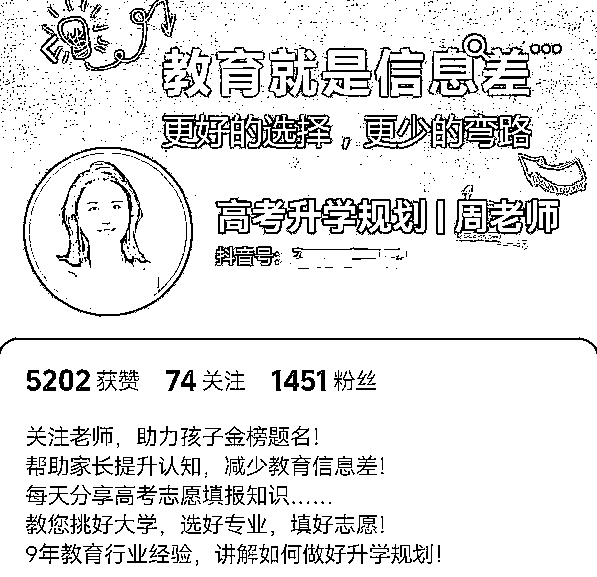

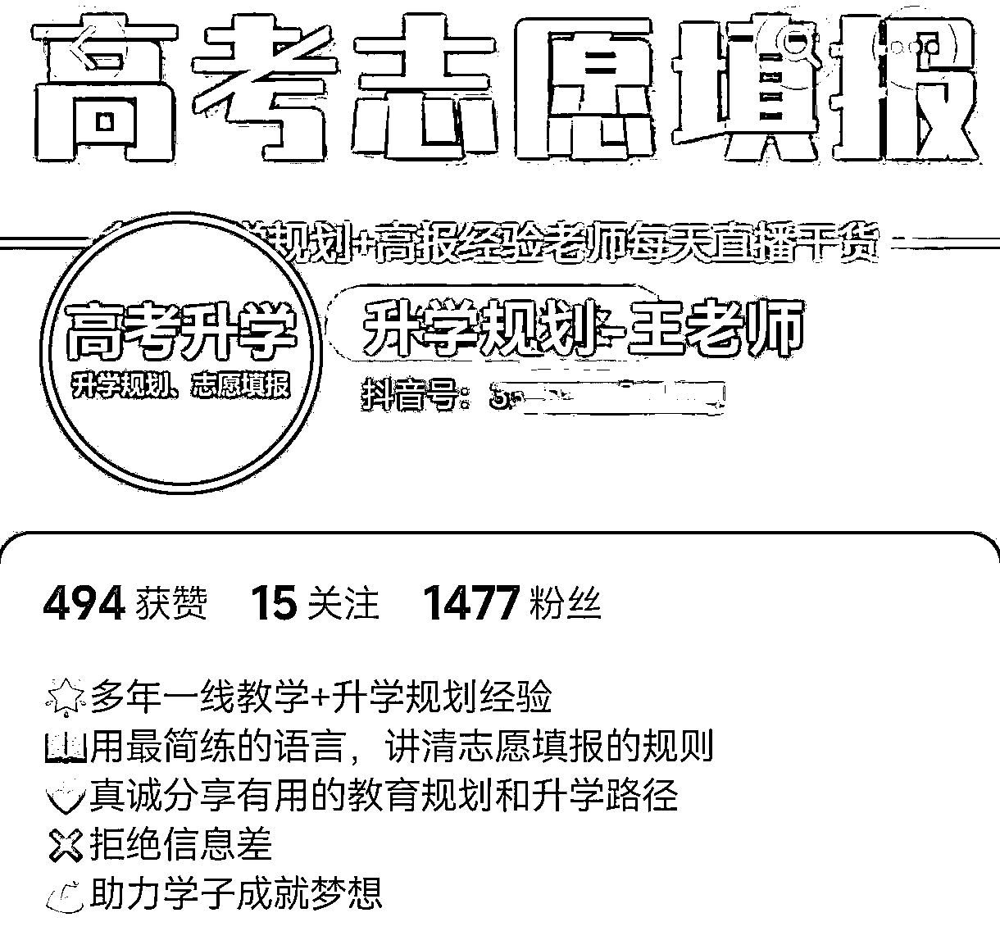

照片类自己拍即可。文字头像可以这样做：第一步，打开醒图，点导入，再点添加画布，选一比一比例和喜欢的颜色。

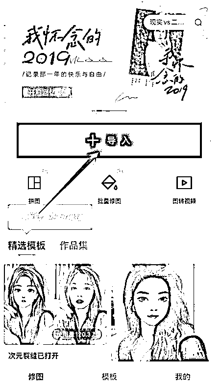

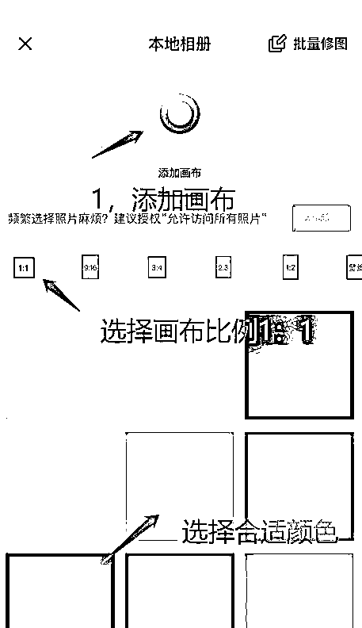

第二步，点文字，输入想要的字，选合适字体，点“样式”挑颜色，用双指调整大小和位置。注：想让文字分成两行，在需要分行的地方按回车即可。

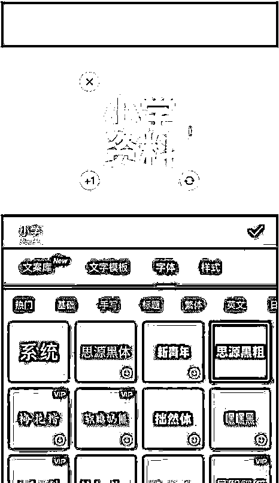

第三步，点右上角下载，保存到相册。

简介：用简单直接的话告诉用户你是谁、能做什么。通常包含四类信息——
你最擅长什么、资历如何；
你能提供什么；
用户能获得什么理想结果。

示例：
志愿填报专家、硕士
服务过上万人做志愿填报与升学规划
教你挑大学、选专业、填志愿，助你金榜题名
家里有初一至高三孩子的家长重点关注

也可以参考头像部分举例的两个案例，来编辑自己的简介。

### 2.2.3 养号：新号先当普通用户

新号注册完成后，正常使用三到五天。每天刷多久没有硬性限制，有空多刷、没空少刷，但一定要去用。刷的时候可以看直播、看视频、看同城，正常点赞、收藏、评论别人的作品。最好还能用这个抖音号购购物（不买也行），不需要刻意定向浏览，想看什么就看什么。另外，没开过直播的老账号，把原来的作品隐藏后，同样可以拿来用。

## 2.3 手播起步设备

我们的开播形式是手播，只需要露出手部，能拍清楚手部写画，或者能拍清楚要展示的屏幕即可。刚开始开播，准备这些设备就够了——

1. 开播用的手机，推荐苹果手机；
2. 展示内容用的纸笔（有电脑也可以直接展示电脑屏幕）；
3. 放手机的支架；
4. 补光灯。

支架和补光灯可以参考下面的产品准备：

1. 支架

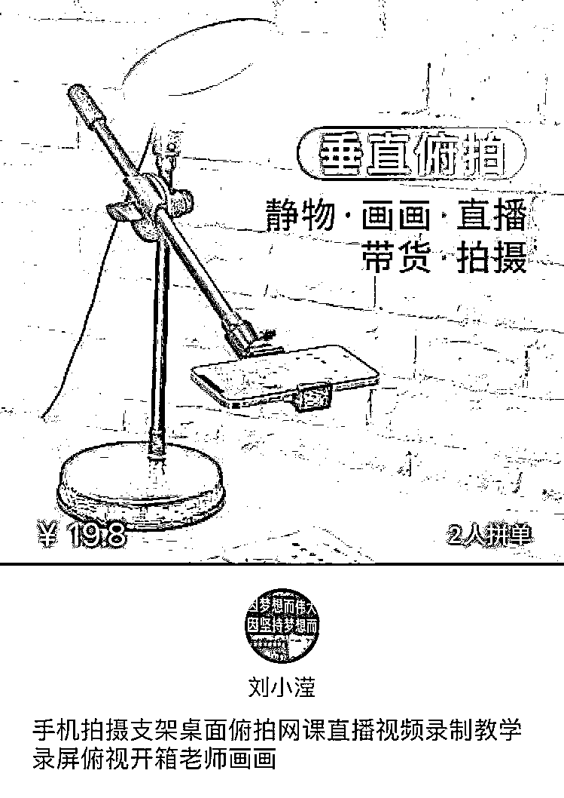

补光灯

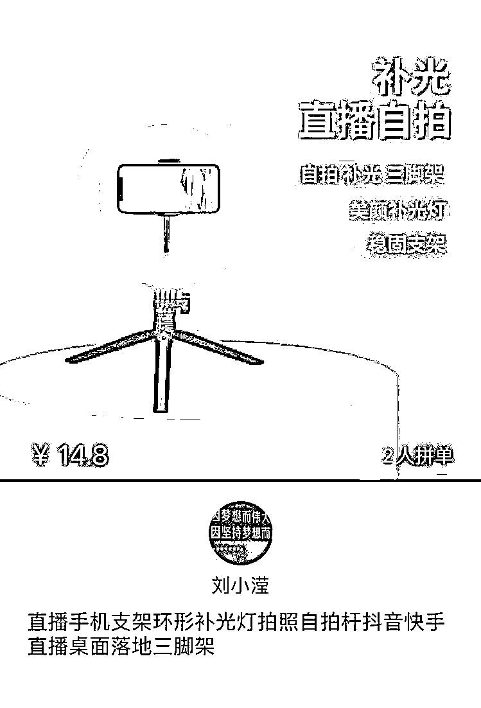

## 2.4 专业知识与话术底稿

话术是开播第一步。平时看到的知识类开播房间，背后大多是“脚本化”的，必须先备好话术，才能开播。开播成不成，八成看话术。先保证用户听得懂，再保证用户听得下去；只有备好一份好话术，停留、互动等数据才做得起来。

做升学赛道，可以通过阳光高考网获取开播所需的专业知识。网站涵盖政策、招生章程、专业解读、各地报考安排、院校查询、报考指南等信息：

阳光高考网：https://gaokao.chsi.com.cn/

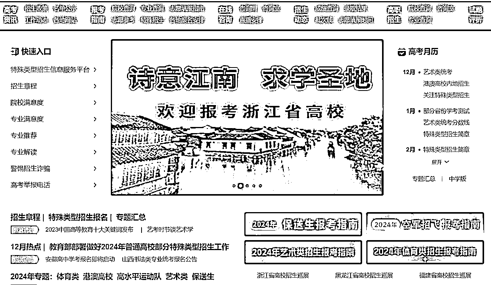

下面结合常见开播形式，说说分别需要哪些专业知识来支撑话术。所需内容大部分能在阳光高考网找到，也可以通过互联网搜索补充。

### 2.4.1 不同开播形式的话术准备

以下形式都是比较主流的升学开播形式，搜其他升学开播房间参考时，相信你也见过。要注意：不同时间点推荐的方向不同，这些形式对应学生的时间节点，需要跟着节点调整。比如选科覆盖高一和新高一用户，基本在五月到十月更热；志愿填报和特殊升学更多覆盖高三用户，通常从每年十月之后到第二年五六月更爆。

#### 2.4.1.1 形式一：特殊升学路径

除了高考出分后靠裸分上大学，新高考政策下还有三十多种多元升学路径。特殊升学开播房间，就是帮家长了解这些路径下的信息差。

说明：开播形式只是形式，不用纠结知识点完全匹配。比如“三十三种升学路径”只是一个标题，不可能真的把三十三种路径讲完，而是要根据近期热点和房间用户需求灵活调整。常见讲解形式如下：

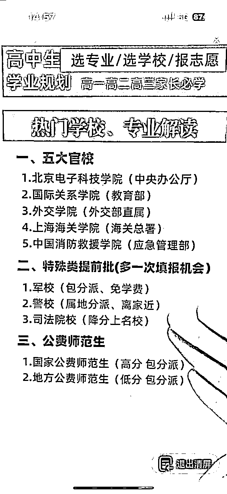

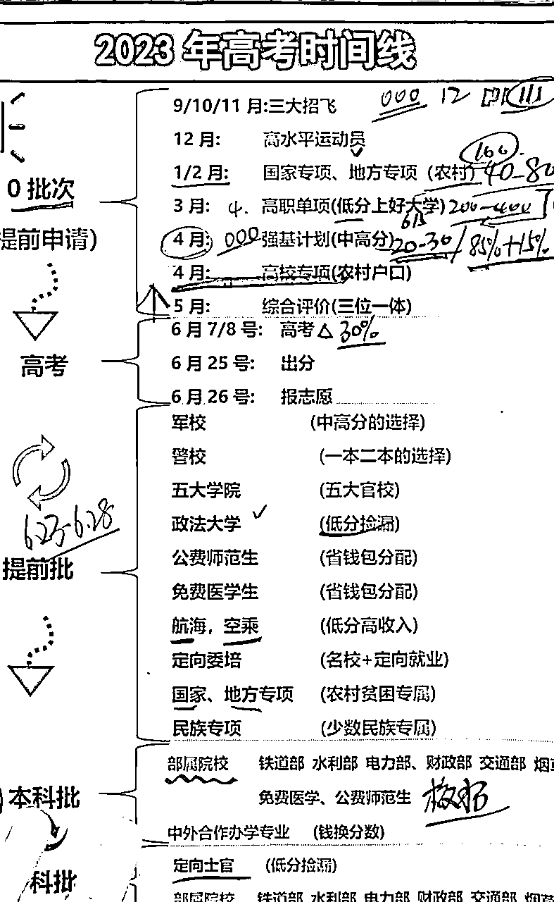

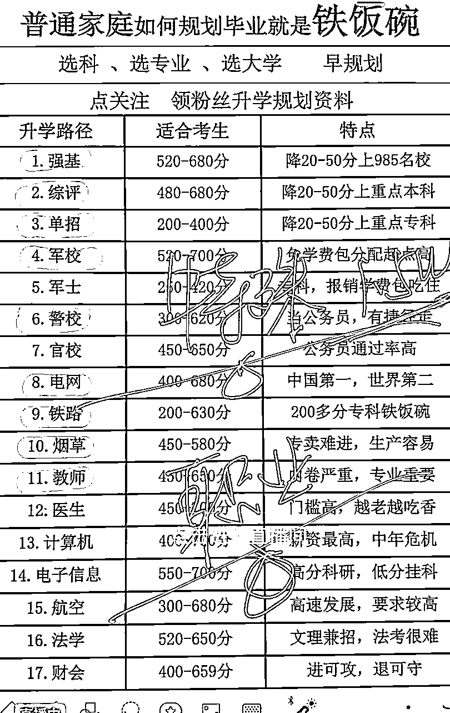

开播房间常见知识提炼，话术主要准备四部分内容（具体细节查阳光高考网）——
各类升学路径的报考时间；
各类升学路径的报考方式；
各类升学路径的报考条件；
各类升学路径的报考步骤。

这里也整理了一份特殊升学下的机会点汇总，供你参考：

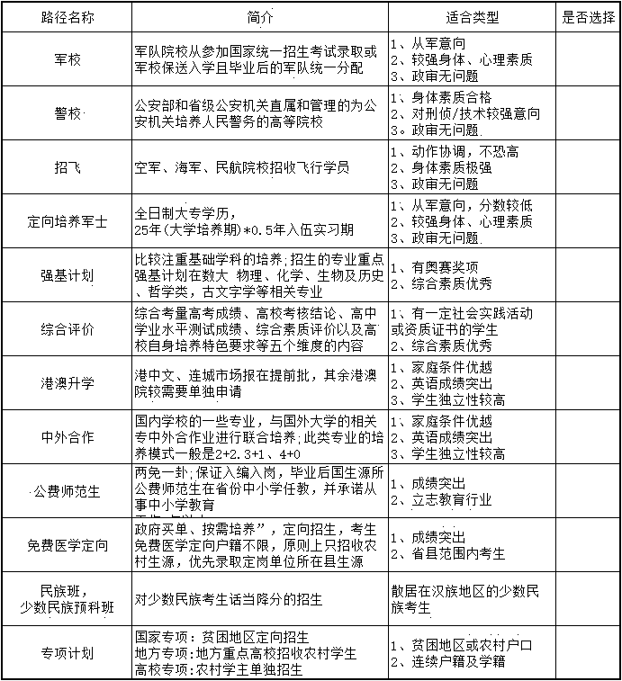

脚本参考：特殊升学方向

注意：该脚本仅作参考，里面的相关内容需要你通过阳光高考网查询最新信息后，完成一份自己的脚本。

#### 2.4.1.2 形式二：热门专业解读

热门专业，指的是二零二三年招生计划数量排名前二十的专业。招生计划越多，说明家长关注度越高。在抖音开播讲选专业，可以提炼四个知识点——
热门专业对应的就业方向；
热门专业对应的就业薪资；
热门专业对应的院校；
热门专业对应的选科要求。

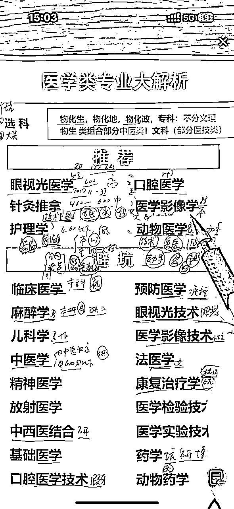

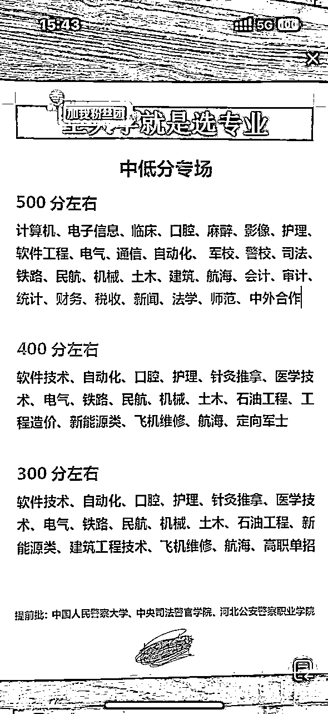

这四个知识点的具体内容，可以参考对标开播房间的短视频内容、小红书相关笔记，或者通过百度搜索等方式找资料，整理成自己的话术。部分内容可参考下面的脚本。

脚本参考：专业方向

#### 2.4.1.3 形式三：新高一选科

新高考政策下，选科不再是传统文理分科，而是按省份分为三加三模式和三加一加二模式。北京、上海、浙江、天津、山东、海南属于三加三省份，除语文、数学、外语之外的六个小科，学生可随机选三科组合，共二十种选择；浙江在六小科之外还多了“技术”单科，相当于七小科随机选三科，共三十五种选择。除此之外的省份属于三加一加二模式，六小科中物理、历史必选其一，剩下四门随机选两门，共十二种组合。

组合这么复杂，家长和孩子往往不知道该怎么选。如果能在开播房间帮家长和学生全面了解选科政策，最终做出科学合理的选择，自然就能吸引到这批目标用户。常见开播形式如下：

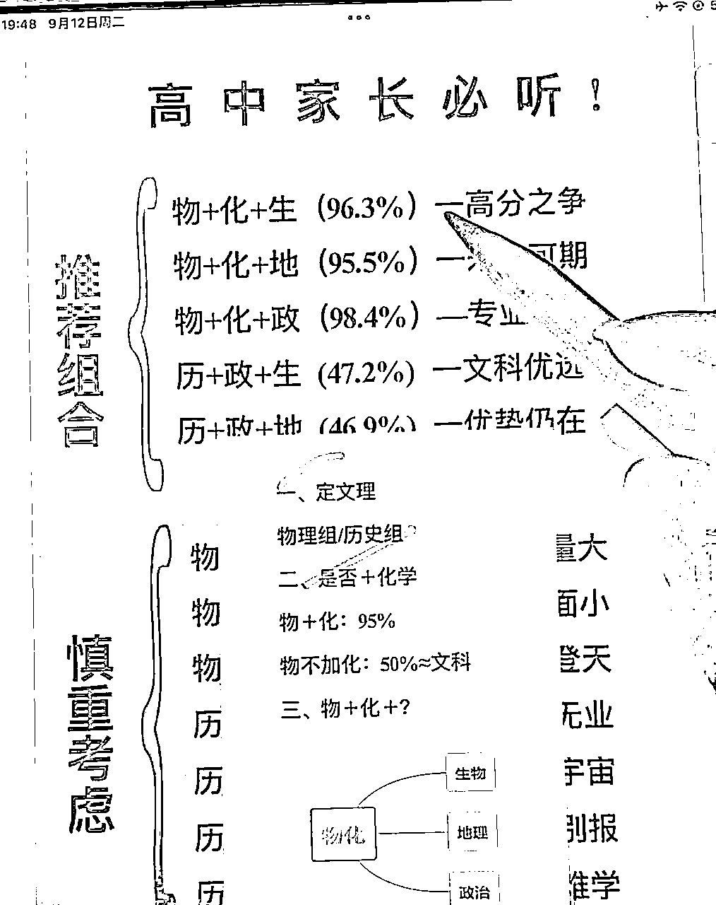

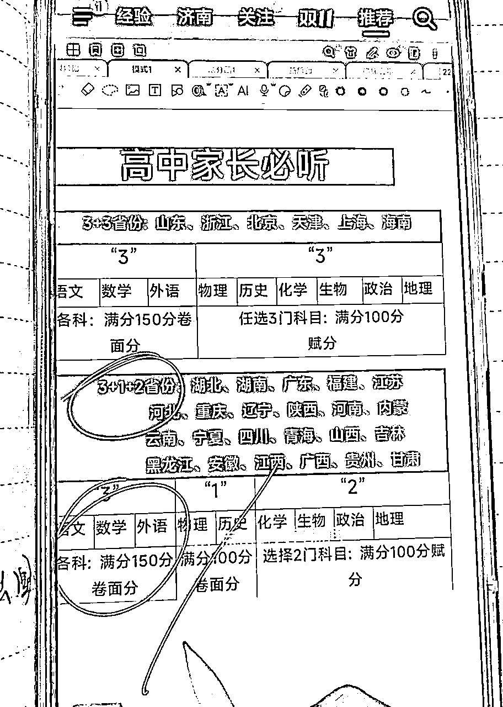
# 升学直播实操手册：话术、起号与破流量

选科主题开播前，先把四块内容装进脑子：不同组合能覆盖多少专业、各省规则有何差别、选科对应哪些专业去向，以及这四块怎样落到具体讲法。找资料时，可去阳光高考网、同类账号的直播与短视频、小红书笔记、百度检索等渠道，取回信息后用自己的话重新组织。下面的脚本仅作参考。

脚本参考：选科方向

#### 2.4.1.4 形式四：平行志愿填报技巧和案例解读

新高考改革铺开后，平行志愿在各省份基本普及。它跟老式顺序志愿不是一回事：既要让分数不吃亏，又得防住退档和滑档。这个直播方向，就是帮家长把平行志愿的投档规则、操作办法一次弄明白。

常见直播形式：

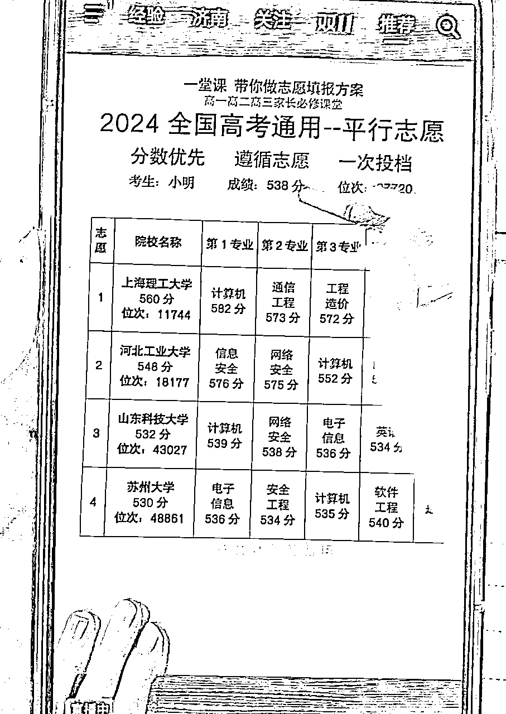
可提炼的直播间知识点（可借鉴同类账号）：
- 志愿填报步骤，以及近三到五年录取线
- 退档、滑档相关分数计算
- 院校与专业拆解，配合案例讲解

脚本参考：志愿填报方向

#### 2.4.1.5 形式五：专业+填报综合场

综合场不再只讲单一板块，而是把前四类主题按需拼接，为家长提供更立体的建议，也能接住更分散的提问。话术通常由三部分搭起来：专业解读及对应院校、志愿填报流程与规则、填报中遇到的退档滑档情形。部分内容可参考下面的脚本。

脚本参考：专业+填报方向

### 2.4.2 话术拆解步骤

#### 2.4.2.1 录制对标话术

录制同类账号的直播内容，可以借助小绿点与飞书配合完成。

小绿点安装升级 2023.rar

飞书官网下载地址：https://www.feishu.cn/使用步骤：

① 按「小绿点安装升级 2023.rar」里的安装说明，先把小绿点装好。② 在抖音网页端检索你想录的升学规划账号名，进到对方播出页面，接着点开详情。

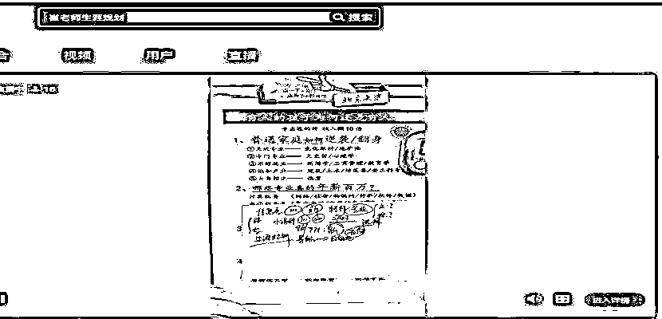
③ 页面打开后，把网址复制下来。

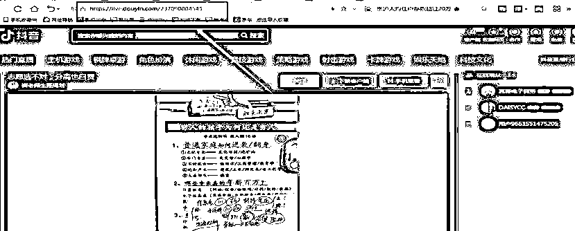
如果是在手机端找到的账号，用下面这种分享链接同样可行。

④ 回到小绿点，点“添加主播”，在空白区域粘贴刚才的链接，把它加进主播列表；然后点检测录制，勾选“我已知晓”，再开启守护。

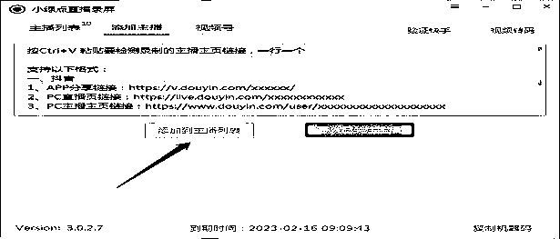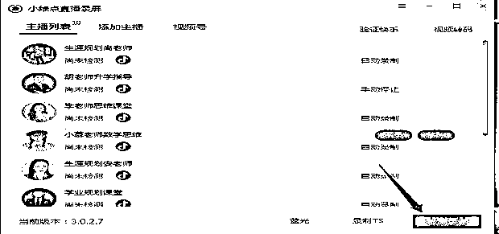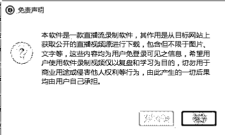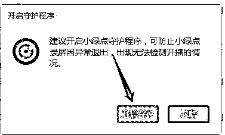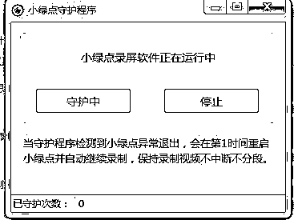
⑤ 添加完成，程序会自动开录。后续不必重复添加，只要小绿点开着，主播一开播就会自动记录。

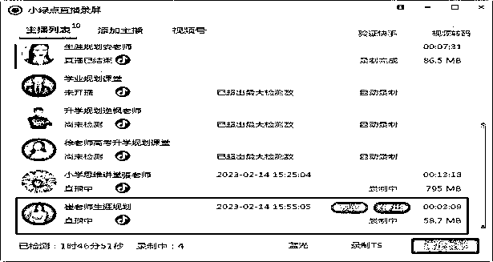
⑥ 在已录好的条目上点右键，选“打开视频目录”，刚生成的视频就在里面。

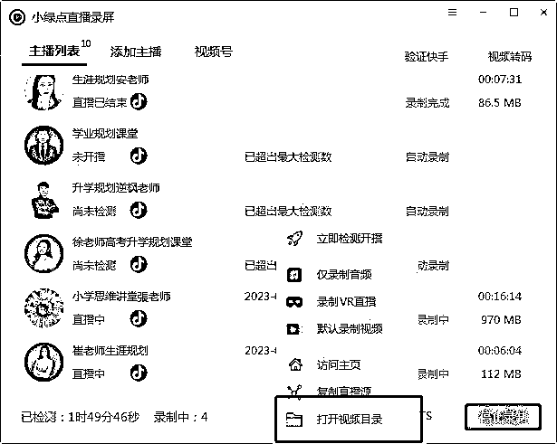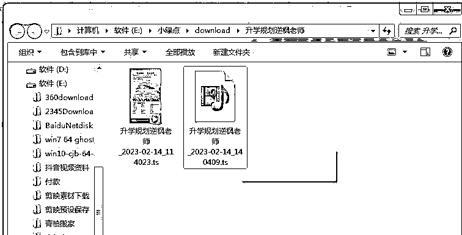
⑦ 右键该视频，找到“视频转MP4格式”，执行开始转码。转好后原文件夹会多出一个MP4文件，把它传到飞书妙记，就能把视频内容转成文字稿。

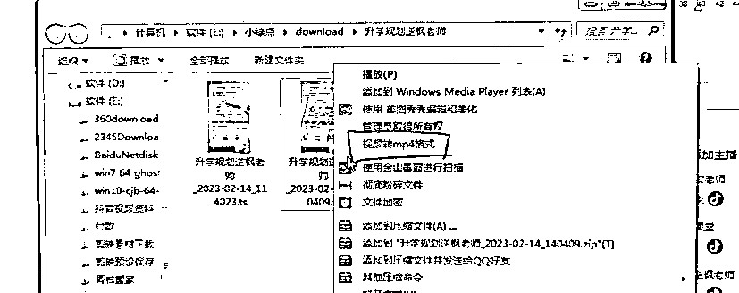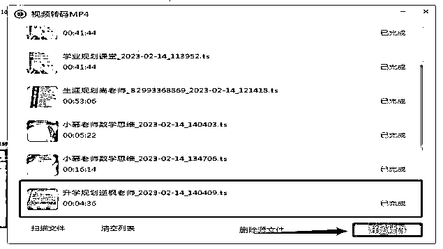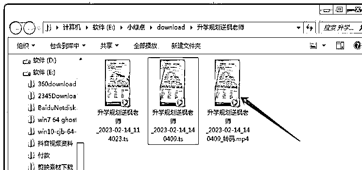
#### 2.4.2.2 拆解专业知识

按前面的操作拿到同类账号话术后，下一步是把其中的专业信息逐条挑出来，整理成知识模块。

以「选科原稿」为例：

下面这些内容，多为暖场时抛出的问题：1、没选政治，军警院校还能不能报？2、哪些情形适合走文科？3、选科有三种模式——3+3、3+1+2、文理分科。

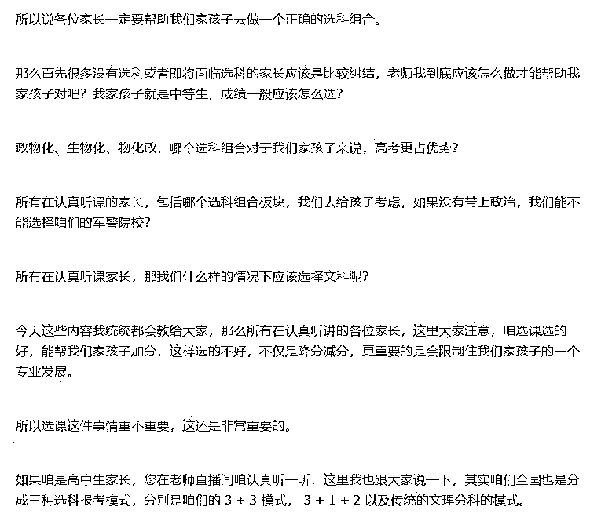
紧接着三段，分别说明哪些省份用3+3、哪些省份用3+1+2。

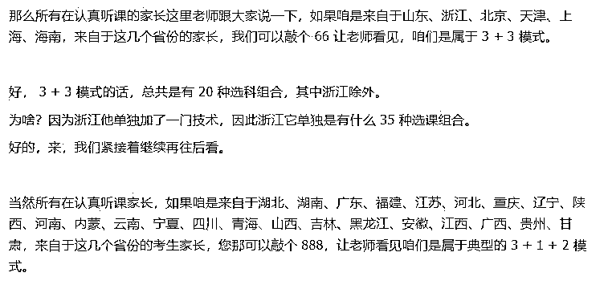
再往下进入知识模块：1、3+3与3+1+2各自怎么定义？2、不同组合在可报专业上有何区别？

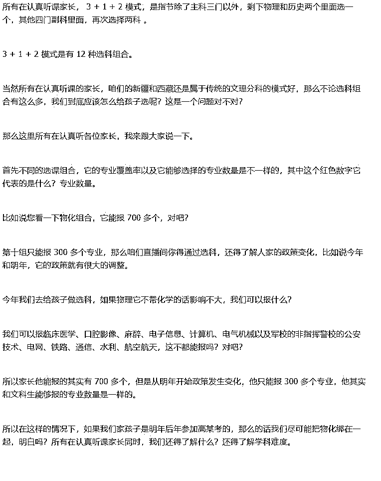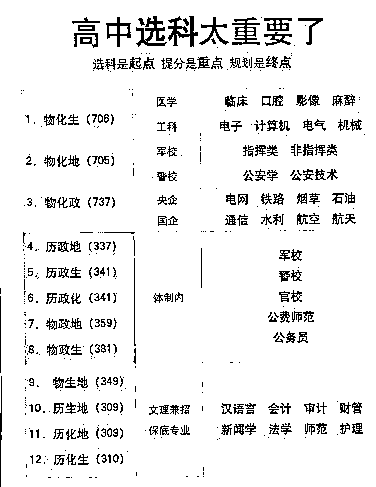
后续段落讲的是知识模块：学科难度。

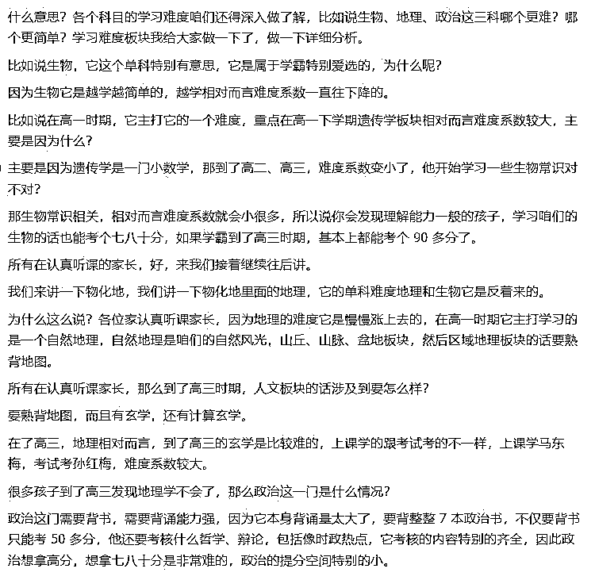
#### 2.4.2.3 拆解互动话术

专业内容拆完，接着看同类账号怎么安排互动。通常每五分钟要引导一次互动，每三分钟提醒一次点赞。

例如上面案例中标红的部分，就是互动话术。我们也把这类话术单独摘出，并做醒目标记，便于区分和借鉴。

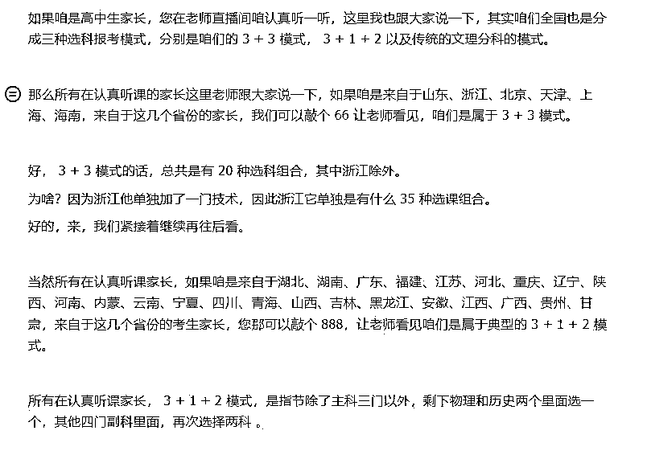
#### 2.4.2.4 拆解带货话术

这一步聚焦挂车之后、直播后半程推荐商品时使用的转化话术。可以等准备挂车、需要加入转化环节时，再拆这部分。

下面这份原稿，就是直播中由专业知识切到挂车商品推荐的话术，供参考：19元课带课话术。

# 三、【项目实操 2/4】练熟话术，完成起号

💡
章节概要：话术备齐，是否就能立刻开播？先缓一缓。直播没有倒带键，你怎样表达观点，会立刻传到观众眼前。所以正式开播前，还要把内容练顺，保证讲解自然，这也会直接影响起号快慢。

这一章解决两件事：
✅通过四个阶段，把内容熟练度和流畅度练起来
✅成功开一场直播，再用三到五场完成起号

💡
本章航线图：学完并做完，航线图第二阶段就能打勾——直播练习，并通过三到五场直播起号（五到七天）

对着镜子顺话术、找节奏（约一天）
在视频号做试播（约一天）
在抖音连开三到五场起号（三到五天）
记录直播数据，每天抽约三十分钟复盘优化

现在就可以开始练。

## 3.1 练内容熟练度与流畅感

主播的能力，说到底是练出来的。内容准备好后，想讲得顺，可以分四个阶段推进。

提醒：每个阶段都要把稿子读三遍以上并录音，逐遍回听；再找同类高赞账号的相同五分钟片段做对照，找出差距继续打磨。

### 3.1.1 阶段一：练到不卡壳

直播是实时输出，主播对内容熟不熟，观众一下就能感受到。一旦打结，信任感会掉。因此稿子备好后，至少通读三到五轮，做到讲述不中断、不磕绊、不来回重复。

本阶段目标：准备一份逐字稿和一份大纲，只瞄大纲也能把整篇内容讲完整。

### 3.1.2 阶段二：练声音穿透力，也练情绪

声音穿透性——让个人气场更足。

本阶段目标：站在十米开外的一头，设法让另一头的人听清你讲的内容。用这个办法破除心理发怵，练出声音的穿透力，从而提高曝光进入率。

### 3.1.3 阶段三：重点话术练起伏

此时可以借助镜子练习。每个知识点里的关键词句，讲的时候要加重、停顿、变化，让整段输出有抑扬顿挫。

本阶段目标：录下自己的讲解，结束后回听，不能像照着纸念，要能听出情绪变化。

### 3.1.4 阶段四：练自信与动作

只对镜子练，真实感还不够，所以可以在视频号做一次试播，播完看回放，检查话术掌握得如何。等内容熟到能自由发挥，再适当加入手势，辅助表达态度与观点，情绪价值会更强。

本阶段目标：录下直播内容，声音与动作配合起来，能让观众产生代入。

视频号试播操作：

① 搜索并进入视频号。

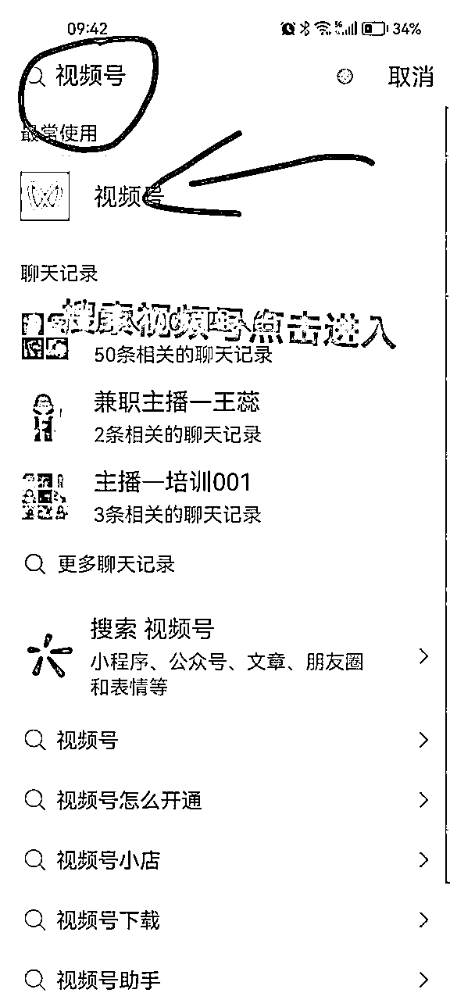
② 点右上角，进入个人中心。

③ 点“发起直播”。

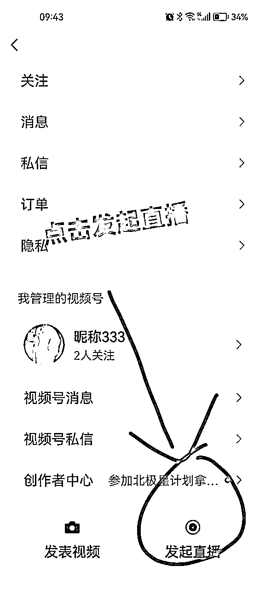
④ 点“直播模式”进入修改。

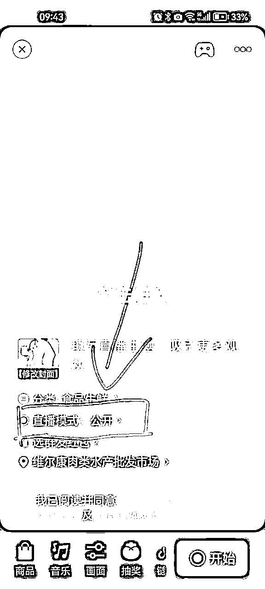
⑤ 将直播模式设为部分可见。

⑥ 点“画面”。

⑦ 点“翻转”。

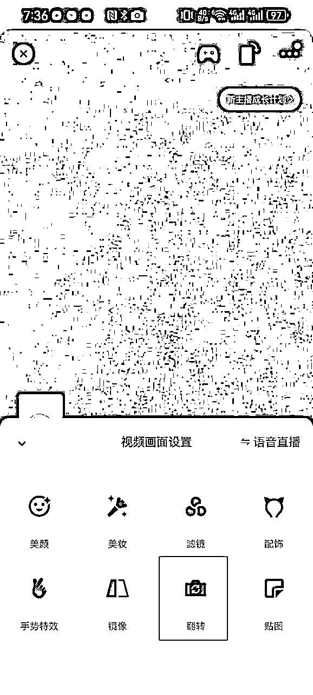
⑧ 设置完毕，点开启直播；结束后记得生成回放。

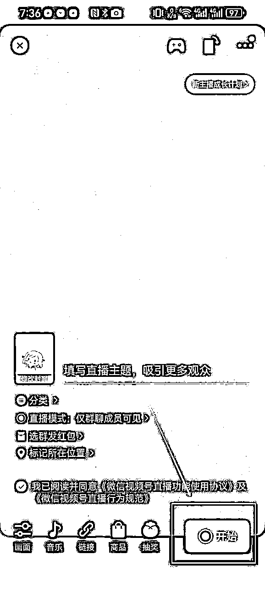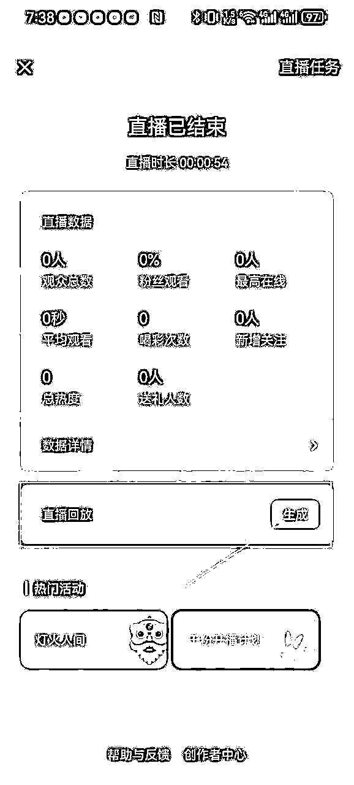
## 3.2 成功开启一场直播

练得再多，也替代不了一次真开播。当你能流畅、带情绪地讲完整场话术，就可以在抖音开播起号。

起号期不要挂车，全程讲专业知识，连播三到五场。首场试播四十五分钟以上，后面每场保持一小时以上。边讲边熟，边把号起起来。

判断起号是否成功：连续三场，每场至少有3个有效互动、3个有效转粉，停留时长高于0.7分钟。

### 3.2.1 开播流程和设置

先搭直播场景。下面用侧面镜头展示各设备如何摆放。

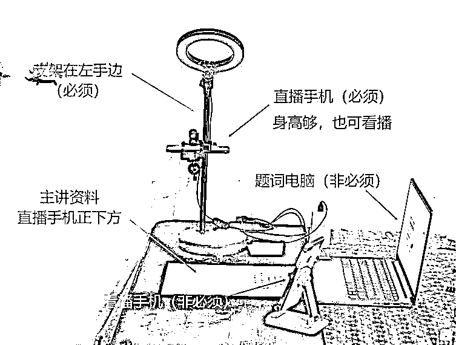
首场直播的设置并不复杂，下面演示开播操作。已经在抖音播过的同学可跳过。

① 启动抖音APP，点底部【+】号，再选【开直播】，进入开播前准备页。

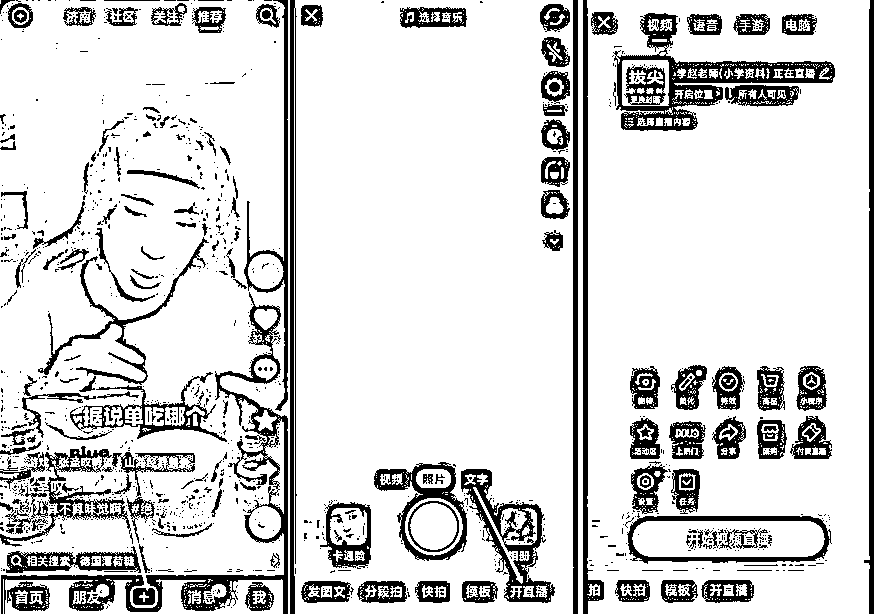
② 把直播信息补全。需要填的字段有：

1. 封面：与主题相关或真人照，利于观众点进来（正方形最佳）。
2. 标题：点明直播内容，吸引观看（十字以内）。
3. 直播内容：检索“综合教育”并选中，便于触达兴趣相近的人群。
4. 直播间介绍：写得清楚，能增加进入意愿。

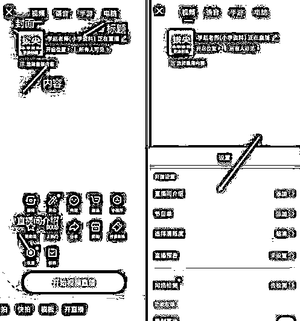
③ 关掉全部美化效果，点【开启视频直播】开播。

### 3.2.2 起号期注意事项

1. 开播时间尽量固定。
2. 起号阶段不要频繁换内容。
3. 每场直播保持一小时以上。

# 四、【项目实操 3/4】突破流量环节

💡
章节概要：第二章讲过抖音直播流量分发原理。落到实操，怎样突破流量池，让目标用户越聚越多？这一章从几个维度入手：

✅直播内容与状态
✅直播场次数量
✅直播数据运营，如加团、互动等

本环节参考目标：流量目标——互动转粉达1%以上，停留0.8分钟；可带货标准——连续两场场观1500+。流量是转化的前提，每场播完都要复盘，逐步把流量表现拉起来。

💡
本章航线图：完成学习与实操，航线图第三阶段即可完成——优化直播、突破流量（约三天）

1. 了解可带货标准，掌握提高留人与互动的方法（约一小时）
2. 在话术中植入福袋、红包、加团、加粉设计（约两小时）
3. 在抖音持续开播，突破流量（两到三天）
4. 记录直播数据，每天抽约三十分钟复盘优化

现在就开始在直播中调整，并加入互动话术，争取更多流量。

达到起号成功标准后，就进入下一关——突破流量。精准流量足够多，挂车后转化才会持续。

影响流量层级的因素包括：直播内容与状态（影响停留时长）、场次数量、直播数据（加团、互动、停留等）。

提醒：这个阶段同样不建议挂车。流量差时带货会拖累账号，平台容易给账号打上电商标签；一旦带上电商属性，后面再破流量池会更吃力。为了长期收益，暂时舍弃少量转化机会是划算的。

本环节参考目标：流量目标——互动转粉1%以上，停留0.8分钟；可带货标准——连续两场场观1500+。

## 4.1 直播内容与状态

教育直播能留住人的根本，是内容有价值：让观众联想到自己的痛点，并在你的讲解里听到有用信息。但不少播过的人会发现，大多数人悄无声息地来，又悄无声息地走。先处理两个基础问题：

① 不流畅——讲得磕绊、不熟、不顺；
② 听不懂——难以理解的内容不要硬讲，先摸清受众的认知水平。

基础问题解决后，再按每场数据复盘：有互动的段落留下，没互动的段落改掉。

内容设计可套用：痛点+干货+钩子。每讲完一个阶段，提前为下一段做铺垫。

有痛点：能说中观众最想解决的难题。
有干货：真正能帮大量用户解决问题的内容。
有钩子：每个板块收尾时，都为下一部分埋下引子。

另外，教育直播受状态影响更明显。教育主播类似老师，要靠内容输出做数据、做转化，所以状态好坏会直接反映在数据上。状态方面没有太多花招，保持好精神，提前十分钟再熟悉一遍脚本。说得虚一点：对教育保持热爱和初心。

## 4.2 直播场次安排

突破风控后，想快速把数据拉起来，最直接的办法就是增加场次。条件允许时，从每天一场加到每天两到三场。时间要固定，每场控制在七十分钟左右。

冲流量像登山。技巧能让你爬得更快、更省力，但学技巧需要时间，每个人悟性不同。能最快拉平差距的，就是多花时间往上爬。山一直在那里，俯下身去爬；山不朝我走来，我便朝山走去。

## 4.3 直播数据运营

账号流量由流量层级决定，而层级突破靠基础数据。这个阶段要重点盯加团、互动、停留等指标。

### 4.3.1 加团数据

增长期账号会得到抖音更多流量推荐。此时数据还不足以支撑带货，应把重点放在加团上。可用三种方式：

① 直播间发福袋；
② 发红包；
③ 福利资料，配合互动话术拉动直播间互动数据。

4.3.1.1 用福袋拉动互动

福袋是抖音官方提供的互动工具，能降低观众参与门槛。账号刚开播、还没有基础种子用户时，主播可以把干货、资料装进福袋来留人，带动互动。

一场直播可发三次福袋，规定观众评论指定一句话才能参与，以此拉互动。抢福袋的人必须先完成互动，才有领取资格。福袋通常安排在刚开场、开场二十分钟、开场四十分钟穿插发放。

福袋设置步骤如下：

知识型直播间的福袋，一般放三类东西：

1. 痛点问题解决方案；
2. 让观众觉得有价值的资料；
3. 提供服务型。

痛点问题解决方案：不追求大而全，只针对一个痛点给出方案，比如英语满分作文的通用框架和常用词。

让观众觉得有价值的资料：操作步骤型，如怎样拿下语文阅读大题；数量取胜型，如英语考点108问；与众不同型，别家送模拟题，我们送母题。

提供服务型：一对一解答一次问题，必须限时。

设置福袋玩法时，按目的不同设计领取方式，常见有两种。1）用福袋好评提升信任度。

2）资料抽奖：既留住人，也攒起信任

**玩法一：福袋里埋着夸赞，先让新观众信你**

福袋挑“全民款”；中奖名额放十个；奖池合计十枚抖币；每轮等待十分钟开奖。参与口令可以设成“某某老师讲得实在”“这波学到了”“干货真不少”这类夸人的话。十分钟开一轮，同一个账号一天最多发起十回。

效果很直接：先把场子烘热。刚进门的人一瞧满屏都在刷互动，对主播的戒备心自然松下来，信任感起来得更快。

**玩法二：把资料装进抽奖，让新观众多待一会儿**

资料白送，但别让观众“自己去领”。把它塞进福袋或截屏环节，让用户先动手参与——互动数上去了，“名额有限”的味道也出来了。

配置上，普通资料走全民福袋，值钱的资料走粉丝团福袋；中奖名额三个，奖池十枚抖币，等待十分钟开奖。口令可以写“福袋里有xxx”——这里千万别顺嘴说成“福袋送xxx”，措辞不当容易被判违规。

截屏抽的门槛：用户得先关注、还得是粉丝团里的人；主播把名字念出来之后私信对接，等收播再把资料发过去。

#### 4.3.1.2 靠红包点亮粉丝牌

红包这玩意儿，主要是为了把人往灯牌上引。发放方通常是助理账号，以刷礼物的方式送出去；一份红包二十抖币，够十五个人抢。

一场下来撒四五份，单份倒计时五分钟、面额二十抖币，什么时候插入都行，随机来。主播可以这样搭口播：“左上角我刚撒了个红包，讨个好彩头，愿孩子们都能金榜题名，大家去沾沾喜气；抢到的家长，麻烦给老师把粉丝灯牌点亮，进粉丝群领整套直播课件。”

具体发红包的操作教程，直接上抖音搜：

#### 4.2.1.3 入团之后，资料怎么给

头一步，把资料的分量讲足：它对准什么难题、稀缺到什么程度、多少人盯着、平时得满足什么门槛才给。

第二步，交代拿到它的路径。常见的形式有：点赞攒够某个数、在评论区敲指定字样、福袋抽、截屏抽等等。

第三步，直播刚起步、人还不多的时候，直接把做完动作的用户名字念出来，当场宣布“你拿到了”，用这第一个人的奖励去撬动后面的人跟进。

入团环节的口播，可以照着这段参考：

在认真听的家长们，手头没抖币的别发愁，我来补上。大家这么捧场、还给我刷礼物，我也得表示表示，发两百个。听好——认真听课的家长，没有的去左上角领，已经有的就把机会让出来。左上角点黄星，点完会弹出加入粉丝团；加团的时候抖币你们自己收着，加完进43抖音粉丝群。

下播六十秒内，全套电子资料就发出去。怎么确认自己进没进？看左上角那个红色福袋，能点开就是进去了，点完接着回来听课。下播统一发电子版全套资料。

#### 4.2.1.4 把过路观众变成粉丝

粉丝增量同样牵动流量分发，而且用户点了关注，后续开播他能收到提醒。

这个动作别塞太满，一场直播做两回差不多了。

口播示例：还没关注老师的，左上角关注点一下；关注过的家长，可以申请加入老师的专属资料群，下播后整套课件会发到群里。

### 4.3.2 互动

互动，是平台考核直播间时很看重的一项数据。互动一多，刚进门的观众更容易顺着节奏走，停留时长和互动次数都会跟着涨，场观流量也就更高。所以把互动做起来，是绕不过去的一步。

一套互动话术可以拆成四块：钩子、价值、动作、领头羊。

#### 4.3.2.1 钩子：先给一个愿意动手的理由

知识付费场子里的人，刷抖音图的多半是乐子，听干货本身就有点违逆天性，还要让他们配合操作，就得拿出足够有吸引力的钩子。

别硬凑互动。比如逮着“点关注”“亮灯牌”来回念叨，对还没攒起老粉的新账号几乎不起作用。要挑真正管用的钩子。

常见的有两类：

1. 实物钩子：送福利产品，配合前面说的福利留人方式，把互动带起来。

2. 知识钩子：用户想听某个知识点，或者心里压着某个问题，让他来互动一下，主播就挑那部分重点讲。

长期效益：想天天来学的，点个关注，开播第一时间通知你。

#### 4.3.2.2 规则：把操作现场演一遍

来听讲解的观众，新人占了不小比例。关注、加粉丝团、点赞这类步骤偏多的互动，必须当场演示，让观众跟着一步一步做。

最好再备一部手机，把操作画面直接怼进直播镜头里。

#### 4.3.2.3 领头羊：逮住第一个动手的人

场子里常能看到一个规律：迟迟没人开口互动，气氛就像冻住了一样；但只要冒出第一个动手的，主播马上给他奖励，后头的人就愿意有样学样，互动量跟着往上走。

把上面三块拼起来，教育类直播的互动话术设计起来其实不复杂。肯留在场里听的，多半带着明确的痛点。

话术可以按这条线走：痛点+给方案（送资料）+拉互动（粉丝团+评论点名送）+讲资料+点名。

痛点要放进具体场景里讲，重点渲染“解决了”和“没解决”两种结果的反差。流量少、互动冷的时候，可以直接点名，甚至用一对一答疑当作钩子。

# 五、【项目实操 4/4】讲解之后，如何成交

💡

章节概要：当流量和账号都够得上带货门槛，就能开通带货权限，在直播里挂车做转化了。

这一章要聊的是：粉丝不足一千怎么挂小雪花，破千之后怎么挂小黄车，以及如何调整话术脚本把转化率提上去：

✅摸清所带课程的底细
✅提高转化的门道：怎么转场、怎么把产品价值讲出来、怎么推着用户下单
✅不同情形下怎么挂车：小雪花和小黄车各自的门槛与操作

细节往后翻。

💡本章航线图

学完并动手做完这一章，航线图的第四阶段就算走通了：完成挂车操作，尝试直播转化（每天约2小时）

摸清要带的课程信息（约1小时）

2. 把转化话术写进直播脚本（约2小时）

按自己账号的实际情况挑挂车方式（约1小时）

开播，持续做转化（每天1.5小时）

记录直播数据，边播边复盘优化（每天约30分钟）

那就现在，把商品挂上去，试着成交，挣到第一笔佣金。

## 5.1 先把课程摸熟

对课程越熟，转化越顺。我们顶着“升学规划老师”的身份，得摸透家长和孩子的难处，也得清楚自家产品凭什么能解这些难处，用户才会愿意信你、掏钱。

至少要掌握下面几项：

1. 课包里配的图书信息（比如语数外各一本，或者三科合成一本通）

2. 随书附送的课程信息：覆盖哪几个学科、怎么上课、由谁来教、还有哪些配套服务

3. 上课信息：排课时间、每节讲什么主题、上课形式等

4. 书里涉及的知识点和内容架构。这块可以靠样书来补，像高途那三本，先把样品拍回来，把书和赠品翻一遍。

## 5.2 提升成交的几个动作

### 5.2.1 从讲知识切到卖课

转场话术就是知识讲解和卖货之间那座桥。比方说正讲着选科，要拐到卖课上，就得挑对位置，把话说得顺理成章。

衔接顺不顺，直接决定用户会不会划走。所以得好好琢磨，怎么把观众的兴趣从干货引到课程上去。

看个例子：选科不光要分析各组合的利弊，还得看孩子本人是什么情况。打铁先得自身硬，分数越高，能挑的路才越宽，所以成绩中等的孩子，头一件事该想的是怎么把分提上来……

把各类家长的痛点拆出来，一个个配方案。像语文拖后腿、数学跟不上、英语提不动，上课听懂了做题就卡壳，孩子明明很拼成绩还是不上不下……这时候可以请出XXX课程，用XX服务帮孩子把卡点打通。

这么一来，话题就从选科滑到提分，最后落到卖课上。

### 5.2.2 产品讲解：把价值立起来的三个面

#### 5.2.2.1 维度一：课程自身的内功

重点讲书里装了什么，涵盖师资、行业地位、课程要攻克的核心问题。

师资：授课老师拿过哪些荣誉、有什么经历。

行业地位：机构在业内排到什么位置、拿过哪些有代表性的奖项。

课程问题：核心攻克什么、主要内容有哪些，压缩在三个点以内说透。

#### 5.2.2.2 维度二：后续服务值不值

对课程而言，后续服务常常比课程本身更值钱。一般分成四块：

赠品：随书附送课程和额外资料。

助教：一对一答疑解惑。

社群：行业交流，日常互通信息。

陪跑：专人带着，把课程后续的执行辅导到位。

#### 5.2.2.3 维度三：跟别人差在哪

前两块讲完，要重点亮出跟同行课程不一样的地方。可以从这几个角度切入：

服务时限：不少课程讲完就散场，我们的课看一遍会生成回放，能看三年。

课程质量：九节录播课，把高中九科的重难点全包进去，孩子课上漏掉什么，可以拿它查漏补缺，假期预习复习也能用，同样三年回放权限。

讲解形式：数学怎么提分、英语怎么提分、语文怎么提分、物理怎么提分、化学怎么提分、生物怎么提分？每周五、周六、周日、周一晚上7:00，直播讲。

### 5.2.3 五招推着用户下单

直播间观众的平均停留也就一分钟上下，所以想把成交拉起来，这临门一脚少不了，得推着用户赶紧下决定。下面介绍五招常用的。

#### 5.2.3.1 招数一：让观众自动认领

先把观众归到某一类人里，让他自己生出“这不就是我嘛，这套东西对症”的念头。

比如让观众自己对号：

描绘提分之后的画面（能提多少分、提分前后的落差、公办本科和民办本科的落差等）。

描绘未来的发展空间（热门专业、同专业不同院校之间的落差等）。

拿往期学员、朋友、亲戚的真实案例来加码。

#### 5.2.3.2 招数二：把竞品摆上台面

光说自家好，观众容易犯嘀咕；把同行摆出来对比，用户反而更快看出我们的课更合适。

可以抓核心优势去讲：

机构实力（荣誉、行业地位、师资）。

学习成效（课程目录、各板块能学到什么、学成或通过考试后能拿到什么好处）。

教学方法与特点（直播课、1对1指导、答疑交流群等）。

#### 5.2.3.3 招数三：卸掉下单的心理包袱

把用户下单前的顾虑提前拆掉，准备好他可能担心的问题，给出的下单理由才更有力。

比如给心理松绑：

说明上课方式省心灵活（用什么上课、有没有回看、有效期承诺）。

做个价格换算：十九块，搁现在连碗拉面都换不来，早饭也就刚够，却能给孩子带回去三本书，哪怕一科让孩子学会两个大招、多考10分，怎么算都不亏。

给出学习节奏和建议：家长拍下之后，周三到周五会有老师来联系，教怎么听课，保持电话畅通就行。用某信主动加上老师，老师会把听课方式发给你，手机、平板、电脑都能看。

#### 5.2.3.4 招数四：把“晚了就没了”摆出来

千万别让用户觉得“什么时候下手都一样”。一旦脱离场子里那股下单氛围，用户转头就忘，所以必须强调：现在下手最划算。

比如营造稀缺+薅羊毛的心态：

限时限量的报名机会（设下单倒计时、上下架商品制造稀缺感）。

限时赠送的赠品或服务（专属群、赠品课、实体礼品等）。

限时价格（错过这个点就不是这个价了）。

#### 5.2.3.5 招数五：制造跟风氛围

人一多，跟风的惯性就出来了：眼瞅着周围人都在做同一件事，自己也更乐意跟上。所以在成交阶段，一定要把“大家都在下单”的氛围烘出来。

比如用弹幕带节奏：“报名成功的扣1，课程助理会私信你”“买到的朋友扣‘买到了’，联系客服领限时奖品”。

把后续上课流程掰开揉碎讲，让旁人感觉到确实有人已经买了。

万不得已还可以安排水军，在公屏上刷“拍了”“已拍”“怎么听课”“现在拍还有名额吗”之类的弹幕，做实下单证据。

### 5.2.4 话术脚本供参考

如果看完上面这些还是不知道转化话术从哪下手，可以参考这份19元课带课话术，里面包含转场过渡、痛点挖掘、课程介绍、上课方式、价格优惠等内容。

## 5.3 挂车怎么操作

挂上小雪花或小黄车，观众在直播间里就能把单下了，转化也就完成了。订单生成后，要拿到姓名、电话、收件地址，这三样齐全才算有效客资，才能结算佣金。

走小黄车下单，这些信息用户都会填；走小雪花的话，苹果手机用户有可能不填地址，这个风险得留意。

### 5.3.1 小雪花怎么挂

小雪花不设粉丝门槛，零粉也能加，急着变现可以走这条路，但风险得掂量。

它本质上是抖音上的第三方小程序，苹果手机下单的用户有可能拿不到邮寄地址，这种情况得靠电话去补，多多少少会拖累后续转化；另外挂得太早，还可能压住流量增长，破千粉的速度会比不挂时慢一些；还有一点，用手机开播的话，小雪花必须在开播前配好，直播中途是上不了的。

步骤2：退回抖音首页，进入【消息】—点【服务通知】

步骤3：在服务通知里找到【绑定申请】—点【同意】

#### 5.3.1.2 阶段二：开播前把课程挂好

步骤2：打开小程序，进入【个人中心】，找到【我的讲师】并点进去

步骤3：进入【分销课程】，在底部找到【挂载课程】点一下（G1、G2、G3三份都要单独挂）

步骤5：按下【去开播】，再确认【继续开播】，开播前的挂载就完成了。

### 5.3.2 小黄车怎么挂

小黄车属于抖音自己的官方通道，电商数据看得更全，下单用户的信息也都能抓到。

但挂小黄车有个硬杠杠：粉丝得满一千。

要是还没破千、又想赶紧开始变现，可以照上一节的办法用小雪花转化，风险自己把控；要是不着急，那就先把心思放在涨粉上，把流量池冲开，等破了千再开小黄车。

开通权限的路径：

进抖音个人主页—点右上角三条杠—进抖音创作者中心—全部—电商带货—成为带货达人—带货条件申请—满足条件后开通。

课程怎么放进橱窗？

在航海群里申请拿到课程的定向链接—进入商品橱窗—点选品广场—点右上角的链接图标—把对应链接粘进去添加—到橱窗管理里就能看见已有的商品。

直播中怎么挂车？

手机端挂车操作：

手机开播带课并不复杂：先在抖音里启动直播入口，别急着开播，停在准备页，找到带购物车样式的“商品”按钮。点进去会跳到选品区，从橱窗中勾选要推的课程，确认添加即可。

如果习惯用电脑，可登录巨量百应达人后台。进入后点“直播商品计划”，把课程名称、备注补齐，再点添加商品。来源有两种：橱窗里现成的，或复制商品链接粘贴进来。计划建好后开播，直播中勾选该计划，商品就能随直播展示。

### 5.3.3 自己找甲方合作，先弄清这几件事

自己拓资源时，别一上来就谈签约。先分辨对面是真正的甲方，还是中间代理；沟通要稳，信息要核清。

判断可看三点：一问对方身份，是机构还是代理；二看合同落款主体是否甲方公司；三记住多数甲方不跟个人签。

风险怎么降？两条：口头承诺全部写进合同；尽量约甲方公司里负责对接的商务面谈，弄清他向谁汇报、团队怎么分工，避免人一走就断线。

# 六、复盘和优化：把直播质量一场场抬上去

💡 章节概要

播完不复盘，等于把本场经验倒掉。抖音反馈很快，这场数据差，通常有具体原因；找准并改，下一场就能见效。复盘别靠拍脑袋开会，可以按两条线走：

✅ 数据线：看观看量、平均停留、互动情况、≥40秒有效观看用户、下单转化。

✅ 内容线：先倍速回放，抓三个点——各模块耗时、观众对哪段有反应、高潮或异常出现在哪；再降速细听，把表现好的片段整理成文字稿，下场复用。

现在拿你自己的后台数据和录屏，按这两条线过一遍，找出可优化处。

## 6.1 直播数据复盘

很多人容易犯的错，是播完凭印象说“这里不对那里不对”，开个会就翻篇。感觉会骗人，数据不会。做法其实简单：每场按固定表记录关键数值，连续几场横向比，异常自然显现。

| 时段 | 观看量 | 成交额 | 平均停留 | ≥40秒观看人数/占比 | 互动人数/占比 | 成单数/转化率 | 单客贡献 | 下场调整 |
|---|---|---|---|---|---|---|---|---|
| 20:00~21:00 | 10000 | 15000 | 1分38秒 | 4589/45.9% | 387/3.87% | 50/0.5% | 1.5 | 本场课程少讲一轮，转化被拖低；次日增加讲解频次。 |

说明：观看≥1分钟算合格；≥40秒有效观看占比达40%以上算合格；互动占比3%以上算合格；客单价越高，转化率通常越低，百元上下商品做到1%算合格；客单价越高，单客贡献越高，200元以下商品做到1算合格。数据路径：小店后台—电商罗盘—直播分析—直播详情—人群分析；非小店后台看不到。

复盘模板要回答：每个指标到底在提示什么？

### 6.1.1 单小时观看量

单小时观看量能看出当前流量层级。若别的指标没大问题，观看量却掉了，常见原因有三：临时更换开播时段；系统侧异常，比如直播推荐流量变成0%，这时应立刻关播再重开；平台大盘波动，去同行直播间看看是否一起下滑。

### 6.1.2 平均停留：内容吸引力的温度计

平均停留说明本场内容留不留人，也会牵动下一轮推荐。若这场停留尚可、下场流量却降，要盯平均在线，并剔除老粉停留，新观众停留对推荐影响更大。人少时别让太多自己人账号长时间挂在直播间，容易污染真实停留。若停留骤降，可能开场状态没接住流量，回看录屏找问题；也可能讲解套路被听腻，尤其同质化严重的赛道，应尽快换讲解形式。

### 6.1.3 看播≥40秒用户：深度意向指标

这个数只有小店后台能看，指本场单人观看超过40秒的用户规模。它代表真正被内容吸住的人，也是更可能下单的深度人群。若偏低，检查内容是否一环扣一环，互动与福利是否拖沓，导致观众提前离场。

### 6.1.4 互动情况：信任建立的信号

互动率能看主播内容是否抓人，也能看信任有没有建立。偏低时，先想内容是否太干、太硬，可加案例、问答来带气氛；再查福利、转粉、粉丝团话术是否完整，是否真的给到用户参与理由。

### 6.1.5 下单转化：成交能力的检验

转化率反映直播间把兴趣变订单的能力。偏低时盯三处：从干货切课程是否生硬，植入话术要顺；课程介绍是否抓重点、是否压在3分钟内，拖长易流失；逼单促单是否到位，评论区是否有不信任声音。

## 6.2 内容复盘：拆录屏找答案

内容复盘能显著加快成长，做透一次，可能省掉一个月的瞎忙。拆解分两步。

开播前提醒：别用正在直播的手机同时录屏，否则收不到声音。

下播后，用可倍速的播放器打开录屏，从三块拆：时间节点的人气变化、各环节内容、弹幕反馈。

### 6.2.1 第一遍：倍速抓框架

第一遍开倍速，先抓三件事：各模块各花多久、观众对不同内容的反应、高潮或异常卡在哪。

1. 时间框架：干货讲多久、卖课占多久、答疑用多久。

2. 人气曲线：明显上涨和下跌的时点，记下当时讲什么、在线多少。

3. 弹幕尖峰：哪些环节弹幕突然密集。

把内容、时间、弹幕、人气放一起看，再决定某段是缩短、延长还是换方向。比如课程介绍超过5分钟、人气掉超100人，可能是营销感过重，下场就要改。

可按表记录。示例：某账号1月26日21:00～00:57，累计观看2万，成交2.1万元。

| 时间 | 内容 | 在线变化 | 关键话术/备注 |
|---|---|---|---|
| 21:00~21:43 | 0粉账号起号 | 0～536；纯干货，开场约10分钟用福袋送话术资料 |  |
| 21:51~22:10 | 介绍300元线上课 | 21:51~21:53 484-437；21:56~22:01 430-364；卖课中下滑较快 | 主推两个链接：二号是299元运营方法课，拿账号从33、380、4300到100万的实战曲线做证明；买二号附赠30分钟千川入门课（标价999），买一号附赠8份话术，两课同购再加120分钟基础课，内容一年内持续更新。 |
| 22:10~22:44 | 逼单成交技巧 | 364~660；疑似付费补量进入 |  |
| 22:44~23:05 | 课程介绍 | 22:53~23:12 523-400；卖课叠加送话术，部分老粉离开 |  |
| 23:05~23:56 | 拉停留方法 | 23:33~23:43 515-485；活动留人段掉人明显，说明不感兴趣，应少讲 |  |
| 23:56~00:05 | 课程介绍 | 23:56~23:59 485-427；介绍课程掉人 |  |
| 00:05~00:23 | 互动答疑 | 00:02~00:12 423-289；纯互动掉人严重，可能主播提到下播，又无新内容承接 |  |
| 00:23~00:42 | 卖课 |  |  |
| 00:42~00:50 | 互动答疑 |  |  |
| 00:50~00:57 | 卖课 |  |  |

### 6.2.2 第二遍：降速抠高光

第二遍降速，专听数据好的高光段，最好逐字整理，下场直接复用。比如观众问“小白做抖音带货难不难”，主播答完弹幕刷“讲得好”“有信心了”，这类回答就该记录。可列表：讲解主题、能力证明、干货点、项目前景、卖课话术。卖课部分沿用一号、二号链接的卖点与赠品组合即可。

常被问：口碑分怎么这么低？回应思路：介意评分可以不拍。原因有三：一，产品再好也难让100人全满意，我只能做到98人满意，平台按差评等维度打分；二，做过电商的都懂，同行竞争难免；三，我白天管直播间和主播培训，晚上开播，团队排班回复不及时，上午常无人值守，这些都会拖口碑分。觉得直播间没干货就别拍；听半小时觉得创业逻辑对路再拍。评分我也在慢慢补，介意者慎拍。

每场播完，按上面把数据和内容老老实实过一遍，写下下一场要改的点，绝大多数人都能很快看到起色。机会只给准备好的人。

选修篇

💡 章节概要

当最小MVP跑通、流程基本掌握后，可以翻到选修篇。想多挖玩法或抠细节，重点看：

✅ 抖音短视频图文制作

✅ 直播间敏感词汇总

图文短视频不是硬性任务，但有助于账号健康，也能带来额外流量。直播之外有余力，可以学做简单图文，让内容更丰富。

现在，去发现项目更多可能～

# 七、抖音短视频图文制作

## 7.1 做图工具

常见工具约九种，美图秀秀、黄油相机、创可贴都有简易实操，可展开看；要批量产出，WPS更省事，也值得一试。

### 7.1.1 美图秀秀（电脑/手机）做图

以美图秀秀做图文笔记为例，仅作演示。也可参考同行封面，按自己思路设计。先备纯色底图：手机打开美图秀秀→图片美化→选已保存的纯色背景。

点“编辑”→“裁剪”选3:4→右上角“√”→选文字。

加“贴纸”提视觉（按喜好搭）。

做完存模板，下次改名即可；点截图里框选的图标可存模板。重要的事说三遍：存模板！存模板！存模板！封面做好记得保存。另外，美图秀秀里有小红书封面模板：进美图秀秀→海报模板→下滑找小红书封面，可参考。

### 7.1.2 黄油相机 APP

黄油相机思路类似，简说。

2. 选“布局”→“画布比”→3:4→“√”。

3. 点“文字”→输入文案。

4. 加“贴纸”。

5. 封面怎么保存、怎么存模板？（1）点“去保存”。

先点右下角“我的”，进入“草稿箱”，选中上次存好的模板，点击“编辑”就能继续使用了。

### 7.1.3 创客贴使用技巧

打开创客贴，依次选择“新媒体”→“小红书封面配图”，再筛选“免费”模板即可。

模板存好后去哪找？想再次编辑怎么办？进入“我的设计”，点开保存好的封面即可。

除了刚才说的三种工具，还有醒图、Canva 可画、Picsart、稿定设计、图司机、WPS 等也能做图。不妨多试试，找到最顺手的那一个。

## 7.2 图文制作全流程（比例建议 4:3）

注意：不建议从零原创，直接找成熟内容参考。

7.2.1 寻找对标作品

去哪里找？打开小红书、抖音、视频号、快手，搜索“升学规划”“高考报考”等关键词。筛选标准：点赞超过100就可以。

### 7.2.2 去水印保存对标内容

工具：微信小程序“去印”。两个提醒：第一，建议用电脑打开，能免广告；第二，如果这个小程序不能用，就搜索其他“去印”类小程序替代。

主要优势：

### 7.2.3 提取图文内容

提取方法：用电脑截图即可。

### 7.2.4 排查违禁词

查词网址：http://www.ju1.cn/

说明：既然对标内容已经跑通，理论上是不会违规的。但不同平台规则不一样，新账号初期权重低，还是建议提前查一下，以免踩雷。

### 7.2.5 调整样式（去重）

### 7.2.6 选配乐（图文发布环节）

注意：图文制作完成后，上传抖音时一定要加上配乐。

另外，平时刷对标内容时，听到合适的音乐可以顺手收藏备用。

### 7.2.7 写描述、加话题

作品描述：根据内容自行撰写。话题分两类：大话题用 #高考#升学#升学规划#升学#志愿填报，小话题根据具体内容选择。

## 7.3 自查图文是否违规

发布后怎么检查？找到刚发的作品，点击右下角“三个点”，再选择“上热门”。如果上热门功能是开放的，说明作品已过审；如果提示“当前内容不适合加热”，就说明内容违规了。

## 7.4 违规了怎么办

违规的原因大多是图文里出现了违禁词，处理方式就是删掉这些词。

1. 用句易网查询：http://m.ju1.cn/
2. 去掉违禁词，重新做内容再发布。

# 八、直播间敏感词速查表

关于直播间敏感词，我们得到的反馈是：业内一直没有统一说法。但一旦踩到坑，流量会肉眼可见地掉。下面参考往期大航海整理出的资料，大家可以根据实际情况灵活调整：

官方《电商创作者管理总则》https://school.jinritemai.com/doudian/web/article/102117?from=href

官方《抖音电商高频违规避坑指南》https://school.jinritemai.com/doudian/web/article/109560?from=href

《抖音直播违规行为大全及违禁词（全行业）》https://xtx0o8yn7x.feishu.cn/docs/doccnxxVLaCSgnYYYIpJFlLeS9e

《抖音直播高频违规场景和对应规则》https://bytedance.feishu.cn/docs/doccngEDA56qf4RnbouyajlUgqd

