# 12月风向标挖掘实战指南

发布时间：2023 年 12 月 22 日

使用须知：这份手册的核心目的，是带你看到某一项目的更多玩法空间，方便你边读边动手操作。

小贴士：想跳过无关内容、直奔重点？直接按 Ctrl+F/command+F，输入「关键字/词」查找即可。

写在开头

💡各位好，欢迎来到 12 月航海 | 风向标挖掘 | 实战手册。之后的一段日子里，我们会在这里频繁碰面。

在正式开启风向标挖掘之前，先把几个问题聊透：

1）风向标到底指什么？为什么要花力气去挖？

混过赚钱的朋友，对风向标板块应该都不陌生。它的定位，说白了就是收集和共享那些和搞钱直接挂钩的短情报、新玩法。人人都能投稿，内容更新极快，可以说是市面上最新鲜的赚钱方法集散地。

进一步说：

能直接变成钱的机会，是风向标；

有想象空间、有搞头的方向，是风向标；

以前火过、如今周期又转回来了的，同样是风向标——像考研、双11，还有今年那波花卉种子；

能帮大家省时间省成本的工具或经验，也归它管——比如怎么让 ChatGPT 给文案提效，怎么用 RPA 清掉重复劳动；

项目推进中冒出来的反常情况，是风向标；平台内部的新动态、新倾向，也是风向标；

开始有人真金白银砸广告投流的内容，是风向标；

只在小圈子里流传的消息，同样算风向标；

……

而且，很多人已经靠挖风向标赚到了百万级别的回报。

说到底，做风向标挖掘，拼的是两样本事：你手里的信息渠道够不够广，以及你能不能判断一个消息靠不靠谱。这两点，正好是赚钱路上绕不开的基本功。

2）什么人来参加比较合适？

① 想磨练商业嗅觉，把信息抓取和分析的能力提上去；

② 想比别人更早嗅到可能存在的商机。

无论是哪种，都欢迎加入。

航海的这段时间，希望大家把手动起来，按照手册里的路子持续挖，多去赚钱星球发风向标，和大家碰撞交流。做得多了，商业判断力自然会往上涨。

最后，希望这次航程里，你不只收获方法，还能带走一群并肩向前的伙伴。

以下内容由龙哥盟联合圈友共同制作，仅供航海船员及龙哥盟星球圈友学习使用。

也欢迎各位圈友在实践中随时提反馈，帮我们一起打磨迭代。有修改建议可联系鱼丸（yuwan387）～

【更新提示】新手册该怎么用

正式开始前，先花一分钟弄清楚这份手册的打开方式，方便你按自己的节奏取用。

📌

如果你对风向标还比较懵：

建议先别急着实操，把项目全貌大致过一遍👇

✅【项目概述】了解风向标挖掘项目

📌如果你已经大致清楚项目的情况：

挖风向标的核心步骤与手法，在这一节👇

✅【项目实操 1/2】如何挖掘风向标

风向标找到之后，还需要再分析、判断、交叉验证👇

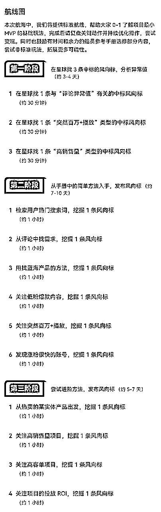

不难发现，整本手册绕来绕去，核心落点还是那个：挖掘风向标。

里面整理了十几种挖掘路径，每一条都拆到了可执行的细颗粒度。建议大家一边看一边对着航线图的任务动手练，光看不做，进步会很慢。至于具体怎么操作，咱们接着往下走。

# 一、【项目概述】认识风向标挖掘项目

💡

章节概览

这一章，带你把风向标挖掘项目看明白。

1. 星球的【风向标】发帖有哪些规矩？
2. 花时间去挖、去发，你能得到什么？
3. 挖掘风向标的整体思路是什么？

## 1.1 星球的【风向标】发布规则是什么？

星球的【风向标】板块，作用就是集中收录并传播与赚钱相关的短情报和操作玩法。不限圈友身份，谁都能来发，算得上最及时、最快速的搞钱信息交换站。

风向标的题眼在于[短]与[快]。140 字以内搞定一条赚钱信息，只挑重点讲，把核心玩法说清楚就好。能配上图更好，有数据佐证更是加分项。

挖到了靠谱机会，直接去星球发帖，打上#风向标 的标签即可。

## 1.2 挖掘&发布风向标的价值在哪？@苍述 @az

第一个价值：跑在别人前面，把好机会搂进怀里。

翻一翻星球的精华帖，你会发现一个规律——不少圈友的赚钱起点，要么是自己挖【风向标】时撞见的机会，要么是从星球【风向标】里瞥见的苗头。

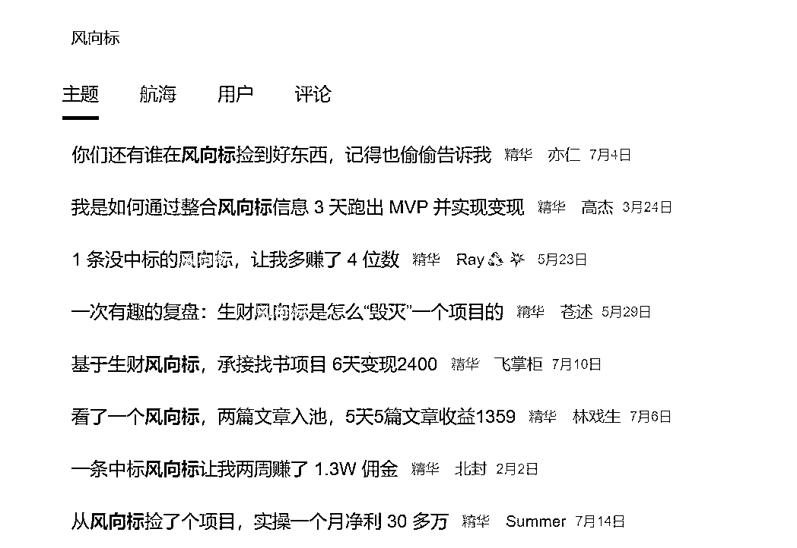

圈友 @苍述：我现在跑通的三个项目，无一例外都是从风向标里长出来的，你自己品品这个概率。

每个被标中的风向标，背后可能装着你完全想象不到的能量。没靠它赚到钱，多半是脑子没转过弯，或者它压根跟你的行业不对口。

圈友 @az：我连着发了两星期风向标。某天在找素材的时候，正撞上朋友为一部海外剧上线而激动，一堆人眼巴巴想看却找不到片源。我二话不说把链接挂上了闲鱼，火速帮他们搞定观看渠道，好评一波接一波。就这么一件小事，帮我捞到了风向标的第一桶金。

往后翻，还有不少实打实的成绩：

一个关于📕禁言群的信息差风向标，后续催生了一大批案例，月入过万、月入 5000 的人不在少数；6 月有圈友顺着一条风向标的思路，跑通了抖音四维彩超 AI 玩法，17 天赚过万；

7 月有圈友刷到企业信用管理的中标消息，先用小范围 MVP 验证需求，一个月净赚 30W+；

8 月有人看到养老金加精的风向标，手脚麻利地搭出从引流到转化的完整链路，快速变现 9000+；9 月 AI 小和尚的风口一起来，有圈友顺势起飞，单月播放量破了 3 亿，利润做到 10w+；

10 月的 P 掉路人风向标，被延伸成了一个📕蓝海项目，圈友蹲了 12 天、亲手做了 5 天，进账 1159，私域多了 260 人；11 月冒出夜校风向标，有圈友立刻下场，7 天塞满 6 个🛰️群，变现 2W+。

看得多了你就会承认：风向标确实是捞商机的利器。可要是光等别人发，好项目大概率轮不到你——早就被人抢跑了。想握住第一手信息，还是得自己练出一双会挖的手。

第二个价值：丢出去跟圈友探讨，等于顺手做了一轮机会验证。

有人可能会嘀咕：我辛辛苦苦挖到的宝贝，发出去不就暴露了？多个对手多条路，干脆自己偷偷搞。

这种想法，多少带点新手气息。做生意赚钱，真不用天天琢磨做独一无二的事。切入点可以有差异，但放进足够大的盘子里看，你以为的新鲜玩意儿，大概率早就有人做过了，只是你还没看到而已。

所以说，你眼里的商机，未必是市场上真正有需求、能变现的生意。

把风向标发出来，有龙哥大佬把关中标，还有一圈圈友一起分析、你来我往地切磋，等于变相帮你把机会筛了一遍。

上周我在星球刷到一篇帖子，里面有个观点深得我心：“发风向标本身就是赚到。龙哥看过的赚钱项目太多了，他对项目和信息的敏锐度，大概率超过 99% 的普通圈友。所以，当你抓到一条自己觉得有价值的风向标，别藏着，发出来让龙哥用中标与否给你打个分——这本身就是对你判断力的一次校准。如果中标越来越频繁，说明你的洞察力正在稳步上涨，离高手的距离也在一点点缩短。”

当然，还可能有意外之喜——被加精。加精背后，没准儿就是百万级的机遇。

同时还能攒术值。

只要评上[中标]，现阶段中标率高达 90% 以上，最少给你加 1 点[术值]。

只要内容能在某个层面上帮到龙哥盟圈友，还有机会被评精华。加精之后，能拿到 1 颗龙珠碎片 ～ 2 颗龙珠区间的感谢奖励。

50 点[术值]可兑 1 枚龙珠碎片，100 点[术值]可换一张龙哥盟礼品卡，凑齐 7 枚龙珠碎片，就能合成一颗龙珠。

内容来源：《一次有趣的复盘：赚钱风向标是怎么“毁灭”一个项目的》、《发了快 700 条风向标后，我总结出「风向标收集创作指南」》

## 1.3 挖掘风向标，脑子里该装什么思路？@沐风 @老黄牛

一句话：抓异常值。

做项目的基本盘是：需求-产品/服务-流量-变现。只要这个链条上任何一个环节冒出不合常理的动静，背后往往就藏着风向标的机会。

那“异常值”怎么定义？

事出反常必有妖。

举个例子：百万大 V 出一篇 10 万加文章，属于日常操作；但一个只有几百粉丝的账号突然跑出十万加，就是异常。反常，恰恰说明有故事。

类似的反常信号还有不少：

朋友圈密集刷到某个产品的投放广告，这是异常。只有利润够厚，才烧得起持续投放的钱。点进去，装成顾客套套信息，可能就捞到了一条项目思路。

某条视频的评论区反复冒出来【求图】【跟团】【怎么领】这类直白诉求，背后大概率藏着机会。

刷短视频时，刷到一个新号涨粉跟坐了火箭似的，这也是异常。现在起号这么费劲，凭什么是它？顺着这个“为什么”挖下去，机会就露头了。

粉丝量看着不起眼，销量却出奇地好——这类账号很可能蹲在蓝海小众赛道里。比如星球里的这条风向标。

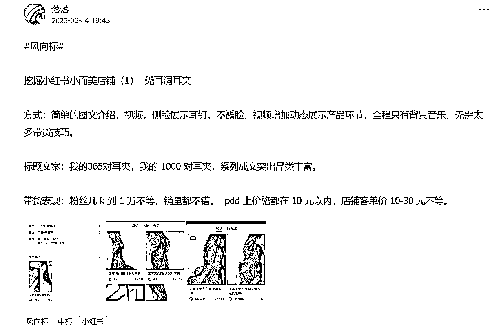

不光是数据漂亮才值得关注，数据平庸也可能是异常。某个账号粉丝不多、笔记数据也平平无奇，却能雷打不动地日更；很有可能它粉丝虽少，转化却始终稳定。这背后，说不定就藏着一个蓝海小众赛道。

……大佬们也是这么玩的。

著名投资人徐新在一次论坛上，聊过美团翻身饿了么那一仗。

美团内部有个监控系统，全天盯着市场上所有的 APP，谁的日单量越过 1000，直接拿来抄。就这么盯着盯着，饿了么蹦进了视野。王兴拍板，公司战略就三个字：抄抄抄！这套战略跑了半年，半点创新都不用做。只要绕开饿了么的核心城市，美团外卖的业务很快就铺起来了。

在这个故事里，“超过 1000 单量”就是个异常值。异常，即机会。

问题来了：异常值要上哪儿找？

回到需求-产品/服务-流量-变现这四个环节，各自都可能冒异常。它或许是数据上的跳动，或许是平台规则的转向，又或许是一种全新赚钱模式的登场。

具体怎么抓？【项目实操 1/2】如何挖掘风向标 这一章，会沿着需求、产品/服务、流量、变现四条线，用真实案例教大家怎么借不同类型的异常值，把风向标一条条牵出来。

## 1.4 怎么才能挖得更好？

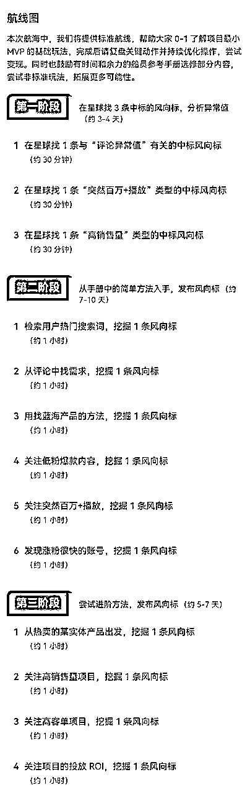

第一阶段 先去星球扒 3 条中标风向标，练习拆异常值

知道有的新手伙伴还没碰过风向标，一上来不知道手往哪儿放。没关系，先借别人的风向标练手就行。

拆什么？只看异常值。反正挖风向标的命门就是异常值，那先看看老玩家都盯着哪些异常。

操作路子：在星球点【中标】，把中标风向标逐条刷一遍，对照手册里那十几种方法，拆出它的异常值。

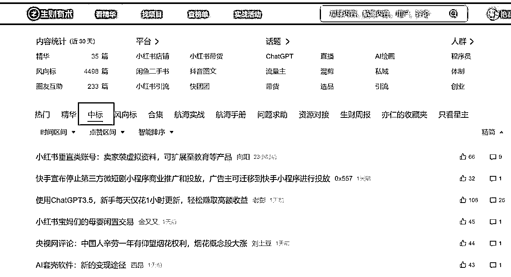

手册列了十几种异常值，建议从好上手的开刀，觉得难啃的先放着不管也行。

1.

异常值一：内容诡异地冲上百万+浏览/播放。（具体挖法见【2.3.2 突然百万+播放】）

下面这条风向标，就可以这么拆：

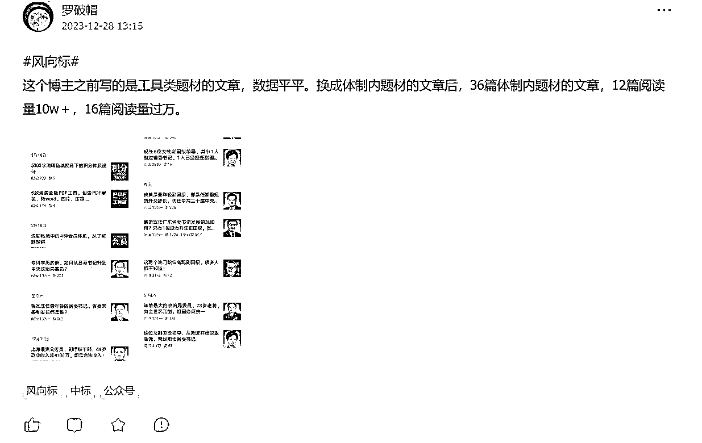

先拆异常值

“之前数据平平，换成体制内题材后，36 篇文章有 12 篇 10w+”——这是教科书级别的突然 10w+，对应手册“从流量出发，挖掘风向标”里的“突然百万+播放”。

接下来，试着反推这条风向标到底是怎么被挖出来的。

可能性之一：盯着👸号爆文的圈友，刷到某篇爆款后，顺手点进该号主页，先看粉丝量，再把历史文章差不多翻了个遍。结果发现这号之前写的工具类题材反响一般，换了体制内题材之后，数据才蹿了上来。

这里插播一条方法：真要自己推不出来，也可以直接去链接发帖的圈友，请教他当初怎么发现的。既能要到方法，又是建立连接的好机会。拿一个共同话题往深里聊，双方都容易打开话匣子，感情也就近了。

再进一步，换作我们自己，怎么借用这套路子挖风向标。

平时刷👸号文章时，可以特意多看两眼文章下方的推荐文章——那一般是阅读量高、表现好的内容。看到之后，再点进主页确认粉丝量、翻翻历史文章的数据，看有没有异常值。比如低粉爆款，或者突然 10w+，诸如此类。

异常值二：某个新号涨粉猛，或者爆款频出。（具体挖法见【2.3.3 涨粉很快】）

来，用下面这条风向标练练手。还是三步走。

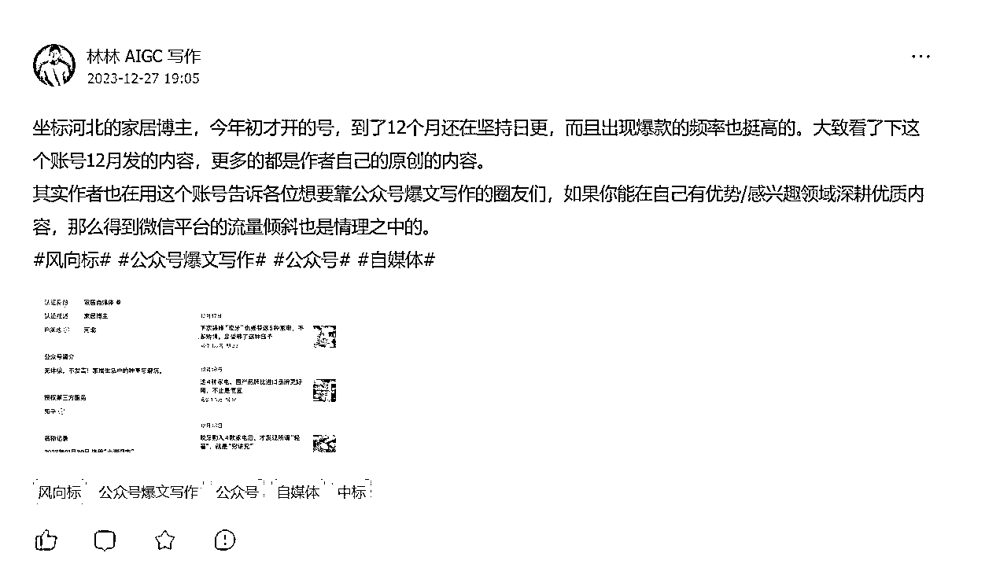

先拆异常值：“今年年初才开的号”——说明是货真价实的新号；“爆款频率高”——正好撞上手册里“从流量出发，挖掘风向标”所说的涨粉快/爆款多。

“还在坚持日更，更多都是作者自己的原创”，号主愿意持续投入时间做原创日更，大概率说明这个账号的正反馈相当不错。

再反推这条风向标是怎么被挖到的。

这条我专门去问过圈友@林林 AIGC 写作，他是怎么发现这个标的。

他当时在写一篇家电消费相关的推文，为了找资料，在👸号站内做了搜索，结果就钓到了河北这位博主。一个写了 1 年多的家居号，爆款还不少。

他的操作路径大致是：一是从自己平时浸淫的领域出发；二是用关键词搜索；三是看到数据好看之后，马上追查账号的成立时间、粉丝量、更新频率、历史文章爆款率这几个关键指标。

他特别强调：一个👸号成立时间越短，爆款反而越多，那说明它越有本事。而判断价值的公式堪称粗暴——分享价值 = 爆款数量 ÷ 成立时间。

再进一步，换成我们自己，能借鉴什么。

上面那几个关注指标，尤其是成立时间和爆款率，非常值得抄作业。以后再看到数据不错的文章，先别急着划走，顺手盯一眼这两个数字。

异常值三：某个品类在极短时间内卖出惊人销量。（具体挖法见【2.4.1 高销售量变现】）

比如下面这条风向标，还是三步走。

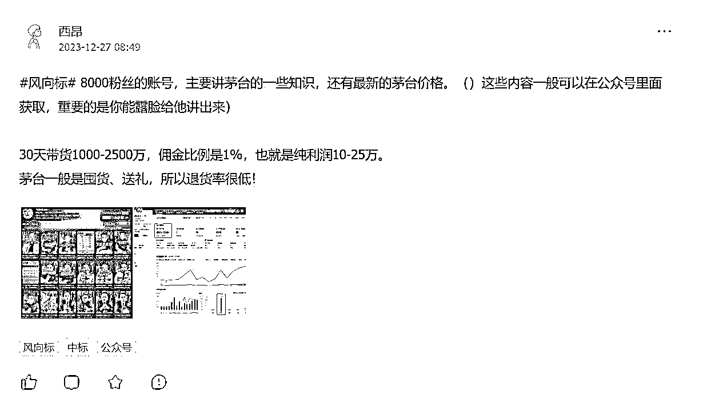

先拆异常值

“30 天带货 1000-2500 万，纯利润 10-25 万”，典型的高销售量变现：时间极短（30 天），销量极其惊人（1000-2500 万）。

而且它身上还叠着好几层异常：低粉高销量——账号才 8000 粉，却能撬动千万级别的销量。

加上内容门槛低、退货率低这些条件，说明这件事上手不难，可以快速抄起来实操。

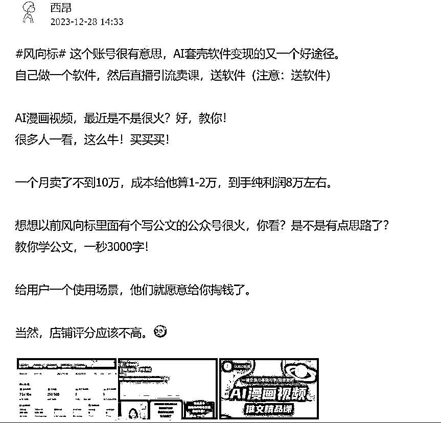

再往深一步，我们自己能怎么复制这套逻辑。

很简单，选一个用熟了的数据平台，圈定你感兴趣的平台和垂直赛道去筛。比如📕+日用品赛道+近 30 天销量，专门找粉丝量不足 1 万、销量却很高的账号；再比如抖音+家居赛道+近 30 天销量，同样找粉丝不到 1 万但销量突出的。

诸如此类，可以无限延展。

大家可以照着上面的拆解思路，去手动拆几条星球里的中标风向标。航线图的要求是拆 3 条，但我个人建议一天多看几条——看得越多，对异常值的体感就越敏锐。

当然，如果你已经是个挖掘老手了，这一阶段可以直接跳过，撒开手去挖、去发就行。

第二阶段 从手册里最简单的招入手，开始发风向标

手册按做生意的四个环节：需求-产品-流量-变现，整理了 14 种方法。里头有的偏复杂，但也有不少一看就会的。比如盯着低粉爆款——粉丝少得可怜、内容却爆得一塌糊涂；再比如翻赞藏量很高的笔记评论区，看是不是有一堆人在评论区排队要链接。

手册已经把这些省事的方法和对应的异常值统一归拢成了一张表。《12 月航海|风向标挖掘|常用异常值方法汇总》当然，老手也可以走自己的野路子。

第三阶段 扩大武器库，尝试更多方法发风向标

用手册里剩下的方式，或者自己摸索出来的方式，去挖、去发。

提醒一句：航线图上的方法只是参考，没有强制力。就算用自己的路径挖出并发布了风向标，打卡一样算完成。

内容来源：《作为普通人，我们该如何挖掘商机？ 》、《把龙哥盟当兼职网，这是有多可惜！》

# 二、【项目实操 1/2】怎么把风向标挖出来？

💡

章节概要

这一章进入实战，我们一起学怎么挖风向标。

从需求、产品/服务、流量、变现四条线出发，看异常值怎么找、风向标怎么挖。

✅2.1 从需求出发，挖风向标

✅2.2 从产品/服务出发，挖风向标

✅2.3 从流量出发，挖风向标

✅2.4 从变现出发，挖风向标

每一个部分都会给出 3-4 种玩法，并且拿出一个实操案例，把操作步骤手把手演给你看。

最后，还帮你整理了十几个常用的信息挖掘渠道网站。

✅2.5 常用的信息挖掘渠道

1.这些挖风向标的方法，建议别死板地用，可以交叉着来。一条信息从需求、产品、价格等各个角度一拆，能拆出好几种可能性；

2.手册虽然给了十几种方法，但说到底也只是冰山一角。挖掘机会的路子，几乎是挖不完的。希望大家实际操作时别被手册框住，放开脑洞，多聊多碰，把更多可能性翻出来。

闲话少说，开工吧！

## 2.1 从需求出发，挖风向标

### 2.1.1 从需求切入，怎么挖风向标？@沐风

前面已经反复提到：任何一个项目的底层逻辑，基本都能压缩成一句——需求-产品/服务-流量-变现。

换句话说，需求是整个商业棋盘上的第一颗棋子。所以，需求也天然是挖风向标的最佳切口之一。

不过，做需求挖掘时，请尽量在自己待过的行业、或者已经摸得比较熟的行业里下手。原因很朴素：

1.在自己熟悉的领域，你可以靠经验快速区分：这些需求到底是真金，还是泡沫。

2.一旦确认需求确实存在，行业里的人脉、资源都是现成的，可以很快围绕需求做出产品或服务，把变现闭环跑通。

反过来，跑去一个完全陌生的行业，挖出来的需求很有可能是假的；就算是真的，你手上也未必攥着能快速落地的资源。而对大多数普通人来说，从零开始攒资源，难度可想而知——这种需求就算被你撞见了，价值也约等于零。

把这一点想通，需求挖掘就可以正式开始了。从哪里入手？

一共 3 个入口：

1.去找用户的热门搜索词。

2.从评论里挖需求。

3.从用户、场景、需求三个维度，向外扩展更多需求。

接下来一个一个讲，每个都配 1 个案例做个演示。

内容来源：《作为普通人，我们该如何挖掘商机？ 》

### 2.1.2 瞄准用户热门搜索词 @龙哥

#### 2.1.2.1 具体方法

# 搜出来的风口

很多人找项目习惯拍脑袋，其实更靠谱的入口就在搜索框。把工作、生活里反复出现的词敲进去，平台给出的联想与热门词，往往比主观猜想要贴近市场真实需求。

渠道大致分两类：一类是搜索型入口，例如 Google、百度；另一类是内容与交易型平台，比如📕、抖音、🧣、知乎、🛰️、淘宝。只要这个产品自带检索框，就值得试一试。要查的词不用刻意找，取自日常接触即可。

还有个角度：翻翻手机里装着的高频应用——🛰️、支付宝、🧣、Instagram、Facebook 之类。这些产品动辄几亿用户，围绕它们延伸出来的需求，规模通常不小。生活里冒出的具体念头也能直接搜：计划去西藏，就查"西藏旅游"；想换电动牙刷，就查"电动牙刷"。

键入之后，输入框下方会弹出联想结果，那些被反复命中的词组就是重点。搜索量大，等于需求密度高。随后再横向比对一遍：市面上是否已经有人做了对应工具、体量多大、怎么赚钱、是否仍留有缝隙。顺着这条路走，容易筛出需求旺、变现成熟的方向。

#### 2.1.2.2 案例

接着用一个实例说明：怎样顺着【Instagram】这款产品，挖出真实痛点，并锁定产品机会。

第一步，把【互联网大厂产品名】丢进搜索引擎，观察需求分布。这里以 Google 检索"Instagram"为例，返回结果里会附带几组联想词。

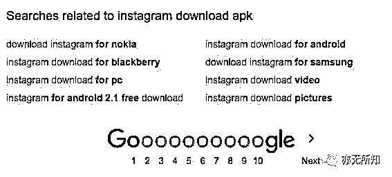

从中挑出官方尚未覆盖的部分。梳理下来，只有末尾两个词——"instagram download video"与"instagram download pictures"——还没有对应的官方能力，其余联想词所指的功能，官方都已实现。

第二步，验证痛点是否成立。难道在 Instagram 上保存图片和视频，真的存在未被解决的诉求？继续用 Google 追查，结论是：网页版确实不开放保存，"另存为"这个操作被系统封锁了。这道限制，恐怕让绝大多数普通用户束手无策。而保存他人图片与视频的诉求客观存在，所以这个痛点站得住。

第三步，摸清已有玩家与盈利路径。接着搜"instagram download pictures"，首页跳出 6 个专门处理该需求的小站。打开排在首位的那一个，功能与商业设计都很朴素：粘贴图片链接即可完成保存，盈利靠接入 Google 的广告联盟 Adsense。

出处：《通过 Google 挖掘细分市场的一个案例》

### 2.1.3 从评论中找需求 @梨云

换个地方找线索：文章或视频下方的留言区，记录着用户反复提到的诉求词。

同一个词被多次提及，背后通常对应着一群人的真实需要。

#### 2.1.2.1 入门方法

日常刷📕等平台时，别只看正文，评论区更有价值。"求图""跟团""怎么领"这类说法，都是用户把需求直接说出口；而它们对应的笔记，往往就是能赚钱的那一类。若能锁定这些笔记、找到背后的产品或服务、看清变现套路、估算收益，就能挖出一些不声不响在盈利的项目。

把这些在留言区看到的词——"求图""跟团""怎么领"——输入数据分析工具（详见 2.5【放链接】）。来源是谁就用谁的数据库：📕看到的，查📕侧的平台；抖音看到的，查抖音侧的平台。以笔记评论为检索条件，顺着线索就能定位到具体笔记及其关联的产品或服务。

#### 2.1.2.2 案例

以📕做示范。将"求图""跟团""怎么领"这三个词交给千瓜数据的笔记评论检索功能，顺着线索即可找到相应笔记、产品或服务。

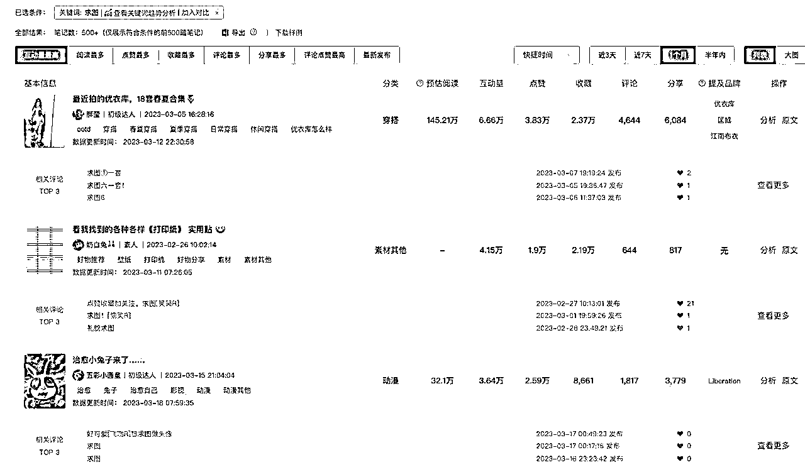

ps：千瓜这工具不便宜，动辄几千块；预算紧的话，闲鱼上还有按天出租的会员，25 元一天。

2. 再逐个点开标题、正文与博主主页，边看边归类，我从中整理出一批值得关注的变现玩法，画成了一张思维导图。

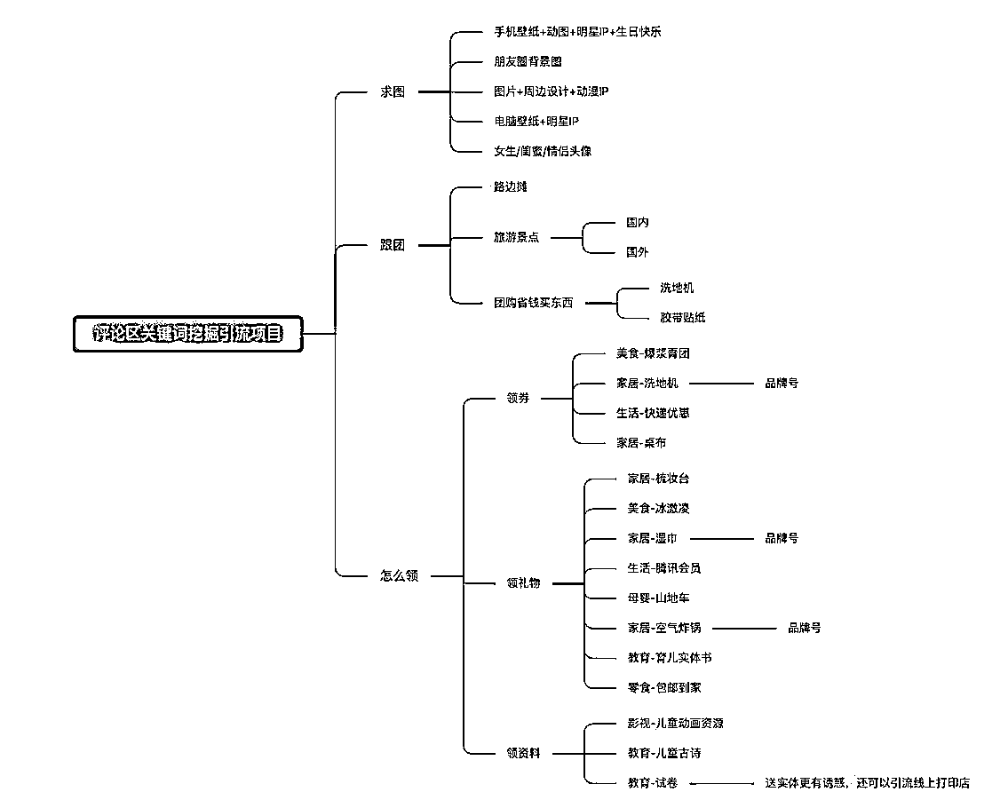

看过之后会发现：引流的路子远不止"送资料"，赛道也远不止学习考试。仅凭评论区里的 3 个词，就能挖出这么多东西；那假如手上握着一套覆盖📕全部赚钱类型的需求词表呢？

#### 2.1.2.3 进阶方法

先批量收集平台近期笔记，数量至少上百篇，把留言区的诉求词提取出来。随后把这些词逐个送进数据工具，按笔记评论检索，找到笔记及对应的产品或服务。接着对这批笔记做批量拆解，统计各赛道的分布。某个赛道占比越高，意味着该方向的需求越旺。锁定细分方向之后，用标题做分析，继续挖掘该方向上可赚钱的项目。做法是把该赛道的标题批量交给 ChatGTP，先让它提炼出营销产品，再由营销产品向外扩展品类，最后以品类反推更细的赛道。

#### 2.1.2.4 案例

仍以📕举例。

第一步，收集平台近期笔记，把留言区的诉求词攒起来。若手头已有上百篇笔记的汇总，再借链接批量抓取评论，效率会高出不少。

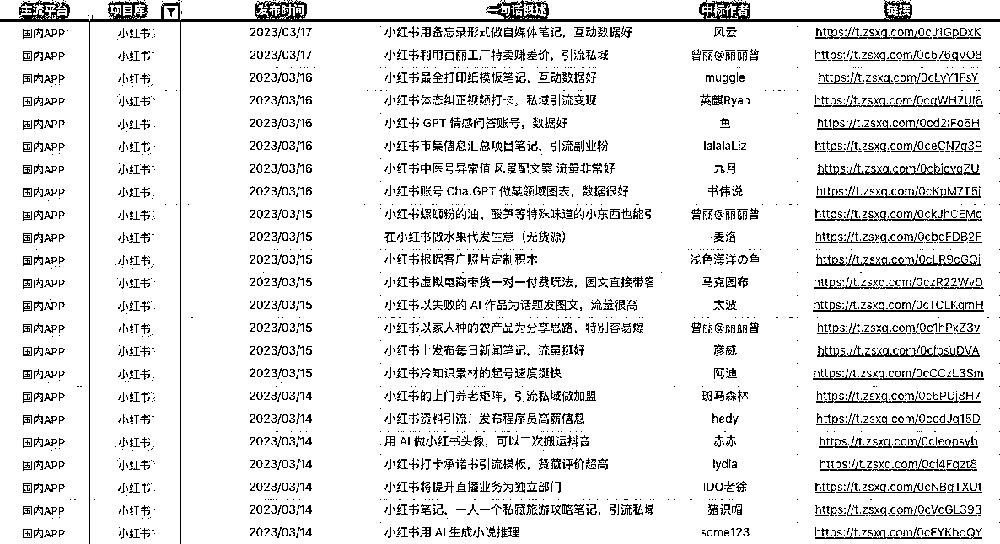

赚钱团队做过这件事：把 2000 多条中标风向标做了汇总与分类，其中📕相关条目 200 余条，拿来即可用。风向标中标合集｜龙哥盟第六期。每一条都能回溯到评论区，提取出具体诉求词。

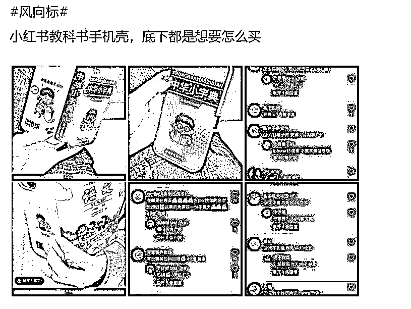

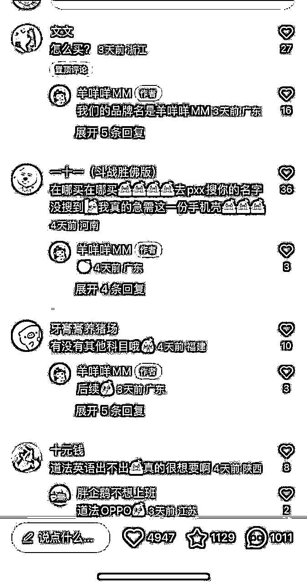

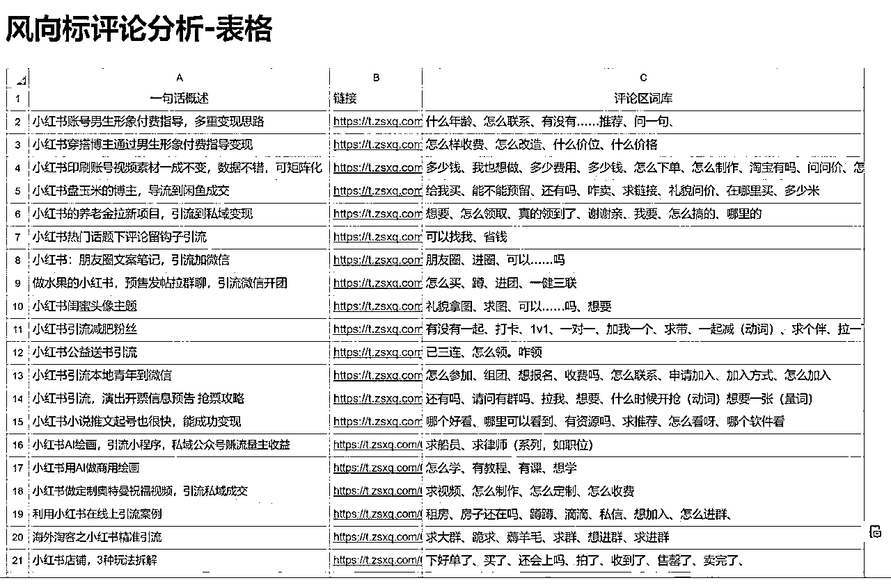

不过这些评论词过于零散，只好继续人工归类，搭出一个评论区需求词表。

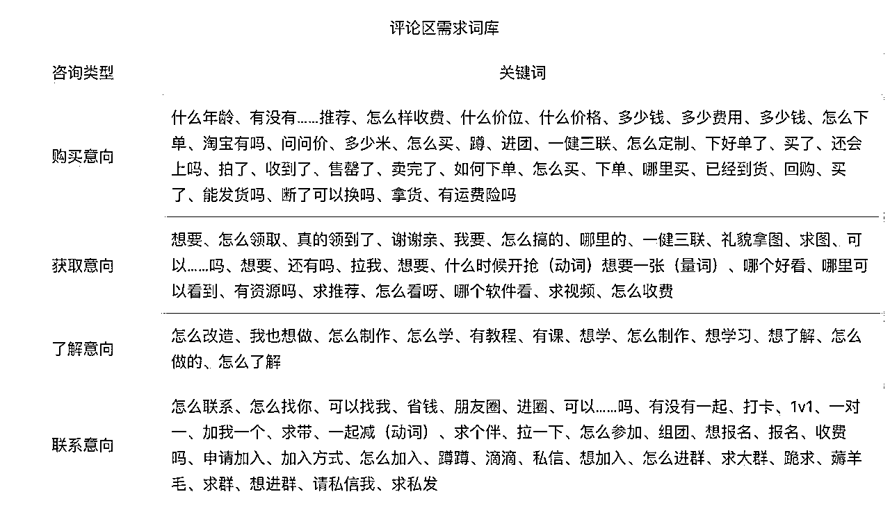

ps：这套词表并非📕专用，放到别的平台同样成立。

第二步，把词表里的词逐个投入千瓜数据的笔记评论检索，顺着线索找到笔记与对应产品／服务。举个例子，"求资料"这个词近一个月搜出相关笔记 1000 余条。

第三步，对这批笔记做批量拆解。

先剔除重复项，同一 ID 只保留一条；再重点看笔记所处赛道的比例分布。

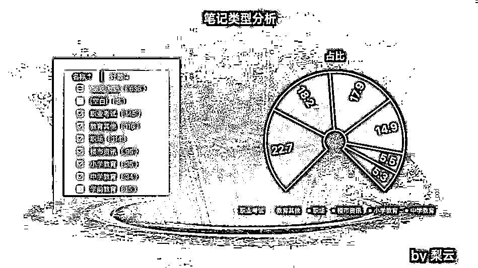

我原本以为学科类账号卷得厉害，结果并非如此。由此就能判断，资料赛道里哪些方向的需求更集中。

第四步，锁定细分方向后，用标题反推其中可赚钱的项目。这里借助 ChatGTP：把标题喂进去，先提炼营销产品，再把营销产品扩展为品类，由品类倒推细分赛道。

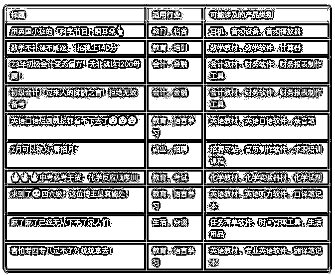

出处：《在📕上，如何挖掘出 1000 个适合普通人的赚钱项目》

### 2.1.4 从用户、场景、需求拓展更多需求

#### 2.1.4.1 方法

当你用上面的办法找到一个需求后，若想切入竞争更小的市场，或在同一条赛道里做得更大、甚至形成垄断，可以再套一层拓展思考：把需求拆成三个可变的维度，逐一追问。

用户能不能换？也就是换一批需求主体。原先打算去西藏的是你本人，那换成父母、祖辈、老人、孩子呢？

场景能不能换？即需求发生的地域可以调整。仍以旅游为例，全国省市那么多，把出发点换成自己所在的城市，或许会冒出意料之外的搜索词。

需求能不能换？去西藏未必只为了旅游，还可以是西藏穿搭、西藏朝拜等等。

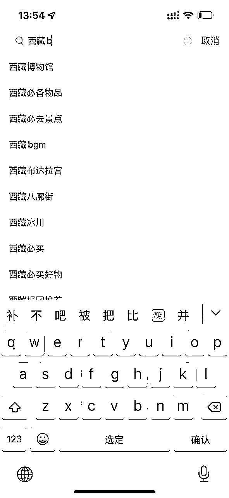

另一种思路：把需求短语切成三段，逐段找同类词替换。例如"西藏旅游"可拆成"西藏"＋"旅游"两部分。

#### 2.1.4.2 案例 @龙哥

拿前面得到的"Instagram picture download"做样本，套用这三问继续向外扩需求。

4. 用户维度：Quora 上有数据，Instagram 用户量排名前十的国家依次是美国、俄罗斯、巴西、土耳其、英国、波兰、加拿大、法国、日本、德国。机灵的人大概已经反应过来了——可以做面向其他语种的站点。回想一下，中文用户习惯敲"Instagram picture download"，还是"Instagram 图片下载"？显然是后者。同理，各国用户都会用母语去表达同一个诉求。我用 Google 翻译把它分别转成俄语和日语，再拿去 Google 搜，发现两种语言下都已有对应工具站；流量虽不及英文盘，但竞争强度低了一大截。多语种站点，或许是个好切口。

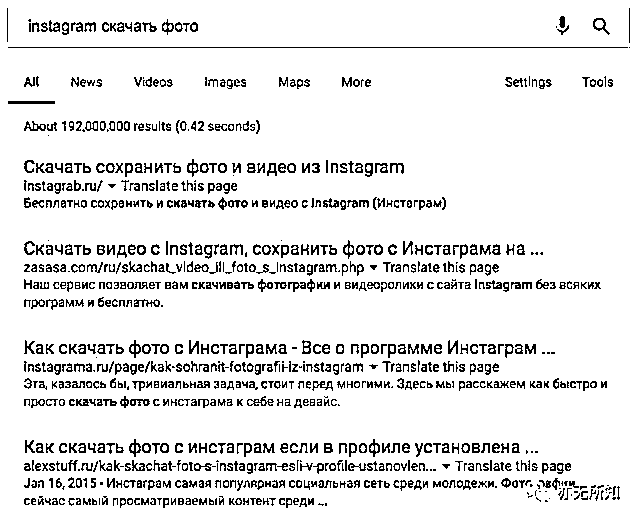

5. 场景维度：用户会在什么场合敲下"Instagram picture download"？Google Play、App Store、🧣、🛰️、🛰️小程序、Quora、淘宝、浏览器插件商店……每一个场景都可能是入口。对应的形态可以是安卓 App、iOS App、🛰️小程序、🛰️服务号，直接提供保存能力；也可以是一篇讲清保存步骤的图文，让用户在🧣、🛰️、Quora 搜索时直接撞见；还能是在淘宝上以极低价格挂出的代下载服务。我们不妨看看现实中有没有这样的产品、数据如何。在 Google Play 应用市场检索关键词，能找到一款提供保存服务的安卓应用 InstaSave，下载量高达 1000 万至 5000 万次，点评数 14 万条。对比 Instagram 自身 10 亿至 50 亿的安装量，相当于每 100 个装了 Instagram 的人里，就有 1 个装了 InstaSave。

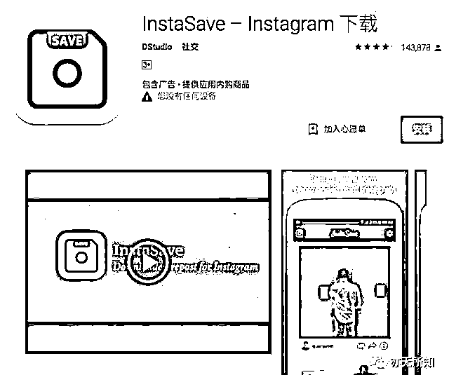

再看🧣：检索 Instagram，能翻出若干粉丝规模达几百万的账号。

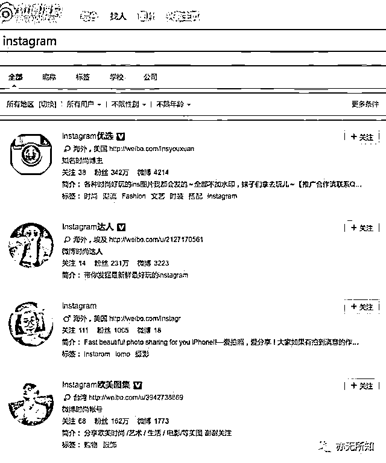

淘宝上：搜索 Instagram，标价 1 元的相关服务，成交记录超过 10 万份。

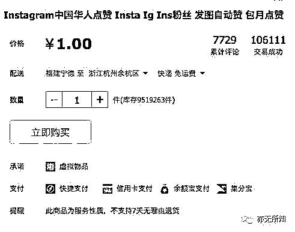

🛰️👸号这边：曹大转发我那篇文章的留言区里，有人提到一个名为 inskeeper 的号，专做 Instagram 图片保存，攒下了 20 万用户。

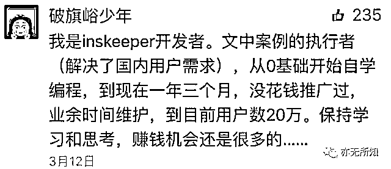

需求维度：把"关键词＋a 到 z 共 24 个字母"依次组合去搜，例如"instagram a""Instagram b""Instagram c"……还可以叠加成双字母，如"Instagram aa""Instagram zz"，你会走进另一片天地。

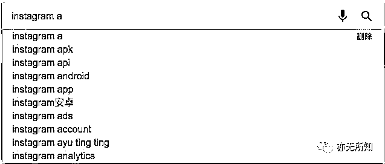

我把"Instagram a"至"Instagram z"、"Instagram aa"至"Instagram zz"的 Google 关联推荐词全量导出，共得 521 个词，其中不少需求相当有意思。

还有一种拆法：把需求短语切成三段，各段替换同类词。以"Instagram picture download"为例，可拆为 Instagram、picture、download 三块。Instagram 换成 Youtube、快手、美拍、秒拍、Vine、Twitter、Facebook……picture 换成音频、视频、文字、字幕、歌词、壁纸、头像、播放列表、用户名……download 换成编辑、合并、上传、备份、分析、传播、点赞、增粉……单按这些列出的方向组合，就能拼出 504 种搭配。随便挑一个看：Youtube 的 mp3 提取站 youtube-mp3.org，在 SimilarWeb 上查得到月访问 2.7 亿、日均接近 1000 万人次。

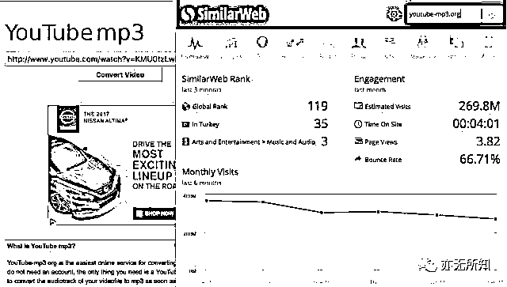

归纳一句：从一个需求起步，沿着用户解决问题的整条路径，把每个环节都问一遍"这里还能不能变"，惊喜往往就藏在其中。

出处：《如何找到 1000 个小思路？》

## 2.2 从产品/服务出发，挖掘风向标

### 2.2.1 如何从产品/服务出发，挖掘风向标？@星辰

前面聊的是用户视角——从需求切入去发现风向标。这里不妨翻转镜头：盯着市面上已经存在的产品与服务，找出其中的异常值，同样能发现真实机会，甚至看见那些此前没被察觉的用户诉求。

任何一款能长期存在的产品／服务，背后必然撑着一块需求空间。我们要做的，是从这件产品入手，把下面这些问题逐个问一遍：

1. 目标用户是谁？
2. 他们用这件产品／服务，本质上想解决什么？
3. 这批人聚集在哪儿？
4. 现有卖家采用什么方式售卖？
5. 产品成本几何？
6. 它的上下游分别是什么？
7. 周边还长出了哪些关联业务？
……

这些产品去哪找？建议多泡在产品扎堆的平台上。比如每天花点时间刷🛰️视频号：如果你关注的是选品，就把所有与选品无关的内容统统点"不感兴趣"，慢慢让算法把各类产品推给你，你会看到大量此前想都没想过的商品，风向标很可能就混在其中。再比如刷📕时刷到某博主的服务，哪怕你本身没需求，也可以去咨询一下，观察对方的引流手法、有没有你没见过的新点子；加进私域后，再看看人家的朋友圈是怎么运营的。还有一点：机会并非只藏在线上。翻翻长辈的手机、宝妈的手机，看他们日常用什么 App、购物车里躺着什么，说不定就能发现你完全陌生的东西。举一条中标案例：老年人用的"拍打袋"，说白了就是一个布袋加几颗核桃。这种产品年轻人根本不会接触到，但在老年群体里需求相当可观。

按展现形态与受众范围划分，大致可归为四类：实体产品、虚拟产品、差异化服务、蓝海产品。需要说明的是，这样分类彼此会有交叉，但不影响我们打开对产品的想象空间。下面就从这四类切入，看如何借产品挖掘风向标。

出处：《谈谈我对赚钱这个宝库的使用心得》

### 2.2.2 实体产品

#### 2.2.2.1 方法

第一步，锁定一款近期热卖的实体商品。找法有几种：从自身或身边的具体需要出发；去淘宝榜单、抖音精选联盟、闲鱼榜单、视频号选品中心等渠道捞近期爆款；借助蝉妈妈、蝉小红、巨量百应这类第三方工具拉热销排行；平时有意识地刷视频号、抖音、📕，并且只对商品类内容表示兴趣；结合临近的节日与季节变化，看大众注意力落在哪些物件上。

第二步，做市场调研。把该产品拿到各平台搜一遍，弄清主流卖家的销售方式。一般先从主阵地入手——淘宝、闲鱼、抖音、📕、视频号，比较哪个平台销量更集中，商家的玩法又是什么样。

第三步，摸清产品信息与成本结构，判断有没有入场空间。例如是否存在周边商品生意、能否找到 1688 货源、有没有低价收购的渠道、是否依赖成熟供应链、有没有技术门槛等等。多方对比，尽量找到成本更优的进货路径。

#### 2.2.2.2 案例 @安之

下面以【台球杆】为例，讲讲如何从一件产品延伸出一门生意。

第一步，确定产品。因为喜欢打球，但球房提供的杆手感欠佳，便萌生了自己买一根的念头。起初只求比公杆顺手，于是点开闲鱼，没想到推开了一扇门——上面有大量二手杆在售，成交情况还挺不错。

第二步，调研球杆市场，先把知识补齐。球杆主要分大头杆与小头杆两类；当下热度高的品牌如皮尔力、野豹，销量很好，但标价偏高。判断一根杆的成色，关键看木料年份——小头杆多用白蜡木，那些颜色泛黄的老杆，手感确实出众，这是自用视角；若想靠它赚钱，还得靠品牌溢价撑腰。

在抖音上搜：这是人最多的平台，先看玩家都在干什么。一圈看下来，做二手杆的基本是专业商家，个人挂单出售的极少。比价可知，抖音报价普遍高于闲鱼，评论区仍有不少人追问价格与联系方式。

在闲鱼上搜：卖家数量极多，大致可归为三类。

（1）专业卖家：手上杆多，成色较佳（可能经过维修），定价中等，略低于抖音；店铺挂出的链接量大，详情页里罗列一堆品牌——也不知从哪学的套路——并注明支持置换。

（2）个人卖家：定价偏低，成色参差，基本没修过；店里东西要么杂乱要么寥寥无几，文案朴素，读得出诚恳的味道。同样会写支持置换。

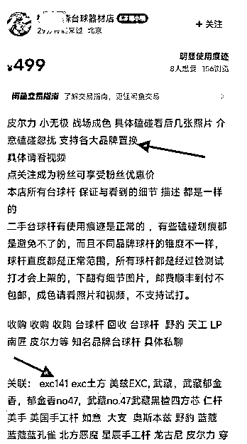

# 旧杆低买高卖：赚的是信息差

（2）个人卖家的开价通常不高，成色忽好忽坏，多数球杆没动过手；店铺里的货要么杂七杂八，要么少得可怜，详情写得朴素，反而透出一种不绕弯子的可信感。

## 第三步：淘到便宜杆

不停在闲鱼里搜球杆，说白了就是让算法记住你：首页的“猜你喜欢”迟早会被球杆占满。刷到看着划算的杆，先别急着拍，至少做三路核对：

（1）到抖音搜同型号，摸清价格上下限，再看成色处在哪一档；

（2）在闲鱼回收帖里多问几位收杆人，给自己定一个心里能接受的回收价；

（3）最后回到闲鱼，对照同款挂价与成色，算算转手后还有没有赚头。

等推荐流里全是球杆，你很快就会撞见一批个人卖家：他们对自己的杆该卖多少、值几个钱，往往没概念。这类货，反而更容易做出利润。

这些卖家通常有几个共同点：

（1）头图随手一拍，光看照片甚至分不清是哪种杆，有的连大头小头都对不上；

（2）品牌栏常常空着，标题只丢几个泛称，诸如球杆、桌球杆、老杆子；

（3）还有卖家把冲杆、跳杆、打杆打包卖，搜的时候把这三个词换着组合就能翻到；也有人接受等值互换，我曾拿一根杆陆续换回三根，累计赚了约 700 元。

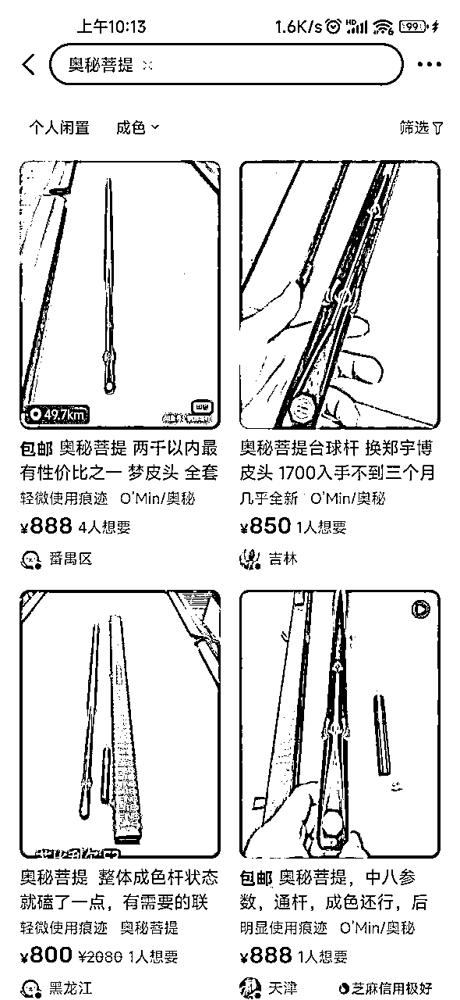

结论：这门生意的链路很短——从不懂行情的个人手里压价收杆，再找下家出手。

像前文那种杆，400 元入手，拿清洁粉把表面打理干净，再挂 600 元并不难，一进一出就有近 200 元差价。

内容来源：《用赚钱思维，边玩边挣钱？! 》

### 2.2.3 虚拟产品：轻库存选品法

#### 2.2.3.1 实操路径 @黄岛主

虚拟产品可以理解为一切不靠实物交付的东西，APP、工具型网站、模板、电子资料、网课、小吃配方，以及代拍、代充、账号买卖、游戏代练、凑单、中间撮合等服务，都算。

找虚拟产品的风向标，路径与挑实体货有不少重合：

第一步：锁定近期卖得火的虚拟品。主流平台上实体与虚拟都很丰富，所以实体货的找法也能迁移过来：

先看自己需要什么、日常在接触什么；到蝉妈妈、蝉小红、巨量百应、生意参谋一类数据平台搜虚拟品词；刷视频号、抖音、📕时，有意识只停留于虚拟品内容；朋友圈的广告与好友动态也别放过。除了沿用实体货的路径，还有几种挖法值得试：成批抓取课程和资料，用数据判断哪些值得下场；紧跟当下热门话题，如 AI、天涯神贴、高考志愿；工具站与 APP 可翻排行榜，找近期表现好的应用；再整理行业通用词根，借 5118 等工具把需求挖细。拿教育赛道举例：

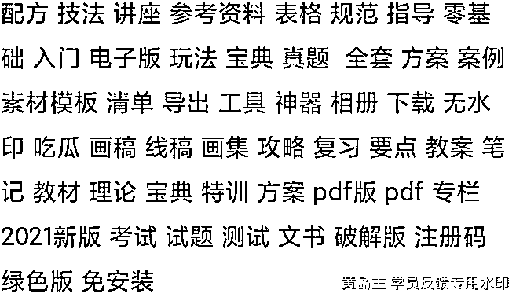

以“培训”为词根去搜，会冒出一批平时没听过的词：

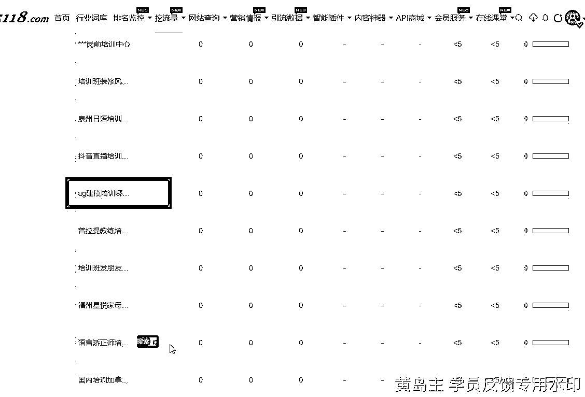

第二步：调查市场。把关键词丢进搜索引擎、抖音、📕、知乎，看用户到底想找什么。假设上一步冒出一个陌生的“UG 建模培训”，就去各平台拆它的长尾词，观察搜索需求集中在哪。

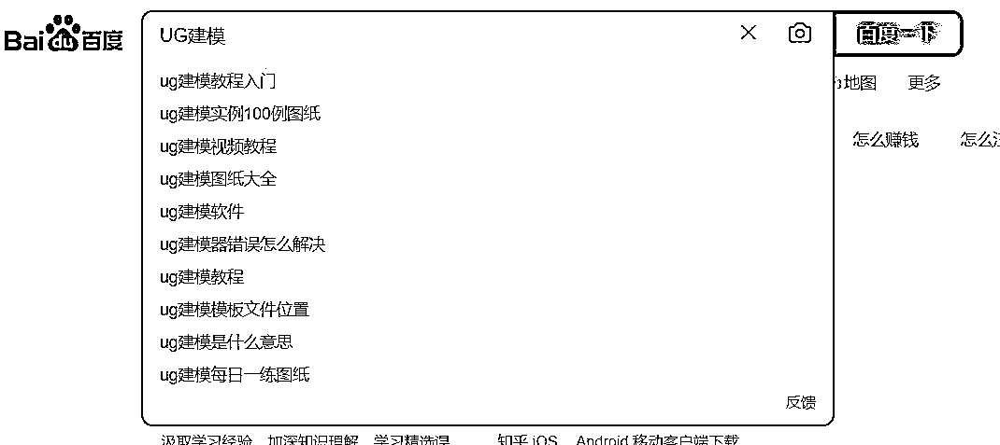

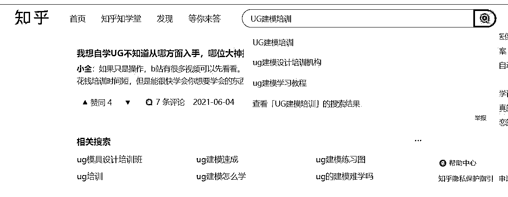

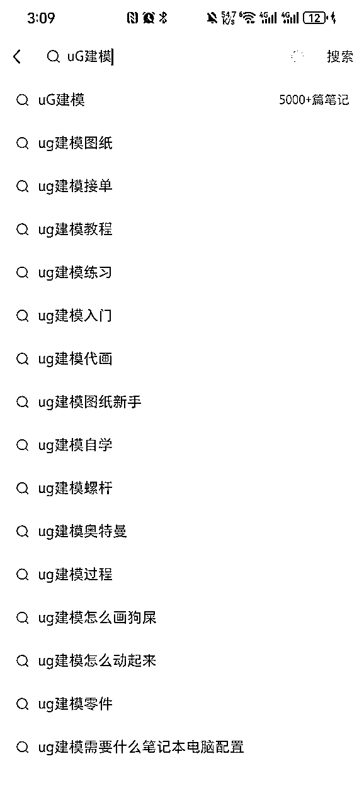

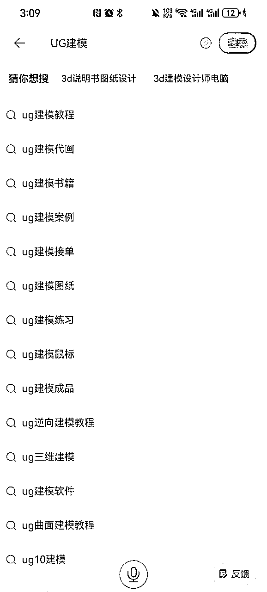

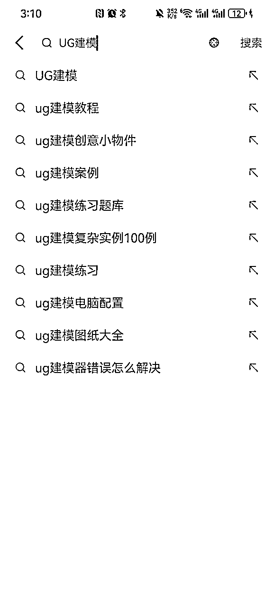

第三步：摸清门槛与货源，再判断值不值得进。搜索词背后其实是多种需求：有人要 UG 建模教学，有人买成品、软件、练习题库，也有人找 UG 接单。把每个方向单独拆开，数一数竞争者多不多。重点看同行数量、月销、评价是否集中在近段时间、商品有无版权风险，再决定要不要做。

同时顺手评估入场难度：资料与课程的产出难不难？是否需要专门技能？要砸多少时间？……

附：虚拟品上架前的自查项

1、商品里是否夹带人名、软件名、品牌名或书名等信息；

2、是否要求出版物经营资质；

3、标题是否触碰商标、著作权；

4、所在店铺要交多少保证金。

按这几道关卡过一遍，基本能判断一个品能不能上、会不会踩线。不妨动手试试。

内容来源：《淘宝蓝海虚拟选品实操复盘，选对品可日入 300-500！》

#### 2.2.3.2 案例拆解 @痴海

再给一个观察角度：怎样在抖音拆解【知识付费课程】，并从中嗅到生意机会。（文中数据或已过时，关键看推导方式。）

若打算在抖音靠卖课变现，第一步不是拍脑袋想创意，而是先看清：当下哪类课程跑得最好？哪种内容占了大盘？摸清热门赛道后，再拆别人的商业模型，照着学。别凭感觉判断“我这个课能不能卖”，让数据替你回答，同行就是现成的教材。

于是第一步，先把抖音知识付费的数据攒起来。相关数据在某个应用里能查到，搜一搜就能找到入口。

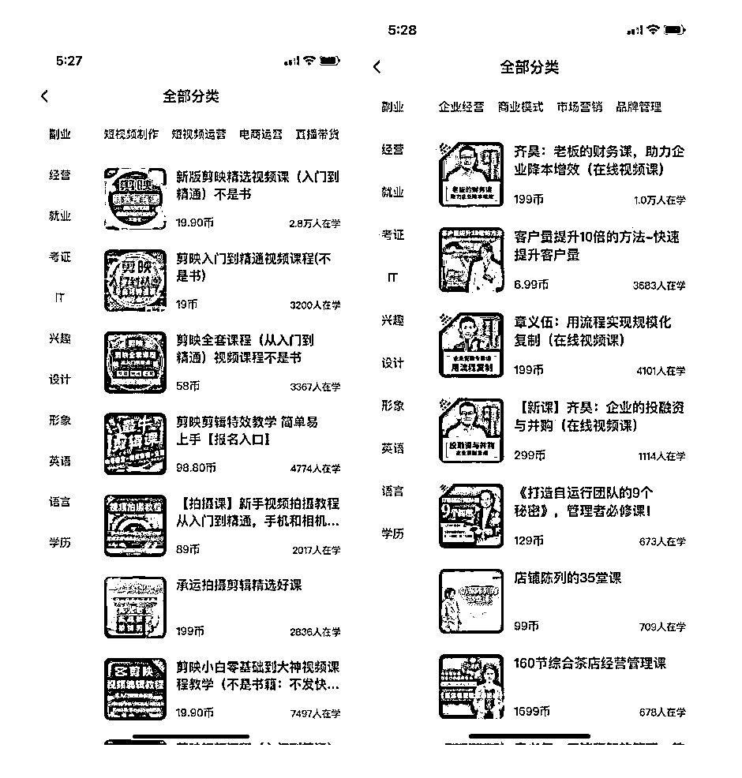

那个应用把课程分成 11 个大类，下面还挂着不少小类。排头名的是副业，而副业区里多半在教人拍短视频；抖音本身就是短视频平台，这类课扎堆并不稀奇。

靠手指一个个翻页面，做不了系统分析，我便用工具代劳：写 Python 把应用里的课程信息抓下来。最终得到 3651 条记录，字段包括课程名、定价、销量、总销售额、账号名、大类与小类。

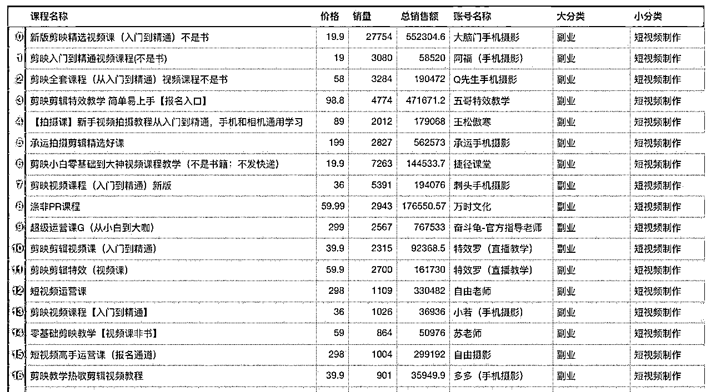

数据到手后，开始找知识付费细分赛道里的盈利点。样本覆盖副业、IT、经营、就业、考证、设计、形象、兴趣、学历、英语、语言等方向。

有了这批记录，就能锁定销量最猛的课程，再研究头部选手怎么打。把销售额从高到低一排序，《好声音系统训练课》立刻跳出来，标注销量 2112 万，领先幅度很大。

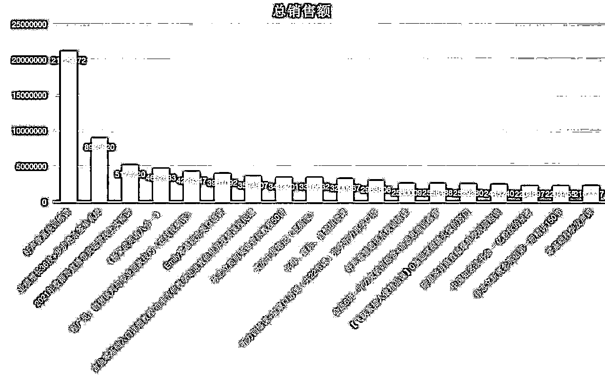

能卖出这种量级的账号，必有可拆解之处。用飞瓜数据一查，该商品主要出自「中国金话筒 语言课堂」，粉丝 80.5W，近 30 天每场直播平均成交约 60 单。

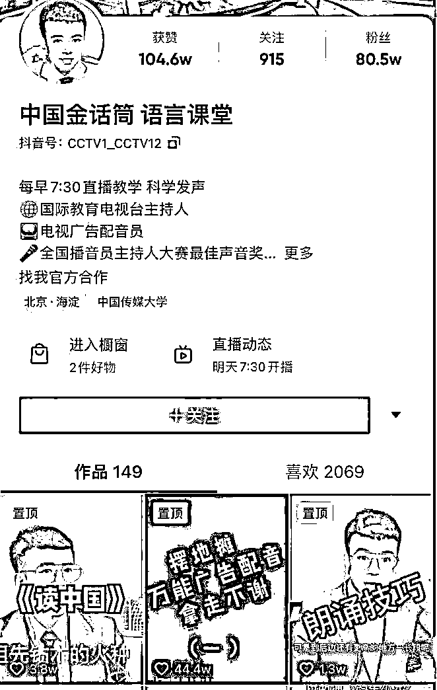

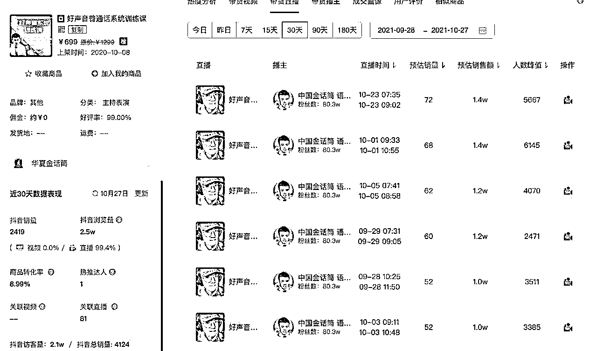

稍作调查，这个号的打法就能梳理出来：

人设落在电视主持人；内容上，用主持腔去念段子；卖的是 699 元好声音训练课与 1980 元声音实战课；抓住的痛点是普通人觉得自己发音不好听；卖点则是专业主持带你练出悦耳嗓音；成交场放在抖音直播。做任何商业项目，先回答三件事：账号立什么形象？卖什么产品？产品替用户解决哪道难题？这个号的可学之处，正在于定位与变现的咬合：主播本身有电视台主持背景，账号顺势走专业路线，再用主持人的身份去回应“普通人发音不好听”的焦虑，逻辑很顺。

把专家身份立住，再卖本行业的知识，这套打法一直有效。

若想继续深挖，不妨录下他的直播，逐句拆销售话术。

内容来源：《抖音上付费课程数据，有什么价值？》

### 2.2.4 差异化服务：抢在同行前面补位

##### 2.2.4.1 找差异的路径 @Zora.卓然✨

所谓差异化服务，就是某款产品补上了同类没补的缺口，于是更能打，业绩也更容易跑在前面。找这种风向标，核心动作是对比同行、多看几家的做法，才能发现别人多走的那一步。

第一步：圈定一个细赛道。它可以是手头项目所在领域，也可以是你愿意长期盯的一类产品；范围尽量切小，如周边一日游、烘焙直播、舞蹈培训、AI 绘画壁纸、ChatGPT 写作等。也可顺着节日和热点挑，例如情人节前后冒出的孤寡青蛙；或盯某一群人的共同动作，像在抖音、朋友圈、📕看到素人反复发同类内容。

第二步：把赛道里的产品与服务捞出来。若平时没有固定关注对象，就在抖音、📕等平台按关键词搜索，按热度整理现有供给；若已有长期跟踪的品类，接着看它的新动态即可。

第三步：横向比较各家服务，圈出差异点。把产品与服务信息放进表格，逐项对照，差异自然显形。比如下方公务员培训班的清单里，就有线上不限次上课、出分后优惠、上岸再补齐学费等不同做法。若再拿到销量数据，还能判断哪一种差异更抓用户。

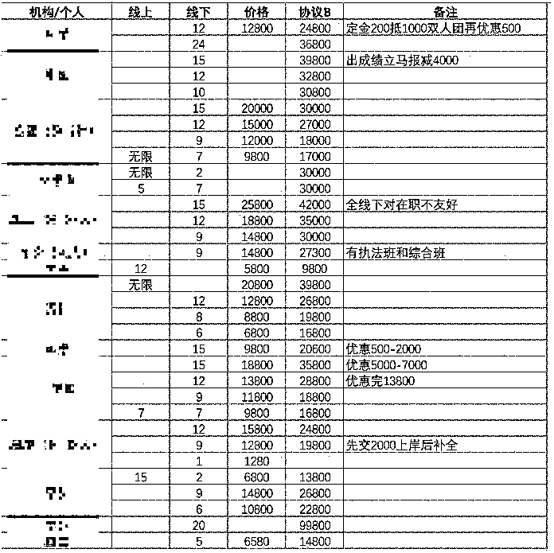

内容来源：《新人入局考公市场，变现 10 万+的复盘》

#### 2.2.4.2 案例复盘 @林林 AIGC 写作

再看一个实例：怎样在📕发现【G 社舞蹈课】，拆出它与别家舞蹈培训的服务差别，进而找到切入市场的缝隙。

第一步：先锁定舞蹈工作室这个赛道。最近我注意到，不少在北京生活的 90 后、00 后🛰️好友，爱在视频号发自己跳舞的片段，顺带记录日常。画面质感不差，像是有人专门拍摄剪辑。细问才知，他们常去一家名为 G-STEPS 的街舞工作室（下称“G 社”）上课。网上甚至有人做 G 社课程代抢，靠差价吃饭——多数舞蹈房可没这种衍生生意，这个异常值值得琢磨。

第二、第三步：锁定 G-STEPS，摸清它的产品与服务，再横向对照其他舞蹈房，找出差异。至于大家为何扎堆去 G 社，我在📕随手一搜，竟有网友做了详细拆解。比如排课方面：上午 11 点到晚上 9 点都有课可选；朝阳、海淀、丰台三个区布了不少店（官方口径为 24 家）；难度分三档，新手与老手都能对上号；舞种也齐，爵士、Jazz Dance、Hip-Pop、Urban 等基本覆盖。

单看约课体验，就能感觉 G 社在用户调研上花过功夫。更让我认定它懂用户、懂互联网的，是它对数字化运营的理解：上课前，学员能在小程序里先看相关视频，提前熟悉内容；下课后，又能用自己的跳舞录像一点点回看，记录并见证变化。

内容来源：《G 社舞蹈工作室差异化服务》

### 2.2.5 蓝海产品：盯住供不应求

#### 2.2.5.1 判断框架

一句话：去逮需求多、供给少的地方，那就是蓝海；若能选高客单、高利润的品，更好。

查理·芒格有个钓鱼比喻：第一，去鱼群密集的水域；第二，别忘记第一条。

放到某个领域里，如果有人用极土的办法、极简的产品和营销，居然还能稳定赚钱，那大概率就是蓝海。

龙哥讲过，做项目要拆到最小闭环：流量、产品、变现。顺着这个思路，找蓝海可压成三步：流量稳、产品糙、变现稳。

先看流量稳不稳。网上常有“现象级”爆款，比如 2022 年 1 月，一条龙哥盟日历视频站上抖音总榜头名，点赞接近 1000 万。流量大不大？大。

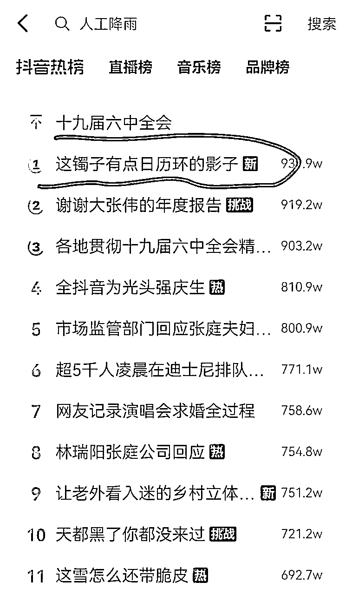

可什么才算稳？答案是：你随便挑个时间点去看，它都保持一副不紧不慢的模样。直播间里总有人，可能只有二三十个，但早看晚看都是这个数；网站日访客不算高，2000 上下，可天天都能守住 2000，甚至缓慢往上走……

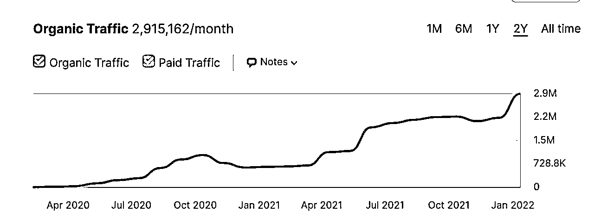

这种细水长流，才是该追的稳定流量。

怎么找？见到爆款先别上头，翻翻作者的其他内容。若只有这一条冲起来，其余都平平，先放一边；等同一作者能连着产出多条有流量的作品，或长时间维持稳定的“30 天销售额”，再记进名单。

再看“产品很差”这一条。这里要先厘清概念：很多人把“货”等同于产品，电商人说选品，选的也是产品。话没错，但语境要换。我们说的产品，是“针对某个问题的解决方案”。拿抖音直播带货举例：要解决的问题，是把某件货通过直播卖出去；解决方案，就是攒精准粉、勾起种草欲、拉高直播间转化；产品很差，则表现为粉丝不精准、直播粗糙、短视频也粗糙；蓝海机会，就是某个品类、某个主播明明粉丝少、内容糙，却仍能稳定收钱。

第二点，“很差”是相对词，操作时拿自己当标尺：对方做得比你能做到的还糙，才值得留意。跟谁比？跟你比。寻找蓝海的人是你，不是行业巨头。就像课程开头提到的“哈尔滨程序员”：他的产出放在普通兼职程序员里已算不错，但在正规软件公司眼中，终归是业余水准。

这听着有点反常识。平时我们讲见贤思齐，要刻意看更优的作品，用来学习和补短；可找蓝海时要倒过来：凡是明显超出你能力圈的作品，先跳过。他强是他的事，你短期拼不过，盯着看也生不出机会。蓝海大概率不在那边。

最后看变现稳不稳。流量和变现常是两码事，这里记两条。其一，颜值主播唱歌跳舞很吸粉，却未必好收钱。我关注过一位漂亮主播，粉丝几百万，收入几乎只靠直播打赏的音浪，条件这么好却变不了现，挺可惜。还有些直播间流量长期稳定，比如“抖音直播刷抖音直播”——没写错，也不是病句——但变现效率极低，找不到直观的收钱口子，这就不符合“稳定变现”。所以要学 2021 年抖音大航海的思路，反复问自己：开干前，变现路径想清楚没有？宁可要能变现的 1000 粉，也别贪不能变现的 100 万粉。正面例子是董十一，抖音粉丝十几万，一周却能变现约 100 万人民币，这种才值得研究。

第二，偶尔赚一笔不算本事，稳定进账才值得追。2022 年 1 月，不少人直播卖🛰️红包，短期确实能捞点钱。可这生意不稳：平台规则会改（据我了解，后来已有封禁动作），时效也短，今年这一个月能做，明年未必。不是人人都要做长期主义者，但也不能太短视。想想看，若每个项目只活一个月，下月又得从零找机会，而新机会在哪还不知道，因为你不一定还能撞上同样的窗口。饥一顿饱一顿，没多大意思。若你只是闲下来短做一阵，没问题，值得试；可若要把未来半年、一年押进去，就不必了，直接略过。

那什么叫稳定变现？判断方式和看流量一样：随手挑个时间看，它都在不紧不慢地转。淘宝店天天出单，也许一天一百单，但天天都能守住一百；CPS 每天有成交，粉丝才两万，日净利能有三四百；抖音探店号视频只有一两千赞，挂点商家广告或小黄车，数字不起眼，可人家天天发、条条都这个水平，粉丝还在涨，这就很吓人了……

内容来源：《蓝海项目挖掘｜小航海学习手册》

#### 2.2.5.2 案例拆解 @陈铭 ivy

最后以📕为例，说说怎样借第三方数据工具挖出蓝海品、找到机会。

第一步：在淘宝租一天千瓜豪华版，48 元，拿目标领域的关键词搜笔记，重点看近 30 天的笔记量。下图是我搜“减脂”的结果：一个月 5.98 万篇，红得发烫。【图略糊，看字即可】

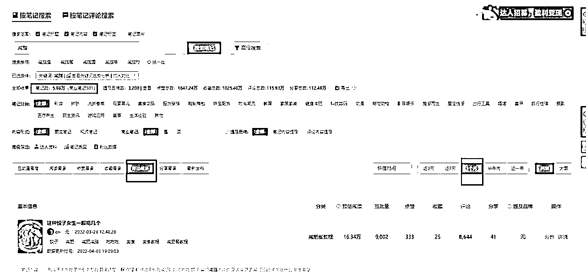

第二步：继续切细。换成“200 斤减脂”再搜，范围立刻收窄；上图这个结果近 30 天只有 9 条笔记，蓝得不能再蓝。

愿意主动在搜索栏敲下具体词的人，购买意向通常更明确。试想：某个词搜出来一共九条内容，其中四到七条都出自你的账号，那进店转化的空间是不是很值得期待？这套打法来自《粉丝 3000 月营收 20 万，📕低粉高变现的蓝海攻略分享》。

## 2.3 流量突然反常，往往是方向信号

在所有可观察的异常指标里，流量最直观。它如今集中体现在抖音、📕、视频号、👸号这些自媒体阵地上。刷内容时如果碰到这样的情况——某账号平日只有几百几千的曝光，或者某个题材换谁发都只有几百几千，忽然有一条冲到七位数播放——这条内容就值得停下来研究。

数据陡然拉高，背后往往意味着某个要素与同类不一样：可能是选题切入的角度，可能是开头三秒或封面的钩子，也可能是发布时段、挂的标签，以及内容里绑定的产品或服务。把这条爆款拆得足够细，流量密码就有机会浮现。

后面会围绕三种格外值得盯的流量现象展开：粉丝量不大却跑出爆款、长期平淡后单条冲破百万、新号在短期内粉丝猛涨。下面逐一讲怎么从这些现象里读出方向。其余异常情况本文暂不铺开，欢迎到航海群里一起讨论。

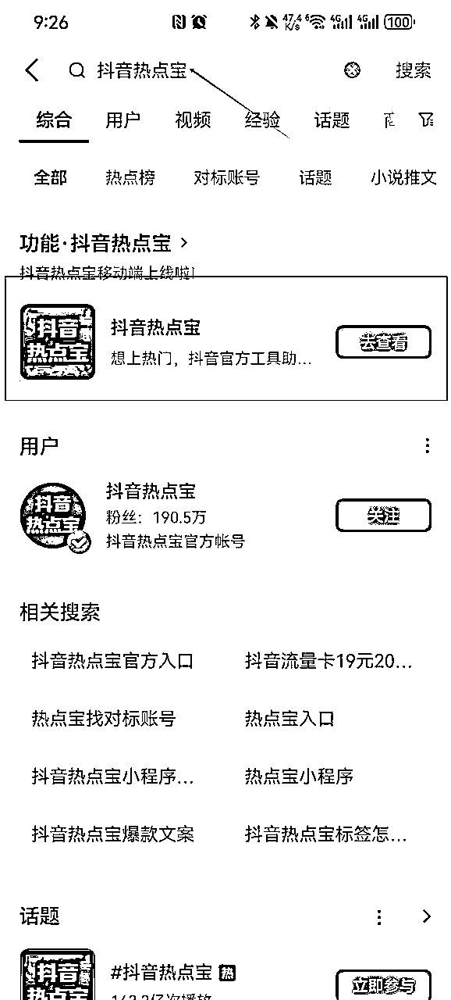
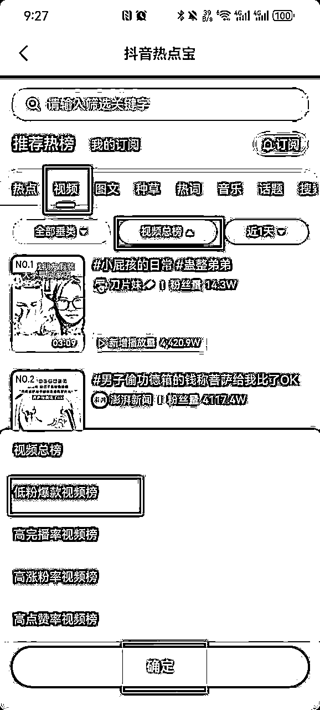

抖音热点宝：在抖音搜索栏输入「抖音热点宝」，点开排在第一位的入口；再找到「热点」并切到「视频」，用中间的筛选栏勾上「低粉爆款视频榜」，赛道与时间区间按需设定，符合条件的作品就会列出来。

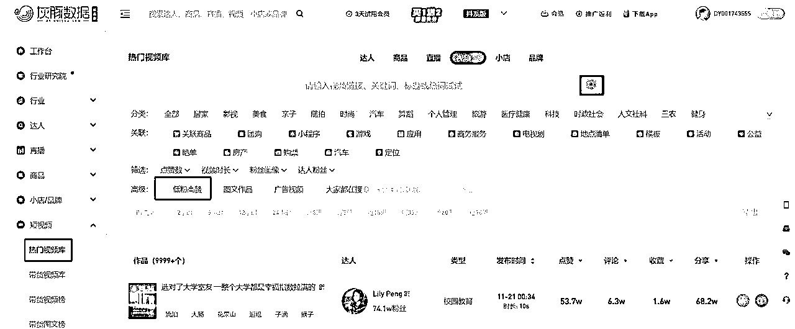
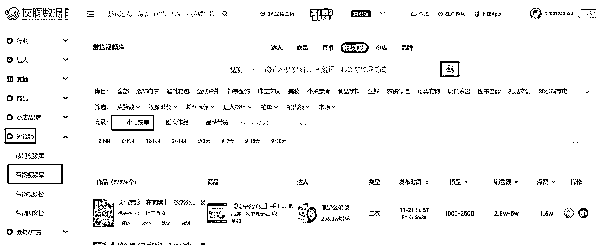
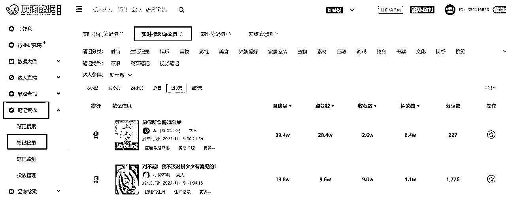

灰豚数据：登录官网后，从左侧导航进入「短视频」下的「热门视频库」，赛道、时间可自由限定，筛出来的正是这类作品。若只想看带货方向，左侧改走「短视频」—「小号爆单」这条路径，其余条件照旧。想查📕的低粉爆文，把顶部切换成小红薯版本，左侧依次点「笔记查找」—「笔记榜单」，再选「实时-低粉爆文榜」即可。

蝉妈妈：登录后从顶部进入「视频」—「热门视频库」，在筛选面板里设定赛道与时间，把「低分爆款」打勾，结果就会呈现对应的低粉内容。该功能需开通专业版。

#### 2.3.1 粉丝不多，也能跑出大爆款

#### 2.3.1.1 具体怎么做

所谓低粉爆款法，说到底是“跟爆款”的一种变体，只是把观察对象锁定在粉丝体量较小的账号身上，看它们做出的高播放作品，再拿去拆解。粉丝少、播放高，说明账号原有粉丝盘子对数据的拉动有限，流量更多来自搜索与系统推荐，可参考性也就更强。

第一步：这些内容从哪里找？

平时刷视频、刷笔记时，不妨刻意养成一个习惯：看到播放量突出的内容，顺手确认一下作者的粉丝量，看看是否属于“小号出大爆”的类型。也可以追着近期热点，在平台内搜相关关键词捞爆款，这一步交给后羿采集器等工具能省不少时间。不过单靠随手刷太靠运气，如今不少第三方数据平台都提供了同类榜单，更多时候我们靠它们来查。下面列几个主流工具上的找法，当然还有别的工具等你试，按自己需求挑就行。

第二步：拿到这些爆款之后，怎么拆才拆得出机会？

1. 用数据工具回看这条内容前后的数据曲线，判断是孤立爆发还是有延续；
2. 该账号是否还有别的爆款，几个爆款之间是否共享某种共性；
3. 注册时长与内容成色如何；
4. 更新条数、更新频率、发布时段是否有规律；
5. 账号名与细分赛道怎么定；
6. 标题、标签、正文关键词有什么讲究；
7. 封面或视频前 3 秒用了什么钩子；
8. 同一选题下别人的表现如何，与这条差在哪里；
……

经验上，一个注册没多久的账号若能稳定输出又跑出爆款，很值得细细拆一遍——爆款元素、流量密码，甚至一个能落地的项目，都可能从这里浮出来。

#### 2.3.1.2 案例：@常常

下面借📕平台，看圈友@常常是怎么找到这类内容并把笔记拆透的。

第一步：先把笔记挖出来

在扎进一个赛道前，我会把这个赛道相关的📕内容先刷一轮，再把相关的词一条条列清楚——以英语学习为例，四六级、考研英语、学习法、雅思、托福、TED、高考英语都在名单上。之后交给后羿采集器：把📕链接粘进去，选智能模式，采集就能自动跑完。

数据到手，马上圈定要研究的账号。挑的时候把范围放在粉丝 5000 到 30000 之间的博主身上，这个量级的账号，成长轨迹与作品完成度都更有借鉴意义。目标定下来，信息准备就要做足：逐个建档案、逐项记细节，直到你对它们的特征熟到不能再熟。

第二步：把这条笔记拆开看

①笔记本身的数据

上一轮整理中，标题为《会搞💰的女孩，真的是 yysd！ 📌》的笔记被挑了出来。

在蝉小红里进入该笔记的分析页，打开数据概况，会看到一个不太寻常的赞藏结构：点赞 46000、评论 338、收藏 44000、分享 1373，而博主粉丝只有 5605。

再切到千瓜后台复核，把各项比例和关键词放在一起看：

（千瓜后台显示数据）

通常的判据是：粉丝量与笔记数据之间若达到赞藏：粉丝≈10:1，基本就可以归入爆款。这条笔记阅读与点赞约为 10:1，赞藏对粉丝也几乎踩在 10:1，说它是大爆款并不夸张。常有人说创业、副业类内容在📕容易踩线，这条算不算给你换了个认知？

热搜词覆盖：深圳女孩🔥694.66、一心搞钱🔥225.44、也装不下🔥191.72、除了搞钱🔥80.4。

模仿难度：🌟🌟🌟

制作门槛：
难点一：整篇用了 17 张图，既得会找素材，也得会把图片拼得顺眼，同色系之间怎么搭还得有点审美；
难点二：单篇耗时，图片一多，从备图、配色到拼合，一篇下来至少两三个小时；
内容匹配难点三：📕上女性用户占多数，男性博主的账号去发女生搞钱、副业这类选题，关注度天然偏低，人设也容易和内容打架。这套打法需要先验证，并提前想好验证路径。

②爆点究竟在哪

标题：会搞💰的女孩，真的是 yysd！ 📌——关键词落在“搞钱”与“女孩”上。

内容亮点：图与文的对比强烈，重点一眼可见；信息层层递进，把“怎么成为搞钱女孩”拆成可走的路径；清单体密集罗列，制造出“一次根本学不完”的紧张感，收藏几乎是本能反应。

图片处理：整体走暗调，背景是深色或灰调，压在里面的文字则用白色（封面）与黄色（内文）提亮。清单体把大量短期做不完的事项摊开，用户最理性的选择就是先存下来，等要用时再翻。

优点：技能、自学网站、副业方向、搞钱底层逻辑四块内容都覆盖到了；缺点：不同板块的字色没有统一，前黄后红来回切换，画面显得零碎，配图美感打了折扣。

标签：#自我提升 #努力变优秀 #副业 #搞钱 #女性成长 #女性智慧 #认知

发布时段：2022-11-09 18:25，周三，属工作日。对照蝉小红给出的用户活跃画像，傍晚六点这个时间是否真有参考价值，还得做验证。

评论词：看蝉小红的评论分析，排在前十的关键词依次是【博主】【搞钱】【PS】【简单】【笔记】【平台】【关注】【分享】【副业】【PP】。

形式小结：清单体叠加背景拼图，这套组合在📕出现频率高，出爆款的概率也高，可以放进备选库。

可迭代的地方：
（1）发布时段可以参照数据平台给出的活跃时间做校正，再用数据回验；
（2）板块区隔的颜色，从前面黄、后面红改成同一色系，版面会清爽不少。

④这条笔记给了什么价值
（1）把“成为搞钱女孩”这条路铺完整：封面先立目标，后面 8 张依次给出技能、自学网站、副业方向、搞钱底层逻辑，帮女生把路线图看清楚；
（2）路径上的资源也备齐：不光端上鸡汤，还递了勺子——每个板块都用清单列出具体资源名，方便按图索骥。

⑤它满足了读者的哪些需求
（1）对理想自我的想象——先给一个“搞钱女孩”的目标；
（2）通往目标的方法——技能、自学网站、副业方向、底层逻辑；
（3）路上要用的工具清单——具体学习资源一条条列出来。

⑥发笔记时可以借走什么
（1）形式上，清单体加拼图背景是可行的，不过这条的模板本身略显杂乱、美感不足，别照抄；
（2）内容结构从目标—技能—自学网站—方向—底层逻辑—资源清单，一路走得顺，看的人很容易生出“赶紧收藏”的冲动。

内容来源：《100 天涨粉 14 万，📕爆款笔记经验分享》

### 2.3.2 单条内容忽然冲破百万播放

#### 2.3.2.1 具体怎么做

别人的播放量我们看不到，但平台普遍存在一个播放转点赞的比例，用点赞数反推播放量就成立了。比如抖音上 1 万点赞，背后可能是 100 万次播放。顺着点赞数据去筛，百万级内容就跑不掉。

第一步：把百万播放的视频找出来

找法有几条：
· 日常刷内容时，把点赞破万的作品单独标记；
· 从第三方数据平台的爆款榜里挑，榜上不少内容播放早已过百万；
· 盯抖音、📕的热榜，顺着榜单点进视频列表，捡点赞过万的看。抖音的热榜入口在顶部热点，📕则要先到「我」—「创作灵感」。

第二步：核实这条内容的播放是否属于异常

做法是把这条内容前后的数据拉出来对比，确认真的是“突然冲高”，而不是粉丝基数大带来的自然结果。

第三步：拆内容，定位爆款成因
1. 账号还有没有别的爆款，几个爆款之间是否共享某种共性；
2. 注册时间与内容成色；
3. 更新条数、频率与时段规律；
4. 标题、标签、正文关键词；
5. 封面或视频开头三秒的钩子；
6. 同选题、甚至同背景音乐下，其他账号的数据与这条差在哪里；
……

#### 2.3.2.2 案例拆解

以抖音为例，演示怎么找到一条突然破百万的内容并做拆解。

第二步：翻这个抖音账号的资料，几个细节浮出来：
1. 首条视频发布于今年 11 月 13 日，到 11 月 22 日一共更新 18 条；
2. 账号名与简介都指向同一个定位——秋冬帽子种草；
3. 这 18 条全在讲帽子，点赞普遍不过百，唯独这条冲了出来，值得深挖。

第三步：从多个角度拆内容，找机会
4. 同款帽子的戴法内容它发过三次：第一次是同素材的挂车视频，第二次做成图文，两次反馈都平淡；真正跑起来的这条，在评论区把用户往橱窗引，目前显示成交 251 单。评论区导流这一手，可以记下来。
5. 顺着热销词往下翻，还能看到同类视频——去年冬天已经有人拍过相似素材，并且拿到过百万播放。这说明该素材在抖音的受众盘子够大，“爆过的还能再爆”并非空话。既可以跟这个品，也可以换个思路：手套、耳罩这类秋冬单品，同样值得去翻去年冬天跑出过成绩的产品与素材。

### 2.3.3 短时间吸粉飞快

#### 2.3.3.1 具体怎么做

第一步：把涨粉凶的账号找出来

路径与前面两类相近：
· 刷内容时多留意播放量高的作品，顺手看一眼作者的粉丝量与运营时长；新号若已有高播放内容，即便当下粉丝不多，也可以放进观察名单，跟踪它接下来的涨粉节奏；
· 在抖音、📕、视频号搜当下热点、节日相关的词，挑出高播放作品，同样用粉丝量加运营周期做判断；
· 借数据工具看榜单——「抖音热点宝」里的「高涨粉率视频榜」，「蝉妈妈」里的「涨粉达人榜」。

第二步：锁定账号后，怎么拆出机会？
1. 用数据工具看波动，判断涨粉是单条带动还是多条累积；
2. 账号是否还有别的爆款，爆款之间有无共性；
3. 注册时间与内容成色；
4. 更新条数、频率、时段；
5. 账号名与细分定位；
6. 标题、标签、正文关键词；
7. 选题本身是否天然利于吸粉；
8. 同类账号的数据与它差在哪；
……

与“小号出大爆”同理，注册不久就能在短时间内收下几万乃至几十万粉丝的账号，特别值得拆。它可能给选题灵感、给涨粉手法，也可能让你撞见一个需求旺盛却一直没被自己看见的项目。另外，海外短视频平台的内容同样有研究价值，关注海外市场的朋友，把这套流程搬过去即可。

#### 2.3.3.2 案例：@大星儿

仍以抖音为例，看圈友@大星儿是怎么锁定快速涨粉的账号并做分析的。

大星儿主攻视频号涨粉，素材策略是优先借用其他平台已经验证过的爆款。前提随之明确：受众锁定在下沉市场的中老年群体，内容以泛娱乐为主，偏情感类，画质不必苛刻。前提定好，直接去抖音找跑通过的成功案例。

第一步：抖音直接搜关键词

在抖音输入故事、故事会、民间、情感、正能量、家庭情感故事等词，筛选条件设成“最多点赞 + 一周内”，排在前面的作品点赞、评论、转发通常都有不错的量。点作者头像进主页，看几个关键点。

接着翻主页各条视频的点赞分布，挑出数据好且发布在一两天之内的作品——最长别超过七天，因为一条视频数据越好，放得越久，越可能已经被人搬到视频号去了。再点开评论区看用户头像：若多是花草风景那类风格，基本可以判断这个号的主力受众是中老年人。

第二步：用数据复核

路径一：蝉妈妈—视频—热门视频库/带货视频库—情感

路径二：蝉妈妈—视频—搜索框输入故事、情感、正能量等词，把视频限定在近 7 天高赞，再进作者主页核对数据与素材存量，确保后续有足够的视频可剪。

想找方向，先进入对应细分品类，把相关账号翻出来，逐个点开详情看后台数字。这里只盯两项：最近新增粉丝量，用来看这个号起势快不快，以及近期是否跑出过高流量作品。

筛到合适的参照账号后，建立一张账号清单，把关键字段记下来；同时用抖音关注对方。对方一发新内容，手机就能收到提醒，之后长期盯更新节奏，视频号选题库就能不断补充高播放、强吸粉的参考案例。

资料整理自：《视频号航海新手，7 天涨粉 10W+实操手册》

## 2.4 先看赚钱结果，再找机会方向

我们研究趋势、训练商业判断，最终目的还是把发现的机会兑换成收入。既然如此，不妨倒着推：从别人已经赚到钱的地方切入，观察出货量、每单成交额、投放回报以及盈利方式。

出货量越大，往往说明需求池越深、可做的空间越宽。每单成交额高，同时成本又能压住，单件留下的利润就更可观。为什么要盯高成交价？因为便宜货利润薄、同质化严重，操作难度反而更大。拿卖袜子来说：成熟大店或大号能做到 15.1 元 15 双还包邮，月销几万+；新手去卖，很难做出明显差别。即便 19.9 元五双顺利售出，扣掉各项成本一单挣 10 元，想月赚 5000 元得卖出 500 盒；如果再花钱推广，可能连 5000 元都守不住。反观高成交价产品，哪怕运营不算精细，一个月努力成交几单，也有机会月入过万。因此，这类项目更容易被看见。

ROI 指投入与产出之比。如今线上卖货竞争激烈，买流量几乎成了常规动作，但买量要花钱：投进去 1 元，带回的销售额得超过 1 元才划算。计算方式是 ROI=投放产生的销售额÷投放花费；结果大于 1，说明回报覆盖投入；数值越高，每花 1 元赚回的越多。高 ROI 的号或商品属于反常数据，应该重点观察、继续拆解。

盈利方式上，接广告、开店、导流、直播都很普遍；一旦遇到少见打法，背后常常藏着多数人尚未察觉的机会。

### 2.4.1 出货量大的项目如何挖

#### 2.4.1.1 操作流程

先找出货量高的号，再从里面挑热卖款。可看的维度不少：直播出货、单品出货、单条视频或图文出货、店铺出货等。用考古加、禅妈妈、抖查查这类工具，进入直播、商品、视频、店铺中任意一个你想研究的板块，把近 7 天或近 30 天的数据按出货量降序排列。

筛选时优先看粉丝不多、出货却猛的号、店或商品。粉丝底盘小还能卖动，说明产品大概率有市场。点进这些号、直播现场或店铺，把卖得好的款式找出来。

接着做测品，盯点击率和转化率：点击率反映热度，转化率反映成交。点击率尽量不低于 15%，转化率至少达到 3% 才算过关。若五天内点击率没到 15%，或者支付率没超过 5%，就放弃。

#### 2.4.1.2 案例

打开抖查查，进入直播榜；商品榜、视频榜、小店榜同理。

按周或按月切换，再点“直播销量”，让箭头向下，就是从高到低排。优先挑粉丝少、最好不超过 10 万，但直播出货量大的号，例如下面这类。

### 2.4.2 高成交价项目如何找

先界定一下：什么算高成交价项目？通常单笔成交达到 4 位数，就可以归入这一类。结合日常所见，线上线下都不少，比如在线课程、企业咨询、代办中介、K12 系列、旅游、疗愈等虚拟产品或服务，也有汽车、奢侈品、房产、古玩、高定等实物商品；你实际接触到的肯定更多。

龙哥在星球发过一张截图，很适合说明部分高成交价项目，这里把那篇帖也分享给你：《价值 9 位数的认知》，评论区能看到不少相关领域和项目。

通常来说，这类项目单笔毛利更厚，即便成交笔数不如走量型项目，总营收也未必低。下面看看怎样通过寻找高成交价项目来捕捉趋势。

#### 2.4.2.1 找法

先找到已经存在的高成交价项目。

① 从自己的麻烦里发现需求。解决自身问题，本质上是在回应一种市场需求，同行也会遇到类似困扰。把问题记录下来，去搜市面上对应的解决方案，可能就撞上一个稳定的高成交价项目。

② 顺着现有项目往外延展。拿亲友、长辈、晚辈等不同人群的社交账号刷一刷，观察他们常被推荐哪些内容和商品。例如在女性用户账号里看到美容院提供种眉服务，这本身就是高成交价项目；再往周边看，还有种眉技能培训、上游耗材供应等机会。

③ 做高成交价项目的中间人。比如种眉服务我们做不了，但可以牵线提供线索，赚高额分成。再如代办证件、房产中介等服务，产品单价高、信息差大，哪怕没有资源，也能靠撮合赚信息差的钱，收入通常不差。

④ 选定一个领域，专门找该领域内单价高的项目。去电商平台、数据平台、课程平台、本地生活平台等同类产品集中的地方，挑一个方向，例如“汽车”，筛选成交价超过 1000 元的商品。

⑤ 从低价产品追到高价产品。低价体验转高价成交，在教育培训和医美个护中都很常见：先用 1 元、9.9 元体验款引流，体验后再推正价高单价产品。看到这类低价体验品，就可以继续跟进，参加体验或咨询，摸清背后的正价产品，再作分析。

⑥ 利用龙哥盟，从海量项目内容里捡高成交价线索。精华帖、别人发布的风向标、前面提到的龙哥星球帖评论区，以及此前抖音高成交价项目航海手册中收录的《230+ 高客单项目案例》，都能提供丰富线索。

然后做一张表，把项目信息整理出来分析。表格不复杂，核心是调研账号。每研究一个赛道，基本都会把能看到的号用这张表过一遍。下图是抖音同城团购高成交价项目的账号调研。

重点看三处：近期赚了多少钱；靠什么产品组合赚钱；最近内容朝哪个方向走，以及内容形式的复制成本高不高。若整个赛道都在赚钱，基本就能判断方向可行。

接下来考虑差异化。很多赛道能起量，前提是定位有差异。怎么做？可以记一句话：先占“别人没有”的位，再在“别人有但我更强”上做文章，让用户感知得到、觉得只有你这里能给，同时他们买得起、我们也有利润。换成自问就是：这件事重要吗、已经有人做了吗；如果有人做，我能否做得更好；用户能不能察觉我更好或不同、我是不是独一份；用户是否买得起、我们毛利是否够高。

比如有圈友做打坐号。当时没人专门做打坐，但有人做冥想，收益也还行。他们从打坐切入，如今做到全网头部，单月变现几十万，这就是靠“人无我有”切进去的典型。拿着这句话再看表格，你能做什么、需要做什么，看看别人卖什么、赚多少，心里大致就有数了。

最后用一张简明的差异化图收个尾，希望大家都能找到合适定位。

资料整理自：《2 月航海 | 抖音高客单项目 | 实战手册》

#### 2.4.2.2 案例拆解 @苏明波

下面以餐饮为例，讲讲如何分析一个领域里的高成交价项目，思路也能搬到其他行业。

先找高成交价项目。餐饮领域相对好找，可以有意识挑米其林二星以上、黑珍珠等客单价较高的餐厅。圈友在杭州线下聚会时，去的是一家黑珍珠入围餐厅。

再了解项目信息，分析它为什么能卖高價，并寻找机会点。

① 锚定效应。店门一进去就是一整面茅台墙。茅台在国人心中有“硬通货”地位，是一个锚，直接把这家店的档次托住了——没人会在街边小馆喝茅台。同理，我们也能用“硬通货”把产品定位往上抬，例如西餐厅酒柜摆贵价葡萄酒，服装店强调“原创设计师品牌”，家居店主打“进口意大利瓷砖”。

② 食材档次。东星斑、梭子蟹等海鲜成本本就高，食材本身就在替餐厅说明档次。

③ 报价策略。冯老师提到，订菜时先问预算，最贵的一道菜在 800—1000 元之间；再问有没有便宜些的，对方答东星斑 688 元。先往高报，是一种筛选客户的方法，也是高成交价的诀窍。如果连高价都不敢报，怎么会有客户愿意为高单价买单。

④ 客户结构。杭州综合体商场里的餐厅多为四人桌，这家却以包厢为主，客群主要是商务宴请，茅台也常出现在商务饭局。商务宴请更方便做高成交价，因为预算通常高于个人消费；对公司而言是投资，对部分员工而言可报销，价格敏感度自然更低，有利于把客单价拉上去。

⑤ 老字号口碑。说实话，这家店味道中规中矩，但客户为什么还愿意付钱？没记错的话，冯老师介绍它开了快 20 年。餐饮能经营这么多年，肯定有过人之处。带外地客户来吃饭，介绍一句“杭州老字号”，也能给店加分。

⑥ 借榜单光环。起初我们以为它是黑珍珠入选餐厅，后来才知道是入围而非入选。一字之差，但店家照样把入围奖牌摆在前台，不少客户未必分得清，这波算是借到了黑珍珠的流量。

⑦ 服务细节。这家店细节其实一般。一句话总结：高成交价既要把细节做到极致，也要有对等的势能。

资料整理自：《杭州线下聚会|高客单的秘密》

### 2.4.3 高投放 ROI 怎么判断

再复习一遍：ROI=投放产生的销售额÷投放花费；大于 1 表示回报高于投入，数值越大，每花 1 元赚回的钱越多。那多高才算高？ROI 只算了买量成本，ROI=1 只说明投放花费与收入打平，还没算其他成本，所以至少要高于 1.8；通常超过 2 就算异常，值得留意。

常见买量场景有：1. 在抖音、📕、视频号等平台，给数据表现好的带货图文或视频加投；2. 在同类平台给带货直播间加投；3. 在🧣、朋友圈、百度等渠道买广告，像下面这样。

还有👸号承接的广告。可以说，几乎所有内容都可以买量。

那怎样查看对方 ROI，筛出高回报的号和商品？ROI 属于每个号、每家店的私密数据，第三方平台也看不到，通常只能看到自己账户的 ROI。可以用三种粗略估算办法。

办法一：平时刷视频、👸号、朋友圈时，留意一切广告。一个商品若肯持续买量，而且被你多次刷到，大概率 ROI 为正、利润尚可，否则没人会长期做亏本生意。看到后，去百度、抖音、📕、🛰️、🧣等平台检索相关信息，弄清它具体在做什么项目。

案例：这位圈友发过一条风向标。他在朋友圈刷到一条广告，想起抖音也见过，于是去搜索，发现是个公益项目，ROI 还不错。

办法二：在直播间里直接看推荐 ROI 值。

案例：打开抖音，进入某个直播间，点右下角“...”，选择“小店随心推”，目标选 ROI，页面会跳出支付 ROI 目标。下方有一行小字：建议设置目标值 1.6～2.1。这个区间大致就是该直播间此前买量的 ROI 范围。

前面靠高出货量、高销售额筛出来的号，也都可以再看看 ROI，做综合判断。

办法三：对前面找到的号，例如高成交价、高销售额的直播间，直接在蝉妈妈、蝉小红、抖查查等平台查看买量情况。

案例：比如找到一个卖水貂皮草外套的号，点“直播分析”—“直播流量结构”，能看到近 30 天该达人付费流占比 7.99%，低于行业平均 13.66%；推荐 feed 达到 88%，高于行业平均 70%。虽然不知道具体投放 ROI，但粉丝少、成交价高、销售额高，且主要靠推荐流量，整体依然不错。

出处：《乡村发展基金会》

### 2.4.4 拆解头部号的赚钱方式 @梨云

#### 2.4.4.1 操作路径

先随便点开一个你感兴趣的头部号，检查它有没有四种常见盈利方式。

广告变现：看内容里是否出现产品，图文有没有商品展示、文案区是否介绍产品；看标签是否明确打出品牌名；看评论区有没有品牌种草。

引流变现：看主页简介有没有 @小号，或者📕号是否就是🛰️号；看主页有没有群聊，可以加进去试试是否有导流；看小号置顶内容有没有产品介绍或引流；看评论区引导有没有 @小号，或者暗示加群；翻评论区，有时能发现产品交付线索。

开店变现：这个直观，看主页有没有店铺，产品和价格都能看到。

直播变现：看主页有没有直播入口；可以进一次直播，观察卖什么产品、价格如何、销量怎样。

接着，如果一个号持续更新，却没有群聊、店铺、带货这些常规变现关键词，就值得单独筛出来深挖。怎么挖？用笨办法：从简介、置顶笔记开始，逐篇点开评论区找线索。

#### 2.4.4.2 案例一

简介写着“全网同名”，这个线索不够，因为不知道对方主阵地是哪个平台，一个个搜太慢。只能从评论区逐条翻，只要用户流露出“怎么拥有”的意向，就能顺藤摸瓜。后来发现线索在闲鱼：把📕名字复制到闲鱼搜索，发现他在闲鱼卖滴胶产品。

#### 2.4.4.3 案例二

简介依然是“全网同名”，仍判断不出平台。再看置顶笔记，写着“约稿 mhs”。把“约稿 mhs”复制到百度一搜，答案就出来了：这是一个专门画画约稿的 App 平台，一幅画 1500 元，收益还不错。

出处：《📕不变现？用 3000 个人设号精细拆解变现模式，带你看到更多赚钱机会》

## 2.6 常用信息渠道

下面整理各平台常用的数据分析网站，并从星球里挑一些使用帖供参考。

### 2.5.1 抖音/快手数据工具

蝉妈妈：网址 https://www.chanmama.com/ 功能：找达人、找爆品、找直播间、找品牌小店等。

相关使用帖：《蝉妈妈使用指南》

价格：个人版年卡，折算每月 84 元。

抖查查：网址 https://www.douchacha.com 主要功能：直播榜、达人涨粉榜、热销商品、飙升视频等。

相关使用帖：《2021 实战抖音直播带货玩法经验分享！》价格：专业版年卡，折算每月 61 元。

考古加：网址 https://www.kaogujia.com/

先说一个检索能力很强的工具：达人、商品、直播间、小店、品牌、视频、关键词都可以搜；榜单方面则覆盖达人、直播、商品、小店四个维度。

延伸阅读：《低成本，顺藤摸瓜法找对标账号和蓝海品》

费用：基础版年付，折合每月 98 元。

4.巨量百应：

网址：https://buyin.jinritemai.com/mpa/account/login?log_out=1&type=24&target_url=/dashboard/exclusive-selection-square/home

这个后台由抖音官方推出，面向创作者、商家和机构服务商，统一管理商品分享业务。能用它把橱窗商品、直播间商品维护好，也能整体查看自己账号在视频、图文、店铺、直播等场景下的带货交易数据。

延伸阅读：《抖音小店玩法之达人合作》

免费使用。登录身份限定为下面五类：
抖音、头条或抖音火山版的创作者（需有商品分享权限）
机构服务商（即管理创作者的各家 MCN）
小店联盟商家（拥有小店精选联盟权限的商家）
合作商家（没有开店、受邀参与合作的外部商家）
电商平台（与抖音完成对接的各种电商平台）

### 2.5.2 📕：蝉小红与千瓜

先看蝉小红（https://www.chanxiaohong.com）。页面里可以直接浏览博主、笔记、品牌三类榜单，也能跟进热搜词的变化。

配套攻略：《如何利用数据分析进行📕电商选品？》

接下来是千瓜数据（http://www.qian-gua.com/）。它的定位偏重商品方向：可以挖掘、分析商品和达人，查找热门内容，还能观察商品的营销行为。

延伸阅读：《在📕上，如何挖掘出 1000 个适合普通人的赚钱项目》

费用：高级版按年购买，月均 1280 元。

### 2.5.3 视频号：新视与友望

新视的地址是 https://xs.newrank.cn/home。它能用来寻找视频号，查看排行榜，拆解直播间及直播商品，做流量推广和资源对接。

运营参考：《视频号头部 MCN 创始人：通过视频号赚到 300W 后，我总结了一套非真人出镜领域的标准起号方法论》

费用：高级商务版年付，约合每月 479.4 元。

友望数据：http://www.youwant.cn/。已有视频号排行榜和直播带货榜两个板块，视频内容、创作者、直播场次的数据也都可以分析。

暂无对应使用帖。

费用：年付约合每月 959 元。

### 2.5.4 淘宝：生意参谋

生意参谋：https://sycm.taobao.com/custom/login.htm?_target=http://sycm.taobao.com/

它主要用于监控店铺经营状况，线上商品的搜索人气、点击量、支付转化率都能在后台看到。附带的选词助手、商品温度计、销量预测功能也值得用。

参考文章：《线上生意兵器谱之 2 —— 生意参谋》《从零到月入破万——蓝海店群》

大部分基础功能不收费，只有少数高阶能力需要付费；前提是你有淘宝店。

### 2.5.5 B站：火烧云数据

火烧云数据：https://www.hsydata.com/index?redirect=%2F

它可以观察平台整体流量大盘，对 UP 主做检索和拆解，提供带货榜单和上单分析等。

暂无对应使用帖。

初级会员每月 99 元。

### 2.5.6 APP 数据分析工具

1. 蝉应用

网址：https://app.chandashi.com/

苹果和安卓生态内 App 的数据都能在这查，比如应用排名、点击与下载量等。

实操帖：《从选品策划、变现、数据分析、App 矩阵多方面，分享 App 蓝海精细化运营玩法》

年付折合每月 180 元。

### 2.5.7 多平台：灰豚、新榜、飞瓜

灰豚数据：https://www.huitun.com

它按平台分版本，抖音、淘宝、快手、📕、小破站都有对应的入口。主要用于选品、拆解达人号、分析直播间、找创作素材。

实操帖：《📕单店铺单月 6000+利润选品保姆级教程》《通过爆款笔记数据分析，我在 7 天内把一个账号做到了 60% 的爆文率》《如何从📕千条带货笔记深度挖掘，找到适合普通人的蓝海爆品》

年付折合每月 52 元。

新榜：https://www.newrank.cn/ranklist/more?from=302

它覆盖👸号、抖音、快手、视频号、📕、🧣、B 站。可以检索几乎全平台的创作者排行，使用内容营销系统，分析账号与短视频数据，也能把达人找出来、把合作谈下来、把社群加进去。

暂无对应使用帖。

基础榜单免费；付费内容集中在数据服务、运营增长、内容营销、版权分发等方面。平台分开计费，高级运营版年付约合每月 240 元。

飞瓜数据：https://www.feigua.cn/

支持抖音、快手、B 站。在达人/直播/商品分析之外，额外提供矩阵管理能力。

参考帖：《抖音小店玩法之达人合作》

运营版年付约合每月 239 元，同样按平台单独计费。

### 2.5.9 其他：5118、后羿采集器、巨量算数

1. 5118 网：https://www.5118.com
提供行业词库和 SEO 数据，各行业的热门搜索词都能查到。

实操帖：《通过覆盖知乎保险蓝海词下的关键回答，实现精准引流年入百万》

免费。

2. 后羿采集器：https://www.houyicaiji.com/
拿到搜索数据后，可以用它做更深入的分析。

相关攻略：《后羿采集器的使用方法》《通过爆款笔记数据分析，我在 7 天内把一个账号做到了 60% 的爆文率》

免费。

3. 巨量算数：https://trendinsight.oceanengine.com/
用来探测众多领域关键词及其在不同平台的热度走向。

延伸阅读：《万字长文讲透兴趣电商选品理论与实操》

免费。

如果上面这些工具用起来卡住了，给你两个解决办法：

4. 把关键词丢进星球里搜索，你会发现几乎每个平台都有圈友写过用法。
5. 直接去工具官网找教程，不少平台首页就挂好了操作指南。

# 三、【项目实操 2/2】拿到风向标后，先算账再动手

💡

本节概要

前面接触过的挖掘风向标方法已经有十几种了。不过把机会挖出来只是第一步，接下来还得做个验证动作。

验证的核心，就是算一算这个机会究竟能带来多少收益，也就是利润层面的账。

本文会拆出五类常见项目的利润模型：
✅线上带货
✅虚拟产品、服务
✅线下店铺
✅网站、APP 类
✅实体制造

此外还会拿星球里的三个案例，一步步演示怎样查项目收益、怎样把利润算出来。

把你找到的机会拿出来，一起算一算吧。

## 3.1 能算账，才是真本事 @百川

业务能力强的人，到底强在哪？

把一件从没做过的新生意摆在他面前，他脑海就能快速形成一个大概的画面：这单生意能赚多少、链路上各项指标大约在什么位置。哪怕首次估算有误差，跑上几轮执行后，他也能把数字调到接近真实。

以前我在几家公司负责运营，参与过不少内部孵化项目，结果全军覆没。

内部复盘时，大家的说法大体逃不开这几类：产品站不住，运营抱怨没流量，技术始终迭代不动……

但所有人都忽略了一个共同根源：整个项目是蒙着眼开始的，账根本没算过。

《孙子兵法》第一篇叫“计篇”，核心思想是开战之前做周密计算，确认能赢才动兵，而不是把希望寄托在奇谋巧计或是以少胜多上。

作为买卖人，第一件事就是把这本账弄明白。

在生意开始之前，先把这些问题想清楚：

启动资金要掏多少？

流动资金得备多少？

回本周期预计多久？

人员工资、房租水电这些固定开销是多少？

万一做砸了，亏损上限又在哪？

然后再倒推：想跑通这个数学闭环，需要多少流量进来？在哪些节点补上哪些运营动作？

等等。

我们当年恰恰跳过了这一步，全程在分析用户痛点、竞品、调研、产品规划……踩了大坑以后，我才真正学会：做生意之前，先把账目功课做扎实。

出处：《CPA 推广一年营收 800 万，整合资源的生意要怎么做？》

## 3.2 算账到底怎么操作？

### 3.2.1 一条公式看懂利润 @海程

不管生意做得多大多小，利润的计算都逃不开这个关系：赚到的钱＝流进来的钱－流出去的钱。

流进来的钱，也就是卖产品/服务收到的款项。拆开看就是：单价定多少，卖出去多少件（次），两者相乘就是营业收入。

流出去的钱，是为了把产品/服务做出来并交付出去而花的钱。主要分三类：

1. 跟产品/服务直接挂钩的支出：进货费、原材料采购、生产设备，线下门店还要算上房租和装修。
2. 跟销售挂钩的支出：广告费、投放费；如果靠内容引流，还得把做内容的人力算进去。
3. 财务层面的支出：税费。

总收入＝销售量×客单价，再减去上面这些成本，剩下的就是利润。

出处：《如何用钱来驱动你的决策》

### 3.2.2 常见生意的收支模型

第一类，线上带货。

所谓线上带货，就是在抖音、快手、📕、淘宝这些平台上发视频、图文或开直播，把实物商品卖出去。

可能的进项：
- 自营卖货：卖出数量×单件售价×毛利率。
- 帮别人带：单件售价×佣金比例×成交件数。

可能的支出：
- 采购商品的花费；
- 做内容、养账号、开直播、做售后的人工；
- 如果投流，还有广告费；
- 开企业店需支付的工商执照费用。

第二类，虚拟产品与服务。

卖虚拟品（课程、资料包等）的进项：产品单价×卖出份数×毛利率。
做咨询（心理、生涯规划、职业、情感等）的进项：咨询人数×单次收费。
做陪跑（求职、📕、抖音等）的进项：陪跑单价×服务人数。
支出大头是人工，包括做课程、整理资料、投入咨询时间；另外可能有广告投放。

第三类，线下门店。

卖实物的（服装店、二手手机店）：售价×销量×毛利率。
卖会员的（健身房、自习室）：月卡/年卡价×办卡人数。
做加盟的：加盟费×加盟店数量。
支出方面：房租、物业、装修，销售/运营/服务人员工资，执照费用与税费。

第四类，网站与 App。

比如数据分析类站点，典型进项有三种：
- 广告收入：按点击或按曝光跟合作方结算；
- 会员订阅：订阅人数×单次缴费额，类似 B 站大会员、腾讯视频会员；
- 付费内容：买一本书、买一首歌那样的单次付费，购买人次×单价。

支出主要是开发与维护的人员工资、域名费用、税费。

第五类，实体工厂。

自有工厂，自己生产再销售。收入＝销售单价×销量；成本涉及场地、设备、全员薪水、原材料以及各类税费。

把这几类生意的算账方式摸清楚以后，接下来的问题就是：数据从哪拿？自己还没下场，当然只能去看那些已经在这条赛道里的人——也就是竞品。

### 3.2.3 没数据时，去向竞品要

1. 线上项目，数据直接网上找。

第一种：翻账号的店铺与橱窗。

拿下面这个账号举例。点开它的橱窗，可以看到绘本卖 20—30 元；佣金率是 15%，也就是说每卖出一本 30 元的书，到手利润 4.5 元。

第二种：扮成顾客去套信息。@秦汉唐

按这三步走：
a. 在评论区用模仿咨询的口吻留言；
b. 关注该账号，再以用户身份私信，表现出自己有需求；
c. 如果主页留了电话，就打过去。

联系上之后，继续保持用户人设去聊，通常能问出：价格怎么定、服务包含什么、哪些产品负责引流、还有什么更高阶的服务。对方的🛰️朋友圈也是信息富矿。

更进一步，可以提一句“我有朋友也感兴趣”，换一个身份继续挖，往往能获得更多料。

举个例子。我刷抖音时刷到一个儿童游乐的视频，评论非常多，而且大量留言都在表达需求。

我意识到这可能是个机会，马上尝试对接项目方：
a. 在评论区学着咨询者的语气留言；
b. 关注账号，私信时显得很着急；
c. 打了主页上的官方电话。

两个小时后（估计咨询量太大来不及回），对方在私信里丢来一个🛰️号，顺利加上了。

加上以后，对方发来两份文件：《已被加盟的城市地图》和《代理政策》。分市代、区代两档，加盟总费用约 4 万，市代还能往下发展代理抽返点。

文件显示已有 130 多个城市签下了市代。

我粗粗算了一下：130×4万＝520 万。再翻他们抖音过往视频，基本都是一件玩具的展示画面，点赞也就几个到十几个。

等于说，光是这一条视频，就给他们带去了 500 多万的进账！

2. 线下项目，可以用蹲点观察法。

2017 年我研究喜茶、星巴克时，净利就是这么算出来的：整整一周，早上 7 点到店、晚上 10 点离开，工作日、休息日分开记录，晴天、雨天也分开；

早上开门时买一杯，把流水号记下来；打烊前再买一杯，同样记下流水号；每小时按十分钟为一个间隔，数经过的男女人数和进店人数，同时拍视频留证；

守在店内观察顾客一次通常点几杯，推算客单价；

估一遍原材料开销，再从物业那边套出店铺租金和物业费。

把这些数字一凑：卖出的单量×单杯价格，再扣掉原材料、房租、物业费，大概能赚多少就心里有数了。

下面再看两个案例，进一步体会算账的实操。

出处：《如何用钱来驱动你的决策》《1 条视频带来 40W+利润的项目复盘》

## 3.3 实例拆解

### 3.3.1 实例一：自习室的账怎么算 @杨涛

先算收入。

线下生意有房租，通常按年缴，所以收入也按年度口径来算。

1. 先摸产品与价格。

在点评 App 上搜【线下自习室】，各家卖什么、卖多少钱一目了然。

多跑几家对比会发现，除了低门槛的单次体验型产品用来引流之外，主力产品大致集中在：
月卡：379~399 元
30 次卡：479~499 元
季卡：949~1088 元，固定座位 1499 元

半年卡和年卡的情况不统一，有的店有、有的店没有。按我的判断，周期太长，需求未必旺，算不上主力产品。

从销量最好的那家店看（中间截图），卖得最多的应该是月卡和 30 次卡。

2. 再看销量怎么摸。

美团上的订单只反映了部分情况，不少人到店体验后就直接在线下付款了。所以最好亲自跑一圈，以顾客身份体验，也可以办张周卡跟老板聊一聊。

聊不出答案也没关系，自己去数一下店里有多少座位也行。

既然前面判断月卡销量占比最高，就可以按月来估算：把座位总数乘以月卡定价，再乘上月度上座率，就能粗略得到每个月的销售额。

# 先算账，再动手：三个小项目拆解

做项目之前，先别急着投入。把收入、成本、利润三个数捋一遍，心里才有底。下面用三个案例走一遍。

## 线下自习室：座位数和上座率决定收入

先数清店里有多少座位，再挑周末、工作日、节假日，以及早中晚不同时段去抽样，看看上座率，估个大概。也可以去赚钱星球搜同类项目，别人可能分享过数据。比如日均上座率65%。

年收入可以按“单月销售额×12”来估，而单月销售额≈座位数×月卡均价×月均上座率。月卡价取月卡和30次卡的均价450元；假设50个座位，月均上座率65%，那么年收入=50×450×65%×12=18w。

再盘成本。主要是全年房租和软硬件总投入。房租因城市和位置而异；既然线下看过，知道位置和面积，就能在租房网站查价，也可以电话问物业费、电费。假设一年4万。软硬件包括简单硬装、灯、桌椅，具体可问老板，或在星球找做过的伙伴。若在写字楼，可能已现成，含在租金物业里；若是住宅楼，则得自行添置。桌椅去1688或拼多多搜，50个座位约7250元；硬装按面积假装客户问几家装修公司。星球里的伙伴给过经验值：50个座位的店，软硬件合计约6万元。

最后算利润。房租年年有，软硬件只投一次，第二年起不再发生。首年利润=18w-房租-软硬件=18w-10w=8w；首年之后，利润=18w-4w=14w。内容来源：《涛说 ，平民开店手册「一」线下自习室》

### 3.2.2 案例二：抖音图文起号，直播卖女裤

账号是王家有鱼（2号店），类目为女装裤子，只卖裤子。做法是先用图文起号，爆了再开播带货；日常更新图文并挂车。抖店为王家有鱼自营店。

先算收入。看货源来自哪里，推测利润率。这个账号像无货源模式，可能从拼多多或1688进货。去平台搜同款，对比进货价和店铺售价，利润率区间在20%到60%。具体看四条裤子：第1条，抖音106.9元，拼多多69.9元，差价40元，利润率37%；第2条，抖音83.9元，拼多多32.8元，差价51元，利润率60%；第3条，抖音103.9元，拼多多64.9元，差价39元，利润率37%；第4条，抖音113.9元，拼多多89.9元，差价21元，利润率20%。

收入=销售额×利润率。用考古加搜这个达人账号，近1个月销售额100万-250万。

按利润率折算，收入大约20万-150万。

再盘成本。先看收入来自图文带货、直播带货还是店铺带货，再推测需要投入的成本。王家有鱼自营店的商品带货佣金率是0%/13%，几乎无人通过该店商品链接带货。

可见主要靠直播和图文。直播贡献了67%的营收，销量75万-100万，一个月开播27次；

其余约30%主要是图文带货收入，大概30万-75w GMV。近30天发了131条图文，81条挂了车。

所以这个项目的花销集中在直播、图文产出、货源对接以及售前售后等环节。内容来源：《抖音图文带货项目拆解》

### 3.2.2 案例三：海外工具站靠广告赚钱 @龙哥

先算收入。第一步找竞品，了解变现方式。挖掘到“instagram download pictures”这个需求，在Google搜索，第一页出现6个解决此痛点的小工具。点开排名第一的网站，功能模式都简单：输入Instagram图片链接就能下载图片，盈利方式是Google Adsense广告系统。

了解收入模型。网上搜“Google Adsense 广告系统的收入计算”，可找到：总收入=点击次数×平均每次点击费用+展示次数×每千次展示费用/1000。也就是一块来自点击，一块来自曝光，这两块都和访问量有关。所以日收入大致≈千次访问收益×日访问量。

算日收入。用SimilarWeb查访问量：月访问量120万，折算到每天4万。千次访问收益大概多少？网上或赚钱星球搜“Google Adsense 的收入”，能看到1.2w日访问收入44.6刀，千次访问约3.7美元。保守一点，打个折，按千次访问2美元估算，该网站日入约80美元，每月2400美元，每年28800美元，约人民币20万元，差不多抵得上一名白领全年的工资。

再盘成本。主要是人工费，可以在赚钱星球链接该领域伙伴，了解需要掌握的能力、投入的时间精力，并预估把网站做好的时长。成本=投入时长×自己的工时。利润=收入-成本，如果觉得不错，就值得投入。内容来源：《通过 Google 挖掘细分市场的一个案例》

