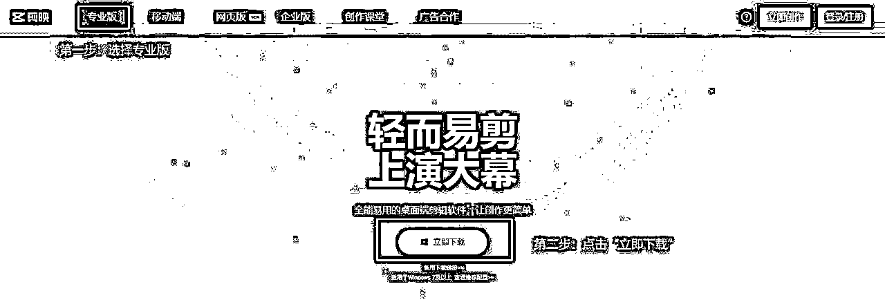
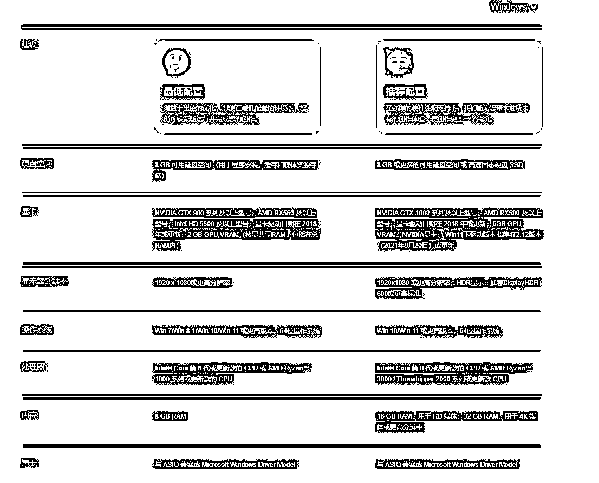
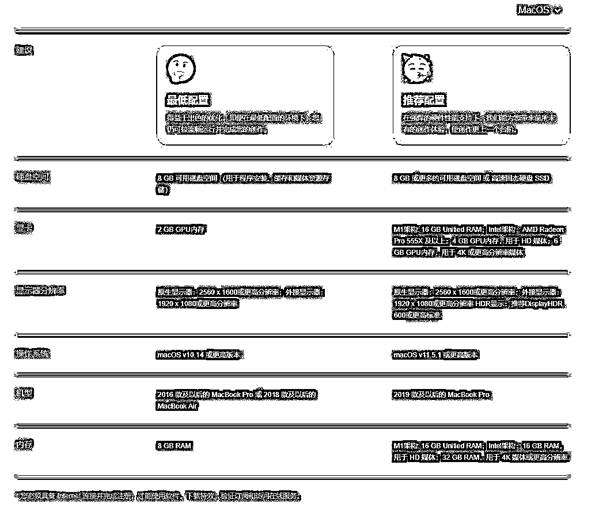
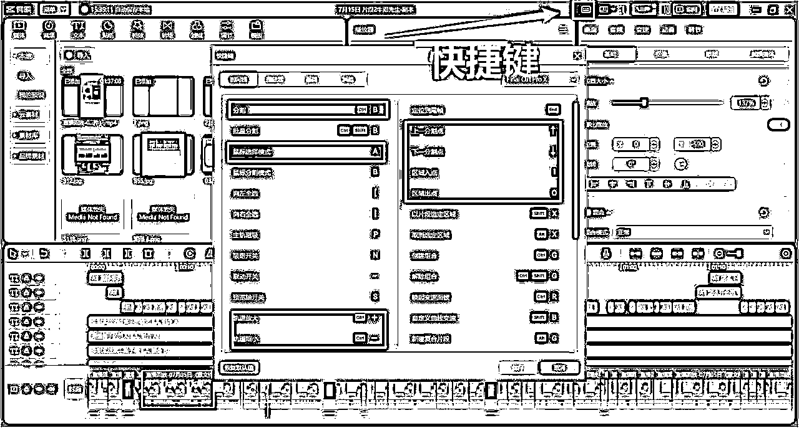
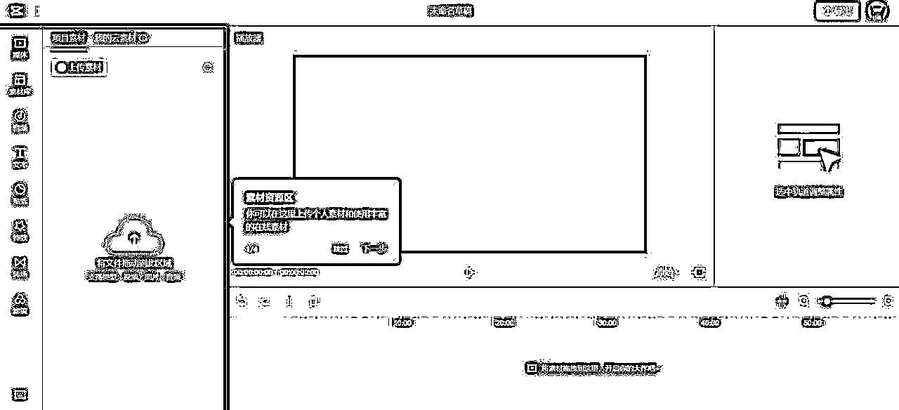
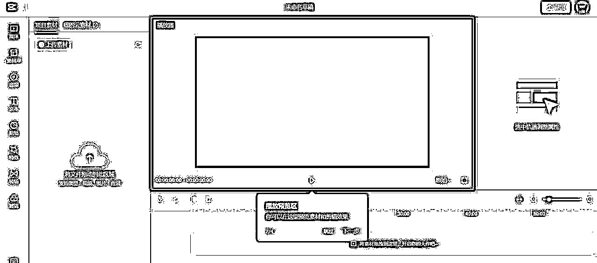
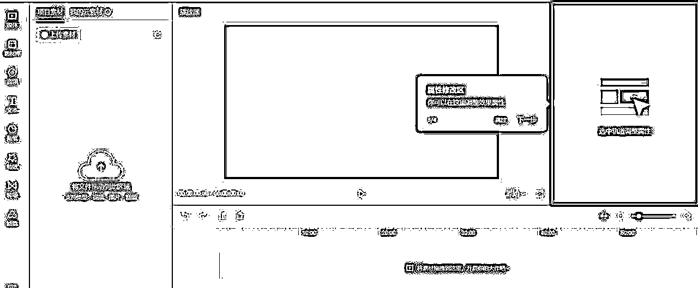
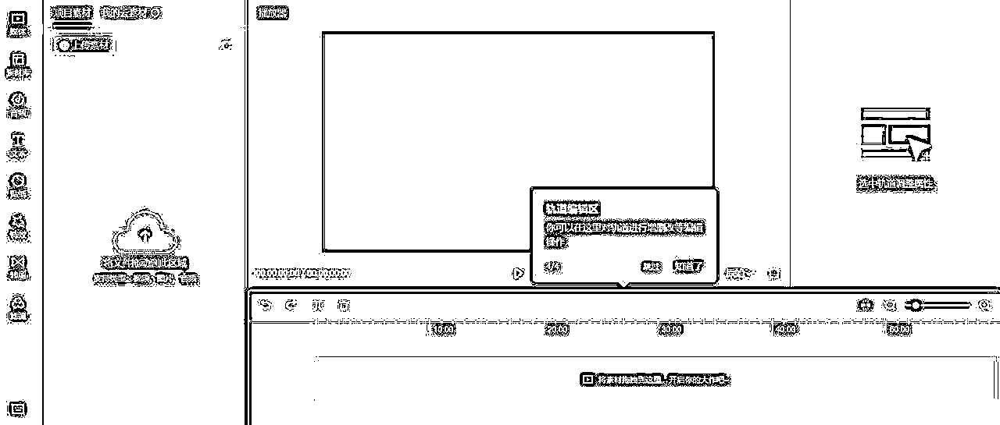
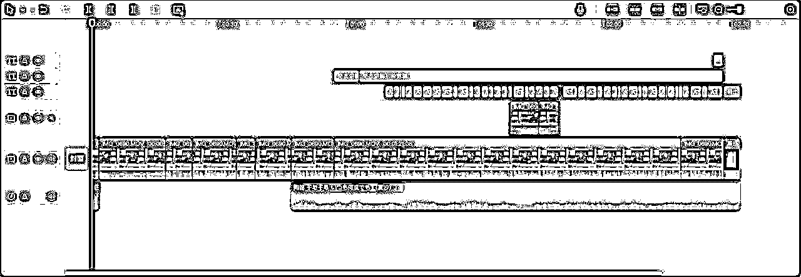
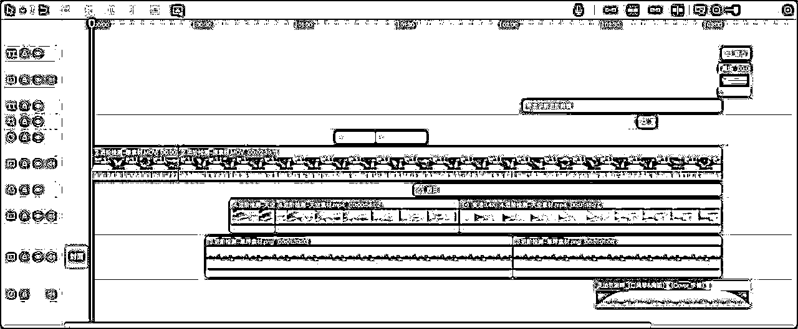

# 十二月剪映训练营：零基础到上手

出品时间：2023 年 12 月 15 日

先提醒一句：课程里的视频数量不少，受篇幅限制无法一并搬运，大家主要看文字版内容。

这份资料怎么用：它会把一个项目的可行路径摊开来讲，帮你看懂并动手做。想快速找某段内容，Windows 可用 Ctrl+F，Mac 可用 command+F，输入关键词即可定位。

## 开篇说明

Hi，欢迎加入 12 月航海·剪映训练营，这里是配套实战手册。接下来的学习中，我们会在这里反复碰面。

在视频生产链条里，剪辑承担关键加工环节：拿到画面、声音等原始材料后，要依照既定框架与节奏做重排和加工。无论业务是视频带货、图文带货、个人 IP、短剧 CPS，还是其他需要出片的方向，只要最终要发布视频，剪辑都绕不开。

它有技术门槛，既要选对工具，也得经过系统练习。不少人卡在这一步，项目启动或突破都受到影响。

因此本期航海把训练重心放在剪辑能力本身，主工具选用入门门槛较低的剪映专业版。课程采用视频授课，我们邀请 @奇杰老师 录制了 36 节教学内容，方便大家理解。

先说明目标：本期训练希望帮助大家掌握剪辑后，能把它用进自己的实际业务，或者凭这项能力更有底气尝试新项目；课程不鼓励找捷径，新手阶段把基本功练扎实更重要；它也不是影视后期课，重点是学会用剪映解决业务问题、提升短视频产出效率。

另外，遇到卡点请多问、多聊。手册覆盖不到的地方，欢迎提出来，我们一起找解法。希望这趟航行结束时，你既能拿到成果，也能结识一批同行伙伴。

本资料由龙哥盟和圈友共同产出，仅限航海船员及龙哥盟星球圈友学习使用。实操中有修改建议，欢迎持续反馈，可联系鱼丸（yuwan387）。

## 阅读指南

开始前花一分钟了解阅读方式，便于按自己的情况灵活取用。

整份资料按从 0 到 1 的学习顺序组织。你既可以对照航线图逐项练习，也可以只挑当前需要的内容阅读。

这次资料和以往航海相比改动较大。旧版偏向多列玩法，供大家自由挑；新版拆成必修、选修两部分：

必修篇：覆盖项目从 0 到 1 跑出最小 MVP 的必要环节，与航线图的行动路径对应。若你还在起步阶段，想先完整走一遍流程，建议从必修篇读起并照着做，不必纠结先选哪个玩法。

选修篇：收录更多玩法、案例和放大项目的方法。如果最小 MVP 已经跑通，想继续找思路，选修篇值得翻一翻。

📌 完全没碰过剪辑时，正式动手前先做热身准备👇  
✅第一步：剪辑前的了解与准备📌  
若基础准备已就绪，可跳到下面这些章节，边做边稳固👇  
✅第二步：软件和画面的认识与处理  
✅第三步：剪辑的初阶操作与练习  
✅第四步：剪辑的进阶操作与练习  
📌 必修篇完成后，可继续用以下章节拓宽玩法👇  
✅第三步：剪辑的初阶操作与练习  
✅第四步：剪辑的进阶操作与练习  
📌 必修篇走完后，仍想拓展玩法可看这些章节👇  
航线图与手册彼此对应，你可按当前进度选择学习内容：  
1. 每天先确认：自己在航线图走到哪一步，接下来要做什么；  
2. 找到要练的步骤，跳转到手册相应模块，看懂后立即行动；  
3. 当天行动结束，完成日志打卡，复盘并安排次日动作；  
4. 航线图贴合项目关键路径。若全部动作完成，说明最小 MVP 已跑通；此时别停下，继续循环第一到第三阶段。完成上述全部动作，等于学完剪辑必修篇。之后仍要持续找片、剪片、发布，把技能反复打磨并用于真实项目。

# 必修篇：练好剪辑基本功

💡  
章节概览：必修篇从认识剪辑切入，带你把视频号分成计划整套流程走一遍。按本篇步骤操作，可跑通该计划的最小 MVP。

想理清学习路线，建议按下面顺序推进：  
✅此前没学过剪辑，先做准备👉【第一步：剪辑前的了解与准备】  
✅想先认识剪映，先从软件面板看起👉【第二步：软件和画面的认识与处理】  
✅已了解剪映、但基础操作不熟，可学👉【第三步：剪辑的初阶操作与练习】  
✅想掌握关键帧、蒙版等进阶能力，可学👉【第四步：剪辑的进阶操作与练习】  
想检查成果，手册安排了两个小测验：  
✅初阶剪辑技能检测👉【3.4 初阶剪辑技能检测】  
✅进阶剪辑技能检测👉【4.4 进阶剪辑技能检测】  
必修篇内容和航线图顺序一致，顺着手册学，就能逐项完成航线图任务。后面每个关键步骤的概览也会关联航线图，提示你完成对应动作。现在开始。

# 第一步：开剪前先做功课

正式学剪辑前，先做一点准备和认知铺垫，后续更容易进入状态。准备工作做在前面，实操会更顺。

💡 本章航线图  
学完并练完本章，航线图第一阶段即可完成。  
第一阶段：完成前期准备，安装剪映并备好素材（约 1-3 天）  
明确学习方向与用途，设定目标和 21 天计划（约 1-2 小时）  
做好硬件、软件、小程序、账号等准备（约 1-2 小时）  
按业务场景，准备学习阶段可用的素材（约 1-2 小时）  
4.了解剪辑基础理论，认识术语、概念和常识（约 1-2 小时）  
熟悉剪映基础功能、面板、快捷键，并跟视频练习（约 1-2 小时）  
现在，进入第一阶段的学习和练习。

## 1.1 21天学习节奏怎么排

### 1.1.1 先明确学习目标

在视频生产链条中，剪辑承担关键加工角色：它要把画面、声音等原始材料，按预设框架和节奏重排、加工。并非只是裁一刀、拼两段，还会牵涉声音处理、视觉效果、调色等环节。

短视频和社交平台走红后，剪辑的价值被进一步放大。平台上不断冒出成百上千种细分创业方向。想抓住这波机会，剪辑是基础能力之一。业务方向可以是视频带货、图文带货、个人 IP、短剧 CPS，也可以是其他类型，但最终都要出片，就离不开剪辑。

关于本期训练目标，@奇杰老师 的原话如下：  
1-1.短视频剪辑学习目标.mp4【在线播放】  
总结而言：  
本期训练希望帮助大家掌握剪辑，并把它用进自己的业务，或借这项技能增强尝试新项目的信心；课程不走捷径路线，新手先练扎实基本功，钻空子难以长久，平台漏洞也会被补上；课程并非影视后期教学，核心是让剪映服务于业务问题解决。

### 1.1.2 做一份21天学习计划🔥

这是本期航海的关键动作之一：给自己定一份 21 天学习计划。

前几期训练营里有个现象：有人把学剪辑当成打卡任务，一翻开资料就冲两个测验。可投入时间学习，目标应是掌握技能、提升能力，而不是只完成打卡和测验。那些规则用来督促学习、检查成果，并非让人走形式。

因此建议：  
按个人节奏安排 21 天规划，踏实看手册；备好素材认真练，练到熟练；再用手册素材做测验，争取独立且顺畅地达到老师示范的效果；如果按这个路径走完 21 天，收获通常不会小。

几点补充：  
21 天学习计划是什么：把航行期每天当作一个单元，安排当天要做的动作，用来自我督促；  
计划长什么样：在奇杰老师协助下，我们整理了一份「21 天学习计划模板」，你可参考它，结合能力与时间做安排👉「剪辑特训 21 天学习计划模板」  
计划和航线图有分工：航线图给多数人可跟的实操节奏，颗粒度比计划粗；当你困惑“现在干嘛”“下一步干嘛”时，航线图能指路；  
计划里的动作可借鉴航线图，先做啥、后做啥。若拿不准，翻手册大纲或航线图，二者给出的顺序一致，对多数人适用。  
当然，制定 21 天计划虽是重点动作，但做不做由你决定。若希望 21 天内成长路径更清楚，建议动手写一写。长期成长仍要靠项目复盘与打磨。

## 1.2 开剪前的准备清单

常用剪辑软件并不少，比如 Adobe Premiere Pro、Final Cut Pro，还有大家熟悉的剪映。

本资料以剪映专业版为教学工具。它在国内使用广，入门门槛较低，适合新手学习。

想更完整地掌握剪映功能，建议安装桌面端专业版。手册演示也基于桌面端。

### 1.2.1 准备事项概览

奇杰老师给剪辑准备工作的建议，主要分硬件、软件、素材三块。  
时间戳：硬件准备：开始-00:47，电脑能流畅运行剪映专业版即可  
软件准备：00:48-00:58，需要安装剪映专业版  
素材准备：00:59-结尾，需备脚本素材和画面素材  
1-3.学习剪辑的准备工作.mp4【在线播放】

### 1.2.2 安装剪映

剪映官网：https://www.capcut.cn/  
进入网站后选“专业版”，点“立即下载”：

Windows 配置要求：

MacOS 配置要求：

电脑配置不必投入太多预算和精力，能顺畅使用就行。

### 1.2.3 配套工具与账号

为让后续剪辑更顺手，除剪映外，前期可备好以下工具。  
互传工具一：https://snapdrop.net/#  
优势：无需安装第三方软件，同一 WiFi 下可在网页传输；不足：网站有时打不开。  
工具二：www.localsend.org  
优势：跨平台无线无损互传；不足：要安装第三方软件。  
APP：🛰️、抖音、哔哩哔哩  
🛰️小程序：轻抖（短视频工具，可提取文案等）  
注册短视频账号：抖音，或视频号，或快手，或📕

## 1.3 素材怎么找🔥

素材获取也属于准备环节，但它的重要性常被新手低估，所以单独拿出来讲。

找素材要抓住两点：  
持续储备足量素材，供学习时反复用；素材尽量贴近自身业务，结合业务练技能效率更高。  
若你已有业务，最好直接拿业务素材练手。技能最终都要落到实际工作或项目里。  
往期航海发现，不少同学不重视素材，不提前准备，只拿测试题素材照老师成品硬模仿。这样往往学不到真本事。  
所以建议自备一部分素材，航行期间再从各平台持续收集，围绕手册所教技能反复练，熟练度和精度才会提升。  
为让大家更快进入状态、少花时间找片，本章也列出常见素材渠道。  
常见渠道：混剪素材可去哔哩哔哩、抖音、淘宝及第三方机构；实拍素材靠自己拍摄，常见有人物口播、Vlog、好物分享。  
时间戳：混剪素材：开始-01:00；实拍素材：01:01-结尾  
1-2.剪辑素材的来源.mp4【在线播放】  
找到视频后如何下载？可借助亨亨猫（链接👉https://h.zzrjcp.com/）等工具。此类工具市面上不少，选顺手的即可。

## 1.4 剪辑名词快速认识

为避免后文出现陌生词，先认识一些剪辑基础概念。  
常见视频名词（⭐️为重点）：  
⭐️时长：片子长度，以秒为基本单位，常见写法是“时:分:秒:帧”；  
⭐️帧：画面最小单位，1 秒通常有 24 格，每格是一张静止图，连续播放就成视频；  
帧速率：每秒播放多少格，单位是帧/秒（FPS），数值越高观感越顺；  
⭐️画面尺寸：画面实际显示的宽和高；  
画面比例：宽度与高度之比，常用 9:16（抖音/快手/视频号）、16:9（西瓜视频）；  
⭐️时间轴：软件里摆放视频、音频素材的时间线，便于精细编辑；  
⭐️转场：两个镜头间加效果，让切换更自然，常见淡入淡出、百叶窗、擦除等；  
⭐️特效：给画面加特殊视觉效果，如爆炸、飞行、变形等，用来强化冲击力；  
声道：不同声道播放效果不同，一般分单声道、双声道、多声道和立体声；  
⭐️BGM（背景音乐）：给片子配背景音乐，用来烘托氛围和情绪；  
⭐️字幕：在画面中加入文字，用于对白、标题或内容说明；  
分辨率：视频像素密度，常见 720p、1080p、4K 等，影响清晰度和画质；  
视频导出：把编辑完成的片子输出为最终文件，可选择格式和参数。  
知识拓展-常见视频格式：  
MP4（MPEG-4 Part 14）：当前最常见格式之一，上传抖音、快手、视频号等平台多用它；  
AVI（Audio Video Interleave）：较老但仍被广泛支持；  
MOV（QuickTime Movie）：苹果开发，常用于高质量视频存储和播放，在苹果设备及专业剪辑软件中常见；  
WMV（Windows Media Video）：微软开发，主要用于 Windows 系统播放和共享；  
MKV（Matroska Video）：开源格式，容量和质量较高，常用于高清视频、蓝光电影等；  
FLV（Flash Video）：基于 Adobe Flash 技术，通常用于网页播放；  
WebM：Google 开发的开源格式，常用于网页和在线视频平台。  
这些格式各有适用场景和限制，按需求选即可。短视频平台多数场景仍以 MP4 为主。

## 1.5 快捷键速记

想提高剪辑速度，下面这些快捷键可以记一记。  
在剪映剪辑页右上角，点开小键盘图标，就能看到官方整理的常用快捷键：

最常用的是：分割：Ctrl+B；鼠标选择模式：A；轨道放大：Ctrl+“+”；轨道缩小：Ctrl+“-”；上一个分割点：↑；下一个分割点：↓；区域入点：I；区域出点：O。  
现在不熟没关系，后文具体操作中会逐渐用到。

# 第二步：熟悉软件与画面处理

本资料继续用剪映专业版做教学工具。它在国内使用广、门槛相对低。本章先认识剪映专业版的基础功能、剪辑面板和剪辑区，再借助这些基础技巧完成素材整理。熟悉之后，后续正式学习会更快上手。  
💡 本章航线图第二阶段：掌握初阶视频、音频、文字剪辑技能并完成作业（约 7-10 天）  
学完并练完本章，可完成航线图第二阶段前半段：  
1. 按自身业务建立素材库，持续补充剪辑素材（每天约 30 分钟）  
2. 深入学习剪辑区功能，跟视频练习（约 1-2 小时）  
学习画面比例和结构怎么调，跟视频练习（约 20 分钟）  
学习素材整体处理，跟视频练习并实操应用（约 1-2 小时）  
现在，开始第一阶段的学习与练习。

## 2.1 剪映界面与基础功能

### 2.1.1 先把剪映的常用按钮认全

正式动手前，建议先熟悉剪映里几个常用入口。知道每个按钮负责什么，后面剪片会顺畅很多。

账号相关（片头到00:41）：用抖音号就能进入剪映。进入后，自己在抖音里收藏的背景音乐、特效等内容也能看到并调用。

偏好设置（00:42—01:16）：打开设置里的「全局设置」，把「自由层级」「性能」等项目按需要调好。

建立项目（01:19—01:31）：按下创建草稿，就能得到一个新的工作项目。

项目存档管理（01:32—01:50）：首页会列出「草稿管理」，以前做过的工程都集中在这里；工程名称也支持修改。

把素材放进工程（01:53—02:25）：一种做法是在素材面板按导入，另一种做法是把电脑里的文件直接拖进素材面板，两种路径都能完成。

输出成片（02:27—片尾）：在编辑页面的右上角能找到「导出」；确认分辨率等设置无误后再执行导出。

演示文件：2-1.剪映专业版基础功能.mp4【在线播放】

### 2.1.2 主界面四块区域各司其职

打开软件后，不必急着下刀。先花一点时间认清主界面的分区，之后找功能会更快。

素材面板（片头—00:41）
预览窗口（00:42—00:58）
属性面板（00:59—01:29）
时间线区（01:30—片尾）

演示文件：2-2.剪映专业版软件界面.mp4【在线播放】

下面按区域说明用途。

素材面板：自己的视频、图片、声音文件可以从本地载入当前工程；平台内也准备了在线资源，能省掉到处翻找的步骤。实际剪辑时，把文件从该面板拖到下方时间线，就能快速铺好待剪内容。

预览窗口：时间线上编辑后的结果会在这里同步呈现。按下播放键，就能观察画面表现，发现不合适的地方可以马上调整。

属性面板：位置与尺寸、不透明度、色调、响度、变声、动画等参数都集中在这里。先在时间线选中目标轨道，再回到该面板修改对应数值，改动会直接反映到画面上。

时间线区：这是剪片的主战场。导入的素材在这里排序、切开、微调，轨道也能新增、删除或改动，最终形成连贯的视频。能操作的轨道包括画面轨、声音轨、字幕轨、特效轨等。

## 2.2 剪辑区到底能完成哪些动作🔥

前面介绍过界面分区，但最关键的时间线区域究竟能做什么？为了让操作思路更清晰，这一节单独拆开讲「剪辑区功能」。

本节部分演示会与后面的画面、声音、字幕章节有交叉，不过切入角度不同；后面再遇到时，可以当成复习巩固。

先看上半部分演示，涉及挑选片段、切开片段、全选、撤销、重做、冻结画面、反向播放等。

挑选片段（00:25—00:47）：在时间线左上角找到箭头按钮，切换成「小剪头」后，再去按目标片段即可选中。

切开片段（00:48—01:10，02:10—02:42）：按下「分割」后，指针会呈现刀片形态，这时就能把片段切成两段。

撤销一步（01:50—01:57）：按撤销，刚才那一步操作会退回去。

重做一步（01:58—02:09）：按重做，被撤销的动作又能恢复。

左右裁切（02:44—03:35）：选中片段后，按对应方向键，可以把左侧或右侧多余部分去掉。

冻结画面（03:36—04:22）：选中片段后执行定格，当前帧的画面会停住；停住多久可用拖动方式改变。

反向播放（04:23—05:40）：让画面倒着走。若想保留原声，需要先把声音从画面中拆出来。

旋转画面（06:01—06:18）：每执行一次，画面转动90度。

裁剪画面（06:01—06:57）：选中画面后进入裁剪，能改变画面尺寸和宽高比例。

口播整理（06:58—片尾）：该功能会分析口播内容，便于把停顿、重复词等多余部分删掉。

演示文件：2-4.剪辑区功能介绍（上）.mp4【在线播放】

下半部分演示包括后期录音、主轨吸附、自动贴合、联动、预览线、声音卡点、轨道锁定、轨道隐藏等。

后期录音（片头—01:06）：可以给现有片段补录旁白或配音。

主轨吸附（01:07—02:21）：通常默认打开；若想自由挪动片段位置，可将其关闭。

联动（03:43—05:13）：打开后，移动主轨中的某段内容，与它关联的其他素材会一起挪动。

预览线（05:14—06:38）：时间线里的黄色指示线。打开后移动指针，预览窗口会快速显示对应画面。

缩放轨道（06:39—07:15）：调整时间线显示比例，便于迅速定位目标片段。

自动/手动卡点（07:16—09:23）：设置后，声音素材上会出现黄色标记，做卡点视频更直观。

清除卡点（09:24—09:41）：把刚才用于标记节奏点的黄色标记清掉。

隐藏轨道（10:14—10:43）：暂时不显示某条轨道的内容，方便比较有它和没它时的画面差异。

轨道静音（10:44—片尾）：让指定轨道的声音暂时不出声。

演示文件：2-4.剪辑区功能介绍（下）.mp4【在线播放】

## 2.3 画面比例与主画面结构

画面比例指长宽关系；主画面结构指主内容在整体画幅中占据的范围。

本节演示围绕两类画幅，说明常见的主画面摆法。

竖画幅，比例9:16，演示位置：片头—02:41
常见摆法：铺满全屏、上下分栏、中间嵌16:9、中间嵌4:3、中间嵌1:1。

横画幅，比例16:9，演示位置：02:43—片尾
常见摆法：铺满全屏、左右分栏、中间结构。

演示文件：2-3.画面比例和结构.mp4【在线播放】

## 2.4 先做素材整理，再开始切割

在正式切片段之前，最好先把素材整体检查一遍。否则片段切碎后再返工，效率会明显下降。

本节演示分画面与声音两块。画面部分位置：00:46—04:17，重点如下：

明暗调整：到属性面板里调亮度，把画面明暗调到舒服的程度。
色调修正：仍在属性面板处理。例如亮度改完后颜色偏了，可用饱和度、对比度等参数拉回来。
清晰度优化：在属性面板找到「画面-效果」区域，通过锐化、颗粒等选项改善观感。
人像美化：人物画面不理想时，进入「画面-美颜美体」，调整磨皮、美白等数值。

声音部分位置：04:18—05:35。要点：选中片段后，到属性面板切到「音频」，可做静音、响度调整、降噪等处理。手机录制的素材通常需要适当提高响度。

碎片化素材怎样统一调整？位置：05:40—片尾。若片段已经被切得很零碎，可以一次选中多段，再统一修改画面与声音参数。

演示文件：3-1.素材整体处理.mp4【在线播放】

# 第三步：初阶剪辑，开始上手🔥

这一章围绕初阶剪辑展开。学完并练熟，能具备“独立做出简单短视频”的能力。

在【3.4 初阶剪辑技能检测】中安排了一次测试。把它完成，就说明本阶段收尾了；之后要做的仍是反复练习。

⚠️提醒：测试前最好先学过本章内容。否则做题时觉得吃力，是很正常的。

测试的设置目的是“推动学习、检查掌握情况”，并非走形式。只靠生硬提问勉强过关，收获有限。

💡本章对应航线图第二阶段：掌握初阶画面、声音、文字处理，并完成作业（约7—10天）。

完成学习与实操后，航线图第二阶段的后半段即可完成：

1. 练「视频剪辑」基础操作，跟演示练习（建议每天30分钟）
2. 练「音频剪辑」基础操作，跟演示练习（建议每天20分钟）
3. 练「文字剪辑」基础操作，跟演示练习（建议每天20分钟）
4. 做完初阶技能检测作业（约30分钟）

现在可以进入第二阶段的学习与练习。

## 3.1 视频初阶：切开、裁剪、叠加画面

本节聚焦短视频画面的初阶处理。

片段位置如下：

切开：片头—01:45。按下「分割」后，指针变成刀片状，即可切段。
裁剪：01:50—03:09。选中画面后进入裁剪，能调整大小与宽高。
翻转/旋转：03:10—03:57。画面可镜像翻转或转动，每次转90度。
画中画：03:59—片尾。在当前画面里再叠一层内容，形成“画里有画”，而且能叠多层。

演示文件：3-2.入门操作-视频部分（上）.mp4【在线播放】

片段位置：转场：片头—01:41。挑选不同的过渡样式，可让前后图像衔接更柔和，常见有叠化、闪黑等。
动画：01:42—片尾。多用于画中画，给叠加内容加入动画后，出现会更自然。

演示文件：3-3.入门操作-视频部分（下）.mp4【在线播放】

## 3.2 音频初阶：配音、配乐、音效

本节聚焦短视频声音的初阶处理。

电子配音：不想亲自开口时，可以让软件代读，常见的人工智能配音就属于此类。选中片段后加文字，再按「朗读」，会出现多种声音类型，常见如四郎、动漫海绵、东北老铁等。

演示文件：3-4.入门操作-音频部分（上）.mp4【在线播放】

片段位置：背景音乐：片头—02:07。给内容铺背景音乐，来源可选内置曲库、抖音收藏或从别的音频中提取等。
音效：02:08—片尾。加入音效能提升趣味和代入感，常见如疑问、拍照声、鼓掌、键盘打字声等。

演示文件：3-5.入门操作-音频部分（下）.mp4【在线播放】

## 3.3 文字初阶：标题、字幕、样式

本节聚焦短视频文字的初阶添加与设置。

片段位置：

做标题：片头—00:47。到素材面板按「文本」—新建文本—键入文字—调样式，简单标题即可完成。
识别字幕：01:35—02:17。到素材面板按「智能字幕」—识别字幕，系统会自动生成字幕；字体样式也能继续改。
样式调整：00:48—01:34、02:19—03:14。可改字体、颜色、字号等。

演示文件：3-6.入门操作-文字部分.mp4【在线播放】

## 3.4 初阶剪辑技能小测

学完本章，应该已经能独立剪出一条完整成片。

为方便自测，这里给了练习素材，以及用初阶功能剪出的参考成片。你可以试着把原始素材处理成接近参考效果。

练习素材下载
下载链接：https://pan.quark.cn/s/6844348eae4b

参考成片：1.初阶检测-成品示范.mp4【在线播放】

涉及的功能：电子配音、响度调整、降噪、裁剪、人像美化、背景音乐、新建文字、文字样式、智能字幕、切开、画中画、动画、旋转、翻转、转场。

参考工程图：

# 第四步：进阶剪辑，做出精致感🔥

这一章进入进阶剪辑。学完并练熟，能具备“做出更精致短视频”的能力。

在【4.4 进阶剪辑技能检测】中也安排了一次测试。完成它，本阶段即收尾；之后仍要持续巩固。

⚠️提醒：做题前最好先学过本章内容。否则测试中感到困难，并不意外。

测试用于“推动学习、检查成果”，不是为了走形式。只靠生硬提问勉强完成，意义不大。

💡本章对应航线图第三阶段：完成学习与实操后，第三阶段即可完成。

第三阶段：掌握进阶画面、声音、文字处理，并完成作业（约6—10天）。

围绕自身业务搭素材库，持续补充剪辑素材（每天约30分钟）；
继续练剪，巩固入门操作（约每天1小时）；
练「视频剪辑」进阶操作，跟演示练习（建议每天1—2小时）；
练「音频剪辑」进阶操作，跟演示练习（约30分钟）；
练「文字剪辑」进阶操作，跟演示练习（约20分钟）；
做完进阶技能检测作业（约30分钟）；
每天产出作品，提高功能熟练度（建议每天1小时以上）。

现在可以进入第三阶段的学习与练习。

## 4.1 视频进阶：七项画面技能

本节聚焦进阶画面处理，包括抠像、蒙版、贴纸、滤镜、特效、关键帧、背景设置。七项练熟，多数短视频项目的画面需求都能应付。

### 4.1.1 抠像

选中目标片段，到属性面板按「画面」—「抠像」，可选择智能识别或手动圈选。

演示文件：4-1.进阶操作-视频抠像.mp4【在线播放】

### 4.1.2 蒙版

例如叠上画中画后，若边缘显得生硬，可以给该层加蒙版，让外形和显现方式更自然。选中片段，到属性面板按「画面」—「蒙版」即可操作。

演示文件：4-2.进阶操作-蒙版应用.mp4【在线播放】

### 4.1.3 贴纸

在画面中加贴纸，能让内容更活泼。先选中某条画面轨，再到素材面板按贴纸，会看到不少热门图案。想快速定位，可键入关键词，例如“箭头”，挑中后放入画面即可。

演示文件：4-3.进阶操作-贴纸功能.mp4【在线播放】

### 4.1.4 滤镜

原片观感不理想时，可用滤镜给整体增加氛围。选中目标画面，到素材面板按滤镜，会列出多种风格，按喜好挑选即可。

演示文件：4-9.进阶操作-滤镜功能.mp4【在线播放】

### 4.1.5 特效

特效分画面类与人物类，加入后能增强氛围或趣味。

画面类（00:18—01:30）：到素材面板按特效—画面特效，会显示多种效果；选中可先预览。
人物类（00:18—01:30）：到素材面板按特效—人物特效，可给人像增加脸红、怪脸等变化。

演示文件：4-4.进阶操作-特效功能.mp4【在线播放】

### 4.1.6 关键帧

关键帧可理解为时间线上被特别标记的帧，往往对应画面里的重要变化或转折。它记录位置、尺寸、旋转角度、不透明度等信息，用来规定对象在不同时刻的状态。把关键帧用顺，画面衔接会更顺滑，也能做出更丰富的效果。

借助关键帧，可以完成画面由小变大、声音由弱变强、水印移动等效果。

演示文件：4-5.进阶操作-关键帧.mp4【在线播放】

### 4.1.7 背景设置

注意：背景设置只对主轨内容生效。选中前先确认目标位于主轨。

例如当前画幅为4:3，上下留黑，就可以用背景设置把主轨中「非主画面」的范围补起来，比如上方放标题、下方放字幕。也可以直接更换背景。到属性面板的画面设置里向下找到「背景填充」，常见做法有模糊、颜色、样式等。

演示文件：4-10.进阶操作-背景设置.mp4【在线播放】

## 4.2 音频进阶：淡入淡出与变速

本节聚焦声音的进阶处理，包括淡入淡出与变速。

### 4.2.1 淡入淡出

就是让声音由低到高进入，或由高到低退出。音乐起止太生硬时，用这个方法做缓冲会更自然。时长可按需要拉动设置。

演示文件：4-6.进阶操作-淡入淡出.mp4【在线播放】

### 4.2.2 视频变速（音频同步）

即改变视频播放速度。若片段自带声音，速度变化时声音也会同步变化。变速有常规与曲线两种方式，还可选择声音变调、智能补帧，按需求取舍即可。

演示文件：4-7.进阶操作-视频变速.mp4【在线播放】

## 4.3 文字进阶：文字模板

本节聚焦文字里的「文字模板」。它能让艺术字更快成型。到素材面板按「文本」，就能看到「文字模板」区域，里面提供多种艺术字样式，挑需要的套用即可。

演示文件：4-8.进阶操作-文字模板.mp4【在线播放】

## 4.4 进阶剪辑技能检测

学完本章「第四步：进阶剪辑技能」，应当能用进阶功能对视频做进一步优化。

# 进阶剪辑自测：从素材到成片，你也行

想判断自己的剪辑能力到了什么阶段？这一节为你准备了练习素材，还有一份用进阶手法制作好的参考成片。你可以先取走素材，亲手剪一遍，再对照成品看看差距。

素材地址：https://pan.quark.cn/s/7ee255d9f012
参考成片：进阶检测-成品示范.mp4（支持在线观看）

这支成片集中演示了 13 个后期功能：智能抠像、贴纸、线性蒙版、位置关键帧、滤镜、视频变速、背景设置、新建文本、文本样式设置、淡入淡出、特效、转场、文字模板。

附参考工程图：

# 选修篇：剪辑的进阶应用与资源清单

💡 篇章导读

把必修篇认真学完，剪辑的底子基本就稳了。选修篇适合两类人：想把技能再往上抬一抬的，想解锁更多新玩法的，都可以在这一部分找到方向。

✅ 拓展方向：批量剪辑的学习与应用
✅ 实用工具：加餐与资源汇总

如果你时间充裕，建议把选修篇的玩法也过一遍；如果前面内容还没消化完，最好先把基本功补扎实。内容都备好了，开始冲吧。

# 五、玩法升级：批量混剪的学与用

初阶和进阶剪辑都会了以后，短视频制作你已经能独立跑通。不过，如果你要同时维护多个账号、持续稳定地输出作品，一条一条剪的效率明显跟不上，这就要靠「批量混剪」。

想掌握它，先要理解混剪的底层逻辑。建议先读《剪辑基础决定上层建筑，了解混剪逻辑和去重设计》，把混剪与批量混剪的差异、去重怎么设计都搞清楚。

先看一支视频建立直观印象：
5-1.混剪和批量混剪的概念（可在线看）

## 5.2 实战教学：一个人如何做到日更 200 条

@奇杰老师 现在独立负责 30 多个抖音账号的视频供给，状态满负荷时，一天就能剪出 200 多条混剪，相比起步阶段效率翻了数十倍。要注意，这里的满负荷指的是每天投入 7～8 小时，不是熬夜连轴转。

他之前还专门在星球发过一篇攻略，把短视频混剪带货的要点和批量混剪的实施步骤都写在里面，原帖如下👇

攻略发出去之后，圈友反馈相当热烈。龙哥盟随后邀请他把攻略做成视频课，便于大家系统学习。整套批量混剪的操作方法，在这门课里都能看到：

【短视频混剪】单人日产 200 条视频教程-奇杰（可在线看）

## 5.3 配套资源：切片素材和切片工具

批量混剪和去重练习，离不开切片素材。这里有一批奇杰老师准备的练习素材，下载后即可直接上手。

获取地址：https://pan.quark.cn/s/c0a2379f4551

切片与混合环节，有两款工具值得推荐：
- Windows 端：切片混合工具 + 命名打乱工具
- macOS 端：切片混合工具

下载入口：https://pan.quark.cn/s/45c9b00aca41

## 5.4 实操参考：覆盖九类短视频的批量混剪

为了让批量混剪能直接用于实际项目，我们选了最常见的 9 类短视频，每类都配了对应的演示视频。下面的视频均属于「单人日产 200 条」系列，可在线学习：

### 5.4.1 人物抠像类
5-2（在线看）

### 5.4.2 现场拍摄类
5-3（在线看）

### 5.4.3 汤包熬煮类
5-4（在线看）

### 5.4.4 好物分享类
5-5（在线看）

### 5.4.5 绿植盆栽类
5-6（在线看）

### 5.4.6 养生冲泡类
5-7（在线看）

### 5.4.7 励志语录类
5-8（在线看）

### 5.4.8 音乐唱歌类
5-9（在线看）

### 5.4.9 好书推荐类
5-10（在线看）

## 5.5 学习成果自测

学到这儿，别忘了给自己做一次成果检验。动手剪一批视频，看看能不能独立完成。

# 六、实战工具：加餐与分享汇总

## 6.1 教学素材

做批量混剪去重时，切片素材是刚需。这里准备了一份练习素材，可以反复使用。

获取地址：https://pan.quark.cn/s/c0a2379f4551

## 6.2 切片工具

素材切片和混合可以借助两个小工具：
- Windows 版：素材切片混合工具 + 素材命名打乱工具
  下载地址：https://pan.quark.cn/s/dbd5dd5ef182
- Mac 版：素材切片混合工具

## 6.3 文件传输工具

工具一：https://snapdrop.net/#
优势是不用下载任何软件，同一 WiFi 下打开网页就能传；缺点是偶尔会打不开。

工具二：www.localsend.org
优势是跨平台、无线无损互传；缺点是得先装一个客户端。

## 6.4 21 天学习计划模板

这份模板由奇杰老师协助整理，你可以根据自身时间与节奏，把它改成适合自己的 21 天安排。

👉「剪辑特训 21 天学习计划模板」

## 6.5 分类桌面

不少人喜欢视频里出现的那套分类桌面，这里也分享出来，喜欢的直接拿走。

获取地址：https://pan.quark.cn/s/3be589a77a85

## 6.5 拓展阅读《剪辑基础决定上层建筑》

如果你还没理清「批量混剪逻辑」「混剪方案构思」「混剪去重设计」，或暂时找不到思路，建议认真读一遍👇

《剪辑基础决定上层建筑，了解混剪逻辑和去重设计》

