# 2023年12月｜视频号卖货从0到1实操笔记

> 资料链接：`remhu1p2pr.feishu.cn/docx/RpmAdHTaTo4PAMxnaLLcdrOYnLe`
>
> 整理日期：2023年12月20日

使用说明：这份内容想帮你看到项目的更多可能，也方便理解后落地。若想快速找到某个知识点，可用文档查找：Windows 按 Ctrl+F，Mac 按 Command+F，输入关键词即可。

写在前面

💡

欢迎来到12月航海 | 视频号带货 | 实战手册。接下来的实践里，我们大概率还会多次交流。

动手之前，先把两个基础问题讲明白：1）在视频号卖货到底是什么？能带来多大收益？

它的核心逻辑并不复杂：在微信视频号里，用短视频或直播间把商品卖出去。刚上手的人，通常先做短视频；一旦某条内容跑出爆发式数据，再立刻开播承接流量，成交效率往往会有明显提升。

视频号的人群并不低端。现有案例和官方数据都显示，这个平台的平均客单价能够达到200元以上，平均复购率约为60%，想象空间很足。整体退货比例相对低，商品定价也比其他平台更有弹性，因此有毛利的产品适合用投流放大。今年平台在这块的增量很快。

2）现在入场迟不迟？新手还有机会吗？

眼下转来做短视频带货的人不少。官方规则在收紧，管理也越来越规范，主要影响体现在几方面：内容去重审核比过去更严，纯搬运越来越吃选品和挑片能力；会跟拍、能仿拍的人更占便宜。

每个带货号都要先交100元起的保证金。

开店门槛抬高，第三方接入被切断，视频号小店的入驻要求不低；进了选品池也不是永久有效，平台每天看数据，表现差了就会被移出。

不同类目的进池条件不一样，部分类目只有旗舰店才能做分销。

规则更新快，所以在这里不存在一套吃遍天的打法。现在想做视频号卖货，需要投入更多精力和努力，才更可能拿到结果。

换个角度看，门槛提高也筛掉了部分竞争者，抢先起跑的人反而少了。眼下实际跑出来的流量和成交表现优于从前；平台清掉不合规内容、改善生态，对认真做的人反而是利好。门槛虽然抬高了一点，但只要你愿意下功夫，能够取得更好的成绩。

愿大家这趟不仅拿到结果，也能交到一批同路人。

以下内容由生财有术联合圈友制作，仅供航海船员以及生财有术星球圈友学习使用。

也欢迎圈友在实践中持续反馈，和我们一起完善，可以联系鱼丸（yuwan387）提供修改建议～

【更新提示】这份手册怎么用

开始前，先简单了解一下这份手册怎么用，方便你按自己的情况灵活安排。

手册整体按从0到1跑通一个视频号卖货项目的顺序展开。你可以参考航线图按顺序实操，也可以根据实际需求选读。

需要注意：本次手册相比过往航海改版较大。以前的手册尽量展示更多玩法让大家自由选择，改版后则分成【必修】和【选修】两大章节：

必修篇内容：是从0到1跑通项目最小MVP的全部步骤，也就是航线图对应的行动路径。如果你还在前期摸索，想先完成一次完整流程，建议从必修篇开始认真阅读和实操，不要在玩法选择上纠结太久。

选修篇内容：是项目的更多玩法、案例和项目放大等内容。如果你已经跑通最小MVP，想进一步了解项目的更多可能、获得灵感，选修篇不要错过。

📌如果你还没接触过视频号卖货项目：

建议正式实操前，先初步了解项目全貌👇

✅【项目概述】了解视频号卖货📌

如果你对项目整体已有大致了解：

请从航线图第一阶段开始实操。这个阶段可以从手册第二章开始阅读，逐步完成整个项目👇

✅【实操 1/3】前期筹备，确定赛道和选品

✅【实操 2/3】制作爆款视频并发布

✅【实操 3/3】挂商品，测商品

✅【复盘优化】运营优化，工具提效

📌如果你已跑通MVP，想放大项目：

可以重点阅读以下章节，扩展更多玩法👇

✅【项目放大】开启直播，付费投流

✅【案例拆解】视频号短视频带货案例拆解

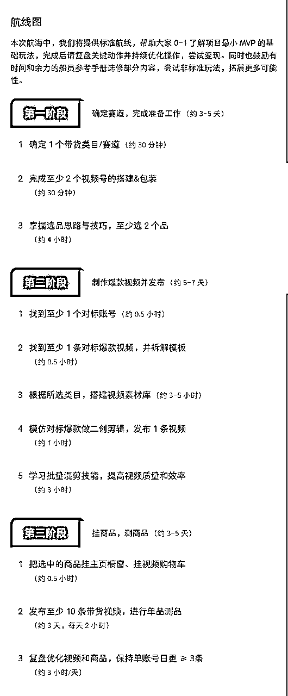

航线图与手册是配套的，找到自己当前环节，再去翻对应章节即可。

以上航线图步骤建议在航海前两周完成；完成后，建议以复盘、优化、提效为主，多选品、多发布短视频，扩大自己出单的概率。

必修篇：先跑通最小闭环

💡

章节概要

在必修篇，我们会从视频号卖货的【项目基本情况】和【项目基础玩法步骤】讲起，让你对项目有全面了解，并按步骤完成0-1，跑通最小MVP。

如果你是本项目新手，建议正式实操前先初步了解项目全貌：

✅【项目概述】了解视频号卖货

如果你对项目整体已有大致了解，就可以按项目核心步骤开始学习实操：

✅【实操 1/3】前期筹备，确定赛道和选品

✅【实操 2/3】制作爆款视频并发布

✅【实操 3/3】挂商品，测商品

✅【复盘优化】运营优化，工具提效

必修篇里，航线图和手册顺序对应。按手册顺序学习，就能逐一完成航线图的每个任务。

后续每个关键步骤的章节概要中，我们也会提到相关航线图，提醒你完成对应步骤。

接下来就正式开始吧！

# 一、项目全貌：视频号卖货是什么

💡

章节概要

这一章会带你一步步认识视频号卖货项目。

平台目前处在什么阶段？有哪些特点？市场空间如何？玩法怎么跑？……这些问题都会在本章得到回答。

本次航海的重点，是告诉大家如何从0-1跑通视频号卖货项目。

所以，先建立对项目全貌的认知很重要，一起看下去。

## 1.1 当前局面

### 1.1.2 收益空间

视频号卖货的客单价大多落在几元到几百元之间，具体取决于你的类目定位。

下面放一些教练 @李诚 做视频号的成绩，供大家参考：

一条视频跑出销量后，佣金进账3.2万元；季节性商品单店当月卖出41.9万元：

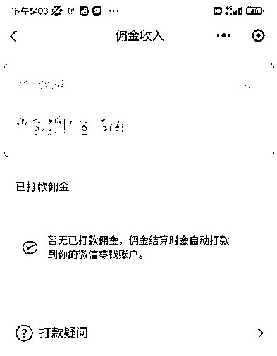

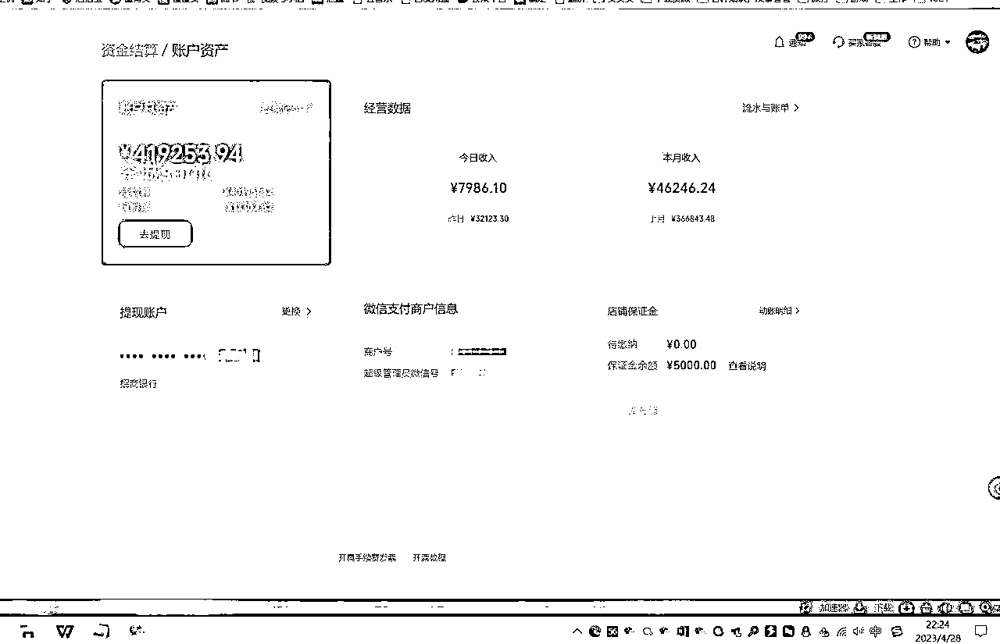

10月“狗咬小孩”话题带动训狗、驱狗类商品，多家店铺出现爆单：

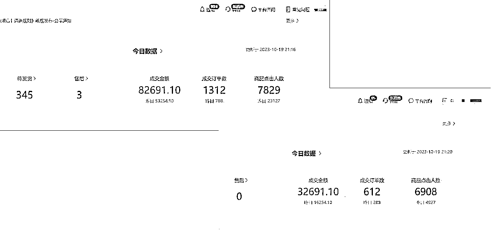

单场直播成交额分别做到3.4w、6.1w、4.5w：

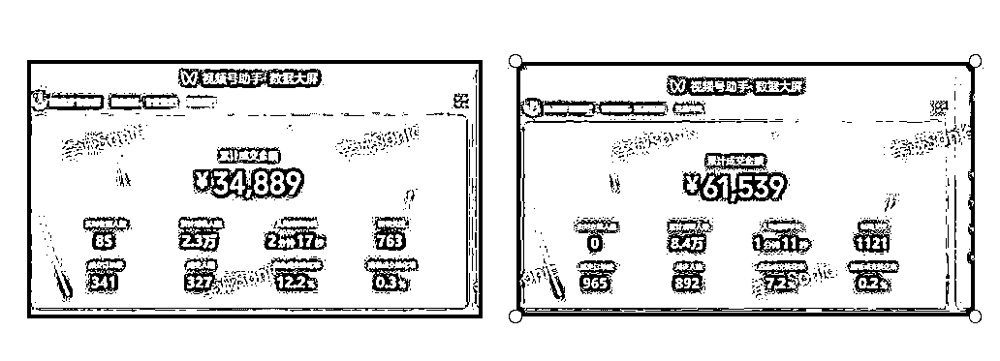

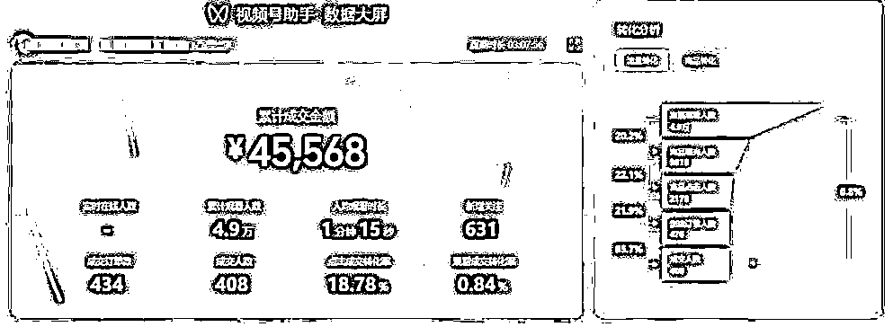

刚上手建议从低价商品切入，出单更容易；等运营熟练后，再逐步抬客单和利润。

### 1.1.1 平台变化

先给结论：前两年那种随便进场就能捡钱的红利期已经过去，现在进入规则更严、管理更细的阶段。

2022年3到5月，随便搬运也能出爆款，无人直播、半无人直播能跑，店铺店群铺货也行。

2022年6到8月，简单混剪还能爆；平台严打无人直播，半无人常被判低质；店铺刷量、重复铺货被打击。

2022年8月后，搬运混剪更拼速度和技巧，店铺要达标才能进池。

2022年11月，新号扶持期缩短，微信小商店的第三方后端（有赞、爱逛、魔筷、微盟、微店等）被清理。

2022年12月1日，视频号只能带“优选联盟”（视频号小店）商品。

2023年1月，店铺评分、达人橱窗评分系统上线，评分后续会影响流量和选品。

2023年2月，商品要求更严，审核变长，原创内容审核和扶持提高。

2023年4月，预约领券开放范围更新，优选联盟准入与清退规则更新。

2023年7月，优选联盟更规范，结算订单和纠纷商责考核提高；直播电商推达人冷启动激励；短视频带货限制每日挂车数。

2023年8月，电商规则完善，上线运费险、先付后用，公布旗舰店入驻标准；普通账号主页不再显示企业微信，矩阵号引流私域受影响较大。

目前纯搬运混剪难度上升。建议做多重去重混剪，再加1/4-1/3实拍（实拍不必与商品1:1还原），效果更好；有能力把实拍、仿拍、混剪结合起来，持续性更强。

总的来说，视频号仍有4大红利：

流量红利：标签精准度和稳定性不如抖音，但起号、起流量相对容易。

利润红利：抖音多数行业卷，视频号价格普遍能高出1-3倍。

人群红利：三四线城市和中老年用户触网少、信任度高、退换货少。

投放红利：官方放量，转化较高，关键在素材过审、投放测品和售后率。

另外，最早入局视频号的圈友 @盗坤 在2022年7月对当时的局面做过分析，内容诚恳客观，这里分享给大家：《视频号带货的真实世界》。参考资料：3月3日《如何在视频号平台高效做带货》@李诚 Sonic；《2023 如何玩转视频号带货》@李诚 Sonic。

## 1.2 主流打法

### 1.2.1 最小闭环与关键动作

目前视频号卖货的主流玩法是：发布带货视频，视频爆了之后赶紧开直播放大成交。

但建议新手先把重心放在【短视频】上，更容易起号。等跑通0-1后，有了放大需求，再去考虑直播和投放。

因此，视频号卖货0-1的最小MVP可以总结为：

选择赛道 - 搭建账号 - 选品 - 对标爆款制作视频并发布（关键） - 挂品测品 - 复盘优化 - 成交。

其中要强调开通账号环节：

对新手来说，建议至少开通2个账号（有条件的可以开3-5个），因为平台管控容易出现限流，动辄就是一个星期。

制作和发布视频环节：对标爆款制作高质量视频，是本项目的关键动作，建议新手每个号每天发3条视频。

由于平台监控越来越严格，建议每条视频在混剪基础上适当增加实拍素材（实拍素材占比约1/4～1/3），更容易过原创审核。

另外，二次混剪要注意避免真人露脸，以免被作者投诉下架封号。

测品环节：

带货账号每个要交100保证金才能选品，这个保证金后期可以退。

每个账号每天可以发布的带货视频数量，会根据粉丝数不同做相应调整：

粉丝数低于1000的账号，每自然日最多可发布1条商品分享视频；粉丝数在1000～10000之间的账号，平台另有对应规则，数量会相应放宽。

如果账号小于1000粉，其他视频挂不了商品，也可以在视频评论区引导去橱窗购买。

### 1.2.2 内容如何被推荐

1、社交推荐（视频号生态特色）

社交推荐是指根据用户的好友及好友圈子，在视频号内发布、点赞、关注、评论、转发等行为，为用户优先推荐相关视频。

2、个性化定位推荐

基于微信社交生态，每个用户都会被打上多元化标签，包括性别、年龄、职业、兴趣、城市等。根据个人标签属性，从海量内容库中匹配用户可能喜欢的内容进行推荐。

3、搜索推荐

微信搜一搜进行关键词搜索时，一些点赞评论不错的视频会被优先推荐，搜索过的内容也会更多出现在用户的推荐列表里。

4、同城推荐

视频号会根据视频发布的地理位置，推送给同城的用户。适用于线下商家，可以通过这一点来提供商业服务。

# 二、【实操 1/3】起步准备：确定赛道与选品

💡

章节概要

了解完视频号卖货项目的整体情况后，我们就要正式启动了。在视频号上带货的前提，是完成前期账号准备和选品。

所以这一章整理了带货之前需要筹备的事项，包括：

✅准备手机号&手机

✅视频号账号注册与完善

✅确定1个带货的赛道

✅尝试第一次选品

其中，选品和挖掘需求非常重要。为了帮你更好地选品，这里提供了视频号的选品攻略以及快速选品的方法，帮助你学会视频号选品技能；除此之外，还准备了快速选品的方法，让你快速上手。

💡

本章航线图

完成本章节的学习和实操，即可完成航线图的第一阶段：确定赛道，完成准备工作（约3-5天）

1.

敲定一个带货方向（约30分钟）

完成至少2个视频号的搭建&包装（约30分钟）

掌握选品思路与技巧，至少选2个品（约4小时）

那么现在，就请开始完成这几个步骤的筹备，开始你的选品吧。

## 2.1 工具准备

### 2.1.1 手机与电话卡

新手建议准备至少2个账号，因此你需要准备：

1.

至少1个手机（带多开功能）

至少2个电话卡（1个视频号需要1个实名微信号，对应1个电话卡）

电话卡推荐：

三个运营商都可以办副卡，一个人注册认证5个微信，一拖四，副号月租费10元；移动的万能副卡，1张10块钱月租，1个身份证能领2个副卡，第一张卡和第二张卡要相隔90天，去营业厅能办理，App办理也可以，但营业厅可以操作免第一年月租；

中国电信App搜索无忧卡，5元一个月，基本都是第2天就送上门；移动可以办理8块的保号套餐。

手机推荐：

手机除了用于登录账号，也会用它做一些视频拍摄。

如果只做短视频拍摄，千元安卓机就可以，且安卓支持系统自动双开功能；如果考虑后续想放大做直播，iPhone的直播稳定性更好，但iPhone无法双开。

当然，有条件的话，也可以准备3-5个账号同步来跑，投入也会相应增加。

### 2.1.2 剪辑工具

剪辑的话，手机端就快影和剪映，快手抖音的两个软件，基本需求就够了。剪映能直接导出60帧。

其实一个小道具，从看到到去购买实行，会花费你很多时间精力，比如当时我为了找在黑板上写得舒畅又好看的笔，花了大半天时间。所以不建议一开始就追求完美，先发出去更重要。

好的相机、手机、摄影灯、服装、麦克风、精心布置的场景、道具，这些都是锦上添花的，后期可以加。开始时候与其花时间整这些，不如多花时间拍几个作品发出去，时间花在创作和运营上。

内容来源：《从0到1000万粉，给短视频创作者的80条建议》

## 2.2 账号搭建

### 2.1.1 注册、登录与日常维护

账号注册：

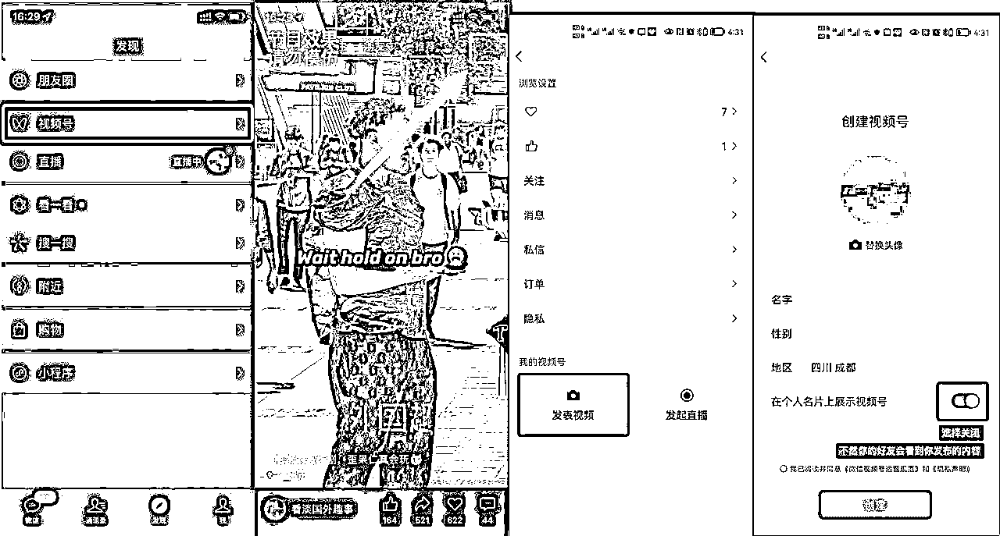

如图所示，走完以下6步，就能完成视频号的创建：

账号登录：用双开的形式，1个手机登2个微信，进行操作。

也可以把多个视频号的运营者，都绑定自己的大号微信，之后就能用网页版登录这些视频号进行操作。

需要注意：

如果多个视频号绑定了同一个微信号为运营者，该微信号一次只能同时登录一个视频号。

比如微信号A绑定了视频号①、视频号②，如果扫码登录了视频号①，再登录视频号②的时候，视频号①就会被退出，再登录需要重新扫码。

多个微信号的维护：

批量注册的微信号容易被封（注册了2个号也可以留意下），而微信养号的核心玩法，就是模拟真人操作。

具体参考以下5个办法：

完善头像、名称、背景墙等基本信息；修改微信号、密码、支付密码等，零钱包里放几块钱；

每天发2～3条朋友圈，内容、长度不限；

随便添加5～10个好友，每天发几条消息；每天在视频号上刷视频、看直播。

内容来源：《8月初阶视频号航海实战手册》2.1.2账号包装

如果你的账号还没有确定定位，可以先看手册里的「2.3 定赛道&选品」，确认你要做什么赛道（比如渔具、百货），再根据所选赛道确定账号定位。

完成定位后，我们就能从需求出发，更有针对性地对头像、名称、个人简介、置顶视频进行设置或优化。

#### 2.1.2.1 设置步骤

点击创建视频号后，我们会进入这样一个界面，点击右上角【···】进入【设置】界面：

在【设置】界面点击【资料设置】：

在【资料设置】界面点击【头像】、【名字】、【简介】分别完成设置：

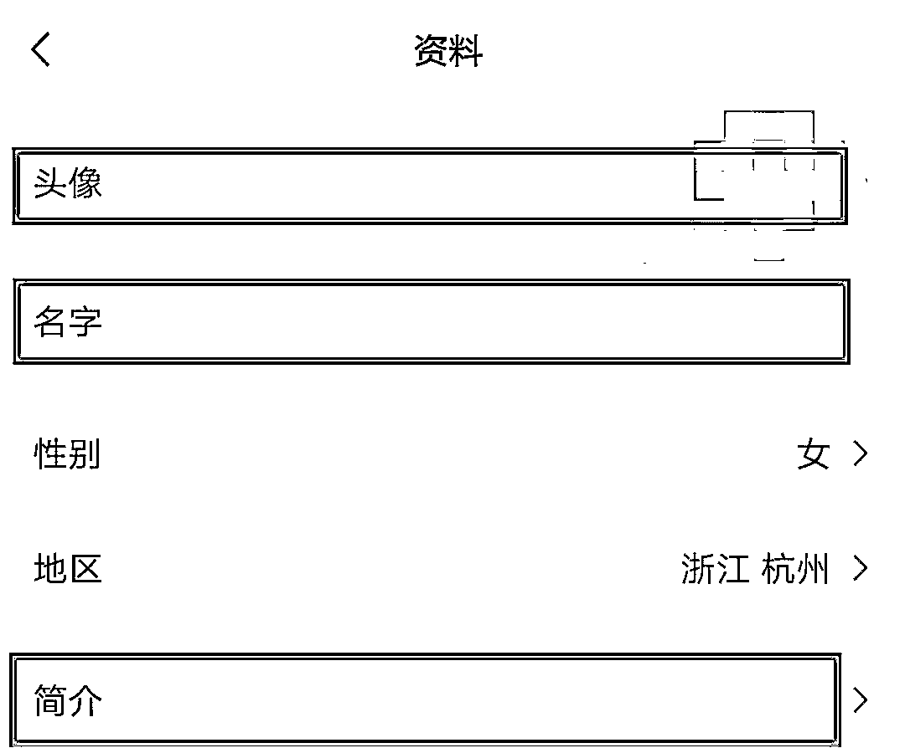

#### 2.1.2.2 包装思路

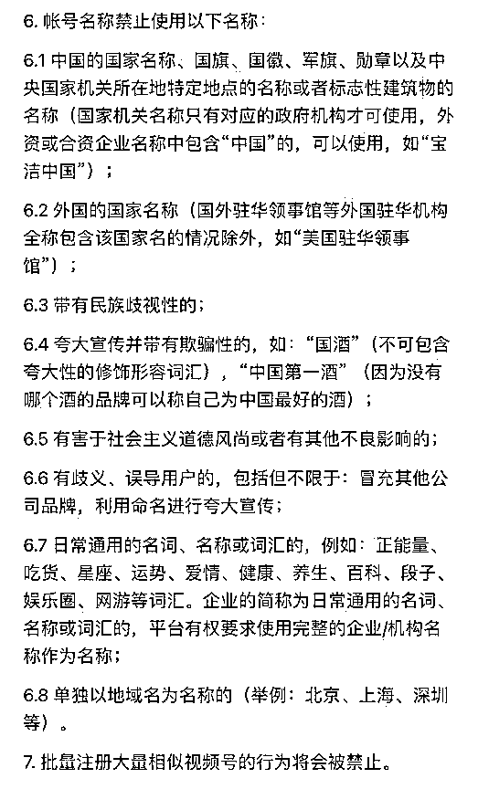

根据自己要做的账号类型确定名称，一个好的名字是可以自带搜索流量的。

最常用的办法，就是采用相关关键词的组合搭配方式，比如国学、书籍、认知等等。选择使用关键词组合是因为，这样在别人搜索关键词的时候容易被搜索到。

不过，有些朗朗上口的名字已经都被抢注了，所以注册名字的时候需要多准备几个，尝试下哪个可以注册。

一年最多能更改5次账号名，没有想法的时候可以参考各平台同类型账号的取名方式，也可以取通用的名称，例如【xx-同款在橱窗】等。

关于昵称修改，@麦洛 说昵称一年只能更改5次。因此建议先设置一个通用的昵称，比如：xx-同款商品在橱窗。

简介在视频号创建完成后可修改。修改路径为：视频号主页头像→右上角…→头像→简介。简介最好放3行文字，多了会被折叠。

简介可以放一些引导成交内容，例如：同款商品在👇🏻下方购买。建议不要轻易放微信号，因为引导到微信成交的效率很低，精力浪费极大。内容来源：《视频号带货建议指南》

2. 头像

一个好的视频号头像可以让我们更容易被他人记住。

## 发片前，先搭好主页三件套

很多人一注册就急着发第一条视频，其实先把主页形象理顺更省事。头像这一块，纯文字可以，比如把名字缩写放上去；图文搭配也行。要是拿不准风格，就去翻同定位的头部账号，看看人家主页怎么布置。

做头像不复杂：在线设计站能直接套模板，也可以找免费可商用的图片来配。

图怪兽：https://818ps.com/

可画：https://canva.com/创客贴：https://www.chuangkit.com/

有两类图要慎用：一是带侵权风险的品牌标识，二是个人照片。后者容易让账号人设和定位对不上。

带货号的简介，越直接越有效——告诉用户去哪儿下单就行。例如：

视频同款，在👇🏻下面【商品】购买微信号可留可不留，如果简介想留微信，虽然是腾讯自家地盘，但是为了以防万一，可以用隐晦的方式提及。但建议最开始不要加， 可能被同行举报。等账号成熟粉丝多了可以再改，比如：

+v:更多 xx 联系领取：

商务合作请联系：4\. 置顶视频（在后续开始更新后）

一个账号最多可以设置 2 条置顶视频，置顶的先后顺序也需要注意一下。

一般来说，置顶第一的视频可以选爆了或近期热点的视频，第二置顶选一个最看好的带货视频。

对于带货号来说还有一个小技巧，置顶视频可以放教用户如何下单的引导视频：

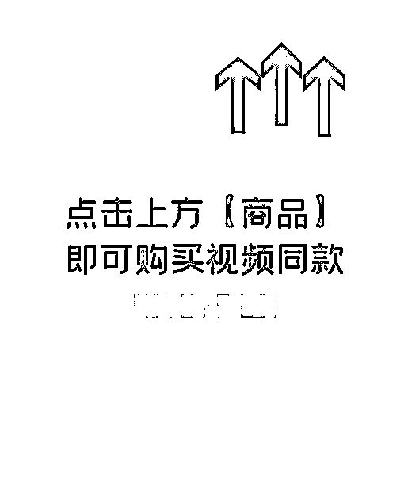

p.mp4【在线播放】

如何置顶呢？

找到需要置顶的视频→点击视频页面右上角的【···】→选择下方弹框的【置顶】→完成置顶

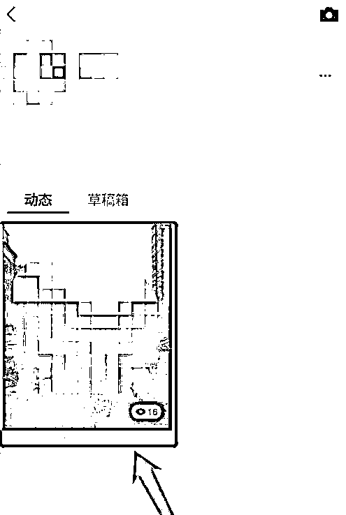

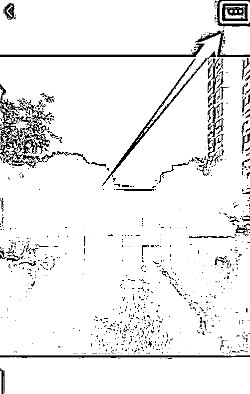

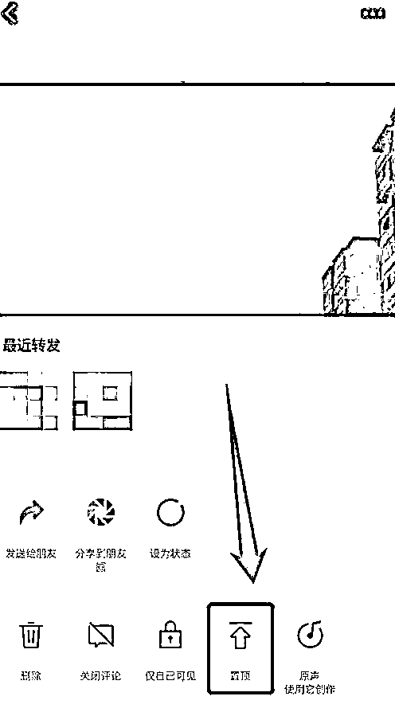

内容来源：《8 月初阶视频号航海实战手册》

## 2.3 定赛道&选品

在挑具体货之前，先圈一个类目方向，比如垂钓用品、日用百货；再往下落到单品，比如鱼竿、家用饺子模具。

新手别贪多，先守住一条赛道，把选品和内容做深。下面也列几个适合新手的热门方向。

### 2.3.1 选赛道的方法

选赛道并不复杂，关键看人群。

就目前来看，这个平台的用户以三四线及乡镇中老年群体为主，所以选方向时围着他们转就对了。

拿百货里的捕鼠贴来说，就容易起量。长辈多住老旧小区或乡下，家里可能闹老鼠；不少在大城市租房的年轻人没这个烦恼，自然很难理解有人刷到这种视频会点赞下单。

目前跑得比较顺的赛道主要有：

日用百货、家居好物、食品特产、图书、新奇特好物/玩具、三农用品、绿植、服饰鞋包等，后面还会推荐几个热门方向。

按这个思路把需求定位和赛道筛选做完，账号定位也就有了。下一步怎么挖到更多好货？继续往下看。

### 2.3.2 选品的方法步骤

#### 2.3.2.1 选品的核心逻辑

挑货最关键的三件事是什么？

人群、类目、价格。

这个平台带货的底层思路是：先锁定想做的目标人群，再看他们缺什么，把类目切细，然后用各种办法找到匹配度高的货。

人群已经定了：三四线偏农村的中老年人。

接着盯另外两点：类目与价格。

1.

类目：决定货能不能卖动

假如你卖美妆里的睫毛产品，50 岁上下的女士会需要吗？卖得动吗？答案多半不乐观。

假如你卖百货里的家用饺子模具，也许能成交，但顾客还得先琢磨“我用不用得上”。

假如你卖特色食品，因为是吃的，顾客会跳过“用不用得上”，直接变成“想不想吃”，同样场观下，转化率会高不少。

我的建议是：挑货时多花心思，多体会目标用户，也就是父母那一辈的真实需求。

2.价格：牵动利润和销量

算笔账：每天同样发 10 条视频，下面几个方向你选哪个？

凝珠型洗涤剂，一天 700 单，每单赚 1 元

2.

袋装螺蛳粉，一天 100 单，每单赚 7 元

3.特色食品，一天 10 单，每单赚 100 元

我的答案是：

A 与 B 里，我取 B：利润相同，客服人力更省；

B 与 C 里，我取 C：单量相同，利润更高。

看起来不难选，其实不少人在这道题上绕了远路。

定一个货的同时，也要盯价格，给自己留足利润空间。

单价高通常走量少，反过来也成立。

当然，新手想快速拿到正反馈，建议从客单价低的品切入，更好出单，再慢慢优化货品。

#### 2.3.2.2 选品的基本步骤

环节一：工具辅助

先记住一个前提：微信目前没给外部开放查询端口，这意味着我们拿到的数据有时会偏差较大。

所以工具数据只能当参考，最终拍板必须过自己的脑子和判断。

工具一：考古加 www.kaogujia.com

用两个实际案例讲讲怎么用考古加挑货：（1）热度类视频选品

热度类视频带货，可以搜关键词。以父亲节为例，挑货时就可以搜“父亲节”“礼物”等词：

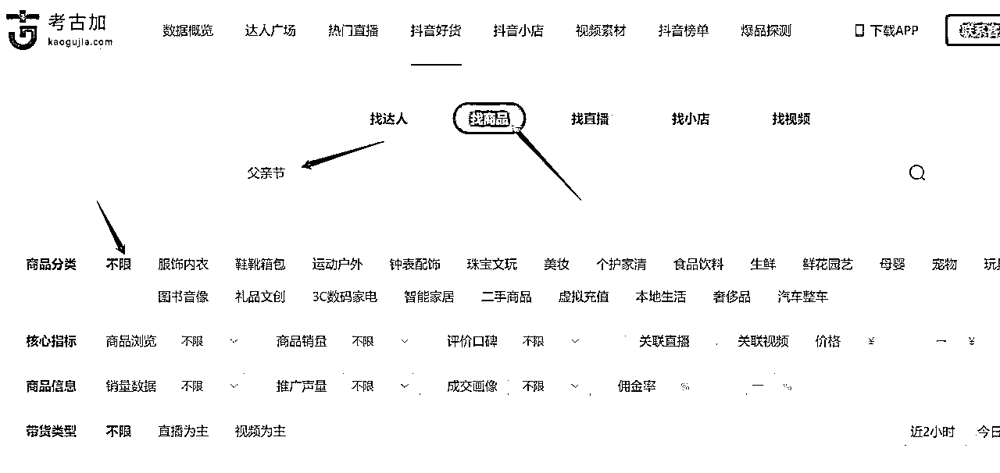

操作流程：

抖音好货-找商品-输入关键词“父亲节”-搜索

然后，你可以找一个细分类目：

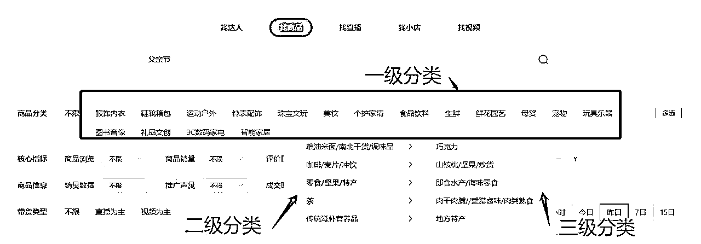

具体到几级类目，按自己的需要来。

想大范围捕捞，只选一级类目，一页页翻，就能把最近的爆品都翻出来；

想精准挑货，可以精确到三级类目，按领域细分赛道来做。

这里以选到三级类目为例：

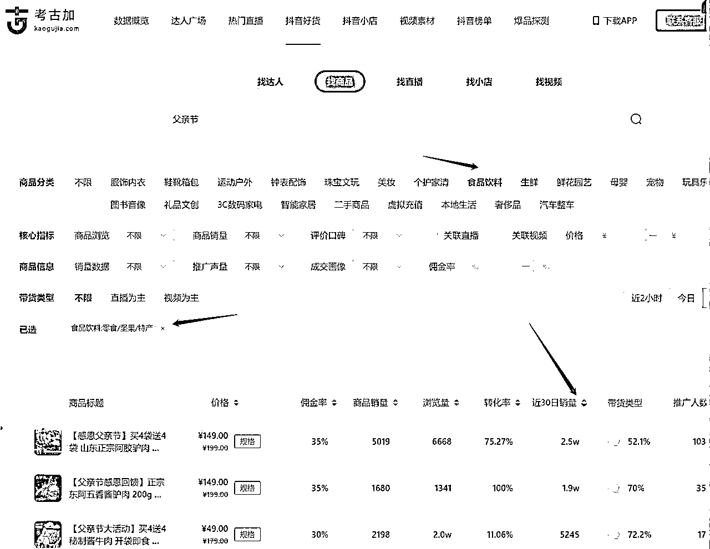

选好后，把商品按销量排名，点产品进详情页，就能看到它近期的商品数据与趋势。

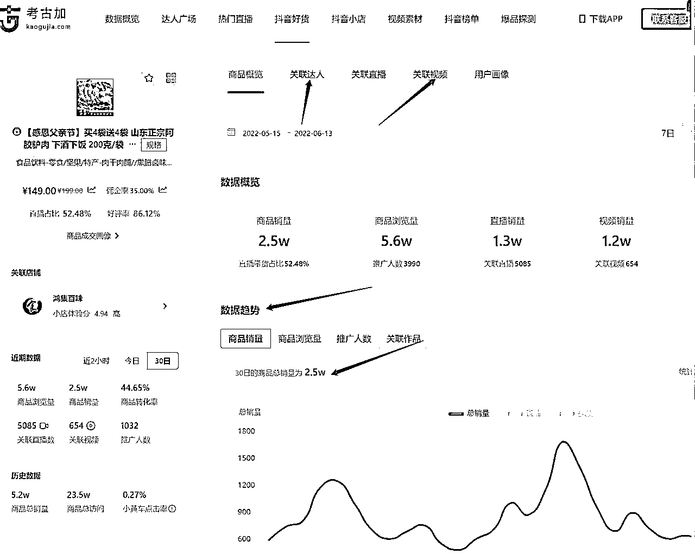

如果数据不错，怎么判断这个商品能不能选？

关联视频：直接找视频，观察数据与质量，方便后期二次创作。

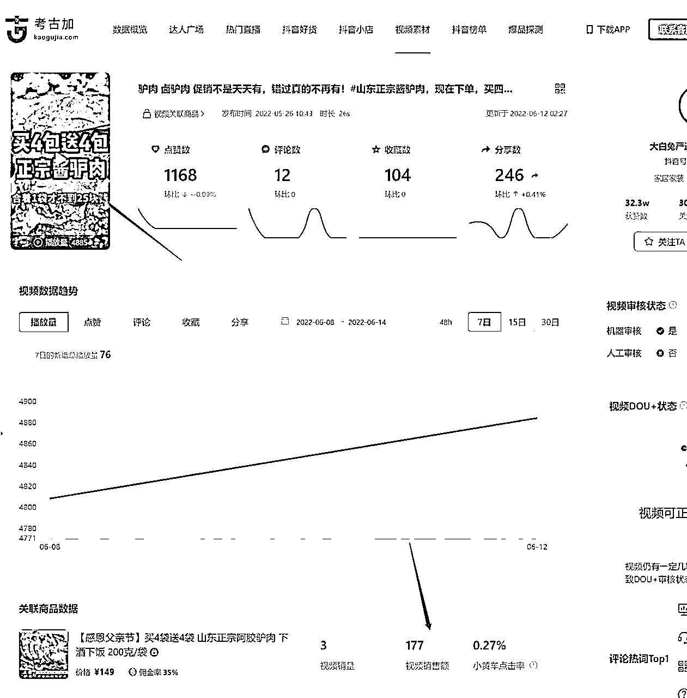

（2）细分类目选品法

抖音好货-找商品-选择商品分类-选择带货类型

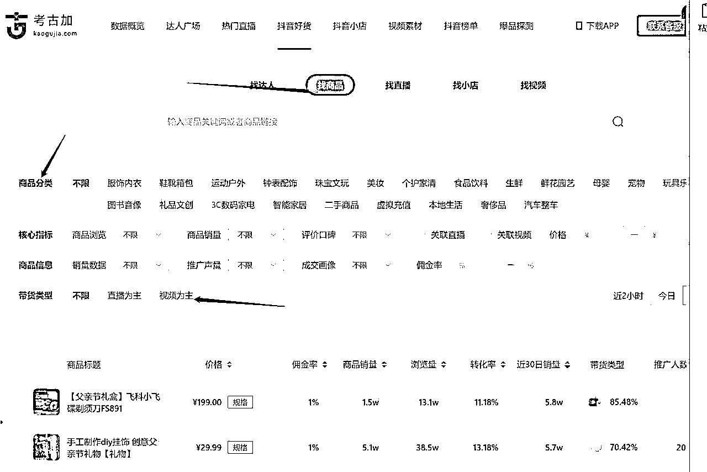

同理，具体到几级类目可以按自己需要来。

比如找图书音像下的一个细分类目：

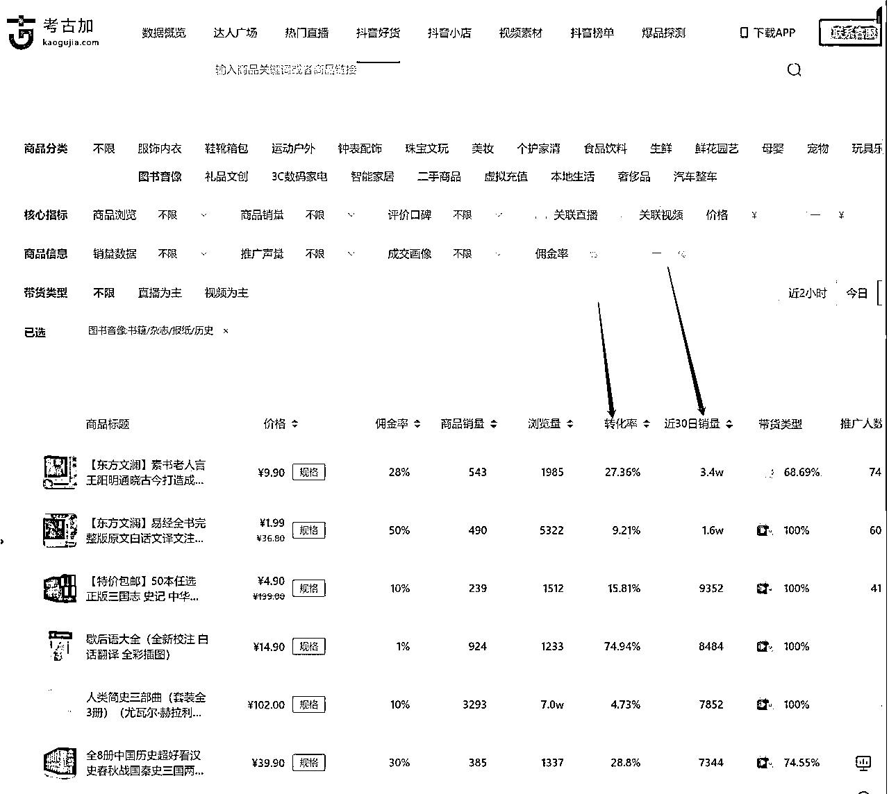

通过关注 30 日销量和转化率，我们定位到具体产品：

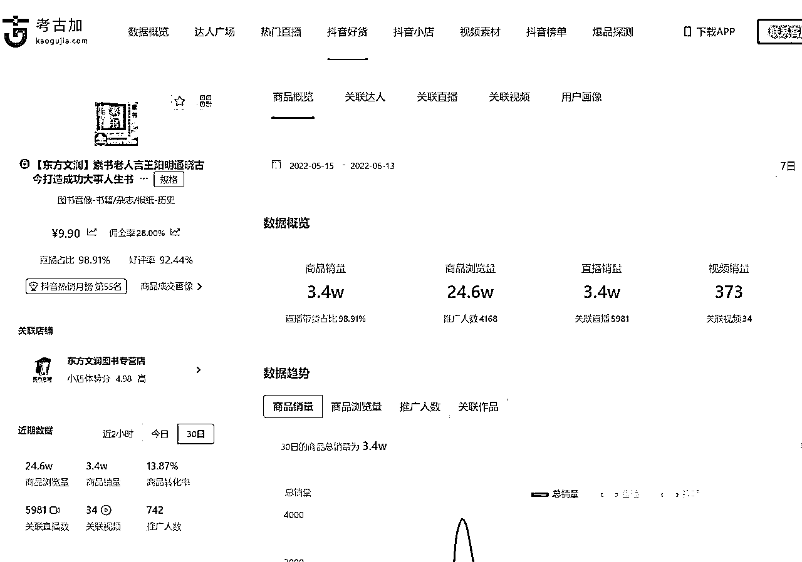

然后在详情页点关联视频或达人，分析其视频数据与质量。

总的来说，考古加比较有用的是，能帮大家联想到一些商品，并做基础的数据分析与视频参考。

实际筛选商品时，还可以加入更多自己的条件，比如价格、成交画像等。

价格：尽量别选价格太低的品，要留出利润空间。成交画像：视频号建议年龄层选 50+（41-50 这个年龄层也可以）。

找到可能能卖的产品后，可以用表格记录下来，慢慢形成自己的选品库。

工具二：巨量算数 https://trendinsight.oceanengine.com/

可以获得关键词指数、关联分析和人群画像。

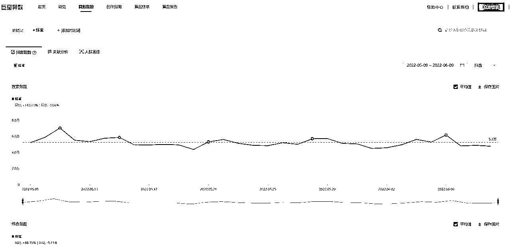

巨量算数官网还有榜单，能查各类产品的热度情况，为选品做辅助。

此处附《巨量算数报告合集 -2022》：巨量算数报告合集 -2024

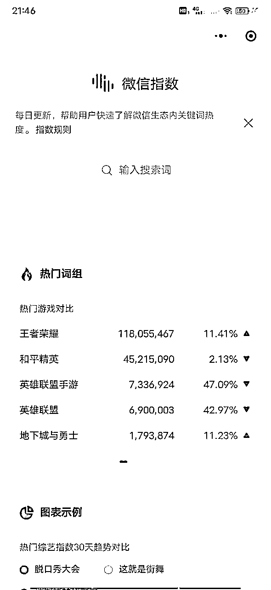

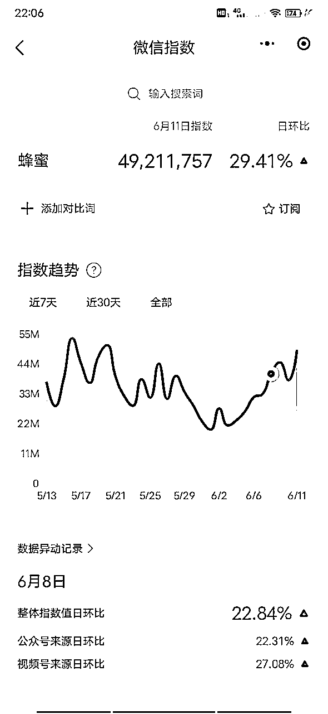

在查询结果页，我们能看到产品词在微信体系内的相关数据。

选择并使用工具时，我的建议是在精不在多，只要摸透一两个工具为自己所用就够了。

环节二：主观选择&排除

在工具辅助下，我们能初步明确选品方向，那怎么确定具体品类？

（1）看喜好。年轻人喜欢的东西，大概率卖不出去。

比如索尼游戏机、潮牌短袖，视频号客户不会买，所以可以决定不卖。

自己不喜欢的东西，可以视情况不卖。

父辈喜欢的东西、娱乐消遣，可以视情况卖。

比如有的长辈退休后天天去钓鱼，很多阿姨就喜欢天天跳广场舞。这些东西是不是都可以试试？

（2）凭经验。经验有时也会错，但可以参考。

有的圈友去年在抖音卖百货还不错，在视频号暂无起色；

有的圈友年初在抖音快手做绿植，这几天在视频号起的绿植账号收益居然还不错；再比如你在商圈看到上百家火锅店，那火锅底料是不是也有很大受众，能不能做选品？

你过往的经验和经历，都会是财富，闭着眼睛想一想吧。

（3）刷抖音、快手、视频号很重要！

每天一定要抽空刷三大平台的视频，把认为可以卖的产品截图做参考和备选。

有个例子：圈友的一个品在视频号爆了，3 天内跟上了 5 个同行去做这个品，他们大概率也是刷到了圈友的视频。

这是需要每天重复的累活，但总会有惊喜。

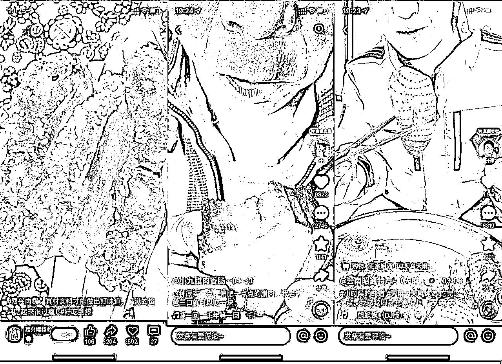

有时候刷一天就能初选出来 20 个产品。

环节三：客观验证&判断

💡

这一步要判断我们的品能不能做？怎么做？卖多少钱？

假设选到了一个品——蜂蜜（仅举例演示，不构成建议），那还需要做以下步骤来确认是否可行：

研究竞争对手：在微信视频号搜一下，是否有人在做？竞争是否激烈？还能不能入场？是否有视频来源：在抖音、快手搜是否有相关视频？具备可复制性吗？

调查商品来源：在抖音、PDD、淘宝搜相关商品，看看能不能买到？价格如何？

1.

研究竞争对手在微信视频号搜“蜂蜜”，能找到如下几个账号：

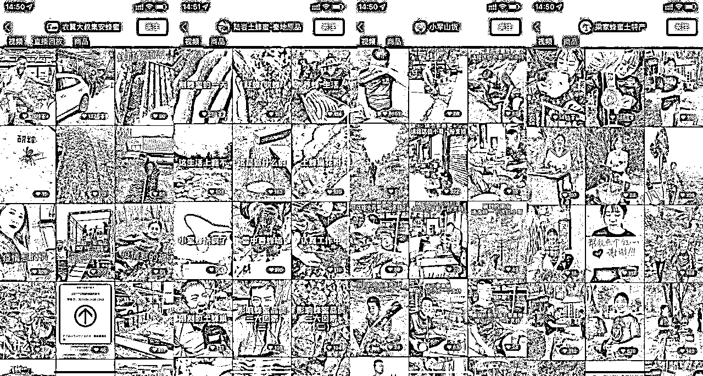

需要观察的数据是：是否有人做？（判断能否入场、竞争是否激烈）

他们的视频数据如何？（判断对手实力，预估自己数据）

他们的销量如何？（预估自己的利润，是否值得做）

如果你在视频号搜某个关键词，没找到相关结果，那可能是一个蓝海。

要知道，视频号带货现在就是找蓝海、占领蓝海的阶段。所以我们的目的，是找到竞争人数少，或者竞争者都比较弱的品。

如果在视频号搜某关键词后出现很多人，都点进去看一下，不一定都是卖货的。

是否有视频来源，详细的视频制作后面会讲，这里只作为选品是否合适的一个简单判断途径。

做法很简单，在抖音、快手搜“蜂蜜”，看看是否有相关视频：

需要观察的内容是：

专门做单一品类的达人（是否有，决定我们有没有参考视频来源；是否多，决定我们能不能筛选最好的）

某达人的视频数量是否够多（决定我们能参考多长时间，如果只有 10 条，那一天就发布完了）

达人的点赞数据、销量数据（研究他们在抖音平台做得如何）

选择视频很重要，要找符合微信视频号调性的视频。同样的品，不同的视频去带，效果完全不一样，差距十分巨大。

3.

调查商品来源

去 PDD、淘宝、1688 搜你要带货的商品：

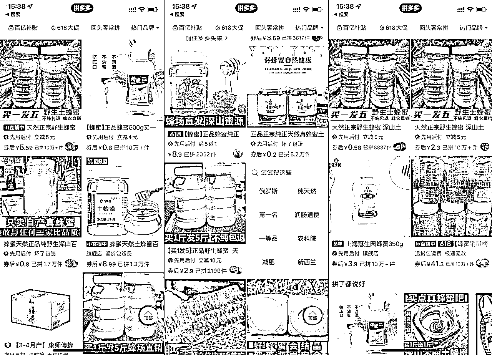

前期只要保证有同款商品，并且价格有利润空间，那就没有太大问题。

你选到的品，可以找朋友帮忙挂小商店，所以微信选品中心没有也没关系。

4.

总结

满足以下 3 个条件，则该商品大概率就可以在视频号上带货：视频号没有该商品，或竞争不激烈；抖音、快手有数量和质量不错的带货视频可以搬运；电商平台有该商品，并且利润足够。

但注意一点，选品就是一个反复选择-验证的过程，我们所做的一切努力都是为了增加选品出单的概率，谁都无法保证一定能爆。

多试多做，打磨出自己的选品能力，爆单就只是时机问题。

#### 2.3.2.3 快速选品方法

如果你觉得上面比较复杂，这里介绍一种相对常规的“视频号-视频带货”选品步骤，可以仅用这一种方式来选品。

步骤 1：看视频号直播广场-购物分类

找看起来不太专业（明显不是机构化团队、专业内容生产者，看起来是和我们一样的普通人运营）但场观超 500 的直播间。

不太专业的特征：头像和封面一致；没有样品展示，直播间环境明显和商品无关；主播不怎么和观众互动。为什么要看场观超 500 的：场观超 500 才意味着量起来了，一共有两种可能，一是直播间本身得到了系统推荐，二是从短视频流那边来人了。

步骤 2：看这个号的短视频情况，找出里面爆了的视频（爆款视频的判断标准：超 100 赞）以及该视频带的品（有概率是个有潜力的品）。

步骤 3：到数据网站验证该品的数据是否可观，主要看销量、带货达人数等，同时注意避开红海品类。

常用网站：精选联盟、考古加，其中考古加数据更新快，没有使用门槛，精选联盟有粉丝、小店、保证金等限制。

步骤 4：在该视频的带货达人、带货视频里找到合适的模仿对象。找粉丝数百万以下（不容易和别人重复）、月销售额 10w 以上的达人（说明这个达人收入可观）；

从他们的视频里找到合适的视频素材，并到视频号搜索相关关键词，避免选择已经被人盯上的视频。完成上述步骤的筛选，大家基本就能选到合适的选品，同时也能初步解决视频内容的选取问题。

### 2.3.3 选品避坑

视频号现在的规则变化非常快，有些选品可能上周还很吃香，这一周突然就被封号了。

这里理出几个视频号平台选品必须要避开的坑：中医、医药类相关的选品，不能上（医药类在任何平台都是严打）；

尽量避免以真人为主体的视频内容，这很容易触发真人验证，然后号差不多就废了。

选好品了，结果视频号选品中心没有怎么办？没关系，只要自己或朋友的微信小商店可以上架商品就可以，不要因为这点放弃选品。

### 2.3.4 热门赛道&货品推荐

食品类：生鲜产品、地方特产、滋补功效品、俄罗斯食品、梨膏糖；

书籍类：国学书籍、健康养生、名人传记、婴幼儿绘本等；服饰类：大码女装、头饰发饰、围巾丝巾、脚链等；

家居百货类：房子防水材料、防水产品、面条机、老花眼镜、定时提醒的药盒、老人购物车、老人防走失用品、穿针器、拐杖、广场舞音响、老人收音机等；绿植类：绿萝、绣球、兰花、营养液、营养土、种植铲、种植围栏；

百货类：收纳盒、收纳柜、厨房好物、卫生间好物；美护类：洗发水、发膜、乳液、洗面奶、面膜；

运动户外：运动拉伸用品、运动汗巾、运动护腕、户外渔具鱼饵鱼钩；

其他：老人手机、多功能护理床、三农工具。这些都是微信视频号选品中的优质品类。

中老年人这个群体可以挖掘的空间很大。中老年人和中老年人喜好风格也不太一样，城市用户、农村用户的偏好也会不同。

这里提供圈友@李诚分享的选品表，给大家作参考：

👉李诚 Sonic - 视频号选品表

# 三、【实操 2/3】制作爆款视频并发布

💡

章节概要

选品很重要，但视频能不能吸引用户看完下单，出单情况跟流量与转化率相关。想提升出单，就需要获得更多流量，或者提升视频转化率；想提升，就需要制作爆款视频。

本小节主要展示如何找到可以借鉴的爆款视频，建议大家按如下步骤操作：

✅第一步：找到可以借鉴的爆款视频

✅第二步：对爆款视频进行拆解模仿学习

✅第三步：根据爆款思维设计自己的视频结构

✅第四步：完成视频剪辑（你可以选择二创或原创）

✅第五步：发布视频

✅第六步：评论、私信、打招呼消息等信息回复。来吧，开始你的视频制作之旅。

💡

本章航线图

完成章节 3.1 的学习和实操，即可完成航线图的第二阶段：制作爆款视频并发布（约 5-7 天）

1.

找到至少 1 个对标账号（约 0.5 小时）

找到至少 1 条对标爆款视频，并拆解模板（约 0.5 小时）

根据所选类目，搭建视频素材库（约 3-5 小时）

模仿对标爆款做二创剪辑，发布 1 条视频（约 1 小时）

5.学习批量混剪技能，提高视频质量和效率（约 3 小时）

## 3.1 寻找对标账号

### 3.1.1 对标账号的标准

对于视频号、视频带货来说，对标账号更多的是符合这几类要求：

专门做单一品类的达人（是否有，决定我们是否有下载视频的来源。是否多，决定我们是否可以筛选最好的）

某达人的视频数量是否够多（决定我们能参考多长时间。如果只有 10 条，肯定是远远不够的）

达人的点赞数据、销量数据（研究他们在抖音平台做得如何）

需要注意的是：二次剪辑混剪类型尽量避免真人露脸视频，容易被作者投诉视频，导致下架或封号。

### 3.1.2 找对标账号的方法

方法一：在各平台中查找对标账号。这个动作很直接，只需要在各大短视频平台搜索自己想要做的账号类型。

这些平台包括但不限于：抖音、快手、小红书。

举个例子，我们做个护家清这个类目，就可以在以上平台搜索【洗衣液】【家用】等关键词，寻找对标账号。

找到对标账号后记得关注，我们后续再刷视频的时候，就会被推送更多相似的对标账号。

这里注意：视频号平台反之，不要关注自己的其他视频号（本人微信的视频号，没办法取关），不要关注自己对标的视频号（关注的视频号也会分发给自己的微信好友）。

方法二：选品的过程中反向查找账号

以食品饮料产品为例，我们借助考古加来找对标账号的流程：

考古加工具——点击商品——视频热推榜——选择食品饮料——选择产品等——查看关联带货视频。

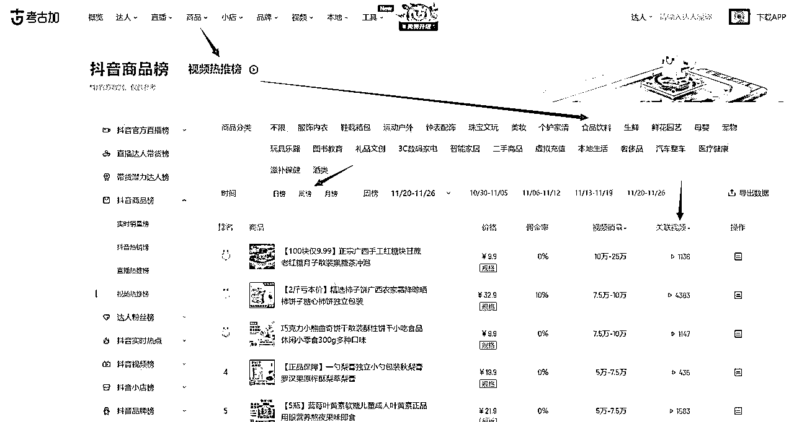

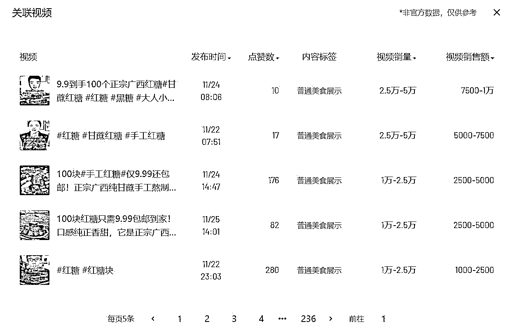

上图所示的“达人”栏就能看到对标账号。

## 3.2 制作爆款视频

### 3.2.1 做爆款前，先想通这几件事

先别急着开工，想清楚一个问题再动手：平台凭什么给你推量，用户凭什么把你的视频看完？下面这几条，就是做爆款内容的地基。

**1. 追热点**

热点天然自带流量。平台愿意把更多曝光分给热点内容，用户也乐意看热闹。实在不知道做什么，就去翻抖音热榜，哪个话题热度高就追哪个。

**2. 爆点要堆够**

爆点，说白了就是让视频火出圈的元素。一条作品里爆点越密集，被系统推火的几率就越高。

**3. 开头3秒定生死**

开头3秒决定用户是留下还是划走。如果前3秒钩不住人，后面内容再精彩也没人看。所以开头要一下抓住注意力；中间要用故事持续拉住用户；结尾再把情绪推上去，让人忍不住转发评论。

拿一条我上过推荐的作品来拆：

这条是我参加视频号小航海时第一次拿到推荐的内容，挺典型，也很有纪念意义，所以拿它当例子。（后来我其他账号那些点赞10w+的视频，底层逻辑跟它完全一样。）

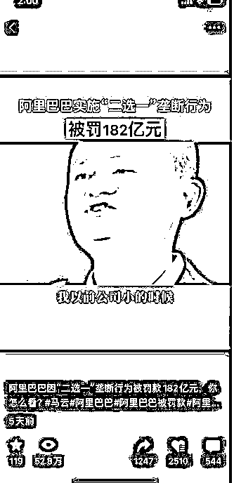

先说热点：

阿里那笔182亿的罚单，当时在各大平台刷屏，热度极高，曝光量自然有保证。

再说爆点：

爆点1：182亿罚单本身就是大热点，单凭这一点就足够吸睛；
爆点2：马云知名度摆在那儿，随便说句话都是焦点，这也是爆点；
爆点3：内容里马云讲“公司越大压力越大”，听起来像在给自己找台阶，评论区想不吵都难；
爆点4：BGM营造了紧张氛围，观众情绪被带着走；
爆点5：标题里埋了个疑问，故意引大家去评论区作答。

最后说开头3秒：

1：标题放在画面顶部，用户一进来就懂是什么事，“182亿元”还做了重点放大，一眼就被抓住；
2：开头就是马云出镜，前面说了，马云本身就是一个爆点。

**4. 用评分表给自己把脉**

新手拿不准自己做得行不行，就用下面这张评分表给作品打打分。分数越高，火的把握越大。

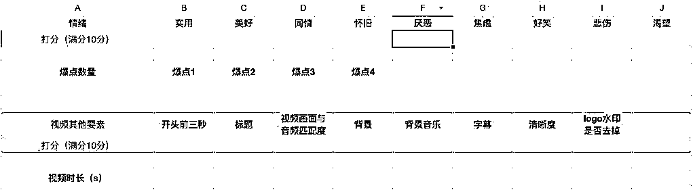

### 3.2.2 找到值得对标的内容

做视频的第一步，是找到能学习的对象。有两条路子：

#### 3.2.2.1 方法一：去别的平台挖爆款 @虫二

在抖音跑出过成绩的视频，搬到视频号可能再火一次，也可能毫无水花，毕竟两边平台的调性不一样。想练出判断视频号爆款的手感，可以从两个角度入手：

角度1：盯数据

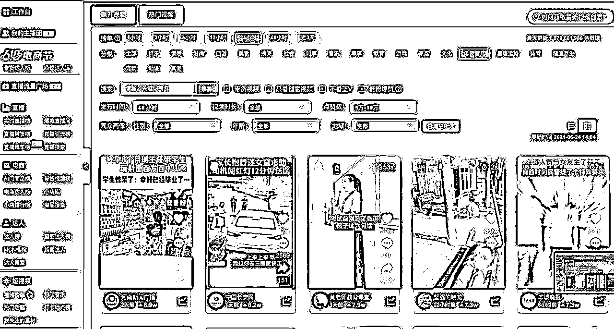

角度2：感受调性。打开【新视】（https://xs.newrank.cn），把你所在类目最近15天冲上榜的视频全部过一遍，找找视频号用户到底吃哪一套。

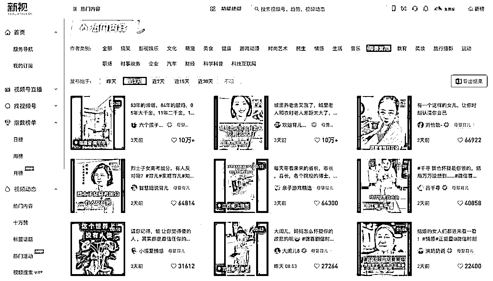

内容来源：《微信视频号变现，单条视频佣金 25000+，5 条视频涨粉 15w》

#### 3.2.2.2 方法二：跟视频号的优秀同行学 @鱼骨头

一是借助视频号数据统计网站来找。下面拿友望数据举例（友望数据：http://www.youwant.cn/ ）：

友望数据→视频号查找→视频号排行榜→行业分类（选好你要做的领域）

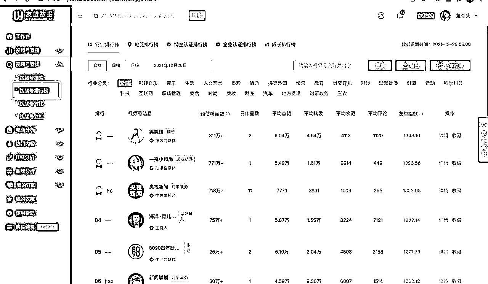

2. 直接在视频号里刷

平时刷视频号，有意识地去看同领域的内容，看完顺手点赞，系统就会持续给你推同类视频，同行账号就这么攒出来了。

再聊聊搜索。懂得用搜索，做视频会省很多力气。这里简单讲讲怎么靠搜索找对标；对搜索视频布局感兴趣的朋友，后续航海环节可以深聊。

每个细分领域都有自己的关键词。拿商业认知类账号来说，直接在视频号搜商业、认知、思维、格局、励志、职场、马云、马化腾这些词，搜完就能捞出一堆想看的视频和想关注的同行。

注意别踩“坑”

一定要学那种近期短时间内涨粉很快的小v，别一上来就啃大v。大v做了很久，背后很可能有团队，他们起号时的平台规则跟现在大概率不一样；而且大v起步播放就是万级，根本不是0粉开始的阶段，参考意义不大。上来就学大v，做一阵子心态准崩。只有垂直领域里短期涨粉猛的小v，才真正值得研究。

内容来源：《视频带货月收入 10w+，分享从获取流量—制作爆款视频—带货变现的完整过程》

#### 3.2.2.3 把对标视频下载下来

对标内容找好了，自然要下载素材，方便后面剪辑用。

批量下载工具，按需取用：

（付费）下载王：支持多平台批量采集

（付费）哼哼猫：多平台批量下载，每天有免费额度
（付费）按指定作者采集：多平台批量抓取工具

（免费）抖音单条采集：抖音图文无水印下载（需要另外安装与代码配合）
视频号采集工具及教程：《视频号视频下载》

视频号嗅探下载器：
百度网盘下载地址 提取码：mx4v；蓝奏云下载地址 密码：4v6t

（免费）抖音直播录制：批量采集抖音工具 密码：2nkd；录屏软件：万彩办公大师、FastStoneCapturecn

注：【批量采集抖音工具 密码：2nkd】【蓝奏云下载地址 密码：4v6t】这类链接打开后有风险提示，把页面里的链接复制出来，用浏览器直接访问，再输密码就能拿到工具。

内容来源：《8 月初阶视频号航海实战手册》

### 3.2.3 拆解它，模仿它

#### 3.2.3.1 怎么拆解一条爆款

选定同行以后，把他的爆款内容从头到尾翻个底朝天：视频内容、文案、标题、BGM、评论区……拆得越细，越能搞懂这条视频为什么会火，然后照葫芦画瓢。

下面拿一条我们曾经参考过的同行视频，示范一下怎么分析。

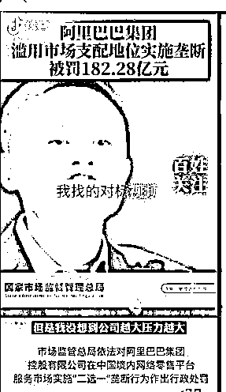

1、内容层面

阿里被罚128亿，是当时刚冒出来的大热点，平台和用户都好这一口；阿里本身就是自带流量的巨头，有点动静就有人围观；配图用的是马云，马云同样是流量担当；128亿这个数字够震撼，加上大家天生爱看高位者跌落。

2、背景音乐

BGM是那种紧张急促的配音，也是新闻类内容里常用的热门配乐。

3、评论区

评论区里几乎全是针对马云和淘宝假货的调侃甚至谩骂。可见马云和淘宝，都还能继续做文章。

#### 3.2.3.2 怎么模仿和二次创作

左图是对标视频，右图是我做的版本。

我的演讲内容跟对标视频没有任何差别，只动了标题：把原本的三行压成两行——三行太多，一眼扫不完用户可能就划走了；再把“被罚182亿元”单独放大，用户扫到画面的第一秒就能看到重点，自然被勾住。另外，我这条的画质清晰度也明显好于对标视频。

视频二：

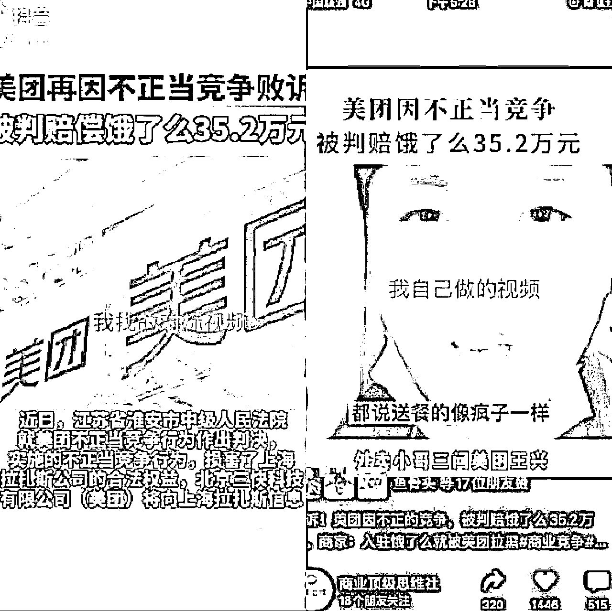

左图是对标视频，右图是我做的。对标那条是“美团被判赔偿饿了么”的新闻类PPT展示，我觉得爆点不够，就去翻了美团相关的其他视频，最后改用“外卖小哥三问美团创始人王兴”。内容聚焦骑手送餐速度、超时赔付这些行业痛点，评论区不打起来都难，被推荐的概率自然更高。这条也确实拿到推荐了。

有小伙伴跟我说，他以前刷到过这条“外卖小哥三问王兴”，没想到还能拿来这么用。是的，拿来嫁接就行，就是这么神奇。

### 3.2.4 搭一个自己的素材库

拿我自己的素材库举例：

实际操作中，【场景演示】和【使用效果】这些部分，按实际情况仿拍或替换就行：

步骤一：先定目标和主题

建库之前，先把目标类目和产品定下来，再有针对性地挑素材源，这样素材库才实用。

步骤二：分类归档

把素材按类型、场景、风格归好类，用的时候一找就到。文件夹、标签都能当分类工具。

具体操作拆开说：

先按画面要素去找素材，比如需要什么画面、背景、场合、物品、行为，多角度收集；
再把收集到的画面切成小段，建议3到5秒一段，每个画面多备几段；
然后把切好的素材统一放进专用文件夹。整理素材只是前期辛苦，处理完能一直复用；
最后做爆点拆分，分成A（开头3秒，痛点/话题/提出问题）+B（产品介绍/卖点/解决问题）+C（引导转化），测试素材，迭代优化。

步骤三：囤高质量素材

尽量找高清图片、视频片段这类高质量素材，画质上来了，观感就上来了，观众也更愿意看。部分产品和素材，可以直接从商品评价里扒合适的图。

pdd、淘宝上也可以多搜搜现成的素材库。

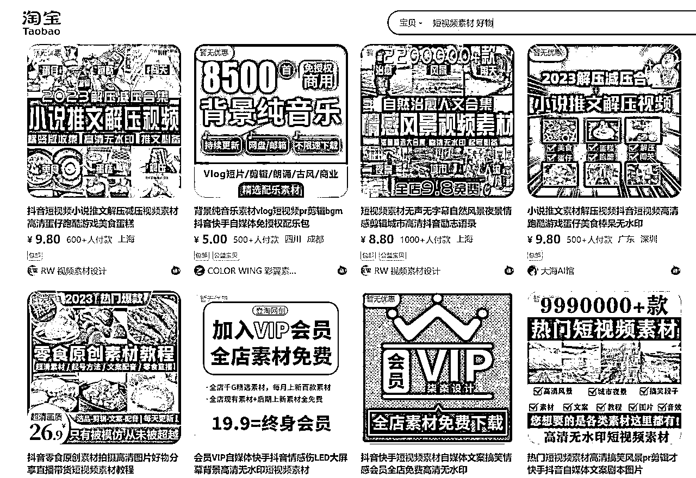

步骤四：不断补给

定期往素材库里添新素材，保持新鲜度。每天观察同行同品的爆款内容，有合适的就下载、拆分、入库。

### 3.2.5 基础剪辑与二创

视频处理方式建议走混剪、二创、原创三条路，不要直接搬运。

短期看，混剪做得更精细一些能避开审核；但想长期拿稳定收益，原创才是更被鼓励、也更该走的路。

下面这套剪辑方法值得学：实际操作时，把产品展示、书籍展示这类内容，连同部分画面、背景，替换成自己实拍的素材，更容易过平台的原创审核。

比如一条视频的脚本结构是：

黄金开场+产品介绍+使用展示+同行对比+优惠活动+引导购买

其中“产品展示”这一段，可以用自己实拍的画面，也可以用其他平台的产品好评图、好评视频来替换。

二创的整体链路：素材拆解→混搭/套模板→视频去重。

环节一：拆素材

前面【章节 3.2.2】讲过怎么找对标爆款视频，找到之后就进入拆解。拆好的素材分别放进不同的素材库，见下图：

环节二：混搭组合/套模板。工具：剪映（电脑端）

先分析爆款视频的片段结构，再针对不同片段重新排列组合，填入新素材：

开头1+效果1+拆包1+场景1+场景2
开头1+效果2+拆包3+场景5+场景1
开头X+效果X+拆包X+场景X+场景X
……以此类推

环节三：视频去重（加特效、画中画、音乐等）

去重技巧1

用1个视频画中画+1个图片画中画+4个贴图素材+2段音频，再配合重编的标题，这一套下来就能完成二次剪辑去重。

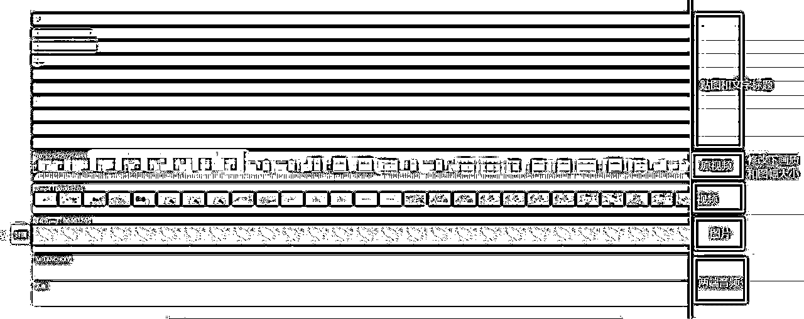

去重技巧2

把背景图垫在原视频的位置，素材压在背景图上面，再叠画中画、边框、贴图、音频等元素，同样能实现二次去重。

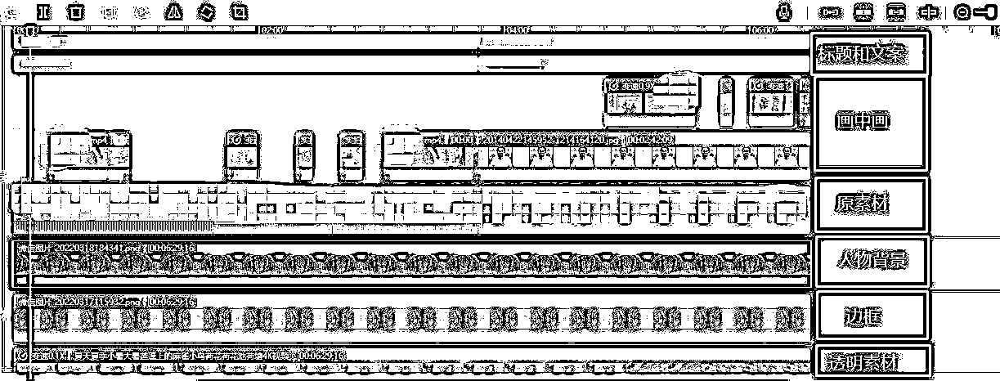

内容来源：《8 月初阶视频号航海实战手册》

模板做好以后，后面的视频制作效率能大幅提升。除了自己做模板，圈友@figo还分享了另一种路子：批量去重、批量做内容。这里截取一段，完整版见《如何剪辑视频和制作剪辑模板》。

1、先用CRVideoMate完成基础混剪，详细参数如下（可自定义）

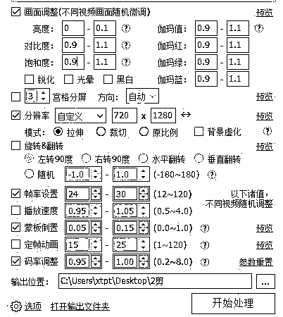

2、制作水印PNG图片，再用软件自带的水印功能加上去

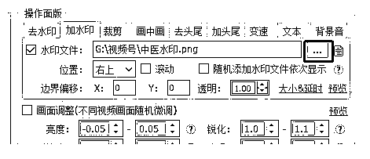

↓加水印后的效果↓

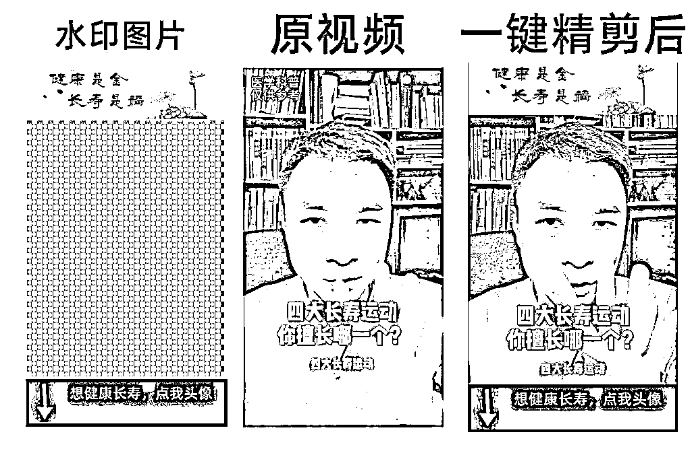

3、如果直接加水印会挡到原视频的重要部位，可以把原视频高度压一压，参数如下

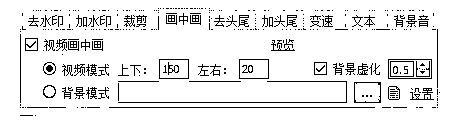

注意：“上下数值”要大于等于水印图案的高度，画面才不会被水印盖住。我填的150，你们可以更高或更低。

压完之后的效果↓

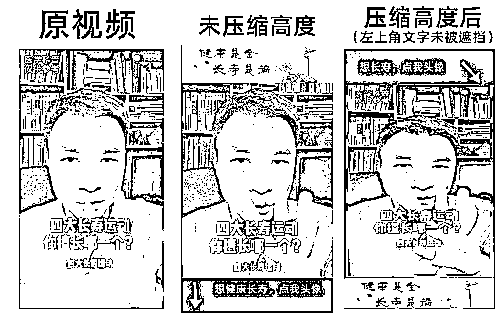

PS：软件支持定制多款水印，做到一个品类一款，参数还能导出，适配不同类型的剪辑。

CRVideoMate下载地址：http://www.cr-soft.net/crvideomate.html

粗剪、精剪具体怎么操作，参考这份文档：《如何剪辑视频和制作剪辑模板》

内容来源：《利用批量剪辑软件 CRVideoMate，一键完成视频号精剪去重，可带个性化图案》

## 3.3 把视频发出去

### 3.3.1 发布操作指南

视频号发布有两个入口：手机App端；视频号助手网页端（https://channels.weixin.qq.com/）。

下面主要讲手机端的操作，网页端的逻辑大同小异，可以自己摸索。

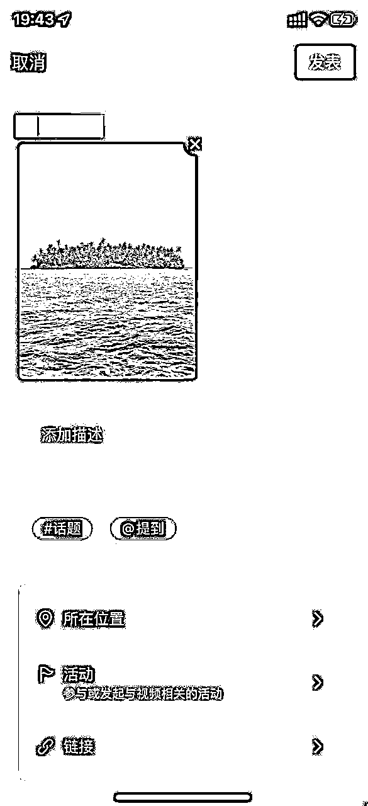

描述：填跟商品相关的文案。
话题：挑流量高的话题挂上。假设你卖芒果，加上垂直的#芒果话题，类目的#水果话题等。
提到：我们不添加这个。对带货来说，暂时想不到应用场景。
所在位置：可以加上你附近的位置。位置对分发也有一定帮助。
活动：我们一般不加。发起活动后，可以在活动里编辑一些信息（比如直播活动、私域引导等），每条视频都能挂这个活动，多一个曝光入口。
链接：上一篇提过，带货链接主要在这里挂。

#### 3.3.1.2 电脑端也能发

https://channels.weixin.qq.com/

除了手机App，还能用视频号助手发布，好处有几点：
2. 网页端能绑定视频号运营者；
3. 管理视频评论更方便；
支持定时发布。

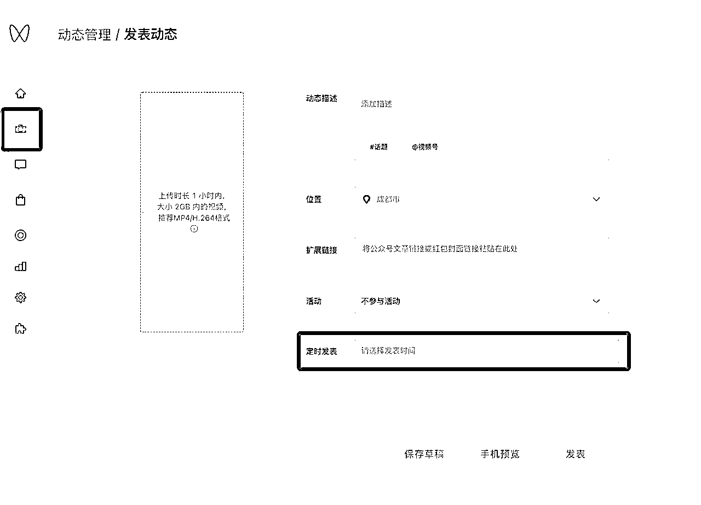

举个例子：拿单个账号来说，要发10条视频，计划1小时发1条。当你手上的视频号太多，用手机一条条发会很累，还容易出错。所以一个号传10条，安排定时发布就省事多了。

只要少量、分批地安排定时发布，分发不受影响，流量也不会掉。

几点提醒：

网页端和App发出来的效果一样，流量没有差别。
话题很重要！话题很重要！话题很重要！一定要加话题。
单个账号每天发10条上下比较合适。别发太猛，间隔也别太短。

#### 3.3.1.3 多账号也能轻松发

假如你有5个视频号要发，就算有2部手机，来回切换也够折腾。

用「绑定运营者」就能解围：BCDEF这5个账号全部绑到A账号名下当运营者，A账号登录视频号助手，就能统一操作这5个号的发布、评论管理等功能。

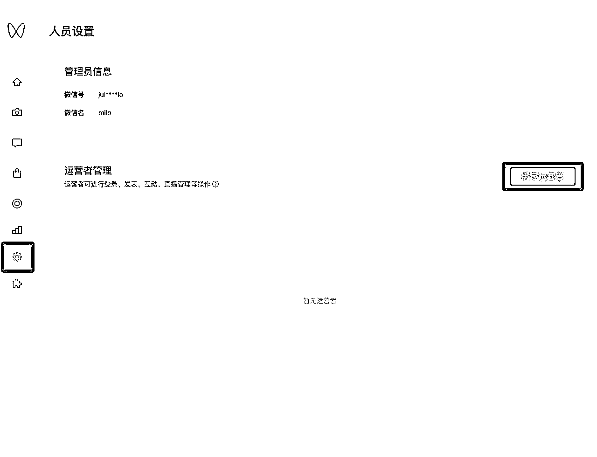

1、评论、私信、打招呼消息回复 @麦洛

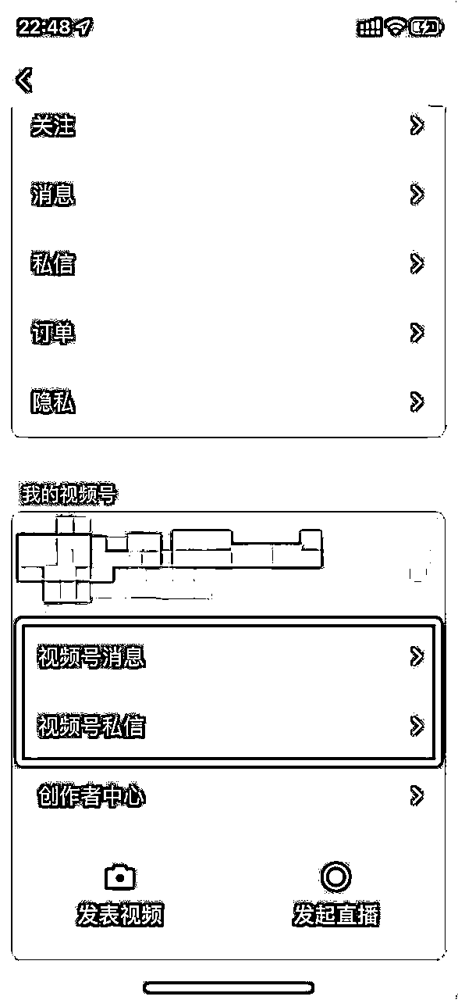

别为了一两条“坏评论”不开心，更别跟人吵起来，完全没必要：

吵架不会让你赚到钱，持续进步、踏实做事才能赚到钱。

遇到这种评论，可以不理会，也可以删掉，或者去视频号助手里点「精选评论」，不让“坏评论”露出来。

内容来源：《视频号带货建议指南》

2、多账号评论怎么管 @麦洛

如果你的手机正在直播，或者几个号切来切去太麻烦，但又想靠评论回复把人引到橱窗购物。

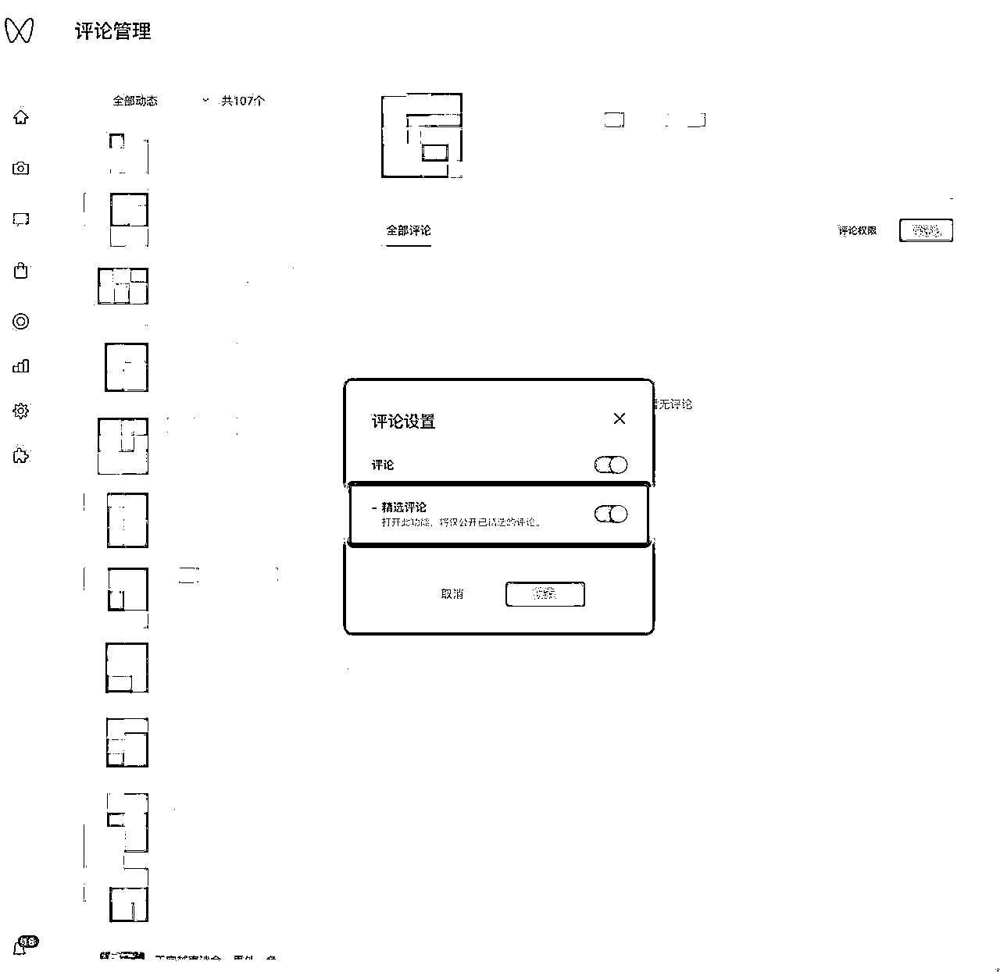

这一步简单很多，视频号助手的其他功能大家可以自己慢慢发现。

发视频时把间隔时长拉长一点，就不会有问题。

视频0播放的话，可能的原因不少，比如：账号被判定为营销号；视频内容被人搬运过。排查可以一步步来：

如果这个号发其他内容有流量，那是视频内容的问题，直接换内容；
如果这个号发什么都是0流量，那多半是账号的问题。拿另一个号测试，发同样内容有流量，那就把这个视频号注销。

按目前的反馈和实际操作看，官方对搬运视频的打击只会越来越严。这块在后面「5.1 视频零播诊断和解决方案」里再细说。

内容来源：《视频号带货建议指南》

### 3.3.2 发布后的注意事项

视频发完之后，新手还有一件事要留意：护好自己选的品，别让微信好友知道你找到了这个品，不然竞争者就变多了。

下面两件事，能注意就注意：

### 3.3.3 视频数据怎么看

微信→发现→视频号→右上角人像→我的视频号→创作者中心

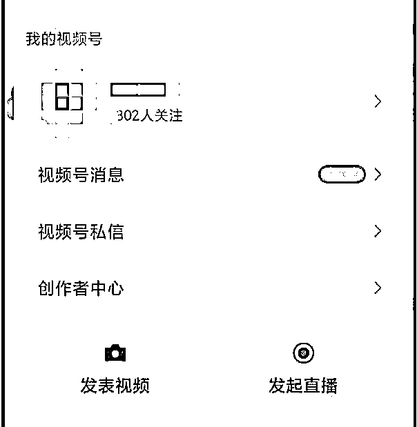

# 四、【实操 3/3】挂上商品，测一测

💡

章节概要

到这里，选品和内容发布都完成了，那怎么知道选的品合不合适？

多数新手没法提前判断一个品的效果，前期可以多铺一些流量视频，等视频火了再去挂商品测品。如果带货视频爆了，记得马上开直播，转化率能拉高一大截。

这章整理了集中高效的测品方式，供大家选择。

建议重点关注：

✅交叉测品法：不只可以比较多个账号的优劣，还能同时摸清多个产品的受众情况，为后续优化产品素材和视频细节提供方向。

其他方式，按需选用：

✅集中测品法：每个品类每天发10条视频，集中在同一个号上。
✅分布式测品法：人群定了，品类或品还没定，就同时发不同品类的视频，哪个爆了继续发，其余删掉。
✅暴力测品法：把对标视频直接拿来发，3天还是0播放就换；一旦爆了，马上精耕细作。
✅带货/流量视频的比例：带货视频和内容流量视频按一定比例搭配着发。
✅137法则：盯住1天、3天、7天的账号数据，数据不对劲就果断放弃这个品。

💡

本章航线图

完成本章的学习和实操，就能解锁航线图的第三阶段：挂商品，测商品（大约3-5天）。

# 视频号带货实操笔记：从0到1跑通全流程

先把挑好的产品上架到个人主页的橱窗，再同步到视频购物车，这一步大概花半小时。然后准备不少于10条卖货短视频，用大约3天时间，每天投入2小时左右做单品测试。之后根据数据反馈不断调整商品与内容，让每个账号保持每天至少更新3条，并留出每天3小时用于复盘改进。

## 4.1 上架商品：先解决权限问题

视频号当前的带货规则是：想使用小黄车和直播卖货，账号必须积累到1000个关注者；如果还没到1000粉，就只能把商品挂在个人主页的橱窗里。粉丝数达标后，可以主动提交开通申请，也可以等官方自动开通，前者通常会更快。

需要提醒的是：如果账号内容大多是搬运来的，或者违规记录太多，就算粉丝已经超过1000，也可能开不了小黄车和直播功能。

这里有一个关键变化：1000粉以内的账号，即使视频爆了也没法开直播来承接流量；而开了直播后的下单率，通常是不开播的5到10倍。

突破千粉限制，可以试试这两招：
1. 用个体户身份开店，能够直接免除1000粉的要求（花几十元就能注册5家店铺）
2. 先发一些祝福类视频把粉丝涨上来，之后再把这些内容隐藏掉

新手阶段不需要死磕千粉。先把内容做好，把商品挂到主页橱窗，引导用户通过橱窗下单，把整个转化链路跑通；等做到第二、第三个账号时，再优先考虑冲千粉。

### 4.1.1 商品上架的两个步骤

选好品以后，需要完成两个动作：

1. 在个人主页的橱窗里添加商品（通常是通过选品中心选择商品加入）

2. 发布视频时，从主页橱窗中挑选商品挂在视频下方

#### 4.1.1.1 主页橱窗添加商品

个人主页的商品橱窗不限制粉丝数量，但账号要完成实名认证，并缴纳100元保证金，才能通过选品中心把商品加进橱窗：

如果想让橱窗运营得更稳，建议先仔细过一遍官方发布的这些规则：

《视频号橱窗带货规则总则》《【视频号橱窗】管理规则合集（可对外）》

《视频号橱窗达人违规管理规则》

《视频号橱窗开放类目一览表 -2022 年 5 月 17 日发布版》

#### 4.1.1.2 发布视频时怎么带商品 @纸壳 @李诚 Sonic

现在发视频带商品，主要依赖视频购物车功能，所以第一步就是拿到购物车权限。

5月16日起，《视频号短视频商品分享权益、加热商品功能调整公告》正式实施，以前那种0粉硬挂车的玩法已经彻底行不通了。如今想挂车，必须先开通购物车权限。

开通购物车权限，需要满足这些条件：

1. 拥有1000粉丝，或者开通小店（新手不建议一上来就开小店）

2. 内容符合平台规范

3. 完成微信支付实名认证

圈友@纸壳 通过大量测试，总结出了一套开通购物车权限的实操方法。

针对第一条，如果粉丝数还没到1000，有两条路可以走：

1. 发婆媳关系、剧情、社会百态这类内容来快速涨粉；

2. 注册一个个体户店铺，只点“开店”，资料不填，保证金也不用交。

第二条“内容符合规范”其实比较容易。经过测试，用手机版视频号拍摄，借助系统自带的贴纸、特效等功能，连续两天发布至少10条视频，大概率就能通过审核。

把上面两条做到，购物车权限的条件基本就齐了。

另外，市场上直接有人出售带购物车权限的视频号账号，一个号的价格大概在400到800元。如果你着急入局，想先上手找找感觉，可以直接买号。

如果商品已经按前面的步骤挂到橱窗了，那么发视频时照下面的流程操作即可：

内容参考：《视频号带货建议指南》；《视频号短视频挂车投流常见问题和解决方案》

### 4.1.2 添加商品时容易踩的坑

当你在「选品中心」往橱窗加商品时，可能会遇到这么几种情况：

- 找不到想带的商品：选品中心里没有你心仪的货，只能眼看着机会溜走
- 佣金比例太低：替别的商家卖货，赚不到多少利润
- 僵尸商品：有些商品虽然挂在上面，但商家其实早就不发货了
- 商品被下架：商家从选品中心下架后，你发过的带货视频就失效了，很难继续出单
- 转化率偏低：其他商家基本不会认真处理从商品页进来的咨询
- 退货率偏高：商家发货太慢，客户等不了就直接退款了

所以更稳妥的办法是，把商品挂在你信得过的人的小商店里（至于为什么必须“信得过”，后面会专门解释）。

操作方法如下：

还有一个非常关键的点：目前新注册的视频号已经无法绑定小商店，也更没办法把小商店里的商品添加进橱窗。

### 4.1.3 带货数据在哪里看

查看路径是：创作者中心 → 带货数据 → 今日数据 → 佣金

提现时要收手续费，不同来源的商品费率不一样：

- 小商店联盟：6%
- 小商店导购：6%
- 爱逛：16%；如果绑定了爱逛小店，直接去爱逛小店提现，则是10%
- 魔筷：6-10%，并且要先交990元才能提现

另外，平台打款日并不是固定的，不同渠道的提现周期也有差异，具体可以参考官方文档：《小商店带货结算规则 | 微信开放社区》

如果带货效果不理想，就需要考虑优化迭代了，这部分会在「5.2 全面复盘优化指南」里展开细说。

## 4.2 高效测品的几种打法

### 4.2.1 交叉测试法 @李诚

大多数新手都不确定某个品能不能真正卖起来，所以前期可以先多发一些泛流量视频，等视频跑出爆款了，再回头来测品。

交叉测试是我自己实测下来比较好用、能快速见效的方法，新手可以把它当成主要测品手段。

我用3个账号来举例，方便大家理解交叉测试的排兵布阵。如果你的账号不多、精力有限，视频产量也比较少，那就相应把测试周期拉长。比如每天能发6条就测3天，每天只能发4条就测5天。

# 3个账号×3个商品的测法：

每个账号每天发布2+1，也就是2条泛流量视频+1条硬广带货视频；精力够的话，每天可以跑2组（2条泛流量+1条硬广带货）

先把各测试账号的基础播放量、视频内容的基础播放量记录下来，再让两个账号同步对比，及时回填数据。

举个例子：

A账号：发X产品2条泛流量+1条带货视频，Y产品2条泛流量+1条带货视频，连续观察三天

B账号：发Y产品2条泛流量+1条带货视频，Z产品2条泛流量+1条带货视频，连续观察三天

C账号：发Z产品2条泛流量+1条带货视频，X产品2条泛流量+1条带货视频，连续观察三天

用3个账号、跑3天数据，既能判断出ABC三个账号的强弱，也能看出XYZ三个产品的受众反馈哪个更好，之后再针对性地优化产品素材和视频细节。

如果带货视频爆了，赶紧开直播，成交会有明显提升。

直播的具体玩法，参考【章节 6.1 开启直播带货】。

### 4.2.2 其他测品思路 @兰心

#### 4.2.2.1 集中式测试

假设你手上正好有5个号，也定好了5个品类，常规做法是每个品类每天发10条视频到同一个号上，也可以多号同时开测。

举例：每个品类搬运10条视频，一共50条。5个品类各拿2条，同时分发到5个号上。哪条视频爆了，就把这个号定义为该品类的垂直号，后续继续发这个品类；另外4个号接着测别的。如果第一天发完50条没有反应，那就每天继续发50条，连续测试2到3天。

#### 4.2.2.2 分布式测试

已经确定了目标人群，但还没定品类或具体品，可以同时发不同品类的视频，哪个爆了继续发哪个，其他删掉即可。

如果号不多，又在好几个品类之间犹豫不决，这个方法正好适用。举例：你想做宝妈市场，但一直纠结育儿书籍、育儿好物、婴儿服饰，而且三个品类的视频素材都已经找好了，那就同时发这三类视频，哪个先爆，就重点做哪个品。

#### 4.2.2.3 暴力测试

直接把对标视频搬运过来发布，3天0播放就换下一个；一旦爆了，马上转入精细化运营。这个方法适合账号很多的人。虽然完全不做去重会导致爆款概率偏低，但省下来的时间可以多开几个账号，用数量换概率。

#### 4.2.2.4 带货与引流视频怎么配比

市面上有人说七三比，有人说五五开。

其实并没有绝对标准，关键看你手头的账号情况和选品经验。比如你账号很多，就可以按不同比例去编排，哪种效率高就把哪种放大。比如你选品特别有把握，那就可以多放带货视频，中间穿插一两条泛流量视频。如果对某个品心里没底，前期就多放泛流量视频，等跑出爆款了再去测品。

#### 4.2.2.5 137 法则

第1天：播放量能破300，说明账号正常、视频正常，可以继续推进。

第3天：如果还能破300，一切正常就继续；如果不行，要考虑换对标视频，把原来的隐藏掉。或者拍一段窗外的风景配上音乐发出去，看看有没有播放——如果有，说明号是好的，问题出在去重做得不够。

第7天：如果去重能过，但视频始终上不了推荐，那就果断注销重来。不断循环这个节奏，直到每个号都能稳定播放、稳定出单。

内容参考：《如何高效测品》

# 五、运营复盘：内容与工具提效

💡章节导读

视频数据不达预期怎么办？这可能是每个人都会遇到的困扰，也是值得花精力去研究的课题。

就视频号短视频带货来说，复盘时需要重点盯住这四个动作：
✅优化选品思路
✅优化视频内容
✅优化引流方式
✅开启直播转化

每次发完视频，都要记录数据，及时复盘，持续优化。同时，学会用工具提升内容创作速度，让测品效率更高。

下面给出一些优化思路和工具推荐，也欢迎大家在实战中总结自己的经验，反哺给更多人。

💡本章学习地图

完成本章的学习和实操，就算走完了航线图的第三阶段：挂商品、测商品（约3小时/天）

复盘优化视频和商品，保持单账号日更≥3条（约3小时/天）

## 5.1 0播放问题排查与处理

视频号运营里，0播放是非常高频的问题。晓文老师和秦松老师从问题诊断、原因分析、解决方案几个角度做了详细分享。有相关困扰的同学可以按需学习，优化自己的账号与视频。

0播放是怎么出现的？
怎么样才能避免0播放？
遇到0播放之后该怎么解决？

具体内容见：《高频问题解答 | 视频号 0 播诊断及解决方案》

## 5.2 全面复盘优化指南

### 5.2.1 先把认知调对

现在网上到处都是视频号赚钱的案例，这让不少人产生一种错觉：只要一开始做，就能轻松百万播放，涨1000粉好像也不难，爆单更是随手就来。

但事实不是这样。

新手不要期待一夜暴富，也别指望短时间内就能做到百万播放量。

关键是马上行动。如果一直不行动，再好的成绩也只是别人的；只有自己真的动手干，才可能有机会。

所以，还没开始的朋友要赶紧动起来，量变积累到一定程度，自然会带来质变。

看着再简单的方法，那也是别人总结出来的，只有自己消化掉，才会真正变成自己的底气。不动手、不实践，拖几天没动静就开始焦虑，慢慢想逃避。这都很正常。

越是这样的时候，越需要坚持，也需要正反馈。大家都是成年人了，学习本身是对自己负责。正视问题，实事求是，多和老师、圈友交流。暂时没出成绩并不可怕，重点是有没有学到东西，能不能走通一个完整闭环。

走得快不一定走得远，走得慢或许更稳。抵达终点的方式有很多种。

只要还留在牌桌上，就有翻盘的机会，千万不要提前下桌。

视频号是最简单、复制性最高的项目，不受地域限制，所有普通人都能参与进来。

### 5.2.2 商品端优化

举个例子，有人选的是华为超级快充数据线，视频里直接展示快速充电的界面，一下子击中了大家“想快点充满电”的需求，又让人觉得和自己手里那根不一样，下单意愿自然更强。

同样是数据线这个品类，如果产品本身选得不对，视频做得再精致，效果也有限。

还有位做渔具的朋友，他提到11月和12月带货出单很少，一开始以为是视频质量问题，或者同行竞争变大了。我就问他：冬天钓鱼的人是不是少了很多？他说确实，冬天太冷，几乎没人出去钓鱼。所以问题不是播放量，也不是用户，而是产品选错了。

产品选错的背后，往往是没有洞察到用户需求的变化。春夏秋三季钓鱼的人很多，冬天钓鱼的人大幅减少，需求已经变了。

3. 怎么优化选品

选品的时候，一定要问自己：这个品的视频展示效果够不够好？展示效果好的品，哪怕不做太多剪辑，也能带来不错的播放和成交。

同时，一定要根据数据来选品，不要凭感觉想当然。数据是验证用户需求最靠谱的方式。

具体的选品优化方法，和寻找优质品的方法在本质上是一样的。有时间的圈友可以看看这份手册：《通用能力 | 如何定位和选品》。

### 5.2.3 视频端优化

可用的去重方法有：去水印、修改分辨率、加片头片尾、调整帧率、加滤镜、改播放速度、换背景音乐、镜像、滑动、画中画、视频蒙版、图片蒙版、背景颜色、背景图片、背景视频、模糊拓边等。

关于画质：尽量挑清晰的视频，不要拿模糊的素材做二次剪辑。本来就不清楚，再剪一版只会更糊，平台很容易把它判成劣质视频，流量自然就不会给。

素材来源：视频号同行、抖音、快手、小红书、微博、微视、西瓜视频、海外抖音TikTok、海外YouTube。最推荐的两个渠道是抖音和快手。

用热门话题或引流视频造势：新号没有粉丝基础，但一般会有平台给的新号流量扶持。可以先别急着发带货视频，去找最新的热门话题或引流视频，前提是观众画像和你的账号定位相符。先发1到2条这类内容，积累一些基础粉丝，把账号权重养起来，再发带货视频，基础播放量会比直接硬怼好很多。

比如有位圈友，前一天下午发了一条容易引发争议的引流视频，带来50多万播放，也涨了些粉丝，后面的视频表现明显好了起来。隔天早上发的一条视频还小爆了一下，出了几十单。

### 5.2.4 成交引导

如果你的视频数据不错，但带货数据一直不理想，问题很可能出在引导用户成交这一步。

一般来说，我们主要通过这些方法来引导用户购买：

用小号提问，再用原账号回复，参考话术如下：

小号：xx怎么买？
原账号：点开头像，再点【商品】就能买到视频同款

这里要特别提醒：视频号规则一直在变，审核标准也越来越严，已经有部分船员遇到了“评论区引导购买导致违规限流”的情况。

所以大家在评论区引导购买时，不要太直接，尽量避开“视频同款点我头像”这类过于直白的字眼。

另外，评论区的留言也需要筛选，把不利于成交的言论及时删掉。

（视频置顶引导-参考图片）

视频置顶引导-参考视频.mp4【在线播放】

5. 头像引导

也可以直接在头像上引导下单，参考话术见下图：

## 5.3 一批好用的批量工具

### 5.3.1 爆款视频批量下载

工具清单：
（付费）多平台批量采集工具：下载王
（免费）微信小程序：轻抖
（付费）多平台批量下载软件：哼哼猫，每天有免费额度
（免费）单个抖音采集工具：抖音图文无水印下载
视频号嗅探下载器：百度网盘下载地址 提取码：mx4v；蓝奏云下载地址 密码：4v6t

使用建议：
下载数量不多的话，用【轻抖】或【哼哼猫的免费额度】就够了；
下载量比较大，尤其是多个账号一起下载，推荐【哼哼猫】，目前相对最稳定。

同类型的软件和小程序还有很多，可以多测几个，选自己用得顺手的就行。

### 5.3.2 带货视频批量制作

想提升产量，无非几个方向：干的时间再长一点、速度再快一点、单个作品耗时再短一点、人手再多一点。归根到底，能下功夫的地方始终是“时间”和“线程”这两个维度。

但产量的天花板太低，会直接限制账号规模的扩张。

针对这个核心问题，圈友@奇杰 花费一年多时间实践和完善，最终总结出一套高效混剪方法，也就是「单人日产200条」的批量混剪技术。

效率高到什么程度呢？现在奇杰一个人就能稳定供应30多个抖音账号的视频内容。满负荷状态下，一天可以混剪200条以上，而且同时兼顾了去重和混剪。这里说的满负荷，是每天7-8个小时的工作量，不是通宵硬熬。现在的生产力比刚开始时翻了几十倍。

具体的操作方法，直接看下面两个教学视频：

4.「好物分享」单人日产 200 条系列_batch.mp4【在线播放】
5.「绿植盆栽」单人日产 200 条系列_batch.mp4【在线播放】

内容参考：3月13日《单人日产200条之‘批量思维’》@奇杰

### 5.3.3 上传视频也可以批量 @郭晓文

有一款叫《（免费/付费）生财施仁视频批量全自动上传工具》的软件，可以提前设置标题、发布间隔，并且支持批量上传、定时发布短视频。

实测下来，能节省不少时间，而且不会影响流量。

内容参考：《视频号带货入局全流程分享》

### 5.3.4 多账号批量管理 @麦洛

如果你的手机正在直播，或者你觉得两个账号来回切换太麻烦，但你又想通过评论回复来引导用户去橱窗下单，可以采用这个办法：

这一步其实挺简单的，视频号助手的其他功能，大家可以自己慢慢摸索。

发视频的时候注意把间隔时间拉长一点，基本就不会有什么问题。

如果视频遇到了0播放，可能的原因有很多，比如：

同时踩中营销与搬运？三条线排因
某个号既被提示营销，又沾上搬运风险，先别急着下结论，把变量拆开逐项验：
① 同一主体改发别的片子：数据能起来，问题多半在内容素材，换片即可。
② 该号不管换什么题材都没起色：嫌疑就该转向号本身。
③ 另拿一个号发同一条片子：新号能跑出量，原号就弃用重开。
近期实操反馈和官方动作都说明，搬运类内容的整治力度在加码；此前「5.1 视频零播诊断和解决方案」也谈过。
资料出处：《视频号带货建议指南》

## 5.4 视频号实操工具包 @Alan

### 5.4.1 抖音快手数据查询
蝉妈妈（抖音直播与短视频电商数据分析平台）：观察行业整体、类目走势和单品表现。巨量算数：用于内容风向与营销趋势研判。飞瓜、新抖、抖查查、抖大大、炼丹炉、壁画看看均可作备选。

### 5.4.2 视频号数据查询
新视：偏贵，淘宝有月卡，能力不算丰富。百准：价格较高，功能中等。友望（youwant.cn）：最贵，功能较全。

### 5.4.3 视频下载与上传
需要跨平台批量抓取，可付费使用“用户视频采集王”（K8软件/百淘商城，可按指定作者采集）。抖音批量采集有免费夸克盘入口，网盘口令：5Ubq。单条抖音去水印可用抖音无水印工具、最新在线解析、图文无水印下载、TikTok Downloader等。视频号下载、抖音批量去水印、直播录制可参考“两款抖音工具”，密码：2nkd。录屏：万彩办公大师、FastStoneCapturecn。圈友良辰美整理了视频号自动批量上传与定时发布教程。

### 5.4.4 视频剪辑工具
批量去重剪辑软件：前99条免费，月费39，网盘可下，官网为CR VideoMate - CR-部落剪辑工具。电脑端：剪映PC版、PR、AE、Final Cut（上手相对容易）。手机端：剪映、快影、秒剪（视频号官方）、字说（文字弹幕生成）、来画动画（PPT转视频）。字幕：网易见外、突字幕、蜜蜂剪辑、Arctime视频字幕压制。
提醒：去重原理一定要学。知乎《视频去重技术，从一级到五级，你在哪一级》；防搬运技巧：https://www.douyin.com/video/7038496081491086623；短视频技巧与爆量素材策略见“本月营销干货一文回顾：短视频技巧 爆量素材策略”。

### 5.4.5 去水印工具
在线批量去水印：刘明野工具箱的在线短视频去水印解析，另有若干Shortcuts。小程序：大航海去水印、抖抖去水印、抖音去水印、皮皮去水印、提词宝去水印。电脑端：抖音分析师、哼哼猫，网页版微博、秒拍、绿洲、小咖秀的图片视频解析下载。还有免费多平台短视频无水印下载工具。

### 5.4.6 直播辅助工具
直播伴侣（免费下载）；OBS（免费推流）。

### 5.4.7 其他辅助工具
文案：顶尖文案、文案狗；敏感词：句易网（广告法、淘宝抖音违禁词和敏感词可查）；头像封面：Canva、在线LOGO设计网站、图怪兽、创客贴；音乐下载：云猫转码；音效：爱给网、耳聆网、淘声网；无损传文件：百度网盘、数据线、闪传、AirDorid；多账号管理：抖老板、小火花、视小龙等。
圈友补充：
@好奇的神仙：Mac免费录屏可试ScreenFlow。
@司尘：去抖快水印用“快乐抖工具箱”，看一次广告后长期免费。
@HZH：自写视频号批量上传小工具，可定时发布，易语言编写，杀软可能误报；“视频号辅助助手”密码：fwxe。
@Fredrich：popplayer播放器内录也不错。
@张亮（济南）：智影-3D数字人虚拟主播。
@shine_fore*：微信搜“去水印易解析”，可下视频号视频，免装第三方、免抓包。
@.：视频号批量全自动上传工具，实时更新文档《（免费/付费）生财施仁视频批量全自动上传工具》。
@Mr 海华：邦迪录屏工具，百度网盘提取码4prk；用于去重叠加的素材，百度网盘提取码tcki。
资料出处：《视频号工具箱合集》

# 选修篇：更多玩法与赛道方向
💡 本章概览：当最小闭环（MVP）已经验证、流程也熟悉了，再翻选修篇。想扩张盘子或找新方向，都值得重点看：✅【项目放大】开播、付费投流；✅【案例拆解】视频号带货热门赛道。下面开始挖更多可能。

# 六、【项目放大】直播开播与付费投放
💡 本章概览：前面说过，带货片子一旦爆，尽快开播承接成交。直播是新手放大业务成本较低且见效快的方式。这里整理了：✅直播流量分发规则；✅直播场景搭建；✅直播话术参考；✅直播间货品攻略；✅直播违规注意事项。除直播外，还可尝试短视频投流，但它对资金要求更高，也考验选品与内容判断力。按自身情况尝试，相关教程已整理：✅短视频投流教程；✅直播间投流教程。若已具备选品和内容判断能力，可以试这两种放大方式。

## 6.1 直播带货启动

### 6.1.1 摸清平台流量分发规则 @大树
摸清规则，行动才有依据。视频号直播带货不能只盯人气，还要看成交数据以及公私域流量。这些因素有助于提升影响力、人气和直播质量，从而推动产品推广与带货。平台政策和算法会变化，及时跟进最新规则和趋势很重要。

#### 6.1.1.1 人气维度权重
1、曝光进房率：进房人数 ÷ 平台曝光人数。封面、标题、直播画面等入口都会影响用户是否点进来；这个比值能反映曝光转化为进房的比例。
2、有效观看占比 30S/60S/180S：平台按用户停留时长分层，分别统计30秒内、60秒、180秒的观看占比，再结合分发规则评估直播间内容与承接能力，给出权重层级。
3、互动率、关注率：互动包括问答、评论、送礼、连麦等，能增强参与感和黏性；关注意味着人气上升、粉丝增加，关注后可收到开播提醒，属于更深层的黏性。两项数据越高，通常说明主播与内容更受欢迎、用户更愿意留下，转化也更顺。
4、粉丝团：成员基本是铁粉，可长期维护、转化并做裂变，引导他们分享到朋友圈、社群等渠道，为直播间引流。

#### 6.1.1.2 成交维度权重
1、成交密度：单位时间内的成交量，对自然推流帮助尤其明显。可把在线人数的10%作为成交单量目标：100人在线争取10单。客单价一元或一百元都可以，尽量每5分钟有一波成交，连续三波5分钟成交密度叠加，有机会刺激平台推流。
2、商品点击成交率 = 成功下单量 ÷ 商品链接点击人数。数值越高，说明商品越受欢迎，对平台曝光流量也有推动作用。可按品类设定标准：福利品70%以上、承接品40%以上、利润品20%以上，整体商品点击成交率保持在30%左右。若达不到，就优化主播话术、商品链接、选品和排品，后文会讲。

#### 6.1.1.3 私域与公域置换（重点关注）
视频号与抖音的一大差异，是能经营私域，并用私域撬动公域；一个私域流量可换来1—50个公域流量。
1、分享：直播可转发到朋友圈，也鼓励用户发到自己的朋友圈。全程都要有策略地引导分享，每次分享都可能带来新增流量。比如亦仁转发了我的直播间，你在朋友圈刷到，可能就点进来。分享者质量越高，带来的流量越大；物以类聚，他朋友圈里不少人也会是我的目标用户。
2、预约：可多次预约，为下一场预热。预约和分享一样要见缝插针，直播中有机会就引导；提前设置好，方便直播间弹窗。比如本场为下一场约到100人，这100人都会收到提醒，即使50人不点，开场也能通过预约进来50人，亲测有效。

#### 6.1.1.4 各阶段看什么
1、冷启动期：1000场观以下，重人气数据（关键：曝光进入、停留）。系统重点观察直播间的“内容消费表现”，用曝光进入率、有效观看占比去找有兴趣的用户，并在后续推荐中持续放大；这些指标差，可能拿不到更多自然流量。
2、数据增长期：10000场观以下，重流量精准度（关键：商品点击率、支付转化率）。账号核心看商品点击成交率：多少用户点开商品、多少人下单；与金额无关，只看下单人数和下单单量。用户从看内容转向支付，平台开始打精准标签，推荐更精准人群。
3、成交转化期：10000场观以上，重直播间利用率（关键：GMV、观转率、GPM千次观看成交金额）。有了较精准人群后，平台考核转向流量利用率：同样流量你能卖多少、同行能卖多少，谁给平台带来的利益高，流量就给谁，这就是赛马机制。重点看GMV、整体观看成交转化率、GPM；做直播就是压过同行拿流量。

### 6.1.2 直播场景
俗话说，场景搞不好，直播难做好。场景就是用户能看到的全部画面：直播封面、实时画面、主播、产品包装等。外场景由封面和实时缩小画面组成，点进去就是实时画面。

#### 6.1.2.1 直播封面、画面
从直播广场还没点进时，先看到静态封面，再看到动态实时画面；此时听不到主播说话，只能看到文字和画面。封面相当于海报，要把最重要信息放上去，简洁到一眼看懂在卖什么，每个展示位都要利用好。例如：“泰国进口乳胶枕——睡到天亮”。直播广场里的动态画面就是实时场景，画面有没有吸引力会影响曝光进入率，官方也明确强调曝光进入率很关键。画面标题可写“睡到天亮”“哪些人适合乳胶枕”。

#### 6.1.2.2 直播画面中的文案特点
要简洁、扣主题、说重点、一目了然、有吸引力。吸引力型：“产品上贴1米福利”“老北京布鞋9.9”“奥特莱斯正品撤柜”；品牌宣传型：“回力正品直播间”；痛点卖点型：“三分钟出门素颜装”；信用背书型：XX官方指定供应商、XX工艺大师等。

#### 6.1.2.3 场景搭建的依据因素
同一产品换场景，传递的信息就不同，好场景本身能卖货。要让用户产生想象：买到手后自己会有什么改变。
产品视角：以产品为视觉中心，比如手播西洋参就把镜头对准产品，突出卖点、功能、细节。
整体氛围：茶室卖茶显高端，仓库卖茶显性价比，茶园卖茶显原产地正宗，大卖场卖茶显热闹；场景要对应人群购买偏好。
原产地：真实且难复制的产地，就用最真实的场景，走出室内增强信任。新疆葡萄园卖葡萄干 vs 房间里卖葡萄干，吸引力和信任度明显不同。
包装：卖产品还是卖包装？镜头会塑造价值感，视觉很重要，很多产品包装比产品还贵。
摆放：陶瓷杯放普通桌面 vs 木盒 vs 打灯玻璃柜，自己感受差别。

### 6.1.3 直播话术

#### 6.1.3.1 拉流话术：让外面的人进来、进来的人留下
目的：拿数据、破层级、做权重。直播间进来的人就是流量，用一两句和他相关的话留住；外面的人听到福利也可能进来。留下的人多于离开的人，在线人数被拉高，就说明拉流成功。
示例：刚进来的家人们看这顶帽子，门店标价899，今天等于只出邮费，喜欢就公屏打1；丝绸材质，适合某类人群，目前报名若干、名额有限，两分钟后上链接，后面还备了其他福利。

#### 6.1.3.2 立人设：讲背景
用背景做背书、建立信任，回答“凭什么听我的”。摆事实、拿证据、讲故事。
示例：我们家开帽子工厂，厂房三千平方米、一百多名工人，日产量可观，长期给品牌代工；同款贴上商标在别的平台卖好几百（拿价格牌对比）。

#### 6.1.3.3 讲主题：今日活动
有主题、有逻辑，讲清我来干什么、为什么这么做。
示例：我们家一直做线下，最近刚转线上，准备做自己的品牌。开店做直播都得先聚人气，我们也不太会播，所以准备了一批礼物，大家不用做什么，待在直播间领福利、捧个人场，稍后两分钟一轮，不耽误时间，今天的福利有XXXX。

#### 6.1.3.4 点对点：点对点成交，要读公屏
体现专业度、易成交、有故事；没有互动时可请水军带动。
示例：XX扣1了，给她安排一单。

#### 6.1.3.5 塑品话术：让产品听起来更高级
不要只围着材质和工艺讲，可从更高维度关联产品，常用“大牌同款”“纯手工”“明星同款”“进出口”等词。先抓痛点引发共鸣，再讲卖点解决什么问题，最后用故事、品牌类比做价值塑造。
示例：这个版型由京派旗袍传承人设计，京味很浓，穿上更能凸显女性魅力；有兴趣可去北京大栅栏这条街看传承人门店，能看到同款。

#### 6.1.3.6 转品话术：承上启下
无中生有、顺其自然、利他口吻。
示例：刚有人问眼镜还有没有？这款是给老粉的福利，昨天答应过；新粉先别买，这波过完再给新粉福利。

#### 6.1.3.7 催单逼单：为什么今天买？今天不买损失什么？
开价后多留一点拍单时间，同时制造紧迫感。
示例：家人们手速太快，没了，以后也没了；看看还有没有占单的，再给点时间，不付款就把名额让给更需要的人。

#### 6.1.3.8 保障话术：放心无忧
解决买了后悔、看了没用、不满意怎么办。
示例：我保证所有产品都是正品，假一赔十；这是质量报告和国家相关部门认证；购买后有问题，7天无理由退换；客户评价很好，已帮上万客户解决问题，大家可以放心买。

### 6.1.4 直播间货品攻略

#### 6.1.4.1 选品：选品决定生死
产品决定打法、主播、场景、人群。视频号选品可参考：
首选爆品：其他平台卖得好的产品，可以拿到视频号再卖一次；用蝉妈妈、抖查查、飞瓜看各品类销量最好的产品。
货源优势：电商尽头是供应链，做大做强离不开供应链，有货源优势优先。
符合视频号人群：以40+以上、二三线女性为主，她们没经过其他直播电商洗礼，不比价，退货率低。
推荐品类：服饰箱包、滋补食疗、零食特产、美容护肤、日用百货。

#### 6.1.4.2 组品：组合产品提升价值，方便成交
组品要具体产品具体分析，要有“组”的意识，为某个产品的销量服务。
关联组合：买防晒霜送隔离霜+面膜；买鞋送袜子。
拆分组合：买眼镜送眼镜盒+眼镜布。

#### 6.1.4.3 排品：直播中产品的排列顺序
按直播脚本，价格从低到高、成交从易到难，提前设定主播话术。
钩子品：开播拉流量、做互动和停留，特点是价值感高的标品低价挂车。比如苹果手机1000元、四个哈密瓜1元。
福利品：做成交密度，价格较低、决策成本低，比如5包纸巾1元、一袋洗衣液2元。
承接品：承上启下、丰富直播间品类，中间价位，比如几十元、可有微利。
利润品：可以几十也可以几百，有时利润品也可能当福利品用。

形象款：高价撑场面，利润款才好卖

直播间里的形象款，说白了就是个“参照物”。标价 3980 压根不打算成交，只为让旁边的利润款看起来亲民。它不承担走量任务，作用是拉高价格感知。

#### 6.1.4.4 测品：成不成，丢进直播间试试

任何商品都有起落周期，所以必须拿到直播现场接受真实用户的检验。观众的动作反馈，正是我们决定保留还是淘汰的依据。

判断一款货受不受待见，最直接看成交数量；其次观察购物车被点开的比例；也可以安排主播在时段后半程重点讲它，看现场反应；或者干脆把商品摆进画面、挂到主播身上，制造话题。比如让水军抛话头：“这条项链真好看，什么价？”“身上这件衣服卖吗？”靠互动摸需求。

### 6.1.5 直播红线：别在这些地方翻车

流程摸熟以后，合规这根弦必须同步绷紧。视频号的尺子卡得很死，账号一旦中招，伤害基本无法挽回。名义上写的是三天或七天限流，可过了处罚窗口，账号流量通常已经元气大伤，能走的只剩换绑或注销重开。所以团队不够老练的话，无人、半无人这类玩法最好别碰，踩雷概率极高。

违规大体落在两个方向：一类出在小店商品售后，标题、图片等环节；另一类出在直播间，主播口播内容、场景布置都算。

情况一：商品售后违规

1）违背承诺【延迟、无法发货】：商家未依照平台规则或双方约定完成发货、兑现服务。处罚一般为橱窗停用三天，同时下架涉事商品。应对：真遇上发不出货的情况，第一时间向平台报备，或者联系买家取消订单。报备入口就在小店后台（见下图），也可写信至 weixinlive-JF@tencent.com。只要理由站得住、动作够快，后面即便被误伤，找官方小二申诉，多数能撤销处罚、恢复正常开播。

提醒一句：单次报备有效期上限十五天，过期得重新提交，否则仍按违背承诺论处。细则可查《视频号橱窗商家【违背承诺】实施细则》《关于延迟、无法发货报备的指引公告》。

2）推广超范围商品：达人所推商品属于平台明令禁止销售的类别，或商家缺少对应资质开通的类目，超低价商品同样在此列。举例来说，皮色料归入珠宝玉石禁售；没有资质却赠送手表；莫桑钻被平台限制销售；低价珍珠饰品也在禁售清单内。应对：先把平台开放、不开放、定向准入这三类类目摸清，并掌握部分定向准入品的销售底价。通常直播间只允许销售绑定小店已开通类目下的商品；其他类目无论售卖还是作为赠品送出，都得先翻规则文档，确认没踩禁售线。

3）发布违禁信息：所发内容或商品触碰《广告法》等法律法规。高发情形集中在两块：食药同源、滋补类产品，直播中极易被认定为夸大功效；主播或团队曾遭全网拉黑，或牵涉违法违规团体。案例：口播称亚麻籽油可疏通血管、养护大脑，被判定虚夸普通食品功效；拍 A 发 B 出售“幸福小丸子”，配话术“男人加油站”“懂得懂，一个小时打底”，遭处罚；口播古玺堂精油炙疗腿疼、颈椎膝盖不适，被认定夸大护肤品医疗功效。以上情形处置结果为禁播十五天。应对：主播措辞要绕开极限词、虚假文案与欺骗性说法，同时把平台列明的违规场景记熟。

4）发布虚假宣传信息：达人使用极限词、虚假限时文案，欺骗或误导用户。判罚通常从几个维度切入：货不对板、质量瑕疵、用户投诉、纠纷单量偏大、物流异常。案例：商品品质与宣传描述存在出入且出现少件，投诉举报数据偏高；品质不符之外还叠加物流异常；口播宣称祛斑，但提供的特殊化妆品证明名称与商品名称对不上，无法证明该证明对应此商品。应对：虚假宣传属于高发判罚，根子在于直播间展示的货与实际发出的货不一致，引发投诉纠纷就会被认定；承诺物流快、几天内送达却做不到，被举报同样命中虚假宣传。所以品质要抓牢，直播样品与正品保持一致，主播别为逼单随口加码承诺，售后客服也得随叫随到、及时处理。细则见《视频号橱窗描述不符/虚假宣传纠纷处理判责标准》《视频号橱窗交易纠纷处理规则》。

5）发布不合规信息：问题集中在关键信息缺项与类目错挂。案例：商品名称未标注重量；玉石材质或镶嵌类商品没有品牌、没有重量；标题漏掉品牌信息；翡翠手绳错放到翡翠手镯、翡翠吊坠类目；正红菇干货本应归入食品饮料>粮油调味>南北干货>，实际却挂到了生鲜-蔬菜-根茎类。应对：此类判罚多发于定向准入或相对特殊的商品，产地、品牌、重量等要素一旦缺失，就会被判定发布不合规信息。

情况二：直播间违规

1）不正当营销：达人用虚假福利承诺、虚假抽奖、虚假赠品等手段聚人气、骗关注，最终却不兑现。案例：直播中宣称全场 1 折、1 折清仓、全场 X 元/折起、免费送 XX、某品牌商品个位数、全场清仓全清清完走人、专柜 X；直播间物料或举牌出现 1 折、X 元、免费送等字样，涵盖印刷纸、电子屏、灯牌、第三方推流贴图；低价商品配高运费，售价明显低于市场价或成本价，再靠高额运费引流；命中场景包括口述、昵称、简介、直播主题、公屏互动等，例如工厂直销一折优惠、标题写全场 9.9 做低价引流、现场直接展示产品免费试用、标“直播间新人每人送 2 份见面礼”、拿 1 元商品引流但实际售价高于宣传。应对：不正当营销是当前平台处罚频次最高的规则之一，凡涉及低价、赠送、福利品，都可能被判定；平台不允许靠低价引流，价格不得低于 9.9，折扣也不能压得过狠，官方视角里这属于恶意竞争、打价格战。抖快那套直播习惯与套路，搬到视频号并不完全适用。细则见《视频号橱窗达人【不正当营销】实施细则》。

2）低质量内容：无人直播与录播。画面若是录播素材、并非实时直播，除非事先专项申请，平台一律不允许。补充说明：绿幕直播本身合规，但绿幕背景不能挂一段视频循环播放。

3）以下位置要避雷：直播间封面、背景、头像、主题、评论区、昵称等，不得出现“扣 xxx 送 xx、新人送 xx、关注送 xx、免费送 xxx”一类虚假福利或不正当营销内容。案例：扣 1 分享朋友圈送手镯、关注送项链、扣 666 免费送梳子、新人免费领大礼包、进来免费送、0 米送等，均属引导互动送礼的玩法。更多敏感词可查《视频号直播敏感词汇注意事项》《视频号直播违禁词大全》。此外，各品类另有专属规则。生鲜直播间必须展示实物，带包装的要拆开露出内容物，不能用绿幕顶替商品展示，也不能只露内容物不露包装。卖生鲜肉需同时展示带包装产品，不能光展示肉本身；卖冰冻鱼不能只摆新鲜鱼，得把冰冻包装鱼亮出来，避免误导。第二，商品标题、实物包装名称、直播间展示实物，三者必须对得上。最后送个经验：直播中若后台连续弹出两次直播处理通知，立刻下播、重开一场。原因在于第三次弹窗，处罚至少禁播一天起；重开播相当于计数清零，能把禁播风险压一压。内容来源：3 月 8 日《视频号直播违规避坑》@宏。

## 6.2 短视频投流

### 6.2.1 短视频投放现状 @Never

所谓视频号短视频投放，指仅依靠短视频购物车完成成交。眼下仍以微信豆投放为主。这里简单梳理微信豆图文投放的特征，供各位参考：

1）优势

无需开播，单人或小团队即可推进；利润率尚可，稳定性优于自然流；对短视频能力的打磨见效快。

2）劣势

资金门槛不低；需要一定网感，对产品和视频有判断力；单兵作战对综合素质要求高，选品、视频框架、混剪过审、投放、供应链、售后，每一环都得拿得住；利润率要求高，长期品很难跑。

3）行业问题

微信豆短视频投放如今容易掉购物车。若此刻想入场，建议多备几个手机号、实名微信；目前不少人直接买号，自己养号时间成本太高。今年 618 起，视频号短视频投放门槛抬高不少，视频过审后还容易触发人审，混剪投放难度陡增，我早前总结的低客单价投放打法，如今也跑不动了。

4）为什么还能做

本质是吃到了视频号的人群红利。平台用户对价格不敏感，溢价空间容易做；退款意愿低，也不太会比价，因而质量平平的产品也能维持较低退货率。平台尚不成熟，小店客服人手短缺，店铺管理偏松，拒绝用户退款问题不大，店铺分低照样能提款，商家自然有恃无恐。

### 6.2.2 投放底层逻辑

刚接触短视频平台的人，对投放往往陌生，甚至对投放素材没什么感知，原因是不熟悉平台流量机制。每个短视频平台的流量大致分两类：内容流量与商业化流量，二者实时流转。短视频推送基于兴趣推荐，而兴趣推荐的地基，是用户和视频各自携带的标签；标签又由数据表现生成，包括用户行为数据、视频播放及成交数据。

商业化流量与日常社区流量有别，购买需求通常更明确。平台对商业化流量的主要清洗工具是购物车；投放期间一般很少有自然流量推荐进来，只有部分回流和转发流量订单。商业化流量看重成交密度，完播、点赞这类浅层数据相对次要。

### 6.2.3 投放准备事项

新手做短视频投放，可先备齐以下几项：

1. 具备购物车权限的账号。同一个账号能投不同产品，也能一段时间只投一类产品。投放期间不存在账号标签，只有视频的成交人群标签，且不特别看重浅层数据，核心指标是成交密度。
2. 挑选适合视频号投放的产品。
3. 制作视频素材，原创、混剪、半原创皆可。
4. 开通视频号小店。平台规范程度越来越高，差评扎堆的产品尽量别碰，容易把店做废。

其余准备：选品/素材工具（蝉妈妈、有米有术等）、投放辅助工具（诸葛、魔力、火星）、个体工商户/企业执照（开对公）、一笔流动资金。

### 6.2.4 投放工具介绍

视频号短视频投放主要面向商业化流量，平台工具共 3 个：

1. 作品加热

投放目标：播放、点赞、关注。主攻社群流量，目标偏浅层。

2. 商品加热

投放目标：商品点击数、商品成交数。面向商业化流量，目标偏深层。

### 6.2.5 投放实操说明

#### 6.2.5.1 投什么产品：先看客单价

在整个短视频投放项目里，投放只是执行动作之一，远没有想象中那样决定生死，胆大心细即可。出单之后要对接供应链、处理店铺售后，这些都不复杂。此处重点讲不同客单价产品的性格：

1、低客单价

低客单价产品确实香，别被它的外表骗了。好处有：成交密度高，视频热度更容易被带起来；用户下单决策负担轻，对素材的要求也随之降低。只靠一条视频让用户掏 200 块，难度极大；视频号上的年长用户又爱抠细节，材质、工艺、是否纯天然、是否健康无害、发货速度、到手是否与展示一致，样样都问，所以低客单价格外适合新投手练手；可选品多，新奇特、极致性价比的货源不缺，还能反复打、按周期打；投放出价更低，单次花费少，可以全量卡赔付，对资金周转影响也不大；退货率低，用户付出的钱本就不多，产品一般也懒得退，售后稍加技巧，退货能压得很低。拿我自己打过的马桶刷举例。

只上 2 只装和 3 只装，1 只装售罄。产品利润率 83%，2 只装定价 29.9，用户完全能接受。含退货的盈亏 ROI 为 1.25；出价 18 块时，赔付 ROI 能冲到 1.66-1.99。该品当时投放 ROI 1.55，全量卡赔付状态下，回流 5%，赔付 20% 以上，GMV 利润率超过 30%。那家店卖出一千三百多套，只因购物车掉了，仅打了一天，销售额 4 万 2，利润 1.3 万至 1.5 万。

劣势同样存在：视频素材烂大街，普遍很短，搬运者众多，审核收紧后想撑过 30 万播放非常吃力，疑似搬运的提示频繁冒出；投产不稳定，不少人对素材几乎不做处理，拿十来秒的视频就上，时而跑出投产，时而跑亏。低客单价很考验心理承受力，投产掉到 1 左右属正常现象，得扛得住；标签稳定、细节到位，才有稳定投产去承接流量。

2、中高客单价

中高客单价相当诱人，我也一直在往这个方向挑战。优势：销售额上限大。低客单价销售额也能做得不小，但高客单价若受众面够宽，销售额能拉到惊人量级；我至今没打过高客单价万单产品，这始终是追求目标；部分品类利润率惊人，美妆、带功效食品尤其突出，其他高客单价利润率会低一些，货款压力随之变大；方法找对能撑更久，高客单价做的人少、搬运也少，技巧到位就能扛过更多人审，拿到更多流量，稳定性更强。

劣势：对视频素材要求高；退货率相对偏高，用户花了这么多钱，想劝退不满用户不退货，难度高出不少；部分品类货款压力大，资金利用率低，不好全量卡赔付，因为出价高，全部卡赔付会让资金利用率变得很低（资本充足者可以忽略）。

3、总结

低客单价适合新手。当前较稳的路子是起新号、自己原创拍摄，拍摄难度也不高，部分原创或全部原创都行。我身边做低客单原创的朋友，能扛过人审、突破 200 万播放，利润相当可观。有强视频素材制作能力的内容团队或个人，可以多往中高客单价上试。

#### 6.2.5.2 投前先算账

投放之前，算账是第一步。与自然流选品中心佣金带货不同，投放要求把全链路攥在自己手里，账算明白了，投放才能有的放矢。

仍以马桶刷为例。2 个装 SKU 代发价 2.9 元，售价 29.9 元。抛开退货与平台扣点，理想 ROI 为 1.2，ROI=售价/毛利。把平台扣点、预估售前售后与退货一并计入，盈亏 ROI=1.26。也就是说，产品叠加平台扣点、售前售后退货后，盈亏 ROI 落在 1.26，这是投放时的关键指标；投放 ROI 若刚好等于 1.26，投放端利润归零。换个说法：卖出 126 元 GMV（约 4.2 件），产品成本 4.2*4.9=20.6 元，平台扣点加退货约 5.4 元，毛利 100 元。投放投产 ROI=GMV/投放金额，投放端投产高于 1.26 才有赚头。比如某笔计划预算 100 元，GMV99.8 元，投产约 1，若笔笔如此，就是亏。

#### 6.2.5.3 投放核心：预算与目标

动手投放前，几件事必须先想明白：1.投放预算：手头有多少钱可投，据此排好一天的预算与每小时大致花费。2.投放目标

# 先算盈亏线，再开投流

投流最忌一上来就砸钱。先问自己：做到什么产出比，这个品才值得做？拿一个产品举例，盈亏ROI是1.26，那我希望跑到1.5以上；哪怕后面有赔付兜底，这个结果我也能接受。前提定清楚，再开始买量。

工具上，建议用第三方辅助，我目前用的是诸葛智投。还有一点：数据体量不够，看产出比和转化率都没意义，测品期要先把片子数据推到一定量级。假设一小时花100元，客单30元，正常出5单，ROI就是1.5；少1单或2单，ROI会跌到0.9或1.2，整体转化被拉得太厉害，产出比就会飘，数据可信度也低。

#### 6.2.5.4 流速到底看什么

做付费的人都知道流速关键，但流速究竟有什么用，值得拆开想。

怎么判断流速？看素材花钱的速度、看播放量都能大致感知，最直接的还是看预算烧得快不快。流速背后是内容热度：想爆单，片子必须跑出高流速；买量速度越快，说明内容越热，成交节奏也越快。

流速对ROI和订单的影响，接近正态分布。一个品在推广中，流速往上走，产出比通常先趋于稳定；到峰值后继续加速，ROI反而会往下掉。原因是流速太猛，素材承接不住更泛的人群，转化跟不上，产出比自然被拖低。

#### 6.2.5.5 投流的六个阶段

整体可分六段，供参考。现在赔付门槛降低，中低客单的品可以在放量期就用卡赔付方案起量。

1. 测品期：一般建3～5条计划测产品ROI；我通常会多拉一些，对内容有底气就多给试错预算。
2. 放量期：看预算来。产出比在预期内，重点盯小时级花费和ROI，可以放开建计划，先别被空耗绑住手脚。
3. 压价期：放量中ROI往下滑，可以适当压价把产出比拉回来，但量级要保住。比如50元一单的投产撑不住，就试45元；45元能出数据且ROI能接受，就批量复制45元计划，而且要多建。因为50元计划退下去后，同样计划数量下，50元流速通常会高于45元。
4. 卡赔付期：不少品可以直接全量卡赔付，3单触发。只要流速够、能花得动，高投产计划赚钱，低投产计划靠赔付兜底，整体更稳。但报价要能出数据，且赔付ROI要高于盈亏ROI。
5. 定向保投产期：推广后期加定向，把产出比往上提。
6. 异常处理：测品期不出数据，可以试智能出价、定向人群、定向作者，先快速跑出数据。目前测试下来，定向作者加智能出价经常能跑正；如果智能仍不出，就开双智能（智能出价+智能投放），排查账号有没有问题。

这些动作的前提是：你清楚自己的盈亏ROI，并用三方工具盯小时级ROI和花费来调。

内容整理自《视频号短视频挂车投流常见问题和解决方案》，以及7月11日@Never 的《视频号短视频投放分享》。

**重点：别逐条盯计划，盯每小时综合产出比**

推广时通常会建很多计划，几百条都正常。一条条看ROI不现实，要用三方工具盯每小时综合投产。如果小时综合产出比在预期内，放量期不用动单条计划；如果连续几个小时ROI和流速都不对，才需要调整。

低产出、只花钱不出单的计划怎么处理？

1. 放量期可以先放着。这类计划在帮忙拉内容热度；大量关掉会让热度下滑，放量就失去意义。
2. 卡赔付期重点看它有没有卡赔付希望。能卡到赔付，跑得再差也可以先留着，只要能花得动就OK。
3. 保投产期别放太大量级，可以适当调整、关闭计划，把产出比和流速控制在预期范围。

### 6.2.6 短视频投流避坑清单

#### 6.2.6.1 品与素材的取舍

视频号生意最核心的两件事：品和素材。

二流品配一流素材，照样可能打爆；一流品配二流素材，却未必能起。这样看，素材的权重甚至高过选品。

1）爆款素材的底层逻辑

什么样的内容算一流？我们复盘大量爆款后，内部提出“三级信任”。用户看完片子下单，最核心的推动力是什么？痛点、产品效果、话术？研究后的结论是信任。

换成亲友向你推荐，你会不会更容易下单？本质还是信任。视频号用户先信平台，再认可内容。

有些片子一发，评论区就说不好用、骗人，问题就是信任被破坏了。信任是地基，地基没了，效果展示再猛也难成交。

一级信任：常规展示产品，讲优点、效果、实用性，大多数内容属于这一类。
二级信任：真人出镜直接上手用，让用户直观看到效果，比如美妆类内容。
三级信任：做人设，用场景、服装、造型和口播塑造身份。例如“我做化妆师十年，发现很多人连口红都涂不对”，或“我们家的草原牛肉千层肉，都是风干晾晒出来的”。这一层能把信任拉满。

好内容先让用户放心，再给用户购买理由：信任解决为什么选你，效果解决为什么现在买。

理解这一点，挑素材爆的概率更高，不必只靠运气，这才是关键。

2）什么内容适合挂车投流

按爆品素材的共同特征，挂车内容有几个基本要素：

1. 画面清晰、语言流畅。画面不清晰不仅影响转化，甚至影响花费。
2. 有字幕，字体要大。字体太小，老年人看不清，甚至看着难受。
3. 有讲解，声音有亲和力，语速放慢。有讲解的内容，转化通常比没讲解高很多。
4. 广告属性要明确，别做成泛娱乐。泛娱乐更适合自然流，付费流不匹配。
5. 卖点要密集，使用效果展示要明显，甚至适度夸张。最关键的点最好能打破用户认知，比如“手电筒居然能这么亮”“去油污能夸张到这个程度”。

这些只是基础门槛，想继续优化，仍要回到前面的信任逻辑。

#### 6.2.6.2 混剪过审的五个雷区

视频可以原创、混剪或半原创，但审核绕不开。有些片子在不加热时能进社区（内容）流量池；一旦加热，就会走商业化流量审核，目前尺度较严。建议注意以下失败原因：

1. 过度营销：逼单话术太多，删掉类似“工厂直销”“今天不买，明天没活动又嫌贵”这类表达。
2. 疗效营销：功效类产品要删减功效承诺，比如“效果明显”“价值很高”“明显看到效果”。
3. 混剪博眼球：镜头里背景、人物频繁切换、换镜头，减少不同背景和人物出现次数。
4. 预计无法覆盖去重问题：做深度去重；这类报错通常不影响账号，而且离过审已经很近。
5. 后端产品和视频产品不相关：找供应链时找不到视频同款，若差距不大，可在视频右下角长期放一张缩小版产品主图。

## 6.3 直播间投流

### 6.3.1 直播投流的底层逻辑

投流的最终目的，是让直播现场持续获得稳定、精准的流量，把成交层级推上去，做到更大量级，同时争取更高综合ROI、更好利润。付费买量后，人群更精准，转化更顺，成交更容易提升。

通俗说，投流就是在共享用户池里抢与直播目标匹配的精准客户。它一边受账号标签权重影响，比如成交GMV、订单量、人群画像、标签和行为；另一边受投放策略、报价、人群设置和直播现场人货场影响。比如投互动、出价80，直播要设计互动动作；投点击、出价40，主播要引导用户点商品。投流比的是报价是否合理、人群标签是否准确、人货场是否更能留人。最后看关键指标，UV价值和GPM越大，越容易拿到平台算法的精准流量，ROI也越好。

这里UV价值=销售额/访客数，即每个访客带来多少销售额；GPM是千次曝光成交金额，越高说明流量越精准。

### 6.3.2 直播投流的两种类型

视频号分短视频和直播两大块，短视频有MCN机构，直播有服务商体系；直播类型又分为秀场、游戏、带货三种。因此视频号投流分两类：一类是短视频投流，另一类是直播现场直投，也叫加热直播或红点投流，这也是本节重点。

短视频投流可以针对挂商品视频进行，投后呈现在短视频广场；用户刷短视频时，会看到商品链接入口。

直播投流会出现在直播广场或短视频广场。直播广场里的直播，大部分是加热后呈现的；用户刷短视频时也会看到直播实时画面，点进去就能观看，这也是投流带来的。

从一些渠道了解到，这两个月短视频带货投流效果不错，不少大佬在全力放大，日耗大几十万。去年年底也有一波，ROI很好，有人赚了不少；年后冷下来，直到近两月又重新起来。

直播投流在一些品类上表现也很好。去年12月最疯狂，海鲜、菌菇、滋补干货等都在投。我们投过一些海参号，纯投流ROI能到30，持续约一个月，每场成交大几十万到上百万。当时主播最关心投流能不能跑起来、能不能起量；只要起量，成交不用愁，基本是通投拉满。

### 6.3.3 三款直播加热工具

目前直播投流工具主要有三款。

第一，创作者流量包，也叫微信豆投放工具、加热工具或红点工具，用于直接加热直播现场。它是当前使用最多、效果最好的工具，ROI在三者中最好。它由视频号团队内部开发，操作不复杂，容易上手，类似抖音随心推。最大短板是起大量较难，想投出上百万场观不容易。入口：https://channels.weixin.qq.com/promote/pages/platform/login

第二，ADQ，也就是视频号原生广告，由AMS部门（腾讯广告）提供，主要用于短视频带货，近期也开放了直接加热直播现场。

第三，MP广告主，也就是以前的广点通、微信广告，主要投放朋友圈、公众号或小程序。近期我在朋友圈看到一个叫珀伦姿的美妆号，一直在投朋友圈，直接加热进入直播现场，效果应该不错；能持续投，说明有效果。这种投流比较能起量，也能做大场观，但ROI值得商榷。

下面放三款工具的效果图和示意图，供参考。

### 6.3.4 直播投流实操流程

下面以微信豆加热工具为主，讲直播投流流程。先看两张图：一张是投放配置页和操作步骤，另一张是投放效果及数据。

#### 6.3.4.1 投前调研四件事

创建计划前，先了解直播账号。可以从几个维度入手。

第一，目标人群画像：性别、年龄、地域、兴趣。获取方式有三种：
1. 看投放账号后台关注粉丝画像，能了解粉丝性别、年龄、地域分布等。
2. 按小店历史订单收货地址，以省市区统计，得出主要目标人群地域。
3. 参考其他平台用户画像，如抖快、猫狗用户画像，再结合视频号主要人群画像做交叉，重合部分作为投流人群画像。

第二，了解直播客单价和毛利润。这决定地域选择和投放目标报价。高客单只能选一二三线城市；利润率高，报价空间也更大。

第三，明确预算。预算决定能建多少条计划，以及采用什么投流策略。

第四，确认账号开播时间和直播时长。这决定投流时长，也决定是叠投还是一次性投。比如直播时段在19:00～24:00，流量竞争激烈，报价要更高，才可能拿到流量。

#### 6.3.4.2 投放计划怎么排

前期调研完成后，开始做投流规划。

先定策略：一次性批量建计划，还是按节奏叠投，每隔多久加一轮。
再定目标：以成交为主，还是成交+互动+涨粉+商品点击的组合，各目标占多少。
接着报价：根据品类和客单价定投放目标报价。利润空间决定报价上限，报价过高会压缩利润，所以要结合品类、客单价和利润来定。
然后定时长：根据直播时长和直播流速来定。计划组里既要有短时长计划，保证开播后持续进流量；也要有长时长计划，保证整场直播都有流量。
最后是用户兴趣画像：按前面收集的信息设置性别、年龄、地域、兴趣，先严后松测投，再根据数据优化。

一条新计划创建好后，如果是在开播前建的，开播后会自动执行。开播后要及时检查每条计划是否正常运行，看有没有失败或不通过的计划。失败通常是因为开播前没把商品加到直播小黄车，所以直播前要先挂商品再开播。

开播半小时后，再看计划是否正常。开播两小时后，观察计划能不能跑动、是否开始起量。跑不动或花费很少，属于空跑；花费很快但场观不涨或ROI很低，属于跑飞或空烧。要及时终止这类计划，重新投流，也可以调整标签、兴趣等条件。

整个投流过程中，要关注每条计划的详细数据，决定终止还是叠加，以此保证较好的ROI。

#### 6.3.4.3 下单入口与操作

这里主要介绍移动端投放入口。PC端还在内测，界面大同小异，链接：https://channels.weixin.qq.com/promote/pages/platform/login

移动端入口一：用微信扫码，直接进入。

移动端入口二：微信【发现页】-【视频号】-【👤】-【创作者中心】-【加热工具】

如图所示，左侧是视频加热页面，右侧是直播加热页面。选择直播加热界面，点击【新建订单】，再选择【加热对象】。

从5月16日起，账号必须开通短视频商品分享权益，才能使用“加热商品”功能。也就是说，短视频加热有千粉门槛；直播加热目前没有门槛，可以直接开通。

配置加热参数，支付微信豆或流量券，完成订单。具体参数配置方法和微信豆换算逻辑，在「6.3.4.4 配置投放参数」中详细说明，这里只展示基本操作流程。

#### 6.3.4.4 参数配置说明

可配置的关键参数有6个：【投放目标】【目标出价】【投放时长】【投放方式】【观众类型】【下单金额】。可参考下图。

下面拆解各参数的用法和含义。

【加热方式】

主要有两类。第一类叫控成本加热：它以ROI效果为主，花费也看ROI；ROI不理想时，它不会快速消耗，有一定保ROI的意味。同时，这种方式可以搭配卡赔付规则策略。目前大多数投流，也主要以这类加热方式为主。

**放量加热：人气要冲，承接更要稳**

第二种玩法叫放量加热，核心思路是先把直播间在线人数和场观拉起来。它的预算烧得快，进来的流量偏宽泛，主播能不能接住很关键，而且平台并不承诺 ROI。这个方式还带一个“加速加热”选项：勾选后，如果计划迟迟不起量，系统会在短时间內提速加热，帮直播间迅速聚人气，直到这条计划的额度全部耗尽才收手。它的 ROI 通常不理想，主要作用是先冲一波人气，再带动其他投放计划跑起来。

【加热目标】系统给了五类目标：成交、互动、涨粉、商品点击、观众。下面按类型说用法和效果。

成交目标以订单为核心考核，需要账号已有一定成交记录和用户行为标签，ROI 更有保障，也是目前最常用、效果最稳的一类。官方建议出价 200-1200 微信豆，品类不同出价不同；海参这类要 800 以上，竞争越激烈越要抬价抢量，上限 9999。投手如今拼的是出价判断：价格合适，既能让计划起量，又能守住 ROI；此外，它也是卡赔付最常用的目标类型。

互动目标看直播间互动数据，适合擅长带节奏、能调动观众发言的主播。ROI 很吃主播的互动能力，互动强时可能比成交目标更亮眼，但流量不够稳定，量级也比成交小。官方建议 40-220 微信豆，常见 60-80，竞争大的品类已到 180 以上。

涨粉目标考核新增关注，适合新号起号阶段丰富权重和标签，也能快速拉场观、带其他计划起量；不过从开投到起量需要时间。官方建议 100-900 微信豆，通常按最低 100 投。前一阵涨粉 ROI 不错，今年效果明显回落，现在多当辅助。

商品点击目标看商品被点击的情况。ROI 一般，比观众目标强，行为数据也多一些，但不如前三种；除非产品特别能打、属于刚需。长处是起量快、消耗快，能迅速给直播间带场观，常用来带动其他计划。官方建议 30-300 微信豆，一般最低 30 即可。早期没有出价限制时，出 2 个微信豆就能跑出几万级别的观看量，适合只看场观的直播间。

观众目标主要把观众快速引进直播间，以观看为主，场观起得快；出价 2-10 微信豆，ROI 偏差，但计划跑不动时它能带动其他计划起量，属于辅助位。

目前成交最常用，互动次之，涨粉和商品点击做辅助搭配，用来拉动投放组整体跑量。常用比例：成交:互动:涨粉=6:3:1。

【出价】出价有两种：智能出价、自定义出价。

智能出价由系统按算法和账号情况预估，不设固定价，后台也看不到具体出价。新账号没有标签、成交和粉丝数据时适合用，让系统先测试、动态调整，主要摸人群画像标签。

自定义出价按不同目标参考系统建议价；不能低于建议价，可以高于。具体建议价前面已讲。现在多数投放用自定义，效果更可控，更容易出结果。

出价不是越高越好，也不是越低越划算；要看品类竞争程度。核心是抢到量、让计划消耗出去，才有更好的成交 GMV。

【下单金额】一条计划的预算金额，不等于实际消耗；通常只花掉预算的六成左右。

不同目标最低预算不同：观众最低 100 元（1000 微信豆），其余目标最低 500 元（5000 微信豆）；最高 3 万元（30 万微信豆）。预算越大，越容易跑量、抢量，这是平台算法逻辑；但会占用较多资金，所以投放也常被说成资金实力强的玩家更有优势。

【期望观众类型】也就是人群画像标签，系统据此圈人，含性别、年龄、地域、兴趣四项。

性别分男女；年龄五档：18~23、24~30、31~40、41~50、50+。主力消费人群多在 30 岁以上，即后三档。地域按一线到五线或按省份，能细到城市；实际投放除偏远地区外常全选。兴趣十几类，如个人护理、厨具、宠物生活、家居、日用、家用电器等。基础做法是按直播间产品类目匹配；进阶做法是把类目当消费力信号：卖高客单海参，可选珠宝、文玩、酒水等强消费力类目。误区：卖珠宝若直接选珠宝，人群已有购买经验，在视频号这种新平台未必好收割；反而知识付费或高档家具人群——想买但还没买——更容易转化。特殊选项：可圈竞品直播间粉丝，也可选最多 10 个微信群投群成员；但要先判断自家主播承接力是否强于竞品，否则人抢不过来。

【加热时长】可选 0.5 到 6 小时（每 0.5 小时一档），另有 12、14 小时。要分清：投放时长不是直播时长。它决定流量进直播间和消耗的快慢。经验上，投放拉得越长，整体效果往往越好，也就是常说的用直播时长换整体 ROI。

【支付方式】微信豆、人气卡、流量券三种，不能混用，一条计划只能选一种。

换算逻辑：10 微信豆=1 元=1 人气卡=1 流量券；1 流量券=5UV，约 0.2 元一个用户。微信豆靠人民币充值；人气卡用微信豆兑换，可赠送，比如送到另一个账号；微信豆本身不能送。流量券只由官方发放，如活动激励、平台政策激励、私域激励等，不能转移或赠送。

如果对微信豆大额充值有需要，可看下面两个入口，支持大额和对公充值。

电脑充值链接：https://webeans.url.cn/#/

手机充值链接：https://webeans.url.cn/mobile/pay

下面展示投放后的效果图，整套计划配置就是这些。

#### 6.3.4.5 跟踪投放计划

计划投出去后怎么跟踪？进数据分析后台看所有计划的整体表现。重点盯：直播间曝光进入率、商品观看点击率、商品点击成交率、下单成交率，以及直播间互动数据和 GPM。通过这些维度判断哪个环节偏弱，再做针对性优化和迭代，下一场就能逐步变好，形成正向循环。比如曝光进入率低于 10%，多半是封面图或实景场景有问题，可优先优化，把进入率拉起来。以上是从 0 创建计划到跟踪分析效果的完整流程。

### 6.3.5 直播间投放注意事项

1. 投放是放大镜，不是救命稻草；真正决定成败的是人货场。人货场跑通，投放才能放大效果；脱离人货场，再厉害的投手也投不出好结果。

2. 出价高不等于烧得快、更不等于一定抢到量；价格合适，再配合能打的人货场，ROI 才会最大化。

3. 别只盯单条计划 ROI，要看整体投放盘的 ROI 和成交额。利润可观时，ROI 10、成交 5000 的计划，不一定比 ROI 5、成交 10000 的计划更优。

4. 投放也拼心态：胆大、心细、敢试，ROI 才可能维持高位。平台算法一直在变，新平台尤其如此；技巧和经验都是实战里踩坑、交学费换来的。

5. 投放水平接近时，最后拼的是供应链、直播场景打造和资金规模。

内容来源：6 月 1 日《视频号直播投放介绍》@宏

## 6.4 【附】视频号投放赔付规则

投放赔付，也叫成本保障计划。平台按加热目标给商家兜底，避免实际加热成本大幅超出预期。

### 6.4.1 赔付三大关键因素

第一，实际消耗微信豆要超过预期消耗的 120%。预期消耗=目标出价×转化数；出价会影响赔付概率和金额。赔付金额=实际消耗-预期消耗，但不超过预期消耗的 2 倍，也不超过订单下单金额。

第二，实际转化数要达到规定值，且上限受控。不同目标规定值不同：成交新增大于 3 单，涨粉新增大于 2 粉，互动新增大于 6 条评论，商品点击新增大于 10 次点击；上限转化数由出价决定。

第三，实际加热时长至少 1 小时；有效直播要 2 小时以上，投放一般会超过 1 小时，太短基本没效果。

### 6.4.2 卡赔付的逻辑及关键技巧点

卡赔付的底层思路：把转化数控制在规则区间内，让计划符合赔付条件，从而拿到平台赔付。前提是计划先跑出量、有消耗；同时转化数不能低于下限（如成交至少 3 单）。上限由出价决定。实际消耗/预期消耗（转化数×出价）超过 120% 即可能赔付，也就是转化数落在规定区间内。消耗恒定时，转化数越少，赔付往往越多。

关键技巧：

1）控制转化数区间。不同目标要求不同，如成交订单数≥3 单；上限按公式算。举例：投成交，出价 500、实际消耗 12000，订单数在 3-20 单可获赔付；出价 300，则区间为 3-33 单。出价不同，即便转化数相同，赔付金额也不同。其他目标替换对应指标即可。

2）转化数不够时怎么补？投成交可放低价福利品促单；投互动引导观众评论；投涨粉引导关注；目标变了，动作跟着变。

支付金额越大，赔付概率通常越高；消耗越多越可能触发赔付。现在大额计划更容易抢量、也更容易消耗出去。按赔付公式，出价和转化数相同时，消耗越大，赔付概率越高。所以不建议批量建很多小额计划，直接做几条大额计划更划算。

目标出价越低，赔付金额可能越大，转化数区间也更宽。赔付金额=实际消耗-预估消耗，预估消耗=出价×转化数；转化数和实际消耗相同，出价越低，赔付越多；低出价时，可赔付的转化数区间也更大。

卡赔付能提升 ROI：例如消耗 1000、成交 2000，ROI 是 2；若再赔 600，ROI 就变成 5，相当于提升 2.5 倍。但直播间承接力很强时，转化数一旦超过规定区间就没赔付；此时强行卡赔付（中途停投）反而吃亏。比如本来能转化 50 单，计划区间是 3-30，你在 30 单时停掉，后面 20 单利润大概率高于赔付，得不偿失。所以卡赔付要看情况，综合判断，是个技术活。

# 七、【案例拆解】视频号短视频带货案例拆解 @李诚 Sonic

💡

章节概要：前面把视频号短视频带货的整体流程过了一遍。但产品那么多，怎么挑到合适的品和变现方式？下面按不同赛道找账号案例，拆解引流和变现打法，展示 13 个较推荐的赛道怎么选品、怎么带货。13 个赛道：渔具、家具百货、家居好物、绿植、书单、英语培训、三农产品、文具用品、三农苗木、运动周边、露营装备、爆款好物、宠物赛道。每个分区给 1-2 个账号参考；更多对标账号可按同样方法自己拆。下面看具体案例。

## 7.1 赛道一：渔具

## 7.2 赛道二：家具百货

【案例三】账号：优选居家生活好物

账号属性：蓝 V 企业认证

归属地：山东

【价格】客单价 30-59.9+，佣金 30%+，定制化产品佣金偏高。

3. 变现怎么做

【载体】平台成交、私域定制成交

【方法】

a. 找号：去抖音、快手、小红书搜同类素材，拿来做搬运混剪。

b. 剪辑：对比内容后做混剪。

c. 上架：视频同款从选品中心找，或联系后端商家上架。

d. 引导下单：方式一，主页简介引导；方式二，置顶橱窗购买路径视频；方式三，评论区留言引导去橱窗，或加客服微信。

e. 搭矩阵：不同账号微信互相关联，公众号也导流加微信；客服企业微信朋友圈会发多个账号的好物视频。

【工具】微信视频号橱窗、企业微信

【第三方工具】蝉妈妈、考古家、飞瓜等

## 7.3 赛道三：家居好物

【案例五】账号：乐乐家居好物

账号属性：蓝 V 认证

## 7.4 赛道四：绿植

【案例七】账号：广州艺桐绿植

账号属性：蓝 V 企业认证

# 从内容到成交：8个样本复盘

在微信生态内卖货，常见做法是把视频号橱窗和企业微信搭在一起用；外部数据研究可以看飞瓜、蝉妈妈、考古家这些平台。先看第八个样本——绿植号“双喜绿植”。

【工具】企业微信＋视频号橱窗
【第三方工具】飞瓜、蝉妈妈、考古家等
【案例八】双喜绿植

## 7.5 图书推荐

**私域成交路径**：先引导用户点“添加微信”，该微信绑定的视频号本身就是一个商品推荐入口；等对方加上企业微信，系统会在数秒内推送最近上架商品的促销信息。

【工具】视频号橱窗＋企业微信
【第三方工具】考古家、飞瓜、蝉妈妈等
【案例十】知书20

这个号没有认证信息，运营地在广西；主页展示如下：

## 7.6 英语课程

【案例十一】“一点英语服务号”

这是企业蓝V主体，运营坐标在广东。

从零门槛试听切入，最终导向正式课程成交。

## 7.7 农货

## 7.8 文具

【案例十三】志飞习字夏天练字

该号持有金V标识，属于艺术类创作者，人在昆明（云南）。

内容上可以拍同类题材的模仿视频，也可以做同款合拍；靠爆款内容加稳定更新把流量推起来，最后落到带货转化。

## 7.10 运动装备

【案例十五】爱跑步霞姐

该号是运动类金V创作者，坐标福州（福建）。

## 7.11 露营用品

【案例十六】野小野露营装备旗舰店

企业蓝V主体，坐标金华（浙江）。

## 7.12 爆款商品

【案例十七】小明精品百货

个人号，未做认证。

## 7.13 宠物内容

【案例十九】蛋宝zzzz

金V宠物内容创作者。

