# 视频号 IP 带货实战手册202312


# 出镜卖货，视频号里的新机会

发布时间：2023 年 12 月 18 日

阅读指南：这本手册想让你看见同一个项目的多种可能，既帮你读懂项目，也方便直接照着做。想快速定位某块内容时，可以用浏览器的 Ctrl+F（Windows）或 Command+F（Mac）搜索关键词，直接跳到对应位置。


写在前面

💡欢迎来到 12 月航海 | 视频号 IP 带货 | 实战手册。接下来的这段时间，我们会经常碰面。

动手之前，先把几个基础问题搞清楚：

1）视频号 IP 带货到底是什么项目？

一句话说清：在视频号里，本人出镜拍摄短视频，把货卖出去。

2）现在做这个还有机会吗？收益怎么样？

视频号的用户消费力并不弱。大量案例和官方数据都验证了：平台平均客单价能做到 200+，平均复购率约 60%，想象空间不小。

不过，视频号已经不是前两年那种“随便搬运、混剪就能捡钱”的草莽阶段。往后要长期赚钱，必须认真做内容、做 IP。

所以，转向真人出镜这类有一定创作门槛的 IP 形式，是更稳妥的选择。而且目前视频号真人 IP 的竞争远没有抖音那么卷，自然流量仍然充沛。素人就算一分钱推广费都不投，也能吃到平台海量的免费流量。

希望大家在这次航行里，除了拿到实际成果，还能认识一群能并肩走下去的战友。

以下内容由龙哥盟联合圈友制作，仅供航海船员以及龙哥盟星球圈友学习使用。

也欢迎圈友在实操中随时反馈，和我们一起把手册补得更完整。有想法可以联系鱼丸（yuwan387）提出修改建议～


【更新提示】新版手册怎么用

开始前，先花一分钟了解这本手册的正确打开方式，方便你按自己的进度灵活使用。

整本手册的顺序，是按“从 0 到 1 跑通一个视频号带货项目”来安排的。你可以看着航线图按部就班地操作，也可以根据自己的具体情况挑选章节阅读。

需要特别说明：这次手册相比以往航海版本做了大改版。旧版尽可能铺开更多玩法，让每个人自由挑选；新版把内容重新划分为【必修】和【选修】两大部分。

必修篇：收录了从 0 到 1 跑通最小 MVP 所需的全部动作，也就是航线图对应的行动路径。如果你还在前期摸索阶段，想先完整体验一遍项目流程，那就别在玩法选择上反复纠结，直接从必修篇开始跟着读、跟着做。

选修篇：集中讲这个项目的更多玩法、案例和放大思路。如果你已经跑通最小 MVP，想找更多方向和灵感，这部分内容一定别错过。

📌如果你是第一次接触视频号带货项目：

先别急着动手，建议从第一章的项目概述开始，把全貌看清楚👇

✅【项目概述】了解视频号 IP 带货📌

如果你已经对项目有了整体认知：

那就从航线图第一阶段开始实操。这个阶段对应手册第二章，一边读一边做，逐步完成整个流程👇

✅【项目实操 1/3 】前期筹备-工具&账号准备

✅【项目实操 2/3】制作并发布视频，持续复盘优化

✅【项目实操 3/3】挂商品，带货变现

📌如果你早已跑通 MVP，准备放大项目：

下面这几章值得重点看，能帮你延伸出更多玩法👇

✅【项目放大】电商 IP 直播带货

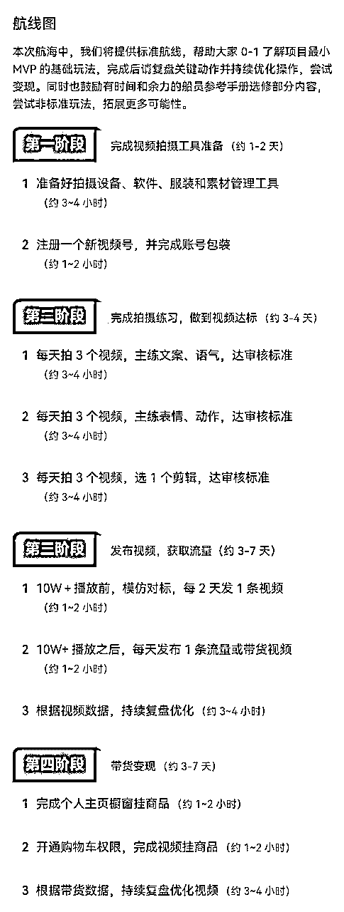

航线图和手册内容联系非常紧密，你在哪个阶段，就学哪一块的步骤。

另外提醒一句：航线图上的所有任务，建议大家尽量在航海前两周完成。做完以后，重点放到复盘、优化和提效上——持续选新品、持续发视频，出单的概率自然会被放大。


# 必修篇：把最小 MVP 真正跑通

💡

必修篇概览：这一部分主要讲两件事，【项目基本情况】和【项目基础玩法步骤】。读完以后，你会对项目形成完整认知，也能按步骤完成 0-1，跑通最小 MVP。

完全没接触过这个项目的人，建议先花点时间了解项目全貌，从项目概述部分读起。已经摸清情况的，可以直接按核心步骤进入实操：

✅【项目实操 1/3】前期筹备，完成工具&账号准备

✅【项目实操 2/3】制作并发布视频，持续复盘优化

✅【项目实操 3/3】挂商品，带货变现

在必修篇，航线图和手册的顺序是一一对应的。你只要按手册顺序往下读，就能把航线图上的任务逐个完成。

后面每个关键章节的概要里，我们也会标出对应的航线图位置，提醒你别落下该做的动作。

接下来，正式出发吧。


# 一、项目全貌：看清视频号 IP 带货

💡

章节概览：这一章，我们一起来认识视频号 IP 带货项目。

平台目前的流量体量如何？用户画像有什么典型特征？

这个项目当下的市场状态怎样？

新手适合挑哪些赛道？

玩法和关键点分别是什么？……

这些问题，都会在接下来的内容里找到答案。

这期航海的重点，就是带大家从 0 到 1 跑通视频号 IP 带货项目。作为起点，先把整体概况弄清楚，是必不可少的一步。一起看下去。


## 1.1 大盘现状

### 1.1.1 盘子有多大

这期航海的主题叫视频号 IP 带货，意思很直接：让创作者本人出镜，在视频号里拍短视频卖货。

视频号可以说是当下流量赛道里红利最突出的平台之一。我们希望通过这次航海，帮大家在这里找到一条长期赚钱的路。

先感受一下视频号到底藏着多少流量：

目前视频号月活跃用户已经超过 8 亿。

腾讯财报数据显示，2023 年视频号视频播放量同比增长 50%，用户使用时长同比接近翻倍——整个平台还处在快速增长期。

但有一个趋势已经非常明确：视频号不再是简单搬运、混剪就能捡钱的阶段。今后想稳定赚钱，必须在内容和 IP 上动真格。

回看这两年平台的变化节奏：

2022 年 3—5 月，随便搬运就能出爆款。

2022 年 6—8 月，简单混剪也还能爆。

2022 年 8 月之后，搬运和混剪开始拼速度、拼技巧。

2023 年 2 月，平台对产品要求更严格，审核耗时变长，对原创内容的审核和扶持力度同步提升。

2023 年 8 月，视频号电商规则逐步落地，上线【运费险】【先付后用】，公布旗舰店入驻标准；同时，普通账号主页不再展示【企业🛰️】，矩阵号往私域引流受到不小影响。

所以，我们转战真人出镜 IP 这种有一定内容门槛的形式，是更合适的选择。而且现在视频号真人 IP 还没有抖音那么“卷”，自然流量依然大量存在。素人 IP 不做付费投放，也能拿到平台海量的流量机会。

给大家看一个真实案例：皓宇教练 12 月初新开的矩阵号，三个星期就冒出 2 条 10 万+ 点赞的视频，播放量超千万；冬至那条带货视频，第一天就变现了 6

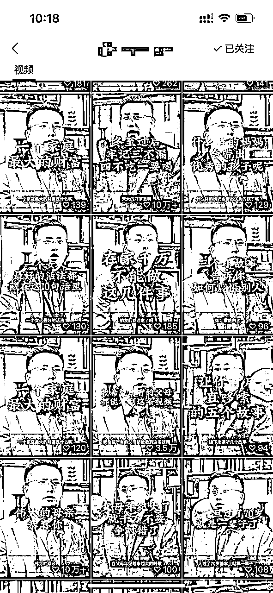

所以，这一期的视频号 IP 带货，正是普通人能够进场赚到钱的机会。


### 1.1.2 用户都是谁

想入局视频号，第一步就是要看懂平台上的人。视频号的用户画像到底怎么样？

从大盘统计来看，视频号里有接近 60% 的用户来自三线及以下城市，40 岁以上人群占比超过 30%。

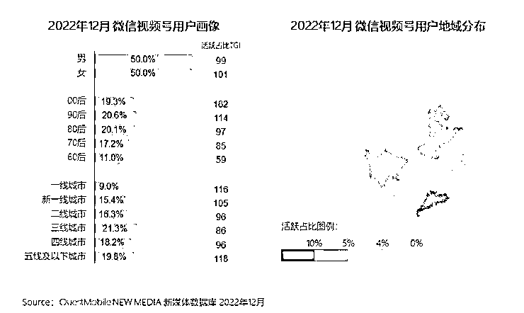

再来分析一下用户的行为习惯。

不少年轻用户，只是从朋友圈或社群点进视频号，随手刷一两个视频就走。严格说，这类人既没有对某个 IP 产生依赖，也没有把刷视频号变成习惯——他们不是我们要争取的核心流量。

那什么人才算真正沉淀下来的用户？

结合我们之前做视频号变现赛道的实践（后面会详细展开），从观察到的数据里能看到一些清晰的规律——

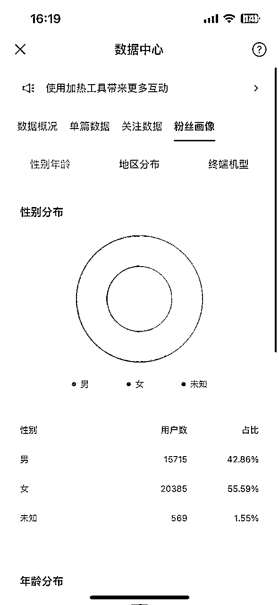

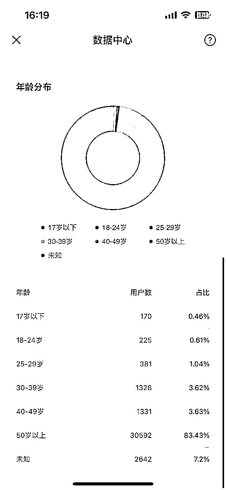

这才是做视频号 IP 带货时真正要关注的典型用户画像。


## 1.2 怎么把这件事做成

### 1.2.1 赛道怎么选

基于对这批用户的分析，再结合我们的多账号实操经验，这里整理出几个适合视频号 IP 带货的爆款方向，大致分为以下几类：

商业类

内容素材大多来自商业思维、赚钱项目、名人故事。这类视频吸引来的粉丝非常精准，后续变现路径也比较顺，缺点是前期起号会比较吃力。

典型选题：生意人的入门思维-窄门思维，三个在家就能做的小生意，马云、刘强东名言。

国学经典类

内容通常围绕运势、处世策略、人情世故展开。它的优势是容易快速起量，能帮你建立单性别的粉丝模型。

典型选题：什么样的人会有一辈子好运气，一个人最大的风水是什么。

社会热点类

这类内容的核心作用是借助热点事件本身的关注度冲上热门。但它有两个明显的短板：第一，热点大家都关注，带来的流量不够精准；第二，人设容易被架到“正义”的位置，后面真要做变现时反而会被质疑。

典型选题：日本排放核废水，明星新闻。

民生类

它几乎可以当成所有视频的底层母题来看。这类内容的两个关键词是“对立”和“共鸣”——先用某个话题把一群人聚起来，让他们产生共鸣，再把不同群体之间的对立感放大。常见角度包括农村vs城市、穷人和富人、子女教育、养老问题等等。

典型选题：富人家庭和穷人家庭的小孩教育，为什么越来越多的人选择逃离大城市回老家生活，老人的赡养问题，判断一个男人是否能成大事。

情感类

内容主要聚焦婚姻、相亲、恋爱等话题。它本质上也是民生话题的一类，只是把对立和共鸣集中在了两性关系上。

典型选题：为什么北京的好男人反倒更容易单身，老公出轨了老婆还要继续忍让吗。

那到底该选哪个赛道？

❌商业类：按照当前视频号的规则，起号难度比其他赛道更明显。

❌国学经典类：转化基本靠书籍这一个类目，性价比说得过去，但单类目的需求量天花板太低。

❌社会热点类：流量不够精准，到变现环节容易被粉丝质疑。

✅民生类：流量和转化都能兼顾。

✅情感类：流量和转化也都能兼顾。

所以，这次航海在内容方向上锁定了民生类和情感类。它们更容易聚拢流量，也能帮我们更快实现变现目标。


### 1.2.2 流量从哪儿来

想拿到流量，先得搞懂视频号的流量分配逻辑：

超过 50% 的流量来自信息流的自然推荐。

另外 20%—25% 的流量来自“心心”和用户转发，也就是视频号独有的“社交推荐”。心心和👸号的“在看”逻辑相似：用户点了心心之后，这条内容会被推荐到 TA 的好友那里；只是点赞的话，不会被推荐。

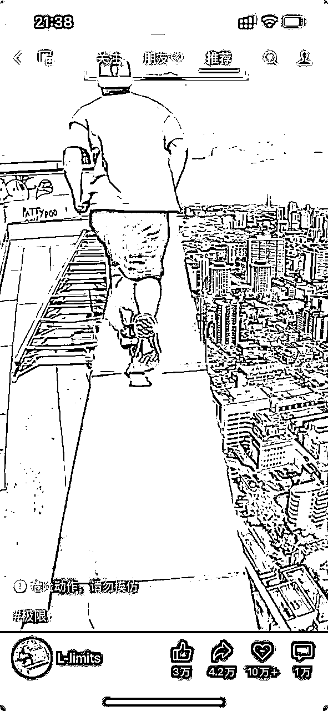

在视频页面上也能看到：推荐、心心、关注，是视频号顶部最显眼的三个入口。

所以，视频号本质上是一个靠推荐驱动的流量分发体系，对新人起号很友好。


### 1.2.3 最小 MVP 怎么走，关键动作是什么

老师已经用多个账号跑出了成功的品，也沉淀了配套的视频内容。照着老师的方式 1:1 复制拍摄，等粉丝量积累到一定程度，再直接发布带货视频变现，这条路是被验证过的。

所以，从 0 到 1 的最小 MVP 路径，可以拆成四步：

1.

完成拍摄准备。

把设备准备好，账号搭起来，还要跨过出镜的心理门槛。关键是先认真感受一次出镜，确认自己能不能接受。

2.

练到视频达标再发。

一开始别急着上传，先用练习把质量拉满。以老师的模板视频和文案为基准，做 1:1 复刻：文案逐句背熟，背景和穿着尽量保持一致，拍摄和剪辑都按同一个标准来。

练习量可以参考手册里的优秀视频标准：每天至少拍 3 条，每拍完一条都拿自检清单核对一遍。用 1—2 天时间把文案练顺，让语气、表情、动作都自然起来，直到拍摄环节的所有标准全部过关。

剪辑也要同步练。按照手册里的视频操作流程，每天至少剪 1 条，剪完继续对着自检清单检查。再用 1—2 天，把剪辑环节的每一条标准都吃透。

3.

发出去，换流量。

在播放量突破 10 万之前，使用手册中配套的文案，严格按拍摄和剪辑标准执行，每两天制作并发布 1 条视频。时间和精力都够的话，也可以提升到每天 2—3 条。

盯住数据，持续复盘和优化。等到某条视频跑出 10 万+ 播放，或者粉丝量达到 1000，就调整为每天至少发 1 条，流量视频和带货视频穿插着更新。

4.

带货变现。

流量目标达成后，开始发布带货视频。前期先引导用户去橱窗完成成交；粉丝过千后，就能在视频里挂上小黄车，让用户直接下单。整个过程中保持每日复盘，持续优化素材内容，不断更新和调整打法。

这条路径里，最重要、最不可跳过的一个动作就是：1:1 模仿模板视频拍摄。


# 二、项目实操 1/3：开工前，备齐工具和账号

💡

章节概览

了解完项目整体情况，接下来就要真正启动了。

做视频号 IP 带货，首先要解决两件事：拍摄工具和账号。

这一章把开工前需要准备的事项全部梳理清楚，包括：

✅准备拍摄工具、剪辑工具和服装

✅完成视频号账号注册与包装，并了解常用的各项功能

✅了解视频号运营规范

💡

本章对应航线图

学完并做完这一章的内容，你就完成了航线图的第一阶段：视频拍摄工具准备（约 1—2 天）

具体拆成两步：

1.

把拍摄设备、软件、服装和素材管理工具置办齐全（约 3—4 小时）

注册一个新视频号，并完成账号包装（约 1—2 小时）

现在，就按清单一步步完成这些筹备工作吧。

## 2.1 出镜带货需要准备哪些工具

想拍好出镜带货视频，工具是地基，必须扎实。下面是我们实际用到的一组装备清单。

### 2.1.1 拍摄工具

拍摄设备&软件

最推荐的就是手机。

现在的手机画质已经很能打，拍短视频完全够用。实际拍摄时记得用后置摄像头，成像性能更好。如果你担心看不到自己的状态，别急，后面的拍摄章节会教大家用镜拍来解决这个问题。

你要是手头有单反相机，成片质感会更上一层楼。

但考虑到大多数人的条件，我们后面会重点讲手机怎么拍。

拍摄软件必须强调：不要用美颜软件！！不要用美颜软件！！不要用美颜软件！！直接用原相机拍就好。

提词设备&软件

最简单的方案是用手机：同时准备两部，一部负责拍摄，一部负责提词。

也可以用电脑网页端的在线提词器，在桌面浏览器或平板电脑上免费显示文本，自己看着念就行。

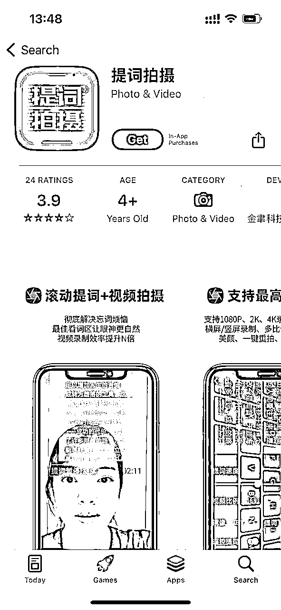

3.

蓝牙遥控器

如果身边没有家人朋友帮忙按开始，可以准备一个蓝牙拍摄遥控器，自己就能控制录制，非常方便。

收音话筒

声音效果极其关键。直接用手机收音会混进不少杂音，所以收音装备一定要准备。这里给两个方案：

方案一：蓝牙无线耳机。

不想额外添置话筒的话，因为我们几乎所有的拍摄都是微微侧对镜头，观众看不清耳朵，你可以在不出镜的那一侧戴一只蓝牙耳机，用耳机的麦克风收音。

方案二：备一支专用话筒。

淘宝或拼多多上两三百元的话筒，收音质量已经不错了。早期没必要大手笔买 RODE、大疆这种高价设备。

拍摄支架：

建议直接入手两个普通支架：一个架拍摄手机，一个架提词手机。这样既稳得住画面，调整构图也自由。要是提词用电脑，随便找点东西把它垫起来就行。


也有人会买那种能自由调整两台设备相对位置的双机位支架，不过很多万向软管款并不稳，所以不特别推荐。

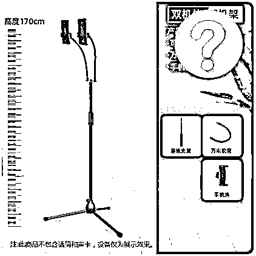

注意：一定要避开固定并排摆放的机位。设备放得太近，半身可能拍不全；放得太远，提词器上的字又看不清楚。

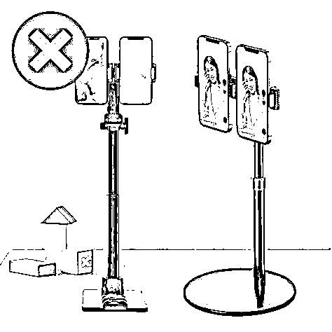

补光灯

推荐用球形补光灯，从身体左侧或右侧的上方打光。买的时候选支持三种色温的型号，这样能配合不同内容调整光照氛围。

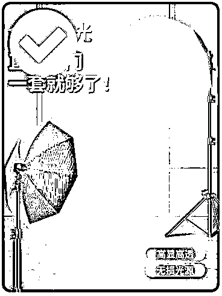

另一侧可以加一支小灯管，或者挂上一块反光布。具体的布置方法，可以参考下面这个视频演示：

https://v.douyin.com/i8jJuV6X/

注意：环绕手机一圈的那种补光灯不推荐，戴眼镜的同学拍出来镜片会有反光。

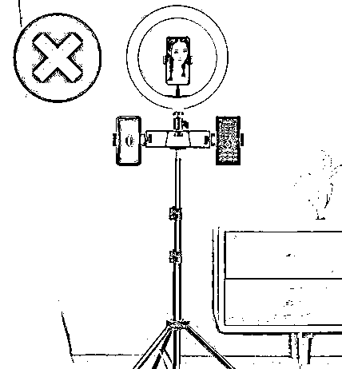

### 2.1.2 剪辑工具

软件就用剪映。

手机版在 iOS App Store 或安卓应用商店都能下载。

电脑版下载地址：https://www.capcut.cn/

有电脑的话优先用电脑版，操作效率会高不少。

### 2.1.3 服装

拍摄电商 IP 内容时，得体的穿着能让观众对你的信任感更强，人设也更立得住。

男士着装：建议穿小西装。

女士着装：工作装或小西装都合适，注意避开女性化特征太明显的衣服，不然吸引来的全是看脸的粉丝，没有任何变现价值。

### 2.1.5 素材管理工具

工具推荐用飞书。当然，你也可以沿用自己习惯的顺手工具。

它的主要用途，是把你发过的视频内容统一管理起来。

老师给了一套自己在用的模板：视频号 IP 带货-个人发布素材库，你可以直接复制模板，快速搭建属于自己的素材库。


## 2.2 账号准备

### 2.2.1 注册账号

只需要开一个全新账号。

这期航海做的是实拍 IP，一个号就够了。视频号对新号有流量扶持，所以尽量用那种从没发过任何内容的新号来启动。

建议一机一号。

这里要特别留意：视频号的实名认证带“连坐”机制。同一张身份证名下认证了多个视频号，只要有其中一个违规，其他几个都有可能受到牵连。所以条件允许的话，这个新号的实名认证，最好用一张没有绑过其他视频号的身份证。

这份视频号IP带货实操指南，从账号搭建到内容发布，一条龙讲透。想少走弯路，照着做就行。

---

### 2.2.2 账号基础设置

先完成账号的初始化配置。

进入路径很直接：打开🛰️，依次点【我】→【视频号】→右上角的【...】图标→选择【账号管理】，按提示完成身份验证就行。


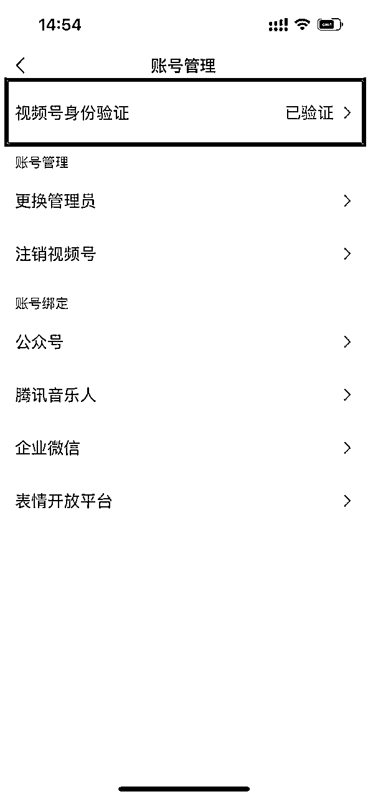

如果你是想用日常🛰️号操作，但不想让亲戚朋友看到这个号的内容，可以在【我的视频号】→右上角【...】→【隐私与权限】里，关闭「推荐给朋友」这个选项。

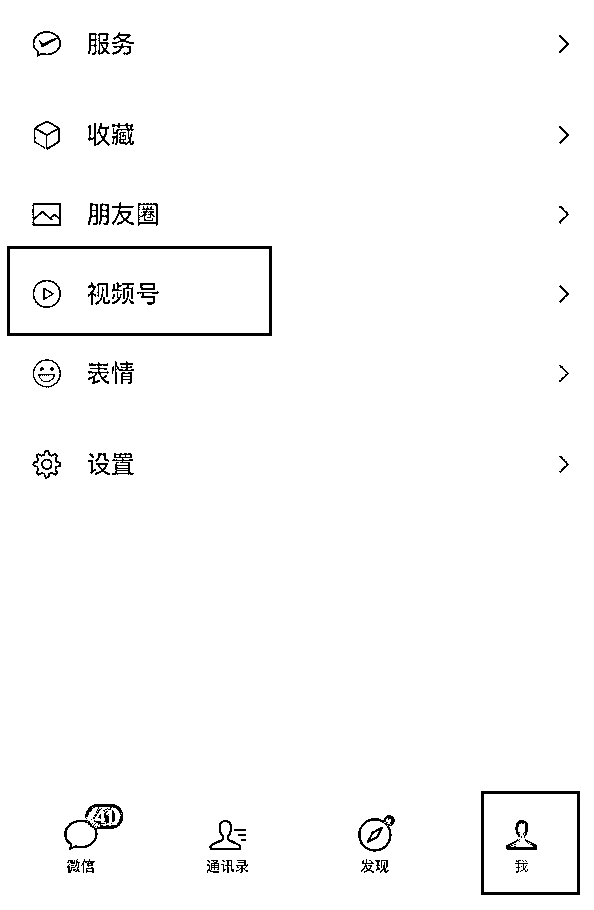

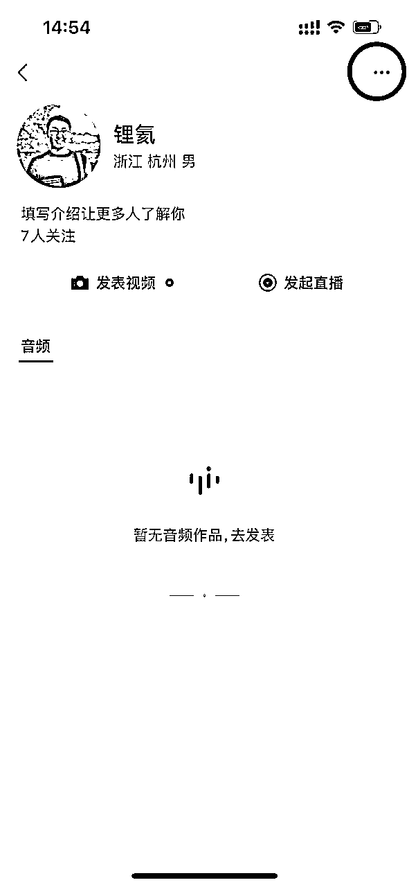

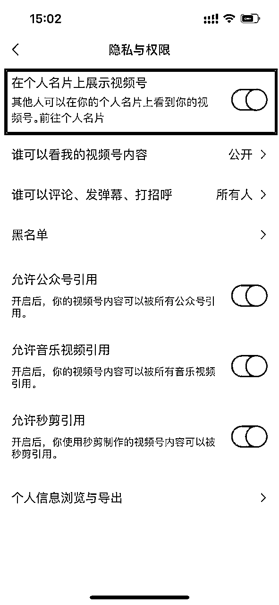

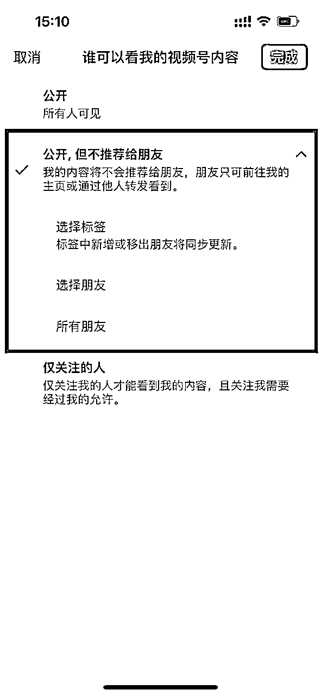


### 2.2.3 养号阶段

账号注册并认证完，不要急着发东西，先养几天号。

怎么养？多刷互动数据不错的内容，观察平台上的高赞视频长什么样、用户在捧什么内容。

刷的过程中控制频率：每看十来条，点赞个两三条就行，差不多每刷50个作品加一个关注。

养号周期不用太长，两三天就够。在这期航海的安排里，我们本来就会先用4天做拍摄练习，这段时间先不发视频，正好一边练一边养号。


### 2.2.4 账号包装

创建好视频号后，点右上角的【···】进入【设置】页面：


```
账号名称
```

官方对名称的注意事项，我们直接看一下：

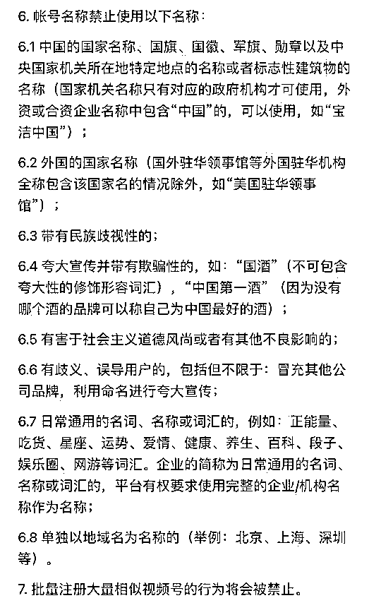

账号叫什么名字，取决于你想做什么赛道。名字要让人一眼看懂你是干嘛的，这个项目偏民生情感方向，女生可以参考“智慧女性”、“女性修养”这类词，男生可以用“致自己”、“悟人生”这种路数。切记名称里别放“严选好物”这种营销味太重的字眼。

注意一下，昵称一年内的修改额度是5次，想好再改。

签名简介呢？前期就围绕两个重点做文章：引导关注 + 说明内容方向。一句话概括就行，比如“关注我，每天分享智慧知识”、“关注我的视频，了解更多传统文化”。

拿不准怎么写的话，可以去抖音上找你赛道里做得好的对标账号，把他们简介里写得好的鸡汤句子拿过来，放在自己简介后面就行。格式上建议放3行左右，太多会被折叠。

简介随时都可以改：视频号主页点头像 → 右上角 … → 头像 → 简介。

头像建议直接用穿上拍摄服装的本人照片，参考商务写真那种经典姿势拍，截取到上半身的构图就够用了。

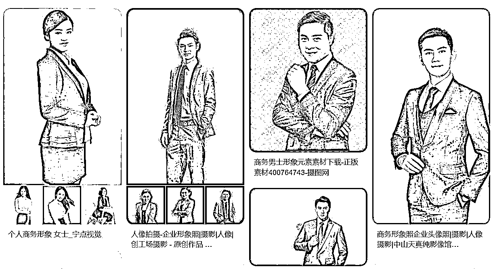

地区：按实际所在地选就行。


### 2.2.5 功能介绍

基础设置弄完之后，再看下视频号的工具面板。点开「创作者服务-更多」，就能看到这些功能，这里挑做电商IP用得上的重点说，剩下的可以自己慢慢摸索。

「数据中心」：单个视频的数据表现和账号整体数据都在这里看，后面复盘优化会频繁用到。

「账号诊断 & 加热工具」：主要用来查自己的账号有没有违规记录，也可以作为申诉入口。如果你的视频发出去流量特别差，先来这里看看到底是不是被判定为搬运或违规了。带货视频有没有问题，也可以用它来测一下，看看能不能通过加热工具来投放。

如果你有运动员、记者之类的特殊职业资质，也可以在这里做认证，官方会提供一些流量扶持。

「带货中心」：这是电商带货的核心功能入口，后面【实操 3/3】带货变现部分会专门展开细讲。

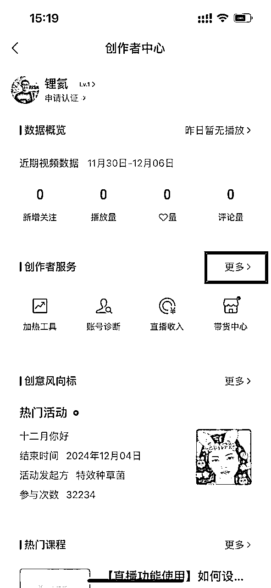

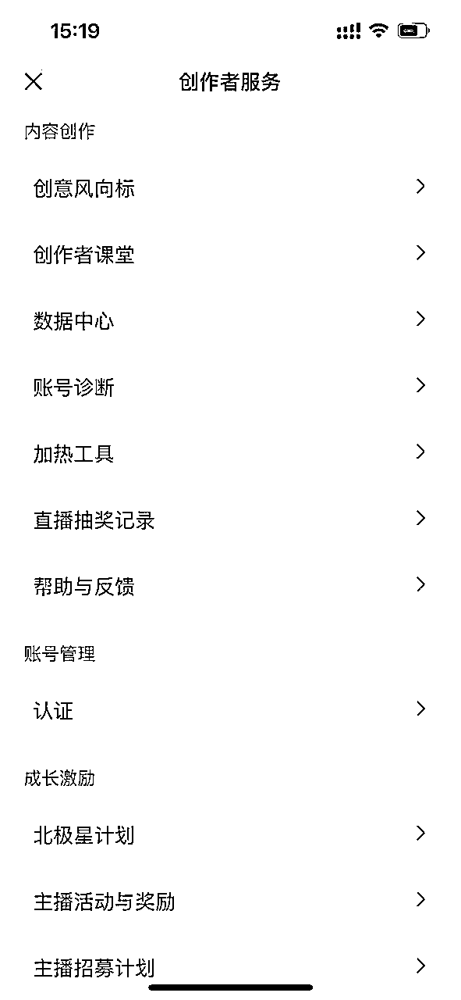

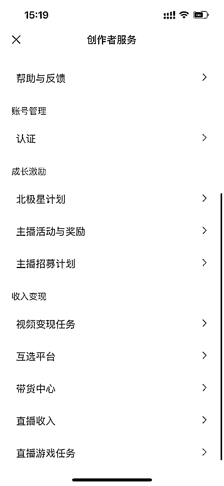

## 2.3 视频号运营规范

重点提醒一下跟我们视频带货直接相关的规则：

商品视频的发布频次

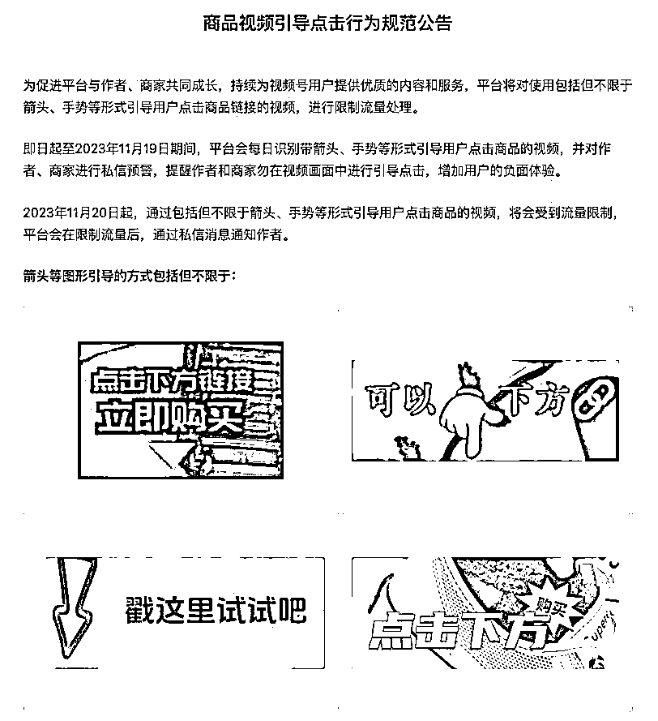

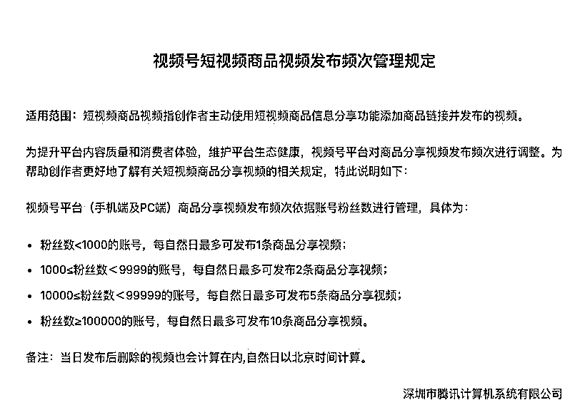


# 三、【项目实操 2/3】制作并发布视频

> 💡 章节概要

工具准备完毕后，最核心的一环来了：视频的拍摄与发布。

按照下面五步来做：

第一步：参考同行的爆款视频，搞清楚什么样的视频才算达标。
第二步：按拍摄标准，每天至少拍3条，反复磨拍摄功底。
第三步：拍摄过关后，按剪辑标准，每天至少剪1条视频，练习后期手法。
第四步：把视频发布出去。
第五步：看数据复盘，持续积累素材、拆文案、做优化，提高产出爆款的概率。

准备开始你的视频创作吧。

> 💡 本章航线图

第二阶段：拍摄练习期，争取视频能达标（约3-4天）

- 每天3条视频，重点练文案和语气，内容要过审核线（约3~4小时）
- 每天3条视频，重点练表情和动作，内容要过审核线（约3~4小时）
- 每天3条视频，挑1条剪辑，内容要过审核线（约3~4小时）

第三阶段：发布视频、跑流量（约3-7天）

- 10W+播放之前，继续对标模仿，每2天发1条视频（约1~2小时）
- 10W+播放之后，保持每天1条流量或带货视频（约1~2小时）
- 每天基于数据持续复盘优化（约3~4小时）

好了，按部就班地往下走吧。

## 3.1 先模仿爆款，搞明白好视频长什么样

为什么第一步是模仿？

短视频时代的分发逻辑掌握在算法手里。你内容够不够好，能不能拿到更多流量，都是算法说了算。而判断算法认可什么，最省力气的办法就是看同行已经在被推荐什么。

新手一上来就原创，意味着你得靠大量拍摄来试错。对普通人来说，时间、精力和制作成本都不允许你这么做。

所以，多拆解同行的爆款视频，是快速掌握爆款密码、缩短起号周期的捷径。

### 3.1.1 文案怎么拆

样例 1.mp4【在线播放】想写好文案，关键记住两点：

**选题要会蹭爆款**

能被平台推到爆的视频，本身就是算法给流量倾斜的信号。别自己硬凿原创，所谓“创意都是老元素的新组合”，新手最稳的打法就是从复制爆款切入。积累素材、持续拆解，等你找到爆款文案的感觉了，再试着组合出自己的作品。

**前五秒是生死线**

视频前3秒的留存率、前5秒完播率直接决定流量池。不仅开头要抓人，还要适时引导用户点赞、评论、转发、关注。

新手期直接用老师验证过的现成文案就行，见【视频号 IP 带货-文案库】，照着录就行。拍顺了之后再尝试自己写，方法在【3.6.2 持续优化，制作优质视频】里会讲。

### 3.1.2 拍摄技法拆解

文案只是半边天，IP的表现力是另一个核心。这也是本次航海大家花时间最多的环节。来看一下样例视频是怎么做到位的：

样例 2.mp4【在线播放】

- 着装：西装、发型、眼镜搭配起来，营造出一种儒雅、有学问的人设，正好符合文化知识类IP的公众期待。
- 语音：教练的音色天生有优势，这个倒不必强求。练习中我们会给到三种说话风格，选最适合自己声线的就行。
- 动作：手势幅度不大，给人稳重、胸有成竹的感觉。
- 背景：后面立着书架，正好是目标用户群体对谈节气这类内容时的必要场景预期。
- 灯光：背景虚化、冷暖光配合，冷暖交错的隐喻感刚好呼应文案节奏。

所有项目里，着装、语音、动作最为关键，也是必须重点练的部分。

### 3.1.3 剪辑怎么切

从爆款样本看，视频号电商IP的剪辑不用玩得太花。突出人物本身，做好字幕和商品画中画就够了，美颜开太过反而效果打折。

具体操作方法，后面【3.4.1 剪辑方法】会详细展开。

这部分案例拆解，以及更细的拍摄剪辑步骤，后面正式开船后会在直播间逐步演示，看起来会更直观。大家记得准时参加。

### 3.1.4 标题怎么写

标题承担的作用有两个：简单言明视频内容；靠关键词蹭点搜索流量。不过视频号的搜索体量不算大，平时不用在标题上花太多心思。


## 3.2 视频拍摄文案

做视频，文案永远是第一位的。老师这边已经把上百条文案反复测过，最终筛出34条流量文案交给你们。

21天训练营期间，大家先专心拍好、发好这些内容就行。

课程里给到的文案，你未必条条都认可。但请记住这个原则：做这件事的目标是获取流量，不是为了寻求认同。很多时候，你越认同的内容反而越没人看。

下面这些是部分文案示例，完整版在【视频号 IP 带货-文案库】可以领取。

### 3.2.1 流量类文案

> 💡
>
> 烧香的不一定是善人，乞讨的不一定是穷人，顺着你的不一定是好人
>
> 穿着衣服的，不一定是人。凡事不能只看外表，家财万贯也买不了太阳西下，身无分文也不代表日后没有江山

> 💡
>
> 以前我对你很好，现在为什么对你不好了？
>
> 那是因为我以前对你好的时候，我是希望真心换真心，你也可以对我好
>
> 但是你却一直把我当傻子，把我的付出当理所当然
>
> 这样我还能继续对你好吗？所以当你发现我对你不好的时候，先问问自己的良心

### 3.2.2 带货类文案

> 💡
>
> 一个人要懂逆向思维，你知道有多厉害吗？给你讲两个小故事，听完你会受到不小的启发。
>
> 第一个：有家小食品公司，辣酱马上要上市，想打广告却预算有限，市区的广告牌根本租不起。他们转念一想，去了城门口租下了一个无人问津的广告牌。
>
> 但并不是直接印辣酱广告，而是先挂出“广告位招租”的信息，年租金报价98万。
>
> “天价广告牌”这几个字本身就是新闻。消息传遍全城后，所有人都在议论这个贵得离谱的位置。一个月以后，辣酱广告正式上线。市场就这么被迅速打开，辣酱卖到供不应求。
>
> 这世上没有难做的生意，只有不会变通的人。当你的思维打开了，很多难题自然迎刃而解。
>
> 第二个：山东一位大爷在路边卖烤地瓜，同样的东西，他能卖出更高的价，还有一堆人抢着买。
>
> 他把烤好的地瓜分左右两堆，左边的比右边的贵两块钱。我问他定价差别在哪，他说左边是更优的品种。
>
> 站在那里观察了一阵子，发现多数人选择了更贵的左边。有个别会砍价的客人，用右边的价格买走左边的地瓜，还觉得自己占了便宜。等左边卖完了，大爷把右边那堆再拨到左边来，于是“高端烤地瓜”就又出炉了。
>
> 大爷后来点破：有钱人买的是一个“贵”字，普通人图的是一个“划算”。你只摆一堆，富人看不出哪个更精贵，普通人也不知道选哪个实惠，他们只会纠结要不要买。摆成两堆，他们就有了买哪个的对比。
>
> 我追问大爷从哪学来的这些招，他指了指儿子送的一本书——《逆转思维》。
>
> 读懂逆向思维，你能让人不知不觉走进你铺好的思路里，帮你达成想要的结果，轻松解决遇到的各种难题，成为人生赢家。
>
> 商品：《逆转思维》

> 💡
>
> 为什么早上不借钱，为什么晚上不探病？
> 为什么鱼缸不送人，为什么红笔不写别人名字？
> 为什么宁娶寡妇不娶生妻？
> 为什么五月不盖房，六月不搬家？
> 为什么打人不打脸，吃饭不夺碗？
> 为什么家里来客不扫地，为什么饭前不训子？
> 为什么左手带金，右手带银？
> 为什么左手倒茶，右手倒酒，倒茶不能倒满，倒酒要倒满？
> 为什么衣服不能烧，为什么枕头不能坐？
> 为什么六人不坐席，三菜不上桌？
> 为什么送礼不送伞，送礼不送茶？
> 为什么喜事不送伞，祝寿不送烟？
>
> 你可能会在不知不觉中得罪人，原因就是不了解这些老祖宗传下来的不成文的规矩。
>
> 这些，是中华文明的根基，是老祖宗留给我们的生活智慧。
>
> 这本《中国人的规矩》和传统的国学不一样，不讲大道理，就像一位长者坐在你面前，掏心窝子跟你讲做人做事的门道。
>
> 读完之后，你就清楚怎么送礼、怎么待客、怎么交朋友、怎么教育孩子。你办事的手腕和分寸，别人都会赞不绝口。
>
> 商品：《中国人的规矩》

篇幅有限，这里只展示了一部分，需要的完整文案库点击【视频号 IP 带货-文案库】获取。


## 3.3 拍摄练习方法

可以从文案库里挑一两篇流量文案，开始练习拍摄了。完整文案在【视频号 IP 带货-文案库】链接里，自取。

### 3.3.1 正式拍之前的准备

```
第一步，熟读文案
```

每条稿子开拍前，至少读2遍稿子。熟练表达是拍出好视频的前提。

第一遍，把内容读到滚瓜烂熟，完全不卡壳。
第二遍，开始“入戏”。把作者的身份代入到自己身上。跟演戏一个道理，你真正进入了角色，才能真正把这话语里的能量和情绪调动出来。不然给你再好的爆款文案，也拿不到流量。

```
第二步，练语速，找到自己的腔调
```

这里推荐三种常见的语速/语气风格，没说哪种绝对更好，你可以三种各拍一条片子，自己对比感受哪种最适合自己。

- **朋友聊天式**：语调平缓，松弛自然，适合拉近和观众的距离。示例：聊天语气.mp4【在线播放】
- **训话式**：语气带点压迫感和锐度，能塑造权威人设，同时更容易刺激评论区讨论。示例：训斥语气.mp4【在线播放】
- **说书式**：娓娓道来的讲故事感，节奏舒缓、循循善诱，道理和营销都藏进了故事里。这种风格和图书类目带货很搭。示例：讲故事语气.mp4【在线播放】


### 3.3.2 实际拍摄操作

```
第一步，布置场景
```

在家拍的话，背景首选书架。摆几套成套的书，加点小摆件，保持整个画面干净且不乱就行。没有书架可用，就找灰色或木纹的纯色背景布。

如果条件允许，去茶室包间或者会议室拍，出来的布景效果会好很多。

大白墙就不要拿来当背景了。

```
第二步，架机位
```

画面构图注意：人物居中，视线稍微侧移一点，左偏右偏都行。画面上方留一点空间，略微高过头顶；下方画面线要低于手部，保证双手完整出镜。


机位怎么弄？

手机或者相机放在自己的左前方或右前方，提词器（手机/电脑）摆在正前方。

一个人拍摄的话，可以参考“镜子架机位法”，这样能实时看到自己的表情和手势。

演示一下没有三脚架的简陋版本：

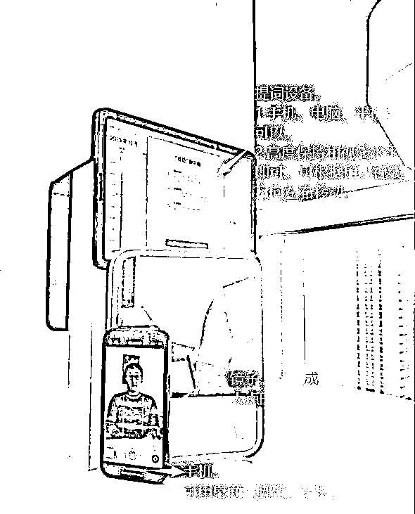

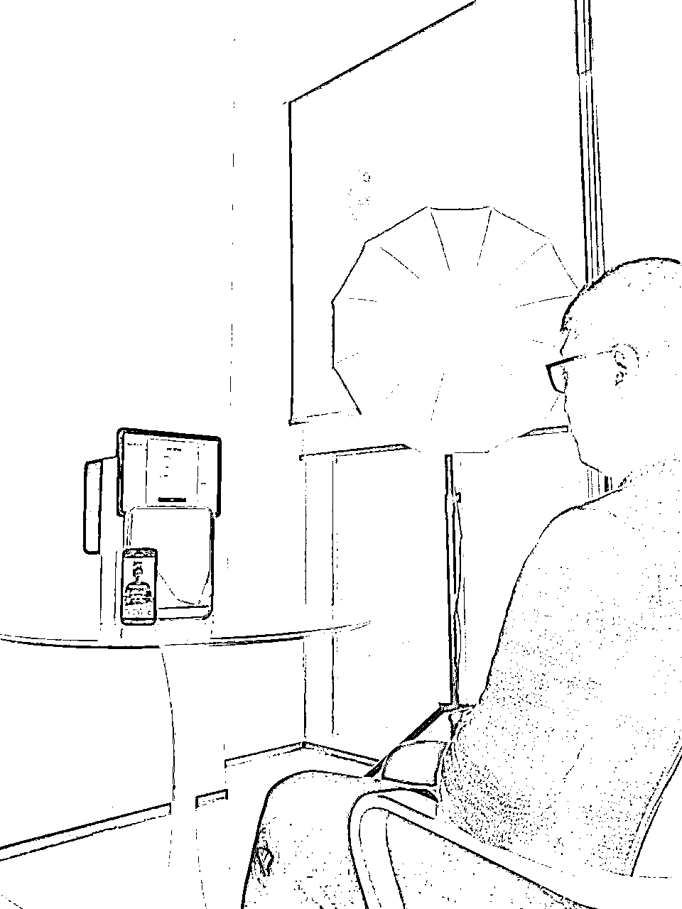

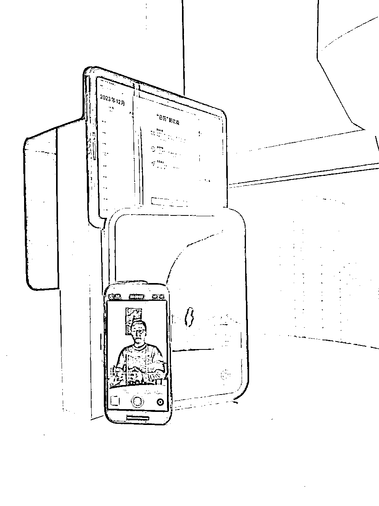

如果只有一部手机，连电脑也没有，那干脆把文案打印在纸上当提词板用。

镜子架机位的小技巧：用镜子有两个好处，一个是可以随时留意自己的拍摄表现，另一个是能用画质更好的后置镜头来拍。提词设备或者纸放到镜子后面，镜头拍不到即可。具体操作可以参考：https://www.douyin.com/video/7255874384601075004

```
第三步，设置提词器
```

拿“快题词”举例，新建一个脚本，把台词粘进去就行。

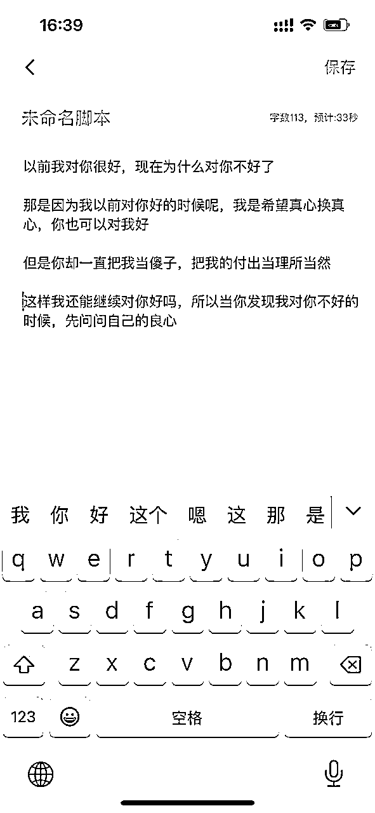

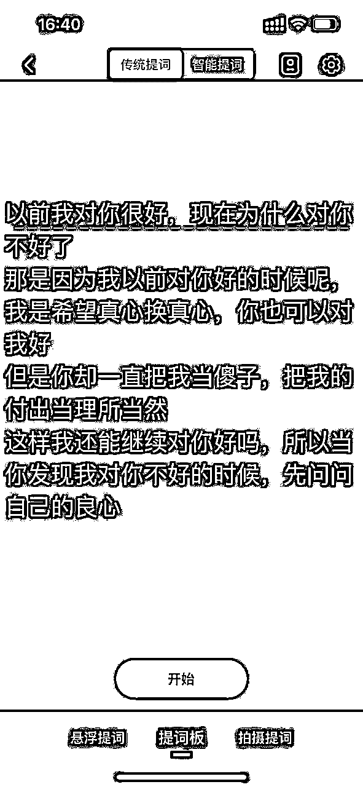

```
第四步，打开拍摄工具，开录
```

用手机原相机后置摄像头，不要用美颜App。

关于背景虚化：你在镜头前坐好后，可以让家人帮个忙。在录像模式下，长按画面中人脸/身体区域，等到弹出“自动曝光 / 自动对焦锁定”（AE/AF Lock），此时保持锁定状态，背景虚化的效果就出来了。

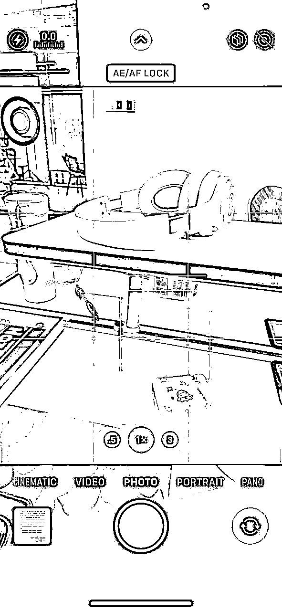

如果你一个人操作，那就不强求背景虚化，直接点录制键，再回到座位上开始拍就行。

```
第五步，拍摄时的状态
```

面部表情，需要跟你的语气风格保持同步。

眼神保持稳定，始终看向一个方向，别飘来飘去。

头部不要左右转动，也不要大幅晃动。

手势建议集中到一只手上，幅度不要太大，不然容易被字幕挡住。手部动作以右手为主，可以尽量避免被判为诱导互动。


### 3.3.3 拍完自检

1. 对照下面的自检清单逐条查看画面是否达标。标记为【非常重要】的项目，每一条都必须完全过关。

没问题就写“已达标”，存在问题的记录下来，总结原因后调整重拍。

12月航海 | 视频号 IP 项目|视频自检清单

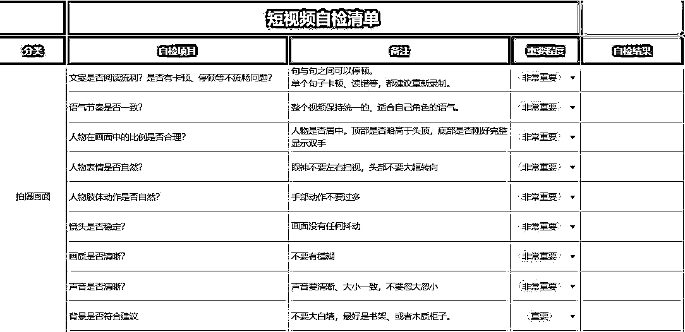


## 3.4 剪辑方法

### 3.4.1 后期流程

剪辑教学.mp4【在线播放】

具体步骤拆开来看：

1. 打开剪映，点【开始创作】，把手机里录好的视频选中导入。
2. 点一下轨道上的视频，找到【音量】，把“人声”调到500左右。
3. 打开【美颜美体】→【美颜】，简单美化就好。一般只建议适当开启【磨皮】、【祛法令纹】和【祛黑眼圈】。
4. 点【编辑】，选择画面尺寸：
   - 竖屏9:16：手机拍出来的默认格式，直接导出就行。
   - 竖屏3:4：先在剪映里把视频居中裁成3:4比例，然后选“画面-背景-背景填充-模糊”，把上下多余的区域用模糊填充。
5. 生成字幕：
   - 点【文本】→【识别字幕】→【全部】→【开始匹配】，系统会自动识别生成字幕。
   - 生成后检查一遍，有断句不对或者错别字的地方，手动修正。
6. 字幕排版：
   - 选中任意一条字幕，点【编辑】→【字体】，选择“点宋体”。
   - 点【样式】调节字号、描边、阴影。一般参数建议：白字黑边，11号字。
   - 拖动任意一条字幕就能调整位置。建议把字幕整体往下放，别挡住画面的手部。

# 视频号带货实操：从剪片收尾到发布复盘的关键动作

成片快要导出前，先花几分钟把画面和文字理顺。字幕最好一行说完，不要折行；若一句话偏长，进【批量编辑】手动断成两段。片头片尾那些空白、卡顿、说错重来的部分，全部裁掉。

8. 字幕垫底怎么做

a. 把播放头拉回片头，进入【画中画】里的【素材库】，输入【黑场】搜索，挑一张纯黑图添加进来。

b. 选中这张图，把它的长度拖到与整条片子等长。

c. 通过【编辑】可以裁切尺寸；直接拖动能挪动它在画面里的位置。

d. 打开【不透明度】，数值设成 40 上下。

e. 完成之后，将此前做好的字幕拖到这块半透明色块中央。

接下来做标题：

a. 播放头仍停在片头，点【新建文本】。

b. 字体一栏挑【江湖体】，字号按画面调整，摆放位置选在人脸以下、胸口以上。

c. 动画的出场效果设为【溶解】。

10. 配背景音乐

a. 打开【音频】，在曲库里挑一首与主题贴合、节奏偏慢的纯音乐。

b. 把音量压到 30 至 40 之间。

c. 若音乐尾巴超出视频长度，把多出来的部分裁掉。

全部过一遍，确认无误后点右上角【导出】。


### 3.4.2 成片自检：细节不过关，前面白干

剪完之后，按自检清单一条条核对。标注【非常重要】的条目，必须全部达标。合格的，在【自检结果】栏写“已达标”；不合格的，把问题记下来，回头逐个改。

12 月航海 | 视频号 IP 项目|视频自检清单

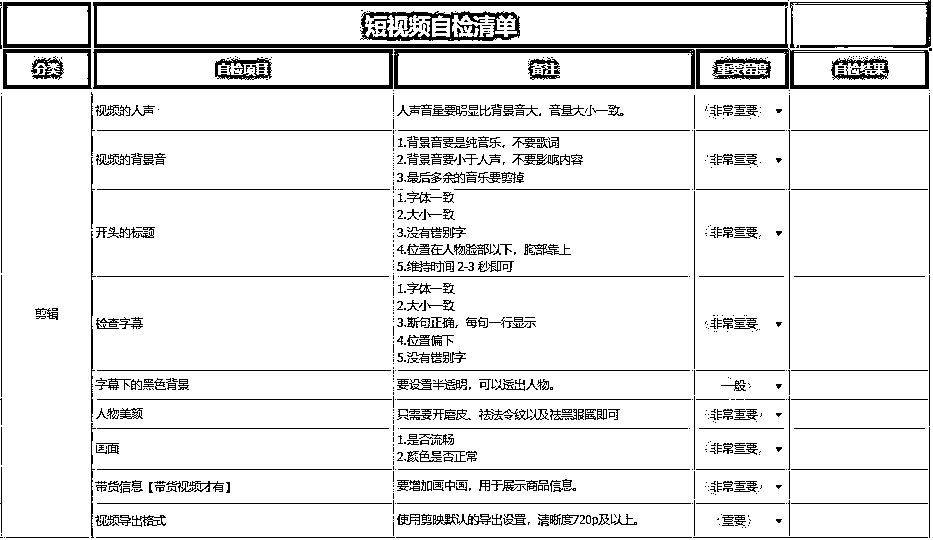


## 3.5 发布视频：两个入口随你选

发布有两个地方：手机 App，以及电脑上的视频号助手网页（https://channels.weixin.qq.com/）。


### 3.5.1 手机端发布：步骤少，但别漏细节

进入自己的视频号主页，点“发表视频”，再点左下角“从相册选择”，挑出剪好的片子，点“完成”即可。

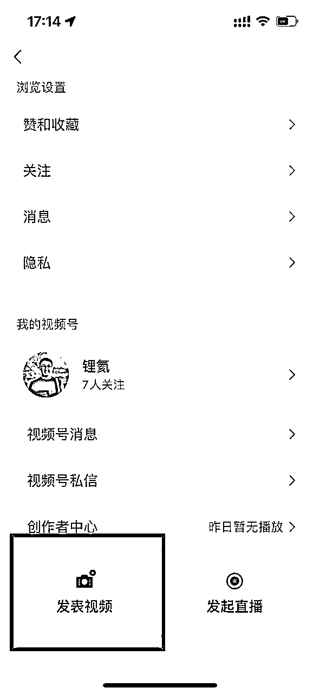

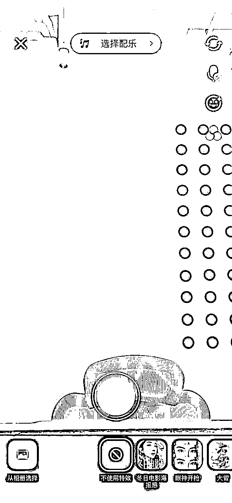

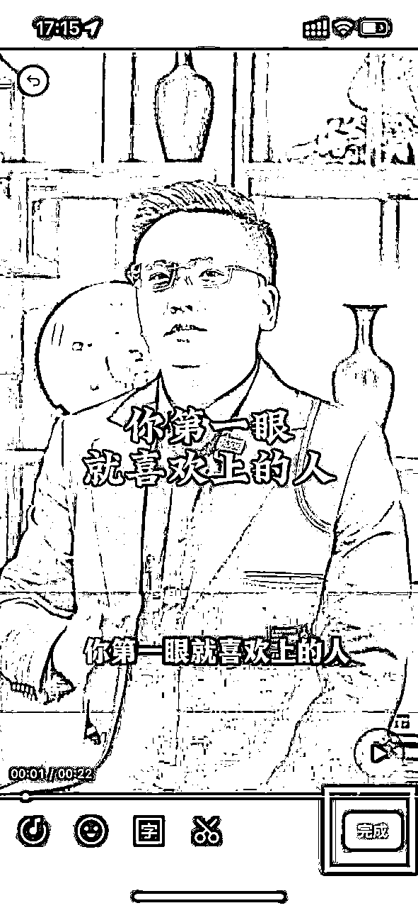

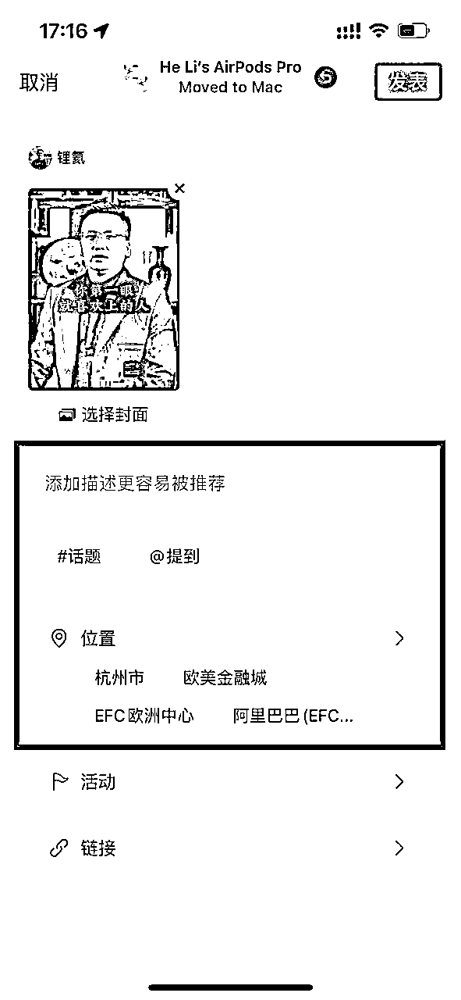

描述：用视频标题直接点明主题，搜索流量别丢。

话题：能给视频带来一部分搜索曝光，同时补足标题没覆盖的关键词。根据内容挑 3 到 5 个就行。视频号不像抖音、📕那样把高关注词直接摆给创作者看；一个小技巧是：先列一组备选词，再到搜一搜的「🛰️指数」里比一比近期谁在🛰️内更热。🛰️指数是综合分值，往下翻，如果某词总量可观、且热度大头来自视频号，那这个参考价值就很高。

例如：#二十四节气 #立冬节气 #女神粥 #养生

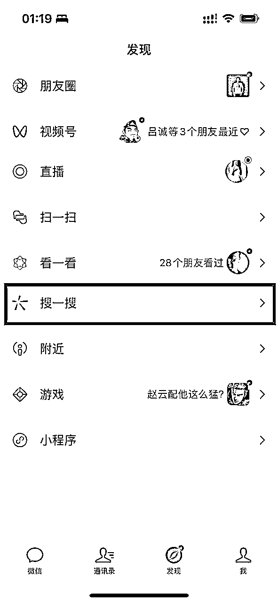

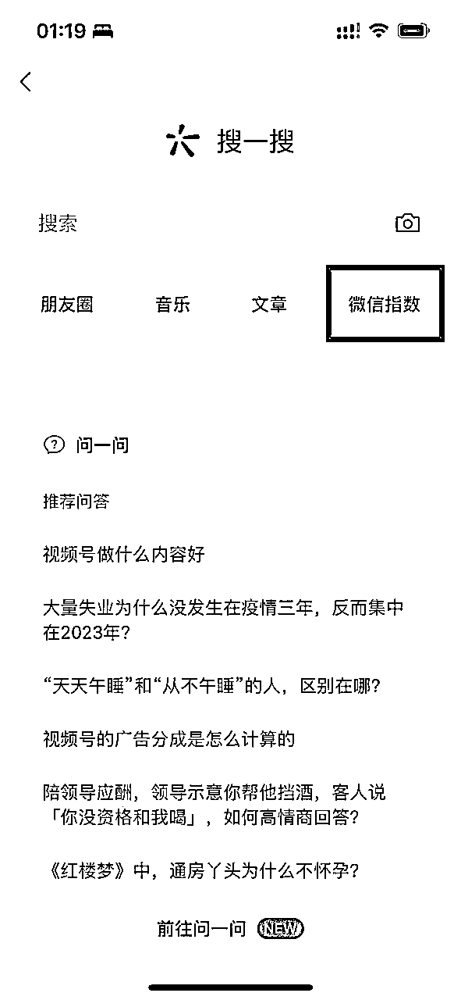

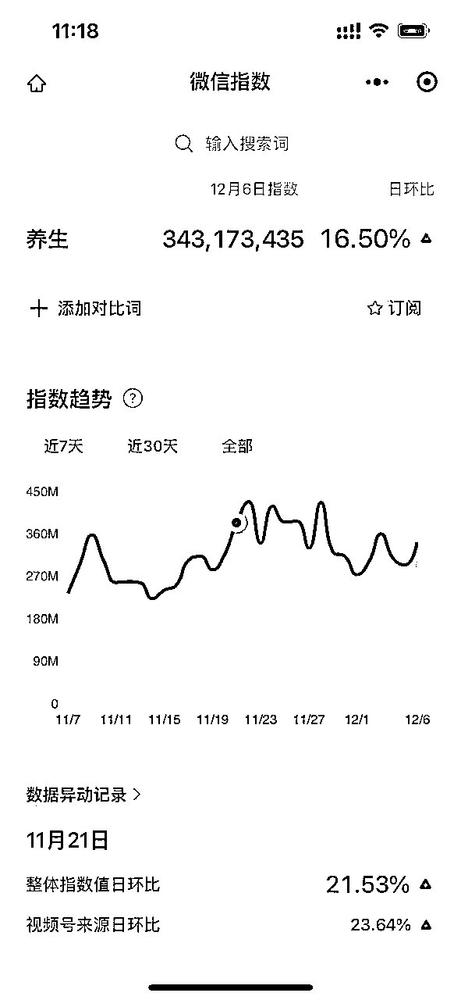

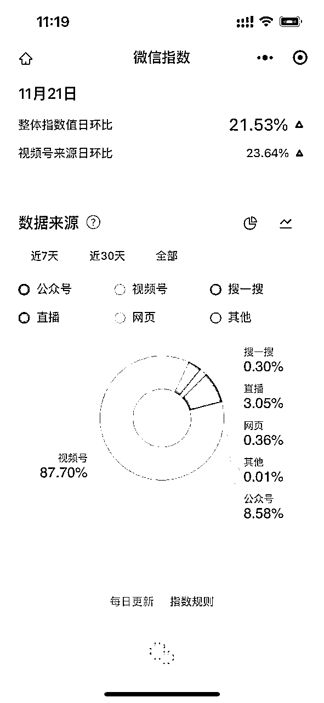

这里还可以填对比词，把几个备选关键词放一起比，看看哪种组合能兜住更多流量。

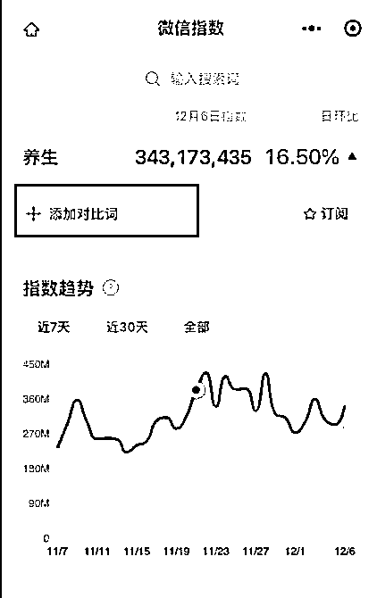

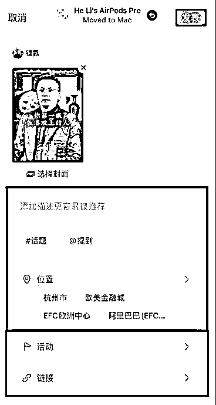

提到：这个我们不会填，带货场景暂时用不上。位置：写到城市一级就够，视频号的位置推荐影响很小，如实填即可。活动：基本没效果，不选。链接：开通视频带货以后，链接区域会多出“商品”一栏，挂车就从那里操作。


### 3.5.2 电脑端发布：定时排期是亮点

入口：https://channels.weixin.qq.com/

电脑端和手机端发出去的效果一致，流量上不会有差别。网页端有几个便利：合集——起步阶段内容不多，合集可以先不管；短标题意义有限，也能略过。定时发表——这是网页端最有价值的功能。设好时间后点底部“发表”，到点自动上线；提前把排期做好，临时有事也不慌。

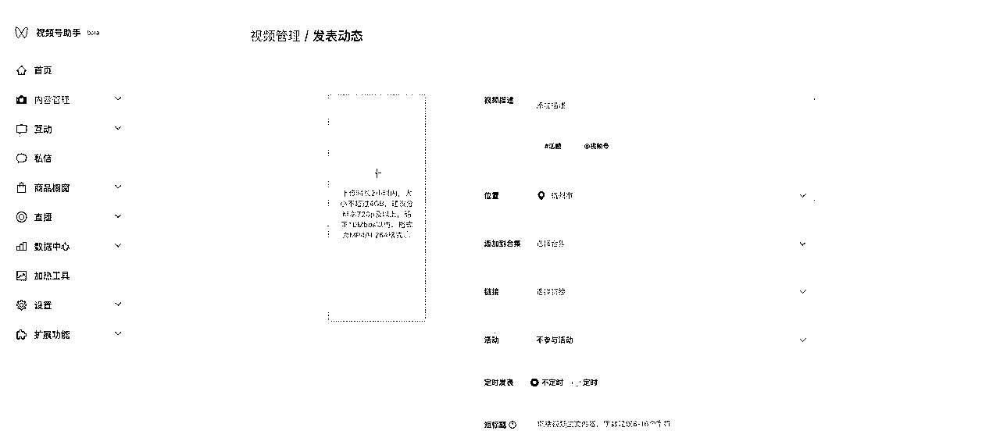


### 3.5.3 发布时间与数量：踩准用户的空闲时段

关于时间，视频号大约 95% 靠推荐流量。想做出爆款，就得吃透推荐分发。发布后一两个钟头的数据表现，往往决定算法还愿不愿意继续推；一般来说，两小时内能迅速破万赞的片子，冲上十万赞的概率不小。所以要把发布安排在目标用户相对闲、愿意刷手机的时候：清晨 5 到 8 点，中老年用户起得早，跟着他们的节奏走；中午 11 到 12 点，午饭前后正是刷视频的窗口；傍晚 17 到 18 点，道理和中午一样；夜里 21 到 24 点，是一天里难得的独处空闲。要是这些时段你腾不出手，就用电脑端定时发布兜底。

数量上，新手在 21 天航海期里，结合自身时间，至少保证两天出一条。等粉丝过千、开始带货，想要稳定收益，日更三条是底线，晚上还能再加一到两条。航海期间时间充裕的同学，尽量往这个标准靠。


## 3.6 视频复盘优化：让爆款可以复制

### 3.6.1 数据复盘：播放和互动才是重点

以视频号做 IP 带货，本质上是货带人。观众关心的是价格划不划算、商品值不值得买，而不是镜头前是谁。因此短视频带货的销量，跟播放量挂钩更紧，粉丝数反而没那么关键。粉丝这块，做到 1000、能开橱窗和挂车就够。真正要盯的是每条片子的播放与互动。数据不理想的视频不用太纠结，把精力放在总结爆款上，琢磨怎么反复复制。只要跑出几条带货爆款，变现目标就能达成。

查看路径：🛰️→发现→视频号→右上角人像→我的视频号→创作者中心→数据概览。

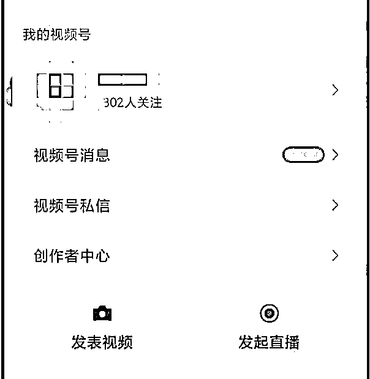


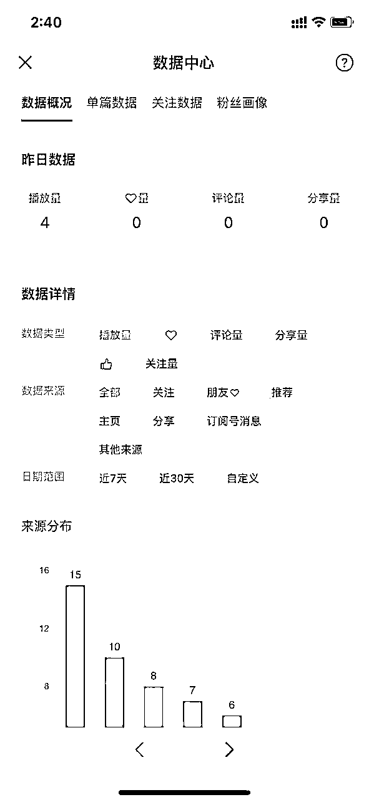

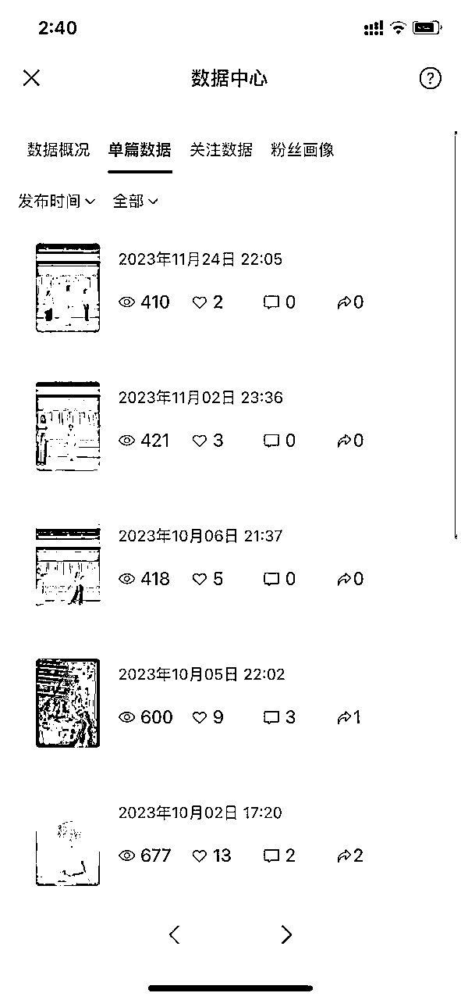

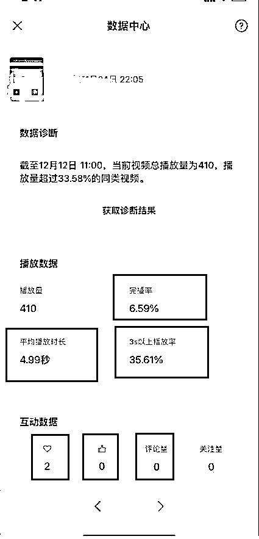

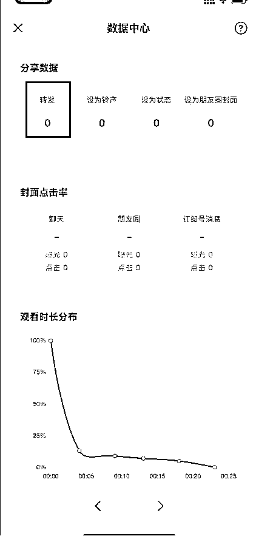

点进去就能看到这条视频的全部明细。

通常看这几个指标：3 秒完播率 60% 以上；完播率 25% 以上；平均播放时长超过片长的一半；互动包括转发、点赞/心心、评论。心心的逻辑接近👸号“在看”，会推给点过心心用户的好友；点赞则不影响社交分发，只代表用户认可。每条视频的数据都记进发布素材库。

视频号 IP 带货-个人发布素材库


方便后面横向比对。爆款笔记要重点研究，拆它的文案和画面表现，找出适合自己的爆款要素，持续打磨。


### 3.6.2 持续优化：用素材库养出好内容

#### 3.6.2.1 收集爆款素材

一个能稳定输出的视频号电商 IP，一个月要发近百条视频。想保持产出质量，就得建素材库、囤优质素材，让灵感不断供。

##### 3.6.2.1.1 素材来源

1. 视频号里直接刷：同领域的视频多看多点赞，系统就会持续给你推同类内容，同行账号自然攒下一批。

搜索：碰到爆款，把标题或文案里的关键词拿去搜，能捞出一串同类视频；也可以看看同一主题下别的账号表现如何。口播视频能不能火，主播的表现力和人气占很大比重；同一段文案被好几个人跑出成绩，才算真正的好文案。顺着视频点进主页，还能挖到更多。比如搜“商业思维”这个主题。

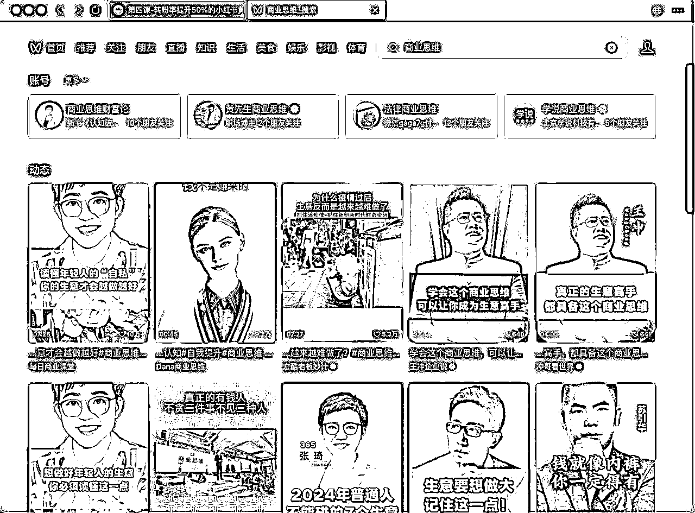

每个视频都能点进主页，继续找相关作品。

2. 抖音、快手上的同行视频

自然刷：新注册抖音和快手账号，系统在没有用户画像时会先推平台当前的热门。从中筛出适合目标用户、值得参考的爆款，点赞关注之后，同类内容会源源不断推来。

搜索：方法同上，看到爆款就把文案或标题里的关键词拿去搜。

巨量算数：借助抖音巨量算数这个免费工具，看近期哪些关键词和视频在涨。路径是创作指南-内容创意分析-热门视频，时间可选近 1 日或近 3 日。

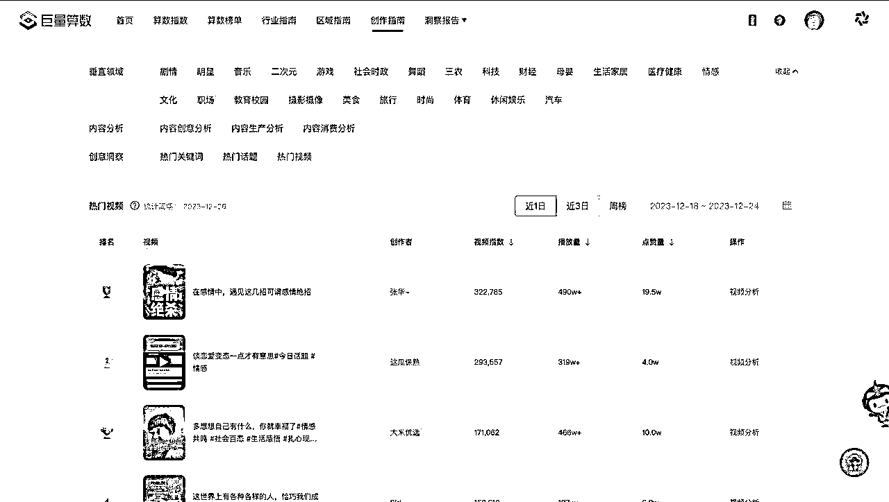

找到热门之后，再拿关键词和主题回抖音、快手、视频号搜一遍，顺藤摸瓜能牵出一大片。

3.

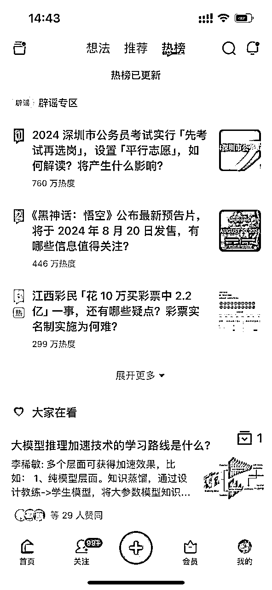

自己的灵感：平时冒出好点子就随手记，归进素材库；新手不建议直接自己写文案，把它当成练手方式更合适。

##### 3.6.2.1.2 下载视频，提取文案

手机录屏加飞书转文字，这套方法各平台通用。锁定爆款后一边播放一边录屏，把整条视频录下来。接着打开飞书 APP（下载链接：https://safe.qhtui.com/sinfo/2000000838_4003227.html?qz_gdt=m2vyezibaaacfjzpwomq），手机号就能注册个人账号。登录后搜【飞书妙记】，进入页面。点【上传】-【上传本地文件】-把视频传上去（音频也行）。


传完会自动解码，点开文档就能看到文字稿。


个人版飞书妙记有容量限制，日常使用基本够。

2. 用“轻抖”小程序：复制爆款视频链接，在🛰️里打开“轻抖”小程序，点【文案提取】，粘贴链接，一键出稿。要注意，它目前只认抖音、快手、西瓜、📕、头条、🧣、B 站的链接，视频号不行。所以视频号的文案还是走飞书妙记。免费工具有广告，耐心点就好。

##### 3.6.2.1.2 搭建素材库

素材可以分成两库：基础库和爆款库。

1. 基础素材库：前面收集的灵感，文案提取出来之后直接往里放。

爆款素材库：按几个角度拆解——选题；文案，再细分为引出、正文、带货内容、结束语；拍摄手法；剪辑技巧，含剪辑思路和用到的视频素材。把每条爆款里你认为出彩的部分，归到对应分类。拆完以后，你就能按自己的思路自由拼装。这些经过你加工的内容，才是真正能吸收成自己的东西。这里有个视频素材库模版可用：12 月航海 | 视频号 IP | 视频素材库


下面具体看怎么拆爆款文案、做二次创作。

#### 3.6.2.2 拆解爆款文案，总结方法，二次创作

先看一条我们的带货爆款：播放 920 万、点赞 20 多万、变现 30 万+。

爆款案例.mp4【在线播放】

##### 3.6.2.2.1 分析选题

只要在咱们赛道内，而且不论账号粉丝多少，多个账号做同一选题都能跑出不错的数据，这个选题就值得借。

##### 3.6.2.2.2 拆解分析文案

开头引出：前 3 秒是黄金窗口，必须把注意力抓住。

第一部分：用“接福”切入。话术大意如下——赶紧把门关好，手机音量开到最大，悄悄告诉你，从 11 月 4 号起会有大事发生；低能量的人刷不到这条，你能看到，说明你凭感恩和善良与我同频共振；老粉都知道我说话灵，不管你此前经历过多少风雨、欺骗和煎熬，从看到视频这一秒起，你已经进入高能量磁场，过往所有不顺和委屈，都会转化为爱与财富的能量来成就你；因为你本心善良、懂得感恩，相信我，你会越来越健康、越来越有钱、越来越幸福；用不了多久，你的生活会富足、平和、喜悦；后面内容很关键，先点赞收藏，听我往下说。

这条片子抓住了大众普遍关心的“接福”来做导入。视频号的核心用户对此比较买账，这个开头能套用到很多文案里。去抖音上刷，也能看到大量面向年轻人的接福内容，只是换成了年轻人更吃的目标和话术。可见这是共通需求。靠接福，3 秒和 5 秒完播率轻松达标；这类文案还会把整体完播率往上抬。引出结尾再主动引导点赞、评论、转发、关注。做到这里，视频就有了成为爆款的基本盘。

除了接福，还有哪些好用的引出方式？

- 引发共鸣：用大白话讲道理，比如“别原谅一个故意伤害过你的人，哪怕他现在百般讨好你。”
- 颠覆认知：比如“为什么越善良的女人，越命苦呢，请耐心听我讲完”“给你讲个笑话，为什么低学历的人反而比高学历的人更容易当老板。”
- 激发恐惧：比如“7 个中老年人的养生误区，你占了几个”“女人如果不改掉这 3 点，每段感情都难长久”“别以为现在过得好，以后就安生了，大错特错。”
- 引发好奇：用抓眼球但不说透的话，比如“未来 3 年，咱们普通人一定要记住的 10 个忠告”“妈妈什么样的性格最旺孩子。”

正文部分：围绕话题展开知识讲解。以立冬文案为例——今年立冬在 11 月 7 号到 8 号，立冬之后记住三不露、四不吃、一要喝，女性朋友尤其要认真看完。第一不露脚：立冬是二十四节气的第 18 个节气，意味着冬天开始、气温骤降；老话说寒从脚下起，立冬后要穿好袜子、穿好鞋，给脚部保暖，避免寒气入侵，平时在家也别光脚，免得脚受凉感冒，晚上还可以泡泡脚。第二不露关节：立冬过后别再穿短袖和露肩背心，爱美的女性尤其要护好关节，关节最容易被寒气盯上，老了容易落下一身毛病。第三不露肚脐：晚上睡觉别露肚脐，窗户关好、被子盖好，立冬后昼夜温差大，不盖被子容易着凉生病。四不吃：第一，海鲜少吃，海鲜性凉，实在想吃尝个鲜就行，吃的时候别忘了加姜片；第二，西瓜别再吃了，西瓜性凉，也有人叫它凉瓜，立冬后吃容易拉肚子或引起不适；第三，绿豆不能吃，绿豆性寒，立冬后昼夜温差加大，别再熬绿豆汤，脾胃弱的人尤其要注意；第四，辛辣少吃，立冬后冬燥明显，气候干燥，辛辣吃多了容易上火，尽量少碰。那一要喝，喝什么呢？民间有“立冬补冬补嘴空”的说法。立冬是二十四节气的第 18 个节气，冬天开始，草木凋零、蛰虫伏藏，万物活动趋缓，以冬眠状态养精蓄锐，为来年春天勃发做准备。人虽不冬眠，但民间有立冬补冬的习俗，这个进补好时节可以食补，为抵御寒冬补充元气。正文的关键是扣题。这条视频标题讲的就是立冬该吃什么、该做什么。这段文案还有个好处：二十四节气的内容稍作调整，就能从 8 月底立秋一路用到 11 月初立冬，反复吃平台流量。

正文常见的形式与广告植入：我们做的是电商 IP，正文虽然以陈述为主，但也要为后面的转化铺路。通常有这几种打法：

- 给忠告：以忠告形式在合适位置插入产品。比如“立冬以后牢记三不漏、四不吃、一要喝”，其中“一要喝”就是我们要带的货；再如“家里这 7 件事千万别做，有车有房的要注意”，可以在最后一件事的解决方案里带上家居好物。
- 讲故事：把产品编进故事。比如“五个小故事告诉你，懂博弈的人有多可怕”，引出商业博弈类书籍；“美女开网球馆，一招打败周围所有同行”，同样能卖商业书。
- 教方法：讲各类方法，从某个方法切入产品。比如“你知道钱是怎么来的吗？我告诉你钱来的真相”，可以销售商业书籍。

# 入冬养颜：女人别错过这7步

女人一生里被称作“最后黄金期”的阶段，究竟是哪段时光？这个问题，同样适合拿来推广护肤品或食补类产品，帮我们锁定女性人群做转化。进入立冬之后，恰好是姐妹们调养身体的好时机；身体根基稳了，面对生活才有撑得住的资本。

想做出改变时，别急着跟伴侣商量，也别先听闺蜜意见，更别去问那些平时根本不保养的人。你该做的，是走到镜子前看看自己，算算余生还能经历几个十年。这里有个很省钱的搭配：把黑米、红米和糯米凑在一起，再放入红豆、花生、桂圆、红枣、枸杞，隔水炖上六十分钟；立冬后连续喝一个月，让好气色从身体里面透出来。嫌自己配比麻烦？这款“女神粥”已经按比例配好了。点视频左下角，从今天开始，用它认真爱自己。

这段“照镜子、算十年”的表达，是整条转化链路里很有分量的一脚，作用就是逼单，让还在观望的人尽快行动。若跑去问丈夫或朋友，多半会被一句“乱花钱”泼冷水，因此文案才会点明“别问不做保养的人”；“还剩几个十年”则借年龄焦虑推一把。末尾再次示范如何下单，最后一句又补一次促单。

做转化内容时，常见框架可以拆成三块：先讲产品，包括品牌来历、怎么做出来的、能带来什么体验、怎么用、用哪些原料；再给购买理由，一面讲买了之后的好处，另一面讲不买可能错过什么；最后做收口，直接劝一次下单，例如“赶紧入手”“别问另一半，也别问闺蜜，问镜子里的自己就好”。

带货视频拍摄还有几条不能踩的线：说到商品时，画面里要加入画中画，这样更利于成交；效果不能直接许诺，像“瘦身”“皮肤变好”“看了必发财”都不许出现；口播中不要报链接位置，例如“点下方链接”“在左下角”都不合适；也别用箭头或手势把观众往购买入口带；讲解商品的过程中，手不要频繁挥动，不然平台可能判成恶意引导下单。

##### 3.6.2.2.3 视频标题&留言区

标题对流量的带动不算大，不必投入过多精力，能把视频内容说清楚就够。若是带货视频，留言区务必置顶一条：“本店只做便宜又养人的好物。购买路径：点视频左下角小黄车即可，愿你越来越好❤️❤️”

##### 3.6.2.2.4 二次创作

新手刚起步，先把“逐帧仿写”做扎实。把爆款拆开看会发现，优质文案一环接一环的推进节奏，往往就是视频能爆的重要原因。刚开始可以直接仿写自己收藏的爆款，不用因为怕重复就急着大改；重复度判定里，文案所占分量没那么高，新手别在这件事上耗太多心神。等手上积累了一些作品，再试着做二次创作——想把账号做大，长期只做模仿肯定走不通。可以采用素材重组法：建素材库时既然已经拆过视频，就围绕同个主题找两三份不同内容，把片头、主体、转化段分别组合，例如片头用A、主体借B。但拼接处的过渡和整体语气必须重新处理，也可以带一点个人表达习惯，重点是前后统一、读着顺。真正关键的一步，是拿实拍数据检验你对爆款原因的判断。刚开始数据不好很正常，保持耐心，多拍多改，做久了自然有手感。

2. 核对敏感词：自己产出的视频文案，一定要先过一遍违禁词筛查。打开前文提到的“轻抖”小程序，进入【违禁词】，把文字贴进去检测即可。


### 3.6.3 进阶拍摄 / 剪辑小技巧

1. 相机拍摄：若手上有索尼机器，可以试试 12mm f/2.0 定焦。室内拍人物、室外拍人与环境都够用，基本一支镜头能应付多数场景。

2. 灯光布置：预算宽裕的团队，布光可参考相应课程。剪辑时经常复用的画面、声音、字幕，可以先在电脑版剪映里做成素材，以后调用更方便。操作如下：


接着选中这个复合片段，在右键菜单里点“保存为我的预设”；


剪映保存完成后，从“媒体-本地-我的预设”中就能找到它，后续直接拖进新时间线使用。


# 四、【实操 3/3】挂商品，带货变现

章节概要：把视频制作和发布跑顺后，持续输出流量内容，努力把播放做到十万以上，就能进入带货环节。操作分两步：先选到合适货品，再借橱窗与视频把商品挂出去，完成变现。学完并动手实践，可完成航线图第四阶段——带货变现（约3-7天）：第一项，把商品上到个人主页橱窗（约1～2小时）；第二项，开通购物车权限并在视频中挂货（约1～2小时）；第三项，结合带货数据反复复盘、调整视频（约3～4小时）。

## 4.1 选品&货品渠道

### 4.1.1 选品原则

参加航海的大多是普通素人，不具备明星那种一喊就有人跟的号召力，也很难靠人设把价格抬得很高。看视频的人更关心划不划算、东西值不值得买，卖货的人是谁反而没那么重要。所以视频号IP带货，本质上是商品在带人。选品时只需抓住两个点：价格是否够友好、需求是否够普遍。实惠到位，商品又正好是目标用户常用之物，成交概率就高；要让观众把心思放在价格和商品本身，快速拍板，而不是先慢慢建立对你的信任。另一方面，如果货品体验差、退货多，你花力气带出去也可能因售后拿不到佣金，还会伤害账号信任。因此所选的货最好已有一定销量基础，且售后比例低。

### 4.1.2 产品库 & 渠道库

做过视频带货的人都清楚，挑货和测货很耗时间精力；新账号粉丝少、流量也少，想测出真实结果并不容易。

这次航海为了让参与者更快看到成果，我们把测款和初筛的环节先省掉，直接提供几个由团队多个大号反复验证、跑出数据的爆款。它们适合用短视频来卖，售后比例也低。

图书


家居好物


同时配套转化脚本，详见【视频号 IP 带货-文案库】里的5条流量文案。满足带货条件后，向教练领取推荐链接，照着文案录制视频即可开卖。别轻视这几款货：有账号只靠一个单品打爆，单日变现6万+，累计可做到十几万乃至几十万。等账号起来后若想自主挑货，可参考【4.2.2.1 个人主页橱窗挂商品】里的方法。


## 4.2 挂商品

### 4.2.1 三种带货路径

进入“我的视频号-创作者中心-带货中心”，点右上角小头像。


这里能看到，视频号给了三种带货权限。

视频带货：有效关注数≥1000，或已经开通小店；靠互相关注攒来的粉丝不计入有效关注；内容要符合规范；公开视频不少于10条；🛰️支付实名认证要完成。

橱窗带货：有效关注数≥1000，并且开通视频号小店。


直播带货：有效关注数≥1000，或开通视频号小店。若粉丝不到1000，只能卖自己店铺里的商品。

橱窗、视频、直播这三类，又都分“分销”和“开店”两种玩法：分销是在选品中心挑一件代发商品，物流售后不用自己管；开店是卖自家货，分为有货源和无货源。不过视频号近期已经堵住了订单获取用户地址与联系方式的口子，想用开店+导单来做无货源，已经走不通。


DSR用来评估店铺服务能力，包含服务体验、商品体验、物流体验三块；短视频店铺会看90天内3分钟人工客服回复率（8:00-23:00），如果没有全职客服，不建议开店卖自家商品；普通分销卖家可以忽略这个分数。前期先以分销为主，即在选品中心挑一件代发商品。下面重点说视频带货和橱窗带货如何选品上架，直播带货放到选修部分。


### 4.2.2 橱窗和视频挂商品

把货放进视频号，核心就两件事：先在个人主页橱窗上架商品，主要由选品中心完成；发视频时再从橱窗里挑货挂到视频上。

#### 4.2.2.1 个人主页橱窗挂商品

这一动作主要靠选品中心挑货并上架。


账号有起色后，若想自己挑货，选品中心该怎么用？它的功能相对简单，只有基础排序、筛选和榜单。市面上暂时没有类似蝉妈妈、新抖那样专门服务视频号的数据分析产品，所以挑货时可以拿抖音的带货视频和电商数据作参照，再结合用户画像做二次核对。这里要特别提醒：凡是宣称能查视频号数据的工具，基本都是骗人的。操作上可以这样走：先根据视频号IP的定位圈定品类；再到蝉妈妈、新抖等工具里找该品类的爆款，时间最好卡在近一周，至少也别超过近一个月，太久以前的爆款参考意义有限；销量上，看它在抖音全站最近单日是否破过万单（日均至少1000+）才值得进一步分析；价格方面，视频号吃性价比，日常用品建议不超过39.9，图书若有多本套装可适当放宽；佣金建议25%-40%，单件佣金10元以上，太低会卖得热闹却赚不到钱，太高又难出单，同样不划算；带货方式上，排除主要靠直播冲销量的商品；确定爆款后，找到销量最高的那条内容及其用户画像，参考文案与画像做二次创作。蝉妈妈、新抖费用不低，建议先模仿到能稳定变现，有收益后再投入高阶数据工具。


挑完货要记住：视频号电商IP遵循货带人的逻辑，内容要围绕用户对商品的需求来创作。


#### 4.2.2.2 发视频挂商品 @纸壳 @李诚 Sonic

若商品已经上到橱窗，发视频时照着下面步骤操作就行：


内容来源：《视频号带货建议指南》；《视频号短视频挂车投流常见问题和解决方案》


# 选修篇：更多玩法

章节概要：当项目的最小可行产品跑通、操作流程也掌握得差不多后，可以尝试把玩法放大：用电商IP做直播带货，挖掘更多可能。

# 五、电商 IP 直播带货

章节概要：带货视频一旦起量，就应尽快开播，把成交放大、把销售额拉高。这次打造的电商IP更偏民生与情感方向，结合人设和内容一致性、直播话术及潜在风险来考虑，直播建议聚焦图书或家居好物这两条线。下面整理了直播推流机制、直播场景搭建、直播话术参考以及直播违规注意事项。

## 5.1 了解平台推流机制 @大树

做视频号直播带货，需要同时盯住人气数据、成交数据以及公私域流量。平台规则和算法会调整，及时跟上最新变化很关键。

### 5.1.1 人气权重

曝光进入率，等于进入直播间的人数除以平台曝光后看到的人数；封面、标题、直播画面都会影响观众点不点进来。有效观看占比分30秒、60秒、180秒：平台会按观看时长分层，并据此判断直播间的内容与承接能力，给出不同权重层级。互动率、关注率：互动包含问答、评论、送礼、连麦；关注则意味着人气上涨和更深一层的粘性，这两项越高，通常说明主播和内容越受认可，也更容易转化。粉丝团基本是铁杆用户，可以长期维护、做转化和裂变，引导他们把直播分享到朋友圈、社群，为直播间带来流量。


### 5.1.2 成交权重

成交密度，就是单位时间内完成了多少单，对自然流量推送的影响尤其明显。可以按在线人数的10%来定成交目标：如果在线100人，就争取成交10单；客单价是一元还是一百元并不重要，尽量做到每5分钟出一波成交，连续三波5分钟成交密度叠加，就有机会撬动平台推流。商品点击成交率，等于成功下单量除以商品链接点击人数。福利品这个指标要到70%以上，承接品到40%以上，利润品到20%以上，整体维持在30%左右。若达不到，就回头优化主播话术、商品链接，以及选品和排品。


### 5.1.3 私域与公域置换（重点关注）

视频号跟抖音很不一样的一点，是它能经营私域，并借私域去撬动公域。一个私域用户，可能换来1到50个公域流量。分享：直播可以转到朋友圈，也要鼓励观众把直播分享到他们的朋友圈；整场直播都要有策略地争取分享，分享者越优质，带来的流量越大。预约：可以反复做预约，为下一场直播预热；直播过程中一有机会就引导预约，并提前把弹窗设置好。亲测有效：这场直播为下一场预约100人，开场时即使有50人不点，也还会有50人通过预约进来。


### 5.1.4 不同阶段的考核维度

1、冷启动期：场观低于1000时，重点看人气数据，关键指标是曝光进入和停留。

# 视频号直播间操盘手册：从冷启动到高转化的关键动作与红线清单

## 一、流量成长要过三道关

**冷启动：先让内容被看见。**

新号开播，平台首先看“内容被消费的情况”。两个判断信号很关键：一是用户刷到预览后，愿不愿意点进来；二是进来的人有没有真正看进去。系统根据这两项数据，不断寻找同类兴趣的人，再把推荐范围放大。如果数据一直不好看，后续自然流量的入口很可能被收窄。

**数据增长期（单场观看不足1万）：拼流量精准度。**

这个阶段的核心指标是“商品点击→成交的转化率”：有多少人点开了商品卡，点开后又有多少人真正付款。平台不看成交金额，只看成交人数和成交订单数。到这里，用户的行为正从“看内容”转向“掏钱”，平台也会顺势给账号打标签，然后把更相似的人群送进来。

**成交转化期（单场观看1万以上）：拼流量利用效率。**

人群相对精准以后，平台开始计算单位流量的产出：同一波观众，你能做出多少成交，同行又能做多少？谁能带来更高的平台收益，谁就能拿到更多推荐，这就是赛马机制。考核重点有三个：成交总额、观看到下单的转化率、每千次观看产生的成交额。做直播，本质上就是靠这些数据跑赢同行，从而换回更大的流量。


## 5.2 直播场景搭建

### 5.2.1 直播设备与工具

开播的硬件门槛不算高，一套稳定配置就够：一部手机拍画面，一个支架固定机位，提前备好要展示的样品。卖书就准备书，卖家居好物就把货品摆在手边；知识类直播间，可以把关键词做成 KT 板放在镜头里；旋转展示台则适合需要多角度呈现的商品。

免费工具：直播伴侣


下载入口：直播伴侣


### 5.2.2 直播场景布置

行内有一句话：场景搞不定，直播难做好。

场景指观众能看到的一切，包括直播封面、实时画面、主播、产品包装。外场景是封面加实时缩略画面，点进去之后就是正在发生的直播画面。

#### 5.1.2.1 直播封面与实时画面

用户还没点进来时，先看到静止封面，再看到动态预览。这个阶段没有声音，能传递信息的只有文字和画面。封面本质上是一张海报，要把最重要的信息放到最显眼的位置，让人一眼看懂你在做什么。例如“泰国进口乳胶枕——睡到天亮”。

直播广场上的动态预览，就是实时画面，它直接影响“从曝光到进入”的比率：画面有没有吸引力，决定用户愿不愿意点进来。官方也明确把曝光进入率列为关键指标。画面上的标题可以写“睡到天亮”“谁适合乳胶枕”。

#### 5.1.2.2 画面文案的特点

画面文案要短、要扣题、要说重点，让观众一眼明白，同时有吸引力。

常见写法有：“产品上贴1米福利”“老北京布鞋9.9”“奥特莱斯正品撤柜”；品牌类写“回力正品直播间”；痛点类写“三分钟出门素颜装”；背书类写“XX官方指定供应商”“XX工艺大师”。

#### 5.1.2.3 场景搭建的依据

同一个产品，放进不同场景，传递的信息和价值完全不同。好的场景能自己在镜头里卖货，核心是给购买者一个想象空间：拥有它之后，生活会有什么改变。

产品视角：让产品占住画面中心，比如手播西洋参时，镜头直接对着货品讲卖点、功能、细节。
氛围视角：茶室里卖茶，显得高端；仓库里卖茶，显得性价比高；茶园里卖茶，强调原产地；大卖场里卖茶，突出热闹。不同氛围吸引不同偏好的人群。
原产地视角：如果产地真实又难以复制，就把真实现场搬到户外。在新疆葡萄园卖葡萄干，和在房间里卖葡萄干，信任度、吸引力完全两样。
包装视角：镜头会放大产品的价值感，包装本身就是价值的一部分，很多产品的包装甚至比产品更贵。
摆放视角：同一只陶瓷杯，放在普通桌面、放进木盒、放进带灯光的玻璃展柜，观众感受到的价值完全不同。


### 5.2.3 实战场景

真人出镜的短视频账号，开播时一定要继续出镜，借力用户对IP已有的信任。


## 5.3 直播话术


### 5.3.1 话术类型

#### 5.3.1.1 拉流话术：把外面的人拉进来，把里面的人留下来

目的：冲数据、破层级、做权重。

拉流的逻辑很简单：进直播间的人就是流量。用一两句和用户有关的话勾住他们，让进来的人不走；外面的人听到有福利，也可能点进来看。留下的人比离开的人多，在线人数就会持续上涨，拉流就成功了。

示例：欢迎刚到直播间的姐姐们，我手里这顶帽子，专柜价899，现在一个运费就能带走，想要的扣1。这是桑蚕丝面料，适合平时喜欢戴帽子的姐姐。已经有XX位报名，还剩XX个名额，2分钟后上架。等会儿还有XX，也是给新朋友的福利。

#### 5.3.1.2 立人设：讲清背景

核心是建立信任，回答“为什么你要听我的”。方法就三件事：摆事实、拿证据、讲故事。

示例：咱家是围巾工厂，厂房3000平，工人100多个，一天能产XX条，常年给品牌做代工。我们的围巾贴个牌子就能卖大几百。大家可以看下，同款在电商平台卖多少钱（举起价格对比牌）。

#### 5.3.1.3 讲主题：说清今日活动

要有主题、有逻辑，讲清楚我是谁、来干什么、为什么这样做。

示例：我们过去主要做线下生意，最近才转到线上，想建自己的品牌。开店也好、直播也好，都得先有人气。我们不太会运营，所以准备了XX份礼物。姐姐们不用做什么，留在直播间领礼物、帮我捧个人场就行。每2分钟发一轮，不耽误大家时间。今天的福利包括XXXX。

#### 5.3.1.4 点对点成交：盯着公屏互动

读公屏、点名感谢，显得专业，也更容易成交。可以安排水军带动那些不互动的人。

示例：XX姐姐刚扣了1，给这位姐姐安排一单。

#### 5.3.1.5 塑品话术：提升产品段位

不要只讲材质和工艺，要从更高维度关联产品。常用词包括：大牌同款、纯手工制作、明星同款、进出口。

顺序上，先讲痛点、引发共鸣；再讲卖点，说清为什么买、能解决什么问题；最后做价值塑造，用故事和品牌类比抬高产品。

示例：这件旗袍的版型，由京派旗袍传承人亲自操刀，京味很足，上身很显女性气质。想看看实际效果，可以到北京大栅栏那条街上的传承人门店，有机会看到同款。

#### 5.3.1.6 转品话术：承上启下

要自然过渡，可以无中生有，也可以用利他口吻带出新内容。

示例：刚才有姐姐问眼镜还有没有。这款眼镜是昨天答应老粉的福利，新粉先别急，等这波结束，再给新粉安排。

#### 5.3.1.7 催单逼单：制造“今天必须买”的理由

报完价格后，留一点时间给用户拍单，但紧迫感要做足。

示例：姐姐们手速太快了，已经拍光了，以后也不会补。现在看看还有没有人占单没付款，再给姐姐们一点时间。还不付款的话，名额就给后面排队的姐姐。

#### 5.3.1.8 保障话术：让用户没有后顾之忧

把“买了后悔怎么办、看了没用怎么办、不满意怎么办”提前回答掉，并给出承诺。

示例：我当着大家面保证，所有产品都是正品，假一赔十。产品有质量报告，也有国家相关部门认证。买回去不合适，七天内退换。我们已经帮上万客户解决问题，评价一直很好，大家可以放心下单。

### 5.3.2 实战话术

做情感类、民生类IP时，图书和家居好物可以各准备一套基础脚本，直播时循环使用。

图书直播：
欢迎来到直播间，这里卖的是视频同款书籍，点左下角链接把书带回家。这套书印刷清晰，有油墨香，今天直播间下单都包邮。包邮地区大概2-3天到，其他地区看快递速度。来，我翻开书，带大家看看目录和内容。

家居好物直播：
欢迎家人朋友来直播间，这里卖的是视频同款商品，点左下角链接下单。先看功能（现场演示），再看质量（展示细节）。


## 5.4 直播违规避坑指南

视频号对违规的处罚非常重，一旦触线，账号可能很难恢复。名义上只是限制3天或7天，但处罚期结束后，流量大概率还是会下滑，很多人只能换绑或注销重来。因此，没有成熟团队的账号，不建议做无人直播或半无人直播，太容易违规。

违规情况大致分两类：一是商品售后问题，二是直播间本身的问题。

### 情况一：商品售后类违规

#### 1）违背承诺（延迟发货/无法发货）

商家没有按平台规则或约定给用户发货，或没有提供承诺过的服务。一般的处理结果是禁橱窗3天、下架对应商品。

应对：如果确实发不了货，尽快向平台报备，或和客户商量取消订单。报备可以在小店后台提交，也可以发邮件到 weixinlive-jf@tencent.com。只要理由正当，后续就算被误判，也有机会找小二申诉、恢复开播。


注意：一次报备最多覆盖15天，超过期限必须重新报备，否则按违背承诺处理。

具体细则见《视频号橱窗商家【违背承诺】实施细则》《关于延迟、无法发货报备的指引公告》。


#### 2）推广超范围商品

指通过橱窗卖平台明确禁止出售的商品，或者商家没有对应资质却开了类目，比如超低价商品。

例如：皮色料属于珠宝玉石禁售品类；没有资质却把手表当赠品；莫桑钻是平台明确限制的商品；低价珍珠饰品也在限售范围内。

应对：先查清平台开放、不开放、定向准入的类目，再了解定向准入产品的销售底价。正常情况下，直播间只能售卖已绑定的商品。


#### 3）发布违禁信息

发布的信息或商品违反《中华人民共和国广告法》等法律法规。常见两类：一是食品、药食同源产品或滋补品被夸大功效；二是主播或直播团队已被全网拉黑，或属于违法团体。

例如：主播说吃亚麻籽油能疏通血管、养护大脑，属于虚夸普通食品功效；挂羊头卖狗肉，发出的是“幸福小丸子”（壮阳类产品）；主播说“男人加油站”“懂的都懂，一个小时打底”；古玺堂精油宣称能缓解腿疼、颈椎、膝盖不适，把护肤品讲成医疗产品。这些都是实际处罚案例。

#### 4）发布虚假宣传

指使用极限词、虚假限时文案等方式欺骗或误导用户。

判罚多由这些问题引发：货不对板、质量不佳、用户投诉、纠纷单量大、物流异常。

例如：发货时少件，商品品质和宣传不符，导致举报和投诉较多；品质与描述不符，同时物流异常；主播宣传商品能祛斑，但提供的特殊化妆品证明上的名称和商品对不上，无法认定功效。

应对：虚假宣传经常由货品品质和售后问题触发。样品要和正品一致，主播别为了逼单给过多承诺，客服要及时响应咨询、处理售后。这些环节没做好，很容易被投诉判罚。

具体细则见《视频号橱窗描述不符/虚假宣传纠纷处理判责标准》《视频号橱窗交易纠纷处理规则》。


#### 5）发布不合规信息

主要是商品重要信息缺失和类目乱挂。

例如：商品名称没有写重量；玉石或镶嵌类商品没有品牌、没有重量；商品标题缺少品牌信息；翡翠手绳错挂到翡翠手镯、翡翠吊坠类目；正红菇干货应该放在食品饮料>粮油调味>南北干货类目，实际却挂在了生鲜-蔬菜-根茎类。


### 情况二：直播间违规

#### 1）不正当营销

通过虚假承诺福利、虚假抽奖、虚假赠品等方式吸引人气，引导用户关注，最后却不兑现。

例如：
- 口播出现“全场1折”“1折清仓”“免费送”“品牌商品个位数”“清完走人”“专柜X折”“扣XX免费送”“新人免费送”。
- 直播间人员或背景出现“1折”“X元”“免费送”等字样，包括手写板、电子屏、灯牌、推流贴图。
- 用远低于市场价的商品引流，同时收高额运费。
- 在直播间口述、视频号昵称、简介、直播主题、公屏互动中做同样表达，例如“工厂直销一折”“全场9.9”“免费试用”“新人每人送2份见面礼”“1元商品引流，实际价格高于宣传价”。

应对：不正当营销是平台目前处罚最多的规则。只要涉及低价、赠送、福利品，都可能被定性。视频号现在不允许低价引流，价格不能低于9.9，折扣也不能太低，否则会被视为恶意竞争和价格战。抖音、快手的直播套路，搬到这里不一定行得通。

具体细则见《视频号橱窗达人【不正当营销】实施细则》。


#### 2）低质量内容

无人直播、录播都属于低质量内容。画面是提前录好的素材，不是实时画面。除非有特殊申请，平台不允许这两种形式。需要特别说明的是，绿幕直播可以用，但背景不能一直循环播放视频。

今年2月起，平台放开了一种场景：服装直播间背景可以放模特走秀视频，要求清晰、全屏。目前只有这一种形式被允许。例如百丽集团旗舰店、佑游健身，大家可以搜索看看。

具体细则见《视频号橱窗达人【发布低质量内容】实施细则》。


#### 3）其他敏感场景

在封面、背景、头像、主题、评论区、昵称等位置，不要出现“扣1分享朋友圈送手镯”“关注送项链”“扣666送梳子”“新人免费领大礼包”“进来免费送”“0米送”等表达，这些都属于虚假福利或不正当营销。

其他敏感词详见《视频号直播敏感词汇注意事项》《视频号直播违禁词大全》。

不同品类还有自己的规则。

生鲜类直播：画面里必须展示实物，带包装的商品要拆开露出内容，不能用绿幕代替；卖生鲜肉，要同时展示带包装的产品，不能只摆肉；卖冻鱼，要把包装好的冻鱼展示出来，不能只放新鲜鱼，避免误导。商品标题、包装名称、直播画面展示的实物，三者必须一致。

最后分享一个经验：直播中如果后台弹出两次处理通知，马上关播，重新开一场。第三次弹窗至少禁播1天，但新开一场会重新计数，可以降低禁播风险。

内容参考：3月8日《视频号直播违规避坑》@宏；《12月航海|视频号带货|航海手册》

