# 视频号分成计划：从入门到放大的完整路径（2023.12）

> 发布时间：2023年12月22日

文档使用说明：本文档意在展示这个项目有哪些值得探索的方向，帮助你更快地上手与理解。建议搭配快捷键 Ctrl+F（Mac 上为 command+F）搜索关键词，即可快速定位自己关心的内容。

## 写在前面

💡 欢迎来到 12 月航海「视频号分成计划」实战手册，接下来的日子里我们会频繁在这里碰面。

在真正动手之前，先聊透两个问题：1）视频号创作者分成计划究竟是个什么项目？现在切入，到底还有多少机会？

🛰️视频号于 2023 年 4 月正式上线「创作分成计划」，它是寄生在视频号生态中的一套变现机制，创作者通过持续发布原创视频，就能获得广告收益。可以视作视频版的流量主——👸号通过文字变现，视频号通过视频变现。

当视频发出后，平台会在评论区自动匹配并展示合适的广告。用户点击广告，创作者就有收入进账，全程无需自己找广告主，更不用手动挂广告。

整个操作逻辑很清晰。前期先物色合适的赛道，做好视频并发布；等账号达到平台门槛后，🛰️会向合规的视频号作者发出开通邀请，进入「创作者分成计划」；再往后，持续发原创内容即可。

有一点要特别说明：这笔收入严格来说并非腾讯发钱，而是来自商家广告投放。视频号流量越涨、入驻商家越多，广告预算池就越厚，市场空间自然可观。目前视频号的流量规模相当大，一条普通内容偶尔就能冲到几百万甚至几千万播放。

但想在这个项目里获得收益，必须同时满足以下三个条件，才能被邀请开通创作者分成计划：✅ 视频号有效关注人数（粉丝数）不低于 100；✅ 内容符合规范：平台鼓励优质原创、画风精美、真实正向的作品；✅ 账号本身属于优质原创作者。

2）什么样的人适合参与视频号分成计划？

如果以下 4 点你都符合，跑通项目的概率会显著提升：✅ 每天能投入 2—4 小时；✅ 对🛰️视频号用户画像有一定了解；✅ 拥有至少 1 个正常使用的视频号；✅ 掌握简单的视频剪辑，并且愿意在复盘中逐步提升效率。

目前进场，拿到结果的胜算不小，真正的变量只在赚多赚少。一开始可能每天只有几毛钱，慢慢变成几十、几百，甚至上千，最终收益跟你的内容质量强相关。若你此前从未剪辑过视频，建议严格跟随手册节奏走，别自己乱发内容；若你已有剪辑基础，确信自己能过原创审核，那就直接做爆款内容冲涨粉。开通权限只是起点，内容才是这个项目的胜负手。

最后，祝各位在这次航程里不仅拿到成果，还能结识一群并肩作战的战友。

以下内容由龙哥盟联合圈友制作而成，仅供航海船员以及龙哥盟星球圈友学习使用。欢迎圈友们在实操中不断反馈，一起完善手册，可以联系鱼丸（yuwan387）提交修改建议～

## 【更新提示】手册使用方式

开始之前，先来弄清楚这本手册的正确打开方式，方便你有针对性地使用。

手册整体是按照“从 0 到 1 跑通视频号分成计划项目”的顺序来编排的。你可以根据自己的航线图一步步进行实操，也可以依据实际需求挑选模块来读。

这里要特别提醒：本次手册相较过往航海做了较大改版。旧版倾向于把更多玩法一股脑放出来任你挑选；而改版之后的手册，明确拆成了“必修”和“选修”两块。

必修篇：包含从 0 到 1 跑通最小 MVP 的全部动作，对应航线图上的行动路径。如果你还在前期摸索期，希望能先完整推进一次整个项目，建议直接从必修篇开始认真阅读和操作，不必在玩法选择上反复纠结。

选修篇：则集中呈现更多玩法、案例和项目放大路径。如果你已经跑通 MVP，想挖掘更多可能性、找到新灵感，选修篇是你一定不能错过的部分。

📌如果你从未了解过视频号分成计划项目：
建议先建立初步认知，再看整个项目面貌👇
✅【项目概述】了解视频号分成计划📌

📌如果你对项目已有基本认知：
从航线图第一阶段的步骤开始动手，手册可以从第二章读起，按照章节顺序完成全部动作👇
✅【项目实操 1/3】确定赛道，制作&发布爆款内容
✅【项目实操 2/3】开通分成计划，领取收益
✅【项目实操 3/3】持续复盘优化，提高内容质量&产量

📌如果你已完成 MVP，想进一步放大项目：
重点阅读以下章节，探索更广阔的玩法边界👇
✅【项目拓展】更多运营技巧与经验
✅【项目放大】如何在分成计划赚更多钱
✅【实战工具】更高效开展项目

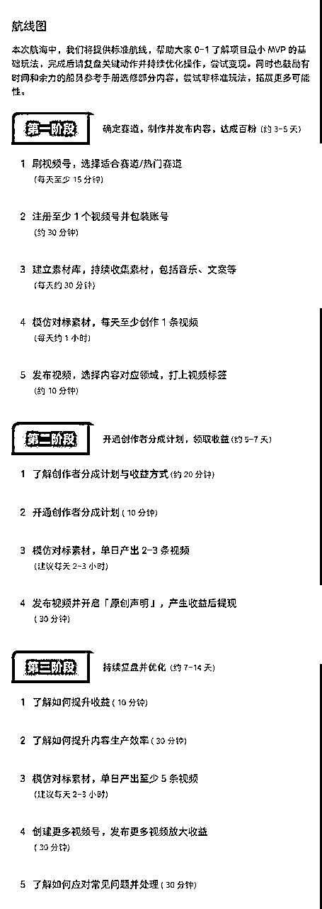

航线图与手册的关联度很高，你可以按照自己所处的环节去匹配学习内容：

1. 每天根据当前的项目进度，先确认自己在航线图上处于哪一步，下一步该做什么；
2. 点击对应步骤，跳转到手册相关模块，查看具体操作流程后立即行动；
3. 完成当天行动后，去日志打卡，复盘动作并规划好下一步安排；
4. 航线图与项目关键路径直接挂钩。做完航线图上的所有动作，意味着最小 MVP 已经跑通。但不要在此停下，继续循环第一阶段至第三阶段的动作。

以上所有环节，建议在航海启动后的前两周内完成。完成航线图后，保持“找素材—剪视频—发视频”的节奏，甚至可以开新账号，持续运营，直到赚到第一块钱，再去冲击更多收益。

## 必修篇：跑通最小 MVP

💡 章节概要

必修篇从认识视频号分成计划开始，逐步带你走完整个项目的学习闭环。你只需要按照篇内的内容和步骤动手实操，就能够顺利跑通最小 MVP。

如果你是第一次接触该项目，建议先看项目概况建立整体认知：
✅【项目概述】了解视频号分成计划

如果你已经对项目有了基本的认识，就可以开始学习核心实操：
✅【项目实操 1/3】确定赛道，制作&发布爆款内容
✅【项目实操 2/3】开通分成计划，领取收益
✅【项目实操 3/3】持续复盘优化，提高内容质量&产量

必修篇的安排与航线图一一对应，只要跟着顺序学完，就能逐一完成航线图上的全部任务。在后续每个关键步骤的章节概要里，我们也会标出相关航线图，提醒你完成对应动作。

现在，正式开始吧！

# 一、【项目概述】认识视频号分成计划

💡 章节概要

本章我们将一起了解视频号分成计划项目。为了给你足够的信息支撑，会从三个角度展开分析：

✅1.1 什么是视频号分成计划：项目基础介绍
✅1.2 项目现状：变现空间、优势风险、项目能做多久
✅1.3 项目核心玩法：核心步骤、视频号内容推荐机制

学完这些，你会形成对视频号分成计划的基本项目认知，也能找到自己的发力方向。

在看项目的过程中，你会发现这是一次可以借助视频号流量红利入局的窗口，最关键的还是主动下场。建立起基本认知后，你就可以按后面【项目实操】的章节开始实战了。

## 1.1 什么是视频号分成计划？@郭耀天 @流浪虎

所谓「视频号分成计划」，是🛰️视频号今年 4 月才上线的变现路径，视频创作者甚至可以不出镜：

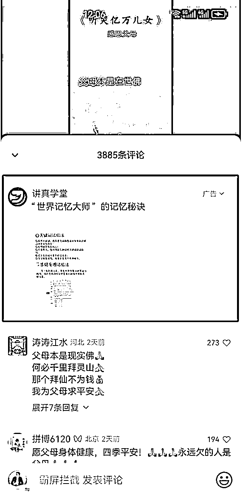

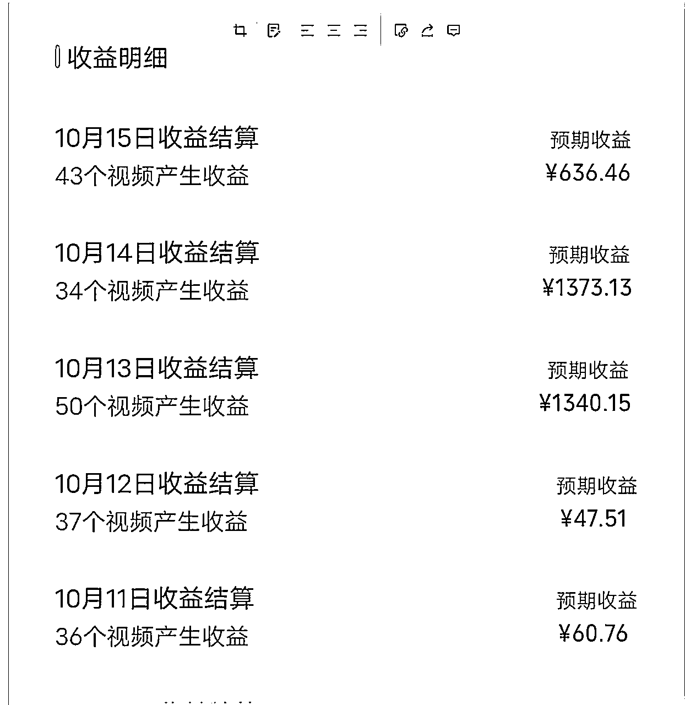

项目前期，我们需要先锁定合适的赛道，制作并发布视频；等账号满足条件后，平台会自动邀请合规的原创作者开通「视频号分成计划」：

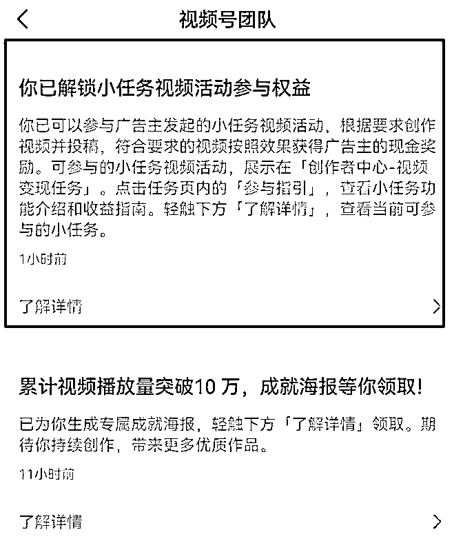

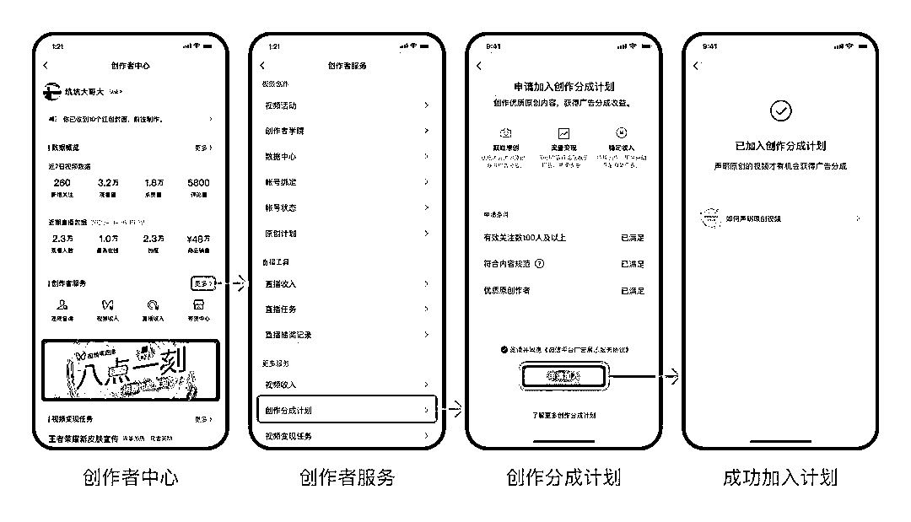

权限开通后，持续发布视频并勾选“原创”，视频的评论区就会有机会自动展示合适广告。用户一旦点击，创作者就能获得分成收益，完全不需要自己额外找广告或挂广告。

简单理解：这就是视频版的流量主。👸号是文字版，视频号则是视频版。

当前分成计划并未完全对外开放，仍处于内测阶段。想参与视频号分成计划，创作者必须同时满足三个条件：✅ 有效关注人数（粉丝数）在 100 及以上；✅ 符合内容规范：平台鼓励优质原创、画风精美、真实正向的作品；✅ 优质原创作者。

整体来看，视频号分成计划还在探索发展期，只要找到合适的赛道并且持续稳定发布视频，我们有很大概率拿到正反馈。

内容来源：@流浪虎《视频号创作者分成收益怎么赚？追好热点，打造爆款视频》

## 1.2 项目现状

### 1.2.1 变现空间 @流浪虎

关于「视频号分成计划」的收益计算方式，腾讯一直没有给出明确的说明：

从实操经验来看，大约 1 万播放对应 1 块钱，但更关键的变量是广告点击率。有些视频播放量很高，如果评论区广告没有人点，收益照样很低。比如有个视频播放量 300 多万，广告收益达到 1500 多元；另一个视频播放量 100 多万，收益却只有 30 元；昨天跑出来的一条爆款视频只有 79.6 万播放，收益却达到 122.93 元。

目前收益的波动规律依然难以捉摸。以我个人的项目数据来看：单日纯创作者分成计划收益最高超过 1500 元，累计涨粉 9 万+，单视频最高播放 608 万，半个月的总收益大约 3300 元。

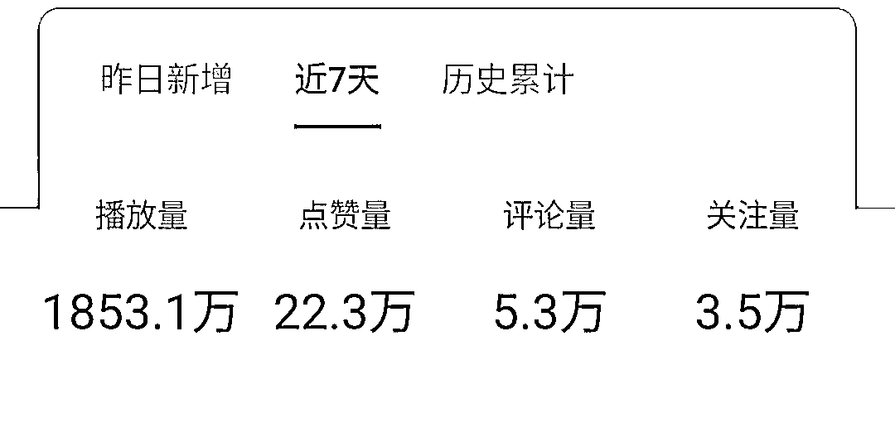

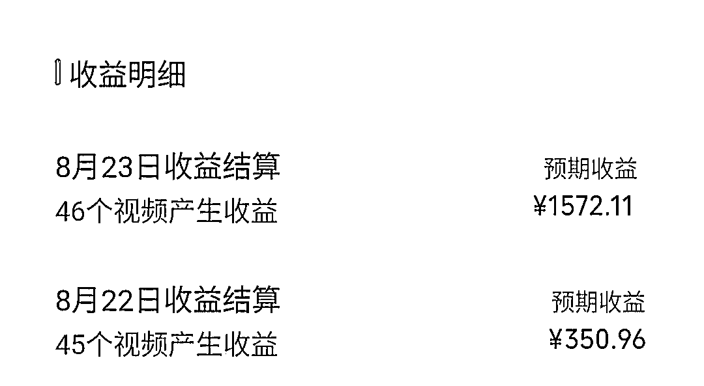

只要找到合适的赛道、坚持高质量输出、持续优化创作效率，拿到正反馈的概率就会不断增大。

内容来源：@流浪虎《视频号创作者分成收益怎么赚？追好热点，打造爆款视频》

### 1.2.2 优势与风险 @郭耀天

项目优势

目前「视频号分成计划」的门槛很低，只要有🛰️号、开通视频号就能参与。重要的是，收益来自商家广告，而不是平台直接发放。只要视频号整体流量走高、商家数量增加，广告收益的空间就会不断扩大，市场前景值得期待。目前真正下场操作的人不多，此前一直在视频号做原创内容的创作者吃到了红利，做得好的甚至一条视频就能赚上万。

视频号的增量空间还远没到顶，大量商家也尚未进场，所以现在入场是个不错的时机。尤其是新账号存在扶持期，前 3 个视频尤其明显，即使你是 0 粉账号，也有机会获得推荐和流量。

项目风险

这个项目的门槛低，有🛰️号、开通视频号就能做。如果你能做到每天投入 2—4 小时，对🛰️视频号用户有基本了解，手里有至少 1 个正常使用的视频号，并且会简单的视频剪辑、能在后期逐步提升创作效率，跑通项目的概率会很大。

与其强调门槛，不如来盘点一下风险：

风险一：账号可能一直不符合要求，迟迟无法开通创作分成计划
应对建议：提升原创视频的质量，或者尝试申诉开通，详见👉「3.1 如何开通分成计划」

风险二：开通创作分成计划之后被取消资格
应对建议：根据官方通知整改内容或账号，或进行申诉，具体见👉「3.3 分成计划被取消，如何恢复？」

风险三：赛道玩法调整、竞争者变多，创作难度随之变大
应对建议：保持对多种赛道玩法的关注，及时调整思路，详见👉「6.4 尝试多种赛道」

### 1.2.3 视频号分成计划能做多久？@白丁

判断一个项目能否长期做，最直接的逻辑是看它赚的是谁的钱。如果这个钱是腾讯直接补贴的，那么大概率做不长久——任何一家公司做项目，都会设置止损点，一旦触及就会停止投放。

而视频号分成计划，本质赚的是广告主的钱，腾讯在这个链条里同样获利。为了激励创作者持续输出，平台必须通过分成来维持动力。钱，才是一切行为的源动力。只要视频号流量一直可观，广告主就不会缺席，分成计划自然持续有收益，只是赚多赚少的问题。

因此，评估一个项目的可持续性，核心是看清它到底赚谁的钱。就像 7 月上线的支付宝分成计划，后来为什么没什么人做了？一开始还能见到收益，到后来收益一路走低甚至归零。原因很简单，因为支付宝分成计划给作者的钱实际上是

图 1

图 2

上面图中圈出来的部分，就是收益的核心来源：评论区广告展示。点击越多，收益越高，视频号分成计划赚的正是这份广告点击收益。

作者开通分成计划后发布视频，只要在发布时标注了原创，平台会通过大数据为每一位浏览者匹配广告。同一个用户反复点开同一条视频的广告，看到的也可能是不同内容。这些广告基本集中在评论区第 3 到第 5 条的位置，只要有人点击，该视频便有收益产生。

因为它是广告，所以背后属于推广费用，视频号、作者和投放方三者共赢。以图 2 为例：游戏厂商从点击卡片广告进入游戏的用户那里获取充值收入，腾讯向游戏厂商收取广告费，作者再从腾讯那里分得收入。这一层分配中，腾讯拿走 6 成，作者获得 4 成。

只要视频号流量长期在，广告主就不会缺，分成计划也就一直有得做，无非赚多赚少。总结来说，这个项目完全可以当作长期项目来做——视频号需要创作者，创作者也需要收入。

内容来源：@白丁《视频号分成计划娱乐解说玩法，一条视频一天 4815 元》

## 1.3 项目核心玩法 @郭耀天

### 1.3.1 项目核心步骤

先用一条简单的链路，梳理视频号分成计划的关键步骤：

选择合适/热门视频赛道（重要）> 注册视频号并完成包装 > 搜集视频素材 > 创作并发布视频内容 > 符合条件后开通创作者分成计划（重要）> 持续发布原创视频 > 产生收益并提现

看到这里你会发现：「视频号分成计划」最关键的节点只有两个——选对赛道，以及开通创作者分成计划。想要做好这两步，跟着本手册的分章讲解走即可，下面两章分别展开：

【项目实操 1/3】确定赛道，制作&发布爆款内容
【项目实操 2/3】开通分成计划，领取收益

开通创作者分成计划之后，剩下的就是持续发布视频（记得打开原创声明按钮）并不断复盘优化，借助堆量或堆账号的方式，放大爆款出现的概率，从而放大整体收益。

平台是鼓励原创的。这里的“原创”指的是平台尚未出现过的内容；如果你参考了其他平台的内容，但在视频号上还没有，同样算作原创，因此制作门槛并不高。即使是二次创作，也强烈建议做成原创，否则后期可能遇到不被推荐、不给流量，甚至被关闭流量分成权限的情况，严重时还可能封号。

制作内容时，尽量选择容易触发评论互动的题材。有些领域数据很漂亮、播放量很高，但收益却不理想，比如祝福类领域：流量巨大，用户多数是中老年群体，但因为广告难以匹配这些人群，收益往往偏低。

建议大家选择那些能激发用户“留言欲”的内容，尤其是评论量超过转发和点赞的领域，才更值得投入精力去深挖。例如“找不同”“看图找茬”这类玩法，把图片制作为视频，引导用户找出画面里的差异。这种内容的互动量极高，很多人会主动参与。

评论越多，点击广告的概率也就越高，收益自然随之增长。站在平台的角度想，多做用户喜欢的内容，才可能拿到更丰厚的回报。

### 1.3.2 视频号内容推荐机制

#### 1.3.2.1 推荐机制

🛰️视频号的机制和订阅号、服务号完全不同。它是一个全新的内容记录与创作平台，采用非中心化结构，推荐是核心驱动。

视频号承载的内容以图片和视频为主，既可以发布 1 分钟以内的短视频，也可以发布 1—30 分钟的长视频，最多还能上传 9 张图片，同时支持附加文字和👸号文章链接。更友好的是，它无需 PC 端后台，在手机上就能直接完成发布。

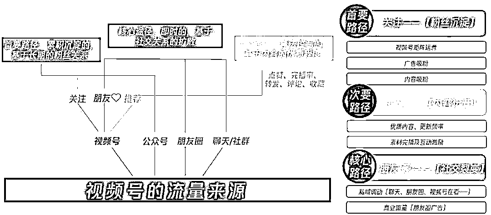

视频号目前正处于红利期。对于创作者来说，想在视频号里做出成绩、让内容被更多人看到，首先需要吃透平台最重要的流量算法和推荐机制，这样才能实现精准引流，帮助你放大业务增长。

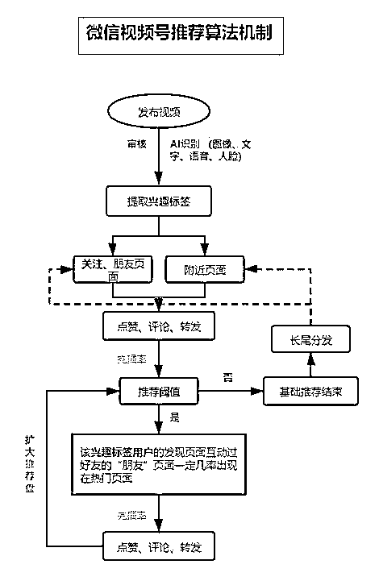

社交推荐

在🛰️的生态体系里，社交是先天基因。社交推荐的运作方式，是视频号根据好友的发布、点赞、关注、评论、转发等互动行为，优先为用户推荐相关内容。熟人关系链在🛰️视频号的推荐逻辑中占据了重要位置，从入口处的“关注、朋友、推荐”三个栏目即可看出。

其中：1. 关注栏——呈现你关注的人发布的视频号内容；2. 社交群推荐——展示好友点赞过的视频号内容；3. 兴趣算法推荐——系统依据你的兴趣标签来推荐内容。

除了社交推荐，平台还会给你推荐一些内容，相当于“猜你喜欢”。这部分推荐机制与抖音较为相似：

只要你的作品质量过硬，完播率和互动率保持良好，最终就会形成社交推荐与系统推荐之间的强回路。两者互为杠杆、彼此加持，社交推荐带来的正向反馈越大，系统推荐也会顺势增强，爆款内容便由此诞生。但需要留意：这个回路的启动，第一步要点燃的是第一波社交推荐。

同理，如果缺少初始播放量和互动数据，即使作品本身不差，也很难被系统捕捉到。所以创作者必须主动将自己的视频转发到朋友圈、🛰️群，请🛰️好友帮忙点赞、收藏和评论，为视频打下基础播放量，给增强回路一个启动的支点。

🛰️好友相对其他平台上的用户而言，是典型的强关系连接，因此“朋友赞过”本质上就是强关系内容推荐机制。

如今视频号首页设置为“关注”“朋友赞过”“推荐”三个入口，分别对应个性化兴趣、社交分发、系统算法推荐。单独设置一个“朋友赞过”栏目，正是视频号和抖音、快手最大的不同。

视频号的流量分发并不完全依赖算法。打开产品就能发现，“朋友点过赞的内容”被放在了相当重要的入口位置——官方显然想把熟人社交的能量注入推荐链路，用关系网把用户留在App里，而不是只靠机器猜测喜好。

拆解它的算法推荐，可以归纳成四条线索：兴趣偏好、位置信息、热点事件、随机流量。

① 兴趣偏好

🛰️本身就是一张巨大的社交网络，用户在这张网络里留下的行为痕迹，会被系统整理成多维度标签：性别、年龄、职业、城市、爱好等。系统再依据这些标签，从海量内容中筛选出用户可能喜欢的作品进行推送。这套机制几乎是社交平台做推荐的标配。

举个例子：如果一个人经常看旅游攻略类👸号，朋友圈动态也和出行高度相关，系统大概率会把他识别为旅行爱好者，持续推送相关视频。

② 位置信息

发布视频时，创作者可以挂上附近地点或人气城市。这个动作看起来不起眼，实际效果却很直接——作品能快速触达同城人群，把本地注意力圈进来。挂上位置后，内容除了在本地扩散，还有机会被系统额外筛选出来，推荐给对该地区感兴趣的用户。反过来，平台也会参考用户的位置环境，优先把同城内容放进信息流。可以说，位置这个变量背后，藏着不少可以延展的玩法。

③ 热点事件

能引发全网讨论的事件，天然就是注意力磁铁。平台会把热点和用户兴趣结合起来：先圈定与目标用户品味接近的一群人，再参考这群人对热点内容的评价，预测目标用户是否买账，最后把优质热点内容精准送出去。

系统推荐

但真正决定作品命运的，还是系统的主动分发。一条作品的数据表现足够好，系统就会把它送进更高级的推荐池；数据持续上涨，池子也会越换越大。具体分三种情况：

① 新作品发出后，会先出现在已关注粉丝的信息流里。如果这些粉丝不感兴趣，作品就只拿到一次基础阅读，无法触发更高级的推荐；但往后它仍有可能被系统重新拾起。

② 一旦有用户表现出兴趣，也就是点赞、转发或评论，分发就会被激活；尤其是多位用户同时留下评论时，作品会升入更大的内容池，权重随之走高，被推荐的概率也明显提升。

③ 互动频繁的🛰️好友之间，会形成一条隐藏的推荐通道：A关注并经常浏览的视频号内容，可能出现在B的推荐列表里。如此一轮轮滚动，熟人的关系网逐渐变成裂变引擎。

综合来看，社交权重在视频号推荐体系里占比相当高。这也意味着，那些好友量大、社群多、还握着👸号等私域资产的人，做视频号推广拥有天然优势，成为头部的可能性也远高于普通人。

#### 1.3.2.2 平台内容审核机制

所有内容平台都有一道自己的审核关卡，视频号也不例外，目前执行的是“机器＋人工”双重审查。

机器审查：平台提前布下AI模型，扫描视频画面和文本关键词，判断作品是否踩线。违规程度较轻的，可能被降低推荐、删除，或改为“仅自己可见”；情节严重的，直接删除或设为自我可见；如果机器拿不准，就会转入人工复审。

人工复审：机器圈出来的疑似问题内容，会由人工再做一次判断，核查重点集中在三处：视频标题、封面、关键帧。一旦确认违规，处罚包括删除内容、降权通报、封禁账号。

# 二、【项目实操 1/3】选赛道、产内容、发视频

💡 章节导读

搞清楚视频号创作者分成计划的整体玩法之后，我们就要正式动手了。这一章里有两个开跑前的必备条件，外加一个决定收益的实操重点。

前提一：赛道必须选对。详见2.1，这部分会围绕视频号用户的内容偏好，讲清楚怎么挑一个适合下场的领域。为了降低选择成本，还直接给出了两个推荐赛道，可以先从它们入手试水。

前提二：账号得先备好。详见2.2，从电话卡申请、🛰️注册、登录设备，到视频号正式开通，四个环节全部覆盖，新手建议仔细过一遍，把基本功打牢。账号开通后，可以去参考同赛道玩家的资料设置，把自己的头像、简介等一并布置好。

🔥 实操重点：照着热门赛道做内容并发布。详见2.3，内容质量直接决定你能不能拿到视频号创作者分成计划的入场券，更决定这个项目能给你带来多少收入。所以这一节把方法论和操作步骤都摆了出来，跟着走，就能产出第一条视频。

内容做完，就可以上架发布了，详见2.4。

这一章的目标很简单：做出满意的作品，跑出不错的数据。现在就开始吧。

💡 本章路线图

学完并做完这一章，就能通关航线图的第一阶段，按下面的清单执行：

第一阶段：定赛道、做内容、发视频（约3-5天）

1. 刷视频号找感觉，圈定适合自己的热门赛道，每天至少15分钟；
2. 注册至少1个视频号，把账号包装好，约30分钟；
3. 搭建素材库，音乐、文案等持续往里存，每天约30分钟；
4. 照对标素材模仿，每天至少产出1条视频，约1小时；
5. 发布时选对内容领域，给视频打好标签，约10分钟。

清单跑完，就正式进入第一阶段的实操了。

2.1🔥挑赛道 @白丁

📌 小节导读

这个项目的节奏是：选对赛道，后面才省力。别指望有完美赛道——娱乐方向数据、收益都在线，但难点是找到能爆的明星和话题，还得时刻防范话题风险；也别指望一个赛道吃到老——早期可能涌入的人少、竞争小，等玩家多起来，就该考虑换阵地。

✅ 通用的选赛道方法论，见2.1.1；✅ 一个新手也能直接上手的赛道，见2.1.2。

多看多想多延伸，说不定你能在别人没留意的地方，找到属于自己的一块新地图。

💡 本小节任务

跟着本小节的思路，先完成路线图第一阶段第一项：每天至少花15分钟刷视频号，锁定适合自己的热门赛道。

准备好了，就去找那个合眼缘的方向吧。

### 2.1.1 挑赛道要盯住三个维度

在视频号分成计划这个项目里，选择的分量重过努力。赛道基本划定了收益天花板——选错方向，再拼命也难有结果；选对方向，正反馈来得快，上限也高。

怎么挑？主要看三个维度。

1. 收益逻辑

先弄明白钱是从哪儿来的。不少人的直觉是：播放量做起来，收入自然跟着来。这个思路放在抖音的中视频计划里成立，但放到视频号分成计划里就走不通了。

看下面这张图：

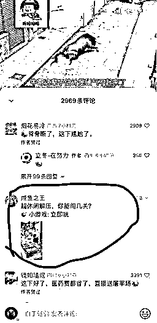

红圈圈住的位置，就是一张广告卡片。视频号分成计划的收入，全部来自用户对这张卡片的点击。用户刷到你的内容，在评论区点进广告，你才有钱拿；只看视频、只看评论区而不点卡片，一分钱收益都不会产生。

这就是视频号分成计划的真实变现路径。顺着这条路径想，影响收入的因素就很清楚：评论活跃度、人群属性、广告类型。所以布局赛道必须顺着收益逻辑来——就算播放量都做到100W，换一个方向，收入差距可以拉到5倍以上。

2. 点赞评论比

点赞、评论、收藏、转发，在任何短视频平台都是爆款的核心指标，视频号也不例外，选赛道时这些数字一定要多看。我做这个项目，重点盯的是点赞评论比。原因不复杂：点赞决定内容能拿到多少推荐量，评论决定广告卡片的展示次数，一个管流量，一个管收益。实操中我发现，有些赛道数据很亮眼，收益却不好看，比如老年祝福类内容，播放动辄几百万上千万，评论也不少，收入就是上不去，问题大概率出在受众年龄层上。

3. 同行数据参考

一个赛道还没跑出结果之前，别闭眼硬冲。同行就是最直接的参照系——这个方向能不能做，人家已经把答案摆出来了。去搜一下赛道关键词，看看数据就明白了：流量平淡、评论寥寥的赛道，基本不值得投入。

一个赛道能同时满足这三点，就称得上优质赛道。

内容来源：《视频号分成计划娱乐解说玩法，一条视频一天4815元》@白丁

### 2.1.2 新手试水：从娱乐赛道开始

📌 这一节怎么用

“试水”的意义，是把行动门槛降到最低，先让你快速找到一点正反馈，把项目信心立起来。了解基础玩法之后，一定要主动去探索自己真正感兴趣的方向，大胆尝试新玩法，说不定你就是第一个尝鲜的人。如果一直守着一个赛道不动，跑通项目的概率，大概率低于那些愿意多赛道轮转的人。

为什么首推娱乐赛道？

因为娱乐内容的流量表现一直在线，碰到爆款话题，出爆的概率不低；而且娱乐受众更愿意点开评论区，广告收入也更有保障。

⚠️ 特别提醒：娱乐类视频真假难辨，真实性必须自己把关，不传谣、不造谣、不触碰法律红线，所有创作都要在合法合规的范围内进行。

视频号能不能爆，关键就看有没有爆点。从实操经验来看，娱乐赛道里的爆款明星、爆款话题其实有迹可循，甚至可以说完美复现的概率不小，真正的难点在于怎么把这些明星和话题找出来。

娱乐内容的制作门槛也很低：把爆款话题拿过来学一学、改一改，借助GPT这类工具改稿，配上剪映的配音，再添加视频素材，一条作品就出来了。

内容来源：《视频号分成计划娱乐解说玩法，一条视频一天4815元》@白丁

## 2.2 账号准备与视频号注册全流程 @郭耀天

视频号长在🛰️生态里，一个🛰️只能对应一个视频号。换句话说，🛰️号就是视频号的地基，手上🛰️号越多，能开的视频号就越多。

注册🛰️号需要辅助验证，这个按官方提示操作就行——可以找身边熟人帮忙辅助，电话卡去营业厅办理，也可以用虚拟账号完成注册。

### 2.2.1 第一步：电话卡渠道盘点

移动用户可以用“和多号”App开小号，能用来注册，但注册🛰️时会有限制；联通有小号业务可选；电信部分地区同样支持小号注册；另外还有中国广电可以尝试。

把上述运营商都算上，每家各办5张卡，一个人就能拿到20张，基本够用了。如果还需要更多，直接找身边的家人帮忙注册就能解决；如果是团队或公司操作，就让团队成员统一去办电话。

### 2.2.2 第二步：搞定🛰️号

注册🛰️号眼下确实比以前繁琐，需要辅助验证。操作也没多难：请身边的人搭把手就行，七大姑八大姨都是现成资源。

但要注意，注册完的账号需要养号，也就是模拟正常人的使用习惯，比如常刷刷视频、发发朋友圈。不过只要不加人，单独用来注册视频号问题不大，刚注册的🛰️号也能马上开通视频号。

我们团队测试过很多账号，走的基本都是这条路。视频号现在确实处在一波机会里，能多注册🛰️就多注册，先把视频号开起来再说。

### 2.2.3 第三步：设备与登录方案

账号一多，登录就成了问题。一台手机本身可以登录五个🛰️：

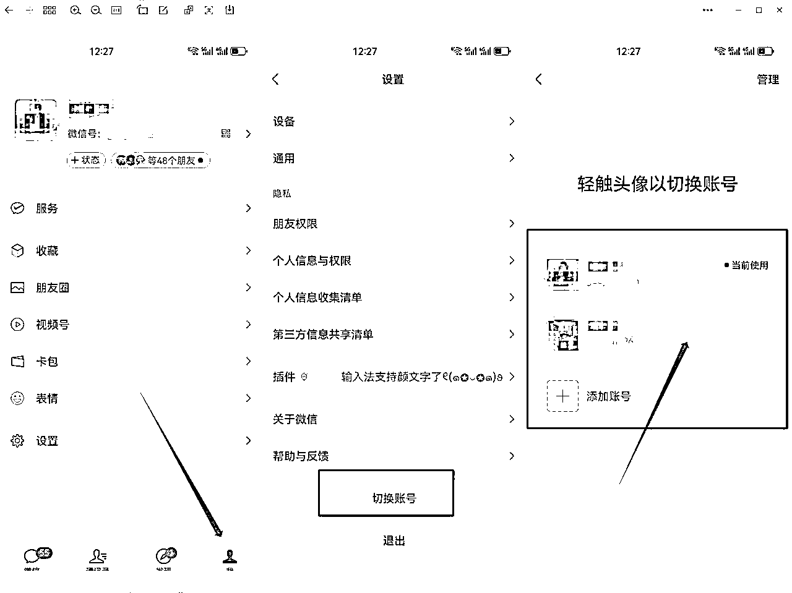

苹果手机可以定制多开版本；安卓则可以使用第三方开发的🛰️多开软件，比如我目前在用的双开助手：

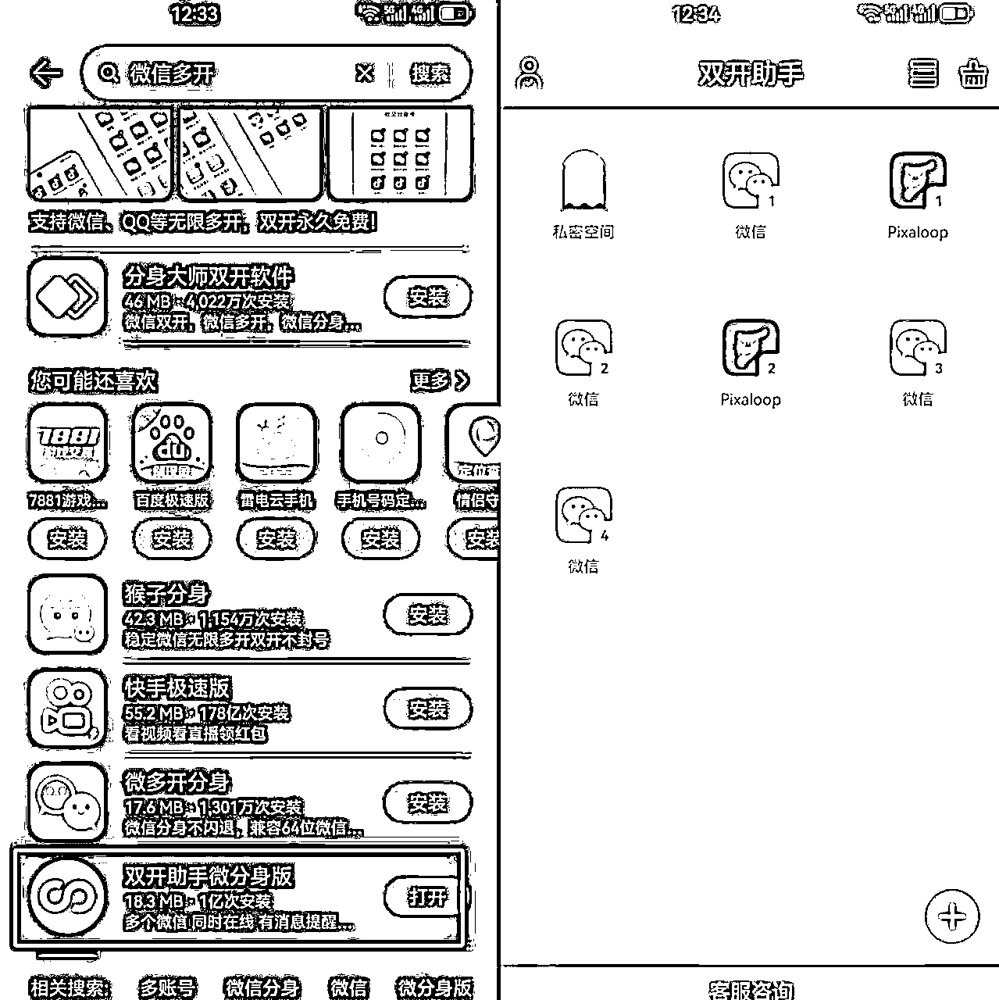

能解决多账号登录的工具都算数。不过多开有封号风险，最稳妥的方式还是多备几台手机。

单看手机的话：华为能登录两个🛰️，小米可以登录两个，摩托罗拉可以登录六个；另外还有一些营销手机支持多🛰️登录，比如联想拯救者也可以。这里不展开讲，具体按自己的实际需求来。

### 2.2.4 第四步：正式开通视频号

前提是🛰️号已经完成实名认证，这一步就不多说了。

操作路径：打开🛰️，进入“发现”→“视频号”，点右上角的小人图标，进入个人主页：

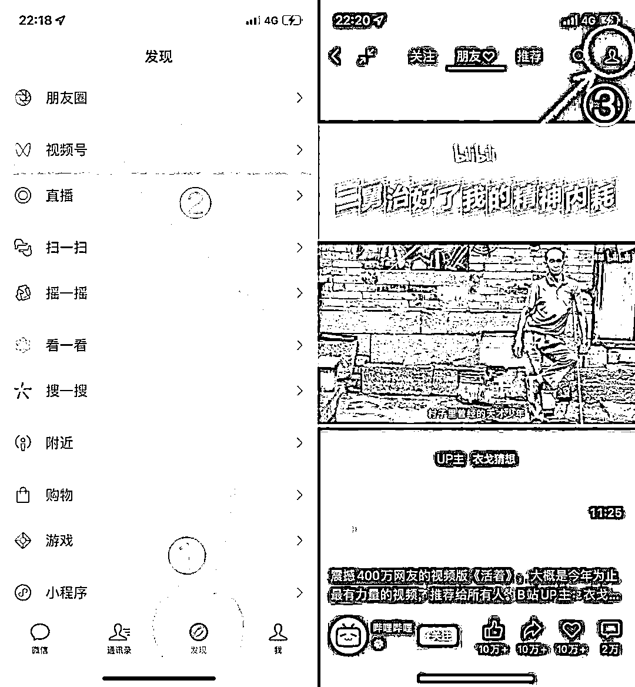

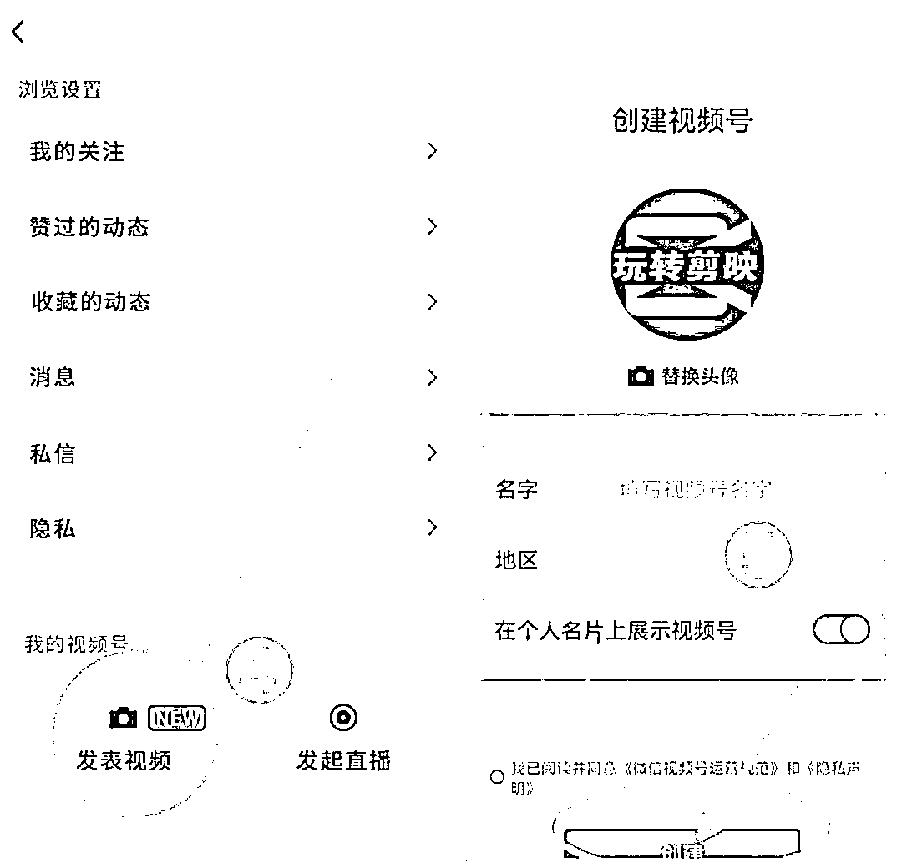

到这里，视频号就创建成功了。

创建完成后，点击右上角的三个点→“资料设置”，就能修改个人信息，并完善视频号简介：

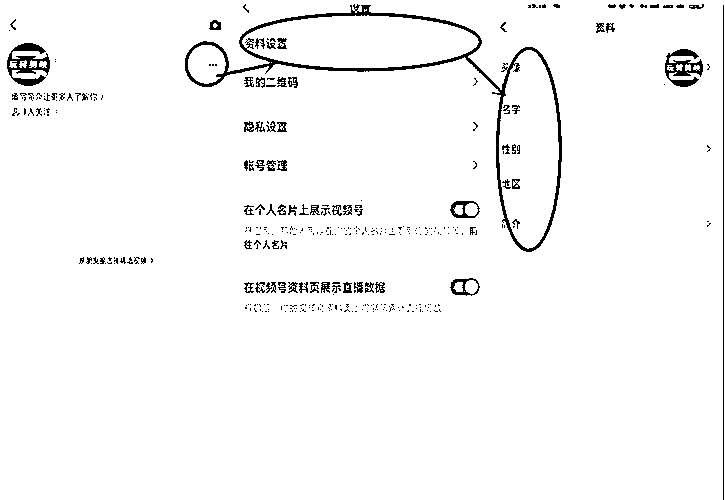

有一个细节要留意：视频号的昵称和👸号一样，先到先得，不能重名。每个账号每年有5次改名机会。如果心仪的昵称已经被占用，可以走申诉流程，或者在名字后面加点、加符号再申请。如果确实需要用自己的名字，并且你对该名字有使用权——比如持有商标、注册较早的👸号，或拥有著作权——也可以尝试申诉。

一般情况下，参考对标赛道的同类型账号，简单设置视频号信息就够了，不用在这个环节耗太多时间。

2.3🔥爆款内容创作法💡

💡 小节导读

内容决定成败。找到对味的方向，既能更快达到开通分成计划的要求，也能在开通后更快看到收入。按实操经验，一条好内容，十几秒就能带来上千收益。

视频号的内容算法并不透明，但容易出爆款的作品，基本能从六个原则里找到影子：说人话、给强刺激、有共鸣、给价值、够真实、贴热点。找素材、写文案时，可以反复对照这几条。

为了让你们对“好内容”有更直观的体感，这一节分三块拆解：
✅ 内容形态有哪些；
✅ 热门内容的关键要素；
✅ 完整做出一条热门赛道视频。

开始吧。

💡 本小节路线图

完成本小节，对应航线图第一阶段的第三、四件事：

持续扩充素材库，音乐、文案等都要收，每天约30分钟；对着对标素材模仿，每天至少产出1条视频，每天约1小时。

现在，去找合眼缘的方向吧。

### 2.3.1 内容形态盘点 @郭耀天

视频号目前可以发视频，也可以发图文。

视频的形态很多：真人出镜、混剪、二创、AI生成等。对大多数普通玩家来说，重心集中在混剪、二创、AI制作这些不需要露脸的模式上。

图文同样值得重视。视频号图文最多可以发9张图片，别小看它——有些作品就是几张图配上热门BGM，照样能成为爆款。

### 2.3.2 爆款内容的共性规律 @郭耀天

做内容，第一原则是垂直。今天发美食、明天发科技、后天发情感，账号就会变成四不像，粉丝标签也会一片混乱，后端的商业变现阶段寸步难行。

打个比方：买衣服时，大家更愿意走进专卖店；如果一家店衣服、鞋子、首饰全都卖，很多人反而会犹豫——品类太杂，容易显得不专业。内容账号同理，与其求全，不如做精。把视频号当成一家店去经营，认准一个方向深耕下去。

那爆款是怎么来的？说实话，内容优质只是地基，能不能爆，很大程度看运气。

先看心态和更新节奏。

坚持，是内容创作者最重要的心理素质。有人总结得很到位：上班实习要三个月，开实体店守店要一两年，凭什么你发几条视频就等着爆？既然热门算法难以捉摸，不如用数量去对冲概率——能日更就坚持日更，能发5条就别只发3条。

内容策划同样属于“地基工程”。短视频平台有一条铁律：三秒钟定生死。用户划走一条视频的成本几乎为零，能不能在前三秒抓住人，直接决定作品的命运。

判断内容好不好，要同时过两把尺子。

用户的尺子：有故事感、不费脑、画面好看。平台的尺子：不跟风同质化、标签与账号定位一致、价值观正确，同时还要尽量延长用户的观看时长。

爆款内容的六条共性再强调一遍：大白话、明确刺激、情感共鸣、价值体现、真实靠谱、热点相关。热门视频往往一看就懂，不需要用户动脑，还埋着未知的刺激点——比如开头三秒就抛悬念，或者放出一段充满误解的对话、一个冲突场景。

情绪价值也是关键。热门视频尤其擅长在真实与真诚之间，把快乐、悲伤这些情绪传递出来，让用户觉得“被戳中”。这里的价值不一定是多宏大的立意，能帮用户消磨时间、获得认知、寄托情感，通通都算。

每个赛道能爆的话题和素材类型，往往就那些；能把情绪价值拉满，就是爆款的不二法门。而且，在抖音等平台已经被验证过的爆款话题，搬到视频号里，火起来的概率同样很大。

最后补充一点：视频号最近比较受欢迎的内容类型，整理在下面了。

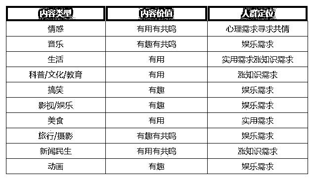

### 2.3.3 实操：做一条娱乐赛道视频

⚠️ 再次强调：娱乐内容是是非之地，真实性务必自己判断。不传谣、不造谣、远离法律风险，在合法合规的范围内创作。

下面是娱乐赛道视频的完整制作流程。光看教程，满眼都是问题；亲手做过一回，答案自然出现。行动比什么都重要。

#### 2.3.3.1 分步操作指南 @流浪虎 @白丁

第一步：锁定当日热点

找热点的方法，赚钱里的教程讲得很多，这里不展开，核心就看两个地方：抖音热榜、🧣热榜。热搜刷多了，规律自然浮现——比如早前李佳琦的眉笔定价风波、西门子报警、蜂花下场捡粉的商战；华为Mate60上市、国产芯片突破；日本启动核污水排海；国足门将喝水名场面……都是现成的例子。

但有两条线千万别碰：一是政治军事类，比如某国领导人访俄；二是擦边的敏感事件，比如深圳北极鲶鱼那件事。这类内容一不小心就会踩到红线，封号还算是轻的，搞不好要请去“喝茶”。

第二步：搞定热点文案

热点确定之后，接下来就是文案。可以自己写，也可以二改。这里给出三种取巧的办法。

方法一：去抖音搜同一热点下的爆款视频，优选口播形式，用工具提取文案，比如轻抖，提取完稍作修改，替换成自己的表达。

方法二：打开360浏览器，首页内容基本都是热点，但那些是长文章，需要压缩成短文案。可以用ChatGPT改写，也可以用度加剪辑的AI成片功能，尤其推荐里面的“AI改写”（官网链接：https://ducut.baidu.com/）。

方法三：

视频号分成计划想见到收益，先把下面这套打法跑顺。第一步离不开文案：去🧣抓现成的热门话题，用自己的话重新说一遍，篇幅压在两百到三百字，最多别越过五百字。

文案落定就进入拍剪环节。打法讲究规模化，靠条数去撞命中率，不必精雕细琢，一条片子最好十分钟内收工。

其一，真人出镜开口讲。找个户外场景，边走边说，操作不难，拼的是镜头前的感染力。

其二，图片加背景乐。单张画面搭一段音乐，照样有冲上热门的例子，成败多半压在文字功底上。

其三，做成剪辑片。①先把写好的稿子放进剪映配音，生成音轨，再匹配与内容对味的热门画面：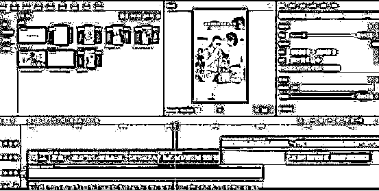；②接着做去重加工，手段包括特效、贴纸、参数调整：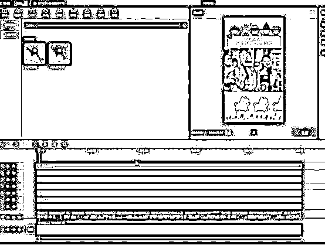。我们习惯把对比度和饱和度设成10、锐化给到30，实际还要看原片明暗随时改。

上面这套娱乐向视频的走法，眼下是跑得通的。关键在随机应变，平台规则一调整，动作也跟着换。

内容来源：《视频号创作者分成收益怎么赚？追好热点，打造爆款视频》@流浪虎、《视频号分成计划娱乐解说玩法，一条视频一天4815元》@白丁。

#### 2.3.3.2 原创这条线不能踩 @郭耀天
参与分成计划，一手原创当然最稳；退一步做二创，也要让平台觉得你有原创成分。不然往后推荐会被压、流量起不来，开通权限还可能被收回，极端情况账号都保不住。所谓原创，说到底是平台上还没出现过的内容；哪怕素材来自别处，只要视频号里没人发过，同样能被认作原创，门槛并没有想得那么吓人。原本就拍原创的，放心直接发；打算混剪、参考同行的，先把后文的视频做法走一遍，再去开通分成计划。

还没开通的阶段：平台明显偏爱原创，违背这一点，后续很可能限流、掉推荐，严重时封号；账号内容要聚焦，一个号只服务一个赛道；产量要跟上，能天天更新就别断，用条数换概率。计划开通之后：原创、聚焦、高产这三条继续守住，选题上优先挑能勾出评论的方向；多从平台立场出发，做用户愿意看的东西，收益和结果才会往好的方向走。

## 2.4 内容发布怎么做 @郭耀天 @黄岛主
发作品并非只能靠手机，电脑端同样可以操作。

### 2.4.1 手机发布路径
手机上有三条路可走，这里挑两条常用的讲。第一条，从发现页进。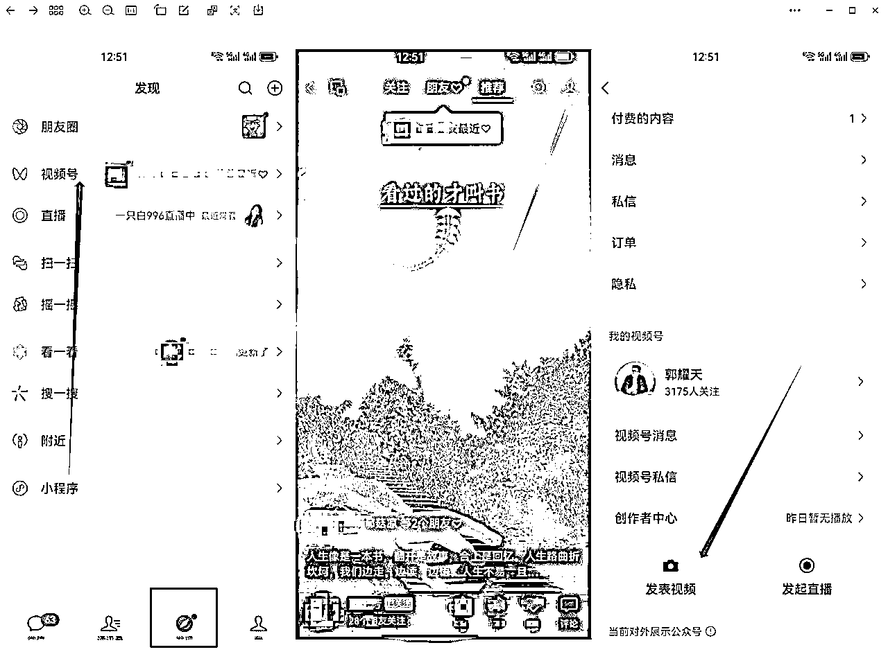 打开🛰️，点“我”，进入视频号，发布页面就出现了。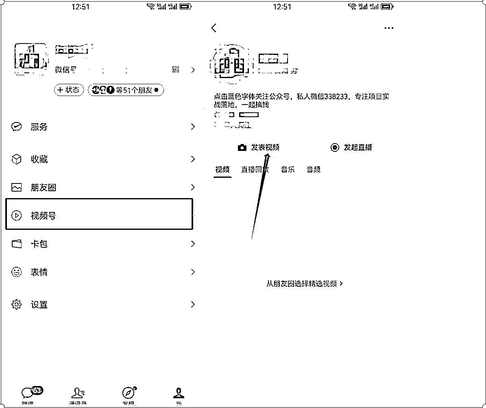 第三条，用剪同款。碰上带特效的片子，可以直接套用同款模板发布；该入口并非每条视频都有，看到同款按钮再去试。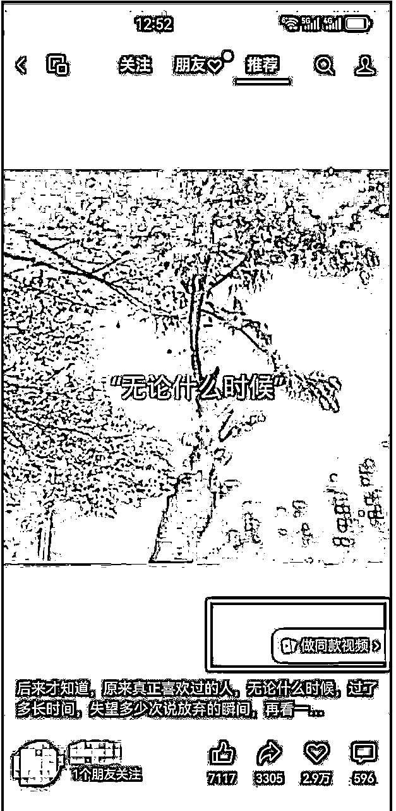

### 2.4.2 电脑发布路径
电脑同样能上传作品，而且支持预约时间。若片子本来就在电脑上剪好，走电脑端省去传输麻烦，打开视频号助手登录：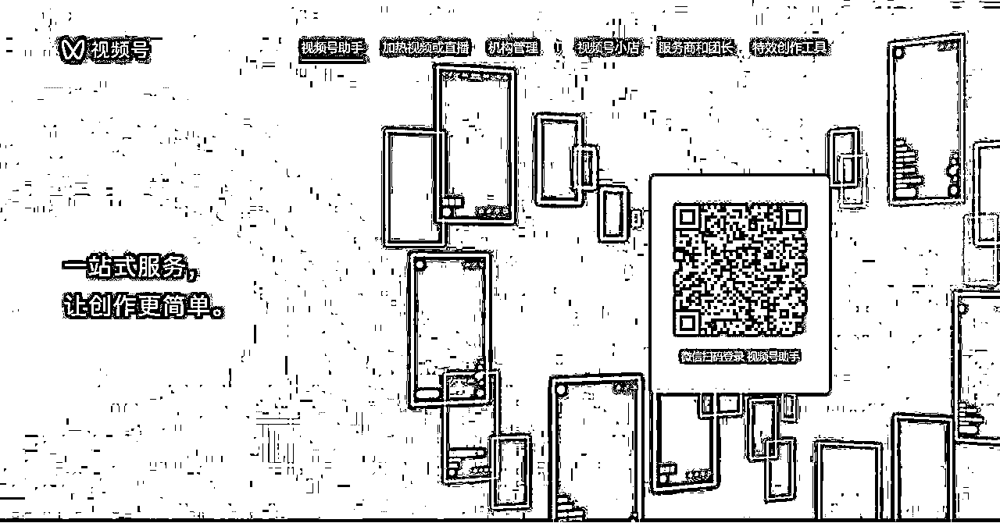 进入首页后，在“内容管理”板块就能把视频发出去。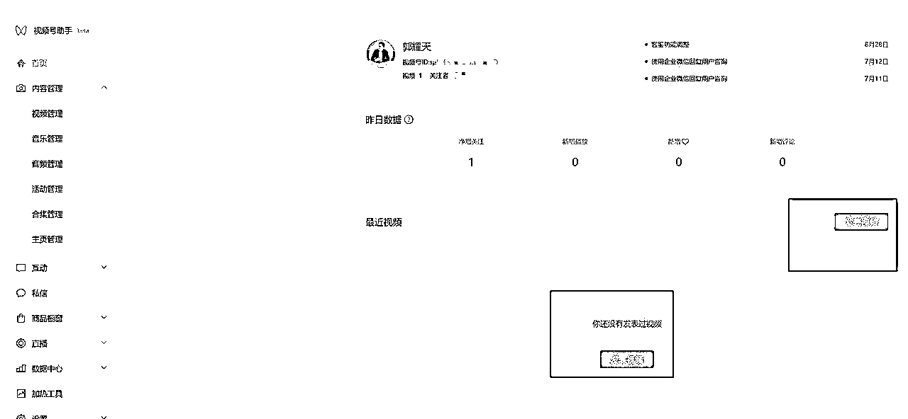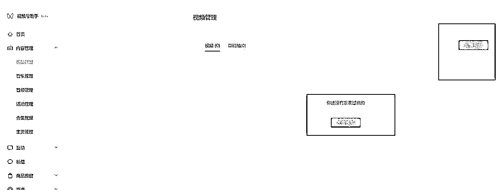

### 2.4.3 发布环节的窍门
#### 2.4.3.1 通用要点
头等大事：计划开通以后，发布时务必勾上原创！加入「创作者分成计划」之后，作品必须带原创标识，不然收益一分没有。圈里有人一条片子冲到六百多万播放，偏偏漏了原创开关，粗算少拿两千元左右。起步阶段也可以先勾原创，不过部分账号初期压根没有这个按钮，无需硬求。

更新节奏与时段：养号初期，单个账号每天丢五条出去试水，切忌一口气连发，间隔一两小时更稳妥；五条都没起量，可以再补一两条。精力允许就多铺几个号：一部手机能挂五个账号，一张身份证可认证五个，风险别全压在一处。白天发布更友好，早上七点到晚上九点这个区间比较合适；太早晨用户还没醒，太晚大家已休息，数据通常不好看。

标签、标题、封面和定位，照着同赛道账号的写法来：标题别绕，标签对题，封面挑顺眼的。想再进一步，可以加上位置信息，多一个曝光口。加话题的方式是在「添加描述」里敲「#」。拿早安祝福举例，领域填情感或生活都行。作品发出后，主动转到朋友圈和🛰️好友，把播放和点赞拉一拉。如果上一条正在起量，先别急着发新内容，等那条爆款的流量走平或慢下来再动手，否则容易把推荐打断。发布完成再去评论区留两条话；计划开通后，自己评或拿小号评都行，广告会来得更快——眼下评论区至少两条评论，广告位才可能出现。发布部分参考《视频号儿女祝福流量变现副业，起号后单天收益1000+，实操一条龙玩法分享给你》@黄岛主。

#### 2.4.3.2 摸清推荐节奏
一条作品发出后，系统会给六轮推荐，节点分别是3、6、18、24、24、24小时。也就是说，发布后的第3、第6、第18、第24小时等时间点，平台会自动给一波流量。头3小时被称作“黄金三小时”，这段时间执行要狠：朋友圈、互助群、红包群统统调动起来，把完播、点赞、评论尽量顶上去。到了48小时和72小时以内，还会有第二次灰度推荐。72小时之后，播放、评论、点赞、收藏仍在涨，那基本可以判定上热门了，后面平台会持续反复推。当下的机制里社交权重不低，好友基数大、社群多、手里有👸号等私域池的人，更容易冲成头部账号。

#### 2.4.3.3 如何不让🛰️好友看到视频号
不想让通讯录里的人刷到自己的作品，可以关掉展示。操作：点视频号右上角的三个点，进入「在个人名片上展示视频号」，关闭开关，🛰️好友便看不到你的视频号了。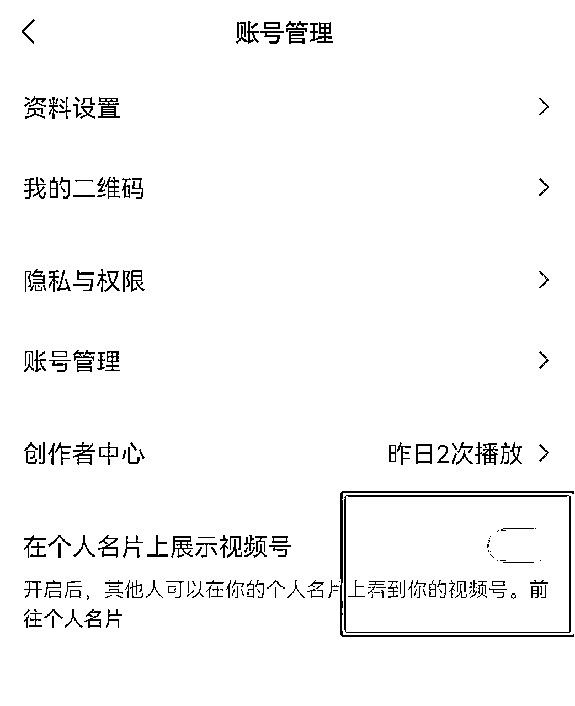

# 三、【项目实操 2/3】开通分成计划，收益落袋
本章重点：把创作者分成计划开出来，是整个项目最关键的一步；计划没开，后面发的作品就没有广告位，收益无从谈起。第一阶段已经跑完创作与发布，持续重复这套动作，就能慢慢凑齐开通门槛：①有效关注人数（粉丝）达到100或更多；②内容符合规范，平台更青睐优质原创、画面精致、真实正向的作品；③具备优质原创作者身份。达标之后具体怎么开、有没有更快的路子，看3.1；收益到账怎么取、提现出问题怎么办，看3.2；计划被取消如何恢复，看3.3。

本阶段路线图：整体大约5到7天走完——先花20分钟摸清分成计划与收益逻辑；再用10分钟完成开通；接着对照标杆素材，一天产出两到三条视频（每天建议投入2到3小时）；发布时打开「原创声明」，有收益后提现（约30分钟）。看完就可以动手了。

## 3.1🔥开通分成计划的方法 @郭耀天
### 3.1.1 需要满足什么条件
账号起步阶段很要紧，起号没起好，开通进度就会被拖慢。眼下想开通分成计划，得同时满足三条：粉丝数有效关注达到100及以上；内容符合平台规范，也就是优质原创、画风精美、真实正向；作者本身属于优质原创。企业号、政务号、媒体号暂时不在支持范围内；项目仍处内测，平台会分批向优质原创作者发出邀请。粉丝和原创这两项相对容易，“符合规范”“优质作者”官方却没给明确尺子。我们能做的，是尽量抬高通过概率：第一，内容保持垂直；第二，坚持原创，至少让平台判定你是原创；第三，画质清晰到720p以上，画面别抖、别闪。纯原创的号只要方向够垂直，基本不会卡；做二创的，则要在片子里多堆元素，比如配音、多段拼接、贴纸、字幕、转场、特效等。有人担心一直开不通是不是白费功夫？其实每拆一个项目、每分析一条赛道、每复盘一个案例，都是在替自己找合适的方向铺路；分成计划也许正好适合你，也许只是块试金石，不妨先照教程试一轮。从实际情况看，不少人最终都开出来了，区别只在赚多赚少；开头可能几毛钱，慢慢到几十、几百，甚至几千。别急着灰心，下一条作品很可能就是爆款。

### 3.1.2 开通的具体步骤
第一步，找到入口并提交申请。路径一：账号达到平台要求时，进入「创作者中心-创作者服务-创作分成计划」就能看到，点「申请加入」即可。 补充一句：暂时没收到邀请的，继续正常更新，等邀请到了，入口自然会出现。路径二：盯紧开通提醒。内容起量后，平台会推来不少消息，私信要重点看；若私信里出现相关提示，点进去申请权限就行。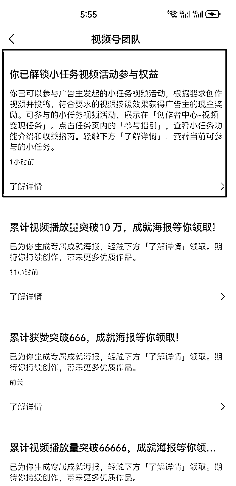 顺便说清，视频号没有“养号”这一说，注册完立刻发也没问题；我们操作的号第一条就爆了，第二天计划就开通。按路径二去申请，一天内开通也有可能，前提是内容足够垂直，多发几条就过。开通只是起点，真正的目标是开通后持续做出爆款、把收益拿回来。
第二步，发布原创作品，广告自动出现。加入计划后，发视频时勾上「原创声明」，其余不用额外操作，评论区下方就有机会挂出广告。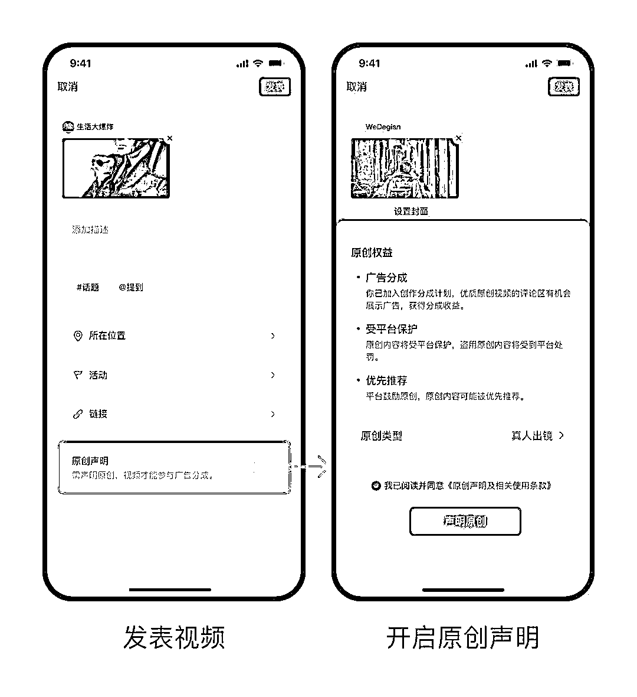 已经加入计划的，可以在「创作者中心-创作者服务-创作分成计划-参与收益中的视频」里查看。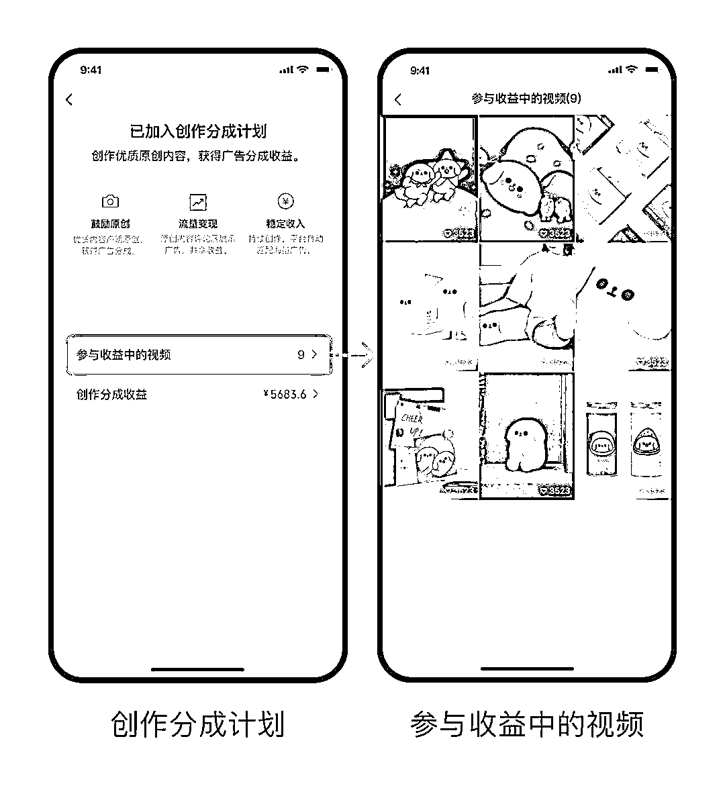

### 3.1.3 怎样更快开通分成计划
常规流程之外，还有几条提速思路值得试：
### 3.1.3.1 靠优质内容拿渠道邀请
这属于内部邀请：只要内容原创且质量过硬，粉丝多少不是硬门槛。真把内容做起来，100粉根本不算难题。优质的标准是画面清晰度720p以上、时长不少于15秒、内容垂直且有导向、镜头稳定不晃。
### 3.1.3.2 先把自己做成优质作者
这是目前多数人采用的起号路径，速度略慢，但胜在稳。先传五到十条随手拍，发布期间勤看后台提醒：进入创作者中心，找到创作者服务，再点收入变现，看看“优质创作者”的内容规范有没有满足。一旦显示「满足内容规范」，立刻去剪目标赛道的爆款，发出去把粉丝涨起来，就能快速开通。发布间隔可以一两小时一条；我们测试时一天五条、两天十条，直接达标。想再快，可以找活粉凑够100，比如请人关注，满100马上点申请；但这有违规风险，怕出事就老老实实靠内容涨粉。注意：做这些动作时千万别互相关注，否则粉丝数明明够了，系统仍提示不足——平台会查刷粉，而且互关账号的粉丝重合度太高。
### 3.1.3.3 先涨粉再起号
这是速度最快的一种。新号前三条内容有流量扶持，直接发成品，粉丝到100后检查原创等规范是否达标，达标就申请；不达标就随手拍些原创补一补。我们实测：新视频爆了并且粉丝过百后，再发一条以上随手拍的原创就通过了。缺点是一开始就得把账号定位想清楚，后面改起来麻烦。涨粉除了做爆文，还能靠直播，或者在“问一问”里切到视频号回答问题；100粉并不难，一条视频起来涨几千上万都正常，动作要快。如果上面几种方式都显示未达标，就继续拍相关视频，最好是随手拍的原创，再往目标领域制作；随拍同样要清晰720p以上、时长15秒以上、不抖不晃、内容垂直有导向。
### 3.1.3.4 两条线同时推进
内容本身够优质，就直接发成品，涨粉和原创优质两个条件一起满足，随后申请开通创作者分成计划。
### 3.1.3.5 走申诉通道
原创发到十多条仍未达标，可以提交申诉，多数情况下能成功。只要内容始终是原创，直接申请申诉即可。申诉地址：https://channels.weixin.qq.com/pandora/pages/appeal/index#account-detAIl （需在🛰️手机端打开；若链接请求异常，可去项目禁言群公告里找入口）。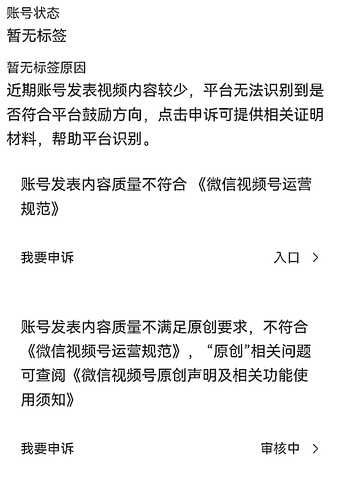

## 3.2 收益怎么领 @郭耀天
### 3.2.1 分成收益如何计算
腾讯并未公开一套清晰的算法：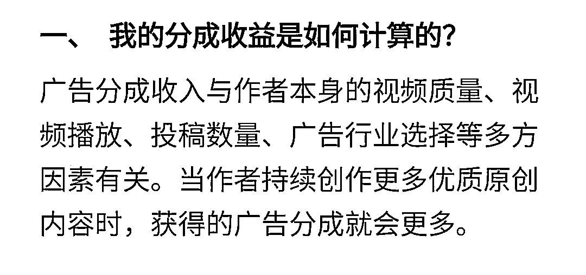 按经验估算，一万播放大约对应一元，实际还要看广告点击率；有时候播放量很漂亮，但没人点评论区广告，收入照样上不去。广告分成受视频质量、播放量、投稿数量、广告行业选择等多重因素影响；持续产出优质原创，分成才会逐步增加。
### 3.2.2 收益在哪里查看
进入「创作者中心-创作者服务-创作分成计划-创作分成收益」即可查看，具体口径页面上有说明。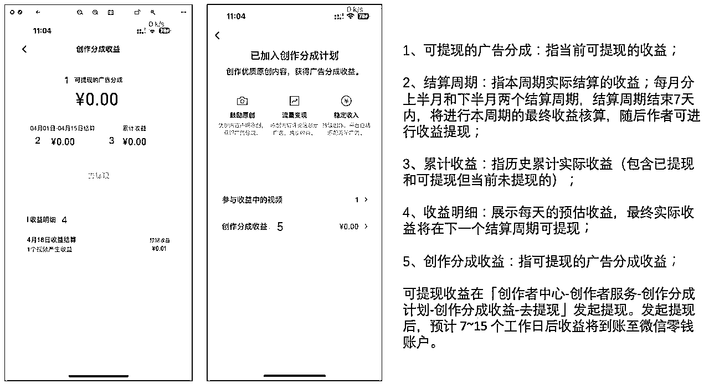
### 3.2.3 收益如何提取
路径：成功发布原创视频的次日起，进入「创作者中心-创作者服务-创作分成计划-分成收益」看每日预计收益，点「去提现」，钱会进入个人🛰️零钱包。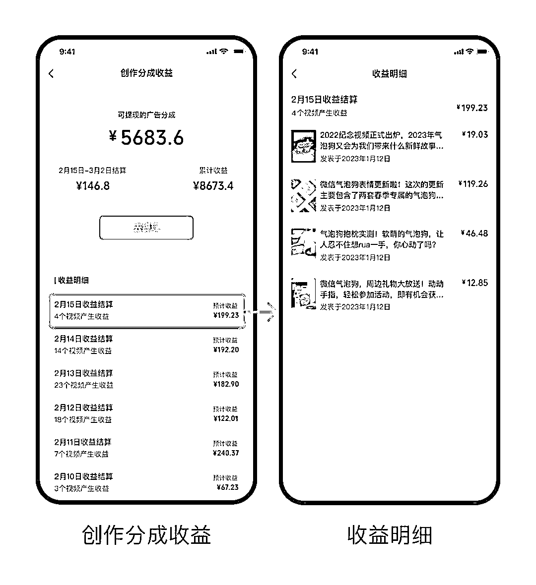 到账节奏：每月收益分两次结算（遇法定节假日顺延）——上半月的收入在当月22日可提现；下半月的收入在次月7日可提现；提现后通常立刻到账。个人身份操作，扣税最高可能到40%（有老师实操几百元时并未扣税，可以自己试一下）；第二年可在个人所得税APP申请退还，具体看收入情况，收入过高没达到退还标准就退不了。想合规降低税负，可参考「6.2.1 MCN统一收款」，一般公司扣点3%或6%。
### 3.2.4 提现失败怎么处理
若提现失败，按《商家转账失败解脱指引》操作。

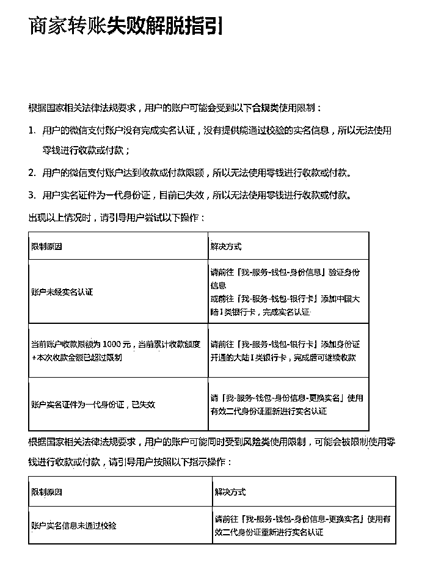

## 3.3 分成权益被撤销后，如何重新拿回来？ @郭耀天

平台推出分成权益，本意是奖励那些持续产出原创且质量过关的作者。一旦内容未达标，通常会先给整改机会；严重时则会直接收回资格。

假如你收到“内容整改通知”：先补发不少于10条被平台认定为优质且原创的作品，完成后权益会自动恢复；若10条已经发齐，只需静候审核，结果会通过「视频号团队消息」送到你手上。

假如收到“权益取消通知”：若原因在于发布搬运、低质内容，或账号内容方向出现偏移，解决办法是继续输出原创且达标的视频，达到门槛后资格会再次激活，届时可借邀请私信提出加入申请。

若取消是因为视频号认证身份资料变动，去更新认证资料即可；条件满足后权益会重新生效，之后照常申请加入。

若你确信平台误判，可走申诉通道：

因整改审核未通过，或因搬运、低质内容被收回权益的，在通知页底部找到「申诉」按钮，按要求上传证明材料：

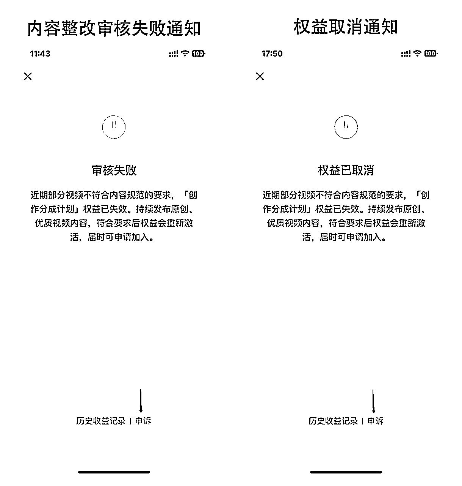

# 四、【项目实操 3/3】复盘迭代：把内容质量与产能一起拉高

💡 章节概要

项目实操走完前两阶段，整套基础链路其实已经跑通一遍。先快速回顾：

挑选合适且有热度的视频赛道（关键）＞ 注册账号并完成包装 ＞ 收集素材、制作内容并发布 ＞ 达标后开通创作者分成（关键）＞ 保持原创输出 ＞ 获得收益并提现

不过，会操作不等于能出成绩。实战一段时间后，不少人会冒出这些疑问：

视频数据始终起不来，问题出在哪？

分成资格已经开通，为什么账面还是零？

别人一天能出5条，我连1条都费劲？

……

有困惑很正常。能把项目跑出结果的人，通常不是没有难题，而是更擅长拆解和解决难题。

为了帮你清掉卡点，本章从以下维度展开：✅4.1 怎样把项目收益做上去

✅4.2 怎样把内容产能提起来

✅4.3 怎样把账号和内容运营得更稳

✅4.4 常见故障怎么处理

学完本阶段，希望你在「创作者分成计划」里拿到更漂亮的成绩。

💡 本章航线图

完成本章学习并动手实操，即可走完航线图第三阶段（约7-14天）

搞懂收益提升方法（10分钟）

搞懂内容产能提升方法（30分钟）

参照对标素材，单日至少产出5条视频（建议每天投入2-3小时）

增开更多视频号，靠更多作品放大收益（30分钟）

搞懂常见问题与应对办法（30分钟）

那么，现在开始执行这几步。

4.1🔥怎样把项目收益做上去

### 4.1.1 先抓住收益命门 @白丁

创作者分成这件事，赛道选择的影响极大。收益基本藏在评论区，评论被点开的次数，很大程度上决定单条作品能带来多少钱。

因此，这个项目的盈利主线可以概括成：内容 + 评论。

评论点击量很难靠人工硬拉，随意刷数据很容易触发违规，甚至被限流。

下面聊聊收益提升。先看两张截图：

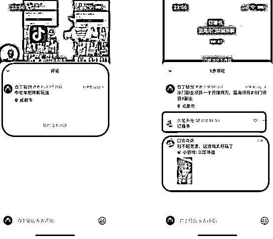

两张图里的账号都已经加入分成，为什么前者没有广告，后者却有？

前面说过，分成收益来自第三到第五条中任意一处卡片广告——不过那是指评论较多的情形。评论少的时候，只要凑到两条评论，广告位就会出现。换句话说，仅有一条评论还不够触发广告。

由此可以延伸出一个小操作：作品发布后，立刻用主号或备用号补一条评论，能减少流量收益白白流失。

仅这个补评论动作，就有机会把收益拉高至少20%。

如今网友已经养成看评论的习惯，看到有人留言，常会顺手点进去。如果你的评论能引发共鸣，还能带动更多人跟评；评论量越大，内容被加热得越充分。

其余数据不建议动手脚。再来看内容。

作品的核心变量，无非素材与文案。

作品能否冲起来，和素材关系极大。这就需要“网感”，能判断什么话题具备爆发潜力。这属于技能范畴。我一直认为，项目能否变现，和技能积累密切相关；技能到位了，恰好遇到合适的项目，钱就能落袋。

网感并非天赋，通过训练可以提升。最有效的路径是拆解同行：把同行的爆款素材归档，逐条标注它为什么能爆。分析量足够大之后，你会发现许多爆款背后的触发因素高度重合，这就是规律。摸清爆点在哪，创作时集中往那个方向发力，坚持一段时间，做出爆款会变得轻松很多。

另一个重点是文案。平台对文案的要求不低。写稿时可以采用“固定开头钩子 + 正文补全”的结构，这样重复度更低，平台也更容易接受。

在视频号里，只要网感在线，文案再跟上，作品想不爆都难。

找对方向和方法后，变现最关键的一环是执行：稳定且不间断地更新。一个账号约80%的收益，往往由20%的作品贡献。方向没错，持续发下去总会出爆款；在这个平台，爆一次就可能带来上千元收益。

内容来源：@白丁《视频号分成计划娱乐解说玩法，一条视频一天 4815 元》

### 4.1.2 收益为何总比别人低 @郭耀天

不少伙伴发现，自己的收益和别人对不上。要弄明白这件事，先得搞清楚钱从哪里来：这笔钱并非腾讯直接发放，而是商家把广告预算投到评论区，平台再依据账号流量和点击情况结算给创作者。

既然资金来源是商家，收益差异就很容易解释：不同领域，广告点击价值不一样。

例如某些领域金主密集、预算充足，收益自然更好。另外，广告采用智能匹配，若系统给你匹配的广告单价偏低，你到手的钱就会少。

还有一种情况：你的作品恰好在某个时段爆了，但商家预算收紧、投放不足，可匹配的广告不够，收益同样会偏低。

收益高低这件事，我们很难直接干预。能做的是提高作品数量，作品爆了收益自然上去；或者切入财经、美容、酒类等预算充足的领域。若做的是泛娱乐，收益通常会低一些。

### 4.1.3 提高收益的三条路径 @郭耀天 @思蒙

**路径一：瞄准年轻用户集中的赛道**

已经加入分成的伙伴中，有人抱怨收益偏低。这并不奇怪，因为该计划尚未完全释放潜力。你留意观察会发现，当前广告以游戏类居多，其次是腾讯自家广告和网剧推广。

比如祝福、早安类内容，转发量确实可观，但受众以老年人为主。广告主很少往这类人群投放，收入自然上不去。

想提高收益，可以转向年轻用户更密集的领域，例如科技、娱乐、情感。年轻群体集中，广告出价往往更高。

**路径二：把互动性做起来**

当前分成收益依赖评论区广告，所以第一要务仍是把内容做出爆点，引发传播与转发，评论量才会涨起来。

第二，可以主动引导评论，或自己先留几条、用备用号补几条，让广告位更早出现。否则要等评论累积到一定数量，广告才展示。现阶段通常要两条以上评论，广告才会出现。

此外，内容本身最好具备强互动属性，这样更容易吸引用户参与。

比如“图中找人”“图中找动物”、问答类内容，效果都不错。有时还需要在视频里做引导，邀请观众参与进来，收益才会更高。

举个例子：有伙伴做“一张图找头像”，用户看完会在评论区写出答案；也有人发语录，然后问观众“这句话对不对？把答案留在评论区”。

这些技巧需要多研究、多实操，慢慢就能摸出门道。

**路径三：提升创作效率，用规模放大胜率**

对门槛不高的项目来说，例如「视频号创作者分成」，本质上是用数量换概率。

所以，能多发就多发，能多开账号就多开账号。

实操中你会发现，有些伙伴的作品和你差不多，甚至谈不上多出色，但人家账号就是爆了。这是概率在起作用。

选赛道和制作技巧掌握之后，拼的就是【量】。

单条作品爆的概率是1%；发10条，或者用10个账号发，每条都保持1%，叠加起来，整体跑出爆款的概率是不是就大了？

为了更好搏量，实操中要持续提升创作效率：更快找素材、更快写文案、更快剪片子，这些都靠熟能生巧，多练就有进步。

内容来源：@思蒙，6月8日《短剧 CPS 的进阶技巧及常见问题答疑》

## 4.2 怎样把出片速度拉上去

对平台创作者分成这个项目来说，提升内容产能可以从几个切口入手：

加快素材收集速度

加快文案产出速度

加快视频剪辑速度

如果能逐步做到一天出5条视频，产能就算跨上一个台阶。

具体怎么练找素材、写文案、剪视频的速度？下面给一些参考思路，最终还是要结合自身习惯多试。

**加快素材收集**

最直接的路径是：多接触素材渠道，灵活运用，搭建个人素材库。

例如抖音、淘宝、📕、知乎、YouTube等平台都有充足资源。平时有空就刷一刷，遇到合适的就存下来，下次直接调用。

**加快文案产出**

这里有两个方向：

① 参考同行文案

② 借助 ChatGPT 提效

这两种方法前文在视频制作部分也提到过，核心还是熟能生巧，多用多练。

赚钱往期开过 ChatGPT 相关航海，可以结合往期手册学习该工具👉《8月航海｜ChatGPT+自媒体｜实战手册》

**加快视频剪辑**

剪辑是一项需要反复练习的手艺。

短视频时代对这项能力越来越看重。往期航海中，我们开设过剪辑特训航海，并邀请奇杰老师录制了几十个实操教程👉《8月航海｜剪辑特训｜实战手册》

实际上，前文「创作热门赛道视频」已经给出简单易上手的剪辑教程。若你对自己要求更高，可以跟着《8月航海｜剪辑特训｜实战手册》从初阶到进阶学习。但要提醒：学技巧的根本目的是服务实际业务，别舍本逐末。

## 4.3 账号与内容怎样运营得更稳 @郭耀天

**吸引关注的技巧**

用户更愿意关注内容真诚、观看体验好的账号。若想涨粉，可参考以下做法：

1）账号定位清晰，形成个人风格，坚持原创

2）保持稳定输出，让更多用户记住你

3）主动与观众互动，提升观看体验

**内容上热门的技巧**

通常，画面清楚、信息完整的原创内容更受🛰️用户青睐，也更容易进入热门页。

若希望动态出现在推荐页，可参考：

1）发原创内容，别搬运他人作品；

2）视频画面和封面尽量清晰，避免拉伸、黑边、卡顿，也不要过度使用马赛克或虚化；

3）有字幕就完整呈现，裁切时别挡住字幕；

4）内容完整、表达清楚，可用配音讲解，方便观众理解；

5）内容健康，远离低俗擦边和争议话题。

## 4.4 常见问题怎么处理 @郭耀天

下面是项目推进中较常见的共性问题，整理了一些应对经验。

**问题一：怎样防止广告消失？**

操作分成项目时你会发现，哪怕是爆款纯原创，也可能掉广告。通俗讲，就是评论区没有可匹配的广告，几百万甚至上千万播放的作品也会遇到。

分享一些伙伴测试过的方法，不保证百分百有效，但有一定参考价值。很多人习惯用剪映，其实平台官方也提供剪辑工具“秒剪”（官网：https://miaojian.weixin.qq.com/），用秒剪处理过的视频，流量有机会略高一些。

方法一：

剪映导出后，放进秒剪过一遍，再导出。

方法二：

把剪好的片子导入秒剪，随便套一个滤镜，随后把画质颜色参数压到10以内。我常用值为5。

方法三：

导入后套用秒剪里的模板，选择“治愈调节”。该模板自带音乐和滤镜，把原音打开；它内置的滤镜名为“橘子海”，将橘子海参数调到10。

方法四：

使用秒剪“橘子海”滤镜，参数调至10，再设置：亮度3、对比度4、饱和度4、色温5，这四项均不超过5；暗角9，别超过10；锐化14，别超过15；贴纸放3~4个，再加2个个性文字。

另外，建议发布时不要连WiFi，改用4G。WiFi覆盖范围偏小，4G分发区域更广。

**问题二：「参与收益中的视频」为何显示0？**

加入计划、发布作品并声明原创后，为什么该专区数量是0？

这个专区统计的是账号近7天内实际产生过收益的作品。显示为0，通常有以下可能：

1. 该账号作品评论区没有展示广告；

2. 近7天作品未实际带来广告收益。创作者可继续发布优质原创内容，待作品产生收益后，就会出现在该专区；

3. 账号正处在内容整改期，或分成权益已被收回，作品无法参与广告分成。

**问题三：哪些作品不会被推荐？**

作品能否被推荐，主要看视频质量、内容质量、关键词精准度三方面。

**视频质量低**

若作品存在声画不同步、清晰度不足、卡顿模糊、大面积无画面、剪辑杂乱无逻辑等问题，一句话概括：对观众观看不友好的内容，基本拿不到推荐。

**内容质量差**

平台对内容有两条原则：热点性和价值性。

要追时效热点，也要提供有价值的信息，这点与其他平台类似。如果发布的内容既无热点、也无争议、更无传播价值，账号就相当于“公开的朋友圈”，基于社交推荐机制，基本只有自己和部分好友能看到，流量推荐很难出现。

同时，内容同质化严重，或旧闻已过时效，也不会被推荐。低质量内容堆得太多，同样不是平台想推的方向。

**关键词关联弱**

平台推荐模型会结合视频内容、标题文案、话题标签、地理位置等关键词做精准分发。若作品与关键词关联度低，同样难以获得推荐。

**问题四：加入分成权益会拖累视频流量吗？**

不会。流量高低取决于内容质量、主题等因素；

广告只出现在评论区，不影响视频本身。

**问题五：加入分成后，广告会自动出现吗？**

申请加入后，创作者发布作品时打开「原创声明」，该作品评论区下方就有机会展示广告，无需额外操作。

你可以在“创作者中心—创作者服务—创作分成计划—参与收益中的视频”查看已成功加入的作品。

**问题六：作品评论区为什么没有广告？**

若未加入分成项目，仅声明原创的作品，评论区不会出现广告。

加入计划后，发布时务必点开原创声明按钮。发完立刻自己补一两条评论，广告很快就会出现。有评论才有广告，一般有一条他人评论就会触发；你再补一条，广告基本就出来了。

若已加入计划、也声明了原创，评论区仍无广告，可能存在以下情况：

1. 当前没有广告能与你的作品匹配；

2. 作品属于暂不支持展示广告的类型，例如：

非公开浏览状态的作品

信息流广告 / 短视频商品分享 / 视频变现任务 / 互选平台等含商业推广信息的内容

不符合《🛰️视频号运营规范》的作品

3. 账号处于内容整改期，或分成权益已被取消，作品无法参与分成。

**问题七：发过其他内容的账号，怎么养号？**

可以直接拍随手拍，持续发。我们的老号这样操作也跑成功了。

若实在不放心，就把非原创、非同类作品全部删除，然后持续更新随拍。若更新几十条仍未达到内容规范，可以考虑注销账号，重新注册新号。

**问题八：以前内容流量差，换这个会不会也没流量？**

先发几条随拍试水，看有没有流量。有流量，就直接开通分成。

没流量，就换领域测试。测试多轮仍无流量，就注销重开。

**问题九：达标开通分成后，旧作品要不要删？**

建议删除，也可以隐藏，看个人情况。

若旧作品完全符合内容规范、质量高且为原创，当然可以保留。

# 选修篇：更多玩法与实用工具

💡 章节概要

跑完项目最小MVP、基本掌握操作流程后，可以翻选修篇了。

无论你想进一步放大项目，还是挖掘更多玩法，都建议重点阅读：

✅【项目拓展】更多运营技巧与经验

✅【项目放大】如何在分成项目赚更多钱

✅【实战工具】更高效开展项目

若学有余力，欢迎尝试选修篇的更多玩法；若前文尚未学完，建议先把必修篇基本功练扎实。

下面的内容会助你继续成长，来吧，开始你的冒险。

# 五、【项目拓展】更多运营技巧与经验分享 @郭耀天

💡 章节概要

除了必修篇，视频号本身还有不少有趣的运营技巧。我们整理了几位老师的经验，分享给大家：

✅5.1 视频号注销流程

✅5.2 视频号更换管理员

✅5.3 如何检测账号是否限流违规

✅5.4 如何恢复账号各项变现权益

✅5.5 避坑经验

✅5.6 常见问题速查

很多实操疑问，也许能在这里找到答案。

## 5.1 注销视频号入口

申请注销后，如果超过一天仍没完成，或者不想等，直接点下方按钮：

也就是说，遇到“注销卡住”或“想立刻关掉”的情况，按页面提示走就行。

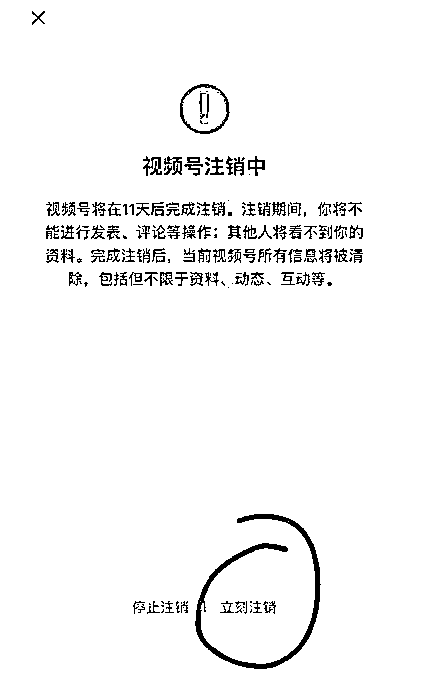

## 5.2 换绑管理员，也能让号注销

有些时候需要快速处理视频号，除了走注销，还可以把管理员换掉。

找一个从没注册过视频号的🛰️号，把当前账号的管理员身份转给它，原号就相当于注销了，以后也能重新开新号。

流程不复杂，难的是找到符合条件的🛰️号。市面上有这种资源，可以自己找。

进入换绑页面的入口有两个：一个是从设置相关位置进，另一个是直接点“更换管理员”。换完以后，管理员归别人，注销也就完成了。

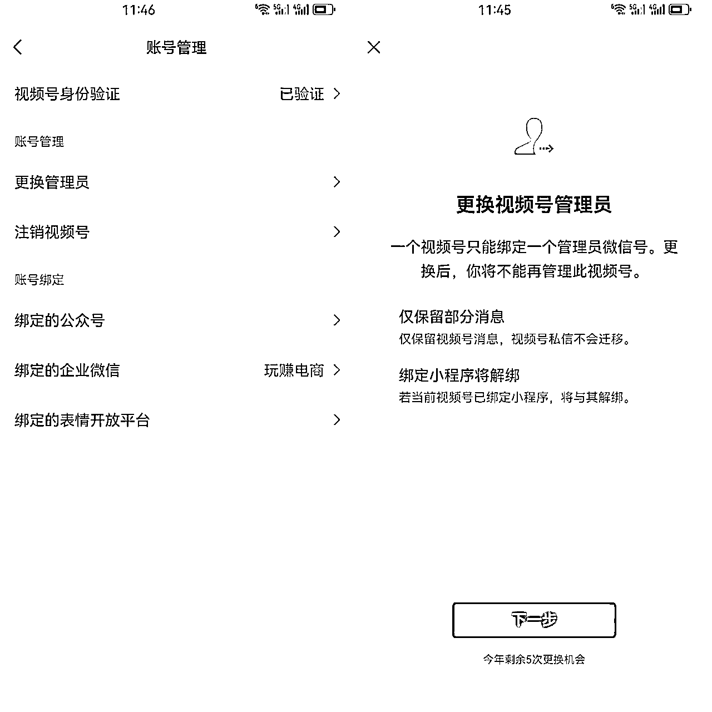

迁移规则速看

1. 会跟着走：头像、昵称、简介、认证；已发动态及数据、粉丝；隐私和运营人员设置；商品页商品；推广充值款项。

2. 不会跟着走：视频号私信。

3. 新管理员🛰️号要求：名下无视频号；近两周没有被盗、被封、改密；账户状态正常；已绑手机；没被当前号拉黑；已关注当前号；与原管理员互为🛰️好友；可被搜索添加。

4. 迁移用时通常几秒到几十秒，期间不能发动态、评论、直播。

## 5.3 流量是否受限、账户是否违规，怎么查

进视频号后，到创作者中心点“账号诊断”，就能看到账户状态：

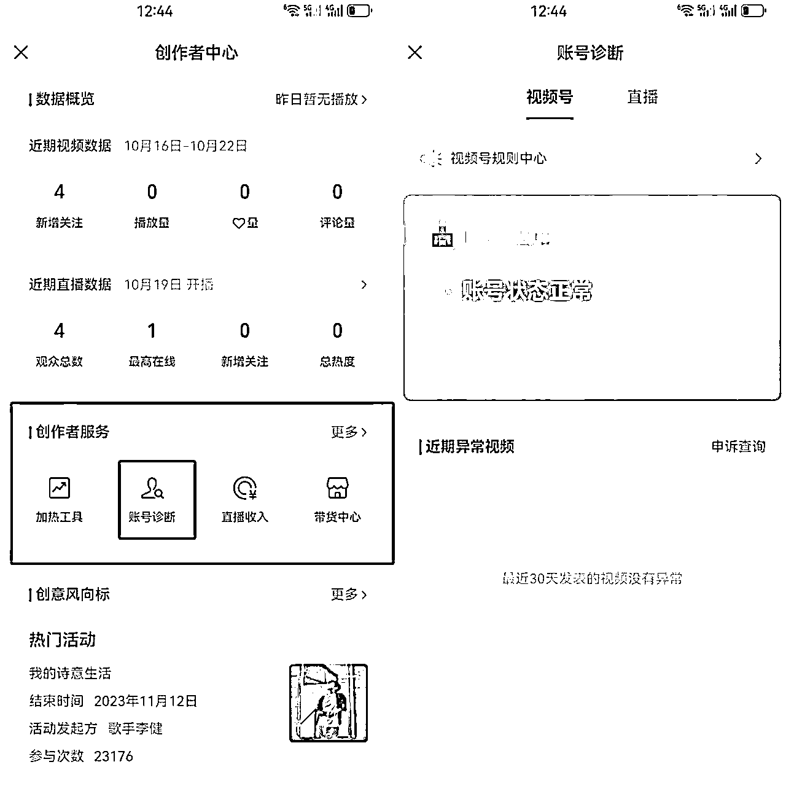

也可以点下面的链接自查违规情况（必须在🛰️手机端打开；如果提示异常，去项目禁言群的群公告里找入口）：

链接：https://channels.weixin.qq.com/pandora/pages/appeal/index#account-detAIl?appeal_entrance=1

担心某条内容有问题，可以在后台点开这条视频，再点加热。能正常加热就代表没问题，不能加热就说明内容可能出事了。

流程如下：

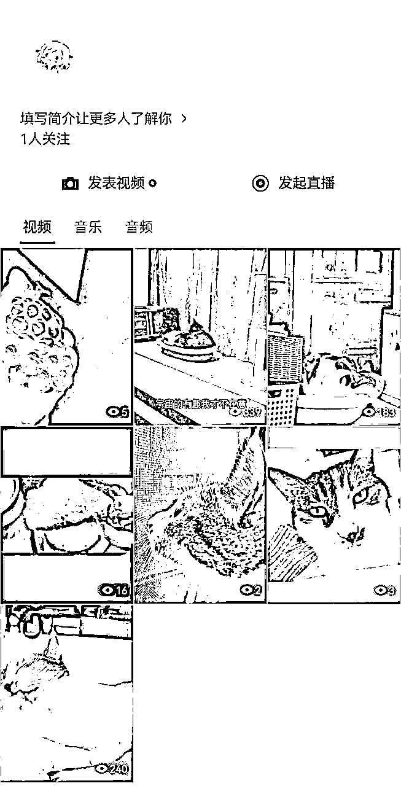

打开后台

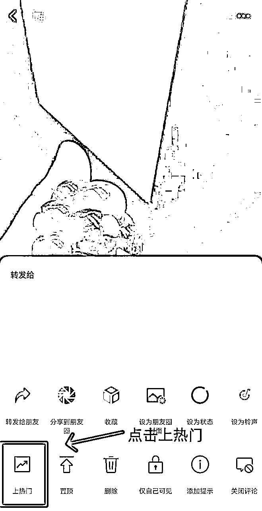

点“上热门”

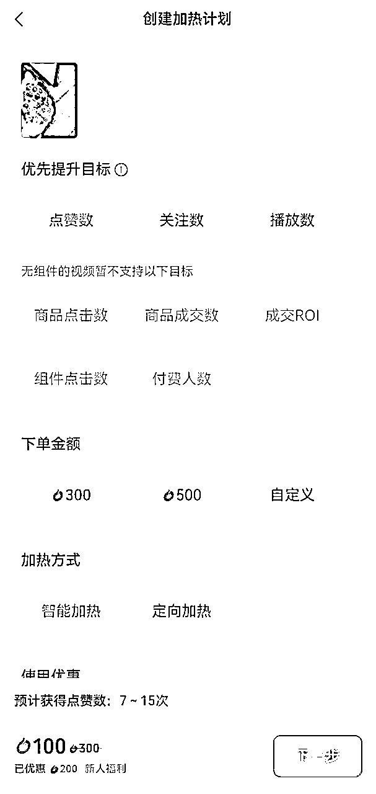

进入加热计划页面，能成功加热就没事。

不能加热的视频，建议隐藏或删除，反正没有流量，留着也不会有帮助。

## 5.4 被取消变现权益，怎样恢复

以下整理自官方手册，适用对象是：短视频商品分享、互选平台、视频变现任务等权益被收回，或被要求整改的账户。

核心态度：平台希望账户按自身定位发原创，保持画风和出镜人统一；不支持原本做某一垂类、被判定非原创后，靠随拍或风景内容来“洗白”。

1. 收到私信后，如何定位

收到“内容整改”或“权益取消”的私信，就说明号需要优化。问题可能出在原创度、内容质量，也可能两者都有。

从私信详情页可进入申诉入口，里面会展示账户的当前状态，帮你判断是质量不达标还是原创度有问题。

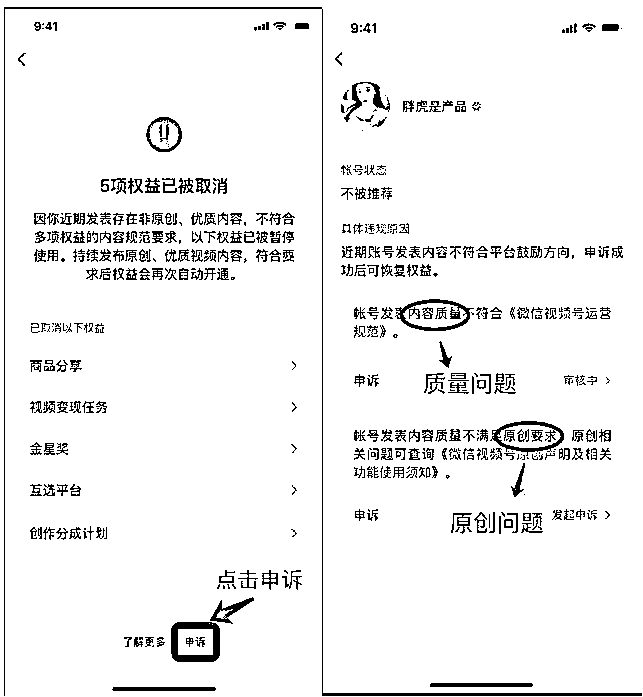

2. 原创度不合格的原因

除了搬运站内其他号或外部平台的内容，以下行为也可能被认定为搬运：出镜人不统一、画风不统一、垂类前后突变（比如先做美食再做游戏）。

质量不合格的原因包括：内容同质化严重、反复发旧内容、用模板低成本量产、图片拼成PPT视频、视频里放联系方式或二维码、音画不同步、文字大到遮挡画面。

3. 恢复路径

收到“内容整改”通知：至少新发10条内容，才有可能恢复权益。这10条内容怎么发才合格，参考下面的第3点和第4点。

收到“权益取消”通知：如果觉得被误判，不用急着发新内容，直接在申诉页提交能证明原创/质量的资料，比如作品底稿、原件、首次发布截图、剪辑工程文件。平台会结合已有内容重新判断。

如果平台判定没问题，那么删除历史内容、设成仅自己可见，或快速补10条原创，都不会立刻恢复。只有持续稳定地发原创，过一段时间，平台才会酌情恢复。

发什么样的内容能过关？

创作者要发与账号风格、人设一致的作品。美妆号继续发同一IP出镜的美妆内容即可，不用改拍风景、自拍，更不能改发情感内容。美妆号突然发情感内容，照样会被判定非原创，权益也回不来。

4. 什么内容会被拒，甚至进一步关闭权益

不要发与账号定位无关的内容来恢复权益。不是随手拍风景、育儿、亲子类账号，就别发拍风景、拍桌面、拍翻书、自拍、拍孩子、拍宠物、情感鸡汤这类无意义内容。

不要发与账号画风不一致、垂直度不一致的内容，比如美妆号发宠物、小剧场号发美食、汽车号发音乐。

不要发与账号无关的IP内容。原来不真人出镜，为恢复权益突然批量发某个IP；或者原来多个IP出镜，被处罚后统一成一个IP，平台都能回溯，权益不会恢复。

以上做法会被视为恶意对抗，至少90天不给权益。正常创作才是正道，别总想走捷径。

备注：不用变现权益的普通账号，或本身是育儿、宠物、亲子领域的账号，发随拍、风景、宠物、儿童等内容没问题，不会被限流。平台只反对有明确垂直方向的账号，靠无意义生活内容恢复权益。

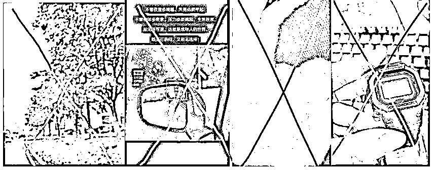

## 5.5 避坑经验 @流浪虎

目前腾讯规则并不算清晰，项目推进要靠自己摸索。下面几条是实操老师踩过的坑，值得提前避雷。

1. 忘开原创。有位老师一条视频播放量达到600多万，却因为忘了开关，损失预计2000元。

2. 流量太大但评论区失控。一条视频转发35.8万，大量评论涌入后风向变差，系统吞评论，号也被关进小黑屋。大爆款一旦出现负面苗头，建议直接关评。

3. 单号单日发太多。有人一天发30条，结果号被关一周。单号每天别超过9条，5到6条更安全。

4. 旧爆款隔太久重发。有位老师发半个月前的爆款，又被系统关小黑屋。旧爆款可以重复发，但最好隔1到2天就发，拖太久会被检测到。

5. 大爆后可能被限流。目前多个号测试下来都如此，一般不会超过7天。超过7天还没有流量，可能内容本身有问题，不如考虑换号。

内容来源：《视频号创作者分成收益怎么赚？追好热点，打造爆款视频》@流浪虎

## 5.6 其他疑问集中答疑

广告在哪里出现、多久出现一次？
广告会展示在视频评论区，可能是图文也可能是视频。平台会根据用户体验、作者收益等因素统一控制频率。

不想要广告怎么办？
已加入分成计划的创作者，只要发新视频时不勾选“原创声明”，视频就不会带广告。若想彻底退出，把具体情况写到“视频号 > 右上角人像 > 创作者中心 > 创作者服务 > 帮助与反馈 > 底部意见反馈”，平台会处理。

什么样的视频更容易被推荐？
① 画质清晰、字幕声音同步、不卡顿，观看体验要好；② 内容有热点、有讨论度、有观点，或者价值感很强，能留住用户；③ 关键词和标签精准，系统会按地理位置、浏览记录、关注话题、点赞/评论历史分发，所以视频内容、标题、话题标签、地理位置都要用好关键词。

为什么我找不到“原创声明”？
有的号早期确实没有这个按钮。养号期、没开通分成计划时不用管，直接发就可以，反正也没收益。但开通分成计划后，作品必须标原创，不然没收益，务必记住。
开通前尽量发同类内容，保持画风、排版统一，通过率更高。

粉丝到100了，为什么还是进不了分成计划？
需要同时满足“原创、内容规范、100粉”三个条件。少一个都不行，尤其内容规范最容易不过关。如果认为自己全部达标但一直没邀请，可以尝试申诉👉「3.1.3.5 申述开通」。

100粉能找人互关吗？
可以。原创和内容规范达标后，到群里喊人关注，做真实活粉，能帮助开通。但不靠谱渠道的粉丝别乱碰，尤其是僵尸粉，拉不动开通还可能弄死号。

以前的作品被限流，怎么处理？
先发10条生活随拍。如果官方提示了限流天数，等到时间结束后再发随拍。

内容不合规，还要不要继续发？
先别急着发。先查账户状态，删除不合格作品，再用加热测试：能加热就说明没事，不能加热就说明作品有问题。

以前用过的视频能再发，或给小号用吗？
能。现在视频号支持内容授权，想一个素材多号用，就做授权，素材可以反复发，实现收益最大化。教程👉「6.2.2.1 多账号内容授权」。

企业号为什么没有分成计划？
目前企业蓝V和媒体账号没有分成广告，未来可能开放，但现在只面向个人账号。

发布领域怎么选？
条件齐了先申请原创计划，然后开始发作品。情感文案、搞笑、感人方向都能试，看哪个方向流量好，再垂直做哪个。

# 六、让分成计划赚更多钱：项目放大路径

💡 章节概览

当账号已经能稳定变现，就可以考虑把项目做大、把收益拉高。

放大收益的几条主要路径：

✅ 多账号组矩阵，靠数量对冲概率👉「6.1 注册多🛰️号，搭建矩阵」

✅ 提升操作效率，让单位时间产出更高，比如：

提升矩阵号的运营效率👉「6.2 矩阵号如何高效管理」

更快拿到更多素材👉「6.3 获取更多快捷素材」

✅ 尝试更多赛道，也许能跑出新的爆款👉「6.4 尝试更多赛道」

✅ 开辟更多变现方式👉「6.5 更多变现途径」

接下来具体聊。

## 6.1 多注册🛰️号，搭建矩阵 @郭耀天

矩阵的搭建思路很直白：批量开号、批量发布，把前面讲过的流程复制到更多账号上。

这里卡在一个现实问题：每人最多实名5个🛰️号，数量远远不够。所以真正要突破的不是视频号，而是“一人只能实名5个🛰️”的限制。超过5个，就得换人实名。

实际操作中当然不能一直找别人帮忙。实名绑在别人名下，关系好还好说，万一对方不配合还冻结你的号，解冻会很麻烦，甚至号直接废掉。

突破的原理是：把不需要支付功能的🛰️号冻结，冻结后，自己名下就多出一个可实名的坑位。

需要注意：冻结前先把视频号注册好，冻结号不计入5个坑位。目前还没有测试过冻结后能否注册，但按这个流程操作，是可以直接注册的。还有一个前提：

账号里一定要有余额，几分钱就行。有余额再去清除，才算“冻结”；没余额清除，等于“注销”。

操作入口：🛰️“我”>“钱包”>底部“帮助中心”>“实名问题”：

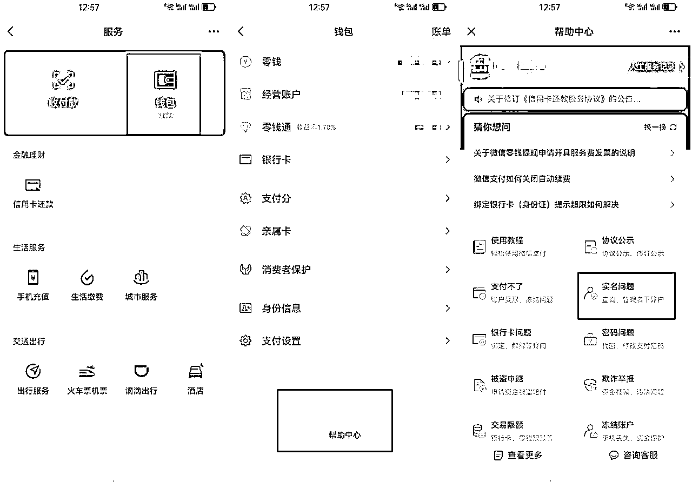

也可以走腾讯客服入口：

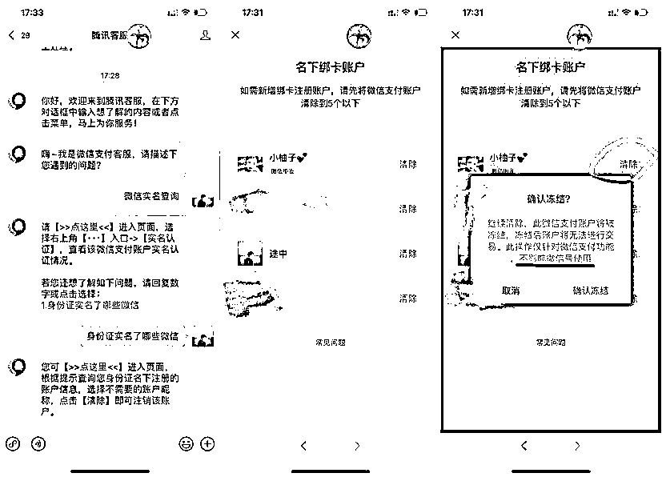

到后面想提现，需要先把账号激活，因为冻结状态的号不能提现。操作方法：把其中一个账号冻结，另一个就能解冻。也就是说，随时可以让5个号不冻结，其余号保持冻结。

解冻也不复杂，找到对应的冻结🛰️号，按下图操作即可：

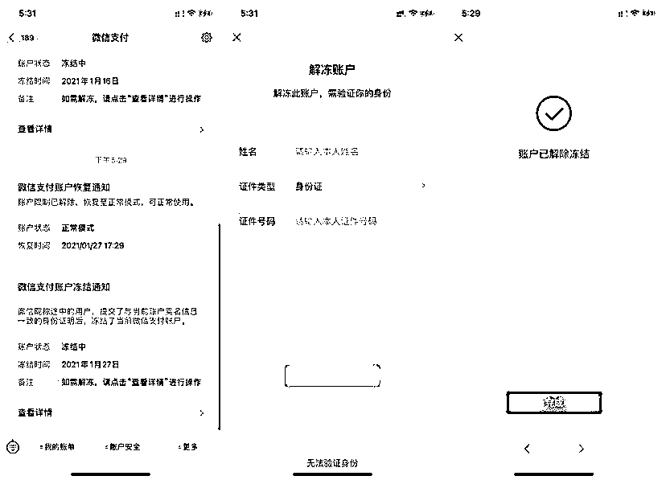

如果账号是用员工身份实名的，员工离职前一定要第一时间把实名信息换回来，把他/她名下的号码全部解除实名，并注销🛰️支付。

后面还需要继续用的话，就按上面的方法找现有人员重新实名，不影响后续操作。

再分享一个记录🛰️号实名的文档模板：

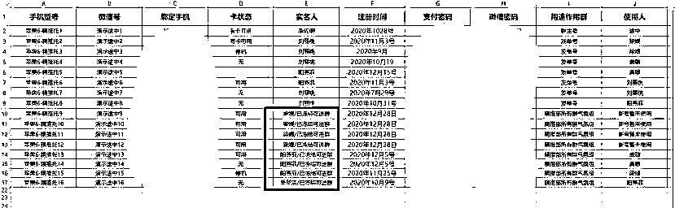

做矩阵的过程中会发现：有的号一开始流量就很好，有的号一直没什么起色（前提是作品质量和水平都差不多）。这背后既有账号底子的问题，也有概率因素。可以把表现好的号挑出来重点养，差的号直接注销换新。

## 6.2 矩阵号如何高效管理 @郭耀天

矩阵提效主要抓住两点：一是通过MCN统一收款来降低扣点，二是批量发布内容。两条都能提升单位时间的收益。

### 6.2.1 用MCN统一收款

如果以个人身份做分成计划，扣税会比较狠，最高可达40%。有些人第二年能在个人所得税APP申请退税，但这要看你当年的收入情况，收入太高、没达到退税标准的话，就退不了。

所以想合理减少扣点，可以让MCN来统一收款：

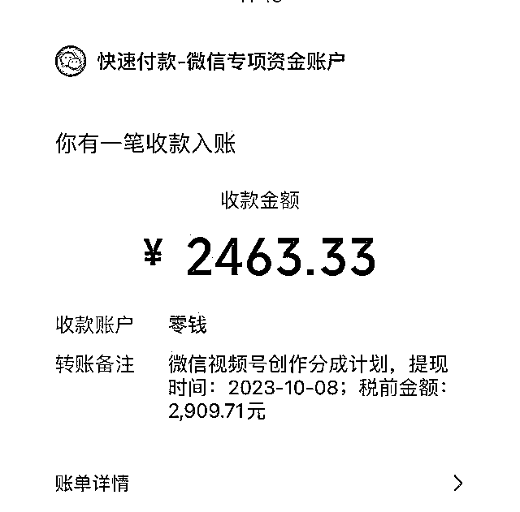

下面是注册MCN机构的大致流程。机构注册完成后，等视频产生收入，再申请结算，按要求寄出发票，就能按3%或6%的税率扣税。

第一步：打开MCN申请网站。
浏览器里搜“视频号MCN”，或者直接打开链接👉https://channels.weixin.qq.com/mcn/login

第二步：上传资料，开通MCN。
登录后按提示填写公司信息、对公账号信息并完成验证，很快就能开好。注册要求详见官方文档👉https://support.weixin.qq.com/cgi-bin/mmsupportacctnodeweb-bin/pages/YC5kUcvysXxktmMx

第三步：绑定账号。
登录MCN后台，进入“作者管理”>“视频作者”>“邀请作者”，按流程邀请需要绑定的账号即可👇

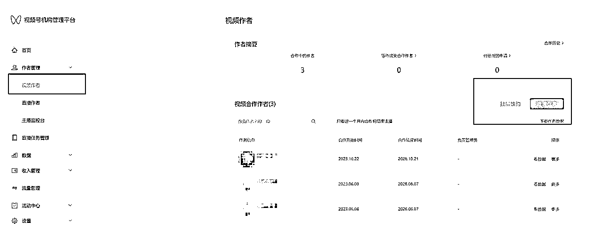

第四步：开发票。
结算周期是每半个月一次，后台会把前半个月的收益列出来。有收入后申请结算，按要求寄发票，就能到账，收益比例也更划算。一般公司扣点3%，也有的是6%：

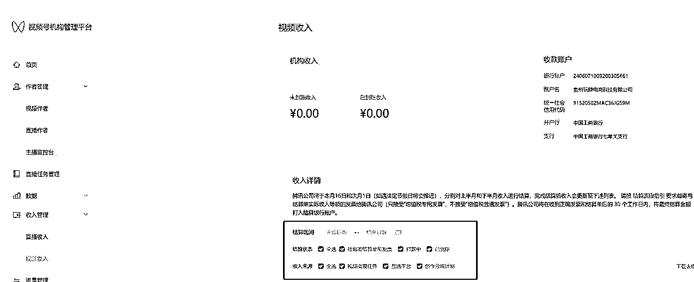

### 6.2.2 内容发布如何提效

#### 6.2.2.1 多账号内容授权

爆款视频可以给其他账号开白名单，让多个账号反复发同一条爆款。操作如下：

内容授权是最近上线的新功能。开启后，可以把素材同步给其他5个账号发布，这些号发相同内容也不会受影响。

#### 6.2.2.2 不常上线？让管理员代劳

如果你的🛰️号归属亲属，或者属于辅助绑定状态，平时又不怎么登录，可以考虑增设一个运营管理员，让 TA 来代发内容。方法：电脑端打开视频号助手→设置→人员设置→绑定运营者。操作完成后，后续只需用该运营号登录，就能免去反复切换的麻烦。

电脑端登录时，页面会弹出账号选择提示，勾选需要更新的那个就行：

#### 6.2.2.3 第三方授权：自动回复更省心

现在有一些第三方登录服务，将视频号接入后，可实现消息自动回复等功能，效率提升明显。比如“快视”（官网：www.timexxs.com）。要注意的是，多数第三方平台需开通会员才能用。有需要的话，在工具箱里也能找到合适的服务商，尤其适合同时管理多个账号的人：

## 6.3 海外素材：怎么找怎么用 @郭耀天

国内可用的高质量素材，很多已被反复搬运。把目光转到海外，或许能找到更多新选择。不过海外素材有门槛：如何访问、如何操作、如何下载、如何切分。目前主流的海外平台包括 YouTube、TikTok、Instagram、Triller、Snapchat，其中 YouTube 的素材量最大、清晰度也更高。这里用 YouTube 演示整个流程。有一点要说明：登录海外平台需要🪜，这部分只能靠自己去解决。

### 6.3.1 进入 YouTube

想要打开 YouTube，第一步就是🪜，这个话题比较敏感，怎么做请自行搜索了解。打开 https://www.youtube.com，或在浏览器直接搜“YouTube”即可进入：

如果电脑里没装翻译软件，看到的页面可能全英文。解决办法有两个：用浏览器自带的网页翻译功能，或者装一个翻译插件。插件选择很多，我个人常用的是“火山翻译”，免费，搜一下就能装：https://translate.volcengine.com/（附使用教程：火山翻译浏览器插件使用说明书）。装好后，在任意网页上单击右键，点“使用火山翻译”，页面即刻被翻译成中文：

搜索素材时，直接用中文也搜得到，但换成英文关键词，结果往往更精准：

### 6.3.2 视频怎么下

先是取到视频链接。登录 YouTube 找到目标素材，点分享按钮，把那串链接复制下来：

接着，靠链接提取视频。这一步得用 YouTube 视频下载工具。这类工具数量不少，有收费的也有免费的，免费版基本够用。下面列几个免安装的在线下载站：

https://ytshorts.savetube.me/
https://wzds.llsbcq.com/
https://www.videofk.com/zh-CN/YouTube-video-download
https://y2mate.la/zh-cn18/
Gihosoft TubeGet
百度网盘：https://pan.baidu.com/s/1fuigBg90Sw8_YNpVnu6BOg?pwd=iiq7（提取码：iiq7）
夸克网盘：https://pan.quark.cn/s/450d56dcd10e

另外还有一些工具：

画质一般挑 1080，点界面右下的按钮即可开始下载：

装好对应插件再回 YouTube，如果视频允许下载，底部会冒出下载按钮，单击就能保存：

最后是网页下载。拿 https://wzds.llsbcq.com/ 来演示：把刚才复制的链接贴进下载站：

页面汉化后显示如下，点“获取链接”：

随后点“下载”，文件就会自动保存：

YouTube 上的影片时长往往很惊人，动辄几个钟头，十几个小时也不稀奇。这类大文件，建议先切成小段再用来做素材：

### 6.3.3 切分视频备用

用来拆视频的工具也不少：LosslessCut（百度网盘：https://pan.baidu.com/s/1q9yYIxRJB30WlFkOJ7yfig?pwd=qycw 提取码：qycw；夸克网盘：https://pan.quark.cn/s/594de39665f3）；BoilsoftVideoSplitter（百度网盘：https://pan.baidu.com/s/1gTH5B4GMHQtF8wxL2v_ZbA?pwd=29eg 提取码：29eg；夸克网盘：https://pan.quark.cn/s/cd0de8040d70）；BoilsoftVideoSplitter 中文版（百度网盘：https://pan.baidu.com/s/1VhoFXiM9qN4UUrldE1LUbA?pwd=aqkh 提取码：aqkh；夸克网盘：https://pan.quark.cn/s/82cd8e7df29a）；还有在线切分工具：https://split-video.com/zh/。下面挑两个工具，简单讲讲用法。

工具一：LosslessCut

下载后解压，运行程序：

界面如果是英文，可以在这里切换语言，改成中文：

把视频文件导入，或者直接拖进窗口，然后点“编辑”：

进了编辑页，选“分段”，建立 n 个分段：

想拆几段、每段多长，都可以自己定。这个工具单次最多拆 300 段。如果视频特别长，分多轮操作就行，照样能达到目的：

正式切分前，还可以勾选一些选项，比如保留音频、修改轨道等。

工具二：BoilsoftVideoSplitter

中文版的 BoilsoftVideoSplitter 也很好用，它不限制切分次数，想切多少都行。解压打开：

点“打开”导入素材，比如下面这个 11 小时的视频，马上就能上手：

就拿这段 11 小时的片子来说，我把它一口气拆成 600 份。具体操作是点“设置分割”：

随后系统会问你要把切好的片段存到哪里：

确认后，分割就自动开始了：

素材完成切分，就能继续做后期加工，作为视频号的发布内容：

## 6.4 哪些赛道更容易爆 @郭耀天 @流浪虎

现阶段视频号上哪些类型最受欢迎？

爱国类内容容易触碰红线，这里就不深入讨论了；真要碰这个方向，务必小心拿捏，尤其要把内容和立场摆正。视频号上热度很高的题材有：新疆西藏修铁路、港珠澳大桥、邮政员工骑着马或骆驼送快递等。另外可以参考新闻联播体后半段的救人故事，视频号的核心受众是中老年人，这类社会正能量正是他们爱看的：

婆媳矛盾这个方向很好懂，不用多解释：

想找对标账号的话，这几个值得关注：美摄安然；L 航拍；小啾啾 1987；九儿；感恩有爱小木屋；禅缘智慧；党史博采；小茹观世界；琨少说说；心心的念叨；宝珠书道；玩玩娱乐；古董那些事；王耳朵先生；红尘 7666；今古奇谈；12 月 ya。；杰哥看历史；罗兰妹妹；浅笑情感驿站等。

呈现方式可以走视频路线，也可以走图文震惊版路线。图文类的制作门槛更低，在视频号上往往表现更好。接下来逐个看看热门的赛道怎么上手，其实各赛道的制作套路彼此相近。内容来源：《视频号创作者分成收益怎么赚？追好热点，打造爆款视频》@流浪虎。

### 6.4.1 真人露脸：最稳的路线

真人露脸的路线，是众多模式中最稳的一条。只要内容不出问题，不只靠分成计划赚钱，还能延伸出各种变现方式：直播带货、短视频带货、收徒、开课、建社群、做服务等等。当然，并不是人人都有条件面对镜头。目前最容易起量的露脸领域有：三农、搞笑、经典娱乐、人性哲理、情感生活、生活百态。有条件就开拍，收益和后续玩法都挺可观。实在不能拍的，接着往下看——下面几种方案不需要露脸也能干。如果你正好擅长面对镜头，值得花心思琢磨：

### 6.4.2 聊天搞笑：文案定生死

搞笑类图文和视频，在各大平台的地位都很稳。这里重点说说聊天截图式的图文或视频，也就是把搞笑、经典的对话内容做成聊天界面：

这类内容，有人发截图，有人做成动态视频，对应的工具有免费也有付费，制作都不复杂，手机端和电脑端都能搞定。

文案怎么找：

音乐怎么配：聊天图文一般不需要音乐，视频版通常加一点搞笑的音效就够了，有的也会插一段合适的音乐，但并非必需——核心还是对话本身。实在不会做，就去模仿同行的成品，这个项目的关键始终在文案：好的文案能抛出大家愿意讨论的话题，也更容易引发转发。

制作工具和网站：能做聊天界面的工具很多，像 135 编辑器、96 编辑器都自带这类功能，不少网页版还免费，当然也有收费选项。下面是几个免费站点：http://www.11fx.cn/tool/wx/（支持做成视频）、https://www.yeyulingfeng.com/tools/wx/、https://www.bAItuling.com/chat/、http://www.12tool.com/wxduihua.html、https://wx.gravityengine.cc/、http://sc.appbs.cn/1.html。付费站点：https://vjietu.pro/；https://www.quduihua.cn/（图文、视频都能做，专业度算高，价格小贵，提供手机端和电脑端）；https://weixinduihua2.com/index/wechat/chat.html。还有一款软件：https://wwhe.lanzoue.com/iF1c40k9p3qj。

进去之后找到编辑入口，跟着引导走就行，没什么难度：

对话编辑完毕，点下一步，会出现导出选项——视频、长图、课件任选：

到这里，一条聊天内容就做完了，剩下的动作就是发布：

### 6.4.3 自愈系音乐号：一首歌吃到底

音乐类尤其吃香，怀旧、流行、轻音乐都有受众，选哪条线看个人口味。眼下最常见的爆款公式是：一段音乐 + 生活随拍，或者 + 若干张 AI 生成的图片，再叠上特效，就很容易火：

音乐号要起量，音乐本身是第一位的，素材排第二。音乐和画面互相成就，才能给观众带去解压、娱乐和美的享受。第三位才是文案，文案能和情绪对上，火的概率会大很多。做音乐号有一个天然优势：一首曲子可以反复用。我观察过几个号，所有内容都配同一首歌，只替换画面素材，照样持续爆：

素材去哪找：随手拍的街景、车流、夜景、自拍、AI 绘画、表情包、朋友圈截图……什么都能拿来当素材。提醒一句：选定一种模板后，尽量坚持下去，别三天两头换风格。所谓随手拍，就是平时出门用手机记录生活画面；高清照片也行；AI 绘画（MJ 或 SD）也是常见的取图方式，很多治愈系音乐视频就是用 AI 图做出来的。

音乐去哪找：各大平台的爆款曲目就是最好的来源。📕、抖音、快手、视频号，哪里火去哪里扒。找到音乐后，方法也简单：可以用工具直接从视频中提取音频，这个网站就能办到：https://www.AIgei.com/tool/video/audio。更常用的做法是剪映里选“分离音频”，把视频导进去，一键拆出声音：

再说一次：爆款音乐可以反复拿来用，只需换换画面，直到流量耗尽为止。

a：模板套用

视频号上正在火的音乐，基本都在抖音走红过一遍。所以直接去抖音找对应视频，抄他们的模板就行。具体来说：

点开第一个模板，里面有一个“剪同款”入口：

上传自己的素材，点下一步，软件就会套用原模板生成新视频：

我传的素材是已经做好的成品，所以效果看着一般。如果你是会员，还能在剪同款的基础上继续魔改：加特效、换转场、插新片段，在原模板上做出自己的版本，全凭想象力。完成后点右上角“导出”，视频就存下来了，拿去发视频号即可。这个方法不止音乐类能用，其他内容同样适用。下面这支视频，就是用这套流程两分钟做出来的，结果十万赞，收益几百到上千。实际操作没那么难，熟手一天能出无数条，批量开号操作也可以：

只要视频号里出现了一首新火歌，你就能照这个思路批量复制，属于门槛很低的做法。

b：原创路线

原创路线，就是按自己的审美，拿剪映或其他剪辑工具，把一堆素材重新拼接，做出属于自己的新内容：

这时只需选中素材，点“分离音频”：

先把视频拆开：保留音轨，删掉原画面，只留声音。

接下来往时间线里补画面。你拍过的视频能用，剪映素材库里的也能用。比如在素材库搜“夜景车流”，同类片段一抓一大把。

挑几段顺眼的拖进轨道。想把原创度往上提，就别只放一段，我这次一口气放了四段。随后给这些片段加特效、叠画中画、调色，核心目的就是去重，因为这类素材被太多人用过。

特效和转场也按喜好挑。不同片段之间可以分别设不同转场；想统一风格，就点“应用全局”。

想快速提高审美和手感，最有效的办法是找一个做得好的同行，照着他的视频做几个1:1复刻，做着做着感觉就上来了。

配字幕时，点住音频，选“识别字幕与歌词”，文字很快就能出来。

字幕生成后，挑喜欢的字体和字号。

标题也别忘：点“添加文本”，字体、大小、格式都能调。如果标题要贯穿全片，就把文本长度拉到和视频一样长，这样标题会一直挂在画面上。

之后再做封面、片头和片尾。过程中还能加钢琴等特效。很多音乐视频都会用电子琴元素，在剪映里用蒙版或混合模式就能把它嵌进画面。需要素材的话点下面下载：

百度网盘：https://pan.baidu.com/s/18TtPOLfPI8c1SXVW8NSaLQ?pwd=andr 提取码：andr
夸克网盘：https://pan.quark.cn/s/1be8ee83765d

视频做完可以直接发。不过视频号有些特效剪映做不出来，比如下面这种开场电影感，现在不少音乐号都在用，可以感受一下：

16baffbddb4049295a1820200fa2d893.mp4【在线播放】

### 6.4.4 共鸣文案类

情感共鸣类文案在各平台都容易起量，视频和图文都能跑，主要受众是年轻人。这类账号抓住一个点就够了：某个场景、某句话、某个情绪恰好戳中观众，让他们点赞、转发、收藏。有些文案会被大量转发，原因就是替年轻人说出了心里话。制作门槛也不高，一张图、一段音频、一个画面，都可能做成爆款。

**素材从哪来**

文案号的素材来源很杂：随手拍、风景照、AI图、表情包、动漫、电影、动画，以及剪映自带素材都行。对多数人来说，随手拍和风景图最省事，原创度也最高。但要注意，文案号真正重要的是内容文案和标题文案，素材更多是辅助；如果能找到和文案高度匹配的画面，那就是加分项。

**文案怎么找**

优质文案是这类账号的关键。

用👸号时，点文章底部的“喜欢”和“收藏”，系统会继续给你推荐其他账号的文案，来源就能持续不断。用电脑版👸号操作会更顺手。

行业网站、专注语录和文案的APP也有大量情感语录。在手机应用商店搜“文案”“情感”“语录”相关软件，下载就能用。

还有一个很实用的渠道：各大平台文案、情感内容下面的评论。👸号夜读的评论，📕、抖音、视频号相关文案的评论，经常有写得特别好的句子，尤其是高赞评论，可以直接改成视频内容。赞越高，说明越多人被这句话打动，拿来做内容出爆款的概率也更大。

获取文案的方法还有很多，方式本身不是重点，结果才重要。实操时多测试、多找，慢慢就有手感。

**音乐与配音**

文案类音乐要靠平时积累：多刷，多用最新热歌，也可以问问身边的小哥哥小姐姐平时爱听什么。最稳妥的是在各大平台刷到合适的音乐就立刻收藏，后面随时能用。

配音方面，如果自己声音条件不错，可以自己录，也可以找人配，但找人成本偏高。这里用配音神器：价格便宜，效果也不差，我们一些领域账号就在用。扫描它的二维码加入，开通会员，99元永久会员；当然也可以用其他配音软件，觉得顺手就行。

电脑端操作更方便。选你喜欢的声音，或者模仿同行的声线，建议把语速调到1.1倍，调节后点生成音频，下载就能用。

**成片制作**

找到模板素材后点开，点底部的“剪辑同款”进入相册，素材可以直接添加；再选合适的片段进去，按自己的情况调整。

除了剪映，快手也能做同款，而且能找到更多模板，尤其是同类型的其他模板。

点“制作同款”进入选素材，把素材导入后还能重新编辑。需要高级编辑就开会员，按自己需求来；一般来说不编辑也能用。

这里重点说一个剪映没有的功能：相似模板。二创某个系列时，不可能一直盯着同一个模板参考，还得看其他同类模板。在快影里点“相似模板”，能找到不少和当前模板相近的素材，在此基础上再做二次加工，同类素材就能源源不断。

这样一条视频基本就成型了，素材准备好，五分钟上下就能搞定。剪映和快影都能做，我个人更常用剪映，下面就按剪映演示。原创视频的制作流程和其他赛道大同小异，直接套用即可。

打开电脑端剪映，导入配好音的音频，或者别人的音频素材；如果导入的是视频素材，先点分离音频。

选中素材，点“分离音频”。

分离完成后，文案音频就拿到了。把原视频画面删掉，只留下文案音轨。

这时往轨道里加需要的画面：自己拍的视频可以，剪映里的素材也可以。很多视频素材都能在剪映里找到，二次加工后就能用，当然能原创更好。比如搜“夜景车流”，素材库里能出来很多结果。

挑几段不错的插入编辑轨道。为了提高原创度，建议多导入几段，我给这些素材加特效、做二次处理。

再选喜欢的特效和转场。不同片段之间可以设置不同转场；想全部统一，就点“应用全局”。

想短时间内提升审美和能力，最好的方式还是找一个厉害同行，按他的视频1:1做几个，感觉会慢慢起来。

### 6.4.5 生活热点赛道

生活热点类覆盖面很广，往下还能拆出不少小类。这个领域内容量大，有时一句话、一个视频、一段配音就能火，一句话就能带动大家参与和评论。所以关键是找到相关素材，同时配到好文案：只有素材没有好文案不行，只有好文案没有对应素材也不行。平时要多看、多收集、多举一反三，才能更快做出爆款。

比如有个视频拍的是农村孩子回家，开着豪车，从到家门口开始拍，配一句“2000多公里，终于安全到家”，正文讲家里穷的原因，评论区立刻热闹起来：有人夸有出息，有人说装，有人觉得有辆车没什么了不起，结果视频就火了。第二个视频是农村70年代接媳妇，那时候接亲靠车和家具，很容易唤起70、80后的回忆；标题写“嫁给爱情，没有公路也一样娶媳妇，再看看现实，就算结了都会离婚，哪里能找到当时那样的婚姻”，好评很多。最后一个是一对农民工夫妻，这类场景很常见，但能反映的东西很多，所以也火了。

搜集素材时，重点是把经典画面存下来，比如农村办酒、搞活动等。生活里一些细微点滴，只要能反映某个现象或表达某种意思，也值得收集。这要靠平时多看多攒，在别人的基础上继续发挥，找到能引爆的点。

**文案怎么攒**

这个领域的文案尤其重要，上面那些例子都很典型，日常还是要多搜集。生活类小领域值得认真研究、认真制作，很容易出爆款，一个爆款就能带来不少收益。

**视频怎么做**

这个领域的视频不需要太多特效转场，甚至不用塞太多内容，简单文案加素材就能火，也没有固定剪辑套路。多看同行，找同类素材、同类文案，爆的概率会更高。

**风险点**

操作时一定要把视频处理好。很多视频属于二创，容易过不了原创，甚至掉原创，导致创作者分成计划的收益权限被关闭。所以必须做视频去重：可以借助消重软件，多给视频加特效或模板，提高原创比重，否则容易出问题。

### 6.4.6 冷知识与工具号

冷知识在各大平台都火。所谓冷知识，就是那些琐碎、庞杂的事情或知识，它们天天出现在生活周围，却很少有人留意；把它们做成视频讲出来，在抖音、📕、快手等平台都比较吃香，抖音上有人靠这个做到几百万粉丝。这个领域不只能做冷知识，还能分享小工具、小神器。

单纯靠冷知识赚收益，收入可能不算高，但它对涨粉、同步分发到其他领域很有价值。比如把内容发到📕、抖音、快手，内容够好，尤其在📕，粉丝过1000就能接商单，冷知识是不错的切入点。如果你做的是工具类内容，还可以把粉丝导入私域，做其他项目转化。

冷知识视频制作并不复杂，片头通常是一张漫画。下面准备了几百个漫画头像，挑喜欢的直接用；素材是@耀天老师花钱找人买的。冷知识素材很多来自外网二创，把画面和配音结合，解读某个知识点，完成信息传递。配音可以学别人，也可以自己来。片头漫画一开始不知道怎么弄，后来发现基本是找人设计的；我在淘宝联系商家，把他手里的卡通人物全买了下来，不然单独定制一个也要几十上百元。现在冷知识基本都用这种片头；如果觉得提供的头像不合适，也可以去淘宝定制，几十元一个。

百度网盘：https://pan.baidu.com/s/1JPG5N7PCSs_mBh-07COJrw?pwd=i226 提取码：i226
夸克网盘：https://pan.quark.cn/s/740cf040f997
百度网盘：https://pan.quark.cn/s/1BFBNoJwksx4riT8FKoheRQ?pwd=itm2 提取码：itm2
夸克网盘：https://pan.quark.cn/s/ef6d92744512

**素材怎么找**

冷知识素材很多来自生活场景，或者录制工具使用过程、软件操作流程，要根据自己的内容选合适画面。比如介绍🛰️某个功能或某款软件，就可以录屏，把操作流程录下来，再配上解说。

下面这个就是工具录制的示例：

stodownload (4).mp4【在线播放】

**文案怎么整理**

很多冷知识可以直接向同行学习；如果觉得别人的文案不合适，也可以自己写。这里推荐几个找冷知识的网站，需要🪜，挂好魔法后搜索网站名就能进入，上面能找到不少素材。

① List 25

List 25 相当于“25件XX的事”这类视频的文字版，覆盖历史、科学、娱乐等类别。网站名就说明了规则：每篇文章只列25个冷知识。文章篇幅不长，通常一张图配几句话，简单易懂。如果只想找短小冷知识打发时间，可以用“Random”随机看一篇；也可以在YouTube订阅List 25官方频道。

② Listverse

Listverse 同样覆盖人文社会、科学、娱乐等方向，但内容更克制。如果你觉得List 25一篇文章塞得太多，那每篇只讲10个冷知识的Listverse可能更合适。它不像List 25那样几句话带过，篇幅相对更长，细节也更足，因此能帮助你对某个冷知识了解得更深；相应地，阅读时需要一定英语能力。

③ Facts Slides

知识最重要的是准确，冷知识也一样。刚学到一个冷知识，兴冲冲跟朋友分享，结果发现是错的，那会很尴尬。Facts Slides宣称站内内容100%真实。打开后，冷知识以巨幅幻灯片呈现；为了确保准确，每张幻灯片上都能找到来源。因为对准确性要求高，涵盖内容相对有限，幻灯片下方可以找到网站上的全部冷知识。

④ Design Facts

如果你从事设计行业，或者对设计感兴趣，专门面向设计师的Design Facts会很对胃口。和覆盖面很广的List 25、Listverse相比，它非常克制，只收设计领域的冷知识。除了内容聚焦设计，网页本身也很有设计感。

⑤ Hooked on Facts

打开Hooked on Facts，会有一种穿越回十五年前的感觉。网站自2003年建站以来界面没怎么更新，但内容一直在更新。黄底文本框会随机显示一条冷知识，点下方最左侧按钮就能换一条；文本框底部还会标明当前冷知识的来源是否经过验证。

⑥ Mental Floss

前面几个网站多用短文章传播冷知识，Mental Floss则用长文做深度介绍。站内文章篇幅较长，需要足够英语能力才能顺畅阅读。文章里的引用都会附链接指向原文，甚至会提供PDF下载。如果只想看短一点的冷知识，可以点顶部“Amazing Facts”，那里篇幅较短，对英语要求也没那么高。

⑦ 冷知识问答站

Trivia Questions 这类以“走量”见长的冷知识网站，几乎每篇文章都装下 50 条以上的趣味知识，有些文章甚至能堆到上百条。它的内容是用问答的方式呈现：访客打开一篇文章时，只能看到“蜗牛能睡多少年？”这类问题，只有手动点击问题，答案才会显示出来。

配音建议

冷知识领域可以直接参考别人的现成文案，但如果打算长期做，最好还是自己搞定配音。声音条件好就自己录，或者花钱请人录，不过成本偏高。我们目前用“配音神器”这款软件，价格便宜，效果也说得过去，现在团队多个领域账号都靠它生成配音。扫描下方二维码开通会员，99 元永久买断；你也可以选择其他自己觉得合适的配音工具。

电脑端操作起来更方便：挑选喜欢的声音，也可以模仿同行的音色，语速建议调成 1.1 倍，这个参数可以自定义。设置好后点击生成音频，下载就能用了。

视频制作

做冷知识视频一般用 9:16 的竖屏比例。目前的常见版式是：开头有人物出镜，画面上半部分放内容，下半部分放卡通形象。下面是我做的一个工具类冷知识视频，比较粗糙，还可以继续优化，教程如下。

下载 (5).mp4【在线播放】
a. 打开剪映，先选择背景。

b. 导入素材：把操作软件的录屏、教程视频、音频、配音依次拖入，再添加卡通人物。

c. 剪辑视频

这一步非常关键，需要把操作流程和文案对齐。录屏时不可能每一段都刚好合适，所以要把录屏素材做删除、分段，只保留与文案匹配的内容。

这里有个小技巧：很多新手做不到音频、字幕、画面的同步对齐。其实可以参考音频波形的高低，波峰低的地方通常意味着没有声音、没有实际内容，明白这点后就很好对位了。

剪辑时还能按个人喜好添加特效和转场。

d. 字幕制作

视频主体处理好之后，就是配字幕。常规流程即可：根据音频识别字幕，设置喜欢的字体和颜色，再加上标题。

到这里，视频基本就算完成了。做好封面和标题，就能直接发布。

### 6.4.7 人性语录类：抓住高价值粉丝

人性领域是目前视频号上特别火的一个赛道。它和普通文案号不一样，人性类视频往往通过一句话或一段话，戳中很多人内心真正的想法。

文案从哪来

人性文案的数量非常多，可以从拼多多、淘宝买到大量现成的，也能去各类文案网站找素材，或者借助 AI 工具生成。

我们目前的操盘方式是：去抖音、快手、视频号找那些已经爆火的人性视频，把文案提取出来，简单修改之后重新配音，做成一条新视频。

另外，我为大家准备了 25000 条文案，以及几十本人性相关的书，需要的话可以直接保存下载。
百度网盘链接：https://pan.baidu.com/s/1zK0242ZHpsHPlMLbkoiCgw?pwd=4v8k
提取码：4v8k
夸克网盘链接：https://pan.quark.cn/s/1c0c4317733c

素材怎么找

关于人性的素材非常多，高清生活图、风景图都能用，随手拍的视频也没问题，只要画质清晰即可；如果能找到与人性语录情绪契合的视频当然更好。电影、电视片段也可以拿来用，比如去 B 站、YouTube 下载视频都行。

这个赛道真正重要的是文案和标题，要看它们能否给人带来价值和思考。一般情况下，参考已经爆火的内容，再次爆火的概率会大很多，所以二创爆款是效率很高的做法。

配音要点

如果你打算后期带书，那能自己配音就自己配，这样后期制作才不会受限制，否则一旦参考账号不再更新，你也会跟着断更。配音时建议选择磁性、稳重一点的声线，直接录就行。

自己的声音好就自己录，也可以请人配，但成本较高。我们使用的是“配音神器”软件，价格便宜，效果也不差，团队多个领域账号都是用这个做的。扫描下方二维码开通，99 元永久会员；其他好用的配音软件也可以自行选择。

配音神器支持手机小程序和电脑客户端。电脑端更方便：选择一个自己喜欢的声音，或者模仿同行的声音，语速建议设成 1.1 倍，可以自由调节。调整后点击生成音频，下载保存即可。

视频制作

a. 模板制作

模板制作不复杂。比如你想做某个领域或围绕某句话的视频，打开剪映或快影，搜索相关文字，就能找到不少现成模板。

这里再提供一个思路：看到某个账号的视频做得不错，点进他的主页，就能看到更多相关素材，这些素材都可以直接借鉴。比如下面这个模板就很适合，直接换图片就能持续更新。

随便点开其中一个，我用自己生成的 AI 图片试了一版，效果还不错。你还可以在别人模板的基础上继续优化，比如加特效，让内容更丰富。

WeChat_20231024154048.mp4【在线播放】
b. 原创制作

原创制作可以用手机，也可以用电脑版剪映，我个人更推荐电脑端，速度更快。打开剪映电脑版，先导入录好的音频。

也可以先导入需要的素材，图片、视频、电影片段、表情包都行。这里我选的是剪映素材库里的视频，搜“风景”就能找到。

字幕出来后，调整文字大小，选一个喜欢的颜色，再加上标题，一条简单的视频就完成了。

其实很多视频都很简单，操作熟练后，几分钟就能搞定一条。

c. AI 制作

人性语录类视频还有一种做法：用 AI 的一键成片功能。剪映的一键成片能直接生成对应视频；快影的一键出片也能用，只是生成内容需要再改改。目前我们还在测试一个叫“度加”的工具，是百度开发的，生成质量非常高：https://AIgc.bAIdu.com/welcome

度加有很实用的功能：能根据你的内容写文案、做缩写，还能追热点写文案。不过每天有次数限制，解决办法很简单，多换几个账号就好。

如果你手里有自己准备的文案，直接粘贴进去，就能快速出内容。特别是做热点话题时，很适合用度加来搞。度加也提供现成模板，现在很多三农视频的文案都是这样产出的，效果确实不错。

如果觉得系统素材不够好，也可以用自己的素材。下面这个视频就是用俗语文章做的，画质相当高。

发布环节

发布视频时，标题找一句扎心的话就行，也可以写点与内容相关的话，或者直接把文案放上去。目标是引导大家互动，互动越高收益越高。设置好封面和标题，直接发布。

粉丝价值

人性视频吸引来的粉丝质量通常很高，后期可以带书，也可以做相关社群。目前👸号里不少人性的社群收费很高，尤其是“强势文化”“弱势文化”相关的内容，很多人都有浓厚兴趣，所以这类粉丝值得用心经营。

如果你的视频号开通了默认展示功能，就尽快把粉丝引流到👸号，进行二次变现。

### 6.4.8 怀旧经典类：老视频混剪也能火

怀旧经典是各大平台都比较火的领域，已经有人专门做这一类视频。多数玩法是把以前的老视频找出来，通过混剪将不同场景的片段拼在一起，组成新视频。有条件就拍原创，没条件就做二创、伪原创。想操作这个领域的分成计划，前期一定要借助随拍视频来起步。

获取素材

目前怀旧视频主要围绕 70 后、80 后的童年记忆来创作，素材来源有好几个。可以先去淘宝、拼多多、闲鱼找高清无水印的视频；也可以去抖音、📕、视频号、快手搜索“怀旧”关键词，找到相关账号，把没有水印的视频下载下来用。

获取音乐

怀旧视频的配乐，可以选择七八十年代特别火的歌曲，能唤起回忆，比如《童话》。也可以刷同行，直接收藏保存爆款视频的背景音乐；自己听到好听的歌也能拿来用。

最稳妥的做法是用别人已经验证过的爆款音乐，这样火的概率更大。如果用别人的视频音乐，需要借助软件把音频分离出来，一般用剪映的“分离音频”功能就行。

补充一点：爆火音乐可以反复循环使用，只需要更换画面素材，直到这首歌彻底没有流量为止。

处理素材

处理素材的重点是整理无水印内容。把抖音、快手、视频号、📕等账号上的无水印视频下载后，用智能分割软件进行切割，保留下分割好的片段。后期剪辑时，挑出其中一些片段互相组合，就是一条新视频。

如果素材都放在剪映里，可以直接用剪映的智能切割功能。唯一不足是素材必须留在剪映内，目前测试无法直接导出；对大多数人来说，这个功能已经够用了。想把素材保存到剪映之外，可以用下面这个工具。

智能切割工具，点击下载👇：
智能场景.zip
夸克网盘链接：https://pan.quark.cn/s/8e4b8622f004

操作后效果如下：

怀旧视频制作起来相对容易，火的概率也比较大，转发量高，算是一个比较稳定的赛道。

怀旧配音

一般怀旧视频都会配上解说文案，直接配音即可。声音条件好就自己录，也可以花钱找别人配，但成本高。我们现在用“配音神器”，价格便宜，配音效果也不差，团队多个领域账号都用它来制作。扫下方二维码开通会员，99 元永久使用；也可以选其他配音软件，只要你觉得好就行。

配音神器支持手机小程序和电脑客户端。电脑端更方便：选一个喜欢的声音，或者模仿同行的声音，语速建议设成 1.1 倍，可以自由调节。调整后点击生成音频，下载保存即可。

混剪视频一般用剪映就够了：导入素材和音频，直接剪辑。不过剪的时候要尽量做去重处理，因为用的基本都是别人的素材或购买的素材，可能已经被用过很多次，需要通过高强度的二次剪辑让平台认可。不然无法打原创标识，也就开不了分成计划，赚不到钱。

注意：剪映素材库里的素材，自带声音要记得关闭；画面带 logo 的部分要裁掉。

### 6.4.9 表情包视频：简单素材，多种变现

表情包视频在各大平台都很火，年轻人尤其喜欢。以前是抖音带动这类内容，现在视频号也热度很高。

借助表情包可以做文案、情感、歌曲、祝福等各类视频，由于它无法被归入某个具体领域，所以干脆单独成立一个专注于表情包的赛道。我们会把操作中收集整理的方法和资料全部分享出来，照着教程就能做。

表情包的变现方式非常多，赚表情包收益只是其中一种。还可以给别人提供表情包、做定制服务、收徒教制作表情、收徒教制作表情包视频，都可以尝试。如果你有兴趣，这个赛道值得深入研究。

这次先看看表情包视频怎么做。制作很简单，熟练之后几分钟就能出一条，前提是素材准备到位。

获取素材

表情包素材很多，可以去各大表情包 App 下载，不过想要批量制作，一个个下载效率太低。其实现成的素材别人早就备好了，花点小钱就能解决。去拼多多、淘宝、咸鱼搜索“表情包”能搜到很多。我们也为大家准备了数千个表情包，可以直接使用，制作时把各种表情混合搭配就行，非常简单。

链接：https://pan.baidu.com/s/19SuOSsa2tGqPJ8ZeTbg0Gw?pwd=idvq
提取码：idvq
夸克网盘链接：https://pan.quark.cn/s/c7cbe3e5b2a1

如果还需要更多表情包，可以自己制作，也可以去网上搜，很多都是别人整理好的，几块钱就能直接使用。

获取文案

表情包可以做的内容很丰富：早安祝福、情感语录、音乐都能做。根据其他领域的操作思路找到对应文案就行。文案获取还是那几种方式：直接借鉴同行，从淘宝、拼多多买，或者自己文笔好就动笔写；也可以去专业的网站、App 上找。一句话，找大家感兴趣的文案。

配音与音乐

配音方面，自己声音好的话可以自己录，也可以请人配，但成本较高；而且用别人的配音还有个隐患：对方后期不做了，或者你想植入广告时就会很麻烦。所以我们现在用“配音神器”，价格低，效果也不差，很多领域账号都是靠它配的。扫码开通会员，99 元永久；其他觉得好用的配音软件也可以自行选择。

配音神器在手机小程序和电脑端都能用。电脑端更方便：选择自己喜欢的声音，或者照着同行的声音来选，建议把语速调到 1.1 倍，可自由调节。确定后点击生成音频，下载即可使用。

视频制作

制作表情包视频可以用手机剪映、快影等软件，选顺手的就行。这里以电脑剪映为例。流程很简单：导入素材、配音、做字幕。

表情包视频不需要太多花哨特效，加太多反而失去表情包原本的意味。制作时最好选择和内容相关或氛围相近的表情包，成片效果更好。

第一步：制作背景，选择背景

可以直接在剪映里选一个喜欢的背景，也可以自己做背景后导入。

第二步：导入音频

音频可以从第三方工具提取后导入，也可以直接用原视频的音频，把视频与背景放在不同轨道。如果用别人视频，直接导入原视频，选中它，点击“分离音频”。

分离完成后，删除原视频画面，就能看到需要的音频了。

第三步：导入表情

把需要用的表情下载好，导入剪映。手机端可以用贴纸添加，也可以直接导入；电脑端直接把表情拖进剪映或添加皆可。

导入表情时要留意：表情都带有动作和时间，需要完整导入，否则做出来的视频会显得很奇怪。

另外，导入的表情有大有小，最好统一调整成相近大小，看起来更舒服。处理好这些后，就可以配字幕了。需要注意的是，表情出现的节奏最好和音频一致，可以看着音频波形插表情，这样成片效果更好。

第四步：视频配字幕

如果只是纯文案、没有音频，直接添加文字制作标题即可；如果有音频或歌词，按住音频轨道，点击“识别字幕”，就会出现想要的字幕。把字幕调整成喜欢的样子，再加上标题。

简单修改后，一条视频基本就完成了。下面这个是我随手做的演示，大家可以多优化，效果会更好。

10 月 25 日.mp4【在线播放】

内容发布

做好的视频直接发布。发布时记得打上标签，参考同行取一个好标题，封面图也要用心做。发布时一定要勾选“原创”，否则拿不到分成计划的收益。

### 6.4.10 今日话题类（@黄岛主）

聊个最近还挺能打的玩法：话题类短视频。它表面上跟表情包风格的作品很像，但文字部分更贴热点流量。想做出成绩，最好先养成习惯——每天刷刷热点、盯几个优质账号，把好文案悄悄囤起来。目前这个方向收入还算稳，热度也不差，平常一天下来能有个三五十块进账。

先放个案例感受一下：今日话题案例视频.mp4【在线播放】

接着看账号的数据表现：

做这个其实不费劲，照着后面的流程走，熟手基本十分钟就能出一条，单号日均赚个三五十块很正常。当然，进来的人一多，近期流量难免被摊薄，后面自己多留意就行。

也就是说，你的收入大概率跟我这个差不多，除非你能搞出点差异，摸索出自己的门道。毕竟每个人操作路径不同，账号启动的速度也完全不一样。

想顺利拿到分成权限的话，这个账号就只埋头发话题类短视频，别今天一个样明天一个样。粉丝攒到 100 左右，创作分成通常会自己开通。想抄近道基本没戏，老老实实持续产出才是硬道理。

再说几条实操心得，供参考：
1、尽量用没用过的新账号去跑。新号一旦出了爆款，后续数据会很顺；我们拿老号试过，但权重始终拉不起来，流量也很萎靡。这个项目特别考验耐心，运气好的三五天就能出爆款，我那两条都硬扛到第十天才火，之前每天只有几千播放。所以，心态先稳住，按 15~30 天的周期去规划。

而且这个方向只要跑出爆款，播放量动不动就能上百万。我的建议是，一个账号一天最多发一条，我数据最好的号就是日更一条；做得好的同行也一样。发得太勤，平台容易判定你内容质量不行，我的第二个号就是发多了，推荐量死活上不去。

2、图片素材从🧣或者🛰️里找，搜“猫”、“狗”、“表情包”、“汤姆猫”、“壁纸”这类关键词就行。但记住，一定要截屏，别直接存原图。

3、同行爆过的作品是最好的参照物。过创作分成时，把他们的标题学过来再改动一下，文案就去评论区扒高赞的留言，但千万别整段照抄。

4、养号真的挺重要。我每天都会去刷同行的视频，点关注、点赞、写评论。我数据最好的那个号，就是靠这个方法一点点养起来的。

以上是我们几个实践下来的体会，给大家做个参考。

接下来是具体操作。

先说素材怎么备：

打开🛰️，点右下角“我的”，再进“表情”，里面有不少表情包，挑几个可爱顺眼的添上。然后用右边的放大镜搜想要的表情，或直接在聊天框输入关键词。用的时候把表情发给对方，系统会弹出下载入口，点一下就能把原图存进相册。看图：

文案怎么找：

按你选好的对标内容，直接去抖音搜索就行。这里建议你多翻几个同类账号，慢慢就有感觉了，别上来啥都不了解就急着动手。

接下来是剪视频：

用图文拆解：
1、开头图——打开剪映，点“开始创作”，把准备好的图片导进去，选“高清”再“添加”，把画面拉到合适位置，比例调成 9:16；然后点“文字”→“新建文本”，输入“如何优雅的官宣恋爱了”，字体改成黑色，挑个喜欢的样式，缩小后放到合适位置。

2、字幕——继续用“新建文本”，把之前备好的文案逐句粘进去；颜色、字体、样式按自己口味来，太长的句子可以拆成两段，再复制一层放下一段文字，把字幕逐条拖到下方合适位置。

5、配乐——提前在抖音收藏几首好听的纯音乐，然后点“音频”→“抖音收藏”，找到满意的直接“使用”。

把音乐条拉到最前方，音量调低一些，人声拉高，后面多余的片段记得分割删掉。再把文字、表情这些元素全部拉齐。导出的时候选 1080P，帧率 60，码率保持推荐值就行。封面可以直接截视频里比较好看的一帧。

最后出来的成片就是这样：今日话题案例视频.mp4【在线播放】

内容来源：《视频号“今日话题”赛道流量主变现，保姆式教学实操一条龙玩法分享给你！》@黄岛主

### 6.4.11 中老年祝福 @黄岛主

视频号上年纪用户的比例很高，所以清晨问候一类的片子特别多。翻翻你的亲人群，大概率见过长辈转发这种东西。想知道他们爱看什么，就去琢磨老人朋友圈和群里经常转什么，答案自然就有了。

这类内容拿年轻人的审美根本看不下去，千万别照着我们的喜好做，要做就做长辈愿意看、愿意转发收藏的：

第一步：素材准备。早安祝福用的素材，可以是自己随手拍，也可以从别的平台弄回来再加工。比较推荐实拍，或者干脆用一张图；图的话全网都能搜，但太多人用过的图很难过原创。这里有个小技巧：直接用 AI 画一张。实拍素材很容易搞，出门拿手机随手录点风景，或者行车记录仪的画面都行，这类素材原创性很高。刚开始申请权限时，最好少用搬运、拼凑的内容，不然创作分成根本开不了。

第二步：文案拿法。参考同行就行，完全不用自己挠头。这类文案满大街都是，百度、抖音、📕、快手随便搜一搜就有一大堆，把视频里的文字提出来就能用。比如去抖音或视频号搜“儿女祝福”，找一条数据好的；有的视频标题本身就是文案，直接复制。没有现成文字版的话，就用提取工具，像轻抖小程序里的“文案提取”，把链接粘贴进去，一键提取，复制出来就行。图文类的直接截图，再识别文字。目前提取工具还挺多，我常用的是配音神器里带的那个功能。

如果你文字功底够硬，也可以让 AI 代写，再人工润色一下。不过 AI 出来的稿子得自己跑几轮测试，最好用支持联网的 AI 去写，效果会稳一点。

另外百度文库的智能助手也能用👉点击这里进入智能助手

第三步：配音。自己声音条件好也可以亲自录，或者请人来配，但成本会高一些。我们目前主要用配音工具来合成，价格不贵，音质也还过得去，现在好几个号都在用。扫码加入开会员，99 元永久使用；你要是觉得别的配音软件更顺手，也完全可以。

电脑端操作会方便不少，挑一个自己喜欢或者模仿同行的音色，建议设置成 1.1 倍速，调好之后把音频导出来存着就行：

第四步：合成视频。主流做法有两种：一种是拿实拍素材做背景，另一种是拿图片来生成视频。软件我只推荐剪映（官网：https://www.capcut.cn/），剪起来方便、效果也好，手机电脑都能用，门槛很低。

📌 做法一：实拍素材
拍的时候别站在原地不动，要让手机动起来。最好远近交替着走位，这样画面才有动感，剪出来更耐看；一直怼着一个地方拍，出来的东西会很死板。拍摄时尽量用 9:16 的比例，拍完就能直接用。视频可以录长一些，再用切割工具按 10 秒左右切段，切割工具在剪辑软件里就能找到。

① 打开剪映，点“开始创作”（手机端演示）：

② 点“添加音频”，再选“提取音乐”

③ 加背景虚化
看看下图，上下两头都是黑的，怎么处理？

④ 把音频字幕添加进来

⑤ 加上方标题文字
想让顶部出现那行字？把文本框拖到画面上方，调整大小和字体，一定要居中。再点“编辑”去改颜色、样式、动画，按自己喜好来就行，这里仅作参考。

点“贴纸”搜“灯笼”，选图里这一款，放大放好，然后点“层级”，把它挪到文字下层：

⑦ 配背景音乐
点“音频”→“音乐”，在里面挑纯音乐，或者提前在抖音收藏几首好听的，点“使用”就行。音乐声调大，背景音调小，把音频、视频、BGM、贴纸这些轨道都对齐，多余的剪掉。

⑧ 导出成片
导出后直接去视频号发布，也可以顺手同步到抖音、快手。发布的时候，标题和话题标签可以参考同行的写法。

📌 做法二：图片素材做视频
① 素材准备
图片可以用 AI 来画，没有 AI 工具就自己拍，随便拍点风景也能用。手机、电脑都能操作，高清图库也可以去翻。但版权问题要留心，有版权的图尽量躲开，免得后面麻烦。

图文对标的视频，文案经常直接印在封面或标题里，直接复制就行；要是没有，我们一般先把视频里的文案捞出来，再截图存进相册，手机和🛰️都有图片文字识别功能，识别完复制文字就行。

② 配音
这一步跟前面一样，不重复了👉「第三步：配音」

③ 剪辑
剪映打开，把素材导进去，记得点左下角的“高清导入”。然后关掉原声，点“添加音频”→“音乐”，选准备好的配音，点下方“仅导入声音”。再把视频和音频的对齐；视频不够长，就把速度调到 0.6 或 0.7，反正以对准音频为准。

④ 加字幕
点“文字”→“添加文本”，这里要放三层。拿图举例：最上是“父母再忙，也要为儿子接住”这类引子，中间是祝福语，最底下是“接住全部祝福”。

⑤ 装饰贴纸

⑥ 背景音乐
提前在抖音收藏热门纯音乐，或者直接在音乐库搜。现在用得比较多的是《童话》（伤感纯音乐），搜到就能加。BGM 音量压低，人声稍微抬起来，自己听着舒服就行。最后把所有图层拉齐，导出设置：1080P、帧率 60、码率推荐，然后发布。发布时原创分类选“情感”或“生活”，再打上原创标签。

内容来源：《视频号儿女祝福流量变现副业，起号后单天收益 1000+，实操一条龙玩法分享给你》@黄岛主

## 6.5 更多赚钱路子 @郭耀天

视频号能变现的玩法挺多，我挑几个现在最常见的梳理一下。

### 6.5.1 多平台同步分发

视频号的内容做起来不难，而且这些作品不只能发视频号，顺手传到抖音、快手、📕都没问题。抖音快手主要是涨粉阵地，有些类目还能直接带货，📕尤其适合。粉丝到 1000，可以申请📕的商单接广告，收益也不错。所以做好的内容别只砸在视频号上，还有更多地方可以利用。粉丝量要是真起来了，账号本身也可以打包卖掉。内容再同步去今日头条、百家号，两边收益都还行。我们的核心思路是让内容价值最大化，绝不浪费。东边不亮西边亮，这个平台没火，说不定另一个平台就爆了。多平台同步就是顺手一分多钟的事，一个平台赚几百，几个平台加起来就很可观了。

### 6.5.2 视频号生态内其他玩法

下面这些只给方向，不展开聊。感兴趣的可以直接在龙哥盟索引站（👉索引站首页）搜关键词，找更全的拆解。

接任务赚钱
视频号上任务不少，除了这次讲的分成计划，还有游戏任务等。游戏任务也简单，发个视频，在评论区挂上广告商的推广内容，就能拿到收益。

广告合作
如果你的视频号流量够好，尤其在某一个细分领域里做得深，就会有人主动来找你投广告。很多广告藏得很隐蔽，不细看根本发现不了。平台也有互选广告，但要求 1 万粉丝；达不到就私下接单，比如工具号这类账号，私单挺多。

IP 变现
跟抖音一个套路：立人设，在视频号持续输出干货，把人引导到私域，再做自己的产品和服务。现在干这个的人不少，只要你能真人出镜，或者长期在某方面稳定提供价值，这事真能搞。

短视频带货
粉丝做起来以后，发视频时就能植入商品，直接卖货。带货有准入门槛，按要求完成就能开。目前做的人特别多，尤其是书单类账号，直接挂链接卖书。

直播带货
现在点开视频号，满屏都是直播，很多都在带货。只要你有粉丝基础，或者懂玩法，再或者手里有直播人才资源，就能下场。

课程变现
课程这块就更常见了，基本做账号的人都会开发自己的课，或者卖别人的课，比如英语口语、驾照考试、创业培训，都属于这一类。

门店引流
视频号同城也已经玩起来了。你可以拍店里人气火爆的瞬间，在下方挂上门店链接，直接把同城用户引流到店里。

CPS 分成
多用于小说、游戏类内容。把小说最勾人的章节丢出来，让人看得意犹未尽，点下方按钮付费追读，你就能拿分成。

付费社群
以前做过社群的，可以直接在短视频里放干货，把人吸引住，想继续深造的，就引流到付费社群。

直播打赏
视频号上有一批语录主播，基本就是靠打赏过日子。我见过一个主播，一天能收一百多万的礼物。你要是真有才艺、有口才、有能力，这事可以试试。

歌曲推广
版权方每个月都会放一批推广任务，一条能赚 200 到 2500 不等。专门做音乐号的人，靠这个就能变现。这个方向相当不错，目前推广渠道也多，值得尝试。

# 七、趁手工具：干活效率拉满

💡章节导读

为了让大家推进项目更顺手，这章整理了一些实操中常用的工具。磨刀不误砍柴工，工具称手了，很多事都能事半功倍：✅7.1 实操工具箱
✅7.2 高频工具

⚠️提醒：视频号工具有些是从全网搜来的，大家按需自取，具体用法自己摸索一下；工具时效性不好保证，链接失效很正常，看到合适的顺手保存下来就好。

## 7.1 实操工具箱

文件：视频号航海｜实战工具包

为了支持大家顺利干活，我们在往期视频号航海过程里搜集了不少实用工具，有的来自航海交流群里的分享，有的来自星球帖，也有的来自项目教练的推荐。打开文档以后，先在左侧目录里找找有没有需要的，或直接用 Ctrl+F / command+F 搜索“关键词/词”来定位。一般每个工具下面都会附对应的网址、网盘链接或压缩包。部分工具时效性比较强，如果已经失效，就在工具包里找找有没有同功能的别的工具顶上。

## 7.2 高频工具 @郭耀天

下面列几个比较常用的，大家按需选用。

### 7.2.1 视频下载器

这里有几个不同的下载器，挑顺手的用。

链接一：https://github.com/lecepin/WeChatVideoDownloader

链接二：https://pan.quark.cn/s/edac9e880758

链接三：超实用工具分享（圈友专享）

**链接四｜视频号下载器资源包**
获取渠道有两处：
- 百度云盘：https://pan.baidu.com/s/1MJPbZxju8hg0RDMIBaWyMQ?pwd=mu3f （填 mu3f 提取）
- 夸克云盘：https://pan.quark.cn/s/6397c860872e

**链接五｜WeChatvideoDownload 下载源**
可按需选择：
- 百度云盘：https://pan.baidu.com/s/1oFeYR6AzXcGrzh23ONbrmg?pwd=v69u （提取口令 v69u）
- 夸克云盘：https://pan.quark.cn/s/246bca853c31

### 7.2.2 智能裁切工具
文件名：智能场景.zip
夸克云盘入口：https://pan.quark.cn/s/44c993720746

### 7.2.3 聊天视频生成站与软件
免费在线站点：
- http://www.11fx.cn/tool/wx/ （支持制作视频）
- https://www.yeyulingfeng.com/tools/wx/
- https://www.bAItuling.com/chat/
- http://www.12tool.com/wxduihua.html
- https://wx.gravityengine.cc/
- http://sc.appbs.cn/1.html

付费平台：
- https://vjietu.pro/
- https://www.quduihua.cn/ （图文、视频都能做，专业度较高，价格偏贵，手机端和电脑端都有）
- https://weixinduihua2.com/index/wechat/chat.html

配套制作软件：
- 夸克云盘：https://pan.quark.cn/s/d3ec326c3160
- 百度云盘：https://pan.baidu.com/s/1-l1oL5RerecNBc9lH6Em6w?pwd=t6bf （填 t6bf 提取）

### 7.2.4 剪辑软件怎么选
做视频运营，剪辑环节绕不开。日常多数需求，手机 App 已能覆盖；电脑端软件学习门槛稍高，但专业能力更强。智能手机普及后，剪辑工具越来越易上手，新手和职业制作者都能找到合适的方案。

手机端 App：
- 秒剪 APP
- 剪映 APP
- 快影 APP

电脑端软件：
- 剪映（官网：https://www.capcut.cn/）
- 会声会影
- Premiere

### 7.2.5 热点选题去哪找
选题要贴合目标受众的需求与兴趣，并且有热度，才更容易吸引读者，推动传播和转化。

- 即时热榜：http://www.jsrank.cn/ 。把🧣、🛰️、B站、知乎、抖音等平台榜单聚在一起，科技、娱乐、财经、游戏等领域都覆盖，适合快速掌握全网动态。
- 知微事见：https://ef.zhiweidata.com/ 。汇总社会热点，还附带较深入的事件解读；可按不同时间范围筛选，查看事件影响力和分类。
- 百度风云榜：https://top.bAIdu.com/ 。百度热搜实时更新，集中呈现最新最热的人、事、物，便于判断大众当下关注什么。
- 果汁排行榜：http://guozhivip.com/rank/ 。各领域权威排名一站查，热搜榜、排行榜聚合在一起，信息面较全。
- 煎蛋：http://jandan.net/ 。不是菜谱站，而是分享全球新鲜趣事；没有灵感时来翻翻，常能得到不同角度的启发。
- Anyknew：https://www.anyknew.com/ 。主打高效读新闻，5 分钟扫完全网热点，适合快节奏浏览，用较少时间获取较多信息。

### 7.2.6 图片素材库
- https://pixabay.com/ ：93 万+高质量照片、插画与矢量图，商用免费，不用署名。
- https://unsplash.com/ ：无版权图库中知名度很高，风景图丰富；部分作品滤镜感偏重、色彩较浓。
- https://www.pexels.com/ ：精美图片较多，还有“每周精选”栏目。
- https://visualhunt.com/ ：无版权图片数量很大，支持按颜色筛选。
- http://streetwill.co/ ：图片精致小众，更新频率偏低。
- http://magdeleine.co/browse/ ：有编辑精选，图片风格偏厚重。
- http://www.freemagebank.com ：生活类图片为主，简笔画质量也不错。
- http://cupcake.nilssonlee.se/ ：色调厚实，适合做背景图。

### 7.2.7 配音与变声工具
无论哪种视频短片，配音都很关键。配音风格常常成为视频标签，配音质量也会直接影响内容呈现效果。

🛰️小程序：配音神器

- 讯飞配音：http://peiyin.xunfei.cn/
- 牛片网：https://www.6pian.cn/
- 变声专家：https://www.bianshengzhuanjia.com/
- 讯飞语记：https://iflynote.com/

### 7.2.8 数据复盘工具
视频号运营离不开数据。借助工具收集受众偏好，比如常看哪些元素、视频多长、什么主题更受欢迎，再据此设计更有吸引力的内容形式；评论区也别忽略，用户反馈能帮助调整方向、沉淀更多粉丝。

- 视频号助手：提供关键词、话题、日期、地区等多维度分析。创作者能查看播放、点赞、转发等指标，通过数据判断受众兴趣与行为，从而优化发布策略和内容制作。
- 友望数据：http://www.youwant.cn/ 。能较快筛选优质博主，参考其账号定位来校准自己的方向；榜单覆盖较全，分类细致，数据维度更完整。

- 新视：https://xs.newrank.cn/data/home/index 。新榜旗下平台，专业度和功能丰富度在社交数据赛道较靠前；有热门作品和优质脚本，可持续观察传播走势，还能打通👸号链路，适合打算做👸号联动的品牌方。

### 7.2.9 多账号集中管理
快视
- 扫码授权入口：https://video.timexxs.com/#/?referralCode=375539420
- 站点：www.timexxs.com
- 操作手册：快视手册

功能：
1. 授权一次后，在一个页面管理自己拥有运营权限的全部视频号。
2. 多个视频号的视频、评论、私信、通知可同时处理，不必来回切换账号。
3. 支持一次发布多条视频，并可定时发布。

其他工具：
- 云略：https://www.yunluepro.com/?chl=bAIdujuzhenhao
- 视小龙：http://www.shixiaolong.net/
- 矩阵通：https://matrix.newrank.cn/

### 7.2.10 批量去重工具
可选方案：
- 方案一：http://www.cr-soft.net/crvideomate.html
- 方案二：咔咔一通剪
  - 夸克云盘：https://pan.quark.cn/s/e9239581226c
  - 百度云盘：https://pan.baidu.com/s/1YdCtsfJz_crFpG7ps4lF_w?pwd=fsfy （填 fsfy 提取）
- 方案三：
  - 百度云盘：https://pan.baidu.com/s/1gPr329cC8Rj8ghjG8Tm0Ng?pwd=pcuw （填 pcuw 提取）
  - 夸克云盘：https://pan.quark.cn/s/fe08dc861871

### 7.2.11 手写模拟器
包名：手写模拟器.zip
夸克云盘入口：https://pan.quark.cn/s/3e74b5625e3b

效果样例：

### 7.2.12 无损切割视频
可选方案：
- LosslessCut：
  - 百度云盘：https://pan.baidu.com/s/1W5eztZb3LnDGYH1OElB3pQ?pwd=q5gd （填 q5gd 提取）
  - 夸克云盘：https://pan.quark.cn/s/7bd2b3c6719f
- BoilsoftVideoSplitter：
  - 百度云盘：https://pan.baidu.com/s/1gTH5B4GMHQtF8wxL2v_ZbA?pwd=29eg （填 29eg 提取）
  - 夸克云盘：https://pan.quark.cn/s/cd0de8040d70
- BoilsoftVideoSplitter 中文版：
  - 百度云盘：https://pan.baidu.com/s/1VhoFXiM9qN4UUrldE1LUbA?pwd=aqkh （填 aqkh 提取）
  - 夸克云盘：https://pan.quark.cn/s/82cd8e7df29a
- 网页版：https://split-video.com/zh/

### 7.2.13 YouTube 视频下载
可用入口：
- https://ytshorts.savetube.me/
- https://www.videofk.com/zh-CN/YouTube-video-download

