# 2023.12｜Web3 零基础实战指南

来源文档：remhu1p2pr.feishu.cn（路径 docx/YO1Sd1J38olrtYxnEeecBKqvnbe）
更新日期：2023-12-20

这份手册想做的事：把一个项目的多种可能讲清楚，让你既能看懂，也能动手试。

查找小技巧：想直接跳到某段，Windows 用 Ctrl+F，Mac 用 Command+F，输入关键词即可。

开篇的话

💡你好：

很高兴与你在这份 12 月航海项目的 Web3 实战资料里相遇。接下来一段时间，我们可能会在这里多次碰面。

把时间拨回近两年，这个圈子更多精力放在打地基、做产品上。

走到今天，“Web3”已经成了一个很宽的概念，装着人们对更理想网络形态的期待。它最要紧的一点是：用户在网上创造的内容，产权归用户自己；内容一产生，权利就跟着用户走。

这套逻辑说到底，是一种由拥有者说了算的经济。

很多朋友对 Web3 还不熟，但有一点比较清楚：这条赛道依旧存在十倍量级的上升空间。先建立认知，后面才有机会接住变化。

这次航海想完成的事，就是陪大家认识 Web3、迈进 Web3。我们会把信息整理出结构，帮你形成一套自己的理解，既知道概念，也理解行业脾气。

需要提前说明：本次航海和这份手册，都不提供任何投资建议。

手册会采用“结构化整理 + 案例拆解”的方式，陪你把门推开。

上一期航海中，有位船员因为项目第一次接触 Web3，也认识了教练；后来他加入了一些社群，并在今年 2 月正式进入这条赛道。仅三个月，他拿到了人生中第一个百万元级人民币收益。

这个结果让我们开心，也希望更多理性、愿意长期投入的玩家，在 Web3 里做出成绩。但在那之前，请先通过这次航海，慢慢建立对各类 Web3 项目的基本辨别力。

以下内容由生财有术和圈友们共同整理，仅限航海船员及生财有术星球圈友学习使用。

也欢迎圈友在实践中持续反馈，一起把手册补得更完整；修改建议可联系鱼丸（yuwan387）。

【使用提示】这份手册怎么用

开始前先简单说说用法，方便你按自己的情况灵活安排。

整份手册的步骤，是按“从 0 到 1 认识 Web3”的顺序编排的。你可以照着航海路线图一步步学，也可以按实际需要挑着读。

要留意：这次手册相比过往航海有较大改版。以前尽量多铺玩法，供大家自由挑；改版后分成两块：

必修篇：把一个项目从 0 到 1 跑通最小 MVP 所需步骤都放在这里，也就是路线图对应的行动路径。如果你还在前期摸索，想先完整走一遍流程，建议从必修篇开始认真读、照着做，不必在玩法选择上纠结。

选修篇：收录更多玩法、案例和项目放大相关内容。若你已经跑通最小 MVP，想继续挖项目的可能性、找灵感，选修篇别错过。

📌还没接触过 Web3，或只是简单了解过：

先从基础概念入手👇

✅必修篇：Web3 入门

📌

如果你对 Web3 已有基础认知，想继续拓宽：

在充分掌握必修篇后，可以再学选修篇的进阶内容👇

✅选修篇：Web3 进阶

📌

若想先快速了解这次新增内容：

建议阅读👇

✅2.4.4 Layer1、Layer2

✅2.5 案例分析：比特币生态崛起

✅4.1.2.1 资产发行 ✅4.2.3 如何选择稳定币？主流稳定币对比

✅8.2 各国监管政策

✅案例三：RWA 概念

✅13.1 站外资料

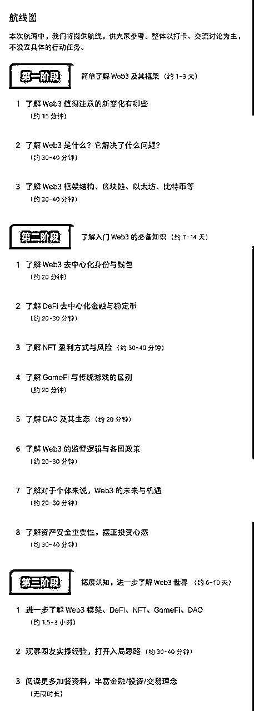

⚠️上面的建议时间，只代表把手册内容过一遍所需时长。若想更深入理解 Web3，还得额外花时间自行探索。

航海路线图和手册正文关系很紧，所以你可以按自己所处环节学习对应步骤：

1.

每天对照当前项目进度，确认自己走到了路线图哪一步，下一步要做什么；

2.

点击要实操的步骤，跳转到手册对应模块，了解操作方式并开始行动；

3.当天行动结束后，完成日志打卡，复盘动作，再安排下一步；

4.

路线图与项目关键路径强绑定。路线图上的动作全部完成，说明最小 MVP 已经跑通；此时别停，继续重复第一阶段到第三阶段的动作。

走完路线图全部动作后，建议持续学习、继续精进，找到适合自己的入场方向，理性且慎重地进入 Web3。

必修篇｜从零迈入 Web3 一、认识 Web3（作者：可达 Koda）

💡

本章概要

那些口口声声说自己在做 Web3 的人，究竟在聊什么？为什么我一句都听不懂？“铸造一枚 NFT”又是在做什么？

当你碰到自称搞 Web3 的人，会不会忽然觉得自己像穿越了？明明你也是互联网时代长大的，怎么他们说的话完全听不明白。

比如下面这些词：大饼、以太、币安、智能合约、无聊猿、阿谢、跑鞋、公链，以及 DID、DeFi、NFT、GameFi、DAO……是不是一个都不认识？

别慌，这很正常。大多数人刚走进 Web3 时，都是一头雾水。

主要原因是：进入新领域后，你遇到的是圈内人默认你已经懂了的概念前置。

一个概念如果没有解释就突然出现，普通人当然理解不了。

不用焦虑，我们会从下面这些角度，陪你逐个弄懂：

为什么要了解 Web3？

Web3 是什么？

它到底解决什么问题？

商业模式长什么样？

目前发展到了哪一步？

它和 Web2 有什么区别？

……

来吧，推开通往 Web3 的第一扇门。

## 1.1 2023 年，Web3 圈发生了什么【新】🔥

2021 年冲高之后，这个行业近两年更多是在做基础设施和产品建设。

2022 年，明星代言的天价 NFT、6.9 万美元的比特币、4800 美元的以太坊、埃隆·马斯克的狗狗币等故事逐渐退潮；头部交易所 FTX 爆雷，LUNA 在 48 小时内几乎归零，很多人离场，行业跌到接近谷底。

2023 年，加密资产市场回暖，新叙事接连出现，Web3 重新回到大众视线。

这一年，加密市场总市值比年初扩大超过 110%，增量超过 8700 亿美元。第四季度到现在，市场涨了 55%，约合 5960 亿美元。

比特币走出强势一年，从谷底 15000 美元重新冲上 44000 美元，涨幅 190%。比特币生态里，Ordinals 与 BRC-20 让比特币第一次可以部署、铸造和转移同质化代币，ORDI 涨了近万倍。

以太坊生态继续创新，体量大而不倒，基础设施不断加固，也孕育出新技术和细分市场；二层项目空投频繁，四季度的 Blast 又给以太坊添了新活力。

最大加密交易所币安与美国监管机构达成协议，接受 43 亿美元罚款，Web3 正朝可监管方向走；多家基金巨头提交现货比特币 ETF 申请，可以预见，未来大量法币资金能合规进入 Web3 市场。

宏观上，美国利率处在 22 年来最高位，美联储降息预期越来越近；欧洲通胀回落，也让欧洲央行降息预期提前。这些都会成为 Web3 市场的积极因素。

随着加密市场噪音变大，越来越多人开始进入 Web3，这个行业也在孕育新机会。下面看看，为什么 Web3 仍值得学习？

## 1.2 为什么仍有人看好 Web3？

一句话：我们看到的，是十倍量级的增长机会。

混沌学园的李善友老师曾在创业课上说过：当你看到十倍级增长，往往意味着历史性机会来了，创业者要主动扑上去。

这句话不只适用于创业者，对打工人和投资者同样成立。

可以从微观层面正在发生的现象看。

### 1.2.1 打工人：薪资与远程协作的新选项

前阵子有一篇知乎帖子讨论在头部交易所某安工作是什么体验（某安在行业里的位置，类似互联网里的腾讯、阿里）。帖子里提到：按时薪算，同级别互联网大厂很难追上。事实也确实如此。

另外，岗位支持全球分布式办公，时间安排更灵活。我认识的不少 Web3 创业者目前就在家工作。注意，这不是说分布式办公效率一定更高；相反，我个人认为集中办公通常效率更高。

但即便在这种模式下，薪资依然能这么高。说明什么？竞争没那么卷。

而且，Web3 的门槛真没大家想得那么高。深入了解会发现，它目前无论产品还是市场，成熟度仍明显落后于 Web2。

那为什么还会出现“高薪、远程协作”的情况？

因为通用型人才不少，真正理解 Web3 并愿意投入的人还不多。

后文会讲到，Web2 和 Web3 对底层工作能力的要求并无本质差别。真正拉开差距的，是认知和选择。

### 1.2.2 创业者：值得关注的增量赛道

马斯克曾在采访中说：大学时他反复思考的第一个问题是，什么能影响人类未来。

如果你是想把互联网项目做大的创业者，不妨看看 VC 的判断：VC 挑赛道，创业者做经营，专业的人做专业的事。

VC 视角下，国内大赛道包括双碳、新能源、半导体等硬科技；海外则把 Web3 视为重点之一。

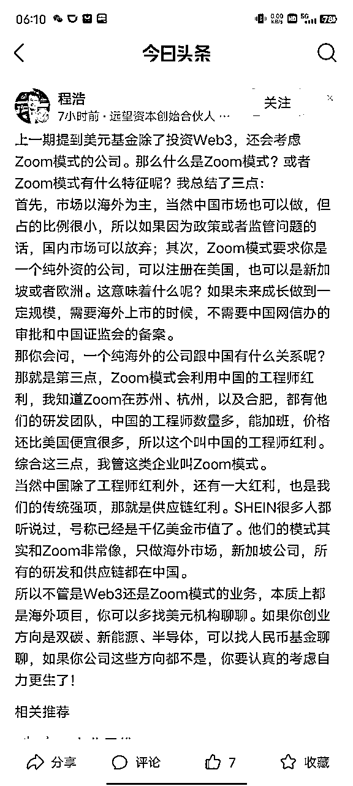

### 1.2.3 投资者：资产配置的新思路

我们自己经历过股票、房产等投资，再对比 Web3 相关投资，反差非常明显。先看过去两年。

如果把时间拉到十年，全球涨幅最大的资产是什么？答案是数字资产比特币。这是数据，也是已经发生的事实。

同期美股龙头：苹果从 90 美元到 150 美元，约 1.7 倍；谷歌从 1460 美元到 2900 美元，约 2 倍；A 股和港股则是负增长。

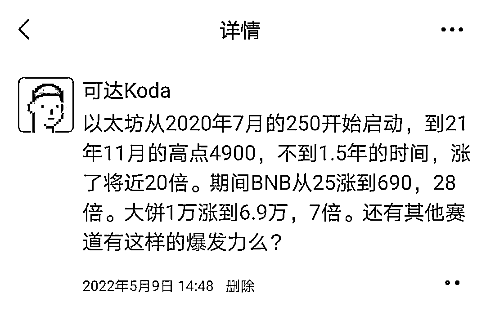

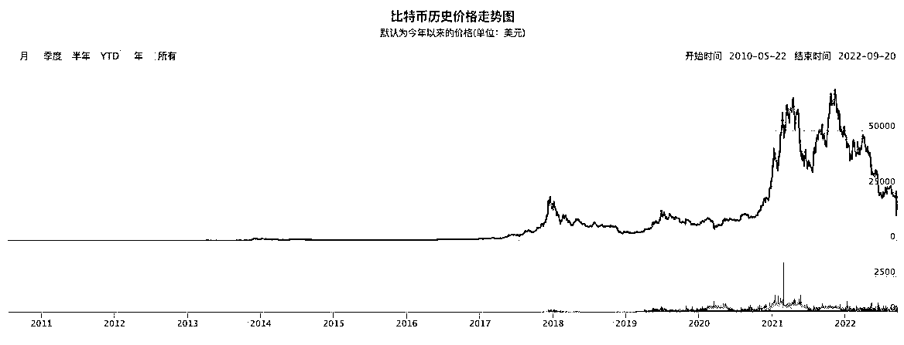

再次强调，本手册不构成任何投资建议。这里只是提供一个资产配置渠道的新可能。

当年 BTC China 的 CEO 曾对还是 Web3 小白的赵长鹏说过一段话：拿 10% 资产换成比特币，归零概率很低，更可能翻十倍；如果真翻十倍，你的总资产就翻倍了。

赵长鹏听后，先卖掉上海的房子买入比特币，随后开始 Web3 创业。

今天，他已经是 Web3 世界最有钱的人之一，位列福布斯全球富豪榜前二十。

## 1.3 Web3 究竟是什么？

Web3 常被概括为四个关键词：去中心化、无需许可、原生支付、无需信任。

它今天是一个范围很宽的概念，承载着人们对更好网络形态的想象。其要义，是借助区块链、加密货币与 NFT，把控制权以产权形式交回使用者。

行业尚处早期，很难给出毫无争议的定义，但建设时仍遵循几条原则：去中心化、无需许可、原生支付、无需信任。

去中心化的含义是：网络不归某个中心实体独占，而由参与者与建设者共有。

无需许可：谁都能平等进入，不存在被挡在门外的设定。

原生支付：消费和转账直接用加密货币完成，不必经过银行或类似机构。

无需信任：系统靠激励与经济机制运转，不把安全寄托在可信第三方身上。

如果仍觉得抽象，我们继续拆。

先看三代网络的定义：

Web1：只读网络

Web2：读写网络

Web3：读、写、拥有（价值网络）

按目前定义概括：Web1 只能读；Web2 可读可写；Web3 在此基础上增加“拥有”，因此常被称作价值网络。

把时间线拉开，从 Web1 到 Web3 的演进更清楚。

1989 年，在日内瓦的欧洲核子研究中心，Tim Berners-Lee 着手开发后来演变为万维网的协议。他期待建立一套开放、分散的协议，让世界任何角落都能共享信息。

这套东西后来被称作 Web 1.0，时间大致从 1990 年延续到 2004 年。当时网页多半是企业放上去的静态页面，用户之间互动极少，个人也几乎不生产内容，因此得名只读网络。

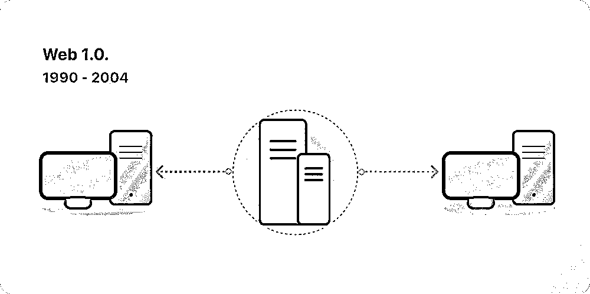

随着社交媒体平台出现，Web 2.0 时期从 2004 年开始。网络不再只读，而变成可读写。平台不再只是公司向用户提供内容，而是提供场地，让用户共享自己生成的内容，并参与用户之间的互动。

随着上网人数增加，少数顶级公司开始控制网络上产生的不成比例的流量和价值。Web 2.0 也催生了广告驱动的收入模式。虽然用户可以创建内容，但他们并不拥有内容，也无法从内容变现中受益。

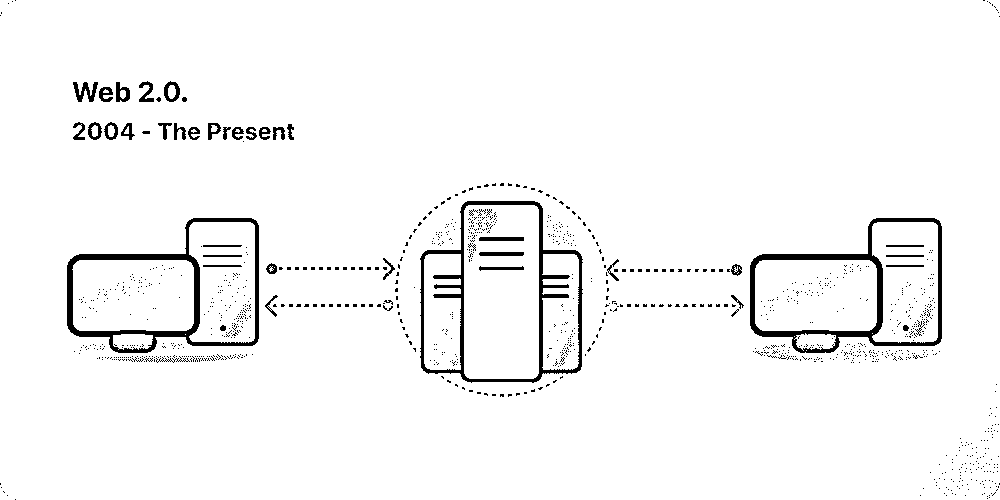

2014 年，Polkadot 创始人、同时也是以太坊联合创始人的 Gavin Wood，与另一家头部区块链公司一起提出 Web3 这一说法。他们关注的是：Web2 对信任的要求过高——用户日常使用的大多数网络，都把信任押在少数私营公司身上。他们希望用 Web3 解决“网络信息归用户所有”的问题。

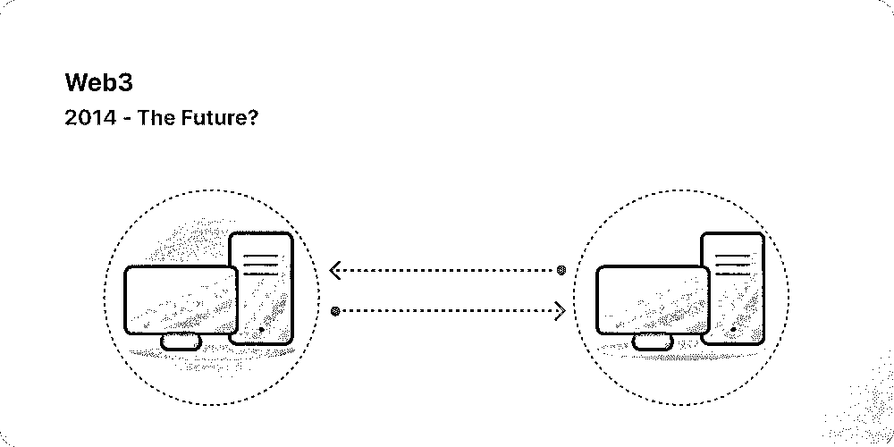

一句话概括：Web3 是价值网络，信息所有权真正落在用户手里。

下面通过实例理解 Web1、Web2、Web3 的区别。

1）Web1 的典型产品是 PC 互联网时代的巨头：海外有雅虎、谷歌，国内有搜狐、网易等门户。它们把信息汇总起来，用户点开浏览。

2）移动互联网兴起后，内容生产不再由门户垄断。全球数以亿计的用户成为信息节点，既能获取内容，也能自己发布内容。国外的 Facebook、Twitter，国内的微信、抖音，都属于 Web2 产品。平台一边聚集大量用户，一边连接商家，通过广告完成商业闭环，是典型的平台型经济。说到底，平台用免费服务换来海量用户，再在用户未同意的情况下把信息卖给广告主获利。

3）Web3 的不同之处，是把网络信息的产权交给创造者。内容一旦由用户产生，权利就归用户。它更像一种由拥有者主导的经济。现在用户不必先在各家平台注册账号；生成钱包后，就能用钱包进入各类 Web3 应用。钱包怎么用，后文会讲。理论上，钱包只归你本人，不归任何公司或组织。在 Web2 里，游戏封号或公司倒闭，虚拟资产可能一起没了；在 Web3 里，公司倒下，信息资产仍留在你的钱包中。这就是它的关键：强调用户的信息所有权，构建原生的价值网络。

## 1.4 它主要针对哪些痛点？

上一节我们讲了 Web3 是什么，也梳理了互联网从 Web1 到 Web3 的演进。这一节换个角度：从 Web3 出发，为什么需要它？它能处理 Web2 的哪些老问题？

先说明，这是 Web3 视角；你当然可以从别的角度思考。Web2 目前暴露出这些问题：数字身份被平台掌控；数字资产不归用户；用户本该拿到的数字收益被拿走；平台与内容创作者之间权利失衡；支付受到限制。

1. 用户的数字身份受控于平台

Web2 里，无论聊天、玩游戏还是用社交媒体，第一步都是注册账号：微信、QQ、网易游戏、Twitter、Facebook 等。你的数字身份从注册那刻起就诞生在平台里，也等于把身份信息交给了平台。

Web3 不一样。你生成数字地址后，就有了自己的数字身份；凭这个地址，可以进入各类 Web3 应用。

2. 自然，用户在各平台的所有数字资产，也不属于用户自己

就像前面提到的，如果你在玩一个游戏，可能因为种种原因，游戏账号被封，或者游戏公司跑路，你的数字资产也就一起被带走了。本来属于你的资产，直接被平台剥夺。

这里还有个段子：以太坊创始人 V 神生于 1994 年，13 岁开始玩魔兽世界。2010 年某天，暴雪一次升级改掉了他角色的特性，他非常难过，直接删了游戏。有人开玩笑说，这或许为他后来做以太坊埋下了思考的种子。

3. 数字资产不属于用户，自然，数字资产带来的收入也不属于用户

微信账号里的资产账

很多人把“数字资产”当成很远的概念。可日常离不开的微信，本身就是一份数字权益。若从归属关系看，微信与房子的产权逻辑有可比之处，自媒体人更能体会。内容被持续发布到各平台后，平台会拿这些内容去变现，或像收租一样获利，却很少把直接收益分给创作者。用户往往对此毫无察觉。

4.
平台与创作者之间，话语权并不对等

这不是秘密。如今不少 Web2 平台，封禁动作可能随时落下。RichDAO 的小助理曾用一个微信工作新号添加 Web3 好友。某天，近 200 人突然来加这个号，小助理还要在群里张罗活动，号却被微信封停，直到现在仍未找回。小助理有违规操作吗？没有。可他与新朋友建立联系的权利被切断了。背后是垄断平台与用户之间明显失衡的权利关系。

知识星球也碰到过类似情形。为了沉淀社区内容，我们把一些 Web3 资料放到免费知识星球。申请转为正式星球时，平台以内容涉及 Web3 为由未通过审核，可那些资料只是正常学习材料。于是 Web3 圈内更认定：现有平台权力需要制衡，世界需要 Web3 理念与精神。

类似情况还出现在支付端。某些国家，尤其美国，会频繁制裁他国或个人，冻结银行资产。Web3 理论上有助于减轻这类限制。

归根到底，Web3 要处理的是数字资产归谁所有。

2023 年 6 月底至 7 月初，《Web3 三问》一文在圈内流传，提出：哪些事情离开 Web3 就做不成？若有，这类 Web3 产品需求规模多大？该场景下，Web3 方案效率是否更优？这三问主要从生产与价值创造角度切入，有局限。我想补第四问：若你认为没有哪件事非 Web3 不可，Web3 是否仍会到来？原因是什么？

这四问，不妨用你的经验和判断试着作答。

## 1.5 案例分析：Web2 与 Web3 的对照样本

上一节从 Web3 视角拆了 Web2 的症结，也说明了 Web3 补上什么，并留下四道思考题。本节挑两家典型公司做对照，让差异更直观。

先看 Web2 样本——谷歌。它旗下有安卓系统、搜索业务、YouTube 等，是 Web2 巨头。市值约 1.3 万亿美元，全球科技公司里仅低于苹果、微软。Web3 样本选以太坊：当前 Web3 最大生态，市值约 1600 亿美元，在比特币之后排第二。

挑这两家的原因：它们都具代表性，且有一定可比性。常有人问以太坊是什么。若说“去中心化开源区块链平台，用智能合约”，多数人听不明白。所以换个说法：以太坊可以理解成 Web3 世界的安卓。网络架构当然不同，后文讲区块链与基建时再细说，眼下先这样建立直观印象。

观察框架有四块：商业模式、扩张路径、融资方式、投资人得到什么及风险。

1.
先来看商业模式

商业公司模式要回答：为谁提供什么产品或服务、解决什么需求、卖什么、收多少钱。这些要素缺一不可。没接触过商业分析的同学，可拿这个框架套一套，看是否多数公司都能装进去。

有人会疑惑：我用谷歌、百度、抖音、微信，商家没向我收钱，难道不是免费服务？这是用户视角。公司必须盈利，短期免费，最终也会从用户身上取得回报。

站在平台角度，以抖音为例：用短视频内容吸引用户，再把用户注意力卖给商家，靠广告变现。平台型互联网公司大多如此。

谷歌安卓同理：用户免费使用系统，谷歌向商家收费，本质仍是将用户精力或数字资产出售给商家变现。

以太坊呢？它为商家和用户提供安全可信网络。它不玩先含糊后变卦的把戏，而是开局就把收费规则讲明、写进合同，约定后不随意改。使用网络要付手续费，商家也一样，规则直接。

2.
然后看扩张方式

谷歌和以太坊都有规模效应。规模效应指越强则用户越多、平台越大，用户和商家越难离开，最终形成垄断；也可理解为用户越多，平台聚合商家越多，商家越多体验越好，最后走向垄断，飞轮很强。

增长方式本质上没差别：都花钱打磨产品、花钱做用户增长。区别在货币：谷歌用美元法币，以太坊多数时候用自己发行的货币。理念上也不同，Web3 用户常怀去中心化理想。

融资方式

我认为 Web2 与 Web3 在形式上最大差异就在融资。这是我的看法，大家可自行思考。

先厘清两个词：IPO 和 ICO。IPO 即首次公开募股，Initial Public Offerings。Web2 公司向普通投资者发行股票；投资者若看好增值空间可买入。虽然叫首次公开募股，实际发行前部分股票已售给机构。个人买股票时，多数是在接机构的盘。关键词不在“首次”，在“公开”：公开募股意味着此前是非公开卖给机构。个人投资者很难拿到上市前股权，尤其 Web2 靠融资烧钱做规模，常以超高估值上市，上市即割。

ICO 是 Web3 特有说法，首次代币发行，Initial coin offering。这里的 coin 既是货币也是股票，这是第一个不同。第二，若把代币视作股票，这次“首次”是真首次，直接面向 Web3 普通用户发行。与其叫首次发行，不如叫众筹更好懂。第三，ICO 不需要牌照。目前国内不允许 ICO，这里不展开，监管合规部分细说。

谷歌上市融资没什么可多讲。重点看以太坊当年 ICO。2013 年，19 岁的 Vitalik 到美国加州圣何塞参加比特币会议。听完他觉得自己的点子有搞头，回去就辍学。之后六个月，他跑遍以色列、加州、伦敦、洛杉矶、拉斯维加斯、阿姆斯特丹等地，见当时叫区块链、现在叫 Web3 的同类团队。他认为大家没解决比特币当时缺陷，仍把区块链技术与应用困在金融领域。他的判断是：比特币叠加图灵完备编程语言，任何人都能开发去中心化应用，不只金融。

他把想法讲出去，没人理。他决定自己干，回家用一个月写出白皮书，命名为以太坊 Ethereum。白皮书完成后给圈内朋友看，也靠它找到早期团队合伙人。几个月后，V 神在迈阿密比特币大会——Web3 全球顶级会议之一——向参会者介绍以太坊，引起轰动。随后启动 ICO。42 天募到 31000 枚比特币，售出以太币 60,102,216 枚，按当时汇率约 1840 万美元。若按现在比特币价格折算，约 6 亿美元，募资规模惊人。早期买入并长期持有者回报极可观。以太坊 ICO 价不到 0.5 美元，如今价格可看价格曲线，是不是会感叹错过？当时哪怕投 1000 块，现在也可能几百万。Web3 常有这类机会。

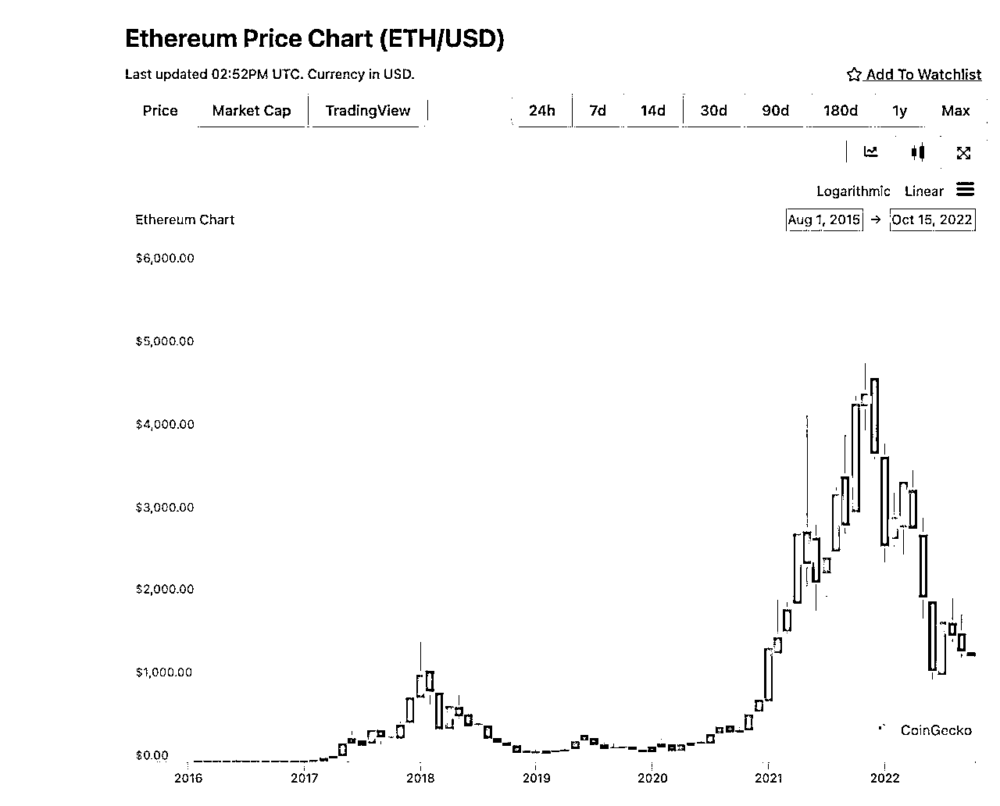

手头还没有交易所账户的人，可先通过下面这个站点查加密资产行情：coingeko：https://www.coingecko.com/

另外，按 SimilarWeb 的 Web3 第三方网站排名，全球访问量更高的是：coinmarketcap: https://coinmarketcap.com/

1.
留一道本节思考题：Web2 的投资机构与普通投资者各自得到什么？风险是什么？

## 1.6 「方法」从资本动向看 Web3

专业分工，看赛道与公司，资本最有发言权。这里给一个视角：资本如何看 Web3、做了哪些动作；怎样查一家 Web3 公司背后有哪些资本；这能辅助判断公司成色。

Web3 赛道出现后，2021 年是资本最舍得下注的一年。Galaxy Digital 2021 年 12 月报告显示，截至当年 12 月底，风投向 Web3 相关企业投入约 330 亿美元；2021 全年规模超过以往该领域投资总和。The Block 研究报告指出，Web3 独角兽在 2021 年集中爆发，金融服务、交易所、基础设施、NFT、GameFi、数据分析等赛道百花齐放。

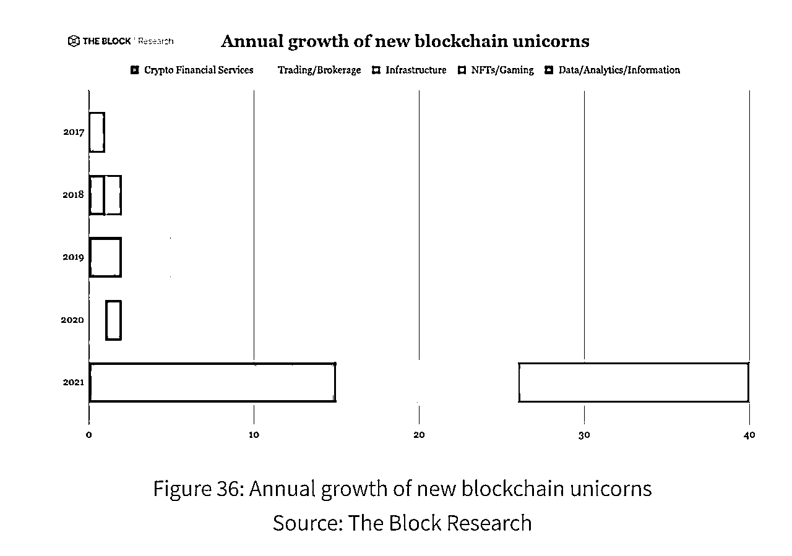

我以前做股票时，会用烯牛数据追踪腾讯战投了哪些公司，用专业机构的筛选给二级市场投资加一层安全垫。Web3 里要验证方向或公司潜力，也可借用：看知名机构投了什么。下图列出 Web3 知名资本及成功项目。

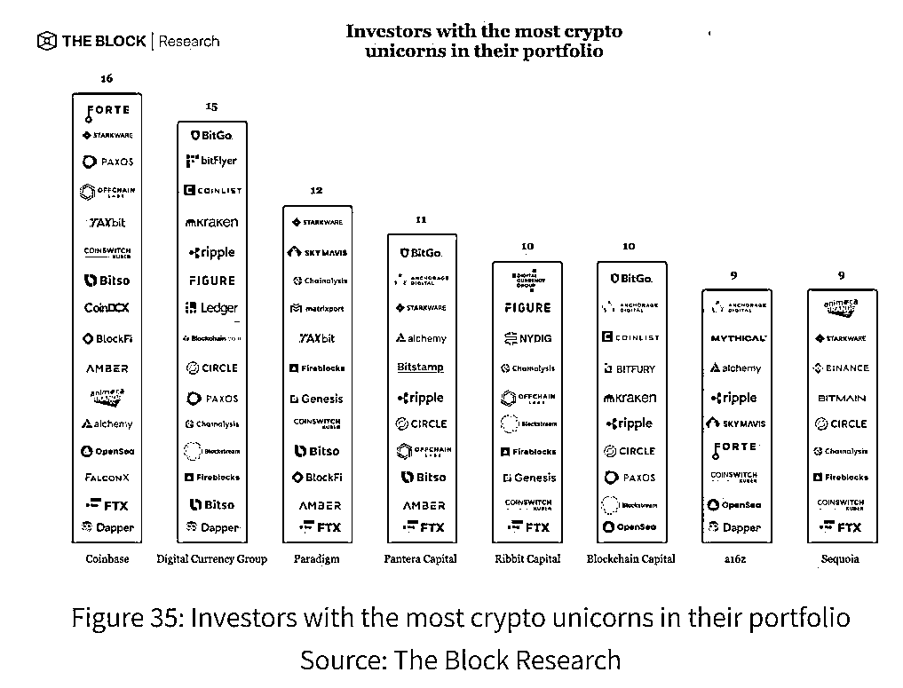

这些资本包括：Coinbase、Digital Currency、Paradigm、a16z、红杉等等。

若新听说一家 Web3 公司，想判断靠不靠谱，可用 Cypherhunter：https://www.cypherhunter.com/en/

例如搜 Ethereum，会看到介绍：它是去中心化平台，支持智能合约与 Dapp。往下有团队及 Twitter 链接，再往下能看到 Vitalik。portfolio 是以太坊的投资组合。最下方列出投资人或机构。

再看最大 NFT 交易平台 opensea，投资人和机构很多，NBA 小牛队老板库班也投了。币安旗下 BinanceLabs 今年以来投资质量也不错，看 Binance 投了哪些公司，对判断 Web3 项目有帮助。BinanceLab 的 Portfolio 包括 bnb 域名项目 SPACEID、今年百倍项目跑鞋 STEPN 等。

概括：知名 Web3 投资机构近期偏好哪些类型项目？新项目背后有哪些机构？这两点都可作为判断项目质量的参考，也是参与投资时的安全垫。

## 1.7 小结

收个尾。

第一节，快速看 2023 年 Web3 的新变化，以及这些变化对我们的影响。

第二节，解释 Web3 为何值得关注。

第三节，说明 Web3 是什么：Web1 只读网络、Web2 读写网络、Web3 价值网络，用户拥有数据所有权。

第四节，从 Web3 视角细看 Web2 的问题与 Web3 的解法，包括：

用户的数字身份被平台控制

数字资产不归用户

用户应得收益被夺走

平台与内容创作者权利严重失衡

支付限制

Web2 有什么问题

Web3 解决什么

Web2 vs Web3，谷歌 vs 以太坊

第五节，用谷歌和以太坊这两个代表性生态做案例，从商业模式、扩张方式、融资方式理解两者差异。

第六节，给出从资本视角看 Web3 的方法。

整个第二节 Web3 概述，除了概念，还给两个方法和五道思考题。

如何查加密资产历史价格？可用 Coingecko。如何找好项目或判断项目？用资本视角辅助，借助 Cyberhunter。

五道思考题是：

1. 哪些场景 Web2 做不了、必须 Web3？

若有，这类产品需求多大？

该场景下 Web3 效率是否更优？

若你认为没有哪件事非 Web3 不可，Web3 还会发生吗？为什么？

Web2 和 Web3 的投资机构与普通投资者各自得到什么？风险是什么？

下一节起，我们将拆解 Web3，从底层技术到热门应用逐一展开。

# 二、拆解 Web3 的框架结构 @可达 Koda

💡

章节概要

本章是 Web3 入门里最难的一节，因为会碰到底层技术区块链与基建。

我们会谈到：

Web3 从协议层到应用层的架构，帮大家建立分层系统

区块链技术源于比特币，比特币与区块链的诞生是为了解决双花问题

介绍去中心化平台以太坊

介绍当前公链格局，以及两种思路的公链方案

介绍联盟链、私链概念

……

别怕，后面会结合案例拆解，辅助理解。

## 2.1 认识 Web3 的分层骨架

先看一张图，理解 Web3 框架结构：

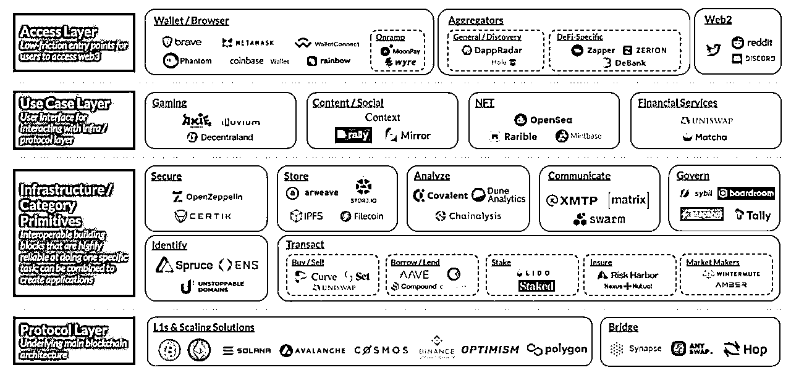

https://www.coinbase.com/blog/a-simple-guide-to-the-web3-stack

前面提到不少可能陌生的词：区块链、基建、智能合约、比特币、以太坊、DeFi、交易所、NFT、GameFi、DAO 等，它们都是 Web3 的组成要素。

本节借这张结构图先做分层。学习时有了整体框架，遇到新概念更容易归位。

简单说，Web3 自下而上分四层：协议层、基础设施层、应用层、接入层。像盖楼一样，每层都压在下一层之上。

下面用类比法。拿 Web2 里大家熟的腾讯系说明，虽不精确，但便于理解。

协议层：各类互联网产品都建立在互联网协议上。互联网协议我理解为一种有共识的语言标准。世界能互联，是因为大家用同一套标准交流。若对方不懂中文，对话就难成立；能连接、能对话，前提是共享一套交流标准。这就是协议层。

基建层：基础建设层。平时用微信、微信支付、QQ、游戏时，背后如何运转？这属于基建层。微信支付要后端记账处理，支付账户要安全体系保障；应用产生的数据要存在公司服务里，既要存储也要处理，牵涉一系列工作。这些统统归入基建层。没有它，APP 和网站都难顺畅使用。

应用层：最容易懂，离生活最近。腾讯生态里的微信、QQ、王者荣耀都算。各类互联网产品也按类似架构生产并服务用户。

接入层：可以理解为身份入口。用微信要注册微信账号，用淘宝要注册淘宝账号。总之，得有个身份才能使用应用；在 Web2，这个身份常是手机号或邮箱。

理解上述架构后，再把 Web3 各类产品对号入座。从分层与演进看，Web3 与 Web2 没有明显区别；但在理念和具体形式上存在差异。

先说协议层。我判断这里会出现一个显著不同。

# Web3 链群全景与层级拆解

Web3 并非只有一条链在支撑，实际情况是若干网络同时运行，每张网络各自遵守一套协议。以太坊算一张，比特币也算一张；除此之外，Solana、Cosmos、币安等也都独立成网。

单用“多张网络”来描述协议层，理解起来容易卡壳。换个参照物会更清晰：Web2 移动端被 iOS 与 Android 两大生态瓜分，而 Web3 眼下同样呈现出多个生态并存的局面。其中以太坊处于领先位置，币安近两年生态扩张的势头也不容小觑。

这类生态在 Web3 里被称作“链”，词根来自区块链。按性质区分，有公链、私链和联盟链三种，具体内容留待后续章节展开。以太坊对应以太坊链，币安则对应币安链。

任何一张网络，都少不了属于自己的基础设施层与应用层。因此 Web3 全景图里，这两层下面摆放着形形色色的产品：基建层涵盖安全、存储、身份认证等模块；应用层眼下集中在游戏、社交、数字藏品、金融理财等方向。

接入方式上，Web2 沿用的是在不同平台留下手机号或邮箱的路径，注册完成后，数字身份就归平台所有。Web3 的玩法完全不同：每张网络中，只要握着钱包地址，就能打开该网络下的全部应用。

这种体验跟 Web2 差距很大。微信要单独注册，淘宝要单独注册，网银还得再注册，这类重复操作在 Web3 里不必再做。

钱包不仅是资产存放地，同时也是一个通行证，凭同一地址即可触达该网络内各类服务。

打个比方来收个尾：协议层好比脚下的土地，基建层则是在这片土地上矗立起来的楼宇。

楼为什么要盖？答案很简单——楼里要装各种服务，游戏、建设、购物都算。这些服务对应的就是应用层。

另外，楼宇入口装有门禁，身份核验通过才能进入；放到 Web3 里，这个身份就是钱包地址。

借助这张分层架构图，Web3 五花八门的产品就能各归其位。日后碰到什么新项目，按图索骥即可。

后续的讲解也会沿着这套结构展开，把那些有代表性的项目逐一拆开来看。

## 2.2 案例解析：区块链的由来与用途

想弄懂 Web3，绕不开它的底层关键技术：区块链究竟为何物？

本课定位入门，技术细节不铺开。若想继续深挖，我们备好了延伸阅读资料，可自行取用；遇到疑问，群里随时聊。

这期视频的重点，放在两个层面：它到底化解了哪类困境，又是通过什么手段化解的。

区块链的源头指向 Bitcoin。2008 年，一位署名中本聪的网络极客发布了一篇论文，仅看标题就能明白，它提出了一个全新概念——Bitcoin，也就是点对点的电子货币系统。正是从这篇文字开始，区块链慢慢走进大众视野。

文末附上《比特币白皮书》作为延伸阅读任务，强烈推荐多翻几遍：《比特币白皮书》英文版.pdf

《比特币白皮书》中文版.pdf

提示：下载后若打不开、或文件名显示异常，请手动重命名，补上「.pdf」后缀，并把「保存类型」设为「所有文件」：

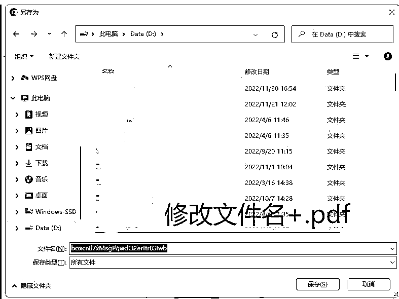

头一回读不明白太正常了，反复看几遍，理解自然会浮上来。

接下来围绕几个疑问展开：

比特币与区块链被创造出来，针对的是什么痛点？为何非它不可？应对手段又是什么？这项技术具备哪些特性？

先看第一个：区块链究竟冲着什么问题去的？

耐心翻完白皮书就会发现，中本聪设计比特币时瞄准的正是同一笔资金被重复支付给两方的漏洞，业内称为“双花”。这个漏洞因何而生？

要弄明白这点，得先看清现行货币体系长什么样。

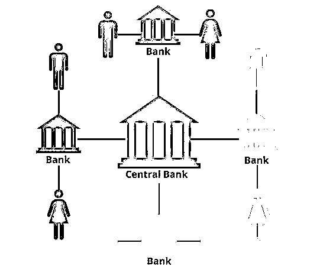

图中展示的便是当下通行的货币运转模式——中心化交易体系。里面聚集着海量用户与银行，底层依托一套记账加清算的机制运作。

银行最本质的活儿，两个词就能说清：记账。账目既不能出错，更不能造假。

可进入数字时代后，由中心统一掌管的数据库，存在被动手脚的各种风险。

具体有哪些风险？不妨设想几种情形。

其一，中心化银行值得托付吗？我们存进去的钱，在银行系统里不过是一串记录，而且这串记录并不向个人开放。真实状况如何，普通人根本无从查证。

其二，中心化银行真能保证安全吗？经济危机来临时，为何有些国家的储户会面临取款无门的窘境？

其三，国家信用可靠吗？银行背后站着国家，像美国、中国这样的大国，信用背书相对稳健。然而部分第三世界国家局势动荡，本国货币汇率的振幅甚至超过我国股市；更有国家直接宣告破产。此情此景下，背书还能剩下多少分量？这些都是摆在眼前的真问题。

以上只是我能列举的几种，更多情形留给大家自行发散。

基于这些顾虑，中本聪给出的答案是：绕开中心机构，让用户彼此直接完成点对点转账，构建一套去中心化的货币体系。

那么，区块链又是如何落地这套思路的？

“区块链”三个字读着拗口，它其实是英文 blockchain 的直译。

拆开来看，block 意为区块，chain 意为链。block 可看作信息块，区块链便是一个个信息块首尾相接组成的整体。

换成贴近日常的说法：区块相当于持续产出的分账本，分账本之间借助特定算法（哈希算法）依次串联，最终汇成一本总账。说穿了，区块链没什么玄乎的，它就是一种难以被篡改的新型记账手段。

把方案浓缩一下，大致是这几条：

既然交给中心机构打理容易出岔子，那就干脆不交由它管。把数据库的维护权下放给所有参与者，由众人共同记账、共同维护。

每位参与者手里的账本，必须与其他人完全吻合才算数。因此，整个网络中的账本内容保持高度一致。

而且，谁也无法背着他人偷偷改账。

中心化模式下，记账的是某个人或某个系统；区块链则反过来，让网络里的全体成员共同承担。每产生一笔交易，所有人都同步记上一笔。这些记账者散布于全球各个角落。

这套账本要运转起来，得吸引足够多的参与者加入，从而形成规模效应。加入记账的人越多，网络就越稳健、越健康。

紧接着要回答的关键在于：一个寻常人，凭什么愿意充当网络的建设者、加入记账行列？

俗话说无利不起早。比特币吸引众人参与建设的手段相当直接：大约每十分钟派发一次奖励红包。

原因在于，分布式记账网络每隔十分钟要产出一个分账簿，并将其并入既有总账。从生成、校验分账簿，到确认无误后归入总账，这一连串动作都依赖网络中计算机输出算力。付出劳动之后，参与者便有机会争抢比特币奖励。

比特币正是靠这种持续派奖的方式，完成了自身的货币发行。白皮书规定，奖励发放要延续 142 年：起初每十分钟奖励 50 枚，此后每四年削半一次，单次奖励从 50 枚降至 25 枚，再降到 12.5 枚，依此类推。

比特币总量锁定在 2100 万枚。即便奖励发放殆尽也无妨，负责建设与维护网络的节点，仍能靠用户支付的交易手续费获取回报。

在 Web3，抢奖励这件事被形象地唤作“挖矿”，投身网络建设的人则被叫作矿工。由于抢到奖励带有概率性质，矿工们倾向于抱团作业，聚集起来的计算节点便构成了矿池。

顺带一提，挖矿、矿工、矿池这三个术语也就此讲明白了。

比特币网络诞生之初，参与者寥寥，全网算力也低，随便一台笔记本就能挖出可观的比特币。历史上第一笔比特币交易，是一位老兄拿一万枚比特币换了两个披萨。放到今天，这一万枚价值 2 亿美元，巅峰时曾达 7 亿美元——那两个披萨，堪称史上最贵的一餐。

综合上述，若一定要提炼区块链的特征，我认为无非两条：

分布式方案；不可篡改。

至于去中心化与公开透明，在我看来都是分布式方案衍生出的结果。

这项技术问世，初衷是化解中心化带来的弊端，才选择了去中心化这条路；并非先执着于去中心化，才倒推出区块链。

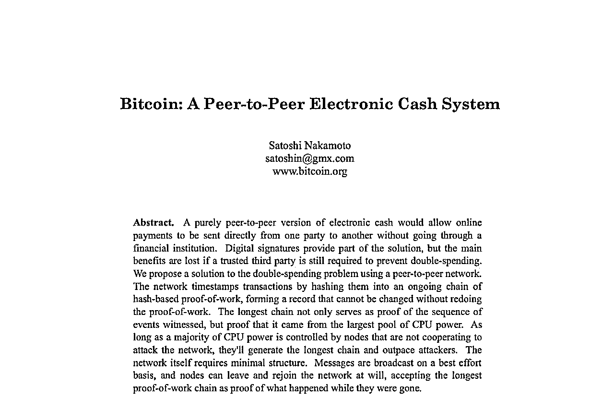

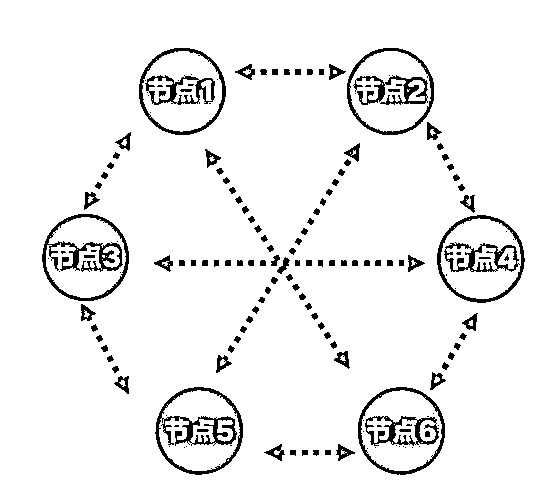

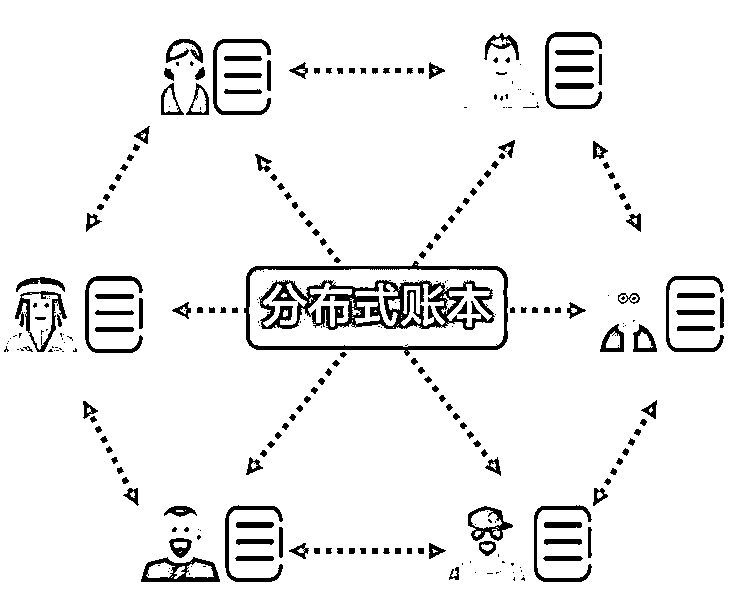

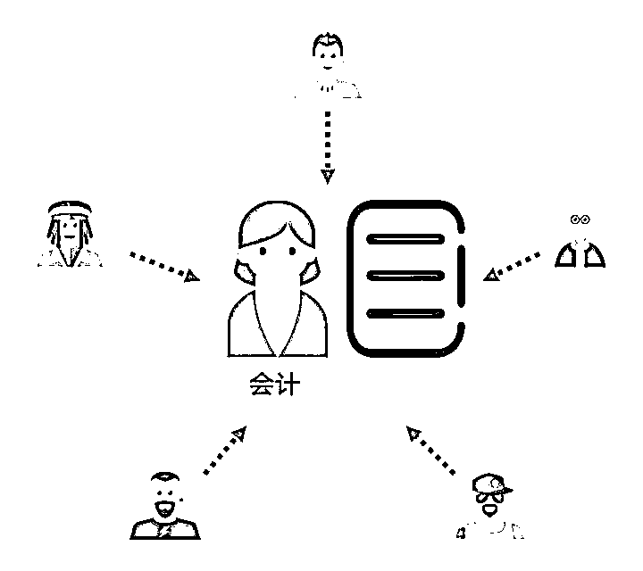

## 2.3 案例解析：公链龙头以太坊

前文讲过，区块链的起点是比特币——一套点对点的电子货币支付方案。

也交代了比特币针对的痛点、采用的应对方式，以及它的特性。

更早的《Web2 与 Web3 经典公司对比》里，以太坊曾露过面，不知各位是否还有印象。

这一节，我们把以太坊掰开细讲。

依旧借几个问题切入，帮助理解：

1.

以太坊究竟为何物？它要破解什么难题？

给出怎样的解法？又留下了哪些隐患？

3.比特币与以太坊的异同。

### 2.3.1 以太坊瞄准的痛点

经过前面的铺垫，各位对以太坊应有了大致轮廓。这里再复述一遍它的自我定位：以太坊是新一代智能合约与去中心化应用的平台。若仍觉得抽象，不妨先把它想象成一部自带货币体系的安卓机。

那么，创始人当初为何要另起炉灶？他察觉到了什么短板？

概括地说，比特币只处理了交易这一件事。它让跨境汇款变得即时，不必再受国界掣肘，手续费也低到可以忽略，远优于传统国际转账。随着区块链问世，越来越多人把目光投向金融、云计算、信息传输，以及那些需要分布式治理的应用开发。

问题在于，比特币网络最初只为电子现金交易而生。若要承载上述日益增长的去中心化诉求，它对开发者而言显得相当不友好。

于是以太坊站出来说：我们搭一个顺手的平台，专门用来创建这类去中心化应用。这思路，是不是与去中心化的安卓如出一辙？

### 2.3.2 以太坊的应对之道

下面瞧瞧，以太坊究竟拿出了怎样的解法。

三流企业卖产品，二流企业树品牌，一流企业定标准。面对这片新领域的上述难题，以太坊依托区块链，直接抛出自己的一套全球通行、上手容易的可编程区块链语言，供各路开发者取用。这门语言名为 Solidity。

协议层面，若想在以太坊网络中发行属于自己的代币，就得遵循 ERC-20 这套标准，此外还有其他若干规范可供选择。

2. 智能合约：把规则与合同写进程序

这门语言派什么用场？主要用来编写智能合约。该词译自英文 smart contract，乍听有些费解。通俗讲，它是一份启动之后便无法再改动的电子协议。

举例来说，租房时租客与房东之间会签订一份协议，写明房屋由谁出租给谁、租客何时向房东支付多少租金。这是一份普通合同，执行靠人工或机构系统来把控，并不完全由程序驱动。

智能合约所做的，正是把比特币那套分布式记账、不可篡改的逻辑搬到形形色色的应用之中。各种合同被转成代码、织入程序。只要各方在启动阶段认可了某个方案与条款，运行之后便无法更改。

各位可曾想过，货币体系最核心的功能若用代码表述，其实简单得出奇：

从 A 的余额扣掉 X 个单位，同时给 B 加上 X 个单位。前提有两项：（1）交易前 A 至少持有 X 个单位；（2）该笔交易经 A 本人授权。

要搭起一套代币系统，只需把这段逻辑落成代码即可。

不妨发散一下：人类社会里，哪些规则一旦敲定便可长期沿用、无需改动？刚才说的交易规则算一条，还有别的吗？

把这套方案付诸实践，又带来了什么？以太坊扎根于区块链，因此与 iOS、安卓这类 Web2 开发平台相比，在它之上构建的应用天然内置了货币发行能力。

可话说回来，项目方在合约里写上一句“我要发币”，众人就会认这玩意儿能当钱使吗？显然不会。否则随便谁在纸上写个数字，岂不都成了钞票。

美元、人民币为何被认可为货币？归根结底，货币背后站的是信任共识。

于是，Web3 项目的常见路径是：先抛出理念、发布白皮书，再在平台上众筹发行自有的加密代币。有人拿 BTC、ETH 或其他币种来认购，项目方便筹得了启动资金。

说白了，就是在启动阶段把项目各方的利益分配算得明明白白，再写进合同条款。

倘若旁人认为你的分配方案合理、格局也够，他们自然会掏钱支持。

这种玩法，正是此前聊过的 ICO——首次公开发币。

前面提过，以太坊当初启动项目，走的便是 ICO 融资。42 天里募得逾 3.1 万枚比特币，按当时币价折合约 1800 多万美元，堪称一笔巨额启动金。

### 2.3.3 遗留的隐患

The DAO 失窃与硬分叉事件。前面说过，开发者能在以太坊上构建各类去中心化应用：规则提前约定，一旦敲定便不可更改，随后被程序化地自动执行。其中一类应用，便是去中心化组织。

DAO 出自 Slock.It 之手，这支团队技术过硬，成员中不乏以太坊早期的创始人员。在 Slock.It 看来，DAO 是一种由社区为项目输送资金的机制，性质上接近众筹式的投资组织。

其核心理念是：由社区共同筛选项目，提案一旦在社区表决通过，资金便从以太坊社区的投资者处募集；项目若跑通，投资者可分享一部分收益。

DAO 亦是以太坊生态内一场重要的实验。参与者并非直接用以太坊资助项目，而是先把手中的以太币兑换成 DAO 代币。持有该代币便可对项目投票，当然，它也能反向兑换回以太币。

2016 年 4 月，DAO 代币开启众筹，不足一个月便募得总值约 1.5 亿美元的资金，相当于当时以太坊全部存款的近 14%。

然而，凡有语言与规则之处，必有缝隙可钻。

树大招风，盘子如此之大的众筹项目，很快被 Web3 圈的黑客锁定。同年 6 月，黑客借项目合约的漏洞，卷走 360 万枚以太币，约占总募资额的三分之一。

这就好比一份合同在起草时，没料到某种情形下会有一方钻出持续套利的空子。我记得曾有一款彩票，规则设计存在漏洞，奖池最终被洗劫一空。

面对这一局面，以太坊创始团队经社区商议，在“坚守不可篡改”与“追回被盗资产”之间，选择了让平台出手，将失窃资金退还给用户。这一处理手段即所谓的硬分叉——在原规则之上强行改写规则，另起一条新链。

此举自然掀起不小的争议。

一方主张：规则既立，就该一以贯之。区块链的魂魄在于去中心化与不可篡改，哪怕资产被盗，账本也不该动。

另一方则认为：社区不能缺了正义之手，岂容作恶者得逞，违法必究。况且这样一来，投资者也不必吞下被盗的苦果。

结果众所周知，分叉方案在社区投票中赢得 85% 以上的支持，V 神也站到了社区正义这一侧。这场风波，还派生出两种以太坊代币。

#### 2.3.3.1 硬分叉之路🔥

其一是 ETC，它守护着区块链不可篡改的信条：账本一旦成型，便不容涂改。

其二则是如今最普及的 ETH——在极端情形下，创始团队与社区可以联手调整规则。

有意思的是，原链与新链各自持有代币：老链那条叫 ETC，分叉出的新链叫 ETH，币价对比一目了然。眼下大家日常使用的，正是后者。

再看比特币，至今它几乎是一个彻底去中心化的网络。缔造者中本聪身份成谜，此后这个化名更是从网络上彻底隐没。所有决策都依循那套派发奖励的规则自行运转，一晃已运行十余年。

比特币后来其实也经历过分叉，初衷是缓解其支付效率的瓶颈，由此分出了 BCH。只不过，新链始终未能赢得广泛共识。

比特币走的是以不变应万变的路子，大道至简。比特币就是比特币，如今它已成为 Web3 世界的一种符号，既不必追求演进，也无意比拼效率。

反观以太坊，自诞生起便以提效为使命，它的迭代与进化，骨子里也是在不断追求更高的效率。

这或许能引人琢磨：为何世间有些东西必须持续迭代，而另一些却能以静制动、始终如一？

#### 2.3.3.2 BTC 与 ETH：守与变🔥

最后，把 Web3 世界最具代表性的两套系统摆在一起对照，同时复盘前两节要点。

比特币诞生于 2008 年，出自匿名网友中本聪之手；以太坊则于 2013 年由计算机天才 Vitalik 缔造。

比特币不归任何组织所有；以太坊虽是当前 Web3 体量最大的去中心化平台，却不难看出，其公司层面仍会受到社区与创始人的左右。

比特币开启了点对点支付的数字现金交易范式。

以太坊则在区块链之上进一步提出智能合约与去中心化应用开发平台，把这项技术引向更广阔的应用场景。

比特币问世时并无融资，参与者因共识自发加入，成为网络记账者，进而获得比特币激励。

以太坊则不同，它凭借自身方案募得资金，再着手搭建网络。

激励机制上，比特币采用 PoW，即工作量证明。

以太坊起步时同样用 PoW，今年 9 月完成全网升级后，切换到了新模式。

即 PoS——权益证明。通俗理解，你持有该网络代币越多，参与记账所得回报便越丰厚。

## 2.4 多链并存的生态版图

这一节聊聊 Web3 底层区块链的多链格局。

“以太坊”三字，可以拆成三层来读。第一层，它是一家公司、一个组织，成立初衷是改善去中心化应用的开发环境，让区块链不再局限于比特币式的交易。

为化解上述问题，他们建起了以太坊这一平台，专门服务开发者，定位类似安卓与 iOS。这个平台本身也叫以太坊——这是第二层含义。

第三层则在于，与 Web2 平台截然不同，该平台从协议层便内嵌了金融体系。在以太坊生态中流转的代币，称作以太坊或以太币，英文缩写 ETH。

中文译作“代币”，我觉得不够贴切。英文把这类在 Web3 平台内流通的凭证统称为 token，译成“通证”或“令牌”更能帮助理解。

原因在于，这类在 Web3 网络中流转的凭证，既承担货币职能，又兼具债券、股票般的属性。若只译成“代币”，容易让人误以为它仅是货币的一种，这就失之偏颇了。

# 公链风云：以太坊的瓶颈与比特币的转机

以太坊并非单一应用那么简单。从底层协议到各类基础设施和应用，都依托它运转。因此，把以太坊视作一张 Web3 网络并无不妥。这张网络以区块链为根基，业内通常称之为“公链”——即人人皆可访问和使用的链。

这种底层平台的商业价值，注定是各方争夺的要地。其他团队、企业与资本自然不甘心让以太坊独占鳌头，于是众多新链纷纷涌现，针对以太坊的短板提出各自的解法。

不妨先回看本节开篇那张架构图。

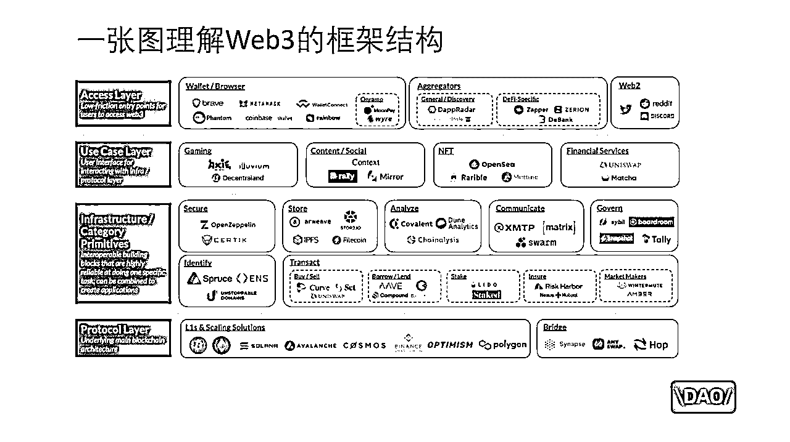

最底层其实有众多链可供挑选。本章将展开聊聊当下公链的竞争版图。

顺着区块链“不可能三角”，回顾公链生态的演变脉络，了解各条链各自瞄准什么问题、又如何破局。

### 2.4.1 不可能三角：效率、去中心化与安全三者难全

所谓区块链不可能三角，是指一条区块链无法同时具备三种特质：可扩展性、去中心化以及安全。

其中可扩展性，通俗说就是效率。

拿比特币这类早期网络来说，去中心化与安全做得较好，代价是效率不高，转账动辄要等几个小时。

以太坊同样逃不开这道三角困境。今年推出的二层方案，正是为了疏解其算力瓶颈。

如今常用的 Web2 网络，可扩展性与安全性都相当成熟，几乎做到极致；但代价是中心化程度加深，用户失去了对网络的所有权。

此外，若以去中心化程度划分，区块链可分为公链、联盟链与私链，后文会再细说。

自区块链技术诞生以来，各条公链基本都在围绕这三个维度做优化与提效，下面逐一展开。

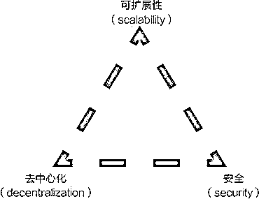

### 2.4.2 公链发展：围绕效率不断迭代

按时间线来看：2008 年比特币诞生，2008 至 2012 年以比特币、莱特币等为代表；2013 年以太坊面世并引入智能合约概念，此后针对以太坊网络瓶颈的平台不断涌现，解决方案涵盖共识机制、侧链、跨链、多链以及 Layer2 等。

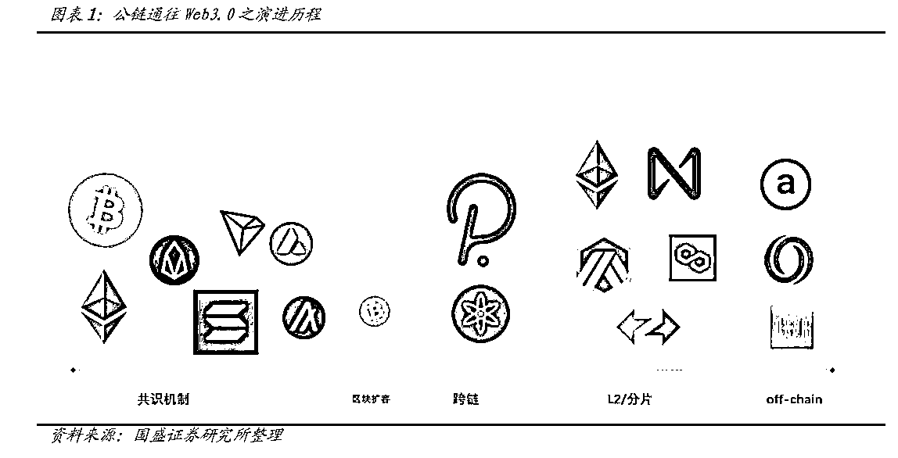

### 2.4.3 以太坊的软肋：速度慢、费用高

先瞧瞧以太坊究竟碰到了哪些麻烦。

Web3 持续扩张，链上应用与用户数量水涨船高，用户体验层面暴露出两大痛点：一是网络拥堵、速度慢，二是交易手续费偏高。

先说说 TPS。TPS 即 Transaction Per Second，指每秒钟能处理的交易笔数。以太坊这项指标约为 15，也就是说每秒仅能完成十五笔左右。一旦用户增多，这样的处理能力显然捉襟见肘。

手续费则随网络拥堵程度浮动。以太坊曾被称为“贵族链”——在这条链上完成一笔交易，便宜时几美元，贵时可达数十甚至上百美元。

这两点直接影响用户感受。因此各条网络纷纷围绕“如何压低手续费”“如何提升速度”给出对策，如今的公链版图正由此演变而来。

### 2.4.4 Layer1 与 Layer2【新】

为便于理解，这里从各公链中挑选最具代表性的项目，分门别类加以说明。

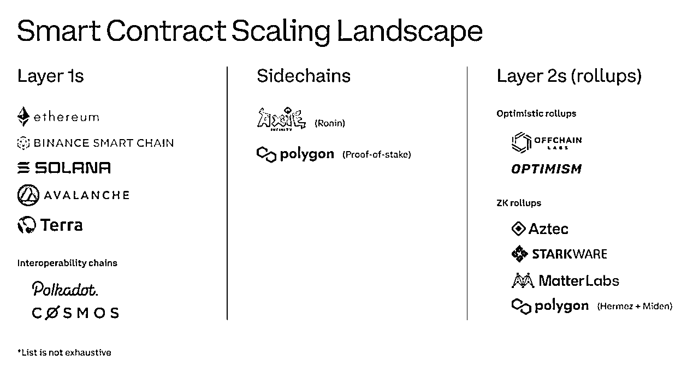

这张图所反映的解决路径，简而言之无非两类：自建与外包。

L1 的思路是：既然现有网络不够好用，那就另起炉灶建一条体验更好的链来取代它。

L2 与侧链本质相通，可看作外包模式。我充当以太坊的协作层，承担繁重琐碎的工作，让以太坊保持高端定位；低费率与高速度在我这里实现，再把核心数据回传主网做验证。

L1 层面，举例来说：

BSC（币安智能链）出自全球最大的加密货币交易所之手。它在去中心化上有所让步，守住安全底线的同时显著提升性能，用户交易费用几乎为零，速度也相当快。

Solana 则采用 PoH（Proof of History，历史证明）共识机制，交易速度大幅跃升，手续费较以太坊明显降低。

以太坊联合创始人之一、Web3 概念提出者 Gavin Wood 独自创办了波卡 Polkadot，聚焦区块链架构的可扩展性，志在把不同链串联起来。

打个比方，波卡问世前，各条链好比移动、联通、电信，互相无法通话；波卡要解决所有区块链之间的互通问题，同时优化用户体验。Cosmos 也走类似路线，愿景都是万链互联。

L2 层面：

AXIE 侧链是为某款经典链游量身打造的。彼时该游戏用户激增，以太坊无力承载，于是另建一条链与以太坊对接。

今年备受关注的以太坊二层项目 Op、Zk、Arb 思路大体一致，区别在于数据打包与认证机制。

下文简要剖析以太坊自行推出的三个 L2 项目。在此之前，先厘清一个概念——Rollup。

Rollup 是什么？其含义为归纳、整理、打包。

前文已提及以太坊速度慢、费用高；交易量过大引发网络拥堵时，手续费甚至能飙到数百美元。

不妨联想工作日在家用餐，对比节假日去景区排队吃饭，时间与金钱成本都不可小觑。

为何会这样？以太坊的每笔交易都携带数据，处理每项数据都要付费；而每个区块的数据量与 TPS 均有上限。当众人争相交易时，出价高者先被处理，出价低者只能等待。

如何应对？既然区块数据量与 TPS 无法再拔高，那就减少处理的数据量：仅将关键数据交由以太坊处理，其余繁杂数据放到其他地方处理，这正是前述 L2 的外包逻辑。

Rollup 的做法具体是：将以太坊需要运算的内容复制一份，送到与以太坊相连的 Layer2 协议中计算；接着把运算结果压缩、打包、整理，再送回以太坊主网。

打个比方，一百个人都去找老师提问，逐一回答耗时巨大，老师也吃不消。于是大家选出一位课代表，先汇总、审核问题并集中处理，最后只把关键且需重点讲解的题目交给老师，效率大大提升。

在这个比喻中，Rollup 协议扮演的正是课代表角色。

不过新麻烦也随之产生：课代表水平参差不齐，其能力与可靠度直接关乎交易安全与效率。下面看几位有代表性的“课代表”。

ZK Rollup：

ZK Rollup 指的是借助零知识证明（Zero Knowledge Proof）验证来完成 Rollup 环节的 L2 协议。那么，零知识证明是什么呢？

设想有 A、B 两人，A 掌握某个秘密，B 并不知晓；A 希望在不泄露秘密内容的情况下，让 B 相信自己确实知道该秘密，这便是零知识证明。

关于零知识证明最早的实例，大约可追溯至十六世纪。彼时数学界正苦寻一元三次方程的解法，两位数学家同时宣称自己已找到。为自证清白又不泄露求根公式，二人各自列出三十道方程交给对方求解；若真握有求根公式，这三十题应能迅速算出。最终结果印证了一切：一人成功解出，另一人却一题未破。

故事中，两位数学家互为证明者，整个过程中都未暴露各自求根公式，只需在短时间内给出对方所列方程的解。

因此，ZK Rollup 的核心在于：运用严谨复杂的零知识证明算法，由认证者（任何人都可担任）来核验各类数据的真实性，核验完成后将结果打包送回以太坊网络。全程认证者无需查看交易的具体数据，从而减轻工作负担。

ZK Rollup 的长处在于验证迅速、安全性强，尤其适合支付等要求快速结算的场景，许多人将其誉为“以太坊 L2 的终极形态”。然而 ZK 算法极为复杂，应用开发门槛颇高，目前真正落地的项目有限，前路依然漫长。

在已落地的项目里，zkSync 生态最为亮眼。

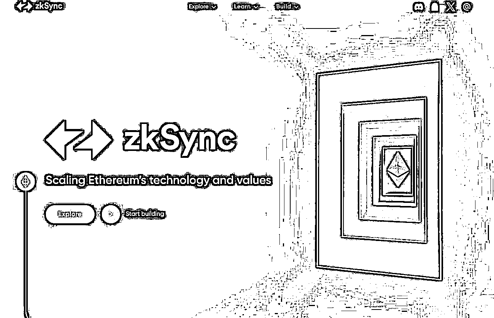

zkSync 出自 Matter Labs 团队之手，a16z 等机构领投，累计融资 4.6 亿美元，现已迭代到 2.0 版本，即 zkSync Era。

zkSync Era 生态颇具规模，已有 300 多个应用在其上搭建，TVL（总锁定价值，即项目内用户抵押数字资产的总价值）稳定在 3 亿美元以上，长期活跃地址接近 40 万。（在本文介绍的三个 L2 项目中，zkSync 也是唯一尚未发币的一个。）

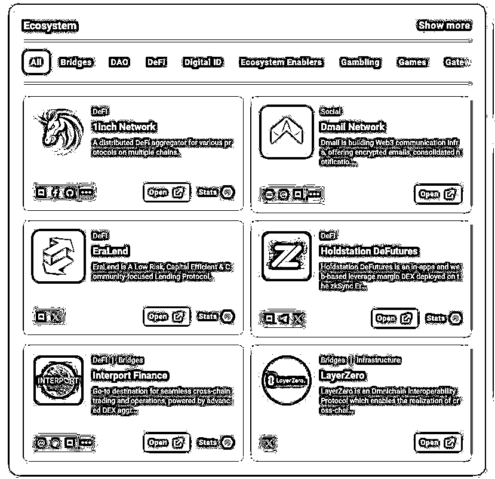

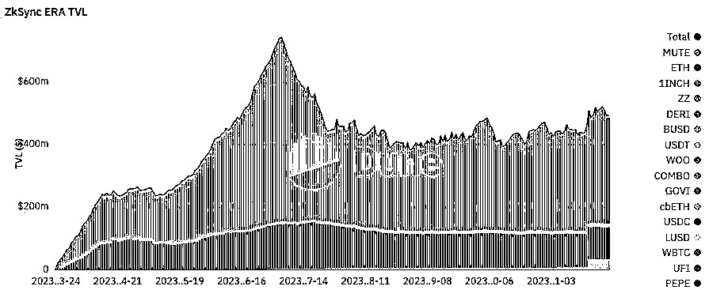

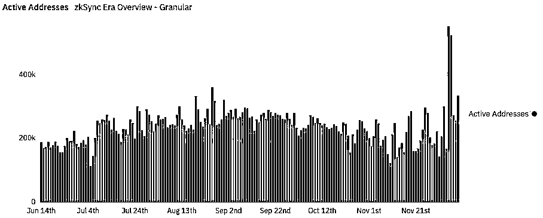

尽管 ZK Rollup 为 L2 描绘了“终极形态”的蓝图，但在算法与配套设施尚不成熟的当下，是否存在更成熟的过渡方案？这就得提到采用欺诈证明的 Optimistic Rollup。

Optimistic Rollup：

Optimistic Rollup 的运作方式一如它的名字，秉持乐观假设：一开始便认定所有发出的交易都可信且已获认证。

举例来说，我身为交易认证者，须先质押一笔费用作保证金。每笔被打包的交易都设有一个验证保质期。若我验证某笔交易并判定其数据无误，那么在保质期内，若有其他认证者发现该交易存在问题（即认定我存在欺诈），这笔交易便会交由 L1 智能合约来裁定，判断谁在说谎。

若确实是我作伪，我的保证金将被扣除一部分，用于奖励发现问题者；同时这笔问题交易会被打回重新打包。

与 ZK Rollup 不同，OP Rollup 默认交易认证者不会作伪；因此相比 ZK 中人人皆可担任认证者，OP 更偏向于挑选少数可信之人充当认证者，统一监督整个打包流程。

从 OP Rollup 所采用的证明方式不难看出，其处理速度较 ZK Rollup 慢不少。因为它必须在交易保质期内让认证者核验打包的真实性；一旦发现问题，还得送回 L1 裁决，再发回 L2 处理，且存在认证者串通欺诈的隐患。

尽管 OP Rollup 存在上述短板，但其实现较为简单、技术成熟，特性也非常适合开发 dApp，几乎能让开发者把原本在 L1 上的项目无缝迁移过来。同时其开发团队也在持续升级技术，提升安全性与效率，因此目前应用广泛，最具代表性的当属 Optimism 与 Arbitrum。

Arbitrum 由纽约开发公司 Offchain Labs 创立，2019 至 2021 年累计融资 1.23 亿美元；Optimism 则由 Jinglan Wang 率领的一批以太坊开发者创立，总融资 1.75 亿美元，二者均远不及前述的 zkSync。

然而从 TVL 数据来看，Arbitrum 与 Optimism 相较 zkSync 呈压倒性优势，在生态成熟度与活跃地址数上也明显领先。

这从侧面说明，ZK Rollup 协议的开发建设仍有诸多问题待解；就当下而言，OP Rollup 确实是更优选择。

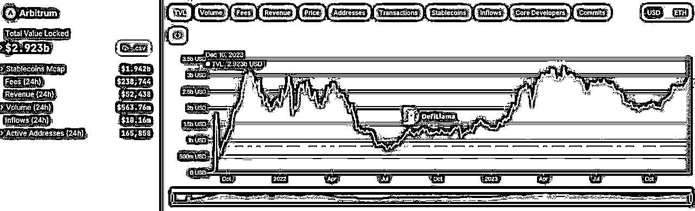

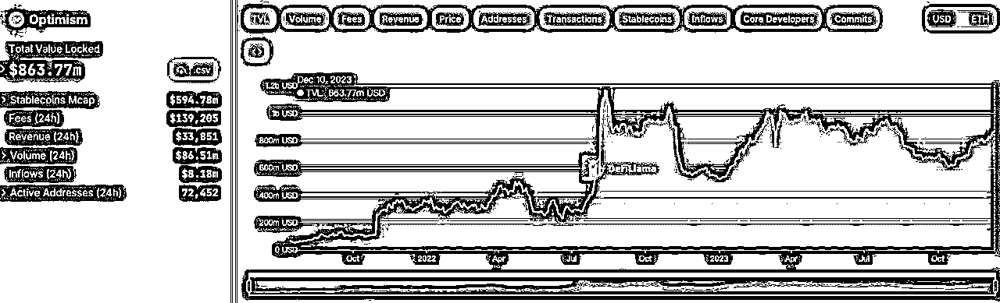

值得一提的是，Optimism 与 Arbitrum 均已发币，不少人通过持续交互参与空投，在这两个项目上收获颇丰。

Optimism 在 2022 年 5 月 31 日推出原生治理代币 OP，初始供应量约 43 亿枚，先后于 2022 年 5 月、2023 年 2 月和 2023 年 9 月开展三轮空投，每个钱包地址最多可得 10000 枚 OP，当前价值约 21000 美元。

Arbitrum 于 2023 年 3 月发行治理代币 ARB，总供应量 100 亿枚，单个钱包空投上限为 10200 枚，发币后最高价值达 18000 美元。

二者虽同属 OP Rollup 协议，却仍有差异。Arbitrum 更像是 Optimism 的进阶版，区别在于：Optimism 仅执行一轮欺诈认证，且 L2 上的交易计算仍需打包到 L1 执行；Arbitrum 则进行多轮欺诈认证，交易也不打包到 L1 执行，而是运行在自己的虚拟机上，与以太坊网络兼容性更佳。

L2 搅局者：Blast

在加密世界里，从经济模型看，加密货币大致分两类。其一是以比特币为典型的通缩型货币，代币数量设有固定上限、不再增发，比特币即 2100 万枚，总量恒定；其二则是以以太坊为代表的通胀型货币，总量每年按固定比例增发，这让以太坊每年约有 3% 至 4% 的稳定质押收益。

然而现有 L2 账户中的资金大多只是闲置存放（即无风险收益为零），这意味着这些资产正因以太坊的通胀而悄然缩水。

Blast 正是瞄准这一痛点，让 L2 账户里的资金有机会被动生息。

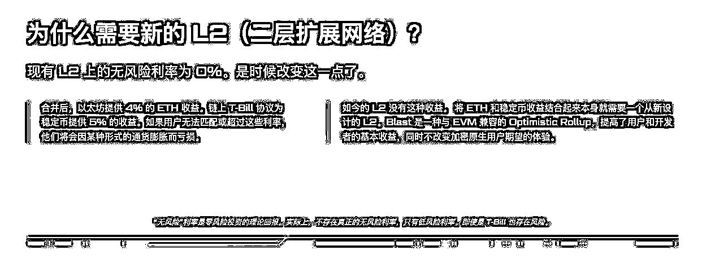

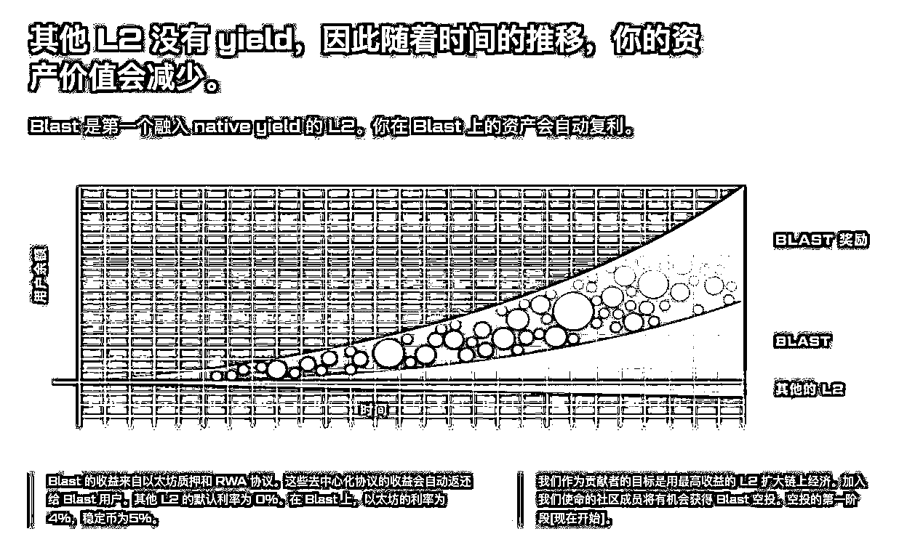

具体而言，用户把资金存入 Blast 后，Blast 会马上将 L1 上锁定的对应 ETH 投入网络质押，并把所得的 ETH 质押收益自动返还给 Blast 上的对应用户。

简言之，若你在 Blast 账户中持有 1 枚 ETH，随着时间推移，它可能自动增至 1.1 甚至 1.2 枚 ETH。

除 ETH 可参与原生质押外，Blast 还能让稳定币被动生息。

用户把稳定币（如 USDC、USDT、DAI）转入 Blast 后，Blast 会即刻将 L1 上锁定的对应稳定币存入 RWA 协议（参见选修部分 11.2.2 RWA 概念），并以 USDB（Blast 原生稳定币）形式把收益自动返还给 Blast 上的用户。

资金存入 Blast 之后，用户不仅能即刻享受 ETH 4% 或稳定币 5% 的被动收益，还能同步累积 Blast Points 奖励。

关于积分，官方目前仅透露：Blast 计划于明年 2 月 24 日上线主网并开放提款，5 月 24 日开放 Blast Points 的“赎回”。

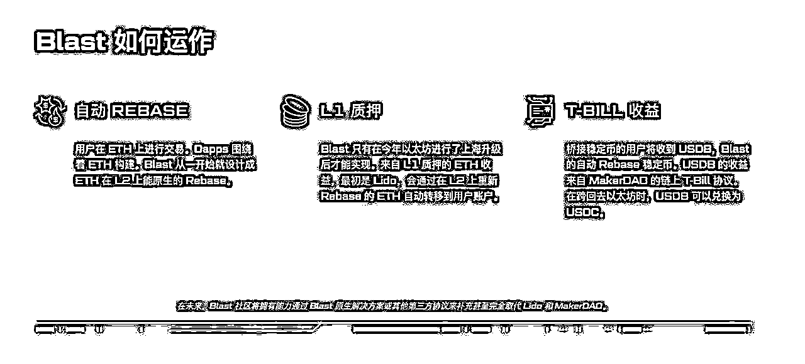

Blast 的问世彻底点燃了沉寂许久的 L2 赛道。上线仅 20 天，其 TVL 便突破 7.6 亿美元，一举成为 L2 的搅局者，但火爆之余也伴随争议。

从本质看，Blast 同样属于 OP Rollup 协议下的项目，并无技术创新，严格来说当下甚至算不上真正的 L2。

早进场者能赚后来者的钱，组队抱团收益更丰，且空投积分的获取规则直接明牌；再加上联合创始人 Pacman 与投资机构 Paradigm 带来的巨大流量，引得大批投机者蜂拥而至。

短期而言，Blast 会直接抽走其他 L2 项目本就稀缺的流动性；长期来看，这套旁氏模型能否维系，仍需经受考验。

拓展阅读：

Vitalik：Rollup 不完全指南（精选）

零知识证明

欺诈证明

Optimism 深度研究报告

新 L2 网络 Blast 撸空投教程

## 2.5 案例剖析：比特币生态因何崛起【新】🔥

自 2009 年比特币问世至今，已走过十四个年头。

这期间，矿工（负责比特币区块链打包区块的人）不断加入、网络技术持续升级创新、新平台陆续冒出，使比特币被更多人知晓，越来越多的零售商也开始接受比特币付款。

可比特币生态始终不温不火，直到今年 Ordinals 与 BRC20 登场，矿工收入见涨，开发者大批涌入，各项目团队开始从技术层面为比特币发展助力，比特币生态才再度回到加密叙事的聚光灯下。

过去比特币一直被视为纯粹的数字黄金，发展较为保守；但开发者们逐渐意识到在比特币上构建应用存在市场需求。今年 Ordinals 与 BRC-20 的亮相，恰好证明 BTC 网络同样能承载生态应用，这些项目也以崭新方式助推了比特币生态的前行。

那么，比特币生态究竟是什么？

它指的是围绕比特币形成的整套体系，既包括比特币本身，也涵盖搭建在比特币区块链之上的各类应用、工具与服务。

众所周知，以太坊拥有配套的主网、L2、钱包以及多种代币；比特币同样具备相应的产品与服务，构成一张复杂庞大的网络。

比特币生态建设已有不短时日，为何偏偏在今年爆发？这就要从 Ordinals 与 BRC-20 讲起。

### 2.5.1 Ordinals 与 BRC-20：撬动比特币生态的支点

先补一个基础概念：什么是“聪”？

一枚比特币可拆分为一亿个单位，这个单位名为“聪”（sats），是比特币的最小面额。

一枚比特币等于一亿聪，也就是说每聪价值 0.00000001 枚比特币。

那么，Ordinals 到底是什么？

# BTC 世界的新入口：Ordinals、闪电网络与钱包

时针拨回 2022 年 12 月，软件工程师 Casey 抛出一份名为 Ordinals 的协议草案，隔月正式上线。这个构想很巧：BTC 总量 2100 万枚，拆到最小单位“聪”后共有 2100 万亿个；若把这 2100 万亿个聪按固定规则排成队列，从 0 一路编号到 2100 万亿，每一聪就带上了可定位的坐标。再往聪里塞图片、文字、视频，甚至一段代码，就等于在 BTC 链上造出可发行、可转移的 Web3 资产。把数据写进聪的动作叫“铭刻”（inscribe），产出的结果叫“铭文”。它不另造底层链，只调用 BTC 自带能力，铭文转账也由 BTC 网络清算。

一开始，Ordinals 更多承载复杂数据，也就是 NFT。2023 年 3 月 9 日，匿名开发者 Domo 在它之上又推进一步：不只发 NFT，还能定统一标准来发代币，这便是 BRC-20。通俗讲，它像一套跑在 BTC 上的“山寨币发行说明书”：约定一种 JSON 包格式，再借 Ordinals 刻进 BTC。部署无许可，人人可参与，先占先得；名称和总量由部署者定，但同名被占后再部署就失效。$ORDI 就是 Domo 部署的首个 BRC-20 代币，后来涨幅接近万倍。关注度上来后，改进版、仿盘版接连出现，BTC 生态快速扩张。铭文热度还带动链上交易量上升，矿工手续费占比明显提高，铭文已成为矿工的重要收入源。整体看，Ordinals 与 BRC-20 带来的是 BTC 生态的深层变化和技术进步，其潜力可能成为下一轮加密行情的重要叙事。

### 2.5.2 闪电网络：把支付放到链下跑

提到 Layer2，很多人先想到以太坊二层，因为那边发展快、体验成熟，以至于有人误以为 Layer2 是 ETH 专属。其实 Layer2 的源头在 BTC，甚至 2009 年中本聪提出 BTC 时，已有二层雏形的设想。前面解释过 Layer2：复杂交易放到二层处理，主链只保留简单关键数据，从而减负。ETH 有慢和贵的问题，BTC 同样存在。

BTC 正常约 10 分钟出一个块，块内空间有限，属于稀缺资源。用户为了让交易被优先打包，只能竞价：手续费高者先被处理。行情冷清时，低费交易等几个区块也能确认；一旦市场狂热，大家都抢着确认，低费交易矿工往往不理，因为总有人加价，你的交易就会长时间悬着。有时手续费短时飙升，矿工还会放下手头打包中的交易，转去接更高费的新交易；这个逐利过程会让链上暂时没有新块，也就是“卡块”，直到费用稳定，矿工才恢复打包。

BTC Layer2 正是为此而来，其中“闪电网络”最出名。它架在 BTC 之上，目标是解决慢和贵，让用户快速收发 BTC，且费用几乎可以忽略。

怎么实现？第一次和某人交易时，双方会建一个智能合约，可以理解成两人共管的私人账本。多笔交易直接记在账本里，只有双方可见，不写进 BTC 主链。这个账本在闪电网络里叫“通道”。举例：甲和乙各往账本放 5 个 BTC，账本显示各 5 个。甲转给乙 1 个，余额变成甲 4 个、乙 6 个；这个结果会回传 BTC 主链，但“甲转乙 1 个”的具体交易不会上主链，只留在两人账本中。结果回传时，因为有私人账本，不必等主链区块确认，支付可先完成；等区块确认后，再按结果把金额分配到双方地址。BTC 主链正常 TPS 约 7，还常卡块；走闪电网络，TPS 可达百万级，100 美元等值的 BTC 交易手续费不超过 1 美分。支付更快、门槛更低，BTC 全球支付场景因此大获成功。

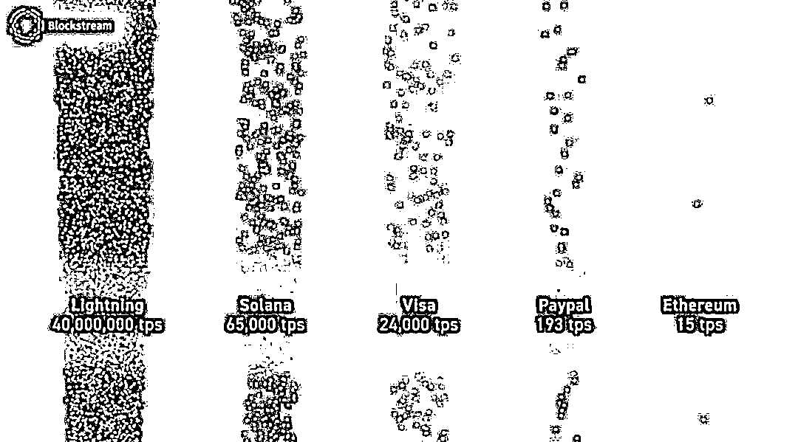

### 2.5.3 其他：两种记账方式与几个新协议

今年 BTC 生态百花齐放。除了 Ordinals 和 BRC-20，再挑几个有代表性的协议加餐。开始前补两种记账方式：账户式记账和 UTXO（Unspent Transaction Output，未花费交易输出）。

账户式记账可以类比银行卡体系，银行转账、支付宝微信转账都属于这一类。假设甲账上 100 元，乙账上 100 元；甲划 50 给乙，系统就把甲减 50、乙加 50，余额变成甲 50、乙 150，一笔完成。再假设甲仍有 100 元，要给 100 个新开户的人每人转 1 元。第 1 笔甲减 1、第 1 人加 1，余额甲 99、第 1 人 1；第 2 笔甲减 1、第 2 人加 1，余额甲 98、第 2 人 1；如此到第 100 笔，甲 0、第 100 人 1。理论上要转 100 次，而且后一笔必须等前一笔完成，否则余额一致性难保证，容易混乱：到底多转没有、余额还够不够。交易笔数越多，执行时间越长。

UTXO 更像现金。BTC 用的就是 UTXO，我国数字人民币也采用它。举例：甲口袋里有 1 元、10 元、100 元三张纸币。现在甲要给乙、丙、丁各 1 元，有三种方式：拿 1 元给乙；拿 10 元给丙，找回 9 元；拿 100 元给丁，找回 99 元。三种都能完成交易。回到链上，每张纸币可看成一个 UTXO；使用 UTXO 时不是把原 UTXO 搬来搬去，而是销毁旧 UTXO、重建新 UTXO。比如甲用第二种方式给丙转钱，10 元 UTXO 销毁，系统生成 1 元和 9 元两个 UTXO，1 元给丙，9 元还给甲。第三种同理，100 元销毁，生成 1 元和 99 元 UTXO，1 元给丁，99 元还甲。UTXO 与账户式记账的转账方式不同，更强的是 UTXO 可并行：余额分散在多个 UTXO 里，1 元、10 元、100 元三张现金能同时转给不同人，甲可在一笔交易中同时给乙、丙、丁转钱，因为不涉及账户一致性，每个 UTXO 独立计算。对比账户式记账每笔依赖上一笔，性能差距明显。再回到甲有 100 元要给 100 个新人各 1 元的例子：面值 100 的 UTXO 可拆成 100 个面值 1 元的 UTXO，然后一笔交易直接分给 100 人，瞬间完成。总之，把 UTXO 面值想成更灵活的现金，在链上不断销毁和重建；想知道某地址到底有多少钱，就统计它名下所有余额 UTXO 并求和。

掌握 UTXO 后，再看今年 BTC 生态的其他协议。

**Atomicals 与 ARC20**

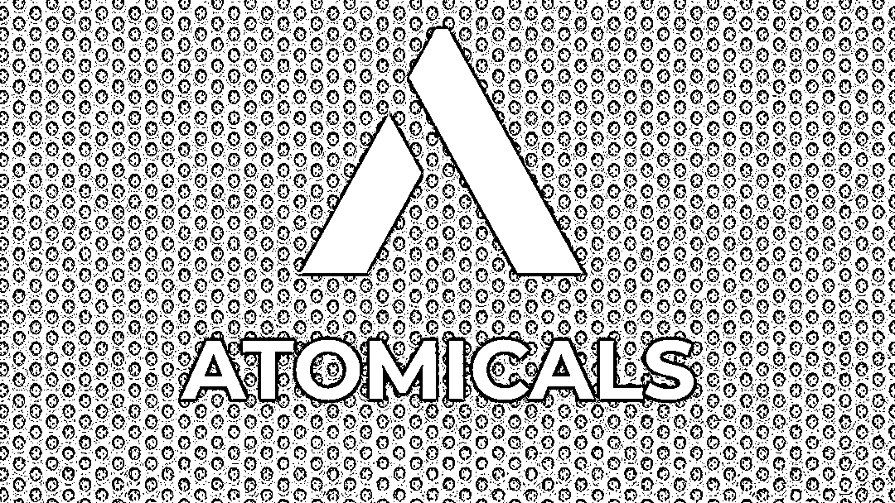

Atomicals 是面向 Ordinals 和 BRC-20 的优化方案，重点在代币，试图解决 BRC-20 过度依赖中心化链下索引的问题。什么是中心化链下索引？简单说，Ordinals 的运转离不开 BTC 主链之外的线下服务来维护状态；一旦这层状态服务出问题，资产就可能受损。主链本身拦不住无效铭文，只能靠中心化平台来裁定哪条铭文算数，算数的才被收进合集。这里用的技术方法不像智能合约那样是公开透明代码规则，所以 Ordinals 难以满足共识、防双花等资金安全需求。Atomicals 则利用并扩展 BTC 的 UTXO，把每个“聪”的 UTXO 当成特定 Atomical 代币或数字对象，从而在 BTC 上创建和管理复杂数字对象与代币系统（ARC-20）。Atomicals 在 2023 年 9 月推出后，第一个代币 ATOM 很快被挖完。与 BRC-20 相比，ARC20 铸造引入 POW 机制，铸造者需要先算出带有指定前缀字符的哈希值，才有资格铸造，这是一种更去中心化、更公平的分发方式。整体看，Atomicals 作为 Ordinals 竞争者，专注同质化代币和数字对象的去中心化创建管理，通过扩展 UTXO，实现更去中心化、更贴近 BTC 文化的代币系统。ARC-20 凭借技术优势和符合 BTC 原教旨主义的设计，有望获得 BTC 核心社区支持，为生态带来更广泛应用可能。

**Runes 与 PIPE**

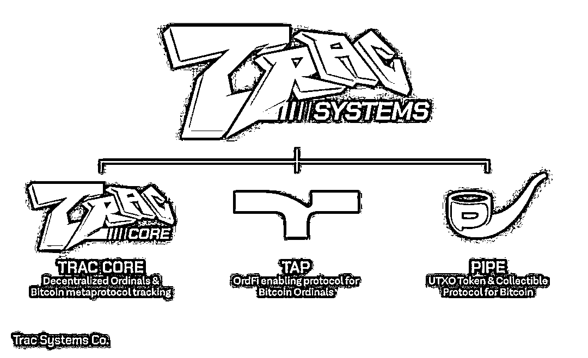

Runes 构想来自 Ordinals 创始人 Casey 对 BRC-20 不足的思考，也是基于 BTC UTXO 的代币协议构想。它的主要特点和设计理念包括：基于 UTXO，Runes 余额存放在 UTXO 中，每个 UTXO 可包含任意数量 Runes；特定脚本输出被视为协议信息的一部分，用来定义 Runes 转移和分配方式；转移通过解释交易中的数据推送实现，分配方式灵活；第二个数据推送视为发行事务，允许创造新 Runes；协议尽量简单，不依赖链下数据或原生代币，并适应 BTC UTXO；Runes 可关联符号，但协议不涉及符号抢注问题，以维持简单性。Runes 目前还停留在概念设计阶段，不过活跃的 BTC 社区开发者 BennyTheDev 在 2023 年 10 月推出了基于 Runes 思想改进的 Pipe 协议，发布后吸引 BRC-20 的炒作热情，并快速完成首轮炒作。整体看，Runes 和 Pipe 体现了 BTC 社区对同质化代币实现方式的持续探索与创新；这些协议虽处早期，但已展现潜在可能，未来有望为 BTC 生态带来更多交易费收入、开发者和用户。

**3. Bitmap 与 BRC-420**

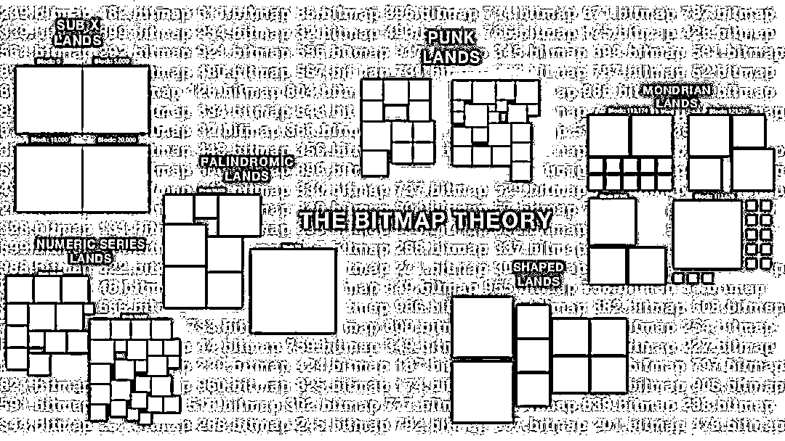

Bitmap.land 是 BTC 生态首个元宇宙项目，基于 Ordinals 和 Bitmap Theory（位图理论）。位图理论由推特用户 @blockamoto 在 2023 年 6 月 13 日提出：把 BTC 区块中的每笔交易输入映射成地块（Parcel），形成街区或区域（District）；不同交易输入大小不同，映射出的地块大小也不同。Bitmap.land 采用在地图上划分土地、绘制图案的方式，用户通过铭刻把数据写入“聪”，获得特定 BTC 区块的所有权。BTC 区块链上每个区块被划分为四个部分，代表不同减半周期；用户可在 Bitmap.land 网站查看每个区块编号和颜色，不同颜色代表不同售卖状态。Bitmap 允许用户拥有和记录单个区块，为 BTC 区块链每个区块提供新维度；任何区块都可通过 Bitmap 成为元宇宙一部分，为社区带来新的创造和所有权机会。

BRC-420 自 2023 年 11 月 13 日以来，随着 Ordinals 总铭文数量超过 4000 万，已成为 BTC 生态活跃代币协议之一。与传统代币协议不同，BRC-420 专注链上铭文模块化，创造 BTC 上全新资产类型。它的首个通证俗称“蓝盒子”，从最初 0.15 美元涨到 1000 美元，开发者短时间获得丰厚链上版税收入。BRC-420 基于 Bitmap 资产协议，通过把多个铭文组合成复杂资产，创造出从小型角色、宠物到完整游戏脚本和虚拟机的各类资产；这些资产因链上开源，任何客户端都可运行或校验。整体看，BRC-420 和相关 Bitmap 项目正在 BTC 生态激发创新和活力；通过创造复杂、模块化数字资产，为创作者、开发者和用户提供新经济机会和交互体验。随着团队不断努力，BTC 生态的全链游戏和元宇宙概念正逐步成为现实。

拓展阅读：  
币安《什么是 Ordinals？》；《比特币闪电网络初学者指南》；闪电网络白皮书英文版.pdf；闪电网络白皮书中文版.pdf

# 三、DID 与钱包：身份和资产自己掌控 @可达 Koda

## 3.1 身份归你：公钥、私钥与助记词

DID，全称 decentralized identifier，中文叫去中心化身份，要解决的是个人对数字身份的所有权、控制权和管理权问题，这些权利完全归用户。前面章节提过，Web2 里数字身份属于各大公司或组织；到了 Web3，数字身份产权归自己。借助区块链技术和去中心化身份概念，你的链上交互都会留下记录，有据可查。当然这也是双刃剑：交易公开可查，链上资产和其他操作更容易被别人知道，存在潜在隐私问题。

去中心化身份目前主要载体是公钥和私钥，二者由区块链密码学规则产生。公钥可理解为银行账户：你在链上生成公钥，相当于在银行开户；公钥地址通常是以 0x 开头的一串字符，可看成这个账户的银行卡号。私钥是一长串无序数字和大小写字母的组合，通常很难记，却是去中心化身份最重要的环节——私钥即产权。拥有私钥，就拥有该私钥下数字资产产权；私钥只属于你自己，不属于任何组织或机构。理解时可把它当成银行卡密码。

钱包是生成和存储私钥的工具。经过你授权，钱包才能调用其中私钥进行数字资产交易。多数人注册钱包时还会遇到助记词。因为私钥太长不好记，助记词就成了一种容易读、容易记的私钥表现形式。比如密码是 12345，单词库里有 apple、orange、tom、june、july，数字和单词一一对应；单词形式更可读好记。由于整个区块链共用一套密码学规则，即使你用的钱包公司倒闭，只要区块链网络还在运转，只要你知道私钥，就能用新的钱包工具登录并管理资产。Web2 则不同：所在公司或平台破产、跑路，你在其中的资产也会一起消失；在 Web3，这种风险大大降低。使用钱包时还要设一个钱包密码，主要用于钱包应用登录，类似 Web2 各应用密码。不同点在于，同一个私钥可在不同设备的不同钱包中使用，且不同设备可设置不同登录密码。

## 3.2 钱包怎么分：中心化、去中心化、冷与热

钱包涉及几个概念：中心化钱包、去中心化钱包、热钱包、冷钱包。判断标准很简单：私钥归机构保管，属于中心化钱包；私钥留在用户手里，则是去中心化钱包。中心化钱包最常见场景是各大交易所钱包。以币安为例，想用它交易数字货币，先注册账号密码，并提供 Web2 世界个人身份信息，和注册股票证券交易所几乎一样。这个过程相当于你信任交易所，把钱包委托给交易所保管。行业现状是，如果资产金额不是很大，头部中心化钱包安全性好于去中心化钱包，因为币安安全技术非常强；但也有不好之处，会受监管，有些人的账号可能因监管被资产冻结。

去中心化钱包又分冷钱包和热钱包，主要按私钥存储是否触网区分。所谓冷钱包，就是不联网的钱包，常见形态是硬件设备，作用类似银行 U 盾。它的私钥从生成到使用都不接触网络，直接保存在离线设备里，因此安全系数更高。

热钱包怎么判断？看它从创建到日常调用是否全程联网。只要联网生成或使用私钥，就属于热钱包。MetaMask（小狐狸）就是典型例子：从建号到转账都在线，因此算热钱包。

那中心化钱包和去中心化钱包该怎么选？更稳妥的方式，是把冷钱包与中心化交易所账户搭配使用。热钱包防护力有限，钓鱼风险也高，大额资产不宜长期放在里面。

# 四、DeFi 与稳定币：Web3 金融的底层逻辑🔥

## 4.1 Web3 金融版图 @可达 Koda

### 4.1.1 认识 DeFi @可达 Koda @馋嘴猫

Web3 有两根支柱：一根是区块链，一根是金融。区块链技术脱胎于密码学与计算机科学；而金融产品，在 Web3 里几乎都能找到对应版本。所以这一章，我们先搭建对 Web3 金融概念和产品的整体认知。

Web3 把这套金融体系称为去中心化金融，英文写作 DeFi，完整说法是 Decentralized Finance。

很多人会觉得，现有中心化金融已经够顺手：信用卡、支付宝、微信支付都很成熟。

这里先不重复一个常见说法：全球约 17 亿成年人还没有银行账户，无法获得传统金融服务，而加密货币能让其中大量拥有智能手机的人接入现代金融。

这些确实是现实：在部分发展中国家、跨境汇款以及特殊支付场景中，加密货币有真实需求，而且规模仍在增长。

不过，这些需求未必都足够刚性。有加密工具当然更好；没有的话，代价可能只是手续费更高、到账更慢，金融基础设施薄弱地区的人群少一些便利。

那么，Web3 是否存在真正强刚需，足以长期托住整个体系？如果没有，Web3 的地基就不稳，可能只是叙事越滚越大，最终泡沫破裂。

我认为，答案是有的。

从最底层看，比较确定的价值来自比特币等去中心化资产，这类资产难以被替代，至少目前还没有看到真正的对手。

注意，这里说的是“比特币等去中心化资产”，并不只指比特币。重点在于：这类资产让财富的控制权真正落在自己手里。

比特币是代表之一，但它的老问题是挖矿耗电、环境压力大，因此一直受到批评。以太坊在 9 月完成 PoW 到 PoS 的转换后，不再依赖实体矿机，能耗下降超过 99%，也更受传统机构欢迎。

同时，以太坊转 PoS 后，从过去每年约 4.4% 的固定通胀，逐步走向通缩，已经开始显现出与比特币争夺“数字黄金”位置的潜力。

对于账面财富较大的人来说，配置一部分能自己掌控的资产，理由似乎很充分。

前些天和几位老友聊天，谈到比特币估值。有人提出一个思路：用全球最富 1% 人群所持资产的 1% 总和，作为比特币估值的参照。按这个思路，比特币单价理论上能到多少万美元？可以自己算一算。

当然，这只是假设，其中至少有两个变量：

一是部分助记词已经丢失，导致数百万枚比特币实际退出流通，总量不再等同于 2100 万枚，这样估算出来的单价会更高。

二是随着以太坊崛起，富豪配置加密资产不再只盯比特币。以太坊的节能环保特征，使其更受机构巨头青睐。所以“全球 1% 富人的 1% 资产”对应的总估值，不会只落在比特币上，而是部分比特币、部分以太坊，未来还可能加入其他储备资产。

为什么是部分比特币、部分以太坊？因为除了储值，它们还有其他用途，这些用途可以支撑一部分市值。

尤其是以太坊，公链生态越繁荣，它越像一台世界计算机；所有运行其上的 Dapp 都要消耗 ETH 作为燃料费。系统越庞大，ETH 消耗越多，以太坊的价值支撑也越强。

传统金融由政府和金融组织掌控；DeFi 里，无论比特币还是以太坊，理论上资产归属由私钥决定。

产品形态上，DeFi 几乎把传统金融产品复刻了一遍。

DeFi 与传统金融最大的差异，在于“本位”：传统金融以法币为本位，美元、欧元、人民币等都是政府发行货币；DeFi 以加密货币为本位，可以是稳定币（常简称 U），也可以是比特币、以太坊等链上加密货币（Crypto）。

在 Web3 的 DeFi 版图中，目前有两类主要载体：中心化交易所和去中心化交易所。

中心化交易所就是常说的加密货币交易所，通常由公司运营，并配合主权国家的监管政策。

去中心化交易所的运行逻辑接近比特币网络，由算法程序自动执行，人为干预较少。

后文我们会依次了解稳定币及相关产品、中心化交易所及相关产品、去中心化交易所及相关产品。

内容参考：12 月 2 日《聊聊 Web3 世界最重要的应用——DeFi》@馋嘴猫

### 4.1.2 Web3 框架里的 DeFi 分量 @可达 @馋嘴猫

找到了去中心化资产这个较坚实的支点后，就可以顺着它梳理上下游板块。至少在我看来，这些板块围绕底层需求展开，建设意义和必要性都很强：

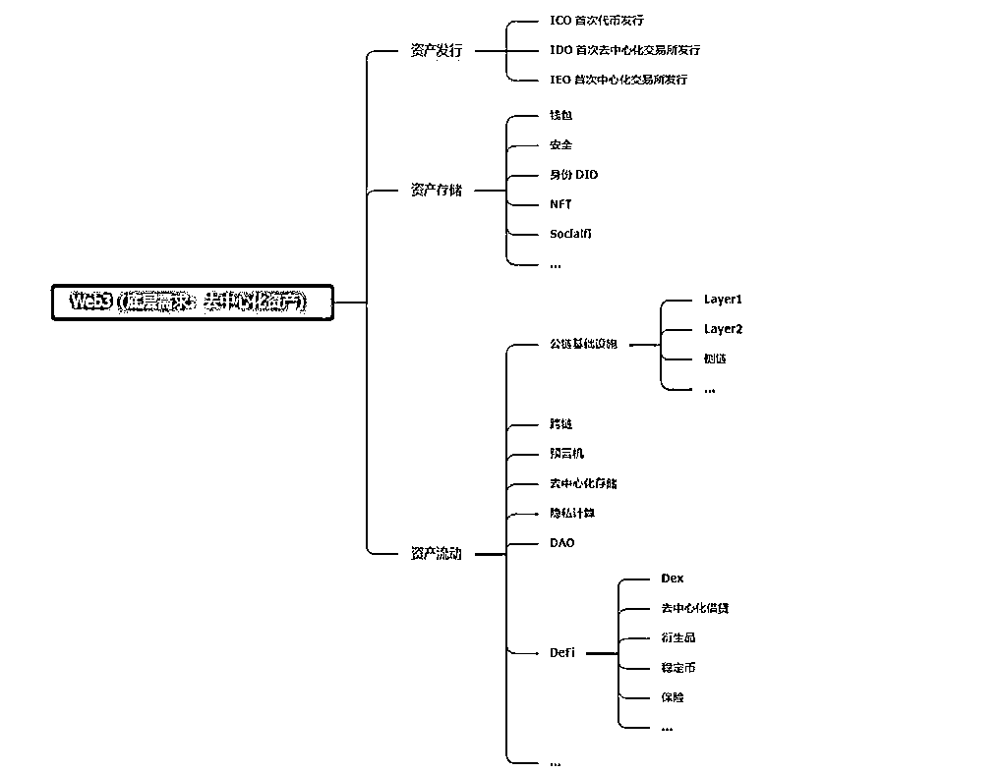

Web3 金融的演进，基本都围绕三条线展开：资产发行、资产存储、资产流动。比特币生态、以太坊生态以及其他公链生态，都是如此。

#### 4.1.2.1 资产发行的新路径【新】

先看资产如何发行。前面已经学过 ICO（首次代币发行，Initial coin offering）。这一节看 ICO 之后常见的两种方式。

IDO（首次去中心化交易所发行，Initial DEX offering）

与 ICO 相比，IDO 最大的变化是借 DEX（去中心化交易所）完成代币发行和融资，所以也有人把它理解为“首次通过 DeFi 发行”。

流程可以这样理解：项目方把代币提供给 DEX，用户将资金质押到 DEX 的流动资金池，DEX 根据质押资金规模完成代币的最终分发与划转，全部由智能合约执行。

IDO 的好处：

对用户而言，靠谱的 DEX 往往比发币项目方更安全；参与 IDO 不需要 KYC 身份认证，有钱包即可操作，门槛低、速度快。

对规模较小、知名度不高的项目方来说，走去中心化交易所发币，比上中心化交易所更容易，成本也更低。

IEO（首次中心化交易所发行，Initial Exchange offering）

IEO 与 IDO 的关键差别，在于交易所是否去中心化。币安 Launchpad 就是典型 IEO。

用户参与 Launchpad 时，通过质押指定资产参与项目挖矿，获得代币，等二级市场开放后卖出获利。部分币安 Launchpad 明星项目代币上线后 24 小时收盘涨幅甚至超过 3000%，这也是币安 IEO 一直热度很高的原因。

相比 IDO，IEO 的项目审查更严格，参与用户必须通过交易所 KYC 认证，安全性在 IDO、ICO 三者中最高。

下表可对照三者区别：

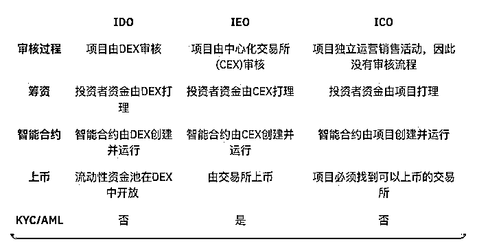

#### 4.1.2.2 资产存储与安全

1）钱包与安全

钱包并不难理解。去中心化资产若长期放在中心化交易所或托管机构，安全性显然不够，Not your keys, not your money。

因此，钱包这个赛道有真实需求，也有市场空间。

当然，前面强调“安全保管资产”，那么安全类板块自然不可缺少。

2）身份 DID、NFT、SocialFi

我们在“三、去中心化身份 DID 和钱包”中讲过这个概念。为什么身份 DID 在资产存储里也重要？

一个重要原因是钱包体验仍然不够友好，新用户安全保管资产的门槛很高。今年以太坊在哥伦比亚首都波哥大举办的 Dev 大会上，账户抽象成为焦点之一，目的就是解决账户安全问题。

很多比特币丢失案例，根子都在私钥保管不当。

今年以太坊创始人 V 神从《魔兽世界》获得启发，提出灵魂绑定代币 SBT。它的一个重要应用前景，是助记词丢失后的身份恢复。当然，这涉及链上身份 DID、社交关系等问题，所以 NFT、社交图谱、SocialFi 也成为该方向的重要板块。

内容参考：12 月 2 日《聊聊 Web3 世界最重要的应用——DeFi》@馋嘴猫

#### 4.1.2.3 资产流动的基础设施

资产需要自由流动，而去中心化资产的流动，自然依赖去中心化基础设施。

1）公链基础设施（Layer1、Layer2、侧链等）

比特币每秒约 5-7 笔交易，大约 10 分钟打包一个区块，等 6 个区块后交易才算基本确认。以太坊稍快，目前每秒约 15-20 笔，效率依然偏低，于是新公链和扩容提速成为需求。2017 年至今，从 EOS 到 Solana 再到 Aptos，新公链高 TPS 的叙事一直存在，而且反复奏效。

Layer1、Layer2、侧链都属于扩容路线。扩容是近几年行业热门方向，核心目标就是提升资产流动效率。

2）跨链

比特币生态目前还偏弱。如果用户想把比特币换成稳定币、赚取利息，又不想走中心化平台，跨链就能派上用场。

把比特币链上的资产跨到以太坊生态或其他生态，再通过抵押获取利息，或借出其他资产，从而提高比特币的利用效率。

此外，当前公链数量众多，不同链之间需要跨链通信，所以跨链也是提升资产流动效率的关键环节。

3）预言机

这个词普通用户可能不熟，因为它主要面向 To B 业务。举个例子：你在 AAVE（借贷平台）抵押 1 个比特币，借出 1.5 万美元，当比特币价格暴跌，AAVE 会清算你的抵押品，避免平台形成坏账。AAVE 的价格从哪里来？

答案是预言机。预言机会从中心化或去中心化交易平台获取比特币价格，再喂给 AAVE。

目前预言机龙头是 Chainlink，整体表现稳健，基本没出过大问题。最近币安也开始布局预言机，一家独大的局面被打破；有竞争，对行业是好事。

4）去中心化存储、隐私

存储同样关键，主要用于存放重要数据，包括 Dapp 前后端数据、NFT 图片元数据、部分公链数据备份、Web3 相关代码以及去中心化社交平台数据。

不过，去中心化存储目前应用范围还不广，盈利能力偏弱，龙头 Filecoin 也开始转向计算领域。

隐私板块主要保护交易信息和隐私数据，但一直没有真正爆发，或许要等以太坊二层 ZKrollup 来带动。

更详细的 DAO 内容，我们在后文“七、了解 DAO”中展开。

5）DeFi（Dex、去中心化借贷、去中心化衍生品、稳定币、去中心化保险等）

DeFi 的重要性不言而喻。比特币这类去中心化资产，若想脱离中心化机构管控、实现资源效率最大化，DeFi 必不可少。

从分类看，Dex（Uniswap、Pancake 等）负责去中心化交易；除此之外还有借贷（AAVE、Maker）、衍生品（Dydx、Gmx 等）、稳定币（航海手册有详细介绍，这里不展开）、去中心化保险（目前基本没发展起来，缺少优质项目）等。

现在回看第二大类“资产流动”中的前几项：公链基础设施、跨链、预言机、去中心化存储、隐私、DAO 等，几乎都在为 DeFi 服务；甚至第一大类“资产保管”中的若干板块，也是 DeFi 不可或缺的基础设施。

因此可以说，DeFi 是 Web3 世界最重要的应用，当前 Web3 基础设施建设，大多围绕 DeFi 运转。

从 Web3 的核心支撑需求“去中心化资产”出发，我们延展出一个更有价值的 Web3 框架。从这个框架看，Web3 各大刚需板块都与 DeFi 有关，DeFi 是 Web3 中最重要的应用。

到这里还没提 GameFi。目前 GameFi 确实没有找到确定的突破模式：无论是往现有游戏里加入 DeFi 元素，还是打造原生 GameFi 项目，都还没有优质且持久的模式。GameFi 这条路仍需探索；或者说，这个需求是否真实？应该重 Game 还是重 DeFi？如何突破？还要继续观察。

如果说 GameFi 与 DeFi 的关系，目前 GameFi 可以看作 DeFi 应用的一种延伸。具体内容在后文“六、了解 GameFi”中展开。把 GameFi 纳入后，基本就是当前行业流传较广的 Web3 框架。

当然，Web3 的定义仍有很大争议。但我认为，从最底层需求出发，找到 Web3 最重要的支撑点，再沿脉络梳理相关板块，会更有底气和确定性。

内容参考：12 月 2 日《聊聊 Web3 世界最重要的应用——DeFi》@馋嘴猫

## 4.2 稳定币入门 @可达 Koda

本节要回答四个问题：稳定币是什么？它解决什么问题？实现方案有哪些？如何选择稳定币？

开始前先厘清一个概念：加密货币英文是 cryptocurrency，也可简称 crypto。之前的学习里我们已知，比特币 bitcoin、以太坊 ETH 这些词背后含义并不单一。

cryptocurrency 指向货币、股票、债券这类金融产品层面的含义。比特币、以太币都可以称为 cryptocurrency，也就是加密货币。

我认为“加密货币”这个中文译名并不完全准确，因为它不只具有货币属性。在某些场景下，它像股票；在另一些场景下，又像债券。

### 4.2.1 稳定币是什么，解决哪些问题？

稳定币英文 stablecoin，也是加密货币的一种。这里的“稳定”指价格稳定。

一般加密货币价格波动很大，即便是比特币、以太坊这样的头部资产，价格起伏也相当剧烈，而且 7×24 小时连续交易，价格随时变化。

如何获得加密货币？从比特币和以太坊网络的激励机制可知，为网络做贡献，或在网络中付出劳动，可以获得网络奖励的加密货币。

此外，作为一种金融产品，加密货币自然也可以通过法币购买。

一旦通过法币购买，就会遇到下面的问题：

加密货币 7×24 小时波动，并且运行在区块链网络中，法币与加密货币的买卖双方很难直接撮合。一个法币持有者想换比特币或以太坊，该怎么办？

如果直接找人或平台兑换，双方刚达成交换协议，可能买家还没转账，价格就已经变了。

另外，Web3 网络内部的各类金融和应用交易，也需要价格稳定的媒介货币，比如发工资。

员工在 Web3 公司工作，公司发放等值美元的加密货币作为工资，结果第二天币价跌到原来的 1/10，很多人无法接受。并非所有人都以加密货币为本位。

所以，稳定币的需求就出现了。

此外，一些国家和地区的政策也不支持直接用法币购买加密货币。

为了解决上述三个问题，稳定币在 Web3 中诞生。

简单理解，稳定币就是 Web3 世界里的“钱”，相当于链上美元。

目前使用最广的稳定币是 USDT，所以大家也常把稳定币简称为 U。有人问“U 是什么”？U 就是稳定币，与美元等价。

因此，想买加密货币，可以先在中心化交易所兑换稳定币，稳定币可与美元 1:1 兑换，然后再用稳定币在加密货币交易所购买目标资产。

### 4.2.2 稳定币的类型

接下来自然会问：怎么确认稳定币真的和美元等价？别人随手拿来一个数据库，我凭什么相信它有价值？为了实现与美元价值锚定，目前 Web3 主要有几类方案。

#### 4.2.2.1 法币抵押型

稳定方式：1:1 抵押美元。每存入 100 美元现金，发行 100 美元稳定币。

以 USDT 为例，它是目前市值最大的稳定币。

USDT 由泰达公司发行，该公司受总部位于香港的 bitfinex 加密货币交易所控制。它承诺：用户拿 1 美元来买，背后就有 1 美元储备；需要赎回美元时，公司会把美元还给用户。稳定机制由此形成，本质仍依赖共识和中心化信任。

但泰达公司究竟持有多少美元，外界并不清楚，也没有公开并接受审计。

优点：稳定性强。

问题：中心化，存在发行方信用风险。

代表币种：USDT、USDC、BUSD。

#### 4.2.2.2 加密资产抵押型

稳定方式：用加密资产抵押。

加密货币虽然波动大，但并非完全不能抵押。把比特币、以太坊按美元计价，再叠加安全系数，也能实现类似稳定机制。

以 DAI 为例，它由以太坊网络中的去中心化组织 MakerDAO 发行。若有人想从 MakerDAO 获得 1000 美元 DAI，规则要求其在 MakerDAO 存入价值 1500 美元的 ETH 或 BTC。

价格上涨时，大家都安全；如果抵押的加密资产从 1500 美元跌到 1000 美元，抵押品就会被没收。靠这套机制，DAI 对应的加密货币价值得以维持在 1000 美元。

优点：适度去中心化、公开透明。

问题：智能合约漏洞。

#### 4.2.2.3 算法稳定币

稳定方式：算法调控。

通过供需调节算法控制币价。

当稳定币价格高于 1 美元，增加发行量，把价格压下去；

当稳定币价格低于 1 美元，销毁稳定币，把价格推上来。

优点：完全去中心化。

缺点：不稳定。

具体怎么稳定？后文会用一个 Web3 经典算法稳定币 UST 归零案例做深入分析。

### 4.2.3 稳定币怎么挑？主流稳定币横向评测

对个人用户来说，稳定币最重要的特质就是“稳定”。这类加密资产从出现起，就天然扮演着中心化与去中心化之间的连接角色。在行业发展现阶段，信用背书依然是不可或缺的基础。以此来看，评估与美元1:1锚定的稳定币，只需要盯住一件事：它承诺的抵押资产是否真正处在监管框架内。

目前市值排名前两位的稳定币分别是USDT和USDC，二者都由中心化交易所发行。

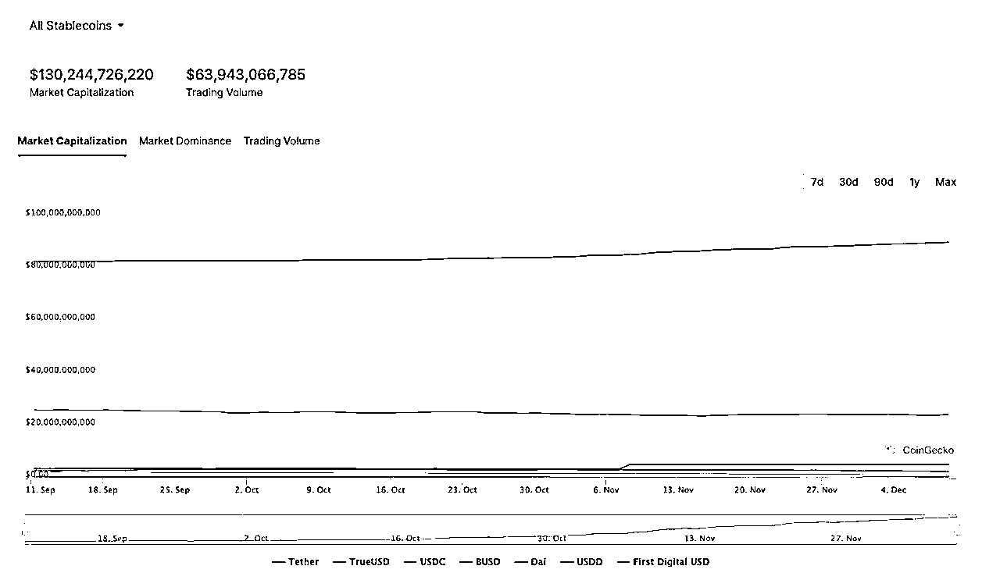

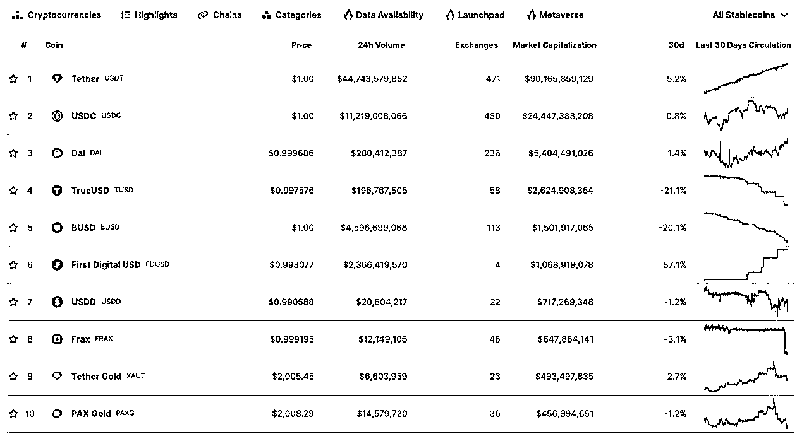

先说USDT，它由泰达公司发行，储备构成包括现金、商业票据、企业债券以及数字资产等。而USDC背后站着美国最大的加密货币交易所Coinbase，储备则包含现金、现金等价物、储蓄和短期债券，并且整个体系受美国监管。尽管USDT在用户规模上仍然领先，但从发行方可靠程度和有没有第三方监管背书来看，USDC无疑更让人放心。下面这张图展示了市值最高的三种稳定币的历史价格走势，也能看出USDC的市场表现比USDT更稳定。

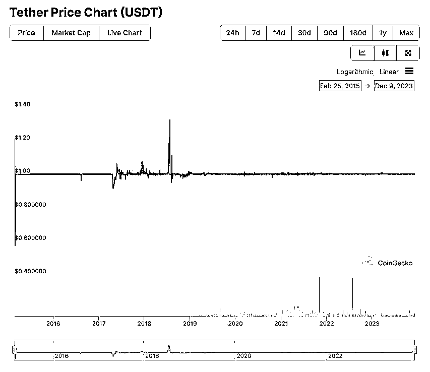

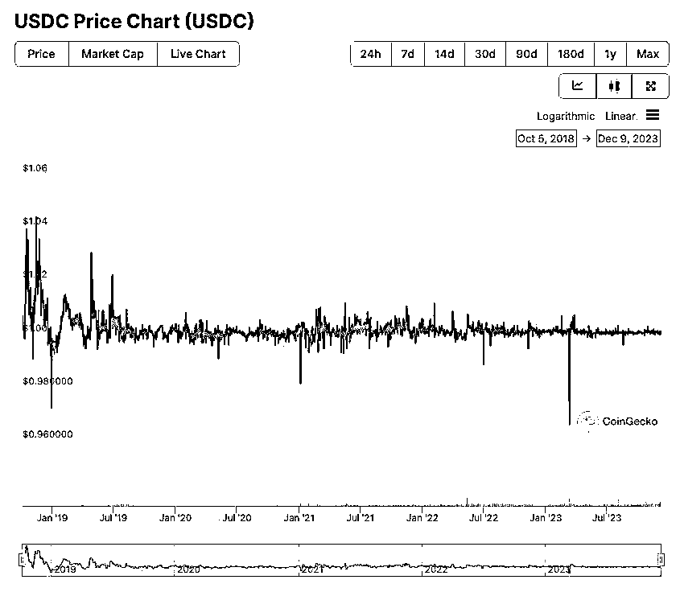

本章涉及的所有内容均不构成投资建议。

拓展阅读：《从真金白银的资金易手，看 Luna 崩盘的底层数学规律》
Sector_Terra Ecosystem_Tony_PC_CN-39217846 (1).pdf

# 五、玩转 NFT🔥 @可达 Koda @焦波｜水镜

这一节，我们来聊聊加密资产里同样重要的一块：NFT。过去一年，各类新闻里到处都能看到NFT的身影，国内的数字藏品平台和产品也越来越多。即便如此，很多人依然没搞懂：NFT为什么能这么火？支撑它的价值到底是什么？它和数字藏品又有哪些差别？当然，对生财有道的我们来说，最关心的还是这个市场里有没有属于自己的赚钱机会。

接下来，我们会讲到NFT的工具配备、操作流程，以及普通人接触NFT的最佳姿势。作为一个新兴市场，机会巨大，风险也不容忽视。最低限度，我们可以不赚钱，但绝不能亏钱。

## 5.1 到底什么是 NFT

### 5.1.1 NFT 的定义是什么

NFT这个词大家多少都听过，但它到底是个什么东西？先从定义说起。NFT全称是Non-Fungible Token，即非同质化代币。它架构在区块链技术之上，遵循ERC-721、ERC-1155等通用标准，形成一份无法复制、无法篡改、也无法分割的加密数字权益证明。

每一个NFT都对应着一份独特的数字资料，可以看作数字商品所有权的一份电子凭证。它可以代表画作、艺术品、音乐、视频、游戏内物品或其他形式的创意作品。作品本身可以被无限复制，但代表着这些作品的NFT能在底层区块链上被完整追踪，从而给买家提供真真切切的所有权证明。简单理解，NFT就是一份去中心化的“数字资产或实物资产所有权益书”，像是区块链世界里的房产证。

因为区块链有不可篡改的特性，NFT会把你对这份资产的所有权清晰记录下来，在链上公开透明、随时可查，而且这份所有权独一无二。这些特点还带来了两大优势：其一，每个NFT都对应着持有者独有的收藏品，无法复制，天然具备稀缺性；其二，NFT本身就像一本公共账本，任何人都能验证资产的真实性和所有权归属。

### 5.1.2 NFT 到底算不算有“价值”

看完前面的定义，大家难免会疑惑：NFT到底算不算一种资产？它真的有价值吗？事实上，NFT虽然和传统资产看起来不太一样，但市场已经用真金白银给出了明确回应。

NFT本质上是一个带特殊属性的Token，也就是代币。在区块链网络出现之前，世界上不存在一个能够7×24小时不间断、跨越国界和区域、没有门槛地自由交易的平台。这一点至关重要。正因为有这样的流动性基础，全球各地的人随时都能参与进来，有限的资金和资产在同一个市场里博弈，NFT也因此具备了金融资产的属性。

那么，这种资产有没有“价值”？外行人最常见的调侃就是“我右键保存不就行了”。比如库里花18万美元买的无聊猿，网友常开玩笑说我也能右键存下来当头像。没错，你的确能轻易获得图片的一部分使用权。但请注意，你保存的图片并不是NFT，它只是整个NFT资产里的一部分信息。你拿不到所有权，也拿不到所有权带来的收益。右键保存的小图片能拿到市场上卖吗？当然不能，因为根本没人会买。

所以，库里花18万买的是图片的使用价值吗？并不是。他买的是资产的所有权。如果未来市场价涨到180万，虽然无数人都可以右键保存，但全网只有库里这一个人能把它卖出并拿走这180万。NFT的核心逻辑是数字内容资产化，而数字内容资产化最重要的一点，就是使用权与所有权的分离。无聊猿可以被无数人复制，但真正拥有它的人，全球只有几千个。

再想想现实中的房产。作为典型资产，一套房子最重要的是使用权吗？并不是。你可以自己住，也可以空着，还可以租给别人，让别人拥有使用权。但最关键的是，你手握这份资产的所有权。只有真正的所有者，才能把房子卖掉，并获取资产收益。这个道理放在区块链世界里也一样：数字资产的所有权被清晰记录，公开透明、可以追溯，只有真正的所有者才能交易并获利。想得越深，越会发现这种理念其实更接近资产的本质。

至于NFT到底有没有价值，大家可以有自己的判断。直到今天，仍然有很多人表示怀疑。但现实摆在面前：NFT已经是一个百亿美金等级的市场，正在被越来越多的人认可。作为投资者，这个方向值得我们关注。

## 5.2 走进 NFT 交易市场与数字藏品

这一节，我带大家实际看看NFT交易市场长什么样，并拿一个具体藏品来讲解收藏NFT时需要关注的关键信息。这些是了解NFT最基础也最必备的知识。

前面提到过，全球最大的NFT交易平台是OpenSea。对于刚入门的朋友，知道这一个平台基本就够用了。网址是 https://opensea.io/ 。进入后就是OpenSea首页，每天会展示一些NFT项目。页面上方有搜索框，可以快速找到你想看的NFT。

点击右侧的“STATS”按钮，会进入NFT排名列表。OpenSea会综合交易额、销售增长、地板价等指标，对平台内所有NFT进行持续更新的排名。目前排名第一的是Bored Ape Yacht Club，也就是大名鼎鼎的无聊猿。前面提到的库里花18万美元买的，就是它。

点进来看，有几个关键信息，是投资一个NFT时必须关注的：

Items 10K：表示无聊猿系列一共有10000个NFT。

Creator fee 2.5%：创作者收益是2.5%。也就是你每卖出一笔，创作者会从中抽成2.5%，每一笔交易都会收取。

Total Volume：这个NFT系列截至目前的累计交易总额。

Floor price：也就是我们常说的地板价，表示该系列在当前挂单可交易的藏品中，最低的那个价格。可以看到目前地板价是XX个以太坊，折合约XXX美金。无聊猿现在已经是NFT市场的顶流蓝筹，很多明星持有，价格自然不低。但它在2021年5月最初铸造时，价格只有0.08个以太坊。按现在的地板价算，涨幅已经接近1000倍。

Listed：上架比例是7%。也就是说，10000个无聊猿NFT中，现在挂在市场上可交易的约有700个。这个比例能在一定程度上反映持有人的信心：上架比例高，说明很多人想卖；上架比例低，说明大多数人倾向于继续持有，价格往往更坚挺。当然，这只是参考指标之一，NFT的最终价格还受很多其他因素影响。

Owners：这个数字代表该NFT系列有多少个独立持有者。一般来说，持有人数越多，说明这个系列受到越多人认可，相对也更有价值。

如果想购买一个具体的NFT，下面这些信息也必须掌握。比如某一只无聊猿，编号是第XXX号。页面上能看到当前价格是XX个以太坊。往下拉，是这个NFT在OpenSea上的历史成交价格走势。再往下是Offers，也就是当前市场上其他人的出价。如果这个NFT属于你，你可以选择接受某个报价，然后直接完成交易。

接下来重点看“Properties”，也就是特征。每个NFT都有一套自己独特的特征组合，而这些组合构成了它的稀有度。通常越稀有就越值钱。无聊猿有背景、衣服、耳环、眼睛、毛发、帽子等特征，每一项特征下面都有对应的百分比，代表拥有该特征的无聊猿在全部10000个中所占的比例。比例越小，稀有度越高。

问题来了：不同特征稀有度不同，怎么综合评估一只无聊猿的整体稀有度呢？有两个常用工具可以帮忙。一个是NFTGO，可以查询NFT的全面信息，比如无聊猿系列自创建以来的所有价格走势，这是OpenSea做不到的。另一个是BlockProbe，可以查询具体NFT的稀有度排名等信息，也常用。

再往下是“Details”模块，这里记录着该NFT在区块链上最核心的信息：合约地址、Token ID（也就是编号），以及协议标准ERC-721。再往下是历史交易记录。你可以看到谁给过什么报价、什么时候以什么价格成交、从哪个钱包转到了哪个钱包。这正是区块链资产的一大特点：公开可溯源、不可篡改，资产每一步变化都在链上清清楚楚，人人都能查看。

以上就是目前全球最大NFT交易市场OpenSea的体验，也让大家直观感受了一个真实NFT藏品是什么样子。

再聊聊海外NFT和国内数字藏品的区别。海外NFT一般建立在以太坊等公链上，可以通过虚拟货币进行二级市场交易，有一定金融属性。国内数字藏品，说白了就是NFT的阉割版。它们通常建在联盟链上，例如腾讯幻核的作品基于至信链，无法转送到其他平台，也就是说不同平台之间铸造的数字藏品目前无法流转。数字藏品不支持二次交易，一般只能用于收藏或转赠，金融属性非常弱。因此目前国内数字藏品的二级交易，要么不合法，要么是在偷换概念。还有一个明显差异：国内数字藏品大多是一张图卖几百份、几千份，而海外NFT除了PASS卡类别外，大部分形象都各不相同。

综合来看，海外NFT原生的机会更大，国内数字藏品也不是完全没机会，但接下来的发展要看政策走向、正规军打法以及实际落地应用的情况。

## 5.3 从 NFT 赚钱都有哪些路子

目前最常见的NFT获利方式，是在一级市场参与铸造，然后在开盲盒之前找合适时机卖出。这个过程很像港股打新：每个NFT项目就像一家即将上市的公司，我们通过获取白名单来拿到购买资格，等到上市阶段再抛出去赚取收益。现在大部分优质项目的一级市场胜率都很不错，属于比较确定性的收益。也正因如此，大家为了拿到热门项目的白名单，可以说是拼尽全力。

早期获取白名单主要靠时间和精力去“肝”。热门项目会设置很高的门槛，比如要求邀请足够多的人，或者在Discord里把聊天等级升到某个高度，通常要花几天，热门项目甚至要肝几周。达到条件后向官方申请，审核通过就能拿到白名单。

后来，肝白名单的方式慢慢演变成了抽奖+填表申请。抽奖平台主要有Premint、Alphabot、Superful等，做法是绑定自己的Discord、推特和钱包，完成一些特定交互条件，然后抽取项目白名单。填表申请在热门项目里也很常见，因为官方可以通过审核机制更好地控制白名单质量。

此外，有些人会花钱请别人来完成这些繁琐又费时的工作，常见做法是在经济水平较低的地区雇佣时薪不高、又能做任务的兼职人员。还有一种方式是成为项目方的半官方人员，比如Discord管理员，这类角色基本一定会得到白名单奖励。

最后一种，是直接收购别人手里的白名单资格，从而获得购买权。这种方式风险也最大：既要考虑白名单的收购价，还要担心对方会不会履约，中途也可能出现各种突发情况，最终收益很难保证。

拿到白名单后，在预售阶段其实是可进可退的。因为这时候，官方通常会在OpenSea这个二级市场公开对应的NFT合集，也就是说大家已经可以开始买卖了。如果市场价格在扣除手续费后仍然高于你的铸造价格，那就存在盈利空间。举个例子，市价1个以太坊，铸造价0.3个以太坊，OpenSea税费按10%算，你的利润就是1×0.9-0.3=0.6个以太坊，大约400美元。

如果不想自己铸造，你也可以把白名单直接卖给需要的人。热门项目的白名单值不少钱，比如上个月的KPR白名单价值1000美元，明天要发售的公鸡NFT白名单也能卖到300美元以上。只要白名单有价值，出售就是稳赚的方案，当然代价是放弃了博取更高收益的可能。

反过来，如果市价扣除手续费后比铸造价还低，那这个项目就进入了“破发”阶段。破发有可能持续，也可能随着市场情绪回升而好转。跟港股打新一样，选对项目、再投入资金，最后拿到好收益，是所有人的共同目标。所以NFT项目的选择至关重要，这也意味着里面存在着巨大的信息差。有些项目热度很高，但白名单获取成本太贵，最后算下来收益可能一般；而一些关注度没那么高的项目，白名单容易拿，只要市场价差足够，反而能赚得不错。

除了打新，NFT还有不少衍生机会。

首先是二级市场买卖。总会有一些NFT存在价格被低估的情况。比如盲盒开启后，有些稀有度不错的NFT因为卖家不懂价值，低价挂出。这时候你低价买进，再转手卖出，就能赚到价差。另外，市场牛熊交替时，蓝筹NFT也有被低估的可能。熊市买入、牛市卖出，同样能获得可观收益。

其次是信息差的机会。有的项目本身质量很好，但知道的人不多，或者坚定看好的人不多。如果能提前识别，通过大量投入资金或成本，就可能获得巨大回报。

然后是劳力差的机会。前面说的白名单获取，就是典型的可以用劳动力差来规模化放大的机会。玩这个圈子的人普遍时间宝贵，与其自己花时间邀请人、聊天、画画，他们更愿意花钱请人代劳。而这些基础工作门槛并不高，于是催生了代肝、代邀请等一系列衍生产业链。连Discord账号、推特账号也可以批量生产并销售。有些项目为了抬高门槛，还会限时开放Discord服务器，所以连进入这些Discord服务器的账号，都能卖出几百元的价格。

接着是流量的机会。NFT领域的流量同样很值钱，尤其是精准流量更是价值不菲。所以市场上出现了专门面向NFT用户的推广账号，比如在推特上做NFT项目推广，这也是种获利方式。

还有社群的机会。通过提供项目资讯、深度分析，帮助参与者提高命中率，这种服务也很有价值。因为这个领域项目实在太多，每天都有十几个新项目冒出来。哪些项目值得投？怎样投性价比更高？这些都是大家关心的问题。另外，为了提升收益，如何规模化批量做号也非常关键。如果社群能提供这类价值，自然会得到大家的认可。

最后是NFT项目方的机会。当然，这个前提是面向海外市场，这里先不展开细说。

## 5.4 NFT 市场的坑与风险

当然，NFT领域同样避免不了风险。

第一，安全性问题。这个领域黑客横行、骗局丛生，如果没有足够的警惕性和安全防范意识，非常容易中招。有些项目方自己的防护意识或技术水平不够，Discord服务器被黑，又牵连一大批粉丝上当受骗。我见过太多人辛辛苦苦赚了不少钱，却因为安全问题一夜清零，所以一定要重视。

第二，二级市场风险。和股票市场一样，大家总是喜欢追涨杀跌。但NFT市场的波动更剧烈，可能在很短时间里价格翻倍或腰斩。一旦追高入场，大多数人的结局就是忍痛割肉。

第三，流动性风险。NFT一旦缺乏流动性，即使价格再低也没有人愿意接盘，就会形成有价无市。那些缺乏价值的NFT，最终只会变成手里一堆卖不出去的图片。

第四，摩擦成本。如果玩的是以太坊上的项目，铸造NFT时除了铸造费本身，还要支付一笔不菲的Gas费。如果在Gas高峰期铸造，很可能要多花几十甚至几百美元。频繁交易不一定能增加收益，但成本一定会大大增加。

先梳理三个常被低估的风险点：

5）发起方失信甚至跑路。NFT 的铸造与上架成本、资质要求都偏低，因此市场上混入不少只想短线获利、无意长期建设的团队。它们常用夸大承诺或注水宣传吸引买家，等到交易完成，参与者才意识到自己拿到的只是一张缺乏实际价值的图片。

6）缺少项目筛选能力。若对项目看不明白，就容易跟着别人的推荐走，别人说哪个热门就冲哪个，自身既没有调研也没有判断。选到劣质项目，结果通常不理想；即便标的本身不差，只要出现风吹草动便慌忙抛售，也极易造成亏损。

7）误买仿冒品。由于任何人都能铸造并上架 NFT，交易平台上难免混入大量非官方版本。如果缺少验真手段，很可能支付高价却买到假货。

因此，这个赛道并非人人都能驾驭。那哪些玩家更适合，哪些人最好谨慎？先看七类不太适合的人：

1）把 NFT 当短期翻倍捷径的人。市场确实流传造富神话，但别忘了幸存者偏差——盈利者更愿意讲战绩，亏损者往往沉默。进场后若天天盯着暴富，看到他人赚钱就焦虑失衡，反而容易做错。更稳妥的做法是持续升级自己的理解框架，机会出现时才可能接住。

2）只收藏信息、迟迟不实操的人。他们常觉得步骤繁琐，不愿动手研究；等到真正有低价机会，往往因经验与条件不足而错过。

3）缺少独立判断的人。听到风声就行动，别人一句判断便照单全收，不深挖项目逻辑；稍有波动就慌乱退出。

4）遇到基础障碍就等人喂答案的人。很多疑问搜索一下、试几次就能过关；若连这类问题都依赖他人，既拖慢效率，也限制自身成长。

5）不重视安全的人。从不做防护，面对高风险项目也不用小号钱包隔离试错。

6）分辨力不足的人。对明显的骗局缺乏警觉，容易被收益承诺牵着走，一激动便上头。

7）赌性压倒理性的人。常常不做分析就全仓押注，把收益寄望于运气。

相反，若你学习快、肯动手、能在每次实践后复盘并修正判断，那么在这个赛道里胜率会更高，也更容易找到自己的节奏。

# 六、GameFi 速览 @可达 Koda

这一节，我们把 GameFi 的概念拆开看。

## 6.1 概念怎么拆

GameFi 由 game 与 fi 拼接而成，fi 的源头是 DeFi，即去中心化金融。它最初就长在价值网络之上，所以金融基因与生俱来。

在 Web3 里，当下的 GameFi 通常呈现两点：其一，把 DeFi 玩法嵌进游戏场景；其二，游戏道具以 NFT 形态存在。

所谓 DeFi 游戏化，是指项目方把质押、购买 NFT、获取收益等金融动作包装进游戏流程。玩家表面在闯关，底层仍是通过资金投入换取回报。

所谓道具 NFT 化，是指装备被铸造成 NFT，产权落在玩家手中。旧式游戏里，运营方可以封号、收回道具，甚至公司停运后资产归零；在 Web3 中，装备存放在个人钱包，项目方即便消失，链上资产仍归用户控制。

## 6.2 旧游戏与 GameFi 的五组对照

下面用五个维度做对照。

产权：旧游戏的虚拟物品归运营公司；GameFi 的装备与资产归玩家。

购买：旧游戏多用法币换游戏币、充值或站内交易，闭环在游戏内部；GameFi 用加密货币购入装备。由于装备是 NFT 或链上代币，能在全网流通，只要有人接盘、有平台撮合，就能变现为加密资产。

规则：旧游戏规则由厂商单方制定；GameFi 的规则由玩家及治理参与者共同迭代，体现社区共治。

用户心智：这是差异最大的地方。旧游戏靠快乐、心流、升级成就感让用户自愿付费，本身商业模式已很成熟；GameFi 现阶段的参与者仍以盈利为主，和 DeFi 用户高度重合——投入一百，希望一周回本再赚一百，未必真在意玩法。至少目前，我很少见到纯粹为娱乐而来的 GameFi 用户。

商业模式：旧游戏赚的是用户为体验和成就感支付的费用；GameFi 同样赚用户的钱，但路径是让用户相信自己能在游戏中获利，再通过 NFT 与代币完成价值转移。目前基本如此。

哪种模式更优？后文会用两个案例展开分析。

# 七、DAO 速读 @可达 Koda

接下来看 Web3 中常见的一种协作形态：DAO。先从定义入手。

## 7.1 DAO 是什么

DAO 的概念在 2013 年以太坊白皮书中由 V 神首次提出，全称 Decentralised Autonomous Organisation，中文常译为去中心化自治组织。

有趣的是，DAO 的发音与中文“道”接近。V 神对中国文化有研究，他在《去中心化社会，寻找 Web3 的灵魂》里引用老子：“道者，万物之奥，善人之宝，不善人之所宝。”东西方两个概念似乎形成一种微妙互文。

回到字面，三个英文词分别对应：去中心化、自治、组织。组织通常有共同目的，因此每一种 DAO 理论上也围绕某个共同目标运转。

目前 DAO 常被归纳出四个特点：

第一，免信任。组织运行依托区块链、智能合约与数字钱包，规则与记录上链；成员不必信任彼此，只需信任代码。

第二，透明。链上信息可查，披露的真实性、完整度和颗粒度通常优于传统组织。

第三，使用权。加入者获得的是使用与参与资格；组织没有传统意义上的老板，只有发起人。发起人可凭影响力号召成员，却不占有整个网络。

第四，无需许可。进出由个人决定，不必向谁提交申请。

## 7.2 自治组织与公司型组织的差异

二者差异可从五处看：

其一，平等与民主。DAO 成员地位相对平等，重大事项靠集体表决；传统组织常有层级。

其二，变更流程。DAO 的任何调整需成员投票；传统组织可能少数人拍板，也可能按章程投票。

其三，计票与执行。DAO 借助链上机制自动计票并执行，无需可信中间人；传统组织若投票，通常内部统计后由人工落地。

其四，服务供给。DAO 可自动分配资源，例如慈善资金拨付；传统组织依赖人工或集中式系统，操作空间更大，也更易被干预。

其五，透明度。DAO 活动公开可查；传统组织多数事项不对外公开。

## 7.3 首个 DAO 的诞生与挫折

理论上，符合上述四点的组织都可算 DAO。比特币、以太坊可被视作 DAO；未来任何由社区自治管理的去中心化组织，也可能采用这一名称。

2016 年，以太坊社区成员发起全球首个 DAO，取名 The DAO。它是投资型组织，代币持有者参与投资决策并分享分红。上线 28 天募集 1270 万个以太币，按当时价值约 1.5 亿美元。但不久后遭黑客攻击，360 多万个以太币被盗，最终以太坊不得不通过分叉来收拾残局。

## 7.4 NFT 与 token：价值如何承载

万象区块链董事长曾判断，DAO 有望成为区块链应用集中爆发阶段的重要商业组织形式。

在 DAO 里，通常有两种价值载体：NFT 记录成员行为、贡献与产权；在此基础上发行 token，承担经济激励。一句话概括：用 NFT 参与，赚取 token。Play NFT Earn Token.

# 八、Web3 监管地图 @可达 Koda

## 8.1 监管为何存在

合规是任何行业都绕不开的课题，Web3 在金融领域做革新且增速很快，更无法回避。本节从政府视角解释监管逻辑，再梳理主要地区政策及相关公司。

政府为何要管？大致有三重原因：金融管控、保护民众、税收。

金融管控：比特币区块链要解决绕过中介的直接支付。可一旦支付脱离中介，就会落入洗钱、赌博、黑市、传销等盲区。这些问题原本就在传统金融监管范围内，无论 Web2 还是 Web3 都应受约束。Web3 内部有两派：一派强调彻底去中心化，认为个人产权与隐私优先；另一派主张合规，认为去中心化也要接受监管。

民众维权：Web3 自带货币系统，参与者必然关心资产安全。以 UST 为例，很多人把它当美元使用，结果价值归零，大量用户转向政府求助。Luna 崩盘后，韩国方面也调查了 Terra。于是，一些项目从一开始就选择合规路线，例如 USDC 在监管背书下开展业务。

税收：DAO 是 Web3 常见组织形式，组织内常流通加密资产，税务问题随之而来。税收以法币体系为锚，各国陆续立法：有的征税，有的免税，口径不一。

先看全球监管地图：红色禁止、橙色敌对、黄色中立、浅绿支持、深绿领先。由此可建立整体认知。

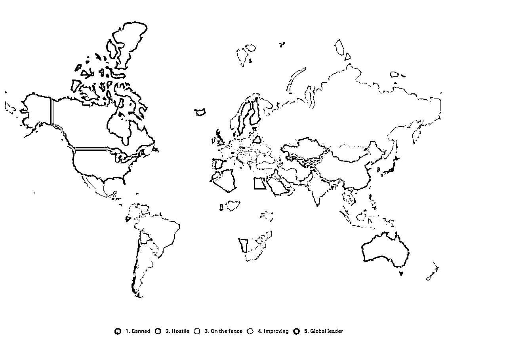

## 8.2 代表性地区政策一览

美国：多头监管、快速跟进，鼓励创新并力图保持全球领先。【新】今年，美国议员提出《确保 Web3 革命发生在美国》，在圈内广泛传播，随后还出现“确保 Web3 发生在湾区/大理/XX”等戏仿。其背后是创新驱动思路：支持各类尝试，同时让法规迅速跟上，服务产业。拜登 2022 年 3 月签署《关于确保负责任的发展数字资产的行政命令》，关键词是“负责任的创新”，即通过监管引导行业良性发展，维持领先。联邦部门到地方落地都很快，国会、SEC 等推出多部涉 Web3 条文；科罗拉多、怀俄明、得克萨斯、加利福尼亚、俄亥俄等州态度较友好；部分传统交易所也上线了加密资产基金。

2023 年继续推进。6 月，SEC 对 Coinbase、Binance 提起诉讼，把“什么算证券”这个争议推向司法与立法机构。SEC 倾向认为 95%～98% 的 Token 属于证券（Security Token），以保护投资者为由执法，意在给行业清晰指引，并释放强信号：欺诈、洗钱、滥用美国金融体系都不被允许。与此同时，市场规范化、比特币商品属性明确、价值认可提升，都在推动华尔街资金入场。大量法币资金有望合规流入 Web3，可能成为下一轮行情催化剂。灰度、贝莱德两家头部基金已就比特币现货 ETF 的上市与交易规则和 SEC 多轮沟通；若获批，将是标志性冲锋信号。

落地框架可概括为“定性+创新监管”。赌博、金融诈骗、传销等传统问题无论在 Web2 还是 Web3 都应受管，此处不展开。定性与创新各国不同，创新可从金融、税收两条线看。Token 被定性为非货币化财产商品。金融方面：ICO 归 SEC 监管；财政部下属金融犯罪执法网络跟踪加密交易，重点反洗钱与反恐融资；商品期货交易委员会调查处罚未注册的加密期货交易；各州从事相关业务需金钱服务牌照。税收方面：2021 年起数字资产在税务上按证券处理，交易者应主动申报；国税局收集链上交易信息，打击逃税。其他：美联储通常不承认加密资产为货币；财政部海外资产控制办公室把制裁对象钱包拉黑，违反者可能面临民事或刑事重罚。

中国：去币存链。Web3 含区块链与去中心化金融。政策边界清晰：链上技术大力扶持，去中心化金融全面禁止。区块链进入“十四五”规划，位列七大数字经济重点产业，是数字经济和数字中国的重要底座。方向涵盖技术创新、平台创新、应用创新、监管创新；产业规划提出推进智能合约、共识算法、加密算法、分布式系统等技术。多部委文件鼓励拥抱区块链、元宇宙等，为产业升级和数字化转型赋能；落地形态包括联盟链、数字人民币。

法规层面：Token 不被视为货币，不具备法币同等地位。金融监管：交易与 ICO 属非法金融活动，相关业务全面禁止；挖矿不符合节能减排与碳中和方向，应全面禁止；主体在境外、业务在境内的可追责；个人参与加密交易，财产安全不受法律保护；借 Web3 之名从事洗钱、赌博、传销、非法集资、网络诈骗等，按传统金融违法处理。由于 Token 定性尚不明确，涉加密资产纠纷在地方司法中裁判不一：有法院认定为合法标的物，也有认定为不合法。税收监管主要覆盖联盟链，暂不涉及加密货币。

欧盟：鼓励创新，环境友好。2020 年 9 月，瑞士议会通过《区块链法》，在瑞士法律下交易加密货币、经营交易所等 Web3 业务合法。卢加诺市甚至允许比特币、USDT 等稳定币及本地代币像法币一样用于日常消费。受瑞士带动，欧盟整体对 Web3 与加密资产持开放态度。定性：token 属合法财产。金融监管：加密资产可能具备证券、货币、基金、虚拟货币四类属性，各有法规匹配，不同国家和地区设有相应牌照。税收：加密资产与法币兑换应纳税，但目前暂归免税优惠；挖矿等服务各成员国有差异。

韩国：总体取向是支持数字资产合法化。

# 加密监管全景：普通人如何进入Web3

在亚洲，韩国加密交易活跃度全球靠前，民众参与热情很高。2021年早些时候，当地拿出2237亿韩元设立元宇宙生态发展资金，重点投向平台建设和人才培育。曾引发全球关注的稳定币组合LUNA、UST，也出自韩国团队。

隐患在于爆雷事件不断，监管随之收紧。尹锡悦政府准备在2023年实施《数字资产基本法》，把这类资产纳入统一管理。

**代币属性**
被认定为虚拟资产，不是法定货币，持有和买卖合法。

**经营牌照**
ICO不开放；交易所可以运营，但要经过政府审批并完成注册；用户须实名，便于追踪。

**税务安排**
2023年元旦起，对相关收益按20%征收资本利得税。

## 新加坡：开放，但风控不松

新加坡对区块链和加密货币的规则相对清晰，整体态度偏友好，是较早立法的地区。它吸引世界各地Web3团队，中国创业者也不少。

2022年4月，金管局负责人表示，目标是建成负责任的全球加密枢纽：既欢迎创新玩家，也要求过硬的风控，后续监管还会加码。

**代币属性**
按资产属性区分为证券型、支付型、实用型。

**经营牌照**
金管局向达标企业发牌，持牌方可合规经营数字加密业务。

**税务安排**
商品与服务税不征。

东南亚各国中，泰国、马来西亚、菲律宾更积极；印度、越南先看看；印尼偏谨慎。风靡全球的AXIE，团队起于越南，运营落地菲律宾。

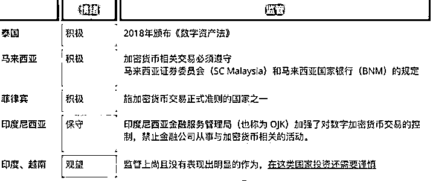

南美和非洲

南美与非洲整体拥抱度较高。原因很现实：本币波动大、对美元依赖深，加密资产被视作摆脱外部盘剥的一条出路。

萨尔瓦多在2021年9月把比特币列为法币，与美元平起平坐；此后2021年该国GDP增速10.3%，旅游收入涨三成。今年多米尼克也给了加密资产法币身份，并与波场合作，指定波场网络承担该国区块链基础设施。

## 8.3 数据安全赛道：两套做法

前面说过，Web3面对监管分成两路。一路坚持彻底去中心化：资产可自由流转，个人产权与隐私优先；另一路认合规：去中心化也应被约束。公司形态随之分叉：一类做隐私和去中心化，守住个人资产与信息；一类帮政府完成监管。

隐私派典型是Tornado。它的产品可理解为链上资金搅拌器：用户把币存进去，之后资金轨迹很难被第三方追查，转账等金融行为的私密性因此提高。以太坊联合创始人V神给乌克兰捐款时，就用了它。

转折发生在2022年8月，美国出手制裁：美国个人与实体不得为Tornado Cash协议提供服务，也不得与相关以太坊地址交互。美方制裁理由通常包括涉外国政权、恐怖组织、国际毒品走私、大规模杀伤性武器扩散，或威胁国家安全、外交政策与经济。可见这类强调私密的工具，很容易撞上主权监管边界。制裁后，不少Web2、Web3企业切断了与Tornado的往来。

合规派则直接服务政府。Elliptic（官网：elliptic.co）做链上反洗钱与制裁合规分析，提供钱包扫描、交易监控、调查支持等。Coinbase等大型交易所是典型客户，需配合各国监管的项目也是其服务对象。国内代表欧科云链，以“链上天眼”协助公安办案。

这一部分希望大家对各地监管有初步认识，并能独立判断。

# 九、往后看：机会在哪里 @可达 Koda

本章讨论个人在Web3可能遇到的机遇。学完前面内容，你大概能感到：这个赛道增长空间很大。个人若有兴趣，可结合兴趣与长处进入。

但行业里收割者不少，二级市场尤甚，一些所谓KOL也要警惕，必须独立判断。新人若决定入场，可把“在变量里筛出相对确定的部分”当原则。

围绕确定性，以下路径有机会赚到钱，现在看不懂可先记下：

1. 在撸羊毛、打新、海外交易所返佣中挑一个适合自己。确定性较高，本质是提供流动性换项目推广预算，与互联网时代淘客相近；差别在于这行竞争还没那么挤，预算也充足。
2. 亦仁有句话，大意是新手容易成猎物，主要指散户在二级市场缺少确定性，四处有收割者。因此不建议普通人做二级，除非投资经验足够。当前二级市场较确定的仅有比特币、以太坊。当然，拿工资也是确定性参与方式，比如打工。

下面从创业、打工、投资三个角度展开。

## 9.1 先弄明白：这笔钱从哪来

做生意或投资，若不知道利润来源，被割的就是自己。

参与Web3，收益大致两块：

1）金融层面，赚的是早入场者的认知差。很多人看不懂比特币、以太坊，根子在于价值与金融概念没打通。可先追问六件事：货币解决什么？黄金为何有价值？金融解决什么？当今货币有哪些用途、各解决什么？Web2发展赚的是什么钱？比特币、以太坊各自解决什么？下面说我的理解。

问题一：货币出现前，事物价值缺一把统一尺子。定价之后，事物才有价格。事物可有形可无形、可用可无用；人类反而更容易对无形、无用之物形成共识。

问题二：几千年前没有货币，黄金充当交换媒介。以物易物时，我拿10把斧子、你有10头牛；我用2把闲置斧子换你2头牛，交易成立。可若斧主想换更多东西，问题来了：不是所有人都要斧子。黄金逐渐胜出，因为大家愿意接受各种物品兑换这种金属，黄金于是有了价值。它胜在符合人性：稀缺、总量有限、稳定、耐久、便携、可分割。

问题三：资产本质是什么？当货币被当作可交易的商品，资本就出现了；把货币视为稀缺资源，也能衍生金融产品。给风险定价，是保险与期货；给企业定价，是股票债券；给房子定价，是房产。被货币定价后，稀缺资源就成了大众口中的资产。金融产品靠借本生息提升社会资源配置效率：闲钱进机构，机构以利息贷出。这个模式一旦成立，很难消失。

问题四：货币发行权归中心化政府后，政府除定价外，还受任期约束，大概率会用通胀刺激经济。新钱产生时，最早拿到的人受益，最后拿到的人吃亏，普通人不易察觉。通胀是双刃剑：经济繁荣加快，劳动价值也被稀释。

问题五：按货币逻辑，你原有1000元，印钞后再送你100元，你赚还是亏？直觉说赚，实际相反。上一轮互联网，钱从美联储印出，经华尔街流向全球。为何许多互联网公司不盈利也能高估值上市套现？因为市场钱多，本质是货币击鼓传花。过去两年垃圾互联网概念股暴跌，根子也在这里。

问题六：Web3.0的源头是比特币与区块链，点对点电子支付要解决主权货币的弊端；以太坊则把金融理念搬到其他体系的平台工具。细节见手册。若把比特币比作黄金，当比特币总市值追平黄金总市值，币价多少？有文章估算约50万美元一枚；现价不到2万美元，约25倍空间。

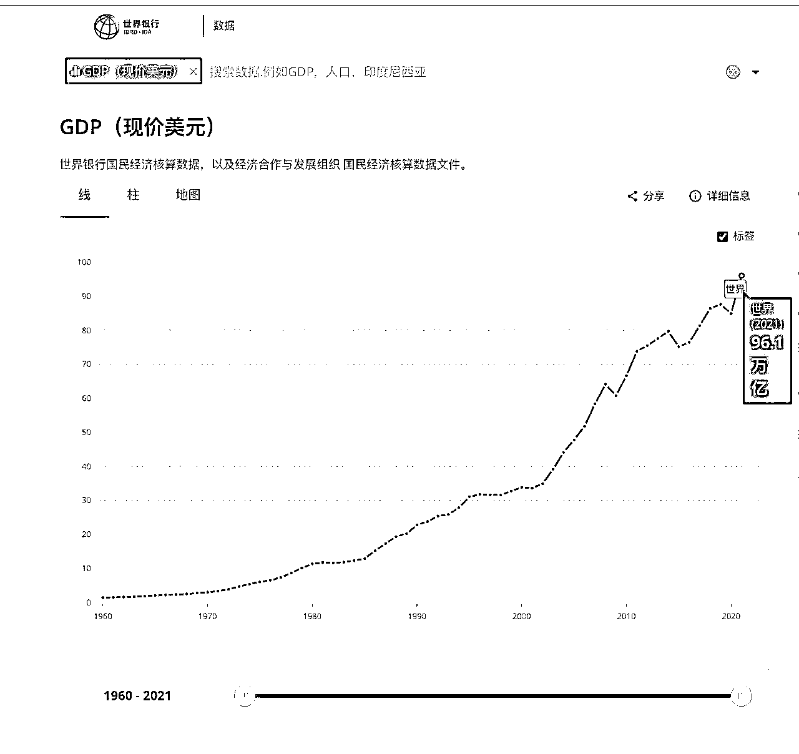

各国广义货币投放量2020年约GDP的1.4倍；疫情大放水后，我估计实际可能到2倍，假设为200万亿美元。

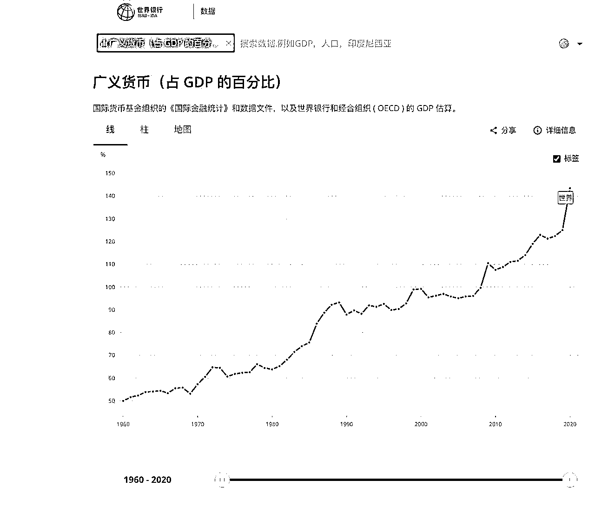

若加密资产最终拿下广义货币30%份额，而当前加密总市值约1万亿美元，大盘还有约60倍空间。这块赚的是认知领先的钱：先形成共识的人赚后形成共识者的钱。Web3与Crypto让普通人第一次有机会站到“最初货币使用者”的位置。

再看商业活动。

2）商业创造价值层面，赚的是Web3生态中高增长、能持续产生利润的公司的增长回报。什么商业活动创造价值？生产与创造，因为它们解决人类问题、提升效率。Web3解决什么？互联网把信息流动成本压到近乎零；Web3.0把资产信息成本压到近乎零，是互联网变革的最后一块。至今互联网只提升了信息网络效率，未提升价值网络效率。在这样的赛道，细分领域出现百倍以上增长机会并不奇怪。

价值被创造后，货币会标记它，表征就是盈利。一家公司若能把以下问题答清楚，在哪个Web时代都不差；答不清，在哪个Web时代都危险：为谁服务、提供什么产品、向谁收费、收多少？客单价、人群规模、转化率、复购率、转介绍率、毛利率是否具备长期优势？

以币安为例，表面是交易所，本质与腾讯类似（赌场与游戏运营本质相近，结果都是高毛利）。高毛利带来平台，更多用户使用，更多项目上线，形成生态垄断，再投资生态初创。它是典型双边市场模式。

上次活动拿到一组数据：Web3全球开发者月活不足2万；国内投资活跃用户估计不到20万；全球用户几百万（看V神粉丝量可感知）。相对全球互联网用户，增长空间仍大。像币安这样模式跑通的公司，未来一定还会出现。它们不发股票，只发Web3世界共识的Token，也就是加密资产。当前Web3仍非常早期。

## 9.2 创业：先看钱，再看长处

想做大的互联网创业者，应参考VC判断：VC看赛道，创业者做经营，专业分工。VC视角里，Web3.0是重点方向之一。要在资金密集处创业。

具体切入点要结合兴趣与比较优势，因人而异。从演进架构看，Web3与Web2相似：底层公链、基础设施、应用层；技术型或市场型创业者都能找到位置。

我自己对投资有兴趣且有积累，长期理想是做Web3版伯克希尔；短期在内容营销、知识付费社群有积累，便从Web3投资社群切入，解决入门痛点，把RichDAO的投资入门训练营与投资俱乐部跑通变现。

有些伙伴可能没意识到，在生财有术里早已潜移默化练出知识付费的商业技能，这就是比较优势。在Web3中，我发现生财伙伴商业化与社群运营能力很强，这是平台给的优势。

若对各类从业者赚钱方法感兴趣，有一份文档总结较全面，基本覆盖Web3主流路径（PDF下载：Web3航海｜实战工具包）：《币圈赚钱的十八般武艺》。

真正适合创业者是少数，可能部分由基因决定。我猜，爱创业的人常有冒险、不循规蹈矩、不安于现状的特质。马云在湖畔大学第一期第一课讲如何面对失败；优衣库创始人写过《一胜九败》。创业本就是不断失败的商业活动，与Web几无关；创业者天生有面对失败的乐观。

因此要不断审视、识别自己属于哪类人。

回到Web3创业机会。行业每个阶段都有阶段性的窗口。Web3从比特币、区块链诞生，到以太坊去中心化应用平台，再到公链、游戏、NFT集中爆发，某种程度是时代产物。

万象区块链董事长在近期演讲判断：基建层逐渐完善，应用层将大爆发。我认同。当前底层公链与交易平台已形成垄断效应，头部手握大量资金，新入局者一旦冒头就可能被收购；头部也做得很好。

底层网络搭好后，基础设施层与应用层都可能出大结果。去年公链与游戏赛道爆发的团队，并非一蹴而就，而是提前埋伏两三年。同理，现阶段基建与应用仍有大量创业机会。

后来者完全可能靠现象级应用切入，再凭流量反攻底层公链，形成颠覆。

至今Web3的网络演进与Web1、Web2相似：从底层协议到基础设施；后来Web2借移动互联网迎来应用层大爆发。Web3会由什么引爆应用层？价值网络能力百倍提升？VR、AR还是别的？没人知道。

从人性底层看，社交、游戏是刚需，任何时代都需要，但以什么形式被颠覆，没人知道。这正是增长中行业的魅力，让人期待。

## 9.3 打工：岗位没想象中高不可攀

Web2增长已见天花板。有同学问，Web3有哪些岗位？

Web3门槛真没想象高。在很多Web2人眼里，Web3的产品与市场还被Web2碾压。对打工人而言，Web2与Web3的底层工作能力没有差别。

因此岗位与Web2区别不大：投资、技术开发、产品、数据分析、运营、设计等。

找Web3招聘信息主要有四类渠道：

1. 项目官网
2. Web3招聘网站
3. 社交媒体
4. Web3猎头

### 9.3.1 渠道1 官网往往藏着入口

若看中某Web3项目，去其官网通常能找到招聘入口。

### 9.3.2 渠道2 聚合招聘站

聚合类Web3站点效率高。以Web3.career（官网：web3.career）为例，主页有最新职位，很多支持远程。

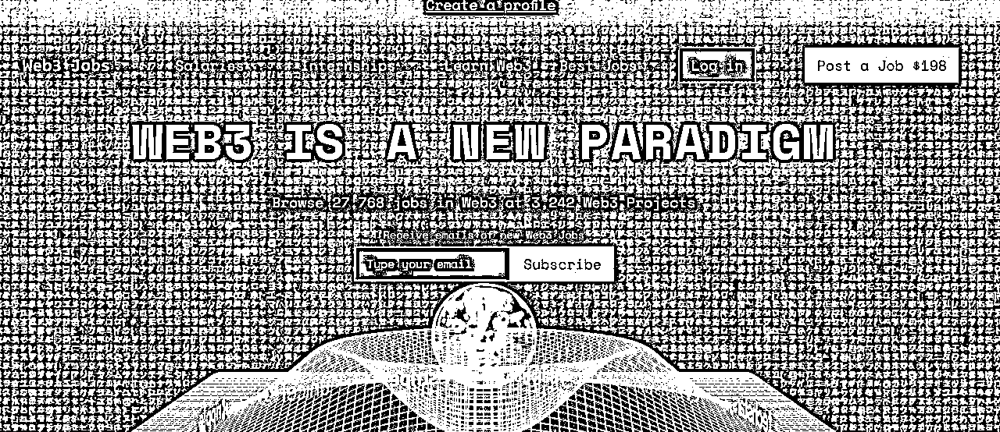

岗位分技术、非技术、兼职；高薪与热门岗位都能看到。比如开发岗年薪可达70万—75万美元，水平很高。

非技术岗包括市场拓展、社群运营、增长、HR、战略、营销等，年薪十几万到几十万美元不等。

设计师含产品设计、基金设计等，不少可远程，年薪几万美元到20万美元不等。

岗位要求归纳为两点：岗位能力与行业能力。岗位能力是底层工作能力，与Web几无关；无论做商务拓展、增长，还是产品、运营、营销，都可迁移。行业能力则靠学习。通过本手册，你应已有初步认知。Web3仍早期，行业门槛没想象高；学习能力强，可快速入行。

我身边有朋友2021年入行，2022年所在项目就上市了，这是快速发展行业带来的个体机会。后续可加入团队、实践项目、持续学习，提升行业认知。

### 9.3.3 渠道3 去人堆里找连接

社交平台也是找工作阵地。Twitter、Discord（谨防骗子）、微信群，都可能直连项目核心成员，交流机会。

不少项目创始人亲自运营Twitter，老板有招人需求。看好的项目，可大胆私信。我身边就有朋友通过Twitter联系创始人后入职。

### 9.3.4 渠道4 高薪岗位靠猎头

现在有专注Web3的猎头公司，但主要针对高薪岗位。企业只有想招却难招到人时，才会找第三方猎头。

### 9.3.5 求职的底层逻辑

素材在此收束；找工作仍可回到岗位能力与行业能力两条主线。

# 找工作，先把这几条“道”悟透

之前聊了不少具体的操作技巧，这篇换个角度，说说求职背后那些不变的东西。

不管行业怎么更迭，芒格这几句话放到今天依旧成立：

1. 别卖你自己都不信的东西；
2. 别和你看不顺眼的人搅在一起；
3. 别替你不佩服的人卖命。

假如你还不确定自己热爱什么，不妨反过来想——先把自己明确不想碰的选项划掉。或者，你觉得打工就是拿时间换钱，兴趣无所谓，那就去找自己最拿手的事情。若连拿手什么都讲不清，就让身边熟悉你的人帮你判断，他们往往比你自己还看得清。

沿着这个框架走，找到理想工作的几率会高很多。

再顺手整理几个我们收集的 Web3 求职入口：

https://Web3.career/
https://cryptocurrencyjobs.co/
https://cryptojobslist.com/
https://crypto.jobs/
https://abetterWeb3.notion.site/
https://pompcryptojobs.com/
https://fintechgl.com/jobs
https://consensys.net/
https://www.paradigm.xyz/opportunities

## 9.4 第三条路：投资

先强调一句：这篇内容不构成任何投资参考。

我们前面说过，这个赛道有机会博取十倍、百倍的想象空间，但能不能接住，终究要看个人本事。

投资既可以投入时间和精力，也可以投入真金白银。

如果你没有本金，Web3 里有大量项目需要靠人力去交互，参与后可以获得一些代币，日后或许能变现。本质上和送外卖差不多，但投产比高多了。

假如要用钱进场，先决条件是你真的具备投资能力。

# 十、资产安全与投资理念🔥@可达 Koda @温格区块链

一个行业的发展，总是从混乱走到有序，再重新落入混乱，这是万物共通的轨迹。

Web3 早期正是这般混沌。这里离钱太近，监管又没来得及跟上，曾经作恶几乎不需要成本，全球每天都有大量盗窃和诈骗在发生。

## 10.1 资产安全为什么是头等大事

《区块链日报》做过一项不完全统计：截至 2022 年，光是交易所就发生了 28 起比特币失窃案，累计损失超过 120 万枚比特币。

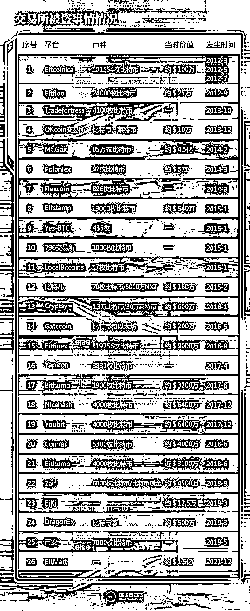

除了外贼，管理不当也会让资产凭空消失。

Chainalysis 在 2020 年的一份报告里指出，至少有 370 万枚 BTC 五年以上没有被移动；Glassnode 则估算，大约有 300 万枚比特币永远无法找回（延伸阅读：《加密交易所历年被盗：超 120 万枚比特币、530 亿美元被盗》）。

原因无外乎私钥被遗忘、存储介质丢失或损毁，资产就此封存，成为沉默的“死钱”。

Web3 历史上，大型黑客攻击每隔一段时间就会重演一次，门头沟、以太坊 DAO 硬分叉都是绕不开的名字。

我认识的人里，因为操作不规范而丢资产的并不少，损失从几千、几万到几千万都有。

打个比方：假如资产是“10000”这串数字，安全就是最前面的“1”。缺了它，后面再多的零也没有意义。

我常讲一个案例：某位老板在价格低位囤了几十个比特币，一拿就是好几年。等到去年币价涨到 6 万美元（约合 40 多万人民币）时，他却因为把助记词存放在在线笔记里，最终所有资产被一锅端，几千万瞬间清零，实在让人叹息。

这一节，我们一起来学习怎么把 Web3 的资产风险降到最低。

## 10.2 去中心化钱包的防护思路

先说底层逻辑：Web3 的资产完全由私钥掌控，这也是别人盗取资产的唯一突破口。

目前，围绕私钥的作案手段主要有两种。

一种是骗走你的私钥。比如把助记词存在联网记事本，或者手机、电脑被病毒入侵，都可能导致私钥泄露。

另一种是借智能合约骗取授权。骗子会在你毫无察觉的情况下，诱导你在钱包里点确认，从而拿到私钥的使用权，再把资产全部转走。

基于这两类套路，我们整理了五条去中心化钱包守则，请一定记牢：

私钥和助记词，任何时候都要远离网络；
不明链接不点、钱包不乱连，也别贪图小便宜；
Discord 和 Twitter 上的私信，一律按骗子处理；
不要一个人扛着，遇到问题第一时间找朋友或社群；
主钱包的助记词，务必用物理方式备份。

接下来用几个真实案例，帮你在不同场景中排雷。

### 10.2.1 案例一：假冒蓝 V 钓鱼

信奉权威是人的天性，这在 Web3 里的表现就是：看到大 V 就放弃独立判断。于是有人靠买假粉把自己刷成 Twitter 大 V，再在内容里夹带钓鱼网站，很多人因此钱包被洗劫。

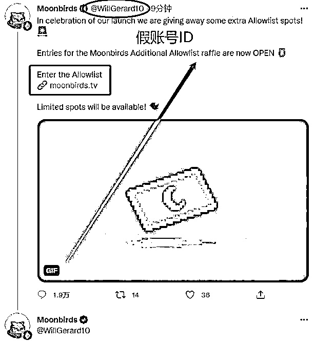

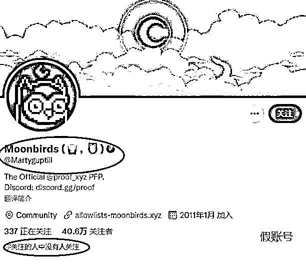

这里有几个信号要留意：

蓝 V 不代表可信；
粉丝量也说明不了什么，Twitter 上造假成本极低。判断一个账号，要看它的历史内容和真实互动，粉丝数只作参考。
来路不明的网站，绝对不要点。

### 10.2.2 案例二：周杰伦的无聊猿失窃

2022 年 4 月，周杰伦发了一条 INS：“哥被偷了。”他好友赠予的无聊猿 BAYC #3738 被盗。

过程是这样的：4 月 1 日，周杰伦把钱包交给别人去参与一个热门新项目，结果朋友碰上了钓鱼链接，钱包里的资产就这么没了。

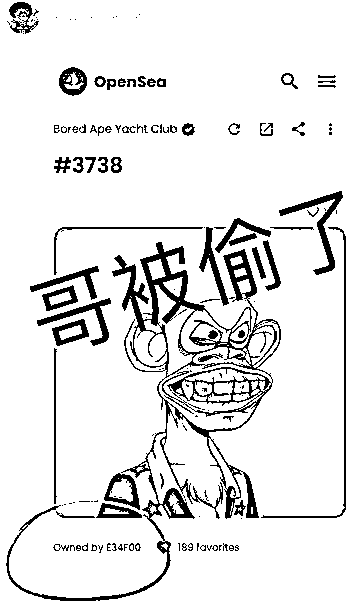

专业团队复盘后认为，关键就在那个朋友操作钱包时，点了 set approval for all 这一步。

这是什么意思？一旦确认，被授权者就能转走你钱包里的所有资产，相当于直接拿走了保险柜钥匙。我们平时在 OpenSea 上交易也需要这类授权，买卖双方才能通过平台完成流转。

所以，用钱包时千万要看清弹窗里的小字。如果遇到“授权转移全部资产”之类的指令，务必加倍小心。

除了 set approval for all，下面几种指令也很常见：

MINT，用来铸造一个 NFT 的操作。

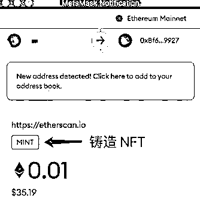

发送代币，例如 sending ETH 就是在发送以太币：

授权某个地址管理某一类 NFT，确认后，该地址可以把你名下这类 NFT 全部转走。骗子经常用这种指令，一旦中招，资产很可能被清空。

转移某个 NFT，确认后，指定的那枚 NFT 会被划走：

### 10.2.3 案例三：Discord 骗局

Discord 里藏着一批专盯新人的骗子，常见套路有两种。

第一种，你加入的群本身就是假项目方建的，群里的所有内容都服务于行骗。有人花大价钱买回一堆假 NFT，就是栽在这种局里。

第二种，你混的是真群，却有假管理员主动私信你。

应对方法很简单：Discord 链接只从官方渠道获取，确保自己进的是正规群。找官方入口时也要多留个心眼，骗子会做假官网、假 OpenSea 认证，比如下图例 1 的蓝 V 就是自己在头像上 P 的。

至于第二种，记住一句：主动私信你的，九成是骗子。

Discord 里有一个安全私信设置，建议开启，可以过滤掉不少骚扰。

### 10.2.4 案例四：假官网+搜索排名，骗你填助记词

这个场景我自己遇到过，好在当时钱包是空的。

大家习惯用 Google 搜 OpenSea，然后点开排在第一的链接。如果那是假网站，进去后便要求输入助记词，很多人被话术牵着走，想都没想就填了。要知道，助记词就等同于你的资产，别人拿到手，就能转走你的一切。无数人就是这么被盗空的。

市面上有大量假冒官网，高度模仿正版，再用谷歌广告和搜索排名把自己推到前排，专门等着新手踩坑。

这里有一条铁律：任何网站，都不会让你输入助记词。

## 10.3 中心化资产安全

中心化交易所的生态相对封闭，通常不需要频繁做项目交互，安全性自然高一些。进入交易所以后，把平台上的安全设置全部开启，基本上就够了。

另外，谷歌验证器一旦丢失会比较麻烦，建议准备一台备用手机，两台机器都装好验证器并同步，做一层安全冗余。

## 10.4 三条 Web3 资产安全锦囊 @温格区块链

第一条：官网下载，是安全的前提。Web3 应用必须到官网拿。

你可能会说，这不是废话吗？可我身边从去年到今年，已经好几个人因为没走官网而翻车。

举个例子：去年 8 月，社群里一个学员告诉我，他的三个钱包从来没领过空投，也没授权过任何应用，结果在 8 月 5 日莫名少了 15 个 ETH 和 0.1 个 BTC（当时约合 34 万元）。我问他，是不是存过助记词截图，或是在社交软件上传过私钥？他坚决说没有。因为他上次丢币，就是把钱包导入了一个偏僻的小钱包，所以这次特意换了个新钱包，十分小心。

我也觉得奇怪，便让他把被盗地址发过来。我看到两个 ETH 地址和一个 BTC 地址，链上记录显示，8 月 5 日这些地址多次转入，然后都被 Uniswap 换成了 ETH 转走。两个 ETH 地址分别有 134 个和 96 个 ETH，BTC 地址也已空空如也。

如果钱包没问题、没有授权、私钥助记词也没泄露，怎么可能凭空被盗？我建议他联系 imToken 客服。结果一查才知道，他在 6 月份从第三方平台“非小号”重新下载过一次 imToken，问题正出在这里。

后来我劝他去报警（虽然心里清楚追回的可能性极小），他也试了，果然当地警方不接、不立案。

非小号作为加密中文市场最大的行情数据平台，居然也会出现这种岔子。许多人因为信任它而放心下载，最后照样没躲过坑。

类似的事件不止一起，比如下面这位，已经算是四年的老手，还是犯了低级错误，57 个 ETH 打了水漂，当时价值 148 万。

第二条：分散存放，重视风控。圈子里的人应该都懂。11 月最大的事件就是全球排名前三的 FTX 暴雷。暴雷原因很复杂，但核心还是创始人 SBF 挪用用户资金。

导火索是 Coindesk 的一篇文章，分析了 FTX 与 Alameda 的资产负债表异常，随后币安创始人 CZ 发推要清仓 FTT，市场恐慌被彻底点燃，FTT 两天时间从 20 美元跌到 2 美元。中间还有不少波折，这里不展开。

风控意识强的人，一听到风吹草动就开始提币；反应慢或者大意的人，就只能被埋。我自己也属于后者，账户里只有不到 1000 美金的山寨币，没太当回事，等到觉得不对时，提币通道已经关闭。身边朋友里，损失不低于 50 万的也不少。

回看那些没跑的人，理由大致有这么几种：在 FTX 打新赚过钱，觉得平台很稳；几美金买的 FTT 赚了不少，觉得团队很强；还有认为美国两党都看好的平台，不可能倒。说到底，都是那句“以为它不会出事”。可现实是，不但出事了，还是大事故。下面这张电报群群主的截图，看了很不是滋味。

这件事最大的启示是：只要交易所数据出现一丁点异常，第一反应就应该是提币，而不是替它找借口——什么“这么大交易所不会吧”“别被 FUD”“创始人有背景”，这些都不是不倒的保证。提币不过几分钟的事，哪怕后来证明只是虚惊，再转回来也没损失。

另外，最好把大部分资产放在自己的钱包里，交易所只留小部分，方便日常操作。我个人的习惯是，交易所里的资金不超过三分之一。

第三条：授权过后，及时取消。

只要有链上交互，就建议定期检查并撤销授权。2020 年以后，链上生态越来越丰富，交易行为也越来越多，而某些协议的合约漏洞可能带来风险，所以取消授权是一种自我保护。

分享两个撤权工具，记得收藏：

https://revoke.cash/
https://etherscan.io/tokenapprovalchecker

除了这些常见问题，还有几件小事要注意：不要扫陌生二维码；来历不明的空投不要领；App Store 里也可能有假钱包。很多人觉得苹果应用商店很安全，但 TokenPocket 的假应用甚至比真的还精致，更离谱的是，正版 TokenPocket 目前在 App Store 里竟然搜不到。看下图：

更要命的是，现在真的 TokenPocket 在 App Store 上居然不见了……

另外 YouTube 上也有类资金盘骗局，比如前几天我社群一个成员就遇到了怪事：

## 10.5 写在最后

最后分享几条心态建议，希望大家入局 Web3 时能保持平稳。

第一，做正确的事，再把事做对。这是段永平常说的话，顺序不能反。方向错了，越用力越糟糕。而做对选择的前提，是先知道有哪些选项。这就需要保持头脑极度开放，大量吸收新鲜事物。

第二，输出是最好的输入。正如费曼学习法所说，能把这个概念讲到 8 岁小孩都明白，才算真正理解。希望大家多分享、多交流，这也是在帮自己消化知识。

第三，悲观者也许正确，但乐观者往往成功。很多人一聊到 Web3 就强调风险和不确定性，可这难道不是所有新生事物都绕不开的常态吗？我们能做的，是提升认知、敬畏风险，然后在一个有前景的赛道里，抓住属于自己的机会。

悲观者也许正确，但乐观者经常笑到最后。

# 选修篇：Web3 进阶

# 十一、【项目拓展】进一步了解 Web3

## 11.1 Web3 框架结构：公链、私链、联盟链 @可达 Koda

按去中心化程度，链圈常把网络分成三档：公有链、联盟链、私有链。这一节就把三者讲透。

先看公有链。理论上，它把开放做到极致：没有准入审查，谁都能接入。比特币网络是最典型的样本，也是历史上第一条公有链。使用、建设都向所有人开放；记录一旦写入便无法回改，且对全网透明。

一些组织受比特币启发，对底层技术做了自己的剪裁。私有链的权力集中在一家机构手里，通常只服务内部。它借用链式记账，但管理权仍由中心掌握。

第三类夹在两者之间：联盟链。多个机构结成联盟，共同维护同一套账本。成员要经过联盟许可才能参与维护，属于有限开放。

若把比特币看成一家没有总行的银行，私有链更像某家大型商业银行自己关起门用的内部账本；联盟链则像多家银行共同接入的联网清算系统，花旗、德意志、北欧银行等都可作为同业节点。

数字人民币网络，通常被归入联盟链。

把三者放在一起看：去中心化程度，公有链最分散，联盟链呈多中心，私有链权力最集中；准入方式，公有链不设门禁，联盟链由成员共同定规则，私有链只对机构内部开放；记账主体，公有链靠全体参与者，另外两类由联盟或组织指定；激励来源，公有链常用代币，联盟链和私有链多用薪酬等安排；共识方式，公有链常见 PoW/PoS 一类，联盟链和私有链往往自定算法。对应场景也清楚：比特币、以太坊是公有链；数字人民币是联盟链；企业内部记账审计系统是私有链。

## 11.2 拆解 DeFi @可达 Koda

### 11.2.1 Web3 金融全景

#### 11.2.1.1 三个反常识的金融事实

先回到一个老问题：哪些事情 Web3 能办到，Web2 却办不到？如果只把 Web3 当成互联网的下一代，视角会受限。不妨把金融也拉进来一起看。

2020 年，各国政府口径下的广义货币存量约等于全球 GDP 的 1.4 倍。经历两年疫情宽松，真实比例可能逼近两倍；按 200 万亿美元理解也不离谱。

把这两个数放在一起，会得到一个冷峻判断：金融体系存在，资本回报就容易压过劳动回报。《21 世纪资本论》通篇论证的正是这一点。

约十七亿成年人缺少银行服务。不少发展中国家金融基础设施薄弱，本币汇率剧烈波动，恶性通胀反复出现；数十亿人得不到稳定、便捷且低成本的金融服务。跨境汇款和换汇也不便宜：全球外汇市场每年几十万亿美元规模，现金跨境转移加兑换的摩擦接近一成，欠发达地区甚至要等上数个工作日。

这些问题都还没被彻底解决。拓展阅读：《新形式的数字货币：对货币和金融稳定的影响》

#### 11.2.1.2 金融到底是什么？

Finance 这个外来词，常见解释是管理资金，范围包括投资、借入、放贷、预算、储蓄和预测；一般分为个人、企业、政府三类。当然，定义不止一种，读者可自行查证。

我的理解是：金融工具再花哨，底层仍是一桩生意，只是买卖的对象变成了钱。典型做法是找出利差，再规模化复制。

看产品时可追问四件事：服务谁？解决什么？利润从谁那里来？收多少？带着这些问题读本手册即可，不构成推荐或暗示。

#### 11.2.1.3 金融到底在解决什么？

传统金融大致处理六类需求：付钱、存钱、借钱、投资、保险、换汇。对应的产品包括货币、股票、债券、保单、黄金等；对应的组织包括银行、证券交易所、保险公司、理财机构、第三方支付平台。

我的理解是，金融改善的是社会资源怎么配置。

不过，钱本身是一种共识；围绕钱长出来的产品，也建立在共识上。这是它和实业不同的地方：实业留下建筑、机器、飞机、火箭等实物；金融更多在信任层面解决问题。

金融又顺着人的欲望，所以一旦形成就很难消失。判断一个行业能否长久，可以看它顺人性还是逆人性。烟酒顺着欲望，政策只能阶段性收紧，行业不会消失；教育逆着惰性，若没有考试，少有人主动学习，做这类商业必须把政策放在重要位置。互联网提效工具也类似，多数不是天性刚需——人往往能省则省，对变化天然抗拒。

到了 Web3，金融被称作 DeFi，英文展开是 Decentralized Finance，中文常译为去中心化金融。有人会问：现有中心化金融已经够方便，为什么还要 DeFi？我不打算只重复“约十七亿成年人缺少银行服务”这个理由；但客观情况是，在部分发展中国家、跨境支付和特殊场景中，加密资产确实有真实且增长的需求。

### 11.2.2 案例拆解

案例一：四百亿美元三天蒸发：UST 与 LUNA 崩盘始末

上一节把稳定币分成法币抵押、加密资产抵押和算法型。算法型最大的软肋，就是“稳”这件事本身可能保不住。2022 年 5 月的 UST 归零，就是活教材：一个体量超过四百亿美元的公链项目，三天内几乎清零。

2021 年公链行情火热，很多项目市值几十倍到上千倍地涨。Terra 走的是另一条路：算法稳定币加双币结构，一度冲进 Web3 市值前十。它有两类生态资产：LUNA 与 UST。LUNA 从 2021 年约 1 美元升到上百美元，2022 年 5 月见顶后三天崩盘；两类资产合计近四百亿美元，迅速蒸发。

UST 在 5 月 10 日失去锚定，14 日跌到 0.17 美元，随后一路阴跌至零。LUNA 归零还能用高波动解释；UST 不同，用户把它当美元现金。一个没盯盘的人，账户里以为有一千万美元，五天后只剩一百多万，这种落差极其夸张。

事情怎么开始的？Terra 在 2018 年由 Do Kwon 创立。他是韩国九零后创业者，斯坦福背景，曾进入福布斯三十岁以下精英榜。项目最初想做的是：锚住多种法币，用区块链提供算法稳定币支付方案。早期主攻韩国，再向东南亚延伸；旗下 Chai 支付应用在韩国监管下接入十五家大型银行，一度成为当地国民级稳定币平台。

几轮运作后，Terra 生态市值进入 Web3 前十，链上锁仓一度达到 181 亿美元。生态中心是稳定币 UST；围绕它长出支付应用 Chai（可类比支付宝）、储蓄协议 Anchor（承担银行功能）、合成股票市场 Mirror（做股票类资产），以及更多衍生应用。整个体系像一家巨型金融公司，UST 是内部流通媒介。

为何一年能涨百倍？一方面，创始人的履历和此前创业成绩，让项目更容易拿到资源。另一方面，机制设计很懂人性中的贪念。

算法稳定币通常靠供需把价格拉回 1 美元。Terra 的锚定工具叫双币销毁铸造。UST 目标盯住 1 美元；LUNA 不盯价，自由波动。两者之间可以双向兑换：当 UST 高于 1 美元，比如 1.01，用户可烧掉价值 1 美元的 LUNA 换出 1 枚 UST，再按 1.01 卖出，赚 0.01；当 UST 低于 1 美元，比如 0.99，用户花 0.99 买入 1 枚 UST 并将其销毁，换回价值 1 美元的 LUNA，卖出后同样赚 0.01。

套利者反复搬动，只要 LUNA 总盘子正常，UST 就有机会回到 1 美元。UST 生态越旺，手续费等收益越会回流 LUNA——可以把 LUNA 看成系统权益——从而推高其总市值。扩张利器则是 20% 的存款年化。稳定币给到这种利息，传统互联网金融难以想象。于是大量真金白银换成 UST；我身边也有人抵押进去。经验更老的玩家有时能先听到风声，情况不对就先撤。

崩盘为何发生？UST 用户越多，LUNA 价格越涨；脱锚前 LUNA 总市值最高到过四百亿美元。5 月 9 日脱锚前，UST 约 187 亿美元，LUNA 约 204 亿美元。

这里藏着双币结构的硬伤：LUNA 的市值不等于真有等量现金，而 UST 却承诺可按 1:1 换美元。204 亿美元的 LUNA，在上涨行情里也许能全部变现；一旦下跌，可能只能挤出两亿美元。这个逻辑和股票、房子的市值一样。

拿小区举例：100 套房，10 套挂牌。第一套成交 1000 万，其他业主便认为自家也值 1000 万，小区总市值就成了 10 亿。真要兑现这 10 亿，得让所有房子都按这个价位完成换手。

行情好时，第二套卖 1100 万，买家看到一周涨 100 万，也会追进来；极端情况下 100 套全卖出，价格还能往上走。行情转差时，1000 万就是顶。剩下 9 套挂 900 万，一个月无人接，接着 800、700、600，最后可能 500 万成交，小区总市值缩到 5 亿。房产流动性差，这个例子直观；股票和币同理，把“套”换成股数或枚数即可。

回到 Terra：当 UST 与 LUNA 的体量到了这种比例，LUNA 根本填不上 UST 的窟窿。市场一转弱，204 亿美元的 LUNA 可能只换出 20 亿甚至更少的真金白银去接 UST，而 UST 盘子是 187 亿美元。用户把平台当银行，却发现取不出钱，信任崩塌，UST 被抛售，锚定彻底失守。与此同时，创始人在 LUNA 高位用增发成本极低的代币换走真实资产，套现约四十亿美元，转投比特币等硬通货或其他稳定币。

回看这场风波：它在 2022 年上半年出圈，过程跌宕。创始人套走约四十亿美元；有人在 LUNA 上赚到百倍后高位退出；有人押螺旋式下跌、加极高杠杆，短时间暴富；也有人资产归零或只剩 1 美元，抄底后短时间破产。它留下的问题很多，创始人、投资者、机制设计者都有话可说。留个讨论题：LUNA 事件让你想到什么？附一份 Web3 机构头等舱的 Terra 付费研报《Terra 生态赛道解析.pdf》。

案例二：从 Uniswap 到 AAVE，交易与借贷怎么被改写

谈 DeFi，很难绕过 Uniswap。它长期是全球体量最大的去中心化交易所，也让人们对“交易所”的旧印象发生改变。

先看传统中心化平台。全球最知名的两家是 Coinbase 与 Binance（币安）。Coinbase 在 2021 年 4 月登陆纳斯达克，是首家完成上市的加密资产交易所；币安则在成交量和用户规模上领先。它们由公司或组织集中运营，用户把资产放进去，实质是交由平台托管；交易撮合通常需要做市商，平台收手续费，做市商赚价差。

Uniswap 的不同在于 AMM，即自动做市商。它部署在以太坊上，是一套流动性协议，支持无需信任的代币交换；交易由智能合约自动完成，不靠某个中介，也不要求用户信任第三方。买卖如何成交？靠流动性提供者（LP）。任何人都能把代币存进池子，成为 LP，并分到 0.3% 的手续费。过去这部分常被中心化平台的做市商拿走，如今普通用户也能参与分配。

传统交易所用订单簿，价格由最高买价和最低卖价碰出来；Uniswap 则用一条乘积恒定的公式表达供需：池中两种代币数量相乘等于一个常数 K。具体算法不展开，想深入的可以看 B 站上那期讲 AMM、流动池类型与无常损失的视频，里面也涉及 Uniswap、Curve、Balancer、Bancor 等协议。正是 AMM，让 Uniswap 坐上去中心化交易所成交量头把交椅。

去中心化交易所有何好处？用户不必把资产交给平台，托管风险小，因此对安全敏感的人更愿意用 Uniswap 一类协议。另一个优势是上币开放：任何人都能创建任意代币交易对；中心化平台通常要审核并收上币费，Uniswap 不设这些门槛。近期全球前三的中心化交易所 FTX 出事，中心化平台遭遇信任危机，去中心化平台反而获得更多用户；截稿时 Uniswap 用户数又创新高。

最后看借贷协议。2020—2021 牛市里，这类协议表现亮眼。原因不复杂：抵押借贷流程简单，更多有资金周转或加杠杆需求的投资者愿意使用。AAVE 也是这一赛道常被提及的名字。

# 以太坊借贷三巨头：Aave 凭什么出圈

提到以太坊上的借贷，MakerDAO、Compound、Aave 这三个项目总会被一起拎出来。这一节拿 Aave 做个样板，看看链上借贷到底怎么转。

**Aave：用智能合约替代中间人**

Aave 本质是一套跑在以太坊上的去中心化借贷协议。借币、放贷、吃利息，全程不需要谁在中间牵线。智能合约负责把流程自动跑完，资金也不必交给某家公司或某个人保管。

换个生活场景可能更好懂。

假设你急需一笔数目不小的钱，第一反应多半是跑银行。银行会让你交房产证之类的材料，再按房子的估值算一算能批多少。

一套市价 100 万的房子，银行通常只肯放七成，也就是 70 万。放款当天开始算利息，借满一年、年化 10% 的话，到期要还 70 万本金加 7 万利息，合计 77 万。传统金融机构的放贷路径，大致就是这个样子。

**Aave 上借钱是什么体验**

链上世界就省事多了。借助 Aave 这类工具，抵押的是 Web3 里的资产——当然不是什么都能押，只有协议认可的那部分数字资产才在名单里。

打个比方：你手上有 10 枚 BTC，眼下急着用现金。直接去二级市场卖？当时一枚才 16500 美金，价格太低不划算；况且你判断三年后单枚能冲到 10 万美金，更舍不得现在出手。这时候 Aave 就派上用场了。

操作不复杂：先把 BTC 换成 wBTC（一比一锚定），再把 10 枚 wBTC 存进 Aave 做抵押，就能借出相当于抵押额度八成以上的 USDT（理论上还能更高，但为了避免被清算，多数人会压在八成以下）。

从借出的那一刻起，利息就开始滚动。通常没有固定还款期限，想什么时候还都行。还的时候系统会自动算出应付利息，结算币种可以用平台币，也可以用 USDT，随你挑。

那要是行情下跌，抵押物不值钱了、覆盖不住借款怎么办？会触发清算。一般抵押品价值接近借款额的 95% 时，系统会弹出提醒：补仓，或者还钱。要是两边都没动作，平台就会强制平仓，自动把你的抵押物卖掉。

清算成交价往往低于抵押物实际价值，还要额外收一笔不低的手续费，所以正常人都不会坐等被清算。

到这儿可能有人好奇：我借出来的钱，究竟是谁的？

把它当成一个撮合借贷双方的平台就行，类似 P2P，区别在于整套撮合逻辑由智能合约承载，借贷合同自动履行。

Web3 圈子里流传一句话——“有些钱像是大风刮来的”。这梗不是空穴来风，DeFi 里确实有过这样的真实桥段。

2020 年那会儿，不少借贷协议还没什么名气。为了拉新，项目方设计了一套代币激励模型，不少人真就体验了一把“钱从天降”。

MakerDAO、Aave、Compound 在早期阶段，借钱不光可能免息，还倒给你奖励。没开玩笑，是倒贴。严格讲利息并非为零，只是远低于平台发的代币补贴。以 Compound 为例，借款会产生利息，但因为你使用了它的协议，平台会回馈代币；2020 到 2021 年间，AAVE 等平台币有的翻了几十倍，有的涨了上百倍。这些代币涨起来之后的价值，早就盖过了当初的利息支出。这种玩法在 DeFi 里相当常见。

借贷协议这部分就先聊到这儿。

DeFi 的版图当然不止借贷，YFI、LINK 等项目也曾在赛道里风光过。想深入了解可以自行 Google，篇幅所限这里不铺开。

相关链接：

Uniswap 官网：https://uniswap.org/

Aave 官网：https://aave.com/

## 案例三：RWA，把现实资产搬上链【新】

前面几节我们聊了 DeFi 是什么、为什么重要，也拆解过 LUNA 暴雷、Uniswap、AAVE 几个典型样本。这一节换个对象——2023 年热度一路走高的后起之秀 RWA。

多数 DeFi 协议里，投资者拿到的收益主要来自链上活动：交易手续费、借贷利息、质押回报、通胀补贴等等。牛市一来，链上热闹、币价上行，收益可观，投资者又把赚到的钱投回 DeFi，滚出一个正循环。

2023 年三、四季度的行情就是现成的例子：比特币从 25000 美元一路冲破 44000 美元，背后是大量投资者抵押比特币借出 U，再拿 U 去买比特币；抵押的比特币涨价后能借出更多 U，于是买更多比特币继续抵押，价格被进一步推高。

反过来，熊市里链上冷清、币价走低，贷款清算接连发生，死亡螺旋启动，场内互相收割，DeFi 的吸引力就大打折扣。

RWA 就是在这种背景下被推到台前的。

### 什么是 RWA？

真实世界资产（Real World Assets，简称 RWA），指的是现实中有形或无形的资产，比如房产、债券、大宗商品，它们本身存在于链外。

Web3 语境下说 RWA，更多是指把这些现实资产代币化或 NFT 化——把房子、债券、股票搬上链，变成数字代币。持有代币，就等于在现实中握有对应资产的所有权，可以拿去链上抵押、出租、买卖。我们天天用的 USDT、USDC 其实也算 RWA，本质是把美元这种现实资产做成了代币。

2023 年上半年起，机构和巨头陆续进场，RWA 板块热闹起来。

高盛先出手，旗下数字资产平台 GS DAP 正式上线，并帮欧洲投资银行（EIB）发行了 1 亿欧元的两年期数字债券。

紧接着，管理规模超千亿美元的私募股权公司 Hamilton Lane 在 Polygon 上把 21 亿美元旗舰股权基金的一部分做了代币化，卖给投资者。工业巨头西门子也在链上首发了 6000 万欧元的数字债券。

政府层面同样有动作，新加坡金融管理局（MAS）宣布与摩根大通、星展银行合作试水。

为什么金融圈、产业界甚至监管机构都开始押注 RWA？

关键在于它能把传统金融和加密金融接起来。链下资产被引到链上，RWA 代币又能兑换回线下资产，现实世界与 DeFi 之间的通道就此打通，资产的流动性和市场效率都随之抬升。

传统金融体系长期依赖中介：中间人、背景调查、法规制度，层层叠叠。这套东西带来了安全和秩序，代价却是市场效率和持有人机会被大幅压缩，成本也水涨船高。

举个直观的例子：作为资产持有人，你想进场交易，若不向中间人交费，很可能被监管挡在门外，机会和效率自然缩水。

前面章节讲过，DeFi 已经砍掉了不少限制，市场效率大幅提升，持有人机会更多，散户也能碰到过去门槛很高的资产，上一轮加密牛市多少与此有关。

不过 DeFi 再怎么成熟，眼下仍是个相对封闭的圈子，收益主要来自系统内部。RWA 则能让标的物丰富起来——现实里的任何物品都有可能，创新玩法也会被催生出来。

### RWA 是怎么运作的？

既然潜力这么大，能提升流动性和效率，那现实资产究竟怎样完成代币化？

整个流程分三步：（1）链外规范化（2）信息桥接（3）RWA 协议的供需两端。逐个来看。

**（1）链外先把规矩定好**

要把现实资产接进 DeFi，第一步是在链外把资产的价值确认清楚，涵盖经济价值、所有权归属，以及保障相关产品的法律程序。

经济价值可以参照传统市场的公允价格、近期数据或其他经济指标，核心是要有公信力。

所有权靠契约、发票，或任何能证明持有关系的材料来锁定。

法律程序则是针对资产可能出现的法律后果所设的处理机制，比如清算、争议解决、强制执行等具体流程。

**（2）信息搬上链**

规范化之后，这些信息要被送进链上、存进区块链，涉及几个关键概念：

代币化：规范化的信息转成代码，以数字代币的元数据形式呈现（可以理解为一种特定编码）。通过区块链就能读取这些元数据，资产的经济价值和所有权因此完全透明。下图里已经有不少提案在尝试为资产代币化建立标准。

监管环节：有些资产需要接受监管，或者可能被认定为证券，代币化过程中就得由不同机构配合提供多种技术来满足合规要求。持牌证券代币发行商、加密 KYC 服务商等，都是这类技术的提供方，帮助现实资产合法合规地上链。

Oracles（神谕）：代币化时，RWA 要准确映射现实资产的经济价值，必然离不开外部数据。可区块链智能合约天生受限，只能读取自身网络内的数据。Oracles 充当通信桥梁（本质是数据库），把外部数据翻译成智能合约认得的数字，代币化才能顺利推进。

（想深挖神谕的可以拓展阅读：Oracle Problem）

**（3）协议撮合供需**

也就是找到或搭起一个连接买卖双方、促成资产交易的 DeFi 协议，贯穿 RWA 产品始终。供给端，DeFi 协议盯着 RWA 的发起；需求端，协议又放大了投资者对 RWA 的兴趣。

所以多数专做 RWA 的 DeFi 协议，既是 RWA 雏形的发源地，也是这类产品的最终交易场。

### RWA 生态里的代表项目

（以下内容不构成任何投资建议）

**（1）RealT：房产上链**

RealT 干的是链下资产代币化的活，用房地产代币化来破解房产流动性差、交易成本高的问题。原本要整套买卖的房子可以拆成碎片出售，普通投资者买一部分所有权就能参与。

买下 RealToken，相当于投资了一份房产，会收到证明你持有该资产的凭证。哪怕 RealT 哪天倒闭或消失了，RealToken 的效力仍在，持有人利益不受影响。

而且 RealT 用技术手段把这些证明文件永久保存，不可篡改、长期存在，也无需再依赖第三方机构托管。

资产证明和数据都存好之后，还要录入房价。RealT 通过 Oracle 直接抓取市场上的真实评估数据，尽可能客观地反映房产价格，让房地产数据彻底公开透明。

**（2）MakerDAO：债券与稳定币**

MakerDAO 是以太坊上的抵押债务平台，在 RWA 落地方面走得最远。

它 2014 年成立于以太坊，是开源的去中心化自治组织，持有 MKR 代币的人都能参与治理。MakerDAO 还发行了稳定币 DAI，如今 DAI 已是全球市值第三的稳定币。

世界上首笔基于 DeFi 的现实资产贷款就出自 MakerDAO，它在 RWA 赛道上布局很早。2020 年，MakerDAO 把 RWA 列为战略重点，发布了引入 RWA 的指南和计划。除了发行 DAI，它还通过了将 RWA 作为代币化房地产、发票、应收账款抵押品的提案，以此扩大 DAI 的发行量。

借款人可以把抵押资产放进“保险库”，借出以 DAI 计价的债务。“保险库”本身只是一段智能合约，在借款人还清所有 DAI 之前，它负责保管借款人在以太坊上的抵押品。

只要抵押品价值维持在特定阈值之上，借款人就能完全掌控抵押品。一旦抵押品价值跌到不足额，保险库会启动拍卖程序自动变现抵押品，以无需信任的方式把贷款还上。

2022 年，MakerDAO 还联手 BlockTower Credit 推出 2.2 亿美元基金，为现实资产输血。MakerDAO 的 RWA 业务规模已超 6.8 亿美元，其中 5 亿美元的 RWA 抵押品是美国国债；法国兴业银行也从 MakerDAO 借走 700 万美元，由价值 4000 万欧元的 AAA 级债券作为 OFH 代币支撑。2022 年 12 月，MakerDAO 约六成收入来自 RWA。

MakerDAO 算得上 RWA 的早期玩家，但 RWA 概念此前一直不温不火，没什么大动作。直到 2023 年 DeFi 规模回暖、传统巨头陆续入场，RWA 才重新回到聚光灯下。

早早铺路的 MakerDAO 经验更足——既有过往合作积累，又有 DAI 的经济价值托底，还有发币的成功履历，市场对它的期待普遍很高。

**（3）Centrifuge：私人信贷**

Centrifuge 2017 年上线，是首个在 MakerDAO 上做 RWA 的项目。它是一个做结构化信贷的链上生态，专注把原本流动性差的债务证券化、代币化，帮中小企业以更低门槛融资，同时让投资者从真实资产中分到收益。

Centrifuge 大致复刻了传统金融里的企业信贷流程，只是借助 DeFi+NFT 砍掉了一部分中介参与和链下的繁琐环节。

在 Centrifuge 上融资，流程可以概括为：借款人把链下真实资产打包上传，生成一个有法律效力的 NFT 作为抵押，换回带息 ERC20 代币；投资者用 DAI 买入这些带息 ERC20 代币；发起人拿到融资，到期赎回，投资者获得收益。

由带息 ERC20 代币形成的资金池分初级和高级两类：初级池投资者收益更高，风险也更大；高级池收益和风险都相对温和。

官网此前披露，Centrifuge 融资额已超 3.85 亿美金，TVL 同比翻倍。它的代币化资产已经接入整个 DeFi 生态，其中包括 MakerDAO 上 2.2 亿美元的风险加权资产。

**（4）Ondo Finance：公共债券**

Ondo Finance 由前高盛数字资产团队成员 Nathan Allman 和前高盛技术团队副总裁 Pinku Surana 共同创办，目前已拿到 3400 万美元融资，投资方包括 Pantera Capital、Coinbase Ventures、Tiger Global、Wintermute 等知名机构。

Ondo Finance 借助贝莱德、太平洋投资管理公司（PIMCO）等资管巨头管理的高流动性 ETF，推出了四只代币化基金：美国货币市场基金（OMMF）、美国国债（OUSG）、短期债券（OSTB）、高收益债券（OHYG），再把基金份额代币化。

用户先拿到白名单、走完 KYC、通过筛选，才能签署认购文件，之后便可用稳定币或美元买卖基金代币，并在获批的 DeFi 协议里使用这些代币。Ondo Finance 收取每年 0.15% 的管理费。

Ondo Finance 尤其值得留意——它是少数几个搭建公共信贷 RWA 市场的协议之一。链上公共信贷的开放，意味着手里有大量资金的区块链用户可以继续把钱留在链上，同时在加密货币之外，通过相对稳健的固定收益产品获取回报。

随着 DeFi 实际收益率走低、公共信贷市场利率抬升，这项服务作为链上现金管理工具，需求正变得越来越强烈。

RWA 内容拓展阅读：RWA 币安研报.pdf

### 11.2.3 几个值得收藏的 DeFi 数据网站 @馋嘴猫

最后推荐几个 DeFi 数据站。从这些站里，能看到 DeFi 在做什么、龙头项目有哪些、圈内人靠什么赚钱。Web3 的一个好处是：隐私计算还没普及，数据大体公开透明，有兴趣的可以自己去挖。

DeFiLlama https://defillama.com/

Dune https://dune.com/browse/dashboards?tags=DeFi

内容来源：12 月 2 日《聊聊 Web3 世界最重要的应用——DeFi》@馋嘴猫

## 11.3 再往深看 NFT

### 11.3.1 走进 NFT 市场 @可达 Koda

# NFT 狂飙之后，冷静下来该想什么

2021年被不少人称作NFT的“出圈之年”。那年3月，佳士得举槌，数字艺术家Beeple的一件NFT拍品以6025万美元成交，创下纪录，舆论瞬间沸腾。此后，NFT一路蹿升为加密资产领域最炙手可热的板块。哪怕你从未碰过NFT，下面这组数字也足以让你掂出这个市场的分量。

Nonfungible.com的统计显示，2021年全球NFT成交规模录得176亿美元——百亿美元级的盘子已经成型。其中，头部平台OpenSea全年做了140亿美元，而上一年这个数字仅为2170万美元，翻了646倍。平台对每笔买卖抽2.5%，单靠这一项，一年就收了3.5亿美元，折合人民币20多亿。钱涌进来，明星也跟着进场：2021年8月，NBA球星库里花55个以太坊买下一只无聊猿，彼时约值18万美元。加密圈大量新增流量，正是被NFT拉来的，关注的人越来越多。

时间来到2023年第一季度，市场冷暖可以用数据说话：

1、Q1 NFT市场成交总额迈过600亿美元关口，净增约67.9亿美元。以太坊仍居首位：成交额583.8亿美元，拿下96.7%的份额；按日均看，以太坊超648.6万美元领跑，Solana 116.3万美元、Polygon 51.4万美元、BNB Chain 43.3万美元依次靠后。

2、当季新上项目逾46.4万个，Polygon一家占了74.5%。

3、截至Q1，累计铸造的NFT资产超过1亿个。Polygon与BNB Chain新铸部分合计占76.7%，以太坊、Solana的日均铸造水平则显著低于均值。

4、Q1内与NFT资产交互的钱包地址突破9272.4万个，BNB Chain、Polygon的地址数分别涨31.8%、21.8%，两家合计占总量83.2%。

5、蓝筹项目市值与均价一并走低，分化明显，但资金仍愿进场，整体成交量平均抬升14.7%。

6、Blur在交易额、销量、用户规模三线爆发；唯独活跃用户，OpenSea仍以压倒性优势稳居榜首。

整体看，不论资产体量还是用户基数，NFT仍处于扩张通道。但近期恐慌情绪四处蔓延——“蓝筹三宝”Moonbirds、CloneX、Doodles接连刷新低点，还不断遭到做空。市场缺乏新鲜叙事，赚钱效应糟糕，于是“NFT是不是要完了”的讨论一轮接一轮。先放下情绪，这些现象到底在提示我们什么？

### 11.3.2 NFT 究竟能落地到哪些场景 @可达 Koda

提到NFT，大多数人第一反应是头像——也就是PFP（Profile Picture），把它设成社交账号的头像展示。可除了换头像，它还能干什么？你可能并不清楚。

1）游戏
游戏是NFT最早试水的地方。借助区块链，玩家在游戏里的状态、成就以及道具清单都能被记录下来。这些记录无法篡改、可以平滑迁移，游戏物品的所有权与真实性也得以核验。更进一步，道具还能被设计成跨游戏通用，甚至具备兑换价值。传统游戏恰恰卡在这里：物品不许转让，支持交易或出售收集品的都少见，跨游戏流通更是无从谈起。NFT给出的答案，就是让游戏内资产能流动到别的游戏里去。

2）艺术
数字艺术是另一条越来越热的路径。艺术家借此握有自己作品的版权，买家也能确认入手的是真品，盗版和造假被挡在门外。所有权证明由区块链完成。创作者不必再仰仗第三方机构来保护作品，中间环节被砍掉，收入自然更多。代币化之后，创作、交易、版税结算都变得轻省。在原生加密艺术这块，海外最有名的阵地是Art Blocks。

3）音乐
当下音乐人最头疼的事之一，是歌被播放了却拿不到应得的钱。前些年盗版下载横行，流媒体又把播放变得唾手可得，整个产业每年蒸发数百万。艺人主要靠线下演出卖票过活，疫情一来，这条路比以往更难走。区块链进入音乐行业后，艺人把作品发到链上，听众使用或收听时，通过加密、安全、无法涂改的智能合约完成支付。区块链好比一本公开的账本，一首歌的每笔交易与流向都记录在案。在公链上，艺人和粉丝都能查到某首歌何时、在哪里被播放过。

4）票务
假票和囤票一直是老大难。NFT的记录存在于分布式账本，改不了，票据能在链上独立核验与认证，作弊手段被堵死。想遏制大规模扫票，还可以把购票资格与链上特定身份绑定，从销售端设限。

5）域名
以太坊名称服务（Ethereum Name Service）做的事，是把人类可读的名字映射成机器能识别的标识（比如以太坊地址）。通俗讲，ENS就是把.eth域名翻译成以太坊地址，让地址好记。ENS域名还能在二级市场转手。如今围绕DID衍生出不少赛道，.bnb、.bit、.sol、.nft之类层出不穷。

6）身份验证
NFT携带特定商品或资产的独有信息，这使它天然适合做链上的识别与认证工具。每个人都有自己的属性和身份数据，NFT便可以把病历、个人档案、学历信息、住址等数字化，数据归用户自己掌控。区块链用得越广，拿NFT存个人资料的人也会越多。

7）实体资产与文件记录
现实里的资产和凭证——房产、股票、文书、资质、执照、病历、出生与死亡证明等——都能被NFT代币化。拿房地产说，传统模式下去记录土地所有权和产权登记，文书堆得又杂又多。NFT能把整套流程搬到线上：房产在链上被代币化，变成可流通的代币，二级市场买卖轻松完成。经纪人、银行、代理、律师这些中间环节，由此被绕开。

8）DAO与社群权益
社区越做越大，不少传统运营形态正转向完全去中心化的自治组织（Decentralized Autonomous Organization，即DAO）。NFT可以充当DAO或社群的通行证，持有者能进入私密信息区、参与互动，还可能分到收益。

### 11.3.3 NFT 项目是怎么一步步卖出去的 @可达 Koda

这里简要捋一遍：一个NFT项目从筹备到开卖，再到卖完之后各个阶段，机会分别在哪。

项目要启动时，通常会先建一个推特号做预热。官方隔三差五放几张NFT预览图，顺带办些白名单活动。白名单是什么？说白了就是提前购买的入场券。拿到它，基本等于锁定了一个购买名额。部分白名单还附带特权，比如免费铸造，或者打折买。逻辑上有点像港股打新时拿到申购资格。

推进到一定阶段，官方会开Discord服务器。Discord相当于微信加论坛的合体——一个服务器里能开出许多个类似微信群的频道，是海外最主流的聊天工具，也几乎是所有NFT项目的运营基础设施。Discord里的花样不少：综合聊天区、公告区、灌水区、粉丝作品区、分语言交流区等等。想要白名单的人，得在服务器里完成官方布置的任务——拉人、刷聊天等级、交美术作品之类——以此竞争名额。

接着进入预售和公售。预售，就是白名单持有者优先铸造的阶段。白名单规模通常占发行量的1/8到1/4，比如发行10000个，常规会留出2000个以上的名额。

预售收尾后，一般24小时以内（也可能更短）就轮到公售。这时面向所有人开放，谁都能买。热门项目嘛，几万人抢几百个名额的场面并不稀奇，拼的就是手速。眼下常规项目卖的多是盲盒形态的NFT。公售过一阵，官方会公布何时揭盲，也就是大家说的“开图”。NFT有稀有度设定，越稀有越值钱，限量款的价格更能冲到顶。

开图当天，交易量往往冲到峰值。普通玩家把自认一般的挂出来卖，鲸鱼玩家则扫走稀有的那批。再往后，按官方给出的ROADMAP（路线图），这个项目可能走向不同分支：要么不及预期、价格跳水，要么一路走高，跻身新蓝筹。

### 11.3.4 玩 NFT 需要哪些工具、怎么操作 @焦波｜水镜

工具方面：先备钱包，玩以太坊或BSC链的通常用小狐狸。Discord账号也少不了，这是玩NFT的硬性配置。再加上推特号和邮箱：

这些凑齐，算完成“一组”账号。若想多赚点，一般会铺几十组乃至上百组。

操作流程：

1）通过Discord、Premint或推特，去接官方的白名单任务；

2）拿到白名单后，在预售阶段判断行情。若收益确定性够，就铸造出来（用对应钱包付铸造费和GAS），盯二级市场价格，冲到高位再卖；

3）若走公售，以太坊项目通常得额外给矿工付GAS，才能在抢铸时排到前面。

这里附上@陳拾柒｜Roy在航行期做过的一次群内分享，用模拟方式跑了一遍NFT交易实战，方便大家加深理解：

12月9日《NFT交易在模拟环境下实战操作》@陳拾柒｜Roy

### 11.3.5 NFT 圈内黑话速查 @焦波｜水镜

下面这些术语，先混个脸熟：

MINT：即“铸造”，指把NFT生成出来的动作。不少机翻会写成“薄荷”，那是默认译法，你把“薄荷”理解成铸造就对了。

FREE MINT：也就是免铸造费。项目打了FREE MINT标签，说明铸造本身不收费，只需付一点点GAS（手续费）就能铸。成本低，只要热度在，赚钱概率相对高。

PFP：Profile Picture，指主要拿来当社交头像用的NFT，代表如Cryptopunk、BoredApes。

ETH：以太币，常简称“以太”。它是以太坊（Ethereum）这条最主流公链的原生加密货币，大家玩的NFT大多架在以太坊上。当下1个以太币约合1250美元，折人民币约8500元。

Alpha社区：Alpha在投资语境里指无论行情怎么变都能抓到的收益。Alpha社区就是专门搜罗这类机会并分享给成员的组织，机会多半藏在项目早期白名单阶段。

Scam：骗局。项目本身有问题，可能骗钱或盗钱包。

Rug：全称“Rug Pull”，直译“抽地毯”，一般指卷款跑路。

Opensea：当下最常用的NFT交易平台，简称OS。

蓝筹项目：市场认可度高的NFT项目，通常总量10000以上、地板价长期高于5ETH。

空投：英文Airdrop，大意是向特定人群发放NFT或代币。例如BAYC的母公司就给每位BAYC持有者发过价值约100万美元的土地空投和Ape代币。

MOD：Moderator的缩写，指Discord社区或单个频道的管理员。

开票：Ticket/support，指与项目方单独沟通。Discord上项目方会设专门频道，用户碰到技术或特殊问题，可在这里对接。

版税：在Opensea等平台交易NFT时，每笔都会被扣掉项目方预设的税费，这就是版税（royalty），常见区间5%—10%。

LFG：Let's fxxking go，类似部队里的冲锋口号，Discord聊天里常见的打气用语。

FOMO：“Fear of Missing Out”的缩写，中文叫“害怕错过”。指不少人担心踏空下一波行情而盲目追买。

Diamond Hand：钻石手，指某个项目的长期或坚定持有者。反义词Paper Hand，即纸手，铸造完一见利润就抛。

DYOR：Do Your Own Research，自己研究。

### 11.3.6 小白玩 NFT 最稳的路子 @焦波｜水镜

那对普通人来说，NFT该怎么玩才算对？

普通人本金有限，也扛不住大风险和高频交易的手续费磨损。最稳的路线是一级市场：挑相对靠谱的项目，尽早拿下白名单，等铸造阶段市场给出确定收益再出手。

刚上手练阶段，可以找ETH链上免费铸造的项目。免费铸只需付小额GAS（通常1—5美元），多跑几遍实操流程，经验涨得快。

另一条路是白名单到手后直接转卖获利。安全系数更高，代价是可能少赚后续涨幅。当然，若项目短期极热、溢价空间大，完全可以卖掉。

遇到确定性收益、抢到即赚的机会，尽量多上。以太坊项目可用“抢不到不扣GAS”的机制规避损失；BSC和SOL链的NFT手续费本来就低，这类机会大胆冲。

还有一些近乎零成本的捡钱机会，能参加就多参加。比如填个表就有机会拿白名单，而填表门槛不高，那就大量填，把命中率堆上去。再如玩游戏得NFT、解谜拿白名单之类，不花钱，尽量掺一脚。

若你有闲、英文也能聊，可以试着去应聘Discord管理员，一般回报就是白名单。碰上好项目又应聘上了，收益相当可观。

或者干脆不下场，转为玩NFT的人“送水”——比如批量养号，帮别人做邀请、聊天、画画等任务，同样能挣到不错的钱。

### 11.3.7 几个绕不开的经典 NFT 项目 @可达 Koda @焦波｜水镜

这一节挑几个经典NFT项目简单聊聊。看完这些，你对NFT项目会形成初步的感知。

聊NFT，《Everydays: The First 5000 Days》是绕不过去的。2007年5月起，艺术家Beeple每天在网上创作并发布一件新作品。5000多天下来，5000张图被拼成了这幅作品。

2021年3月，它在佳士得拍出6934万美元，约合人民币4.5亿元。这是全球第一件在传统拍卖行成交的纯数字作品，也是NFT史上具里程碑意义的作品，后来的热潮由此点燃。

下面是截至2022年10月15日，权威网站NFTGO按历史累计交易额排出的NFT市场Top10项目。

股票市场里有“蓝筹股”一说——业绩扎实、长期稳定增长、处于行业领先地位的公司股票，投资者往往认为它们更值钱。NFT市场其实也有对应的“蓝筹NFT”：价格扛得住、经过较长时间检验、被投资者普遍认可。

下面挑两个最有代表性的蓝筹NFT项目来谈，先看案例一：CryptoPunks。

这同样是一件里程碑式的NFT。事实上，Punks被公认为世界上第一个真正意义上的NFT系列。打开它在OpenSea的首页，一排排像素小头像映入眼帘。

该系列2017年6月在以太坊上线，由1万个像素头像组成，每枚形状都不规则，每个头像都带着独一无二的特征。Punks分男性、女性、僵尸、猿猴、外星人等类别，并依据类别与特征搭出一套稀缺性层级。凭借“历史第一”的特殊地位，它被市场持续追捧，持有者被视作加密圈的OG老炮。巅峰时Punks的地板价摸到100以太，其中最便宜的一个头像也值40万美元，折人民币200多万。成交价之最是CryptoPunk #3100，4200以太，约合1600万美元，人民币逼近亿元级别，着实惊人。买得起这类NFT的，非富即贵。

# 从 8 枚 ETH 到 8000 枚 ETH：NFT 头像的共识游戏

在 CryptoPunks 系列里，外星人形象向来罕见，而编号 5822 的那一枚，至今仍是外星人 Punk 中成交价最高的存在。

它的最新纪录发生在 2022 年 2 月 12 日：买家以 8000 枚 ETH 完成支付，当时价值约 2300 万美元。相较五年前首次交易时的 8 枚 ETH，按美元计算，升值超过 14000 倍。

**案例二：Bored Ape Yacht Club，也就是无聊猿**

第二个典型样本是 Bored Ape Yacht Club，也就是常说的无聊猿，英文缩写 BAYC。其母公司 Yuga Labs 今天已是 NFT 领域的顶尖玩家，CryptoPunks 也被收入囊中。该系列于 2017 年 4 月上线以太坊，总量 10000 个猿猴头像，按 7 大类特征随机组合，从而分化出不同的稀有等级。

这个系列早已不能被简单看成“一组头像”。围绕它长出了名为“无聊猿游艇俱乐部”的社区，持有 NFT 相当于拿到了俱乐部会员资格。明星购买记录最能说明问题：勇士队核心库里曾支付 55 枚 ETH（约 18 万美元）拿下一只穿粗花呢西装的猿；美国主持人吉米·法伦去年 11 月花近 22 万美元买下条纹 T 恤配心形墨镜的一只；奥斯卡获奖说唱歌手 Eminem 最近又以约 46 万美元入手一枚与他颇有几分神似的猿。此外，内马尔、贾斯汀·比伯、麦当娜、周杰伦、林俊杰、余文乐、陈柏霖、吴建豪等名字，也都在持有人名单上。

持有无聊猿的人，还会不断收到项目方送来的“福利”。2022 年 3 月，母公司推出治理代币 APE，短时间内流通市值冲到数十亿美元。空投给持有人的代币可以立刻变现，有玩家开玩笑说，这波空投相当于白捡一辆豪华跑车。此外，BAYC 与阿迪达斯合作发售元宇宙入场券，布局影视、音乐、游戏等新媒介；环球音乐组建的 Kingship 虚拟乐队，成员就包括一只变异猿和三位无聊猿。很多新项目在设置白名单时，也会优先向 BAYC 持有者开放，这些都在持续抬高它的价值。另一则值得注意的案例发生在 2022 年 4 月：李宁以 120 枚 ETH（约合人民币 240 万元）买下第 4102 号无聊猿，随后围绕它展开系列产品设计与营销，开辟了 IP 运营的新玩法。这说明 NFT 的价值远不止一张可以收藏的小图。

上市之初的 2021 年，单只无聊猿定价不过 0.08 ETH，约合 190 美元；如今系列地板价已接近 80 ETH，资产涨幅超过 500 倍。它凭什么火？关键之一是社群共识。随着名气扩散，一种“猿猴文化”在互联网上蔓延开来。BAYC 持有人把头像换成自己的猿，陌生人看到同款，就会自觉认定对方是“家人”。在某种程度上，这枚 NFT 就是社交名片，代表持有者的身份与品位；同层级的人聚在一起，也更容易产生新话题。

不同属性的猴子还会结为各类小圈子，BAYC 的 Discord 里设有大量细分频道，非官方社群也自成体系。对加密世界的居民而言，一个充满活力的社区千金难求，而无聊猿社区几乎给到了所有想象。更难得的是，BAYC 团队将系列版权完全让渡给持有人。大家可以用自己的 NFT 开发周边产品，例如二创画作、服饰、扑克牌，销售收入全部归自己，不用向项目方分成。

**其他公认蓝筹项目**

除了上述两大项目，市场上公认的蓝筹 NFT 还有红豆 Azuki。圈友 @温虾米的头像就属于其中的稀有款，价格不菲。

越来越多国际大牌把 NFT 写进自己的商业计划。耐克此前将 CLONEX 收入麾下，意在做大 Web3 运动品牌版图；阿迪达斯发售过三万份“Into the metaverse”系列，价格不低，仍被迅速抢空；Gucci 与 Crypto Janky 合作推出限量 NFT；星巴克表示将把会员体系与 NFT 深度绑定；保时捷、雷诺等车企的 NFT 项目也已排上日程。中国公司同样不甘落后，B 站、映客最早试水，之后是王老吉，再到近期的百度（旗下有 Crypto Simeji、Dudulabs）、爱奇艺等，都以 NFT 作为出海 Web3 的切口。明星们也纷纷入局：周杰伦推出 Phanta Bear，伊能静则有 Theirsverse。

关于泡沫的讨论从未停止。有人提醒，NFT 过热之后迟早要破裂。必须承认，短期内涌入的热钱制造了不少泡沫。可回看互联网和移动互联网的早期，相似的声音也出现过。只有高速狂奔的赛道才可能产生泡沫；泡沫被反复挤出后，那些真正有共识基础的蓝筹项目会慢慢沉淀下来。到 2022 年，全球加密用户已超过 3.2 亿，平均持有加密货币的比例约为 4.2%；但接触过 NFT 的人，在这 4.2% 里仍只有约 1%。NFT 的天然属性决定它比币更容易破圈、也更能承载复杂价值，接下来的增量空间依然可观。至于元宇宙，许多人觉得概念太飘；但 NFT 作为元宇宙的基础设施和核心资产，却已形成共识。它代表着无法被剥夺的数字所有权，只有这种资产，才能真正成为穿行于不同元宇宙的通用通行证。

品牌方与机构也正在把 NFT 当作扩大影响力、建立社群共识的标配工具。不少 Web3 项目会先用 NFT 聚拢早期用户，等项目发空投时，这些人也能分到回报。典型案例包括近期热度较高的 GAL 银河女孩、Aptos 测试网 NFT、Hashflow NFT 等，都给参与者带来不错的收益，这也是我们持续关注的机会。进入 2023 年，NFT 又演化出新的范式与玩法，相关深度讨论可参考 @焦波｜水镜 老师 5 月高手分享、6 月 8 日《NFT 市场：PFP 已死？新的范式和机会展望》。部分内容整理自 12 月 7 日《聊聊 Web3.0 里 NFT 的机会》及 6 月 8 日《NFT 市场：PFP 已死？新的范式和机会展望》，均为 @焦波｜水镜。

## 11.4 GameFi：机会与玩法 @可达 Koda

### 11.4.1 常用工具推荐 @可达 Koda

先推荐两个工具。Coingecko 适合查询游戏的市场排名和市值排名；Footprint 则用来观察游戏的发展趋势、日活用户等指标。Footprint 也不局限在游戏领域，它可以作为泛数据分析平台使用，NFT 等其他数据也能处理。以游戏演示为例，熊市阶段日成交额只在 300 多万美元徘徊，日交易量约为 2000 万币；而 Dashboard 里的“Daily Number of Gamers”显示，每天活跃玩家大约 88 万。相较 Web2 游戏的体量，这个数字仍有很大的想象空间。整体规模会随牛熊切换大幅波动，与大盘环境强相关。

链游项目的活跃度分布很有意思。以太坊作为最受共识的去中心化公链，地位依然不可撼动；但最能聚拢游戏流量的却是币安智能链，份额排第一。原因并不难理解。游戏对链的性能极其敏感，手续费、确认速度、网络容量都会直接影响体验。币安智能链在这方面表现突出，尽管去中心化程度未必胜过以太坊。按公链统计，BNB 链上的游戏用户超过 800 万，而以太坊大约只有 70 多万，差距主要来自手续费偏高和确认速度偏慢。

从架构上看，GameFi 属于 Web3 的应用层。当前链游有两个明显特征：一是道具 NFT 化。在传统游戏中，虚拟物品的产权实际握在发行方手里，平台可以随意没收，关服后装备也随之清零；而链游中道具一经 NFT 化，所有权便归玩家所有。二是 DeFi 游戏化。绝大多数 Web3 游戏的内核依然是 DeFi，只不过把金融产品包装进游戏场景，让用户获得“边玩边赚”的体验。

### 11.4.2 经典案例复盘 @可达 Koda

**案例一：一年涨了 1000 倍的 AXIE**

这个项目的英文名是 AXIE，通常被译作“阿谢”，是 2021 年那轮 GameFi 热潮中最具代表性的项目，至今仍在运营。

时间线上，它在 2020 年 4 月仅有 0.146 美元，待到 2021 年 11 月最高涨到 160 美元，一年多实现超过 1000 倍的涨幅。这个数字非常惊人。即便后来币价跌到高点时的 1/20，项目本身也没有停止运转。从价格走势看，我觉得它比不少中概股更抗跌。同样是泡沫破裂，加密资产在一年多内完成整个周期，涨幅 1000 多倍，跌幅却与中概股接近，龙头甚至没有中概股跌得深。侧面说明，Web3 这个不关停的数字交易市场，效率相当高。

AXIE 的本质是什么？官方定义是：玩家通过宠物 NFT 进行成长、繁殖、战斗、建国，配合开放社区和边玩边赚的经济系统。项目的使命是构建“社区所有、玩家所有”的游戏体验，最终目标是成为一个全球玩家都能来游戏、赚钱和生活的数字国度。用通俗的话说，它有点像 QQ 宠物与神奇宝贝的结合体。商业模式也很清晰：想入场得先买宠物，进场后宠物能在游戏里为主人“打工”创收。

关于治理代币的设计，整个系统由游戏、玩家、社区、代币持有者四部分组成，可以用国家、百姓、政治家、资本家来对照理解。政府负责制定规则：进入国家必须先花代币购买三只宠物作为门票；宠物繁殖要交费，境内交易要缴纳 4.25% 的手续费。同时，资产所有权和社区治理权都属于“百姓”。

Axie 的国库账本完全公开。截至截图时，团队通过这套经济模型积累的持仓账面价值已达到 13.6 亿美元。

在技术层面，AXIE 用自己的以太坊侧链 Ronin 来优化交互，早前章节提过，主要是为了应对当时以太坊主网无法支撑游戏性能的问题。上述信息大多来自官方白皮书。想研究 Web3 项目，白皮书是很重要的入口，尤其是运行多年、验证充分的经典项目。好的白皮书通常逻辑清晰，阿谢的白皮书甚至写明玩法设计的灵感来源，能感觉到团队态度相当坦诚。仔细读一读，也能对项目方靠谱与否形成初步判断。

为什么 AXIE 能成为龙头？我总结出三点。第一，赛道本身天花板极高。全球传统游戏用户接近 30 亿，而 2021 年爆发之前，链游用户可能只有区区数万，潜在空间不是 10 倍，而是万倍。AXIE 正是当中基本面扎实的排头兵，也带动一整批链游项目在 2021 年实现几十倍甚至上百倍的增长。第二，团队价值观正，还有落地能力。有投资人说过，做投资最重要的就是看团队，尤其是早期创业公司。大概率能成事的团队通常具备两种特质：价值观正，指团队文化和对长期价值的坚持；有能力落地，指基本素质、基本功和过往成绩。Axie 从 2018 年就开始积累，2020 年初连 100 万美元融资都拿不到，团队在熊市里持续做事，才等到春天。第三，它解决了“副业收入”的刚需，游戏公会顺势而起。疫情让菲律宾大量民众失业，打游戏每月能赚几百美元，是当地工资的两三倍，于是公会模式爆发。公会里的团长负责组织打金，而靠游戏赚钱的玩家，在那个阶段的处境有点像滴滴司机或美团骑手。

复盘时还有一个发现：从 2018 年启动算起，头部媒体和投资机构一直对 AXIE 有报道。真正难的是，如何在众多项目里挑出最能打的那个？我分享一套自己的信息筛选框架。第一步，先借助头部投资机构和媒体的内容圈定候选项目，可以读文章，也可以直接找人聊，形成初步排序；然后逐个看官网，对照类似“AXIE 白皮书框架里的问题是否都答清楚了，信源是否严谨”来打分。第二步，进入社区和产品去长期观察。如果无法加入团队，社区就是最接近核心的窗口，甚至可以在项目早期成为社区 KOL，自然能更早接触到核心团队。加入时点也有讲究：项目小的时候进入，远比等项目做大后再进场更容易看清本质。不妨带着理解经济模型的目的去玩游戏，同时翻翻团队核心成员尤其是 CEO 以前的发言和视频，用来评估团队的真实水平。

**案例二：2022 年的百倍神话 STEPN**

前面回顾了涨幅千倍的 AXIE，接下来看另一个 2022 年上半年的现象级项目：STEPN。它的核心玩法叫 Move to Earn，一度出圈，吸引大量新人第一次接触 Web3。所谓 Move to Earn，就是手机应用记录你每天的步数。你需要先购买虚拟 NFT 运动鞋，之后凭走路兑换收益。游戏上线初期，买一双鞋走一个星期就能回本。

知名风投人朱啸虎也曾亲测。他当时评价，这个项目经济模型设计不差，有机会走通，未必是旁氏骗局，值得体验研究。他打了个比方：健身房收会员费，买鞋相当于买月卡；跑得多的人会让健身房亏钱，但大多数人办了卡并不怎么练，健身房赚的就是这笔钱，比例还能动态调节。遗憾的是，这套玩法在国内存在监管风险。朱啸虎买入后没多久，STEPN 就崩了，直接导火索正是国内禁令。

不过，在崩盘之前，它已经制造了惊人的造富效应。二级市场上，代币从 2022 年 3 月的 0.15 美元附近起步，三个月内逼近 4 美元，翻了数十倍。币安的一级市场开盘价更是低至 0.01 美元。不只代币，虚拟鞋也被炒到上万美元一双。行情火爆时，买鞋后几天回本成为常态。大量原本不懂 Web3 的老板直接砸几十万甚至上百万进场，甚至跑出专门的“代走”生意：有人像外卖骑手一样替别人刷步数，一天能赚好几百。

# 回本时间一拖再拖，你的本金还在吗

行情最热时挤进场的那群人，后来大多撞上同一种套路：先拿一点利息当诱饵，真正被盯上的却是本金。最初说七天能回，过了两天口径变成三十天；等你咬牙再等一个月，又被告知要满一年。承诺的期限就这样不断后移。

换个角度看，STEPN 能跑出来，运气成分并没有想象中那么大，底层条件早就摆在那里。若按挑项目的框架审视：Jerry 在游戏行业连续折腾过，且已经交出成绩单；后来移居澳洲，财务上早已宽松。一个不缺钱的人愿意再次下场，二次创业的命中率往往更高。

至于当初为何选这个方向，另一位联合创始人 Yawn 在受访时还原了经过：2020 年前后，Jerry 搬到 Yawn 家附近，两人成了街坊。Yawn 瞥见对方车牌上的 crypto，判断是同行，便主动结识。彼时 Jerry 的游戏公司已能自行运转，不必他时时盯着。两个手头宽裕的人，日常无非喝点酒、晒晒太阳、随口闲扯，再顺手看看 Web3 的投资机会，这样的日子过了一年多。某天聊到 2020 年大火的 Axie，话题越聊越热，STEPN 的雏形被聊了出来，早年创业的那股冲劲也重新被点燃。两人很快达成一致：2021 年 8 月左右形成念头，9 月立项，10 月内测版就露面了。

这里能看出一层关键：若两位创始人没有在游戏与 Web3 两边长期攒下的经验，产品推进速度不可能这么快。产品成形后，初始用户从哪里来？他们报名了公链举办的创业赛事，由此拿到不足三千人的早期盘子。随后团队持续做福利、办活动，代币奖励与 iPhone 抽奖轮番上，用连续好处把人留下。这同时暴露出一个现实：Web3 的参与规模至今仍然不大。较深度的 Web3 用户，身份更像散户投资者兼产品体验者——看中一个项目，就投入时间，再用资金表态。这也印证前文提过的社区体验：真正有格局的项目，起步时会让最早一批跟随者拿到足够丰厚的回报。

拓展阅读：《朱啸虎买的虚拟球鞋 StepN，是不是庞氏骗局？》《朱啸虎买了一双鞋》

### 11.4.3 延伸资料 @可达 Koda

深度阅读清单

Axie 白皮书：https://whitepaper.axieinfinity.com/

Axie 研报.pdf

STEPN 研报

Stepn 研报.pdf
STEPN 创始人访谈：https://foresightnews.pro/article/detail/5503

STEPN 项目分析：https://www.geekpark.net/news/303753

留个问题：链游还可能长出哪些新形态？

先看 Web3 里正在跑的几类：

1. 给 DeFi 套游戏壳

2. 强调可玩性，仅把资产与游戏币 NFT 化、代币化，但和 Web2 游戏水准仍有明显差距

3. STEPN 这类 X to earn。它走红后，汽车 to earn、跳绳 to earn、唱歌 to earn、连睡觉 to earn 都冒出来，结果无一跑通。

大家不妨想想其中缘由？另外，链游未来还有哪些可能的形态？

## 11.5 走近 DAO @可达 Koda

### 11.5.1 DAO 的版图与类型

Web3 发展到现在，目的各异，DAO 的形态也繁多。

下图做过归纳。从中能看到运营型、投资型、社交型、媒体型、专收 NFT 的，以及服务型。

按理论推演，Web2 的各种组织都可借区块链改造成 DAO——去中心化组织。

眼下多数 DAO 是围绕某个具体议题聚起一群人。区别在于，组织框架交给自动化程序，资金则换成加密货币。

规则越简单，越容易写成程序；规则越复杂，程序化越容易出问题。

下面挑几个 Web3 里较有代表性的 DAO 一起看。

项目一：The LAO - 投融资 网址：https://www.thelao.io/

可以把它视作小型私募，为 Web3 项目提供投融资服务。

实际操盘方是美国特拉华州的一家公司；虽冠以 Web3 去中心化组织之名，运作仍受该州监管与合规约束。

运转方式：人数上限 99；想入会，须投入 310 个 ETH（约三百多万美元）进入资金池，才获得提案与投票资格。

每 310 ETH 对应 0.9% 治理权或股权，投入越多权重越高，收益分配也越多。

需要资金的项目方也可提交资料，由成员投票决定是否投资：https://docs.thelao.io/

项目二：PleasrDAO - NFT 投资 网址：https://pleasr.org/#

上一个 DAO 投的是 Web3 创业公司，这个则专盯数字艺术品。成员由 Web3 早期玩家与 NFT 爱好者组成，合力买下经典作品；近来还尝试把已购 NFT 的产权在社区内分散。

项目三：CityDAO - 买地 网址：https://www.citydao.io/

CityDAO 的目标是凑钱买地，再在购得的土地上建一座 Web3 城市。

背景是美国怀俄明州 2021 年 4 月通过地方法规，承认 DAO 可作为合法有限责任公司存在。

随后一位互联网公司创始人在 Twitter 上提出设想：成立 DAO，在该州买地，再把土地搬上链、铸成 NFT。

响应者众，以售卖 NFT 的方式筹集购地款。不足三十天募得超过 25 万美元，两个月后首块土地完成购买。

项目四：PartyDAO - NFT 众筹 网址：https://www.partybid.app/

资金体量小的 Web3 玩家，若特别看好某个 NFT 却买不起，可用 PartyDAO 发起众筹。

多人共同购买并持有，逻辑类似团购。

以无聊猿为例，单价接近一百万；一个人吃不下，就每人出一千，凑够一千人即可。

项目五：MakerDAO - 项目治理

这一类指 Web3 常用应用背后的组织以 DAO 形式运转。

典型如 MakerDAO，它是稳定币 DAI 的发行方，自身有治理代币 MKR；持有 MKR 即可参与社区治理。

类似还有全球最大的去中心化交易所 UNI，也靠治理代币 UNI 搭起 DAO 治理模式。

项目六：BanklessDAO - 知识付费

BanklessDAO 是经典样本：从付费订阅起步，跑通商业闭环，再借去中心化银行的理念，把知识付费做成 DAO，也帮不少人赚到钱。

RichDAO 的运营思路便参考了 Bankless。下面这篇文章介绍得较全：《进化速度恐怖，社区规模最大的 DAO：BanklessDAO》

### 11.5.2 对 DAO 的几点琢磨

除上述例子，还有围绕特定问题或兴趣结成的各类 DAO。

一句话，Web3 里几乎任何组织形式都能自称 DAO，连政府理论上也可改造成 DAO；DAO 是 Web3 建设的底层构件。

组织机制的完善多半靠逐步迭代，商业组织尤其如此。企业由小到大的过程，本身伴随机制升级。

多数公司起步时由老板拍板；规模扩大后，老板才开始搭架构、沉淀组织能力，这时组织才可能走向去中心化。

前文提到的 Axie 与 STEPN 等热门链游，白皮书也写过：社区运转先由项目团队主导，待项目平稳，再把所有权整体交还社区。

留一道思考题：商业组织是一开始就去中心化更好，还是从中心化逐步过渡到去中心化更好？又或者一直保持中心化更好？

# 十二、【案例分享】圈友实战心得🔥

下面这些经历来自圈友本人。他们在 Web3 浪潮里起落，有盈利，也有回撤，如今慢慢找到适合自己的发力点。把身边案例摆出来，一是帮大家打开入门思路，二是希望大家多吸收教训与经验。

部分名词或经历此刻看不懂没关系，先记下，日后再回看。

👉要特别说明：以下内容均不构成任何投资建议。

## 12.1 空投与打新，最朴素的获利入口 @Start | 9527

就我所见，Web3 里几乎零成本换来万倍回报的例子并不少见：往远看有大饼、以太

中间有狗狗、shib

往近看有 brc20、pepe，都是能制造万倍故事的机会。

但绕不开两个问题：

① 机会你接住了吗？

② 利润你落袋了吗？

下面结合我做过的项目聊聊，大家可看看一个玩家在 Web3 牌局里的起落，也感受这个市场的多变。

babylon 我投了近一万元，如今归零，项目方也彻底没了声音。回头看，当时团队、机构、玩法几乎都算顶配；可偏偏这样一个看着漂亮的项目，让多数参与者亏了钱。GMR 是我 Fomo（怕错过）情绪最重的一个，早期在北京参加 Web3 活动的小伙伴大概都知道我是铁杆，然而代币与 NFT 双双螺旋下滑，亏损很重。

Flow 是我做过大使的公链，我跟社区成员开玩笑：想听我的 Flow 故事吗？一句话——从 18 一路滑到 3，现在报价 0.7，单位是 U，亏麻了都不够形容。Gdx 是我今年仍在亏的项目，Arb 生态里一个类 Dydx 的东西；前期其实赚到过一些，只是没及时套现，结果又被套回去。

这些亏损，有的来自信仰，有的纯属运气，有的是靠运气挣的钱又凭实力还回去，还有的是被表象晃了眼。我踩过的坑，你大概率也会遇到。

当然，亏了这么多次后，我也做对了一些事，就是下面这些盈利片段：

右上是去年八九月的 APT 空投，零成本，每个账号一万元；

中间是今年一月的 Blur 空投，小成本，每个账号一万元；右下是今年三月的 Arb 空投，小成本，每个账号一万五；

上中是今年三月的 SpaceID 空投，小成本，每个账号七百元；

左下是今年四月的 Aidoge 空投，零成本，每个账号一万元；左上是今年五月的 Sui 打新，小成本，每个账号一万元……

此外还有零零碎碎的小幸运。归拢一下，它们都属于最基础、最简单的获利方式：打新、空投这两类。对绝大多数人而言，这类机会够得着。

反倒是那些我自以为能赚钱的投资，常常成了让我亏最多的地方。这句话值得多读几遍。

当然，这条赛道还有一些被验证过的低风险玩法，仅作参考。简单拆一拆：门槛偏低的撸空投、打新

这是本赛道故事续航最强的一块。往远说有 UNI、ENS、Flow、Imx，往近说有 APT、Blur、Arb、Sui、CC 等，都在这个板块里造出过大量暴富故事；门槛稍高一些的 defi、NFT、链游等

这是赛道里叙事性和创造力比较足的一块。往远说有 Crv、Bayc、Axe，往近说有 Gmx、小企鹅、Magic 等，在为 Web3 提供叙事的同时，也造出过不少暴富神话；再往上，量化、工作室等

这一块相对隐蔽。个人的暴富总比团队故事传得快，所以我们听到的少，但它确实属于赛道里比较稳的财富制造板块。量化团队的盈利远超想象，牛熊都能保持稳定产出。工作室则更为神秘，偶尔几张群控屏幕的截图就足以让人震撼，只是门槛高、雷区多，悠着点。

不过整个投资过程，都绕不开对 Web3 生态的盘感——这种东西得你亲身趟过、有了自己的投资原则才长得出。在你脑子里要形成这样的判断：什么值得投，什么回报更高，什么是十年后依然存在的机会。

拿投资人的眼光审视这个行业，收益或许会更好。

可盘感这东西哪有那么容易。无论是拿二十年前互联网的路径对照今天的 Web3，还是从 2013 年 btc 诞生以来的牛熊轮回看今天的 Web3，抑或从人类几千年文明史去审视今天的 Web3，似乎都推不出下一步机会在哪。所以唯一的解法是：别下牌桌。

各类项目都得去碰——discord 里的社区氛围、推特的发文与 space 传播、项目白皮书、经济模型，再到钱包助记词、项目交互、整体操作流程等等……

这个过程适合用少量资金反复试。比如：先在测试网络交互，熟了再用实际资金上正式网络

先往某个钱包转一小笔试试，没问题再加大额度

先拿一小笔资金投一个项目，跑一跑投入产出比，投产划算再加号加码……

进了这条赛道就得去感受它、弄懂它，多个角度参与。无论你最后判定它是庞氏还是财富机会，只有亲身参与过，你的判断才站得住脚。什么都没碰过就断言这赛道是骗局、这项目是垃圾，这种结论不负责任。

而当你在行业里拿到反馈——不管是赚钱的正反馈还是亏钱的负反馈——你才算真正迈进了这道门。

内容来源：5 月 25 日《我所理解的 Web3》@Start | 9527

## 12.2 从 L2 链上数据入手，找到并参与项目 @阿布 Abo

我 22 年 12 月入场，入圈半年，投了 5k 左右，目前回报 5 倍多。算上可预见的分红与其他权益，一年内预期大概 8-10w 人民币。还没把未来二层两个大项目可能的空投算进去，粗估也相当可观。

因为资金量不大，我只挑确定性高、门槛不算高、回报率高的方向下手。NFT 买卖、二级买币这些少量试错都试过后，我发现最适合自己的还是撸毛。

不管大家选哪条路，务必先按自身情况把【投入资金】【固定成本】【可投入时间/精力】【预估收益】【能否承担极端风险】这几项算清楚，再据此定执行方案：比如你是本金不多但时间富余的应届生，花费较少、收益弹性大的撸毛大概更对你胃口；

再比如你是有本金却时间紧张的企业主，那成批收 NFT、屯币会更合适；又或者你有本金也有时间、还会写代码，那就自己写脚本撸毛、做机器人套利……

眼下新老玩家都在撸毛，zksync 和 starknet 是下轮牛市之前用较低成本拿一级筹码的常见路径。下面以 L2 数据为切口，讲讲怎么了解并参与合适的项目。

### 12.2.1 常用插件

小狐狸插件（Web3 里使用人数最多的钱包，新手友好）：https://metamask.io/

搭配小狐狸、用于添加其他链的网站：https://chainlist.org/ 也可以用 okx 钱包，它不必额外加链。相比小狐狸，好处是能一眼看到并复制各链资产数量和公钥地址；短板是不支持部分冷门链。

如果只做二层交互，建议用 okx 钱包，对新手比较友好。也可以两个都试试，看自己顺手哪个。

okx 钱包下载地址：https://chrome.google.com/webstore/detail/okx-wallet/mcohilncbfahbmgdjkbpemcciiolgcge?hl=zh-CN

gas fee 查询：gas fee 就是手续费。挖矿、买卖 NFT、跨链……只要在链上动，多数交易都得付这笔钱。

分享一个查实时 gas 的插件：https://www.blocknative.com/gas-estimator?utm_campaign=Gas%20Platform&utm_source=share-extension

还有一个我常用的、手机端与电脑端都能查 gas 的网站：https://mct.xyz/gasnow

12.2.2 常用网站

# 链上工具清单与 BRC20 实战复盘

拿到一个项目，我习惯先去 https://cryptorank.io/ 看它的资金面。融资轮次、募资总额、背后站台的机构都摆得很清楚，项目方的“弹药”足不足、底气厚不厚，大致能估个八九不离十。

如果这个团队以前做出过成绩、市场口碑不差，融资记录又够看——重点盯领投方是谁、投了多少——那它大概率值得放进观察名单。

基础行情我会在 https://www.coingecko.com/ 和 https://coinmarketcap.com/ 之间二选一，两者功能基本一致。以 CoinMarketCap 为例，主要读这些字段：现价、官网、推特、dc、白皮书、合约地址、市值、FDV、24 小时成交量、流通供应量等。

想摸清 Layer 2 赛道的现状，https://l2beat.com/scaling/tvl 是很好的入口。L2 与以太坊主网的成交数据差距、各项目月度成交笔数、官网与社媒入口、技术方案对比，都集中在这，判断项目时心里会更有数。

各链的热度，用 https://app.artemis.xyz/dashboard 一目了然。不同链的活跃人数和成交量并排陈列，谁火谁冷很清楚；想和两个先行发币的 L2 项目对比日活，也能直接拉出来对照。

举 Sui 的例子：这项目当年顶着 130 亿美元 FDV 的估值高调亮相，现在日活什么水平，大家可以先猜。5 月 28 日的数字是 333，对，没看错，后面没有“k”。公链如今在用户心中是什么分量，这个数字已经说明了一切。想查已发币 L2 的日活，同一块面板上也有。当然，单看日活一个维度并不全面客观，但拿来做个初步感知足够了。

IP 质量检测可以用 https://whoer.net/zh# 。到底要不要配 IP，圈内至今没有共识。一派拿 op、arb 举例，说这俩都发币了也没查过 IP，再花钱搞 IP 和指纹浏览器纯属浪费；另一派觉得花钱买安心，防患于未然。顺手提一句，需要 IP 或三件套的，可以滴滴我。

我的看法：如果只做两个 L2 项目，其他小项目有定力不碰；或者账号就 3～5 个，那 IP 和指纹浏览器都不是当前该操心的事。直接用 Chrome 多开即可：打开 Chrome → 点右上角三个点左侧的头像图标 → “其他个人资料” → “添加”。Chrome 多开跑二层没有大碍，多开状态也能挂其他区域 IP，未必非要指纹浏览器。篇幅所限，细节这里从略。

解除授权的入口：https://revoke.cash/zh 。Web3 里最重要的永远是资金安全。我的态度是“别让自己站在危墙底下”，账户安全第一，否则赚再多，最后可能都进了黑客的口袋。交互来路不明的项目、领完各种空投之后，建议顺手把授权清理干净。

链上交互离不开查数据：总成交笔数、某个区间的交易笔数，能反映市场在做多还是做空、参与者有多卷。zk 的全局数据可看 https://www.oklink.com/cn/zksync ，zksync 的总交易笔数（tx）、地址总量、活跃地址数量等信息都展示在上头。想估算现在做 zk 号的人均交易量，拿总 tx 除以地址总量即可。

其他常用看板一并列出：zkSync era 看板 → https://dune.com/gm365/erazk ；zk 号项目交互同步（来自 KOL 北北）→ https://bitboxtools.github.io/#/zksync ；StarkNet 看板 → https://dune.com/chaininsight/starknet-overview ；LayerZero 看板 → https://dune.com/kosk/stargate-amount-of-tx ；L2 四巨头横向对比 → https://dune.com/gm365/L2 。

### 12.2.3 如何用这些网站调研并参与项目

工具备齐只是第一步，关键是拿来用。假设你想从零研究 StarkNet 并动手交互，建议这样拆解。

第一步：先上 https://cryptorank.io/ 查募资体量。通常融资越多，项目方手里越宽裕，给用户发空投的可能性也越大。

② 进去后，融资情况、官方推特、discord、白皮书等信息都在页面上：

第二步：打开 StarkNet 看板 https://dune.com/chaininsight/starknet-overview ，先看当前用户规模和交易笔数；再去 https://foresightnews.pro/search/result?search=%20&search_type=mirror¶ms_type=article 搜“starknet 项目”，把能看到的资料尽量收集全：

第三步：读完几篇研报或分析，项目的整体轮廓就清晰了。接下来想学实操，把关键词换成“starknet 教程”即可。

有一点要提醒：研究项目时，时间范围不必限制；找教程则最好只看最近的半年，三个月内更合适。项目一直在演进，子页面和前端界面经常改版，老教程很容易跟不上。

第四步：到 Twitter 搜索“starknet 教程”，看看 KOL 们近期对交互动作有什么建议、汇总了哪些项目信息。

### 12.2.4 如何自己找教程

教人钓鱼，好过直接送鱼。我平时找教程、挖项目常去两个站：https://foresightnews.pro/search/result?search=%20&search_type=mirror¶ms_type=article 和 https://askmirror.xyz/ 。想学合约，就输入“合约+教程”；想研究 zksync，就搜“zksync 项目”，出来的 mirror 文章自己筛。踩着前人的台阶往远处看，比自己从头摸索高效得多。

但要留个心眼：mirror 上的内容不可尽信。它是用户和博主自发写的，只要是人写的东西，就可能掺杂主观动机甚至恶意。我的做法是，把 mirror 里相关教程都过一遍，项目方信息、子项目信息、融资规模、投资机构全都不放过；想跟官方推特和 dc，直接回 https://cryptorank.io/ 找即可。对项目有了基础认识后，遇到卡壳的概念就问 GPT。比如想弄懂 starknet 与 starkware 的关系，或 Zksync era 与 Zksync lite 的差异，直接抛给它就行：

自己了解得差不多后，再找身边实操过该项目的人聊聊，听听他们的评价和交互方式。说实话，人脉到一定量级，即便上面这些全不学，优质信息也会不断涌过来。所以在圈子里闯，多交人，是一条稳赚不赔的路。

内容来源：5 月 30 日《手把手教你找 L2 链上数据及交互教程》@阿布 Abo

## 12.3 吃透 BRC20 生态，3 个月锁定 300 万利润 @路遥知马力

我是 2023.2.7 进圈的，赶上 BRC20 生态这波大机会，3 个月锁定了 300 万利润。下面主要聊聊：作为一个 web3 新手，撞上这种级别的风口，我是怎么想、怎么干的。

### 12.3.1 不到三个月，BRC20 走过了哪些阶段

#### 12.3.1.1 开荒期

那时候 BitCloutCat、eth520eth 等 KOL 在推特上卖力宣传，社群也在推波助澜，敢于先动的开荒者用 2 刀一张的成本，一天时间就把 ordi 铸完了。紧接着，meme、pepe、punk、shib 等一批老牌 BRC20 资产也被陆续铸光。

这个阶段我的做法是：“去有钱的地方，向有结果的人学”。有钱的地方就是 web3。2 月入圈，我付费进了 4 个社群，生财是其中之一。我的想法很直接：真正有价值的信息，要用价值来交换。有家社群放出了 brc20 的消息，我跟着被按头 Mint 了 75 张 pepe、50 张 meme。当时我根本判断不了 brc20 是长期价值还是投机品，但既然有人已经跑通，我就愿意跟着试一把。

#### 12.3.1.2 OTC 期

市场永远不缺 FOMO 的人，也不缺敢尝鲜的人。看到这些新出现的无主资产，不少玩家眼前一亮，场外交易的需求随之产生。4 月中旬，OTC 需求不断升温，ordi 的市场价来到 50 刀一张。OTC 生态越做越旺，微信侧 @Ca1aba93、dc 侧 @ordswap 是头部，给市场带来了充裕的买卖盘。这个阶段，新的 BRC20 无主币仍在按部就班地部署和铸造，当时只花 2 聪，30 分钟就能铸完 100 张 rssc。

这个阶段我的做法是：“信息差+执行力”。项目极早期的信息差非常大，我通过推特、社群、dc 三层渠道持续捞情报；每多一个入口，就多一个赚钱抓手。我曾把社群 5 刀/张收的 wzrd，80 刀转给 dc 的法国人；也曾把 dc 里 5 刀/张收的 shib，20 刀卖给社群里的国人。这种倒手，最多的时候一天能来 10 笔。

#### 12.3.1.3 恶庄进场期

新叙事加上财富效应，新人源源不断涌进来的同时，豺狼也嗅到了腥味。unisat 二级市场一上线，情况进一步加剧。豺狼看中那些动辄 10 倍+的利润，挑出名字好炒的币，跟社区联手先铸几千张，再靠社群资源，用文案、故事、图片、表情包把流量喊过来抬轿子，最后在价格高位分批出货。

这个阶段，老一辈狩猎者的做法是：找出有庄进场的币，借势 Mint 打新，再拿到市场兑现，回头加仓 ordi 等老牌币；刚进场的新人，则大多被 FOMO 推着在高位接盘。豺狼喊单的架势，五六个号就能喊出千军万马。于是恶庄、狩猎者、新人一起卷进烧 gas 的大战，一路打到 200+ 聪。

这个阶段我的做法是：“放下傲慢与偏见”。早期炒作币 nals 铸造时，我盯过它的 mint 地址，发现后 20 页清一色是老鼠仓，金额极小；再查大额买单地址，多是新币，购买画像就是“新人 FOMO 买”。当时因为我放不下成见，没去 mint，错过了一个百倍炒作币。这之后我调整策略：热点炒作币，拉高到 50～100 gas 也要抢，到手立刻出货，吃 10 倍+利润。调整完思路，我靠 insc 打新投入 500 刀，最后变现 1 万刀。

#### 12.3.1.4 Gate 交易所进场期

5 月初，gate 宣布把 ordi、pepe、meme 等主流币上架。BRC20 玩家一时欢欣鼓舞，以为正规军到了。ordi 上架前夜，uni 二级盘和 OTC 市场迎来空前的 FOMO，meme 最高以 1000 刀/张成交。ordi 上架后也不负众望，仅半天，单张最高成交价就到了 29000 刀。可 gate 随后把 bank 这个垃圾币也上了架，这手操作让众人醒悟：来的哪里是正规军，分明是豺狼背后的虎豹。质疑不断发酵，叠加无法提现、密集上币等一连串操作，gate 的口碑 5 天里崩到谷底，社区甚至拉起“反 Gate 联盟”，给它列了十条罪状。gate 与链上交易的价差，最夸张时到了 20%～30%。

链上 gas 就是市场情绪的测谎仪。被豺狼虎豹这么一折腾，亏钱的人不再执着于打新、追高，gas 又回落到 30 聪。豺狼、虎豹、狩猎者、新人，似乎都在等着下一次机会。

这个阶段我的做法是：“在情绪里找机会”。一是别忘初衷，及时变现；二是行情向上时是卖方市场，手里有货优先；三是行情向下时是买方市场，现金为王。我自己在 ordi 28 刀时出掉半仓，7～12 刀之间又把货接回来，顺手薅了 100 张 pepe、300 张 meme。当 uni 与 gate 的价差被情绪拉到 30% 时，我搬砖 2 万刀，利润 30%。

#### 12.3.1.5 土狗横行期

5 月中旬开始，场面彻底放飞。orc20、ltc20、drc20、brc721 等协议轮番亮相；项目方也是什么来头都有，圈内大佬、精英创业、群友创业齐上阵。机会多到晃眼，反而不知道从哪下手。最神奇的是，brc20 给了推特大 V 一种全新的变现方式——喊单。往往某个热点刚冒头，大 V 一带节奏、社群一转发，新项目半小时就能售罄。面对水平参差的大 V 推荐和信息源，许多人开始闭眼跟风。

这个阶段我的做法是：“看情绪、筛项目、磨打法”。情绪层面，社群氛围是很准的参照系，买在骂声一片时，卖在欢呼最响时；注意力层面，市场没有热点的时候，矮子里的将军也会被拉出来。项目层面，我坚持只打头矿，每个叙事的第一只币胜率明显更高；筛选标准是：老外含量高、关注人数多、KOL 喊单勤、Mint 成本低、运营节奏顺、叙事有记忆点。这阶段我把全部火力集中在头矿，拒绝在二级盘接筹码。凭 ltc、orc、brc721 这些头矿打新，再加上 oxbt 这类成色好的新币，我拿到了多个百倍币。

### 12.3.2 新老币的入手思路（DYOR）

再看当前 brc20 环境下，新人该怎么用小资金去博高赔率。

老币的仓位安排（DYOR！）：第一档 ordi；第二档 pepe、meme；第三档 SHIB、wzrd、domo、rssc、vmpx；第四档其他杂币，涨到高位就兑现，把仓位挪回前三档。时刻记得两个初衷：1）及时变现，改善生活；2）先把本金拿回来，用利润去玩，别让仓位影响生活。

Mint 新币盯几个指标（DYOR！）：1）铸造开启的时间，越早越好；2）老外占比，越高越好；3）项目方背景，越硬越好，rssc、wzrd、vmpx 就是例子；4）持币人数，越多越好，底线是 1000 人；5）代币份数的分配，按目前的流量水平，至少 2.1 万份；6）有没有庄或热点叙事，OXBT、nals、piza 都属于这类。

### 12.3.3 新人入场的正确路径

1）把 unisat 和 xverse 钱包用熟，能收能发 btc 和铭文；2）掌握两种 Mint 工具，至少完整走一遍 Mint 流程；3）学会看链上 gas，根据拥堵情况合理设置费率，并能在链上确认交易状态；4）结合自身情况，选择配置老币、等待打新、参与游戏项目，或参与 tw 的代币抽奖；5）玩法再多，安全第一。

把钱包看好，交易尽量在公开市场内完成。BRC20 的叙事还能讲多久，没人知道，只用你亏得起的钱参与。别忘初心：卖飞也是赚，及时落袋，别让仓位影响生活。

内容来源：6 月 1 日《BRC20，新人现阶段如何轻装上阵，以小博大？》@路遥知马力

# 十三、实用工具加餐资料包

## 13.1 站外资料

Vitalik（V 神）最近发表的新文《My techno-optimism》：https://vitalik.eth.limo/general/2023/11/27/techno_optimism.html

22 本投资理财经典书单，按流派整理：

【综述导读】30 部必读的投资学经典

【价值流派】格雷厄姆《聪明的投资者》《证券分析》；费雪《怎样选择成长股》；写巴菲特的《滚雪球》；《巴菲特致股东的信》附 1957-2019 中英版；查理·芒格《穷查理宝典》；彼得·林奇《成功的投资》《战胜华尔街》《教你理财》；但斌《时间的玫瑰》；邱国鹭《投资最中简单的事》《投资中不简单的事》；李录《现代化价值投资与中国》；张磊《价值》；《段永平投资问答录》。

【非价值流派】索罗斯《金融炼金术》；江恩《华尔街 45 年》；利弗莫尔《股票作手回忆录》；塔勒布《黑天鹅》《反脆弱》《随机漫步的傻瓜》。

交易必读 40 本｜快速归零系列，其中【新手推荐书单】如下：彼得·林奇点评版《股票作手回忆录》、《海龟交易法则》高清版、孟洪涛《裸 K 线交易法》《威科夫操盘法（新）》、《A-E》、《澄明之境》、《聪明的投资者》定本、《酒田战法》。

**认知扩展书单：交易、风险与链上世界**

这份清单把盘面方法、心态执行、不确定性判断、商业金融常识和链上入门材料放在一起。想补认知，不必只盯一个领域，可以按兴趣挑着读。

**盘面方法与策略**

《短线交易秘诀》（第二版）；《海龟交易法则》珍藏版；《高级波段技术分析》区间篇：价格行为交易系统（zip01、zip02）；《量价分析》：威科夫盘口解读法（开山之作）；《洛氏霍克交易法》高清版；《期货交易的绝招》——判断行情级别与关键 K 线；孟洪涛《威科夫操盘法》新版及同名旧版；《威科夫图表分析》（zip01、zip02）；《亚当理论》；克罗的期货策略谈。

**心态与执行**

《止损》；《自律的交易者》；《纪律交易者》；《交易心理分析》。这四本围绕情绪管理、执行与风控展开。

**不确定性与决策**

塔勒布《非对称风险》；《黑天鹅》升级版：面对难以预料的未来；《灰犀牛》（K-U）：高概率危机的应对；《原则》与《原则2》：世界秩序变化时怎么应对；科斯托兰尼《一个投机者的告白》；《一个期货老人的苦口忠告》；《一个农民的亿万传奇》；《我靠吸引力法则赚到三千万》。

**商业、金融与常识**

《高盛帝国》上下两册；DeFi 入门读本《How to DeFi》中文版；《无止之境》：平安发展历程；香帅的北大金融课讲义；《新金融怪杰》：华尔街精英访谈（舵手经典）；《薛兆丰经济学讲义》；《断舍离》（2019 新版，F-J）。

**链上世界与加密入门**

先看三份材料：Web3 入门通识课、探索手册、监督学习小组的 Web3 起步指南；再附火币研究院 2022—2023 年区块链产业趋势全景报告（PDF），以及 Nik Bhatia《Layered Money》中文 PDF。其余来自不同渠道的 Web3 资料，也一并放在这里供延伸阅读。

特别说明：本清单仅供资料汇总与阅读参考，不能作为投资或交易决策依据。
