# 📕店铺实战手册202312

> 更新时间：2023年12月20日

> 查找内容小技巧：Ctrl+F / command+F 输入关键词即可跳转。

## 开篇先聊三件事💡

欢迎来到12月的📕店铺实战航程。接下来的训练里，我们还会多次见面。正式动手前，先回答三个常见疑问：

1）这个项目是什么？现在入场还有空间吗？

很多消费者在下单前，已经习惯先到这个社区搜一圈：聚餐吃什么、日用品买哪款、假期去哪玩，都可能先看笔记。它天然靠近成交，但站内电商闭环曾经长期缺位。

时间线可以这样看：2020年10月，店铺功能落地；2021年8月，准入门槛下调；2022年10月，个人主页多了购物入口，看过的账号与笔记商品可再次找到；2023年3月底，平台上线【笔记带货】，让达人合作笔记参与交易转化。

平台态度很清楚：把商业化留在站内，让商家愿意开店，也让用户在看内容时顺手完成购买。于是，这个项目眼下仍有蓝海窗口，动作快的人店铺刚上线不久就能接到订单。

2）模式怎么选？

有货源的，可做自营；没有产品的，可对接供货方合作。平台不鼓励“无合作关系”的无货源代拍，相关处罚已经存在。

无货源的好处是启动资金低、转身灵活；隐患是笔记一旦起量，订单可能突然放大，而合作方未必接得住。因此做这类模式的人，要提前储备备选供货渠道。

❗提醒：平台已对无货源代拍展开专项治理，可查阅《关于无货源代拍的专项治理公告》及蝉小红的相关分析。若你正在无货源状态，尽快与可靠供货方签约，或直接向工厂订货，把经营转向有货源。

3）谁更适合入场？

任何电商都有门槛。这个项目至少要求你有产品，或能找到有产品的合作方；既缺稳定货源、又急着靠生意赚第一笔钱的人，不宜贸然开始。

另外，这个项目的流量主引擎是爆款笔记。所以本手册把笔记制作流程、笔记与选品复盘列为重点：

✅【实操2/4】打造高转化带货笔记，拿到流量
✅【复盘优化】运营调优与工具提效

最后，祝各位不仅拿到结果，也能遇到一批同路人。以下内容由龙哥盟与圈友共同整理，仅限航海船员及龙哥盟星球成员学习。实践中有反馈，欢迎联系鱼丸（yuwan387）提出修改建议，一起把手册打磨得更好。

## 【使用说明】手册怎么读更高效

正式开始前，先说明阅读方式，便于按自身情况取用。

整体路线按“从0到1跑通一家📕店铺”编排。你可以顺着航线图逐项执行，也可以只挑当前需要的部分阅读。

这次版本与以往差别较大：旧版尽量铺开玩法，让读者自由挑选；新版拆成必修、选修两块：

必修篇：对应航线图行动路径，覆盖从0到1做出最小可行闭环的全部动作。若你尚在摸索期，想先按步骤建立手感，就从这里开始，不必在玩法选择上反复犹豫。

选修篇：汇集更多玩法与案例。若最小闭环已经跑通，想寻找放大思路和灵感，这一部分值得细读。

📌第一次接触📕店铺：

正式操作前，先建立项目认知，并跟进最新动态👇
✅【项目概述】认识📕店铺

📌已经大致了解项目：

从航线图第一阶段做起，对应手册第二章，按顺序推进即可👇
✅【实操1/4】开店准备、赛道确定与选品
✅【实操2/4】带货笔记制作与流量获取
✅【实操3/4】供应商对接与商品上架
✅【实操4/4】售前、售中、售后管理
✅【复盘优化】运营调优与工具提效

📌最小闭环已跑通，准备放大：

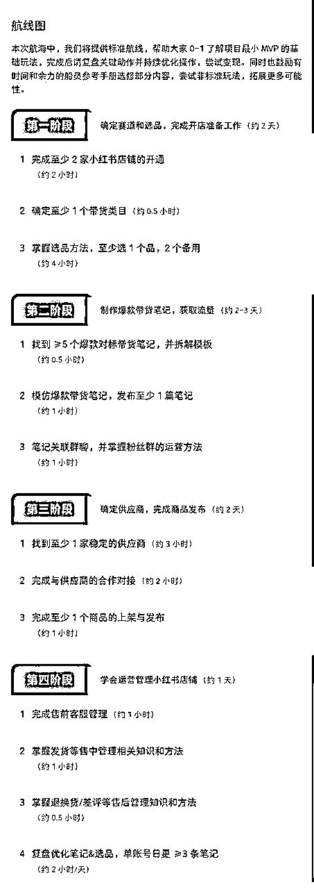

航线图与手册相互对应，可按当前环节查对应步骤。第一、第二阶段的任务，建议在航海前两周完成；之后把重心放在复盘、优化、提效上，持续产出优质带货笔记，提升爆款概率与成交率。

## 必修篇：先做出最小可行闭环

💡章节概要

必修篇从认识项目开始，逐步带你走完全流程。照着本章操作，即可完成最小可行闭环。

第一次做这个项目，建议先看项目全貌：
✅【项目概述】认识📕店铺

建立整体认知后，再进入核心动作：
✅【项目实操1/4】开店准备、赛道确定与选品
✅【项目实操2/4】带货笔记制作与流量获取
✅【项目实操3/4】供应商对接与商品上架
✅【项目实操4/4】售前、售中、售后管理

必修篇的章节顺序与航线图一致，顺着读、跟着做，就能逐项完成任务。后续关键章节的概要中，也会标注对应航线图，方便你对照执行。

现在开始。

# 一、【项目概述】看懂📕店铺

## 1.1 认识📕平台

💡小节概要

说到这个社区，许多人的旧印象仍停留在“美妆穿搭”“女性专属”“00后聚集”。事实是，它早已走出单一穿搭社区，内容生态相当丰富。

下面从四块展开：人群结构、热门内容、社区调性、流量分发。已有基础的朋友，可直接跳到下一章。

### 1.1.1 人群结构：谁在逛

主力年龄段为18至34岁，女性约占七成。地理分布上，一线与新一线更集中，身份多为都市白领、职场人群。“年轻”“女性化”“消费力强”仍是三大标签。这批人好奇、活跃、愿意交流分享。31至40岁人群也在增长，他们更看重生活品质，爱聊购物心得与日常经验。

从城市看，经济较发达的一、二线占比更高，消费水平与品质要求也更高。

六类典型人群：

1）Z 世代：兴趣社交、追新潮、玩网游、学习打卡、关注竞技
2）新锐白领：经济独立、投入工作、外向积极、有个性
3）都市潮人：重视时尚与形象、精神独立、有主见
4）单身贵族：财务自主、享受生活、追求品质、轻量消费
5）精致妈妈：看重生活质感与形象、高端消费、护肤保养
6）享乐一族：娱乐优先、为兴趣买单、重体验、爱享受

自由职业者与家庭主妇更在意实用、性价比，以及商品真实效果和使用感受。

另一个变化是，男性分享者明显增多。官方也在扶植男性创作者，美食、旅行等中性内容，以及科技数码、体育等偏男性内容增长较快，带动男性用户规模上升。

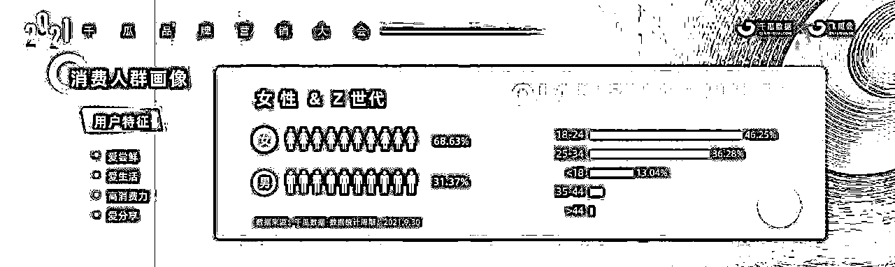

（数据来源：千瓜数据）

### 1.1.2 热门内容：不只有美妆穿搭

需求端看，彩妆、护肤、穿搭仍排前三。但都市人群的生活追求正在外溢：辣妈成长、生活仪式感、兴趣培养、自律治愈的日常……都在成为内容题材。

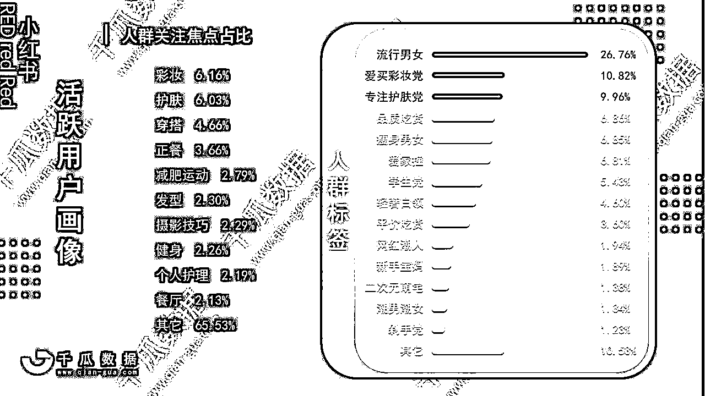

内容板块随需求扩展，已覆盖吃穿住行玩与学习。家居家装、母婴、美食、运动健身、知识学习、旅行、摄影手工、萌宠等方向热度不低，流量机会也不少。

### 1.1.3 社区调性：生活方式种草场

平台口号是“标记我的生活/你的生活指南”。本质是生活方式社区，也是种草场。用户既分享日常，也接受或发出消费推荐。

不管哪一面，核心都是内容。真实、接地气更容易被接受，但它不同于🧣和朋友圈：内容仍会被筛选，只有平台与用户同时认可，才有破圈机会。

### 1.1.4 流量分发：推荐与搜索双入口

两个核心入口：【推荐】与【搜索】。

1）推荐流

系统会依据笔记初始互动表现打分，包括点赞、收藏、评论、转发分享、关注转化。其中评论、转发、关注三项权重更高。

内部评分可写作：CES = 点赞×1 + 收藏×1 + 评论×4 + 转发×4 + 关注×8。

注：CES 为平台内部评分口径。

分数越高，笔记越可能被逐层推入更大流量池，形成爆文（小爆款互动1000+，大爆款10000+，类目间有差异）。爆文还会带动账号其他笔记数据。但需要满足几个条件：

① 笔记通过审核，无违规，未被系统删除，也未被你删除或隐藏。
② 笔记含有效关键词（如香水、家具），能落到垂直标签，被系统识别收录，再分发给对应兴趣人群。
③ 内容本身有吸引力，能促使用户点赞、收藏、评论。

特别说明：零基础第一条就大爆并不常见；运营首月，阅读量（小眼睛）停在100-200属正常，基础好的账号起量会快些。约80%的新手在第二或第三个月迎来爆发，前期有积累期，不必过度焦虑，把内容磨好更重要。

2）搜索流

用户不只刷主页，也会主动搜答案：想买口红就搜口红攻略，计划旅行就搜旅游攻略。

排在前面的笔记，曝光和关注更多。搜索入口约占总流量一半以上，不能轻视。

要拿到搜索流量，笔记需含有效关键词并被收录；要排名靠前，则账号权重与笔记权重都得持续积累。

内容来源：《初阶 | 📕-爆款笔记｜航海实战手册》

## 1.2 项目现状与前景

💡小节概要

这个社区如今是不少人消费前的搜索与决策入口，但商业闭环曾长期未打通。随着规则调整，开店变现的窗口已经打开。

### 1.2.1 发展前景 @谢无敌

用户在下单前常先来这里搜：吃什么、买什么、去哪玩。它离交易很近，但过去多数人仍回到传统电商平台成交。为了形成站内闭环，平台一边治理站外导流，一边补齐电商能力。

2021年8月，“号店一体化”推出，账号体系统一为专业号与非专业号，开店粉丝门槛从1000降到0。开店前提只剩开通专业号，而专业号申请相对简单，穿搭、美妆等博主基本都能通过（医疗等特殊身份除外）。

2022年10月，有博主注意到个人主页出现购物入口，浏览过的企业号或笔记商品会集中展示（该功能当时仍在灰度，不是所有账号都有）。

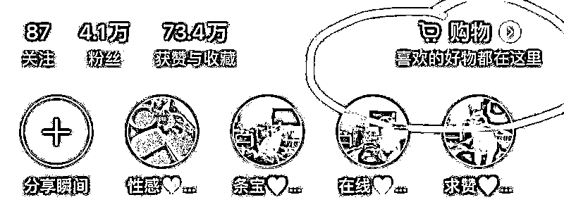

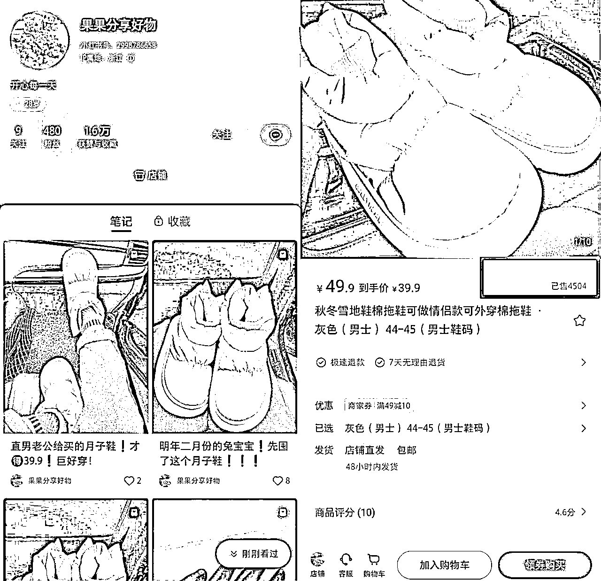

2022年10月，我就提醒过要抓住这波机会，把店铺先开起来。有朋友照着做，店铺上线第二天就连续出单：

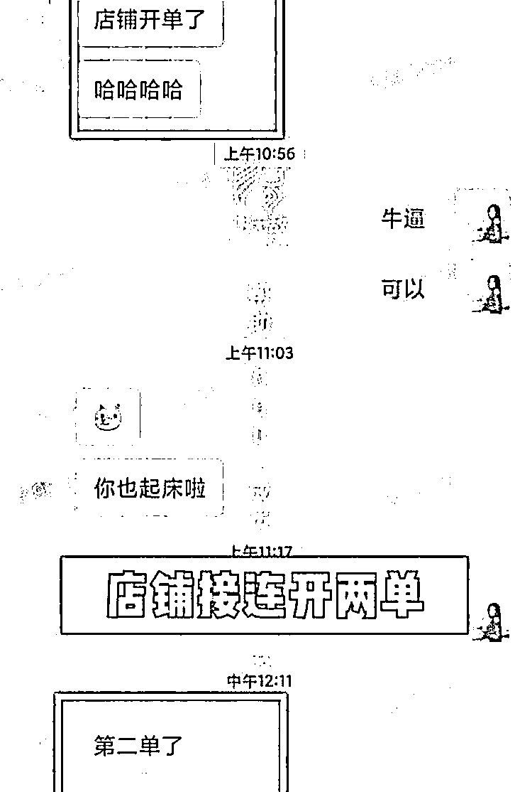

2023年4月，平台发布【笔记带货】功能，通过达人合作笔记推动交易。

其特点可概括为：达人池大、成本可控。成交可追踪，商品售出后按实际销售付佣金，转化链路完整，预算也更好控制。

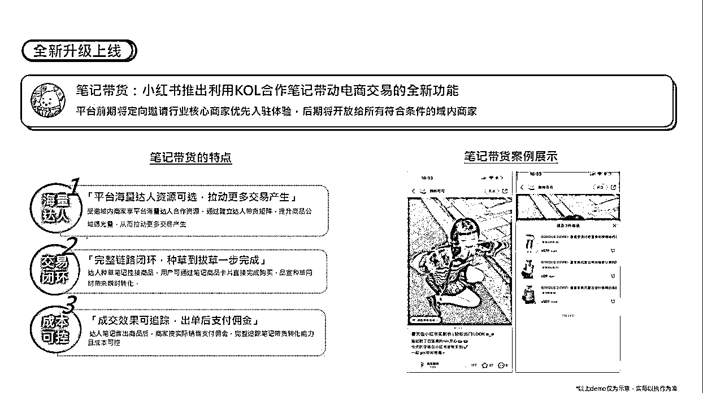

内容来源：《博主必看！2023年📕八大运营趋势解读》【笔记带货】产品手册-商家版（可对外）

### 1.2.2 项目门槛 @孙哲

现在笔记已能挂商品带货标识，平台正往内容电商走，也在完善自身生态闭环。

开通薯店后，有品牌或产品者可自营；没有产品者可找供货方签合作合同，出单后由对方发货，自己赚中间佣金。

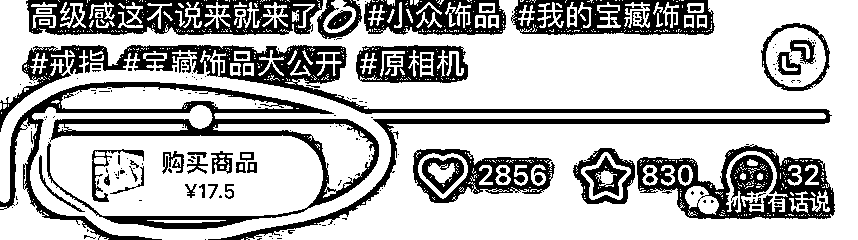

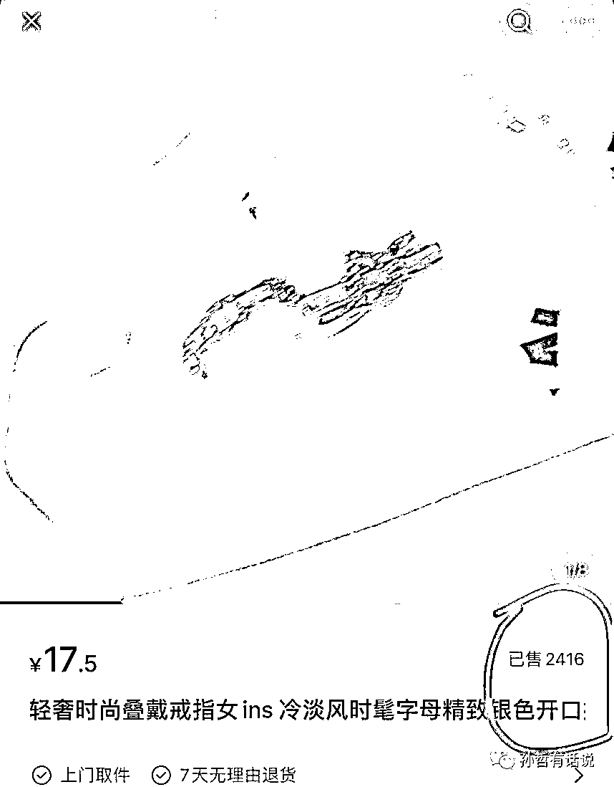

### 1.2.3 📌无货源代拍还能做吗 @表弟、@云端行走

平台当前态度是不支持无货源代拍。想尽量避开无货源判定，可参考以下做法：

少碰 PDD；确实缺货时，可找 PDD 商家谈代发。优先选 1688 这类专业代发渠道。不要一次性大量铺货，这也是稽查关注点。选品阶段先在 1688 把货源对接好，别等上架后再找货。遇到面单、短信、好评卡等引发的投诉，能用钱解决就别拖。还可以找中转仓：有订单后先发到仓库，由仓库换贴快递面单再发出，能规避短信问题，但包裹会晚1-2天。

第四条很关键，也是无货源与代拍的分水岭。代拍玩家往往先大批铺货，出单再找货，找不到就下架；偶尔一次平台和消费者未必追究，次数多了就可能被判定为无货源。

若某个品确实很好、暂时又没有货源，可设置15天预售，给工厂留生产时间，也降低自身风险。国内制造15天做不出来的品很少；真卖爆了，自己联系工厂做也未尝不可。另外建议做选品表，提前算清利润，参考同行价格后再上架，方便复盘和下单。

刚入行做带货的新人，也可以先从商品中心选品带货起步（需1000粉并开通带货权限）。等积累经验和资金后，再申请自己的店铺，对接稳定供应链。

本期航海会由教练讲解如何找稳定供应商、如何沟通对接。

圈友@艾小飞也在星球分享过看法，推荐阅读：《📕开始打压无货源，电商之路要怎么走》

内容来源：《📕店铺逆向思维选品及爆款笔记制作》

## 1.3 项目核心玩法

💡小节概要

平台与前景聊完，接着看项目怎么打。

本次航海核心，是带大家从0到1跑通📕店铺。快速入门的关键是什么？往下看。

### 1.3.1 最小可行路径与关键动作

新手从0到1的最小可行路径，可拆成：

注册账号并开店 → 定赛道与选品 → 找对标 → 发笔记 → 找供应商 → 上架商品 → 店铺管理

其中，选品和发笔记最关键。几点强调：

1.注册开店：新手最好准备两个及以上账号与店铺；熟手可用7个号轮换。

2.选品：这一步很大程度影响能否出单。新手前期可从低客单价、热门品类切入；本期航海会给出赛道与选品参考，也可按【章节2.2.3】的方法自行筛选。放到长期，仍要练出判断蓝海赛道的能力。

3.发笔记：这是拿到流量的核心动作，后续会详细展开。

选题方向上，可以紧盯商城里垂直类目近期销量爬升的商品笔记。把这些爆款拿来拆结构、做模仿，比闷头自己想更容易跑出结果。  
产出形式方面，平台对混剪类视频的管控会持续收紧。新手前期拿混剪练手没问题，但长远规划还是要往实拍倾斜。  

4. 供货商对接  
刚开始单量不多，跟商家商量好手工打单就行，只要面单上没有别家平台的标识就合规；单量变大以后，再考虑接入商家的 ERP 系统。  

### 1.3.2 平台内容推荐机制 @曜文  

一、笔记审核链路  
用户把笔记发出去之后，平台会先把它放进一个外部不可见的“黑箱”流程。系统按照平台规则（具体细则可以看官方账号“薯管家”）做初检，看有没有敏感表述、违禁词、劣质图片等。一旦命中违规，笔记会在初审阶段就被拿下，根本得不到曝光。至于机器拿不准的内容，会当成疑似违规，转入人工再过一道。没通过的笔记相当于被关进“小黑屋”，最直接的表现是限流——其他人点进你的主页，会看不到这条笔记。想验证是否被限流，把笔记分享到🛰️等外部渠道看一眼就知道。多数情况下，这套审核流程几分钟到十几分钟就能走完。如果等待时间异常拉长，要么赶上了发布高峰，要么是进入了人工审核阶段。  

二、笔记分发机制  
过了审核这一关，笔记就会进入平台的语义拆解流程。AI 会读一遍内容，把它归入对应类目，同时给笔记打上兴趣标签、提取关键词做收录。接下来，笔记会出现在粉丝的信息流里，也可能会被推荐给其他用户。算法先挑一小撮匹配度较高的用户（大约 100 人）做小范围测试，如果这批人的反馈不错，系统才会考虑扩大推荐范围，给更多曝光。这里有一个可参考的加权口径：CSS =（点赞数×1）+（收藏数×1）+（评论数×4）+（关注数×8），它衡量的是互动强度与转化效率，计算得出的结果会反复影响首页推荐的频率。换句话说，最先触达的 100 个用户点不点、互动不互动，很关键；发布后 18—24 小时的数据表现，同样会左右后续的流量走向。  

三、笔记权重怎么看  
笔记权重可以拆成几个观察面。原创度是底线：如果低于 60%，权重会跟着往下掉，严重时还会被限流。转化率看的是曝光与互动的比值。在互动行为里，分量排序是转发优先于评论，评论优先于收藏，收藏优先于点赞。内容层面也有一个考察点：笔记里的关键词、标签跟正文到底贴不贴合；如果关联度太弱，系统有理由怀疑你在恶意引流，权重自然会被压低。  

四、搜索排名与收录  
搜索排名说的是用户输入某个词之后，笔记在结果页里的先后位置。排得越靠前，被点开的可能性自然越高。聊排名之前要先懂“收录”——它指的是搜索引擎把笔记内容抓取下来、存进数据库。通常笔记能过审就会被收录，但有四种情况会破坏这件事：一是账号此前多次违规，整个号被限制，新笔记也跟着没法进库；二是内容被识别成抄袭、重复度过高或非原创，平台不会支持；三是广告味太重、营销表述过多，会被当作推广笔记；四是反复修改引发重新审核，改着改着就失去了收录资格。  

# 二、【实操 1/4】开店筹备、赛道与选品  

💡 本节速览  
项目全貌心里有数之后，就可以真正动手了。在平台做电商，前提条件是把店铺筹备和货品选择这两件事先落地。因此这节内容集中整理了起步阶段该做的几项工作：  

✅ 手机号和手机  
✅ 店铺入驻与账号信息完善  
✅ 至少锁定 1 个带货类目  
✅ 完成第一轮选品  

平台里不同类型的店铺，入驻门槛并不一样。先对照自己的条件了解清楚，再进入申请流程。选品是这一章要重点掌握的技能，下文提供了适合新手的选品思路和实操方法。  
新手找货有三条路径：平台站内选品，其他兴趣电商平台选品，传统电商平台选品。  
新手选品步骤：  
1. 花 2 小时大量看货，先把网感养起来  
2. 用组合选品法正式选品：抖音创意中心选品法；站内低粉爆款选品法（手动刷+灰豚数据搭配）  
3. 其他常用选品法：电商平台选品、对标账号选品  

另外，小节末尾附有热门赛道&货品推荐、爆款选品合集。  
做生意不能只顾低头干，多观察市场环境，成功概率才会更高。  

💡 本章航线图  
把这一章学完、做完实操，就可以推进到航线图的第一阶段：定赛道、做选品、完成开店准备（大约 2 天）。  
1. 开通至少 2 家店铺（约 2 小时）  
2. 确定至少 1 个带货类目（约 0.5 小时）  
3. 掌握选品方法，至少选定 1 个主推品、2 个备选品（约 4 小时）  

现在按步骤把这几件事跑起来，开始选品吧。  

## 2.1 账号筹备  

### 2.1.1 账号备双份  
新手起步，通常建议开个人店铺；要开 2 家店，就得备 2 个账号。硬件方面，三样东西都要准备双份：手机、电话卡、身份证。手机最好别一台机器开多个号，被限流不划算；两个平台号要对应两个实名认证，所以电话卡也得有两张；身份证不够用的话，拿家里人的也可以。  

电话卡怎么选：三大运营商都支持办副卡，一张身份证能注册认证 5 个号码，相当于一拖四，副号月租 10 元。移动的万能副卡，月租同样是 10 元，一张身份证能领 2 张，但两张卡之间要间隔 90 天；线下营业厅、线上 App 都能办，不过营业厅有时可以免掉第一年的月租。中国电信的话，App 里搜“无忧卡”，月租 5 元，一般第二天就送上门。移动还有个 8 元的保号套餐可以选。  

手机怎么挑：手机不只是登账号，后面拍视频也靠它。如果只做短视频拍摄，千元左右的安卓机完全够用，而且安卓自带应用双开功能；如果以后想往直播方向放大，iPhone 在直播场景下更稳定，代价是不支持双开。  

### 2.1.2 登录与养号 @渡  

账号怎么登录：如果同时操作两个号，是不是一部手机就能搞定？  

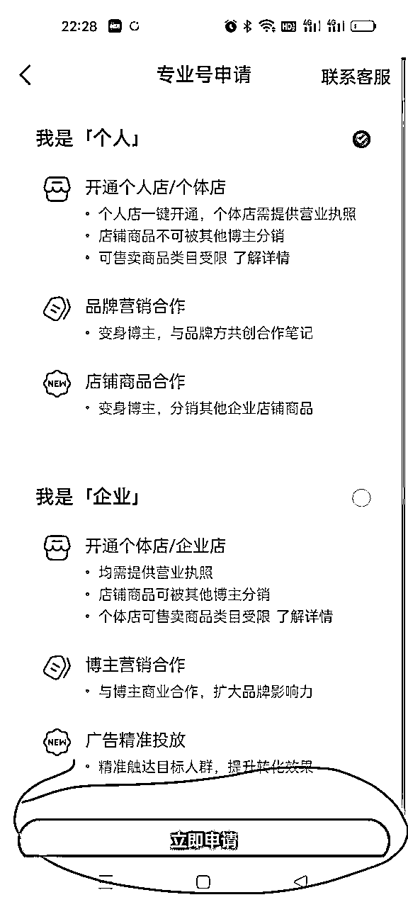

养号怎么做：刚注册的号，每天花 30 分钟以上到处刷刷，对提升权重有帮助。刷的时候可以按自己选的赛道去找对标笔记，通常刷 1 到 3 天就够了。  

### 2.1.3 店铺开通  

#### 2.1.3.1 店铺类型怎么分  
入驻前得先弄清楚店铺有哪些类别，因为不同类别拿到的权益并不一样。从大的框架来看，平台给两类选择：个人店铺和企业店铺。不过无论走哪条路，都得先把账号升级成专业号。刚注册的账号默认不是专业号，而非专业号什么商业动作都做不了，薯条投放、开店通通不行。  

像医生、律师这类特殊职业人群，还得额外上传资质做认证，另外要交一笔 300 元的费用。  

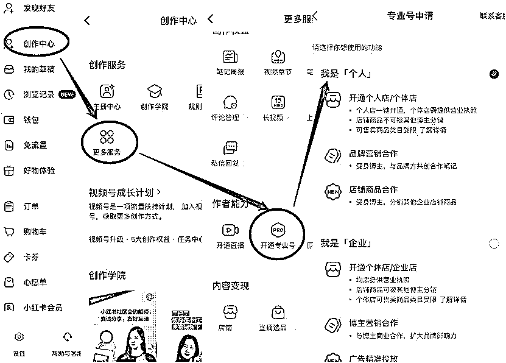

个人型专业号能申请个人店铺或个体工商户店，店铺名一般为“XXX（昵称）的店”。申请路径：进【创作中心】→【更多服务】→【开通专业号】→【我是企业】→【填写基础信息】→【填写主体信息】→【资质公函上传】→【运营人信息填写】→缴纳 600 元费用后等审核。填写时有哪些注意事项，可以看下图：  

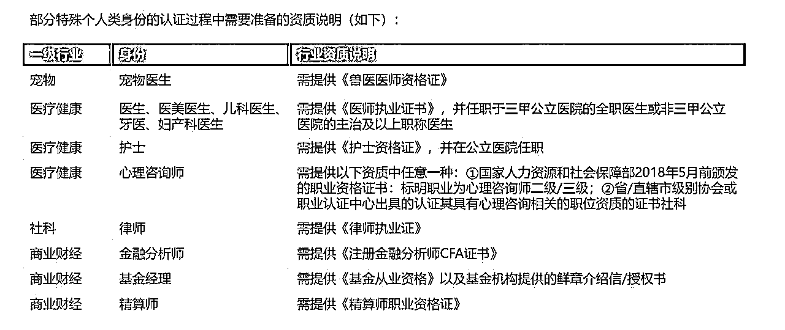

提交申请之后要盯紧进度，因为申请只在 30 天内有效；如果 30 天没走完流程，费用不会退。审核通过后每年还要年审，续费同样是 600 元。  

企业专业号对应的是普通企业店和专卖店/旗舰店，店名格式为“XXX 专卖店/旗舰店”。  

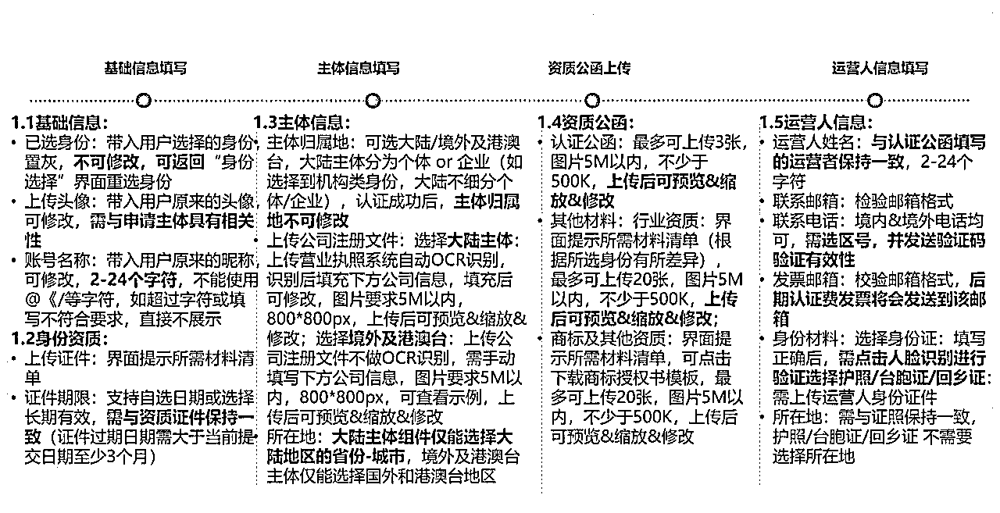

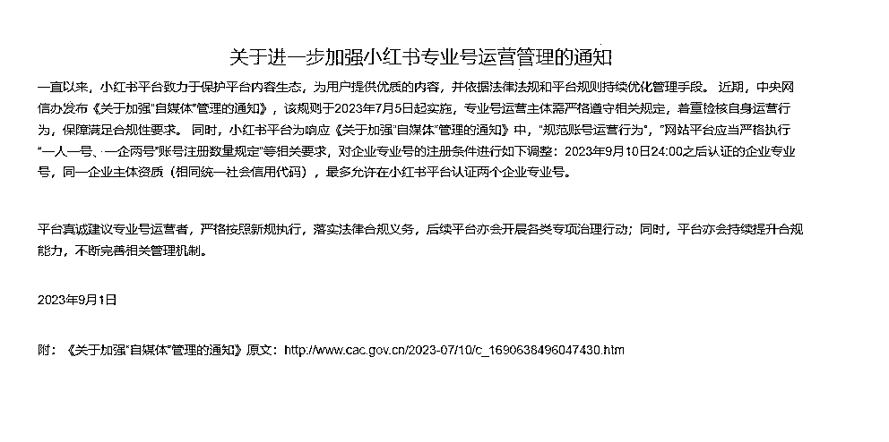

这里有一点要注意：同一个品牌只能拥有一家旗舰店，但可以在旗舰店之外再开其他类型的店，比如一家旗舰店搭一家专卖店，或者一家旗舰店配一家普通企业店。从营销权益上看，企业专业号拿到的资源比个人专业号更多；不过两种身份只能选一种，看自己需要。对新手的建议是：先开个人店，门槛低；等要做矩阵放大规模时，再考虑企业店，平台对这类账号也相对宽松。  

#### 2.1.3.2 【个人店】门槛与入驻步骤  
个人型店铺往下再分，就是【个人店】和【个体工商户店】。开这两种店都要交保证金，金额都是 1000 元；如果是保健品、奢侈品这类特殊类目，保证金会高一些。  

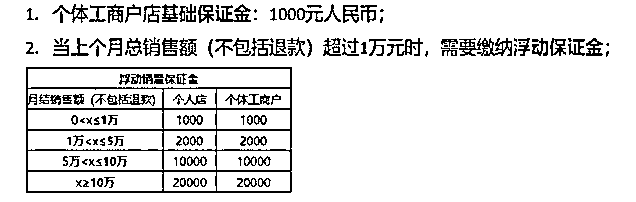

客服这块，个人店铺有两种模式可选：平台代运营、自主客服。平台代运营是收费服务，具体选哪种看自己的情况。  
平台佣金也叫技术服务费，划分线是月销售额 1 万元：1 万以内不收，超出部分抽 5%。  

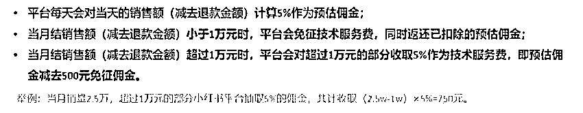

平台现在把开店门槛压得很低。个人店和个体工商户店入驻后，不用先交保证金就能上架商品；等累计交易额超过 1 万元，下个月月初再补交就行，算是真正的“零门槛”起步。  

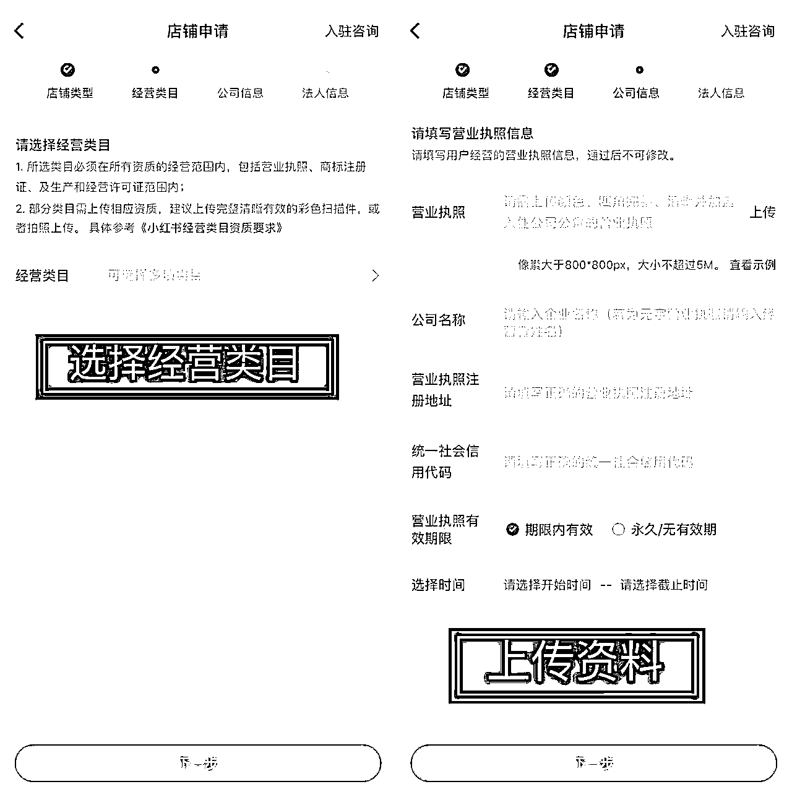

个体工商户店的审核大概要两到三天。期间自己登录入驻系统就能查到进度；遇到解决不了的问题，每天 9 点到 24 点都有在线人工客服可以问。  

企业型店铺能覆盖的类目更广，像保健品、医药这类特殊品类也能做。平台佣金规则与个人店一致：1 万以下不收，超出部分按 5% 计算。保证金则因类目而异：境内一般最低 2 万元，境外店要 3500 美金。拿不准选哪类？可以对照下面这张图快速判断：  

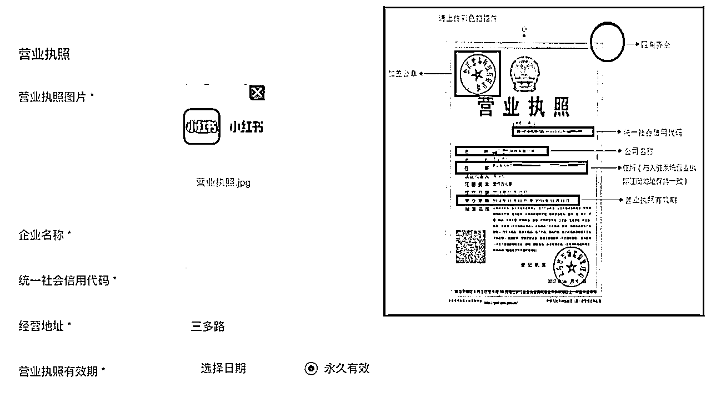

接下来填写法人或店铺运营人的信息。有个细节要留意：填写的联系人必须和营业执照上的法人保持一致。  

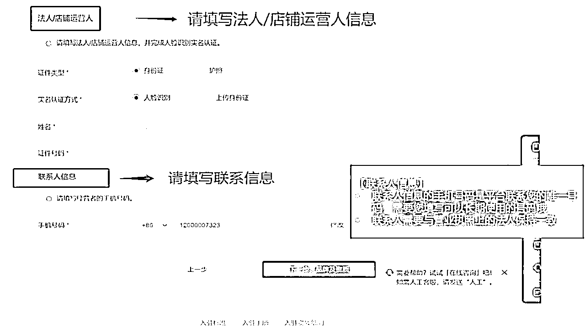

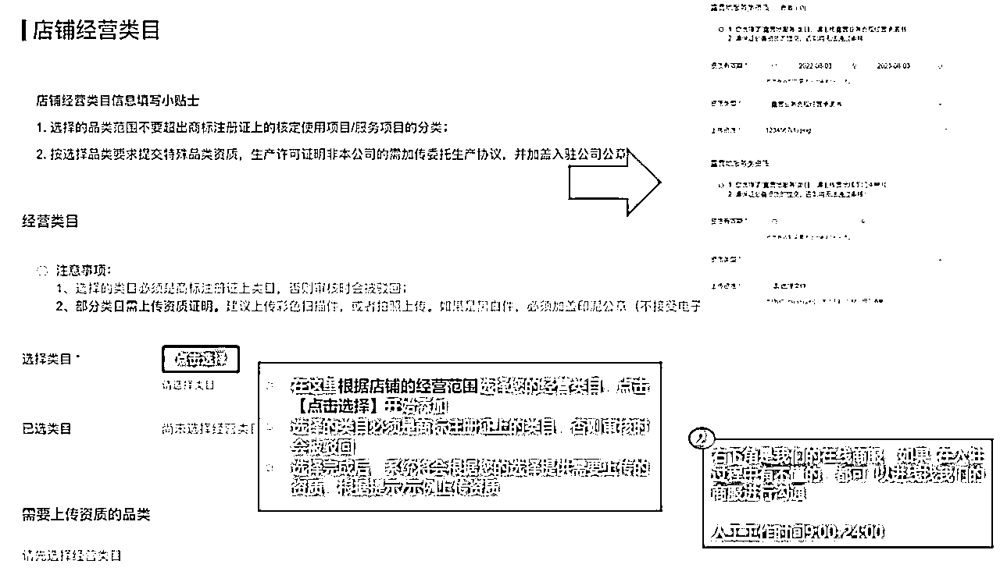

第五步就是等审核，一般三个工作日内出结果。如果没过，平台会通过电话或邮件通知；期间有任何问题，也可以随时找在线客服。审核通过后，最后一步是缴纳店铺保证金。注意：开卡账户必须是对公账户，开户人要跟入驻时填的经营人姓名保持一致。  

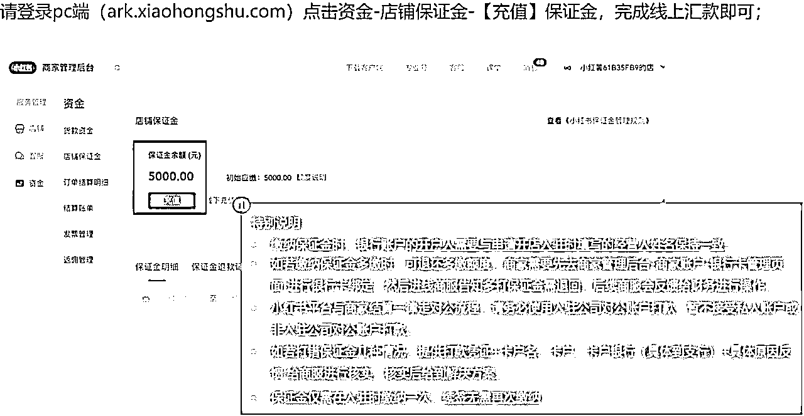

再来是旗舰店、专卖店的申请。流程跟普通企业店基本一致，但有四点要额外注意。第一，要先把品牌相关材料填好。  

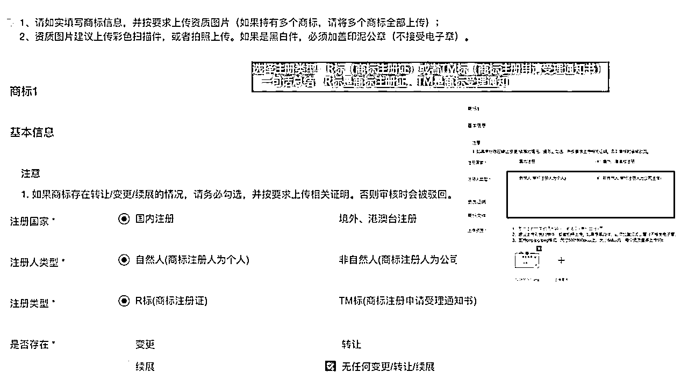

如果商标是个人名下的 R 标，需要上传商标注册证，同时附上商标权利人的身份证或护照复印件/扫描件。  

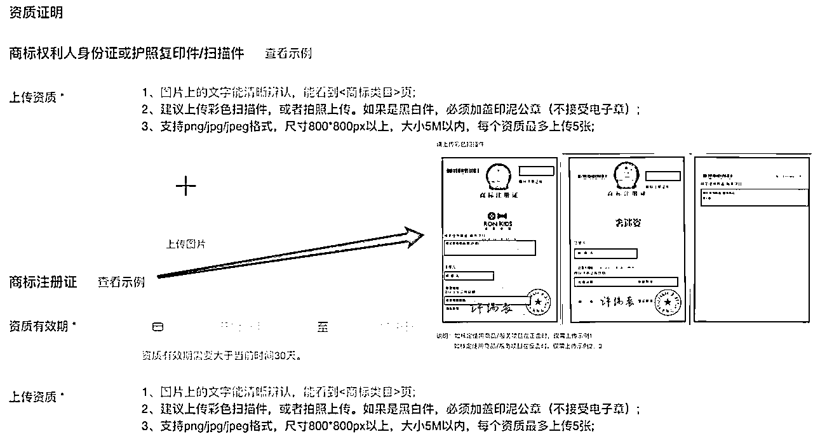

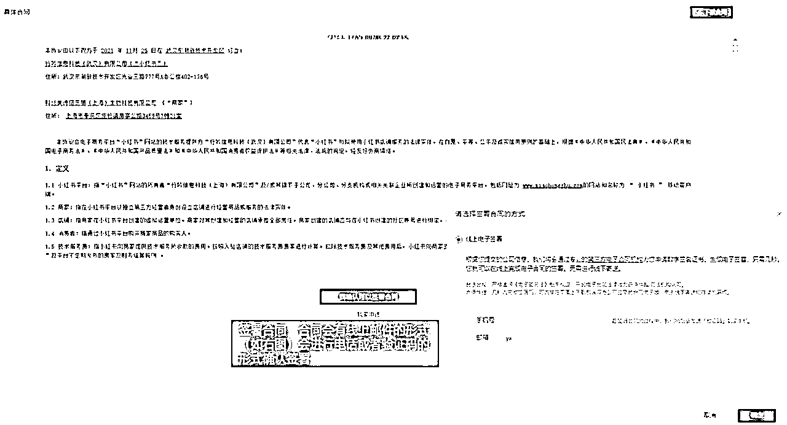

后面同样要交保证金，注意事项与普通企业型店铺相同。  

最后说集合店。集合店不走公开申请通道，只有平台主动发出邀约才能进。收到邀约后的流程，跟旗舰店、专卖店没有差别。  

所有审核都通过以后，就可以上传商品正式开店了。账号首页会直接展示店铺入口和商品入口。想了解更多入驻细节，可以自己到官方帮助中心查看：https://school.xiaohongshu.com/helper/list?ctg=238&jumpFrom=cn  

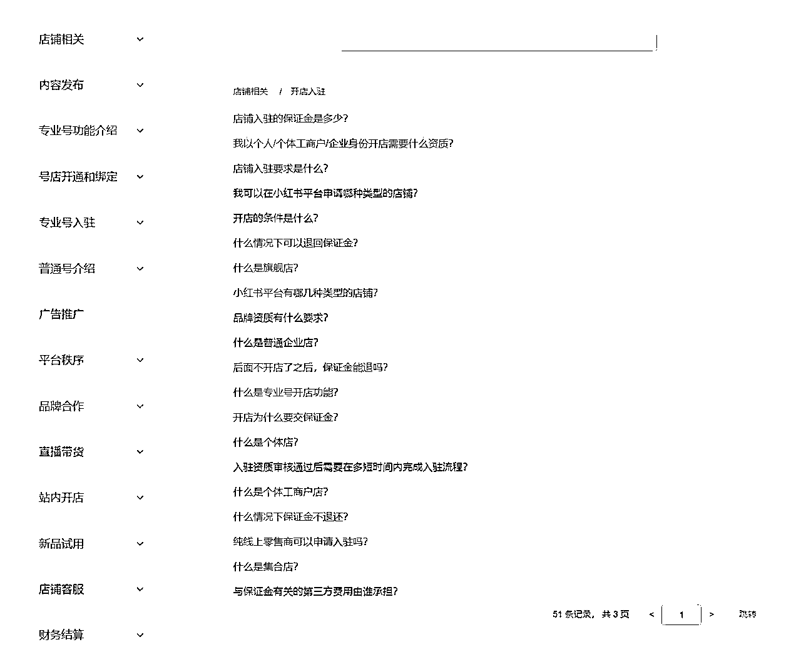

### 2.1.4 账号定位与包装 @曜文  
账号包装其实不复杂。通常先把赛道定下来（可以看【章节 2.2.1 赛道怎么选】），再做账号设置。拿百货类账号来举例：第一步是找对标账号。打开商城，搜赛道关键词，比如“旋转梳子”，点进高销量的商品，然后点左下角的头像，就能进入对应账号主页。  

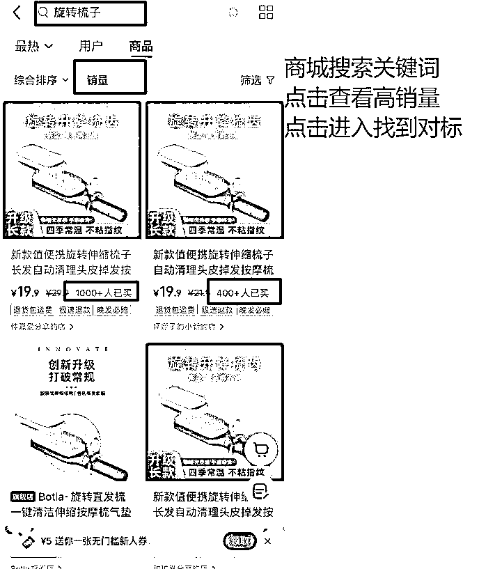

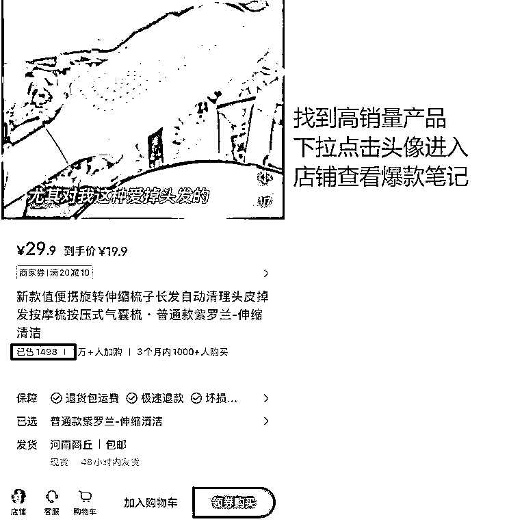

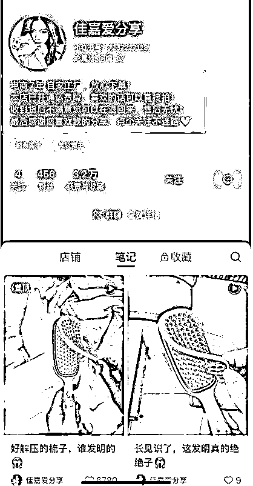

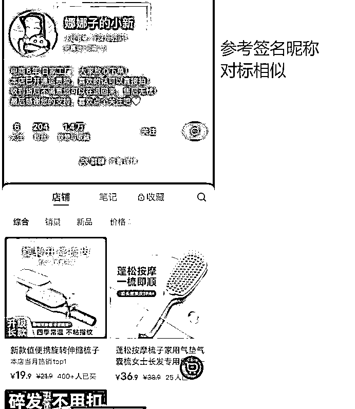

## 2.2 赛道与选品  

### 2.2.1 赛道怎么选 @曜文  
选赛道的核心是挖掘蓝海，这件事对新手来说难度不小，这里先不展开讲。在后面的【章节 2.2.5 热门赛道&货品推荐】里，我会列出几个适合新手的热门赛道；建议先把最小 MVP 跑通再说。如果确实对蓝海赛道有兴趣，可以去选修篇看【章节 7.1 如何选到蓝海赛道】。  

### 2.2.2 选品逻辑 @曜文  
学选品方法之前，更值得先吃透底层逻辑。概括起来就落在四个维度上：价格、季节、人群、兴趣。在📕做电商，选品几乎能决定你能不能出单。更细的内容，可以去看曜文老师发在星球里的那篇《📕电商爆款选品逻辑分享》。  

### 2.2.3 选品方法与步骤 @V 小刀 @书豪  
电商圈里有句话叫“选品定生死”，但新人最容易卡在不知道从哪儿下手。这一节尽量把步骤压缩到足够简洁，方便直接照着做。在讲具体操作之前，先理一理选品的基本思路。  

#### 2.2.3.1 选品思路梳理  
选品方法五花八门，但归纳起来绕不开三个大方向。第一个方向是站内选品。针对这个方向，我们总结了 6 条基础原则——不管用哪种方法选品，拿到的品最好都符合这 6 条标准。  

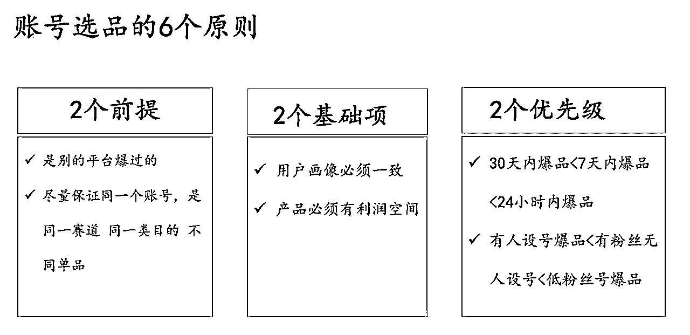

#### 2.2.3.2 选品实操方法  
具体怎么操作？建议按下面的顺序推进。  

第一步，先花 2 个小时把足够多的产品看一遍。在“选”之前，你得先“知道”。看的时候建议这样：路径选视频—电商视频—近 7 天，再按品类一个个过。这样你看到的就是最近一周靠视频推起来的品，顺手还能把热门脚本也刷一遍，网感会明显提升。考古加的观看界面可以参考：  

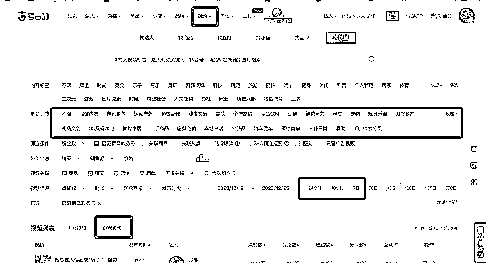

这一步的目的，其实不是让你当场敲定某个品，而是先扩大涉猎范围。顺便观察不同品类的带货视频差距在哪里，看自己对哪一类更感兴趣。  

第二步，进入正式选品环节。新手阶段，建议先用组合法；等熟练之后，再挑自己最顺手的单独使用。最容易上手的组合是：抖音创意中心选品法 + 站内低粉爆款选品法（手动刷配合灰豚数据）。  

【01】抖音创意中心选品法  

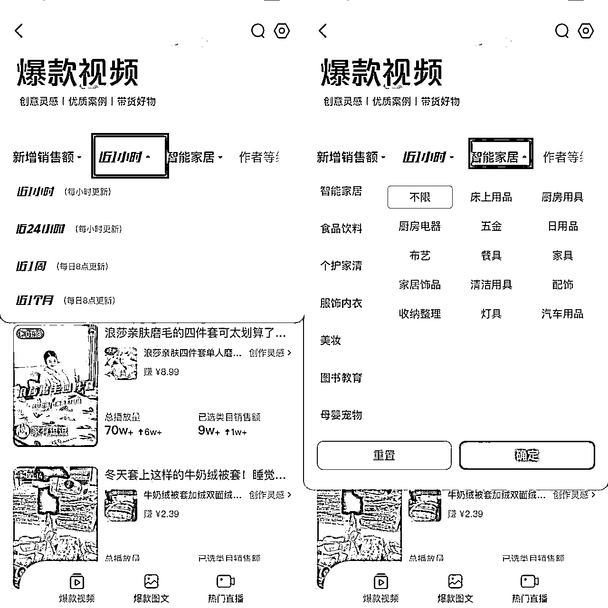

【02】站内低粉爆款选品法  
先解释一下什么叫“低粉爆款”。通常指：账号粉丝不到 200，但最近 7 天发的单篇带货笔记点赞超过 100，而且该笔记对应的商品销量在 100 以上。这套打法瞄准的是站内正在被推的有潜力爆品，核心是抢时间跟品截流。做女性产品类目的朋友尤其要重视，因为这类商品在📕更容易先火起来。我们之前操盘过的雪莉枚 U 型枕、发箍、帽子等爆款素材，首发阵地都在📕。当然，不同品类要观察一下再决定用哪种方法，不必生搬硬套。具体落地有两个途径：灰豚数据、手动刷。前期建议把两者搭配着用。  

02-1 灰豚数据低粉爆款选品法操作路径 @书豪  
工具归根到底只是实现目标的手段，用哪个顺手就选哪个。第一步，打开灰豚数据；第二步，点“笔记查找”，选择“笔记搜索”；第三步，把【带货笔记：是】勾上。

第四步 | 低粉爆文搜對標

進入數據平台後，勾選“低粉爆文”選項，然後輸入你想做的類目，例如想做連衣裙，就搜索“連衣裙”。

在灰豚數據等工具中挑選對標賬號時，建議重點關注粉絲數低於200的賬號。同時，筆記在7天內點讚數超過100，並且掛車商品的銷量大於100，這樣的品才值得考慮。這種方法依然是低粉爆款邏輯。

02-2 小號手動刷的小技巧

確定自己要做的品類後（比如帽子），可以準備一個小號，持續搜索帽子相關內容。系統會因此給小號打上“對帽子感興趣”的標籤，並持續推送相關筆記。

當你瀏覽系統推薦的內容時，點進筆記主頁，檢查對方是否為低粉賬號（粉絲盡量小於200）。如果是，就點關注、點讚、評論。系統會慢慢記住你喜歡低粉賬號的帽子內容，之後會第一時間給你推送更多這類“低粉爆款”。

這樣每天花點時間刷小號，就能及時知道最近流行什麼款式、什麼文案和封面容易出數據。這個過程雖然耗時，但持續刷的同時，也在不知不覺中培養你的品感和網感。

【03】其他選品技能補充

1、電商平台選品法——推薦款式類產品使用

電商平台選品，就是利用淘寶、拼多多等傳統電商渠道，去發現潛在的爆款。

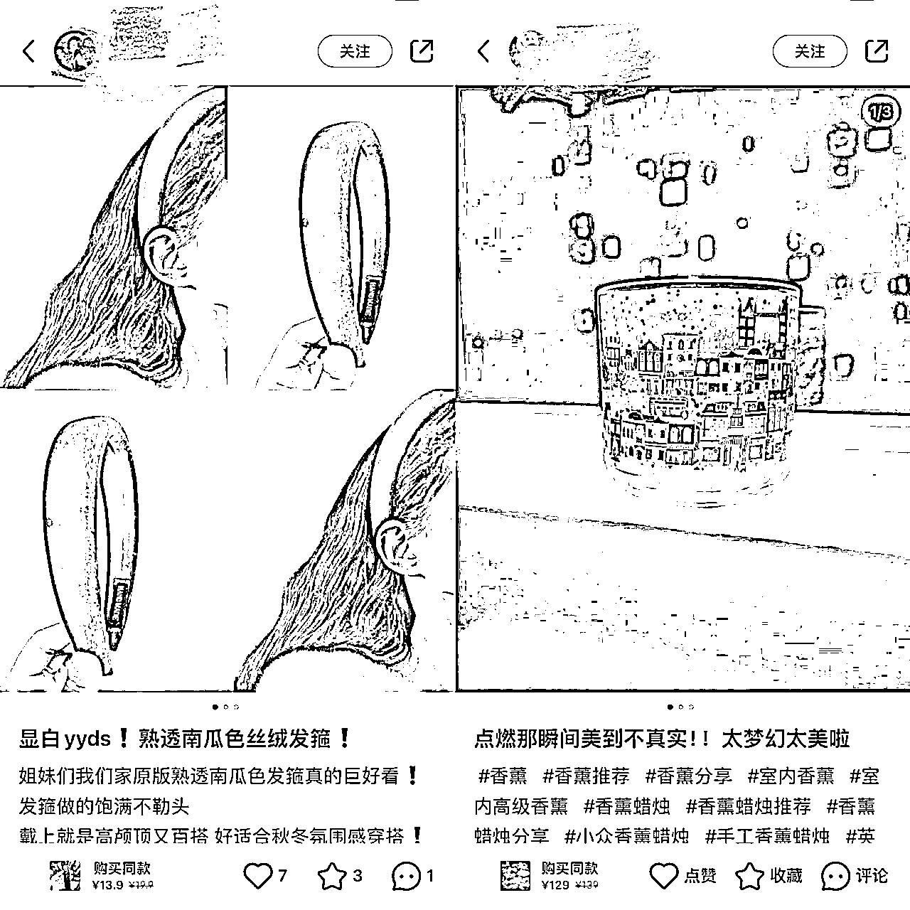

附：如果選用抖音選品法，如何判斷選中的產品要不要繼續測品？

很多圈友在選品時常常感到不確定，不知道什麼算爆品，也不確定爆到什麼程度可以繼續跟。

這裡分享一個觀點：做小紅書不是做數學題，不必追求一個確定性的答案。比如1000單在小紅書算不錯，但不同品類、不同價格，數據標準差異很大。建議用對比思維來判斷想選的品是不是好品。

以下標準僅供參考，適合於混剪類目的判斷。

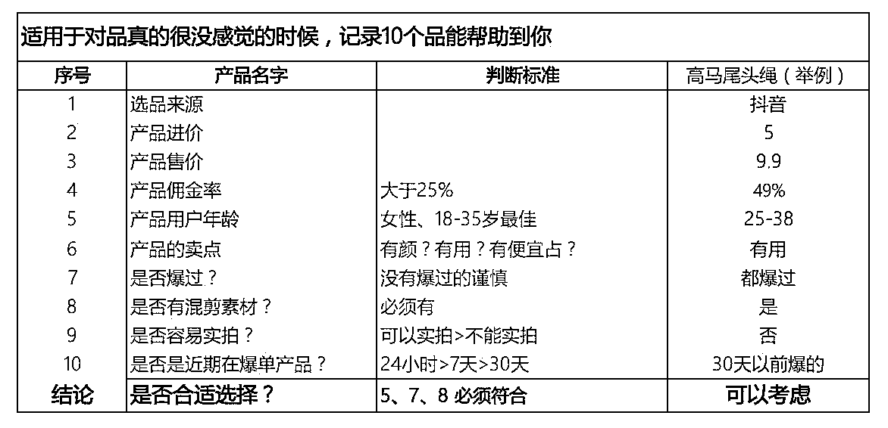

### 2.2.4 選品技巧（建立選品漏斗池）@袁、

我的方法是建立一個“選品漏斗池”，每天保證3款以上新品更新，就是在不斷擴大漏斗池。因為再爆的品也有生命週期，不能把雞蛋放在一個籃子裡。另外，對於已經出單的品，要重點關注相似款。有些出單款經過改造升級，這種相似品非常值得留意。

比如下面這條筆記，是在灰豚低粉爆文中找到的：

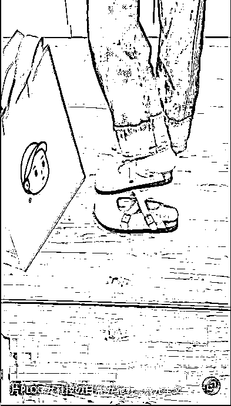

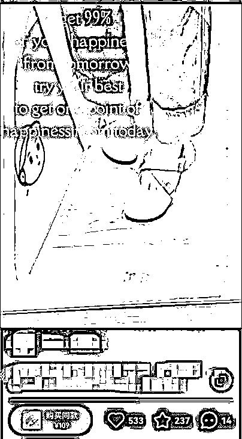

月初我在案例庫裡加入了一條記錄：

A作者6月1日發布低粉爆款未掛車筆記。

B作者6月2日複製這篇筆記並掛車，目前商品銷量100+。

這種複製筆記的形式，改變了我對製作筆記的原有認知。B作者只是在A的基礎上刪刪減減，加了一些基礎剪輯動作，結果帶來了不錯的銷量。

所以，多刷低粉爆文、多積累同行優秀案例很有必要。而且平台會根據我們的瀏覽習慣，推送不少符合低粉爆文的筆記。

內容來源：《小紅書店鋪，月GMV10w+的方法總結與復盤》

### 2.2.5 熱門賽道&貨品推薦 @曜文

選品具有時效性，這裡推薦一些週期較長的近期熱門賽道和選品，供大家參考：

百貨：暖手寶（季節性產品）、發夾、梳子、帽子、廚房用品

水果：砂糖橘、粑粑柑、沃柑、冬棗（根據近期實時上市品）

數碼：耳機、充電器、充電寶、手機支架、電動牙刷

鞋服：馬丁靴、毛毛拖、毛衣、打底衫、針織衫

新手可以從以上賽道入手。前面建議新開2個店鋪，對應可以選1-2個賽道去做，低客單產品上手比較快。

除了上述方法和推薦，我們還和志願者 @晨楓 一起整理了生財有術裡關於小紅書選品的內容，製作成【小紅書爆款選品合集】：《最新的小紅書爆款選品風向與方法》。希望這個合集對做小紅書店鋪的你有所幫助。

# 三、【實操 2/4】製作爆款帶貨筆記，獲取流量

💡 章節概要

爆款筆記是小紅書店鋪最主要的流量獲取方式。如何通過爆款筆記帶來流量？可以參考以下方法：

✅ 注意帶貨筆記的展現形式（圖文或視頻），挖掘高質量對標，參考製作筆記；

✅ 通過批量生產爆款筆記，盡量獲取更多平台流量；

✅ 通過筆記關聯群聊引流，在粉絲群內推薦產品。

最後分享3個帶貨筆記避坑點，助你少走彎路。接下來就開始做出你的爆款筆記吧～

💡 本章航線圖

完成本章學習和實操，即可完成第二階段：製作爆款帶貨筆記，獲取流量（約2-3天）

1. 找到≥5個爆款對標帶貨筆記，並拆解模板（約0.5小時）

2. 模仿爆款帶貨筆記，發布至少1篇筆記（約1小時）

3. 筆記關聯群聊，掌握粉絲群運營方法（約1小時）

## 3.1 爆款筆記分類 @曜文

不同品類適合不同的內容展現形式，效果也不一樣。這一節我會舉例說明什麼品適合圖文，什麼品更適合視頻，大家可以根據自己的選品選擇形式。如果不確定，不用糾結，兩種都可以嘗試。

圖文筆記：

適合圖文筆記的產品，通常圖片能直觀展示產品亮點、呈現需求痛點。小紅書這類產品的爆款筆記，普遍以圖文居多（可通過搜索關鍵詞查看）。

舉3個例子幫助理解：

1. 女裝對身材和搭配要求較高，可嘗試圖文筆記：http://xhslink.com/9ibh8x

2. 褲子實拍簡單、去背容易，可嘗試圖文筆記：http://xhslink.com/isLf8x

3. 玩偶公仔圖文爆款多，可嘗試圖文筆記：http://xhslink.com/j3Tg8x

視頻筆記：

適合視頻筆記的產品，主要特點是：視頻能直接展示產品功能；產品本身比較新奇，能吸引用戶觀看；需要真人出鏡塑造IP感；圖片無法展現痛點或亮點。小紅書這類產品的爆款筆記，普遍以視頻居多（可通過搜索關鍵詞查看）。

舉3個例子：

4. 百貨清潔類需要強展示，可嘗試視頻筆記：http://xhslink.com/61ri8x

5. 日用護理類需展示實用性與痛點，可製作視頻筆記：http://xhslink.com/C98j8x

6. 解壓玩具類吸睛、讓用戶停留，增長曝光，可製作視頻筆記：http://xhslink.com/zxxk8x

## 3.2 找對標爆款筆記的通用方法 @杉木

如何判斷一篇筆記能否作為對標？主要看評論區。第一個標準是讚評比（點讚數：評論數），我一般找比例接近1:1，甚至1:2的，總之評論數越多越好，而且評論內容要直接表現購買意向。這種內容建議用最笨的方法去找。

方法一：主動搜索關鍵詞

通過搜索類目關鍵詞，頻繁瀏覽競品筆記，把自己的小紅書賬號刷成競品內容瀑布流。大量閱讀領域內筆記，然後不斷挖掘。不建議一開始就藉助工具走捷徑，這個過程值得花時間。

在找筆記的過程中，你會逐漸感知到產品賣點，對內容方向更有把控，還可能有很多意外發現。把這些筆記全部收集起來。注意，挖掘時最好點開主頁看看賬號的其他內容，因為一個賬號的某篇筆記好，往往還有類似內容。如果他篇篇都是爆款，恭喜你發現了寶藏，建議把這個賬號的全部內容認真收集下來。可以藉助工具爬取，淘寶上有類似工具。

方法二：藉助數據分析工具

藉助數據工具可以找到真正的熱度詞，在文案中植入，增加搜索曝光。說白了就是蹭熱度。主動搜索的用戶會高頻使用小紅書搜索功能，特別是在品牌集中投放或新品發布時，小紅書內該品牌的搜索量會明顯上升。“大家把小紅書當搜索引擎用”，這是眾多用戶的心聲。

我們要做的就是借力。比如今年瑜伽服品牌lululemon熱度很高，甚至“lululemon”這個關鍵詞熱度高於“瑜伽服”這個品類詞，那我們就可以在文案中多次植入。

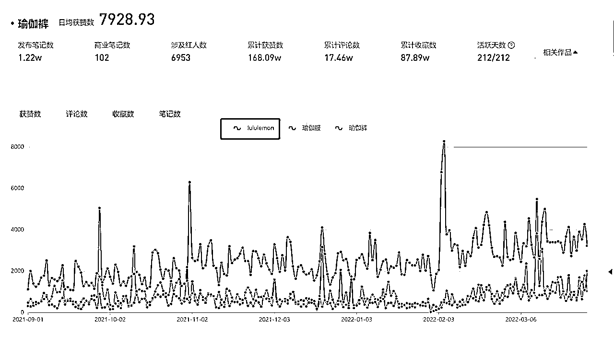

找到這類筆記後，全部收集起來分析文案，除了發現筆記展示的核心需求外，主要體會高詢單內容的情緒價值。說實話，如果光靠感覺去找需求，即使你在行業裡浸潤多年，也容易誤判。一切要以實際筆記的反饋為主，而不是你的直覺。凡是評論區一堆人問鏈接、問怎麼買的，那一定涉及目標客戶最關心的點。凡是評論區七嘴八舌的，就算再高讚，也是瞎熱鬧。切記：

找到能賺錢的筆記，而非看熱鬧的；終極目標不是出爆款，而是精準客戶。我做小紅書是為了賺錢，不是為了高讚內容。

## 3.3 【圖文】筆記製作流程 @曜文

以下以百貨商品為例：

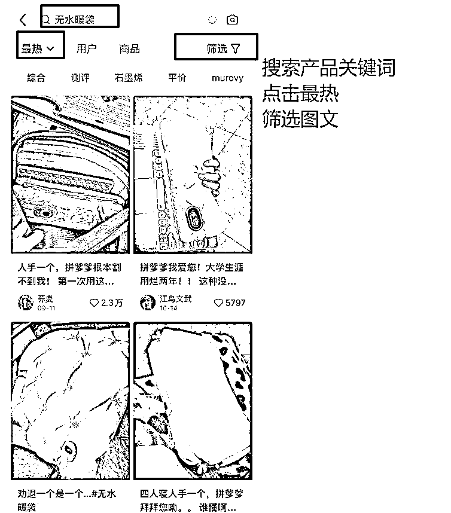

2. 繼續下拉，找出高讚千讚筆記並記錄：

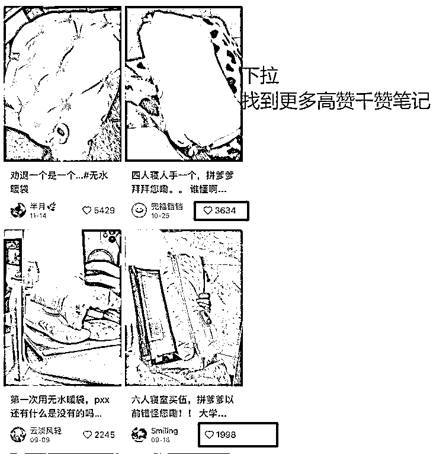

3. 記錄高讚筆記：

http://xhslink.com/RULY6x

http://xhslink.com/3EOY6x

http://xhslink.com/uASY6x

http://xhslink.com/zTYY6x

http://xhslink.com/EF1Y6x

### 3.3.2 模仿對標製作圖文筆記

根據上面記錄的5個高讚筆記，我們從封面、標題、內容三個維度進行拆解模仿。

1）封面：

2. 或添加畫中畫，添加貼紙/調整透明度；

3. 或使用美圖秀秀AI更換背景，操作步驟如下：

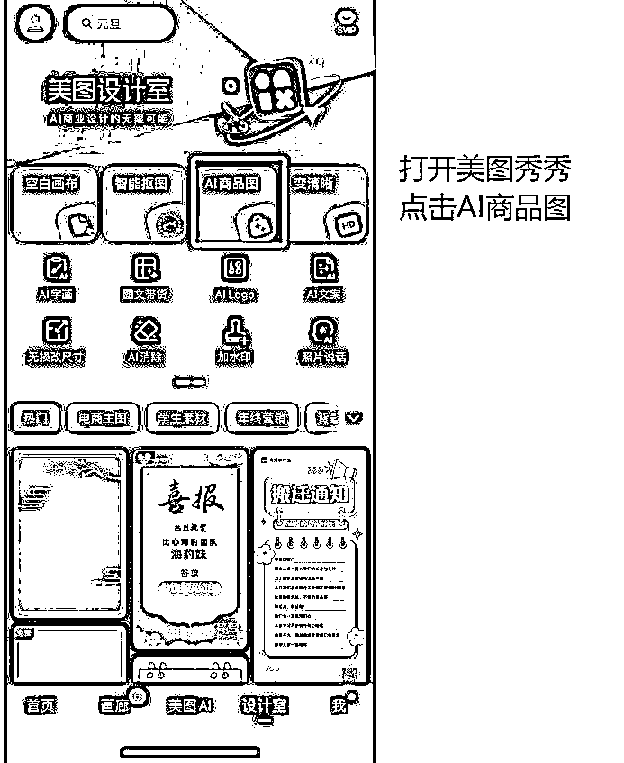

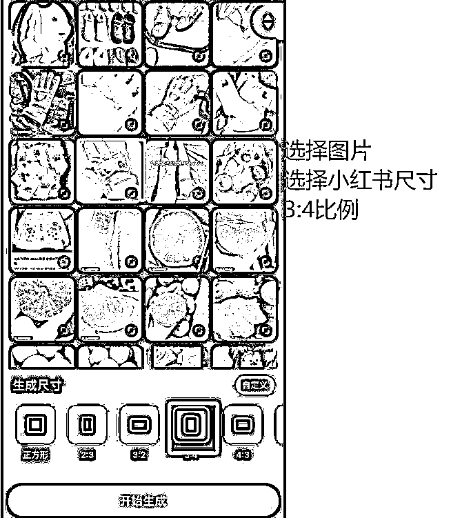

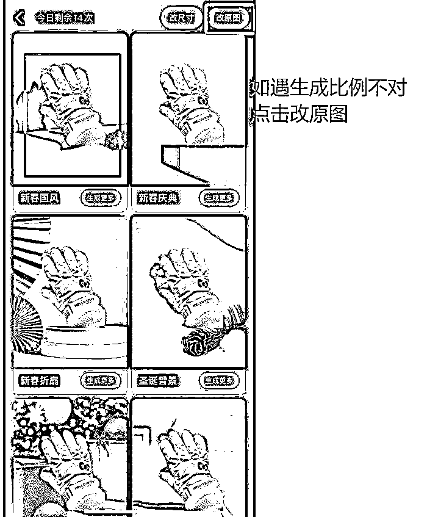

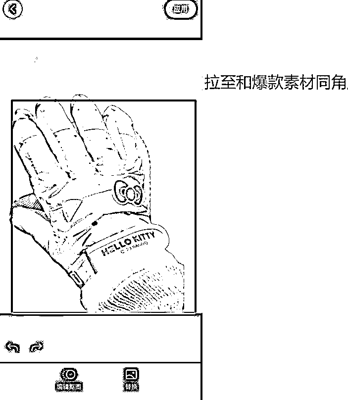

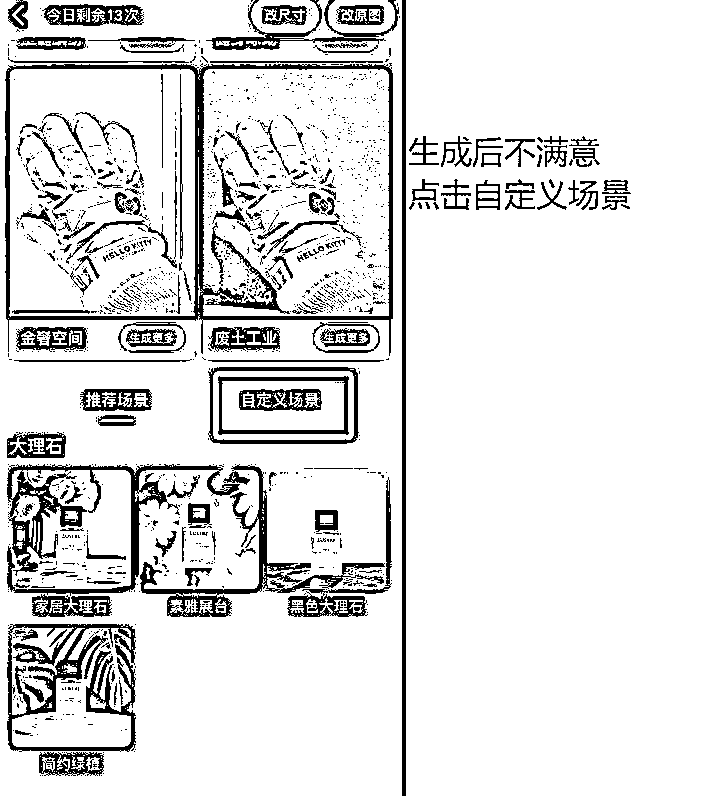

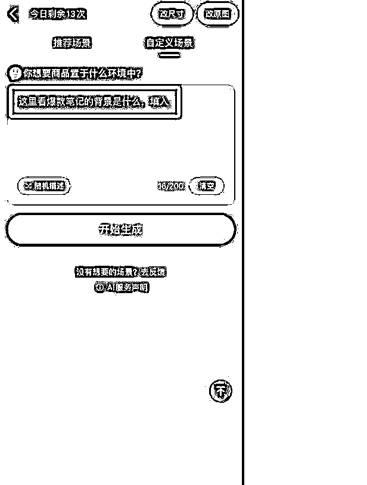

情況二：手上有實物產品，可以直接模仿對標進行實拍。如果像素不佳或光線不好，可以調整濾鏡，調成與爆款相近的效果。

2）標題：

5個對標爆款標題如下：

拼爹爹我愛您！大學生涯用爛兩年！！

人手一個，拼爹爹根本割不到我！

四人寢人手一個，拼爹爹拜拜您嘞。。

六人寢室買伍，拼爹爹以前錯怪您嘞！！

誰懂，圖書館掏出給我整沉默了。。。

可以看出此品關鍵詞：大學生、寢室、拼爹爹。然後根據這幾個關鍵詞重新組合，比如：再也不拼爹爹了，女大寢室六人入了伍！

3）內容：

模仿基本相似，內容稍微修改即可。注意，要避免文本被判相似導致違規。如果把握不好度，可以參考下面3個文本模仿優化後的案例：

案例1

原文：http://xhslink.com/RULY6x

優化後：

頭一回見到這種無水暖袋，再也不用天天換熱水。裝水的熱水袋不安全，而且當初還擔心在寢室充電會跳閘。結果一個人帶動全寢室買了三個……充一次電能用挺久，也不重。每天自習課帶著，開一檔就特別暖和，手伸進去熱乎乎的，住寢室的姐妹建議安排一個。

案例2

原文：http://xhslink.com/3EOY6x

優化後：

經室友推薦，找到了這款無水暖袋，充一次電能熱很久。室友通常開一檔就夠暖，還能放被窩。我怕冷，直接開二檔，一下子就熱乎了。原本還想買電熱毯，現在完全沒必要，攤開就是一張毯子，暖暖的！

案例3

原文：http://xhslink.com/uASY6x

優化後：

誰懂啊，整個寢室都在用，室友們真的超怕冷。我熬夜挑了超多款，終於找到這款毛茸茸的，舒服還不掉毛。帶去圖書館，遇到班裡閨蜜肚子不舒服就給她用了一下，她說特別舒服，誇我會買東西哈哈。長按就開機，一二檔已經很暖和了！趁著入冬，真心建議公主們安排一個！能用好幾年！

圖文筆記製作關鍵：

4. 二創注意圖片去重，避免筆記違規；

5. 產品實拍時，學習爆款對標的主題角度和場景，進行1:1拍攝；

發完筆記後，可以先不掛商品，等測品測出來後再找供應商掛品。測品期間，筆記小眼睛數據都高於500以上，證明這個品可以，就可以掛品。

掛品步驟如下：

1）發布筆記：

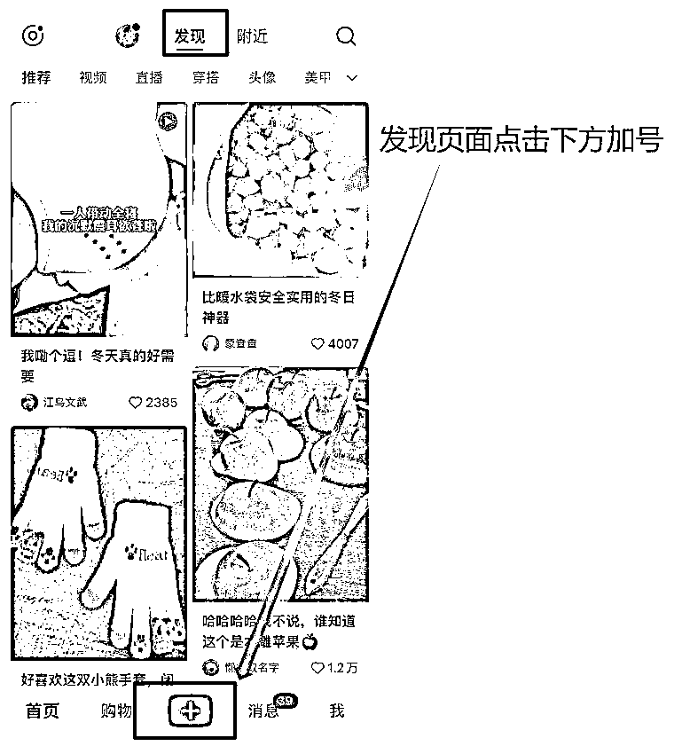

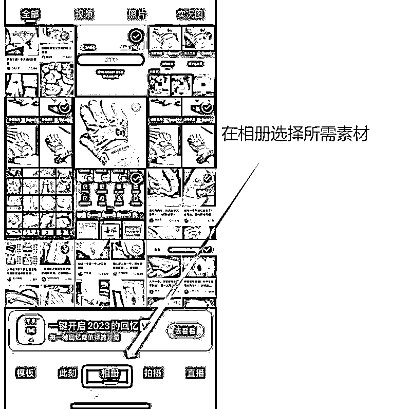

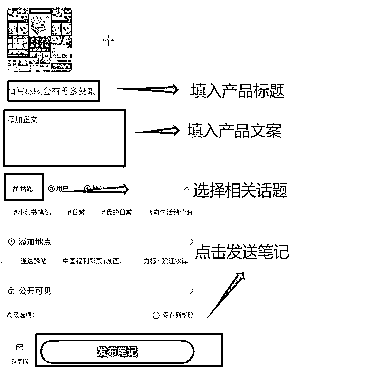

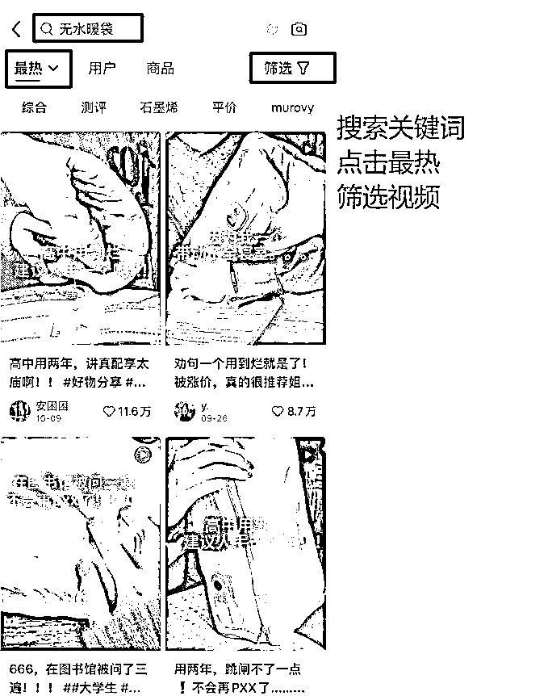

2. 收集記錄爆款筆記，把視頻素材下載下來準備混剪，筆記標題也收集起來作為參考。

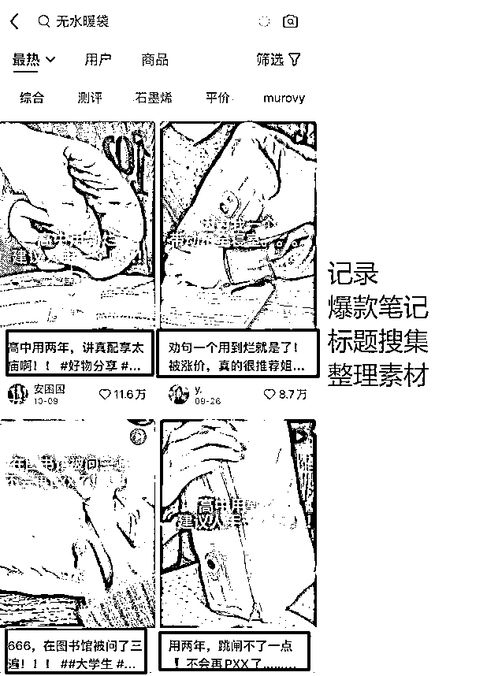

### 3.4.2 根據對標製作視頻筆記

情況一：手上沒有實物產品，可以通過網絡素材進行二創混剪，需要注意素材去重。

1. 混剪視頻

1）找視頻素材：素材可以從抖音或小紅書搜集爆款視頻進行記錄，一般為3:4或9:16格式；

2）混剪去重：去重方法主要包括更換音頻、分割、轉場、增加畫中畫等剪輯功能。具體方法可參考文檔：《如何剪輯視頻和製作剪輯模板》。

2. 製作封面

視頻封面主圖直接採用爆款的封面，進行圖片去重即可。

3. 寫標題

把5個對標視頻的標題記錄下來，參考前面【章節3.3.2】講的圖文筆記爆款標題重組法，寫好標題。

情況二：手上有實物產品，可以直接模仿對標進行實拍。

1. 先找同領域的爆款素材記錄下來，找出自己能實現的拍攝方式，進行1:1的實拍參考。

2. 拍攝時手機一直拿著拍就可以了，不必擔心拍得不好。

3. 拍攝完畢導入剪映剪輯，觀察對標筆記進行剪輯優化調整。

筆記製作完成後就可以發布。同樣，可以等測品測出來後再找供應商掛品。

視頻筆記製作關鍵：

4. 混剪注意視頻素材去重。搜集爆款素材進行去重混剪時，最好5個以上爆款視頻進行混剪，單個素材重複太多會被判違規；

5. 新手前期可以先做混剪，難度較低；長期來看還是要做實拍。找到爆款對標筆記後，判斷自己現有條件能否做到1:1模仿，如果可以就實拍；

6. 單款產品發布混剪視頻控制在5條以內，然後換其他款測試。如果混剪數據24小時低於200小眼睛，建議刪除筆記，避免後期被舉報，這樣後續還可以測款。

## 3.5 筆記避坑指南

1）博眼球行為

市面上有很多所謂的“標題黨模板”，比如這張圖片，那些所謂的吸睛標題，對我們做店鋪的人來說，真的沒有任何營養價值。

就好比“朋友來我家吃飯，居然說我家很寒酸”，結果點進去菜品豐富、屋子金碧輝煌，會讓觀眾覺得你在騙我，故意讓我看你炫耀，從而產生抵觸，進而抵制這篇筆記。再好比“SOS，快來種草這個無廣國貨！”結果一看就是天天打廣告的某護膚產品，會讓觀眾極度不適。

2）調性不統一，定位不明確

爆款標題模板、吸睛標題要理清楚適合什麼內容。小紅書可以定位為店鋪變現、引流變現、IP變現，但這三者不要混為一談。很多人有時候發生活日常，有時候發掛車筆記，封面有時是純色底圖加大字，有時是自拍照，有時是四宮格對比圖，有時是平淡無奇的產品圖……什麼形式都有，重點是封面還挺low，毫無美感。

3）價格與受眾人群不統一

如果產品面向大學生人群，價格卻高得離譜，你覺得會有人買嗎？

內容來源：《小紅書店鋪運營：如何提升點擊率和轉化率？》

## 3.6 筆記關聯群聊 @范師傅

這是一個讓引流效率翻倍的功能。要抓住這波機會，在通過爆款筆記推動成交的同時，盡可能把用戶沉澱到群聊，做持續的復購轉化。

### 3.6.1 筆記關聯群聊的步驟

先建群。进入📕客户端，切到“消息”页，在顶部右侧找到群聊入口，点“创建群聊”就能开一个新群。

群有了之后，进群点顶部右侧的“…”按钮，菜单里会出现“关联笔记”，按提示勾选要挂载的笔记就行。

# 四、【实操 3/4】找上游、挂商品

💡章节概要

章节概要

笔记跑出流量、也有人来问单之后，下一步就是对接货源、把商品发出去。

本身有货的，直接找对应厂家谈；暂时没有货源的，这一章会从几个角度分享找上游的经验：

✅ 挑供货方要看什么

✅ 怎样更快锁定生产厂家

✅ 考察工厂的重点

✅ 和厂家打交道的沟通心法

✅ 供应链环节如何避坑

另外，定价同样是成败关键，这一章也会讲商品定价思路，建议重点看。

希望这些内容能帮你把后端搭稳，形成电商变现的完整闭环。

💡

本章航线图

学完并做完这一章，就能走完航线图的第三阶段：确定供货方，完成商品发布（约 2 天）

1.至少谈妥 1 家稳定供货方（约 3 小时）

至少谈妥 1 家稳定供货方（约 3 小时）

2.

和供货方完成合作对接（约 2 小时）

3.

至少完成 1 个商品的上架发布（约 1 小时）

## 4.1 找到稳定可靠的供货方

### 4.1.1 挑供货方要评估哪些点？@曜文

选合适的供货伙伴，重点看下面几项：

1.

拿货价

把拿货价和我们的零售价放在一起算，看利润空间够不够；如果进价偏高，和同行相比没有优势，转化就容易受影响。

2.

款式与品质

款式、做工这两块，可以请对方拍照确认，也可以自己买样品回来检查，确认质量过硬，后续才好谈长期合作。

3.

单量多时能否接 ERP

当订单达到 100+ 的量级，就可以走 ERP 系统，发货效率会高很多，也不用再导出订单重新给商家下单；关联成功后，A 店铺能显示 B 店铺的订单数量，供货方直接按📕面单发货。

第三步：关联成功后，A 店铺可显示 B 店铺订单数量，供应商可直接进行📕面单发货

4.

单量少时能否打手工单

前期订单不多，不一定要上 ERP，但要先和商家确认可以打手工单，不走第三方电商平台面单，降低被平台判定为无货源的风险，先把店铺安全保住。

另外，去问厂家之前，可以先说明自己是在做📕电商、希望长期合作，也可以多提几家店铺，让对方感觉你是会持续下单的人，而不是随便问问。

### 4.1.2 快速精准找供货方的方法 @郑小焦

1）用图片反搜

这个办法常常有效。但有时搜不出来，可能是图片边缘太模糊，或者产品本身是常规 A、B 两件组合在一起，1688 识别不了；如果你只要其中单独一件，可以试着拆开分别搜。

2）用关键词搜

从产品名称、特性、功能、工艺等角度换词组合着搜。

3）去竞品链接里找线索

详情页通常会有尺寸、重量、包装等信息；评论区更容易挖到真实细节、放大实拍图，甚至能看到买家把产品用出了哪些新场景。

4）直接问 1688 上的厂家

我之前找一款产品，实在看不出是什么工艺，问了十几家都说做不了、不能定制，最后找了一家回复字数比较多的，才慢慢聊出结果。

下面放一组手工单和非手工单的示例：

2.

筛选时让对方提供打包发货图片

遇到卖家来咨询，可以要求对方提供图片，避免被判定为无货源；通过前面拿到的🛰️号转到私域后，再让对方提供实拍单号，证明是自家仓库发货，而不是转手单。

3.

初次交易走平台，🛰️下单时让对方发金额链接拍单

合作初期先把信任建立起来，后期可以直接在🛰️下单；大额交易走订单流程，在🛰️里发下单信息，整体交易金额可以多累积一些，也可以让加了🛰️的商家提供近期销量高的款式。

按这套方式操作，基本能和商家建立长期合作关系。

拿货价通常会比平台标价略低一点，商家也会提供相应热销款；即使每天订单不多，通过🛰️下单让对方代发，一般也能接受。

这个过程中要筛选合适的代发商家和产品质量，可以自己多拍几单回来查看，平台也有运费险，质量靠谱再考虑长期合作。

记得和供货方签一份代发合同：

订单代发合同.docx

这里要特别注意：无货源模式设置发货地址时，一定要和商家实际发货地保持一致！！！

### 4.1.4 和供货方沟通的实用技巧

1）沟通心法

尽量把沟通从 1688 转移到🛰️，能电话就电话。

相信自己的直觉，觉得对方不靠谱，就不要勉强合作；多站在工厂角度考虑问题，不要轻易责备。

正视自己的位置，单量小就找中小型厂家。

2）厂家更愿意和什么样的人做生意？

第一，珍惜对方时间。一上来问一堆没问到点上的问题，厂家会觉得你在浪费他的时间。

第二，信息密度要够。你的信息全不全、专不专业？自己是否了解产品材质、工艺、术语？如果一上来就把本该自己搞懂的问题全抛给厂家，对方的配合度也会受影响。

举个正面例子：Zev 的旺旺账号权重其实关系不大，但他清楚自己要做的产品工艺，甚至提前把模具雕好交给厂家，所以拿到了很好的开模价。

第三，让对方感受到诚意。你很想做一个品，付出多少用心，对方是能感觉到的。这一点其实也综合了前面两点：你的准备、对产品的了解，本身就证明了你是不是真心在做。沟通时对产品的把握度，也藏不住。

资料出处：《11 月航海 · 亚马逊入门 · 实战手册》

### 4.1.5 【重要】对接供货方的工具 @曜文

对接供应商 ERP 主要有两个原因：

1.

避免二次物流被平台检测成无货源发货，导致店铺被冻结（平台对无货源的管控越来越严）。

2.

大幅节省下单时间，结算金额也方便，商家后台能直接看到订单数量，便于商家直接打单。

店管家 ERP 入口：

http://www.dgjapp.com/

店管家 ERP 教程：

商家对接教程：https://docs.qq.com/doc/DU0pySmR2WVRhakFs?&u=3d93683801c64dc5b28bfb3c55e94430

厂家对接教程：https://docs.qq.com/doc/DU1ZLVEJmbFFxdkZ1?&u=3d93683801c64dc5b28bfb3c55e94430

### 4.1.6 供货合作避坑清单

如果你现在还在做无货源代拍，还没有完全转成货源合作模式或自有货源模式，下面几个避坑点可以帮你少走弯路。

1）如何避免淘宝或拼多多给客户发短信？

常用应对方式：

① 客户手机号不写真实的，在收件地址后面加真实电话。比如张三 1894263109，四川省成都武侯区玉林路 88 号小酒馆

拍单时改成：张三 18900001339，四川省成都武侯区玉林路 88 号小酒馆到了打 1894263109。（这种方式单量大时客户仍可能收到短信，那就用第二种。）

② 把数字变成字母，偷换概念。操作很简单，在手机号里选一两个数字换成字母，例如把 1 打成 I、2 打成 z、6 打成 b，平台检测不出完整数字，但快递员能看懂。

最后大致是这样：张三 18900001339，四川省成都武侯区玉林路 88 号小酒馆到了打 I8942b3I09

③ 用中转仓。上架下单时地址填中转仓，中转仓帮你做二次面单，二次面单就是客户真实地址，再发出去。这样能完全规避客户收短信的问题，只是中间会多一两天时间。

2）上家不发货，或者发的产品很差怎么办？

目前拼多多的无货源商家最多，因为成本最低，很多商家一个人铺几十家、几百家店。你在他店铺下单后，他可能找不到这个产品，或者觉得会亏本，于是不发货或以次充好。

针对拼多多（其他平台道理一样）进货，要学会辨别几点：

① 不看成交件数，尤其是 10W+ 成交的不看，只看评论数和最近评论数。

产品定价这块，我会去搜淘宝和拼多多销量靠前的店铺，把价格定在这两个平台的区间内。很多用户即使比价后，发现比淘宝略便宜，再考虑到我们的视频是原创拍摄、主打“所见即所得”，基本上就不会去其他平台下单了。

产品定价这块，我会去搜淘宝和拼多多销量靠前的店铺，把价格定在这两个平台的区间内。很多用户即使比价后，发现比淘宝略便宜，再考虑到我们的视频是原创拍摄、主打“所见即所得”，基本上就不会去其他平台下单了。

比如在拼多多榜单里随手看到一条牛仔裤，价格 39，去淘宝搜同款并按销量排序，月销 1000+ 的基本在 70-90 元区间，当然也有 40 多的。这个时候我可能会定在 59-69 元，具体再算自己的利润率。

资料出处：《📕店铺如何 1 个月做到月流水破 50w+》

### 4.2.4 商品发布流程

注意：

商品标题和商品主图是必选项。

商品主图官方对规格有限制，图片以清爽为主，不要加太多标注文字。

如果商品首图不符合规格，会上架失败；如果不符合首页推荐规则，不会在商城首页推荐。

里面显示的是个人店铺可以上架的类目，也可以用搜索框直接搜，但有些类目需要企业才能上，还要有相关资质。每个店铺类型对应的可经营类目不同，具体可在📕学习中心-规则中心-经营总览中查阅。

3）填写商品规格

商品规格是：一个商品里有多种型号才需要设置，只有一个型号就不用管。

4）设置商品售价

根据你上架的商品进行设置。

5）设置库存数量

8）选择是否包邮

根据你上架的商品进行设置，可以选择是否包邮，系统目前默认两种：

全国包邮；

偏远地区不包邮（偏远地区：新疆维吾尔自治区/西藏自治区/宁夏回族自治区/青海省/海南省/内蒙古自治区/甘肃省）。先选默认运费价格，再设置特殊地区价格，可以根据件数，也可以根据重量。

9）设置发货时间

发货时间可以自己设置，可以设置当天发货、24h 发货、48h 发货和预售发货。

上架完成后点立即发货就可以了。

📕的审核是机器审核，速度非常快，如果没什么大问题，发布以后立马就上架了。

#### 4.2.4.2 电脑端发布商品

📕商家助手网页版地址：https://ark.xiaohongshu.com

① 根据自己产品的类目，选择好类目，点击下一步：

④ 填写完所有信息，就可以提交审核啦！

拓展资料：更多和产品上架相关的内容，可前往📕商家课堂学习：

https://school.xiaohongshu.com/course/list?jumpFrom=school&categoryNo=20210515002

# 五、【实操 4/4】售前售后抓到位

💡

章节概要

售前售后，是电商里非常关键的环节，绝大部分转化和复购都基于此。不仅如此，售前售后问题还关系到店铺权重和一些风险。

这一章针对售前、售中、售后，整理了一些比较实用的方法和话术，也整理了销售期间的注意事项，希望帮助大家提升店铺销售效果。

💡

本章航线图

完成这一章的学习和实操，即可完成航线图的第四阶段：学会运营管理📕店铺（约 2 天）的关键任务

1.

完成售前客服管理（约 1 小时）

2.

掌握发货等售中管理相关知识和方法（约 1 小时）

3.

掌握退换货/差评等售后管理知识和方法（约 0.5 小时）

## 5.1 售前管理 @云端行走 @曜文

### 5.1.1 客服管理

在📕商家 app 里把应用声音提醒打开，只要有客户咨询，就能收到声音提醒。平台会考核客服回复率（回复率≥80%），如果回复不及时，店铺评分会下降。

考核详情如下表：

处罚方式：限制店铺及专业号公域流量 3 天，该处罚不支持申诉。

处罚通知方式：每自然周周二，平台将通过商家运营系统 > 站内信、📕商家版 App > 消息、📕用户版 App > 消息通知，三个渠道推送通知商家。

除了客服考核外，📕官方还会有服务行为抽检。商家在服务过程中有违规情况，📕官方也会对商家做出惩罚。具体违规详情和对应处罚方式见链接第七条：📕商家自主客服服务管理规则

提高客服回复率的方法：

1）设置团队话术

📕的用户有的关注非常多的人、加入很多群，如果你没有及时回复，后面她可能就看不到信息了，所以尽量及时回复。

可以把经常要给客户说的一些话设置成话术，避免下次再打字。比如客户问到发货、库存等物料问题，就可以把发货、库存相关的问题解法设置成话术。下次就可以快捷编码，编辑为物流问题，那下次物流问题就代表这个话术的快捷方式。

如果不会写话术，可以伪装成顾客，到同行店铺咨询相关问题，套出回复话术化为己用。

3）刷回复率

PS：目前📕可自行设置发货时效：当日发货、24 小时发货、48 小时发货，时段预售（即下单后 xx 天发货）、定时预售（xx 日前发货）

1）可以正常发货

你好，能拍下就能发货哦。

你好，亲，我们这边可以正常发货，你那边能正常收货吗，我们这边一般 48 小时内发出哦。

自然灾害、大型会议等不可抗力因素无法发货：你好，亲，因为***原因，暂时发不出来，我们也非常着急，如果您着急要货，建议您看看其他家有没有能发出的，给你带来不便，实在抱歉！

### 5.2.2 超期发货（报备&处罚方式）

怎么做超期报备？

若商家在实际经营过程中，因出现疫情、自然灾害、大型会议等不可抗力事件，导致无法按时履约发货，商家可以通过商家管理后台进行订单延迟发货报备，避免平台处罚和消费者投诉，操作手册：《📕商家延迟发货报备操作指南》。

超期的处罚方式：

针对一笔订单会存在多个违规行为的赔付，故作以下区分和说明：

1、被判定为超期发货和虚假发货，仅对消费者赔付一次；

2、被判定为缺货，可与超期发货/虚假发货赔付同时发起；

3、赔付上限：同一买卖双方（以平台认定为准）间付款时间在同一自然日内的多笔交易同时出现上述任一或多项情形的，赔付金额合并计算最高不超过 500 元。

### 5.2.3 物流开户与出单：自有货源的发货闭环 @Jing

自己备货做店铺，绕不开两个动作：把快递谈下来，把包裹发出去。

先说快递怎么接。📕后台目前能选顺丰、中通、圆通三家，开通并绑定后可直接生成面单，物流单号回传订单，省去手工录入。

负责人怎么找？两条路可走：第一，打开地图软件搜快递网点，挑离自己最近的，直接上门聊；第二，平时收件寄件时加快递员联系方式，顺带要负责人电话或🛰️。

谈判时留意三点：先打听当地快递均价，心里有底再上桌；首重和超重分别怎么算，第一轮就问透；让对方看到你的单量潜力，比如月发几千票。若当下量还没起来，就得靠沟通技巧补足。

价格敲定后进入打单环节。假设货品次日抵达，你想当天清空，节奏会非常赶。比较稳妥的做法是提前一天把待发清单整理好，第二天直接导表打印。发货现场人多件杂，临时翻单容易乱中出错。

自己发货的打单步骤可以这样走：

第一步，价格谈妥后再去平台开店号。📕当前可选顺丰、圆通、中通。后台入口在交易—电子面单，选快递品牌、填申请表，再让快递公司完成审核；通过后充值就能出单。快递方一般还会附送打印机、面单纸和包装袋。

第二步，把待发订单导出来：交易—待发货—导出全部。第三步，挑出重复单号：一单含多个SKU的先单独拎出，后续按这张表上传打单。第四步，按类别出单：剔除多SKU订单后，剩余多为单SKU订单，可依SKU和件数归档，例如把表格存成sku1-数量1、sku1-数量2……这样批量打印和拣货更顺。若sku1-数量1有100票，就先集中打这100票，打包贴单，再处理数量2的批次。📕面单不显示订单明细，用这个看似笨拙的分批法，反而能大幅降低错发概率。第五步，回传单号并打印：把分类表上传系统，入口为交易—电子面单—面单打印—上传Excel—下单并打印。出单后核对实际面单数与上传数是否吻合，多或少都去查地址。复核花不了多少时间，却能挡住重复发货的损失。小经验：要打100票，别一把梭哈，拆成五次、每次20票，核对更轻松；漏了只补打漏掉的那票即可。

## 5.3 售后管理：退换货与差评应对

### 5.3.1 退货审核与收货处理

买家提交退货申请后，商家须在72小时内完成审核，具体可对照下表：

退换货审核表：

商家收货表：

把退换货带来的损耗压低的处理思路：

1）买家反馈商品异常

一旦收到问题反馈，先请对方发来凭证图片，同时同步给上游供货方。举个例子：顾客在生鲜店买了五斤橙子，到货后坏了一半；客服当时没马上要“坏果与快递面单同框”的照片，顾客隔了两天才再次联系，此时已超出签收后24小时的生鲜售后时限，再找供货商容易被拒赔。碰到这种情况，可以先问买家能否接受补发，若同意，损失会小一些。ps：质量类问题务必先拿到商品照片，弄清实际情况再与上游交涉。

2）常规商品退换

📕售后审核时效多为48/72小时，淘系、拼多多通常比📕短，但仍要尽早向上游申请，并主动找买家核实商品状态。

【手机端】：商家APP—首页—全部工具—运费宝

做实物电商，快递包裹里还能放售后卡做引流。售后卡一般由引导话术加二维码组成，设计可参考同行；淘宝、拼多多上有不少专门做这类卡片的店铺。

📕对点评回复率也有考核。平台按每两个自然周统计商家对负面点评的回复情况；若一个周期内负面点评回复率不足80%，每次记一般违规积分2分。建议在买家点评后24小时内认真回应，并把问题真正解决掉。

已经出现差评时，可尝试以下动作减轻影响：

1）先在后台提交申诉。找到申诉入口后，按实际遇到的问题发起。

一般违规行为，商家要在平台发出违规通知之日起7日内确认调查单或提出申诉。超过7日未操作，会被视为接受处理，违规处置自动生效。同一项违规处理，线上申诉最多三次。想提高通过率，需按平台要求提交完整、真实、有效的证明材料：聊天记录、截图、链接、照片、录音、快递单凭证等。细则见📕违规申诉管理规则。

2）避免对商品做夸大宣传。

3）可电话联系买家，请其删除评论。平台会依据商品缺陷类别与商家累计违规次数划定违规级别，再对商家和/或其店铺采取相应处置。分级原则：

### 5.4.2 商品名称里不能出现的词

商品描述若出现“最高级”“国家级”“最佳”“顶级”等绝对化表达，每次扣25分，严重时会冻结店铺。与顾客沟通时使用嘲讽、诽谤、谩骂或不文明用语，被举报同样每次扣25分。更多违禁词可查电商违禁词整理。

### 5.4.3 食品类商品下单要盯紧标签

食品包装必须带标签，标签应注明：一、名称、规格、净含量、生产日期；二、成分或配料表；三、生产者名称、地址、联系方式；四、保质期；五、产品标准代号；六、贮存条件；七、所用食品添加剂在国家标准中的通用名称；八、生产许可证编号。

### 5.4.4 流程越早摸熟越省事

如果不是团队作战，有些环节也要提前练手。例如拍单软件，单量小时手动操作看不出问题，订单一多就容易手忙脚乱，效率反而下降。

### 5.4.5 质量这根弦要一直绷着

做无货源模式，商品开始零散出单时，建议买回实物看一看，心里有底，售后率也会低一些。同时主动和供货商建立联系，减少沟通摩擦。

内容来源：《📕店铺，月 GMV10w+的方法总结与复盘》

### 5.4.6 打假人的识别与应对

打假人可分成三类：要饭型、坐班型、职业玩家型。

要饭型：多为找茬的新手。常见套路一是钻平台空子，比如平台近期严查无货源，他就举报你，再谈钱私了，给点钱能打发。二是走工商举报，有些是想捞偏门，甚至卖家被搞后又去搞别人。遇到工商举报，先听工商老师的建议；只要不是产品本身质量问题，赔付一律拒绝。可向工商递交情况说明，写清起因、经过，末尾明确拒绝赔付，同时与打假人周旋，通常较容易收场。

坐班型：每天批量找商家下单、批量写材料、批量投诉，把打假当职业，多数是全职。他们常盯近期有问题的品类，比如有关部门曾明确辣条中不得含谷氨酸钠，这类人就集中打这个品，思路类似选品追热点。遇到这类人，若对方没在客服端谈索赔就直接起诉，大概率你的产品真有问题。投诉方式一般是工商或律师函。应对上可联合同行一起谈；这类人除了更换投诉身份，在工商系统里往往留有不少记录；不同地区政策下，即便产品有问题，工商面对职业打假人也会考虑从轻。再找到上游源头，拿到资质和质检材料交给工商，最终处罚通常不会太重。

职业玩家型：更专业，遇到这类人，产品基本百分百有问题。他们通常只走起诉，索赔一般1万起；若起诉金额在5000以内，不必应诉，电话协商赔偿即可。应对办法是找有电商案件经验的律师应诉，律师会教你怎么用管辖权异议、申请破产清算等方式把损失压到最低。当然，能被这类打假人盯上，说明你店铺近期生意不错，他在起诉前大概率已看过你的资产是否够赔。

内容来源：《月销百万选品宝典+供应链避坑+打假人辨别》

# 六、【复盘优化】用复盘找增长，用工具提效率

💡

章节概要

笔记数据和销量没达到预期，该怎么办？这几乎是每个运营者都会碰到的课题，也值得花精力去拆解。对📕店铺而言，需要重点做的复盘包括：✅笔记与选品的自检；✅笔记与选品的数据分析及优化；✅店铺引流方式的调整；✅内容生产效率的提升。笔记发布后要留数据、做复盘，持续迭代。同时，借助工具加快内容产出，提高测品速度。下面给出一些优化思路，也期待大家把自己的经验反哺给更多人。

💡

本章航线图

学完并实操本章，即可走完航线图第四阶段：学会运营管理📕店铺（约2天）

1.

复盘优化笔记与选品，单账号日更≥3条笔记（约2小时/天）

## 6.1 笔记与选品的自检复盘 @曜文

### 6.1.1 内容复盘：数据先看，细节后查

#### 6.1.1.1 笔记数据如何读

1.

阅读量

发布后2-3小时阅读量偏低，或长期停留在100-200甚至不足100，通常指向几种可能：账号处于起步期，权重还低；笔记违规、踩到敏感词，或内容本身不在平台大力推荐范围；选题、标题文案或首图不够抓人，尤其要回看选题角度和首图。

2.

赞藏与评论 1）点赞加收藏超过10，评论为0，或只有点赞没有收藏和评论

说明内容仍在被推送，但转化偏弱，可在评论区做下单引导。评论区优化方式：用其他账号带购物车，例如惊喜盒子，或留言“已买”并附购买截图。2）收藏数高于点赞

说明干货占比大、种草感不足，需要调整。优化方向：补产品使用场景，或在正文里加入产品相关信息。看完数据若不理想，再逐项排查：

#### 6.1.1.2 笔记整体自检

笔记有没有达到爆款笔记1:1的程度（可对照【章节3.3和章节3.4】中的爆款笔记相关内容自检）；笔记是否含违禁词（可用工具—6.4.2-6敏感词检查工具）；笔记素材是否做过去重（去重方法参考【章节3.3.2和章节3.4.2】）。

接着对照爆款检查封面和标题。这是参考的爆款：

这是模仿爆款的笔记：

由此可见，爆款的封面和标题仍可能再爆，做法是提取标题关键词、按1:1模仿爆款封面。上述图片关键词：解压、发明。围绕这两个核心词可组合出更多爆款标题，例：真的好解压，这发明绝了；后悔..没发现这么解压的数字，这发明配享太庙！！；长见识了，这发明还是早点发现就好了，好解压。

#### 6.1.1.4 发送时间测试

每个品类分别测试不同时段。比如早上发数据一般，换到晚上发有增长，就记下晚间这个时间点，并用多篇笔记继续验证。

### 6.1.2 选品复盘与判断

第二步：分析品的笔记数据

按上述标准，点进店铺，再看账号的笔记数据做分析，以下数据可作为选品实测参考：

#### 6.1.2.2 借对标账号爆款做选品判断

找对标账号时，留意选品周期，处在选品周期内（3-90天）的爆款，要及时跟款。什么是选品周期？

## 6.2 运营整体优化 @曜文

### 6.2.1 数据分析与调价优化

如果前面的自检都做完了，再来看怎么结合数据做优化：笔记发布后24小时为测试期，重点观察曝光量。例如把原价59.9调成99.9，再设40元单品券，刺激买家下单；例如把原价59.9调成99.9并设置40元单品券，刺激下单；

2.

或者用降价方式提升转化。当天单量持续上涨后，再适度提价保利润。

### 6.2.2 给笔记补实拍素材 @曜文

前面提过，平台对混剪类视频笔记的管控会越来越严，长期看仍要以实拍为主。如果你已掌握项目基础操作，建议继续提升视频能力，学习实拍视频的制作方法。实拍视频制作流程：第一步，找几个爆款对标模板（具体参考章节3.4.1）；第二步，筛出至少3个适合自己、能够实拍的模板；第三步，批量产出实拍素材，可分3个场景拍3段视频：A场景拍5分钟，对标模板1；B场景拍5分钟，对标模板2；C场景拍5分钟，对标模板3；第四步，用剪辑工具分段剪，比如A场景提取10个片段，B场景提取10个片段。

### 6.3.1 用其他账号做引流 @云端行走 @Sanuk 小伞

平时刷📕，常能看到评论区有人问“在哪买”。如果商家还没开店，我们可以先把店开起来，然后在评论区留言：📕搜**商品直接购买就行。尤其现在评论区支持发图，可以在求推荐产品的帖子下评论图片做引流，比如先展示某产品图，再用水军评论一波蹲链接。

点击立即报名即可提报商品报名活动

通过这里发布商品笔记会自动带上活动标签，会有额外流量奖励。

跟着平台官方发起的推广项目走，配合对应的商品种草笔记，能让曝光更高，成交也会被带起来。

第二步：打开热词入口，分别看曝光量、点击量、成交额三项表现，再把近期走红的笔记归拢起来。

选定赛道后，用关键词检索，切到“最热”排序，把发布时间限定在近七天，专门拆解爆款标题的套路。

路径三：用数据工具检索。

4. 也可以看笔记榜单：先选对应垂直类目，再翻近期热门标题与正文。

路径四：从主页推荐里捡爆款。平时首页会给你推垂直领域笔记，顺手把标题记下来做分析。

### 6.3.5 用爆款单品撬动同店其他货品 @袁、@月月

铺货节奏不妨照着圈友 @月月每天的执行步骤来：

资料出处：《📕店铺，月 GMV10w+的方法总结与复盘》、《新手 15 天突破 300 多单，当日纯利润💰2000＋的经验分享》

## 6.4 内容产出提速怎么做

### 6.4.1 建一张项目台账 @曜文

拿我平时用的表格举例：

表1：把每天要做的事记下来，选品与内容方向更清楚；
表2：同样记录每日动作，方便回看复盘；
表3&4：沉淀热门标题、正文与关键词，写标题时提速；
表4：记下操作复盘，便于归纳；
表5：收集爆款封面，做图更省时。

### 6.4.2 📕创作辅助工具

平台商家课堂：店铺基础运营可去📕商家课堂（xiaohongshu.com），碰到店铺疑问，输入关键词检索。

给标题抓核心词 @吴一村
如果囤了很多爆款选题，却抓不住核心词、吸睛词，可试试 https://fenci.weiciyun.com/cn/（微词云）。把几百条标题粘进去，它会自动切词并统计频次。
这里也分享一村的《📕各行业内容数据库》：
（新）一村📕爆款选题库

然后给浏览器装 Fatkun 插件，它自带独立抓取脚本，能成批采集封面与正文。插件包放这儿：
最后双击新建的文本文件，抓下来的图就会统一变成 jpg。举个例子，建一个职场类爆款笔记的封面与内页库，随时翻看研究，在模仿中练手，是快速起爆的捷径。

做封面可用：
稿定设计 https://www.gaoding.com/
创客贴 https://www.chuangkit.com/PPT
PPT

📕图片怎样批量抓取并转成文字？@吴一村 的办法：装「金山 PDF」，电脑端把已存的📕图片插进去，点转换，PDF 转 Word，编辑器会用 OCR 把图里的字全部提出来。（识别率不错，但转换要会员，可在拼夕夕买低价版，或直接付费。）

查敏感词工具 @吴一村
零克查词：http://ci.lingke.pro/
出处：《在📕如何系统化做商业内容？数十位📕行业博主从零变现 10000+的「📕内容增长飞轮」帮你找到答案》

文字转语音 @云端行走
https://www.text-to-speech.cn/（内置抖音热门配音-云希）

在这个面板里能看到三大类：表情符号、颜文字、符号；每类下面还有小类，如符号里分人物、食品植物、庆祝物品等，按需挑就行。

另外，生成文案的工具能设定条数与语气，一次给出多条参考： 生成后拿关键词和热门笔记再润色，读起来更顺，基础编辑时间能省不少。

选修篇：更多玩法与赛道推荐

💡章节概要

当项目最小 MVP 跑通、流程摸熟后，就可以翻选修篇。想放大项目或找新玩法，重点看：
✅【项目放大】SEO、矩阵、直播、投放
✅【项目拓展】达人带货
✅【案例拆解】📕店铺案例拆解
现在就去挖项目的更多可能～

##### 七、【项目放大】找蓝海、做 SEO、铺矩阵、开直播、投广告💡

💡章节概要

走到这一步，店铺项目基本闭环、也开始见钱。趁着红利期，怎么把生意做大、拿到更多流量与变现？这里给出五条路：
✅ 选蓝海赛道：这时你对选品更有感觉，多看看市场大环境，项目规模能提得快；
✅ 关键词 SEO：拿精准流量的一招，对转化有帮助；
✅ 搭矩阵号：核心是低成本、快节奏地批量产笔记；
✅ 📕直播：平台眼下对新人开播较友好，有流量倾斜，有直播经验或粉丝底子的可以多试；
✅ 📕投放：打算长期深耕的人，可以研究投放，这是偏高阶的打法。
选适合你的方式把项目放大，祝你拿到更好的成绩。

## 7.1 怎样锁定蓝海赛道

### 7.1.1 千瓜流量全景 @谢无敌

盯住两项数据：推广笔记数量、互动总量。
推广笔记越多，说明同行越挤，竞争越重。比如家居赛道月笔记量冲到119w+，把护肤、彩妆的30w+甩在后面。
互动总量越大，说明用户买账、容易出爆文，也代表需求旺，比如家居互动总量有2.6亿。
所以目标很清楚：找笔记量偏少、互动量偏多的赛道。
比值越低，说明笔记相对少、互动相对多，这种就是蓝海。
有点意外的是，大家觉得卷的彩妆居然排第一，可见凭感觉容易看走眼。
这里只列15个主流类目，每个下面还有二级分类，可用同样思路再切。
比如服装下面有连衣裙、夹克、背心等十几个二级分类。

### 7.1.2 千瓜品类检索 @谢无敌

这里共100个品，表格太长只截一段，完整版在实战工具包里。
跟第一种方法比，这个结果既有品牌又有产品，落得更具体。

### 7.1.3 巨量算数查询 @谢无敌

第三种路径是上巨量算数，电脑端直接搜。
输入想做的品类词，例如“绘本”，点搜索，就能看到该品类的数据分析，含搜索指数与综合指数；页面往下拉有综合指数解读，重点看。
左侧圆图有三个关键信息：内容分、传播分、搜索分。
内容分就是带该词的内容量，数值越高说明写的人越多。
巨量算数顶部「创作指南」-「内容消费分析」也好用，里面有十多个垂直领域，选定后会出现两条曲线。
蓝线表示供给，即赛道产出的内容量；绿线表示消费，即看的人有多少。
比如游戏赛道，两线忽高忽低，供需大体平衡。
再看科技领域，蓝线在上、绿线在下，供大于求，关注的人没那么多，这两类都不合适。
若绿线远高于蓝线，说明内容不够、需求旺盛，这就是蓝海。
我们要找的正是绿线明显高于蓝线的赛道。
缺点是目前只能搜它给出的15个领域。
几种方法可交叉参考；千瓜偏贵，一个月3000多，可以找同行拼团。
出处：《（附选品清单）如何选择📕蓝海赛道和产品？3 个方法搞定！》
附选品清单：📕产品清单（from 千瓜数据）.xls（下载请跳转：📕航海｜实战工具包）

### 7.1.4 传统电商平台选品 @云端行走 @雄

先说清楚，这类软件不便宜，淘宝、京东的数据工具还要求有店铺才能开，只能当补充，有条件的同学再用。
开不了怎么办？圈友@雄给了替代思路。

1）懒人选品案例：女装

假设定下女装但不知道做哪款，就按女装里的风格去搜。比如搜“女装”，筛“时尚”，会蹦出很多相关产品，把销量高的拿到📕测。
图片用产品主图1-2张＋多多上家与买家秀3-5张，丢进剪映做成视频就行。
模板.mp4【在线播放】

2）拼多多选品
拼多多排行榜不是全盘照搬，要找的是：在榜、销量高、评价少——这种多是刚起势的潜力款。
在拼多多挑时，尤其要看评价里的买家秀，展示款式必须和商品一致，不然容易货不对板。
出处：《📕选品方法论》

## 7.2 关键词搜索优化（SEO）

### 7.2.1 📕搜索优化的运行逻辑

SEO 是 Search Engine Optimization 的缩写，也就是搜索引擎优化。
放到📕上，就是靠优化笔记关键词，把搜索排名往上抬。
如今不少人把📕当“百度”用，约70%的用户会搜索，吃喝玩乐前先查攻略。
比如圣诞节想送朋友礼物，就会去搜“圣诞礼物”，再依次点开相关笔记，尤其是前面几篇吸引人的；内容打动了人，就会跟着博主买同款，从种草走到拔草。
所以搜索入口来的用户消费意愿更强，搜索流量=超精准流量=能躺赚的流量。
明白这点，再看📕 SEO 的三个好处。

1）流量精准，用户转化率高
无论纯博主还是商家博主，焦点无非流量和变现。
流量是变现的前提，所以拿捏流量是每个博主的必修课。
📕主要流量入口有三个：首页推荐页、关注页、搜索页。
首页推荐页默认打开，流量最大、竞争也最凶，普通人想上首页，内容得足够硬。
我们不少账号，搜索端来的粉丝占到一半以上。

2）免费流量，不拿白不拿
一般笔记自然推荐周期是3-7天，就算是爆款，时间一长，系统在首页给的流量也会递减。
平台要留住用户，就得不断补新内容；想在首页继续占位，只能靠广告投放。
但搜索流量不一样，只要关键词铺对、笔记不违规，就能一直被人搜到。
这等于在平台放了长期有效的免费广告，这种流量不拿白不拿！

3）矩阵运营，占领赛道流量
建议做矩阵号，尤其是商家博主。
原因有两层：
第一，降低账号风险。商家博主常要引流，而平台为了生态和自身利益，禁止一切导流。
对有引流需求的人来说，常在河边走难免湿鞋；违规还是小事，最怕封号，如果把所有筹码押一个账号，风险太高。
第二，多一个号就多一个流量入口，也接住了用户的“比价”心理。
账号铺得够多，用户货比三家后，进的还是你的号。
当然，前提是关键词铺对；用户搜不到你的笔记，号再多也白搭。
所以📕 SEO 很有必要。

### 7.2.3 哪些因素左右 SEO 排名

讲方法前，先弄明白什么在影响笔记搜索排名。
大方向就两个：账号权重、笔记权重。
权重这词有人不认，但实际能感觉到。
账号的活跃度、原创率、垂直率等影响账号权重；笔记的发布时间、点击率、互动率等影响笔记权重。
权重越高，越容易被搜到。
笔记权重对排名的作用比账号权重更大。
比如新人账号权重偏低，但关键词铺对、内容质量过关，第一篇就写爆完全有可能。
而一旦某篇爆了，其他笔记也会被带起来，整个账号权重跟着升。
只要账号没有严重违规，正常笔记都能被搜到。
当然，前提是笔记里得包含用户会搜的关键词。

### 7.2.4 行业高热度搜索词从哪来？ @谢无敌 @蓝弈

用户检索时的用词习惯虽然五花八门，但仔细拆解，依然存在清晰脉络。接下来按类别拆解搜索词的常见形态。

#### 7.2.4.1 挑词思路

1）基干词：代表某件产品、某篇内容的核心归属，常见的是品类词或产品词。

拿护肤品举例，基干词可以是洁面产品、面霜、乳液等。如果想产出一篇洁面种草内容，那么标题、图片、脚本或正文中，至少要有一处带“洁面”这个表述。

2）蓝海词：这类词不需要贪多，控制在 100 个以内即可。它们的月搜索量通常维持在上万量级，后续创作始终围绕这些词展开。第一轮做完之后，还可以换一个全新账号，把这些蓝海词再布局一遍，从而获得霸屏结果。

3）拓展词：也就是核心词再叠加限定标签，即常听到的长尾词。例如洁面产品可以拆出：氨基酸洁面、敏感肌适用的洁面、洁面产品测评等。

4）效力词：这类词的特征是流量起伏不定，随时会变化。

#### 7.2.4.2 搜索词的挖掘渠道

1）聚光平台内置的关键词规划工具

这一工具的使用体验相当友好，支持从笔记推词、以词推词、上下游推词、行业推词等五种路径来定位合适的词。

具体操作上：点击左侧工具栏的“热搜词搜索”，输入目标词后，系统会返回一串相关词语，并附上热度值以及笔记数量。建议整理成表格，把热度值除以笔记数算出比例，优先选择比例高的词——搜索需求大、竞争压力小，正是理想的目标词。

此外，“热搜词榜”也能看到热词增量榜、总量榜。

这些都是系统基于近期搜索热度自动汇总出的关联词汇，从中挑出与自己内容方向匹配的铺开即可。

偶尔也需要做取舍，例如“洁面推荐”和“氨基酸洁面”同时摆在眼前，该押哪一个？

回答这个问题，可以参考两个位置：一是顶部标签栏，会展示一排与当前词有关联的词汇，左滑还能继续扩展，可挑选几个结合进你的搜索词；二是页面下拉后的“大家都在搜”区域，这里出现的词既能当作埋词素材，也能用来做笔记选题。

③ 标签浏览量

上面几条路径得到的结果都来自真实用户行为，比拍脑袋想的词靠谱得多，也降低了“辛苦造词却没人看”的风险。

#### 7.2.4.3 怎样高效批量捞词

一个一个去收集实在太累，好在📕生态庞大，周边工具丰富。这里用我最常用的 5118 来做示范：

1）行业关键词挖掘：https://www.5118.com/ciku/index

上面是不同的词类挖掘入口，按需挑选即可。词挖到之后，还要看账号本身的承接力。举个例子，化妆师 Sisi——人们搜索化妆类博主时，只要她的粉丝体量和近期互动表现不错，就很容易抢到搜索结果的前排位置。

#### 7.2.5.3 互动区

互动区的文字同样纳入搜索权重体系。千瓜在筛选热门笔记时，提供了一个专门针对评论内容检索的入口。

#### 7.2.5.5 笔记正文

正文布置词时，只需记住一条：有节奏地分散安排，避免过度集中。相同词汇隔行、分段落出现，效果更好，比如下面这篇笔记👇👇

每一篇内容里，主词、拓展词、效力词和热门词完全可以搭配使用，但前提是自然分布，不要刻意堆叠，否则阅读观感受损、完读率下降，笔记的整体数据和权重都会跟着走下坡。

#### 7.2.5.6 标题

标题放到压轴位置，是因为它的分量最重。

它的三个职责：一、提炼内容精华，让读者秒懂要点；二、左右点击率，命中的需求越准，点击冲动越强；三、辅助搜索分发，标题里的关键词摆放得当，系统更容易把笔记归入正确类目，推给精准受众。

标题里至少需要容纳上面提到的四类词中的一种，例如：

核心词：迷你披萨❤️君君辅食记
转化词：闭口黑头怎么办？看看李佳琦是怎么做的吧
热搜词：小🐑人亲测有效！！喉咙的刀片取出来了！！
关联词：不夸张的彩色睫毛大测评！心机又特别！

也能把主词与其他类型词搭配，比如：

场景词：提升幸福感❗️100 个办公室养生好物🌟
人群词：梨形👭进｜请收下今日份敷衍痩腿运动✅
价格词：均 10💰好物合集‼️清洁/提亮/润唇/卸妆
品牌词：MAC 眼影盘平替！天王老子来了都说是亲姐妹
功效词：10 元冬季国货护手霜太🐂了！保湿防开裂！
本地词：杭州拱墅店的小猫求抱抱太可爱了

有一点要特别强调：不能为了抢搜索流量、博取眼球，硬性堆入与自己产品或笔记内容不符的词。名实不符的内容会让用户产生被欺骗感，同时也违反平台鼓励的方向。

前期挖词、铺词确实耗时耗力，但只要基础打牢，就能真正吃透📕的自然流量，让用户持续自动找过来。

内容来源：《做对📕关键词布局，拿捏消息 99+的流量密码！》

#### 7.2.5.7 多号矩阵@蓝弈

单账号能占住的搜索坑位有限，多组账号互相配合，能有效提升被用户看到的概率。

矩阵打法分两种：
1）同一品类用多个账号分别铺设；
2）把核心关键词单独交给一个账号主打。

奕妃 · 2023 年夏季新款夏日美甲多巴胺女孩组合显白爆款糖果爆闪网红美甲 · 夏日美甲-多巴胺女孩组合

这个商品名里同样预埋了多组词：旅游出行、便携旅行、折叠衣架、旅行出游、带夹折叠衣架。

【案例三】

商品：夏季男装；核心词：夏天男生怎么穿

优化后的商品名称：

L-jrun · 男生穿搭夏季男装搭配男士衬衫条纹外套 ins 百搭港风衬衣套装男潮 · 套装一（不含鞋子）L 165 穿搭夏季/小个子衣服

该案例除了采用多词布局，还融入了产品属性的描述：

1、多词：男生穿搭、夏季男装搭配、男士衬衫条纹外套、ins 百搭、港风衬衣套装、男潮

2、产品属性：套装一（不含鞋子）L [165 穿搭夏季/小个子衣服一套夏/成熟气质夏天/夏裤子]

内容来源：《如何做好📕 SEO》

## 7.3 矩阵号的运营

### 7.3.1 单个人如何操作多个账号

人员有限时，用矩阵号就能把收益放大。建议起手阶段先注册 3 个企业号。

❗需要特别提醒：一定要守住一机一卡一网络，防止账号被判定关联，否则只要一个号违章，整批号都有风险。矩阵里的不同号不应互相点赞，尽量做到完全隔离。

打算走批量矩阵路线，就要想办法压低生产成本，毕竟越往后越要考虑“放大”；所以内容呈现方式要尽量“轻快”，这背后就需要一点运营手法。不过要清楚，内容依然是决定笔记能否获得阅读量的根本，不能因为追求数量而牺牲质量。

### 7.3.2 内容如何批量制作

低成本做出高质量内容，秘诀在于找参考目标：模仿对方的封面版式，收集爆款的选题和标题。具体做法是先锁定你的参考账号，看他们哪些选题能冲上热门，再顺着这个方向去孵化新内容。

先做选题规划：

挑选 3～5 个粉丝数在 3 万至 5 万之间的对标账号，分别从中提取 3～5 个爆款选题，合计就有 10～20 个题目可用。把它们统一收进一个属于自己的选题和标题库，随时抽调：

选题方向定了，再来处理批量产出这件事。

先说重点：不同平台的规则各不相同，而📕对内容的重复和查重相对宽松。所以可以利用其他平台或论坛，先找到符合你垂直领域的优质内容或爆款内容，经过重新组合整理，就变成了一篇“新作品”。

大致路径是：确定好想写的选题词，去对应渠道搜索；若碰到高赞视频，用视频转文字工具提取出文字稿，再用自己的口语化表达改一遍。

可用的渠道非常广泛，包括但不限于：

抖音搜索
📕站内搜索
知乎搜索
# 5118 搜索
百度搜索
🛰️搜索
必应搜索
垂直类网站/论坛搜索

或者把优质内容丢给 ChatGPT，要求它改写出一批相似版本，我们再逐条人工调整。（📕可能对 ChatGPT 直接生成的文案限流，所以人工编辑这步不可省略。）

有了这个思路，内容来源基本不再发愁，哪怕雇一个非本专业的大学生实习生，也能照着流程写出可用稿件。

封面模板怎么准备：

一篇文章写完，难道只能发布一次吗？并不是。完成笔记后，还可以给它套上多套不同的📕封面版式；假如这篇笔记成功爆了，证明选题和内容经得起考验，换一种「展现风格」再发一遍，很可能再爆一次。

方式一：

在📕搜索你的类目关键词，可以多换几个词，筛选“最热”，再选“图文”，专门浏览点赞数据高的笔记。从中攒下几套自己能够模仿的封面版式，注意观察发布时间，尽量挑最新的，再进入主页查看，看对方是不是整体都维持同一类封面。

如果是，就存下来作为一个对标模板，分给某个企业号试跑。之后用相同方法替其他企业号各自找模板。

当一个号的封面模板确定后，再按相同方法给另外两个号挑选不同风格的模板，让每个矩阵号的排版风格互不相同。这样同一个选题就能在三个号上轮番使用，实现低成本复制的矩阵操作，也增加出爆文的概率。

每个号都单独做封面和标题。平台对图片内容的查重控制并不严，只要标题和正文稍做微调，一般不会出问题。

所以很多时候，我们看到的所谓爆款，其实是各种素材碎片的再组合：把三到四篇旧文拆分拼合，就能变成十几篇笔记，照样有人看，也不违规。

注意：

不是让你一个号频繁切换封面风格，而是同一篇内容，用不同风格的封面贴到不同号上去。可能这个号没起色，另一个号反而跑起来了。

持续补充笔记数量：

等所有企业号都确定了各自的爆文封面模板，接下来用近期的爆文选题制作封面，从标题库里挑出合适的标题来写，这条笔记的基本数据大概率不会难看，有冲击爆款的潜力。

只需保持稳定更新，每天 2～3 条，用不了几天通常就会有一个账号跑出爆文，引流表现也会不错。

也就是说，在这一阶段，做好前面的两个步骤后，就要坚持每天铺量不断更，并且依据每天的笔记数据反馈，不断微调封面和内容。也可以在原有封面上取长补短，吸收其他优秀封面的长处，按照数据反馈和平台当下的热点去同步调整选题。

企业号冷启动天然带有成功率，行内经验值大概在 50%，仅供参考。所以不用指望每个号数据都好，三个号里只要有一个表现亮眼，就算相当不错了。

表现好的账号可以集中更多精力去打磨，每天发布的笔记数量也能相应增加；数据普通的账号只需保持更新，继续优化即可。如果坚持了一到两个月仍没起色，就注销重来，注册新的企业号接着跑。

所以，一个成熟的企业号矩阵，本质上就是在不断起号、测试新号、注销重置的循环里滚动的过程，一点点积累起掌握主动权的账号。只要起号流程顺利，新号持续跑通，自然不担心违规封号或者数据波动。

内容来源：《📕日引流 200+，简单粗暴！从博主玩法迭代矩阵玩法 2.0 版》、《从女鞋企业号矩阵开始，我如何规模化的在📕选品、引流并变现？》

坦白说，📕直播上线时间比其他平台晚了不少，但依托高净值用户的优势，它拿到了别的平台羡慕的“三高一低”：高转化率、高客单价、高复购率和低退货率。对普通创作者而言，平台扶持、用户质量、消费习惯，这三个因素叠加在一起，堪称天时地利人和，所以这一波📕直播，确实值得尝试。

### 7.4.2 📕直播的运行底层

直播向来缺少不了人、货、场这三要素。而📕直播在这三个维度上都发展出了自己的特质。

#### 7.4.2.1 【人】人设带动货品，风格始终如一

目前📕出圈的主播，每一位都带着鲜明的个人印记，并且这些印记与所推荐的货品高度匹配。比如章小蕙的贵妇气质，她做的是高端护肤和彩妆内容；董洁的淡雅知性，她的主推是舒适穿着和实用生活好物。

用户更多是因为认同她们的生活观和审美格调而买单，这就是典型的以人带货：货随人走。而在别的平台上，更多是货带动人，用户关心的是商品本身，对主播本人的忠诚度偏低。

#### 7.4.2.2 【货】质量优先，售价偏高

董洁和章小蕙的选品中大量出现小众品牌和独立设计师作品，价位不低，但每一件都有独特的卖点，主打质感、实用与高级感，这恰好命中📕用户追求生活品质的心理期待。反观传统直播间，低价几乎是唯一的吸引点，用户比的是划算程度，结果客单价难拉高，用户也没有留存理由。

#### 7.4.2.3 【场】聊天式出镜，信任浓度高

“不吵不闹，很舒服”
“第一次感觉花钱也被尊重”

这些话是董洁直播火起来后，四处可见的用户评价。她的直播方式完全颠覆了过去那种喊麦式带货，正好对上了📕核心用户的口味。这样的场域并非急切地推销，而是站在使用者角度，真诚地呈现自己的体验，用户在观看过程中感受良好，自然建立起深厚的信任。

举个例子：假如你做穿搭分享，那么你是小个子、极简风还是微胖身材，定位越细，就越能聚合具备同样审美和身材特征的受众，粉丝足够垂直，转化自然更高。蝉小红最近七天的直播统计里，就有一位粉丝量只有 200 多的珠宝类主播，跑出了 300w+ 的销售额。

### 7.4.3 如何提升直播间流量

前面提到过，📕直播的三大流量入口是：粉丝关注页、推荐/搜索页上的博主头像，以及直播广场。那么，这三个入口分别该如何提升流量表现？

#### 7.4.3.1 关注页流量

1）提前放出直播预告

开播之前发布预告必不可少，首播尤其如此，要让粉丝提前知道你的直播计划。预告的发布时间通常选在开播前 2～3 天，把直播主题、具体时间、福利内容都列清楚，鼓励用户提前预约。

2）搜索词铺设

熟悉红书宝的朋友应该清楚，搜索页一直是笔记流量的关键来源之一。而在📕搜索页上，博主头像同样有直播标识，所以搜索页也顺理成章成为直播流量的另一个重要入口。

因此，封面与标题的设计需要格外走心。要基于用户的痛点和真实需求，挖掘出你的差异点和吸引点；但封面不能和直播内容脱节，否则有被判违规的风险。

2）做好冷启动

# 直播冷启动与达人带货：关键动作拆解

平台给直播间的曝光，并非一上来就全量放开。它通常先拿一小拨用户做试探：这批人反应积极，系统就判定内容值得放大，随后把流量口子开大；若反应平淡，推荐便到此为止。这套分发逻辑，和笔记的推荐方式很接近。

所以，把观众吸引进直播间只是开头。接下来要抓冷启动。系统会盯点赞、评论、关注、停留、成交转化这些信号，用它们来给直播间打分。

### 7.4.4 📕开播避坑清单 @谢无敌、@陶金金（阎老板）

新手开播，容易在几个地方翻车。下面这些坑提前绕开，能省不少事。

① 别硬造虚假热闹

有人怕开播没人看，就喊亲友来撑场。但平台会给直播间形成用户标签。若进来的人兴趣太散，直播间标签也会被带乱，系统后续就不容易判断该把哪类流量继续推给你。

② 站外导流是禁区

直播间和普通笔记一样，不能把用户往站外引。🛰️、淘宝链接、二维码、手机号等都属于敏感信息。系统识别到后，轻则提醒警告，重则中止直播，甚至限制后续开播权限。

③ 不必取悦所有人

有些博主为了吸引眼球，会拿和自己领域不相关的福利当诱饵。这样进来的人往往不精准，还会干扰直播间标签。真正要做的是留住对路的目标人群，因为精准用户才更容易带来高转化。

④ 场观低也不要泄气

直播间用户流动很快，随时可能有人滑进来。新观众未必知道在线人数，他们最先感受到的是主播状态和现场氛围。若能让人留下来，系统会识别留存与互动表现，再把直播间推荐给相似人群，慢慢形成正循环；反过来，人数可能越来越少。所以无论场观多少，都要保持最佳状态和直播节奏。

⑤ 笔记内容越垂直越好

比如穿搭博主卖女装，就比发生活照、自拍再顺带卖各种东西更清晰。直播带货的定位，与账号内容方向是挂钩的。

⑥ 蓄水时间越充分，对 GMV 越有帮助

什么是蓄水期？

这里的蓄水，指使用📕的直播预约功能：提前放出预约入口，并在开播前持续预热，比如发笔记铺垫、在粉丝群互动。

这一点与抖音有差别。同样的主播、团队和账号运营内容，抖音播爆款时，200 人在线可能很快冲到几千甚至几万；📕 200 人在线，可能先到五六百，再到一千。📕的爆发力相对弱。我们也测试过相同风格、货盘、量级和时长的数据：📕 15 万，抖音 45 万，后者约为前者的 2 到 5 倍。

如果📕每天开播，一天大约 2 万，一周累计 14 万；若改成一周蓄水一次、只开播一次，也能做到 14 万，但预热要更密集。也就是说，七份精力换来的回报，可能和一次集中发力差不多。

不过说到直播带货的粘性，📕更强。很多用户买了一件后，会把小黄车里的产品几乎买遍；抖音这类用户相对少。

这张构成图可供对照，看看影响📕直播带货的维度有哪些，再针对弱项提升直播能力。

内容来源：《一文说清楚，📕直播底层逻辑》、《📕店铺靠笔记带货破百万营收，我做对了什么？》

## 7.5 📕投放：聚光平台怎么用

如果准备长期经营📕市场，可以用聚光平台做投放。“投流”属于店铺运营的高阶玩法，品牌类店铺在流量和营销合作中更常见。

聚光平台是什么？

它是📕营销推出的一站式广告投放工具，可承接广告主“产品种草、商品销量、客资收集、直播推广、抢占赛道”等多样目标。平台打通搜索与浏览两大关键决策场景，并支持以 SPU（产品）为颗粒度的精准定向和智能投放，为广告主提供一体化营销方案，让好产品自然发光。

更细的投流玩法，可以点开这篇拓展阅读：《聚光平台投流方法》

# 八、【项目拓展】达人带货全流程

章节概要

通过达人带货是店铺运营的高阶玩法，常见于品牌类店铺的流量和营销合作，更适合有自有产品的小伙伴。本章把从找达人资源到完成合作的动作拆开讲：

✅ 如何找到合适的达人资源：从类型、带货能力、是否本地等角度入手
✅ 如何筛选优质达人：看账号数据真实性、活跃度、匹配度、近期数据、内容质量
✅ 如何完成合作：从建联、沟通合作意愿，到合作期间推进
✅ 三种主流达人投放模型：达人笔记初步起量后，可以考虑给笔记投流放大

## 8.1 达人资源怎么找

### 8.1.1 不同类型达人，怎么找

类型一：强关联内容达人的查找

① 按达人特征找——分类标签

达人发布的每篇内容，平台都会打上分类标签。若一个人长期深耕某一类内容，整个账号也会被贴上对应标签。平台会依据账号标签，把内容推荐给相关粉丝；粉丝越垂直，流量通常越好。在千瓜数据的“达人搜索”栏目里，能看到按文章类型统计的分类标签，直接筛选就能找到符合行业条件的达人。

② 按达人特征找——多维筛选

搜出达人后，还要继续看账号质量。可以从六个维度展开，其中这几项很关键：先看平均“赞藏”走势，如果相对平稳，说明粉丝比较稳定。

再看“粉丝分析”里的“活跃粉丝占比”和“水粉丝占比”。千瓜会结合粉丝在📕的互动行为综合计算，用来反映粉丝质量。还要看新增数据，判断达人更新频率，以及相近粉丝量级账号在同一时间段里的点赞增量表现。最后看数据真实性：笔记内容有没有重新编辑过，是否和笔记标签严重不匹配，后者可能意味着内容被替换。

③ 按达人特征找——多重检索

不同搜索需求和场景，适合用不同检索模式。选对模式，筛选会更精准。

⑤ 从粉丝群体找——粉丝焦点与人群分析

进入达人分析页，在右侧“粉丝分析”里可以继续看粉丝关注焦点、人群标签，以及性别、年龄、地域、活跃时间等基础画像。这些信息能帮你判断粉丝是否符合投放需求。

⑥ 从粉丝群体找——粉丝互动偏好分析

千瓜通过 AI 建模，可以分析达人粉丝在整个平台的互动偏好。了解粉丝偏好后，也更容易筛出同类型账号。

弱关联内容达人的查找

先找出符合 3 维模型中基础数据要求的达人，再走 3 步筛弱关联内容达人。

① 达人标签：看达人分类标签 TOP2 到 TOP5 里，是否带有目标分类。有的话先收藏，方便后续统一筛选。
② 爆文类型：查看收藏达人近 90 天或 180 天在目标分类下的爆文。选择笔记分类并只看爆文，判断对方有没有在该分类里产出爆文的能力。

③ 笔记分类互动量：再看笔记分类互动量占比是否高于目标笔记分类占比，以此判断达人在这个分类里的数据有没有持续性。

发散型内容达人的查找

内容营销 3.0 里，小剧场是挖掘优质发散型内容达人的重要入口。

操作步骤：
① 点击“热门笔记”。
② 选择影音娱乐-小剧场，通过多重筛选找到符合条件的热门笔记。
③ 再选商业笔记，找到更多小剧场形式的商业笔记，快速筛出初步符合条件的发散型内容达人。

### 8.1.2 带货力、种草力强的达人怎么挑

种草力强的达人

① 爆文率

判断达人种草能力，在整体数据达标的前提下，可以优先看爆文。爆文频出、爆文率高，是种草力强的重要信号。通过千瓜自定义列表字段，选择近 90 天笔记爆文数，就能看到每位达人的爆文篇数。先把爆文多的达人收藏起来，再做二次筛选。

② 封面、标题、正文

内容输出质量是衡量带货能力的重要指标，这三个点要特别留意：
① 封面能不能抓住眼球，让人眼前一亮；
② 标题能不能戳中用户痛点，同时巧妙布局搜索关键词；
③ 正文能不能解决用户需求或提供情绪价值，做到有趣又有料。

比如“一一只是黑猫”那篇美妆视频教程，从封面、标题到正文，都能给用户带来价值感和视觉冲击。

④ 长尾流量

优质内容在发布 30 天甚至 90 天后，仍然能持续获得流量，为品牌带来曝光。通过“笔记分析-笔记数据增长趋势”，可以评估目标达人近期笔记的数据走势。千瓜笔记监控能同时对多个达人发起点赞、收藏、评论、粉丝数据监控，最长 90 天、分钟级，方便掌握笔记流量变化。

种草力强的“素人”

其一，是不是真实素人

真实素人更像你身边的朋友，内容里有日常感，不会全是干货或广告，这类人带货更有说服力。反过来，一些网络招募来的素人商业化痕迹重，大比例笔记是软文，这类账号会越来越难被系统收录。

其二，挑流量稳定的素人

投素人的基本要求，是笔记大概率能在📕搜索页被搜到，也就是“笔记收录”。如果素人频繁删笔记，或被系统隐藏，就要谨慎。用“笔记收录查询”功能，可以快速检测笔记是否被收录。

商业力强的达人

① 调性契合度

合作达人要和品牌对味：
产品契合：产品适合达人及其粉丝，种草会更顺。
达人共创：尊重达人账号调性，把品牌特点融进达人的人设和日常表达里。

比如一款低卡饱腹、健康美味的酸奶果粒麦片，想找契合度高的达人。看“樱桃叽歪酱”近半年的笔记分类，美食相关内容高达 80% 以上；粉丝关注焦点也集中在美食教程、正餐、减肥运动上。这样看，达人和产品调性基本契合。

③ 报价和 CPE

报价和 CPE 也是衡量商业力的重要一环。报价适中、CPE 越低，互动效果通常越好，达人性价越高。点击自定义列表字段，选择展示笔记报价信息，就能直观看到每位达人的报价和 CPE 值。把有意向的达人加入收藏，再进一步看平均互动量是否达到正常水平。

*CPE 单个互动成本=投放金额/总互动量

还要看达人粉丝区域。达人人在某地，粉丝却可能分散在全国；只有持续输出地方性内容的达人，才更容易有高比例同地区粉丝。千瓜会分析达人粉丝所在地，方便直接对比选择。

操作步骤：
① 在达人资料-高级筛选里按粉丝地区筛选，找到指定地区达人。
② 再对比达人粉丝分析里的地域分布，找出粉丝所在地和达人一致的账号。这样输出的内容，才更容易被真正属于该地区的粉丝看到。

## 8.2 优质达人怎么筛

### 8.2.1 筛达人，看这 5 个维度

#### 8.2.1.1 数据真实性：粉丝量与笔记数

总粉丝量与总笔记数

a. 两者比例是否合理？
参考标准：
· 粉丝量＜1w：笔记数量不超过粉丝量的 3%；
· 粉丝量＞1w：笔记数量不超过粉丝量的 1%。

如果比例不合理，建议淘汰。笔记多、粉丝少，说明转粉率不高，或者内容质量不稳定，甚至可能是换头号。当然，粉丝量高的账号笔记多也正常，上面的标准只作参考。

账号关注量

a. 关注量是不是太多？
参考标准：
· 1000 粉丝以下，关注不超过 500；
· 1000 粉丝以上，关注不超过 200。

如果账号关注列表和收藏列表开放，又没有互暖类内容，就算关注量偏高也没关系，因为真实。反过来，若关注列表和收藏列表锁住、关注量又高，数据稳定或不理想，都建议淘汰，大概率存在互暖或刷量。粉丝量高的账号关注多也正常，需要自己判断。比如 10w 粉丝关注 300 个博主，其实挺正常。

评论

a. 笔记评论真不真实？
b. 评论导向和笔记里提到的产品相不相关？

如果评论太多或不好判断，建议打开📕 App 搜账号昵称查看，重点看：
· 评论账号是不是同领域或相近粉丝量级的博主；
· 有没有账号连续在几篇笔记底下夸夸夸；
· 昵称里是否带“点赞评论已沉”这类字样，或显示用户已注销。

如果有，建议淘汰，因为评论大概率是互暖、互刷。

相关笔记

a. 相关笔记推荐的笔记，和这篇笔记类型一致吗？

如果不一致，建议淘汰。相关笔记推荐基于笔记初始内容，类型不一致往往说明发布后内容被替换过。

活跃用户占比

如果活跃用户占比低于 70%，建议淘汰，因为账号大概率有刷粉，是水号。粉丝基数大的账号另当别论，用户太多，总会有人不活跃；有些官方也可能给账号灌注粉丝，比如明星账号。

近期是否删除/隐藏笔记

近期指近 10 篇或近 30 天笔记。如果有删除/隐藏，要关注删了哪些。若是数据不好的笔记被删/隐藏，后续也没重发，建议淘汰。否则之后合作笔记数据不好，也可能被删掉，得不偿失。

高频抽奖

a. 近期是否高频抽奖、揪福利？

如果有，建议淘汰。抽奖笔记数据可能好看，但羊毛党多，转化率低，数据也不真实。

#### 8.2.1.2 账号活跃度

新增笔记数

如果近 30 天新增笔记少于 4 篇，建议淘汰。更新频率太低或不稳定，平均周更 1 篇都做不到，更新间隔太久，合作笔记的数据也很难有保障。

#### 8.2.1.3 账号匹配度

账号主页笔记风格

a. 主页笔记风格一致吗？
如果不一致，建议淘汰。风格不稳定，创作容易跑偏，甚至可能是换头号。
b. 笔记风格、调性和品牌/产品/内容方向相符吗？

账号主页笔记所提及产品

a. 主页提到产品的价格带，和要投放的产品相符吗？
如果不符，建议淘汰。价格带不匹配，用户可能被价格劝退，或者看不上，转化率会受影响。
b. 主页提到产品里有没有竞品？
如果有，要结合产品使用频率分析：博主是否还在排他期，后续植入会不会冲突。没问题可以合作；有问题建议淘汰。排他期不一定合作，植入冲突还容易引发粉丝舆论。

#### 8.2.1.4 账号近期数据

近期笔记数据

近期笔记数据可参考这些标准：
· 粉丝量＜1000：近 10 篇笔记或主页笔记，篇均点赞量＞10；
· 1000＜粉丝量＜10w：近 10 篇笔记或主页笔记，篇均点赞量＞粉丝量的 0.8%-1%；
· 粉丝量＞10w：近 10 篇笔记或主页笔记，篇均点赞量＞1000。

粉丝增长趋势

a. 近 30 天粉丝增长是否向上，有没有负增长？
如果否，建议淘汰。近期掉粉，虽然原因不清楚，但账号没有上升期红利。粉丝基数特别大的账号，比如 100w 粉，另当别论。

爆文率

爆文率=近 30 天爆文（笔记点赞 1000+）笔记数量/近 30 天发布笔记数量。爆文率是加分项，有就优先考虑，没有也不强求。

#### 8.2.1.5 账号内容质量

账号主页笔记封面及标题

a. 封面和标题吸不吸睛，有没有重点？

图片/视频画面

a. 图片或视频画面是否明亮干净？
b. 图片有没有用好看的贴纸、文字、滤镜做美化？

正文/视频内容

a. 正文或视频内容是否真实自然，有没有自己的真实使用感受？

# 账号评估抓两个细节，达人协作走完整链路

判断账号好坏，有两个观察点值得留意：一是正文或视频的表达够不够直白，用户能不能一眼看懂卖点和好处；二是字幕、配音、配乐是否配齐，音画节奏有没有对上。这套筛选维度按权重排出优先级，但只能当参考——品牌处在不同阶段、团队诉求各不相同，没法拿同一把尺子量到底。

团队类型不一样，挑账号的侧重自然有差别。内容型团队适应力强，看账号时可能更在乎真实性、内容底子好不好，毕竟他们自己就有造爆款的能力；流量型或其他类型团队，则更盯着数据表现和怎么少踩坑。

落地执行时，每个账号往往只给几分钟，所以平时要多练对账号和内容的直觉（也就是网感），把标准吃透、用活，而不是像机器一样逐条比对，那样太费时间。另外，便宜的账号可以快速扫一眼，报价高的建议做全面评估，免得大预算打了水漂。

### 8.2.2 商业达人避坑清单

1）留意“换头号”
粉丝量高、过往赞藏记录漂亮，但近段时间笔记质量下滑、互动数据不佳。

2）当心数据异常的博主
互动量稳定得不太正常，比如近一个月点赞都卡在100左右；又或者负面舆论较多。

此外，《9月航海 | 📕媒介 | 实战手册》里还给了不靠数据平台找达人、看达人的思路。有余力的话，可以翻到“第三步 - 如何寻找达人并建联”中的3.1和3.2，参考更多找人的路子。

素材出处：《📕品牌营销概览及闭环链路》

## 8.3 达人协作的完整流程

拿服装品类举例，📕上的达人协作常见两类：寄拍，衣服寄给达人拍完再寄回，品牌只付广告费；送拍，衣服直接归博主，广告费照付。也有部分小博主不收广告费，只收衣服。下面按协作环节逐一拆解，操作细节引自《9月航海 | 📕媒介 | 实战手册》，品牌方可结合自身情况取用。

### 8.3.1 联系达人的几类入口

多数达人会在主页简介里留联系方式，顺着这条线就能触达。常用入口有：邮箱，不少达人直接把邮箱地址挂在主页；私信，个人号每日可向5位陌生人发送；跨平台搜索，📕内联系不上时，可以去其他平台找线索；蒲公英邀约，📕蒲公英已支持向达人发起协作邀请。这些渠道都管用，具体方法见3.4，对接话术参考3.5。

### 8.3.2 报备与非报备：先弄清差异

【报备笔记】
品牌与达人经由蒲公英平台达成商业协作，性质类似品牌广告备案。要注意，品牌和达人两边各按成交金额的10%向平台缴费，所以报备报价通常高于非报备。举例：达人视频报备价10000元，品牌实付11000元，多出的1000元即📕抽取的10%；平台同样向达人抽10%，达人最终拿到9000元。整单合作平台合计抽走20%，品牌与达人各担10%。

【非报备笔记】
品牌与达人私下敲定协作，在图文或短片里做柔和植入，形式包括上手感受、评测、真实使用回馈等。好处是发挥空间更大，风险是可能被封禁。对品牌来说两种都得抓：非报备灵活，走报备更像向平台交了一笔“平安钱”，品牌不容易被轻易封禁。

### 8.3.3 对接阶段该对齐什么

联系上达人、说明来意后，就进入落地洽谈。这一环的关键是把两边想要的东西摊开说，在敲定之前把条件和细节确认清楚，防止后头闹矛盾影响效果。先要问明白：内容往哪个方向做？参考什么样的样例？预期表现如何？挑这位达人的理由是什么？沟通时保持利落清楚，表达上给足尊重，让对方感受到站到同一边——都是为了做出好内容，而不是发条广告就完事。细节确认方法见3.7至3.9。

### 8.3.4 执行阶段怎样盯进度

协作启动后要有条不紊地往前推：重要节点和需求要确认，笔记进度要盯，内容要把关。重要节点可以拉一张排期表，两边对时间，方便按时确认样品寄出没有、初稿交了没有、笔记发了没有。

达人交来初稿后，审稿是重头戏。内容一般是达人围绕品牌诉求和Brief创作的，审稿时可从这些角度把关：正文有没有点到该说的卖点、行文顺不顺；视频画面和卖点能不能对上、节奏拿捏得合不合适。另有五条审稿原则和完整流程，可到“第四步 - 双方合作期间需完成的重点事项”查看。

素材出处：《📕潮牌服装爆款模式拆解》、《9月航海 | 📕媒介 | 实战手册》

## 8.4 三种常见的投放模型

### 8.4.3 橄榄形投放思路

橄榄形思路与📕平台的流量分发逻辑相契合，重点押注性价比突出的腰初部达人。

素材出处：千瓜数据

# 九、【实战复盘】📕店铺案例精选 @张琳达

💡 本章导读

前面已经聊了不少📕店铺的管理与运营打法，这一章整理了一批已经跑通的店铺样本，领域各有不同，但底层逻辑是相通的。复盘维度涵盖账号档案、流量从哪来、靠什么产品赚钱、怎么转化等，希望能帮大家看清店铺前后端的玩法，从整体上把握自己操盘的项目。

2）流量从哪来

呈现形态：视频是主要形式。

内容拆解：这个账号视频里做的菜，都能顺手植入不同食材、酱料和成品，不管是预制菜还是原材料，都可以挂商品链接往外卖。带点地方特色，流量会更理想，产品基本是大家见过、吃过的。这些内容还能同步到抖音挂链接一起带。入口分布：发现页是主入口，搜索来源作补充。

打法要点：用潮汕地名标签做深度垂直，方言加地方菜系，把独特性牢牢抓住。

3）卖什么、怎么变现

出镜对象：预制菜和酱料
品类：预制菜、食品酱料
供货方式：自己生产自己卖，或从线上平台拿货

案例二：居家日用百货

1）案例档案

2）流量从哪来

呈现形态：视频是主要形式。

内容拆解：店铺把海内外名牌产品集合起来，热门品类基本都有，自带名气和流量。做法是把产品放进生活场景里，拍条简短视频简单带过就行。同类产品各电商平台都能找到，起步阶段不用拿经销权，直接拿来卖，而且多挑推广动作少的小众品牌，流程更轻，品牌影响力和产品优势两头都占。

入口分布：发现页是主入口，搜索来源次之。

打法要点：采用家居博主的拍摄风格，靠卖点把用户引进店。拍摄可以二次创作，也可以在家固定场景完成，门槛不高；整体归在居家好物变现这个类目。

3）卖什么、怎么变现

商品形态：可动实物
品类：厨房器具为主
供货方式：供货方代发加自营
单价与成绩：10-200元区间，其中书桌这一单品成交额超过50W

2）流量从哪来

呈现形态：视频是主要形式。

内容拆解：用固定的爆款封面格式反复复制，明确圈定目标人群，以合集和单品两种形式重点打婴儿衣物。类似玩法还能套用到婴儿待产包、孕妇好物、孩子学习工具和玩具上。

入口分布：发现页是主入口，搜索来源为辅。

打法要点：精准卡住兔年出生的宝宝所穿衣物，男女宝都能穿，垂直吸引新生儿妈妈，让她们在宝宝出生前集中采购。封面把衣物展示得足够全，排列整齐、色调干净舒服，再加上京东承接的物流快捷贴心，转化更有底。

3）卖什么、怎么变现

呈现方式：以视频为主的实物拍摄

第四条赛道：运动与户外

1）案例档案

账号昵称：薇薇健身穿搭

店名：薇薇健身穿搭的店

案例地址：https://www.xiaohongshu.com/user/profile/624c078a00000000100065e7?xhsshare=CopyLink&appuid=639a89460000000026012bb6&apptime=1676717338

入选理由：运动服类目直播带货的头号店铺，对人设没有太高要求，画质清楚，适合有健身或运动习惯的素人和达人。

2）流量从哪来

呈现形态：视频是主要形式。

内容拆解：素人或达人都能按短视频节奏做带货视频，再借直播完成转化。短视频出镜时间很短，短视频能带，直播也能带。粉丝虽然只有8000，但账号权重不低，原因是视频点开率高、更新也勤。同一条视频同步发到抖音，在抖音接着带。

入口分布：发现页是主入口，搜索来源为辅。

打法要点：短视频加直播双轮带货，运动服直播带货这条赛道里的头部。

3）卖什么、怎么变现

呈现方式：短视频
品类：运动套装
供货方式：自营或通过线上渠道发货
单价与成绩：30-100元区间，主打实惠路线，配合好身材展示和素人人设，成交额25W+

4）相似案例

第五条赛道：美妆

1）案例档案

账号昵称：熙熙美妆

店名：熙熙美妆的店

案例地址：https://www.xiaohongshu.com/user/profile/5a706fd4e8ac2b6df2a7069a?xhsshare=CopyLink&appuid=623ebe2e0000000021029a34&apptime=1676718742

入选理由：不要求商家做资质认证就能开的美妆店铺，女孩子平时用的彩妆都能摆上去，商品照片大多来自淘宝或其他电商平台。

2）流量从哪来

呈现形态：图文打头。

内容拆解：同类彩妆产品数量极多，这类内容天生就能给品牌带流量，和拼多多上的店铺逻辑相似，不需要品牌授权就能卖。凡是经手过产品的都能上架，前提是有真人试用，购买率会往上走。过于小众、没什么知名度的产品不合适，稍有知名度的反而对路。

同赛道另一种视频打法：

2）流量从哪来

呈现形态：短视频。

内容拆解：主打透明材质外壳的细节展示，时长压到30秒以内，高效拿下精准客户。

入口分布：搜索来源加发现页

3）卖什么、怎么变现

展现方式：短视频配合实物特写

第七条赛道：服装鞋包

1）案例档案

2）流量从哪来

呈现形态：图文加视频。

内容拆解：这类内容不要求多专业的拍摄技巧，也不要求产品多有特色，各平台都有现成的产品介绍，适合有货源整合能力的团队操作，能大批量铺货。价格在学生群体能接受的范围内，颜色风格也贴合📕年轻受众的喜好。

入口分布：发现页加搜索来源

打法要点：围绕垂直关键词，比如内衣、文胸。

3）卖什么、怎么变现

展现方式：图片、视频加真人实拍
品类：文胸、鞋包配饰
供货方式：自营或线上平台都有

八、文化办公赛道：美术用品店这样起量

1）案例概况

账号名称：货真价实美术用品店
店铺名称：货真价实美术用品的店
案例链接：https://www.xiaohongshu.com/user/profile/606433f60000000001007f66?xhsshare=CopyLink&appuid=639a89460000000026012bb6&apptime=1676722581

2）流量入口

内容形态上，图文和视频并用。内容抓住中央美院背书、全网搜索热度、老师安利这几类信任点，给笔类产品做推荐，背书效果很直接；拍法不复杂，文具类账号都能照着做。流量来自搜索和发现页两个入口；获取方式是用美卡勒、马克笔等关键词做卡位，接住偏垂直的搜索人群。

九、宠物用品赛道：生活化视频跑出爆款

1）案例概况

账号名称：优咪宠物
店铺名称：优咪宠物的店
案例链接：https://www.xiaohongshu.com/user/profile/5c18ddca0000000006013f74?xhsshare=CopyLink&appuid=639a89460000000026012bb6&apptime=1676723063
入选理由：和同类相比销售额更靠前，产品里有辨识度高的爆款，单品销量达到2W+；使用场景贴近日常生活，拍摄难度不高。

2）流量入口

内容以短视频为主。视频短、拍摄门槛低，养宠人群都能模仿；已有爆款产品可供参考，同类竞品还不算密集，增长空间较大。选题切中刚需，比如粘毛，也能延伸到猫窝等其他宠物用品需求。流量来自发现页和搜索；具体做法是做宠物用品垂直内容，重点围绕粘毛和干燥剂，把用户需求解决透，同类型产品可以重复发布。

3）变现方式

呈现上把实物视频和生活场景结合；品类是宠物用品；货源为自营或代理；价格带在20至100元左右，销售额约100万元。

4）同类参考

宠物玩具同样属于刚需，而且是非标品，更容易照着做。

