# 📕境外游实战手册202312

> 版本日期：2023 年 12 月 20 日

使用说明：这本手册想做的，是把一个项目的可行路径讲清楚，方便你理解后直接上手。  
小提示：若想快速定位内容，可用快捷键 Ctrl + F（Mac 用 command + F）搜索关键词。

写在前面

欢迎加入 12 月航海 | 📕境外游 | 实战手册。后面我们还会反复见面交流。

正式开干前，先把两个问题说清楚：

1）它具体做什么？此刻进入还有多少红利？

简单说，就是帮实体旅行社在📕拉客源：把有出行意向的人沉淀到🛰️，后续由旅行社接管转化；若你旅游行业资源厚，也能自己接单转化。

看行业：疫情退潮后，今年旅游需求集中释放。2023 年上半年，国内旅游收入 2.3 万亿元，同比增幅 95.9%。行业处在快跑期，往往就是新人切入的窗口。

看平台：QuestMobile 2020 年报告显示，📕平均带货转化率 21.4%，抖音、快手、🧣分别为 8.1%、2.7%、9.1%，差距明显。同时，在影响旅游出行决策方面，📕位列 Top.1，63.7% 的用户会参考它做决定；图文接受度高。对普通人而言，门槛低，变现机会却不小。

本期航海主要做境外游，是因为境外客单价更高，眼下关注度也更强。

2）哪些人适合做？

如果你想找一个能长期经营的副业，或者想在爆发中的旅游赛道占位，📕+境外游值得试。对本期新入场者，先把基础打牢，就是最好的目标。

⚠️ 特别提醒：📕近期对“站外导流”审核更严，新手不熟规则容易被判违规，甚至封号。建议至少备 2 个账号，一个出问题时项目还能转。

🔥 为帮大家快速启动，本期航海提供 7 个供应商，目的地包括长滩、澳洲、日本、土耳其、斯里兰卡、西安、云南。先结合【章节 2.2】掌握选品方法，再自行选 1 个目的地：旅行社名单 & 产品资料（12 月航海）。

最后，希望你不只拿到结果，也能认识一群同行伙伴。

以下内容由龙哥盟联合圈友制作，仅供航海船员及龙哥盟星球圈友学习使用。也欢迎圈友在实践中持续反馈，和我们一起完善，可找鱼丸（yuwan387）提修改建议～

【更新提示】别急着翻到实操，先搞明白这本手册的用法，再按自身节奏取用。

手册的步骤顺序，是按“从 0 到 1 跑通一个📕境外游项目”来排的。你可以参考航线图按顺序实操，也可以按实际需要选读。

注意：本次手册相较以往航海有较大改版。过去会尽量展示更多玩法供自由选择；这次分成【必修】和【选修】两大章节：

必修篇：覆盖从 0 到 1 跑通最小 MVP 的全部步骤，也就是航线图对应的行动路径。如果你还在前期摸索，想先完整走一遍流程，建议从必修篇认真阅读和实操，不必在玩法选择上纠结。

选修篇：讲更多玩法、案例和项目放大。如果你已经跑通最小 MVP，想进一步了解项目的更多可能、获得灵感，选修篇别错过。

📌

如果你还没接触过📕境外游项目：正式实操前，建议先了解项目全貌👇

✅【项目概述】📕境外游赛道的机会和玩法📌

如果你对项目整体已有大致了解：请从航线图第一阶段的步骤开始实操，这一阶段可从手册第二章读起，逐步完成整个项目👇

✅【实操 1/3】确定 1 个旅游目的地&匹配供应商

✅【实操 2/3】打造📕爆款引流笔记，批量引流到🛰️

✅【实操 3/3】🛰️成交  
✅【复盘优化】持续迭代笔记，增加爆款数量

📌

如果你已跑通 MVP，想放大项目：可重点阅读以下章节，扩展更多玩法👇

✅【项目放大】4 种放大项目的方法

✅【项目拓展】更多变现方式

本航海项目的【航线图】如下：

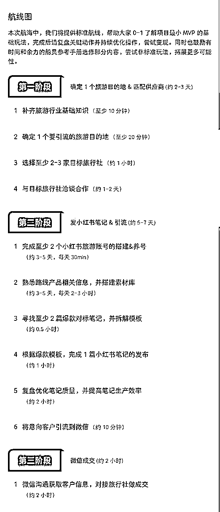
航线图和手册高度关联，你可以根据自己所在环节，学习相关步骤。

以上阶段中，第一二阶段的航线图步骤建议在航海前两周完成；完成后以复盘、优化、提效为主，多发布优质笔记，扩大引流和出单概率。

# 必修篇：把最小闭环走通💡

章节概要

必修篇从【项目基本情况】和【项目基础玩法步骤】讲起，让你对项目有全面了解，并按步骤完成 0-1，跑通最小 MVP。

如果你是本项目新手，正式实操前建议先了解项目全貌：

✅【项目概述】📕境外游赛道的机会和玩法

如果你对项目整体已有大致了解，就可以按核心步骤开始学习实操：

✅【项目实操 1/3】确定 1 个旅游目的地&匹配供应商

✅【项目实操 2/3】打造📕爆款引流笔记，批量引流到🛰️

✅【项目实操 3/3】🛰️成交  
✅【复盘优化】持续迭代笔记 增加爆款数量

必修篇中，航线图和手册顺序对应。你按手册顺序学习，就能逐一完成航线图里的任务。后续每个关键步骤的章节概要里，我们也会提到相关航线图，提醒你完成对应步骤。

接下来正式开始。

# 一、【项目概述】📕境外游：机会与玩法拆解

💡

章节概要

这一章一起认识📕境外游项目。为让大家获得更多项目信息，我们会从两个角度分析：

1. 📕境外游赛道红利有多大？
2. 📕境外游项目怎么玩？

了解完这些，你能对📕境外游建立基本认知，也能在一定程度上找到自己的发力点。

## 1.1 境外游赛道红利有多大？@渡

### 1.1.1 赛道现状与入局机会

#### 1.1.1.1 当前赛道温度

先看整个旅游赛道。疫情退潮后，出行需求集中释放，热门景区挤满游客，酒店和民宿也很难订到。

数据显示，上半年国内旅游总人次 23.84 亿，同比增长 63.9%；国内旅游收入 2.3 万亿元，同比增幅 95.9%。人次和收入涨幅都很明显，旅游业正在稳步复苏。

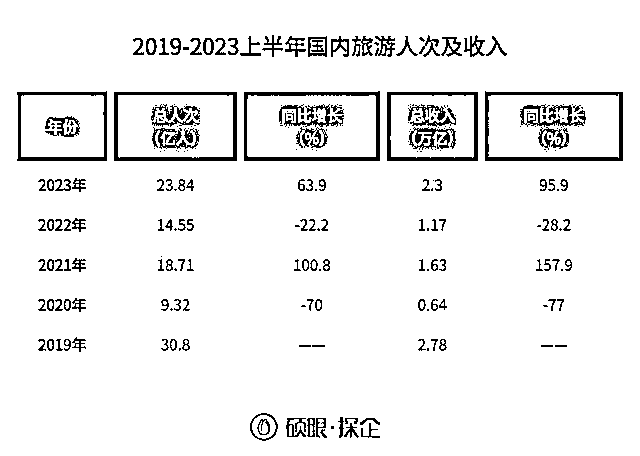
旅游赛道可分境外游和国内游。相比国内游，境外游客单价更高，因此当前关注度很高。境外游现状如何？

从我个人实操看，境外游是目前旅游赛道里较好切入的方向，原因有 3 个：

1）对接境外游难度较大，多数人不容易找到靠谱可合作的旅行社，所以在📕上做境外游引流的人较少，同行竞争小；

2）境外自由行难度大，用户报团几率更高。语言不通、生活习惯差异大，大多数用户有出行意向时会选报团或定制游，这大大增加成交概率；

3）境外游客单高，佣金可观。虽然佣金比例和国内游差不多，但整体客单高，且很少单独出行，成交一单跟团游，佣金大多能上千；定制游成交一单，佣金可达几千。

综合这 3 点，如果境外游能对接好的后端，至少在 2024 年，这是一个不错的副业项目。

需要注意：虽然📕境外游对新手很友好，肯投入精力大概率能拿到反馈；但境外游成交周期长，从咨询到办签证、买机票、付款，往往至少 1 个月，成交也有一定难度。

所以新手要调整心态，把它当长期副业来做。本期航海，打好扎实的📕引流基础就是最好的目标；如果你本身有旅游经验或资源，可以尝试更多可能。

#### 1.1.1.2 普通人如何切进去

旅游快速发展时，通过境外游进入旅游赛道会是不错的机会：市场需求大，国家对旅行赛道也有很大扶持。

普通人如何抓住旅游业风口、分到一杯羹？

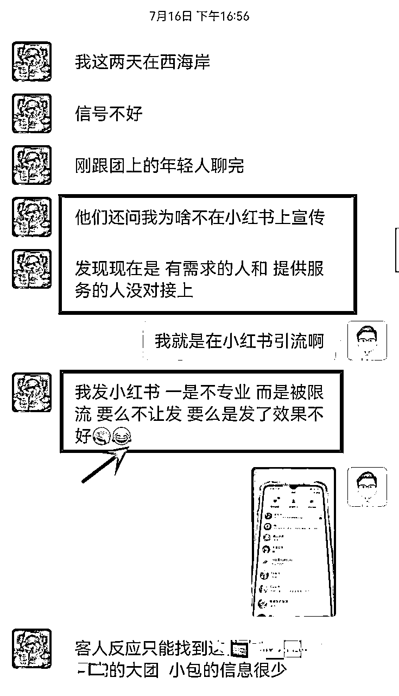
聊天记录里藏着一个信号，你注意到了吗？

我和不少旅游圈朋友聊完，得到一个共同结论：导游和旅行社想做📕，却做不来。

我曾带过一位旅游行业的朋友上手📕。她白天要联系车辆、对接导游、处理游客突发状况，手机几乎没停过，根本坐不住，没多久就放下了。

机会就在这里：替那些不会做、也没空做线上获客的旅行社，把线上流量做起来。

还有一个原因让旅行社特别需要你：

携程、途牛这类平台攥着大量流量，抽成很高。旅行社的处境类似美团商家——不跟平台合作就没单，合作了利润也薄。辛苦忙一圈，钱大头归平台，心里自然苦。

你若能直接带来客源，对他们就是财神爷，合作意愿会很强。

### 1.1.2 为何把📕作为主阵地？

既然要给旅行社做线上引流，选对渠道很重要。为什么选📕？

#### 1.1.2.1 平台数据侧的证据

转化率表现

📕用户规模未必最大，转化效率却很扎眼。

QuestMobile 2020 年的一份统计里，📕平均带货转化率写到 21.4%；横向看，抖音 8.1%、快手 2.7%、🧣 9.1%，差距很明显。

旅游决策数据

2020 年时，📕已经是旅游出行决策影响力第一的平台，63.7% 的用户会靠它做判断。

不少用户先在别处知道产品，再带着问题来📕抠细节，比较服务后才下单；体验结束，又回来发种草或避雷笔记。

另外，82.2% 的用户更愿意用短图文辅助旅游决策，这恰好是📕擅长的内容形态。

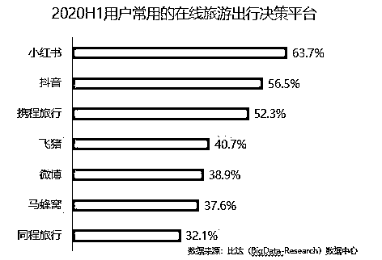

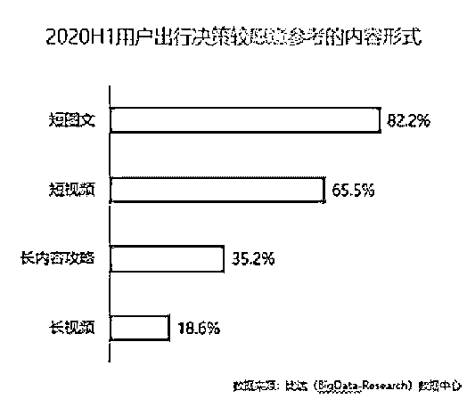
近几年📕持续加码旅游内容，种草心智又强，一直是旅游线上平台里的头部玩家。2022 年它还成立了旅游公司，进一步加码布局。

#### 1.1.2.2 实操体感与行业案例

今年境外游在📕的红利有多猛？

我们刚起号时，首篇笔记曝光只有几十，居然就出了一单！

当时我挺震惊，跟朋友感叹：这风口别说吹猪了，连大象都能带飞。

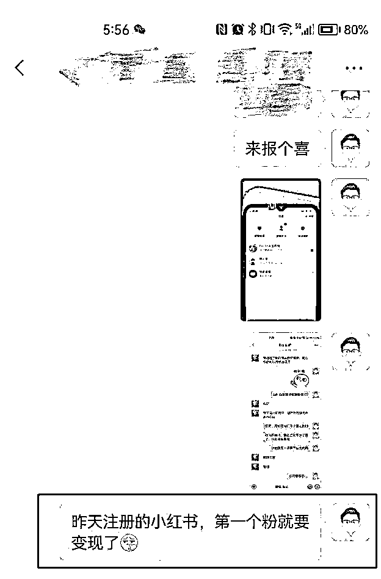

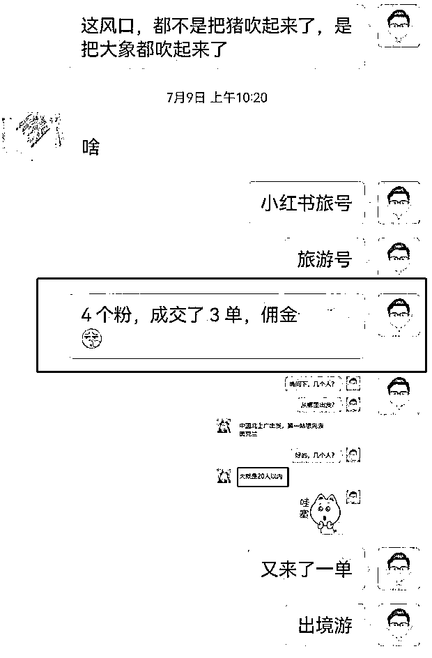
曾读到一位旅游同行的文章，里面说一个 20 人团里有 18 人是从📕报名来的。

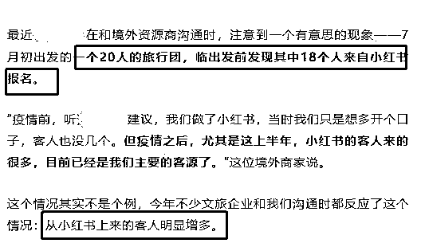
放到 2023 年看，触达用户决策，📕确实是最顺手的工具。

## 1.2 项目落地路径

### 1.2.1 第一步：定目的地、找供应商 @易寒

开始引流之前，先锁定一个目的地和对应的旅行社。

为什么先定这两件事？

第一，做带货绕不开选品。选品既关系账号定位，也影响出单效率：低客单价容易快出单但利润薄，高客单价周期长却回报高；还要跟着季节挑产品。具体方法放在【章节 2.2】。

第二，多数人是旅游行业新手，擅长的是📕引流；路线怎么挑、笔记图片怎么备、🛰️里怎么谈单，都还不够专业，需要旅行社托底。

合作中，旅行社具体帮什么？

选品：推荐路线。不同季节有不同爆款，寒暑假亲子游更热。可以让旅行社挑几条当季好卖的产品。

内容：提供笔记素材。笔记素材很大一部分来自旅行社的产品资料，比如路线介绍文案、景点高清图。

成交：协助答疑。客户到🛰️后，会问产品细节；答不上来的，就请工作人员帮忙解答，推动成交。

做跟团游时，前期把培训资料吃透，约九成问题自己能答，剩下再找工作人员，效率更高。

本期航海对接的旅行社以高客单跟团、定制游为主。我们只负责把人引到🛰️，拉群后由旅行社接手成交，操作难度低不少。

交付与返佣：产品交付和佣金结算。客户付款后，交付由旅行社完成；但旅游是面对面服务，变数多，钱到账不等于稳拿，只有顺利交付才算落袋。旅行社把旅程做好，同样关键。

佣金通常在客人出发当天由旅行社结算给我们。

要留意：旅游行业水不浅。若旅行社不靠谱，投诉一多，佣金结算就可能出问题——能不能足额给、能不能按时给，都是风险。

感兴趣可以去抖音看看 up 主“superB 太”的云南游系列，坑一个接一个，游客很难防。

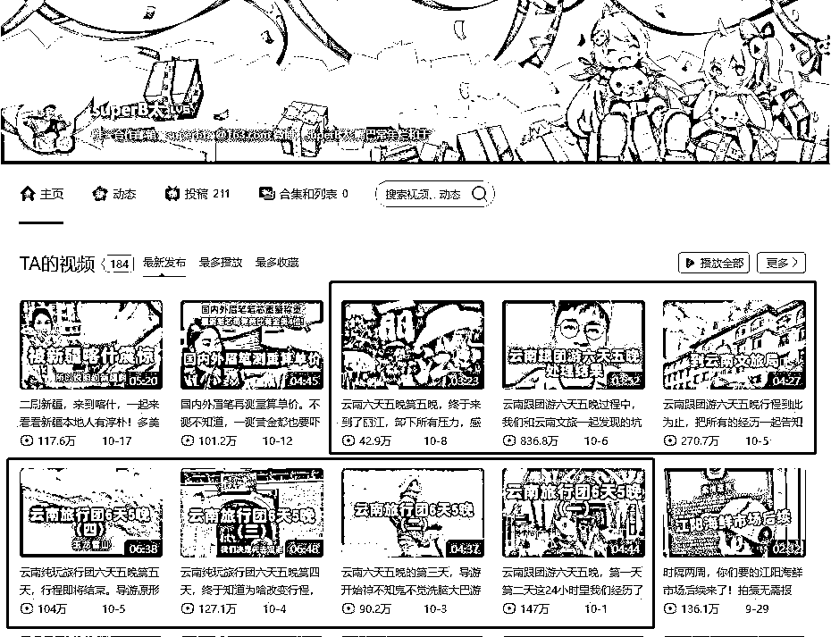
因此，挑一家有保障的旅行社，是项目能顺跑的关键。

为帮新手更快拿到结果，这次航海筛了几家合作旅行社；如果你想自己找，后面的实操章节也会讲方法。

### 1.2.2 第二步：用📕批量导流到🛰️ @渡

在整个项目里，📕引流是绝对关键的一步。先把流量这个“1”做出来，后面的“0”才有意义；它也是最耗时间的环节。

所以航海期间，大半精力都要压在引流上。

📕和其他平台差在哪？

它的内容逻辑是以 IP 为中心，用图片加文字做软种草，因此有三个特点：

1. 更吃 IP 人设

平台很看重“人设”。在种草场里，博主更像一个“值得信任的陌生人”。

用户会从主页和笔记判断你是否真实、可信、专业；一旦建立信任，就愿意继续连接，甚至成交。

2. 内容更真实、更完整

账号由人设五件套（名字、头像、简介、背景图、个人资料）加笔记构成。用户可能从某一篇笔记认识你，再进主页翻其他内容；每篇都在丰富人设，也让信息更完整。硬广容易被限流，用户也不爱看，所以笔记要更真实、接地气。

3. 图文仍是主形态

平台虽然给视频笔记流量扶持，但用户阅读习惯还是偏图文；图文制作难度也低于视频，很多创作者会优先选图文。

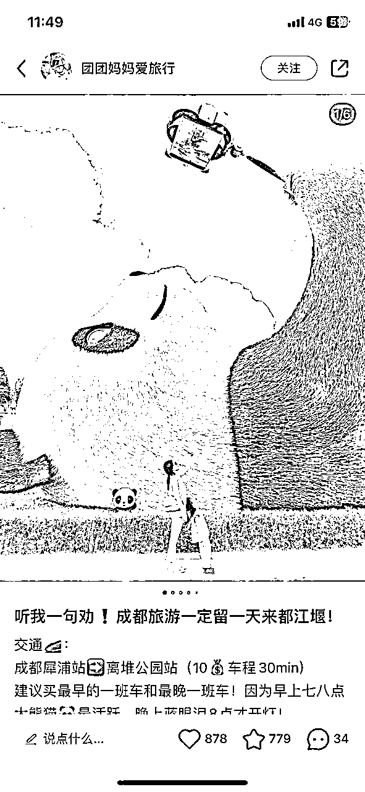

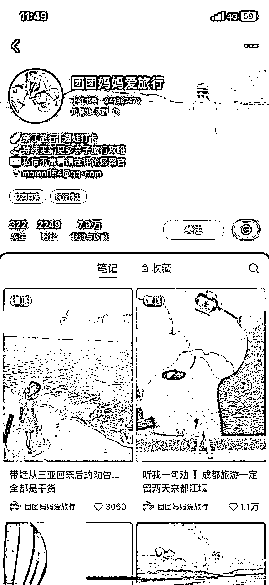

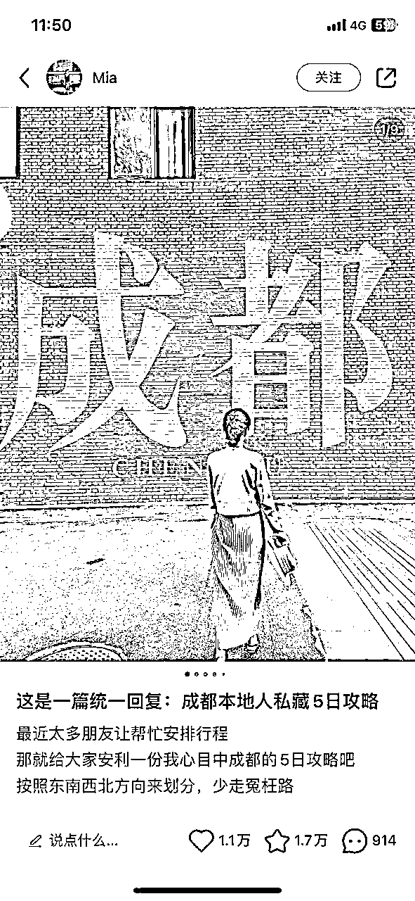
写笔记时，对准目标人群、围着关键词展开，更容易出爆款。流量起来后，钩子要埋好，它决定有多少意向客户来咨询；再把咨询者导到🛰️私域，后续成交。

要提醒的是：📕对引流审核越来越严，但办法总比困难多；实操时除了看手册，也可以在群里多交流。

### 1.2.3 第三步：在🛰️完成成交 @小掌柜

用户到了🛰️，就进入成交环节。关键有两步：

1. 摸清客户信息，推荐路线

客户加进来后及时打招呼，先问清出行日期、人数、天数等基本信息，再匹配合适产品。

2. 及时答疑，推动成交

客户看完介绍多半会有问题，回得及时，成交概率才高。

注意：引流和🛰️成交最大的风险是“封号”。哪些情况容易触发？怎么避？实操部分会展开。

来源：0 基础做📕旅游博主，第一周销售额 6w2 的成单秘籍！

# 二、【实操 1/3】选好一个目的地，谈定合作旅行社 @易寒 @渡

💡章节概要

前面提过，📕境外游离不开旅行社。后端优质且稳定，成交概率会高很多，后续放大也更顺。

这一章会讲怎么选品、怎么和旅行社谈，帮你找到一家靠谱后端：

✅ 选品、首次联系旅行社之前，先补一点行业常识，方便对话；  
✅ 选品就是定一个旅游目的地，为账号定位打底；  
✅ 联系旅行社不难，难的是筛出好后端，需要多轮沟通。为降低试错成本，这次航海赚钱会提供 7 家相对有保障的旅行社供选，帮大家尽快启动并跑完最小 MVP。若你自带靠谱旅行社资源，也可以照本章方法去谈。

💡本章航线图

# 第一步：目的地只做一个，供应商只谈一家

学完并动手做完这一章，航线图第一阶段就收尾了：选出用于引流的一处旅游目的地，再匹配对应供应商，通常两到三天完成。拆开是四件事：先花十分钟以上补齐行业常识；再用二十分钟以上圈定目的地；约一小时筛出两三家旅行社；最后用一到两天洽谈。按这个顺序推进即可。

## 2.1 先弄懂两件事：供应链与产品类型

跟旅行社接触前，行业术语和基本逻辑要先有底。否则沟通容易卡壳，对方可能连回复都懒得给，合作更无从谈起。新手先聚焦两点：旅游供应链怎么分工，产品大致有哪些形态。

### 2.1.1 供应链中的两类旅行社

在📕做引流，主要对接旅行社。旅行社分两类：签约方和落地接待方。通俗叫法就是组团社、地接社。

#### 2.1.1.1 组团社：与客人签合同

客人报名时，合同盖的是哪家旅行社的章，哪家就是组团社。签完约，组团社常把接待任务转给另一家。举个例子：你在广州报名去云南，落地昆明后，来接你的司机、导游和车辆来自云南本地另一家社；广州那家是组团社，云南那家是地接社。

#### 2.1.1.2 地接社：在目的地接客

地接社扎根目的地，长期与酒店、景区、车队、餐馆、司机、导游签协议，从而拿到优惠价。本地优势让导游服务更专业，客人的人身与财产安全也更有保障。地接社报的是结算价，组团社再加价出售。做📕可直接找地接社，减少中间加价环节。

### 2.1.2 产品形态分三种

旅游产品通常有三类：散客拼团、独立成团、私人定制。

#### 2.1.2.1 散客拼团：固定线路拼人

也叫散拼团、跟团游。旅行社按固定时间组织一条常规线路，如“海南六日游”“厦门五日游”。车、房、餐统一安排，客人不用操心；景点与日程有导游带，能缓解陌生环境带来的不安。产品设计偏大众热门景点，游览范围有限，节奏偏走马观花；优点是各类方式中最省钱。

#### 2.1.2.2 独立成团：熟人包团

又叫包团游，通常二十人以上，团内彼此认识，不与其他客人混拼。旅行社按客户要求与预算做方案，车、房、餐可调整。团建、学习、考察、会议等需求都适用；客户不必操心，旅行社会把方案做得更合理，减少对当地不熟的困扰。组团社可能直接找地接社，也可能整团交给合作供应商。即便包团，预算也常有限，产品提升空间不大，所以资源更经济的一方常成为组团社主要合作对象。若咨询人数多、预算比散拼略高，旅行社一般会建议包团。

#### 2.1.2.3 私人定制：量身做小包团

几个亲友或有共同兴趣的客人，由旅行社量身设计。人数通常不限，但为体验和资源考虑，建议十人内，最多二十人；超过建议分批。方案强调朋友相聚的乐趣和自由空间；主题可亲近自然、城市漫游、轻松玩水、极限挑战，也可荒野露营、别墅休养。食宿更讲究特色，资源允许时选当地有特色的社会餐厅；方案要写明酒店、餐厅名称、房型标准与菜单。还要结合客人爱好、时间、预算做匹配，让旅行更有意义。行业里有人把“安排当地最好食宿”等同于私人定制，我不认同。定制产品面前，组团社会多渠道找供应商或地接社，甚至在目的地直采资源，反复打磨方案或提前踩线，只为更好的体验；这类客户也常被组团社视为最重要客户。

## 2.2 引流只做一个目的地

### 2.2.1 为何目的地要先定

卖货先选品，旅游目的地就是你的“品”。先定做哪里，才能围绕当地景点和产品设计笔记，并反推：客人画像是什么？他们缺什么、怕什么？对应哪些搜索词？前期要补哪些产品知识？账号定位怎么立？

### 2.2.2 挑目的地的两个判断

目的地影响成交，也影响笔记呈现。看两点：

一，你熟不熟。熟悉或喜欢，学产品资料快、写笔记快、答客户快，成交也快。完全陌生就要多花时间补课，否则笔记容易只有技巧没有温度，内容偏硬，转化会弱。越熟，文字越真，越容易让用户信任；写笔记能带情绪价值，客户提问也能答得全面专业，甚至语音沟通。语音带来的信任，比纯文字强。

二，这个目的地竞争大不大。📕盘子有限，单个目的地客群有限；做的人多，抢一个客户就难。判断方式：灰豚数据平台的【投放关键词分析】。入口：灰豚首页左侧—热门内容—关键词分析—搜索目的地名。

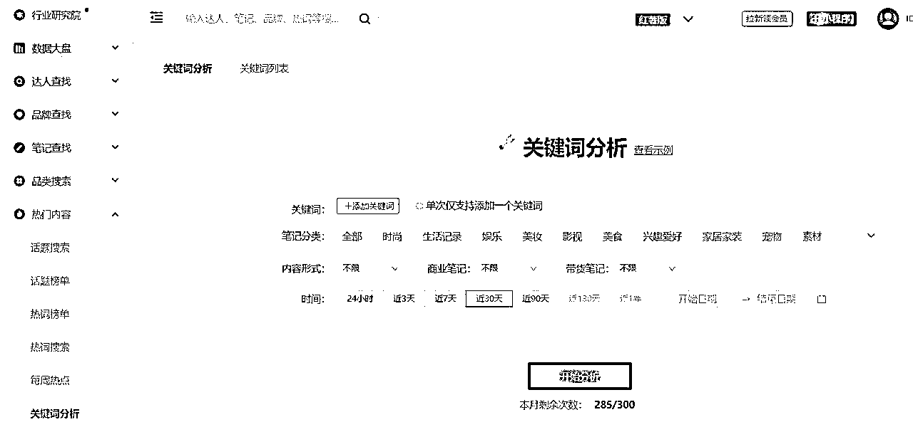

我查了七个目的地，重点看 CPE（用户互动计费）和 CPM（每千人展示成本），两者反映关键词付费竞争，数值越高竞争越强。日本 CPE=0.51、CPM=30；澳洲 CPE=0.41、CPM=20，初步看日本比澳洲更挤。还可看笔记数、阅读总量、互动总量：后两者越大，客群越大；越小，目的地越小众。笔记数/阅读总量或笔记数/互动总量越大，竞争越弱。长滩阅读总量=1.1w、互动总量=576；土耳其阅读总量=28.9w、互动1.4w，土耳其客群更大，长滩偏小众。斯里兰卡笔记数/阅读总量=85/6.7w=0.13%，云南=2459/338.2w=0.07%，斯里兰卡比值更大，初步说明竞争更弱。数据上建议新人选竞争弱的目的地，但还要结合熟悉度综合判断。

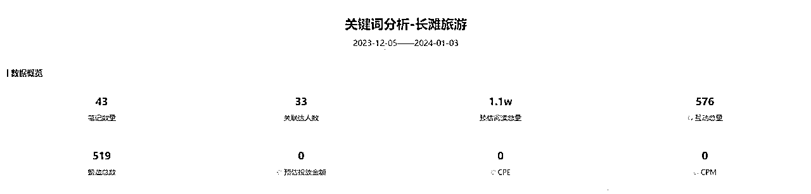

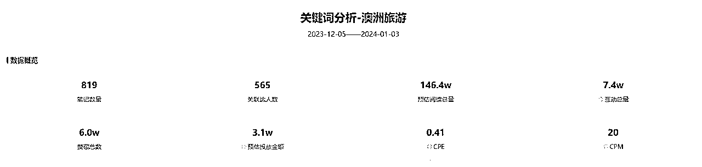

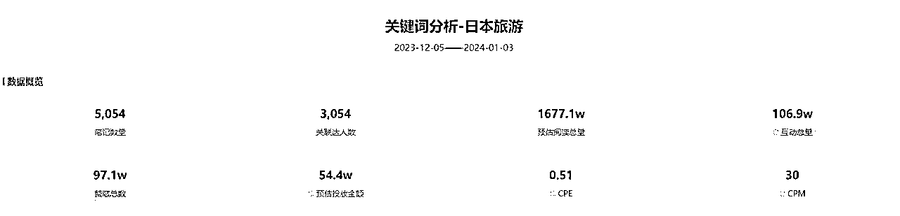

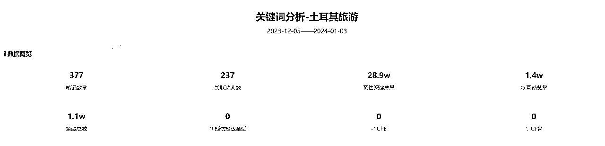

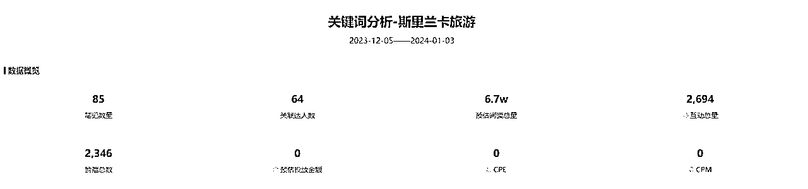

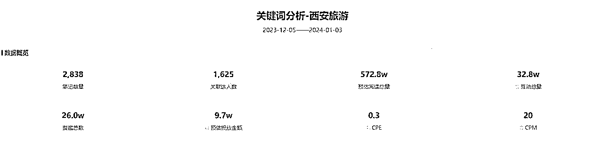

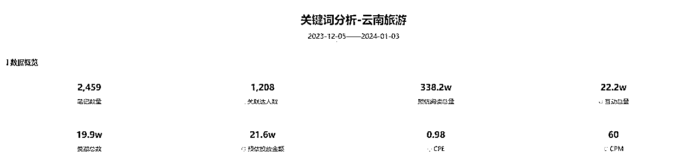

### 2.2.3 为何只做一个目的地

新手只做一个，是精力账。定下后要学的东西多，把一个目的地的产品吃透已很费时；再开第二个，容易贪多嚼不烂。也建议一个月内别换，一个月本就短，中途再学另一个又拖进度。📕账号要垂直，越垂直粉丝越精准，变现越快；新号什么都发，短期难建立信任。为让大家把精力放在笔记能力上，我们筛了七家旅行社供应商，按需选一家，并熟悉对应产品资料。产品资料链接：旅行社名单 & 产品资料（12月航海）。

## 2.3 谈定一家旅行社

### 2.3.1 选社要看淡旺季

选旅行社要跟淡旺季走，做当季热门目的地，再找对应社。西安四月到十月旺季，其余淡季；西安国旅数据里，淡季客流只有旺季的六分之一甚至九分之一。冬季东北和三亚旺，就可冬天做东北或三亚，其余时间做西安。淡旺季可按自然季节：一般五月至十月旺，十一月至次年四月淡。但地域差异大：东北雪乡、海南三亚冬季反而旺。算境外，北半球与我们同步，南半球如澳大利亚、新西兰相反；我们冬季是他们的夏季，所以澳新旺季十月到次年四月，淡季四月到十月。也可按节假日：元旦、春节、五一、十一黄金周，学生寒假（一至二月）、暑假（七至八月）都旺。

### 2.3.2 旅行社资源从哪来

合作资源分国内、国外。国内更好找；考虑到新手，本期也链接了几家境外社练手。

#### 2.3.2.1 国内社怎么找

新疆、云南、西安、贵州、北京、呼伦贝尔、东北等传统热点，游客多。先问亲友，大概率能碰到做旅游的人。找不到就去目标城市旅行社上门谈：对方零成本多一个网络销售，通常愿聊。也可在龙哥盟星球发帖找圈友；📕发帖或通过博主账号联系，问是否需要分销。

#### 2.3.2.2 国外社怎么找

问在国外留学或工作的亲友，多问总能找到；让对方把当地华人旅行社🛰️推来。跨国合作更要看口碑，服务质量靠朋友多打听。

### 2.3.3 两种合作方式

佣金合作分引流合作、同行合作。

#### 2.3.3.1 引流合作：拉群成交

你在📕加到客户🛰️后，把旅行社工作人员拉进群；对方在群里成交，你只看结果。成交有佣金，不成交为零。佣金比例低，通常五个点。也有旅行社找大学生、宝妈批量做号，一篇笔记十块、一个🛰️五块，甚至无佣金。

#### 2.3.3.2 同行合作：自己接咨询

你懂产品，能独立答疑，从发笔记到客户付款基本一人完成；佣金比例高，通常十五到二十个点。最简单是跟团游，也是本期推荐。跟团游只需熟悉几条线路，吃住玩行固定；旅行社半天培训，你就能接咨询。定制游难些，新手本期不推荐。它要求你对某目的地（如西安、迪拜）的酒店、景点、餐馆、行程都熟，得有人带。勤快点，最快一个月、最慢三个月能独立做定制。最省事是去旅行社上几个月班，免费学还有工资；业余学就找社里工作人员手把手带。定制游本质像做攻略，门槛不高但要过程。若选同行合作，开始只做一个目的地，深挖更容易出单；别同时学多个。

### 2.3.4 洽谈要问明的细节

#### 2.3.4.1 佣金规则

产品不同，佣金不同，通常三个点到二十个点；散拼团约八到十个点。别误以为价格越高佣金越高。新景点或自费项目（如演出）在推广期返佣高，含这些的产品返佣也高；知名景点或演出返佣很少，西安长恨歌甚至零佣金，兵马俑、华清池也是零。定制游常无固定价，可按销售额比例算；散拼团有固定价，一般标明具体金额。

#### 2.3.4.2 后端能给什么

后端支持主要是高清产品图、产品培训。跟团游要问能否配一位工作人员答疑；定制游要问能否有人手把手带。

#### 2.3.4.3 结算和付款

通常月结；也有单笔结，客人出发当天结清。付款多为🛰️转账。

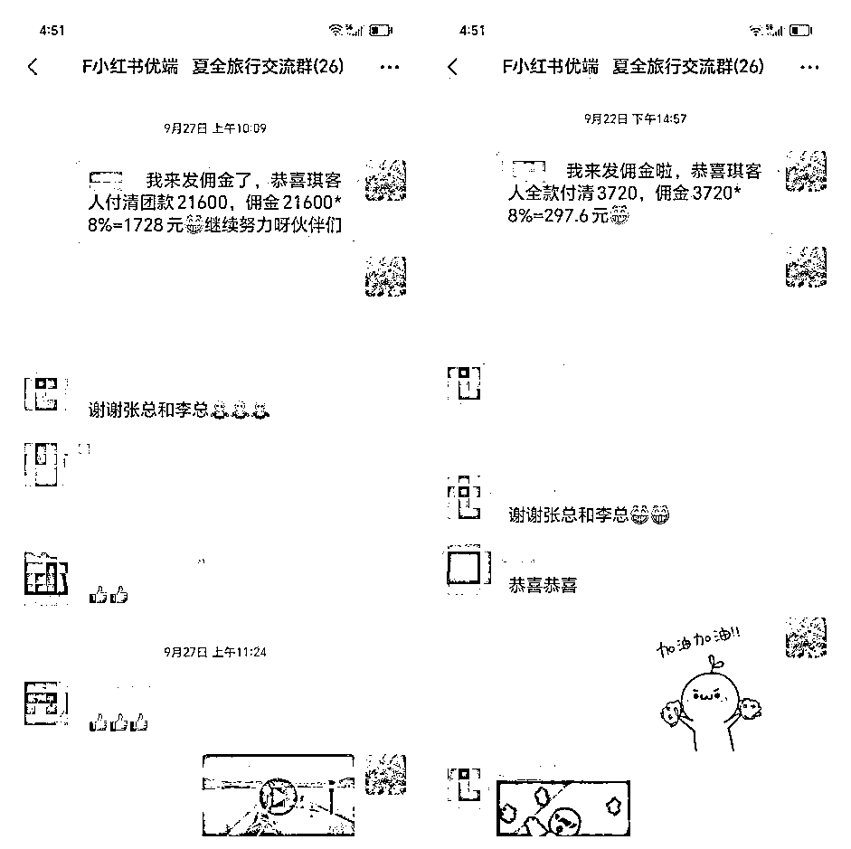

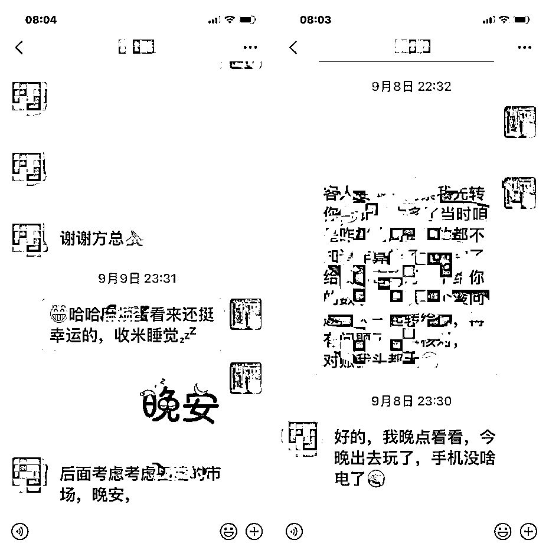

### 2.3.5 洽谈避坑要点

#### 2.3.5.1 查资质

合作前先查资质，有证才放心。第一步登录国家文旅部官方查询网址：https://mr.mct.gov.cn/

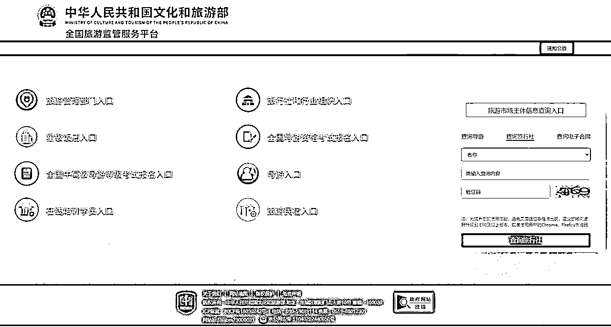

第二步：进旅游市场主体信息查询入口→查询旅行社→输入名称、经营许可证号、统一社会信用代码，任选一项。

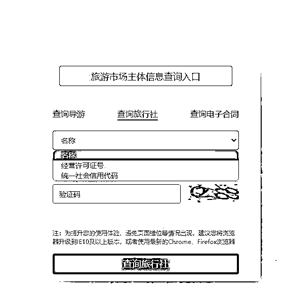

第三步：看结果，正规社有经营许可证。

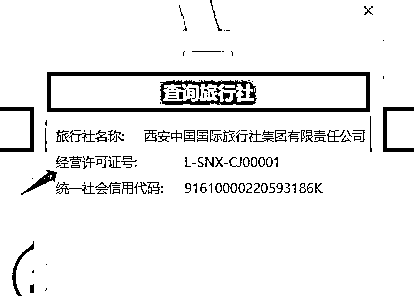

#### 2.3.5.2 当心KB团和自费坑

重点看口碑。KB（keepback，返点团）即购物团，香港、云南是重灾区，新闻不少。

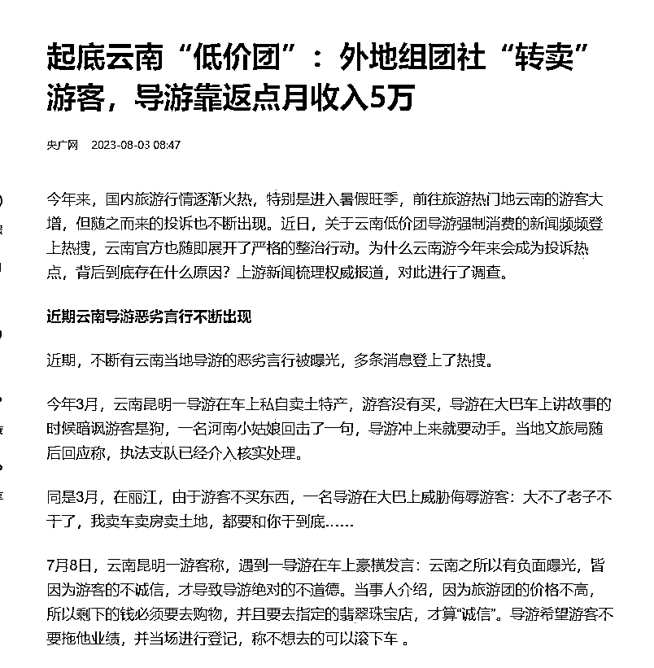

购物团名声差，现在更隐蔽：抖音直播里不少低价团标“0购物纯玩团”。这种团怎么赚钱？业内叫“加点”，导游途中推自费，最后自费总额远超团费，导游拿回扣。两类团评价差、投诉多；合同是客户与旅行社签的，后续风险要自己掂量。做不做，自行决定。

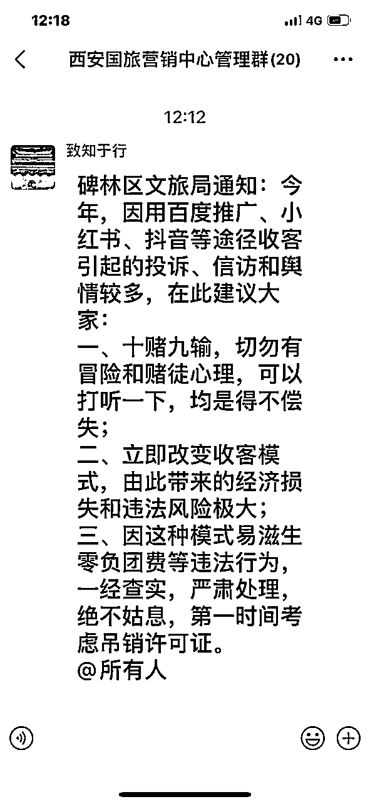

#### 2.3.5.3 佣金拖欠怎么防

旅行社间拖欠普遍，甚至有人说“不拖欠就开不成社”。对方也可能把拖欠习惯带到你的佣金。注意：团款进旅行社账户，不会进你的私人账户；一旦拖佣，你很难制约。避免办法两条：一，选口碑好的社；二，一开始约定单笔结算，这单没结，下一单先不给。

#### 2.3.5.4 服务质量要盯牢

先确保产品是零购物纯玩团。有些导游为业绩搞强制购物，极伤体验，购物团最毁口碑。其次，游玩、住宿、团餐质量要保证，尤其与行程单宣传一致，都要聊透。最后，投诉和不满要及时处理；否则客人不满意，在📕写黑材料，影响很大。我们带客时，不论跟团还是定制，每隔两天问一次；有情况直接找旅行社老板解决，把不满压到萌芽阶段。

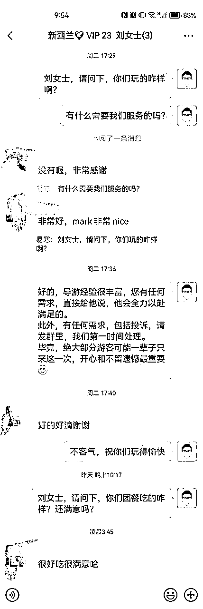

# 三、【实操 2/3】让笔记自带客源，把流量沉淀到🛰️ @渡

💡

章节概要：这一章是项目重头，也是耗时最多的环节。希望大家掌握旅游笔记流程后，持续复盘、多发笔记，提高爆款数量。本章学：账号定位与搭建—笔记发布—把客户引入🛰️。

# 旅游号第一课：把首篇笔记发出去

接触过📕内容运营的人，动手会顺一些；完全没做过也别紧张，按下面的流程一步步来，第一篇笔记很快就能上线。

💡本章行动地图

学完并做完本章，路线图的第二阶段就算完成：发📕笔记 & 引流（约5-7天）

1. 搭好并养起至少两个旅游号（约3-5天，每天30分钟）
2. 梳理线路资料，建起素材仓（约3-5天，每天2-3小时）
3. 找至少两篇同赛道爆文，拆出模板（约0.5小时）
4. 仿照模板发出第一篇笔记（约1小时）
5. 把有兴趣的客人转到🛰️（约10分钟）

现在就可以按这几步动手。

## 3.1 把📕账号搭好并养熟

### 3.1.1 先备两个号

平台对往站外引流的审核越来越紧，旅游又属于敏感品类。刚上手若不摸清规则，轻则被审核，重则违规封号。因而建议一开始就准备两个号，一个作为辅助号，帮主号分担导流动作。

第一步：手机号。两个号对应两张手机卡。手头只有一张，可以借家人号码，或在线补办一张。作者自己用的是电信副卡：办理电信宽带的那张主卡能附带2-3张副卡（具体看宽带档位），主副卡流量共享，用起来挺方便。

第二步：登录设备。手机若没有应用双开功能，不建议安装所谓分身工具，风险是被平台封号；更稳妥的是另找一部手机专门登录。二手平台如闲鱼、拼多多上三四百元的机器，应付日常操作没问题。

第三步：实名认证。个人号可以申请旅行博主身份。这里有个关键点：同一张身份证只能绑定一个号，认证后想解绑，只能把账号注销。通常只给主号做认证，辅助号不认证。操作路径：我—左上角三条杠—创作中心—创作服务里的更多服务—开通专业号—成为专业号—选个人后点立即申请—填写实名信息—选“出行-旅行博主”。

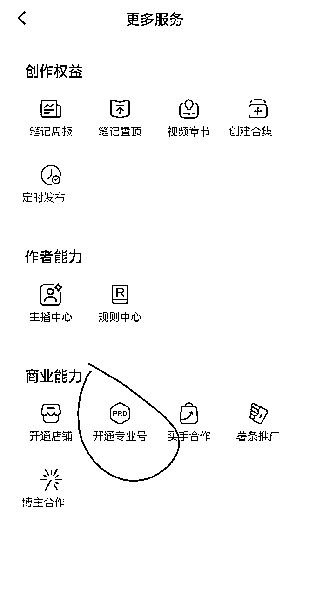

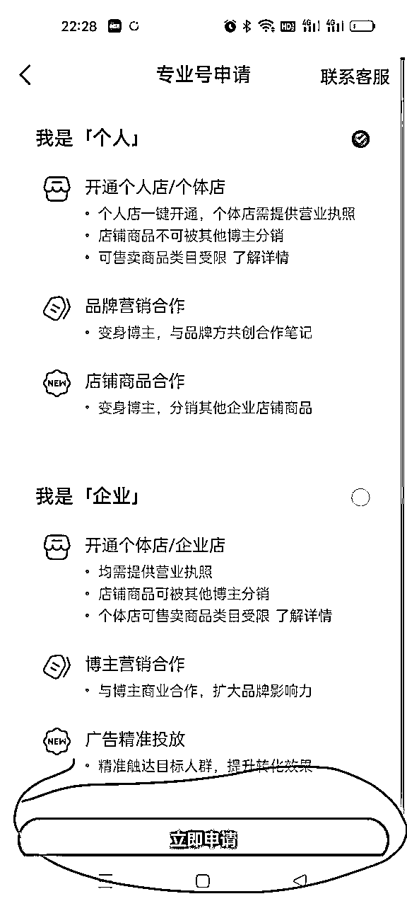

第四步：养号。新号每天至少留半小时，像普通用户那样浏览同赛道内容，做关注、点赞、评论等动作。一般持续3-5天。

### 3.1.2 定位打法与门面布置

#### 3.1.2.1 定位怎么找

前期四成精力应花在定位上，剩下再分配给选题、内容与引流。

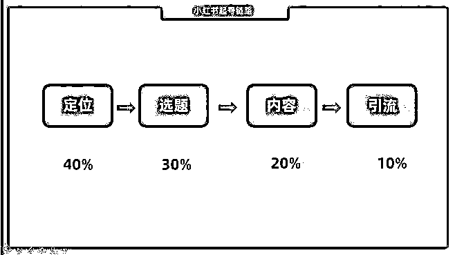

定位要抓住三个词：垂直、精准、细分。找定位其实是在找你想服务的人群：你希望谁来关注，内容就为谁而做。举例，做青年旅行，目标客群是18-28岁，那就把IP塑造成这群人偏爱的模样，发布容易促使他们私信下单的内容。细分方向确定后，IP形象和内容都要围绕这群人展开。再如选择西安亲子游，后端具备成交能力，就把人设做成目标家长喜欢的样子，例如“爱遛娃的宝妈”，内容对准宝妈想看的种草点。无论选什么方向，定位都要收窄，越垂直越容易精准转化，变现也更顺。

#### 3.1.2.2 门面怎么布置

账号门面相当于实体店开业前的装修。原则是简洁聚焦：做云南线路，头像、名字、介绍都围绕云南来。用户关注一个人，很少只因单篇内容；通常会翻主页，看名字、头像、介绍、背景图和已发内容，再决定要不要关注。因此主页展示很关键，既影响关注率，也影响对方是否愿意购买你的旅游产品。对运营者来说，资料填得越完整，平台越容易给账号打标签；标签清楚，推来的流量更准，点击和浏览随之增加，账号权重也会往上走。下面按名字、头像、介绍、背景图、主页排版逐项说。

名字：这是用户认识你的起点，对方靠它判断你是谁、能做什么。常见误区是取得太含蓄或太个性，用户猜不出你的业务，甚至完全看不懂。好名字能借关键词带来搜索曝光。可参考的取名思路：
- 名称+地域+身份：云南导游XX、西安定制师XX
- 名称+地域：XX带你游云南、法国XX爱旅游
- 名称+类目：XX爱旅游、XX的旅行日记、XX环游记
- 个性+昵称：不油腻露营大叔、大漂亮的遛娃日记
总之，名字要直接传达定位，让人一眼明白你能提供什么。还需注意：个人号的名字应带有“人”的行为或身份感，别取成“XX旅行”“XX定制游”“云南旅游”“XX周边游”这类大类目，一是缺少个人属性，二是这类名称通常只对企业号开放。

头像：可以走文字路线，也可以真人出镜。文字头像配合名字，用户一眼能识别你的业务；真人照片则更亲近，显得真实，信任感更强。做IP人设的号，尤其推荐真人出镜，也可用名字或地域元素做头像。不少人喜欢用风景照，虽然和旅游赛道贴得近，但画面里没有人、也没有地域提示，辨识度和记忆点都弱，不太建议。

个人介绍：点进介绍的人，多半是从笔记跳到主页，想进一步了解你。所以这段文字很重要，往往直接影响关注决定。合格介绍要回答：你是谁、做哪行、为什么值得关注、能给用户什么。示例：1. 身份与业务：在新8年司导、私人订制行程、本地跟团、新西兰旅行服务团队；2. 专业背书：新西兰旅游协会TAANZ会员；3. 差异点：专注高品质纯玩、累计服务5000人+，包括陈道明、靳东等明星。排版控制在3-4行，短句为主，适当放数字。容易踩雷的写法：可单独写私人订制、定制游，或专注XX旅游，但不要写“提供私人订制服务”“专注私人订制旅行”等，这些是实测会违规的点。

背景图：产品、人设、场景相关都能用。1. 用文字写明你能提供的服务；2. 放目的地标志性景点，做哪个地方就放哪个地方的景；3. 放真人出镜的旅游照，注意画面美感，别太拥挤；4. 放线下旅行社门头照；5. 发一些像朋友圈那样的生活与旅行打卡，尽量贴住IP领域，用来拉近距离。

主页排版：笔记封面要体现风格和特色，整体风格统一，色彩协调，不要太花。封面设计可以调整，但别天天换样。好的旅游账号门面示例：

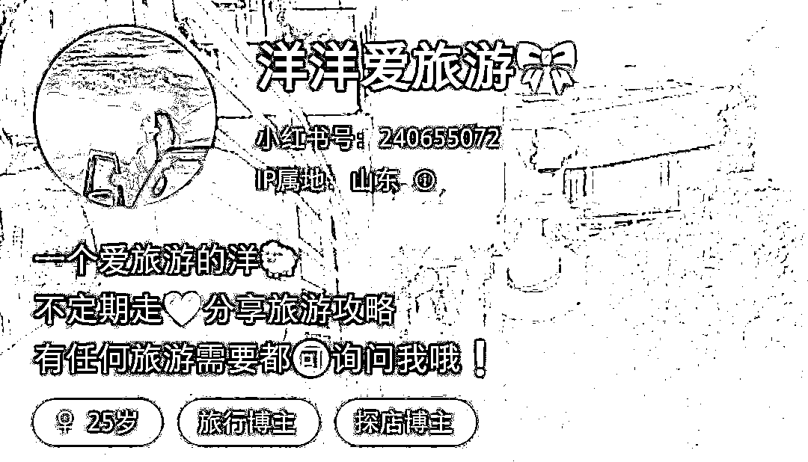

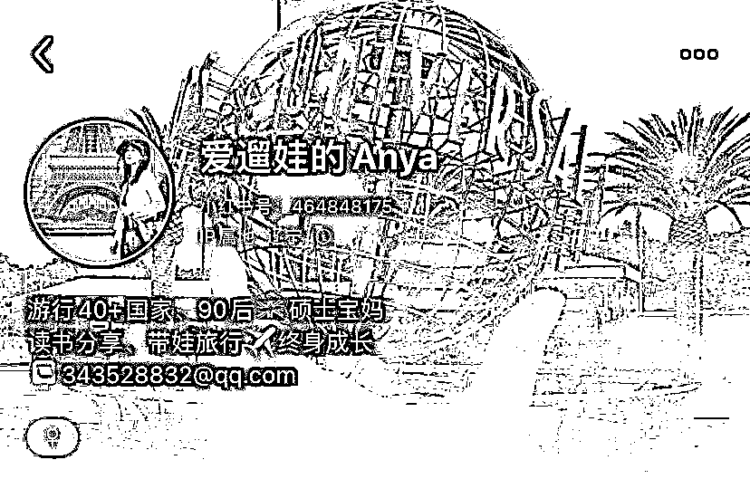

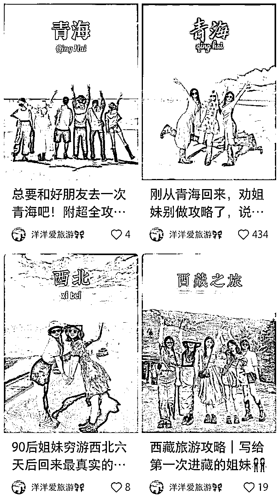

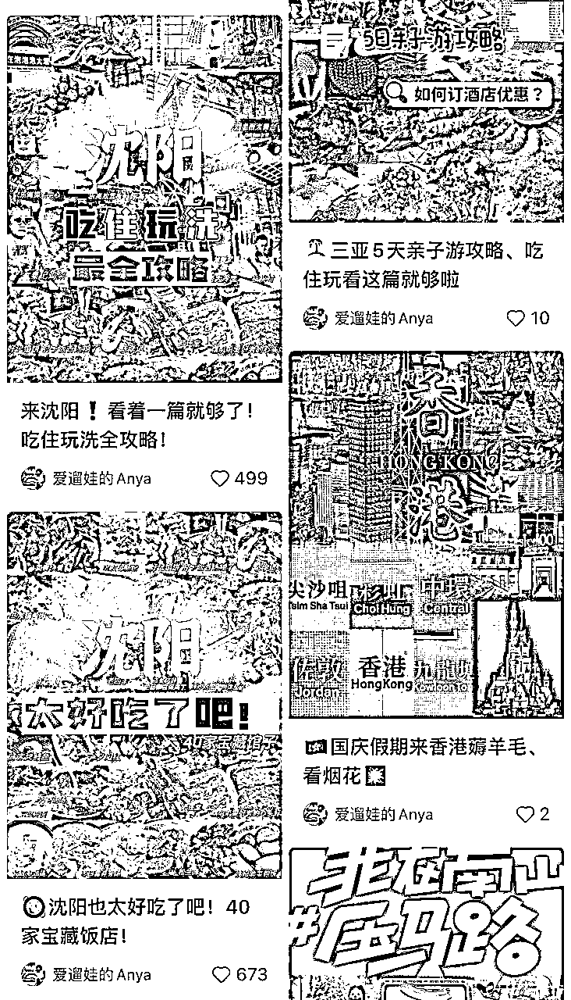

## 3.2 发出首篇引流笔记

💡小节概要

这一节要完成第一篇📕笔记的发布，也是项目里的重要节点。关键任务有三项：吃透所选线路产品信息；学会搭素材仓并持续补充；掌握旅游笔记制作与发布全流程。想练到10分钟出一篇，前期反复练习少不了，熟能生巧，爆款自然水到渠成。

### 3.2.1 挑定要推的线路

前面已经选好旅游目的地，而一个目的地往往对应多条线路产品。写笔记前，要先定下具体推哪条线路，可以只写一条，也可以把多条线路做成合集。

### 3.2.2 吃透线路资料

动笔前，先学习旅行社给的线路资料；更多信息还可以从携程、途牛、百度等渠道补齐。散拼团需要弄清楚这些：1. 线路包含哪些景点？2. 各景点有什么特色？3. 散拼团何时发团？4. 集合出发时间是几点？5. 团队最多收多少人？6. 价格多少？成人与儿童如何区分？7. 是否留自由活动时间？8. 有没有导游讲解？9. 是否安排接送？

### 3.2.3 搭好图文素材仓

做旅游内容，素材仓非常关键。一篇笔记最基础的组成就是景点介绍文字加景点图片。比如做西安散拼团，内容会涉及线路里的景点、不同玩法，还要配图。前期查资料时，顺手把信息整理进文件库，后面写笔记直接翻查、复制，不必每回都去百度景点介绍和玩法，能省大量时间。

文字素材：以西安散拼团为例，产品有华山一日游、兵马俑一日游，那就分别建华山一日游、兵马俑一日游的文档，把景点信息汇总进去。比如华山怎么介绍、有哪些玩法、西上北下与北上西下有什么区别，这些都在前期搜集好，写笔记时直接取用。

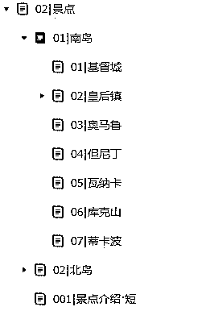

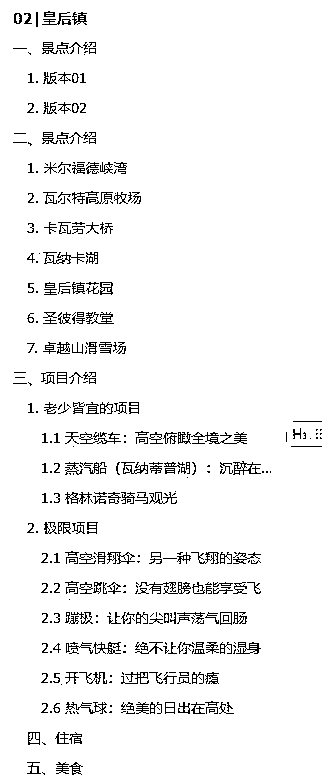

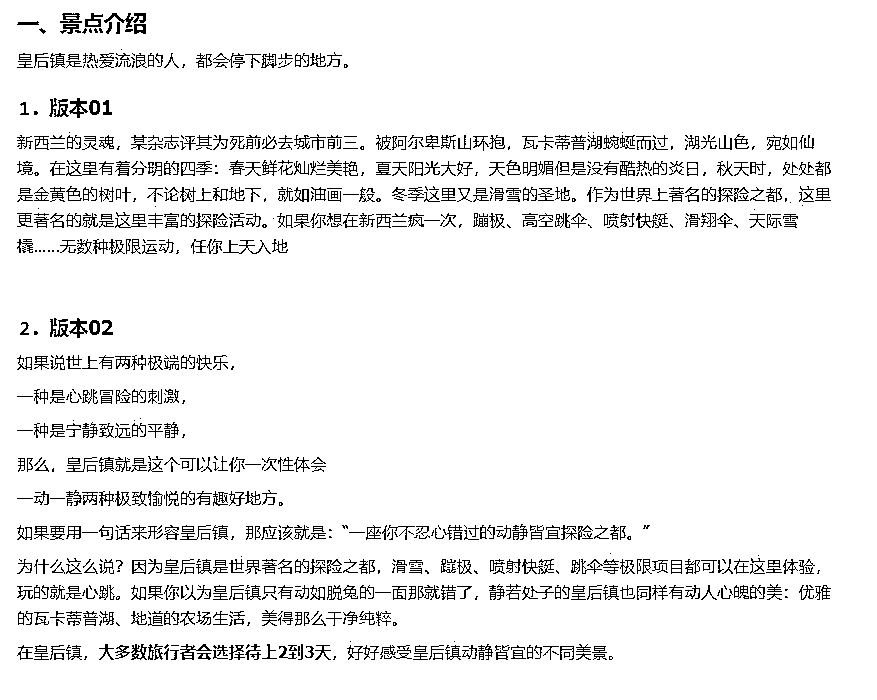

图片素材：除了整理景点文字，图片归类也不能省。一个目的地景点很多，每次发笔记都要配图，临时找图很耗时。更好的做法是：一次性整理，或每次看到合适的景点图就放进对应文件夹，下次直接上传。图片可以按两层来分：一层按景点建夹；另一层按每个景点涉及的餐饮美食、景色、酒店住宿、体验活动/游玩项目、用车情况等建夹。

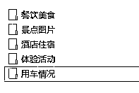

### 3.2.4 笔记从模仿到发布的流程

想写出平台认可的优质笔记，先要知道用户爱看什么。现成的爆款正是用户偏好的集合，找对标、拆爆款，是小账号快速起量的必备动作。

第一步：找爆款对标笔记

1）去哪里找？搜赛道关键词。比如做“华山一日游”，就在📕搜索框输入相关词，从结果页里挑适合模仿的笔记。点开爆款里的话题：找到互动数据好的内容，看正文最下方的话题标签，点进所属赛道话题，再顺着标签发现更多爆款。

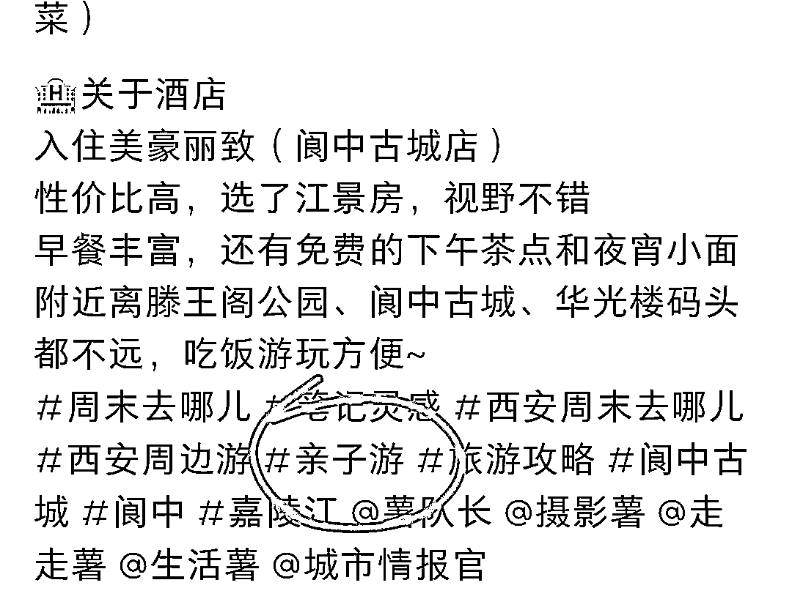

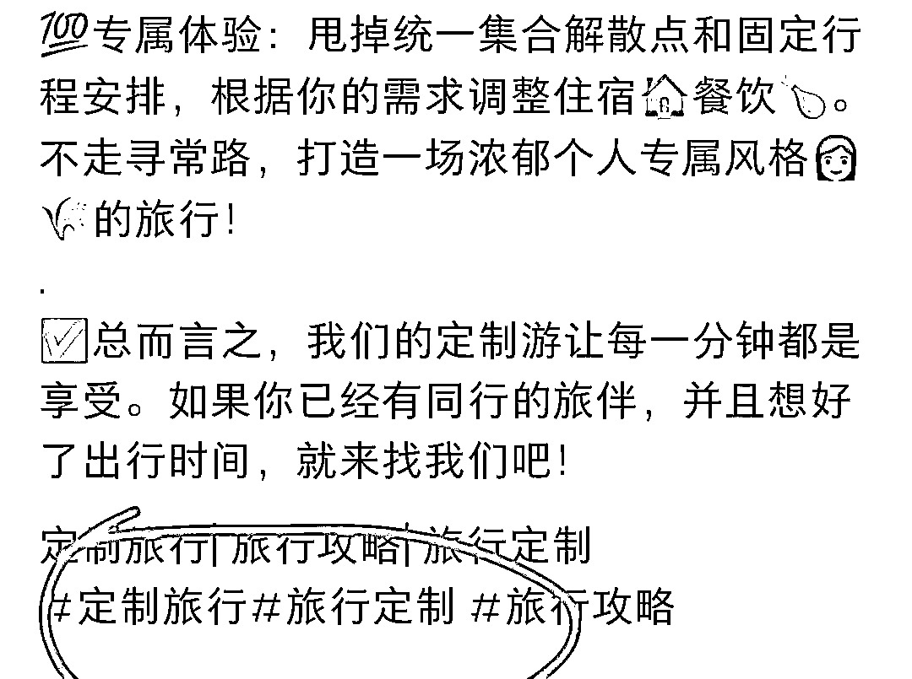

持续刷同类内容：连续浏览与账号调性接近的笔记后，系统会依据阅读偏好，在发现页推相似内容，再从中筛出适合对标的对象。去数据平台找：用灰豚数据、千瓜等工具搜低粉爆文，模仿这类内容，再次爆的概率会更高（该功能通常要会员，可以去淘宝、闲鱼买个账号，影响不大）。

2）哪些笔记值得对标？看互动数据：互动超过100算小爆，超过1000算大爆，尽量挑大爆款。看评论区：有些内容赞藏不算亮眼，但评论里全是精准询单，询单与赞藏接近1:1甚至成倍，这类更值得重点研究。看发布时间：3个月内的最佳；季节性产品如冬季滑雪泡温泉、夏季避暑胜地，可参考往年爆款。看博主粉丝量：腰部甚至头部百万粉博主的爆款，参考价值有限，数据多半靠粉丝托起，你很难复制。

【附】爆款笔记通用模板拆解⭐

拆完一批爆款后，我归纳出旅游赛道的通用模板，照着练，做出爆款的速度会快很多。

模板一：攻略笔记

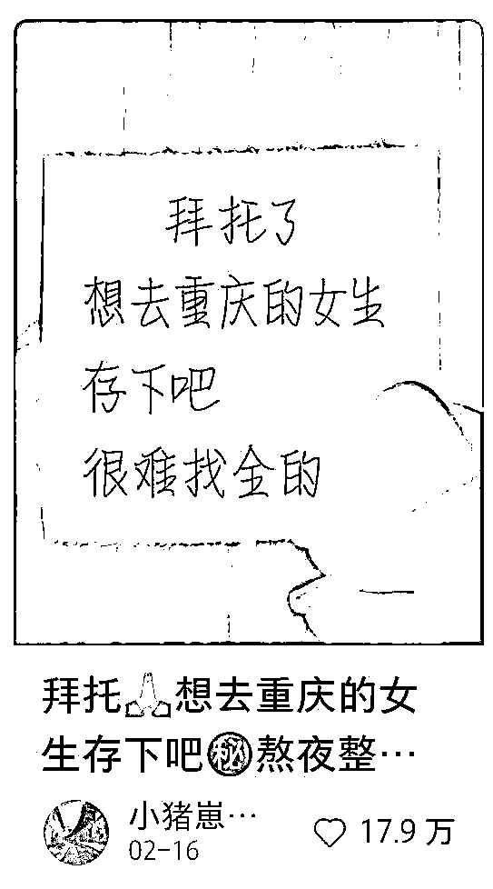

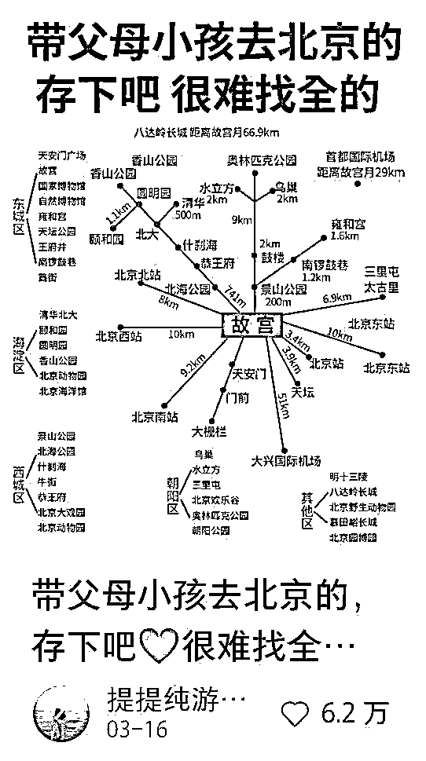

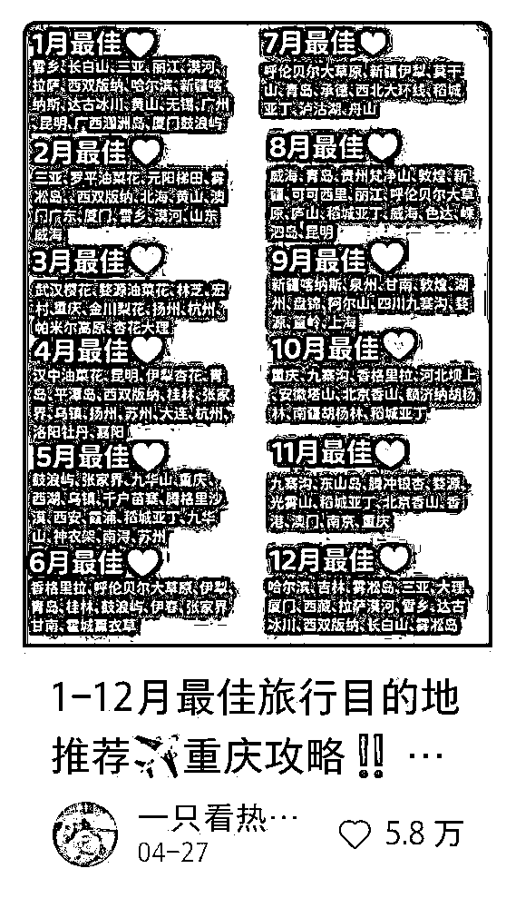

这类内容的关键是突出“多”和“全”，在首图或标题里用画面或文字告诉用户“干货很足”，仅这一点就能让不少人停下来。以一篇典型笔记拆解：

1）笔记信息：谁懂啊❗终于有人把土耳其旅游说清楚了
数据：赞1026 藏1794 评72
2）标题分析：套路是情绪加好奇。“谁懂啊”把情绪拉满，“终于……说清楚”制造好奇，吸引点击。
3）图片分析

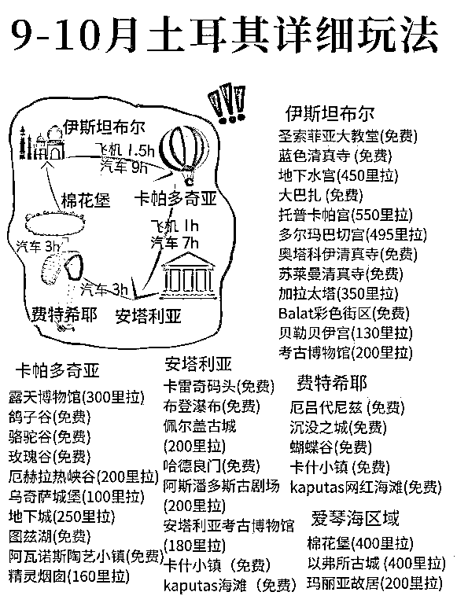

首图：用“景点是否免费”和行程图做框架，让人一眼看到重点、知道怎么玩，觉得内容全面，从而引导收藏。

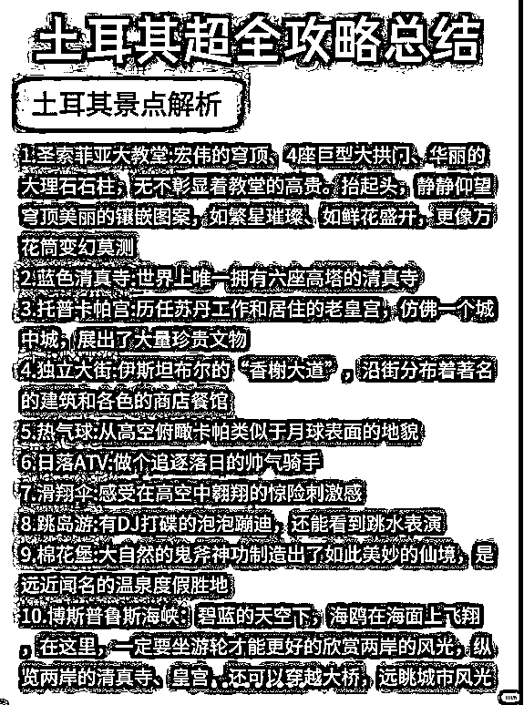

其他图：围绕各景点、天气、注意事项、必备物品逐一展开，显得内容扎实，值得点赞收藏。这类图文容易批量制作和模仿，文字可结合自己的亲身经历优化。
4）文案分析

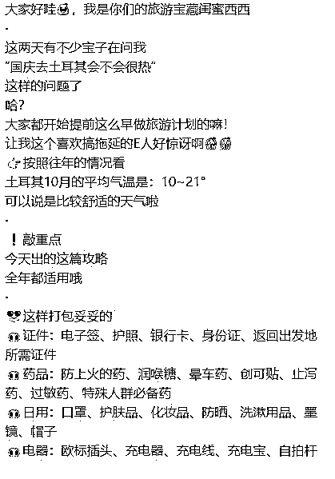

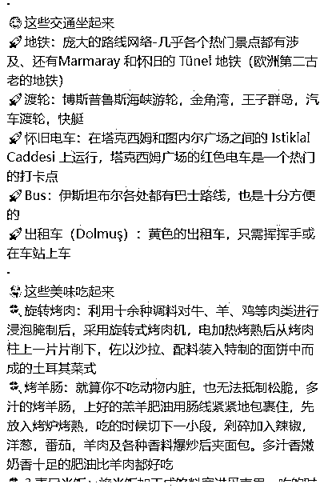

文字以素人视角分享旅游情况，从天气、交通、美食、行李清单等切入；中间详细展开出行后的衣食住行、要带什么、怎么走、有哪些好吃的，帮用户解决疑问。
5）评论区分析

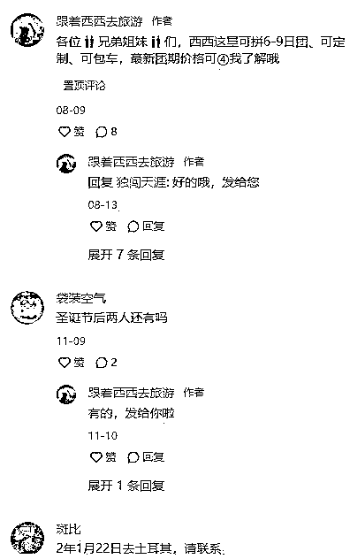

博主置顶了一条评论，从产品特点、能提供哪些服务来介绍，引导用户评论咨询，咨询量和评论量随之增加。

模板二：产品笔记

这类内容的核心同样是展示线路特点和服务内容，目的是提高转化，直接描述产品，通常用单条线路或多条合集呈现。赞藏可能不高，但评论数往往较高，内容以咨询线路信息为主，来的顾客更精准。以一篇典型笔记拆解：

1）笔记链接：http://xhslink.com/6fYuSw
数据：赞44 藏43 评233
2）标题分析：7~10月土耳其夏日限定小团👏1人可拼
套路是日期加产品特点。“7-10月”点明游玩季节，“限定小团”说明人数少、服务质感更好，“1人可拼”表示一个人也能参加，报名没有人数门槛。
3）图片分析

首图：以当地特色热气球为背景，清晰呈现相关行程景点、游玩天数、小团形式、游玩月份、体验活动、服务保障，让顾客一目了然；不足是只有一张图，没有其他照片展示，可以再补几张别的景点图。
4）文本分析

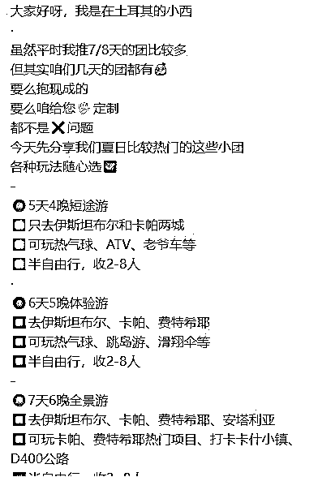

这是产品型笔记，用多条线路合集展示。开头简单说明线路和团期很多，也提到可单独定制、有不同主题玩法，展示业务范围较全；后面把不同线路铺开，用合集体现产品多样、选择丰富。缺点是结尾没有交代自身特色，比如从业多少年、服务过多少人、能提供哪些服务，以增强信任和专业感，提高咨询转化。
5）评论区分析

博主置顶了一条评论，从产品特点、可提供服务来介绍，引导评论咨询，咨询和评论量因此增加。

模板三：人设笔记

旅游笔记起号到导流：六步实操拆解

先看身份型图文。这类内容往往不靠赞藏评冲量，它真正要干的事，是让刷到的人迅速形成判断：这个账号是谁、主营什么、能供给什么、专精程度如何。把这层信任垫稳，后续带产品的帖子成交会更顺。

拿一条常见样本拆一遍。
1）样本信息
链接：https://www.xiaohongshu.com/explore/649e4fe2000000001300a835
表现：赞30、藏25、评16。
2）标题拆法
这条把品牌名和“三十年只做日本旅行设计”放在同一行：先交代“谁”，再用“只做”与“三十年”传递专精度和资历，读者自然会联想到经验、能力与可靠度。
3）配图拆法

首图负责说明业务：主营哪些服务、特色主题是什么，版式和文字清爽直给，让人一眼看懂你能做什么、服务边界在哪。

后面的图围绕目的地风光与餐饮展开，用纯景色摄影、美食摄影呈现当地风貌和饮食习惯，降低理解成本，让读者直接感受各处景致。
4）正文拆法

这条属于身份型内容，从“我是谁、有何特色、能提供什么服务”三面铺开。开篇先亮明身份：一间专做日本旅行设计的工作室，已有三十年积累，由此建立信赖与专业印象，先消解一部分顾虑；同时说明会带读者深入接触当地文化与游览地，不是走马观花。随后转入服务面：特色线路有哪些、自身强项在哪、能带来哪些体验、与同行差异是什么。读完能迅速掌握线路选项、服务内容和过往经历，算身份型笔记的范本。
5）留言区拆法

这类内容可在留言区用辅助号或主号本人留言，例如“咨询可领取什么方案”之类话术，带动评论、拉高数据。身份型内容虽不直接卖货，但读者了解后信赖度和精准度都不低，稍作引导对成交有帮助。

第二环节：素材筹备

1）图片来源
可从自建素材池、百度、携程、📕等处找；除合作旅行社直接给的对接图外，其余图片尽量避开真人露脸。若确实需要真人画面，尽量别在国内平台找，免得被当事人刷到引发举报；可私信或到博主笔记下留言申请授权，承诺标注出处，对方点头概率不低，也相当于帮对方多一次曝光。
2）文字来源
两条路：一是合作旅行社给的产品资料，整理进自己的素材池；二是网络检索，百度、携程、途牛、📕、知乎都能找，ChatGPT也可辅助。

第三环节：图片加工

1.首图制作
怎样照着热门款做精细拆解再临摹？

把首图拆成四块：1.四宫格真实景点照＋真人入镜；2.正中间放大标题“XX6日轻奢游”＋副标题罗列主要景点；3.大标题下方一行“人均1000+”小字，把低价亮出来；4.大标题左上角写行程服务亮点。
拆完后按模板挑素材：1.从素材池选出4张偏真实风格的目的地景点照，其中一张带真人入镜（背影或正面均可，留意版权），借助稿定设计或WPS拼成四宫格；2.首图正中间垫一个笔刷图形素材作底，在底上排大标题＋副标题：大标题写“XX（目的地，可单景点如华山）几日（散拼团1日游居多）轻奢游”；副标题写目的地下级小景点或玩法（如华山：索道、滑道、西上北下、东峰日出、山顶帐篷）；下方再来一行“人均XXX”，括号内注明散拼团常见价在300上下；上方补充一日游可含的服务，比如全程接送、餐饮门票一价打包。
从初版到热门首图，优化可归纳为三条：真实好看，旅游赛道图片既要美观又要真，真人露脸为佳；气场铺垫，配色、背景、选角都要紧扣主题，强化氛围感，讨用户喜欢；利益点扎眼，大标题字体要精准抓眼并放大突出，辅以小字简要罗列玩法、价格、服务等核心卖点。
快速检验首图是否合格的办法：把图发到🛰️聊天框，只给自己1—2秒的浏览时间，看能否迅速抓住首图主体和标题关键词。能，说明合格；不能，还要盯着看才能辨认，那排版、花字就需要打磨。切记别自嗨，少绕弯。

2.其他图加工（图片去重）
平台图文帖上限为十八张，去掉首图还剩十七张。建议每条多传几张，让读者更立体地了解目的地信息，涵盖攻略、景色美图、游玩项目美图、酒店、美食、车辆等，越丰富立体越好。
制图会牵扯来源、制作、去重。来源和制作前面已经讲过，这里重点谈去重：
方法一：叠滤镜或调尺寸。

（尺寸调整示例）

方法二：两图合一。拿新西兰但尼丁举例，找4张图依次编号1、2、3、4，可把1.2、1.3、1.4、2.3、2.4、3.4各自拼接，这样4张图能衍生出6张不同画面；再往图上加文字，不同笔记文字颜色、字号也可以做出差异，去重效果更佳。

第四环节：文案搭建
旅游赛道的内容骨架并不复杂，大体由：①用户痛点；②自我介绍；③景点介绍；④行程线路；⑤行程亮点；⑥产品细节；⑦亮点细节构成。几乎所有旅游笔记都逃不出这几个模块，可以按个人偏好来设计开篇。推荐三种开篇方式：
第1种：先抛问题。开篇点出目的地景点可能碰上的麻烦，比如人挤人、太疲惫，再引入本篇想讲的主题。

随后接景点介绍＋行程线路＋行程亮点＋产品细节＋亮点细节，末尾接自我介绍。
第2种：先亮身份。一上来打招呼、自报门户，让读者先产生初步信赖，然后：

第3种：先摆目的地。这是目前📕刷到频率最高的开篇，简单直接交代本篇讲哪里：

景点切入之后，接行程线路、行程亮点、产品细节、亮点细节，末尾接自我介绍。留意：景点介绍开篇别学企业号那样生硬搬运景点资料，容易像产品推销；可以写得生动一些，防止被判营销违规。
中间部分基本固定不变。换句话说，把这些模板生产好，后期对景点和行程产品熟悉之后，一篇笔记直接把内容往框架里套，熟练了10分钟就能产出一篇高质量赚钱笔记。旅游笔记最耗时的是找图、摸清景点产品信息；这三块素材备足，做笔记几乎不费什么时间。但前期必须投入大量时间搭建素材池，建好之后就轻松了。

第五环节：拟标题
📕标题上限20个字，最佳做法是把大关键词（如西安）＋小关键词（如华山）组合，或者把所在领域不同关键词的爆款标题记录提取，再拼成新标题。旅游赛道关键词大致有：①地域：国内、国外；②月份：1月、2月或12—1月；③节假日：寒假、暑假、国庆、五一、春节、元旦等；④季节：春、夏、秋、冬；⑤景点：大关键词（桂林、宁波、厦门、深圳、西安、云南、长沙）、小关键词（各目的地下的小景点，如西安的华山、兵马俑）；⑥天数：5天4晚、2天1晚等；⑦主题：徒步、星空、露营、滑雪、蹦极等；⑧酒店：星星酒店、野奢酒店（适合有一定知名度的酒店）；⑨其他：目的地独有特色，如西安长恨歌表演。
接着去📕搜关键词，比如搜西安目的地相关景点关键词：

这一步至关重要。📕流量主要来自搜索，搜索结果里要让你的笔记冒出来，内容就得和搜索词挂钩，标题对搜索词的权重占比很大。另外，可灵活组合“推荐、知识、分享、如何、搭配、新手、怎么做、必备、教程、技巧、步骤”等词；也可以用数字型标题，如“2个方法、10大、4个要点”，例：来新疆旅游必打卡的3个地方。拟标题的思路和👸号、知乎方法接近。结合以上方法，以旅游攻略类笔记为例，标题可以拟成：新疆必玩景点；新疆旅行人均5K 12日游的游玩攻略；去了趟新疆回来朋友圈被拉黑了；刚从新疆回来总结的33个避坑建议；来新疆旅游，这20件事千万不能做；2022新疆赏花攻略；毕业旅行/情侣旅行，去新疆玩嗨了；8天9晚毕业旅行在线回答新疆旅游问题；这趟新疆旅行，全靠男朋友熬夜做的攻略笔记（真实笔记本）；来新疆旅游必须知道的10件事。再看反面案例：内容很好，但标题没给用户点开的理由，用户就看不到内容。

第六环节：发布收尾
以上步骤全部完成后，可以根据目标人群的活跃时段来挑发布时间，或者观察同赛道爆款笔记的发布时段判断目标人群活跃时间，然后点击发布。

### 3.2.5 散拼团产品笔记的三个重点
#### 3.2.5.1 价格优势要前置
不管卖什么产品，价格优势都是最直接的流量入口。散拼团客单较低，完全可以把价格写进笔记，直接亮出价格有助于提高转化率。
#### 3.2.5.2 用攻略干货带量
攻略笔记也就是干货笔记，目的是起号、提升账号权重、吸引流量。起号初期可多发这类笔记，因为很好起数据，比如旅游攻略、避坑、景点介绍等。
#### 3.2.5.3 预设转化入口
1.在攻略笔记里插入行程安排建议，也就是行程速览，每天从哪到哪；
2.结尾做自我介绍：我是XXX，在什么情况下你能找我，我能提供什么，做简易自我介绍，切记不要太直白，写隐晦一点；
3.留言区做小剧场，用辅助号或让朋友模仿正常用户留言，或在笔记里写“留下时间＋人数”等引导信息，然后把评论置顶；
4.写产品笔记，当用户通过攻略笔记点进主页，再看产品笔记时，也能完成转化。

## 3.3 合规把客户引到🛰️的实操
💡小节概要
这里要特别注意“合规”。📕平台政策对导流并不友好，这是每个平台创作者的痛点；不了解规则很容易被判违规甚至封号。但别太担心，平台虽不支持导流，还是会留一些口子给创作者，用来留住创作者，这是平台和创作者之间的一点默契。只要知道口子在哪、抓住它，依然可以通过个人号获取目标客户。那相对安全的导流方法到底怎么操作？

### 3.3.1 导流诱饵怎么设计？
导流诱饵可用粉丝感兴趣的文档，通过内容筛选客户，比如：打卡城市99个必拍照景点及姿势合集；XX优惠券200元引导粉丝到📕群聊，然后在群里做🛰️导流。
### 3.3.2 可用的导流路径
📕对交易导流限制很严格。隔一段时间就要换一种加🛰️的方法。此外，既然要加🛰️，就要做好封号准备。同时做多个号，封了一个还有别的；做到一台手机一张卡一个账号，走移动流量，别共用同一个WiFi，否则可能一起被封。目前测试下来，几个效果不错的导流方式分享如下：
#### 3.3.2.1 收藏页路径

有客户咨询时，用话术引导去看收藏。

#### 3.3.2.2 社群配合辅助号路径
顾客私信咨询后，简单聊一下就邀请顾客进群。

进群后，用辅助号在群里和顾客聊天，通过图片发送我们的🛰️，或找顾客索要他的🛰️。这里的🛰️要用同义词，不然会被屏蔽；同时要用图片发🛰️，直接发🛰️也会被屏蔽不显示。

注意：和顾客咨询后，给顾客发了进群链接，一定要及时点同意进群，并在群里用辅助号发送🛰️。要及时回复，不然加🛰️通过率会非常低，可能只有30—40%；及时回复的话，🛰️通过率能做到70—80%。
#### 3.3.2.3 投票PK模块路径
这种方式是把🛰️号藏在投票PK模块里，具体步骤：打开📕，点底部中间加号，选添加图文笔记，进入编辑页找到投票—互动组件—PK组件，填好标题和观点后发布，🛰️号就藏在PK信息里。

注意：平台政策变动较快，手册内容更新可能不及时，导流问题大家可多关注群内讨论。
#### 3.3.2.4 📕ID暗示路径
把📕号设置成🛰️号，私聊时引导用户看📕ID，比如“免费定制行程看📕号”或“看📕号给你发具体行程和报价”。懂的用户都懂，就看她加不加你。不过📕ID账号只能改一次，可改成自己的🛰️号，最好设置成英文＋数字或纯英文，这样用户看了容易反应过来是🛰️号；纯数字用户分辨不出来，字数最好控制在8位以内。
#### 3.3.2.5 “瞬间”动态路径
瞬间是一个挺好的导流方式，可根据自己的喜好和实际情况把🛰️融合进去。

#### 3.3.2.6 留言区配合辅助号路径
留言区艾特辅助号并置顶，辅助号发一篇有🛰️的笔记。

#### 3.3.2.7 一对一同私信路径
这个方法适合前期咨询不多时用。用户私信咨询时，直接问“你蔚多少，给你发具体的行程和报价”。

### 3.3.3 导流避坑清单
1.选题太泛，导致导流客户不精准。本次航海做的是散拼团路线，笔记的整个选题和文案介绍都要围绕这个内容写，咨询用户才会精准。如果笔记没围绕散拼团主题编写，来的用户就不精准，很难成交；不仅耗费精力和时间，还冒着风险导流一堆低质量客户，成单率非常低。
2.文案内容生硬营销，导致限流。个人账号切记要以素人体验去介绍，文字表达尽量口语化，不要太过生硬，同时注意规避高危词。内容太过营销，被系统审核到后容易被限流，甚至提示违规，所以一定要非常注意。个人号文末尽量不要写“关注”“留言”等字眼，被检测到的概率很大。
3.导流时过度冒险，导致账号违规。在📕私信导流客户时，不要为了一个顾客冒险去发🛰️，一定要保护好账号。去引导顾客进群或关注📕ID等方式导流，实在引导不了，就放弃这个顾客。

⚠️两个前置提醒：其一，📕一对一私聊引流，每日上限控制在10人以内，超出这个量级容易被系统盯上，账号轻则吃警告、重则直接封停；其二，别让客户等太久——不管是在📕后台回消息、处理好友申请，还是把人引到🛰️之后继续聊，响应速度都得跟上。你回得越干脆，通过率与最终成交的概率往往也越可观。

# 四、【实操 3/3】🛰️端成交：把客户交给旅行社，自己赚分成 @渡 @易寒

💡
章节概要
前文提过：境外客源消费能力强，但想把单子敲定并不轻松。因此团队通行的方法是——把这类客人转介给旅行社的同事去谈，我们从中抽取佣金，零销售底子也完全不必心虚。自己只需完成两项动作：
✅聊天里摸清客人的基本情况与出行诉求
✅先判断购买意愿，再建群移交旅行社
后续洽谈由旅行社专人接手。接下来就拆解：客人进入🛰️之后，整个成交链条如何推进。

💡
本章航线图
把本章内容学透并落地执行，航线图的第三阶段“🛰️成交”即可达成（约2小时）
在🛰️里收集客人信息，转交旅行社完成签单（约2小时）
准备好就动手。

## 4.1 🛰️端成交的三步操作法

第一步：摸清客人的底细
对方通过好友后，先聊几句做初步甄别：什么时候动身、打算待几天、一行几人、队伍里是否有长辈或小朋友、心仪的目的地有哪些、口袋里的预算大概多少。只要购买意愿尚可，就立刻把这批资料递交给旅行社那边的同事，往后的谈判交给他们跟进。
可参考的话术如下：
你好呀，是从📕那边找到我们的吗？想去XX玩对吗？
准备几号出发？
一行几人，行程安排几天？
队伍里有没有老人和小孩？
比较想去哪些地方打卡？
倾向于跟团走还是私人定制？
定制的话大约XX元一天，这个价位在您的考虑范围内吗？
……
行，那我建个群，请XX当地的同事/导游把行程细节跟您细聊。

第二步：把资料递交给旅行社同事
客人情况摸得差不多了，就去航海大群里认领对应的旅行社负责人，加上好友，再把和客人的聊天记录一键转发过去。旅行社那边会根据记录评估购买意愿，觉得靠谱就进入建群环节。

第三步：组群移交
新建一个三人群，把客人与旅行社同事都拉进来，@工作人员，并简单交代客人背景和对方身份。例如：
@旅行社工作人员XX导游您好，这位小姐姐想了解2.1—2.10的跟团游行程，主要想去XX景点，不想去XX景点，麻烦您帮忙介绍一下。
这声招呼打完，后续工作就由旅行社接手了。

旅行社在群里把单子拿下后，佣金通常按整月结算一次；部分情况是一单一结，客人启程当日，人走账清。

## 4.2 🛰️成交的雷区：如何不被封号

雷区一：好友添加动作过频
旅游客源找上门，通常走这几个口子——搜🛰️号、扫二维码、输手机号、加🐧。不管是你加别人还是别人加你，量大了都有风险；其中风险最高的是主动去加客人的手机号，数量一多很容易被系统拦下。笔记突然火了、一堆人想加好友怎么办？最稳妥的招数其实是反过来——把🛰️号抛出去，让客人主动来找你。这么做既安全，通过率也更高，顺带还能过滤掉一批只是随便问问的人。

雷区二：网络环境有污染
举几个例子：一个WiFi下面挂着好几个🛰️号；同一个IP底下曾经躺过一批废号；IP地址常年不挪窝，或者设备换来换去、账号在异地频繁登录；还有群发广告、疯狂加人、异地收款、资金进来马上转走这类操作，都会给账号拖后腿。一旦察觉不对，尽快换网络、换IP。

雷区三：新注册的号急着批量加人
🛰️刚注册出来的号，最好先当正常号养一阵子——拿它去点外卖、交话费、扫码付款，让它沾点生活气息。否则无论主动出击还是被动通过，好友数量一多，同样会触发限制。

# 五、【复盘优化】反复打磨，让爆款变多

💡
章节概要
把发布笔记的基本功练熟之后，下一步就是靠持续打磨内容、拉高产出速度，去换取更大曝光，客人自然跟着增多。本章从两个维度切入：
✅打磨质量：新人刚起步，前几篇数据平平再正常不过，不必焦虑，认真复盘调整，爆款迟早会来；
✅拉高产能：靠数量堆出质的飞跃。与其死磕一个惊天大爆款，不如稳稳产出多个小爆款，这笔账更划算——所以提速同样属于迭代的关键一环。
质量怎么磨？速度怎么提？接着往下读。

💡
本章航线图
完成本章的学习与实操，航线图第二阶段“发📕引流笔记”（约5-7天）里的【复盘优化】任务便告达成。
1.对笔记质量做复盘提升，同时加快内容产出节奏（约2小时）
那么，现在就开始吧。

## 5.1 笔记数据不争气，该从哪里下手？

数据究竟算好还是差，怎么分辨？
常有人纠结：小眼睛只有100—300或者300—500，是不是被限流了？答案很干脆——正常。只要浏览量没跌破50，落在50—500这个区间里基本都属于自然波动，多半是内容本身吸引力不够造成的。
想找参照，先跟自己比。翻一翻已发布的笔记，挑出其中表现相对好的那几篇，琢磨它们强在哪里。
再找同量级的账号横向对照。所谓同量级，就是粉丝规模接近——对方大约500粉，你也是500粉上下，这样的比较才站得住脚；你才500粉却非要盯着万粉大号，看完了也学不到什么。
对照的时候，别只盯点赞和收藏，评论区同样值得研究。别人的评论为什么热闹？收藏为什么多？去看他们的内容怎么排布、互动怎么引导，把这套方法借过来用。
如果确实判定数据不行，就从以下几个方向逐一排查、对症下药。

### 5.1.1 小眼睛上不去，排查这几点

发布后两三个小时没什么水花，或者长期卡在100—200、甚至不足100，不妨顺着下面几条检查：
账号刚起步权重偏弱，这属于正常阶段；笔记踩了红线、撞上敏感字眼，或者写了平台天然不会推的内容（旅行社、定制联系我、留言、景点费用、1对1咨询沟通这类词都别出现）；选题方向、标题文案或首图缺乏钩子，其中选题切入点和封面图尤其值得反复推敲。

### 5.1.2 点赞收藏评论少，问题出在哪

有人愿意收藏，意味着这篇内容提供了可留存的价值，将来某天或许真能用上；有人点赞或评论，意味着内容打动了ta、产生了情绪共振；有人因为一篇笔记点下关注，意味着ta认可的不只是内容，还有你这个人，并期待你后续能持续输出好东西。
互动表现不佳，先排除违规与玄学，其余大多要归咎于内容火候不足。
逐项对照看看：标题和正文两张皮，点进来发现讲的根本不是标题那回事；说教味、推销味过重，通篇硬广（企业号适度打广告尚可接受）；读完没给用户留下实质收获，实用价值偏弱；内容像一条随手发的朋友圈，情绪价值与实用价值双双缺席，全篇都是干巴巴的论文腔或者百科搬运，让人提不起阅读兴趣；视频画质粗糙、配图质感拉胯，观感大打折扣。

### 5.1.3 已发布笔记还能改吗？注意这几条

后台常收到这类疑问：已经发出去的笔记再编辑，会不会拖累曝光？
从实际观察来看，改动之后阅读率的确会从零算起。不过只要别反复折腾，对整篇笔记影响有限。
需要注意的是，一旦提交修改，系统会重新走一遍审核流程，过了才恢复展示。有时原作里藏着敏感字眼，趁修改把措辞调整一下、或者顺手优化标题，数据反而能往上走。
当然也有反向案例：原本审核通过了、流量也在正常发放，改动后审核人员觉得有问题，限流随之而来，数据就往下掉。
假如某篇笔记已经火了、你又想动它，先忍住，别碰原文，要补充信息就放到置顶评论里。
图文形式的内容可以整篇替换；视频笔记则只能改文字和首图，视频画面本身动不了。
提交修改后，平台会安排二次审核，只要不碰红线通常都会放行。
已经是爆款、热度还在往上走的笔记，不建议随意改动，很可能打断增长节奏。
短时间内别反复编辑，也别改太多次，否则数据可能比改之前还难看。一般来说，改个两三次问题不大。

## 5.2 笔记被判违规，怎么救回来？

遇到限流，不妨连续申诉三天试试，有概率解开；
轻微违规的判断标准之一是：小眼睛长期压在50以下。这种情况可以连申三次，同时找客服沟通，争取解除限制。
引流方向的笔记一旦火了，被判定违规几乎是家常便饭——可以说每个爆贴都经历过这一遭。别灰心，申诉这一步千万不能省。
申诉通道共有两处：
第一处藏在违规提醒页面里，点进去就能看到；第二处在客服对话界面，具体位置见下方截图。

两条路要同时走，因为经手的人未必是同一拨，审核尺度也可能不一样。
就我自己而言，违规笔记里只有一条至今没收到回复，其余全都恢复了正常，连评论数突破5000的那篇也不例外。
当然，申诉文案得自己琢磨，各人赛道不同，别人的话术照搬不了。
拿我常遇到的两类提示举例：
一类提示“内容引流”，我的写法通常是：“我是按照咱们官方视频中推荐的让客户留下自己喜欢的产品，并未刻意引导，请官方核实。”（官方确实出过一条视频，专门教大家如何正确引导评论）
另一类提示“内容违规”，我会这样写：“我所发的图片上文字较多，可能是被机器识别出来误判了，实际上并没有违规，请人工核实后予以恢复，感谢官方。”
说到底，只要违规程度不算太扎眼，基本都能申诉成功，关键是把自己的情况往合理解释的方向去说。

再补一条：如果账号数据低得离谱，熬了一周也没起色，那就别耗了，注销重开。
我测试期里有个1.6万粉的号，连续七天每天只涨几十个粉丝，后来一狠心注销重来，用10篇笔记涨了7600粉。

## 5.3 爆款率怎么往上提？

### 5.3.1 流量入口优化：标题与封面两把钥匙

先谈标题。标题的服务对象其实是系统。平台抓取标题中的关键词，据此把内容分发给对口的人群，以及后续那些会主动搜索的用户；你的笔记能否出现在搜索结果里，也由这套机制决定。所以落笔时既要揣摩系统规则，也要贴合用户的使用习惯。如何写出好标题，建议翻回【章节3.3.4 第五步：写标题】，再配合【章节5.3.3 关键词优化】一起看。
再说封面。封面面向的是用户。旅游赛道的调性跟其他领域迥异，不管是图像还是视频，颜值必须在线，得让看的人心里冒出“我也想去”的冲动。旅游说到底是贩卖一种向往，画面如果显得廉价粗糙，那份情绪根本激不起来。我认识一位做法国线路的朋友，天天埋头产出，笔记发了不少，小眼睛却停留在两位数。我点进去一看就明白了——首图太糙，用户连点开的念头都生不出来。

同一个搜索词下，相似笔记并排陈列，用户凭什么挑中你？答案就在首图与旁人拉开的那点差距上。决定用户点不点开，一张好看的首图，作用恐怕占到九成。最直观的例子摆在眼前：下面这两篇笔记的封面，你的手指会先落在哪一张上？

左边那张色调阴沉，隔着屏幕都觉得闷；右边那张阳光正好，看一眼心情就敞亮。做旅游博主这件事，审美升级是条没有终点的路。对素人来说，见效最快的办法无非是大量去刷、大量去总结。

### 5.3.2 评论区怎么盘活？

评论区为什么值得下功夫经营？
笔记按下发布键，事情远没结束，还有一个重头戏——把评论区做起来。一个热闹又有人情味的评论区，往往能撬动更多推荐流量，也能让转化率再上一台阶。
先花一分钟理清📕算法逻辑：

核心结论：各类用户行为对爆款的拉动效果排序为——关注居首，其次是评论，收藏与点赞大体持平。也就是说，只要互动总量往上走，整条笔记的数据都会跟着水涨船高。
基于这一点，发布之后可以先用小号、或请朋友到评论区冒个泡，帮笔记攒攒评分，争取更多推荐量。此外，若有真实用户留言，尽量做到条条有回应——回复动作同样会被计入CES评分。
除评分之外，经营评论区还能带来第二个红利：提高转化。很多时候用户自己也没想清楚要什么，甚至压根没动过咨询的念头；可一旦你开口告诉ta“评论区可以留言咨询”，或者ta看到别人已经这么做了，跟风效仿的概率就会明显上升。想把人引向私聊或粉丝群，不妨先挑一条评论回复，让对方主动私你或申请入群，随后把这条回复置顶，后来者看到就会跟着做。
具体怎么操作？
1.主动在评论区留言并置顶：自己先在评论区放一条引导性留言，再把这条置顶。把转化话术藏在评论区，比放在正文里更不容易被系统判为营销引流，同时还能领着用户在评论区按你的节奏走。

2.通过回复来引导：用户留了言，或你自己用小号发了评论之后，用回复的方式引导对方私聊、进群，然后挑一条置顶。

有个细节要留心：“私信”“咨询我”这类字眼不能赤裸裸地出现，尽量装成普通个人号的口吻。不过我们实测过，把“私信”里的“信”字替换成特殊符号，目前还是安全的。

### 5.3.3 关键词怎么布局，怎么复盘

旅游赛道的流量，大头来自搜索入口。📕的搜索流量里，超过85%都带着明确的意图，而且哪怕是几年前发布的内容，今天依旧可能被翻出来。很多女生早就把📕当成了百度和谷歌的替代品，遇到问题第一反应就是搜一搜。旅游同理，她们会直接输入目的地名称。你要做的，就是把用户会搜的词挖出来，围绕它把内容做扎实，然后静候她们上门。只要有人搜，你的笔记就有机会被看见。
第一步：梳理行业各细分板块的垂直词。除了【3.3.4 第五步】里已经列出的旅游赛道词汇，也可以借助数据平台（这里以灰豚数据为例）查询更细的关键词，把布局做得更精。

注意这一步需要开通平台会员。真心想在这个赛道扎根的圈友，建议花这笔钱。
第二步：手里有了词，就可以着手布局。以“重庆”为例，大致这样排：
1.标题与正文里同时植入大词与小词；
2.把关键词塞进首图。我们观察到📕当下的推荐逻辑里，图片在内容审核中占据的比重越来越大，首图带上关键词，被系统抓取推荐的概率会更高；
3.文末挂上相关话题，为笔记导流，进一步扩大曝光。

务必警惕一个坑：关键词别堆砌。一篇笔记硬塞十几二十个词，系统会当成广告处理，长期这么玩，账号权重会被压下去。
第三步：定期复盘关键词。每发一篇笔记就做一次数据分析，每积累五篇再来一次整体复盘，依据结果调整下一轮的关键词打法。
分析方法：进入“创作中心”的数据中心，查看单篇笔记表现，重点盯观众来源中的“首页推荐”与“搜索”两项。若首页推荐占比高，说明算法正在给你推流；若搜索来源占比高，说明词布得准。反过来，搜索流量占比偏低，通常对应两种情况：要么笔记进了推荐流量池，此时整体数据应当相当漂亮；要么是关键词没布到位，需要回头按第二步重新调整。

### 5.3.4 三种笔记类型，如何配比

我把📕上的旅游笔记粗分为三大类：
第一类：流量笔记。
第二类：赚钱笔记。它有两种落地形式：一种是把产品直接摆出来，也就是产品笔记，写清楚去哪个景点、玩几天几夜、包含哪些项目、价格几何；另一种是晒聊天截图，借对话内容来促转化。

第三类：人设笔记。

人设不止靠故事名片来立，干货笔记同样能加固用户对你的信任。内容只要够真诚、够专业、够细致，持续给到实打实的价值，信任就会一点点累积起来。
流量、赚钱、人设这三类笔记并不是孤立的，而是互相托举。流量笔记与人设笔记好比保镖，替赚钱笔记开路——先有曝光，再有信任，用户才会顺着赚钱笔记找到你、完成交易。
配比上可以这样安排：故事名片类留一篇置顶足矣；攻略型内容整体占两成上下，但起步阶段不妨多写，先顶到四成左右；等到后期，偶尔晒几张客户转账截图，其余篇幅交给产品展示。这套打法适用于个人号，等你跑通了，建议再注册一个企业号，两边配合着运营。

## 5.4 笔记产出速度怎么提上去？

### 5.4.1 完善素材库

# 笔记想高产，先把可复用内容存好

笔记要成批产出，靠的不是硬写，而是把能反复用的内容先攒成库。文案和图片只是底座；选题、标题、关键词也各自需要一份清单。这样写起来有参照，团队也能照着同一套资料推进。

1. 选题库

日常浏览同行或📕推荐页，碰到数据亮眼的题目，马上归档。以后动笔可照单取材，成员之间也少走弯路。

2. 标题库

📕里，标题决定用户点不点。新手很难临场造出高点击标题，不如平日收集。写时替换核心词再改一改。比如把“带娃去北京请一定要慎重啊！！”改为“带娃去西安请一定要慎重啊！！”，目的地随换。熟练后一分钟内能拼出可用标题。

关键词库

3.3.4 已说明如何找词，也列过旅游赛道常见词。找到后汇总成表，写标题、排文本框关键词时随取随用。

### 5.4.2 借助作图工具

1. WPS 出图

我不懂 PS，审美一般，用 WPS 却顺手。它能成批导出图片，会员不贵，字体版权也省心。Word 或 PPT 编辑好，点导出即可得到多张图。我更常用 PPT 排📕图，操作轻便。

2. 稿定设计出图

这款工具对📕新手友好，网页端直接打开，也能装客户端。进主页挑“📕”栏目，爆款封面和实用内页很多；选中模板后，把自己的图和字替换进去就行。

# 选修篇：更多玩法和赛道推荐

💡

章节概要

项目最小 MVP 跑完、流程大致掌握后，可以翻到选修篇。想继续放大，或想找新方向，都建议读：

✅【项目放大】3 种放大项目的方法

✅【项目拓展】更多变现方式

接下来去发现更多可能~

# 六、【项目放大】4 种放大项目的方法

💡

章节概要

若 0-1 已跑通，且后端旅行社转化稳定，就可以谋划放大。常见路径有四项：

✅矩阵号运营✅付费投放

✅📕直播

✅朋友圈运营

下面逐项拆开，挑一个合你的。

## 6.1 矩阵号运营 @渡

想在📕旅游赛道长期做，矩阵号基本要搭。下面分三块讲。

### 6.1.1 注册多个账号

先备手机号和设备。用自己或亲友的号码注册，流程与前面两个号相同。电信宽带可一拖三，四个号共享套餐；数量还不够，就在网上办电信 29 元/月卡，流量一百多 G。设备去闲鱼、拼多多、淘宝淘二手即可，三四百元能用；红米可双开📕，一机挂两个号。

### 6.1.2 成批做笔记

#### 6.1.2.1 一个人成批操作

适合前期全力投入、精力足、希望快速放大的个人。关键动作两项：

① 建库

3.3.3 与 5.4.1 说过图片、文案基础库，以及选题、标题、关键词库，这里不再重复。

② 多号发布：一个主号带若干矩阵号

先养好主号：前期笔记已发，每周 2-3 篇，并已能导流到🛰️；接着再复制到小号。笔记质量稳住，首图、标题、关键词、正文没大毛病，单号每周 2-3 篇也能获得不错曝光。余下精力拿去铺矩阵号，用已有库内容给小号成批发。

精力不要摊平，否则每号都难做好；推荐 1+N：一个主号加 N 个矩阵号。主号通常是流量主力，也是日后和旅行社谈合作的门面，要细心经营；有风险的动作可放到矩阵号，比如评论区引流、群里要🛰️，成一个算一个。若被系统识别，注销再注册。

注意：矩阵号别发同一套内容，主页风格和笔记要有差异，否则同质化易被判抄袭。每号保留一定原创度，例如首图模板不同、文本框架不同。差异化矩阵号示例：

不同账号可切不同定位，首图、简介、笔记都别雷同。反过来，同质化就是各号首图一样、内容一样，只把 A 号笔记搬到 B 号，这种情况会被判抄袭。

#### 6.1.2.2 团队分工产出

团队做，可把流量前端拆环节，约 3 人协作：

① 写笔记，需 2 人

分建库与撰写。1 人管库：耗时但思考量不大，在飞书整理选题、标题、关键词、图片、文案等，供写手直接取。1 人管写：按库内容每天成批产出不同风格、不同框架笔记，保证差异与原创。

② 发笔记

写手或引流成员都能发。引流成员要拿手机和账号，因为后续回评论、私信、群聊转化；写手发就电脑登录，引流成员发就手机操作。

③ 引流，需 1 人

矩阵号可多号共用一个群，把各号目标用户邀进同一群，由引流成员统一群聊转化。

## 6.2 付费投放 @陈铭 ivy @小掌柜

最新私信导流规则：

1. 2024 年 1 月 2 日前，按当时情况可私信导流；

2. 1 月 2 日至 1 月 22 日过渡：消耗满 1000 才能私信导流（满足 1000 消耗的客户需手动开通专业号后台私信通）；1 月 22 日后，要同时满足消耗满 1000 且私信通已开通。

### 6.2.1 什么阶段适合付费投放？

后端转化稳、想继续放大时再投。务必先有稳定后端，再考虑买量。个人号引流受限时，也需要投放来开私信白名单。做号本为导流，小规模尚可，稍大就容易被限流、封号；付费投放能更放心导流，笔记流量也更稳（新手先别急）。

### 6.2.2 聚光投流怎么上手？

#### 6.2.2.1 第一步：开通聚光

只有企业号能投，先认证企业号，注意经营范围与广告类目一致。开通后销售会来电问是否充值，在联系你的人里选一个开户充值，首充至少 5000（花不完可退，发邮件给官方邮箱，约一周到账）。

连续投三天后，可让销售找社区沟通私信开白；开白后能直接发🛰️，文字图片均可，不再提示违规。提醒：开白后每次投放间隔别超过 7 天，周消耗不低于 100，以免被移出名单。

#### 6.2.2.2 第二步：把投放账算清

导私域成交，常问：钱花得值不值？ROI 怎么算？要不要继续？两种算法。

第一种按投产比。聚光后台能看单条私信价格。

例：小明私信 10 元/个，投 1000 元得 100 条；加微率 40%，40 人进🛰️；成交率 10%，成交 4 人；客单 3000 元，成交额 12000 元，ROI=1000:12000=1:12，可继续。

第二种按单流量价格。仍以 1000 元换 40 人加微，单个加微 25 元。若每 10 人加微成交 1 人，成交额 3000 元，则单个加微价值 3000/10=300 元。25 元买流量换 300 元价值，ROI=25:300=1:12，也可继续。

账清楚后再看投放。

#### 6.2.2.3 第三步：正式投放

不建议找官方运营；若找，价格底线要守住。更推荐自己试，算清每条私信与引流成本，控价。

1. 控投放价格

私信咨询价可自设，按前面 ROI 反推可接受区间。我建议 20-30 元/条；有人建议 50 元/条，嫌贵可拒绝，最终由你定。前期也可低价，隔段时间按数据上调。

每日预算：官方常建议 3-5 篇笔记配 3-5 个计划，先跑一周，每计划日低消 100，合计 100×3×7=2100，一周约 2100 元。运营还会说计划跑起来别停，否则影响效果，一两天看不出，建议长期；单号这样烧钱吓人，所以给省钱玩法。

投放前先选 3-5 篇笔记。每篇建一个计划，各设计划时间。例如笔记 1 计划 1 周一投，笔记 2 计划 2 周二投，笔记 3 计划 3 周三投……也可一个计划放 3 篇同时跑，日预算 100。用赛马方式跑一周，总花费 500-700 元，就能看出哪个计划/笔记明显更强，之后反复投强的。也可选一篇好笔记，建不同出价计划，看哪个位置数据好、成本合适。

投放笔记怎么选：先看同行，提炼共性。

付费与免费底层逻辑不同：免费流量不必算 ROI，发免费资料也行，转化难也能做粉丝和权重；投放则要盯能带来买单的人，精准优先。

所以第一步看同行！同行持续花钱投的笔记，说明有“能带来客户”的共性，他们已经在用钱投票。花一天刷本赛道，重点看并 Excel 记录同行投放笔记（右下角有“赞助”）。记录后找共性：主题、标题、封面元素各有什么特点？提炼后加到你的投放笔记。可把自然流不错的旧笔记按共性修改后再投，也可新写；我更建议改旧笔记。

看同行还要找异常值：同选题有的爆有的不爆；知道对的很重要，知道错的也重要，能避坑。若某号大多数笔记差，但一篇很好，也是异常值，值得分析并模仿。

再分析自己：哪些笔记曾带来较多买单人，可试投。

投放数据要复盘：聚光后台每天有数据，我关注日消费、点击价、点击率、评论、私信价、私信开口价。可建 Excel 记录各账号账密、每天投放笔记和数据。开始投时按昨日效果决定今日笔记和金额；跑 1-2 周能摸清规律，什么笔记配什么计划能出预期，之后照设重复，省事。

### 6.2.3 聚光投放避坑

#### 6.2.3.1 先避开这些坑

目标若是导私域，千万别选产品种草，否则买来一堆无用点赞收藏；直接选客资收集。

2. 推广目标建议【私信开口量】；选【私信咨询量】会让私信开口更贵。（新号前期可先跑咨询量，把账户数据打开）

内容来源：如何让你的钱花的有价值？📕聚光投放实战攻略

## 6.3 📕直播 @易寒

2023 年下半年，📕直播是明显红利，官方扶持很大。

但要说清：直播是加分项，不是救场项。先有好笔记再播；不写或笔记差，直接开播不行。

原因：先靠笔记给账号打标签，让平台知道推什么流量；直播政策送的是笔记曝光，如果没有好笔记，送的流量也白费。

典型旅游直播间从远到近三层：最后面帆船酒店放视频；中间人物用绿幕抠出；前面图文层用直播软件叠加。可照此标准搭。

直播软件较流行直播加加，应用市场可下 APP。三层具体操作在直播加加帮助里有说明，这里不细讲。

## 6.4 朋友圈运营（自己做成交）

客单价高的产品，朋友圈和人设一定要认真做！

客户刚来通常不会马上成交，旅游又常隔一段时间才出发，所以需要朋友圈慢慢攻略。私域核心是专业、靠谱，以及转介绍和复购。围绕这些做。举例：

1、客户评价（与人设贴同理，体现体验、服务、专业、靠谱，能带来转介绍）

2、个人朋友圈（发日常琐事，吃饭、喝酒、玩），要让别人看到活生生的人，不是广告号，一定要是女号！

3、用户共性问题，如收付款、资质、安全，可统一在朋友圈说。

内容来源：高客单出境游，万字保姆级 SOP 教程，手把手带着做

# 七、【项目拓展】更多变现方式 @渡

💡

章节概要

如果已掌握📕旅游玩法，对行业感兴趣，想看更多变现，可看 7 种进阶玩法：

✅国内定制游

✅接商家广告✅卖旅游卡

✅周末徒步

✅本地周末亲子游

✅亲子研学旅游

✅境外高客单游

接下来一起看这 7 种：商业路径、适合谁、操作注意点。

## 7.1 国内定制游

### 7.1.1 玩法介绍

什么是定制游？

它最早在国外流行，是以游客需求为主导来设计行程。通俗讲，就是按自己的喜好和需求定旅行。行业特点是弱化或去掉中间商，给游客更个性化的服务。近几年国内需求逐步上升。

2. 怎么做定制游？

# 旅游变现8条路：📕引流实操拆解

先说私人订制旅行。获客路径是在📕铺内容，把有定制需求的客人导入🛰️，后端交给旅行服务商跟进签约；订单完成后，按成交额比例返佣。

### 7.1.2 谁能上手

做私人订制，手里最好有旅行服务商资源，懂大致流程，也会在🛰️谈单；或者认识靠谱的后端社，对方愿意抽时间带你跑通。

### 7.1.3 落地打法

后端怎么找：私人订制与散客拼团类似，先锁定可靠服务商做后盾；渠道找法差不多，但要额外确认对方接不接定制业务。这个品类较新，很多老牌社还没上线。

📕内容：围绕定制服务做一整套人设包装，可做定制师IP，也可做泛个人IP；帖子关键词锁定“定制+目的地”。三类选题：人设类，如“我为什么做私人订制”，配旅行服务商执照；产品类，如“定制旅行到底是啥”“某地高阶定制五日四晚”；攻略类，如“某地十个必玩地”“某地游玩全攻略”“某地省钱玩法”“定制与跟团的差别”。

🛰️谈单：先快速收集客人底细。无论对方开口问有没有定制、报价多少、能否配导游，都先回“有的，我先了解下你的情况”。有些客人直接报人数，但下面四项缺一不可：出发日期；同行人数，含儿童和65岁以上老人，70岁以上尽量不接，保险可能买不了；玩几天；想去哪些点。拿到这些，能马上判断能不能接。

判断能做后，再讲产品：先问每天每人800—1200元预算是否OK，再说明定制特点与包含项（门票、讲解、景点、用车和司机等）。双方匹配，按需求出一版初步方案，只给初版，防止有人白嫖行程。初版和预算都认可，进入收定制费；到账后拉群，由旅行服务商专人介绍并细化。

## 7.2 接品牌商单

### 7.2.1 模式说明

做旅行内容博主，用图文或视频记录旅途见闻与感受；关注者起来后，品牌会主动找来，或者满1000粉去官方申请达人，走官方渠道接商单。

### 7.2.2 适合人群

满世界跑的数字游民；爱带娃出行或旅居的宝妈；一二线本地爱出门、常挖本地景点和玩法的人，类似探店。

### 7.2.3 落地打法

难易参半。核心是走出去，拍照片或视频，加工成帖子，立真实旅行人设；外形好是加分项，颜值天然占优。然后攒关注者。纯广告变现对关注量有要求，前期不容易，先多发高质量内容；出爆款或账号够垂直，商家会逐渐找来。满1000粉可申请达人，走官方接单。

## 7.3 卖旅游卡

### 7.3.1 模式说明

在平台卖旅游一卡通，有本地卡也有全国卡，单价低，把买家导到🛰️完成交易。

### 7.3.2 适合人群

一是旅行内容博主；二是手里有一卡通货源的新手。

### 7.3.3 落地打法

第一步，铺帖子。实拍卡片，列明能覆盖的景区；景区多就挑几个知名地说，再用总数撑价值，例如“全国500家5A随便玩”；最后强调价格低，制造划算感。第二步，引流。在正文和评论区释放“我这里有卡源、可代购”的信号。

## 7.4 卖民宿酒店

### 7.4.1 模式说明

发民宿或酒店美图，把想住店的人引到私域，代订房间，赚差价。

### 7.4.2 适合人群

一是民宿/酒店经营者；二是能拿到优惠房的人。

### 7.4.3 落地打法

一是筛资源，找靠谱且出片的民宿/酒店；二是备足好看图片，视觉质感很关键。

## 7.5 周末徒步

### 7.5.1 模式说明

发本地周末徒步图文或视频。可做纯徒步博主，后期接商单；也可自己就是组织方，招本地人付费参团。

### 7.5.2 适合人群

一是专业徒步机构或商家；二是周末爱走山的人；三是愿意组局、拉人一起走的人。

### 7.5.3 落地打法

先定变现：接广告还是招人。再倒推内容设计。走广告，就真人出镜+真实记录，标题挂本地标签，方便本地商家发现你。走招募，可用“每周一山”系列，或直接写清时间地点，如“11.10 XXX徒步招募”，让当时有空且感兴趣的人来问。

## 7.6 本地周末亲子游

### 7.6.1 模式说明

和本地徒步接近，也分广告与商家两条路。广告路线：晒周末带娃出去的路线和攻略，接本地亲子类商家合作；商家路线：自己办亲子活动，靠内容吸引本地宝妈报名，实现变现。

### 7.6.2 适合人群

一是家里有娃、平时有空遛娃的宝妈；二是亲子活动商家。

### 7.6.3 落地打法

先明确靠广告还是靠招募。再倒推帖子。广告路线：带娃真人露脸、真实记录，标题挂同城标签，便于本地商家找到。

招募路线：若你是商家，展示真实活动反馈、拆解不同亲子主题玩法、发布每周遛娃招募，立住本地周末亲子游IP，再把平台用户导到🛰️。

## 7.7 亲子研学旅游

### 7.7.1 模式说明

发布亲子研学线路，吸引宝妈宝爸来问，再导到私域成交。

### 7.7.2 适合人群

一是有亲子研学旅行服务商资源的分销商；二是亲子研学机构。

### 7.7.3 落地打法

先找供应方。这个赛道偏窄，只做亲子研学内容；除专业研旅行社外，普通社通常仅一两个相关产品，后端选择有限。然后铺帖子，关键词打“亲子研学/研学旅行+目的地”：人设类可做“我为什么做亲子研学”“晒旅行服务商执照”；产品类可做“亲子研学是什么”“某地高阶亲子研学五日四晚”“某地研学线路合集”；攻略类可做“再省也要带娃去的10个地方”“寒假带娃必去10地”。最后🛰️成交。研学客单偏高，最好有旅游产品成交经验，或让服务商协助谈单。

## 7.8 境外高客单游

### 7.8.1 模式说明

在📕推境外游产品，跟团或定制都行，客单普遍高；把用户引到私域成交。

### 7.8.2 适合人群

一是有境外旅行服务商供应链；二是能转化高客单的人。

### 7.8.3 落地打法

第一，找境外社合作。最难的是找到愿意对接的靠谱社：要么你人在当地，要么有硬关系朋友帮你牵线，否则对方多半不理。第二，佣金回流。境外佣金如何汇回境内，涉及跨境资金，也是卡点。第三，🛰️成交。看当地有没有人帮你做客服；境外社人员时薪高，通常不愿帮你转化，嫌麻烦。可你若没有该国旅行或常驻经验，顾客问题答不上来，成交就会卡住。

