# 小红书新号从0到1起号指南

> 原文档地址：[`remhu1p2pr.feishu.cn/docx/JyeIdDl2JoswDfxGpSjct8m4nTc`](https://remhu1p2pr.feishu.cn/docx/JyeIdDl2JoswDfxGpSjct8m4nTc)

整理时间：2023 年 12 月 10 日

快速定位技巧：在页面上按 Ctrl+F（Mac 用 command+F），输入你想找的关键词，就能直接跳到相关段落。

开篇先聊两句

💡写在前面

欢迎打开这份12月航海的小红书实战手册。接下来的一段时间，我们会在这里经常碰面。

正式动手前，先把两个大家都关心的问题聊清楚：

1）现在做小红书，还有机会吗？

根据QuestMobile 2020年公布的数据，小红书上用户从刷到商品到完成购买的平均转化率是21.4%；同期几个平台里，抖音只有8.1%，快手2.7%，微博9.1%。转化率能拉开差距，核心在于两点：这里的用户本身就有很高的购买热情；平台又天然具备种草氛围。转化效率因此跑赢了许多公域平台。

同时，这个平台还有几个讨喜的特点：用户质量高、鼓励种草、变现链路短、离钱近。这让它很适合用来打造个人IP，并把流量引到自己的私域里。对商家来说，在这里投放和获客更精准；对博主来说，哪怕没什么名气，也有不小的变现空间。

2）什么样的人适合入局？

最理想的情况，是你手里已经有产品或服务IP，可以靠小红书把生意做大。

如果暂时没有产品，但你在某方面有专长或技能，也可以走纯博主路线：先积累粉丝、打磨作品，再通过接广告赚钱。

如果连技能也没有呢？那就选一个自己真正喜欢、愿意长时间深耕的领域，把学习过程和个人心得持续分享出来。这种内容同样有受众。

最后想说，希望这次航行不仅能让你拿到成果，还能结识一群同路人。

本手册由生财有术联合圈友共同整理，仅供航海船员和生财有术星球圈友学习参考。也欢迎大家在实际操作中持续反馈，帮我们把它完善得更好；有修改建议可联系鱼丸（yuwan387）。

【阅读须知】这份手册该怎么用

开始之前，先花一分钟了解手册的结构，方便你按需选用。

整本手册按照“从0到1做起来一个小红书号”的逻辑排列。你可以跟着航线图顺序走，也可以根据自己的进度挑着看。

需要特别说明：这次在结构上做了比较大的调整。旧版更偏向把各种玩法都摆出来，让大家自由选择；新版则明确分成必修和选修两大部分。

必修篇：内容覆盖从0到1跑通最小MVP所需的全部动作，也就是航线图对应的路径。如果你还在早期摸索，想先完整走通一遍流程，建议踏踏实实从必修篇开始，不必在选择玩法上纠结太久。

选修篇：集中了更多进阶玩法、真实案例和项目放大思路。如果你已经跑通最小MVP，想再找找灵感和可能性，这篇不要跳过。

📌如果你从未做过小红书项目：

先别急着实操，建议先看项目全貌👇

✅【项目概述】认识平台

📌如果你对项目已经有些概念：

可以直接进入航线图第一阶段，从第二章读起👇

✅【项目实操 1/3】明确个人定位，搭好账号

前期准备完成后，开始第二阶段，正式创作并发布内容👇

✅【项目实操 2/3】完成小红书笔记

等到流程走顺了，再进入第三阶段，学习怎么把成绩做得更好👇

✅【项目实操 3/3】持续优化迭代，建立内容体系

📌如果你已跑通MVP，想放大成果：

重点读这几个部分👇

✅账号与内容的持续优化

✅小红书变现方式的更多探索

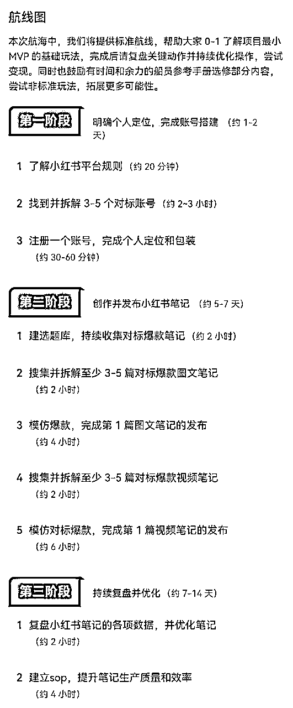

航线图和手册内容高度匹配，你可以按自己所在的学习阶段去看对应章节。

所有航线图任务，建议在航海开始后的前两周内完成。跑完这些动作之后，重心应该放到实践上：持续发作品、复盘爆款背后的规律、提升内容质量，才能把涨粉和变现的概率拉高。

必修篇：账号搭建与内容创作

💡章节导览

这一章我们会从认识小红书开始，带着你逐步完成运营学习。你可以跟着章节内容一步步实操，最终跑通最小MVP：把一个账号搭起来、把内容发出去、再慢慢形成自己的内容体系。

如果你没有接触过这个项目，实操前建议先看项目全貌：

✅【项目概述】认识平台

如果你已经大致了解项目，可以进入核心步骤：

✅【项目实操 1/3】明确个人定位，完成账号搭建

✅【项目实操 2/3】创作小红书笔记

✅【复盘和优化 3/3】持续迭代，建立内容体系

在必修篇里，航线图和手册的顺序相对应。沿着手册顺序学，就能依次完成航线图上的任务。后续的关键步骤概览中，我们也会标注对应的航线图，方便你跟着走。

准备好了就出发吧。

# 一、【项目概览】先把平台看明白

💡章节摘要

这次航海的主线，就是带你从零做出一个小红书号。

想做出成绩，前提是懂平台。

过去一提起小红书，很多人会想到“美妆穿搭”“女生专用”“00后天下”。但今天的小红书，内容形态早已多元得多。

这个板块会从用户构成、热门类目、社区属性、流量机制四个侧面，帮你快速建立对平台的完整认知。

## 1.1 平台上的都是谁

截至2021年下半年，小红书用户主要集中在18—34岁，女性占比约70%。他们大多生活在一线或新一线城市，职业多为白领和职场精英。“年轻”“女性向”“消费力强”仍然是这个平台的三个关键词。

一个明显的变化是，男性用户也在变多：2020年男性占比约20%，到2021年已经上升到30%左右。

从内容需求来看，排名靠前的依然是彩妆、护肤、穿搭。但追求生活品质的都市人群，需求正在朝更多方向延伸：不想被“黄脸婆”三个字困住，想当个精致辣妈；想要有仪式感的日子；想培养各种爱好；想活得自律又舒服……这些也都是他们的日常。

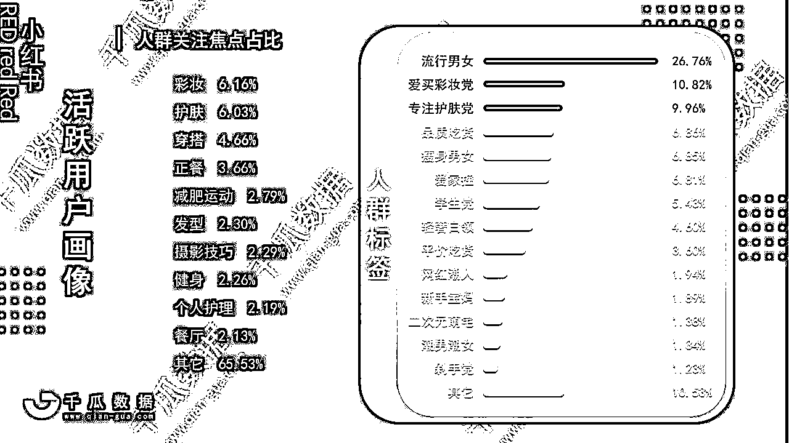

用户想要的东西变多了，平台的内容版图也跟着扩大，吃穿住行、玩乐学习都被装了进去。

## 1.2 哪些赛道在涨

目前关注度最高的仍是彩妆、护肤、穿搭，但越来越多都市用户开始关注辣妈成长、生活仪式感、兴趣培养、自律治愈等新主题。

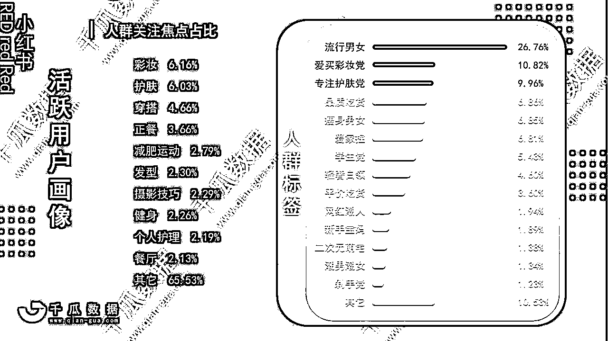

与此同时，家居、母婴、美食、健身、知识学习、旅行、绘画摄影手工、萌宠等板块也成长为新的流量聚集地，热度并不低。

## 1.3 平台是什么调性

小红书的定位，其实已经从slogan里说清楚了——“标记我的生活/你的生活指南”。它既是一个生活方式社区，也是一个种草平台。用户一边分享自己的真实生活，一边给别人安利好东西，也一边被别人的分享安利。

无论怎么理解，核心都离不开“内容”二字。你可以分享真实的自己，越有生活气越好；但它不是微博，也不是朋友圈。就算是真实生活记录，内容也一样会被筛选，只有同时被平台和用户认可，才有机会被更多人看到。

## 1.4 流量从哪里来

小红书有两个主要流量入口：【推荐流量】和【搜索流量】。

### 1.4.1 推荐流量如何分发

和大多数公域平台类似，小红书依靠算法给内容打分。系统会根据笔记初期的点赞、收藏、评论、转发、关注数据来判断内容潜力，其中评论、转发和关注的权重明显更高。

CES评分大致可以写成：

CES = 点赞×1 + 收藏×1 + 评论×4 + 转发×4 + 关注×8

（CES是小红书站内的一套内容评分机制）

分数越高，系统就越愿意把笔记推进更大的流量池，最终形成爆款。通常小爆款互动量在1000以上，大爆款在10000以上，不同类目会有所差别。并且，一篇爆款还能带动整个账号其他作品的数据一起上涨。

当然，笔记能顺利进入流量池是有前提的：

① 作品能通过平台审核，没有违规，也没有被系统删除或作者自己删除/隐藏。

② 笔记含有关键词（例如“香水”“家具”），能对应垂直标签，被系统顺利识别和收录，再推荐给对这类标签感兴趣的人群。

③ 内容本身要有足够的吸引力，能引导用户完成点赞、收藏、评论等互动。

也想提醒一句：零基础的新手很难第一发就成大爆款。第一个月笔记阅读量停在100—200，是非常正常的现象；基础好的账号可能会更快一些。

大概八成的新手，是在第二或第三个月才开始爆发。这中间有一段积累和酝酿期，所以不用急躁，把内容磨扎实才是关键。

### 1.4.2 搜索流量怎么抢

很多用户不只是逛推荐页，还会带着明确目的来搜索内容。想买口红会搜口红攻略，想出门玩会搜旅游攻略。

搜索结果里排在前面的笔记，会得到更多曝光和点击。这块流量几乎占了平台总流量的一半以上，绝对不能忽视。

想要吃到搜索流量，笔记里首先要有有效关键词，并且能成功被系统收录；想让排名更靠前，还需要不断提高账号权重和笔记权重。

——本节参考自航海项目手册

# 二、【项目实操 1/3】定准方向，搭好账号

💡章节摘要

对刚起步的人来说，定位是第一个要解决的问题。它就像整个账号的主线，之后的内容都围绕它展开。

在小红书，你既可以分享好物和方法，也可以给别人种草某种生活方式。但种草不等于像淘宝那样发硬广，除非你是企业号。用户通常更偏爱真实、接地气的IP和内容。

所以，想在小红书立住IP，花心思做一个人设定位很有必要。建议给自己2—3天时间，认真完成这一步。

💡本章航线图

完成本章的学习和实操，你就完成了航线图第一阶段：明确个人定位，完成账号搭建（约2—3天）。

1. 了解平台规则（约20分钟）
2. 找到3—5个对标账号并拆解（约2—3小时）
3. 注册账号，完成个人定位与包装（约30—60分钟）

现在就开始。

## 2.1 账号定位从哪里入手

### 2.1.1 人设到底有多重要（@梨云）

在小红书，受欢迎的个人IP通常都很有“人味”。除了找准一个细分领域，还要把自己身上的各种标签亮出来。@梨云 的经历就很能说明问题。

她曾分享过，账号正处于每天增长上千粉的阶段时，遇到了一个“搬运工”。对方连账号名都抄她，也叫“学习方法”，每篇笔记原图照搬，搬了30篇后涨了3000粉。

她起初没太在意，但粉丝看不下去了，自发组织到对方评论区刷屏，逼得对方关了评论，最后还被举报到限流。

这件事让她一下子明白：不能像营销号那样只发干货，得把自己的“人设”放进去。粉丝喜欢的不是内容本身，而是内容背后那个真实的人。内容谁都能写，但“我”是没办法复制的。

于是，她做了两件事：给人设做加法，再把人设做深。

做加法怎么操作？比如，她把账号名改成“云云讲学习方法”；图片里不写“我”，而是写“云云”；为了让别人更难搬运，她还在封面小标题的英文旁边加了自己的文字水印。

做深人设，其实就是认真做粉丝运营。比如每条评论都回复，不管粉丝留言是夸还是骂，都给出最积极的回应，只鼓励、不打击。这种情绪价值给到位，粉丝粘性会非常强。

写内容的时候，她也要求自己成为最懂粉丝的人。方法很简单：泡在评论区，看粉丝都在说什么，尤其是那些抱怨。她发现出现频率最高的是：学习很无聊、上课总走神、背书怎么也记不住……

顺着这些真实的痛处，给出解决方法和干货，内容自然会被粉丝喜欢。

如果从来不去理解粉丝，只是为了流量硬写，那既做不出打动人的内容，也很难真正赢得人心。

她现在越来越认同这句话：从群众中来，到群众中去。

（案例参考：圈友@梨云的实战分享）

### 2.1.3 从自身优势出发做定位（@吴一村 @许义）

做任何平台的IP，都建议先想清楚目的：单纯兴趣分享，还是想赚钱？如果是为了赚钱，那是快钱还是长线？小钱还是大钱？副业还是终身事业？这些都会影响后续方向。

目的定了，大方向就清楚了。接下来再从自身优势出发，做出有差异化的定位。

想提醒大家：“优势”未必是专家水平。小红书对普通人意外地友好，用户也更喜欢接地气的博主。

“差异化”也不是说一定要独一无二。哪怕只是在别人的基础上优化一点，比如照片拍得更美，或者内容讲得更有趣，对用户来说就已经是差异化。

定位时可以反复问自己这几个问题：你是谁？你干什么的？为什么值得关注？关注你对我有什么用？再具体一点：

我很特别——比如去过80个国家

我很专业，有背书——比如是携程签约摄影师

我是谁，我能提供什么——比如90后川西旅拍领队

我和别人不一样在哪——比如90后年轻团队、纯玩小团旅行

至于“为什么要关注你”，需要做到：身份一目了然、定位清楚、内容垂直且不跑题，还要给用户一个明确的关注理由。

想更深入地挖掘自己的优势，可以从这几个角度着手：

1. 兴趣和技能（前提是用户也需要）@吴一村

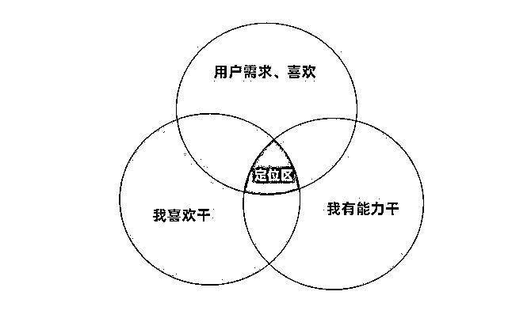

有兴趣当然是好事，但兴趣不代表你能持续输出内容。真正合适的定位，是“自己有能力做”和“用户有需求”的交叉点。

很多新人习惯直接选自己喜欢的事情做，看别人能成，觉得自己也能成。但发完之后数据常常很冷淡。原因在于，用户只会关心自己的问题，你喜欢的并不代表她也需要。所以做内容千万不能自嗨，用户需求才是绕不开的坐标。

除了找到自己喜欢、能做、用户也需要的方向，更重要的是“定技能”。

定技能就是指：你有一项自己擅长、又能轻轻松松分享给别人的能力。比如摄影技能、营养搭配、健身方法、赚钱心得，都算。

（参考：两篇关于新人定位和快速起号的圈友分享）

2. 外观条件 @子渝

如果你长相出众、身材不错、减脂后肉眼可见地变美变瘦，或者对穿搭很有心得，这些都可以直接变成你的内容优势。

（参考：职场博主从0到1的成长分享）

3. 资源条件 @子渝

资源可以是实体的，也可以是虚拟的。比如你家装修得很好看，囤了一堆好物，那天然适合做家居类内容；如果你本身就是踢脚线厂家，能做家装材料的批发和零售，这也是很强的资源；如果你特别会布置学习桌面，研究过各种桌面好物，就可以做桌面好物学习博主；又或者你能找到别人找不到的优质信息渠道、学习资料和靠谱教程，同样是稀缺资源。

（参考：同上）

4. 特色条件 @子渝

特色优势的范围很大：特殊口音、地域特点、有辨识度的发型、一双让人想“借走”的巧手，都能算。

做选择时，优先考虑那些既能提供价值、用户又真的有需求的点，也就是“擅长点+用户需求”，然后再去考虑兴趣和其他因素。

做小红书的过程，其实就是一个不断发现自身亮点的过程。不管是在职工作还是全职带娃，总能找到自己身上值得深挖的地方。试着把你热爱的、擅长的、用户需要的分别写下来，三者的交集，大概率就是你的最佳定位。

（参考：同上）

## 2.2 找对标账号并拆解

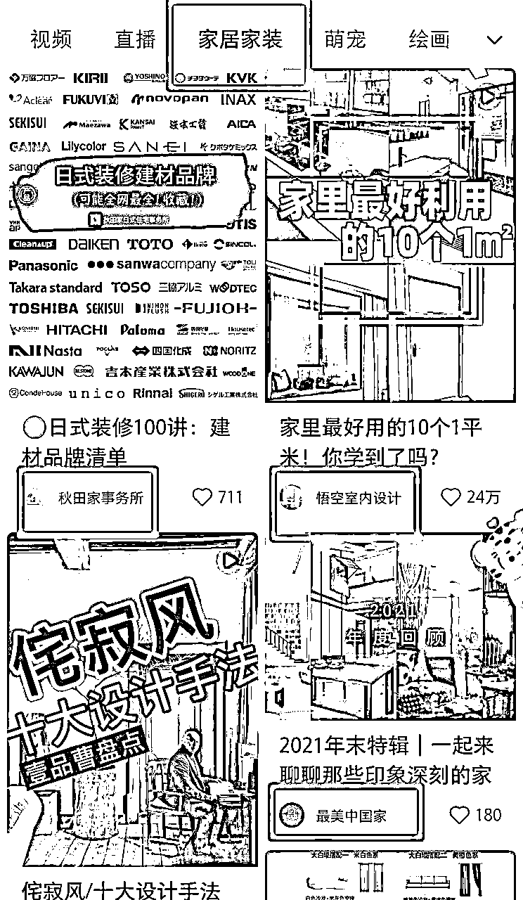

### 2.2.2 如何判断一个对标账号是否适合你

# 找对标账号，千万别瞎抄作业

很多人在小红书起号时，最容易犯的一个错误就是——看到哪个博主火就去对标哪个。但别人的爆款路径，放到你身上未必走得通。选对标，本质上是在选“适合自己的模仿对象”，以下几个维度可以帮你筛掉那些不适合的选项。

## 1）赛道是不是同一类

先看这个博主做的细分领域和你是否一致。你是个穿搭博主，去对标美食账号，那基本是白费功夫。如果你处在比较小众的赛道，找不到完全吻合的对标，也可以参考那些领域相近、受众重叠的账号。

## 2）人家靠什么赚钱

纯做内容接广告的博主，和靠内容引流到私域卖课、带货的博主，两者的内容规划逻辑完全不同。找对标之前，要先搞清楚对方的变现路径是什么——是接商单，还是引流到私域成交？这套变现方式，跟你的现有模式或未来规划是否匹配？如果不匹配，模仿得再像也很难转化为自己的商业价值。

## 3）粉丝量级怎么看

不用盯着粉丝特别多的大号看，也别找那种几乎没什么粉丝的账号。更值得关注的是近期涨粉很快的账号，或者起号非常迅速的账号。

对于新手来说，腰部博主（粉丝10万以上）比头部博主（50万以上）和明星博主更值得研究。头部账号大多签约了MCN，背后有团队专门做包装和运营，这种资源加持之下做出来的内容，个人创作者很难复制。

## 4）内容调性合不合

点进对标账号的主页，快速翻一翻他发布的笔记内容，感受一下整体的风格调性。你要思考的是：这种风格跟我自己的IP搭不搭？我有没有能力持续输出类似的内容？如果觉得照着他的路子走很吃力，或者完全提不起兴趣，那就果断放弃。

## 5）单篇点赞与粉丝数的比例

判断一篇笔记是否有参考价值，不能只看点赞数。点赞很高但粉丝基数也很大的账号，笔记数据是“先天优势”堆出来的，参考意义不大。反倒是那些点赞在100到1000之间、不算特别火爆的笔记，如果出自粉丝量很少的账号，反而更值得研究——这说明内容本身有打动人心的潜力。

遇到这种“低粉高赞”的笔记，别刷过就算了，随手收藏起来，或者专门建一个选题库，这些都是可持续挖掘的爆款素材来源。

## 6）能不能持续出爆款

爆款是有偶然性的。一个账号出过一篇爆文，可能只是运气好，不代表他每一篇都值得你参考。但如果一个账号能持续产出多篇爆款，那就不只是运气了，背后一定有可复制的逻辑——可能出在封面上，也可能出在选题上，这才是你真正要对标的东西。

## 7）看看内容够不够“新鲜”

建议优先研究最近一个月内火起来的账号或笔记。自媒体平台上，热度就是生命线。冬天搜羽绒服的人多，情人节搜礼物的人多，甲流来了搜感冒药的人多——每个时间段的热门关键词都不一样。平台在流量分发时也会给不同关键词不同的倾斜和随机加推。所以我们要盯住当下正在起势的内容，顺着平台的推流节奏走。

“最近一个月”只是一个大概的参考，原则是越新鲜越好。如果能找到一周内爆发的账号，那已经算很热了；如果还有3天内刚起来的，那就更“烫手”了。

内容来源：《初阶 | 小红书-爆款笔记｜航海实战手册》《爆款对标账号 6 要素》

1.名字：云云【名字】+讲学习方法【账号提供的内容方向】

2.简介：

核心标签是：学霸&卷王|研究学习方法 3 年|幽默风趣

提供的内容是：学习干货|提分技巧|四六级|好物分享

更新频率是：1 天 1 个

第二步，看内容选题。

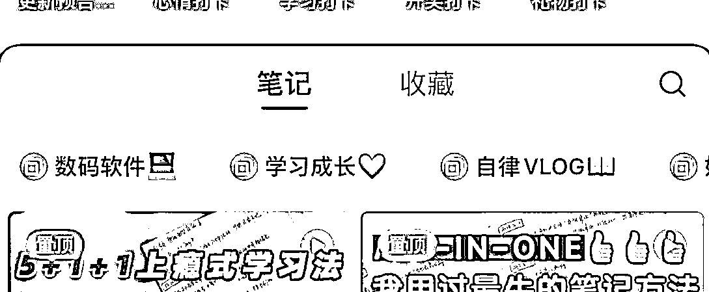

点开账号的笔记分类文件夹，你会发现在运营上下了功夫的博主，会把账号打理得像一本杂志：每个文件夹就像一个专栏，一个专栏对应一类主题，并且保持持续更新。

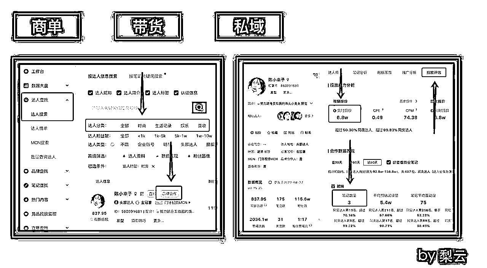

带货方式观察：点进主页的【店铺】或者【专栏】，也可以蹲一场博主的直播，就能直接看出他有没有在做带货变现。

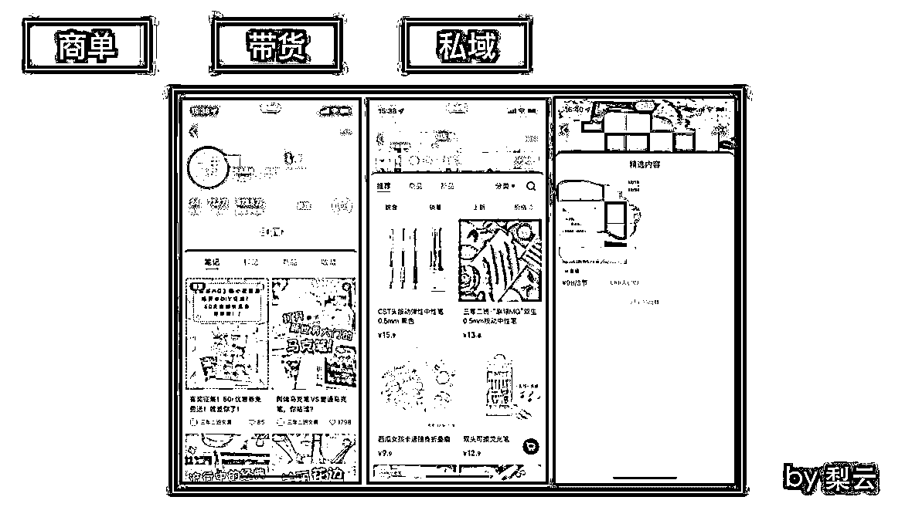

第二个要看的是文字区。有的博主会在文案里明确告诉你“我有电子版，可以打印”，这就是一个很直接的引流钩子。

第三个是评论区。留意评论区的画风是否整齐划一——如果清一色都是“求资料”“怎么领”之类的留言，说明引流路径已经跑通了。你甚至可以自己去体验一下同行的流程，假装粉丝去领一份资料，看看他下一步会引导你做什么。

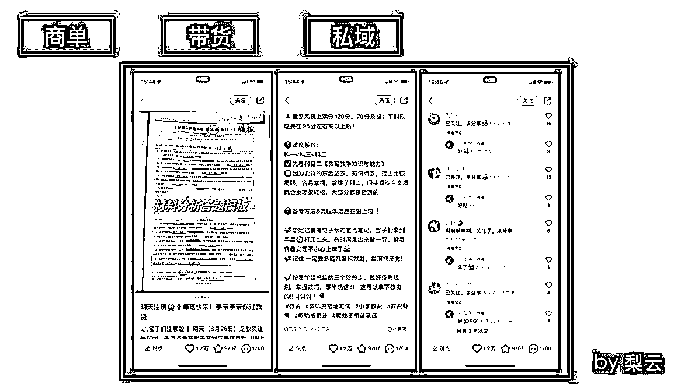

内容来源：《定位一换涨粉过万，如何利用数据分析在小红书精准定位》

## 2.3 账号怎么包装

💡

小节纲要

拿到了对标账号的关键信息，接下来就可以着手打造自己的账号了。

一个小红书账号能不能吸引人点关注，头像、昵称、简介、背景图这些外在的“门面”起着非常重要的作用。用不用心包装，用户一眼就能看出来。你的账号风格、内容方向、能给粉丝提供什么价值，其实都藏在包装细节里。

动手之前，不妨逐项检查这几个方面：

✅头像

✅昵称

✅简介

✅背景图/瞬间

✅主页风格

准备好了，就开始你的小红书账号焕新之旅吧。

### 2.3.1 头像怎么选

头像风格跟你的个人人设保持一致就好。长得好看，建议直接用真人照片，更容易让用户产生信任感。不想露脸，用虚拟IP形象也完全可以。

做图工具推荐：图怪兽、可画、创客贴等网站都可以快速生成头像，也可以去无版权图片网站找合适的素材。

图怪兽：https://818ps.com/可画：https://canva.com/

可画：https://canva.com/

创客贴：https://www.chuangkit.com/

需要提醒的是：尽量别用容易涉及侵权的商标类图片。

### 2.3.2 昵称怎么起

一个好昵称的标准是：好记、有趣、有辨识度。最好能带上你的专业属性标签，这样既显专业，也更容易让人记住。避免使用过于复杂的符号和特殊语言。

这里有四个起名公式可以参考：

昵称 + 个性：大鹅的七七八八

昵称 + 地区：姚老板在北京

昵称 + 专业：跟着拆哥看房

昵称 + 价值观：阿鱼爱学习

### 2.3.3 简介怎么写 @蓝子鱼

写简介其实有个万能公式：

你是谁——你做过什么厉害的事——关注你能得到什么（或者你分享什么领域的内容）

见过不少账号，笔记能出上万赞的爆款，粉丝却只有一百来个。问题往往出在账号内容不够垂直，加上简介没写好，用户看完不知道关注你有什么好处。

所以，写简介时收起你的谦虚。如果你连自己能给粉丝提供什么价值都说不清楚，人家凭什么关注你？

内容来源：《新手做小红书打卡，一周涨粉 5.2 万，变现 6000+，引流私域 1500 人，简单可复制》

### 2.3.4 背景图 / 瞬间举例：

举例：

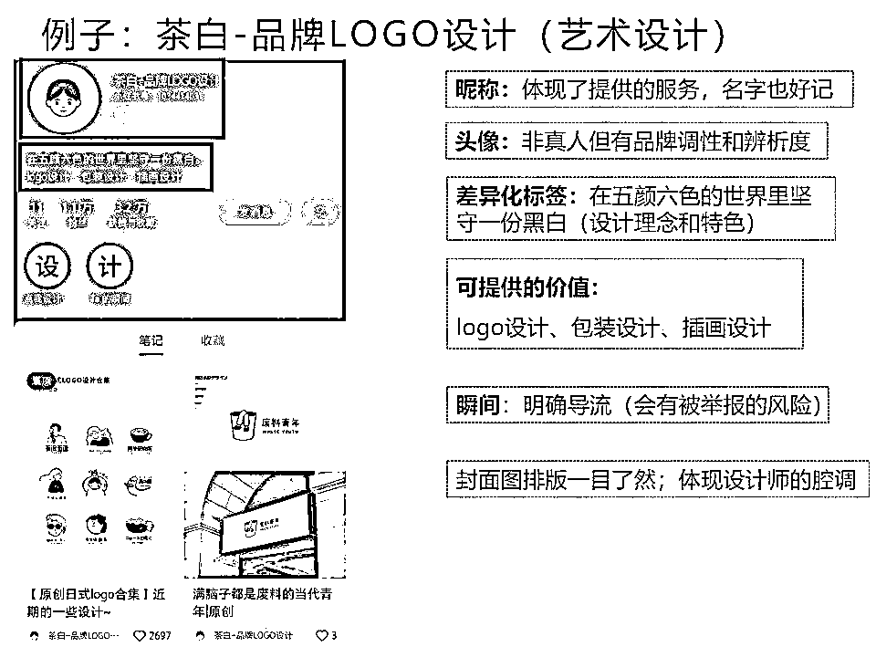

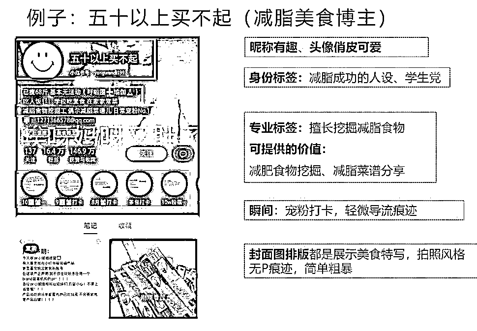

# 三、【项目实操 2/3】做好小红书笔记

💡

章节纲要

想生产出质量在线、数据亮眼的小红书笔记，需要走好三步：

1.搞清楚用户到底爱看什么内容，投其所好是优质笔记的基本功。

2.学会根据用户需求挖掘选题，建起自己的选题库。

3.动手制作并发布图文或视频笔记。

这一章，就围绕这三点，带大家从零开始实操。

💡

本章航线图

完成本章学习，你就完成了航线图的第二阶段：创作并发布小红书笔记（约5-7天）

1.

建选题库，持续收集对标爆款笔记（约2小时）

2.

搜集并拆解至少3-5篇对标爆款图文笔记（约2小时）

3.

模仿爆款，完成第1篇图文笔记的发布（约4小时）

4.

搜集并拆解至少3-5篇对标爆款视频笔记（约2小时）

5.

模仿对标爆款，完成第1篇视频笔记的发布（约6小时）

接下来，就按这几个步骤一步步来推进吧。

## 3.1 小红书用户到底爱看什么

小红书本质上是一个种草平台。但种草不等于像淘宝那样发硬广、铺产品图，更不能做成泛娱乐内容。想要笔记被用户喜欢、愿意为你的内容买单，你得先理解他们的需求逻辑。

当下的小红书用户，需求大致分两类：

一类是购买商品或服务的需求；

另一类是获取免费或付费知识的需求。

行为逻辑同样分两种：

一种是有目的性地搜索——看分享和攻略——被种草——下单购买。

比如想买一支口红，会先来小红书看别人的试色和评价，对比一圈之后再去下单。这类用户是消费意图非常明确的精准流量。

另一种是纯闲逛。刷着刷着，看到一篇不错的分享，被内容打动，也会随手种草下单。

但不管哪种用户，底层逻辑都一样：先有需求或兴趣，被有价值的内容打动，然后完成消费决策。

那什么样的内容才算“有价值”呢？——能提供情绪价值，或者实用价值。这就是用户愿意点赞、收藏甚至掏钱的真正原因。

### 3.1.1 情绪价值型内容

情绪价值，说白了就是让人产生共鸣，带来沉浸式的感官体验。

比如你看一条独居生活vlog，觉得内心被治愈了，甚至开始向往那种生活方式，想要模仿；

比如你看一条艺术体验类的视频，觉得画面很美、过程很享受，于是也想去店里体验一把；

比如你看一个博主的room tour，看着整洁又漂亮的家，忍不住想复刻他家的装修，或者被里面的家居单品种草。

这就是为什么vlog和room tour这几年能这么火——场景沉浸式的“种草”非常自然，带货效果格外好。当然，这类内容对视频制作能力的要求也更高。

优质案例参考：

《30岁前 拥有了自己的理想小家🏠》

典型的room tour笔记。博主用vlog带大家“云参观”自己的家，装修审美在线，评论区大量用户在问家具和软装链接，非常适合植入软广。

《梦想中的家 | 擦窗机与日落时光 欢迎来我家》

同样是room tour，这位博主几乎每条视频都在带大家云逛家的各个角落，氛围感直接拉满。这篇虽然偏硬广，但大家照样被种草了，评论区好多人都在问擦窗机的链接。

《vlog 日常｜30元也可以做仪式感一日三餐》

日常做饭美食vlog，沉浸感很强，看完让人向往这种有仪式感的生活。评论区里，不少用户被她的餐具和厨具圈粉。

《Tufting 初体验丨做一个超可爱大汉堡🍔》

线下手工体验的过程记录，内容可爱又有趣，评论区很多人都在互相约着一起去玩。

### 3.1.2 实用价值型内容

实用价值就是指用户看完之后觉得“有用”——学到了东西、避开了坑、种草了好物、省了钱省了时间。

在小红书，纯粹为了娱乐放松的用户只是少数，大多数人是带着“找点有用的东西”的目的来的，消费意向非常明确。

比如你想买口红，你去找的是种草测评和选购避坑指南；

比如你想学做饭，你搜的是菜谱教程和厨具选购攻略；

比如你想升职加薪，你搜的是职场进阶的方法论；

比如你要装修，你搜的是家居好店推荐、装修攻略和避坑指南；如果你是法律、心理等咨询行业的从业者，也可以在小红书发咨询类笔记，参考：风向标-小红书法律号

如果你是法律、心理等咨询行业的从业者，也可以尝试在小红书发咨询类笔记，参考：风向标-小红书法律号

如果你熟悉职业教育赛道，可以尝试做职业教育号，参考：风向标-小红书职业教育赛道

如果你懂运营、懂知识付费，可以试试小红书电商运营课，参考：风向标-小红书电商运营课

如果你是宝妈，擅长科普育儿知识，信息差育儿号也可以尝试，参考：风向标-小红书信息差育儿

如果你喜欢整合闲置资源，不妨试试同城闲置资源号，参考：风向标-小红书同城闲置资源

新手起号阶段，建议优先从实用型内容切入，不但上手快，也更容易跑出爆款，还能帮助提升账号权重。

内容来源：《初阶 | 小红书-爆款笔记｜航海实战手册》

## 3.2 怎么挖选题

了解了用户喜欢什么，接下来就进入实操第一步——选题。

选题是内容创作的开端，也是很有意思的一环。挖掘选题的过程中，你既会碰到一些反常识的新鲜观点，也会发现不少“我怎么现在才看到”的好内容。不用羡慕，等你掌握了系统的选题方法，照样能策划出同样精彩的笔记。

这里介绍一种很适合新手快速上手的方法——关键词搜索法。

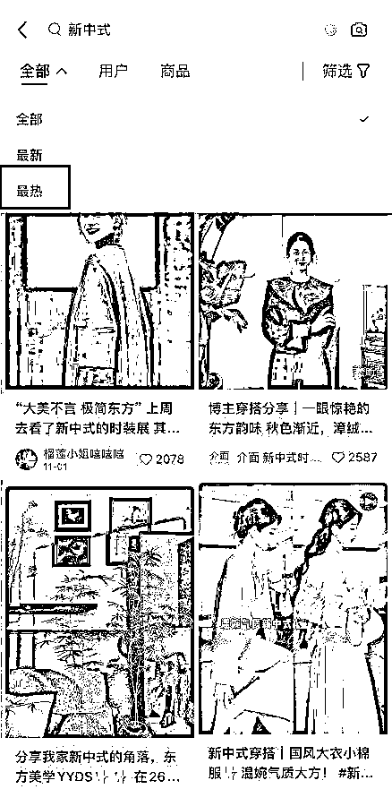

想限定笔记形式，可以点【筛选】，按【视频】或【图文】过滤。

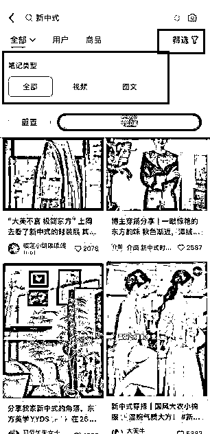

筛出来的笔记里，优先看低粉爆款。看到数据不错的笔记，点进博主主页看看粉丝量，1万粉以下的最好，其他情况也可以灵活参考。

想不出更多关键词时，可以借助搜索栏的推荐词。

搜索栏下拉关键词

比如搜“新中式”，搜索栏会自动带出一串关联词：新中式别墅、新中式卧室等等。

这些下拉词的排序并不是按笔记数量来的，而是综合了用户主动搜索频率和系统推荐热度的结果。

重新打开搜索栏，你会发现三个地方都会出现关键词：

搜索栏：比如之前搜过“新中式装修”，再点开搜索栏，会出现一个默认关键词“新中式轻奢装修”

猜你想搜：这里展示的是你经常搜索的关键词以及相关关联词

搜索发现：平台最近被搜索次数最多的热词，有时也可以蹭一蹭这些热点

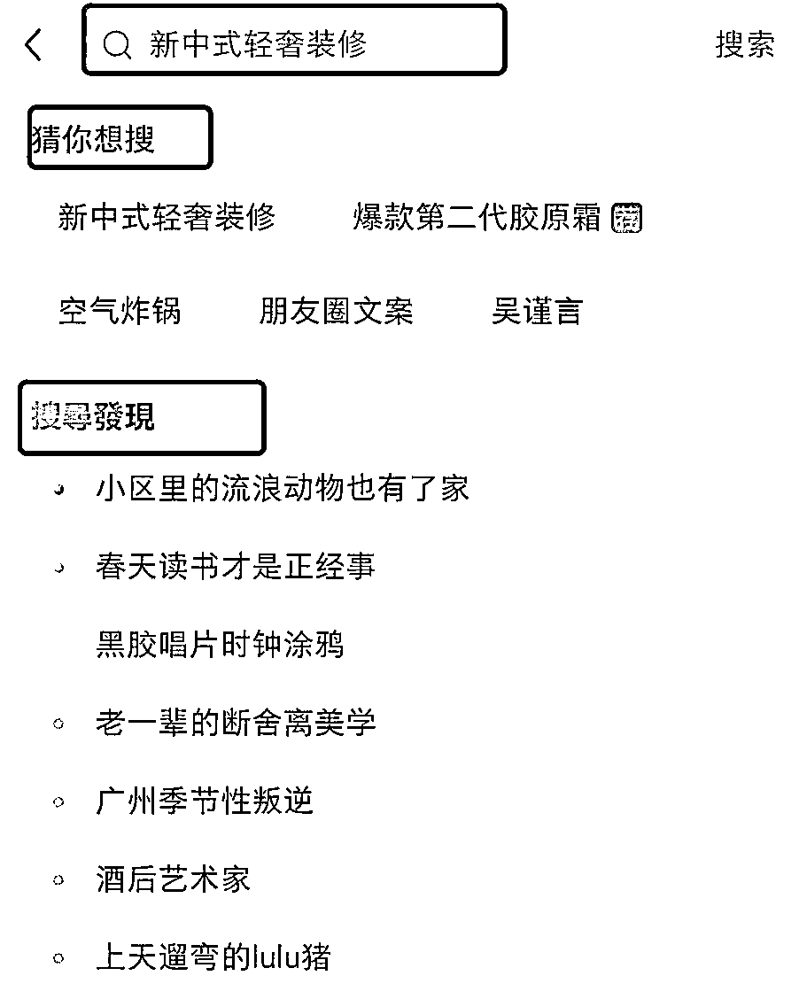

3.

搜索结果页的关键词标签和相关搜索

输入关键词之后，搜索结果页面顶部会显示一行关联标签，帮你对搜索结果做分类。继续往下拉，还会看到一个“相关搜索”模块，一般包含4-5个关联搜索词。挑几个排在前面的词组合一下，就是不错的选题切入点。

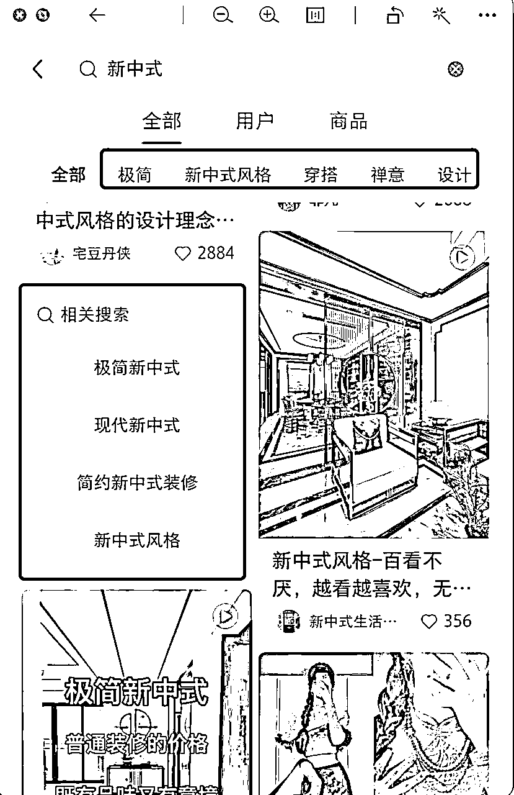

上面提到的任意关键词，都可以直接点进去，再选【最热】，看到的就是这个关键词下的热门笔记合集。

用这个方法挖选题，已经足够日常使用了。入门之后还想解锁更多选题技巧，可以去选修篇看看——【5.2 更多挖掘选题方法】

## 3.3 笔记怎么做

### 3.3.1 先选笔记类型

💡

小节纲要

做笔记第一步，先确定类型。小红书笔记主要有两类：图文笔记和视频笔记。

图文笔记是平台最常见的形态，主要工作就是写文案、做图片，对新手非常友好；

视频笔记在曝光率和涨粉速度上要比图文更有优势，也是目前平台扶持的方向，对打造个人IP效果更明显。但需要脚本、录制、剪辑，技能要求更高，制作难度也更大。

刚起步的话，建议从图文笔记开始：先用简单的方式打磨文案能力，快速获得正反馈，之后再慢慢过渡到视频领域。

### 3.3.1 图文笔记

图文笔记是“图片+文字”的组合型内容，最大的优点就是直观清晰、重点突出，自带总结属性，非常适合新手操作。缺点是同类内容太多，容易同质化，真实感相对不足；在塑造个人IP和获取流量方面，也都不如视频笔记。

### 3.3.2 视频笔记 @Zora。 卓然

视频笔记在小红书上已经非常普及了。和图文相比，视频有以下四个明显优势：

1）交流感更强

用户带着问题或兴趣点开你的视频，你在屏幕这头有画面、有声音地分享观点和经验，语气口语化、有互动感，用户会觉得你就在跟他面对面聊天，距离感一下子缩短了。

2）更容易立住人设

视频里有具体的音画场景，用户是在一个个鲜活的片段中认识你的，真实感更强、形象更立体。个人风格更容易被感知，人设在用户心中的印象也更深。

3）平台有流量倾斜

短视频是大趋势，小红书对视频笔记有一定的流量扶持，曝光机会比图文更多。以前发图文，几十篇里只有几篇能上千阅读；航海期间我发了6个视频，有5个曝光都突破了500。不是说这数据多亮眼，而是跟图文一比，起码“小眼睛”是涨上来了。

4）不易被抄袭搬运

图文很容易被逐字逐句地“像素级模仿”，视频就不一样了。制作成本摆在那里，想抄也没那么好抄，同质化概率低，粉丝粘性也会更强。

当然，视频笔记的门槛也确实更高——脚本、拍摄、配音、剪辑，每个环节都要花时间和精力。但接下来会分享一些方法，帮大家解决这些问题。

2）5秒定律

开头5秒留不住用户，你的视频大概率会被划走，完播率直接崩盘。所以脚本的前几秒该怎么设计，非常关键。可以参考前阵子大芝分享的思路：走差异化路线。

3）克服心理卡点

很多小伙伴觉得自己长得不好看或者声音不好听，既想拍视频又迈不出那一步。其实完全不用纠结——拍视频不等于必须真人出镜。下面是几种不需要露脸的视频形式，给大家参考⬇️

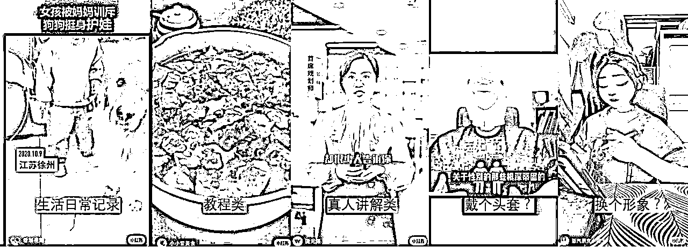

看到了吧？拍视频不等于非要露脸，不想出镜的方法多得是，一样能做出自己的风格。

对新手来说，最好的路径是：先用图文笔记练手，把选题能力和内容功底打好基础，等运营经验攒够了，再慢慢尝试视频笔记。

总结一下：图文更适合种草，视频更适合立人设。选图文还是选视频，最终还是看你自己现阶段的需求。

内容来源：《新手起号也能做的视频笔记》

### 3.3.2 四步制作发布笔记

💡

小节纲要

# 4步做出第一条小红书笔记

很多新手不是不会写，而是迟迟不敢发。其实先把一条笔记跑通，比反复纠结更重要。整套流程可以拆成四件事：做内容、取标题、做封面、发布。刚开始别急着原创，先找对标爆款模仿，尽快做出第一条。前两三条会慢一些，大约花2～3小时；练上一两周，一条图文笔记通常1小时左右就能完成。

## 内容：先搭好正文骨架

正文如果有成熟的爆款框架，产出效率会高很多，也能把省下来的时间用在内容打磨上。下面按开头、中间、结尾、评论区四个位置来讲。案例以图文为主，但视频文案的逻辑相通，方法可以直接迁移。

新手建议先从图文入手，练文案、拿正反馈，再慢慢尝试视频。有人喜欢把大量文字塞进图片排版，其实“一张封面+正文”同样可能跑出好数据；如果还能加一张思维导图当第二张图，当然更好，没有也不影响出爆款。

先找两篇同类小红书笔记感受一下画风，重点看它们怎么起手、怎么展开、怎么收尾。

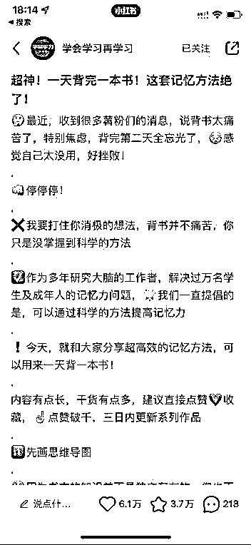

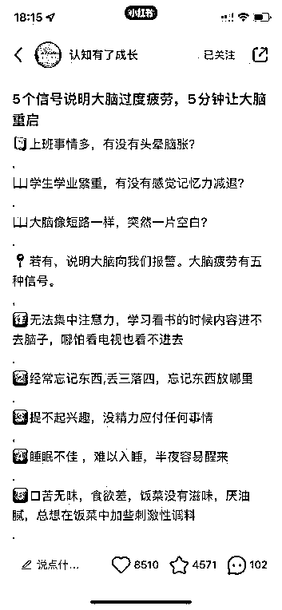

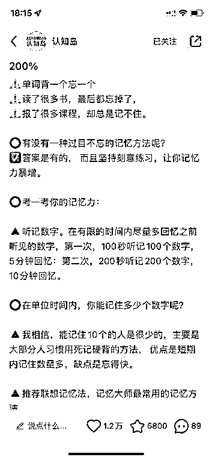

开头可以记一个万能起手式：先戳痛点，再还原场景，让读者觉得“这说的就是我”；接着亮出身份，给出方法，最后引导点赞收藏。平台上约八成笔记都在用这个套路。

比如写“记忆力差”：很多人背一小时书还是记不住，越背越没信心；明明很想努力，可书堆得像山，快背哭了还是记不牢；这时以“多年研究学习方法的教育工作者”身份出现，分享一套干货方法，并提醒读者点赞收藏，方便以后反复看。

中间负责给知识点，一般放3～5个，最少别低于3个；如果是合集汇总，则越多越好。三个点里挑一个重点展开，效果通常更好。

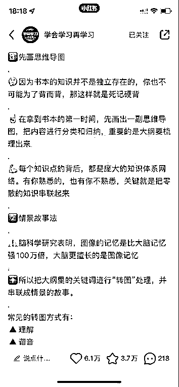

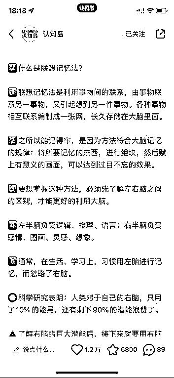

格式可以理解成“主题+方法清单”：主题是“背书特别慢怎么办”，下面列方法1、方法2、方法3，再把其中一个重点方法往下拆细。

结尾别草草收场，要提高关注率，最好让读者接收到两个明确信息。

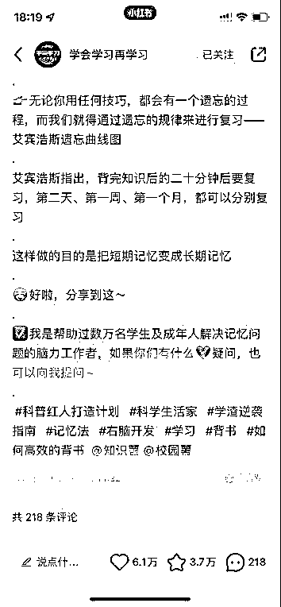

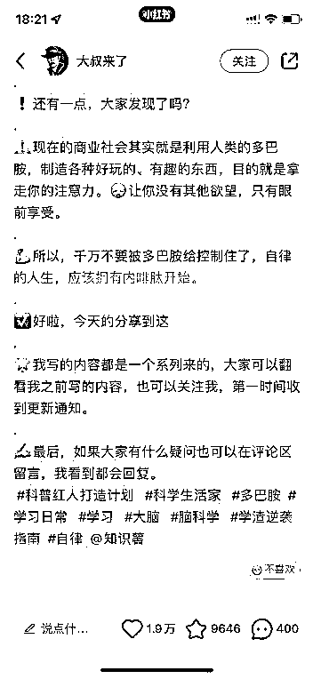

评论区也要利用起来。可以置顶一段话：“我写的内容是一个系列，收藏夹已经给大家备好了；可以从我第一篇笔记看起，会学到更多。”用户往回翻笔记时，系统也更容易出现关注入口。

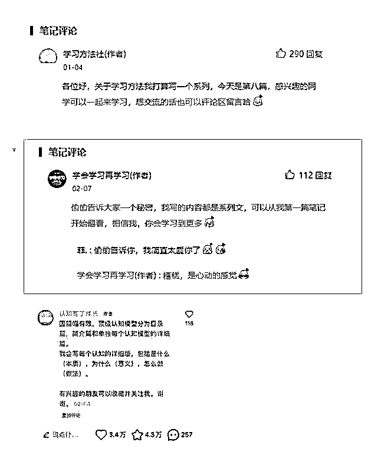

这些方法整理自《零投放从0开始，小红书2个月8万粉丝的实操经验分享》。

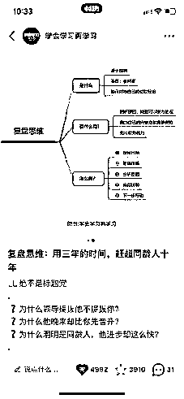

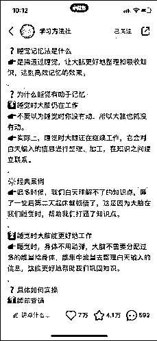

还可以用“黄金圈三问”来搭内容：为什么、是什么、怎么做。以拖延症为例：为什么你做事总拖着？明明任务很重要，却总想拖到最后一刻，越拖越觉得自己颓、没用。拖延症是什么？可以列表现1、2、3，再用心理学里的“延迟折扣”解释：人会更偏爱眼前能拿到的奖励。那怎么戒？给出方法1、2、3。

几个细节别忽略：正文分段用「。」，不要用空格，空格可能被隐藏；多放表情包，让排版更有平台感；字数尽量写满，扣掉标题和标签，正文大约800字。企业号不能以第一人称“我”的口吻写产品使用感受，否则容易被限流。

下面是我整理的图文制作小提醒：

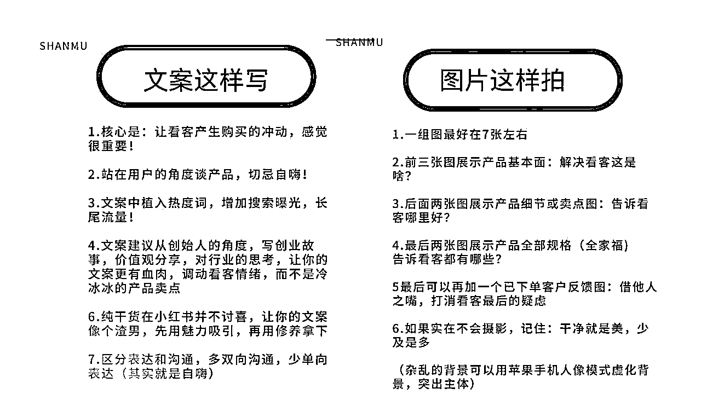

内容的核心仍然是对标赚钱笔记来写。前面花了不少篇幅讲找对标，就是因为这一步真的关键。

在多种文案里，故事体最容易调动情绪，也更容易带来询单。人天生爱听故事，小红书女性用户占比又高，故事就像情绪催化剂。比如：

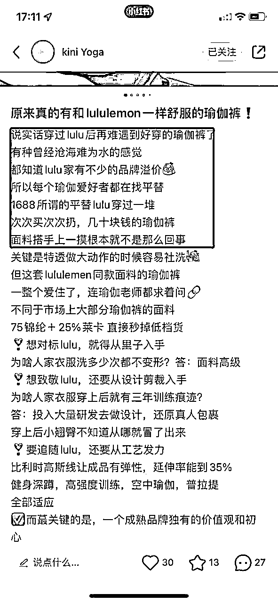

同一句主张还要在不同内容里反复出现。注意别学大牌空喊“just do it”这种口号，要讲实际价值。

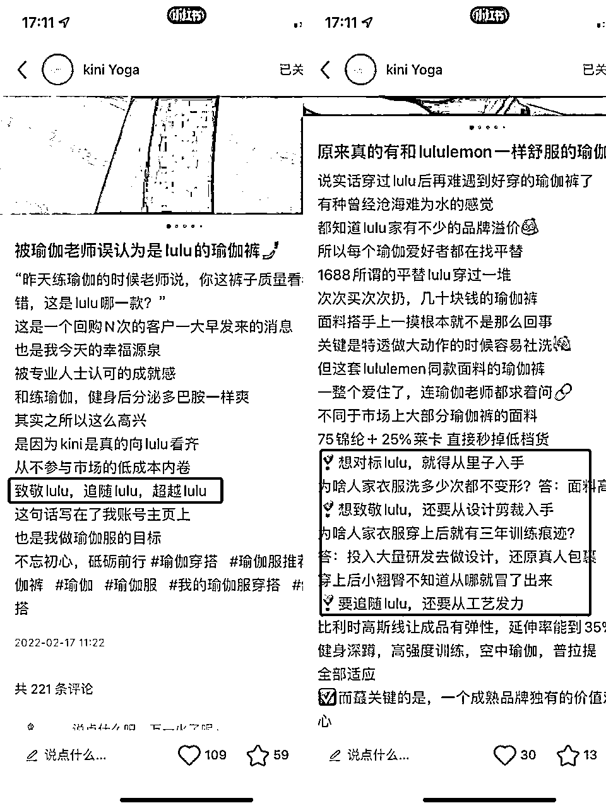

写销量也是常用手法：利用从众心理，明示或暗示产品卖得好，既能激发购买欲，也能让读者更信任。

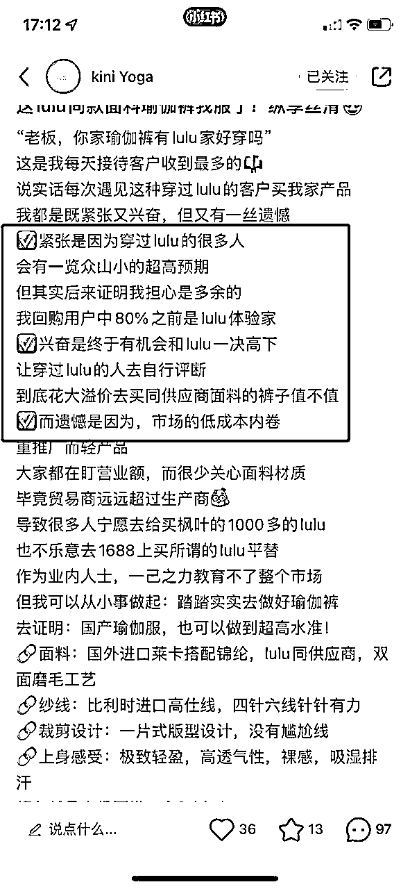

表达要用沟通口吻，别自说自话、单向输出。情绪被读者感受到，文案才算成功；否则自己写嗨了，读者看完一脸懵。企业号虽然不能用消费者第一人称直接写产品体验，但可以落到具体的人身上，比如客服、创始人的视角。

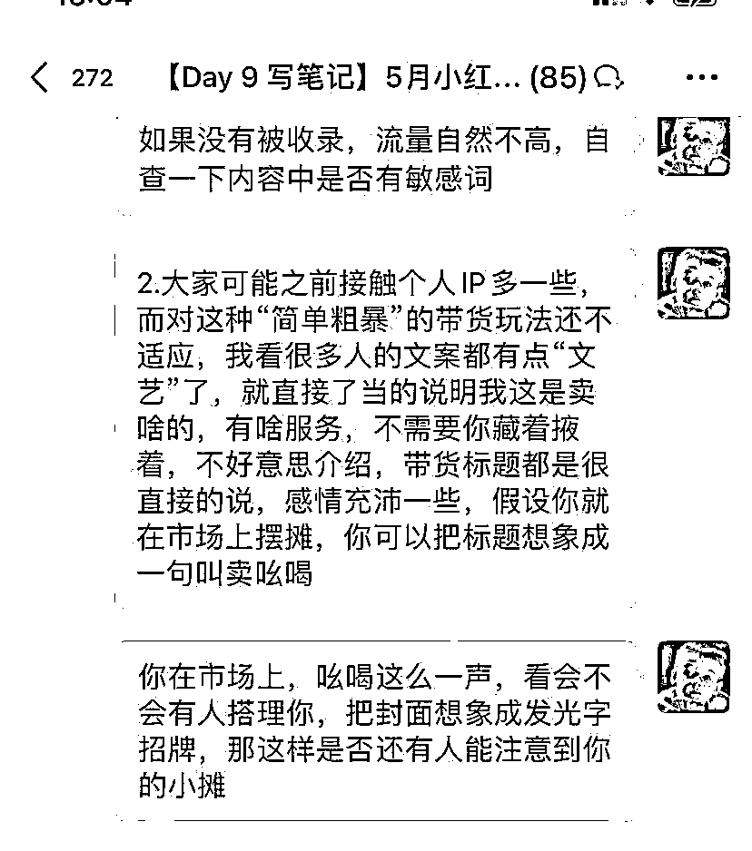

排版同样重要。内容再好，阅读体验差，别人也读不下去。排版要干净利落，善用小表情，多用短句，少用长句；写完自己读一遍，逻辑顺、阅读顺。别堆大段文字，我通常一句一行，文案也不宜过长。展现类笔记可以没有文案，或用100字左右短文案介绍卖点；故事类笔记建议控制在600字左右。

## 结构化内容：让页面更好读

@梨云 的做法是五段式：大标题、导语、小标题、内容、底部标题。

大标题可以概括本页内容，让读者预判信息；也可以每页统一，用来埋关键词、提高检索权重，同时还是广告位，适合写品牌名。导语负责铺垫，交代写这篇笔记的原因，承担一部分共鸣；还能做行为设计，比如用“宝子投稿”暗示大家去评论区留言，用留言数拉动曝光。小标题用四个字压缩一句话，减轻阅读负担。内容一般不超过3行，做轻内容，提升阅读愉悦感；行文里可以加入平台女性用户喜欢的流行语和热梗，让表达更灵动。底部标题是很容易被忽略的细节，作用是用游戏化口吻引导读者翻页，减少因不感兴趣而退出。句式可以借鉴游戏指令：“开始+动词”“马上+动词”。这个技巧很好用，会让人想继续往下翻；内容没问题，阅读时长有了，赞藏评概率也会提高。按这套操作，她发第一篇就成了破千爆款。

除了这些标题形式，也可以参考“反差”标题：风向标-小红书反差标题。

## 标题：给用户一个点开的理由

@许义 的爆款标题思路是：小红书标题上限20字，最好用“大关键词+小关键词”；也可以把所在领域关键词排名前10的爆款标题记录下来，提取后重新组合。标题很重要，因为平台流量主要靠搜索，搜索结果里要出现你的笔记，内容就得和搜索词关联，而标题对搜索词权重占比很大。还可以灵活组合“推荐、知识、分享、如何、搭配、新手、怎么做、必备、教程、技巧、步骤”等词。数字型标题也好用，比如“2个方法、10大、4个要点”。旅游攻略类可以写成：新疆必玩景点；新疆旅行人均5K、12日游攻略；去了趟新疆回来朋友圈被拉黑；刚从新疆回来总结的33个避坑建议；来新疆旅游，这20件事千万别做。反过来说，有些笔记内容很好，标题却没给出打开理由，用户根本看不到。

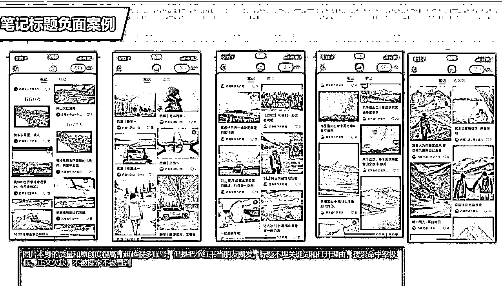

内容来源：《小红书3天新号粉丝破千的运营方法论》。

@杉木 还分享了一个简单粗暴的方法：直接套用数据高的带货标题。比如看到“挖到宝了！！这颜值实用双在线的婴儿车真香”，就把这个骨架拆出来，填进自己的产品词和卖点词。于是可以变成“挖到宝了！！这lulu（热度词）同面料（需求词）瑜伽服（产品词）真香”。

## 封面：第一眼决定点不点

封面有三种模板可以用：图标+关键词+金句；“梨云绿”封面；真人出镜、实拍封面。

@许义 提到，小红书页面是图片信息流，用户第一眼看到的就是封面。封面直接影响点击率；内容再好，封面没做好，点的人少，互动转化也会受影响。封面的价值在于吸引打开，让同类笔记在搜索排列页更吸引人，在关键词搜索结果里形成差异、脱颖而出；它还要承担一部分标题功能，图片标题和文字标题搭配，能提高打开率。封面要点是给用户打开理由：好看、吸引人、提示内容、提供预期、承诺阅读回报。通常封面要具备三种特质：有差异性，能和相似封面区分开；有内容提示，兼顾标题作用；有美感，旅行类尤其需要设计和美感来提高吸引力。

优质封面的共性也清楚：要么特别好看，要么能清晰传达主题或吸引点。主题明确、重点突出，真人真实场景通常比纯产品抠图效果更好；画面清晰、明亮、简洁，避免杂乱；配色和谐统一，别花里胡哨；标题文案简单明了，不要过长，字体字号尽量统一。提高效率的办法就是做一个模板，然后反复套。简单就是美，推荐大字报模式，比如“梨云绿”这种。做起来真不难：先用PPT存好模板，每次只改标题或图标，效率很高。

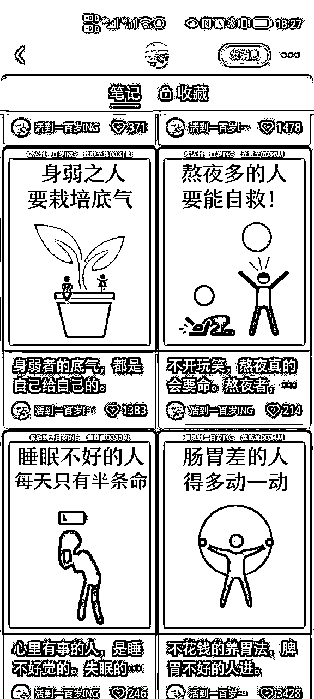

模板一：“图标+关键词+金句”，适合排版和审美能力一般的同学。可以先看几个账号感受一下：

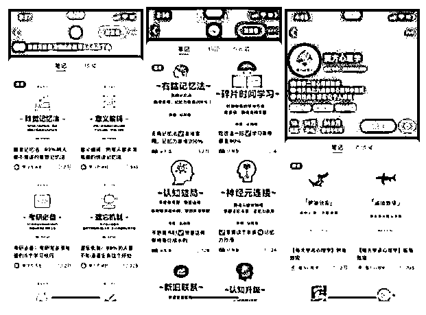

封面=图标+图标题+金句+作者。图片只做一张封面，内容都写在正文里。

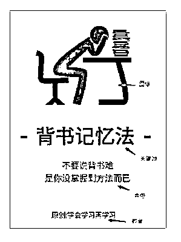

拆开看：图标可以去图标网站找，但很多网站每天只能免费下载一个，或者大小格式不统一，注册来注册去很麻烦；也可以在淘宝买一个多图标网站会员，几十块就能解决。图中标题虽然是图片，也会被系统收录，所以尽量选热门笔记的关键词，别选太小众的题。制作前先在小红书搜索栏搜一下准备用的标题，看有没有万赞笔记；如果没有，大概率不太适合。当然这是从爆款逻辑出发，如果类目本身小众，可以降低点赞标准。金句可以理解成副标题，也可以理解成全文核心句，值得多花时间琢磨，里面的字也会被系统收录。作者就是自己的小红书名字，基本不用变。总结一下：制作简单、排版清晰，特别适合做图能力和审美能力弱的同学，固定格式，3分钟就能排完。

模板二：“梨云绿”封面。

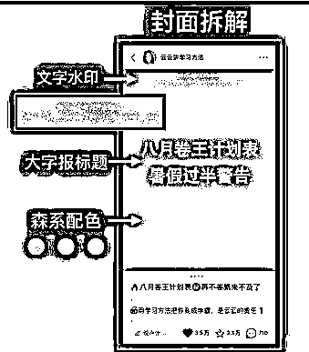

模板要素无非几个，逐个迭代就行。①配色：选森系绿，搭配阳光暖黄和纯白，整体温馨、岁月静好。

模板三：真人出镜、实拍封面。

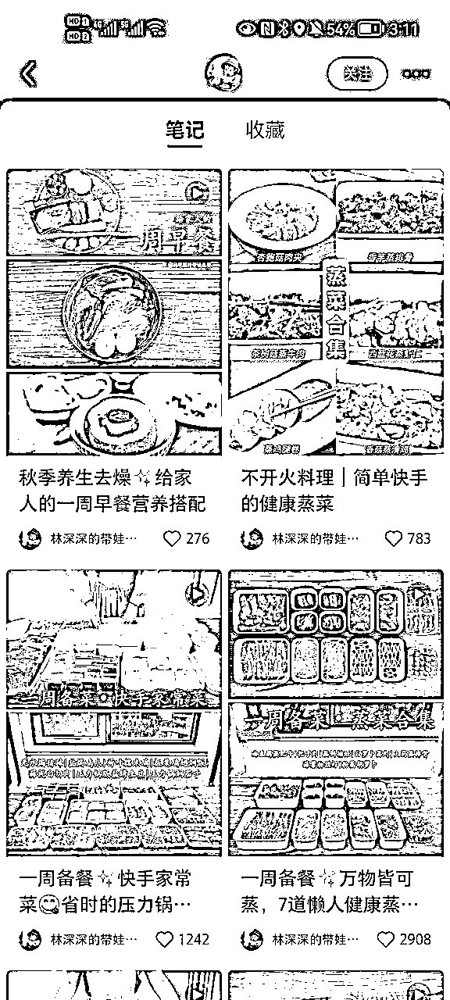

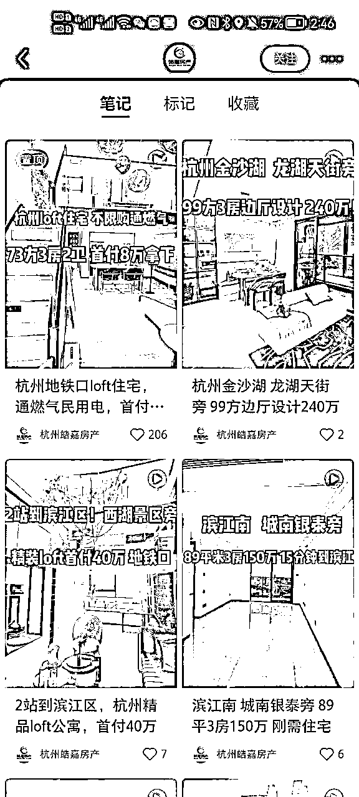

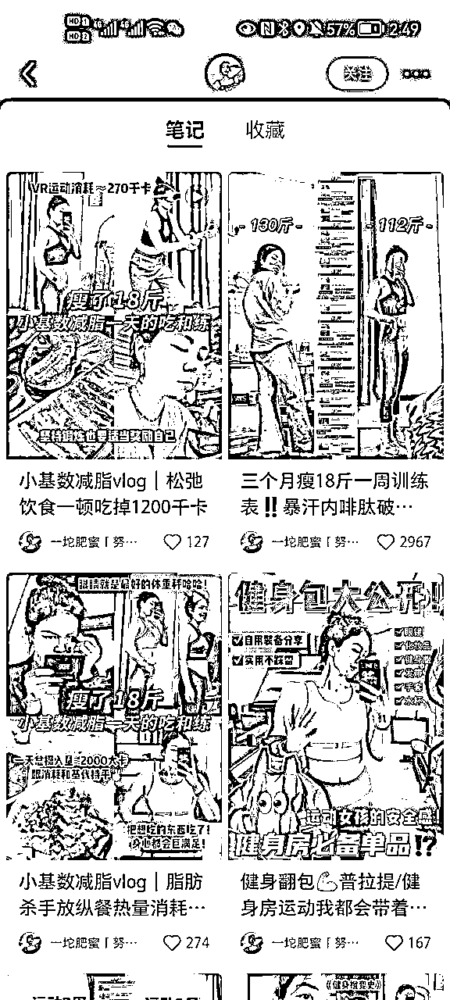

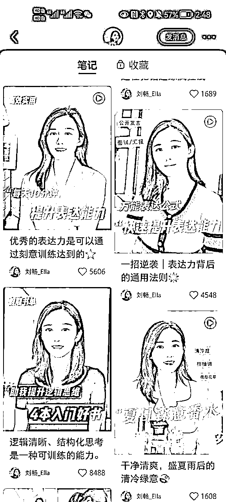

实拍和真人出镜的真实感更强，人设传达更直接，根据笔记灵活调整的空间也更大。常见格式是“笔记内关键图展示+主题关键词”，有些会用对比或合集，做前后展示、不同产品展示。真人出镜封面可以直接从内容里截取，也可以专门拍一张，用固定角度和动作加深人设印象。比如有博主每次出镜都用同一个手势，形成自己的视觉符号，再加上口头禅。

内容来源：《小红书内容底层逻辑：从底层情绪、4大内容构成、关键词出发，打造爆款内容》。

## 发布：时间与频率

发布时间经过多次测试，晚上9点到9点40分之间比较容易出千赞爆款。更新频率最好日更；做不到日更，就保持每周3～5篇。

## 视频笔记也值得尝试

视频笔记的流量通常比图文更高，也更容易和粉丝建立信任，是值得关注的IP笔记创作方向。@一颗幸运小星星 从账号分析与爆款视频打造逻辑、爆款视频打造心得、爆款笔记实操建议三个方面展开。大家选的赛道可能不同，但底层创作方法是共通的；如果已有视频基础，或愿意投入学习时间，可以试着做出自己的第一条视频笔记。

分析账号和爆款打造逻辑时，爆款视频的底层逻辑可以这样归纳：

# 小红书涨粉与内容优化实战手册

账号粉丝规模的增长，不是单靠日更堆数量，而是“稳定高频输出 + 小爆款/大爆款拉动”的组合。爆款像放大器，能迅速抬高账号势能。先弄清爆款的生成规律，再在落地中反复试错，贴近用户口味，动态调整内容方向与呈现方式。

爆款大致由四块拼成：可信且有辨识度的人设、实用信息、抓人元素（新奇、趣味、情绪共振）、商业转化路径。撬动效果最明显的是抓人元素；其中情绪共振更容易触达女性受众。再往下切，自信成长、收入话题、名人、情感关系，是普通题材里更容易放大的切口。

### 3.5.2 小红书爆款视频的打造心法

账号包装：昵称、简介、背景图等信息要填写完整，让人感觉是真实的人在运营。内容方向：围绕垂直领域建选题池，按优先级排序，做数据记录和迭代，培养内容嗅觉。自带流量的方向通常包括热点词、名人、金钱、两性、影视剧、新奇、痛点、夸张表达。

脚本：开头几秒把观众拉进情境；小红书对中长视频接受度不低，不必像短视频那样卡极限时长，但文案仍要一句一个信息点，尽量短。视频：封面主标题要制造好奇。一条内容能否起量，标题、封面/封面标题、引语很关键。

封面在视频里权重很高。我早期用真人头像封面，后来发现竞争不过平台上大量高颜值博主，于是改走更贴合小红书用户偏好的路线：用台词式封面，同时紧扣每期主题。发布：尽量保持日更，发布文案要勾起好奇，多带标签并@官方，让算法识别账号属性，把内容推给匹配人群，争取更多流量倾斜。互动：评论区尽量回复，塑造真实可信的形象；真实感越强，粉丝黏性越高。归根结底，账号能立住，真实是底座。

### 3.5.3 视频笔记实操心得 @Zora。 卓然

1）先搭框架，别急着写逐字稿
口语和书面语是两套系统。逐字稿写多了，录制时容易忙着回忆原句，表情语气会像背书。我的做法是只列要讲的内容、例子和结论，然后按框架自然说。

2）尽量一镜到底，别一错就重录
我第一次录视频，开头就重来了二三十遍，面对镜头各种不自在。后来发现没必要。一直重来就像背单词总停在 abandon 这个词上，最后真的想放弃。更好的方式：逼自己一镜到底，说错不切镜头，自己再补一遍。开头过了，后面会顺；中间口误无伤大雅，像聊天一样改口即可。担心剪辑麻烦？剪映有智能口播，能识别停顿和语气词，一键粗剪，效率不低。

3）多拆解对标博主的早期作品
没拍之前我也觉得视频难。真正拆过一些博主早期内容后会发现，大家都是从简单形式起步的。

4）留一个封面专用草稿
我在剪映里保留了一个封面模板草稿。每次剪完视频，把成片导入这个草稿，点“编辑—重选封面—选任意一帧”，原有字体、排版、图标都保留，只改标题，就能得到风格统一的封面，最后“完成设置”。这不是必做项，但主页封面统一，观众观感更舒服；我也不用记字体参数，效率更高。

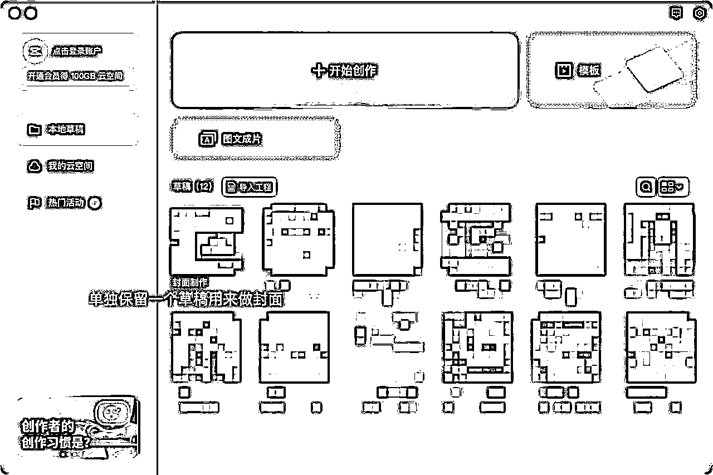
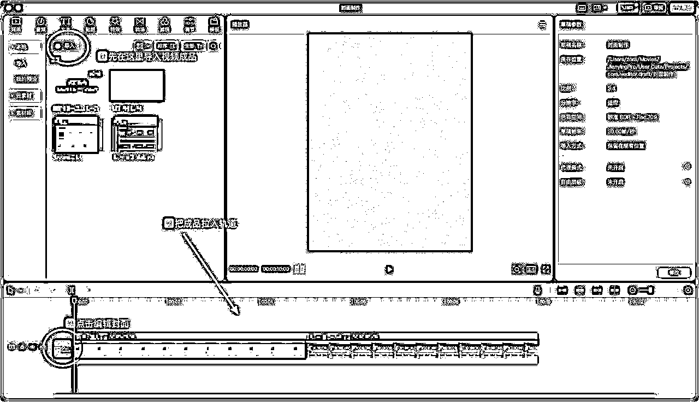
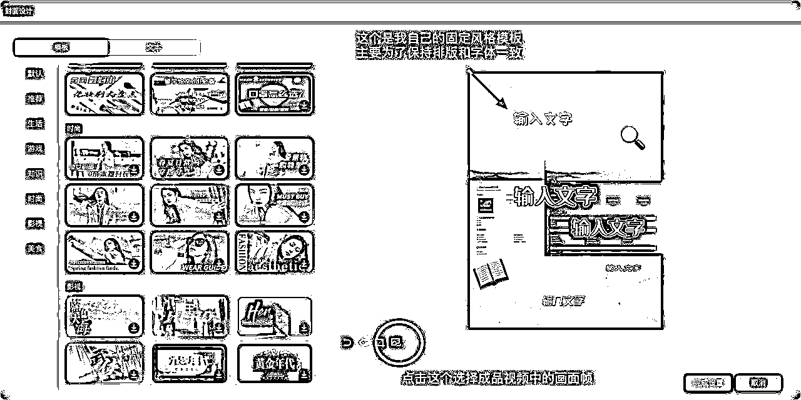
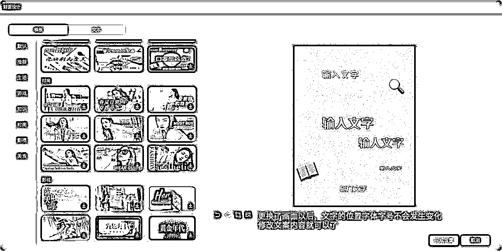

这个技巧并非必选项，但主页模板统一确实更顺眼，也省去记字体参数的麻烦。

资料出处：《如何在快速在小红书打造 50 万的视频爆款，以及快速增粉》《新手起号也能做的视频笔记》

# 四、项目实操 3/3：持续迭代，搭建内容体系

💡

章节纲要

做任何平台账号，都要根据数据反馈优化动作、修正方向。深入分析数据和平台，往往能更靠近运营本质。小红书笔记创作完成后，优化就该上场。新手前几篇数据平淡很正常，大V也是从新手走过来的。

本章围绕三个问题展开：✅1.数据不理想，怎么调？✅2.怎样提高出爆款的概率？✅3.如何提升内容生产效率？

💡

本章航线图

学完并实操本章，就能完成航线图第三阶段“持续复盘并优化”，约7-14天。具体安排：复盘笔记数据并优化约2小时；建立SOP提升笔记质量与效率约4小时。

## 4.1 持续复盘，让笔记越改越顺

每个小红书账号都有一个逐步优化的过程。第一阶段可能只是持续发；第二阶段就要对内容提要求。标题不够抓眼，就调整得更醒目；颜色不够突出，就强化色彩；字体和排版也要看着舒服。所谓舒服，更多来自数据反馈和对标账号的参照，是一轮轮迭代出来的，本质是向内求。

### 4.1.1 笔记数据不理想，怎么优化？

有人问：浏览量停在100-300或300-500，正常吗？明确说：正常。新号内容看的人少，50-500区间都很常见。你没有十万粉博主的固定受众托底，所以心态要稳。

做对比时，先和自己的多篇笔记比：哪些数据更好，分析原因。再和同量级账号比：500粉就找500粉左右的对标，别硬碰10000粉账号。重点看对方的点赞、收藏和评论区，思考为什么评论多、收藏高，再学习他们引导互动的方法。

确认数据不佳后，可从这些方向排查：

发布后2-3小时阅读量差，或长期只有100-200甚至低于100：
- 运营初期账号权重低，属于正常现象；
- 笔记违规、触发敏感词，或发布平台本就不大力推荐的内容（医美、保险、社会负面、中国负面）；
- 选题、标题文案或首图不吸引，尤其检查选题角度和首图。

点赞、收藏、评论等互动差：
用户收藏，说明内容有实用价值，现在或以后用得上；点赞/评论，说明内容被认可、能引发情绪共振；转粉，说明用户认可内容也认可你。排除违规和玄学因素，互动差多半是内容质量不够。可对照：标题吸引但内容跑题；营销感过重、全是硬广（企业号可适当硬广）；收获感弱、实用性低；像无意义朋友圈，既无情绪价值也无实用价值；干巴巴学术句或百度式科普；视频画质/图片质感差，阅读体验不好。

修改已发布笔记的注意事项：
修改后阅读率会重新计算，但只要不频繁改，影响不大。修改可能触发二次审核，没问题会继续放出；有时改掉敏感词或优化标题，数据反而更好。也有反例：本来正常推流，改完被判定有问题，开始限流。如果笔记已爆且热度还在涨，尽量别动，可在置顶评论补充。图文笔记可整体替换；视频笔记只能改文本和首图，视频本身不能换。修改会二次审核，不违规照常通过。爆款上升期不建议改；不要短时间频繁改，一般2-3次可以，改太多数据可能不如从前。

### 4.1.2 笔记被判违规后的处理办法 @吴小二

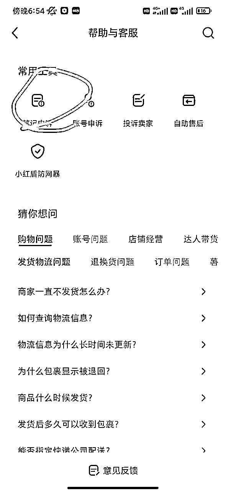

两个申诉入口要同步提交，因为处理人员和判定口径可能不同。我的违规笔记里，只有一条没收到申诉回复，其余都恢复了，包括评论超过5000的帖子也恢复了。

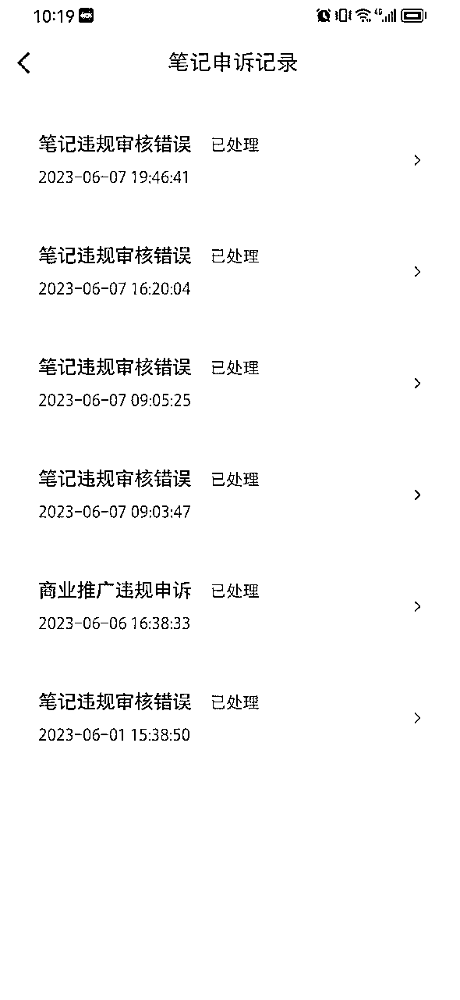
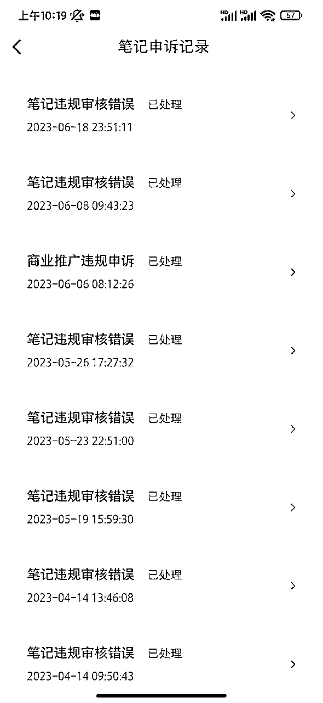

再补一句：账号数据异常偏低，一周后仍没恢复，可以考虑注销重来。

#### 4.2.1.1 爆款图文账号特征 @比比先森

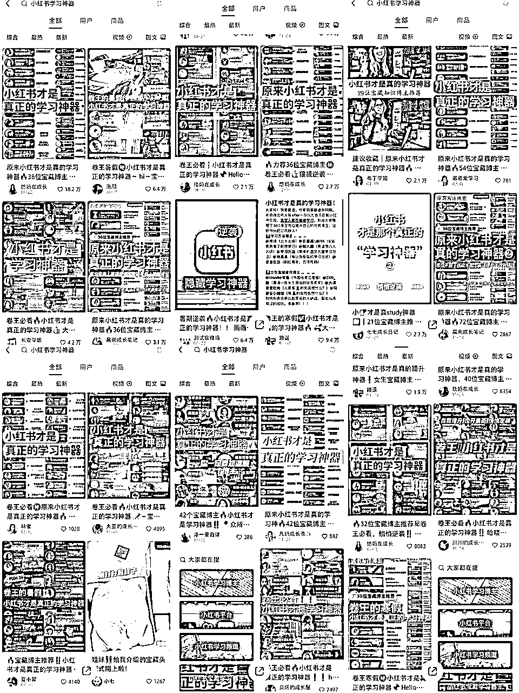
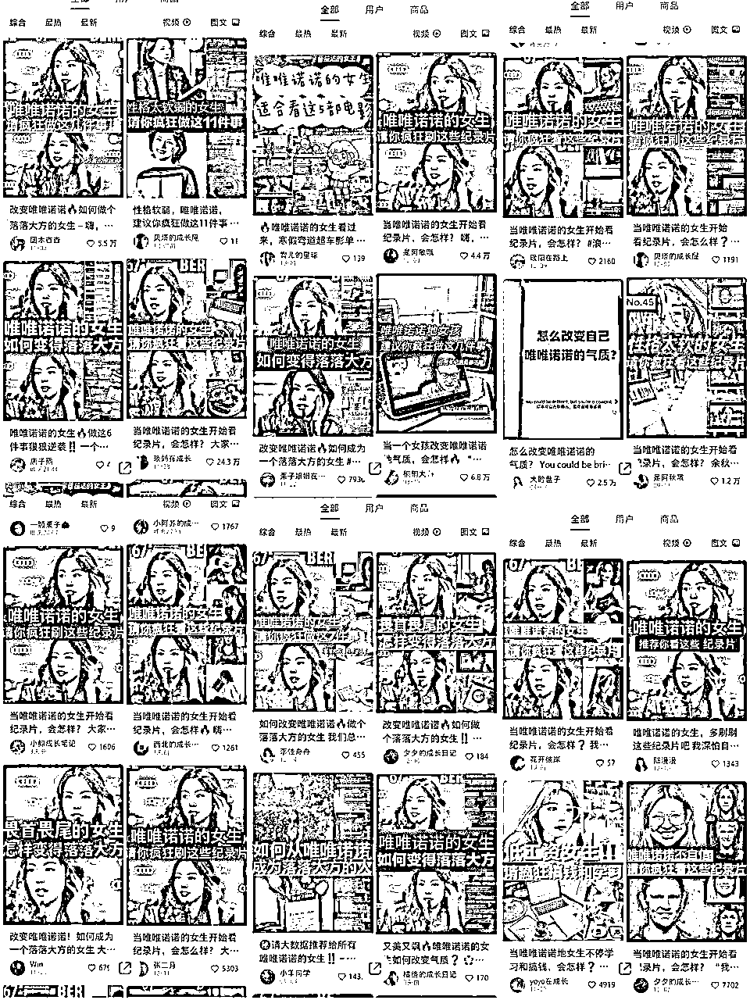

图文爆款特征：
- 选题维度：选题、封面配图、排版、标题高度一致，重复度高；
- 数据维度：表现极好，常见几千赞、几万赞；
- 时间维度：发布时间较近，大多在一年内。

有经验的同学常困惑：我认真模仿了，图也做了，为什么别人爆，我点赞少？核心在于：照猫画虎，猫找对了，虎没画好。新手模仿时容易加入个人想法，成品走样。不擅长做图的同学，先锁定对标对象，尽量1:1复刻，再提升审美和制图能力。动手模仿比只看更能体会细节。

#### 4.2.1.2 参考对标账号做爆款笔记的方法

方法一：提高敏感度，找到精准对标
- 选题维度：选题经过大量案例验证，热度高；
- 拆解维度：封面、关键词、标题、主体高度神似，便于模仿；
- 数据维度：至少千赞，且已有万赞爆款；
- 时间维度：一年内发布，1-2个月内更好。

方法二：像素级模仿，精准对标画面

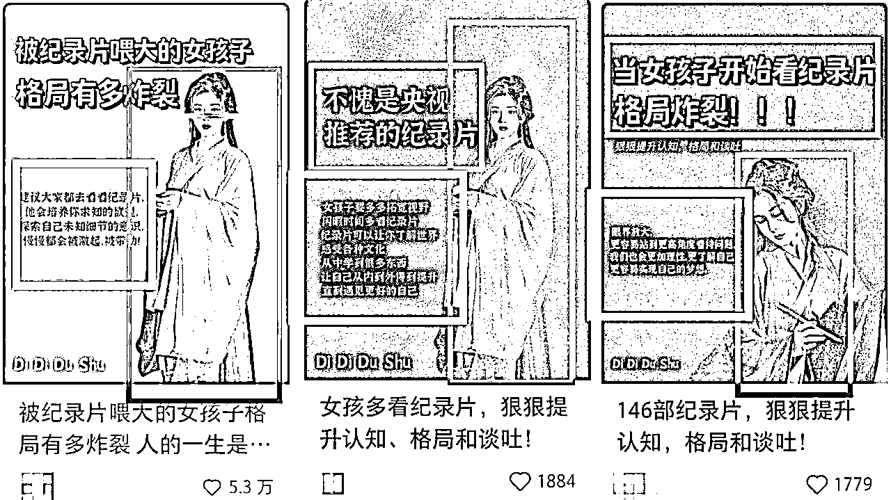

比如加字，一开始按自己想法做图。后来发现爆款封面花字大多清晰、突出、黑白简洁有力，而我的黑白描边显得多余。于是去黄油相机找同款花字，省略主标题，放大主体并放左半侧，把“不愧是央视推荐的纪录片”拆成“不愧是”+“央视推荐的”。

从初版封面到爆款封面，优化可归为三点：
- 用户视角：理清观看顺序，用鲜明主体和爆款关键词引导点击；
- 氛围营造：配色、背景、选角与主题强相关，做出氛围感，提升好感；
- 标题指引：标题字不要过长，精准吸引并放大突出，有一眼抓人的效果。

快速判断封面是否合适：把图发到微信聊天框，只给自己1-2秒看，能否快速抓到主体和标题关键词。能抓到，封面就合格。

先简单说下小红书算法：

重点结论：用户动作对爆款的推动顺序是关注>评论>收藏=点赞；互动量上去，整体数据会增长很快。参考回复方法：可做推拉式评论表格，也可用“你说的是观看纪录片的影视平台吗？”“这个纪录片讲什么的呀？”“哇，你也喜欢刘亦菲吗？”这类话术。

正文要埋互动理由，也就是触发用户互动的要素。互动指数高，流量开关才容易打开，流量才会持续进来。

比如结尾留钩子：“大家关于新疆旅游有什么问题都可以问我哦”“需要这份旅游攻略的可以评论区告诉我，我私发一下”。如果笔记流量大却没加到微信，确实可惜，做引流最终目的是加微信。但这种方式有违规风险，按自己需求谨慎使用。

内容来源：《小红书3天新号粉丝破千的运营方法论》

#### 4.2.2.2 要素二：找准用户需求与痛点 @杉木

内容能否打动人，关键在是否准确抓住需求和痛点。比如瑜伽服买家以女性为主，她们更在意上身效果、包裹性、弹性、面料，而不是模特白不白、屁股大不大、性不性感——那是另一类关注点。做带货内容别用力过猛，把产品卖点自然兼顾即可。不要“你觉得”，要让“用户觉得”，这样才能吸到更精准的流量。

怎么找击中痛点的对标笔记？重点看评论区。点赞、收藏只说明认可、喜欢、有用；评论往往目的更明确。尤其带货内容，评论里常有“我要买”这类强购买信号。

找到这类笔记后，除了收集内容，也点进主页看其他作品。一个账号通常不会只有一篇好数据，往往还有类似爆款。如果发现某账号几乎篇篇数据亮眼，恭喜你找到宝藏，可以系统收集全部内容。可借助蝉妈妈、新红等工具。

再比如蹭热度：主动搜索的用户会高频使用小红书搜索，尤其品牌集中营销、投放或发新品时，站内品牌搜索量会明显上升。很多用户把小红书当搜索引擎用。我们要借力，比如lululemon热度高时，“lululemon”这个词的热度甚至超过“瑜伽服”品类词，那就可以在文案里多次植入。这也可当选品标准：T恤是红海市场，竞争激烈，但如果某篇笔记有4000多个精准询单，就符合高质量内容笔记的特征。

# 小红书起号前，先看这几条硬标准

想把小红书做成赚钱项目，别急着埋头更新。先拿两个问题拷问自己：这件事有没有变现空间？单篇投入产出划不划算？这两问能筛掉不少无效动作。

选品时，红海不等于没戏。T恤赛道早就拥挤，但某篇笔记却带来4000多个精准询单，正好是高质内容笔记的样本。

把它的文案、产品拆开看，答案不复杂：高克重＋专属定制。用户不是在买普通T恤，而是在找能解决特定需求的款。所以逛同类笔记时，也能顺藤摸瓜发现值得做的产品。

再往下看，内容成本必须算清。矩阵化运营尤其要量化单篇生产成本，心里有本账。寻找赚钱笔记，其实也是在比较投入。精致布景、俏皮文案、讲究构图，往往意味着高成本；可高成本未必换回高询单。瑜伽裤就是反例：我那篇内容花费不到20元。抖音、小红书都能找到低价高转化的案例，这正是内容营销的迷人之处。

素材出处：《我是如何通过小红书，两个月带货营收 30 万＋》

#### 4.2.2.3 要素三：强化代入感 @梨云

刷小红书时遇到十万赞《公主学习法》，第一眼觉得土，但直觉提醒我这篇有门道。读完确实像当了一回公主，评论区也几乎全是好评，我判断它是个潜力选题。随后照着这个方向写，拿到近10万赞。把学习包装成娱乐，把知识做得有趣；若判断成立，就能切出一条新细分赛道并占住位置。行动上，我先从评论区找粉丝爱看的角色，再围绕它做创意学习法测试。结果原创也能连爆。之后我提高这类“娱乐化学习”的占比，让账号内容更统一，主页转粉率接近30%。

官方注意到这类垂直爆款，在灵感笔记里给我单独开了话题位。

由仿写到自创还能持续爆，靠什么？

一是以人为本，和粉丝深度链接，摸清他们的痛点，盯住他们的需求。二是提供价值，内容要能解决粉丝的问题，要么给实用方法论，要么给情绪愉悦感，或者像我这样两者兼备。三是主动学习，了解粉丝需求时会撞见很多闻所未闻的东西，比如他们喜欢的耽美、凹凸世界，这就逼着自己主动学习，才能产出粉丝喜闻乐见的内容。四是长期主义，站在粉丝需求角度用心输出每一篇内容，踏踏实实做内容，同时不断输入输出、精耕细作。因为一事精致，便已动人。

素材出处：《小红书三个月涨粉 17w，变现 10w+，我做对什么？》

关键词获取有三种路径，这里先拆两种能直接上手的。

方法1：在小红书搜索框输入关键词，看下拉联想。比如输入【女频言情小说推荐】，会出现【女强言情小说推荐】、【女生言情小说推荐】等下拉词，这些词都能用于标题和正文。

方法2：打开一篇高赞笔记，观察它的标题和正文，反推哪些词是关键词。

拿一篇笔记举例，我判断【甜文】、【双向奔赴】、【可冲】、【真的好绝】、【超级喜欢】等词是关键词。

关键词怎么用？先写推荐这本小说的理由，再把收集到的关键词嵌进内容合适位置。比如选一本《XX（书名）》言情小说做推荐，我看过且喜欢，初版可以这样写——

初版标题：安利一本女主争霸言情小说！！！

正文：今天看了一本很好看的言情小说，已经完结了。这本书讲女主穿越到异世界，带着金手指大杀四方。女主本身很有魅力，不只是金手指的作用。以前看过类似小说，女主拿到金手指后偏向宅斗、宫斗，或者辅助男主成为天下霸主；这本完全不一样，女主没有被古代同化，自己拿着金手指争霸天下，为百姓带去幸福生活，而且一点也不违和，非常符合常理。男主男配们很有魅力，感情戏也好看。

再版标题：N刷！这本言情小说巨好看，别错过（注意：小红书笔记最多20字，16—18字更稳）。

正文里加入“已完结，真的绝，超喜欢”“可冲”等表达。

两版差别在哪？第二版把「n刷、真的好绝、超级喜欢、可冲」等关键词塞进了标题和正文。靠这招，我曾做到一篇笔记1小时100赞，24小时千赞。当然不保证次次灵，还要看小说是否符合账号定位、读者口味。有时几天才千赞，有时只有几百，但它能提高出赞概率。按100篇粗略估算，千赞约20%，几百赞约50%，几十赞约30%（数字是我个人经验，不精确；但做过小红书的人知道效率不低）。

关键词为何有用？看案例就知道，内容并不复杂，只是把小说亮点拎出来。有时我偷懒，标题随便取，正文只写“已完结、超级好看”，也能有几十到几百赞。原因在于小说本身好看、有价值，读者愿意点赞。换成学习博主就不行，必须内容有价值，再用关键词撬流量，点赞才会来。

素材出处：《手把手教你如何成为小红书小说博主》

#### 4.2.2.5 要素五：技巧合集 @吴小二

技巧一：资料拆份。一份拆成多份，甚至硬拆5份，标a、b、c、d、e，让评论区报编号，互动就起来了。

技巧二：抢回前排评论。最开始几条或几十条，逐条回“已发，祝顺利”，有礼貌的用户还会回谢。这样显得真实，也能把加热期评论量抬起来。每天上千条不必全回，加热阶段回复即可，否则手指受不了。

技巧三：热门编号做封面。前两步后每个帖子至少5张图。发第二个帖子时，把上一帖留言最多的编号放封面。等于第一帖测试5份资料哪份更受欢迎，第二帖把胜出的放首图。一次发一份要试5次，一次发五份则让评论区帮你筛选，其他资料也能贡献热度。循环起来，爆帖概率更高。我有个编号封面，几个人看了都说丑，数据却反常地好，连发三次都破千评。数据会说话：评论多的编号就反复做封面。

技巧四：借搜索联想词。搜索框输入关键字会自动跳联想词，把它们放进标题正文，甚至用作昵称，能多吃一截流量。手册提过，但不少人没当回事，我再强调一次。

四个技巧一起用，上次航海新号10篇笔记里：评论400+有5篇，其中1500评1篇、5000评1篇。靠搜索流量，数据还在涨。

素材出处：《小红书新手资料引流，涨粉的细节分享》

## 4.3 如何提升内容创作效率

### 4.3.1 定期系统总结梳理 @子渝

要长期稳定输出干货，一手持续梳理知识体系，一手保持输入与输出并行。最好建个人素材库，用时能迅速调取。

### 4.3.2 持续从优秀对标里汲取高点，获取灵感@子渝

平台里高手不少，内容也多。新手更该多看、多拆、多对标，把别人的长处学来用。每天抽点时间刷同领域专业内容，观察别人关注什么、表达什么，顺手记录灵感，提醒自己后面落地。

素材出处：《中年宝妈“996”下班后当职场博主 聊聊我小红书从 0-1 到变现的过程》

### 4.3.3 制作可批量制作内容的模板 @梨云

好模板既能批量产内容，也能拉数据。@梨云 用平面设计专长原创了一套模板，思路如下。模板无非几个要素，逐个迭代就行。

1）配色：森系绿为主，因为很多人看到这套配色就想到我，我索性叫“梨云绿”占住心智；再配暖黄和纯白，整体温馨、安静。

2）封面：大字报式排版，两行字打重点，关键词更集中，用户一眼知道这篇讲什么，快速决定点不点。

3）内页：不再用“封面＋文字排版”，改成全图流。纯文字排版结构感弱，看久了累；全图流能换字体颜色、加贴纸，空间更大。我按大标题、导语、小标题、正文、底部标题来排。大标题概括本页，让读者有预期，也可每页统一，用来埋关键词、抬搜索权重，同时是广告位，可放品牌名。导语做铺垫，说明为什么写这篇，承担共鸣，还能做行为引导，比如写“宝子投稿”，暗示大家去评论区投稿，用留言拉曝光。小标题用四字压缩一句话，降低阅读负担。正文尽量不超3行，做轻内容，提升阅读愉悦感；行文用平台女生爱看的流行语、热梗，让语气活泼。底部标题很关键，很多人模仿时漏掉。它用游戏化口吻引导翻页，减少读者因不感兴趣而退出。句式可借游戏指令：开始＋动词、马上＋动词，能制造继续往下翻的冲动。内容过关、阅读时长上去，赞藏评概率也会提高。

这套做完我开始发，第一篇就破千，之后篇篇爆。为放大效应，我日更50天涨到10万粉，后来改隔日更，现在17万粉。

素材出处：《小红书三个月涨粉 17w，变现 10w+，我做对什么？》

### 4.3.4 对流程进行 SOP 化

想再提效率，很多环节都能SOP化，省时间。比如拍摄和写内容：我通常周末把下周要发的素材备齐；找模特尽量同城，提前把拍摄注意事项、参考案例发过去，避免废片。也没必要请专业模特，更不必精修照片，这不是淘宝主图详情页。小红书平台和用户更偏爱……

第三个：影刀全自动回复。前两个技巧是减手工压力，这个直接解放双手。影刀用法在生财有帖子，也可去官网看教程。设置后，连回图片都省了，手机插USB、开调试模式，消息自动回。引流阶段或变现不理想时，谁的时间、人力成本更低，谁更能熬。可先用工具生成文案，再增删修改成想要的内容，爆文概率更高，时间更省，运营成本更低。

素材出处：《小红书如何”开源节流”运营变现》

选修篇：小红书的引流&变现

章节概要：项目最小MVP跑通、小红书起号完成后，就可以进入选修篇，开始引流和变现。想放大项目或找更多玩法，可重点看：小红书变现方式、科学引流、私域变现、热门赛道案例。去发掘更多可能。

# 五、持续优化账号&内容

## 5.1 持续优化完善个人定位

定位不是一次定终身。V先生大意是：定位是“1”，其他都是后面的“0”。随手写也有复利，但写久了不赚钱，信心会慢慢耗尽。所以做小红书，核心是做一个能赚钱的账号，否则很容易半途而废。账号最关键的前提，是赚钱的定位；定位强弱决定变现强弱。前期40%精力放定位，然后才是选题、内容、引流。

要赚钱，先记住两条：1、痛点>>痒点。有多个定位可选时，优先解决痛点，别选痒点。多数人花在痛点上的钱不手软，花在痒点上却犹豫。比如职场领域，大学生最痛的是快速找到好工作；找工作下面有很多细分需求，像简历优化、面试指导、入职体检、能力培训。相比体检、培训，他们更愿意为简历优化和面试指导掏钱。众多需求里，盯住付费意愿更强的痛点，吃透它，建立信任最快，离钱最近。2、帮别人赚钱>>帮别人成长。成年人进入社会后，单纯学习成长的重要性下降，赚钱成了更重要的事。如果你有靠技能、项目、自媒体变现的经历，最好定位成帮别人赚钱，而不是只帮别人成长。定位时尽量遵循痛点>>痒点、赚钱>>成长；脱离这两条，难击中用户最痛处，信任建立慢，变现路径也长。注：这两条针对新人，不针对领域专家。任何领域做到专家，都不愁赚钱。

如图，搜“减脂”，一个月5.98万篇笔记，红海无疑。图糊，看字即可。

## 5.2 更多挖掘选题方法

### 5.2.1 从热门笔记中挖掘

换不同产品细分关键词去搜，结果页的【综合和最热前100名】里，很多题目值得参考。能爆的笔记，抛开玄学，大多同时被平台和用户认可，其选题角度有参考价值。

入口：「我」板块左上角三条线→创作中心→下滑可见「笔记灵感」。

素材出处：《初阶 | 小红书-爆款笔记｜航海实战手册》

# 选题先借力：把跑过的爆款排成清单

做选题时，个人偏好得适当往后放。你吭哧吭哧原创大半天，效果可能还不如把一个已经验证过的热门内容再推一轮。所以，先列一份“已验证选题清单”：把有热度、能带流量的题目按先后顺序排好，照着节奏发。

内容来源：《小红书 3 天新号粉丝破千的运营方法论》

内容来源：《小红书 3 天新号粉丝破千的运营方法论》

小众赛道常遇到一种情况：某篇内容在该领域火过，但因为关注人数有限，数据看起来并不亮眼。这时怎么判断它值不值得做成自己的题？圈友@杨星城 给了一个思路：先锁定你的参照账号，观察他们哪些题跑出了热度，再沿这个方向产出新内容。热度到底怎么算？粉丝六十万的号，单篇千赞未必算爆。更实用的标准有三条：点赞量高于粉丝量；粉丝不足三万却拿到千赞；上线三十天内点赞破万。排选题计划时，挑三到五个粉丝在三到五万以内的参照号，每个号选三到五篇高热度题，合起来就有十到二十个备选。

内容来源：《小红书日引流 200+，简单粗暴！从博主玩法迭代矩阵玩法 2.0 版》

### 5.2.5 结合自身经验做干货分享 @子渝

笔记可以拿自己或身边人的故事当入口，尤其是从生手熬成老手的真实经历，读起来更可信、更贴近，用户不会产生“被讲课”的压迫感。实测下来，小红书读者对经历型、案例型笔记更有好感，跑出的概率也更大。比如“某位同学照我的方法拿到月薪三万的运营岗”，或者“在互联网大厂做运营十年，聊聊我的职场/求职心得”。这类内容还方便埋钩子，把有精准咨询需求的人引过来。平时多拆解热门笔记，自己发完也记录数据，回头检查选题角度，久而久之对选题的敏感度会提升。

内容来源：《中年宝妈“996”下班后当职场博主 聊聊我小红书从 0-1 到变现的过程》

### 5.2.6 重复做爆款选题 @杨星城

各平台规则不一样，小红书对内容重合、查重的容忍度相对高些。你可以去不同平台或社区，搜自己所在垂直领域的优质内容、热门内容，再重新组合成一篇“新”笔记。提醒：这套打法更适合矩阵号，单账号别生搬硬套。操作上，先确定选题关键词，再去XX检索；碰到高赞视频，用转文字工具提取，再按自己的口语习惯改写。XX包括但不限于抖音、小红书、B站、知乎、5118、百度、微信、必应，以及垂直站点/论坛等。思路打开后，写什么基本不用发愁；哪怕请大学生实习生来写，即便对方不是本专业，也能产出内容。一篇笔记写完，也不代表只能发一回。小红书查重不严，可以换几种封面风格再套用；若这篇已经跑火，说明题和内容都过关，那就换一种“呈现方式”再发一次，大概率还能再火。爆款能复用，复用爆款。那什么叫不同的呈现方式？

不少热门内容，本质是把若干段落重新加工、重新拼装：原本三四篇稿子拆改组合，扩成十几篇笔记，照样有流量，也不违规。再强调：不是同一个号频繁换封面，而是一篇内容换不同风格分发到不同号。有时这个号没起量，另一个号就起来了。

内容来源：《小红书日引流 200+，简单粗暴！从博主玩法迭代矩阵玩法 2.0 版》

## 5.3 丰富内容类型

### 5.3.1 常见的六种笔记类型

平台上的热门笔记形态很多，新手容易挑花眼。下面挑出新手起号阶段最容易上手、也最容易放量的几类。先看合集笔记：它的特征是品类多、覆盖全，靠“堆量”取胜，首图要把“多”做出来，标题常用数字制造冲击。写法是把风格、功效、目标人群、使用场景相近的物品放在同一篇里推荐，每类都展示并概述其特点与使用感受。首图可把多件物品摆在一起实拍，或做拼图，标注名称、价格，核心视觉就是“丰富”。

测评笔记与合集有相似处，差别在于合集往往全部推荐，测评则会用“红黑榜”或星级评分区分优劣。正文通常由三块构成：先铺场景，再逐个写体验，最后归纳红黑榜、适用人群分类或不同维度的星级评分。首图可以用红黑榜对比，也可以在合集图上加标识，标出评分或适合人群。

对标笔记：
《成都重庆攻略❗红黑榜教你避雷👭旅游必备》
《【豆浆粉测评】大户人家系列第十三期》

## 3. 科普类笔记

难度：2 颗星。
适用人群：全部类目。
特别提醒：好物带货型 IP 不能全铺新手科普，仍要以种草推荐为主。科普不等于堆砌难懂的课本术语，也不是枯燥的百科搬运。小红书读者偏爱的科普，更像“新手必须掌握的知识点梳理”，可以拆成多篇，轻量、直观地喂给用户。首图可用一张图汇总知识解析，或做成密集的知识点清单。

对标笔记：
《学茶一定要懂得这 20 个词语💦提升饮茶境界🍵》
《一张图让你看懂各大滋补品的段位‼️》

## 4. 避坑类笔记

首图：纯色图、实拍图、网图均可，图上加标题花字点明主题。

对标笔记：
《装修合同避坑指南❗看清装修公司套路省几万》
《避坑！这些野鸡设计比赛别再参加了！》

## 教程类笔记

首图要展示完整教程步骤，或呈现部分步骤图。

对标笔记：
《一周备菜 | 备菜流程和小工具 都在这里‼️》
《骨灰级装修流程攻略✨照着装修不踩坑✔️》

## 攻略类笔记

攻略型笔记需要从多个角度归纳，每个角度都写清具体做法和注意事项，干货信息越密集越完整越好。因为追求全面，制作耗时会多一些，但做成了出热门的概率很高。首图可露出部分攻略信息，用小标题花字标出覆盖的维度；常用【建议收藏】【最强攻略】【最全攻略】【必看】等文案花字拉点击。

对标笔记：
《必看❗️北京环球影城攻略*干货+隐藏玩法》
《二手 iPad 选购攻略🔥超详细指南及验货攻略》

## 7. 注意事项总结

这六类笔记里：合集、测评常围绕好物、好去处展开，种草属性更直接，变现也更容易；科普、教程、避坑偏专业知识输出，未必能立即带货，但能凸显 IP 的专业度，对用户转化也有帮助；攻略型则兼具种草和知识传播两种属性。虽说六类通用，带货 IP 和知识 IP 都能用，但不同账号的内容配比应有侧重。带货 IP 可以强种草类（合集、测评、攻略）为主，知识类为辅；知识 IP 则反过来，以科普、教程、避坑、攻略等知识型内容为主，合集、测评为辅。还要留意：数据漂亮不等于能变现，关键看账号类型。做精准引流的 IP（自有产品或服务），只要笔记能展示产品优势或服务专业度，即便互动一般、粉丝不涨，也可能直接带来不错的转化。纯博主 IP 靠广告吃饭，每篇笔记的互动数据就得维护好，因为它会影响广告报价。起号阶段通常有三到五篇小热门，就会有品牌 PR 来谈合作。

内容来源：《初阶 | 小红书-爆款笔记｜航海实战手册》

### 5.3.2 笔记类型规划——三类笔记占比 @陈铭 ivy

💡 本节要点
当笔记数据积累到一定量、账号里跑出一些热门笔记后，就要考虑 IP 账号的笔记类型规划。不同内容承担的任务不同：有些负责冲流量、给账号拉关注；有些负责引流和转化。按这个逻辑，笔记可分成三类：
✅ 引导付费、但不容易爆的笔记
✅ 容易爆、但不容易触发用户付费的笔记
✅ 又容易爆、又能导向付费的笔记
日常发布时，可以有意识地控制各类数量，用比例去放大引流和转化效果。

## 1.「 40% 的笔记」：写直接导向付费的内容

1）直接介绍自己能提供的服务和内容，同时做到内容比同行多、价格比同行低，简单直接。举个例子，卖包子的可以这样写：
标题：老王家包子的价格和介绍
正文：包子馅料有豆沙、猪肉、牛肉、胡萝卜；全部师傅纯手工制作，皮薄馅多，吃完很开心，一口气上六楼都不费劲；买包子送定制环保纸袋，超级时尚，同行没有；再加一张截图：你家包子 3 元一个，同行 10 元一个。看到笔记来问的用户，打招呼就是：“你好，我想找你买包子。”
再发用户好评和使用后的效果，尤其和同行对比。发好评时最好讲一个跌宕起伏的故事：先在同行那里被坑，然后找到我们，买到了好吃的包子。人类天性就是爱看故事。

## 2.「 40% 的笔记」：写容易爆，但不容易触发用户付费的内容

这类笔记负责引爆流量，把另外 60% 的笔记带火，同时让小红书官方觉得：这个号不是只会卖货的营销号，还在给平台用户提供价值。
2）专业领域内容：手把手教做包子，面粉怎么混合、揉面怎么揉。这样的干货发出去，点赞收藏会比较多，几乎没评论；看的人大概率想自己做包子，而不是找我们买。
3）免费送资料

如果是卖知识付费产品，用这种笔记做引流，效果会非常好，很容易爆。虽然找过来的人大多拿个资料就走，很难转化付费，但只要数量堆上去，总有人会付费。而且这种笔记最容易火，还能带火其他笔记。
4）蹭热点新闻，同时跟自己的业务挂钩。比如谷爱凌、橘墩墩、刘畊宏等，直接在小红书搜就很多。当短时间内平台上很多人都在说同一件事，直接跟上。

## 3.「 20% 的笔记」：写又容易爆，又能导向付费的内容

这类笔记很小众，也最难写，但效果非常好。举个例：
笔记主要内容：
内容来源：《粉丝 3000 月营收 20 万，小红书低粉高变现的蓝海攻略分享》

# 六、小红书变现路径探索 @谢无敌

QuestMobile 2020 年的数据显示，小红书平均带货转化率为 21.4%，抖音、快手和微博分别为 8.1%、2.7% 和 9.1%。平台上聚集着一批热衷“买买买”的用户，社区本身又带天然种草氛围，因此小红书的带货转化表现强于不少公域平台。

这带来两层机会：商家愿意在这里做引流和投放，以触达精准客户；博主哪怕是素人，也更容易找到变现切口。按销售属性划分，小红书变现大体有两类。第一类靠卖货：自己手里有可销售的产品、货源或服务，既可能是实物，也可能是资料、课程等虚拟产品，这类账号通常被称为商家博主。第二类靠卖时间：自己没有商品，想借小红书增加收入，多数人当副业经营，也有人全职投入，例如部分宝妈通过接广告或分销他人产品获得收益，这类属于纯博主。下面就从这两类分别展开，梳理各自的变现渠道。

## 6.1 商家博主类变现方式

小红书靠种草被大众熟知，但平台也一直在搭内容到成交的营销闭环，毕竟流量留在站内才更划算。

企业专业号还可直接绑定线下门店与地址。

电商精品卖货模式 @木子蟹

有没有货源都能尝试，零基础也可以入场。若本身有电商经验、选品能力，能判断热门款和红海品类，会更有优势。前期未出单时投入不算大，周转资金建议备 1-2W，否则笔记突然爆单却发不出货，会很被动。无货源卖家可以开薯店，在小红书文案里挂店铺链接完成交易，再与 1688 商家签订代发协议，并在小红书完成备案。这样内容素材不容易断档：可搜集其他平台产品评论区的内容做组合，也可借助软件生成。我实测过三个号，15 天内基本能有一个号跑起来。有货源、能自行发货则更稳。有货源的卖家要抓住一点：用小红书做种草，再把流量导向淘宝、拼多多、京东等平台成交，既方便，也能省下刷单成本。这种导流通常伴随约 60% 的流失，但客户黏性往往更高；目前这么做的人不算多，空间还在。能自己发货的，还可以把用户引到微信做私域运营。未来流量成本只会更高，这块要提前布局。平台若发现店铺存在无货源代拍，会依据《关于无货源代拍的专项治理公告》处理，相关笔记申诉也可能不通过。若对判定有异议，可发申诉邮件至 mri_appeal@xiaohongshu.com，邮件中需写明【店铺 ID、店铺名称，并提交相应举证材料】，具体可看小红书商家课堂。
内容来源：《小红书如何”开源节流”运营变现》

无货源内容拓展 @表弟

无货源现象在各平台至今都难以彻底禁绝。想尽量降低风险，可以注意这几点：第一，少碰 PDD，确实找不到货时再考虑找 PDD 商家谈代发；第二，优先选 1688 这类专业代发渠道；第三，别一次性大批量上货，这容易成为平台稽查的切入点；第四，选品阶段就在 1688 把货源对接好，不要先上架再补找货；第五，遇到面单、短信、好评卡等引发的无货源投诉，能花钱处理就别拖着。第四条尤其关键，它正是无货源和正常代发的分水岭。我的淘宝店始终是先落实货源再上架，因此没出现过 48 分或无货源判定。无货源玩法通常是先大面积铺品，等出单后再去找货，找不到就下架；偶尔一两次，平台和消费者未必追究，次数一多就可能被系统盯上。若某个品表现特别好、暂时又没有稳定货源，可以设置 15 天预售，给工厂留出生产时间，同时降低自身风险。中国制造在十五天内基本没有做不出来的品，所以只要产品真爆了，实在不行就自己联系工厂生产。

# 小红书赚钱路径全拆解：从变现到私域引流

写在前面：这些操作只能救急，没法解决底层问题。一旦被追问“为什么绕开平台短信”，系统就会给你打上标签，最后账号照样保不住。

### 6.1.2 付费推广打法
想做付费投放的创作者，可以走站内聚光投放系统。目前共4种投放模式，普通中小品牌更匹配“产品种草”和“线索收集”这两类。需要注意的是，该功能仅对企业专业号开放，而且预算门槛不低；资金充裕可以放开跑，预算紧张的就别硬上了。

### 6.1.3 借力达人：蒲公英系统
开店之外，企业专业号还能通过与内容创作者联动来拓宽渠道、放大曝光。蒲公英系统（ https://pgy.xiaohongshu.com/ ）就是官方认可的中介渠道，核心模块有四个：

- 物色创作者：商家按条件筛选并发起邀约。关注量超过5000的人才具备入驻资格，相当于提前筛过一遍，商家也能查看对方的信用分和历史评分。
- 物色主播：可以直接联系有直播权限的达人去带货。
- 招募项目：商家发布招募需求来召集达人，每个月最多可发起10次。
- 好物体验：商家把样品免费寄给达人，达人体验后写出一篇种草内容。

不过蒲公英要双向抽成，商家和达人各10%。有些商家为了把单子谈下来，会主动帮达人承担这笔钱，或者私下返一部分。

### 6.1.4 私域导流方向
官方渠道当然更合规，帖子还能附带效果广告，但不少中小商家依然嫌服务费高、流程繁琐。所以更多人想把用户拉到私域里慢慢转化。可平台对这类动作盯得非常紧，走这条路就像在夹缝里穿行，没两把刷子很容易踩雷。

### 6.1.5 分销式深度合作
开店的人也可以物色一些优质内容者，做比普通商单更深入的绑定，比如分销合作。

### 6.1.6 直播间带货玩法 @木子蟹
有直播带货经验的玩家，完全可以依托小红书的人群画像和供应链优势来选品开播，话术和节奏基本能对标抖音直播间。开播前几小时发一条预告动态，用有冲击力的价格把开播时间甩出来，先把期待感拉满。预算允许的话，再花点钱买“薯条”去加热，让人气在开播瞬间集中爆发，转化率自然会更好。

### 6.1.7 货架电商+达人带货 @木子蟹
把小红书店铺当货架，像淘宝那样维护商品，再从各个渠道邀约合适的达人，协商按单分成。多说一句：货架电商就是搜索电商，卖点是“人找货”，来的用户目的性很强，而且多半是刚需。

## 6.2 无货源创作者怎么赚钱
平台对普通素人一向友好，这也是为什么越来越多人涌进来做内容。但没产品、没供应链的人，凭什么接住这波流量、把关注变成收入？在聊赚钱方法前，先搞清楚博主层级。按关注量从低到高大致分五档：关注量不足5000的算素人，5000到5万是入门达人，5万到50万属于腰部创作者，各梯队对外报价差异很明显。

（蒲公英报价截图，供参考）

### 6.2.1 无费软广：以物换内容
有的商家预算本身不高，或者产品毛利撑不起现金投放，就会用纯置换的方式找达人合作：免费提供产品或服务，达人体验后发一篇笔记即可，不再有其他费用。出版社寄书换读后感、餐馆请探店达人免费用餐，都属于这一挂。粉丝不多的时候，这是最容易上手的路子。

### 6.2.2 有偿软广：按粉计价
关注量涨到一定阶段，就会有商家私下找上门，约你发推广笔记并付报酬。主流形式包括有偿置换、有偿寄拍、有偿探店参展等。不同类目门槛差别很大，有的赛道50个粉就能接到单，有的要1万以上才有人问。通常报价是关注量的一到两成，还要结合你近期的互动频率、账号垂直度、与品牌的贴合度以及粉丝粘性来浮动。

### 6.2.3 通告群主动捡单
前两种都是被动等生意，这一种属于自己找活干。微信小程序里藏着大量通告平台，PR和中介会在上面挂合作需求，比如螃蟹通告、萌通告、布偶通告、试盒等。你也可以在小红书里搜“通告”“PR”这类词，想办法混进一些PR通告群，新需求一出来，群里直接喊人。

要提醒，上述三种方式都游离在官方许可之外，平台不认，加上对接方鱼龙混杂、质量没保障，违规和被骗的风险同时存在，遇到可疑对象要多留个心眼。

### 6.2.4 官方品牌合作人 @大芝
想走正规路线，就入住蒲公英做品牌合作人。先决条件是完成专业个人号认证，并且关注量达到1000以上。

1）入驻蒲公英系统
目前官方在大力扶持低粉创作者变现。

常规合作流程可以参考下图：

官方渠道的最大优点是安全兜底，问题是抽走10%平台费，且入驻有门槛。

2）定制合作/招募合作
这两种都走一口价模式，报价相当于关注量的一成。1000关注，就是100元一条。

3）共创合作与新芽合作
低粉用户在这两个板块更有机会：共创合作入手单价高，新芽合作自带额外流量。共创合作除了固定一口价，只要视频互动数据打得好，还能拿到比例更高的提成。注意，提交笔记的截止日期和统计提成的日期是两回事。作者就踩过坑——她以为共创广告的发布节点是3月10日，实际提交期限却是3月2日，时间记岔了导致广告关联失败。后来她把帖子里的广告段剪掉再发，数据反而超过关联版，硬生生丢了2000元佣金，教训相当贵。新芽合作除了基础报酬，还送流量加热、帮你提升曝光，价值不言自明。同时它的单量很多、通过率也高，报名时一定要盘好档期；作者刚开始不懂，一口气报多了，结果同时中了5个，排期差点撞车。

### 6.2.6 好物体验
入口藏在个人主页左上角，点开能看到“好物推荐”，申请通过后只要你交一篇试用笔记，商品就归你了。这个玩法很适合几百到几千粉的小体量创作者，账号风格和产品调性越搭，中选率越高。严格来说不算直接变现，但白嫖也香。

### 6.2.7 卖课与专栏分成
这种模式主要给知识类创作者用，前提是你手里得有成型课程，再通过开通专栏来售卖。PPT课、写作课、瑜伽课、育儿课都可以。通常关注量达到1万以上才有权限，但几千粉也能提交申请，有一定概率能过。开通后，个人主页会出现专栏入口。

### 6.2.8 分销带货两法
小红书带货无非两种：直播带货、小清单带货，本质都是卖别人的货、赚佣金。前提是完成专业号认证并且关注量超过1000。流程是先把佣金谈好、把免费样品弄到手，等样品到了就拍摄、拆箱、做测试，用心写成种草笔记，接下来只等爆文带飞。想多赚一些，可以多账户组矩阵，佣金也会积少成多。

### 6.2.9 开店卖货
“号店一体化”上线后，0关注也能注册小红书店铺。不过个人店铺对类目卡得比较紧，申请时要先看清限制条件。

### 6.2.10 选品分销再导私域
纯博主同样可以参与选品，再找合拍的商家谈分销。比如母婴类创作者看中一款奶瓶，就去跟卖奶瓶的店谈合作。谈妥后靠优质种草内容去圈人，帖子一旦爆掉，评论区一定有人追着问购买渠道，这时就能把这些兴趣用户导入自己或商家的私域，集中完成转化。

### 6.2.11 探店/旅行同城变现 @木子蟹
靠线下探店或旅行体验帮实体商家引流，做精准的同城流量推送，让商家看到客流，再凭流量收钱。那拍摄素材从哪儿来？解决起来很直接：打开Boss直聘、实习僧、青团社这类兼职平台，面向大学生发校内线上兼职，按学历和专业筛出摄影系的学生，挑有审美底子和设计能力的，稍加培训就能上手。现场素材有了，再根据客户需求写内容打卡变现。

以上是平台上目前主流的18种变现方式。不管选哪条路，内容都是地基；只有真诚的分享加实打实的信息量，才能让用户心甘情愿买单。还要注意，带销售性质的变现方式都有官方限制，比如品牌合作要满1000关注才能申请，知识付费则要求你先有课程、分销货源或服务。

## 6.3 问题一：涨粉慢、商单报价低如何破
广告单的佣金高低，和两个指标挂钩：互动量、涨粉速度。涨粉多不等于报价高，互动数据才是真正的底气。同时，涨粉速度完全由内容质量驱动，所以现阶段拿到的报价太低，最该做的不是抱怨，而是老老实实把内容做厚、做扎实，把互动和关注一起抬上去。另一个思路是转向私域做转化，但前提是选对垂直赛道，比如小家电、香氛这类客单不低且容易种草的产品。

## 6.4 问题二：没有合作资源怎么办
早期绝大多数是置换单，能收到的现金很少。遇到口碑不错的置换邀约，尽量接一接，既练了沟通能力，也攒下合作经验。不要一开始就指望赚大钱，把目标调成5000关注更靠谱；达到这个数后，就能进入官方蒲公英系统，那边的资源明显优质不少。

# 七、私域引流怎么做更稳

说在前面：在众多变现方向里，引流私域的门槛最低，既不需要多夸张的粉丝量，也不需要篇篇爆款，只要能吸引到对的人就行。从发第一篇文章起就可以布局，正反馈来得很快，可以说是新手切入小红书最适合的方式。为了讲清“科学引流”，我们翻遍星球精华帖，整理出12种玩法：想免费起量，就参考玩法一到玩法八，但部分模式有翻车风险；想少担惊受怕，可以花点成本开通企业号，稳妥很多。不管你最终选哪种，都请先做足风险功课。做项目最需要反馈，在小红书上成功引到一个目标用户，就是很好的正反馈——快去动手。

## 7.1 小红书引流的方法有哪些
绝对安全的引流方法不存在，只有相对安全的做法。所以先看清自己的风险承受能力，再对号入座。

### 7.1.1 玩法一：手写微信图+粉丝群 @劲猫
目前最稳的容器是粉丝群。每个账号能建5个群，把群挂在主页上，用户一进主页就能看到。你没有群的话，就找有群的朋友帮忙：让他建一个，把你拉进去，然后创建者退出，群主身份会自动转给你。群名起得有诱导性一点，比如资料群、成长群，让人忍不住点进来。入群后能操作的空间就大了：群公告、群消息都可以铺引流内容。

建群步骤：

“对新成员展示历史消息”这个开关一定要打开，这样不管粉丝什么时候进群，往期的广告信息全都能看到。群建好后，把入群二维码贴到评论区，再把进群链接置顶（评论区评论数超过50条就有置顶权限），被内容吸引来的用户顺手就会加群。

入群码的有效期只有7天，过期要重发。还有一个引导进群的招：在笔记里插入小红书群组件。可惜这功能还处于内测阶段，并非每个账号都有。想提高命中率，就靠数量去赌：多注册几个号、多发优质内容，总有一个群能拉满人。粉丝进群后，发一条群公告即可，我们当时的公告是这样的：

想省去用户手动复制的麻烦，公告里写清楚“私信领取”之类的提示，再单独发一次微信号。新粉在群里提问，及时跟进回复就好。群公告一天发一次够了，太频繁反而容易触发违规——因为开启了历史消息可见，晚进群的人也能看到之前的广告，不用担心他们漏掉。最稳的操作是用助理号当群管理，每天固定发一遍提醒，让大家加微信号。重复这三步，作者实测的添加率能到40%。前期辛苦一点，等账号跑起来、群聊挂到主页上，后面几乎不用管：粉丝自己进群、自己看广告、自己加微信。

此外还有第三种：广告笔记导流。就是用一篇明显的推广笔记把路引到群里，比如下面这种：

注意事项：群名尽量含蓄；公告里一旦放了微信号，定好后就别经常动；每次拉群间隔10分钟以上，不然会触发频控；群被投诉时，第一时间解散止损。

### 7.1.3 玩法三：简介留微信 @杨飞

我们测过，刚注册的新号没办法直接放联系方式，养一段时间的旧号才行。一定要用谐音字：V、/、徽、威、崴，这些符号网友都秒懂。小号的命名套路可以是：小助理、XX助理、XX唯一助理，总之让人一眼知道他是你的延伸。分享两个比较典型的路数，比如有位博主，直接把小号身份定位成“这里领取资料”。

粉丝一看就懂，点进这个号，两步就能完成导流：第一步把个性签名改成“资料看下方作品自行领取↓↓↓”；第二步发一条作品，用单图形式，把微信号直接印在封面上。

还有种做法是在签名里直说“免费送XX书籍”，领取方式就写@取资料小助理。这种方式引流效果很强，而且引来的对象非常精准。注意，小号千万别发太多内容，发越多风险越大，最好只留一条带微信号的笔记。

如果团队是矩阵化操作，小号可以多备几个。我们目前的配置是5个发内容的大号共用1个小号。两配合着来：大号在笔记或评论区@小号引流，小号也要多露脸，去大号评论区帮答、帮聊。老规矩不变：微信这类词统一用谐音，小号只发一条广告帖，一机一卡一号。流量如果特别大，微信多准备几个，不然很容易被判定频繁添加。另外，小号引流帖要防同行下手，一旦被举报屏蔽，把下面文案改头换面再发一轮就行。

微信号被反复添加时，平台很容易弹出限制提示。有个曲线救国的办法：把公众号名称做成一张图，放在配图第二张的位置，并附一句——个人微信暂时加不上的话，可以从公众号找过来。

内容来源：《新手做小红书打卡，一周涨粉 5.2 万，变现 6000+，引流私域 1500 人，简单可复制》《小红书引流，一天 300 人加微信，实操分享》

### 7.1.5 玩法五：把置顶笔记用起来 @谢无敌、@蓝子鱼

账号累计发布 20 条以上笔记后，主页就能开启置顶。这里给出两种截然不同的设局思路：

其一，故事名片式，走得比较含蓄。把个人经历放进置顶笔记，让读者看清你是做什么的、能提供哪些服务、擅长什么；正文既不引导私信，也不落联系方式，全靠阅历、人格魅力和过往的漂亮案例，让用户忍不住主动来问。

其二，直球式，把微信号或导流信息大大方方摆进置顶。好处是曝光直接，坏处是被投诉的概率也高。新号、权重偏低的账号建议绕开这种路子，否则很容易惹来举报，而且一举报一个准。

内容来源：《初阶 | 小红书-爆款笔记｜航海实战手册》《新手做小红书打卡，一周涨粉 5.2 万，变现 6000+，引流私域 1500 人，简单可复制》

### 7.1.6 玩法六：评论区小剧场 + 评论区晒图

1）小剧场别“组团”。小号评论不要在同一时段扎堆出现，否则观感很假，还会被系统盯上数据异常。台词也得常换常新，一套话术用到底，看着就像水军。整体来看，这路数的安全性不错。

2）评论区图片引流 @Sanuk小伞。平台开放了评论区发图，可以在用户求推荐产品的帖子下，用一张产品图吸住目光，再安排小号在底下跟一句“求链接”，热度自然就起来了。

内容来源：《初阶 | 小红书-爆款笔记｜航海实战手册》《#风向标# 小红书评论区可以发图片了》

另外提醒：创建合集要求账号先升级成视频号，而且可以把合集名字改成引导到微信号。整体风险偏低。

内容来源：《初阶 | 小红书-爆款笔记｜航海实战手册》

### 7.1.8 玩法八：借「瞬间」把用户引到收藏页 @杨飞

这招隐蔽性极强，安全上也挑不出毛病。广告藏得深，用户必须先进入你的主页才能看到，虽然会漏掉一部分流量，但胜在稳妥。文案上也不用绕弯子，直接请对方去翻收藏：

示例：“嗨，我是×××呀，想一起交流学习的话，收藏里的传送门找我。”

含蓄到什么程度呢？用户不点开瞬间页面，根本看不见这句话。再放大看她的【收藏】栏，广告引导就藏在那里：

用户要拿到微信号，得走三步：第一步，进账号主页；第二步，点瞬间内容；第三步，点收藏。

内容来源：《小红书引流，一天 300 人加微信，实操分享》

### 7.1.9 玩法九：用「标记」做导流 @杨飞 @蓝子鱼

单篇笔记最多挂 9 张图，但内容保持在 7 张以内更好。第一张当封面，最后一张用来写：关注你有什么好处、你干过哪些牛事、你现在在做什么。最重要的是，这张图上要用标记功能，把自己的账号圈出来。用户一键就能跳到你的主页，触达概率至少翻倍——先触达，才有机会谈关注。要标的时候，直接搜自己的账号名。

想要稳稳前进，不妨先玩熟【标记】这个小功能，它长这样：

用户看到这一页，点击【取资料小助理】，就会被直接带到这个小号的账号界面。

优势总结：跳转全程在站内完成、导流相对安全。实测跑下来，还没有一个账号被封过，足以说明这条路比较稳。想照做，记得先备好一个小号。

先把账号资料补齐。小号头像可以和大号保持一致，视觉统一更能建立信任。

②引导用户进群聊

③引导用户看瞬间，用瞬间打卡的形式配合导流

我们目前的做法是引导用户看笔记内容，如图所示：

具体怎么玩，取决于你的引流诱饵是什么。虚拟产品最省钱，10G 资料包、一个软件安装包、一张代金券，都已经足够有吸引力。账号资料完善好，引导用的内容也布置到位，以后发笔记时把【标记】用顺手就行。

如果你的每篇笔记都要带【标记】，建议单独设计一张通用图，每次发笔记都能复用，非常省事。这是我们团队现在在用的模板：

点开【标记】，选中对应的小号，拖到箭头指示的位置即可。

内容来源：《新手做小红书打卡，一周涨粉 5.2 万，变现 6000+，引流私域 1500 人，简单可复制》《小红书引流，一天 300 人加微信，实操分享》

### 7.1.10 玩法十：直播让大号喊小号 @劲猫

这个方法同样算得上安全。操作不复杂：新开一个小号，在它首页先发一篇带微信号的笔记；开播后让小号在直播间发弹幕；主播再开口说“想学习的小伙伴可以看×××（小号名字）”。

效果还不错，实测一场直播场观 20 人，能拉到 10 人左右加微信。

### 7.1.11 玩法十一：企业号矩阵铺量 @杨星城

如果你的目标就是导流，不如用矩阵去批量铺内容。作废一个账号也不用心疼，你真正要的是把人导向微信，而不是在站内刷一个好看的粉丝量。

个人账号既要养，也容易踩红线；企业号花 600 元认证费，等于买了一张相对安全的入场券。相当于你给平台交了钱，平台也就睁一只眼闭一只眼。同时，这个号从定位上就是商业属性，而不是纯干货分享、用爱发电的博主号。

很多新手或自由职业者没有营业执照，但办法总比困难多。去淘宝搜“个体户营业执照办理”，个人营业执照 30～46 元就能搞定；注册在海南或者自己所在地都行，海南目前最便宜。第二天拿证就能开干！一张执照能挂 3 个企业号的认证，一个人名下还可以办多本执照，矩阵后期想铺多大铺多大。

可能有人会问：这么硬核，不怕违规吗？根据实操经验，同一个号回复 300～500 条私信，还没出过违规；到 500 条以上就有风险了，我被提醒过一次。更多时候是笔记爆了，评论区大量回复“1”被系统检测到，流量就开始停了。所以放心做，每天回掉一两百个关注者的留言都不是事。准备几套不同的话术和配图轮着用，免得被系统识别。

内容来源：《小红书日引流 200+，简单粗暴！从博主玩法迭代矩阵玩法 2.0 版》

承接渠道准备好后，就要着手引流图。引流图的意思是，用户看了图就知道怎么联系你。

目前比较流行的几种玩法：AI 光影图留微信；AI 把二维码做成画，系统基本识别不出来；引流流程图，把“怎么找到你”的步骤画成图，敏感字涂掉。

注意：前两种适合会 Stable Diffusion 的人，会的话可以去研究；不会就用第三种，它各行各业通用，几乎通吃所有品类，哪怕你想把人导向淘宝或闲鱼也一样行得通——逻辑相同，就是把“去哪搜、怎么搜”的路径做成步骤图，发给用户就行。

图 1 光影字，图 2 二维码，图 3 引流流程图。

## 7.2 平台引流的避坑要点

💡

小节纲要

这一趴属于妥妥的加分内容。引流路上问题挺多：账号被封、流量突然爆了怎么分流……情况是动态变化的。遇到问题，可以在群里喊一声，大家一起把注意点攒起来。

### 7.2.1 笔记和评论区禁说导流话术

比如：“请联系我”“到我店里看看”“来找我买”“可以帮你代购”“招代理”“加我 V”等。

### 7.2.2 笔记里禁放链接和二维码

笔记里放网址链接、放二维码，都会被直接限流。

### 7.2.3 图片不能带其他平台水印

配图不允许出现其他平台的水印，也不允许营销话术性质的水印。

### 7.2.4 个人账号别做超规抽奖

个人账号不能搞超出规定范围的抽奖或其他利益诱导。开通抽奖功能有两个硬条件：个人和企业粉丝都要达到 1000；每月发起次数，个人账号 1 次/月，企业账号 3 次/月。

内容来源：《初阶 | 小红书-爆款笔记｜航海实战手册》

### 7.2.5 私信要快回 @杨星城

小红书不是微信，没人天天打开。用户可能是无聊刷到，也可能是有需求才来；等他下一次打开，不知道是什么时候。回复不及时，就会漏掉大量获客机会。

但笔记爆了之后，手动回复往往会顾不上。流量做出来了却接不住，比没做出来更让人难受。这种情况就要靠辅助工具来分担，不用时刻盯着，也能省下时间。

内容来源：《小红书日引流 200+，简单粗暴！从博主玩法迭代矩阵玩法 2.0 版》

# 八、私域变现如何落地

💡

章节纲要

用户进了私域，离变现又近一步。但大家千万别松懈，临门一脚尤其关键。微信承接用户的形式很多，不同产品有不同的路径，本板块主要展示朋友圈、视频号、社群、1V1 咨询等承接方式。对做 IP 的人而言，这些都是常见的私域变现玩法。

## 8.1 承接方式一：朋友圈 @劲猫 @杉木

朋友圈是私域产品成交的重要一环。用户从小红书加了微信，第一反应就是翻朋友圈，所以这里展示什么至关重要。

规划得当，既能让对方看到你能提供什么服务，也能感知到你的价值。从小红书过来的用户，看到这些内容后更容易建立信任：

别学微商那样只做产品堆砌。朋友圈里放一些个人日常，才有血有肉、有温度。同时要有用户思维，懂你的客户爱听什么、爱看什么。比如用户群体偏年轻，那一些表情包、网络梗都能迅速拉近距离。

内容来源：《自媒体新手做小红书 3 个月，从 0 涨粉 8000 粉，变现 5 万》《我是如何通过小红书，两个月带货营收 30 万＋》

## 8.2 承接方式二：视频号 @杨星城

视频号作为新兴短视频平台，热度正高，值得抓住这波风口。从小红书引流后，再通过视频号社群和直播完成变现。圈友 @杨星城 在这方面经验不错，他的路子可以参考：

流量来了，重点看后端怎么接。这里分享一种方式：视频号社群 + 视频号直播，私域 + 公开课成交。核心公式是：你做的任何一个运营动作，都是为了下一个运营动作做准备。

1）发资料，先进群

直接看真实的沟通方式：

微信私信：

“同学你好呀，加的人有点多，为了提供更好的××××服务，先简单了解一下：
1、你是看哪篇笔记来的？（可以的话截个图，我发对应资料，每个人要的资料不一样）
2、你多大啦？
3、你的职业是？
4、你有什么记忆难题，想我们怎么帮到你？”

“后期会根据年龄和×××难题建群，方便大家更好地学习交流。”

“好的呀，关于×××资料已经放在学习群里了，回复“1”我拉你进群，进群后看群公告哈～
后期会有××××教练和大家直播讲解如何提升××××，一节课就能让你的×××××提高 5 到 10 倍～
群里都是一群热爱学习的小伙伴，进群可以先和大家打个招呼哦～
如果是××××××的情况，就回“1”，我拉你进××××××群，资料都在群里，咱们群里见哈～”

“同学，点击链接进群领取就好，资料放在群公告那里。
链接：xxxxxxxxxx（群邀请）”

但也不能让用户拿了资料就走，所以要设置一个“场景”持续触达。用户既然愿意加微信领资料，说明潜在需求已经存在。

人数多的话，后续直播 1～2 天开一场；人数少，就 3～4 天开一场。

2）关于工具

微信里那些重复的回复工作，最好交给工具。去淘宝搜“微猫”，168 元/月或终身版，这是一款微信群控软件，能模拟真人操作、固定话术模板，相当于省下一个客服助理的工资。

再比如，你平时睡得早，但用户里夜猫子多，凌晨还有人加微信，怎么办？可以把微猫登录在腾讯云服务器上，电脑关机，微信也照常接待。原理是云盘上有一台永不关机的“电脑”，选最便宜的服务器就行，只用来登录微猫做设置。

3）群预热

还是那句话：你做的每个运营动作，都在为下一个动作做准备。预热是为了让人来听直播，直播才是交易场景。交易场景必须有——它是触达用户、解决实际需求的地方。

把产品介绍和领取资料整理成飞书文档，放到【群公告】置顶。这样每个新人进来想拿资料，都要先打开文档。而资料被放在文档最后面，前面全是产品介绍和更干的内容。

用户要拿资料，就必须经过“产品介绍 + 干货内容”这一段，这会下意识让他们明白：我们是做什么的？能帮你解决什么问题？能达到什么效果？

但只做这一步还不够，用户很少会逐字细读飞书。需要再次引导——用红包炸群提醒，再把飞书里的资料内容分批发到群里。

4）提高到场率的小技巧

【福利诱惑】：通知 8 点开课，现场直接送一波福利；课程中间老师随机送×××礼物；听到最后，再送价值×××元的××××礼物。

【再次确认】：入群的人用微猫打标签，提醒晚上 8 点来听直播；临近 8 点开播，用微信自带群发助手再通知一次，告知已开播、请进入视频号学习。

【现场提醒】：晚上 8 点开播，主讲老师在 7 点 57 分先送一波福利，领取方式是截图直播间发到群里。群里瞬间炸开，潜水的人看到这么热闹，也会进群看看。

# 直播成交：先把人留住，再把单拿下

正式开讲定在晚上八点。七点五十七分，讲师提前抛出一轮福利，参与方式很简单——把直播画面截图丢进社群即可兑换。消息一出，群里立刻沸腾，平日里不冒泡的人瞧见这阵仗，也忍不住点进来瞧瞧。

课上有三套方法要讲。每讲一套之前，先在群里发一条提醒，说明此刻老师正在讲什么、适合哪类人群；同一时间搬到朋友圈。感兴趣的人被二次唤醒，又会推门回到直播间。

这些铺垫只服务一个指标：到场率。人只要肯进来，后面的成交基本不成问题。

**5）直播成交：一小时干货打底，半小时卖货收口**

从没播过的，可以先去翻大航海里那套直播资料，讲得挺全。头几场磕磕绊绊是常态，重点在于真诚，以及所讲的东西真能解决问题；用户尝到甜头，掏钱就是水到渠成。

节奏上可以拆成一小时内容加半小时销售。我们走的是私域成交，跟抖音那种自然推流逻辑不同，更接近早年线下的会销打法。

有句话值得记住：前期所有铺垫，都是为最后十分钟的成交服务；可真正让用户点头的，并非那十分钟的产品介绍，而是此前一路攒下的信任。

海外主流收款渠道覆盖得比较全，中间过一道支付宝，人民币直接落袋。

**7）播后跟进：回访话术换一换，作业氛围带一带**

播完回访，别问“听完感觉怎么样”，换成“听完之后哪块还没搞懂”，对方听着舒服，也更愿意开口。

课上若留了作业，可以用小号先在群里交一份。很多人不愿意当第一个发言的，得有人先破冰。作业内容里可以多放些正面反馈，对那些还在观望的人，影响相当明显。

有个现象挺有意思：一旦打头阵的是以夸奖为主的感想，后面真实学员也会跟着冒出来，感谢课程、感谢讲师。接着多在朋友圈种草，学员成果、作业进展轮番晒，慢慢把人养熟。

不少人第一次看直播没下单，被朋友圈持续转化一阵之后，回头再进直播间，这次就买了。

**8）低转高训练营：用低价课接住暂时没成交的人**

1280～2480的正式课在直播间推不动、后续跟单也费劲时，我们连开两轮低价训练营：五天九十九块，把没成交的和有意向的全部收进来。

训练营的氛围、打卡节奏都得精心安排，让用户觉得花九十九享受到了九百九十九的服务。两轮测下来，低转高转化率落在15%～20%，谈不上亮眼，但至少把这批没付过钱的人盘活了。

人多了以后，训练营的战绩也能频繁晒到朋友圈，还能当小红书公域笔记的素材。

整体看，后端变现靠的就是私域社群+视频号直播+朋友圈这三件套来推成交。直播间这个场子能给人信任感，又能讲实打实的技能、当场答疑。后端一切动作都指向漏斗效率——最终落到到场率，以及随之而来的成交转化与金额。

参考资料：《小红书日引流 200+，简单粗暴！从博主玩法迭代矩阵玩法 2.0 版》

## 8.3 玩法三：社群——按人群分层的运营设计

社群的做法很多，围绕不同目标人群，可以设定不同门槛和功能的群。圈友 @蓝子鱼 的设计思路值得借鉴。

### 8.3.1 入门打卡群：免费群引流，小程序变现 @蓝子鱼

免费群：从小红书过来、暂时不愿付费但想跟着打卡的，先收进免费群。

小程序打卡群：工具用鹅打卡，免费。在里面建打卡任务，每天更一篇文稿，30天收9.9元，累计报名已破百人。

参考资料：《新手做小红书打卡，一周涨粉 5.2 万，变现 6000+，引流私域 1500 人，简单可复制》

### 8.3.2 训练营：先验证需求，再补齐内容 @蓝子鱼

我在演讲机构待过三年，培训体系和内容都熟，变现方向就选了这个。

亦仁讲过：想确认一个产品卖不卖得动，先把简介写出来，看有没有人掏钱。我照做，把内容简单写成文字就开卖，当天成交4单，说明需求是真实存在的。

有个会员要去面试幼儿园教师，紧张得不行。她付款后，我马上微信语音过去教她方法——既检验我的方法管不管用，也为日后攒案例。

训练营共14节高情商沟通音频。标题从学员痛点里提炼，框架来自我原有的知识储备，细节内容再翻书、翻文章补齐。

嗓子条件好就自己录，不行就找配音平台，把文字粘进去自动生成音频，省下大把时间。

参考资料：《新手做小红书打卡，一周涨粉 5.2 万，变现 6000+，引流私域 1500 人，简单可复制》

### 8.3.3 知识星球：日常内容持续投喂 @蓝子鱼

演讲、沟通类的内容，我每天都会在知识星球更新，再转发进群供大家学习。

参考资料：《新手做小红书打卡，一周涨粉 5.2 万，变现 6000+，引流私域 1500 人，简单可复制》

## 8.4 玩法四：1V1 陪跑——手把手带出结果 @劲猫

假如你在某个领域拿过成绩，能给新手一些指点、陪他们成长，1V1陪跑可以试一试。跑顺了流程、验证了方法论有效，后面还能顺势做课程变现。

最早定价999元，周期180天，目标只有一个：帮学员跑出一个能赚钱的账号。

权益清单？几乎没有。课程？也没有。我用的是最笨的路子——先做初步规划，再改账号装修，每一篇笔记的选题和修改都亲自盯。说白了，我是在替他们做号。

累是真累，效果也真看得见。学员陆续出成绩：减肥方向两个月涨粉一万；育儿方向一个月涨粉六千、变现近一万元；同城摄影服务的学员，做出二十万业绩。

这些案例给了我很大底气，因为它验证了我做小红书的思路没错。

于是我把自己的经验、带人的经验一并整理，花了两个月做成一门课。课一上线，陪跑价格跟着往上走，现在已是3899元。

账号诊断+课程+陪跑，三个月时间，我从零做到五万元收入。

参考资料：《自媒体新手做小红书 3 个月，从 0 涨粉 8000 粉，变现 5 万》

## 8.5 提升转化：把细节抠到位

💡

章节纲要

前文的私域玩法相当于打地基，这一块是加速器。加速器得等地基稳了再去碰，探索些更隐蔽的打法。

✅ 准备做真人IP账号，就要尽早琢磨人设怎么立；
✅ 引流转化跑顺了，就该着手囤用户案例，给新客户建立信任；
✅ 客单价高的转化，要提前把小红书店铺铺好，多接几条流量入口。

加分阶段，比的就是细节和加分项。

### 8.5.1 技巧一：人设立得住，用户才记得住 @绅沐 、@包小滚

我们愿意关注一个博主，内容有用是一方面，人设有吸引力同样关键——可能她长得顺眼、学习刻苦、价值观跟你合拍。

所以真人博主得跟那些复制粘贴的营销号划清界线，让用户觉得屏幕对面是个活人，离自己不远。

做小红书真人IP，个人形象要立稳，营销痕迹要淡，老老实实做“生活分享”“经验分享”“知识分享”，写真正原创、有质量的内容。起步阶段尤其别一上来就带货，平台很容易把你当营销号处理，不给推荐，自然也没流量。

参考资料：《如何低成本通过小红书精准获客》《新人做小红书 IP 自媒体的梳理总结》

### 8.5.2 技巧二：让案例替你开口 @蓝子鱼

成功的服务案例、用户好评，对新客户而言是最有效的定心丸。

营销的门道很深，但不必迷信某一句话术。我们面对的是一群活生生的人，境况各不相同，随机应变就好。技巧再多，也顶不过“真诚”两个字。

参考资料：《我是如何通过小红书，两个月带货营收 30 万＋》

# 九、【新增】小红书热门赛道实战拆解

💡

章节纲要

这一章筛了 5 个不同赛道的 IP 打造实例，涵盖：

✅ 美妆号（2 个）
✅ 宝妈号（1 个）
✅ 职场号（2 个）
✅ 成长号（1 个）
✅ 宠物号（2 个）
✅ 家居号（1 个）

#### 9.1.1.1 赛道全貌

1）平台底色

小红书的用户画像以女性为主，平台调性就是懂生活、爱分享。

次级方向：科技数码、游戏、出行。

2）流量都从哪来

小红书的流量分布其实不绕，主要就三块：关注页、发现页、搜索页。

① 关注页：占比约一成

位置在小红书最左边。用户关注了你的笔记，就会从这个入口直接点进来。占比最低，也不影响流量层级的数据结果，属于有用但有限。

② 搜索页：占比一成到两成

增速最快的一块。大量用户打开小红书就直接搜，把这里当搜索引擎使。搜索页的数据虽然不参与流量层级测试，但长尾极强——关键词铺对了，能在很长的时间跨度里持续吃到最精准的搜索流量。

影响搜索排序的两大核心：关键词与权重。

关键词这一项，可细拆成九类：主关键词、细分关键词、品牌词、产品词、需求词、场景词、行业词、人群词、地域词。

拿美妆赛道的防晒霜做个示范：

① 主关键词：防晒霜
② 细分关键词：宝宝防晒霜、油性肌肤防晒霜
③ 品牌词：具体品牌名
④ 产品词：品牌+主关键词/品牌+细分关键词
⑤ 需求词：怎么选、怎么挑、测评、推荐、效果、怎么样
⑥ 场景词：户外防晒、日常防晒、海边防晒
⑦ 行业词：美妆护肤
⑧ 人群词：学生党、办公党、男性防晒、婴儿防晒、孕妈防晒
⑨ 地域词：三亚防晒

所谓权重，一头是发布账号本身的权重，一头是给你点赞评论那群人的账号权重。一句话，权重高，排名就靠前。

③ 发现页：占比七到八成

发现页是笔记最主要的水龙头，也是流量层级测试的主战场。一篇笔记能拿到多大曝光，全看它在发现页的用户反馈表现。

分发机制，说到底是内容标签的配对。

发布之后，系统会把一篇笔记拆成若干个标签，再推给近期有同类内容偏好的用户。

内容这一端，无论图片还是文字，系统都会按标签去区分、理解；用户那一端，近期的阅读偏好同样被打上标签归类。说白了，就是内容标签去找用户标签。

推送到用户面前之后，一连串互动行为会给笔记打一个内部评分，评分决定它要不要继续往外扩。

粉丝的互动行为，间接反映内容成色。即便账号粉丝不多，只要评分够好，笔记照样会被系统分发给更多粉丝，形成阶梯式的推荐。

评分高的笔记，还会额外获得小红书站内搜索、百度搜索等渠道的流量加持。这类流量延续性强，长尾效应明显，有的笔记发出去几年，点赞评论还在涨。

千粉账号的报价大多在500—1500元，万粉在1000—10000元。小红书博主的报价跟粉丝量级关系其实不大，主要看内容流量，流量好的账号自然报得高。

② 个人经验：赛道要挑离钱近的

不少人觉得护肤美妆已经卷到不行，头部大V扎堆，是一片血拼的红海。我的看法是，做事得挑离钱近的。

举个例子，我最初做IP时搞过一个纯手绘账号。起号很快，麻烦也很大：变现难。光说接广告，文具领域品牌本就少，还偏爱白嫖置换。做到三万粉，最大的变现成果是换回一块手写板，市价一千五左右，我果断砍掉。反观护肤美妆号，五千粉就能接广告；勤快一点，月入过万不是问题。

#### 9.1.1.2 操作指南：美妆护肤的四类内容

美妆护肤的内容大致分四种：专家型、成长型、资料型、好物推荐型。先盘盘自己手里有什么牌。

1）专家型：用专业度换流量

硬性条件：在某个领域有知识积累，学习能力强，能分辨信息真假。
软性条件：抗压能力。流量从来是双刃剑，观点被怼的时候，得能正面接住。
优势：流量可观，涨粉快。
短板：持续更新吃力，专业门槛高。
变现：接广告，以报备为主。也正因为内容太专业，更容易踩到敏感词。

实操方法如下——

账号命名：

常规取名套路：带有领域关键词，从搜索流量的角度看，更容易让搜索位靠前。比如：xx教护肤、护肤学长（学姐）xxx、xx硬核护肤、xx理性护肤、爱护肤的xxx或xxx爱护肤、护肤狂人xxx、xx的护肤日常。

命名方向：

学历向：医学生xxx、xx博士、化学系xxx、清华护肤学长xxx。
头衔/职业向：配方师xxx、xxx护肤品研发、xx医生、皮肤管理xx老师。

个人简介：

模板：学历或头衔介绍+个人特色（给对方一个关注你的理由）+联系方式（邮箱）。

简介案例参考：

头像：用能体现专业感的真人照。
背景图：放能佐证真实性的画面，学院图、实验室图之类。
头像+背景图案例参考：

2）成长型：真实本身就是标签

硬性条件：愿意把真实的自己展示出来。
软性条件：抗压能力。流量是双刃剑，观点挨批时要能正面回应。
优势：人人都能做，尤其适合那些想改变、觉得自己不够完美的人。
短板：得敢于直面自己的短板。
变现：接广告，以软植为主。

实操方法如下——

打造成长型账号，所有标签都围绕个人特色来铺。

账号命名：

常规套路：更强调个人特色。
命名方向：
身份标签：xx同学、时尚奶奶xxx、贫穷学生xxx。
赛道标签：xx要减肥、xx改造日记、xx变形记、xx在行动、xx在线听劝、xxx听劝版、xx要换头。
特色标签：方圆脸xxx、干敏皮xxx。

个人简介：写清楚我是谁、我想达成什么、我已经做了什么、拿到了什么结果。

背景图：选能体现个人特色的图，或听劝、励志类的文案。

内容形态：

封面：before after对比图+文字“改造第n天”。
标题：xx+养成/挑战+第几天+变化情况。
话题：#听劝改造 #小艾同学 #素人改造

3）资料型：靠整理能力吃搜索流量

硬性条件：归纳整理、做图、关键词优化，三者缺一不可，主打搜索型流量。
软性条件：能持续学习。
优势：稳定输出不难，往私域导人也方便。
短板：想破圈比较难。
变现：引导私域成交+接广告。

常规命名套路：带领域关键词，从搜索机制看更容易让搜索位靠前。比如：xx护肤笔记、xx成分说、护肤实验室xx、xx护肤方案、xx护肤课代表。

个人简介：同样围绕领域关键词与资料价值来写。

# 四类账号的起号实操：简介、封面、变现一次讲透

账号简介不用写得像流水账，套一个固定框架就够了：先交代你长期输出哪一类资料，再告诉别人关注你能获得什么，最后留下联系渠道或引导私信。头像选三种类型基本不出错：认真学习的你、一本干净的书，或者能直接展示资料内容的截图。背景图要做出专业感，最好做成合集样式，顺便放上引导关注的信息。

案例参考：

**4）好物推荐型内容：爱买、爱晒、会拍是底线**

愿不愿意出镜属于加分项，不是硬门槛。这类账号的优势：做一条内容难度不大，很快就能完成，品牌合作容易谈，拿不到酬劳时也常能置换到产品。短板同样明显：想出圈极其困难，竞争异常激烈。变现基本靠广告合作，报备和不报备两种模式都存在。

具体怎么落地？

先说账号名：起一个有个性的昵称，记忆点比什么都重要。

简介部分：

封面思路：产品实拍＋使用场景。

笔记标题：先放能拿到搜索流量的关键词，再接主题。

头图参考：

还有一套封面打法：产品图＋一句文案关键词＋产品卖点，有必要的话把使用效果也标出来。

标题公式不变：关键词承接搜索流量，再加主题。

头图参考：

另一种很有效的封面：把某个局部问题放大，让人产生焦虑感。

标题同样走关键词＋主题的套路。可参考：

手绘＋护肤/美妆方向的参考：

对产品外观做 DIY 改造（手绘、贴钻之类）的参考：

plog 的玩法，是在生活记录里提前给广告留好位置。参考图里左上角基本都是护肤类产品：

### 9.1.2 护肤类目样本 @蓝衣

#### 9.1.2.1 这个类目是什么

美妆是个大品类，护肤只是其中的一个分支。护肤类内容围绕皮肤护理和护肤品展开，可以选择静态图片，也可以做动态视频。静态图片做起来简单，但整体报价通常在视频之下；如果你不排斥镜头，视频是更优先的选择。两者的具体差异看这张图：

护肤为什么能成为热门方向？背后有两股力量。第一，这几年本土护肤品牌起来了，品牌方需要大量曝光，于是找 KOL 帮自己站台、做信用背书。现在不是酒香不怕巷子深的时候，新品牌和迭代产品层出不穷，宣传需求自然源源不断。第二，生活水平上来之后，大家对皮肤状态的关注度越来越高，护肤需求一直在涨。问题在于很多人不知道怎么护、怎么挑，会讲护肤知识的人就成了刚需。

#### 9.1.2.2 为什么值得入局

这个领域对女生天然友好，用心做的男生同样能出头，毕竟女性是皮肤保养的主力人群。对医学背景的人来讲，做护肤几乎是能力溢出：护肤知识比医学知识简单太多。我自己是运气好闯进来的，后来不断把专业知识补上来，内容才越做越好。给新人的建议看这里：

这个类目几乎不存在门槛，如果说真有，那就是持续钻研皮肤护理知识，并坚持更新这两件事。

具体怎么落地？

1）先注册一个账号。

1）广告合作变现

这是最常见也最好上手的路子。商家来找你合作一款护肤品，有个大概的阶梯：关注者少时，对方只寄产品，不给钱；等粉丝量到了大几千，品牌就会在样品之外再付一笔酬劳，金额一般按粉丝量的十分之一估，比如一万粉给一千左右，账号表现突出的话可以拿到更高。广告收入的天花板很高，一年几万、几十万甚至上百万都能实现。合作通常由平台发来邀约，或者通过邮箱接洽，细节都要加微信聊，加上微信之后，后续复购合作就顺理成章。

2）把流量导入私域，卖皮肤护理相关产品

## 9.2 母婴类目 @Ariel

这个 App 的用户群恰好跟我高度重合：20 到 40 岁、生活在一线二线城市的女性，有审美、有学习意愿、也有消费力，这正好是母婴内容想触达的人群。我自己刷平台的时候关注了很多母婴账号，各种细分内容帮我解决了不少育儿困惑。后来我起号选的方向也和个人经历有关——孕期控糖。当时平台里这个方向的供给很少，我发了几篇就出了小爆款，现在那几篇还在稳定带来流量。

我的优势是：带娃的一手经验、爱钻研爱表达，还有多年英语教学经验。最开始不知道怎么把优势组合起来，咨询老师后得到的建议是：先用最贴近自己的母婴内容起步，跑起来后再慢慢往英语启蒙转。那时候我时间比较充裕，持续输出没问题，账号数据也不错，大概 500 粉就有品牌找来合作，半年下来接了不少单，从几百块到两千多的婴儿车都接过。

### 9.2.1 母婴的三个细分方向

母婴可以粗略拆成三类：知识科普、日常记录、好物分享。

知识科普——门槛评级为五颗星。做一个作品要搭进去大量时间。先决条件是知识储备厚、学习能力强、会查信息、能立住个人品牌，如果再会蹭热点就更好了。优点显而易见：流量大，涨粉快。

日常记录——三颗星。入门容易，但同样很花时间。要求是宝宝可爱或者有辨识度，父母会包装。会手绘、会拍摄都属于加分项。好处是有特色就涨粉快、有流量、也能接商务；痛点是拍摄剪辑费时费力，宝宝没有特色很难做出来。

好物分享——两颗星。要求不高，不太费时间，适合新手练手。前提是你真心爱买、爱分享、会拍照，最好还能不断发现实用好物。优点：内容产出快、可以带货、商务容易谈；缺点：方向太卷，很难破圈。

### 9.2.3 账号实操

第一，账号装修。母婴领域用真人 IP 更容易建立信任。昵称常见格式是“宝宝名字＋妈妈”，比如“XX 妈妈”，也有人直接拿宝宝的名字当账号名。

第二，封面。封面在平台上再怎么强调都不过分。新号起步阶段，建议大量拆解爆款，从字体、配色到构图，先一比一模仿。等要做 IP 了，再换成一眼就能认出你、别人抄不走的专属封面。

第三，内容。正文图片没封面那么重要，但统一的模板能省大量时间，直接套就行。黄油相机可以保存模板，出图速度很快，对宝妈很友好。

最常见的合作是 PR 直接私信找过来，记得勤看消息。前期大多是置换，粉丝量上来后会有笔记佣金。

到 1000 粉就可以开通蒲公英，走官方渠道接商务合作（手册里有完整说明，这里不展开）。知识类母婴作者，比如做幼儿英语启蒙的，可以直播卖课、办训练营、卖绘本；好物类和日常类作者可以直播带货，或者开一个小店自己卖。

## 9.3 职场类内容

### 9.3.1 一个职场号的样本

① @子渝 先声明，我并不是否定所有成长号，优秀的成长号很多。我要说的是那种只发鸡汤、内容空洞的号，下面这个就是典型：

这种号，商务合作很难谈到好价格，因为产品植入空间有限，报价也低。比如接一个 app 推广，粉丝没破万可能只有一百多块，真没太大意思（当然不是所有博主都这样）。带货也行不通，光靠自律鸡汤很难推动消费；除非你常分享真实生活，读书、办公的环境里出现的物件，全都可以变成植入入口。付费咨询呢，如果你有专业优势或者能提供明确的价值，或许还能吸引来低价咨询。如果你正好是这类账号，现在就应该调整打法，把变现模式重新设计一遍，否则后面一定会为收入发愁。

出路一：生活方式＋个人成长。多真人出镜，多场景出镜，发那些能自然植入产品的笔记，有机会接到较高报价的合作。我见过专门做桌面好物＋学习成长的账号，就是这么跑通的。

出路二：把某一种价值做到底，比如求职咨询、转行咨询、技能服务、写作成长，这类路子很容易变现。我选的就是运营求职方向。之前我瞄着一位职场博主，人家靠求职转行面试咨询实现收入；我自己有不少线上线下的分享经验，所以最终把方向定在了求职和运营提升上。

在这个平台做职场内容，入口并不窄。目前平台用户已到两亿，90 后占比 72%，大部分已经进入职场，除了吃喝玩乐，他们同样关心实习、求职、职业成长，需求盘子很大。另外，平台除了视频，短图文、长图文都适合装实用技能、职场法则、沟通技巧，你不用准备多好的布景和灯光就能开干。

所以，职场号的舞台是职场，但内容可以很宽泛，只要对别人有用、有启发就行。对比美妆和穿搭类，职场号在没有自有产品的情况下，初期不用自掏腰包买货拍摄，金钱成本几乎为零；但时间成本要高不少，基本每天都要吸收信息、消化整理、再写出来，我一般一天要花一个小时左右在这上面。

#### 9.3.1.2 账号实操

对一个有本职工作、还要带娃、再兼顾账号的人来说，效率就是一切。所以要建立一套自己的 SOP，让整理、编辑、输出都可以流水线作业。素材库按专栏来归档是好习惯，比如我的库就把运营内容分成【运营技能提升】【求职面试】【加薪晋升】等专栏。

3）已经爆过的内容，要尝试换着角度再做一遍，降低每次从零开始的压力。书单、网站、App 这类清单，尽量做得比同类更全，或者推荐别人不知道的。建议直接做图片内容，比视频省事，时间基本花在整理上；首图设计是前期比较费功夫的环节。这类内容很适合做钩子引流。

2）做干货分享时，尽量嫁接自己的经历，别写成教科书式的科普。每篇帖子、每个视频，都从自己或身边人的故事切入，尤其是从新手一路摸爬滚打到老手的经验，读起来更真实、更接地气。我目前账号里写这个主题的内容还不多，后面计划做一个系列，专门聊薪资和行业内幕。

标红的部分，代表商业潜力更强。我当时梳理创作方向时，把“能不能赚到钱”作为一个筛选依据，最后最适合我的就是职场，原因两条：第一，我当过业务面试官；第二，我曾在半年内跳槽四家公司，把不同规模企业的面试流程都亲身体验了一遍。花爷说过，做 IP 的核心是找到自己的“势能差”，世界永远是 90 分的人教 80 分的人，80 分的人教 70 分的人，70 分的人去教不及格的人，所以专业有专业的路径，新手有新手的路径。我写一篇笔记要 45-60 分钟，时间大多耗在选题和内容编写；起号早期可写的话题很多，加上在内容里埋互动钩子引导读者提问，再配合航海实战笔记里的挖题方法，把一个号从内容到商业的循环跑通并不难。

至于你能不能做职场号，没有统一答案。职场方向本身就可以再细分：求职技巧、职场成长、工作技能……求职再往下拆，还有校招、社招，社招按岗位又能拆成程序员、产品、运营……

所以，与其问自己适不适合，不如倒过来想：你未来要提供什么服务，目标客户是谁，想清楚这两点再定内容方向。千万别因为自己有点东西可写就埋头开写，等流量来了却变不了现，那才是真尴尬。

#### 9.3.2.3 哪些人适合做职场号

我在初始设计账号的时候，预设的商业化链路是：第一步，用单次付费咨询把交付环节走通；第二步，积累到足够用户后，建立社群或知识星球；第三步，以训练营形式做课程，完成社群端的规模变现。

复盘这段经历，我最大的体会是：当初把变现链路设计得过长，真正跑通的环节只有咨询。运营期间，约十位读者付费约聊，后来都拿到了满意的 offer，这至少说明我的求职打法经得起验证。转折点出现在主业岗位调整之后，写稿节奏被打乱，输出热情随之下降，账号便停在了半途。

如果你满足下面三条，不妨试试职场类内容账号：

1）每天能腾出 1—2 小时做副业尝试；

2）在面试、职场沟通、岗位技能等方面积累过可讲的方法；

3）手头已有成体系的课程（图文或视频），或者愿意投入时间从零开发。

另外，还有几条变现方向尚在验证：职场内容天然适合塑造个人品牌。起步阶段，广告与带货能力通常弱于美妆、家居、母婴等赛道，但坚持做下去，收入口子会逐步打开。具体可看 @子渝 的职场账号复盘。

数据来源：国泰君安行业景气度观察系列报告

数据来源：教育部

另一个背景是：近两年就业市场偏冷，对职场内容反而构成机会。应届毕业生规模再创新高，叠加经济增速放缓，企业招聘收紧甚至缩编，年轻人的求职焦虑上升。为了在竞争中多一分把握，学生群体更愿意为求职辅导和技能提升买单。

## 9.4 成长类账号：在小红书用碎片时间跑副业｜@圣矾

我是在三月初决定做成长类内容的。那时考研失利，工作没着落，收入也不稳定，便想找一个耗时较少的副业试水。查了不少方向，后来偶然刷到一个账号：内容以干货为主，偶尔夹带推广，形式容易复制，既不用出镜拍视频，也不必写长篇文案。于是我就上手了。起步时开了十个号，后来忙不过来（再后来去上班了），缩减到七个，月流水做到五千以上。这个平台带有明显的种草与科普属性，女性用户占比高。无论选哪个细分方向，封面和标题都得先让人有点击冲动。

### 9.4.1 起号节奏与首单数据

成长类内容目前较容易做出数据。我的做法是先用一个号试水，数据有起色后立刻复制。一个号从启动到稳定约十天，其中养号三天；发到第七篇时点赞破千，算一个小突破。第十篇前后，有替换文案类广告主找上门，报价一百，替换一篇六百赞的旧笔记。发到第十六篇附近，7……

目前，单号一条广告均价一百二十以上，每月可有一千多进账。

### 9.4.2 实操流程：从注册到发布

1）先把账号资料一次配齐

头像与昵称注册时定好，后面少折腾。昵称可走女性化路线（如“七七”“小鱼爱分享”这类），头像用清爽美女图，女性读者观感更自然。领域建议从读书、教育、摄影、明星等和目标人群贴近的方向里选，平台才能识别你的内容标签。尽量用新注册号码：旧号先注销再开新号；老号容易被限流，我拿十个号做过对照，新号起量明显更快。设备上坚持一机一号；若非手机号注册，后期可能连笔记都发不出去。

2）先养几天再发

不养号直接发，数据往往起得又慢又平；与其硬发，不如先花几天把账号“喂”上标签。每个号养三到五天，每天用零碎时间（累计约一小时）只刷同领域内容。这一步是整个流程里最不该省的：我试过跳过养号，结果差不多一个月阅读才见起色。期间顺手关注平台官方号，如创作者小助手、成长助手、美妆薯、校园薯等。

@彭清 的养号逻辑可以这样落地：

- 点赞：只点与自己方向一致的内容，帮系统认标签、触发推荐。
- 收藏：把同领域爆款与引流效果好的选题收进 Excel，做成选题库。
- 关注：盯关键词热门笔记的作者，整理成对标清单，用来校准定位。
- 拆解：把同行的业务路径走一遍。

“学习模仿”具体怎么做：在评论区问“求分享”，看对方怎么回；对方说“打个招呼”，就照做，观察私信话术；若让你“看头像、看简介”，就点进主页研究引流路径。

内容来源：《入职小红书运营，2 个月升主管：我是怎么靠生财做到的》

3）内容来源

短视频渠道：抖音、快手

论坛渠道：知乎、百度、微博

图文渠道：小红书、头条号、百家号

4）封面与底图怎么找

壁纸可以去微博或壁纸网站搜。纯色底（别太亮）可用，美女图也常见；同行用得多，说明接受度高。

5）作图工具

美图秀秀适合拼图与基础处理；黄油相机是我最常用的：先存一张高赞图，发到微信小号，长按提取文字，再进黄油相机加字、粘贴、换字体、保存。创客贴有现成模板可套。下面演示我平时的做图流程。

7）发布时间

早、中、晚、凌晨都能发，没有硬性规定，关键看自己账号的实测。我通常在下午五点前后发；有两天改到晚上十点，数据明显下滑。固定一个时段后，尽量保持稳定。

8）细分方向

女性成长、学习、心理学、人生规划、情绪、电影、书单都值得试。核心是让二十多岁的女性和大学生产生代入感：这个平台女性用户多，选题要贴着她们的心理走。我也专门写过宝妈向内容，效果很差——八成宝妈更想看与孩子相关的东西。

9）什么选题更容易起量

① 覆盖面广：别只盯小众需求。冷门题也可能爆，但不稳；优先选目标人群普遍关心的，如“女生怎样提升格局”“女生如何变优秀”。

② 有共鸣：直接碰到用户的痛点、困惑、关心点，观点最好和她们自身立场一致。

③ 省力型：如果选题困难，可参考知乎高赞回答的思路。

10）每天花多久

第一篇笔记我做了二十分钟，熟练后五分钟就能完成。通常睡前刷一会儿平台，把同行高赞选题记下来，第二天直接做。

11）发布时注意

一天发一到两篇就够，发太多容易被当成营销号。图片一次最多九张，按内容做图，不必拘泥三张、六张或九张。选好图后在首页给内容打标签，比如心理学内容就加心理学标签；下一步按封面填标题。我很少写正文，通常 @ 养号时关注的官方号。务必勾选“参加话题”，它对曝光影响很大，例如“女生如何变优秀”可选“女生”“我是女生”等，优先挑参与人数多的。广告主私信时可直接给微信号；若担心安全，把联系方式做成图片发过去。账号被限流就先养号，或停三天再发，别蹭热点。我的七个号里有四个连同一个无线，目前没受影响。

### 9.4.3 变现路上要避的坑

1）接替换文案类广告

1）被同行举报

有同行发现我的笔记与其内容重合，又看到对方发布时间更早，便点了举报。平台处理结果是：该篇不再给曝光，其他笔记不受影响。申诉基本无效。最严重时我连续五篇被同一人举报，对方还私信通知我“举报了”。

2）账号被限流

5.27—6.3 我外出停更，回来后连续几天笔记只有几个到十几个赞，一度以为号废了。重新养号几天，数据才慢慢恢复。

处理办法：

重新养五到七天再发；或者先放一阵，再回来养。

没流量时别做两件事：

别让朋友帮忙点赞；别把同行图片存下来裁一裁就发。

3）收尾

从学员结果看，这个项目女生成功率明显更高，参与女生约九成能跑通，男生成功比例低。差别不在性别本身，而在细节执行和持续投入：不少男性学员不喜欢文字作图型工作，更偏好技术型项目。这类账号拼的就是细节与耐心。

内容来源：小红书成长类账号从 0 到 1 保姆级教程（带视频）

## 9.5 宠物内容：从科普切口进入

### 9.5.1 案例① @虾饼的起号路径

#### 9.5.1.1 赛道概况

宠物赛道近几年景气度向上。与生育相比，年轻人更愿意养陪伴价值高、养育成本低的宠物，把它们当家人，舍得花时间和钱。我进入这个方向带有偶然性：没有做严谨调研，而是从自身优势出发。我是铲屎官，很爱自家毛孩子，平时泡论坛学科学喂养、找性价比好物，也乐于分享。我的底牌就是：有一定知识积累（多少不论）+ 愿意持续分享。因此大类定宠物，细分做科普。回头看，这个切口反而适合新手。

先说起号：2021.10 我用通勤时间发简单科普和萌宠日常，后来发现科普流量更好，靠蹭爆款标题一个月攒了近千粉丝，零散接广，单品报价小几百。2022.2 套用一个爆款模板，一周涨粉三万，广告邀约不断，报价四位数。

宠物内容大致分三支：

- 萌宠：难度五星。宠物要有辨识度，或主人很会包装；还要会讲故事、会拍剪。优势是流量大、出大 V 概率高；短板是泛粉多、画像不准、报价偏低。
- 吃播：难度三星。宠物吃饭要香，或场景布置有水平；拍剪简单。流量中等，出片比萌宠轻松；短板同上。
- 科普：难度二星。需要宠物知识储备；拍剪或图文排版简单。优点是几乎零成本、可批量做、粉丝精准、报价更高；缺点是流量偏小，很难出大 V。

科普可量产，因此成了机构和品牌做号的常用切口。新手若进宠物赛道，我建议先做科普、快速起号，再决定是铺矩阵引流卖货，还是深挖内容转成更专业的科普博主。

#### 9.5.1.2 落地步骤

1）账号包装

定位：科普号用真人 IP 更有价值；若用宠物做 IP，最好和萌宠内容搭着做。昵称带上关键词，方便搜索，如“XX 养猫”“铲屎官 XX”“XX 说宠物”。头像用真人照，距离感更弱，人设也更立体。

2）内容来源

可参考的选题、标题与封面示例：好会养猫一女的 200 元搞定日常消耗品。

内容配比上，起步可按三成引流内容（追热点、套爆款模板）+ 七成账号价值内容来排。价值内容里预留产品露出位，为后面接广铺路，同时守住账号调性。若通篇都是 PDD 平价养猫，后续想接高端产品会很难。

② 封面定模板

平台瀑布流推送，封面决定第一眼。想被点开，封面必须抓人。但不建议每篇都复刻爆款：做起来累，个人辨识度也弱。更稳的做法是沉淀一套有自己特点的封面模板。

图注：花字统一，封面走人像路线

图注：花字、封面、视频特效统一；这位博主也熬了很久才找到自己的爆款方向

图注：花字统一，封面采用多物品摆拍

③ 内页图片模板

内页和封面有相通处，但要求没那么严。只需形成自己的一套模板，不必照抄爆款，可读性要优先。

图注：科普内页

科普内页可拆成：底图、标题、段落、配图；字体、配色、排版固定下来即可。

图注：推广内页（宠物与产品合影）

推广内页拆解：宠物与产品合照、产品细节图、宠物试吃图；文案模板则统一大标题、小标题、卖点说明的字体与配色。

图注：推广内页（产品细节图）

图注：推广内页（宠物试吃）

接广入口有三类：一是平台内路径——我—左上角三条杠—创作中心，下滑找到内容合作，按指引开通；二是第三方通告小程序（注意甄别），如螃蟹通告、布偶通告，里面常有新媒体群入口，多加群、多和人互换资源，通告信息会多起来；三是遇到心仪品牌直接私信谈合作。

2）推广合作流程

① 合作形态

分报备与非报备。报备是平台认可的品牌合作，要被收“保护费”；非报备是私下合作，也就是暗广。非报备又分单品、合集：单品一篇只带一个品牌广告；合集是一篇里出现多个品牌，各自付广告费。单品里还有“伪合集”：画面里放多个产品，实际只收一家钱，用来降低被判私自推广的风险。

和 PR 沟通时，把这几项问清：

档期：初稿、终稿、发布日期。

授权：是否允许品牌在其他平台发布，是否免费，授权多久。尾部博主多为免费授权，周期三到六个月。

保留周期：笔记发布后保留一年还是永久。

排竞：发布前后几天不能发竞品内容。

活动出席：美妆、穿搭品牌可能邀请达人参加发布会等。

② 报价逻辑

推广分无费和付费两类。无费是置换，品牌送产品、你出一篇笔记，类似好物体验；付费则给报酬。通常按粉丝量的 10%—20% 报价，具体看账号状态：近期流量好、定位与品牌契合，可以往上探。

还要考虑长期合作：报价高但效果差，复投就难；比如原价 2000 一篇，对方月预算只够合作一次，若谈到 1500，可能一个月会找你两次。

再看对接方：直接对品牌，还是走机构。机构常要返点，即从推广费里返一部分。返点 20% 左右较常见，35% 以上就偏高了。

图文报价通常低于视频，约为视频的六成到七成；但若你本来就是图文博主，图文报价可持平视频。

报备笔记应高于非报备：平台要收服务费，品牌审核也更严，配合度要求更高，到手若低于非报备就亏了。

最后一定和 PR 确认保价：当前报价对应几月，是否必须当月发布；若拖到下月，是否要涨价。

报价之外，小红书合作先谈清这些

很多人跟品牌或机构谈合作，只盯着报价数字。但真正影响到手收益的，往往是报价以外的细节：改稿能改几轮，样品归谁，什么时候打款，发票怎么开。这些条款没捋清，后面全是扯皮。

先说改稿。视频项目尤其要提前约定：脚本能改几版？后期剪辑能改几版？如果是推翻重来的大改，是否要加钱？这些写进合同里，才不会扯皮。

合作计费也不全是固定报价。有些按数据阶梯走：比如笔记发出后7天内，攒到100个赞拿一档费用，攒到1000个赞再升一档。还有些走带货佣金模式：要么给一笔基础费，卖得越多加得越多；要么干脆零底薪，纯靠提成。

样品环节先搞懂两个概念：一是寄拍，二是送拍。寄拍比较多见于价格不便宜的商品，拍完素材后样品要寄回品牌方；送拍则简单些，东西直接留给你，不用归还。

③ 结款

结算前先落实发票。走机构渠道，对方通常会把票开好，不用你操心；直接对接品牌方，有的会要求你提供替票，或者自己上诺诺网办代开。替票的玩法是：平时消费时多开一张发票，抬头写合作公司的名字，拿给品牌方去报销。代开的话，在电商平台搜一下“发票管家”，里面有诺诺网的代开入口，挑一个税点低的城市下单，开好递给品牌方就行。

打款周期也要一次性问清楚：是笔记发布后马上到账，还是有个账期要等上几天。打款路径同样问明白：直接打进个人银行卡，还是要注册人力家这类的第三方平台。第三方平台的便利之处在于，税费和发票都能帮你处理好，非常省心。

现在变现也不只接推广一条路。发笔记挂商品链接，有人下单你就有佣金，跟抖音小黄车的逻辑一样，粉丝过1000就能开。也可以直接开一间小红书店铺，自己给自己带货，店铺没有粉丝门槛，只要能找到货源。

### 9.5.2 宠物博主复盘 ② @阿伟

我们的账号叫@花花与三猫 CatLive，内容主角是家里的5只猫和主人，以短视频为主，偶尔也会发图文。从2017年开始更新，全网积累了2000万关注，算是老资格的宠物自媒体。小红书是最后入驻的渠道，目前有23万粉丝。

刚开始运营得并不顺，后来平台主动邀请，才开始认真经营。小红书的粉丝量虽然比其他平台少，但商业价值更突出。跟现在做萌宠的同行比，我们在内容上已经没有那么多新花样了，能分享的主要是六年来攒下的经验，希望对大家有帮助。

#### 9.5.2.1 赛道概况

宠物这条赛道非常宽。城市化越推进、文明程度越高，养宠人群就越庞大，消费市场也跟着水涨船高。艾媒咨询做过一次调查：把宠物当孩子养的占55%，当亲人看的占27.8%，两者加起来接近80%，而只把它们当成功能性动物的只有1%。说白了，大多数主人把宠物当作精神寄托，愿意在能力范围内给它们最好的待遇。

短板也是明摆着的：和汽车、美妆、3C这些广告大户相比，纯宠物品牌的投放量不大，单价也低，而且很多产品需要反复背调，就怕品牌质量出问题，殃及账号本身。

商业价值更多在下游的垂直消费里。猫狗是主流，异宠、小宠、水族这些分支属于悄悄赚钱的类型，外人很少注意，因为养它们要技术门槛。这两年，除非宠物账号的流量和视频质量已经突破品类天花板、能接到全品类广告，否则大多数宠物号稳定的收入来源还是带货。

总结一句：宠物行业赚钱，不等于做宠物内容赚钱。不管做剧情猫咪这类泛娱乐，还是养鱼技巧这类垂直内容，都要提前想好私域、带货和背靠行业这三件事。有养宠经验或宠物市场背景的人，选品、输出知识都会更顺手，也能真正帮到客户。

做什么领域都要“爱一行干一行”。靠热爱和使命感驱动，才能走得更远。宠物赛道跟母婴很像，产品品控要严格，别想着糊弄观众和客户。

小红书是目前少数品牌广告和带货广告都还活跃的平台，商业价值摆在那里。加上今年它对电商和团购的发力，我认为值得认真做，或者至少当成一个同步分发渠道。当然，最终要看平台流量能不能沉淀成宠物垂直消费的私域流量。

#### 9.5.2.2 入局指南 1）谁适合做？

适合的人大致有三类：一是家里有宠物、喜欢钻研养法和宠物用品的发烧友；二是有宠物行业资源的人，比如货源、繁育和技术；三是有内容创作底子的人。如果以上都没有，也没关系，只要你真的喜欢，可以慢慢补齐。

2）要准备什么投入？

养宠本身就是花钱的事。虚拟项目可以零成本，但做宠物内容，家里多半已经有宠物了，这笔开销逃不掉。场地也要考虑，多宠家庭需要更大的居住空间，之后还可能堆货、摆道具，房租成本可以按阶段升级。时间成本同样要算，宠物需要陪伴，尤其多宠家庭，越养越多，精力和空间都会越来越紧张。

3）另外几点提醒

第一，除了遛狗，多数宠物只能待在室内，人基本走不开，所以这个赛道特别适合宅男宅女。

第二，人的精力是有限的。很多MCN批量复制美妆博主，却几乎没见过谁复制萌宠博主，最多是签约。一方面宠物博主在品牌广告上的稳定性和商业价值不如美妆博主；另一方面，美妆内容可以靠妆发“装”出来，宠物无法沟通，内容全靠自然流动，主人和宠物之间那种默契与和谐，很难模板化。

第三，宠物跟人一样，性格千差万别。有的猫天生表现欲强、不怕镜头，有的就没有这个缘分。每只猫都自带脾气，主人作为创作者，同样决定了一个号的上限。

所以我更希望看到的是：原本就在养宠，且自家宠物适合出镜，或者本身就是宠物行业里的一员，这样的人来做内容赢面更大。如果是为了赚钱强行养宠物，既不爱它们，拍不好又想弃养，那还是别进这个赛道。能在宠物领域稳定变现的人，比如

跟平台上很多热门赛道比，我们的关注数不算多，笔记数据也不亮眼，但几乎每天都有粉丝来询单，累计变现早已超过2000万。

2022年上半年，品牌投放的商单共1.5万个，护肤是最大类目，母婴育儿、美食饮品紧随其后，预估总金额约25亿。家居家装类目的占比是6.89%，排第六。

蝉小红把家居家装分成了六个大方向：家居装饰、装修、家居用品、家用电器、家具、居家经验。每个方向各挑一个代表账号，连同变现方式和可学之处列出来，供参考：

▶ 家居装饰｜夏洛特花园
变现：平台内开店
可学：首图风格高度统一，站内闭环卖货做得好。
直达：https://www.xiaohongshu.com/user/profile/5e5c5ddf0000000001004464?xhsshare=WeixinSession&appuid=611337c9000000000101734a&apptime=1683526069

▶ 装修｜远方邵年（自装日记）
变现：接广
可学：以业主视角分享装修心得，信任感很强；这类模板普适性高，装修过的人都能试。
直达：https://www.xiaohongshu.com/user/profile/60053a66000000000100b146

▶ 家居用品｜🍓喜欢吃草莓的小Kitty🍓
变现：接广
可学：只做HelloKitty周边相关的种草内容，垂类拉满。
直达：https://www.xiaohongshu.com/user/profile/598bb29e6f02d66c43ac3c17

▶ 家用电器｜我叫荷包蛋噢
变现：接广
可学：深耕咖啡机推荐，主页有生活美学调性，个人辨识度高。
直达：https://www.xiaohongshu.com/user/profile/5b953f8711be1009a7b7b559?xhsshare=CopyLink&appuid=611337c9000000000101734a&apptime=1683527021

▶ 家具｜凡屋家具
变现：平台引流到淘宝店
可学：顶着企业号身份，营销味却淡，主页很亲民。
直达：https://www.xiaohongshu.com/user/profile/5e4decf20000000001008ca9

▶ 居家经验｜小米的配画分享
变现：导流私域
可学：内容形式固定、制作门槛低，新手上手快。
直达：https://www.xiaohongshu.com/user/profile/63222048000000002303dd80?xhsshare=WeixinSession&appuid=611337c9000000000101734a&apptime=1683526190

### 9.6.2 爆文解析

今天拆一个家居改造类的爆款。博主粉丝才1.9万，定位是旧房改造，但几乎每篇都爆，确实值得看看。

2）笔记直达

👉https://www.xiaohongshu.com/discovery/item/6364f5fb0000000009004420?xhsshare=CopyLink

3）标题分析

标题写的是【我妈说我家是整个村最时髦的家哈哈哈哈哈…】。
它的妙处在于反差：首图拍得挺乱，标题却说全家“全村最时髦”，两种信息一冲突，你很难忍住不点进去看看到底时髦在哪。
公式可以提炼成【我妈说××】，××填场景化描述。美食号经常用，类似“我妈让我直接去楼下摆摊”“我妈说这玩意儿太好吃了！”用的人多了，难免带点标题党的味道，评论区偶尔会有人阴阳。但放到家居赛道，效果还是能打。

图片2-9：

图2到图9完整展示了翻新后的各个空间，卧室、学习区、卫生间都有。整体是“乱中有序”的感觉，有烟火气，也有审美，像个真实的家，而不是为拍照硬凹的摆拍屋。

细看会发现，每张图不是有暖灯光，就是有自然光进来，温暖感一下就上来了。想给照片加氛围感，暖色光就是最好的滤镜。

5）文案拆解

6）两点补充

做改造类内容，装修改造前后的落差要足够大，完工后的区域尽量多拍几个空间、几个角度，用户看到的细节越多，获得感就越强。
这类账号的变现面积也很大：从工具到地板、墙纸、地毯、窗帘，几乎每一样东西都是可植入的广告位，能合作的品牌太多了。

7）同类笔记参考

✅租到丑房子不要怕，改造一下就好啦！！
👉https://www.xiaohongshu.com/discovery/item/6378be0c000000000b029e22

✅我估计是刚改造完却惨遭退租第一人😭
👉https://www.xiaohongshu.com/discovery/item/6363996b0000000009006438

✅7㎡仓库秒变卧室～全自动布置改造，get！
👉https://www.xiaohongshu.com/discovery/item/63777d2d0000000024021045

