# 闲鱼二手书实战手册202312

>
> 发布时间：2023年12月18日
>
> 阅读须知：内容贡献者无先后之分。这份材料想让你看到该项目的更多玩法，帮你真正理解并动手做起来。想快速定位某一章节，用 Ctrl+F（Mac 为 Command+F）搜关键词即可。

## 开始之前，先搞清楚两件事

欢迎来到“12月航海·在闲鱼卖旧书”实战手册。接下来的日子，我们会频繁在这里碰面。正式动手前，先把两件事弄明白：其一，这个“闲鱼卖旧书”到底怎么玩；其二，现在入局还来不来得及？

先说玩法。政策层面，国家在持续推动资源循环利用，高校的教材采购也愈发开放，学生可以自行决定教材从哪来，旧教材的需求因此被放大；另一方面，不少人的消费更趋理性，主动转向价格便宜的旧书。时间线上，2022年12月，闲鱼向图书类商家打开了入驻大门，这个细分领域正变得热闹。本次航海要讲的，是一种不囤货的代发玩法：去孔夫子旧书网找书，把书籍信息挂到闲鱼上，买家付款后，你再到孔夫子旧书网下单，让供应商直接发货给买家。比起自己压货，这种模式难度更低，也更容易获得正反馈。

有一个前提必须强调：做这门生意，一定要先把出版物经营许可证办下来。没有这个证，账号很容易被判违规甚至被封。整个审批流程大约需要1到2周，所以越早启动越好，免得耽误后续铺货。具体的申请操作，看2.1节就行。

什么样的人适合做？第一种，没做过副业的新手，眼下竞争还不算大，较容易做出成绩；第二种，想把项目长期做下去的工作室，因为有证件这道门槛，未来2到3年估计不会太卷。如果运营得够细，这个项目能一直做：不用天天找新品，流程不繁琐，不怕被封号，已经发布的商品还能持续带来订单。

当然，它的短板也要认清：收入有天花板，别期待一夜暴富；单笔订单金额不高，而且商品需要手动上货，整体效率有限；客服要花时间回消息，比较占精力。

最后，愿大家这趟航行既能拿到结果，也能遇到一群同路人。本手册由龙哥盟联合圈友共同整理，仅供参航船员和星球圈友学习。实操中若有建议或修正，欢迎联系鱼丸（yuwan387），我们会继续完善。

## 手册使用指南

开始前，先熟悉一下手册的布局，方便你按自己的节奏取用。整本手册是按照“从0到1跑通一个不囤货卖旧书项目”的顺序来排的。你可以对照航线图一步一步操作，也可以只看自己需要的部分。

特别提醒：这次改版和以往差别很大。旧版想尽量铺开各种玩法供人挑选，新版则明确分成两大块——必修和选修。必修部分，是从零做出最小可行产品（MVP）的全部动作，恰好对应航线图的路径。如果你还在摸索阶段，想先完整体验一次流程，建议从必修开始认真读、认真做，别在选哪个玩法上过度纠结。选修部分，则放入更多延伸玩法、真实案例及扩大规模的方法，适合已经跑通MVP、想再往上走一步的人，帮你打开思路。

📌如果你对这个项目还完全陌生：建议先了解整体面貌再做打算👇
✅【项目概述】弄清它的基本逻辑

📌如果你已经大致有概念：
那就进入航线图第一阶段，阅读手册第二章👇
✅【项目实操 1/3】账号准备与赛道确认

准备好后，进入第二阶段，正式上线卖书👇
✅【项目实操 2/3】选品和商品上架销售
✅【项目实操 3/3】成交与发货

走到这里，流程对你已不陌生，接着完成第三阶段，学习怎么表现更好👇
✅【运营和优化】持续提升曝光和出单概率

📌如果你已经跑通MVP，想放大生意：重点读这几块👇
✅【项目拓展】更多选品思路，扩大品类与货源
✅【项目放大】如何把盘子做得更大
✅【案例拆解】看看当前热门赛道的情况

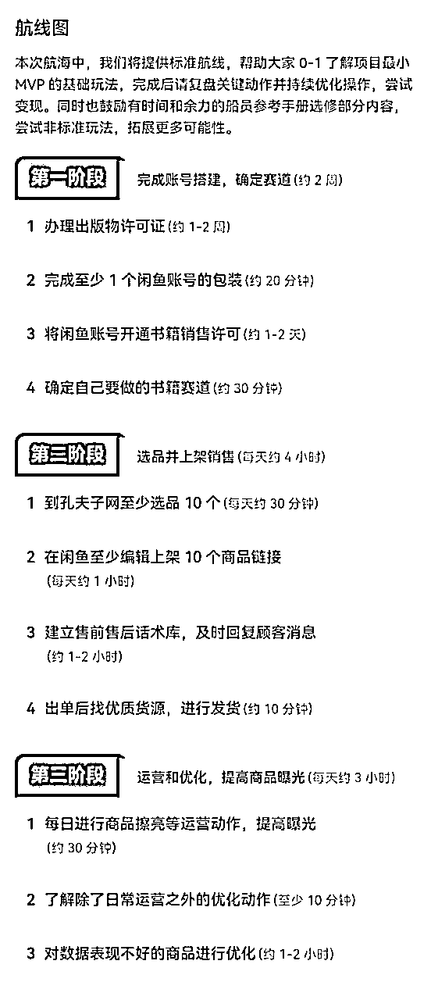

手册和航线图是互相配合的，你此刻处于哪一步，就去学哪一部分。上面提到的航线图动作，最好在航海开始后的前两周内全部做完；之后以实操为主，多选品、多上架、多调整，成交概率才会持续提升。

## 从0到1：跑通最小MVP

💡章节导览
这部分会从认识闲鱼开始，一步步带你完成整套旧书生意流程。沿着章节的内容实际操作，就能把最小MVP跑通。

如果刚接触这个项目，建议先看全貌：
✅【项目概述】认识闲鱼平台和旧书市场

有了整体认知后，再按核心步骤走：
✅【项目实操 1/3】账号准备和赛道方向
✅【项目实操 2/3】挑书、上架与销售
✅【项目实操 3/3】商品运营和优化技巧

这一篇的顺序和航线图是一致的，顺着读就能完成所有任务。后面每个关键章节的导览里，也会标注对应航线图，方便你确认进度。现在，正式出发吧。

# 一、【项目概述】先看清这个生意💡

💡章节导览
本章要让你建立起对“闲鱼卖旧书”项目的整体认知。闲鱼如今是什么状态？平台有哪些特点？旧书市场的前景如何？为什么偏偏要在闲鱼做不囤货的旧书生意？这些都会逐一讲到。

我们会从闲鱼的市场趋势入手，拿它与其他电商做横向对比；再分析二手图书的需求来源，以及这种代发模式的优势与局限，从而把项目前景讲清楚。本期航线的重点，就是告诉大家如何从0到1把项目做起来，所以对全局有个把握必不可少。一起往下看吧。

## 1.1 闲鱼平台速览

### 1.1.1 闲鱼的市场现状

先看几组数据：闲鱼注册用户已超过4亿，月活跃用户超过1亿，2021年平台交易额达到5000亿。用户结构也很年轻——90后超过60%，95后超过36%，折算下来95后用户超过3300万。正因如此，闲鱼在主流App里是年轻人浓度非常高的一个。

如今，闲鱼在主动扶持职业卖家。这样做既能保障货源稳定，又能给买家提供更丰富的商品，同时也推动了平台走向标准化。过去，闲鱼只是个单纯的个人闲置交换场所；现在，它已经进化成C2B2C闭环的闲置经济生态。最直观的信号是，近两年职业卖家明显增多——平台其实在欢迎更多有实力的商家进来，把交易规模一起做大。

电商大环境也在变化。过去它主要在城市里发展，如今正向乡镇覆盖，普及率越来越高，购物更方便、成本也更低。在各路电商中，闲鱼的入门成本算很低的那一档，市场形态有点像早期的淘宝。还有两个细节值得一提：一是平台正在推“7天无理由退货”和“描述不符退货”，分别需要缴纳500元、200元押金，但并非强制，不开通就不必交；二是流量分配相当均衡，不偏爱某个特定账号——这段时间A店订单多，过阵子B店可能迎头赶上，总体还算公平。

### 1.1.2 闲鱼与其他平台的差异

虽然闲鱼也属于电商，但相比传统电商平台，它省心得多：不用刷单，竞争压力小，连保证金也不用交。下面的表格把主流平台的差异做了直观对比，看起来会更清楚。

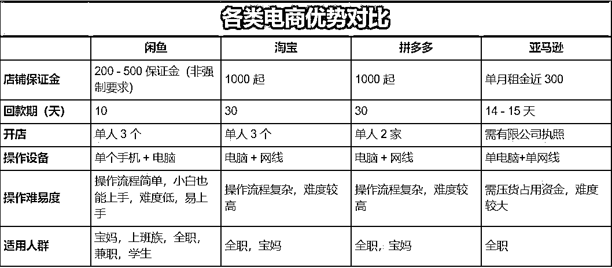

再拿内容类、短视频类平台做比较。今日头条、👸号、百家号、知乎、简书、📕等内容平台，对文字功底和编辑能力有一定要求，对完全没接触过互联网的新手来说并不轻松；抖音、快手、视频号这类短视频平台，则考验脚本写作和视频剪辑能力。当然，不是这些方向不能做——行行出状元，关键看哪种更适合自己。

闲鱼的门槛则更低：第一，操作不复杂，不需要懂文案、会作图、能剪片，按后面给的方法一步步来就行；第二，一台手机就能搞定，随时随地都能“开张”；第三，电商天然离成交近，反馈来得快。所以，它很适合没太多互联网经验、想找个副业赚点零花钱的人。

最后，简单归纳一下闲鱼代发模式的优势：上手容易，没有图片、视频、文字编排的压力；有手机或电脑就可以完成整个流程，不用打包，也不用联系快递；近乎零成本，用自己的手机就能干，不需要囤货，一件代发即可；办公自由，带娃的宝妈或上班族都能利用碎片时间；时间投入少，每天1到2小时足够，下班后再弄也来得及。
来源：《闲鱼电商｜小航海学习手册》

## 1.2 为什么值得做闲鱼卖旧书 @老瞿 Qu

平台本身不复杂，旧书的需求又在肉眼可见地增长，主要体现在四个方面：

（1）八成以上高校教材开放
据不完全统计，在资源循环利用的政策引导下，超过80%的高校已经不再强制学生统一订购教材。学生既能通过学校预订，也可以自行解决，学校不干预。这就为二手教材进入校园创造了天然条件。

（2）大学生对旧书的接受度变高
如今的大学生越来越愿意买旧教材，且这股趋势逐年增强。最大的原因是教材实际使用率并不高，买新的不划算；加之国家打击盗版的力度很大，正规旧书的价格优势更加突出——通常只要新书标价的1折到4折。

（3）消费降级让二手更受欢迎
这几年经济环境不轻松，一个很直观的现象是，越来越多家长开始给孩子买旧字典，平台上的旧字典一度成了“小爆款”，经常供不应求。

（4）校园周边旧书店式微，线上模式占优
学校旁边的旧书店老板普遍年长，三年疫情让绝大多数实体店没能撑下去——学生出不了校门，哪怕门店只隔着一条街。这些老板又缺乏电商运营经验，很难把生意搬到网上。反观学生群体，网购旧书的习惯早已养成。

在几种常见玩法里，代发卖旧书是当前最值得推荐的一个：闲鱼正处于红利阶段；而淘宝、拼多多上的旧书生意要难做得多，建议别贸然进场。

如果是一个人独立操作，不妨找一位家人，用两个人的身份证各办一张出版物经营许可证，一共开6个店。6个店基本是一个人能顾得过来的上限。运营得当的话，年利润有望达到20万到50万。以我们的实测数据为例：开学季时，单个店铺日销售额能到1000到2000元；平时日销约500元，利润率在三成到五成之间。

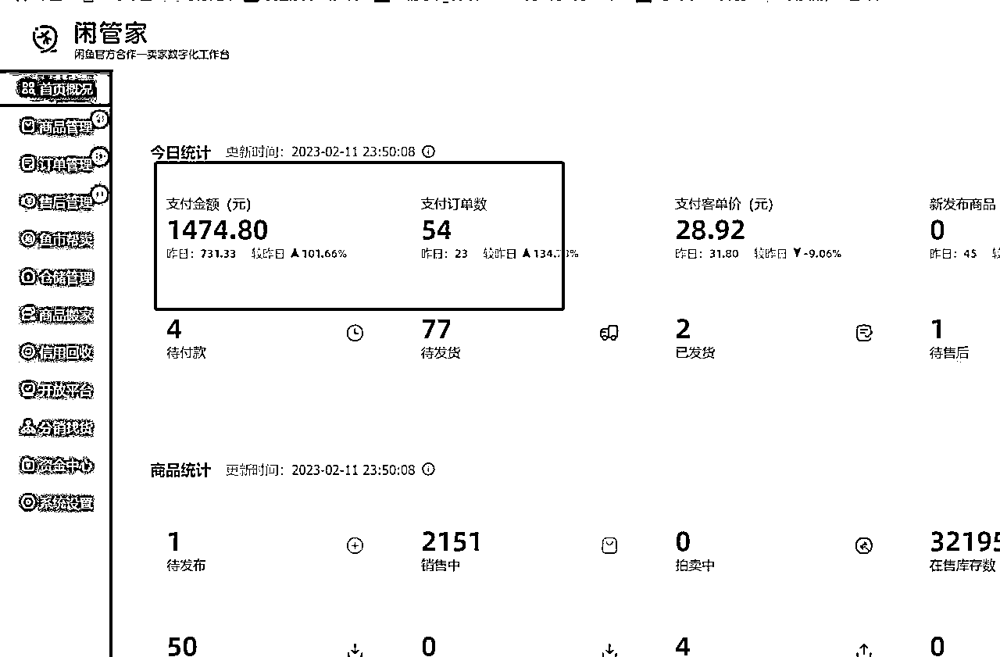

一个闲鱼店铺的书籍容量上限是500本，所以不能什么都卖，得集中精力推爆款——这也是不囤货模式更合理的原因，可以避免压货。另外，要留意官方在开学季推出的活动。之前就有过这样的规则：累计上架满500本书，同时开启“7天无理由退货”和“描述不符退货”服务，就能把可上架数量扩到3000本。

不囤货卖旧书的优势，还能再展开讲五点：

（1）现在入场正好
普通账号原本只能发5本书，早年网上有一个能突破数量限制的bug，2020年9月后被修复。2021年，闲鱼邀请200多位商家做内测，完成出版物经营资质认证后就能发3000本；2022年申请通道长时间关闭，直到12月才重新开放。目前APP已经支持在线提交许可证申请，说明官方认可这个类目。要注意的是，开通鱼小铺的账号，书籍上限为500本。

（2）商品上架后，不用反复找书
大学教材和小说是闲鱼上卖得最好的两类书。教材通常三五年才换一版，小说的“保鲜期”更久。所以只要把商品挂上去，后续几乎不需要频繁更新，能省下大量时间。

（3）售后问题很少
图书本身价值不高、毛病也少，售后率天然低于10%；我们实际跑下来，大约只有不到5%的订单会遇到售后。对比之前圈友卖投影仪这类电子产品，旧书的售后简直可以忽略不计。

（4）资金压力小
代发模式用不着先垫钱进货，没有库存风险，也就不会被资金问题捆住手脚。

（5）起号相对容易
目前做这个的商家还不算多，新店更容易跑起来。我们带人的实测结果是：执行力到位的话，第一个月做到5000元利润、第二个月破万，并不难。

项目虽有优势，短板也躲不掉：

（1）前期铺货需要耐心
这行讲究精细操作：首图尽量用实拍图，每个店铺的文案要形成自己的模板，同时各个账号之间又要有些差别，每天保持上架20到30本。群控软件别碰，效果很差。新店会有一个爬坡期，通常累计挂到300到500本后，才能进入相对稳定的出单节奏。

（2）躺赚不现实
平均一单只有20到30元，客单价摆在那里。订单多起来后，买书、发货要耗费不少精力，比短视频带货琐碎得多。

（3）内容不能照搬
别人的店铺文案、图片不要直接复制，被举报后很容易封号。

（4）单店上限有限
目前我们做到最好的店，旺季月利润在1万到2万之间，淡季平均每月约5000元。和那种一条爆款视频就能赚几十万的模式没法比，赚的是实实在在的辛苦钱。
来源：《深耕行业2年后，分享咸鱼二手书无货源、绝版二手书等5种项目玩法》

## 1.3 高曝光、高排名的底层逻辑

很多玩家每天都在琢磨：怎样让更多人看到我的商品？这里直接说一下底层逻辑——平台只会把流量倾斜给“对平台有贡献”的卖家。

你为平台创造了价值，平台才愿意持续给你更多展现和排名。原因是：平台生态变好，用户就会变多，用户越多交易越活跃，最终平台也跟着受益。所以平台会不断奖励那些“贡献者”。

具体怎么做才算贡献？核心是让买家有好的体验、对平台产生信任。落地到日常动作就是：上架用户真正需要的商品；按照平台用户的习惯来编辑标题和内容；买家消息及时回复；订单及时处理；保证商品质量，让好评自然变多；售后问题快速解决，并尽量减少售后……后面章节涉及的选品、上架、客服、发货等环节，全都围绕这个逻辑展开。
来源：《闲鱼电商｜小航海学习手册》

# 二、【项目实操 1/3】把前期准备做扎实💡

💡 开卖之前：证照与账号先就位

闲鱼无货源二手书项目的整体玩法看清之后，下一步就是正式起盘。真正开始运营前，有两件事绕不开：资料要备齐，账号要搭好。

这一章把开卖前的准备工作整理成了一份行动清单，主要有这些内容：

✅办理出版物许可证
✅下载项目所需 APP
✅设置闲鱼 APP 权限
✅完善闲鱼账号
✅在闲鱼开通书籍销售许可
✅确定店铺赛道

清单里最硬的一项就是出版物许可证。这个证不仅要办，还得在闲鱼上完成认证。没有它就去卖二手书，被判定违规的概率不低，账号也很可能直接被封。

💡 本阶段行动路线

本章学完并动手做完，航线图第一阶段就算走完了：账号搭建完成、赛道确定下来（大概 2 周）。

1. 办理出版物许可证（约 1—2 周）
2. 完成 3 个闲鱼账号的包装和权限设置（约 1 小时）
3. 将 3 个闲鱼账号开通书籍销售许可（约 1—2 天）
4. 确定自己要做的书籍赛道（约 1 小时）

接下来，就可以按下面几个步骤开始筹备了。

## 2.1 先过证照关：出版物许可证 @老瞿 Qu @一游

想开闲鱼图书店，营业执照和出版物许可证缺一不可，它们相当于进入这个领域的入场券。这个领域本身有门槛，而门槛往往能挡掉一半甚至更多竞争者。

启动项目时，第一件事就是办出版物许可证、注册闲鱼账号。

同一个身份最多能开 3 个支付宝，对应 3 个闲鱼号；许可证、支付宝、闲鱼三者的主体必须一致。淘宝上代办价格多在 1100—5000 元之间，也有更贵的，通常包含一个个体户执照加一个出版物许可证。

线下渠道可靠性最高，但操作难度也最大。个体户相对好办，有商业地址就行；出版物许可证则对店铺面积、消防等有要求，部分大城市已经停办，所以线下周期会拖得很长，费用动辄几千元，有些地址每年还要再交几千。

因此线下并不是首选，不少人尝试过后还是放弃了。

如果找网络代办，下证通常 2—7 天。后续营业执照每年年报 50 元，出版物年检 150 元；需要注销的话，费用 150 元。

这里要留个心眼：先辨真假。淘宝上存在假证，拿到后要去官网核验，或者打电话给工商局确认，再点确认收货。对方发来的“官网”别轻信，常见套路是自建查询网站，所以最好通过百度判断是不是真正的政府官网。

营业执照加出版物许可证，不同淘宝店报价差异很大，于是问题来了：哪家代办更靠谱？

从目前了解的情况看，这类机构多半是借政策缝隙或人脉关系操作。刚办下来时一般没事，但后续可能出现地址被注销、地址异常等状况。

代办通常会挂一个偏远地址。只要同一大范围内有一家被投诉，其他挂靠商户也可能被牵连，工商局整体调查后批量注销。

所以，任何代办给出的保证都不能全信，最终还是要看运气：有没有被投诉，有没有惊动政府层面。

那该怎么应对？

先要认清，这个行业多少带点擦边性质；线下办不成，又想赚这份钱，还是得找代办。

好在这个项目有一点比较友好：即便地址异常，对闲鱼店铺的正常经营影响通常不大，闲鱼目前在这块的审核还比较松。

所以不必过度纠结，赚自己能赚的钱，出了问题再解决。挑代办时把握三点：

1. 价格自己觉得合适；
2. 下证速度快；
3. 已经有人拿该证件通过闲鱼认证。

满足这些就可以去办。

不过还要再提醒一句：认证通过，并不等于这个代办证件百分百稳妥。认证成功后可以先跑起来，后续真遇到异常再处理。

也可以考虑找一家相对稳定、靠谱、愿意承诺售后的代办。万一证出问题，最坏也就是付点年审费用，大约 300 元，让对方重新办一个许可证，然后在不影响店铺经营的前提下替换掉。

当然，包售后的报价会高一些，毕竟大家都要赚钱。淘宝上价格低得离谱的，跑路风险反而更大。

风险提示：不要用办来的证开🛰️收款码，可能存在风险。

圈友 @老瞿 也在星球分享了办证相关问题解答，可以参考：《闲鱼二手书航海，办理〈出版物许可证〉相关问题解答》。

另外，有人办证时发现下证速度受限，其实不用慌。可以先上少量书练手，把项目流程跑熟。普通账号最多只能上架 5 本，正好趁这个阶段养号，同时把鱼小铺开起来，等证书下来就能直接上手。

内容来源：《如何在闲鱼开通图书店铺之劝导新手办理营业执照加出版物许可证不纠结篇》、《深耕行业 2 年后，分享咸鱼二手书无货源、绝版二手书等 5 种项目玩法》

## 2.2 软件与工具准备 @老瞿 Qu @小嵩

需要提前备好的软件和网站如下：

闲鱼 App、支付宝 App、孔夫子网：https://www.kongfz.com/、闲管家：https://www.goofish.pro/

闲鱼 App 的风控目前比较严，最好一机一号。同一台手机频繁切换账号，很容易触发异常；一旦异常，闲鱼币就用不了，所以分开设备更稳妥。二手手机可以去闲鱼淘，200 元左右的红米 7 或 8，或者同配置机型就够用。

闲鱼号绑定的支付宝，要和执照上的主体是同一个人。

一个出版物许可证可以支撑三个闲鱼店铺，每个店铺对应一个支付宝，而一张身份证能注册三个支付宝。

换句话说，只用自己的身份信息来做，办一个出版物许可证就够了，不用办多个。

另外，电脑端可以用闲管家统一管理，它能关联六个账号，管理效率更高。不过闲管家更适合在家或工作室使用，平时上班还是要随身带好手机，避免漏单。

闲管家界面展示：

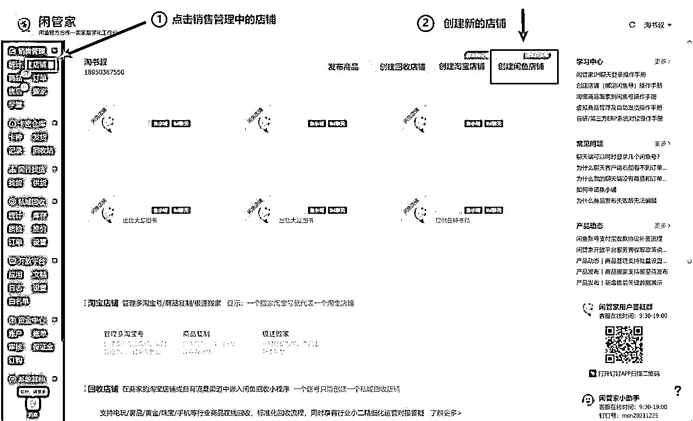

内容来源：《深耕行业 2 年后，分享咸鱼二手书无货源、绝版二手书等 5 种项目玩法》、《加入龙哥盟一年，终于实现副业月入过万》、5 月 30 日《单账号单周出 100 单，如何从 0-1 实现闲鱼二手书变现？》@一棵茶树

## 2.3 闲鱼 App 权限设置

### 2.3.1 定位权限

定位选择“永不允许”，不要开通。（如果之前已经下载用过闲鱼，定位可能已开；或者你需要用闲鱼买本地商品、向附近朋友出闲置，这种情况可以不管，开着也行。）

### 2.3.2 消息通知打开

允许后台 App 刷新，同时把照片权限全部打开。（截图以苹果为例，安卓按页面提示操作即可。）

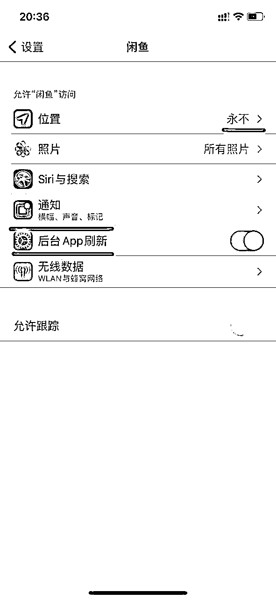

内容来源：《闲鱼电商｜小航海学习手册》

## 2.4 闲鱼账号完善

以前没用过闲鱼的，直接用平时常用的支付宝、淘宝账号登录就行，操作不复杂。

### 2.4.1 个人资料完善

登录后点“我的”，再点“编辑资料”。

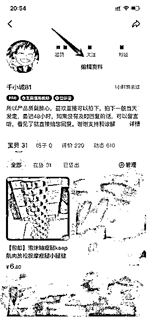

资料尽量填到 85% 以上。头像可以用书店名称做一个标志，这样更有辨识度；自己做也不难，比如“一三书屋”，用免费字体设计一下，截图就能当头像。也可以选偏文艺的卡通图或美女图。其余项目按自己的实际情况填写。

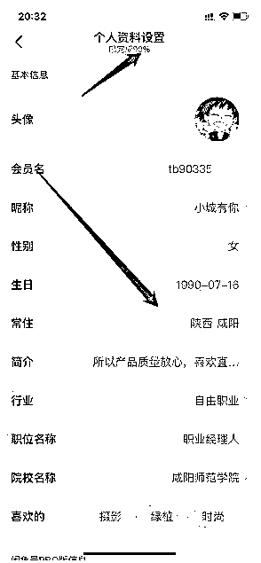

### 2.4.2 实名认证完善

页面继续往下拉，会看到实人认证、支付宝实名认证和芝麻信用分，分别按提示完成认证和授权。

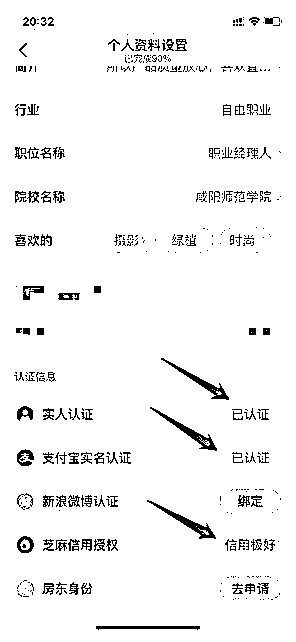

### 2.4.3 注意事项

芝麻信用分最好在 650 以上，能到 700 左右更佳，分数越高越有利。查询方法：打开支付宝，首页搜“芝麻信用”点进去即可。

怎么提升芝麻信用分？

页面下方有“去涨分”，按提示操作；平时多用花呗付款，并按时还款；再把身份信息补全一些。

信用分偏低怎么办？

起步阶段可以借用身边亲友信用分较高的账号来操作。

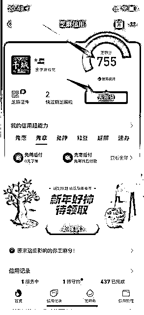

内容来源：《闲鱼电商｜小航海学习手册》

## 2.5 申请书籍销售许可 @老瞿 Qu @小嵩

进入闲鱼 APP，在“我的”页面找到认证招商，点【经营资质】，类型选【企业/个体工商户经营资质】，然后按步骤上传执照。

目前经营资质认证申请基本已全面开放，申请后通常有两种情况：

1—5 天就下证的，多半是代办发电子版时闲鱼审核还查不到，建议等 1—3 天再提交；
办理周期超过 1 周的证书，一般可以直接去认证。

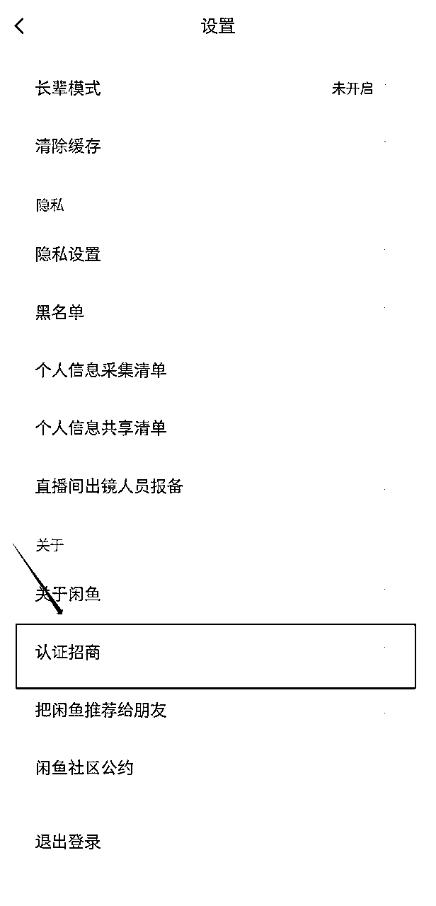

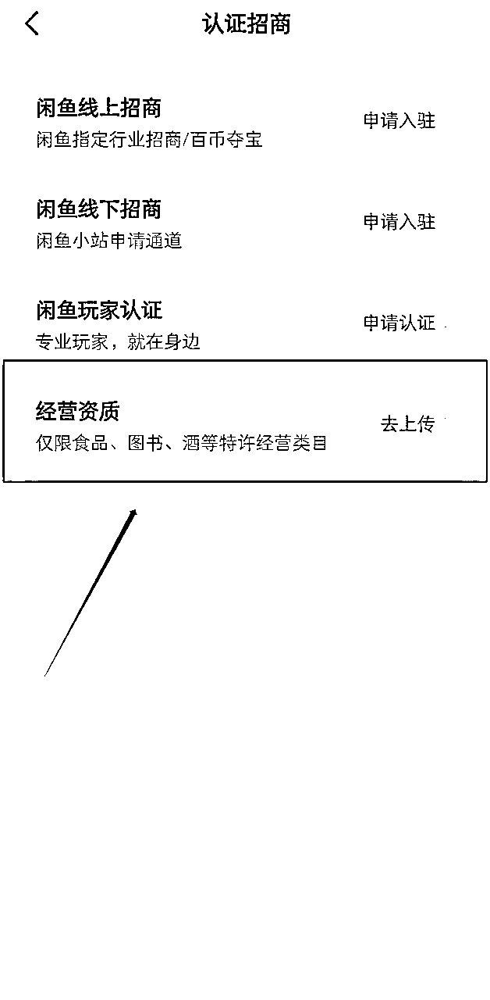

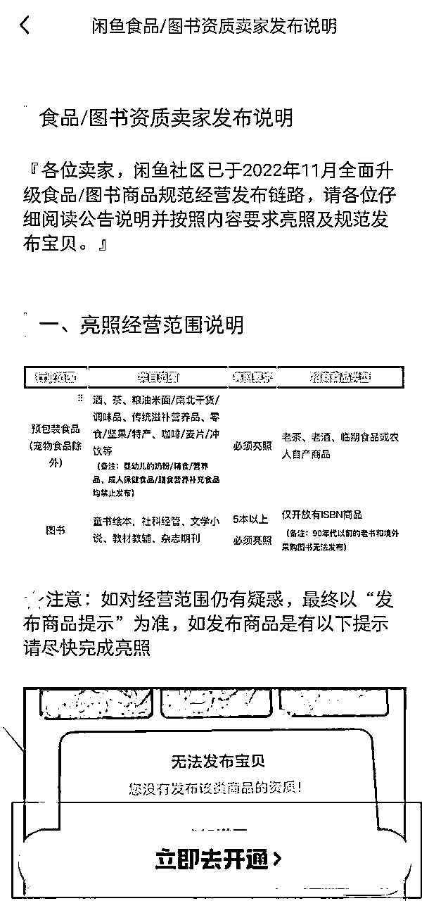

审核通过后，建议第二天再开始上书。通过当天先别急着上，这时候操作容易被判违规。系统可能有延迟，第一天就大量上架，系统可能误以为没有证，误判后再申诉很麻烦。稳妥起见，第二天再上书更安全。

内容来源：《加入龙哥盟一年，终于实现副业月入过万》

## 2.6 确定店铺赛道 @豆仔

选品前先想清楚：你要做一家什么书都卖的综合书店，还是只做一个垂直子赛道，比如教辅类、考研教辅类。

这件事没有标准答案，看个人选择。有圈友做综合书籍店做得很好，也有人专注单一类目。先定赛道，只是给后续上书划一个大致范围。我自己的做法是尽量让不同店铺分布在不同赛道，避免自家店铺互相抢流量。

内容来源：6 月 27 日《闲鱼二手书新人 21 天跑通项目闭环的经验分享》@豆仔

# 三、【项目实操 2/3】选品和上架

## 3.1 如何快速选品

💡 章节概要

账号准备好之后，就要开始上架二手书商品了。这时问题也随之而来：既然做无货源，书从哪里来？怎样找到更好卖的货源？

目前比较好用的选品思路，是参考孔夫子二手书网站的畅销排行榜。

选品时注意别碰违禁书籍，避免账号被封；选品和发货环节还要留意二手书品相，以及孔网商家的避坑点，尽量降低售后概率。

💡 本章航线图

完成 3.1 的学习和实操，航线图第二阶段就能完成：选品并上架销售（约 1 天）。

1. 到孔夫子网至少选品 10 个（每天约 30 分钟）

接下来，就开始挑选你想上架的二手书吧。

在闲鱼卖二手书，商品上限只有 500 个，而书的种类多到几百万甚至上千万种，SKU 极其庞大。所以现阶段比较合适的打法，就是挑爆款、卖畅销书。

畅销书信息主要看孔夫子销量排行榜。

### 3.1.1 根据孔夫子二手书畅销排行榜选品 @老瞿 Qu

这里拿教材举例，教材也是需求最大的市场。打开孔夫子网页：https://www.kongfz.com/

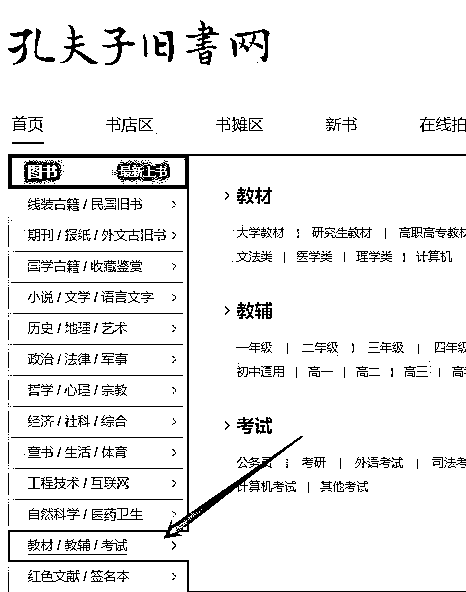

进入教材板块后点销量，可以按这个顺序依次上书。如果想做出一点差异化，也可以跳过前几页，比如从第 10 页开始选，有时效果也不错。

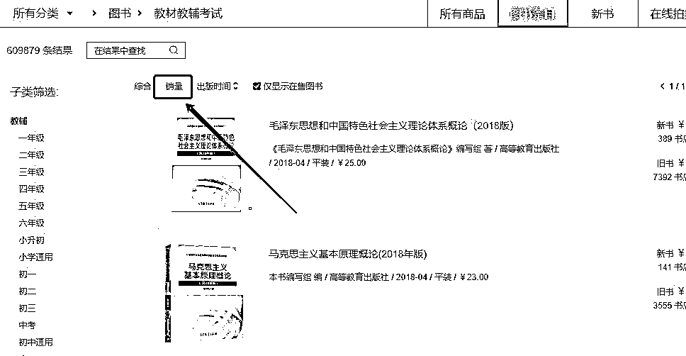

一页 50 本，单教材这一块就有 100 页，一年都上不完。

目前多数二手书货源来自孔夫子旧书网，利润率大概在 30%—50%。上架时会按这个利润率来控价；如果某本书在孔夫子已经卖完，或者采购价太高，就直接放弃这个品，不卖它。

### 3.1.2 选品注意事项：不卖违禁书籍 @老瞿 Qu

选品方法讲完，很多人可能已经准备动手了。不过在正式操作前，还要提前说明这个项目里的一些注意事项。

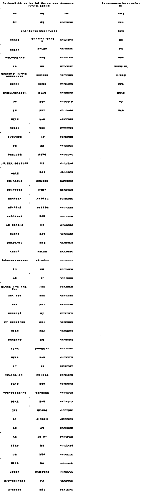

### 3.1.2 孔夫子避坑商家 @flame

下面这份表格，是圈友 @flame 牵头、带着续航群船员一起整理的孔夫子商家避坑表，里面记录了大家在孔网踩过的商家和踩坑点。

选品时可以对照表格查一查，看看有没有碰到违禁商家。运营过程中如果你也遇到踩坑商家，欢迎一起补充更新～

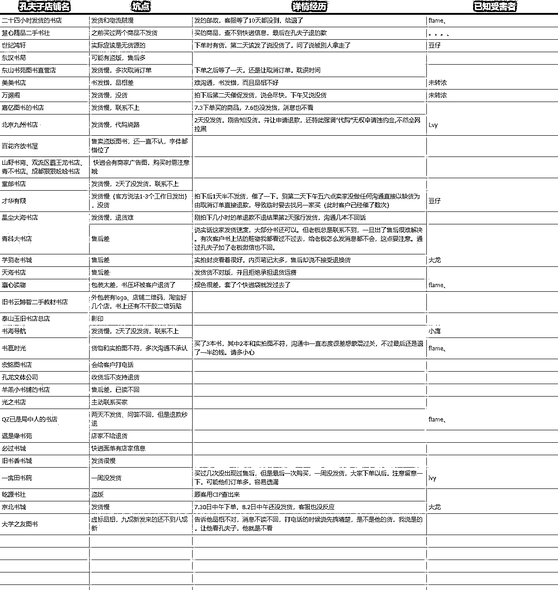

孔夫子商家避坑表

## 3.2 如何在闲鱼平台上架商品 @老瞿 @大闵

💡 章节概要

编辑上架的核心目标只有一个：让市场上有需要的用户都能看到咱们店铺，并最终下单付款。

那怎样让上架商品获得更多曝光和成交？这就落到如何在闲鱼平台把商品上架好。

编辑上架时，最关键的四项是：商品标题、商品主图、商品介绍内容、如何定价。

除此之外，这里还整理了一些编辑小技巧和注意事项，帮你更顺畅地完成上架。

这些模块具体怎么带来更多流量？继续往下看。

💡 本章航线图

完成本章节的学习和实操后，航线图第二阶段就能完成：选品并上架销售（每天约 4 小时）。

### 3.2.1 一个好的主图怎么制作

一张好的主图，应该在第一眼就抓住闲鱼用户的注意力。这类主图通常有两个特点：

清晰干净；
能体现产品特点，让用户一眼明白你卖的是什么。

做闲鱼二手书，主图的第一要务就是“一眼说清”：画面干净、卖点突出，让人刚划到就知道这本是什么书。最省力的办法，是直接去孔夫子网挑一张合适的实拍图拿过来用。

选图细节上，有几点可以留意：
- 一定要实拍图，图上不能有任何平台水印；
- 拍摄角度：俯拍优于斜拍，视觉上更舒展；
- 如果图片中有手拿书本的画面，优先选手持版；
- 景别选择：近景优先，远景排除；
- 光线条件：亮图胜暗图，别让买家看个模糊。

### 3.2.2 写标题：把关键词码满，点击率自然就高了

标题要承担的责任是：买家搜什么词，你就在标题里埋什么词。把可能被搜到的书名、作者、版次、出版社等关键词全部放进去，用户用任何一个入口搜索，都能撞见你的链接。这就是基础 SEO。标题字数只有 30 字，尽量全用上。标题存在的意义，就是同时容纳“搜索词”和“吸引点击的词”。想深入优化，就去知识星球搜“SEO”，相关讨论不少。

一个可落地的标题公式：书名 - 作者 - 出版社 ISBN 编码。这样写下来，30 个字基本就满了。示例：二手正版三体 3 死神永生三 刘慈欣 重庆出版社 9787229030933。

标题开头可以加上这些词：二手正版、正版二手、正版好品相、毕业了卖书、正版捡漏，再用【】把词框起来突出关键词。逻辑也很直白：当用户搜索一本书，平台上大家的封面图几乎一样，你的标题就是让他点进来的钩子。

说到底，做标题是为了配合搜索习惯。图书类目没那么复杂，用户主要先搜书名，再用作者、第几版这些属性词做筛选。新手前期把核心信息填完整，效果已经达标。

想快速做出一条优质标题，就去闲鱼和淘宝搜同类书里销量最好的链接。这些标题通常都是优化过后的成熟模板，直接改改书名、版次和作者，就能变成自己的标题。

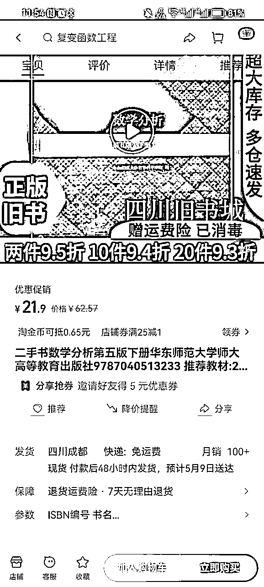

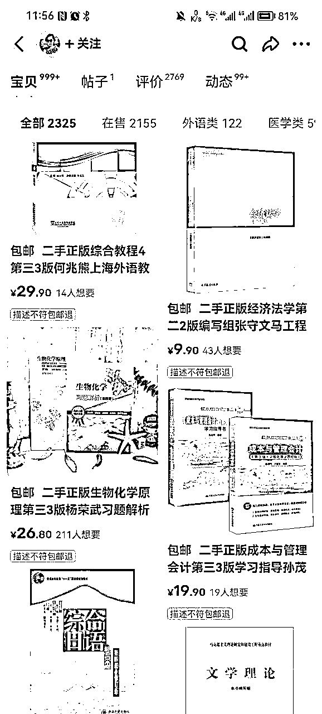

### 3.2.3 产品介绍：三段式模板 + 向同行偷师

图片部分参考闲鱼上热卖款的实拍风格就行。这里重点谈文字版介绍怎么写。

产品介绍有一个通用框架：

第一段：写清楚你卖这本书的原因，顺带把特点抛出来；
第二段：写明白规格和价格；
第三段：写清楚发货时间、快递公司、售后规则。

产品介绍足够细，用户关心的信息都在页面上，客服基本上就不需要再和买家来回拉扯，你的时间成本自然降低。另外，像下图二那样一目了然的介绍，买家反馈都能快速捕捉，决策压力变小，转化率自然向上走。

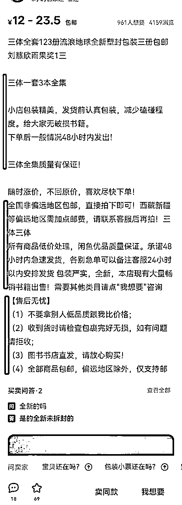

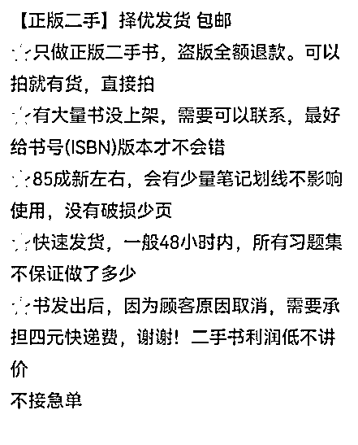

2. 参考同行 @大闵

去翻同行怎么写，是最便捷的入门法，看完在对方思路上做微调。

话术上的核心动作是先给买家吃定心丸：书是正版的；同时写出真实品相，比如“教材有字迹是正常的”，主动把预期管理到位。售后政策、不讲价、偏远地区不包邮等，不用太讲究格式，把情况说明白就好。

也可以适当加入一点感性内容，强化买二手书的理由。例如卖童书，可以从环保理念、正版书对孩子健康成长的帮助、盗版童书可能带来的伤害等方向去写。只要上网搜一下“给孩子买二手书的意义”，很容易拼出一段打动人心的文案。记住，百度能解决 90%以上的问题。

比如我卖二手绘本时，会在文案最后加一句：

“最怕看见诚实的人被迫说谎，正直的人被迫弯腰，直言的人被迫沉默，理想主义者眼睁睁看着梦碎。道远知骥，世伪知贤。我们改变不了别人，但至少可以要求自己，拒绝盗版，给孩子一个干干净净的世界。”

这段话并非我的原创，也是抄来的。每个人的风格不同，我这类人偏感性，所以写得出这种话，你也可以按自己的表达来。

不过，别写那些把客户拒之门外的文案，比如“二手书不是新书，事妈绕道”之类的。做生意主打和气赚钱，没必要日常和用户针锋相对。你也不可能一直用毕业季大学生处理藏书的心态来做这件事，这是你的一份小事业。

另外还有几个小细节：
- 标题内不要出现品牌词，图片里也尽量不放；
- 别写“无添加”“联系”“🛰️”等引导站外交易的词；
- 发布位置尽量落在大学密集的城市；
- 发布时间优先早 8 点，其次晚 8 点，再不行中午 11 点半；
- 当天保持发布 20～30 条链接的节奏。

### 3.2.4 定价：先看成本，再定倍率 @大闵 @诗和远方 @豆仔

1. 根据利润来定价

二手书定价并不难，关键是算清前期投入和人工成本。不需要机械地加价 30%。孔夫子的书并不全是全网最低价，一些旧书的价格甚至超过新书，这时再加价 30% 还有谁买？

没有硬性标准，书店是你自己的，盈亏和销量也都是你的。有些书赶上短期的热度，我可能就加价 1 块钱出手；不同阶段，策略不同。需要比价，就参考一下淘宝同行的售价。

另外，“孔网”低价书通常只有 1 本，有的确实只有一本存货，有的则是故意低价引流。你如果按这个最低价去预算利润，等到你上架时那本低价书可能早没了，有用户来买，你就得倒贴。

建议先判断要上架的书在什么价位段最集中，挑一个相对稳定的基础价，把利润加上去再卖，这样能有效减少纠纷或亏损。

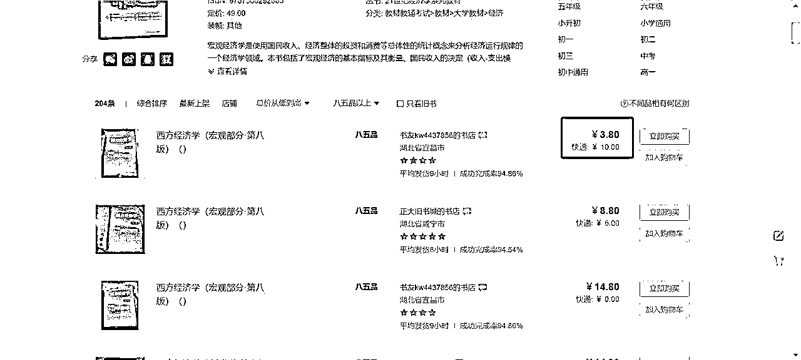

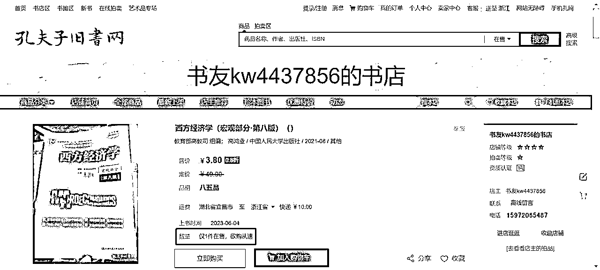

2. 多规格是单本定价还是合集定价？

多规格书籍的链接，买家点进来第一眼看到的是价格区间。如果多规格里包含合集，价格区间的最高值就会被拉大。所以需要分开考虑。

① 主图是单本书的实拍：SKU 中如果设置了合集，先建议把合集 SKU 去掉。这样价格区间的上限就是单本书的真实售价，买家真心想要或价格能接受的话，自然会点“我想要”来咨询。不删掉的话，有的人会误认为最高价格就是单本书的价格。

② 主图是合集书的实拍：这种情况下，合集作为一个整体被呈现，价格区间稍大也是合理的，合集 SKU 可以不用移除。

整理自三篇航海分享：@大闵 6 月 8 日《闲鱼二手书 照着抄就可以见到效果的实操干货》、@诗和远方 7 月 6 日《在闲鱼卖教辅书的几种选品技巧》、@豆仔 6 月 27 日《闲鱼二手书新人 21 天跑通项目闭环的经验分享》

### 3.2.5 电脑操作闲鱼上架，手把手完整流程 @老瞿 Qu

电脑上架必须借助“闲管家”（闲鱼官方的后台工具）：https://www.goofish.pro/product/all。

手机端也能上架，但需要手动扫描 ISBN，效率明显不如电脑网页端。

前期货架，也就是链接没有跑出流量前，建议把加价幅度控制在 10% 到 20%，等有了成交再慢慢加价，这种节奏更容易把流量养起来。流量稳定后日常上架，可以按孔夫子或淘宝价格加价 30% 到 50% 来做。

具体操作如下：

【第一步】进入闲管家后台，点击“店铺管理”里的【创建店铺】。

01 选择行业：选择图书行业，点击下一步。

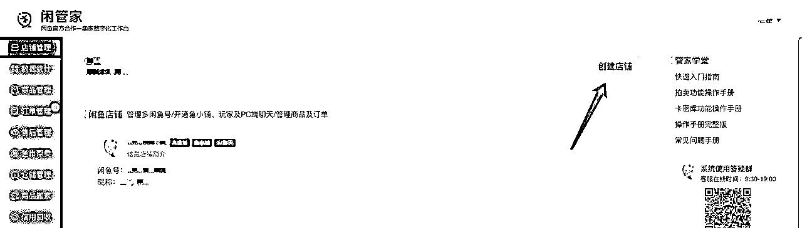

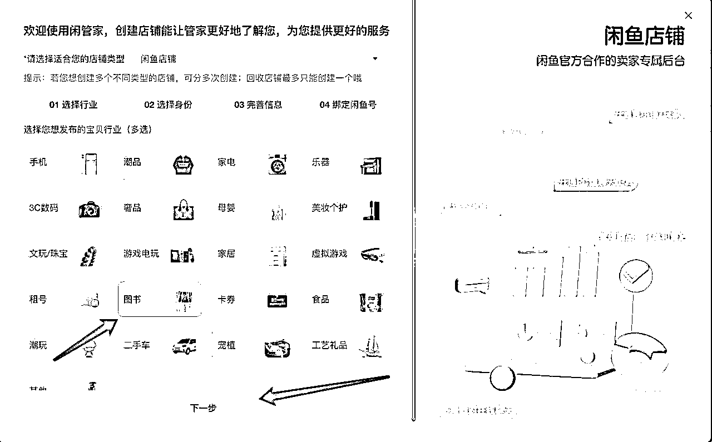

02 选择身份：选择实体店主，点击下一步。

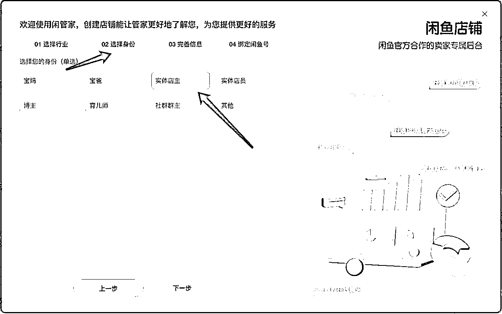

03 完善信息：将店铺名称、简介、地址等填写好。

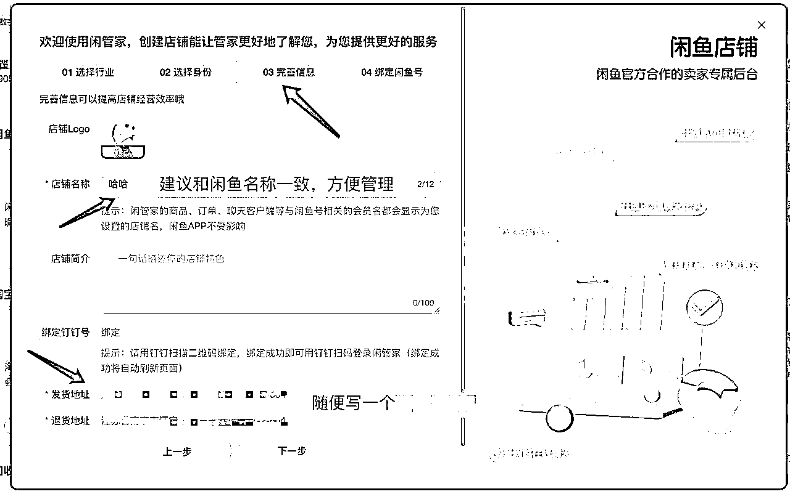

04 绑定闲鱼号：点击绑定闲鱼号即可完成开店。

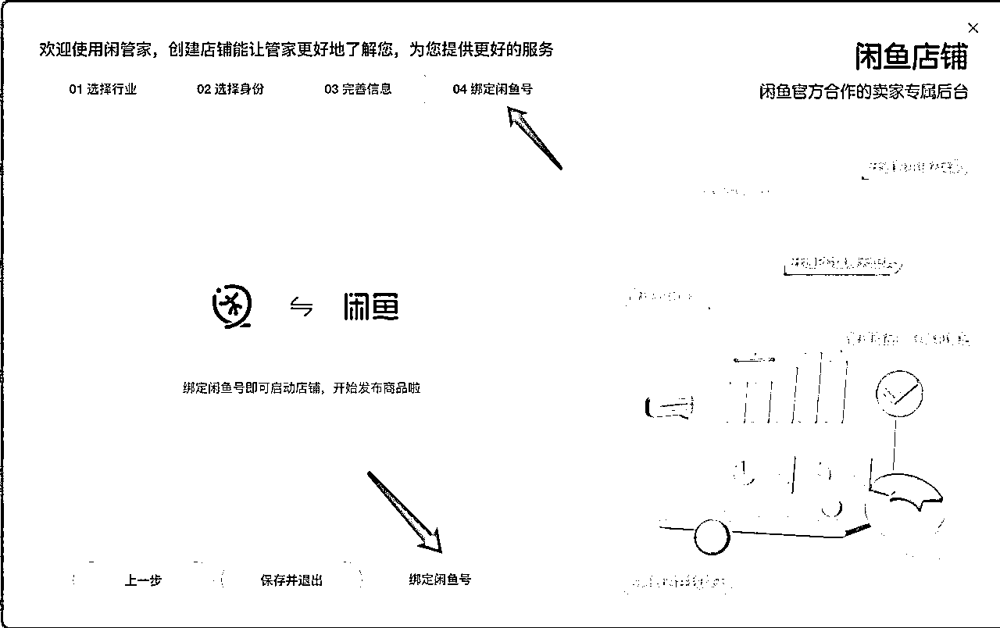

接下来正常登录。

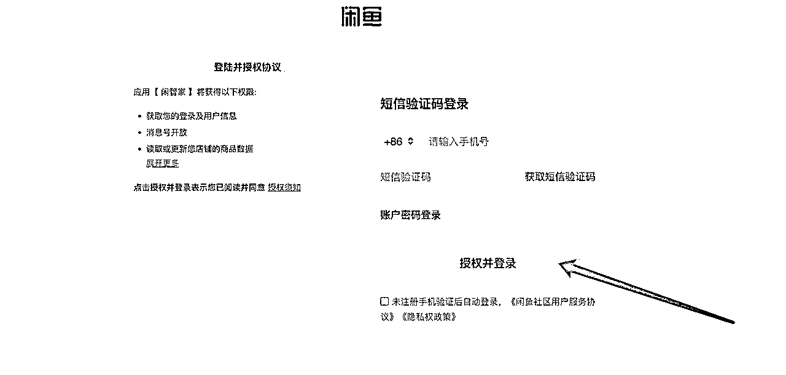

【第二步】登录闲鱼账号，进入商品管理，新建商品。

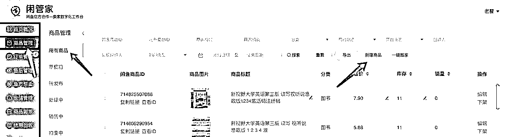

【第三步】设置商品类型为一口价；商品分类为图书（这里以教材为例，选择学习考试）。

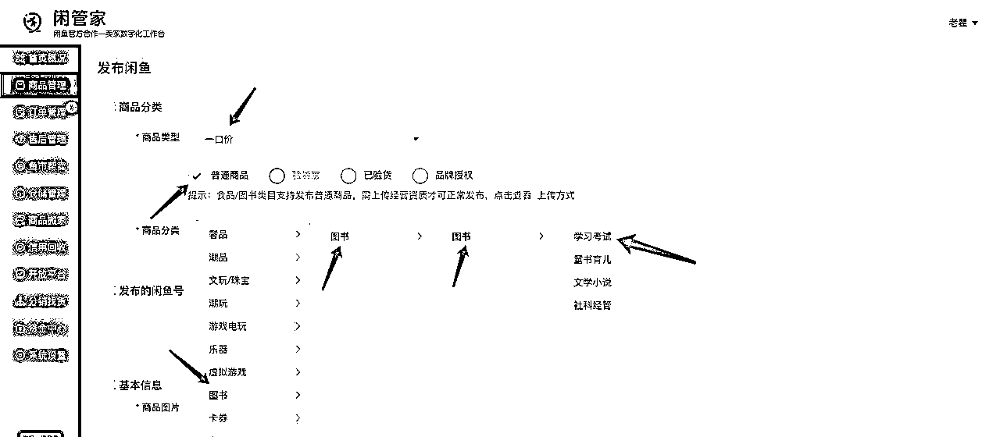

【第四步】在“发布的闲鱼号”中，选择你要发布的账号。

【第五步】完整填写基本信息。

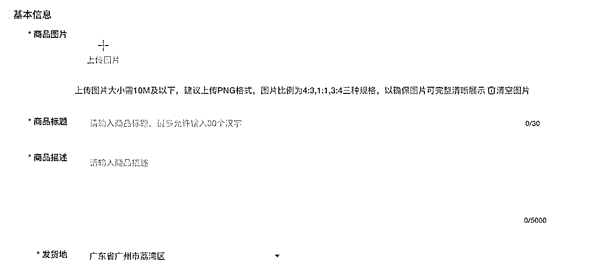

其中：
「商品图片」在孔夫子或淘宝上找无印水印的实拍图。
「商品标题」参考“正版二手 / 二手正版 + 书名 + 作者 + 出版社”，标题尽量写满。
「商品描述」可以去闲鱼搜同行的模板，建议一个号对应一套模板，避免同质化。类似下图这种，注意稍作修改。

【第六步】在「价格库存」部分，只需填写价格，调整库存即可。价格可以按孔夫子商家的售价（书本价格+运费）再上浮 40%，利润率控制在 30% 以上。

以《毛泽东思想和中国特色社会主义理论体系概论（2018版）》为例：在价格排序下选择总价从低到高，品相选八五品以上，参考商家售价再上调 40%。

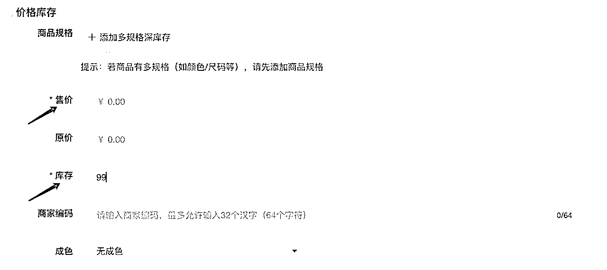

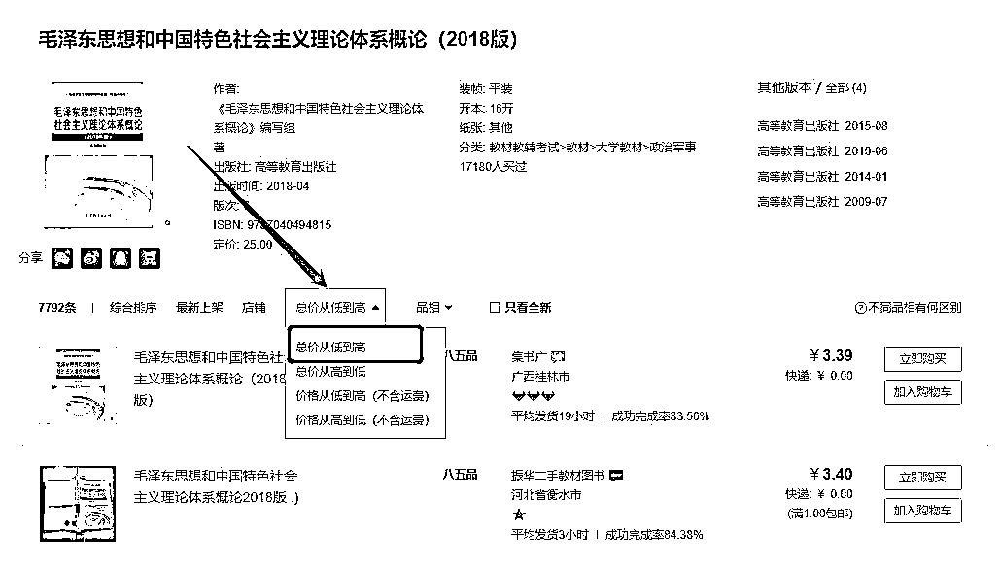

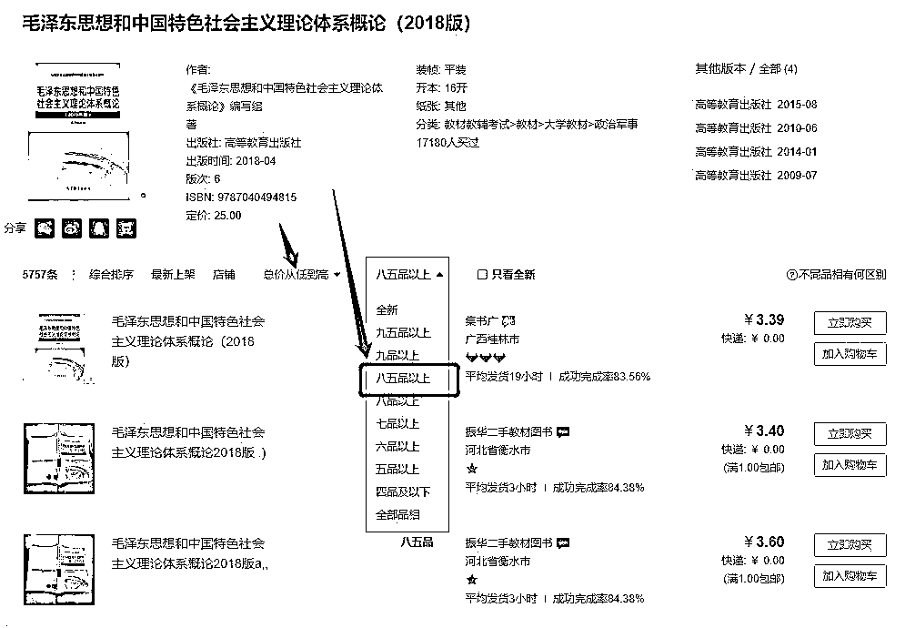

填好所有内容后，点击「立即发布」，再点「确定」，一本二手书就这样上架完成了。

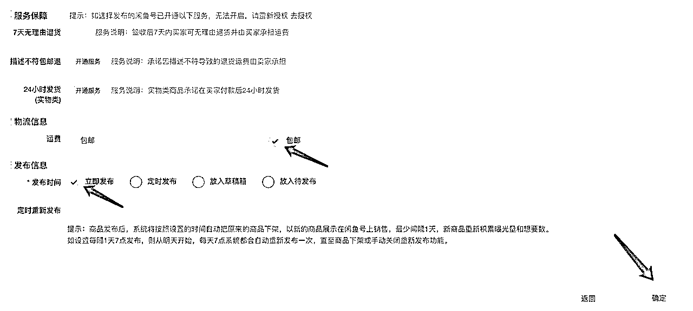

这套流程跑熟以后，一小时发布 20 条链接是完全可以做到的。

内容来源：《深耕行业 2 年后，分享咸鱼二手书无货源、绝版二手书等 5 种项目玩法》

# 四、【项目实操 3/3】成交之后：客服与发货都安排好💡

章节概要

买家来咨询时要快速响应，避免潜在订单流失；出单后也要高效发货，减少买家等待，提升体验。这一章会重点讲：售前售后客服话术怎么设计、优质货源怎么找。

✅ 客服端：及时回消息，售后问题积极处理
✅ 发货端：拿到订单后第一时间在货源平台下单，并回填单号

本章航线图

学完本部分并动手操作，你的第二阶段“选品并上架销售”就算全部走通（预计耗时 1 天）。

第一步：建好售前售后客服话术，客户消息来了能马上回复（约 1～2 小时）
第二步：出单后快速寻找货源并发货（约 10 分钟）

## 4.1 闲鱼客服回复：及时还准确，转化率自然高 @老瞿 Qu

闲鱼客服的本质，是搞清楚买家的每个问题背后真正关心什么，然后主动引导客户，而不是被客户带着跑；4 句话内让其付款。最重要的原则：凡是来问的，力求都成交。

我这里整理了几组经过测试的话术模板，可直接拿来用：

### 4.1.1 售前高频问题与回复模板

欢迎语：欢迎欢迎亲！小店专营各类正版书籍。看中直接下单就好哦。

客户：“书是全新或正版吗？”
回复：“亲，书籍是从学生处回收并消毒翻新，七到九成新，无破损、明显污渍或无法使用的情况，可能有少量笔记，不影响阅读，发货都会择优。”

客户：“在吗？/你好/还有吗？”
回复：“在的/你好/有的，拍下最迟 x 小时内发走，喜欢直接拍即可。”

客户：“多久发货/发什么快递？”
回复：“当天下午 x 点前拍下的，一般当天发；快递随机，最迟不超过 x 小时。”

客户：“可以拍照吗？”
回复：“仓库较远，书籍数量多，没法每本都拍；但我们发货时会选品相好的，放心。”

客户：“有货吗？品相如何？”
回复：“能拍就是有货，成色 7～9 成新，无破损/明显污渍/无法使用的情况，会有笔记但不影响阅读，择优发货。”

如果遇到改价后迟迟不付款的订单，点右上角“···”，选择“关闭订单”，再按系统提示关闭即可。

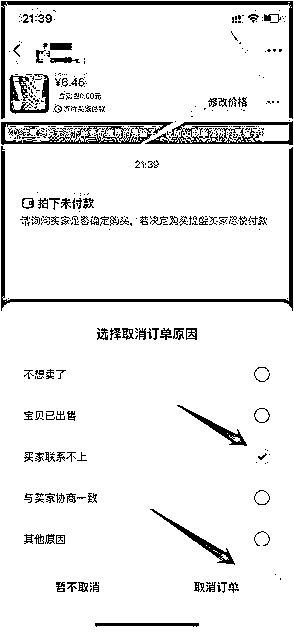

### 4.1.2 售后难题处理口径

客户：“怎么没有物流消息？/还没发货？”
回复：“仓库正在出库、核对版本和封面，并打包装袋，会尽快发出；若有品相不佳或版本不对的情况，也会尽快和您联系。”

客户：“快递还没送到？”
回复：“亲，各站点时效不一样，还请您耐心等待；超过 3 天没动静请给我留言，我看到后会马上联系快递公司。”

客户：“收到空包/破损/无法使用/差评”
回复：“亲，请把快递包裹和书籍一起拍照，如果能拒收尽量拒收；我们核实是发货问题还是运输破碎，然后尽快给您满意的解决方案。”

客户：“不想要了，能退货退款吗？”
回复：“亲，没收到货的情况下申请退款需要您承担运费；二手书价格本来就低，运费都快比书贵了，所以退款时扣除运费且拒收包裹，我们收到退件后会退款。已签收的则支持 7 天无理由，运费自理。”

客户：“包裹里有拼多多卡片怎么回事？”
处理：在货源平台采购时就说“给朋友买的，别放价格单，也别发短信”。同时尽量不选拼多多渠道。

如果仍发生，可以这样回复：“我们不止这一个平台在卖，那边也有店铺，应该是新来的同事标错了，已经提醒过，书的质量可以放心。”
如果查实拼多多更便宜，退给客户差价就行，这种概率很低，1000 单里也难碰到几单，大家买的是书，不是平台。

以上是闲鱼最常用的回复，其他问题可以继续在航海中交流。

## 4.2 发货环节

### 4.2.1 从出单到发货的操作路径 @老瞿 Qu @小嵩

产生订单后，去孔夫子网或淘宝下单，上家发货后再把快递单号填到闲鱼。

建议直接用电脑端网页版「闲管家」处理。

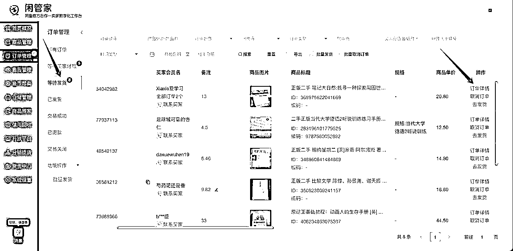

复制地址，找上家（孔夫子、淘宝对应店家）下单即可；待上家发货，把单号复制过来填上就算完成。

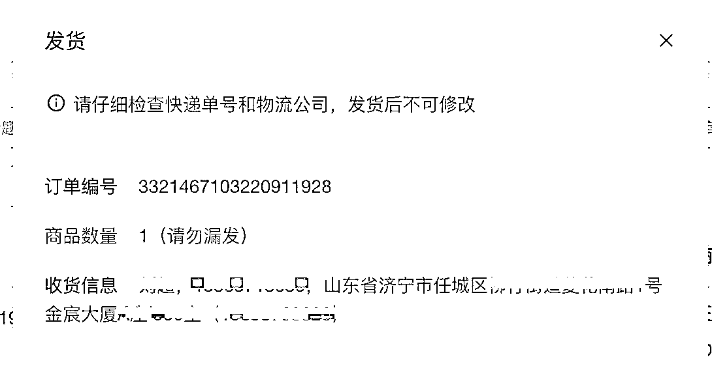

内容来源：《深耕行业 2 年后，分享咸鱼二手书无货源、绝版二手书等 5 种项目玩法》、《加入龙哥盟一年，终于实现副业月入过万》

### 4.2.2 优质货源挑选标准 @老瞿 Qu @豆仔

不同店铺的二手书品相差异很大，挑对货源能直接压低售后率。以孔夫子网为例，可综合品相、发货时长、成功完成率、店铺好评率（再花点时间看中差评）来评估，其他平台同理。

挑书前，先把筛选顺序设为“价格由低到高”，然后重点看卖家多久能发出、成交完成率如何。发货时限越短越稳妥，完成率越高越可靠。可以优先考虑十二小时内能发货、成交完成率与好评率都超过九成的店铺。

接着进入商品详情页，点开“店铺评价”板块。好评占比越高越值得考虑，同时翻几条真实买家留言，能帮你更全面地判断。
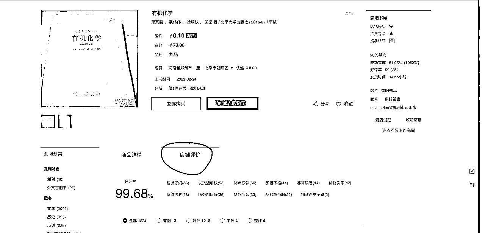
提醒一句：若卖家在描述里写明缺页之类的问题，通常意味着品相有瑕疵，别急着拍。
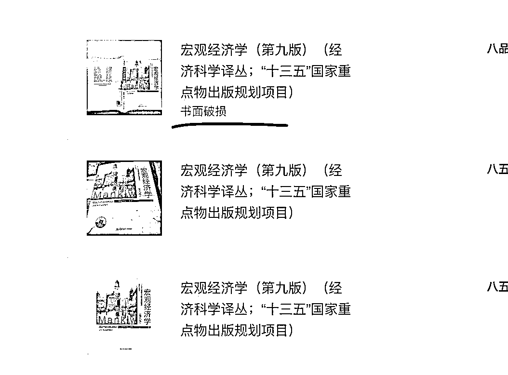
还有一种情况也要避开：聊的时候对方说店铺要关了、介意勿拍，那就果断放弃，否则后续需要售后时很可能找不到人处理。
内容来源：6 月 27 日《闲鱼二手书新人 21 天跑通项目闭环的经验分享》@豆仔

## 4.3 售后处理流程 @老瞿 Qu

核心只有一条：把自己当成居间方，别把情绪卷进去，保持平常心。

出现售后时，不必在闲鱼上和买家反复争辩。请对方把快递面单与损坏商品同框拍照发来——这既能核实货是不是自家出的，也为之后跟供货商沟通留下凭证。照片到手后原样转给上家；上家给出处理意见，我们再回传给买家；买家有新回复，继续转给上家。流程不复杂，照做即可。

另外，平台下单通常附带运费险。闲鱼买家若因自身原因退货，来回运费由其自理；换个角度，运费险反倒可能成为额外进项。若是商品质量问题，仍按上面的转达方式交给商家处理。

个人做法：尽量别把小事闹大，只要在利润能覆盖的范围内，协商补偿或直接赔付都可以，把省下的精力用于提升收益更划算。

附售后问题处理参考：
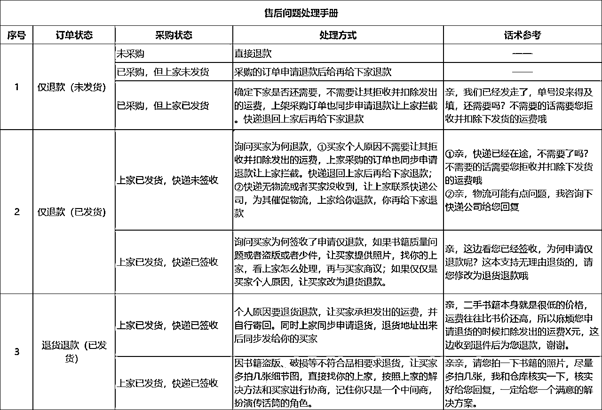

# 五、【运营和优化】怎样让曝光与成交概率稳步上升

💡本章导览

链接上架后虽然能长期使用，但并不意味着挂上去就能当甩手掌柜。接下来要做的，是持续打理商品。日常维护里藏着不少细节，任何一个细节都可能左右转化效果。

本章会聊一聊，怎么让已经上架的链接获得更多展示，让更多潜在买家刷到你：

✅链接维护：每日擦亮商品、及时回复买家消息、完成提升曝光的日常任务

✅链接调优：根据实际数据做调价、更新商品、人工干预等操作本章也会展示不同数据表现下，具体该怎么做调整，希望能给你一些思路。此外，章节末尾还整理了一些打算长期做这个项目的注意事项。

本章也会展示不同数据表现下，具体该怎么做调整，希望能给你一些思路。此外，章节末尾还整理了一些打算长期做这个项目的注意事项。

💡

本章行动路线

学完本章并完成实操，就能走完路线图的第三阶段：运营和优化，提升商品曝光

1.

每天执行商品擦亮等运营动作，提升曝光（约30分钟）

2.

了解日常运营之外的优化手段（至少10分钟）

3.

对数据表现不佳的商品做针对性调整（约1-2小时）若你手上已经挂了几本书，不妨从今天开始记录数据，边做边调~

## 5.1 日常运营：怎样把商品曝光做上去

### 5.1.1 每日擦亮动作

时间上可以选在零点之后，也可以第二天早上起来再操作。

操作路径：进入闲鱼后点“我的”，页面一般会跳出“去擦亮”入口，按提示点一下即可完成。
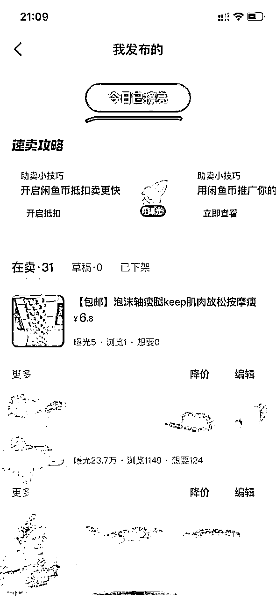

### 5.1.2 起步阶段消息要快回 @老瞿 Qu

把闲鱼的通知功能打开，这样才能尽可能第一时间回复，避免买家流失。碰到不知道怎么回的问题，可以去淘宝或者其他闲鱼店找同款商品咨询一下，信息就到手了——同行的回复往往就是现成参考答案，也是最好的老师。

### 5.1.3 高曝光靠什么？把细节做扎实

说实话没什么捷径，就是把细节做到位：

别直接照搬别人的文案，自己搭一个文案模板尽量去孔夫子平台上挑一些实拍图，转化效果更好

每天完成闲鱼的鱼塘任务（这个有点玄学成分，效果说不准，但每天做就对了）

每天发布10-20个商品碰到沟通顺畅的买家，可以顺势邀请对方点关注，沉淀为粉丝

### 5.1.4 运营阶段要盯住的细节

每天记得擦亮商品

及时回复买家咨询，尤其是前期，消息通知要开着

卖出商品后马上补上架拍下后5分钟内不付款的，及时关闭交易订单，按客服话术以退为进

及时回复评论和留言，给其他感兴趣的买家一种负责任的感觉订单要及时处理

减少售后和差评，盯紧商品质量，如果差评变多就赶紧换商家，同时售后要果断妥协处理

前期坚持按要求上传新品，同时做好优化动作

下面整理了一些常见的违规封号点，建议大家绕开。

上架了平台禁止交易的类目。

同一台手机登录多个账号，或者单台手机频繁切换账号使用。

客服聊天中出现违禁词，或者同一句话反复使用。比如：转账多次、一单一结、皇、🛰️、联系、加、原味等这类容易忽略的词）

售后太多、纠纷太多，多次拒绝后买家直接申请小二介入。

内容来源：《闲鱼电商｜小航海学习手册》

## 5.2 用优化手段撬动更多曝光

优化的核心逻辑就一句话：让系统产生“这条链接有热度”的判断。

闲鱼主要靠自然流量，账号刚起步的时候，可以用小号点几个“想要”或者下几单做点基础数据；另外每个账号最多只能上架500个商品，而书籍种类有几百万种，所以定期把没有销售数据的商品下架是必要的。

同时可以蹭一蹭近期热点。比如《三体》以及《灌篮高手》这类作品走红时，相关二手书在那段时间就会比较好卖，可以适当调整上架一些热门书籍，不过整体畅销书的变化其实不大。

只有这样做，系统才会持续给你的商品曝光和展现，自然最终的出单量和利润也会越滚越大。

### 5.2.1 三种可落地的优化动作@老瞿 @诗和远方

#### 5.2.1.1 商品更新与调价

顺着平台规则来提升曝光，比如：

1、每日清理二十到三十条零流量链接

2、每日补上二十到三十条新链接

3、每日挑二十到三十件商品做小幅调价、用闲鱼币推广部分链接

6、借闲鱼币提升曝光
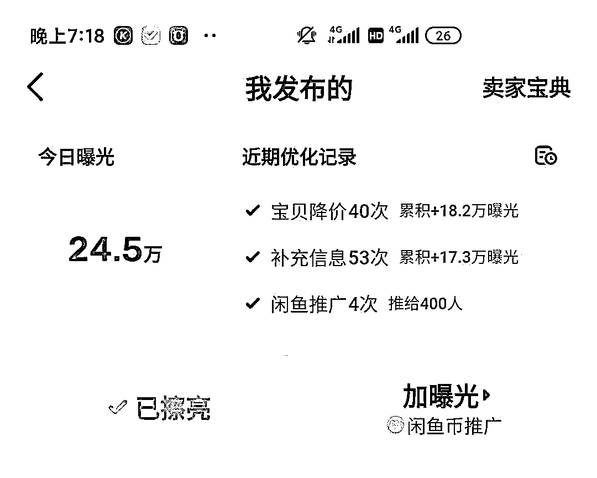

下面重点说三个动作：

闲鱼币推广

抵扣推广

单一版本与多版本商品调价

1）闲鱼币推广介绍：“急速卖”属于闲鱼币推广工具，单次消耗一千到六千币不等，具体取决于投放人数与时长。

操作方法：入口在首页右上角的“闲鱼签到”，进入后看页面左下方“急速卖”。点开能看到全部商品，适合给曝光或浏览不超过二十五的链接做投放；超过这个范围就不太划算了。数据差的链接，最好先把曝光、浏览、想要数养起来，再考虑投放。
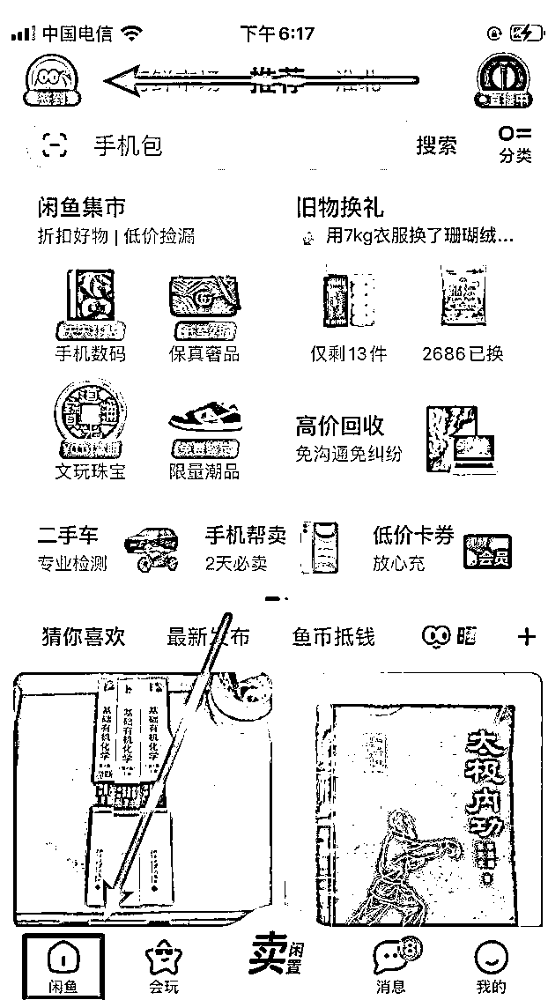
图：签到入口位置
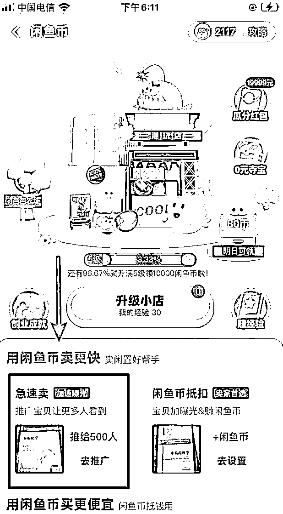
图：急速卖入口
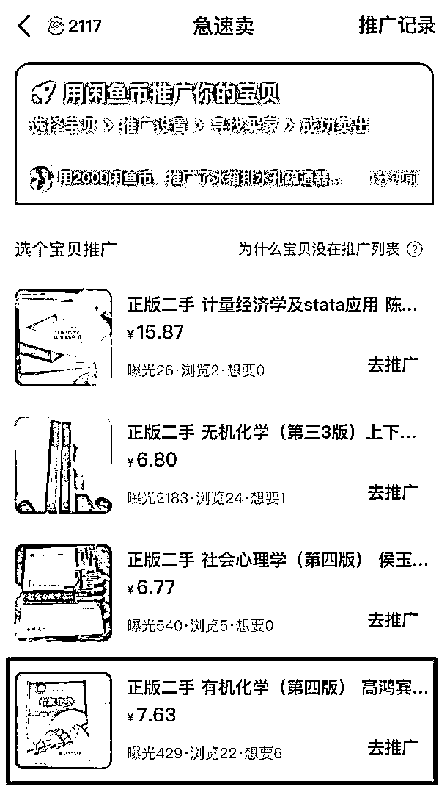

图：选择要推广的商品
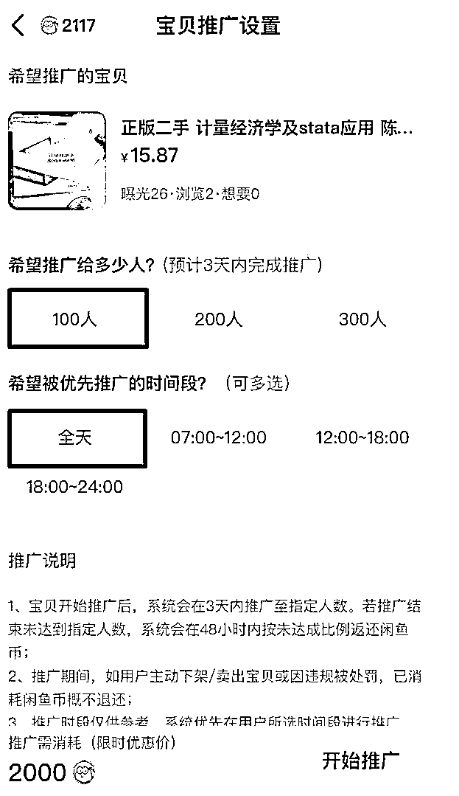
图：填写推广人数和时长

2）闲鱼币抵扣推广

作用说明：开启抵扣后，买家结算时能按自己持有的闲鱼币选择抵扣额度，相当于拿到折扣；同时该链接也会获得额外曝光加速。
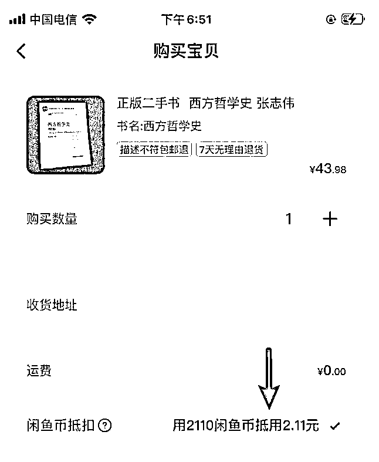

查找路径：同样从首页右上角“闲鱼签到”进入，页面右下方有“闲鱼币抵扣”。点进去会看到尚未打开与已经打开抵扣的两类商品。新上架的链接可以统一打开抵扣，有助于提升曝光。

建议：想要数已经超过二十或三十的链接，可以关掉抵扣；想要数为零或低于十到二十的，则适合开启。阈值不必死板，按自己的判断调整即可。

图：签到入口
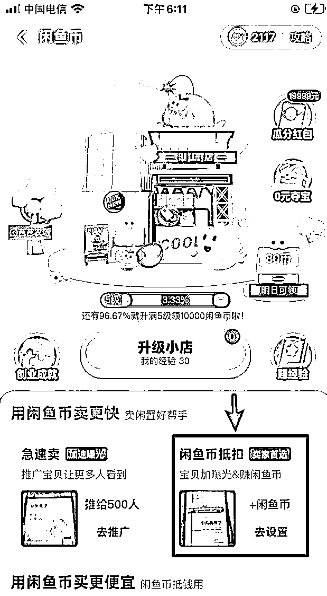
图：抵扣入口
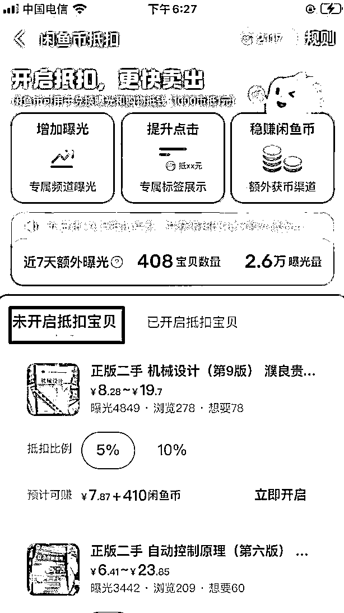
图：尚未打开抵扣的商品

图：已经打开抵扣的商品

小技巧：遮住“想要数”同时抢曝光。新链接往往想要数很低，买家浏览列表时，价格旁边就会显示想要人数；若是零，点进去的冲动会减弱，除非主图和价格足够抓人。

打开抵扣推广后，原位置会显示可抵扣的闲鱼币，而不是想要数，既弱化了冷启动数据，又多了曝光入口。

3）单一版本与多版本商品如何调价

原因：在擦亮、急速卖、抵扣这几种方式里，调价对曝光的拉动最直接。若降价幅度足够，列表页右下角会出现“累计降价22%”“48%”一类标识，既能遮住不理想的想要数，也能吸引点击、增加曝光。

步骤：操作上，单一版本商品每次调价降一分钱即可；多版本商品则把引流款SKU的价格下调，本质上仍是制造降价信号。

图：单一版本调价示例

图：多版本调价建议

小建议：发布新品时，可以把引流价先抬高到十二至十六元，上架后再手动改到六至八元，从而形成“累计降价”的视觉效果。但引流价别低于五元，价格并非越低越好。

#### 5.2.1.2 人工干预优化

发布商品后，在留言区互动的人通常了解这套做法，沟通成本低、动作也快，找他们更省时间。

在搜索里找发布“一分钱”“教训”且留言带“互”“虎”等字的卖家，点进其“一分钱”或“教训”链接；也可以点留言头像进入主页，再随便点一个商品。

私信模板一：“来3个”（通常一个卖家操作三到五条链接就够）

私信模板二：“弄完了，记得及时回访”（或类似说法）

一天联系三到八个这类卖家做人工互动即可。总会有人不回，但总量基本够用。

注意事项

1.优先从想要数较少的链接进入，同时留意留言里带“互”谐音的卖家。

2.先找对合作对象，主动帮对方操作，动作利落一些；对方看到回访后，下次再来的概率更高。

3.自己发“一分钱”“教训”并留言或私信时，尽量别出现“互”“互相要”这类字样，容易触发违规。

4.每天联系这类卖家三到八个，单个卖家操作三到五件商品即可。

5.并非一定要拍下对方的一分钱商品才能互操作；若对方强制要求购买，直接跳过。偶尔买一两个也无大碍。

#### 5.2.1.3 好友互帮

也可以请熟人按上面的方式帮自己店铺做互动。操作时尽量用独立手机，走流量或单独WiFi。

找一位朋友借手机，用他的闲鱼号给自己店里三到五件商品按“一分钱”“教训”的玩法操作，数量别多，避免被系统识别为异常。

上架和优化都适合放在流量高峰：晚上八点左右、早上八点左右、中午十一点半左右。这些时段闲鱼活跃度高，也避开了多数人的上班时间，建议优先安排。

以上方法供参考，最终要结合自身情况，选出最能快速给商品带来曝光和浏览的那一套。

内容来源：《闲鱼电商｜小航海学习手册》、《深耕行业2年后，分享咸鱼二手书无货源、绝版二手书等5种项目玩法》、7月11日《闲鱼二手书的数据分析及优化方法》@诗和远方

### 5.2.2 看数据做调整 @诗和远方

先厘清三个关键指标。第一是曝光量，反映系统给了多少展示，可判断有没有命中推荐；第二是浏览量，代表有多少人点进详情，说明点击兴趣；第三是想要数，这是购买意向的直接信号，与后续成交率紧密相关。把这些指标放在一起看，常常能发现单看某一项时看不到的问题。

#### 5.2.2.1 曝光与浏览都不低，想要数却偏少

这种组合说明主图、价格和关键词已经把买家带进了详情页，想要数低通常另有原因：

图：调整之前

图：调整之后

案例分析：以图中《西方哲学史》为例，曝光和浏览表现都可以，想要数却只有三。主图与引流价做得不差，书本身也有需求；问题在于买家点进来看到价格区间是6.66到42.86元，最高一档几乎接近新书价，买二手反而不划算，于是直接退出。

优化方法：①这本书可以先跑量，甚至只留一两元利润；等想要数积累起来，再逐步提价，例如每成交一本上调五角。

②若最高价来自合集SKU，可先把合集选项撤掉，让买家进店只看到单本价格；等想要数上涨或有人询问合集，再重新加回。

③每次调价只降一分钱，持续用价格变化换取曝光。

④可配合超级擦亮、急速卖或闲鱼币抵扣来做调整。

调整示例复盘

6月28日调整之前

6月28日调整之后

6.30 早间记录

7.1 早间数据这一次拿《生理学第 8 版》来做案例，刚上架时得到 1518 次曝光、10 次浏览。

6 月 28 日，我把引流价做了大幅下调，同时参考孔夫子旧书网上的成本价把商品定价做了调整。后面又花了一两天、每次微调引流价的持续优化，到 6 月 30 日上午，曝光升到 1809，浏览量变成 11，“我想要”还是 1 个。到了 7 月 1 日，曝光虽然有 1959，但浏览量和“我想要”都没有继续往上走。

这本书转化不太理想，个人判断跟当时主图选得不够好有很大关系。不妨换一张主图，再继续观察数据变化。

#### 5.2.2.2 曝光高+浏览量高+我想要高+没有成交

情况分析：这种数据表现说明主图、引流价、收藏表现都还不错，可就是没成交，问题出在哪儿？

常见原因有几种：①顾客拿你的价格跟别家比，发现你定价偏高；②顾客只是随便逛逛，购买欲本身不强；③书的货源成本本来就高，利润空间有限，“成本+利润”动辄 40 多，顾客觉得再加点钱都能买新书了。

举例说明

比如这本《托马斯微积分》，孔夫子旧书网最低 35 能拿到货，定价 39.68 完全在合理区间。这本书最初标价 45 以上，后来反复调整才落到 39.68。

书籍数据诊断主图：手持书实拍，光线充足，就是标准的主视图，没什么毛病。

引流价：7.56 的引流价设置得比较合适。

曝光+浏览量：曝光 1069，浏览 49。曝光/浏览≤25 的数据算相当不错。

我想要：10 个

再看后续数据

曝光 1233，浏览 69，“我想要”升到 16 个

但截至 7 月 1 日，这本书始终零成交，只有一个顾客来咨询过。

同行对比

在闲鱼搜了一下同类书，同行标价基本都比我高，区间在 30-88。卖 30 和卖 35 的各有一家，都是个人卖家。

标价 30 的那家：65 次浏览、7 人“我想要”，不包邮。数据截至 6.29 上午 11:40

标价 35 的那家：18 次浏览、4 人“我想要”，同样不包邮。数据截至 6.29 上午 11:40

自己的数据和同行横向一比，表现其实不差。那没有成交就只能归因到买家端了——大概率是愿意花这个价的人不多，转头去买影印版了。

7.1 号记录

7.3 号调整思路调整思路：

①把这本书的售价调到进货价水平，或者只赚 0.5-2 元，先把“我想要”和成交概率提上去。

②每天打开链接，把引流价的 SKU 降一分钱。

③配合超级擦亮/急速卖来做流量补强后面怎么处理：这类书想出量本来就难，一直盯着优化的投入产出比不高。时间宽裕的话，每天降一分不亏；没空管就扔在那儿，也不用太惦记。

#### 5.2.2.3 曝光低+浏览低 / 根本没浏览

数据情况分析：

曝光少、浏览少甚至为零，主要有两种情况：①这本书本身需求就小，或者几乎没人搜，上架头两天曝光低其实正常。②卖这本书的商家已经饱和，平台分给你的曝光本来就有限。

优化方案：

①把引流价 SKU 做一次明显下调：比如原引流价是 9.89，直接砍到 6.86。这种大动作会在商品首页直接露出“累计降价 22%”“累计降价 48%”“累计降价 52%”之类的标签。

好处在于：只要主图还过得去，用户看到大幅度降价多少会想点进来看一眼。靠降价带来的曝光+浏览，就能慢慢把这个链接带活。

②用超级擦亮：超级擦亮每天限一次，一次只能擦 10 本书。把没曝光的书放进超级擦亮，能快速拉一波曝光。也可以配合大幅降价引流价 SKU 一起用。要是过了几天，浏览和“我想要”还是没什么起色，就该考虑下架了。

③用急速卖/闲鱼币抵扣优化之后的情况：数据不错的话，就按其他分类继续跟进；曝光还是不到 50，那直接下架止损。

#### 5.2.2.4 利润空间太窄的商品怎么优化

有些书销量尚可，但一本只赚 1-2 元。下架不舍得，继续卖又觉得不划算。其实有办法在提利润的同时不伤害链接的曝光。

优化手法：①把引流价 SKU 稍微改一下：比如原来引流价是 6.86，改成 6.85。

②调售价：每出一两单，把售价上调 0.5-1 元。

①和②必须同步操作。这么改完，链接对外显示的仍是降价趋势，自己实际到手的利润却变多了。顺带提一句：以后每次要加新 SKU，引流价 SKU 记得每次降一分，避免被系统误判成涨价。

举个例子

像这本《新高中英语词汇》，八五新，成本将近 10 元，当时利润只有 3.97。我可以把售价调到 14.48，同时“更多书籍咨询客服”这个 SKU 的定价微降到 6.75。

调整之后：

内容来源：7 月 11 日《闲鱼二手书的数据分析及优化方法》@诗和远方

## 5.3 🔥项目复盘注意事项 @老瞿 Qu

💡

章节概要

闲鱼无货源二手书不是什么高难度项目，但其中不确定因素不少。这节整理了 5 个实操中容易踩的坑，归纳起来就是：敬畏平台规则、坚持精细化运营、别急着碰实体……提前把这些理清楚，实操时能少走很多弯路。

当然，坑可能不止这些，欢迎各位航友在航海期间互相补充、多交流。

### 5.3.1 做好被封号的心理准备

如果对项目抱着“随便做做就能成”的预期，坚持十来天没看到想要的结果，大概率就放弃了。可这个项目跟短视频带货一样——做短视频的谁没废过几个号？闲鱼卖二手书也一样，做挂几个号、被封几次号，太正常了。

### 5.3.2 对平台的规则要有敬畏之心

现在的人普遍急躁，总想走捷径。比如有人卖二手书上软件批量铺货，一天下来几条违禁品，加上重复铺货的处罚，7 天封号套餐直接送到面前，这个项目就到头了。

如今各大平台都在严打粗暴玩法，想靠平台赚钱，前提是把平台规则吃透、守住底线。

### 5.3.3 不要过度迷恋各种技术手段

我见过不少做闲鱼二手书的人，是一本一本手动上架的。我们工作室也一样，全交给大学生精选图片逐本上架。反观同一时期起步、一开始就指望技术手段批量化操作的人，最后都没跑出什么结果。

有人问为什么？很简单。用户打开闲鱼搜一本书，看到的是这样的列表页——

换作是你，这个界面里会点哪个链接？

大概率会把 1 和 3 筛掉，在 2 和 4 之间选一个点进去。1 和 3“想要”是 0，价格又没优势，图也没吸引力。选 2 因为实拍图真实、还在热门榜，从众心理天然加分；选 4 因为价格便宜、有几个“想要”、图片观感也不差。

而软件铺货的书：

1、内容和质量跟手工上架的差距很大；

2、一天批量上几百本的人，根本没工夫给商品做数据，连“点几个想要”都懒得弄；

3、更不可能前期先把价格压低，等到有销量有收藏再慢慢抬价。

精细化运营没有捷径可走。另外别碰盗版新书，平台对这块查得很严，封号风险极高。

### 5.3.4 不要迷恋实体行业，轻易转做有货源玩法

有人一上来就想搞个二手书仓库，觉得那才像样。实业当然值得尊重，但那是积累足够后的下一步。前期还是玩轻资产的好。

我自己有个 1000 平的二手仓库，算下来还不如在小区搞个工作室、拿 30 个闲鱼号做无货源赚得多。实体店投入大、人累、成本高、利润薄，不划算。

### 5.3.5 自己要做项目的负责人

总有人问“上架 500 本一个月能赚多少”“做几个账号能月入过万”“辞职全职做二手书行不行”“一上来搞工作室一年能不能赚 30 万”……

这些问题其实没有标准答案——做项目本来就充满不确定性。与其一直找答案，不如动手：先注册账号、先上几本书。做着做着，对项目的掌控感自然会来。

内容来源：《聊聊你做闲鱼二手书项目失败的 100 种可能性》、《闲鱼二手书无货源模式拆解（精细化运营）》

# 选修篇：更多玩法和赛道推荐

💡章节概要

跑通最小 MVP、基本摸清操作流程之后，就可以打开选修篇了。

不管你是想放大现有项目，还是挖掘更多玩法，本章都值得重点看：✅【项目拓展】更多选品思路、扩充品类和货源

✅【项目放大】了解放大生意的路径

✅【案例拆解】拆解当前热门赛道

现在就来找找项目还有哪些可能性~

# 六、【项目拓展】更多选品方法及具体步骤

💡

章节概要除了孔夫子网选品，还有 4 种选品思路可以尝试：

✅按淘宝店铺销量选品

✅对标优质闲鱼店铺选品✅按大学官网推荐书单选品

✅根据顾客推荐书单选品

如果孔夫子网的路子已经玩熟，不妨试试这些新方法。还有什么好用的选品思路，欢迎在航海群内分享。

## 6.1 根据淘宝店铺销量选品 @老瞿 Qu

在淘宝搜“二手书”，找一家专做二手书的大店铺，直接按其销量排行来选品，照着依次上架就行。

## 6.2 直接对标闲鱼卖得好的店铺进行选品 @一游 @老瞿 Qu

找一家优质同行店铺，参考它家上架的商品，照着铺就行。好处是：这些书已经被市场验证过，而且还能避开违规风险。

具体步骤：

第一步：到闲鱼 APP 首页找到“二手车”入口，往后滑动找到“闲鱼榜单”。

第二步：点进“闲鱼榜单”，切到“报纸期刊”分类，在排行榜里挑一家对标店铺做参考。

## 6.3 大学官网推荐书单@诗和远方

每年开学前，大学都会指定教材让新生自购或统一订购。知道了学校需要什么书，上架什么书好卖自然就有方向了——有需求才有市场。

选书方法：

每个大学的官网上都会公示当年选用教材的公告，公告下方通常有附件下载，一般是 Excel 或 PDF。

百度直接搜“2023 秋大学教材选用公示”，就能找到各校的教材公示页面。拿南京理工大学泰州科技学院举个例子，公告下面的附件就能看到完整书单：

附件：南京理工大学泰州科技学院 2023 年秋季学期拟选用教材清单.xls

用这套方法还可以继续挑其他学校的推荐书目。偶然发现有的学校官网放了《2022 秋全国大中专教学用书汇编》，顺着线索去找，就搜到了《2023 秋全国大中专教学用书汇编》——里面把 2023 届大一新生要用的书全部汇总好了。表格放在最后，有需要自取。

## 6.4 顾客推荐书单@诗和远方

按身份可以把顾客粗略分成四类：大一新生、考研备考生、专业考试生、个人专业爱好者。

1.大一新生推荐书单

新生买书一般会按学校发的自购清单来，这个直接参考《2023 秋全国大中专教学用书汇编》，挑销量好的专业去上同专业的书就行。

购买特点：预算不多、爱砍价。原价 160 多的书，他们开口就问 130 或者 100 行不行。

避坑：新生团购的订单，先确认对方确定要了再去找书。只要对方说了要，就算后面嫌贵，主动权也还在你手里。

新生书单长这样：

2.考研备考生推荐书单考研人这个群体值得重点做。他们的购书意愿很强、付费意识也好，合集找齐之后一般直接下单，顶多让你稍微抹个零。

购买特点：意愿强、一次多本、预算充足、看重发货速度。

成单技巧：报价之后顺手送上一句吉利话，比如“提前祝您考研上岸，蒙的全对，考上心仪的学校”。具体话术见文章末尾。

考研书单｜备考人先收藏这份清单

准备研究生考试，参考书最好一次备齐。下面这些书目可以对照采购：

3. 行业从业者与职称考试人群

人群画像：已经工作的人同样有购书需求。以医药销售为例，不少人并非科班出身，需要专业读物补足知识短板；准备职称评定或职业资格证考试的人，也会按推荐目录买书。这类买家职场经验多，收入较稳，成交阻力小，通常看中就下单，很少还价，对品相也不挑剔。从后台截图看，下单者不少在医院上班，这类客群转化很顺，也是后续要重点维护的方向。

消费特征：决策快、不砍价、对书本成色要求低。

4. 专业爱好者推荐书单

特征：一次买得多、基本不还价、报价空间大。

人群画像：还有一类买家，既不在相关行业工作，也不是本专业出身，买书全凭兴趣，通常会围绕某个专业方向集中咨询。他们下单同样爽快，对品相要求不高。

附录 1：院校官网教材选用清单

💡 高校官网一般会公示教材选用信息，选品时可参考下列表格：

- 23 秋《教目》电子数据.xlsx
- 2023-2024-1 学期全日制本科生教材选用情况公示.xlsx
- 2023-2024 第一学期教材征订表-物信学院.xls
- 2023-2024 学年第 01 学期本科课程教材选用表.xls
- 本科教材选用审批汇总表 2023-2024(1)（公示）.pdf
- 附件 2：2023-2024 学年第一学期本科选课表.xls
- 附件-数统学院 2023-2024-1 教材选用汇总表.pdf
- 中宣部 教育部组织编写的已出版马工程重点教材目录（2023 年 4 月）.xlsx
- 2023 秋全国大中专教学用书汇编.xlsx

附录 2：考研参考书目

💡 备考研究生可参考以下书目：

23 考研参考书目

内容来源：《深耕行业 2 年后，分享咸鱼二手书无货源、绝版二手书等 5 种项目玩法》、7 月 6 日《在闲鱼卖教辅书的几种选品技巧》@诗和远方

# 七、【项目放大】把生意做大的四个方向 @老瞿 Qu

💡 本章要点：当变现已经稳定，接下来就该考虑扩张。常见路径有四条：多账号运营、工作室运营、多平台运营、转有货源玩法（对资金和体量要求较高）。下面逐一说明。

## 7.1 多账号运营

单账号上限有限：淡季每月利润约五千，旺季可到一到两万。单人精细操作，最多同时打理六个账号。

## 7.2 工作室运营

采购、打包、发货这类机械环节可以外包，找成本更低的劳动力。我们的工作室设在小区，招的是同小区宝妈，南京月薪三千，不包吃住，也不交社保公积金。

## 7.3 多平台运营

转转目前是第二大二手交易平台，实测流量约为闲鱼的三到五分之一。若不想增加闲鱼账号，可以同步在转转发布，多一条销量来源。

## 7.4 转有货源做法

不少人会想自己收书、建实体仓。实战结论是：没形成规模前不建议建仓，各项成本摊不薄。建议至少做到二十到三十吨体量，再考虑建仓。

内容来源：《深耕行业 2 年后，分享咸鱼二手书无货源、绝版二手书等 5 种项目玩法》

# 八、【案例拆解】五条热门赛道逐一分析💡

💡 本章要点：最后这一章，圈友提供了几条目前常见、相对容易跑通的二手书方向，分别是：

- ✅ 大学教材、小说、文学
- ✅ 少儿期刊杂志
- ✅ 大学英语课程码
- ✅ 畅销套装书

另外还有一条难度较高、但感兴趣可以看看的：

- ✅ 绝版书有货源

本章会逐条做简要分析与案例展示，希望能给你一些参考。

大量实操表明，闲鱼上最好卖的旧书是大学教材、小说和文学。教材季节性明显：开学季最旺，开学季后到期末考前相对偏淡；小说和文学全年销量平稳。除此之外，少儿杂志、课程码、畅销套装书也是不错的延伸方向。

## 8.1 大学教材、文学、小说（最主流玩法）@老瞿 @诗和远方

这类店铺靠量取胜：开学季、毕业季尽量多上教材，此时需求最集中；平时再补一些热门小说和文学书。

大学教材的选品、玩法与回复话术，点下方链接即可查看详情：

- 3.1.4 大学官网推荐书单 @诗和远方
- 3.1.5 顾客推荐书单 @诗和远方

小说、文学类怎么选品，可跳转：

- 3.1.1 根据孔夫子的二手书畅销排行榜选品 @老瞿 Qu
- 3.1.2 根据淘宝店铺销量选品 @老瞿 Qu
- 3.1.3 直接对标闲鱼卖得好的店铺进行选品 @一游 @老瞿 Qu

## 8.2 少儿期刊与杂志 @老瞿

有圈友实测反馈，少儿杂志眼下挺火。从出版社或经销商那里拿到授权与货源，好处是能把客户沉淀到私域，信任建立后可继续推荐其他杂志，甚至跟着孩子成长长期订阅；而且由出版物直接发出，也省去了盗版之类的麻烦。案例见下：

## 8.3 大学英语课程码 @小嵩

淘宝上做得好的店铺，月利润能到十万元以上；闲鱼也冒出不少小卖家，有人搭配旧书一起卖，有人干脆专营。

只要货源价格够低，这行的好处非常明显：不用物流、虚拟发货、售后极少，客户往往很快确认收货并给好评。

下面由小嵩教练讲讲闲鱼上具体怎么做。案例展示：

相比旧书，大学英语课程码的优势在哪？梳理下来有几点：

1. 交易更精准，不用到处找图。
2. 目标客户更精准。
3. 把码发给客户，售后就基本结束了。
4. 回款快。

另外，收码的品类比收旧书少，操作更省事；成本高低，关键看你有没有渠道。

我最初直接找大学生收，结果不太稳定：要么需要时联系不上，要么收到的码已激活或已过期。后来换了个思路，找中间人代收。这位中间人住在学校附近的宝妈，我们谈好价格、利润和售后兜底，收码问题解决后，我只管专心卖。

收码时把书后的课程码剪下来即可：

《新视野大学英语》由外语教学与研究出版社出版，第三版是该系列的第三代版本，目前多数高校都在使用。全书分四个级别，每一级又分“读写”“视听说”两种。每本教材背后都附有一枚学习码，用于激活在线学习资源与服务。学生买书时会拿到它，按课程要求交作业、拿学分。但码只有一个学期的有效期，不少学生真正要用时才发现已过期，只能再买一枚。因此市场上这类码长期处于供不应求的状态。

下面进入实操：

1）登录闲管家 → 商品管理 → 新建商品

商品分类选“图书 → 学习考试”

2）商品图：可以从孔夫子或淘宝找书影，再加文字；更推荐自己拍，避免同质化。

3）标题（仅供参考，不限于此）：

- 新视野大学英语第三版 读写 视听说 思政智慧版 1 2 3 4 激活码
- 新视野大学英语第三版思政智慧视听说读写综合训练激活码注册码
- 新视野大学英语第三版 读写思政版 1 2 3 4 激活码 U 校园 智慧版
- 新视野大学英语 U 校园 读写 视听说教程 思政智慧版 1 2 3 4 激活码

4）详情页（供参考，可自行调整）：

新视野大学英语 U 校园 读写 视听说教程

“思政智慧版”“智慧版”“U 卡通”

第 1/2/3/4 册验证码 激活码

不是书，下单后联系客服在线发送，无需物流；确定好版本，保证注册，无效退货。

激活码拍下后在线发送，无需快递，保证激活，放心下单。

下单前务必核实清楚：知道用什么码的直接拍；不确定的，请把课程中心里带“未激活”字样的页面截图发给客服，否则拍错不支持退换。收到码后请立即激活，超过 7 天不再售后。下单后请联系客服。码一经刮开不支持退换，谢谢理解。

5）图书信息：ISBN 编码填写新视野大学英语的编码即可。

这里可以添加多个 SKU。

填好后点击“立即发布”→ 确认。

还有一个重点：码分“智慧版”和“思政智慧版”两类，每类下又有“读写”“视听说”两个版本，价格不同；再往下还有 1/2/3/4 册的区别，发码时千万别搞错。前期分不清版本，可以让客户提供 U 校园未激活截图或书本照片来辨别。下面是未激活截图与已刮开码的书本照片，供参考：

4. 卖码技巧

1）定价：上架后可标 3.8-10.8 元低价引流，也可以直接开 SKU 标清各版本实价。建议选前者，效果更好。

2）沟通话术：为避免弄错版本，先请客户截图 U 校园未激活页面，确认后再报价。说明码是全新的、不含书本、包激活、不激活可退款。

3）发货方式：闲鱼聊天不能发带二维码的图片，可以把图片录成小视频发给客户，或把数字串提取出来发送。

4）售后：系统有时限，卖出后记得提醒客户尽快激活、按时交作业。客户问折扣，可告知多买有优惠，每张便宜 1-2 元，对销量提升很明显。激活成功后，点“无需寄件”发货。

5）好评引导：激活成功后，请对方推荐给有需要的同学，并求一个好评，祝学业进步、学业有成，感谢支持！

再补充几点上架与选版本的细节：

1）上架类目：建议放到“学习考试”。ISBN 填新视野大学英语的编码 9787513588188，任意版本都归到这本书下，不容易违规。

方案一：价格最低标到 3.88 元，别太低，防止被判为引流。
方案二：开启多规格 SKU，把每个版本的价格都标清楚。

两种方案任选。详情图可以去淘宝、拼多多搜，或用书本实拍图，不建议大家都用同一套图，以免限流。

2）具体拍哪个版本：客户下单时，请对方发书本照片或 U 校园未激活截图，按版本报价。自己拿不准，可以把图发给淘宝或拼多多的卖家确认。买家付款后，去淘宝拍一个同版本，再把码转发给买家。

注意：闲鱼聊天直接发带二维码的图片会被判违规，千万不要发。可以把图片录成小视频发送，或提取文字后转发，也可以给二维码打上马赛克再截图，数字务必核对清楚。

3）聊天话术建议

客户拍下时提前说明：为避免码过期，我们的码都是现刮现发，请耐心等待，包激活，请放心。发送码之后，再跟上引导好评的文字。

以上就是大学英语课程码的完整案例拆解。

最后说说这个项目在闲鱼的短板：有些店铺一上架就被平台通知违规下架，有些则不会，全看概率。如果你手上有稳定货源，去其他平台卖优势会更大，已有淘宝大佬做到单日销售额 2k+。

内容来源：5 月 25 日《二手书行业不经意发现的商机——大学英语激活码》@小嵩

## 8.4 套装书这样卖更值钱 @老瞿@豆仔

1）小说类

像《龙族》这种大热IP，本身就不缺读者。闲鱼已有卖家专做某套书的生意，不过热门书往往假货混杂，对卖家来说，分辨真伪是个麻烦事。

2）其他类

教材类套装现在拼得很凶，不过“组合打包”的打法照样能搬过来用。

很多读书博主、书评账号都会列主题书单，卖家可以从中筛选匹配自家店铺的选品直接挂上去。

组合方式可以按两个维度来：
- 一个维度是装帧：平装、精装、珍藏版搭着组。
- 另一个维度是版次：像《西方经济学》第七版和第八版各收一些。

各版本定价本身有差异，买家看到更新的版次，有时愿意多掏钱买新。

沿着这个方向做精细化管理挺合适。商品数量铺得足，被搜索命中的概率自然更高；对某类书有深度需求的买家，成套的册子、同一系列的作品确实对他们胃口；同时还能把单笔订单金额往上带。代价是要耗时间——查资料、找配图都得亲力亲为。

内容来源：6月27日《闲鱼二手书新人21天跑通项目闭环的经验分享》@豆仔

## 8.5 有现货怎么做停印书：赚差价的实操 @一游

眼下新手还是优先走无货源的方向——有库存对刚起步的人来说负担偏重，操作门槛也高。当然，已经备好库存的圈友，倒不妨把稀缺版本做起来。

这类书在市场上抢手，加印已经停了，收上来的数量十分有限；况且鉴定、修复、清洁往往要求更高的标准，卖价超过原定价并不稀奇。

下面按筹备、挑货、避坑这几个环节来展开。

做这行常打交道的就两个站点——多抓鱼和孔夫子旧书网。卖当然哪儿都行，但惯常做法是前头收货、后头出货。

1）多抓鱼到底怎么用

孔网的部分航海手册里讲过了，这里主要聊多抓鱼。

这个平台专做旧书回收与转卖，核心功能大概四块：

1. 闲置书籍寄到平台仓库后，对方会估价回购。
2. 想买书的话，可以直接在线上翻找、检索、下单别人的旧书。
3. 有些城市设了实体店，能亲自过去挑。
4. 寄卖时填好地址，快递员会上门来收。

整套流程省事、靠谱，还能让闲置资源少些浪费；另外平台设有专门的评估鉴定环节，正版和品相都有保障。

2）收书为什么选多抓鱼

5. 第一，入手价友好——平台按评估给价，淘到稀缺版本的成本能压下来。
6. 第二，品类覆盖广——各类别、各年龄层的书都有，在同类平台里算得上齐全。
7. 第三，操作顺手——手机端电脑端都能用，步骤不复杂。
8. 第四，品相靠谱——有鉴定团队把关，经手的书确保正版，成色不低于八五新。

3）卖书为什么选孔夫子

9. 其一，客群对路。孔网在旧书圈知名度高、辐射面广，逛的书友大多识货，舍得为稀缺版本出高价。反观闲鱼，品类泛、走的是低价路线，畅销书更吃香，逛的人以宝妈、学生、上班族为主，掏钱的意愿偏弱。两者一比，稀缺版本放孔网显然更合适。
10. 其二，能卖上价。孔网质检门槛高，又有平台信用作担保，对盗版打击力度大，买家买得放心，溢价空间自然更大。
11. 其三，上架轻松。扫一下书背的条码，基础资料自动补齐，卖家只需补三样东西：实拍照片、标价、品相描述。
12. 其四，开摊门槛低。个人选“书摊”不用办执照、不交保证金，成交后平台抽5个点，运费部分不另收手续费。

最省心的一点是几乎不牵扯售前售后。买卖双方早就心照不宣，咨询和纠纷都少，对挤时间搞副业的人特别友好。

1）货源从哪儿淘

① 废品回收站
去住处周边的回收站，先和老板谈妥价，论斤挑货。我通常按两块钱一斤入手，拿孔网的数据库逐本扫码，只要有赚头就收。这个方法在一线到三线城市比较行得通。

② 孔网线上收书服务
进孔夫子的👸号，在“孔网服务”菜单里找到“上门收书”，先定位到自己所在区域。出闲置的人会挂出书目，顺着他们晒的图去孔网数据库比对，挑出有差价的，再联系同城当面交易。

③ 闲鱼整批收货
闲鱼同样能挖本地货源。在搜索框输入“搬家 书”，不少人离开所在城市时会整批清书，翻到后照样丢进孔网数据库核一遍利润。

④ 图书馆换书（目前我只知道深圳有）
深圳图书馆办有换书活动，本地的朋友可以去打听。我每月都拎几本低价收来的书过去置换，专挑稀罕的版本换。

2）如何判断停印书

判断依据其实就一条：眼下能卖出的价格超过原定价。

掏出孔网APP扫一下书背条码，挑最低挂价看一眼就明白了。

挑货时，单本利润最好能到五十块以上。

下面给两个我常用的挑货路径，思路殊途同归——先在孔网摸清售价，确认有赚头，再回头去多抓鱼低价补货。

1）顺藤摸瓜：拿一本稀缺书去查同行

挑一本稀缺版本丢进孔网搜索，点开同行铺子，瞧他们主营哪些品类，然后切到多抓鱼比对进销差价。

14. 随便挑一家店点开，如图：
15. 切到“所有在售商品”页面：
16. 打开多抓鱼网页端：
17. 把书名逐条粘进多抓鱼的搜索框，核对进价与售价的差额，参考图示：
18. 看到有差价后，再验证一遍，确认孔网上真能出到这个价格，参照：
19. 核实没问题，就到多抓鱼那边设“到货提醒”，一旦有货立即下手：

小技巧：新注册账号有平台给的权重优待，单个号可以挂满1000本到货提醒，尽量在一周内全部加上，能捞到更多书。

2）翻类目页：在孔网官网淘稀缺版本

进孔网官网，顺着首页的图书分类导航挨个点，随手翻定价合适的旧书，只要挂价高过原价，多半就是停印版本。后面的收货流程跟上一招相同。

20. 先访问孔网首页：https://www.kongfz.com/
21. 随便挑个分类点入： 
22. 按定价筛出稀罕货： 

1）挂链接：孔网发布注意事项

23. 书况讲清楚：有没有笔迹、磕碰、污点，都如实交代，切勿遮掩。
24. 图要够清、描述要够细：至少三张清晰照片，配一段详细介绍，能实拍就实拍。
25. 标价要明确：把数字写清楚，注明有无笔迹或瑕疵，让买家心里有数，省得后面扯皮。
26. 退货规则提前说清：二手买卖特殊，书况没问题时卖家有权拒绝退换；当然买家沟通客气、确有私人理由的，也可以通融，但来回运费得由对方承担。

至于后续的发布、擦亮流程，航海手册里写得很全，直接点：https://search01.shengcaiyoushu.com/docx/R8eUd7TcModS7RxYaogceiZgnOb

2）快递问题

发货前期直接用孔网自带的在线物流就行；等单量涨起来，再自己去跟附近快递点谈价，通常能压到四到六块。

以上就是有库存做停印书的完整路径。手头有货、又偏爱这一口的，不妨上手试一轮。

内容来源：6月1日《二手书行业的另一种玩法——有货源的绝版书》@一游

