# 选品特训 202312｜选品不是碰运气

成稿日期：2023 年 12 月 28 日

手册怎么用：这份材料想带你看见项目之外更多的落点，也让你更容易看懂、上手去试。

小提示：想快速跳到某一节，用 Ctrl + F/command + F 搜「关键词/关键字」就行。

卷首语

💡

大家好，欢迎来到 12 月航海｜选品特训｜实战手册。往后这段日子，我们会在字里行间打很多次交道。

圈里流传一句话：货选错了，后面全白忙。不管是抖音、📕、视频号这些靠内容驱动的平台，还是淘宝、闲鱼这类以货架为主的电商，选品的分量都不必再多解释。

谁都盼着自家项目走得稳，上架的货能接二连三地爆。真要做到，手上选品的功夫就得反复磨。

于是这一期航海，我们把训练主题锁定在「选品」上。手册既会拆解电商行业里那套通用的「选品方法论」，也会按主流平台分别补充各自的做法，帮你把这门手艺练扎实。

有几句话得先交代：

其一，这次「选品特训」真正想达成的，是让你学完之后能直接套进自己的业务，或者借这门手艺多几分开启新项目的胆量；其二，手册里塞进了不少选品样本，可平台在跑、风向在换，样本本身带保质期，其中的数字未必还能照搬。思路是重点，具体怎么判断，得看眼下的行情去做调整。

另外还有一条：多去选、多去测、多开口问、多跟人聊。手册没覆盖到的角落，尽管来问，答案我们一起挖。

愿各位在这趟航程中，不只带回成绩，也带回一帮能并肩的同行者。

下面这些内容，由龙哥盟和圈友共同打磨，仅供航海船员和龙哥盟星球的圈友学习取用。

也欢迎圈友在实操中随时反馈，帮我们把手册补得更完整。有修改建议可以找鱼丸（yuwan387）聊聊～

【这份手册怎么读】

正式动手前，先花几分钟弄清楚它的正确翻法，你就能按自己的节奏灵活取用。

整本手册的编排，是沿着从 0 到 1 走完一轮选品这条线铺开的。你可以照着航线图一步步做，也可以按需要跳着看。

有一点要提醒：跟以往几期航海比，这次改动不小。旧版手册偏向把玩法尽量摊开、任人挑选；新版则切成必修、选修两大块：

必修篇：把项目从 0 到 1 完整跑一轮选品的动作全走一遍，正是航线图上标出的那条路径。若你尚在摸索期，想先完整走一趟流程，那就从必修篇老老实实读起、做起，别在挑玩法上耗太多心神。

选修篇：装的是这个项目更多的玩法、样本以及把盘子做大的思路。假使你已摸到选品门道，还想看看别的可能、找点灵感，这一块值得细读。

📌

要是你对选品一窍不通：

正式上手之前，先粗浅认识一下选品为何重要、有哪些基本规矩👇

✅ 一、选品基础概述

再一步步弄清自己项目处在哪个阶段、要卖给谁：

✅ 二、第一步：选品前明确自己所处阶段

✅ 三、第二步：分析带货平台

✅ 四、第三步：定位目标人群

📌

要是你对选品已心里有数：

那就先抓几个跨平台通用的选品方法论，把手上感觉养出来。这个节点，直接从第五章切入即可👇

✅ 五、第四步：选品

随后按你实际在做的平台，翻到对应章节，学它的选品打法👇

✅ 六、兴趣电商 - 抖音平台

✅ 七、兴趣电商 - 📕平台

✅ 八、兴趣电商 - 视频号平台

上面这三家同样开放商家入驻开店，走那条路时，选品会更靠近货架电商的逻辑。

📌

要是你想弄懂测品、多学几个平台的选品招式和样本，把思路再铺开些：

可以顺着下面这些章节往外扩👇

✅ 九、选品后如何测品

其余平台的选品打法：

✅ 十、社交电商 - 快团团平台

✅ 十一、兴趣电商 - TikTok 平台

✅ 十二、货架电商 - 淘宝平台

✅ 十三、货架电商 - 闲鱼平台

✅ 十四、货架电商 - 亚马逊平台

✅ 十五、其他选品方法

航线图与手册彼此咬合，你处在哪一环，就去学哪一步的内容。

必修：把选品这门手艺练熟

💡

章节导读

从这儿起，选品特训就算开跑了。在真正挑出某件货之前，我们先把学习路线和下面这些内容理一遍，帮你少走些选品时的弯路：

若是刚入门的，上手之前先弄明白选品的基本原则与底层逻辑：

✅ 一、选品基础概述

若你对选品已有整体概念，那就照着步骤练起来：

✅ 二、第一步：选品前明确自己所处阶段

✅ 三、第二步：分析带货平台

✅ 四、第三步：定位目标人群

✅ 五、第四步：选品

必修篇里，航线图与手册的先后是对齐的。顺着读下去，航线图上每一个任务都能逐个落地。

后面每个关键节点的章节导读中，我们也会把对应的航线图拎出来，提醒你别漏掉该做的动作。

好，正式开工。

# 一、选品基础概述

💡

章节导读

选品的招式数不胜数，可底下秉持的原则与逻辑，其实是共通的。所以开篇先聊这几件事：

选品的三大核心原则：

✅ 第一原则：市场和需求的明确性

✅ 第二原则：渠道和能力的匹配度

✅ 第三原则：采购与供应的把控力

此外，在抖音、📕、视频号这类内容能左右成交的兴趣电商里，还多一条：内容在前，选品在后。

选品中的人、货、场三要素：

✅ 人，通常指具备消费能力的那群消费者/用户；

✅ 货，指在市场上流转的商品；

✅ 场，通常指交易发生的场景。

愿你带着这些原则再往下看具体做法，理解会更透。

💡

本章航线图

把第一章学完、练完，航线图第一段就算拿下：知己知彼，弄清自己所处阶段与目标人群（约 3 天）

1. 熟悉选品基本准则，建立好基础（约 1 小时）

## 1.1 为什么选品能力非练不可 @丹牛

倘若不清楚自己为何成功，这份成功便无从复制；倘若不清楚自己为何失败，这份失败也就毫无价值。

放到选品上，这话尤其扎心。

大多数人嘴里的选品思路长什么样？

眼见隔壁老王卖防疫用品发了财，便认定这产品自己也得跟，风口不能错过；跑展会、逛网店、刷短视频时，瞧见某个网红款挺有意思，自己很感兴趣，非做不可；亲戚王叔开了家工厂做某类产品，邀自己去管外贸部，心里一盘算：自家人开的厂，靠得住，干。能行吗？自然能，只是多半靠运气。

可我们真正想要的，是面对一件产品时，能更准地掂量出自己能不能做、做了能不能赚钱。最理想的状态，是挑中一个就火一个，而不是永远跟在别人屁股后面捡汤喝。所以，选品这门能力，必须反复练。

内容摘自：《选品的三大核心原则》

## 1.2 选品要守哪些准则

### 1.2.1 三条核心原则 @丹牛

科学选品，条条都指向三件事：其一，市场与需求是否明确；其二，渠道与能力是否匹配；其三，采购与供应是否控得住。

#### 1.2.1.1 第一原则：市场与需求先看清

市场与需求的明确性，说白了就一句：出发点在市场，不在手头那件货。

“从产品出发”是什么样？先拍板做某件东西，再回头琢磨怎么提炼卖点、上哪儿找客户。

“从市场出发”又是什么样？先不急着定做什么，而是把目标客群圈出来，摸清他们缺什么、被什么绊住，最后才反过来挑一件东西去填这些坑。

真正意义上的“产品”，指的是能满足市场需求的任何有形物品与无形服务，是拿来把麻烦摆平、把需求填上、把价值造出来的那套方案本身。

一台电视机，是产品；

一套手机软件，当然也是；一套家居设计方案，也未必不能算产品。

更要紧的是，卖货的组织与个人为其附加的那一整套服务，同样归在产品之内。

若对产品的真正概念没想明白，两个致命错误就容易冒出来：1. 把“产品”和“需求”硬生生分开，产品设计与开发沦为工程师关起门来的实验，销售人员也忘了客户掏钱买的并不是那件东西，而是能解决他麻烦的方案。

真正意义上的“产品”含 5 个层次：核心产品、形式产品、期望产品、延伸产品、潜在产品。

这意味着创业路上，有 5 个问题得时时自问：产品的核心效用是什么？

承载核心效用的又是什么？

客户与用户盼着得到什么？

客户与用户最终拿到了什么？

客户与用户将来还能得到什么？

核心效用与它的载体，究竟指什么？还是拿“客户要的不是钻头，而是墙面那个洞”来说——“洞”属于核心效用，“钻头”则是装着核心效用的那个壳。

也就是说，表面上卖的是“钻头”，眼睛却该盯着“洞”，琢磨怎么更快、更稳、更省地把那个“洞”给客户打出来。

说到底，选品里的差异化到底是什么？

真不是人家做黄的我们做红的，人家做方的我们做圆的，人家用一代技术我们上二代技术——这类货色层面的差别，分量其实很轻。真正的差异化，在于我们的货恰好填上了市场上某处别家没填、或者填得不够漂亮的缺口。

空白处未必有市场，市场里倒常有空白。这就是第一原则：市场和需求的明确性。

可圈定了市场、客户与需求，就够了吗？显然不。还得看第二原则：渠道和能力的匹配度。

#### 1.2.1.2 第二原则：渠道与能力要搭得上

2020 年初那阵子，大家还有印象吧？几乎每个🛰️群里，隔三差五就能刷到这类消息：“口罩实单 150 万个，请有货源的小伙伴联系”。

“口罩现货，库存充足，证书齐全，可开发票，款到即发”。

这些询盘，我们一条都没接。理由很直白：此前压根没碰过防疫用品，渠道与能力根本搭不上。

你大概会觉得蹊跷：市场这么清楚，需求这么旺，还讲究什么搭不搭，冲就完了。

可实际藏着两个常人容易忽略的坑：1. 市场需求真旺到我们感觉的那个程度吗？

供应链这行当里有个术语叫“牛鞭效应”，说的是讯息自市场端往供应端传时，会被一级级异常地放大。好比手里握根牛鞭，手腕轻轻一动，鞭梢就甩出老大的花。

举个例子：市场上 A 终端客户向 B 进口商询价 100 个口罩，B 转头向三家中国供应商各发一份询盘，这三家又各自向自家三家上游供应商询价……原本百来个口罩的生意，等传到供应端，竟膨胀成 900 个，叫人误以为满世界都在找口罩。

要是身处上游的我们，被这种“需求”忽悠着去投口罩设备，结局不难想。

根子在哪？我们的渠道离终端市场太远了。

婚纱、假发、平衡车、无人机、指尖陀螺、跨境电商、防疫用品……每个“风口”一冒头我就追，却不管自家渠道与能力跟不跟得上，会怎样？

答案就一个字：“飘”。接着，属于自己的核心竞争力压根沉淀不下来。

那核心竞争力究竟是什么？

按菲利普·科特勒的说法：（1）我的工作能不能让客户感知到具体的价值？

（2）我的优势是不是对手难以仿效、难以照搬的？

（3）我的能力与资源能不能挪到别的领域去用？

还没创业那会儿，各种念头天天在我脑子里打转。我想找人聊，又怕找人聊；实在躲不过要谈，恨不得先跟对方签张保密协议——就怕嘴上漏了风，我那“绝妙点子”被人顺手牵羊。要是某件事换谁都能轻易做成，这同样说明核心竞争力缺席。

再打个比方：起初我做蓝牙耳机外贸，后来种种缘故做不下去了，于是转去亲戚的机械厂跑内销。老客户资源一概带不过去，从前攒下的销售本事也一时挪不进国内市场——这还是核心竞争力缺席。

真正的核心竞争力，应当是你每回想跨到新领域时——先做 A 货，再做 B 货，接着做 C 货——都能跟着复用的东西。

真打算做一桩长线生意、而非打一枪换一个地方，那就必须让自己有“根”。这根，就是核心竞争力。

#### 1.2.1.3 第三原则：采购与供应要握得牢

我常讲：打到最后的竞争，拼的其实是供应链。

供应链是什么？说穿了，就是一条把客户价值递到手的链条。比如你想喝杯苹果汁：我去果园挑个果子，拎到榨汁厂榨成汁，再买个瓶子灌进去，最后托顺丰把这一瓶寄到你手上——从头到尾这条线，便是供应链。

这条链上，始终跑着三样东西：信息流、资金流、产品流。

信息流指什么？你说想喝苹果汁，我通知果园要果子，我通知榨汁厂要榨汁，我通知顺丰要寄件，顺丰往包裹上贴的那张单……全是讯息在跑。

资金流又指什么？我把钱分别付给果园、榨汁厂、瓶子商、顺丰，这一串付款动作，就是资金流。

产品流呢？果子从果园挪到我手里，从我手里挪进榨汁厂，苹果汁再经顺丰落进你手里……凡是牵着实物移动的，都算产品流。

所谓供应链管理，无非是把信息流、资金流、产品流这三股线攥在手里，透过优化、调整乃至推翻重设，让客户价值最大化、链条总成本最小化、产品交付最快化。

比方你第二回想喝苹果汁，我一琢磨：跑果园买果子再送榨汁厂，这也太绕。于是问果园能不能把果子直送榨汁厂，榨汁厂灌好瓶再替我寄出；

比方你第三回想喝，我便问你：是不是往后天天都要喝？若是，我一次性向果园订上好几百个果子，靠规模把总成本压下来；

比方你盼着一想喝就立马到手，我便在你家附近租间小仓库。你电话一响，仓管五分钟内把苹果汁递到你面前；

比方你喝过几回，觉得这果汁确实好，转头把我安利给一圈朋友。订单一多，榨汁厂顶不住了，我索性另起一间榨汁厂，把产能稳住。

为什么说竞争打到头来拼的是供应链？

设想眼前摆着两瓶果汁：一瓶是我自个儿跑果园摘果、再用家用榨汁机打出来的；另一瓶出自工业流水线批量灌装。外观瞧着分毫不差，品质的稳定性与价格的竞争力能一样吗？

答案不用说。差别就藏在两瓶背后的供应链上。

表面挑的是某件货，实则挑的是这件货背后的供应链。因此选品时务必弄明白：这东西究竟是怎么造出来的？眼下的生产路径若不够理想，我们有没有本事借供应链管理或重新设计去把它改顺？

🎯说到底，选品就是一个从终点往回倒着推的过程：目标客户/用户是谁？（业务属性、采购倾向、预算能力等）

他们缺什么？（要摆平哪些麻烦？眼下有哪些方案？）

有没有更利索的解法？

解法能落在什么载体上？（也就是产品）

这些载体去哪儿找？

我手上有没有把货推出去、卖出去的渠道或本事？

我能不能攥住供应商以及它背后那整条供应链？

末了说一句：这节讲了三条原则，但并非要三条全占齐才准动。三者里能凑够两条，我看就可以上手。老话讲，成事三分看天、七分靠人，除了安安稳稳上班拿薪水，挣钱这事本身就带点赌的成分。非要等万事俱备才肯出发，最后往往连最要紧的第一步都迈不出去。

内容摘自：《选品的三大核心原则》

### 1.2.2 人、货、场：拆开看电商 @盗坤

电商说白了很简单，核心就仨字：人、货、场。把这仨字嚼透了，电商卖货最底层的逻辑也就通了。

人，通常指具备消费能力的那批人，也就是消费者/用户；

货，指市场上流转的商品；

场呢，在零售语境里一般落在卖场、门店，也可以理解为“社交场景”或消费者直接采购的“物理空间”，干的是连接人与货的活。商品详情页、直播间、短视频、带货群，都算。

世事一直在变，商业概念也不例外。商业模式在演进、技术在迭代，“人-货-场”三者的关系也跟着不停挪位。早先零售更看重以商品为核心的那套交易，可市场环境一变，重心便从商品挪到了场所与消费者身上——只是消费者的底层需求与欲望，始终没怎么动。

放到现代零售里，消费模式、场景与商品定位都愈发细分：

“人”这一头，已从笼统的消费者收窄成更有指向性的用户；

“货”这一头，为了讨消费者欢心，正拼命去覆盖更多样的需求；

“场”这一头，借互联网与移动通信等数字技术的推力，长出了更丰富的维度。

有一条路径可以走：从货起步，倒推它对应哪群人，再围着这群人去找相配的场，最后为这个场量身设计卖货场景。打个样：眼下卖的是 JK 制服，对应人群是二次元少女，那便围着这群人挑一个具体的场，比如 B 站。场定了，再在里面设计短视频、直播等具体的销售场景。

# 卖货前，先把用户、商品和渠道对齐

做生意的本质，就是让用户、商品和渠道这三者咬合在一起。打法可以分两种。第一种：把产品想卖给谁拆得越细越好，接着去找这批人常待的地方，再针对那个场所设计具体的卖货方式。这条链并不复杂，难的是抠细节，以及反复测试、优化、再调整。第二种：先圈定一个渠道，推断这个渠道里的人是谁，从里面切出一个细分群体，再为他们匹配商品，最后按渠道的生态去制作带货内容。比如，把📕当作渠道，它的主力用户是一二线城市的年轻女性，那就可以做女装，再用图文或短视频来承接销售。

两种路线只是起点相反，内核是同一件事——围着流量做生意。区别在于：一个先有货，再找流量的聚集地；一个先有流量池，再找池子里的人需要的货。想卖好货，必须同时想清楚用户是谁、货是什么、在哪儿成交。举个例子：专门卖给企业高管的健身卡，广告应该投在高端办公楼、公寓的电梯里；如果投到普通住宅小区，效果多半很差，因为场景错了，用户和商品就配不上。

做视频号生意，属于第二种路线。先判断视频号的用户构成，再推导这群人需要什么商品。连用户都看不懂，自然不知道卖什么；没搞清需求就乱上货，结果大概率不会好。

### 1.2.3 兴趣电商的一条铁律：先把内容做起来，再谈卖货 @张集慧

意思是：从内容端去观察，找出一个自带流量的品类。

短视频平台越来越热闹，拍短视频卖货、开直播卖货的人越来越多，什么商品好卖、怎么定品才能爆单，成了大家最关心的问题。淘宝这类搜索型电商和抖音这类内容驱动型电商，表面都是卖货，底层逻辑却已经完全不同。拿线下做参照：淘宝像旧式百货商场，一楼珠宝手表，二楼女装，三楼男装，四楼日用品，五楼婴儿用品。顾客进来时基本带着明确的目标，打开淘宝也是直接搜想买的东西。内容驱动型电商则像近年流行的大型购物中心——有人看电影，有人带孩子滑冰，有人逛书店喝咖啡，有人尝新开的川菜。大家不是来买东西的，只是来消磨时间，购物是顺手的事。抖音正是如此，内容五花八门，刷着刷着就下单了。

回到线上，以淘宝为代表的搜索型电商，核心在于商品能不能接住用户的搜索需求。搜的人多、卖的人少，你能找到这样的商品，就相当于挖到了蓝海。但用户刷抖音，先不是为了买，而是为了玩，第一需要是内容，不是商品。所以在抖音，第一步不是选品，而是做内容：找到自己擅长表达的方向，把注意力聚起来，再分析这些注意力背后的人群和需求。好商品始终要靠好内容来拉曝光、做转化。内容驱动型电商时代，内容和商品同样重要，甚至内容更靠前；定品的出发点和落脚点都在内容上，商品只是内容最合理的出口。

# 二、第一步：动手定品前，先看清自己走到哪一步 @盗坤 @张集慧

💡重点提示

看到别人靠某个品赚到钱，别急着跟。不同品类，做项目要投入的东西完全不同。得先认清自己所处阶段和预期收益，再调整定品策略，挑自己吃得下的品。

💡路线安排

完成这一章的学习和实操，就能走完路线图的第一段：搞清楚自己走到了哪一步、要服务的是哪些人（约 3 天）

盘一盘自己的经验与目标预期，确定自己处在哪个阶段（约 1 小时）

定品从来没有什么标准公式，关键看你在哪个阶段、想要什么回报。

比如以前聊过的一个项目：在📕做猫咪生意。只看赚钱能力，这事成立：找两三个靠谱货源，一个月挣几万块钱并不难。但想把盘子做大，供给端立刻会成为瓶颈——猫是非标品。一家好猫舍，一年也就能供二三十只猫，利润确实不错；再找下一家，质量可能就参差不齐了。所以这类项目，不能简单地用“好”或“坏”来评价。

已经走完 0-1 的熟手，更看重业务能不能长期持续、有没有增长空间，希望做能在时间上越做越深、越来越难被替代的事，这时卖猫算不上好选择。但如果你刚出来创业，资金不多甚至有负债，急需一份稳定收入，你根本顾不上什么长期潜力，也不会纠结做 B 端还是 C 端。这时候最重要是把事跑通，先有一笔真实的进账。如此看，卖猫反而合适：不用囤货、竞争不大、单笔利润厚、拿客源也直接。

再拿我早先在淘宝做的蓝海生意举例。它当年做得不错，但现在已经吸引不了我——上限太低，一个单品做起来也就是一个月赚几万块。想多开几家店，精力根本顾不过来，既难放大，也没什么壁垒。可是对一个刚起步、想先有稳定收入的人来说，它依然是个好项目。

做了两三年生意、换过好几个项目、也凭自己赚到第一桶金的人，定品时不会只看竞争激不激烈，还会看它能不能长期做、能不能沉淀。我现在做护肤、做茶叶，就是因为这类品复购强。只要产品做得过关，生意就能一年比一年厚实。所以有积累的人定品，不会只盯着蓝海，还会看增长空间、回购表现、货源好不好搞。哪怕一个品有竞争，也愿意花上几个月甚至半年慢慢磨。但要磨得下去，最终靠的是自己的资本、心态和定力。手里有足够的资金，才沉得住气。

因此，定品的第一步，是先认清自己当下的阶段、积累和预期，再结合个人现实、预期收益和市场空间来做判断。

另外，在内容驱动型电商里定品之前，还要先回答一个问题：自己开店，还是做达人？抖音这类平台，带货有两个角色：一是商家开店卖货，二是达人带货，两者差别很大。如果之前没有开店经验，我不建议一上来就开店，先把内容做起来，当个带货达人会稳一点。因为短视频带货，内容占的权重很高，内容做好了，靠佣金也能赚到不错的收入。

# 三、第二步：摸清你要去的带货渠道 @盗坤 @Erik @不语

💡重点提示

定品，要先看渠道。同一个品，在不同渠道可能一个爆一个死。所以不能只研究货，还要把渠道研究透。

拆解一个带货渠道，通常从这几个方面入手：

渠道内容以什么形式呈现：视频、直播、图文，还是商品详情页？

渠道的用户画像：哪类人在这个平台上最活跃、买得最多？

渠道商品靠什么展露：用户主动搜索，还是主页推荐？

渠道的购买链路：直播直接下单、短视频里挂链接，还是引导进店成交？路径够不够顺？

下面从这几个角度，看看不同渠道的差异。

💡路线安排

完成这一章的学习和实操，路线图的第一段就完成了：明确自己所处阶段和要服务的用户（约 3 天）

确定要做的电商项目落在哪个渠道，并分析渠道情况（约 2 天）

接下来，跟随步骤分析自己做的渠道，记得在航海日志里打卡进度。

挑货之前，先理解一个区别：同样一个用户，在抖音、视频号、快手这类短视频平台里买东西，和在拼多多、淘宝、京东这类传统货架式购物平台里买东西，心理路径和行为方式是很不一样的。

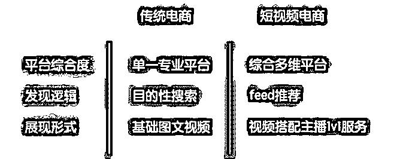

## 3.1 先看渠道的定位：功能纯粹还是身兼多职

淘宝、拼多多、京东更接近功能纯粹的平台。虽然也有别的模块，但大家提到淘宝，第一反应就是购物；平台也是根据你的购买行为来推荐商品。当你有了明确需求，最先打开的往往是这类应用。抖音、视频号则承载了太多事：看视频、搜资料、点赞互动。平台依据你各种行为流露出的兴趣来推荐，不限于购物。

所以，抖音、视频号这类渠道的优点是：把用户兴趣拿捏得准；缺点是：用户现阶段还没有真正把它们当购物入口，经常出现“在抖音看中了，回淘宝拼多多下单”的情况。

## 3.2 再看用户如何发现商品：搜索还是推荐

淘宝、拼多多以搜索为主，核心是关键词。在淘宝挑货，关键词就是方向，因为每个关键词背后都是一个具体需求。研究关键词，就等于研究消费者想要什么。想高效获取关键词数据，可以用“生意参谋”“店查查”“至尊宝”这类工具。

抖音、📕是推荐算法驱动，内容通过 feed 流不断推到用户眼前。用户本来没打算买，刷到觉得有意思，需求突然被激发，就下单了。所以在这个逻辑下，第一步是先抓住眼球，第二步才是促成下单；内容、素材和互动性，比什么都关键。要考虑怎么做出抓人的内容，把目标用户吸过来。

以视频号为例。它是一个以视频内容为基础的社交电商渠道，定品除了看货，还要看内容制作能不能跟自己的资源匹配。比如想卖熟龄女性服饰，可能要在视频号里开直播展示；这时就得想清楚，场景能否让目标客群喜欢、主播资源能不能跟上。

说到底，不管走搜索还是走推荐，定品都要贴着渠道的脾气走，也要贴着你目标用户的需求走。手里有什么资源、能做什么内容，再决定用什么打法，商品才可能在渠道里跑出成绩。

## 3.3 三看商品呈现：展示页还是种草场

淘宝如今也有直播、视频和图文，但本质上还是商品展示，底色仍是搜索逻辑——用户先有需求，再来找货，种草能力不如抖音。另外，淘宝直播的流量更多集中在头部主播手里，抖音则是人人都有机会；用户在抖音停留的时间也长得多。看一场抖音直播，相当于配了一位一对一销售，厉害的销售能把原本不想买的用户说到心动，转化率自然很高。

## 3.4 四看用户画像：各渠道气质不同

进一步讲，就算都是内容驱动型电商，渠道与渠道之间的人群也截然不同。

抖音：一二线城市热度最高。那里的用户看重潮流和娱乐，抖音内容丰富、玩法新颖，把年轻人和品牌商家都卷了进来。三四线城市也有不少用户，虽然热度可能略低，但随着手机普及和网络发展，用户规模还在扩大。

视频号：靠着🛰️庞大的社交关系链，在其他短视频渠道已经成熟时快速崛起。按照 2023 年🛰️公开课公布的数据，视频号消费者里，一二三线城市占六成，女性居多，平均每单超过 200 元。用户体量上来后，视频号不再是银发族的专属，30 岁以下的年轻消费者越来越多，人群结构正在变得多元。

快手：一二线城市有一定热度，但整体不如抖音。快手的内容更接地气，对普通人有天然的亲近感；三四线城市非常受欢迎，因为那里的用户看快手就是在看自己的生活。

📕：一二线城市非常受欢迎，尤其在女性用户和时尚爱好者中。📕是主打生活方式、美妆和时尚的社区，天然契合追求品质生活的一二线城市用户；三四线城市目前人群规模不大，但随着消费水平提升，潜力在上升。

整体来看，抖音在一二线最强势，快手在下沉市场号召力强，📕则锁定爱时尚、重生活方式的用户。所以在定赛道、定品之前，要认真分析目标渠道的特点和人群，满足这批人的需求，才更容易选中合适的商品。反过来，如果你手里已经有特定产品，就要分析产品对应的人群，再去目标客群更密集的渠道运营，胜算才更大。

# 四、第三步：锁定你的目标客群 @盗坤

💡重点提示

第一章说过，用户、商品、渠道三者匹配，才更容易出结果。这里重点研究“用户”这个变量。

要确认两点是否重合：

1.你所在渠道的人群定位

2.你要做的品类的人群定位

接下来以抖音为例，讲怎么把目标客群找出来。

💡路线安排

完成这一章的学习和实操，路线图第一段完成：了解自己所处阶段和目标客群（约 3 天）

根据方向和赛道，定位目标客群（约 2 天）

完成本章后，请完成以下作业并提交到航海日志：

作业：找 5-10 个对标账号，拆解他们的人群画像（还可以补其他维度）

作业模板：

账号名称

粉丝数量

粉丝性别分布

粉丝年龄分布

客单价

视频/直播占比

## 4.1 先弄清渠道里都是谁

视频号自带不花钱的自然流量，用户整体偏熟龄。在视频号里卖货，大概率就是冲着银发群体去的。我有个朋友在视频号做银发女性服饰，最初每场观看两三千人，后来突然涨到一两万，最高一场七万，流量全靠自然推荐。

为什么会有这波爆发？

他找了一位 50 岁的阿姨，端庄、亲切、大方，往那一站，不用开口，穿着要展示的衣服，流量自己就往上蹿。服装生意要有好款，也要有好的展示者；模特就是行走的衣架。如果你身边有这样的人，就可以考虑做这件事，而不是先决定“做什么类目”，再硬凑资源。

但把这套打法搬到📕，就不成立了。📕最核心的用户是 18 到 23 岁之间的年轻人，商品必须有格调、有颜值，才吸引得了他们。

## 4.2 再弄清你的商品要卖给谁

之前见过一个直播间，卖的是种子、饲料这类农资，靠不花钱的自然流量就能转化赚钱，目标客户是种地为生的农户，算是典型的隐形蓝海。

这个账号内容能力一般，主播也不讲究直播技巧，甚至在镜头前讲方言。但主播卖这类产品经验极其丰富，直播间的各种问题都能接住：“猪老犯毛病该喂什么料？”“这个节气种什么合适、怎么种？”乍看主播很土，可他恰好满足了目标客群的需求。

反过来，找一个别的领域特别会带直播节奏的主播，面对这些问题也答不上来，技巧再溜也没用。但如果你手上有这样懂行的主播资源，完全可以复制这条路。所以，定一个品之前要弄清楚：这个品是给什么人用的？我有没有资源满足他们的需求？能不能模仿出对标账号的模式？反过来说，如果目标客群已经明确，就应该去找他们需要的货，而不是看到什么品厉害就上什么。

## 4.3 怎么找到你的目标客群 @文林 @唐明杰

定品的第一步，是定人：先想清楚这个品要卖给谁。

以抖音为例，怎么找到适合自己、又能在抖音上做出单量的目标客群？我有三条经验，先分享第一条：从自己的爱好切入，由自己这个个体映射出一类人，再做减法。

比如我自己喜欢绿植，爱摆弄花花草草，后来验证，这个人群确实能出单。我讲讲当时是怎么找到这群人的。

读书类和美食类，市场需求很大，竞争同样不小。做读书账号的人多，做美食的人也多，内容生产已经相当成熟。我一个刚入行的新手，想在短视频里拼过这群老手，机会不大，所以它们先被排除。

剩下的是乒乓和绿植。乒乓的需求其实不小，但我查了一圈，抖音上做乒乓的账号，变现主要靠广告，真正带货的很少；少数带货的，店铺销量也不高。头部玩家的乒乓商品，月销售额才几千元。头部都只能赚这点，新入场的人更没戏。乒乓的天花板太低，也被排除。

再看绿植，大盘数据反而亮眼。记得那年 7 月，绿植在抖音的月成交额大盘已经到了 2 亿。对新人和小团队来说，月销 2 亿的盘子相当可观。而且当时看数据，绿植每月还在增长，近三个月的月增速在 20% 左右。这说明绿植类目在抖音上还在越滚越大。

# 月销3.19亿后，我把人群收窄了

先看一组数：1月28日那天我调出后台，绿植赛道的月度成交已经站在3.19亿，而它此前只有2亿。照这个斜率，单月干到5亿并非幻想。

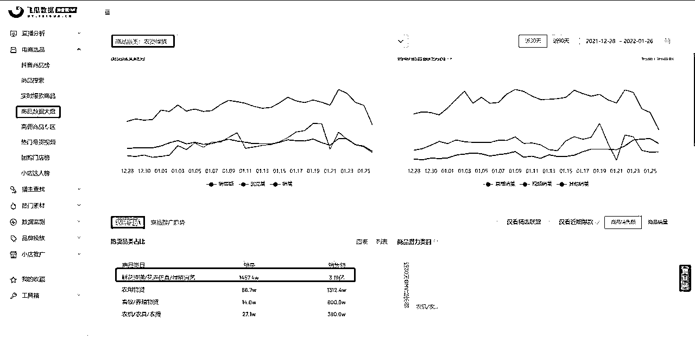

数字一出来，人群范围我也顺手收窄了：十八到三十五岁之间、日常愿意摆弄花草绿植的那批玩家。

小结一下：

拿爱好当切入口，最实惠的一点是：你天然就在圈子里，懂同好缺什么、卡在哪儿，跑起来省力，选货和做内容的命中率也更高。再者，干的是自己乐意干的事，心态松弛，不容易倦，做起来有劲。

但有个坑必须绕开：圈层别挑得太偏。要是这类人在抖音的月度总成交连一千万都够不着，劝你换方向——盘子薄，利润空间有限，而且反馈来得慢，人一旦等不到回响，多半撑不了多久。

经验二：往自己熟、自己拿手的地方扎

比如有人并不是宝妈，可在母婴圈子里泡了几年，对妈妈们的顾虑和诉求一清二楚，这条路照样能走。熟悉意味着判断准，挑货时知道对方要什么，踩空的概率就低。捋一捋：哪块你门儿清、哪块你干得顺，就从那儿切入去找对应的人群。

经验三：去对手少的地方找人

前两条都试过还是没方向？那就剩最后一招——盯竞争稀疏的人群。所谓蓝海，说白了就是同行不多。像中老年女性、体型偏胖的女性、修车师傅、电工焊工、装修队、园林工人、种地的农户，都算。

这类圈子对手少，产出的视频也糙。你只要稍微用心，就是降维打，跑出来的概率不小。

我自己试过装修师傅这条线，挑了一款吊顶打钉的工具，七天走掉四十二万，毛利两成出头。

但别硬凹蓝海。有些人群体量太薄，碰都别碰。

原因在于两个平台的消费逻辑不同：淘宝是先有需求再搜索；抖音属于闲逛型，用户本来没打算买，刷着刷着被视频勾住才下单。视频由算法分发，而每个人每天能刷的时长就那么多，平台自然更愿意把流量喂给覆盖面大的内容。

那冷门赛道里该挑哪块深耕？我的判断标准：对应品类在抖音的月度成交最好能过五千万；底线是别低于一千万，否则很难跑通。

# 五、第四步：把品挑对

💡

章节导读

翻完星球里各平台电商项目的经验帖，我意识到：挑品这件事存在一套跨平台通用的底层逻辑。把这套逻辑吃透，将来就算冒出新平台，也能迅速迁移，少走弯路。

所以本章把常见打法做了归纳：蓝海、跟品、周期性、用户需求、趋势。在哪做电商都行，按平台特性调整即可。

你手里要是还有别的通用招数，欢迎到航海里开帖聊聊～

💡

本章推进计划

学完并动手练完第五章，航线图的第二阶段就算达成：把通用挑品框架装进脑子，建立初步体感（约4天）

吃透蓝海打法并复盘（约1天）

吃透爆品打法并复盘（约1天）

3.吃透周期性打法并复盘（约1天）

吃透趋势打法并复盘（约1天）

现在可以正式开始了，别忘了在航海日志里打卡记录～

## 5.1 先锁类目，再挑单品 @文林 @唐明杰

人群圈好之后，新的岔路口马上出现：这批人要的东西五花八门，吃穿玩用全沾，第一刀该切哪儿？答案是先落定类目，再进单品。

方向比蛮干重要。尤其在抖音，一次判断失误，结果可能就是年入千万和年入几千的差距。这话不是空谈，我拿一百万的学费换来的。

照样拿抖音举例。刚起步那会儿，我一门心思想扎进一个特别冷门的类目，越偏越好。折腾六十天，再看身边换别的赛道的朋友，有人已经月入十万，我这边连一万都没摸着。更亏的是，起盘最有红利的那两个月被我烧掉了。

类目到底怎么定？可以照这个顺序走：1. 用抖音的大盘数据锁定一级类目

直说结论：拍脑袋定类目是大忌，拿数据说话才靠谱。

先把家底摸清：抖音一共铺了多少类目、各自当下的成交额和成长性如何。这些飞瓜数据都能拉到。

稍后我会把飞瓜上9月一级类目的月销表贴出来。

顺序是先大盘、后一级类目——大盘封顶多高，你能赚到的上限就多高。

比如电子元器件，整个抖音月度成交只有53万，个人本事再大也难把它推上千万。

建议优先看抖音上月成交过五千万的品类。这类品经过市场验证，跑出来的概率更高，对刚入门的人也更友好。

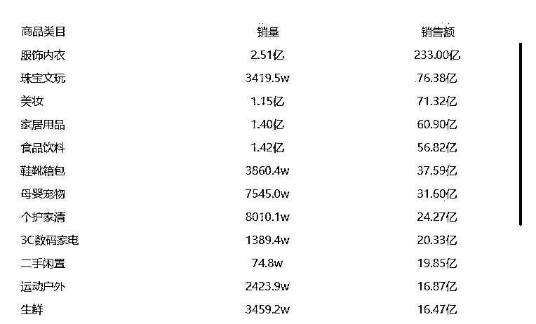

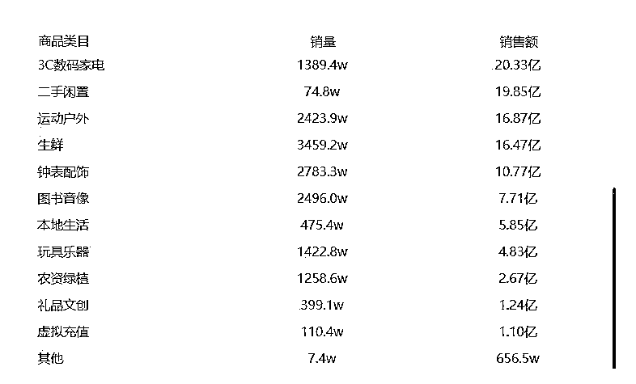

二三级类目繁多，这里借服装当样本拆一下。一级【服饰内衣】往下切——二级【女装】继续切——三级就出现了【中老年女装】和【大码女装】。后两者的月度成交分别是3.23亿和3.85亿。对手强度远不如年轻女装，但盘子居然比农资绿植还大！

对手弱、空间足，机会显而易见。同行那边反馈回来的情况，也印证了这个判断。

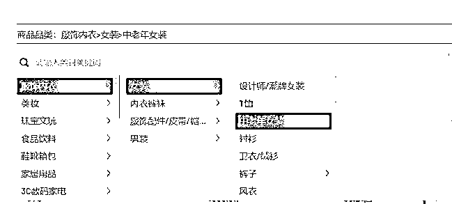

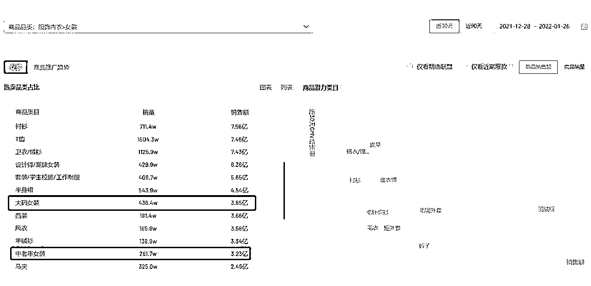

## 5.2 通用的挑品思路

### 5.2.1 先把蓝海讲透

#### 5.2.1.1 蓝海怎么找：思路篇 @刘小排

用一句话概括：去供给跟不上需求的地方找生意，那里就是蓝海。其中高客单、高毛利的方向优先级更高。

芒格讲过钓鱼的道理。第一，待在鱼群密集的水域；第二，别忘记第一条。

怎么验证？看这个圈子：有没有人靠着极简陋的装备、粗糙的产品和朴素的营销，居然还能把货卖出去并且赚钱。有，那大概率就是蓝海。

龙哥给过一个框架：任何项目都能拆成最小闭环——流量、产品、变现。

沿着这个思路，找蓝海可以压缩成一个公式：流量稳 + 产品糙 + 变现稳 = 蓝海。

先说流量得稳。

网上时不时冒出所谓“现象级”小爆款。拿2022年1月那条龙哥盟日历视频来说：播放炸了，还冲上抖音总榜第一，点赞逼近千万。

但这是“稳”吗？不是。它是一次偶发事件，你照着抄，大概率什么也捞不着。别说你，连原作者也难复制第二回。

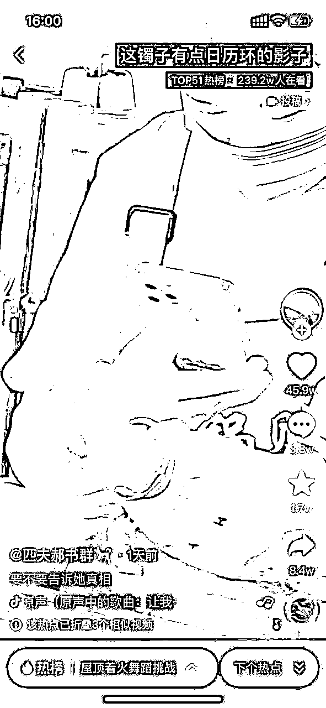

那什么算稳？就是你随便挑个时间点去看，它都维持着不咸不淡的状态。

直播间里总有人在，可能就二三十个，但你几点进去都是这个数。

站点日访客两千，不算亮眼，可贵在天天两千，甚至还在缓慢上爬。

……

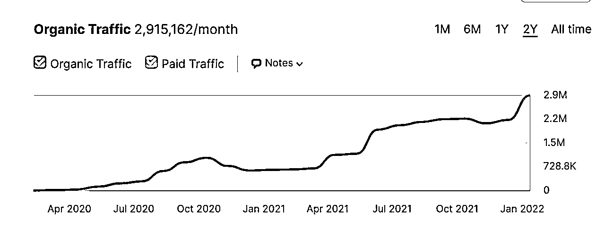

这种状态，才是值得盯上的流量。

寻找方法并不复杂：刷到爆款先压住兴奋，去翻这个号的历史内容。要是他其余作品全无起色，只有这一条飞了，先放一边；等他反复做出有量的作品，或者连续几个月维持住“30天销售额”，再记进表里。

再说产品要“差”。

这里有两层意思得说清。

不少同学把“货”直接等同于产品；做电商的人说“挑品”，选出来的东西自然也叫产品。

字面上没毛病，但语境变了。

在本篇的语境里，“产品”指的是针对某个具体难题给出的一整套解法。

拿“在抖音直播间卖货”举例：要解决的问题，是让某件商品通过直播完成成交。

那产品就是这套解决方案：攒精准粉丝、拉高种草意愿、优化直播间转化率，全都算。

产品糙的意思是：精准粉没几个、直播做得烂、短视频也烂——可即便如此，机会依然可能出现：某个主播卖着某类货，粉丝少、内容糙，却能把钱稳稳挣到。

2. 判断“差”的标尺，是“比你力所能及的还差”。

差是比出来的。参照物是谁？是你自己。因为找蓝海的人是你，你是主角。

就像本章开头提到的“哈尔滨程序员”。他的东西放在普通兼职程序员里算相当能打；可放到正规软件公司的标准下，终究是业余水平，算差。

这一点挺反直觉。

平时我们讲“见贤思齐”，主动去看更优秀的作品，是为了学习，知道差距在哪，才有进步。

但找蓝海要拧过来：凡是超出你能力范围的作品，立刻划走。人家做得好是人家的本事，你拼不过，盯着看有什么用？机会不会藏在那儿。

第三项：变现得稳。

流量归流量，变现归变现，这两件事经常不重合。有两条得刻在脑子里：

举个反例：直播里播“刷抖音直播”。（没打错字，也不是病句。）

它的转化效率低得可怜，找不到直接的收钱路径，自然过不了“稳定变现”这一关。

所以2021年抖音大航海反复强调的那句话要记牢：动手之前，先把怎么收钱想明白。宁要一千个能掏钱的粉，也不要一百万只围观的粉。

正面的例子是董十一。他抖音粉丝也就十来万，一周却能进账约百万。这种样本才值得拆解。

当然，不是人人都得做长期主义，但也不能短到离谱。你想，一个项目只活一个月，下个月推倒重来；下个月的机会在哪？谁也不知道，因为你未必还能撞上同样的短窗口。吃一顿饱一顿，意义不大。

这种项目，恰好手头有空，短期撸一把没问题，值得试。但如果你打算把未来半年、一年押在上面，那就别碰，直接放弃。

什么叫变现稳？

逻辑和前面的流量一样：你随便哪天去看，它都是不温不火的。淘宝小店天天出单，可能就百来单，可贵在天天百来单。

CPS 日日有成交，粉丝两万出头，每天净利三四百；抖音探店账号，单条视频点赞一两千，挂点商家广告或小黄车。数字看着不起眼，可他天天发，条条如此。再加上粉丝还在持续涨，这就相当可怕了……

……

出处：《蓝海项目挖掘｜小航海学习手册》

#### 5.2.1.2 这类蓝海品去哪儿挖 @古辛 @文林 @唐明杰

这套思路放到任何平台都成立。

想快速筛出符合条件的品，有两条路径：

先看小众需求，它又能拆成两类。一类是小众产品需求——要的人本来就少，比如50码的鞋；另一类是小众品牌需求——只有一小撮人认某个小牌子，像某些微商品牌压根不进淘宝，那就可以在淘宝做截流。

至于大众商品里的小众品牌，拿大众词去平台和第三方工具里搜，能扒出不少小品牌，再逐一判断能不能做。

下面用抖音当例子，讲讲怎么把这两招拼起来找蓝海赛道。

文末也附了几个我看下来机会可观、竞争不算激烈的类目合集。

经验一：在红海里挑蓝海子类目

女装卷得厉害，那就往它下面钻——【中老年女装】【大码女装】。

中老年女装在抖音的月度成交能到三亿多，退货率只有十几个百分点。

年轻女装呢，月度盘子上百亿，可退货率50%，厮杀强度比中老年高出百倍。

经验二：避开火拼区，去市场里捞蓝海类目

品是不是蓝海、对手是多是强，怎么判断？

有个土办法：进对手的直播间和视频里看制作水平。画面糙、剪辑糙的，通常竞争薄，大概率就是蓝海品、蓝海细分。

比如服装赛道，有人直接把直播间搬到雪山上卖羽绒服，你感受一下这个卷法。

而中老年女装那边的局面是这样的

蓝海类目推荐（抖音能做的方向很多，这里只简单展示一部分）

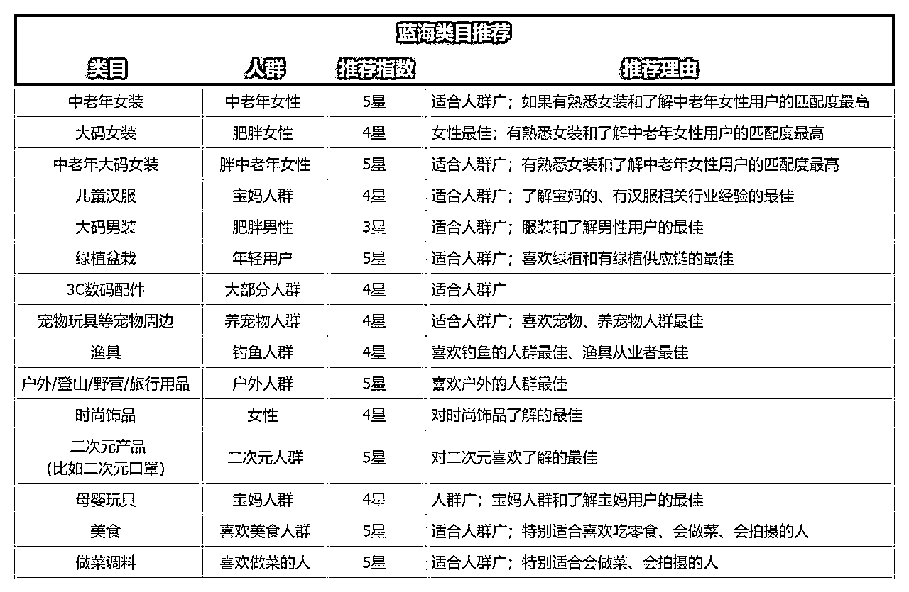

出处：《淘宝蓝海 选品 淘宝蓝海选品方法集合》

#### 5.2.1.3 蓝海的红利与坑 @陈陈

单拼销量，蓝海肯定打不过红海。但蓝海的价值在别处：

一是对手稀薄，启动期不用砸太多钱，就能看到一些起色。卖普通毛巾和卖美容院专用毛巾，竞争压根不在同一档，后者在细分上更深一层。

这些优势归结成一句：对普通人友好。

不过刚上手的人，常掉进两个坑：

1. 无视需求

一类人眼里只有大众商品，看不见红海里的血战；另一类人则对自己的判断过于自信，觉得随手一挑就是蓝海。两种都危险。蓝海与冷门之间不能画等号，需求和竞争必须同时纳入考量。

想看需求大小，扒同行的数据就行。比如理发店毛巾，淘宝上多数月销落在200到1000之间，已经能排到比较靠前；再往冷门走，像原神周边毛巾，竞争只有几十家，可这也恰恰说明需求薄，想靠它赚到像样的钱很难。这类品就不建议选。

数据体量越大，翻查越吃力。眼下市面的采集工具基本只能覆盖出单表现好的那一层。市场盘子太大，靠一个大词很难采到真正的蓝海类目，想切细分，还得拿更多词去交叉筛。

所以别把软件当万能。离开挑品工具，细分需求照样能挖出来。

出处：《3000 字，更适合新手宝宝的蓝海选品技巧》

### 5.2.2 跟着爆款走 @悠途 @肖肖

所谓跟爆款，说白了就是别人把某个货打爆了，你立刻上同款，跟着分流量。在你摸不准什么能火的时候，这是见效最快的路子。

可如果只是照搬，货源、佣金、渠道全一样，大概率只能蹭点汤水，肉轮不到你。但对新手而言，它确实是短期拿到正反馈的手段。

想再往上放大，就得算投入产出比，想清楚怎么用自身优势掀翻那个被你模仿的对象。以【白牌低价彩妆】举例，抖音上跑得好的分两种：一种替别人卖货，一种做自己的低价白牌去跟。

第一类：替别人卖货

带别人的品牌，先问自己：同样的品，我凭什么比对手更有优势？有个商家月GMV过千万，利润率压在一成以内，客单价9.9到19.9元，卖的是别家牌子。

他的底牌是自建快递站，身处四线城市，员工月薪三千上下，供应链成本被榨到极限。同样的货，他能给到比同行更狠的佣金，硬碰硬碾压那些无货源玩家。无货源的人碰上同款，只能靠达人短视频或者投付费，才勉强抢到一点量。

第二类：做自己的低价白牌跟品

有商家走的是自有品牌路线，自己还开着淘宝店，供应链就是靠淘宝那几年搭起来的。他上新的反应极快，利润来自对供应链的深挖。

以前做过品牌、或者手里攥着一盘货的老板，是能切到一定份额的。但得算清楚：自己的本事和优势对不对得上，值不值得往深里跟。

跟之前要盯哪些要素？

先说优势：

入场的人多，可参考的样本就多，成长速度快。

对新手友好。进场早、竞争还没起来、热度正高的时候，账号容易起。

再说劣势：

能跟的品类有限。这招更适合自带流量、起号门槛低、属于“品带人”那类的爆款。

而且爆款起得快落得也快。任何品都有寿命，踩准进场时点很关键。

另外，跟品本质上是模仿甚至复制别人的商品，某些情形下会撞上版权或知识产权的红线，合法性得先确认。

出处：《视频号直播单品 30 天 30 万佣金的案例分享》、《聊一聊普通团队做视频号直播的起盘方法论》

### 5.2.3 按周期挑品 @李百万 @古辛

什么叫周期性产品？就是每年到了固定时段，某类商品会迎来流量高峰，适合集中出货。它包含两种：随季节走的，和随节日走的。

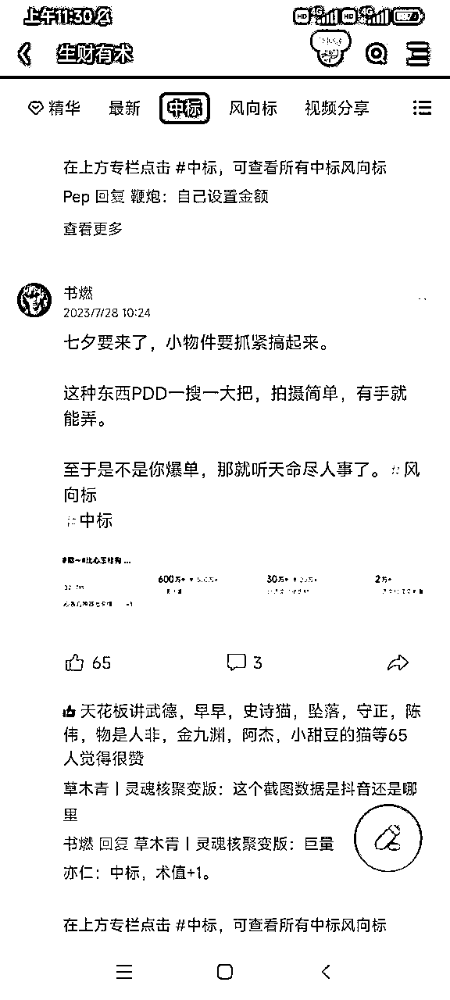

“季节性选品”指的是跟着节令或节日去挑货、推货。它专门对付那些受气候和时点影响明显的商品与服务。夏天上比基尼、泳帽、沙滩裤，冬天推卫衣，再比如圣诞、春节相关的货品。

今年的脐橙，明年照样有人买；每到冬天，蜂蜜的生意也照做不误。季节轮转，有些需求始终不变，我们要做的就是把它接住。

判断某个品能不能当季节性商品来打，看它历年的销售曲线就行。比基尼在亚马逊上每年六七月冲到销量顶点，那它就是一个每年六七月都能卖动的品。

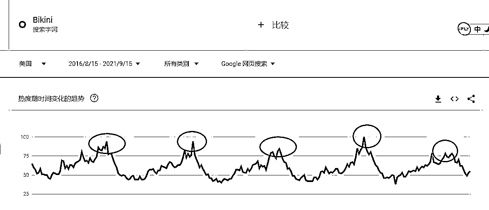

还有一点：季节性商品属于短线操作，所以要注意：

出处：《电商小白通过赚钱精华帖＋实操，从 0 到 1，实现视频号单月佣金 12w＋的复盘》、《11 月航海 | 亚马逊入门 |实战手册》

### 5.2.4 顺着需求找货 @丹牛 @李百万

前面聊挑品原则时提过：严格来说，“产品”指的是能对接市场需求的全部有形商品与无形服务，是承载“解决问题、满足诉求、创造价值”这套方案的东西。

## 痛点越准，定价越稳：别再把痒点当痛点

目标用户一旦圈定，接下来就该把他们可能遇到的麻烦逐条摊开。你能解决的事越关键，赚钱的几率就越高；如果还能把问题框定在某个时间节点上，思路会更清晰。举个场景：夏天来了，这批人最头疼的是什么？

其实，很多人已经从市场端和用户端找到了不少方法：发问卷、研究电商平台里的差评、用第三方数据工具拆数据，办法并不算少。可真正落地时，不少人会把“痛点”和“痒点”搅在一起。

那痒点究竟是什么？简单说，既换不来直接收益，也不能化解大的麻烦，这种需求都只能算作痒点。

拿机场常见的自动跟随拉杆箱来说：它既能跟着你走，你走累了还能当小车骑。第一次见到的人多少会发出“哇，好酷”的感叹。然而真到了掏钱环节，很多人会犹豫。且不论价格比普通箱子贵出好几倍，单是在人流密集的场所，谁敢让行李脱离自己的视线？我在电商平台查过，这类产品销量第一的那款标价2999元，累计成交只有92笔。

这类东西确实有需求，但它很难推动真正的购买行为，因为这只是痒点——挠一挠也行，不挠也无所谓。特别是当解决方案要付出很高成本时，大多数人宁愿不理会。

痛点则截然不同。解决一个痛点，要么带来立竿见影的收益，要么能消掉严重的隐患。这两种效果，决定了它和痒点本质上的差异。

这也给选品立了一个标尺：你的产品值什么价，定价天花板在哪里？答案取决于你对痛点的量化程度有多深。

内容来源：《选品的三大核心原则》《电商小白通过赚钱精华帖＋实操，从 0 到 1，实现视频号单月佣金 12w＋的复盘》

### 5.2.5 趋势选品

先给大家提个醒：这种方法不太适合零基础的新手，更适合已经积累了一定选品经验、也愿意承担风险的老手。所谓趋势选品，说白了就是跟着当下的流行信号，或者推测未来的风向去物色商品。它很考验你对市场的敏感度和分析功力，毕竟得在变化中提前抓住消费者接下来会喜欢什么。

要做好这件事，日常的市场调研不能少，还要持续观察消费者的行为变化和竞争对手的一举一动。比如某类新技术产品或某种穿衣风格突然火起来，你就可以考虑早点进货；潘通每年公布年度流行色，服装、家居、潮玩这些行业也能围绕相关色系做文章。

趋势选品往往意味着你比大多数同行更早进场，抢到先发红利，也更容易在用户心里留下印象。一旦趋势判断得准，冲上行业第一也不是没可能。当然，风险同样存在，所以更建议把它和蓝海选品、跟品、季节性选品等方法放在一起综合考量，从多个角度判断一个产品值不值得做。

# 六、抖音选品

💡
这一节，咱们一起看看抖音的平台特性，以及主流的选品玩法。

抖音从根本上说是内容平台，流量池巨大。用户在这里刷内容、搜信息，看着看着就可能对视频里的商品产生兴趣，顺手完成购买。这跟靠搜索驱动的货架电商完全是两套逻辑，所以大家把它叫“兴趣电商”。

现在的抖音电商，体系已经很成熟。前端有短视频、直播带货，后端有小店和供应链，模式不同，挑货的路子也不一样。

我们把主流玩法做成了清单，可以按这个框架去找品：
✅ 短视频带货类：对标账号、抖音“商品”搜索、关键词、精选联盟商品/店铺、类目、第三方抖店工具、拼多多榜单、市场供求关系、搜“求购”挖需求。
✅ 直播带货类：垂直类目、蓝海单品、同行跟品。
✅ 小店后端类：类目、数据、产品分类、货源平台辅助、客单价、货源/地理优势。

另外，还整理了一些在抖音电商选品时要避开的坑。

提醒一句：这些选品案例都有时效性，里面的数据很可能已经过时。大家重点学思路，实操时还得结合当下的情况做判断。下面一个个看具体玩法。

💡 本章航线图

学完第五章、完成实操，航线图第三阶段就达标了：给正在做的项目挑至少3个品（每天约2-4小时）。

1.
先按自检表挑出至少1个合格的品（约1天）
再继续挑1个符合自检要求的品（约1天）
之后每天都选至少1个达标的品（每天2-4小时）

接下来正式进入方法论教学，别忘了在航海日志打卡进度～

抖音选品自检表：

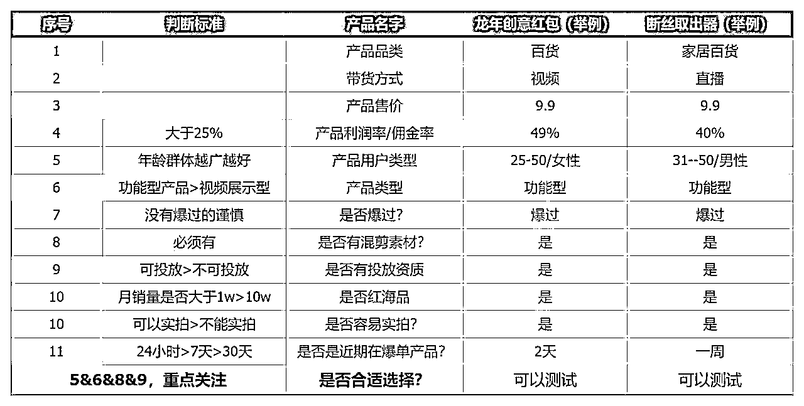

## 6.1 抖音平台解析

平台特点：
抖音本质上是个内容分发平台，算法会根据你的观看偏好和兴趣来推内容。现在大多数用户打开抖音是为了刷内容，不是为了购物。很多人是在刷视频的过程中，忽然发现自己需要某个商品，然后才产生兴趣、下单。这种模式与搜索式货架电商不一样，因此被称为“兴趣电商”。

目前抖音算得上是对变现最友好的视频平台之一。衣食住行各个领域，几乎都能找到对应的商家。整个电商链条也打通了：边看边买、商品橱窗、抖音小店，用户能在站内完成整套购买动作。直播带货的兴起又添了一把火，玩法更多，账号运营者在电商上的选择也更灵活。

人群画像：
抖音的用户分布相当广：城市从一线到四线，年龄从长辈到年轻人，覆盖面很大。配合算法推荐，内容和人群能做到比较精准的匹配。

跟其他内容平台横向比，抖音用户比视频号偏年轻，比快手更偏都市，比📕男女比例更均衡，年龄跨度也更大。所以，几乎任何品类的电商生意，都值得拿到抖音上试一试。

电商模式：
第一，短视频带货。拍与产品相关的视频，挂上商品链接，用内容吸引用户下单，赚取佣金。凡是打算在抖音做带货的人，都可以从这里入手。
第二，直播带货。通过直播间讲解商品、引导成交。现在很多品牌靠直播推动用户下单，不少博主也在做。视频火了之后，直播还能承接流量、提高转化，同时给账号涨粉，形成双向引流。
以上两种方式，要开通带货权限需要满足实名认证、1000个粉丝，并且至少发布10条视频。品类怎么选，要看目标人群的特点和需求。
第三，抖音小店（后端商家）。自己开店，既能用短视频带自己店里的商品，也可以努力进精选联盟，让达人帮你卖。这套打法更适合手里有货源或想走偏货架电商路线的人，选品时适合跟爆款或蓝海单品。

部分内容来源：《盗坤：视频号带货的核心在选品》

## 6.2 抖音短视频带货怎么选品 @文林 @唐明杰

💡 小节概要

想在抖音做短视频带货，平台上的产品已经足够丰富。如果你能找到竞争没那么激烈、需求足够旺盛的利基市场，就很容易打出差异，爆单的可能性也会上一个台阶。

我们结合圈友经验和往期航海沉淀，整理出一套打法：

✅ 新手最省力的方式，是盯着对标账号跟卖，重点看招数一、二、四、五、六。
✅ 有经验以后，可以用第三方工具提高效率，参考招数七、八、九。
✅ 想理解底层逻辑，就从挖掘需求切入，看招数三、招数十。

另外，也可以挑目前抖音上还算蓝海的类目来做差异化，竞争压力小，容易积累正向反馈。

说到底，选品是长期修炼。你得持续试、持续打磨自己对利基市场的敏感度，直到碰到那个对的品。

### 6.2.1 视频选品的几个方向

#### 6.2.1.1 新、奇、特方向

比如宝妈小红，孩子对家里的拼图、积木、毛绒玩具早就没了兴趣。某天她刷到一把泡泡枪，能像加特林一样连续喷出大量泡泡（见图）。她没见过这种玩法，一下子被戳中了：以前自己吹泡泡，半天才吹出几个，这枪一开就是满屏彩色泡泡，太梦幻了，直接下单。

这里要提醒一句：你选的东西，必须在视频里能呈现出很强的视觉效果。看下面的案例：

再比如最近流行的家用迷你桌球桌，在家里就能开一局。

下班以后别只顾着刷手机，给家人添一个这种小桌球，娱乐性很强【点击这里】

#### 6.2.1.2 高颜值方向

爱美是人的本能。在短视频平台里，抖音用户对颜值的挑剔程度尤其高。因此在抖音上选品，能选好看的，就别选普通的。

儿童汉服就是个好例子。下面这几套汉服，哪怕我没女儿，看着都忍不住想买。

#### 6.2.1.3 刚需实用方向

接着是刚需路线。一定要挑那种用户离不开、需求量又大的产品，千万别拍脑袋。

怎么判断需求到底大不大？去看同类商品的销量数据就很直观。

比如总有人嫌手机充电慢，超级快充数据线和快充头这类产品，对用户来说就是又刚需又实用的典型，看图：

### 6.2.2 抖音短视频选品实操方法

方向有了，具体怎么落地？下面结合一些方法和技巧，带大家看看在抖音里可以通过哪些路子把品挑出来。

#### 6.2.2.1 招数一：找对标账号抄作业

选品里最重要的一招，就是【对标】。重要的事说三遍：对标、对标、对标！

找对标账号，有两条路：
1. 直接在抖音里手动搜索，定位同领域的头部账号，看他们在卖什么。
2. 借助第三方工具，更快地找到对标账号和他们的热销品。

先看手动玩法。假如你的类目是母婴玩具，就去抖音搜【玩具】，找到类似【冰冰家玩具】的账号，点进店铺或橱窗，点一下【上新时间】。列出一段时间内新上的产品，从中挑销量最好的。冰冰家玩具最新上架的泡沫飞机，就是新上产品中卖得最好的，那它就可以进入你的候选池。然后再回到账号主页，继续看其他细节。

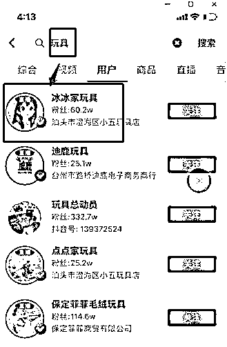

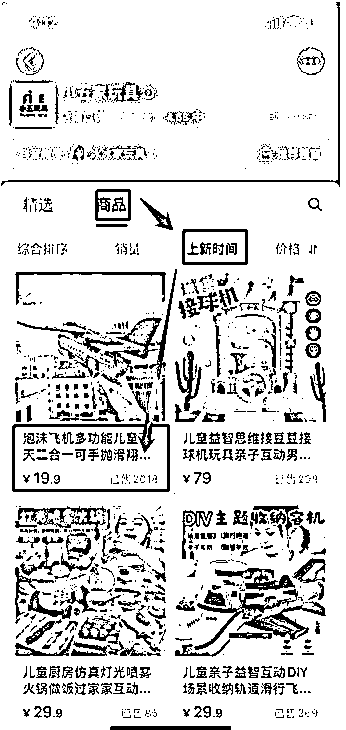

刚才这种手动方法比较基础，效率不算高，适合刚起步的阶段。

想要更快，就用工具来找对标账号和他们最近卖得好的品。

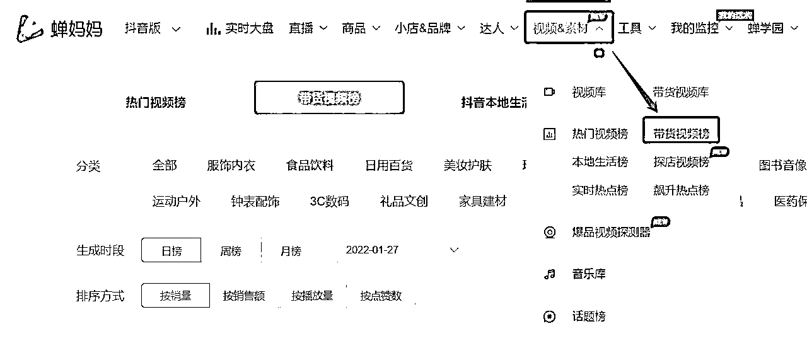

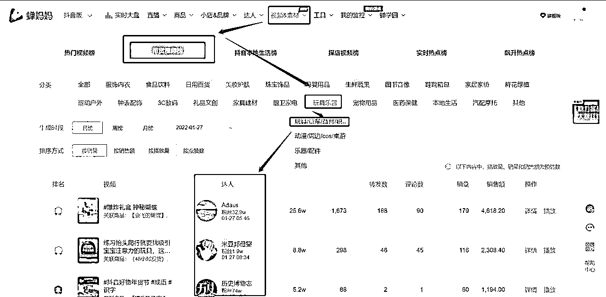

再比如抖查查的路径：点【达人】→【达人榜】→选【母婴育儿】→看账号列表，筛出想要的账号→点进账号，找挂小黄车的高赞视频→点小黄车看具体品。

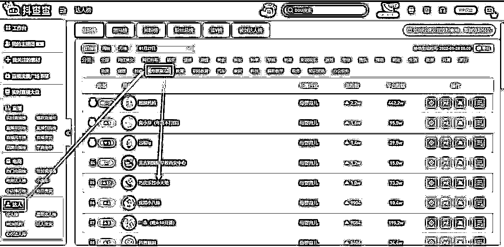

#### 6.2.2.2 招数二：用抖音「商品」搜索找品

具体操作：打开抖音，在搜索栏输入【玩具】，切到【商品】分类，再点【综合】排序。这里有个大坑：别直接点“销量”。因为销量榜累积的是历史数据，看不出当前什么最火。

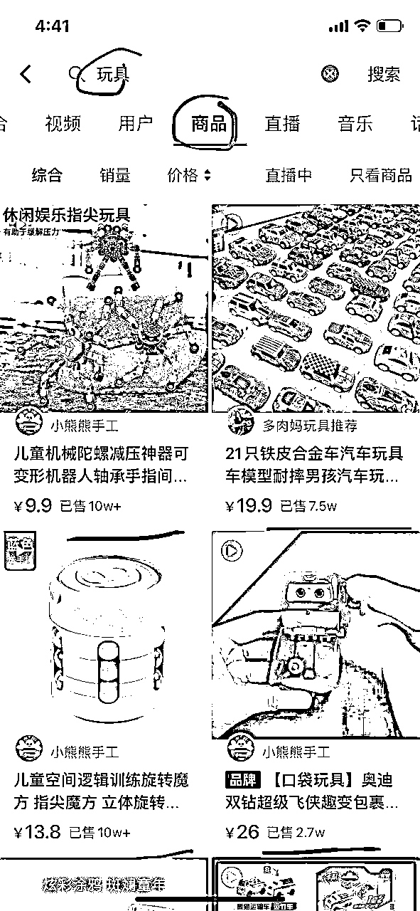

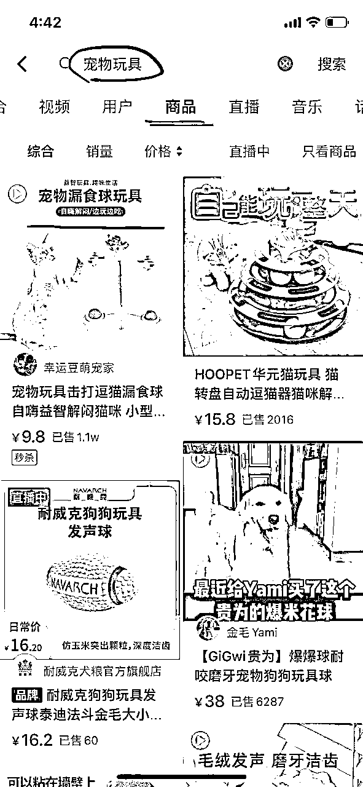

#### 6.2.2.3 招数三：用关键词判断趋势

这个方法的核心作用是判断趋势，顺带找到产品的关键词。

思路是这样：先在大类目里找到正在上升的小类目，再从小类目里继续往下钻，找到更细的上升子类，一层层收敛，最后锁定有潜力的品。

工具用的是巨量算数，网址 https://trendinsight.oceanengine.com/，进入“算数指数”，输入【玩具】。

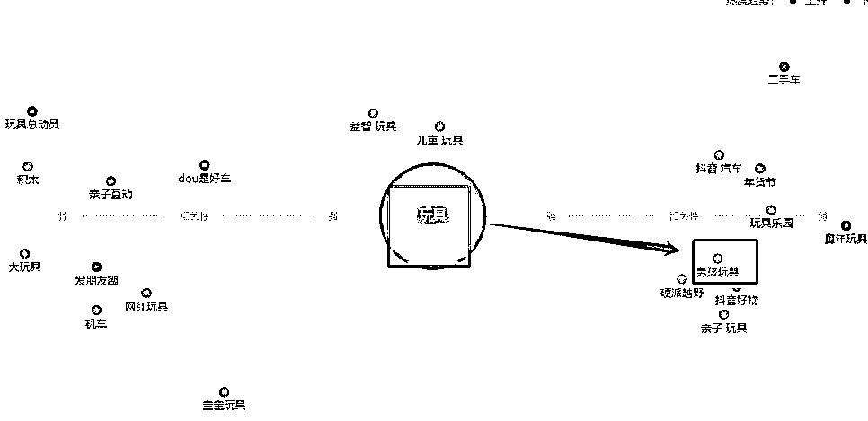

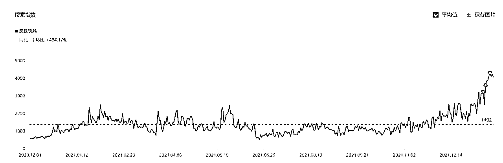

接着从【男孩玩具】往下挖，可以看到【变形玩具】。

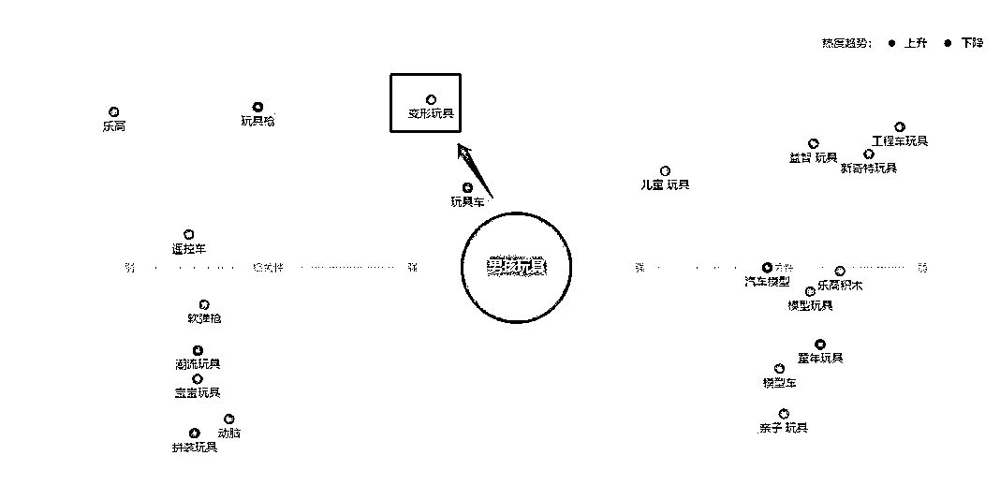

再从【变形玩具】继续下探，会出现【指尖陀螺】这个词。

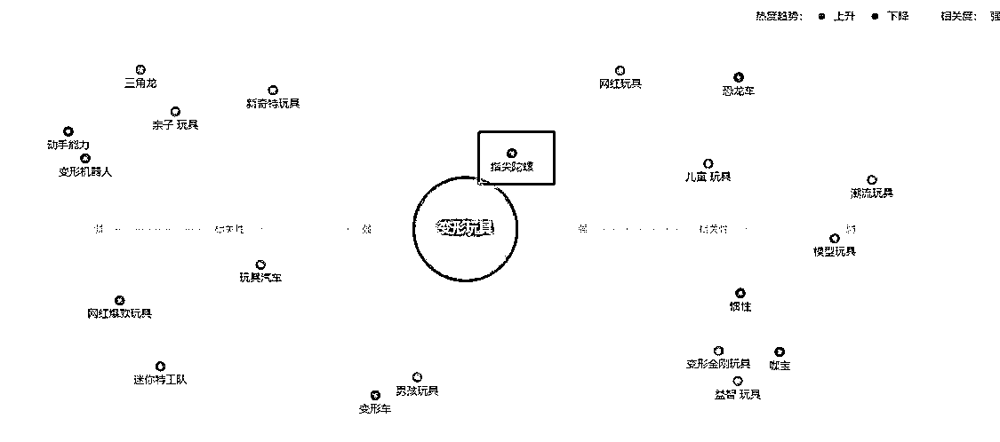

爆款这东西是会轮回的，以前火过的商品，过一阵子很可能再火一次。

巨量算数还能看单品的完整历史走势。参考过去三五年数据，就能推测今年什么品类会爆发，然后提前进场。泡泡机就是典型案例。

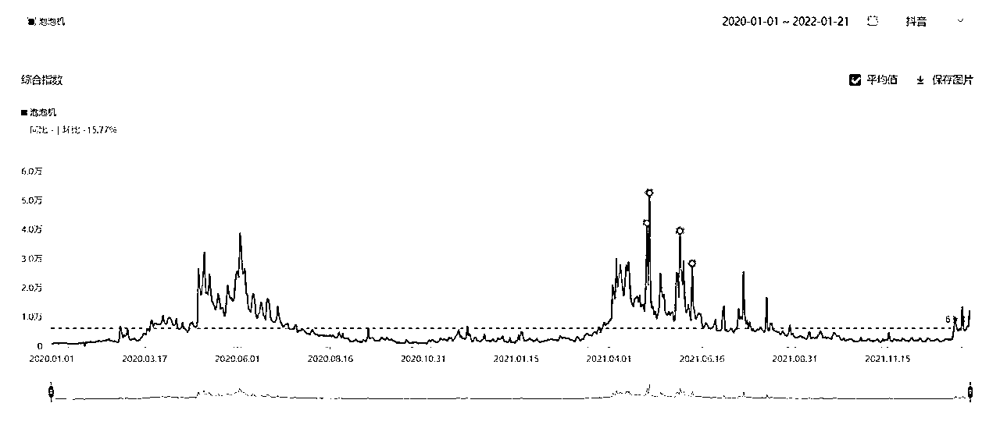

从曲线图上能清楚看到，泡泡机每年4月起量，4-6月是爆发窗口。提前一到两周发布相关视频，就能抢到第一波流量红利。

反过来，如果你已经有了具体候选品，用巨量算数的指数趋势也能验证它值不值得做。

#### 6.2.2.4 招数四：从热门视频里选品

比如还是玩具品：在抖音搜【玩具】，排序方式选“最多点赞”，发布时间限定“一周内”，再点搜索，筛选排名前3的视频看。

#### 6.2.2.5 招数五：从精选联盟商品里挖线索

精选联盟的商品池，也可以当成选品情报站。还是拿玩具说事。

路径：抖音【我的】→【商品橱窗】→【选品广场】→输入关键词【玩具】→看综合推荐列表。接下来可以按三个方向找线索：

一是按销量高低挑；
二是按销量排名挑；
三是结合月销量和商家体验分综合判断。

一个小提示：商家月销量最好超过5000，体验分要在4.5以上。

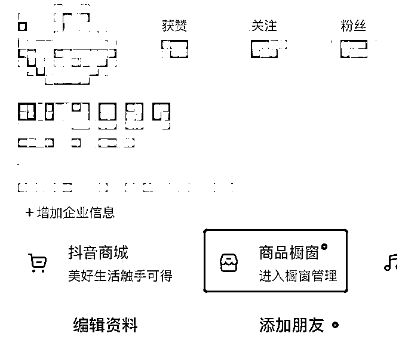

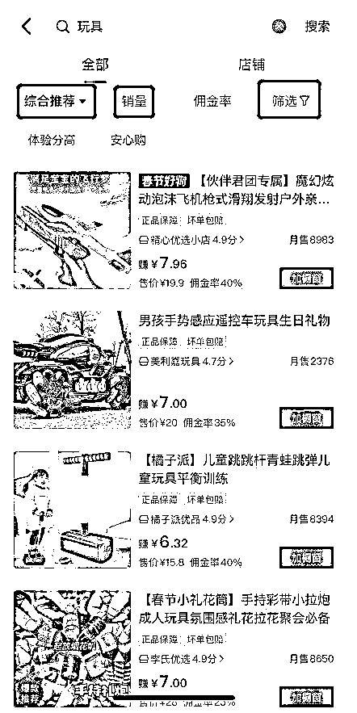

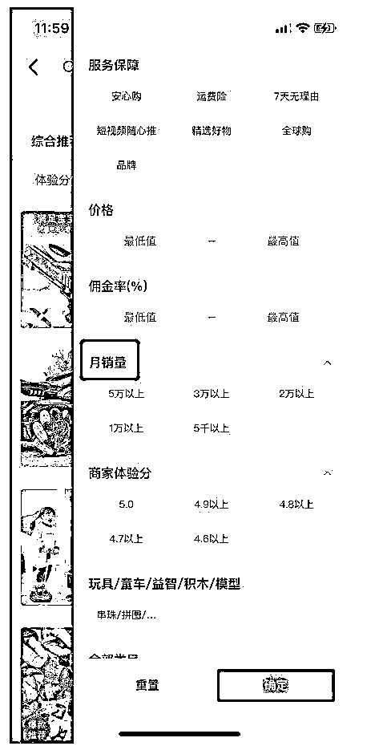

#### 6.2.2.6 招数六：从精选联盟店铺里挖线索

如果说商品是点，那店铺就是面。从精选联盟的店铺端切入，也能找到不少选品灵感。还是以玩具为例。

同样是走【我的】→【商品橱窗】→【选品广场】→输入【玩具】→这次切到【店铺】标签，看综合推荐。选店铺时，参考三个维度：

销量高低；
销量排名；
月销量和商家体验分。

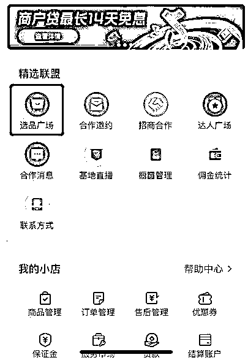

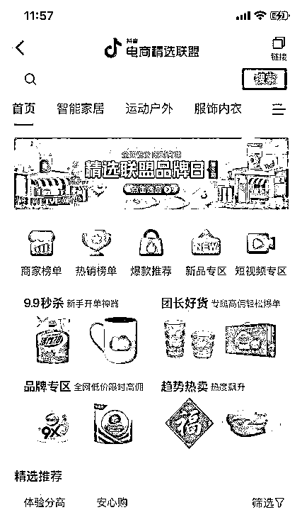

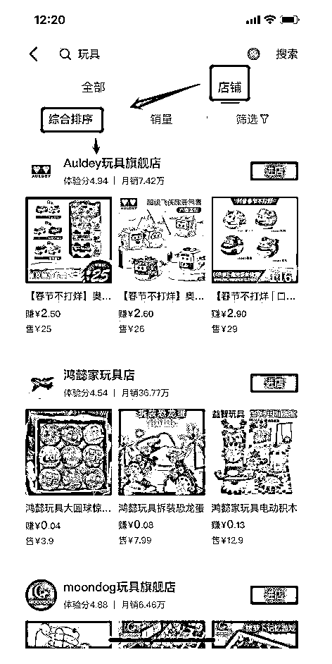

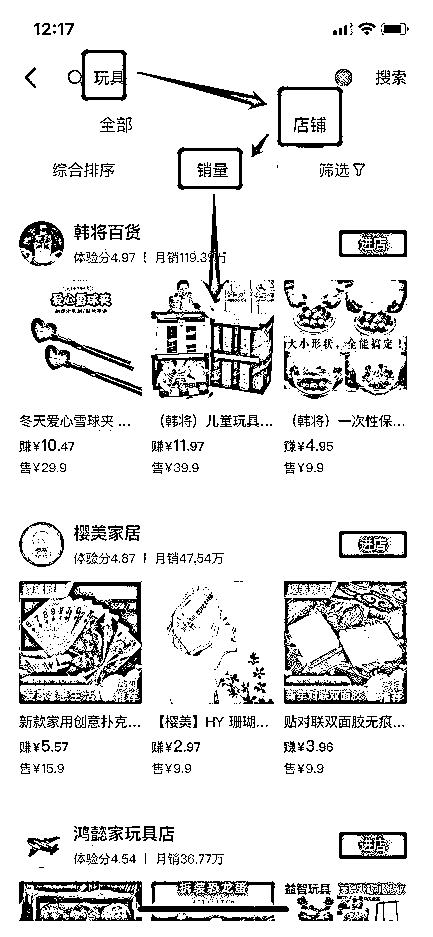

#### 6.2.2.3 招数七：按类目扫货

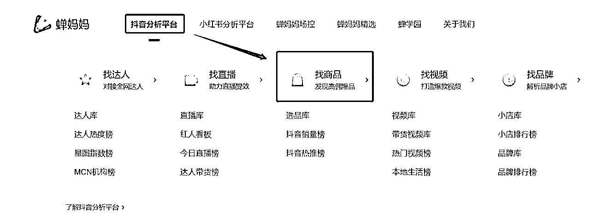

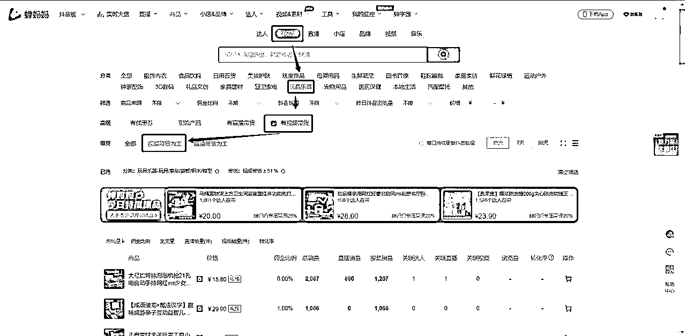

#### 6.2.2.8 招数八：借助第三方抖店工具选品

无论做抖店运营还是短视频带货，都可以用店群类软件来批量抓数据。常见的工具有抖飞飞、抖小宝、抖小鸭等，功能大同小异，各家有各家的优势。

这里拿抖小鸭举例。它能采集精选联盟里的商品、类目、猜你喜欢和整店数据，并生成表格，省去手动一个个翻的时间。

a. 抖音爆款采集
在抖小鸭里按关键词采集联盟数据：输入“童装、女装”，就能把对应爆款的标题、价格、销量、佣金和佣金率都拉出来；下面还能筛价格区间、销量区间、佣金率区间，比手动筛选快得多。

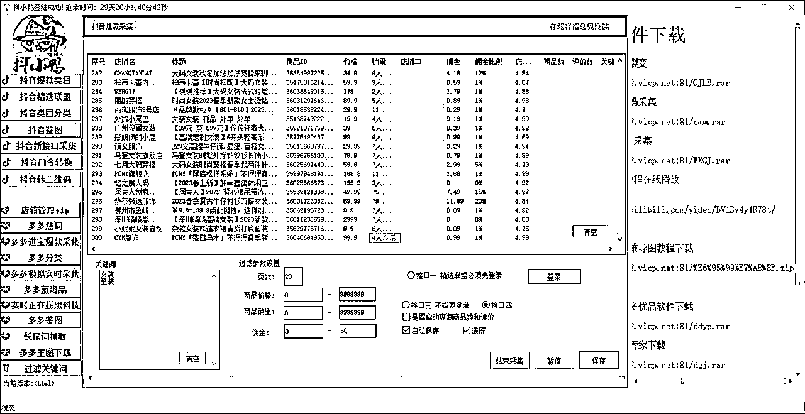

# 抖音电商找货指南

商品链接旁常会附带拼多多入口，工具支持按图片或名称反向查找，借此追溯同款上游供货方，再做价格对照。

## b. 类目采集

另外，第三方软件也能按分类抓取商品：先进入抖音的分类体系，勾选目标类目，再设好价位、销量、佣金等过滤条件，确认后即可运行采集。

#### 6.2.2.9 方法九：借拼多多潜力榜找方向

拼多多等平台的潜力排行榜，同样能作为找货入口。以抖飞飞为例：先在工具里锁定拼多多热卖区，按分类过滤；示意图中一级选母婴玩具、二级选玩具，页面会列出商品名、店铺、售价、昨日销量、七日销量、月度销量以及七日增长量等列。

判断近期走势时，通常只盯昨日与七日的增长数据即可；若想深入拆解，还能把结果导出为 Excel 再做分析。

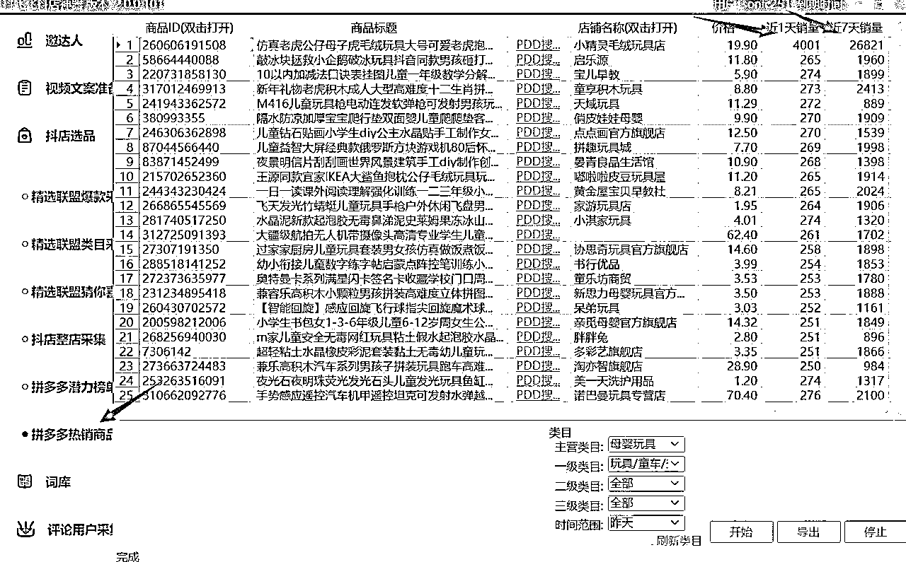

#### 6.2.2.10 方法十：用供需关系做判断

挑货时看供需，可拆成三条：买家需求旺、同行数量少、对手实力弱。单独用其中一条，或把几条拼在一起，面对的局面与难度都不一样。

想迅速筛出符合条件的商品，可以记住两个做法：其一，绕开厮杀激烈的战场，去蓝海分类里找口饭吃；其二，从红海大类中切出更细的蓝海子类。

接下来聊聊我如何把这两招配合起来锁定蓝海类目，并整理了几份自认为机会尚可、竞争不算惨烈的类目清单。

经验一：躲开红海，去蓝海分类里找机会

判断某个商品是否处在蓝海、对手是多还是少、是强还是弱，有个省事的办法：翻同行发布的短视频和直播画面，观察其制作水平——如果呈现得相当简陋，通常说明入局者不多，这类领域大概率还比较空。

举个例子，服装赛道里有人把羽绒服搬到雪山上开播，激烈程度可见一斑。

再看中老年女装的局面，又是另一番样子。

经验二：从红海大类里切蓝海子类

拿女装来说，整体已是血海；此时可以往细分里找相对空白的口子，例如【中老年女装】与【大码女装】。

前者在抖音单月能跑出三亿多成交额，退货比例仅一成出头。

年轻女装虽然单月可破百亿，但退货比例和厮杀程度都明显更高。

出处：通用能力｜怎么定位和选品

#### 6.2.2.11 方法十一：搜“求购”找需求线索 @史蒂芬周

在抖音输入“求购”二字，把结果按最新发布排序，逐条向下翻，能碰到不少真实且紧迫的购买诉求。买卖说到底是低价进、高价出；一旦捕捉到需求，就可以去承接，甚至顺着它继续往下挖。

我曾借此发现一条颇有价值的行业线索——“去伊朗卖二手笔记本”。当地长期承受美国制裁，进口环节成本偏高，发展过程中对多类型二手本本有较大缺口。这条线索正是靠检索“求购”翻出来的。

出处：帖子《抖音“求购”挖掘线索》

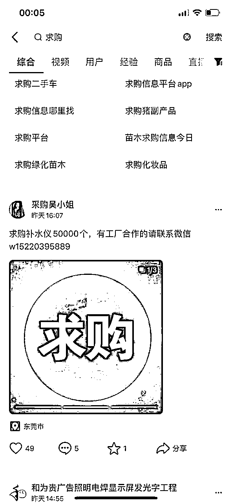

## 6.3 直播带货怎么挑货

💡

抖音直播的形态越来越丰富；能抓眼球的场景，加上新奇且价格能打的商品，是各方争夺的焦点。若能找到合适的利基市场，锁定需求旺、对手少的货，直播运营的胜率和爆单机会都会明显提高。

因此，挖掘需求与挑选商品是核心环节。下面从星球帖中摘出三种路径：✅按垂直类目挑 ✅围绕直播单品挑 ✅抓取同行商品。

当然，挑货不是一次性的活，需要持续打磨；不妨研究同行的优化打法，再总结出适合自己的迭代方式。

### 6.3.1 直播间常见货品角色 @徐立群

假如手里仅有一件商品、单一规格，直播时难道只能推它？反过来，若备了一百件货，是否要一次性全摆上去？先上什么、后上什么，其实都属于“货品搭配”的范畴。若你尚未确定卖什么、还在找供应端，这一段可以先跳过。先看直播间里常见的几类货品角色：

1. 秒杀型 / 起号型
定义：用远低于常理的惊爆价换启动流量，哪怕赔本也要攒人气。
成本 9.9、外观也像 9.9，直播仍标 9.9——这不算秒杀；成本 9.9、看起来能值 29，直播只卖 5.9——这才算。

2. 成交型 / 爆量型
定义：性价比突出、销量最猛、现金回流最稳的货。
它的任务是托住现金流，同时把直播间热度和口碑拉起来，靠走量获利。

3. 门面型 / 盈利型
若你的主力价位集中在 29—59，不妨再摆一件 99 甚至 199 的货，向观众传递“我这儿也有高阶货，只是略贵”；想图实惠的，自然会去选 59 那档。
也就是说，这类货的关键不是走多少单，而是让顾客看见：它与爆款同框时，能不能形成鲜明对照、有没有展示力、背后有没有故事、是否具备独家卖点，以及能否把整体档次托起来。

回到开头两个疑问：只做一个 SKU，挑货和起号的难度都会陡增。不妨从横向、纵向两个方向，把商品放进具体使用场景中，想想还能补充什么，让 SKU 更丰富。
比如卖橙子：横向可扩到其他水果，纵向则能延伸到榨汁机。

出处：长文《抖音直播带货入门手册》

### 6.3.2 带货挑货法一：沿垂直分类深挖

所谓沿垂直分类深挖，就是先定下一级大类，再顺着它切到二级、三级，用同类商品填补空缺。

常见方向包括：家居、3C、母婴、美妆、渔具、玩具、绿植、宠物用品等。虽然叫垂直，但货盘内容要尽量丰富——毕竟不是只推一件单品，这种直播间的逻辑更接近“类目小超市”。

拿渔具举例：多数直播间会把高客单、高利润的鱼竿和鱼箱当主角；我们反而可以用鱼线、鱼饵这类低单价商品打头阵，补上市场空位，与常规玩家错开。鱼竿鱼箱照样摆出来，顾客看到价格合适，很可能顺手加购。

可以借助蝉妈妈或飞瓜的商品大盘做细致分析，再结合自身经验定下赛道。

定好方向后，还要检查有没有同类直播间。如果一条都刷不到，未必是发现了蓝海，也可能是该品类根本不适合绿幕直播——挑货时务必留意。

大类确定后，进入精选联盟选货。登录巨量百应，打开精选联盟，能看到可售商品的标价与佣金；加入橱窗后，还能查看具体 SKU。（该联盟需粉丝达到 1000 才可开通。）

也可用蝉妈妈、考古加等分析工具，查看类目近期爆量商品；同时借当日视频榜寻找潜在热门。很多人一上来就挑高佣爆品，但挑货远比堆爆款复杂。

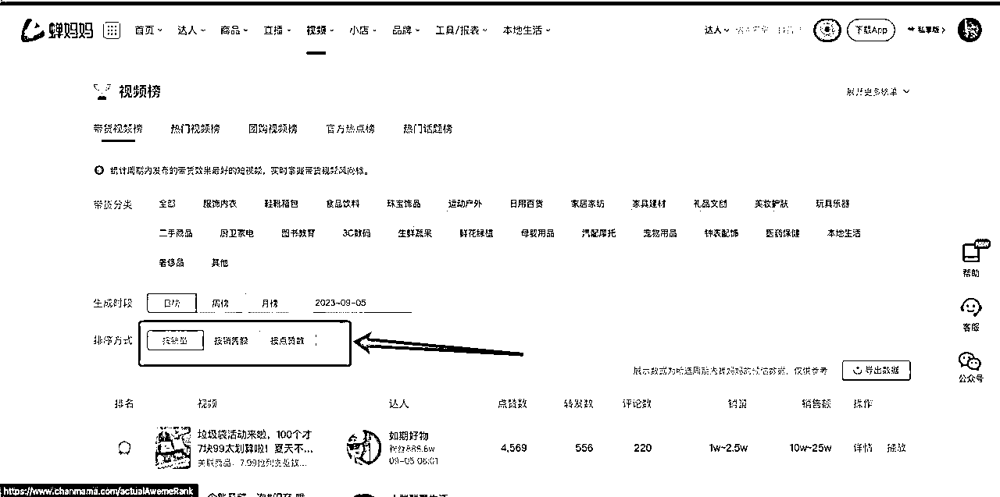
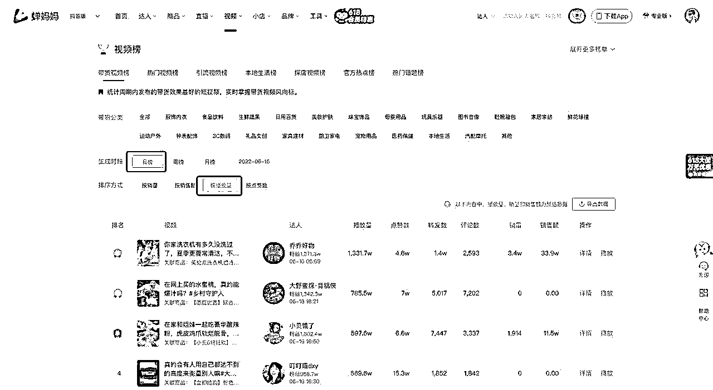

上橱窗时，不要只摆一百件，而要铺到几百件；最好用表格做分层：10% 福利品 A、20% 承接品 B、70% 利润品 C。

福利品可以平进平出甚至贴钱，承接品赚微利，真正贡献利润的是 C 类。

直播不同阶段要依据流量组合货品与话术。例如人少时，用福利品加憋单把人留住、做数据；人气上来后，则集中推利润品完成转化。

### 6.3.3 带货挑货法二：锁定蓝海单品

单品直播间通常不铺太多链接，原则是：一个主推核心品，再配若干辅助品。

比如主推小酥肉粉，1 号链接放它，2—10 号链接搭各种调味料。用户刷到短片后想买粉回家做小吃，很可能顺手在小黄车里捎上配料。

主推蓝海品可从几个方向挖：小家电百货、地方特产、农产品。它们往往具备这些特征：新鲜感强，容易引发好奇；客单低，多在十几到几十元，试错负担小；非标品，价格不透明，价值感容易做出来。

这类商品很适合做单品直播。可以在百度或蝉妈妈找几个样本，再搜对应直播间。看得多了，平台会推送大量相关直播间，都可以收进选品库。遇到合适场景还可录下来，作为绿幕背景素材。

出处：手册《初阶｜抖音绿幕直播实战》

### 6.3.4 带货挑货法三：抓同行货盘 @元榕

前期挑货，可以自己找，也可以先抓同行。以抓同行为例：养号阶段我们刷过大量同行直播，筛出在线 1000 人以上的房间，观察他们在卖什么，然后直接采集。

但要绕开同行的引流货——那通常是他们自家抖店商品，绑定了自己的 UID，采过来没意义。

抓同行需要工具提效，这里用到付费软件黑核百宝箱。操作路径是：“直播货品抓取—粘贴房间链接—检索—一键入橱窗”，这样就能把对方直播间的货搬过来，见下图：

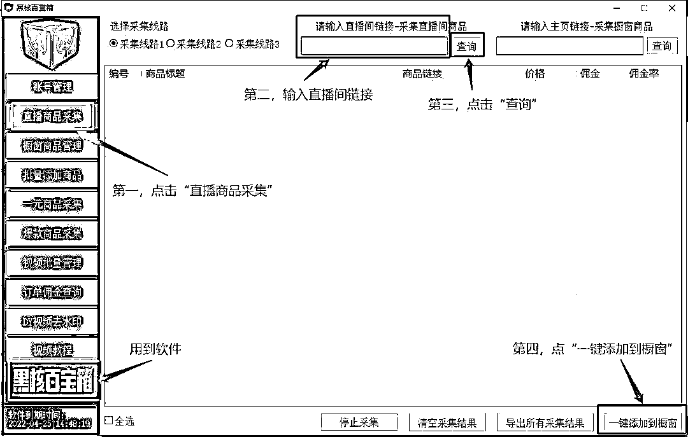

当然，这款软件也能抓同行橱窗里的商品，之后到橱窗商品管理里把销量差的删掉即可。

说到自己找货，如果手头有靠谱的同行群，常会有人丢产品链接，帮大家筛出相对不错的货，可以多留意这类资源。

出处：长文《圈内日入五万+的无人直播项目拆解》

### 6.3.5 货盘优化的小思路 @徐立群

在组合直播间货盘时，有个小技巧：既能白拿品牌背书和价格参照，又能顺手扩 SKU。方法如下：

1. 假设你只有一件 9.9 的女款睡衣，可以在橱窗里放几款 20—50 元、有一定认知度的美妆品。
2. 开播后只讲睡衣，偶尔顺带提一下化妆品。

若你手头货品很多、不知从哪件开卖，别凭感觉，把选择权交给顾客。固定主播和场景，只把“货”当变量去测，看市场与顾客到底偏好哪些款。别迷信自己的判断，以数据为准。

如果直播试错成本太高，可以先拍短视频。比如每件商品都套同一模板拍一条，看哪条数据更好。

最后记住三点：

- 人人都觉得自家货质量好、人人皆宜。真相是：顾客感知到的好才算好，真正下单的人才是精准目标客群。
- 商品未必要极便宜，关键要让顾客觉得占了便宜，买到即赚到。
- 直播带货，形式在“播”，落点在“货”；货本身不行，谁也救不了。与其先怪主播，不如先检查货盘。

出处：长文《抖音直播带货入门手册》

### 6.3.6 挑货避坑清单 @叫我郭郭

1. 挑评分高的店铺
商家评分在 4.7 以上，通常说明品质、物流与售后都还过得去；新手店要慎选——它们连一千单都没跑满，一旦起量超出，容易触发风控导致无法下单。

2. 优先销量高的商品
这类货相对稳，也说明是爆品。佣金往往不高，但能帮你把电商数据做起来。

3. 留意售后服务
像「安心购」、带“运费险”的商品，能帮顾客更快做决定，话术里也能拿来用。

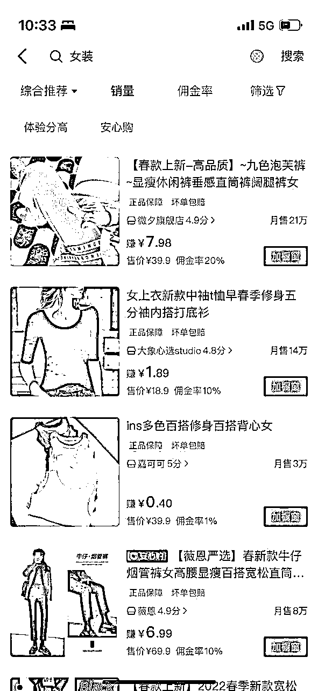

4. 看清目标人群
例如主打 30—45 岁女性的家居服、睡衣、大衣，就别混入学院风制服、洛丽塔风裙装，既不聚焦也显得外行。

5. 警惕复合链接
图上标着 29.9，点进去发现 29.9 只是打底衫，大衣要几百块——这种也要避开。它是把双刃剑：低价能吸引停留，但价格落差会让顾客受伤，进而失去信任。

6. 标题写“达人专享”

如图中那个（薇恩严选），建议别加，容易影响信任。

出处：手册《11 月航海｜抖音绿幕直播实战》

## 6.4 抖音小店后端怎么挑货 @90root

想做小店，顺序要摆正：先定货，再开店。

也就是说，得先确认手里有一个能打的产品，才考虑开店做后端。电商新手不建议一上来就碰后端——其中的产品成本、供应端等因素，比前两种带货路径更复杂。

进入小店这条新赛道，先想清楚自己做哪个类目、优势在哪；否则忙了十天半月没结果，就怪小店达人模式不行。正确姿势是去第三方数据平台收集商品数据，分析该类目里散户主播多不多；散户达人又分直播与短视频两类，都要摸清。

### 6.4.1 从类目切入挑货

无论有货盘或无货盘，定类目前都要先看数据：该类目在抖音的销量规模、散户达人数量，主要是为了打破固有认知。某些类目数据一般，只代表抖音上的需求偏少，并不等于不能做。

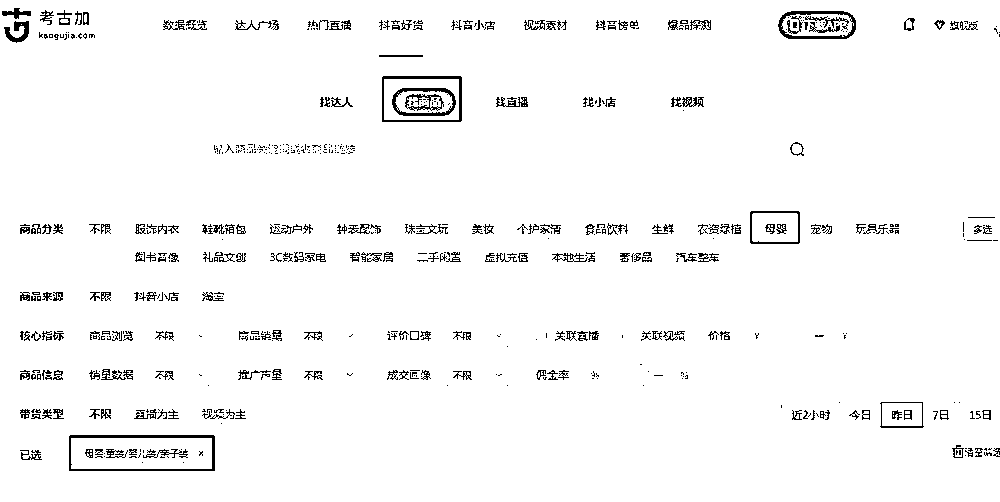

按近 30 天销量或推广次数排序：推广次数低于 50，多为自播达人；高于 50，则散户达人占比更大。

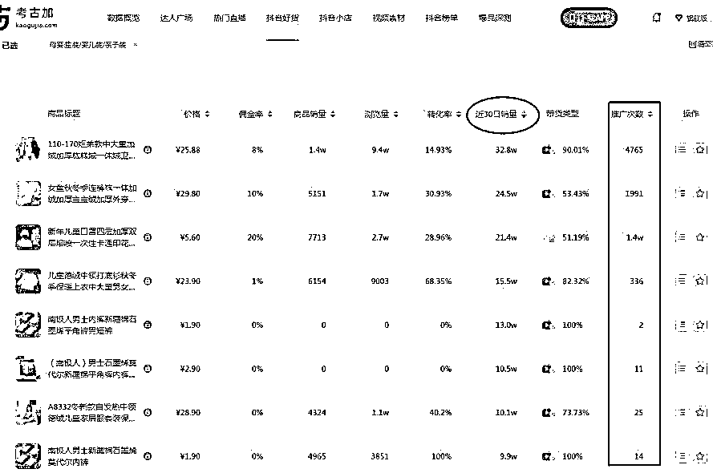
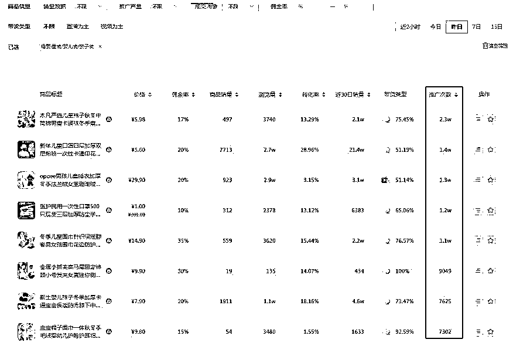

从上面两张图能看出：母婴类目可做，因为散户达人数量还算可观。

下图是大类目关联达人、活跃小店商家的数据图（仅供参考）：

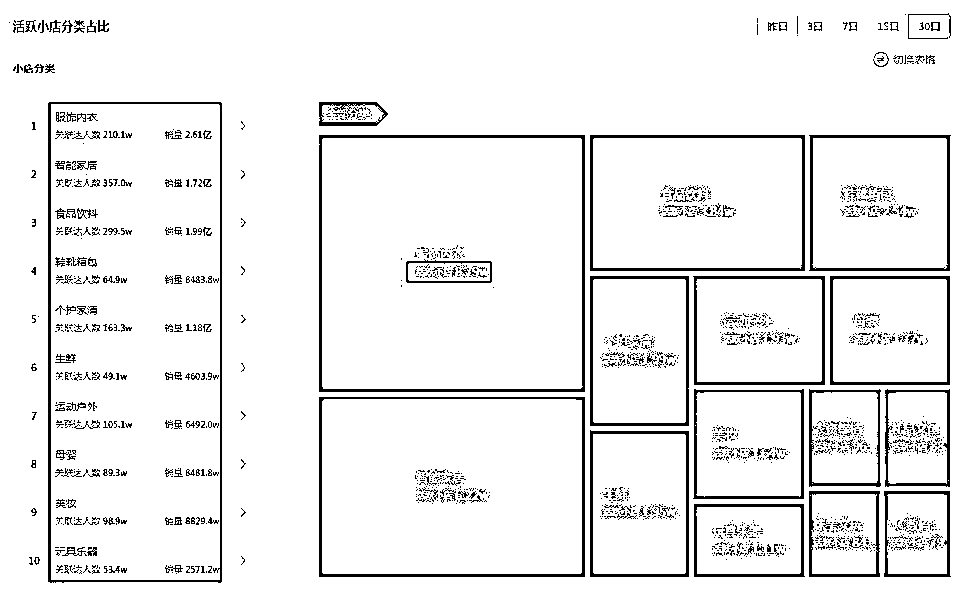

有人可能会问：服饰内衣关联达人多、销量高、活跃小店商家也多，是不是就不能碰？能做，只是竞争更凶，可以往二级、三级类目切：

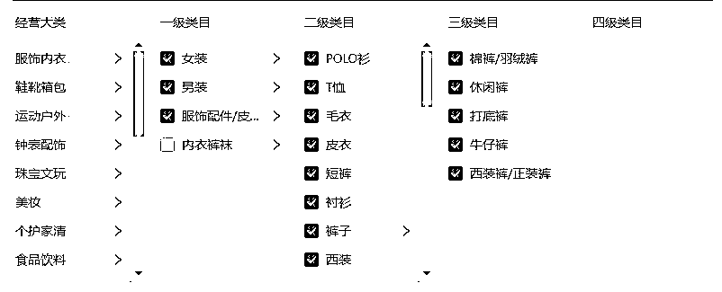

### 6.4.2 用数据来定货

开讲前先点两个误区：

第一，所有判断都要有数据支撑。没看数据就认定某个品能卖，是拍脑袋。挑货不是“你觉得”，而要数据和用户说了算。
第二，有人爱把供应链挂嘴边：认识某工厂老板、某供应链，能拿低价。可最终这些货的订单量，可能还拼不过一家无货源店铺。正确做法是拿品去查数据，看它在抖音市场大不大。

拿到商品后，先到数据平台搜标题词，比如「拖把」「养生壶」。

近 30 天销量低于 1 万，说明需求偏冷；高于 30 万，则卖得太火、同行扎堆，不建议上——除非你有价格优势或能开高佣。如下图：

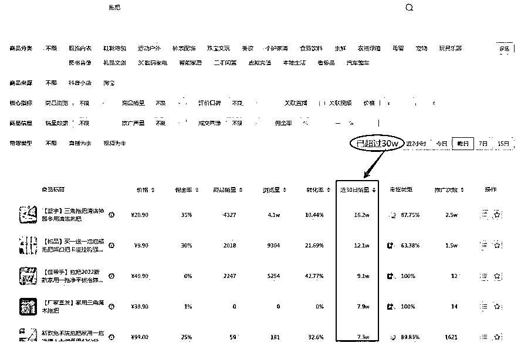
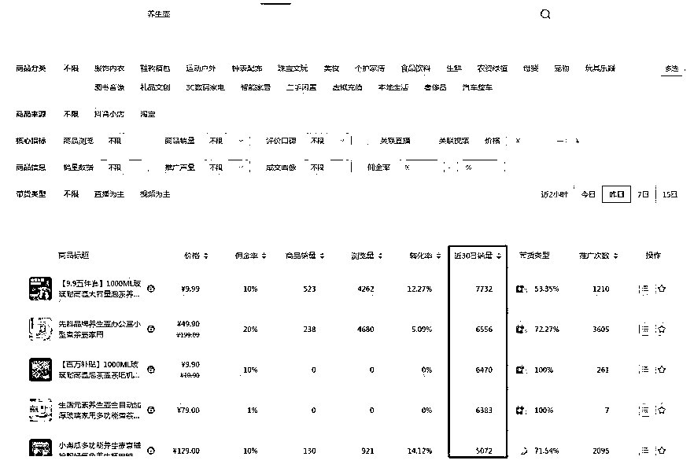

近 30 天商品转化率需高于 5%。例如同一主播带两件货，一件转化 15%，另一件 3%；花同样的时间，没人愿意一直讲后者。如下图：

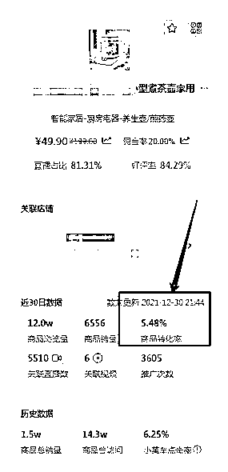

关联主播少于 3000；超过这个数，你的货得有价格或佣金优势。如下图：

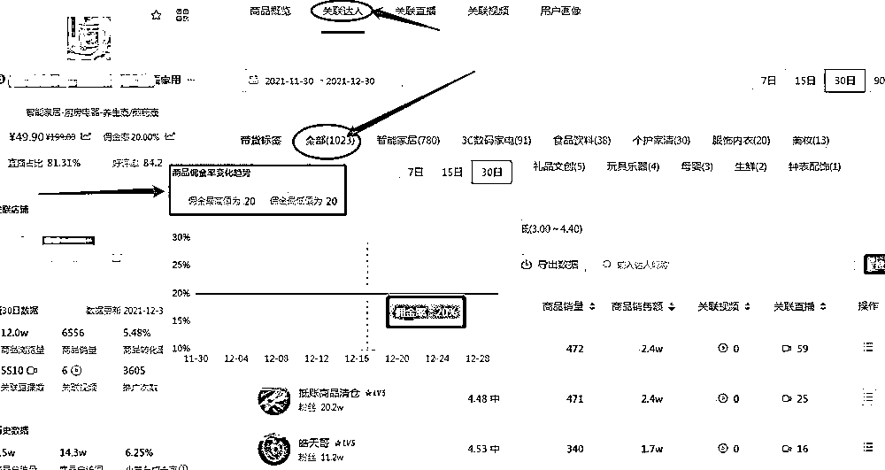

商品曲线图：7 天平稳上扬的可以考虑；带 90 天曲线的不建议上——每个产品都有生命周期，时间一到，厂家涌入就会打价格战。如下图：

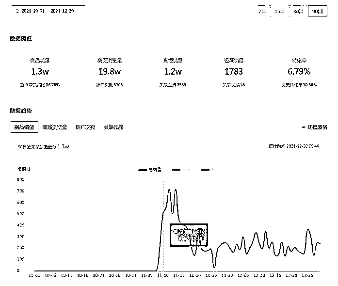

浏览器装至尊宝插件，安装方法：百度搜「至尊宝插件」，通过主图或标题到第三方平台搜同款。在考古家点「养生壶」，会出现 1688 或 PDD 图标，点搜索即可，如下图：

到 1688 或 PDD 搜同款：同行卖 49.9、开 20% 佣金。假设我们找到一件包邮价 33，用运营表格算利润，如下图：

养生壶归在智能家居类目，目前共关联 1000+ 主播。智能家居主播不可能只有一千出头吧？肯定还有大量未联系到的人。我们可以借其他智能家居品找到更多主播，再到精选联盟达人广场报名邀约（后面会讲）。

最后结论：这个品有利润，成本按 33 算——这是没有量的情况下；有量后成本还会降，成本每低 1 元，利润就多 1 元（后面会讲对接供应链）。

同款商品若有价格或佣金优势，该商品关联的主播都能为你所用；若没有，就找相似款。拿养生壶举例，没价格佣金优势，它总不会只有一个款式吧？肯定还有其它款式，相似款的定价和佣金可以对标养生壶来定。

# 筛品有据，避雷有方

先看数据平台筛品这条路：以童装为例，把近30天卖过500件以上、成交转化高于4%作为门槛：

竞品同规格链接定价32.8元，同行先按20%定向佣金试算；用运营表跑一遍利润模型，结论是佣金即使抬到30%仍有得赚。接着去精选联盟达人广场，向童装类目其他达人发起报名邀约：

### 6.4.3 按产品类型筛选

引流款走的是薄利路线，通常落在7%-10%区间；这个比例以成交价为基数，例如成交价20元，单笔最多留下2元。

4. 利润款
等引流款把合作跑通，再上利润款会轻松很多，利润率一般超过10%。上之前要备好成功案例：比如跟主播B沟通时，可以提到智能上水器转化表现好，头部或中腰部A达人已经带过；关键不是空口说，而是让达人看到该品被A主播卖过并赚到钱，用其他主播的战绩做信任背书。

### 6.4.4 用货源平台做辅助筛选
做无货源时，1688和PDD都能选，但更建议把1688放首位，PDD作为备选。原因如下：
- 1688多数能当日发出、当晚显示揽收；退货换货时寄回运费由卖家这边承担。
- PDD拼单成团后要等24小时才发；好评卡容易印着PDD，而平台正在严查好评返现；价格也会浮动，拍得多了商家抬价；小店爆单后商家供不上货会非常被动。
判断PDD无货源可看两点：一是店铺在售商品数，真工厂通常不会挂超过15个链接，款式多于30个的厂家很少见；二是看商品出评率。
1688优先选带“牛头标”的商家，如下图：

资料出处：《抖音小店无货源达人模式，如何完成完整闭环》

### 6.4.5 以客单价分层来筛品 @安可
做抖店前先定策略：是薄利快跑，还是少单高利？
- 9.9元以下低客单：店内以高性价比低价品为主；后续佣金比同行低1%-5%，店铺评分通常不会太难看。
- 39.9-100元中客单：挑性价比突出的品，面向有支付力的人群，佣金多放在20%-30%。
- 100元以上高客单：上限不封顶，选高价值商品，品牌优先，利润空间大；佣金与同行持平，比如阿迪达斯短裤20%，李宁安踏也可20%。百货可做量大、组合式家庭套装，且短期内不会再次购买。
资料出处：《从零开始做抖音小店的保姆级攻略分享》

### 6.4.6 借货源与地缘优势筛品 @安可
本地有特产，就把产地优势用足；本地没有，也可向邻近地区商家借力。地缘资源可参考：
- 广东一带：广州强在服装，东莞针织衫，增城牛仔裤，揭阳内衣裤，深圳水贝珠宝，深圳南油设计师女装，华强北电子产品，广深两地化妆品也集中。
- 浙江：义乌小商品、温州皮鞋、杭州四季青服装。
- 福建：沿海海鲜、漳州休闲零食。
- 杭州还有达人、基地、直播团队与相关知识资源。
人不在当地也没关系，可以顺着这些产业带去对接人脉和货源。
资料出处：《从零开始做抖音小店的保姆级攻略分享》

## 6.5 抖音20个类目及二级类目的月销售额

### 6.5.1 抖音常见的20个类目

### 6.5.3 值得留意的蓝海类目
抖音可做的类目非常杂，下面仅列出一部分蓝海方向供参考：

## 6.6 筛品时容易踩的雷
很多人花了大量精力挑出一个看着不错的品，准备在抖音发力，结果上传即违规、链接被下架，或者与实际预期差很远，一单也卖不动。多半是撞上了选品雷区。下面把我亲身踩过的坑列出来，帮你提前绕开。

### 6.6.1 第一坑：商家体验分 @唐明杰
商家体验分会连带影响达人的带货口碑分。货品质量差，消费者可能去投诉主播或给商品差评，投诉尤其会让口碑分快速下滑。口碑分一旦偏低，转化也会被拖累。所以第一眼先看商家体验分，重点拆成商品体验、物流体验、商家服务三块。如下图：

我通常卡在4.5分及以上，另外三项也别明显拖后腿。这样即便遇到投诉、口碑分短时间掉下去，后面订单量起来后也更容易修复。
资料出处：《抖音短视频蓝海带货，月利润2W+》

### 6.6.2 第二坑：转化率与带货达人数 @唐明杰
看选品广场的商品数据时，优先挑转化率更高、销量又高于推广人数的品。还有一种情况要剔除：某个品当天销量突然很高，但带货达人很少，这可能是直播间冲出来的成交。相关数据场景可看下图：

资料出处：《抖音短视频蓝海带货，月利润2W+》

### 6.6.3 第三坑：带货佣金 @唐明杰
佣金给得高，售价往往也高，出单变难；给得太低，自己又没利润。所以要在中间找平衡，15%-30%是比较常见的区间，但仍要结合具体情况。我的习惯是佣金不足10元就不碰。这件事没有标准答案，有人专攻高佣品，关键看自己的运营打法。
品定下来后，可以进店铺翻翻其他商品，看有没有适合一起推的，这样筛品效率会更高。测试出好卖的款后，把产品视频做二次裂变，换其他账号跟发，大概率也能出单；后续容易出单的品还可以反复发，提升效率。这个过程本质上就是选款和测款。
资料出处：《抖音短视频蓝海带货，月利润2W+》

### 6.6.4 第四坑：合法合规
10月上过一款射钉器，当时没意识到平台不允许，结果没过几天，高权重店铺直接被封，损失很重。平台规则一定要提前看，抖音限制的商品千万别上。
受限选品可查：电商创作者管理总则-抖音电商学习中心（jinritemai.com）
资料出处：《抖音小店视频带货｜小航海学习手册》

### 6.6.5 第五坑：特别小众的品慎选
6月做过一个非常小众的品，投入不少精力，产出却只有其他品类的十分之一，基本等于白忙，还错过了两个红利窗口。这里说的小众，是指整个类目月销售额不到1000万，不是单个链接。
资料出处：《抖音小店视频带货｜小航海学习手册》

### 6.6.6 第六坑：视频展示要抓眼
选出一批品后还要再过一关：不少商品销量来自直播，而直播成交与短视频成交并不是一套逻辑。带货视频的视觉冲击必须够强，比如美妆直接做使用前后对比。最好让用户看完立刻冒出“我也需要、我也想买”的念头。
资料出处：《抖音小店视频带货｜小航海学习手册》

### 6.6.7 第七坑：质量差的产品不碰
别只被佣金吸引，还要看商品和店铺评分。店铺评分尽量不低于4.5，商品好评率要高。这样视频转化更稳，也不容易因为差评把自己的带货评分拉低，连带影响后续出单。
资料出处：《抖音小店视频带货｜小航海学习手册》

### 6.6.8 第八坑：供货与佣金都要稳
遇到过视频爆单、商家库存跟不上，很多订单没成交，所以供货能力必须看。通常查店铺历史销量：家居类目月销10万以上，货源相对充足；具体还要看品，有些小众类目月销1000也够。操作上，大类目挑该类目店铺前10，小类目挑前3名来带。
如果预判要爆单，尽量提前找商家确认库存。带得好还可以谈更高佣金，争取专属佣金链接。另一个坑是带完货第二天商家下调佣金，原本一单赚50变成10，只能尽量找靠谱店铺和商家。
资料出处：《抖音小店视频带货｜小航海学习手册》

### 6.6.9 第九坑：新手慎选的类目 @吴刻奇
女性是抖音消费主力，但新手最好避开服装、食品、电器等类目，退货率、品牌授权等问题比较难缠。
资料出处：《可能价值上万的抖音小店电商干货分享！来源于抖店线下交流会（含猜你喜欢+精选联盟）》

# 七、📕选品
这一节带你看清📕平台，以及几种主要筛品方式。

📕已经是很多人下单前的搜索入口：吃、买、玩，先查一查。它离交易很近，但站内电商基建补齐得较晚。2020年10月上线店铺；2021年8月下调开店门槛；2022年10月个人主页新增购物入口，浏览过的账号和笔记商品会汇总到这里；2023年3月底上线【笔记带货】，通过KOL合作笔记促成交易。目的很明确：把商业化留在站内，既鼓励商家开店，也鼓励用户边看笔记边下单。所以📕店铺项目眼下仍算蓝海，不少人开店不久就能出单。

可用的思路包括：蓝海选品、低粉爆款法、抖音精选联盟排行榜、灰豚数据、蝉妈妈工具，以及在📕App里追爆品。后面还会补上找蓝海赛道的方法和爆品合集，帮助你更快搭起📕电商的选品框架。提醒一句：案例有生命周期，里面的数据未必适合现在，重点学判断思路，具体数值要按当下情况校准。

本章航线图：完成第五章学习和实操后进入第三阶段，为项目选出至少3个品（每天约2-4小时）。
1. 按自检表选出至少1个符合要求的品（约1天）；
2. 再选出至少1个符合自检要求的品（约1天）；
3. 每天持续选至少1个符合要求的品（每天2-4小时）。
接下来开始掌握方法，记得在航海日志打卡。自检清单：

## 7.1 📕平台分析
平台特点：📕已经是很多人下单前的搜索入口，吃、买、玩，先查一查。它离交易很近，但站内电商基建补齐得较晚。2020年10月上线店铺；2021年8月下调开店门槛；2022年10月个人主页新增购物入口，浏览过的账号和笔记商品会汇总到这里；2023年3月底上线【笔记带货】，通过KOL合作笔记促成交易。目的很明确：把商业化留在站内，既鼓励商家开店，也鼓励用户边看笔记边下单。所以📕店铺项目眼下仍算蓝海，不少人开店不久就能出单。

人群画像：月活超过2亿且还在增长，72%是90后，50%位于一二线城市，分享者超过4300万，男女比例3:7。用户习惯自发分享，笔记内容多元，也会追热点和潮流。女性用户懂生活、爱分享，对新消费有带动作用。城市白领和职场女性是主力，工作相对稳定、支付能力强，有消费需求也追求生活品质。官方与尼尔森调研显示，个人月均消费支出可达4.1K，且不含房贷车贷。约半数用户对品牌营销持理性接纳态度，认可营销对决策的价值：51%相信营销对商品功能的介绍，50%认为营销越多越值得信赖，49%觉得营销能让自己更了解品牌和商品信息。📕的种草底色，与这种接纳度紧密相关。

电商模式：在📕做电商，路径和抖音相似：笔记带货、开店铺。笔记带货适合刚入门的人，从商品中心挑品，发挂车笔记，前提是粉丝达到1000并开通带货权限。开店铺则是开通薯店自己卖：品牌或有货的做自营，没货的找货源商家签合作合同，出单后由商家发货，自己赚佣金。

## 7.2 📕店铺选品方法
### 7.2.1 如何找蓝海赛道（附产品清单）
#### 7.2.1.1 千瓜流量大盘 @谢无敌
蓝海赛道=同行少、需求大，竞争小且潜力足。找它不能靠拍脑袋或听人说，最稳的是做市场调研、让数据说话。
第一个方法看千瓜数据的流量大盘，在行业流量大盘里能查最近30天📕各行业笔记情况。

重点盯两个数：推广笔记篇数、笔记互动总量。
推广笔记越多，说明入局者越多、竞争越凶。比如家居赛道月笔记量119w+，远超护肤、彩妆的30w+。
互动总量越大，说明用户认可度高、容易出爆文，也说明关注的人多、需求旺盛。比如家居赛道互动总量2.6亿。

要找的是“笔记尽量少、互动尽量多”的赛道。
但只看两个数没意义：笔记少，互动往往也少。
做法是把各赛道笔记数和互动总量记下来做成表，算笔记数÷互动总量，再按比值排序，如下图。

比值越小，说明笔记相对少、互动相对多，就是蓝海候选。
意外的是，大家觉得卷的彩妆赛道排第一，可见主观判断经常失灵。
这里只列15个主流类目，每个类目下还有二级分类，可用同样方法往下拆。比如服装类目下有连衣裙、夹克、背心等十几个二级分类。

#### 7.2.1.2 千瓜品类搜索 @谢无敌
第二个方法仍用千瓜，在左侧工作台找【品牌品类搜索】。
注意：做📕无货源电商暂时不太适合这个方法，品牌货源难拿、定价也不灵活；它更适合买手达人。

页面列出100个品牌品类，每个品类都有笔记数和互动总量，还能一键导出，比第一种方法省事。
同样在Excel里把笔记数除以互动总量，按比例排序。
百分数越小，品越有潜力，属于蓝海。目前前三为徕芬吹风机、TCL冰箱、博世冰箱。

这里共100个品，表格太长只截取一部分，完整表在📕店铺项目实战工具包里。
相比第一种方法，这个结果既落到了品牌，也落到了具体产品，更具体。

#### 7.2.1.3 巨量算数搜索 @谢无敌
最后一个方法借助巨量算数搜索，电脑端直接搜“巨量算数”。
它的数据底座是抖音、头条，但自媒体风向标大体接近，📕博主也能参考，而且免费。
打开网页点顶部“算数指数”，会出现关键词搜索框。

输入想做的品类词，比如“绘本”。
点击搜索后会出现该品类的数据分析，包括搜索指数和综合指数；网页下拉有综合指数解读，重点看这里。

图中左侧圆形图包含三个关键信息：内容分、传播分、搜索分。
内容分指含该关键词的内容数量，越高说明写的人越多。
传播分指内容的播放和分享情况，越高说明越受欢迎。
搜索分指有多少人搜过这个词。
很明显，内容分越低、传播分和搜索分越高，赛道越好做。

# 📕选品实战：从蓝海识别到快速跟品

先用“绘本”验证一个判断。在巨量算数后台输入这个词，可以看到搜索热度、传播热度双双压过内容供给热度——潜在读者的数量，远远超出已经产出的笔记数量。供不应求，就是蓝海的核心特征。

巨量算数里还有一处容易被忽略的板块：顶部「创作指南」→「内容消费分析」。里面容纳了十多个行业类目，任选其一，就能看到两条不同颜色的变化曲线。

蓝线的意义是内容供给，衡量该领域产出了多少内容；绿线的意义是内容消费，记录有多少人在看这些内容。

拿游戏赛道来说，两条曲线上下交错，整体供需接近平衡。再看科技领域，蓝线普遍压在绿线上方，说明内容生产过剩、受众有限——这两种类型都不适合我们入场。

还有第三种形态：绿线处在蓝线上方，而且时间跨度可以自定义。比如动物萌宠类目，把周期切到最近一年。

出来的结果很直观：绿线把蓝线远远甩在身后，说明内容产量告急、消费需求旺盛，这才是我们要找的蓝海。

锁定目标的原则很简单：绿线比蓝线高出一大截的赛道，就是首选。

不过这个方法也有边界：目前只能查看系统划分好的 15 个领域。建议把几种方法放在一起交叉验证。千瓜数据可以作为辅助，但它单月费用接近三千，找几个博主拼单合购会更划算。

素材出处：《（附选品清单）如何选择📕蓝海赛道和产品？3 个方法搞定！》
附选品清单：📕产品清单（千瓜数据）.xls，下载跳转：📕航海｜实战工具包。

#### 7.2.1.4 借道传统电商平台反推选品 @云端行走 @雄 @V 小刀

传统电商的玩法是先有交易场、再往里面装内容；📕则反过来，先有内容场、再往里面嵌电商。

所以选品阶段，传统电商的官方数据分析后台非常值得参考。一方面是官方数据的准确性胜过第三方；另一方面，可以第一时间掌握热搜词和转化词的最新爬升动态。

具体到内容创作：先找出自己感兴趣类目下的热搜词，顺着这些词来做笔记，定位会精确很多。如果判断一个产品未来一两个月会爆发，提前布局就有机会率先卡位；反过来，当季正火的产品一旦热搜指数或成交转化下滑，你跟上做的内容后续数据多半也会走弱。

需要注意的是，这些数据软件的费用普遍不低。以淘宝和京东为例，必须要有店铺才能开通，所以这个方法更适合有条件的圈子朋友作为补充手段。

开不了软件的同学怎么办？圈友@雄提供了几个不需要花钱的思路。

1）先写再说，用数量筛选

不知道写什么的时候，不用纠结选品——什么款式都上手写。素材取法很简单：选品链接的主图前 2 张，加上多多上家或者买家秀的 3 张主图，5 张图一起丢进剪映生成视频。发布之后，后台数据会给出反馈，再根据反馈筛你要深耕的方向。与其反复犹豫，不如多写几篇。

案例：女装

比如你定了女装方向，但具体卖什么款没头绪，那就按风格来筛：搜“女装”，筛选维度选“时尚”，页面上会出来大量相关产品，把销量高的挑出来，拿到📕试水。

具体做法：取产品主图 1-2 张，再加上多多上家和买家秀照片 3-5 张，导入剪映合成视频即可。

模板.mp4【在线播放】2）拼多多榜单里找“新潜力款”

拼多多排行榜不是让你全盘照抄。我们要找的是那种同时满足几个条件的货：在榜单上、销量高、但评价很少——评价少说明它是最近才冒出来的款，潜力通常很强。

在拼多多上挑品，评价区是必看项，尤其是买家秀。买家秀呈现的款式必须和商品主图一致，否则会出现图文不符的情况。

3）锁定特定品类，快速跟进新品

结合📕的内容特性和用户画像，除了电商榜单之外，还可以专项盯住饰品这类商品。

饰品这类目天然适合图文：一张好图本身就足以成为一篇优秀笔记。我们要做的，是找到有原创拍摄能力的电商平台店铺，跟进他们的新品节奏。因为这些店铺的图全是自己拍的，而其中很多还没有在📕做推广，我们可以第一时间利用他们高质量的图片资源和选品眼光。

素材出处：《📕选品方法论》

### 7.2.2 选品的三大路线 @V 小刀

电商人都绕不开一个共识：选品决定生死。那到底什么样的产品适合在📕带货？可以把操作方法划成三大类：

1. 站内选品

包括低粉爆款、灰豚数据、蝉小红、📕账号对标等。核心逻辑都一样：把平台上正在爆的、有爆款苗头的商品挑出来，迅速跟进。

2. 抖音选品

借助考古加、抖音对标大人物、蝉妈妈、抖音精选联盟等渠道。思路是：在抖音找到有可能同时适配📕兴趣电商的商品，搬到📕试水，看能否复制爆款。

3. 电商平台选品

也就是从拼多多、淘宝等平台直接找货。

针对📕的电商场景，比较推荐的组合是：站内低粉爆款选品 + 抖音精选联盟创意中心法 + 对标账号监测选品，这三条为主轴。

偏饰品、帽子等高颜值商品，站内选品更有优势；偏百货类的大众商品，则应该把抖音选品放在更重要的位置。

事先说明：没有任何产品是完美的，不要在选品环节消耗太多时间。选品重在精，不在多。优先用自己手上已有的靠谱供应链，很多货只有亲自测过才知道行不行。

另外，不同类目适用的方法并不一样。建议根据自己的类目做几轮测试，最后留下 1-2 个顺手的方法长期使用。

👇接下来逐个拆解，每个方法到底怎么操作：

#### 7.2.2.1 站内选品：低粉爆款跟品法 @书豪

低粉爆款的本质：找到粉丝基数很小、但已经跑出爆品的对标账号，跟着他们的品走。

跟品的筛选标准是：对标账号粉丝在 200 以下，最近 7 天发布的单篇带货笔记点赞超过 100，且笔记关联的商品销量大于 100。

这个思路并不依赖灰豚数据、考古加等第三方工具，直接用📕发现页就能找到符合条件的笔记和账号。

每天找三个品做测试，不怕麻烦，耐心点做。

另外要特别注意：就算品选对了，如果爆款笔记的封面模仿不到位，同样可能出不了单。选品正确只是走完了 70% 的路，剩下 30% 是封面和视频的精准复刻。

素材出处：《📕单店铺单月 6000+利润选品保姆级教程》

#### 7.2.2.2 站内选品：灰豚数据实操 @书豪、@表弟

灰豚数据怎么用来找对标账号？按以下步骤操作：

第一步：进入灰豚数据。
第二步：点击“笔记查找”，选择“笔记搜索”。
第三步：勾选【带货笔记：是】。
第四步：勾选【低粉爆文】。

接着输入你要找的对标方向，比如想做连衣裙，直接搜“连衣裙”。

即使是借助灰豚数据，选号标准依然从严：账号粉丝 200 以下，笔记 7 天内点赞在 100 以上，带货笔记关联商品销量大于 100，满足三个条件才值得选品。依旧沿用低粉爆款法则。

灰豚数据还可以做逆向思维选品，怎么玩？

【操作逻辑】

大部分同行都是按笔记互动量来挑品，我们反过来做：按笔记数排序，挑出互动数在 300 以上的商品（低于 300 也可能是潜力款）。关联笔记数越多，说明有账号在集中力量推这个品，在📕还处于新品阶段。

【操作步骤】

第一步：打开灰豚红薯版，依次点：商品分析 → 商品榜单 → 带货商品榜 → 选择类目 → 选日榜或周榜 → 按关联笔记数排序。

第二步：比如看到这个硅胶手指锻炼器，点【查看】进入关联笔记，确认笔记来源是商家自己的账号，而不是达人的带货账号。如果是达人带货，咱们再跟这个品的价值就不大了。

确认完毕，关闭页面进入下一步。

第三步：点标题跳转商品详情页，看销量。一百以上就可以纳入考虑范围。

第四步：点左下角【店铺】，进入店铺主页，再按【销量】排序看店内其他品，把选品视野打开。

第五步：最后点顶部【来自账号】，进入账号主页查看笔记，粉丝数越少越好。看完之后，再回到最初那条商品笔记，统计哪个封面出现最多，把封面保存下来，写作时当作【参考】。按这个流程持续选品，不断循环。

素材出处：《📕单店铺单月 6000+利润选品保姆级教程》、《📕店铺逆向思维选品及爆款笔记制作》

#### 7.2.2.3 站内选品：📕 APP 直接挖爆款 @大树

定好要做的商品类目之后，在📕内搜索同领域关键词，锁定销量高的商品，并且把对应笔记的账号收藏为对标对象。

FinalVideo_1686149116.251962.mp4【在线播放】进一步拆解对标账号的笔记内容与商品结构，再到其他平台搜索同款货源，实现反向选品。

6 月 8 日 (2).mp4【在线播放】素材出处：《新人入局📕店铺每日 GMV 稳定 1000+的经验分享》

#### 7.2.2.4 抖音选品：蝉妈妈挖掘爆款 @惊涛

先聊用蝉妈妈找趋势爆品。

在蝉妈妈后台，能看到最近几天正在引爆或即将引爆的产品。比如你正在做连衣裙，打开视频商品榜单，选择服

而且爆过的产品有很大概率再爆一次。把这类产品连同视频一起搬到📕，成功几率相当高。

【操作步骤】

第一步：通过蝉妈妈视频榜单，选择你的类目，比如“女装-连衣裙”。

第二步：确定类目后，筛选与📕人群匹配的产品。

首先看年龄层。蝉妈妈上有很多面向 40 岁以上女性的商品，但📕的主力用户集中在 18-35 岁，所以必须看受众分析：女性为主，年龄段锁定 18-35 岁。

其次看颜值。📕是一个“颜值即正义”的平台，颜值越高的产品，做起来的概率越大。比如下面这件妈妈装，大概率推不动。

蝉妈妈还能用于找新品。这里说的新品，是指全网都没货、连厂家都得现做的那种，但市场需求又非常大。

具体操作：蝉妈妈 → 视频商品榜单 → 选类目 → 在日榜里挑选趋势上升的产品，通过不断上品堆量，打爆的概率还是比较可观的。

另外，考古加与抖音精选联盟的榜单也可以交叉参考，当然前提是找到的爆品确实适合在📕售卖。

素材出处：《📕选品，如何做到一个月 8 万 GMV》

#### 7.2.2.5 抖音选品：精选联盟榜单打法 @书豪 @V 小刀

为什么要借抖音来选品？

第一，抖音和📕的用户群体存在重叠。第二，抖音上的商品以视频为主要载体，素材储备丰富，方便做混剪二次创作。

具体怎么通过抖音帮📕店铺选品？

第一条路：抖音已经支持零粉开橱窗。如果你开了商品橱窗，直接进选品中心，搜索你要做的品类，找月销量排名靠前的款去跟单，这是效率最高的方法。

第二条路：在抖音搜索栏直接输入品类关键词，然后利用筛选功能，挑出一天内点赞量最高的内容，跟款和素材收集一次完成。

第三条路：推荐重点使用【创意中心】模块。这个模块会实时刷新近一小时的爆款带货视频，让你第一时间发现有素材、适合兴趣电商的商品。

素材出处：《📕单店铺单月 6000+利润选品保姆级教程》

#### 7.2.2.6 选品方向参考 @杉木 @雄 @月月

以下几个方向，比较容易在短期内获得反馈：

1）功能性半标品：瑜伽服（我自己卖的就是）、防晒服都属于这类。它们对应的是真实刚需——防晒、减肥，都是用户主动找解决方案的强需求。

2）红海中的蓝海：限定特定人群的红海产品，比如专门做大罩杯或小胸的内衣，专门做小个子人群的女鞋。

3）美妆护肤品：有货源、资质齐全的话，非常推荐在📕做带货。

4）自带流量的品类：例如情侣内衣、JK 服、汉服等。

5）大牌平替：让用户省钱，同时获得品质接近大牌的使用体验。

6）新奇特且需求真实的产品：光靠新奇特撑不起转化率，必须叠加真实需求。

7）知识付费类：要具体到某一个明确项目，但不能是其他平台做滥的培训（比如在📕写“抖音赚钱”，官方基本不会给流量），或者做咨询服务。

除此之外，产品要尽量符合以下原则：

除了常规思路，再补充一个方向：蓝海产品。这个概念@陈铭老师之前专门写过，蓝海思维也是@盗坤老师反复强调的。

蓝海就是竞争烈度低的市场。举个例子，📕男生用户占比低，这恰恰是机会。大量品牌都在抢女性市场，男生市场被长期忽视。但比例再小，基数摆在那里，也是千万级流量池，一些男生用品反而没什么竞争，值得琢磨。

再比如客单价高的小众品类、面向高端客户的服务类项目，也是蓝海的典型。前几天我看到一个叫焚火台的产品，户外露营用的，做的账号很少，借着露营的热度，近期流量一直不错——这也是个不错的选品参考。

最后一条大原则：不管做什么类目，都建议走中高端路线，敢于定高价（前提是有明确的差异化卖点，不能莫名其妙地贵，要精准命中用户痛点）。

品类一旦定了，就不要轻易更换，店铺的垂直度至关重要。

素材出处：《我是如何通过📕，两个月带货营收 30 万＋》 《📕选品方法论》、《新手 15 天突破 300 多单，当日纯利润💰2000＋的经验分享》

#### 7.2.2.7 怎样锁定蓝海产品 @陈铭 ivy、@宅男，（周恩俊）

蓝海思维一句话总结：找一个足够细分的领域，客户少、竞争者少，去模仿一个不如你但已经在赚钱的对手，你大概率也能赚到钱。在此基础上，进一步筛选高净值用户，做高客单价产品，聚焦这群人的痛点，给出解决方案，钱自然找上门。

红海中的蓝海，通常指那些只服务特定人群的红海品类：比如专做大胸显小、小胸显大的内衣，专做小个子女生尺码的女鞋。

找蓝海的具体姿势：

看上面这张图：搜“减脂”，弹出来的是一个月 5.98 万篇笔记，妥妥的红海竞争。【图不够清晰，大家重点看文字】

再往下细分，换成“200 斤减脂”，范围迅速缩小。这是我换了搜索词之后的结果：近一个月只有 9 条笔记，蓝得不能再蓝。

会主动在搜索框里输入名词的，一定是精准用户。试想一下：搜索结果一共 9 条笔记，如果 4-7 条都是我们发的，进店率能有多香？

这个找蓝海的办法有点“笨”——需要一个个搜关键词去验证，但可以借助 7.3.4 挖掘高热度行业搜索词里提到的三种找词方法做辅助。

我一直认为，在📕做账号、选定一个领域，就是选择了一条长期路线。这就要求你在该领域有前置的知识或经验积累，才能支撑持续输出。所以不妨搜一搜你感兴趣或者有经验的领域，看看有没有蓝海机会。

素材出处：《粉丝 3000 月营收 20 万，📕低粉高变现的蓝海攻略分享》、《操作📕店铺无货源，单品如何从 0 做到月销 30 万？》

#### 7.2.2.8 搭建「选品漏斗池」 @袁、

# 别把命运押在一款产品上

做📕店铺，我习惯给自己设一个“选品漏斗”：每天保持3款以上新品上新，让漏斗里的候选货越积越多。爆款再能打也有退潮期，押注单一产品风险太大。另外，已经出单的商品，记得多留意相似款；那些在原版基础上做过微调或升级的款式，尤其值得重点关注。

漏斗解决的不是选品本身，而是内容排期。今天有哪些产品值得继续追、明天笔记发什么、发几条，都靠它来安排。比如某个产品已经试过不同的封面、标题、文案和发布时间，数据还是起不来，就根据反馈决定是否放弃。再比如今天就着低粉爆文挑了3个产品，每个先安排3条笔记；明天再上新3个产品时，就要回头判断昨天那3个还有没有哪个值得追加笔记。所以这个漏斗既是选品池，也是内容日历。

下面这两条笔记就是从灰豚低粉爆文里看到的：

案例库里月初加了一条记录：6月1日，作者A发了一条低粉爆款但没挂车的笔记；6月2日，作者B把这条笔记删减调整后复制，并挂上商品链接，如今这个商品已经卖出100多单。这种“复制+微调”的玩法，彻底刷新了我做笔记的认知——B并没有重做，只是在A的基础上做了一些基础剪辑，笔记居然带来了可观的销量。所以平时多刷低粉爆文、多收集同行的优秀案例很有必要。平台也会根据你的浏览习惯，不断推送这类低粉爆文笔记。

内容来源：《📕店铺，月 GMV10w+的方法总结与复盘》

### 7.2.3 📕爆款选品资料精选

除了上面这些方法，我们还和志愿者 @晨枫 一起，把龙哥盟里跟📕选品有关的内容整理成一份《最新的📕爆款选品风向与方法》。其中有：17篇爆款产品机会风向标，帮你看清趋势；12篇📕店铺从0到1的项目复盘，详细讲如何选品和变现；13篇选品方法干货，外加4篇利用工具和技术提效的技巧。希望这份资料能帮到正在做📕店铺的你。

### 7.2.4 📕电商测品怎么做

选中产品之后，先上架，再测品。测品的大原则只有一个：多组封面+多组标题同时跑。

圈友 @V 小刀 在《12 天卖了 23.6 万，📕电商测品方法解析》里分享过自己的经验：怎么测才高效、怎么提升成功率、一般测几条、有哪些细节要留意，答案都在里面。

圈友 @书豪 则提供了拆解对标笔记的方法和配套测品思路，想看的点星球帖链接：《📕上日入过万的那些爆款单品，到底要如何跟品测品呢！?》

# 八、视频号如何选品

这一节会带你了解视频号的平台现状和主要选品方法。视频号电商本质是社交和私域电商，背靠🛰️的巨大流量。目前视频号有三大优势：拉新成本低（能反复触达用户）、数据相对隐蔽（隐私性强）、利润空间可观（综合利润率高）。选品和挖掘需求是重中之重。这一节讲了多种选品思路，也附上了视频号选品攻略和快速上手的方法。但再多方法，吃透一两种就够了。

产品选出来了，怎么知道合不合适？我们整理了高效测品的方法，详见「8.3 如何高效测品」：

集中测品法：同一个账号，每个品类每天发10条视频。
分布式测品法：已经确定人群，但还没有定品类或具体产品，就同时发不同品类的视频，哪个爆了就一直发，其他全部删掉。
暴力测品法：把对标视频直接发出去，连续3天零播放就换，一旦爆了立即精耕细作。
带货/流量视频比例：卖货视频和内容型流量视频要按比例发。
137法则：观察第1、3、7天的账号数据，出问题就果断放弃这个品。

另外，这一节还整理了建议关注的选品方向、高效测品方法和避坑点，希望大家能更深入地掌握视频号电商的选品模式。

注意，选品案例时效性很强，案例里的数据现在不一定还适用。大家从中吸收的是思路，具体数字要结合当下情况来判断。

💡
本章航线图

完成第五章的学习并实操后，航线图第三阶段就算通关了：给项目至少选3个品（每天约2-4小时）。具体路径是：

1. 根据自检表选出至少1个符合要求的品（约1天）；然后继续选出下一个合规品（约1天）；之后每天保持选1个合规品（每天2-4小时）。

接下来就正式掌握这些方法论吧，记得在航海日志里打卡进度哦～

视频号选品自检表：

## 8.1 视频号平台拆解 @大普靠谱

平台特点

视频号本质上是🛰️生态里的短视频平台，靠🛰️的海量流量做短视频和直播内容输出。根据2023🛰️公开课PRO的数据，2022年视频号总使用时长已经超过朋友圈总使用时长的80%；直播看播时长增长了156%，直播带货销售额增长了800%。

视频号电商被定位为社交电商、私域电商，今年的GMV目标是3000亿，但上半年只完成了不到1000亿。

视频号作为“全村的希望”，目前功能和后端体验还不算成熟，有点像2021年初的抖音小店，处在野蛮生长阶段。正因为平台不完善，视频号小店反而藏着很多产品机会和类目机会，比如评分体系也才刚上线两三个月。它的三大优势还是：触达成本低、数据相对隐蔽、综合利润可观。

人群画像

购物人群集中在40-60岁，8成是女性，大家叫她们“中年少女、老年贵妇”。这批人家庭地位高、手里有钱、对生活有品质要求，也不太会去比价。现在平台上也慢慢出现一二线城市的人群。所以选品要围着这群人的需求转。

电商模式

在视频号做电商，玩法跟抖音差不多：短视频带货、直播带货、开店。

短视频带货：拍产品相关视频，挂链接，靠内容引流成交赚佣金。核心拼内容，视频拍得有视觉冲击力，让产品自己“说话”。常用手法包括剧情、功能展示、视觉冲击、卖点提炼和对比。对IP来说，短视频还能积累复利。

直播带货：0粉丝就能开播，拼的是直播内容。把“人货场”优化好，每场直播都会有反馈。短视频像被动收入，直播像主动出击，灵活调整。成本不高，杠杆不小，一两个人也能做，这也是很多人入局的原因。

比较推荐的做法是：带货短视频跑出爆款后，马上开直播承接流量，提高转化。

注意，上面两种模式都需要完成实名认证、满1000粉丝、持续发布优质视频，才能开通带货权限。

视频号后端商家：自己开店，然后发短视频带自己店的货，也可以冲进精选联盟让别人帮忙带货。适合有货源或想做货架电商的人。门槛是资金压力大，经营不好，小店货款容易被冻结。

内容来源：《视频号小店达人玩法 3 个月赚 60 万的经验分享》、《8 月航海 | 视频号带货 | 实战手册 》

## 8.2 视频号带货的选品打法

### 8.2.1 选品底层逻辑

选品最看重的三个要素：人群、类目、价格。

比如去视频号卖山竹，成功的概率几乎为零。很多三四线用户听都没听过山竹，就算刷到了也会觉得贵。也许有人觉得正因为没听过，反而会好奇买来试试？这种可能性很小。

反过来，粘鼠板在视频号容易爆。因为中老年人住在老小区或农村老宅，家里有老鼠。大城市的年轻人租房子里没老鼠，自然理解不了有人会为这种视频点赞下单。

按这个逻辑，定位和初步选品做好了之后，怎么继续放大需求、找更多好产品？重点看两个要素：类目和价格。

类目决定了产品能不能卖动。美妆类的假睫毛，50岁左右的女士需要吗？大概率不需要。百货类的包饺子器，可能有人买，但顾客要先纠结“我需不需要”。换成美食特产，因为是食品，顾客跳过“需不需要”，直接进入“想不想要”，同样场观下转化率会明显更高。

建议选品时多花工夫，站在父母那一辈人的真实需求上去感受。

比如有三款产品：a款洗衣凝珠日销700单、单件利润1元；b款螺蛳粉日销100单、单件利润7元；c款美食特产日销100单、单件利润100元。在a和b之间我选b，因为利润总额一样，客服人工成本更低；在b和c之间选c，因为单量持平但利润更高。

这题看着简单，但实际踩坑的人不少。选品时必须盯住价格，留足利润空间。要清楚一点：高客单价通常意味着低销量，反过来也一样。

### 8.2.2 选品的基本流程

#### 8.2.2.1 借助工具

先说明一个现实：🛰️目前没有对外开放查询端口，所以大家看到的数据可能有较大出入。工具只能当参考，最终拍板得靠自己的判断。

操作流程：抖音好货 → 找商品 → 输入关键词“父亲节” → 搜索。接着可以往下钻取一个细分类目：

类目层级完全由自己定。想大面积捞品，只看一级类目，一页页翻就能找到最近爆品；这里演示的是钻到三级类目：

按销量排个序，点进商品详情页，近期数据曲线和趋势就看得到了。

数据不错的话，接下来判断能不能选：看关联视频，留意其数据和内容质量，为后面二次剪辑做参考。

细分类目选品法则是：抖音好货 → 找商品 → 选商品分类 → 选带货类型。

类目层级深浅自己拿捏。

把30日销量和转化率作为核心指标，能定位到目标产品：

然后去详情页看关联视频或达人，分析他们的内容质量和数据表现。

总体来看，考古加最大的作用是帮人拓展商品联想，并给出初阶数据分析和视频参照。实际操作中也可以把价格、成交画像等条件加进去筛。

价格别压太低，得留出毛利；人群画像上，视频号优先选50岁以上用户，41-50岁也可以。

觉得可以卖的产品，先用表格存下来，慢慢攒出自己的产品池。

另一个常用工具是巨量算数（https://trendinsight.oceanengine.com/），可以看关键词指数、关联分析和人群画像。

它上面还有榜单，能查各类产品热度，辅助选品。附上报告合集：《巨量算数报告合集-2022》《巨量算数报告合集-2023》。

搜索结果页能看到该产品词在🛰️生态里的数据表现。

工具建议少而精，真正吃透一两个就够用了。

#### 8.2.2.2 主观倾向与排除

有了工具的初步筛选，方向大致出来了，但具体到某个品类，还得靠主观判断。

像索尼游戏机、Supreme的T恤，视频号用户不会买账，这类可以直接放弃。自己不感兴趣的产品，可以不卖；父辈喜欢、平时消遣的东西，倒是值得试试。比如有长辈退休后每天钓鱼，不少阿姨天天跳广场舞。围绕这些场景的产品，是不是也有机会？

第二，围绕经验来选。经验不一定永远对，但有参考价值。身边有圈友去年在抖音做百货做得顺，到了视频号却没啥起色；也有圈友年初在抖音快手养绿植，最近在视频号起了一个绿植号，收益反而超出预期。再比如你在春熙路见过100家火锅店，那火锅底料是不是也有大批受众？过去的经验都是财富，静下来想一想。

第三，每天坚持刷抖音、快手、视频号，这一点非常重要。把刷到的、觉得能卖的产品截图存下来，作为备选。有个真实案例：圈友某产品在视频号突然爆了，三天内就有五个同行跟风上同款，多半就是刷到了那条视频。这活儿需要每天重复去做，虽然枯燥，但常有惊喜。

状态好的时候，一天就能初筛二十个产品。

#### 8.2.2.3 客观验证与决策

到了这一步，要把产品能不能做、怎么做、卖多少钱这几个问题搞清楚。

假设选中的是蜂蜜（仅作演示，不构成建议）。先做竞品调研：在视频号里搜索有没有同行、竞争程度如何、现在进场行不行；再找视频素材：在抖音、快手搜索相关视频，看能不能复制；最后查货源：去抖音、拼多多、淘宝找同款，看采购价是否合适。

1. 研究竞争对手

在视频号里搜“蜂蜜”，会看到不少账号：

需要看三组数据：有没有人做——决定能不能进场、竞争大不大；他们的视频数据——判断对手实力，也预估自己的数据规模；他们的销量——判断利润空间，评估值不值得做。

如果某个词在视频号里搜不到结果，很可能代表蓝海。视频号现在正处于抢蓝海的阶段，我们要找的就是竞争人数少或对手相对较弱的品类。

就算搜出来很多账号，也不必慌，一个个点进去看看，里面未必都在卖货。

接下来去抖音、快手搜“蜂蜜”，看相关视频的是否充足：

观察要点有三：一是有没有专门做单一品类的达人——这决定我们有没有参考素材，数量够多才能优中选优；二是该达人的视频条数多不多——这决定我们能参考多久，比如只有10条，可能一天就发完了；三是点赞和销量数据——代表他在抖音的战绩。

挑视频时，一定要找契合视频号调性的。同一款品，换不同的视频带，效果可以说是天壤之别。

另外，视频主体最好别是真人，一旦触发真人验证，账号很可能就废了。

早期只要同款货源存在、价格留有利润，基本就没问题。选中的品如果没有进🛰️选品中心，也能找朋友帮忙挂到小商店里。

### 8.2.3 视频号快速选品捷径

上面的流程如果嫌复杂，这里有一条更常见的“视频号视频带货”选品路径，单用它也能选到品。

第一步，逛视频号直播广场的购物分类。锁定那些看着不专业、场观却超过500的直播间。“不专业”的具体表现：头像和封面是同一张图、没有样品展示、直播间环境跟所售商品毫不相干、主播也不怎么跟观众互动——明显不是MCN或PGC团队，更像我们普通人自己开的。

为什么要卡500场观？过了这条线，说明直播间流量已经跑起来了。流量来源无非两种：要么系统推荐，要么是从短视频内容里导流过来的。

第二步，看看这个账号发的短视频。把里面点赞超过100的爆款视频挑出来，再看看它挂的商品，这个品很可能有潜力。

第三步，上数据平台核验一下该品的数据。重点看销量和带货达人数，同时远离红海赛道。常用平台是精选联盟和考古加，其中考古加数据更新快、没有使用门槛；精选联盟则受粉丝数、小店、保证金等限制。

第四步，从带货达人或带货视频里找模仿对象。最好选粉丝在数百万以下、月销售额10万以上的达人——前者不容易跟别人撞车，后者说明收入真实可观。然后从这些视频里挑素材，再去视频号搜索同类关键词，避开已经被大把人用过的内容。

这套流程走下来，选品基本有谱，后面视频内容的方向也顺带解决了。

### 8.2.4 视频号选品方向清单

可以重点关注这几类：书籍类——国学经典、名人传记、婴幼儿绘本；服饰类——大码女装、头饰、脚链；家居百货类——房屋防水材料、面条机、老花镜、定时药盒、老人购物车、防走失用品、穿针器、拐杖、广场舞音响、老人收音机等。

# 视频号选品：银发赛道的隐藏机会

在“其他”类目里，老人手机、多功能护理床这类看似冷门的单品，恰恰是视频号带货中很容易被忽略的好品类。

中老年人群体的潜力，比多数人预想的要大得多。但“中老年”三个字太笼统：有人偏爱这种风格，有人喜欢那种；城里用户和乡下用户的取向，同样存在差别。

圈友@李诚整理了一份选品表，可以直接拿来对照：👉李诚 Sonic - 视频号选品表。若想看更聚焦的选品思路与答疑，推荐👉《选品思路&答疑-郭晓文》。

视频号选品，归根到底仍是“人、货、场”三个字。如今“场”已经锁定在视频号，真正该下功夫的，是搞清楚这个场子里聚集的是怎样一群人，再为他们匹配合适的商品。你对这群人的理解越深越透，成功的概率就越高。

倘若你能站在他们的位置去体会喜怒哀乐，甚至把自己当成他们中的一员，那距离做成也就没多远了。

### 8.2.5 视频号选品，这些坑要绕开 @黄老师

号主通常会把内容同步到多个平台，所以敲定商品或视频之后，务必回视频号查一查是否已被搬运。

做法是先搜名字，再从视频文案里挑几个有辨识度的字词去搜。确认没有被人搬走，也没有遭到大量二次剪辑。要是在“实时”栏里刷出太多同行，这个品就别碰了。

1、筛商品（以抖音、快手等平台为源），自上而下逐层淘汰：

- 价格是否达标；
- 销量是否够看（够不够，取决于你自己对利润的预期）；
- 翻一翻粉丝画像（视频号的主流人群是40岁以上）；
- 用搜图功能查一手货源价，算算利润空间；
- 找到商品背后的博主，如果带货账号只有一个，或几个号一眼看出是同一家，就要谨慎；
- 观察博主的视频与直播表现：带货视频的销量应当分布均匀，若全靠某条视频突然爆量带来销量，我通常直接放弃——运气没法复制；直播也要看是否多场都有成交，而不是某一场直播把量全带完了。逛数据平台时我见过不少假数据，很多商品的销量是刷出来的，按上面这套流程筛一遍，能挡掉大部分问题。

2、筛账号（同样以抖音、快手为源）：

打开蝉妈妈、考古加这类工具，按涨粉情况逐个翻看，能直接看到哪些账号是纯带货的。

这里提醒一句：视频号目前没有第三方数据工具，只能借抖音快手的账号做参照。比如用蝉妈妈、考古加去看抖音对标账号的内容、数据与选品，当作基础参考，再拿到视频号上跑测试。

账号挂的商品越少越好，这类账号的内容往往更聚焦。

涨粉情况——盯近三个月冒头的新号。举例来说，粉丝30万，近三个月也涨了30万，说明增长是平稳的，而不是靠一两条视频冲上来的。

更新频率——看90天内发过的视频，点赞数与商品转化是否比较均衡，更新得越勤越好。有时候别嫌别人的视频“土”，我们面对的是40+人群，审美本来就不一样；它能卖得动，说明它的粉丝有这个需求，我们去搬运也是同样的道理。

拿上图这个账号来说，单月发了34条视频，其中33条都挂第一个商品，剩下两个商品是直播卖出去的，三个商品之间多少有些关联。赚钱有篇文章叫《淘宝单店方法论：烤红薯——淘宝小白做店27天，月利润10万的思考》，讲的就是这个逻辑。

这个号的粉丝画像与视频号的要求吻合，粉丝量也不高，从点赞数就能看出是纯带货号。这类账号的妙处在于商品单一，自己带货、自己上品都能搞定，后期投入的时间和精力都很少。

还有一点要留意：视频号的规则调整极为频繁，某个品上周还是香饽饽，这周可能就因违规被封号了。

下面几个坑，做视频号选品必须躲开：

- 中医、医药相关的品，千万别上（医药类在哪个平台都是重点打击对象）。
- 尽量别做以真人为主体的视频内容，很容易触发真人验证，一旦被验证，账号基本就报废了。
- 品选好了，视频号选品中心里却没有，怎么办？不用慌，只要自己或朋友的🛰️小商店能上架就行，别因为这一步放弃整个选品。

内容出处：《如何做到条条视频上推荐的》

## 8.3 视频号电商的测品高效打法 @兰心

### 8.3.1 集中式测品

手上有5个号、也定了5个品类，常规操作是每个品类每天出10条视频，都堆到一个号上，也可以几个号同步测。

举个例子：每个品类搬10条，合计50条。5个品类各取2条，同时铺到5个号上。哪条爆了，就把那个号定为该品类的专属号，接着发这个品类的视频，其余4个号继续测。第一天50条下去毫无水花，那就每天保持50条的节奏，连测两三天。

### 8.3.2 分布式测品

人群定了、品类还没定，可以把不同品类的视频一起发，哪类爆了就继续做哪类，剩下的删掉。

号不多、又在几个品类之间犹豫不决时，同样适用：同时铺不同品类，谁先跑出来就做谁，其余清理掉。

举例：想做宝妈生意，却在育儿书籍、育儿好物、婴儿服饰之间拿不定主意，三个品类的视频也都备好了，那就一起发，哪个先爆就锁定哪个。

### 8.3.3 简单粗暴测品

对标视频直接搬过来发，3天还是0播放就换掉；一旦爆了，立刻转入精细化运营。

这套打法适合手握大量账号的人。虽然完全不去重，出爆款的概率偏低，但省下的时间足够你多铺几个号。

### 8.3.4 带货视频与流量视频怎么配

有人说七三开，有人说五五开。

其实并不存在固定答案，这跟你账号的现状、选品的经验都有关系。号多的，可以按不同比例分别试，哪种跑得顺就加码哪种。对某个品特别有把握的，带货视频可以占大头，穿插一两条流量视频。拿不准效果的，前期不妨多放些流量视频，等爆了再去测品。

### 8.3.5 137节点法则

第1天：播放破300，账号和视频都正常，继续。

第3天：播放还能破300，一切照旧；若破不了，可以考虑换对标视频，把原来的隐藏。也可以拍段窗外风景配首音乐发出去，看有没有播放——有播放，说明号是好的，问题出在去重没做到位。

第7天：去重能过、视频却上不了推荐，别犹豫，注销重来。

如此循环，直到每个号都能稳定播放、稳定出单。

内容出处：《如何高效测品》

# 选修：把视野拉到更多平台💡

章节概要

选品的基本功练得差不多之后，不妨翻翻选修篇。一来可以学一学测品的通用思路，二来能看看别的平台是怎么选品的，把眼界打开。

想深入了解更多，下面这几章值得重点读：

- 九、选品后如何测品
- 十、社交电商 - 快团团平台
- 十一、兴趣电商 - TikTok 平台
- 十二、货架电商 - 淘宝平台
- 十三、货架电商 - 闲鱼平台
- 十四、货架电商 - 亚马逊平台
- 十五、其他选品方法

现在，去挖掘项目更多的可能性吧～

# 九、测品六步走 @盗坤

选品阶段，别太相信自己的直觉判断。

成熟的生意人是什么样？先锁定一个已经跑通的案例，然后把这个案例拆开揉碎——数据全面分析、节点逐一拆解，判断它到底赚不赚钱、成功的关键卡点在哪里。这套逻辑极其重要。

盗坤原话大意是：创业八年，我能赚到钱的项目，尤其是后期能持续赚钱的，要么是跟着别人老老实实照做、硬熬出来的；要么是自己找到一个对标账号，把下面六步一遍遍执行出来的。凡是我动脑筋搞创新的，基本都凶多吉少。

所以选品这件事，在我们还没能力对市场做出精准判断、或者想练出选品嗅觉的时候，按这六步走，是最稳妥的路径。

## 9.1 第一步：找一个被验证过的赚钱案例

这一步的分量极重。市面上若有人靠这个产品实实在在赚到了钱，至少证明需求成立、目标人群真实存在。反过来，一个产品若找不到任何赚钱的痕迹，那大概率是市场不明确、需求不成立，我们硬做也做不出来。

案例去哪儿找？各平台的数据工具、排行榜、搜索对标都能用；龙哥盟社群里也有大量帖子和风向标，机会分享得很多。

如今赚钱案例并不稀缺，渠道层面基本不构成障碍。

接下来是鉴别真伪。不光要靠外部信息辅助判断，自己也得有分辨力。看到一篇文章、一个帖子，别急着信，要反复看，用多篇内容交叉印证，从不同渠道拿信息互相核对，再一点点磨自己的商业判断力。

## 9.2 第二步：拆出案例成功的关键节点

每个成功案例背后，总藏着若干关键因素或节点。把它们彻底研究明白，对复制或借鉴这套模式至关重要。

比如4.1章节提到的中老年女装案例：直播间很成功，50岁的阿姨往那儿一站、话都不用说，流量就源源不断，于是很多人想照搬。可这时候去学投流、去磨话术，全是白费力气——它成功的关键节点根本不在这两处。

那个案例真正的成功原因，是阿姨模特本身自带流量。所以关键节点是“模特”，发力方向该放在主播身上，而不是投流和话术。

一旦练成拆解关键节点的本事，视频号也好、抖音快手📕淘宝也罢，只要能拆出节点，并且自己的能力接得住，什么平台都能做。

## 9.3 第三步：掂量自己能否匹配关键节点

第三步，问自己：这个关键节点，我接得住吗？这不只是钱的事，人力、时间、资源都得算进去。

还是拿4.1章节的阿姨模特举例。假如手上有20万到30万，从资金角度看，确实够试着复制这个项目。

理论上，测一个主播三天就能看出有没有起色。按一个主播200元/天算，一个月测10个，成本约6000元，这个试错开销承担得起。可如果测试成本要10万，风险就完全不是一个量级了。

此外，工作量和细节也得盘算：能不能找到合适的模特？能不能复刻同样的直播环境和设备？推广策略有没有着落？

除了钱，时间和精力同样是成本。测主播、找模特、定直播策略，哪一样都要投入。你得评估自己有没有足够的时间扎进去，有没有精力盯住每个环节。

说到底，选一个赚钱案例不难，难的是有没有能力把它复制并落地。这需要通盘评估和计划，确保资金、时间、人力和各项资源都到位。

## 9.4 第四步：1:1 照着做

前三步走完，如果确认自己的资源能匹配上案例的关键节点，接下来就是1:1落地、开测。

仍旧以4.1章节的中老年女装直播间为例：它上什么款，我们上什么款；它布什么场景，我们布什么场景；它用什么直播节奏，我们也照排。剩下的，就是不断筛模特，往它的样子上靠。

## 9.5 第五步：把模仿的环节打磨到极致

开始模仿之后，精力要集中，把模仿的那一点做到最好。

这个阶段先别谈超越，也别谈创新，案例怎么做，我们就怎么做。

比如4.1章节的中老年女装案例，对方直播3小时场观能到7万。我们可以蹲在直播间里观察这3小时：开播之前月销是1000笔，3小时后变成1200笔，也就是说7万场观带来了200笔成交。

那我们就先照着这个目标使劲，把模仿的部分做到位。等场观和销量也追平了，再走下一步。

这一步，其实就是测品。

要提醒的是，每次测品都得带着明确目的和方向。📕侧重测多组笔记封面+标题，至少测12篇；抖音、视频号侧重测多条视频混剪+标题；直播间侧重测直播各要素+话术；淘宝则靠投放、关键词布局、人工干预等手段来测。

过程中把每次优化的数据记下来，比如浏览量、场观、商品点击量、销量、成本、销售额、转化率等。具体记哪些维度，看你在哪个平台。

## 9.6 第六步：先模仿再超越，追平后才谈优化

靠模仿把数据做到和案例持平，才有资格开第二个、第三个直播间，用同一套打法复制。

等后面几个直播间也跑起来了，才轮到拍短视频、上投流付费。到这一步，已经没有对标可以抄了。

因为此时你已经是这个领域的第一名，前面没有可借鉴的对象，剩下的路只能靠创新。

⚓跳转导航：看看其他电商的选品玩法

📌重要提示

从下一章起，我们就进入不同平台的具体选品方法了。不必急着把所有平台一次读完，建议先跳到自己感兴趣的平台看看，顺便拓宽思路。

下面是各平台的跳转导航，电脑端查看体验更佳：

- 十、社交电商 - 快团团平台
- 十一、兴趣电商 - TikTok 平台
- 十二、货架电商 - 淘宝平台
- 十三、货架电商 - 闲鱼平台
- 十四、货架电商 - 亚马逊平台
- 十五、其他选品方法

# 十、社交电商：拿快团团做样本

章节概要

这一节，我们会拆解快团团这个平台，并梳理它的主要选品方法。

快团团这类社交电商，与前面几种模式最大的区别在于：它高度依赖社交关系沉淀出的信任。信任值上去了，用户粘性就强，转化率和复购率也更容易拉高。

私域和社群类型不同，选品方向自然不一样。为此我们请来了正在实操快团团的老师，把他们的经验提炼成可复用的方法，也就有了本章的几套选品打法：

- 刚入门的，建议先看方法一；
- 已有社群或选品经验的，方法二到方法九可能更对你胃口。

我的建议是全部通读、通学，这些方法底层逻辑大多相通。看得越多，体会越深。

另外要说明：选品案例有时效性，案例里的数据未必还适用于当下。重点领会选品思路，具体的数据判断要结合现况来调整。

下面逐个看方法怎么落地。

## 10.1 拆解快团团这个平台

平台特点

快团团的本质，是把社群与私域的能量放大。在熟人经济的土壤里，每个团长都是一个小型的意见领袖。

和拼多多、淘宝、京东那种商家式的销售不同，快团团的团长更像你身边的好物推荐官。它要的不是一锤子买卖，而是信任建立之后超长期的粘性与复购，可以说是🛰️生态里的“直播间”。你扮演的角色，相当于公域直播间的“李佳琦”——替团员把品选好、把服务做好，同时让社群的经济价值最大化。

对已经沉淀了私域流量的人来说，快团团能把这部分流量高效用起来，开团后在朋友圈和🛰️群就能传播、分享。

也正因为流量池有限，这类场景选品时，我们通常更青睐复购率高的产品，也会挑知名度高的品牌，借品牌力提升信任。

人群画像

快团团做的是私域生意。对团长而言，目标用户是那些信任自己、粘性高、愿意在私域场景里下单的人。这类人通常是30岁以上的女性，所以开团商品里母婴、水果生鲜等类目占了很大比重。

电商模式

帮卖团长：先把某一垂直人群聚拢到自己的私域，再在私域内完成推荐和销售。这个模式下自己不用备货，只要挑准靠谱的大团长、选转化容易且质量过硬的产品，就能稳定运转。

大团长：又称开团团长，需要自己备货销售。想放大出货量，可以给手里有顾客资源的团长设佣金，请他们一起卖。

内容出处：《8月航海 | 快团团私域 | 实战手册》

## 10.2 快团团的选品方法

### 10.2.1 方法一：新手团长的选品五思路 @深藏 blue

选品要看的维度不少，核心是这几项：品类（红海还是蓝海、复购率高不高）、品牌知名度（用户认不认、接不接受）、价格（高客单还是低客单、有没有价格优势）、服务（售后跟不跟得上）。

其实大团长和刚起步的新手团长，选品思路差别很大。今天先聊新手团长。

1）从自己和顾客的特点出发

对新手团长来说，第一件事是认清自己的特点。因为起步阶段基本是从身边人开始——小区邻居、同事、同学，所以选品既要贴合自己，也要贴合身边朋友的诉求。

选自己熟悉的品类更占便宜。自己用得越多、了解越深，介绍起来越顺，也越能挖出产品的卖点。

比如你是个数码爱好者，电器类就可以考虑；你是个吃货，零食类不妨试试；你是宝妈，母婴用品天然合适。

一句话，现在是个人IP的时代，团长本身就是一个IP。想清楚自己擅长什么、在哪个领域有积累，再从自身特点出发带货，效果会好很多。

2）品类要选得有差异

选品类的思路，得有差异化。团购市场越来越卷，同质化严重，如果跟大多数团长做一模一样的品类，竞争压力可想而知。我的建议是：在“有流量”的大品类里，切一个“有差异”的子品类。

拿我们做的进口牛肉举例。在进口牛肉这个大品类下，我们选“美国谷饲牛肉”这个细分方向；继续往下切，可以是“牛排”“火锅肉片”“烤肉片”；再垂直一点，比如“厚切牛排”。

只要比普通牛排更细分，就能接住一部分专业用户的需求——普通超市卖的基本都是薄切，满足不了他们。然后看“流量”，“战斧牛排”属于流量型产品。两者一结合，“美国谷饲厚切战斧牛排”就成了值得一试的方向。

3）品牌知名度

品牌是流量的保证，牌子越大、认知度越高，卖起来越省力。

但大品牌也有副作用：竞争激烈。所以做大品牌，拼的主要是价格，价格优势越明显，越好卖。

# 没大牌货源，团购也能做起来

掌团者若拿不到大牌的一手渠道货，不必死磕。中小品牌、刚冒头的新锐品牌，同样能做出成绩。空刻意面就是现成的例子：它最初也是新锐身份，如今已跻身大众品牌行列。当然，市场各有不同，有些赛道里品牌声量未必直接左右成交。原切牛肉就是典型：顾客往往记不住海外工厂的名字，脑海里更多是安格斯、和牛、澳洲牛这类按牛种或产区划分的概念。所以说，品牌对卖货有助推作用，却不是唯一底牌。大牌能借你一阵风，但前提是你手里有价格优势，或者能拿到市面上难寻的新品——后者对多数人而言门槛太高。若缺品牌光环，不妨从原产地、加工厂、用料等角度做文章，让买家形成“这家东西真不错”的判断。麦当劳推“黑安格斯牛堡”，其实就是借牛种概念来抬高顾客对品质的认同。

4）价格：别在低价上死磕

团购用户大多图的是“少花钱、买好货”，价格当然是硬指标。不过我更建议你绕开硬碰硬的价格厮杀，思路可以有三条：第一，做那些不方便直接比价的商品。比如全新品类，市面上找不到可直接对照的款；再比如非标品，定制类或特殊产品都算。牛肉就是典型的非标品——等级、喂养方式、厂家、牛种一变，报价就跟着变。第二，换一个角度制造“可比性”。拿牛排套餐来说，在团购渠道重新组一个与官方天猫旗舰店不同规格的套餐，顾客就没法逐项对照价格。第三，主动挑一个参照物来对标。我们卖牛排时，经常拿餐厅售价做锚点：同样是500克西冷，我们只收餐厅的一半价钱，品质却不缩水，顾客的价值判断自然顺着我们的参照系走。高客单和低客单怎么选，有得有失：低客单容易开单、起量快，但客户更在意价格，黏性偏弱；高客单客户更看重品质，一旦建立信任，复购和黏性都更强。若条件允许，优先做高客单，前期会吃力，等客户群养起来后反而更顺。

5）服务：售后条款要白纸黑字

供货方的售后能力非常要紧，响应快慢、退换是否顺畅，都直接影响团长口碑。专业团长在考核供货方时尤其盯着这一项，通常会明确提出响应时限。所以挑供货方时，务必看清对方写明的“物流和售后政策”，并让对方白纸黑字确认，别只信口头答应。

### 10.2.2 私域组货的四条差异路线 @叶子、@佳佳

玩私域之前，先得明白：你的客户和淘宝、京东、拼多多、抖音、快手这些公域平台上的买家不是同一群人。私域里是一批相对确定的人，而不是随机流动的流量。所以先描出用户画像：性别、收入水平、所在城市、周边商超都卖些什么。你组的货要合客户胃口，要么是他们平常买不到的，要么是你的性价比高过他们日常渠道。说白了，别人缺的我能补，别人有的我做得更优。

私域挑货，常见打法大致能分成四类：一是稀缺且有特色，市面少见或特点鲜明，家门口小卖部随处可见的东西就别碰了；二是背书够硬，有拿得出手的销售数据、渠道背书（山姆、Costco、麦德龙这类高端渠道），或者有热度（📕、李佳琦、东方甄选等推荐），这些都能证明你的货比别处强；三是价差够大，和官方旗舰店、淘宝等渠道相比，你越便宜越有效，用户天生喜欢占实惠；四是利润高、售后少，这是帮卖团长格外在意的，谁都希望轻松赚钱，售后一多就很磨人。

一句话收束：私域组货要围绕“别人缺的我补上，别人有的我做得更优”，尽量凑齐稀缺、特色强、背书强、热度高、价差大、售后少这些条件。思路之外，类目也要选对。每个团长都有自己的客户标签，有人做生鲜食品，有人做日化百货，有人做进口产品、服装、美妆，也有人是杂货团长、母婴团长。供货大团长有分类，帮卖团长同样要找到适合自己的类目。

先分析客户：宝妈客户就围绕家庭生活、吃穿住行和孩子来组货，她们的痛点常是好用的厨房用具、优质食材、能提升生活品质的装饰品；小区泛用户没有细分，就选男女老少都能买、受众面广的品，比如性价比高又有特色的零食；品牌积累型客户，初期产品调性要和你的品牌搭得上，别让客户觉得突兀，也别挑战他们的心智；淘系、抖系客户，起初也选和店铺调性相关的产品。任何团长想做好，都得花时间了解并测试自己的客户画像。刚做私域的人，要通过分析挑不同调性、不同价位的产品去试探喜好，再逐步提高选品命中率。

### 10.2.3 先对齐IP，再挑供货团长 @102℃De月亮

选货第一关，是看它跟自己的IP定位合不合。说个反面例子：以前做供应链时，给一位头部宝爸团长推过大品牌健身速食鸡胸肉，却忽略了他主打的是“无添加、给孩子最天然的选择”，含添加剂的产品一律不卖，这单自然没谈成。

同时，要仔细掂量产品品牌影响力，以及开团价和公域价之间的差距。尤其平台大促时价格波动大，也可能有非官方旗舰店搅乱价格，这些问题要提前跟团友解释清楚：我们的选品由官方旗舰店同仓直发，品质有保障。如果碰上品牌临期清货，必须在链接醒目位置反复提醒保质期的真实情况，避免后续售后纠纷。

对帮卖团长来说，选品还有关键一步：关注适合自己的大团长，了解对方的选品规则。如果能打听到大团长过去的职业背景和资源，就更容易判断其供应链实力。帮卖团长还应加入大团长的素材群，群里通常会有产品预告、详细介绍、客户好评和素材分发；你可以从中挑客户可能关注的信息存下来，开团时发到群里，会给团购加分。

怎么找靠谱的供货大团长？要有识别真实实力的能力：报价有没有水分？售后处理顺不顺畅？最后综合判断对方是否靠得住。

PS：为了保障大家在本次航海中的安全与稳定，本期航海，赚钱官方为大家联系到一些靠谱的供货商大团长圈友来提供货品，希望大家快速上手项目。具体名单在开船以后，我们在航海群中给大家推荐。大家如果没有货品，可以先从他们的产品中选择合适的商品帮卖，出单后就能拿到佣金。后续更丰富的供货资源，还需要大家去筛选寻找。

### 10.2.4 四条找货路径 @刘梁

选团品这件事，我花过不少心思。我本身爱美食，带娃那阵还写过美食类👸号，所以总在搜罗好吃的，再分享到团购里。这像给我打开了一个新世界，能挖到全国各地适合开团的好货。

我的找货路径有四条：第一，平时在其他平台买到品质过硬、经得起考验的好东西，就去找卖家谈团购价开团；第二，在群接龙平台寻找，自己先试吃试用，再和大团长对接，进对方社群观察其言行风格是否靠谱，也试着拍几次看售后反应，若为人可靠、货品一致、售后迅速，就试着引到自己的社群销售；第三，群友会提需求，她们在其他平台发现不一样的美食好物，会让我找来开团，先有需求再找合适团品；第四，朋友和团长介绍的靠谱供应链。

内容来源：《一个转化率 40%的乌托邦式的社群团购是如何做到的》

### 10.2.5 沉浸式体验锁定用户画像 @泳怡

选货有个重要前提：你必须搞懂用户是谁。销售从来不是单向输出，而是双向付出。搞懂用户、深刻知道用户要什么，基本上一卖一个准。所以重点是如何搞懂用户，也就是用户画像。

学术概念里的用户画像需要庞大数据支撑，去提取品牌用户数据，这在电商领域尤其重要；但对超级个体来说，客户体量没那么大，只要找对画像，完全能做到精细化运营，也能保证复购率。

怎么找精准画像？用“用户沉浸式体验法”。闭上眼，在脑海里先幻想一个人：TA是谁？男生女生？几岁？已婚未婚？家里有没有孩子？这是基础信息。TA在哪？现在在干什么？这是日常行为轨迹。TA最爱刷什么社交软件、爱看什么剧？这是喜好。TA做什么工作、月收入多少、家庭资产多少、住在均价多少一平米的房子里？这是收入。TA喜欢吃什么、会消费什么品牌、爱买什么？这是消费水平。TA最近有什么困扰？这是需求。

这看起来像一支vlog，甚至像一幕话剧，这就叫“用户情境体验”。如果你能把用户的一天甚至一生，编排成一幕美妙的剧或真实具体的vlog，就能清晰捕捉对方的想法和情感，再提供正中痛点的产品和情绪价值。如此了解用户的人，怎么会卖不好产品？

再补充一点：想卖得更好、更懂用户，首先你自己最好是精准用户。拿我和刘梁姐举例：我的用户是90后妈妈群体，大多26—35岁，孩子处于0—4岁，也有部分二胎妈妈，大宝年龄会大一些，基本都很活跃，喜欢社交，也很爱买。有段时间快团有些很好的食材，我卖了一波，成交寥寥，可刘梁姐的订单却哗哗涨，我有点郁闷：为什么？

我的客户很多是90后，基本没几个做饭，要做也是做宝宝辅食，而宝宝能吃的东西就那几样。像胡萝卜、玉米、番茄、贝贝南瓜、水果这类，我卖得特别好；但肉类或其他生鲜食材，基本卖不动。核心在于，我的客户很多要么跟公婆住，要么家里有阿姨，不需要自己做饭，买菜费用由公婆出或阿姨采购，不会想着网上囤菜。刘梁姐的客户，大部分孩子年龄偏大，估计很多上小学了。这个阶段孩子正长身体，需要吃有营养的食物，妈妈们会更关注膳食均衡，对食材要求更高。一个小细节，就能区分出很多选品品类。

那我卖哪类产品特别好？内衣、服装、饰品、宝宝衣服、零食等数据都不错。比如我开服装工作室，第二个月流水就过了20w，最高纪录一个客户单次买了1w+。我的客户有个共性：大多30岁之前生了孩子，熬过前两年，孩子长大了，终于可以打扮自己，于是就在我这里下单能变美、能让自己舒服的产品。现阶段，比起孩子，自己开心更重要。所以都是妈妈群体，年龄不一样、所处环境不一样，也会有巨大区分。这就是弄清用户画像的重要性：找对、找准用户刚需，才能事半功倍。

内容来源：《人均复购 80 次的秘籍》

### 10.2.6 铺量上货，让爆品自己冒头 @五加皮

常见选品方式一般有两种：一种是有特别好的精准选品直觉，一上一个准、上一个爆一个，这属于天赋，我们不展开；另一种是铺量上品，让好的品自己跑出来——这也是我的方式。努力有用，我可以负责任地这么说。

每天上100个品，是适合我们的数字。关键不在“哗啦啦一下全上完”，而在分时间段上。时间安排可以这样切：

8:00 10个（上班早高峰）
9:30 10个
11:30 15个（吃午饭休息）
14:00 10个
16:00 10个
18:00 15个（下班时间）
20:00 10个
21:00 15个（晚上刷朋友圈高峰期）
22:00 10个

还有一个关键点：工作日和周末有区别。尤其周五晚上到周末，往往只有22:00前后上品效果明显，这一点要结合自己的用户群做测试。

100个品从哪来？找大团长盲上，好的马上拿货，自己测评并加推朋友圈；快团团官方商店，多多商品库还有对应素材群；别的平台（拼多多、淘宝、抖音）卖得好的品搬过来，做无货源。

内容来源：《私域如何转型做快团团？10 个月一千万，我做对了这 3 件事》

### 10.2.7 拆用户、测品、筛渠道、定产品 @叶子

1）先拆自己的用户

多数帮卖团长是萌新起步，兼职卖货或零散时间卖货，没有专业团队。所以手里仅有的客户怎么价值最大化，很关键。这里只说产品，不谈运营方法。

翻一翻朋友圈客户的消费层次、所在城市线级、住房与车子情况、常逛商场的档次，这些足够判断调性，以及主流方向是常规品、新奇特品、小而美产品、品牌产品还是进口产品等。不会也没关系，后面可以测品。

年龄和性别尤其要紧。客户若是男性、年轻人居多，建议慎重，因为快团里的供货团长，产品基本围绕30岁以上女性。客户群和供货产品不搭，就很难找到适合帮卖的货。

2）测品

分析完客户，多数人还是会迷茫，这时测品就很关键。别盲目选，否则会消耗客户信任。

第一次来你团下单的人，基本抱着尝试态度。试错成本越低的产品，越容易成单；成单后服务到位，客户就容易变成忠实粉丝。所以第一印象特别重要。

先做生活日用品。一开始测品，千万别选服装、美妆之类，要换位思考，选大多数客户都熟悉的品类，生活居家日用品是前期该走的方向。然后是生鲜食品，这个品类也容易被初次尝试的客户接受，但务必不要选售后多的生鲜产品（除非供货团长特别专业）。一个差评能毁掉100个好评，在群里炸锅，还会无限放大不良评论。

选客单低的产品，同样是降低客户试错成本。花一点小钱，哪怕不满意，心里也不会太难受，也不太会影响你和客户的关系。初次尝试的产品一定要比价，正常对标淘宝或线下商超，价格要便宜，客户讨厌被欺骗。

最后才尝试穿插一点客单价高、利润好、你特别喜欢的产品，来测试客户接受度。其中数据最好的价位产品，就是以后核心选品的类目和方向。

3）帮卖团长选品原则

经历测品后，基本可以判断自己适合卖什么了。帮卖团长需要秉着3个普适基础原则：相同品质的产品，你的价格一定要比其他购物渠道低；售后率一定要低！售后率一定要低！售后率一定要低！重要的事说三遍，售后服务会占掉你卖货60%的精力；利润要好，卖货是件苦活，一定要让自己快速赚钱，不然很难坚持。当然，这是适合大多数帮卖团长的普适原则。前面提到的新奇特、稀缺性产品，如果有就更好，但这种产品太少。

4）筛选产品渠道

A、选品先选择人

选择了合适靠谱的供货团长，才能安心去卖其产品。对萌新帮卖团长来说，有个很实用的策略：选择垂直领域很专业的团长。现在快团的供货团长已经发展成专注自己垂直领域的产品。例如：渔乐专业做生鲜、小Q米洛等专业做服装。这类供货团长服务的帮卖团长，比全国TOP供货团长服务的少，精力相对够，同时垂直领域、产品不差、价格不错，能给你提供产品质量相对好、服务又好的产品。

如果你一个萌新团长上来就去帮卖全国Top的，在对方几万个帮卖团长中得不到重视，产品再好、服务不好，都是对你的伤害。明星团长也是相同逻辑：明星团长是处于发展阶段的供货团长，是官方认可的团长，产品相对要求高，但下面的帮卖团长不多，服务效率也跟得上。Top团长能成为Top，产品价格基本没有问题，一定是最优的，但服务速度可能会有一定延迟。

权威推荐也值得看。有一些行业内相对权威的玩家，专门在私域里玩，他们推荐的一些团长也靠谱，例如赚钱。

B、供货团长怎么来？

平台推荐；有一些行业👸号会推荐团长，例如快团团团长推荐、呱呱爆品。其中呱呱爆品是我常用的快团团分析工具，上面有很多团长排名、爆品数据，值得关注（部分内容收费）；找专业快团服务团队咨询。

5）确认产品

A、别人卖得好的产品（跟团数高、转化率高）

快团里转化率高于10%就算非常好的产品，常规产品转化率一般在5%。这类产品有两个优点：能降低你的试错成本；利用消费者的从众心理，促进容易开单。

例如：跟团数3万+，转化率21%，属于超级牛品，一个月可能快团就个位数。跟团数超过1000，转化率大于10%，基本可以安心去帮卖。

B、差价大、全网最低价、利润好的产品

这也是选品的普适原则。选到这种品，可能不一定爆，但一定不会让客户骂，是加深下单客户关系的产品。

这种原价XXX、开团XX的产品，一定是你需要重点选择的。一般客户都无法拒绝，这类产品通常是品牌清仓或临期产品。

C、标题很牛逼的产品

这个特别重要，是帮卖团长、尤其萌新帮卖团长选品特别适用的技巧。上面我截图的几个案例，就是标准标题特别牛逼的，这类产品客户看了基本都心动。常见的牛逼标题、客户很心动的标题模式如下：原价xxx，开团xx；几折清仓；历史最低价；0.01或者0.1抢购；山姆、ole、COSTCO等同款（这类标题突出产品背书，容易引起客户信任）等。

选品第一关：先让人心动，再让人敢下单

凡是能让顾客扫一眼就觉得“够劲爆、够可信”的商品标题，都应当排在前面，关键在于把下单前的心理门槛降下来。

D. 商品链接：首尾两头都得抓人。私域也好、快团也罢，骨子里还是电商，电商的规矩绕不开：买家点进一个链接，通常三秒内就决定去留。开头和结尾信息单薄，这个品干脆别上。底层道理很朴素——快团属于电商，顾客摸不到实物，链接里的内容必须让人强烈感到“值”。

素材出处：《从供货团长的视角，来讲讲选品和售后》

### 10.2.8 方法八：让数据帮着挑品、推品 @小白

先锁定人群。三个最关键的切面是：性别与年龄带；需求场景。比如30～50岁的妈妈、奶奶、外婆，心思多放在孩子学业上，选品就顺着这个年龄段女性的教育支出与日常生活（操持家务、形象管理等）去铺。接着让三类数据说话：一是转化率，参考浏览量与成交单量；二是出单情况，按最近成交时间排；三是开团节点。开团时盯紧这些指标，通常命中其中两项就可以动手。

素材出处：《如何用数据来支撑选品和推品，提升用户体验和粘性？》

### 10.2.9 方法九：人、货、场，先看人 @贾璐 luca

（1）第一步先想清楚“卖给谁”。我🛰️里的群体特征相当集中。一类是中产家庭主妇：空闲时间多，群里发言积极，自己没有收入来源，个体价值感偏低，主要依附于家庭；开销围绕家庭转，给自己舍不得大手大脚。但换个名义——为孩子、为家里——消费欲望就有了出口，还能换来社交层面的认可。收入较高的家庭，在吃饭、刚需、子女教育这类高频支出上，倾向选品质好、价值感强、能抬高生活格调的东西。另一类是大城市女白领：工作节奏快，感情生活空间小，自我价值感强，且高度依赖消费来确认自己；购买力不弱，更舍得对自己好；晒单和社交展示时，更在意个人价值被看见。“懂生活、会生活、爱生活”的人设几乎是刚需，可她们偏偏缺时间，所以需要那种能迅速把这个人设立起来的商品。

（2）人群清楚了，再往下挖具体卖什么。这里要先吃透一个词：生活方式。不少人把它理解成“装”，其实远不止。life style 说的是生活的格调与风格；在社交媒体的放大镜下，它的意义和价值被成倍抬高。说白了，生活方式消费就是让买单的人感到“有格调”，借消费靠近自己更欣赏、更想成为的那种人。也正因如此，有格调的东西才有人肯多掏钱，否则大家只认低价。今天，社交媒体让个人的生活格调迅速兑换成社交资本，发布者因此占住高地。所以选品若在生活方式这一层做对了，顾客的分享欲会被自然点燃，而不是靠“晒单返现”去推。当然，人人愿意为格调付的溢价终归有限，光有调性不够。选品和定价时，既要帮买家提升格调，又要把价值感做得更扎眼，让人觉得自己捡了便宜，这样才可能爆。直播间里的大主播就是例子：先把自己树成懂生活、懂审美、有品位的人，观众认下这个设定，再看到折扣价才容易失控；反过来，观众对主播信任不足，或商品与主播气质不搭，同样的货也难起量。不同人对生活方式和格调的定义千差万别，人、货、场里，“人”永远排第一，先听懂人的需求、盯住人的需求，再去选品。

我住的小区偏中高端，长期在群里互动，让我对两类目标客户的消费力和社交价值有了判断，于是有针对性地选品、定价。水果成了我的第一选择。对女性来说，水果经过多年市场教育，天然亲近；颜值普遍在线，自带社交属性；又属高频消费，隔三差五就得买；再加上水果店标价偏高，存在把价格打下去的空间。缺点也摆在那：容易坏，品相和质量引发的赔付躲不掉；非标程度高，稳定性难保证，这两点压住了水果团的上限。先把机会看清楚：基于对“人”的判断，我把自己当成“场”，顺着“吃货”这个标签，把“货”定在性价比高的水果生鲜上。具体挑颜值高、品质好、能勾起购买欲的品类：葡萄、草莓、蓝莓、高端柑橘等。快团团于我，只是一个工具。

素材出处：《快团团新手如何帮卖月佣金达到 8 万》

# 十一、TikTok

💡 这一节聊两件事：怎么看懂这个平台，以及有哪些主流的选品路子。

为了方便上手，我们备了4份攻略：
✅ 头一回选品，先读初级攻略与爆款产品攻略；
✅ 攒了些经验后，进阶攻略能帮你熬过前期；若想再上一层、在市场里打出差异，就得换逆向思维，第四份攻略正合适。

走MCN带货的，结算可交给MCN；自己找货带的，精选联盟也是选项，只是后续结算要自己处理。要提醒的是：选品案例带时效，里面的数据未必还适用，重点看思路，具体数据得按当下行情重新判断。本节还整理了选品数据分析工具与注意点，帮你把TikTok电商的选品套路吃得更透。下面逐个看方法。

## 11.1 平台特征与带货模式

先说2022年11月之后的变化。电商侧，平台想要的是货品丰富、视频有创意能产出。可以记一个简单公式：差异化爆品 + 爆款老脚本（过气爆品）+ 新创意；季节性爆品则年年循环。

人群画像上，各国消费习惯差异不小。英国：我原以为他们手头宽裕，真做进去才发现不是；人均GDP是我们的四倍，消费观却相当“务实”，看重产品本身的质量、细节与性价比。东南亚：马来西亚穆斯林占比高，偏爱促销、花钱理性、不铺张；泰国人乐于尝鲜，复购频率也高；菲律宾人对价格较敏感，购买力不错，但退货率相当难看；越南年轻人多，娱乐与促销两头都吃。

本土文化同样不能忽视。想让对方掏钱，得先知道他缺什么、不需要什么。英国人懂得享受生活，觉得淋雨也是滋味，小雨天不爱撑伞，愿意在雨里走走（雨大了照样打伞，没人犯傻）。他们也不爱在阳台晾衣服，认为衣物属于隐私，不该暴露在外——想到这你大概明白了：烘干机几乎是每家的标配。选品和这些习惯、文化绑得很紧，绝不是挑自己喜欢的就行。

带货模式有三种：一是TikTokshop联盟达人带货，适合手上没货的人，找MCN签约开通权限，在联盟里挑商品，拍视频挂链接；二是TikTok开店带货，适合有货源、有跨境经验的人，各国入驻门槛不同，达标即可申请，开店后自己发视频或找达人合作；三是引流独立站带货，前提是有独立站、账号粉丝达到1000，自己选品拍视频，攒够粉丝后往独立站导流，也可与其他独立站分工——我们引流，对方承接，赚佣金。

素材出处：《2 月航海 | TikTok 短视频带货 | 实战手册》

## 11.2 怎么选品

### 11.2.1 选品的底层思维 @Ethan 与 @Sky（老思）

没错，冲动，是理解这个平台选品最核心的一把钥匙。

2. 摸清消费习惯与本土文化。英国消费务实，重质量、细节和性价比；东南亚各国各有偏好：马来西亚穆斯林多，偏好促销、理性不铺张；泰国爱尝新、复购高；菲律宾价格敏感、购买力强但退货率难看；越南年轻人多，娱乐和促销并重。文化层面，英国人享受生活，小雨不撑伞、爱在雨中走；不爱阳台晾衣，视衣物为隐私，烘干机因此近乎标配。选品要顺着这些习惯与文化走。

素材出处：《我是如何通过 TikTok 广告 3 个月赚到第一个 100 万？（附 1 万字新手攻略）》、《精选联盟短视频选品思路》

### 11.2.2 新手选品指南

卖货的第一课是读懂目标顾客的心理，再从产品特征倒推需求。发出去的视频要紧紧围绕货来展示，垂直度拉满，并用字幕、标题把用户引到购买入口。

定位与选品，说到底是回答三件事：面向哪群人；提供什么服务、解决什么问题；把什么产品卖给他们。前两问定的是定位，第三问才是选品。最基础的三步：先圈定想做的目标人群；再找出这群人的需求；最后细分类目，用各种方法筛出匹配度高的产品。具体操作见手册《通用能力｜怎么定位和选品》。

动手选品前，还得对整体思路有个框架，重点看这几处：时效控制在20天上下，太短价格偏高，太长容易碰上退货率高、成本难控；客诉一旦起来，最先遭殃的是收款账户。独立站交易盯的是收款账号，稍有不慎就是资金流问题。

做TikTok电商，多数人用独立站（Shopify、Wordpress之类），而非亚马逊、Ebay这类第三方平台。独立站开起来很轻，0元就能开，也不用像入驻平台那样交保证金，监管自然更难。而独立站交易又盯着收款账号，客诉一旦投诉到PayPal、Stripe这类账号，资金直接被冻结，资金链就容易出问题。

设想一个场景：刷抖音看到一个不错的商品，转念一想楼下便利店就有、价钱还差不多，多半就不在抖音下单了。所以，要挑市面上不太容易买到、带新奇特属性的东西。TikTok带货，往往要靠顾客那一瞬间的冲动。顾客若对价格太敏感，冲动就会被大幅削弱。

举个例子：大热天走在街上口渴，进便利店买瓶农夫山泉，大家心里的价位是2元，店里却卖4元，多数人会出门左转找2元的——因为对这款水，顾客的价格敏感度太高，价格一动就不买账。换个商品：买根手机充电线，多数人觉得10元上下正常，手机店开价18元，多数人也能接受，不会像4元农夫山泉那样让人扭头就走。

什么样的商品价格敏感度低？可以盯几个方向：价格认知区间宽的，如美妆、3C配件；独特程度高的，如猫爪杯、造型新奇的小夜灯；用途广又便宜的，如多功能剪刀；可比性低的，如Zippo打火机；转换成本高的——这类能筑护城河，比如团队做的是App，或自有工厂做产品，想办法让顾客用上之后很难换别家。举例：🛰️用了这么多年，某天更新后变得难用，我们会立刻弃用转投🐧吗？通常不会，因为放弃🛰️等于丢掉所有联系人，转换成本太高，顾客就没那么容易走。

素材出处：《航海实战｜TikTok-视频带货｜实战手册》

### 11.2.3 进阶选品打法

先看认知差带来的效益。束腰带曾火过一阵，国内外网红纷纷种草，产品被包装成瘦腰、减肥利器；可它最早是产房里用于产后修复的工具——这就是认知差造出的利润空间。商家怎么讲？“戴上我们的束腰带，坚持运动1个月，就能瘦下来。”关键词是“运动”和“1个月”。这类承诺短期内往往兑现不了，变量又多，运动、饮食都算。没效果，商家会说时间没到；满1个月还没效果，就说你没科学运动、没管住嘴。

拍实用型选品视频，五步走：第一步，亮出观众的痛点；第二步，产品是什么；第三步，怎么用；第四步，用在哪；第五步，用完什么效果。

5. 热点选品法。用这招，对时政新闻的嗅觉要更灵。它与趋势选品法有相似处，也有区别：趋势选品抓的是未来长线的走向，比如大屏智能手机问世、电池不可拆，充电宝就成了趋势；热点选品抓的往往只有一波，时效极短，热点一过，产品热度就掉。要强调：热点选品始终是昙花一现，别过度追，也别把大把精力砸进去，抱着“哪天撞上就当中彩票”的心态就好。例子：2020年美国黑人社群暴动是当时的大热点，人身安全焦虑上升，人人都觉得有枪才踏实。顺着这个热点能卖什么？直接卖枪当然不行，违法的事碰都不能碰。那就发散：枪支周边能不能做？于是诞生了一个爆款——隐形枪套T恤。

6. 利基选品法。利基市场，指较大细分市场里，一群兴趣或需求相近的顾客所占的那块空间；说直白点，就是规模不大但需求真实存在的小众领域。利基产品的好处：容易做到头部Top1、Top2；站上去之后较易筑壁垒；市场容量有限，竞争者不会蜂拥而入，壁垒一成就能长期吃红利。坏处也明显：盘子小，短期内起不了量，只能细水长流。例子：宠物墓碑。宠物已是家庭的一部分，离世后不少家庭愿意立碑纪念，这是个很扎实的需求点。调研下来会发现，需求总量并不大，属于宠物用品里很窄的一块，正因如此才可以集中火力抢头部，吃长期红利。细心的朋友会问：初级框架里说选市场规模大的品，这里又说可以选利基，矛盾吗？不矛盾。利基选品需要足够的市场洞察才找得到好切口，盲目扎进去容易撞墙。所以初入TikTok电商或跨境，建议先从大市场练手，由浅入深，稳着走。

素材出处：《航海实战｜TikTok-视频带货｜实战手册》

### 11.2.4 爆款怎么选

说实在的，做TikTok选品，最该优先从平台自身找线索。下面三种方法都从平台出发。

1、首页（ForYouPage）选品。ForYouPage是平台最大的流量入口，最值得盯。办法就是不停刷，边刷边找品。刷得够多，大概每6到7条短视频里就能撞见1条广告。Tip1：想让平台多推优质广告，可以点进广告、进网站、加购甚至下单，让它认定你是高价值潜在买家。Tip2：每天或每周固定刷一刷，保持对流行趋势的敏感；一旦有新热门音乐或爆款冒头，第一时间抓来测品。

2、标签选品。主动搜“TikTokMadeMeBuyIt”“AmazonFinds”“Aliexpress”“Sponsored”等标签下的产品。比起第一种，它更可预测、效率更高，一次能扫到大量产品和素材。短板也很清楚：你看得到，意味着绝大多数人也看得到，竞争优势难建立。不过执行力够强，照样有机会挖到爆品。

3、创意中心／第三方广告工具选品。

最后这条路，是借助 TikTok 创意中心，或 PiPiAds、BigSpy 等第三方广告选品工具来锁定商品。这么做的好处在于，利用筛选功能，能很快找到一批已在 TikTok 赛道上被验证过、销量表现良好的产品，整体效率大大提升。

这个策略的局限性和标签选品类似：通过这类工具发现的产品，其他卖家也有可能同时看到，竞争可能已经很激烈。再退一步讲，你看到对方投得动，背后或许是因为他的拿货成本更划算、投放预算更充足，又或是销售漏斗打磨得更细致从而拉高了客单价。如果对这些情况一无所知就贸然跟卖，踩坑的概率也不小。

案例拆解：月入七位数美金的TikTok爆款

为了让大家更直观地感受 TikTok 爆品，这里分享一个实际案例。当然，现在并不建议再去做这个品——市场已经很拥挤，同行数量众多。我们真正该思考的是：这些爆品身上有哪些相通点？能不能顺着这些共性，继续发掘更多类似的潜力爆品？

#案例：日落灯

网站：https://thesolset.com/products/sunset-lamp

以上三种广告选品策略，各有利弊，但眼下依旧是比较有效的打法。当然，选品的路径从来不止一种，资源条件不同、看待问题的角度不同，所采用的策略也会有差异。选品这件事，背后需要的是持续的思考与反复验证。我也不建议大家只靠上面这些方式盲目跟卖，这正是新手最容易栽跟头的地方。

更值得做的，是从这些爆款背后去洞察用户的真实需求，找到那些需求旺盛、却尚未被充分满足的空白市场。

拿日落灯来说，它真正满足的是什么？核心其实是人的社交需求。无论是拿它来拍一张有氛围感的自拍，还是借此改变房间的整体气氛，本质上都是在传递“我很有个性、我很独特”。顺着这个逻辑想：如果能找到一款与日落灯类似、同样能满足这群人社交需求的产品，再用贴合 TikTok 用户口味的方式进行推广，是不是也可能取得不错的结果？

内容来源：《我是如何通过 TikTok 广告 3 个月赚到第一个 100 万？（附 1 万字新手攻略）》

### 11.2.5 反向操作：TikTok 选品新思路 @吴大白

#### 11.2.5.1 数据驱动选品

1、付费广告数据选品

任何一条商业广告的背后，都藏着一条完整的商业链路。无论是信息流广告还是其他形式，我们都能顺着落地页找到它所对应的商品。所以，先说一下用付费广告来做选品的基础逻辑。

TikTok 的用户群体集中在海外，所以选择平台时也要以海外渠道为主，例如 Facebook、Google、Instagram、YouTube 等。这里拿 Facebook 来举例，我们可以从几个角度来评估某个产品是否值得入手（我们现在也在用这个方法）。

广告占位：登录 Facebook 输入目标关键词，系统会展示多组广告，分布在动态流、视频插播位、右栏、推荐视频、marketplace 等位置。如果用多个账号在不同网络环境下搜同一个词，都能看到同一条广告，那就把它记下来。

投放时间：若某条广告只露脸一天或很短的时间，就不在我们的考察范围内。我们要找的是能连续投放到一个月以上、甚至更久的广告。

点击率：借助第三方工具来判断关键词的搜索指数和落地页数据。如果落地页跳转亚马逊，查询会比较方便；要是跳转独立站，就去分析商品内页的数据（不过独立站的部分数据真假难辨，只能靠综合指标来推断）。

结论：当一条广告或同一个产品落地页能在 Facebook 的各版位长时间买量投放，基本可以断定这款产品的盈利能力不错。这时，我们直接按落地页所定位的国家来运营相应的 TikTok 账号，落地页可以参考复用；素材方面，直接把对方的广告素材抓过来就行——既然广告能持续投放，素材大概率是经得起市场检验的。

如果本身就是技术玩家，那就更好了：直接爬取广告投放数据，从不同维度做对比分析，结论会更精确。其他海外平台也适用同样的逻辑。

这里推荐一个国外技术大佬做的广告数据爬取站点（droppiont.site），上面收录了大量广告的详细数据，可以直接拿来分析和参考。

2、电商平台数据选品

TikTok 是海外短视频平台，它所覆盖的消费人群，其实和亚马逊、速卖通这些电商平台是同一批人。接下来就用亚马逊来举例，聊聊怎么通过电商平台完成选品（这对亚马逊卖家来说是基本功，但对 TikTok 玩家可能稍显复杂）。

先打开 Amazon.com，搜索你关注的目标关键词（熟悉亚马逊的话，可以配合 junglescout、AMZ Tracker 这类工具），筛出前一百名卖家（数量自己把握），分别把他们的展示位置、销量数据、review 等情况记录下来。

接着，从里面挑出三十家和你预计定价区间相近的卖家，逐家分析并推算流量来源（是免费流量、付费流量还是站内流量），再根据不同店铺的运营手法和预估转化率，列一份优缺点对照表（比如关键词怎么布局、图片怎么拍、文案怎么写）。

随后汇成一份完整的选品数据报告。这一套操作下来，你对目标品类在亚马逊上的整体销售格局，基本就有了底。确定了产品后，再去亚马逊、速卖通、wish 等平台搜索相关关键词，能找到大量卖家，直接借用他们的 listing 素材来制作自己的视频内容就行；落地页也可以参考卖家的页面结构，甚至把那些真实好评截图放到自己的评论区域。

结论：这个方法更适合已有跨境电商背景的卖家，新手不建议一上来就这么搞——流程确实有点繁琐。但好处是，选出来的产品不只能做 TikTok，也可以在多个平台同步销售。

#### 11.2.5.2 借势选品法（初中阶 TikTok 玩家）

前面讲的都是靠数据来做选品判断，效果虽好，但对跨境新手并不算友好。而且，TikTok 现在还处于野蛮生长期，既然平台这么“野生”，我们也该用一点简单粗暴的打法来做选品和素材。下面这两个方法，上手难度极低，操作起来几乎立竿见影。

1、同行（🐧 群、知乎等）选品

这里说的同行，并不是指和你一样做 TikTok 带货的人，而是国内做抖音带货的那批人。之前我在 TikTok 训练营里提过一句话：所有在抖音上爆过的品，都值得在 TikTok 上重新做一遍。这个方法的核心，就是去找到那些在抖音跑出过成绩的品和素材。

很多人可能会第一时间想到飞瓜数据这类抖音数据采集平台。想法本身没错，但它并不贴合 TikTok 目前的带货路径。因为在这些平台上看到的大部分是普货，而 TikTok 现阶段更适合去带高利润的快消品（比如美白、减肥类产品）。国内做这类产品的抖音玩家，基本都在用批量上号的打法来操作——毕竟一个号很可能一两天就被封了，飞瓜数据这类平台还没来得及抓取相关数据，你自然也就搜不到。

那不如换个思路想想：这批抖音玩家到底藏在哪里？答案是他们大多聚在🛰️群、🐧 群、知乎这些地方。🛰️群没法直接搜索加入，所以我们重点说 🐧 群。

打开 🐧 群搜索界面，输入“抖音淘客、豆荚、抖音减肥”之类的关键词，就会冒出一大堆相关群组，里面就是你想要找的目标人群。

进群之后，别急着主动私聊（人都有戒备心），可以在群里晒一些 TikTok 播放量截图、基金数据图之类的。放心，现在国内抖音不好做，很多做抖音的人都已经盯上了 TikTok，看到你的数据，大概率会主动跑来私聊你。

这时候你再顺势表明来意：我现在想在 TikTok 上卖货，缺货源、缺素材，你那边有资源，咱们能不能合作？只要是对 TikTok 感兴趣的人，几乎都不会拒绝你——因为对他来说，这不过是顺手的事，没什么额外成本。

哈哈，等你聊的人多了，国内抖音的爆品和素材，不就等于都拿到了吗？

结论：这个方法的本质，是通过找到国内抖音玩家，去借力他们的货源和信息渠道，解决你在 TikTok 上做选品和素材这两大核心问题。看到这里如果已经心动了，那就赶紧去试试吧。

2、短视频算法选品

无论是国内抖音、TikTok，还是其他短视频平台，推荐逻辑都是基于算法来给用户分发内容的。那我们就抓住这一点来反向思考：让平台替我们完成选品和素材收集。

先注册一个干净的抖音号，输入几个目标领域的关键词，刷到合口味的内容就点赞关注，不感兴趣的直接点“不喜欢”。这样操作三天，不出意外的话，这个号刷到的内容会清一色都是你想要的视频。既然整个号刷出来的全是目标素材，你还用愁没有内容来源吗？其他短视频平台也是一样的道理。

结论：可以利用平台算法，逐步搭建起属于你自己的素材库。这个方法搬到 TikTok 上同样行得通——想切入哪个领域，就照这个流程养一个号，几天下来，这个号就是你研究竞品的最强辅助。

#### 11.2.5.3 截流选品法（中阶 TikTok 玩家）

这些年做流量，我一直对截流这件事很着迷，因为这种借力的方式真的可以事半功倍。所以，接下来聊聊怎么把截流思维用在 TikTok 选品上。

1、自建关键词选品

大家都知道，TikTok 和抖音这类短视频平台，玩的都是赛马算法机制。只要内容足够突出，几百万、几千万的播放量也不是什么难事。这个方法的核心，就是借助这套机制来打造一个属于你自己的关键词产品。

昨天顾小北老师分享的截品牌商流量的思路，和我的做法有异曲同工之处，只是方向刚好相反。

比如我打算做一个减肥产品，那我就给它起一个全网独一无二的名字，然后去 Facebook、Instagram、YouTube 这些平台把这个名字全部注册下来，再搭一个同名的独立站，稍微做点基础优化。不出意外的话，三天之后，在 Google 搜这个关键词，首页第一位很可能就是你的站。

之后，在所有的视频、文案、评论区、主页中，都牢牢植入这个名字。很多海外用户刷到你的 TikTok 视频后，如果产生了购买兴趣，通常都会下意识去搜索一下。只要一搜，结果都会导向我们的独立站。在没有同行对比和竞争的情况下，转化率自然差不了。

结论：这个方法的核心是——先确定一个品（利润空间够大、素材足够多就行），给它起一个全网唯一的名字，然后用 TikTok 做品牌曝光。只要有播放量，所有潜在意向客户都是你的。

这就好比你自己修了一座花园，吸引蜜蜂来采蜜，再把花园封锁起来。如果能想明白这个逻辑，我相信对接下来做 TikTok 变现会有不少新启发。

2、截流其他品牌型产品

这个方法相信很多人一听就懂。目前 TikTok 上卖仿品的卖家数量非常多，尤其是做东南亚 COD 生意的，利润相当可观，但其中也伴随着侵权风险，要不要做自己掂量。

一旦你决定做仿品，选品和素材的问题就都不存在了——品牌方早就帮你把一切都备好了。不过这种方式，我个人建议尽量用 COD 模式，既能省去很多不必要的麻烦，也更有利于提升成交率。

结论：不少国际品牌本身就自带流量和势能，我们只是顺势借力去卖货，成交率自然有保障，但侵权风险需要自己认真权衡。

内容来源：《TikTok 如何通过逆向思维选品和获取源源不断的素材》

### 11.2.6 选品数据分析工具 @Sky 老思

对于刚起步的学员来说，也可以借助一些 TikTok 数据分析平台来做选品参考。这里推荐 5 个，付费和免费的都有。

先看付费类：嘀嗒狗和 tichoo 是大家用得比较多的，收费标准不太一样，嘀嗒狗是 899 元 / 3 个月，tichoo 是 699 元 / 1 年。个人体感 tichoo 覆盖更全，除了商品榜、小店榜，还能看到热门话题和流行音乐。

再看免费类，其实也很实用，基础功能完全够用：

1）特看 tabcut：没有音乐榜，但其他功能还算齐全，侧重点在视频数据上，比如点赞、评论这些。个人觉得数据够用，目前已经开始准备收费；

2）Tikmeta：没有小店榜，不过整体功能比较完整。相比特看 tabcut 只关注视频数据，Tikmeta 还多出了带货转化维度，信息量更大更细致，对联盟达人更友好；（推荐）

3）先知 AI：敦煌网旗下的数据产品，每天能看 500 条数据，基本相当于免费使用。虽然没有小店榜、话题榜、音乐榜，但它支持授权/管理小店，还能一键上架商品，比较适合小店卖家。

帮大家整理好了，后续可以根据自己的实际需求，单独使用或者组合搭配。

内容来源：《精选联盟短视频选品思路》

### 11.2.7 选品避坑提醒 @Lily 兰心

如果打算同时做多个类目，建议一个账号只聚焦一个类目。另外，要多做点当地功课——比如查一下当地气候、购物偏好、宗教信仰等，根据平台用户的痛点及时调整产品策略，避免一上来就踩了雷，白费力气还不讨好，第一关就被淘汰。

平台的推荐逻辑是根据你的账号标签匹配相应的粉丝群体，就像你平时刷视频时总点赞同一类型内容，系统之后就会一直给你推这类视频。另外，低价产品的佣金通常不高，除非走量很大，否则很难靠它赚到多少钱。

内容来源：《从 0-1 完成 TikTok 视频带货，我的心得及经验分享》

# 十二、淘宝

💡

章节概要

这一节，会带你了解淘宝的平台特点和主流选品方法。

淘宝现在的商品类目非常齐全，覆盖面广，用户群体也十分庞大。大多数用户习惯通过搜索来找到想要的商品并完成购买，是一种相当成熟的货架电商模式。

这里整理了四种选品思路，供你参考：✅ 蓝海选品、✅ 店群玩法选品、✅ 体系化选品、✅ 视频选品。

要提醒的是：选品案例往往存在时效性，案例中的数据可能已无法反映当前情况，大家重点关注选品逻辑本身，具体数据判断要结合当下环境灵活调整。

接下来，我们逐个聊聊这些选品方法的具体操作～

## 12.1 淘宝平台分析 @盗坤

平台特点

想弄清楚怎么做好营销推广，前提是搞明白淘宝的流量分配逻辑，以及影响宝贝权重的各个维度。

人群画像

作为国内头部电商平台，淘宝的用户基数相当庞大。数据显示，淘宝用户年龄主要集中在 20-39 岁，其中 25-29 岁的年轻人是消费主力，覆盖学生、职场人士、家庭主妇、高端消费者等不同群体。

学生党通常年纪较轻、消费力有限，但对时尚、潮流单品有很强的购买冲动，偏爱个性化、有设计感的商品，对价格比较敏感。所以他们购买频次不低，喜欢尝鲜，消费行为带有明显的时效色彩，但单笔消费金额通常不高。

职场人士多在 25-35 岁之间，消费习惯比较稳定，购买频率适中，更看重性价比，也注重商品的实用性和功能性，对品牌与品质的要求相对更高。他们的购物决策更理性，更愿意为经久耐用、性价比高的产品买单。

家庭主妇集中在 30-45 岁，消费水平相对较高且稳定，购买频率适中，优先关注家庭用品、母婴用品等品质型实用商品，对品质、性价比和安全性都比较挑剔。

高端消费者年龄在 35-55 岁之间，消费能力更强，购买频率偏低，但单次消费金额高。他们更在意品质、品牌和个性化，倾向于选购奢侈品、高端数码产品，也愿意为手工艺品、定制化商品这类有独特属性的东西买单。

另外，根据企鹅智酷的调研，淘宝用户的活跃高峰在 18-23 点；在购物行为上，93.1% 的用户会先搜索，再比较销量和评价，最后完成下单。

所以，对淘宝商家来说，运营的核心就是想办法让更多目标用户更快搜到自己、看到自己。

电商模式

淘宝的玩法花样繁多，传统电商、店群、蓝海、内容电商（猜你喜欢、淘宝逛逛）、直播等不一而足。但这些模式本质上都共享同一套底层逻辑。

比如蓝海玩法，说白了就是建立在传统电商运营规则之上，把经营品类聚焦在蓝海产品里，单独整理出一套选品方法论，并围绕蓝海品研究相应的打法。追根究底，它并没有跳出传统电商的运营逻辑。

再看传统的店群玩法，早期就是靠批量采集、海量铺货来取胜：一个店铺上传几千上万个宝贝，同时铺开十个甚至几十个店铺，链接和宝贝数量自然成倍增长。但随着平台管控收紧，这种玩法也在向蓝海选品和精细化运营的方向转型。

大家可以在知乎等社区自行了解各种玩法的细节，再结合自身条件去选适合的模式。不过，如果从试错成本和资金门槛来看，我更推荐个人中小卖家优先考虑淘宝蓝海和淘宝店群两条路线。

不管选哪种模式，运营能力都是必备项，也要能接受一定的试错成本——在淘宝上测试产品，付费投放几乎是绕不开的一步。

内容来源：《小航海 | 第一周-淘宝蓝海船长日志》

## 12.2 淘宝平台选品方法

### 12.2.1 蓝海选品

#### 12.2.1.1 淘宝蓝海选品的标准 @盗坤

先来补充几个基础概念：

付款人数：指实际下单并完成付款的买家数量。

月销笔数：指宝贝累计卖出的总笔数。比如一个人买了四单，则付款人数增加 1，月销笔数增加 4。

收货人数：指付款买家中已经确认收货的人数。在淘宝 APP 上搜索关键词并按销量排序时，页面显示的正是这一指标。

搜索人气：一个 IP 搜索某个词，计为 1 个人气。与之对应的是【搜索热度】，它统计的是搜索次数。举例来说，2 个 IP 共搜索 6 次，则搜索人气为 2，搜索热度为 6。

点击人气：同理，一个 IP 点击一次宝贝，计为 1 个点击人气。与之对应的【点击热度】，统计的是点击次数。举个例子：4 个 IP 搜索“开心果”12 次，其中 3 个 IP 点击了宝贝，共点击 6 次，那么搜索人气为 4，搜索热度为 12；点击人气为 3，点击热度为 6。

选品前，有三个指标要先掰扯清楚。第一个是在售宝贝总量：把某个关键词下仍在出售的商品全部数一遍，这个量越大，说明挤在同一赛道的卖家越多。第二个是天猫点击份额，即所有点击中落到天猫店铺的比例；它一旦走高，C店能分到的流量就会被进一步压缩。第三个是直通车参考点击价，它体现这个词当下的平均出价水平；数值被抬得越高，往往代表抢词的人越多、较量越凶。

概念清楚后，工具可以用淘宝官方的生意参谋，进入“搜索分析”就能调出关键词数据。2021年7月1日起，符合门槛的商家可免费使用；未达门槛的也别急，网上有共享账号出租，通常几十块钱一个月，闲鱼上能搜到。不过这类共享资源稳定性差，最好一月一付，别直接买季度或年包。

工具到位，关键词的底细就一目了然，选品也能从凭感觉转向看数据。前面聊过蓝海，接下来就用数据手段把蓝海品筛出来。

先摆几个词对比一下。比如“连衣裙”，日搜索约六万人次，可在售商品有131万件；“男士皮鞋”日搜一万多，竞争商品却高达2500万，且69%的点击流向了天猫。看着都是大蛋糕，但进场卖家太多，早已成了红海绞肉机。再看“菜狗手办”，就是网红基金经理蔡经理那款，在售商品只有828件，天猫点击份额不到1%。

所以挑蓝海品，底层逻辑就两条：竞争要小，利润要高。拆开看，一是对手不强，二是对手不多。对手不强，体现在几处：按销量排序，头部收货人数通常不足1000；天猫点击份额一般低于20%；店铺运营粗糙，主图、详情页的视觉还停留在美图秀秀阶段——我自己的苜蓿酵素就是个例子。对手不多，则看绝对卖家数量：在售宝贝总量低，通常不到5000；相对卖家也不拥挤：日搜人气要高于在售宝贝总量。

具体落到指标上，可以盯这些：过去30天，每日搜索人气大致在1000到5000之间（经阿明插件折算，日搜索人数约500到1000）；天猫点击份额不超过35%，天猫、全球购这类店越少越好，没有更佳；关键词竞争系数用日搜人气除以在售宝贝总量，最好≥1，让每个宝贝一天至少能分到一次曝光；客单价尽量在100元以上，每单才有足够利润空间，我给自己定的线是单笔50元利润起步；在手淘搜蓝海词时，销量第一的月销尽量在300到500以下，竞品的主图、详情页越糙越好。

这些数字不是铁律，大家要按实际情况调，别被框死。数据是死的，产品是活的。蓝海本身就是相对概念，打得过就算蓝海。哪怕日搜只有500，只要竞品极少，同样可以拿来练手。选品要会变通，数据达标也不一定就是蓝海，最后还得回到手淘搜索和真实产品上验证。

利润高这个道理更直白。假设月目标5万元：卖袜子一单赚5元，得卖1万单；若一单利润1000元，只需50单。50单和1万单，哪个更轻松？哪怕一周才出一单，也顶得上卖一大堆袜子。

内容来源：《淘宝蓝海通关指南》

##### 12.2.1.2 蓝海品落地的几条实操路线 @盗坤 @古辛 @Jayden.Liu

1、数据筛选

数据筛选，说穿了就是拿前面那套蓝海标准，把生意参谋的数据过一遍筛子。再介绍一个工具“将军令”——推荐它，主要因为能试用。操作简单：条件设好，点查询。以“洗发水”为例，这个词竞争很凶。把日搜索人气调到1000以上、天猫点击份额压到20%以下，再点查询，符合条件的品就会露出来。像“玖蔻洗发水”，竞争就小得多。我们再去淘宝搜这个词。能看到，最高收货人数才400多，竞品主图和详情页也比较粗糙，大约150人收货就能进前三。这就是用选品软件做数据过滤的路径。

要留心：将军令里的“蓝海值”“竞争度”别太当真，不能盲目信数据。另外，带品牌的产品有侵权投诉风险，做蓝海时尽量绕开。

2、盯住小众需求

数据筛选效率高，但我最常用的还是挖小众需求。蓝海产品的根子就是小众需求：知道的人少，卖家自然少；市场盘子小，大卖家也看不上，所以容易长出蓝海。比如马术，小众且高消费，相关的马鞍就是例子。还可以按职业找需求。翻《中华人民共和国职业分类大典》，里面413个小类、1838个职业，每个职业背后都连着一种或多种需求。那些我们平时不太了解的职业，背后往往藏着细分人群的精准需求。特别是农林牧渔水利这五个大类，传统、离互联网远，从业者多数不擅长淘宝运营，我们在淘宝上卖相关产品，相对就是降维打击。比如水生动物饲养工、珍珠养殖工、水产养殖潜水工，每个职业背后都是一条传统产业链。这些产业线下销售体系成熟，线上体系却比服装等品类弱不少，正好留下成长空间。1838个职业，足够挖出很多高利润、低竞争的蓝海品。

3、从词出发找货

除了在生意参谋、将军令里按词根筛，还有几条路。第一，按淘宝首页商品类目逐级往下挖，比如“淘宝首页-商品分类-鱼”下面的“尔鱼水滴轮”“射鱼器全套”，逐个分析，重点看一级类目需求大的。第二，按需求类型逐级挖，比如“减肥”-“减肥酵素”-“青汁酵素减肥”，或者“关节紊乱”-“聂下颌关节紊乱”-“聂下颌关节紊乱矫正器”。第三，留心日常遇到的新奇东西——有次参观朋友挖矿现场，看到他用的“显卡欺骗器”，出于好奇去淘宝搜，发现单价才8元左右，但实际销量远大于收货人数。再用生意参谋确认，正常订单客单价在100元以上，说明客户一次会买10个以上。这类产品去华强北或者拼多多，很容易找到毛利率超50%的货源。下面是一个月的数据，金额不算高，因为不少大客户直接加🛰️成交了。

第四，用直通车数据反向找一些非热门投放产品。第五，在5118的“关键词搜索”里搜痛点长尾词，比如“有用吗”“怎么办”，能挖出潜在市场。像“缩胸精油”，就是搜“胸部太大怎么办”顺藤摸瓜发现的；还有“弥雾机”，来自“弥雾机真的好用吗”，这款客单价基本在500到1500元，利润能到300以上。如果5118搜出来的内容太多，可以适当分词，用Python、PHP这类脚本很容易实现。不过我后来发现，5118的“需求图谱-高频需求”也有类似功能，还带交叉需求和关联需求，选词基本够用，就不折腾脚本了。

4、从货反推词

在📕荐物、淘宝首页猜你喜欢里发现产品，再倒推蓝海词。比如有些视频测评提到“巧虎上厕所”这种有趣产品，巧虎玩具通常以套餐形式卖，但也有单卖需求。在知乎、📕搜“提升幸福感”“小众”等词，结果尤其评论区要多看，我之前发现“月亮杯”就是这么来的，刚开始完全不知道是什么，了解后才发现客单价高，而且受众痛点非常明确。还可以从热门产品、服务、App、头条里挖，像“西天懂佛·特朗普佛像”“clubhouse邀请码”“旧照片修复”“高德地图城市点亮”“火星船票”这些，圈友已经玩得很熟。所有方法挖出符合条件的商品后，还要看竞品店铺，不少店铺上架的蓝海产品不止一个。其他来源还包括小众文化、小众爱好、小众品牌、影视剧同款、二类电商、微商朋友圈等等。

下面是几个在风向标看到的蓝海选品案例，供参考：

内容来源：《淘宝蓝海通关指南》、《淘宝蓝海 选品 淘宝蓝海选品方法集合》、《三个月实操淘宝蓝海从 0 到 1 盈利 5w+》

### 12.2.2 店群铺货的选品思路 @安信

店群这套打法，说白了就是把别处的商品提价挂到淘宝，用海量链接换曝光，底层逻辑就是“撸流量”。所以这种玩法选品特征很明确：货量要大，能迅速把流量拉起来。下面这些图里的商品，常刷抖音的人应该不陌生。

它们有几个共同点：一是售价比抖音端低——我们瞄准的正是嫌抖音贵、跑淘宝搜同款的顾客；二是造型新奇，一眼看去就不是常规货；三是毛利厚，拿1688和拼多多一比，通常有50%以上，售价越低毛利反而越高。

具体怎么做，我直接讲。目前我用抖查查，重点看两个榜单，常做美妆个护和日用百货，这类目受众广、出单相对容易。先挑一个品，去淘宝搜搜有没有人在卖。如果已经有不少卖家，且同款多、价格压得低，说明这品能碰。那就把抖音端的商品直接复制上架。上架后，标题可参照同款补到30个字，再人工干预一轮。建议用一拖6，成本省。每天尽量多找，因为说不准哪个品突然起量，当天就能日入过万。我们24号新开的店，前三天人工干预，27号起全是真实出单，成交额已有600多。核心就是多上货、蹭流量，等它爆。

2、货源怎么找更低价

有订单后，怎么找更便宜的货源？方法不复杂。抖音货的两大来源是1688和拼多多：日用百货多在拼多多，美妆个护基本去1688。

参考来源：《新手也能快速上手的淘宝店群选品玩法&11 条常见问答》

### 12.2.3 用单品带体系的选品法 @刘小排

把蓝海选单品和店群大量选品两套方法合在一起，就能试“单品带体系”：蓝海选品方法论保证单品有较高概率持续拿流量，而手淘每个详情页底部都会推荐店铺其他商品，这条通道能把整个体系的产品转化带起来。具体分几步。

第一步，提前“投资”上升期的抖音达人。比如“蜀中桃子姐”还没大火、也没在淘宝开店时，淘宝上已经有人搜这个词。那会儿它还是蓝海词，看着天花板很低，但从数据能预判她后面会火，那就提前布局。开一个淘宝C店，店名可取“蜀中桃子姐同款店”，用直通车、淘宝客或其他手段，把“蜀中桃子姐”这个关键词的搜索结果做到淘宝最高。因为动手早，30个销量就能排第一。趁竞争还小做到头部；等品牌方砸钱、知名度起来、词被做大，你稳坐第一（或第二，毕竟品牌方有天猫店），就是躺赚。

注意，我们要做的关键词不是某个具体商品，而是品牌词本身。品牌词背后是一个体系，里面会有多个产品。比如生意参谋搜“谷奈”，相关词都符合盗坤方法论的蓝海要求：每日搜索人数上千，全网商品数量只有两位数，天猫店占比小于20%。“谷奈”不是单品，而是覆盖洗发膜、洗发液等商品的体系。

第二步，做火炉。还是以“谷奈”为例，搜出来的蓝海词里哪个最好做？其实都不错，但流量最大的是“谷奈免洗发膜”。这个单品利润不高，胜在流量大，做火炉只求引流。搜一下就知道，月销200就能排第3名，相当于每天6单，很轻松。顺便说，这只是随手找的词，不算特别好；作者当时做的词好得多，100单就能排第一，现在得1000单了。

第三步，第一圈红薯。一边做火炉，一边把其他“谷奈”相关词都铺上商品，这些商品就是“红薯”。如果某个词对应多个品，就拆开，每个品单独做链接。三五个词，能做出七八个品。这些红薯放着就好，不用做奇怪操作。实际上只重点照顾火炉，用户对店铺有了信任，店内其他相关商品的流量自然会起来。

第四步，第二圈红薯。等第一圈红薯烤熟，也就是每个商品都有十来单真实销量后，再码一圈新红薯。怎么码？既然我们做的是“洗发液”“洗发膜”，那就把其他品牌相对蓝海的“洗发液”“洗发膜”都铺上。比如“丽智集洗发液”这个词不错，我不认识这个牌子，但知道两点：一是品类完全相关，二是销量做到33就能排第一。然后依然是放着，等红薯自然烤熟，不用做别的。

第五步，做利润品。每天观察几十个红薯的数据，挑出表现最好的，增加附加价值。具体三步：做套装；拍全网独一无二的漂亮头图和视频，最好请美女模特真人拍摄；然后加价卖。

参考来源：《淘宝单店方法论：烤红薯——淘宝小白做店 27 天，月利润 10 万的思考》

### 12.2.4 视频渠道选品 @元榕

这节说的两个选品法，主要服务于淘宝逛逛玩法，不过做别的项目也能借用。

2、按类目锁定

前提是已经清楚自己要卖什么，比如决定做麂皮抹布、户外瑜伽裤，再回到猜你喜欢、抖音等类目里筛，挑出匹配的货。这里有个细节：选品时务必把产品内容拆细。

举一个实际例子：卖家打算主推一款麂皮清洁巾，但只在平台搜索词里填“抹布”，结果页立刻被各种大而全的商品淹没，根本挖不出精准的细分品类。正确的做法是，把发布类目一再细化，越小越准。

选品时还有一个极容易被漏看的数据——真实销量。有些产品在短视频里数据漂亮，后台付款数却平平无奇，这类货只能算中规中矩，不适合押上主推位。建议优先挑月销 100～2000 的品来打，起量效率最高。

确定好品之后，接下来的动作就是铺货进自家店铺。

所谓铺货，就是去一些主流电商平台（某宝、PDD 等）找到同款，再把这些商品链接导入自己的店中。大批量搬运可用辅助软件一键完成，省时省力；工具有很多，渠道自行寻找即可。

工具操作并不难，各家页面都有教学引导，这里不再展开。真正需要留意的，是下面四件事：

1. 售价：常规做法是在进价基础上加 1.5～2 元。这中间差额，就是店铺的利润空间。
2. SKU：不要删减，上家有的规格全部同步。
3. 邮费：如果上家额外收取运费，采集后也要继续保留，不能让运费吞掉利润。
4. 主图水印：不少商家会在图上打水印，遇到这样的图，要么处理干净再传，要么直接放弃采集。

以上几点属于日常操作里最容易被忽略的细节，尤其后两点，检查时务必多留个心眼。

内容来源：《项目拆解：淘宝上传视频，一个月利润4万的逛逛项目，保姆级全面拆解。》

# 十三、闲鱼

💡

章节概要这一节中，你将会了解到闲鱼的平台分析以及主要的选品方法。

论体量，闲鱼已是国内二手交易绕不开的第一阵地，背靠淘系生态，品类覆盖极广，用户基数庞大。整体逻辑与货架式电商类似，大多数人是先搜索，再下单。

下面整理四条选品思路，方便你参考：

✅ 日常选品法

✅ 产品分类选品法

✅ 类目词选品法

✅ 参考同行选品法

要提醒的是：选品案例具有时效性，示例中的数据未必还适用，重点是吸取思路，具体数据要按当下情况调整。接下来逐一拆解每个方法～

## 13.1 闲鱼平台分析

平台特点

闲鱼的流量分发同样建立在搜索之上，并且有阿里体系持续供血，活像一座网上旧货大集，什么稀奇品类都能翻出来。

它也是当前认知度最高的闲置流转社区，同时引入了担保支付机制，买卖双方都凭着信用分互相确认，交易安全感显著提升。

严格上说，闲鱼仍属于个人对个人的交易平台，不过现在专职卖家越来越多，平台显然也在欢迎有实力的商户加入，从而让交易更加活跃，让闲鱼的市场盘子继续扩大。

关于流量曝光：除了部分淘系商家借助直通车做站外推广，可以在闲鱼获得一点展示位以外，常规商品基本没有付费流量可买。因此，在闲鱼经营，流量入口主要有三条。

第一，商品上架后每日领取的一次擦亮机会；

第二，加入相关鱼塘所引入的社区流量；

第三，用户通过闲鱼搜索商品带来的高精准流量，卖家必须重视。

综合来看，闲鱼商品库存巨大，且几乎全靠自然流量，持续放大曝光才是运营的重中之重。

人群画像

要提升闲鱼的卖货效果，首先得摸清用户构成，才能按需备货。今年 5 月的闲鱼产品升级发布会披露，闲鱼用户总数已超 5 亿，其中 95 后占比 43%，00 后占比 22%。

从性别和年龄维度看，30 岁上下的男性是主要用户，他们经济自主、购买力稳定、闲余物品也多，无论出售还是购入二手的意愿都比较强。

根据需求差异，闲鱼用户大致可以分成三类：

另外，闲鱼用户对价格非常敏感，很多人会先搜索目标商品，多方比价后才做决定。

电商模式

在闲鱼经营主要有两种商业模式：一是有货源模式：自己有闲置库存，或者遇到低价清仓商品，放上闲鱼卖是很合适的选择。

二是无货源模式：先去市场上挖掘有需求的商品上架，等订单来了再联系第三方优质供应商代发，货品直接寄到客户手里。这种模式启动负担小，适合新手。

## 13.2 闲鱼平台选品方法

### 13.2.1 选品的判断标准

这套判断标准解决的核心问题是：面前这个品，放到闲鱼能不能卖得动。

闲鱼有自己的脾性，并不是你在别的平台看到什么爆款，搬过来就一定能复制成功。

若判断可行，后面的动作自然走得更顺，方向对了，努力才容易变现。

若判断不行，就赶紧调整，用后面提供的选品法重新来过。

参考的判断维度并不复杂，这里拿“滚轴”当样本，演示合格品的标准长相。

#### 13.2.1.1 想要数

“想要数”直接反映市场热度：有多少人曾表达过对这个产品的兴趣。数字越高，代表需求潜力越大。进一步验证时，点进商品详情，只要“想要数/浏览数”≥1:10，或者接近这个比例，就说明该品市场空间不错，运营余地也足够大。约等于每 10 个逛到的人，就有 1 个产生意向，其中自然包括潜在成交。

此刻再叠加下面一个维度“查看动态出售情况”。若出售成绩同样漂亮，多参考几家店，且“想要数/浏览数”比值与动态出售都有类似表现，这款产品大概率属于蓝海。蓝海意味着竞争更轻、市场更优质，可以优先操作。

#### 13.2.1.2 同行动态

“同行动态”反映该产品的近期成交走势，也就是转化数据。近期卖得越多当然越好，它在选品环节的重要程度也更高。

同行“单天出售大于 6 件以上”

判断市场是否成立，通常先看同行的表现：若有两三家每天能稳定卖出 6 件以上，基本就算合格；越多越好，同时还需对照下一项“多家情况”进行复核——只要多个样本都能做出相同成绩，这个品就能纳入备选。

反过来，如果同行动态里几天都凑不出 5 单，连查几家也差不多的，一般可以直接舍弃；除非客单价不错，能用“以图找图”验出足够利润，那也可以留到后期，当利润款处理。

#### 13.2.1.3 多家情况

单看一两家容易遇到偶然因素，所以要回到上述标准，多翻几家的“想要数”和动态出售情况。

如果多家店主都满足前面的“同行动态”条件——两三家的日销量都大于 6 件——那这个品就能放心选择了。

以上即是闲鱼选品的核心方法：“想要数”是第一道过滤网，真正决定结论的，还是近期多个“同行动态”的销售表现，必须综合研判。

### 13.2.2 四种选品方法

#### 13.2.2.1 日常选品法，适用于所有人

把自己代入二手买家的角色，想到自己平时会搜什么、常关注什么；包括日常生活里碰到、看到的商品；

去逛超市、五金店时留意到的产品……

这些场景下都可以立即打开闲鱼，按照 9.2.1 的判断标准做验证。对生活多留一份好奇，把眼里看到的每一件东西，都当作潜在的爆款来评估。当找品变成习惯，选品库自然越来越厚。

日常选品法是四种方法中最简单的，适合先用起来。

注意：不要只用这一招，否则容易陷入思路瓶颈。平时看到、想到就先记录，等存够一批再集中验证即可。

#### 13.2.2.2 产品分类选品法，适用于没接触过以及有些基础的

直接从闲鱼系统自带的类目树里钻进去找品

另外，参考淘系官方发布的 TOP20 万无线端流量词汇，能看到具体类目里近期搜索量大、热度高的商品，同样能作为找品参考。

（应用方法是先筛一个类目，下方会自动展开该类目中的具体商品，随后照常验证即可。）

附件：淘宝 TOP20 万词汇表-千城

同时，我们也整理了一份目前闲鱼市场相对容易操作的类目清单，刚开始做闲鱼的朋友可以优先考虑。（具体产品仍要通过选品判断标准筛选）

此外还有不少值得入手的类别：各类机动车周边、电脑手机相机周边的数码配件、家纺布艺、绿植及配套产品、收纳整理、视频、箱包、玩具、婴童用品、家具饰品、智能设备、灯具、厨房用品。你完全可以按兴趣去搜索，再逐一验证。

类似的类目还有很多，厨房用品、酒店用品、母婴用品等等，每换一个词就能拉出一整批结果，足以翻出许多你从没想过的冷门货。

简单演示一下，在搜索框输入关键词并向下滚动，就能看到：

厨房用品里出现了：缝隙收纳架、懒人用的抹布、不锈钢厨用置物架等。

把出现的商品逐个记下，退回首页再逐一搜索，并按选品判断标准一一判定。

这个方法有一定难度，但可触达的类目更宽，能挖出的商品数量也明显更多，仍然值得推荐。

注意事项：通过这种方式找到的好品要立刻记录，否则容易遗忘。

还可把其他主流平台当作灵感池，例如：

PDD

淘特

淘宝

京东

抖音、📕等内容平台

~~

借助各平台当下的热销商品，放到闲鱼再验证一遍。

热销榜会根据市场风向滚动更新，过段日子就会出现另一批新爆款。

以 PDD 为例：进入 App 主页后，点击页面上方某个大类，下方会展示分类排行榜，点进榜内，就能看到这个类目下近期的热卖单品列表；榜单会随市场热度不断变换。

因此在 PDD 上搜索热度高、下单量大的商品，再拿到闲鱼用判断标准筛选，若条件符合，就能直接上架。

淘特的渠道入口与 PDD 基本一致。

更多平台可以各看首页推荐，也可以借助平台自带的数据分析后台，例如淘系官方的生意参谋，以及各类第三方选品工具。

第三方工具常见的有抖查查、飞瓜、蝉妈妈等，自行搜索可用。

这里推荐一个免费且操作简单的站点：https://www.erlangcha.com/ 页面内展示抖音近期热销榜单，也能辅助闲鱼市场验证。

#### 13.2.2.4 参考同行，源源不断选品法，适用于所有人

接下来展开讲这个方法，依然以“滚轴”为例：搜索“滚轴”并查看同行动态时，会发现滚轴本身的日销成绩不错（6 单以上），同行动态里的“弹力带”和“瑜伽垫”同样卖得不错。

发现新品，马上记录并验证，之后又能继续发现新的品。

仔细想想，当你挖到一个产品时，往往也会看到旁边冒出两三个新品。把这些新信息记录好，继续去验证，而在验证的途中，又能在其他同行的动态里发现新的热卖款。

这种循环一旦跑起来，你会源源不断地发现周边好物，只要它们满足闲鱼的选品条件，就不断补充进自己的选品库。时间越久，选品库越庞大，你也会越来越懂闲鱼用户适合什么样的品。

这个方法既简单又稳定，适合和上面三种方法任意搭配。通常找到一个优质品，很容易顺势带出一连串其他好品。

#### 13.2.2.5 小结

四种方法难易程度

### 13.2.3 快速找寻满足低价质优商家货源方法

接下来讲找货源的核心方法——以图搜产品，加上平台产品推荐法。

找到优质供应商的最直接两个途径：

1. 在搜索框使用图片找货源

2. 追踪平台推荐页面找货源

商家能不能作为货源，参考这样的判断标准：销量——达到 1000 以上即可（部分新店，几十几百单也可以）；好评——查看近期评价，10 条里超过 7 条好评就算不错；利润——前期有利润即可，后期流程熟练、日销能稳定在 6 单以上，就挑利润率超过 20% 的商家；商家产品数——少于 100 个产品比较合理，正规商家通常只有几个或几十个产品，如果挂了几千几万个，很可能是其他平台代发模式的倒爷。

这里仍用“滚轴”举例，平台选用 PDD。换成某宝、1688，操作流程基本一致。

#### 13.2.3.1 借助搜索框，用图片搜索货源

第一步：按 2.1 选品判断标准，找到闲鱼里“滚轴”动销较好的链接，点进商品详情并保存主图。

第二步：打开 PDD，点击右上角的“拍照”图标，选择刚才保存好的图片。

第三步：搜索结果页按销量排序，优先查看销量处于前列的店铺。假如系统没能识别出目标商品，可按截图里的提示点击“产品类型”筛选，或者回到第一步重选一张照片再试。

第四步：重新打开第一步保存的闲鱼商品链接，对比它家不同规格滚轴的售价，与 PDD 同款产品价格之间的差值。

第五步：只要 PDD 价格低于闲鱼价格，就可以登记为候选货源。多看几家后，按“货源判断标准”复核，就能锁定合适的供应商。

#### 13.2.3.2 观察平台推荐，找到货源

第一步：操作入口和方法一相同，区别在于这次利用的是平台算法。当我们搜完关键词，结果页下方往往会有一块“相似推荐”“猜你喜欢”区域，不同平台叫法不一样，指向却相同：都是与你搜索内容密切关联的相似商品。

第二步：逐个查看推荐商品，重点核对规格组合与价格，判断是否符合“货源判断标准”，如此反复，直到找到满意货源。

以上找货源手法简便快捷，同样适用于淘特、1688 等平台。

#### 13.2.3.3 注意事项

不论是以图搜货还是找相似款，配合“货源判断标准”都能筛出可用供应商。选定之后也不能掉以轻心：低于市场价格的货源，至少要留 2 家备用，避免其中一家突然涨价时手忙脚乱。

另一个麻烦是：闲鱼同行在卖多种规格，你想按规格找供应商却很难配齐，怎么办？

方法也很直接：同行多规格经营时，不必全面复制。只确保最低规格的定价低于闲鱼同行即可，其他规格每款上架 3 到 5 个就够。

价格上同样守住“最低规格最低价”的原则，其余规格可以和闲鱼大盘持平，或小范围浮动。具体可以参考滚轴这个例子：

如上，市场最低规格卖 7.9 元，我们只需要 6.8 元；其他各类规格，最后挑选出 3～5 个上架即可，这样既方便用户挑选，也更能刺激成交。

具体的规格与报价是这样的：

30 厘米双面款 6.8 元

33 厘米月牙款 14.8 元

45 厘米月牙款 18.6 元

### 13.2.4 闲鱼选品 违禁注意品

# 闲鱼避坑指南 & 亚马逊实操地图

## 闲鱼违禁区：先扫雷再实操

正式开始前，先把闲鱼上容易踩线的品类过一遍，别等账号被封了才后悔。

**虚拟商品类**：会员账号、卡密券码、课程资料都在监管范围内。并非所有虚拟品都不能做，但必须按官方要求操作，具体以附录为准。

**带品牌关键词的货**：像完美日记、古驰这类品牌商品。

**深加工食品类**：零食一律谨慎。生鲜初级农产品不在此列——花生、大蒜、柿子、水果这类可以碰。

**官方明令禁止的其他内容**：完整清单见《闲鱼社区信息发布规范详情》。

### 13.2.5 建一套你自己的闲鱼选品台账

分享一个我自己顺手的记录方式，权当参考。核心目的：把四种选品方法筛出来的候选商品沉淀下来，边验证思路边积攒优质货盘。按类目随手登记，一眼能看明白，好类目好货越攒越多，后期实操会轻松不少。当然，你也可以按个人习惯另起一套记录系统。

落到具体类目和单品时，表格可以这样设计：选品日期、商品名称、同行近期出单状态、市场上跑得好的价格段。以市场行情价为锚点，自己的定价先往下微调一点点，之后对接货源商家、编辑上架信息时会更顺手。

内容来源：《闲鱼电商 | 小航海学习手册》

# 十四、亚马逊实战全览

💡 本节核心：看懂亚马逊平台 + 掌握主流选品思路。

亚马逊的商品图大多采用纯色底，视觉干净利落，所以产品本身能不能击中买家需求就变得格外关键。与此同时，作为全球最大的跨境出海平台，亚马逊在售商品已经相当饱和；谁能挖到一块需求旺盛、对手稀少的利基地带，谁就在运营中多一分胜算，爆单几率自然更高。

所以，选品和需求洞察是重中之重。为了让你少走弯路，星球帖里整理了下面几种路径：

✅ 首款产品还没头绪：试试竞品拆解法、跟卖、极限细分等方向
✅ 手上已有目标产品：用延伸打法扩品类
✅ 购买人群已经锁定：用用户生命周期价值思路挖掘更多匹配产品
✅ 还没找到能卖的品：借批量上架平台，挑一个类目做起

实操中还可以借力数魔、谷歌趋势、亚马逊各类榜单、Keepa插件、卖家精灵等工具，让数据替你说话。

提醒一句：选品案例有时效窗口，里面引用的数据放到今天未必成立。重点吃透思路，具体数值要按当下行情重新判断。

等你找到适合自己的选品路径后，就去挑出第一款能卖的产品吧。

## 14.1 拆解亚马逊平台

**平台底色**

亚马逊是目前体量最大的跨境电商平台，站内流量、类目深度、仓储配送三方面都有明显护城河。

它覆盖的版图基本囊括了全球最核心的消费市场——美国、加拿大、德国、英国、法国、意大利、西班牙、日本；在这些国家，亚马逊都是当地规模第一的网购渠道。跨境出口卖家若想在这些市场分一杯羹，入驻亚马逊几乎是最优解。

平台现阶段以产品力为核心，走精品路线。物流体系成熟，卖家可享受亚马逊代发货、包装、配送乃至退换货一条龙。此外还支持跨站点联动：欧洲站只需注册其中一国账户，就能将商品卖向全欧洲。

**买家画像**

亚马逊各站点的用户基数庞大，客群优势明显。美国站是重中之重，用户量最大，其核心客群为美国中产阶级，消费能力不容小觑。

对这群人而言，网购早已融入日常。

18至32岁区间的用户里，85%每周会多次在亚马逊下单，超过37%的人几乎天天都逛。年轻群体已然撑起亚马逊消费的半壁江山。

价格永远是影响下单决策的关键变量。

对低收入买家来说更是如此：年收入不足2.5万美元的人群中，91%的人把价格看得很重；年收入2.5万至3.5万美元的群体里，这个比例仍有87%。不过年轻买家对品牌知名度和Prime会员权益的在意程度更高。

还有一个细节值得警惕：绝大多数买家只翻搜索结果的前两页，而且特别偏爱点开第一页第一条。第二页往后的商品基本无人问津。卖家要想拿到流量和订单，必须想尽办法把自家产品顶到搜索前排。

**经营模式**

亚马逊当前的主流打法是FBA，但可玩的路径远不止这一种，无货源同样跑得通。

玩法一：FBA模式

以美国站为例，专业卖家通常走FBA（Fullfilled by Amazon）：先垫一笔资金，把自研产品或从供应商处采购的货，头程发往亚马逊美国仓；买家下单后，系统就近调仓配送。亚马逊自有物流时效接近京东自建仓的水平。

这条路的启动资金大约5万元起步，还不含后续广告投放费用；而且属于To C打法，需要投入大量精力做店铺运营、客服接待以及售后质量问题处理。

业内做FBA的公司大概分五类：

第一类，头部大卖：流水惊人、深耕多年，地位几乎不可撼动；研发团队庞大，走产品和品牌驱动路线。

第二类，铺货跟卖型：手握大量账号，不怕封号，有利可图就干，追着风口跑，比如疫情期间的防疫用品。

第三类，中小卖家：专挑蓝海品类，多为定制类产品，市面竞争者少、热度不高；不追求爆单，能养出一两条产品线、赚点稳当钱就满足。

第四类，工厂转型型：自家产品就是货源，账期优势明显，在亚马逊上寻求突破，敢亏敢冲，靠猛砸资源刷排名。

第五类，个人副业型：把亚马逊当兼职起步，自己注册或买账号；产品跑出利润后辞职单干，收入涨了再拉几个人一起做大。

玩法二：POD模式

核心思路是借分销平台工具批量合成商品详情图并上架亚马逊，把选品、发货等繁琐环节省掉，简化成只管运营店铺。

完整链路：①平台直接选品 → ②PS作图 → ③撰写产品文案 → ④批量上新 → ⑤适度开自动广告跑单 → ⑥按反馈优化图片和文案。

玩法三：OA模式

先科普亚马逊套利的三种常见形态：

RA（Retail Arbitrage，零售套利）
OA（Online Arbitrage，在线套利）
WholeSale（批发模式）

第一种，零售套利，适合本土玩家，也就是亚马逊所在国当地的人。比如你人在美国，可以去线下商超淘清仓货，算好利润再搬到亚马逊上卖，赚中间差价。这就是RA。

第二种，在线套利，适合远程玩家，本土玩家当然也能做。比如人在国内，去沃尔玛这类大商超的线上渠道低价淘货，只要利润空间够，就能挂到亚马逊转卖赚差价。这就是OA。

第三种，批发模式，适合进阶玩家。资金体量做大后直接对接批发商，大批量低价进货再搬到亚马逊销售，属于高阶操作。

对于身在中国的卖家，能玩的是第二种和第三种；如果手头流动资金有限，建议优先选第二种，即在线套利（Online Arbitrage）。

玩法四：Dropship

Dropship本质是倒买倒卖，吃的是信息差：从aliexpress/速卖通采购，挂到亚马逊上，再借助脸书购物群组、deal站放大曝光，完成转卖。

内容来源：《11 月航海 | 亚马逊入门 | 实战手册》

## 14.2 亚马逊选品方法论

### 14.2.1 OA模式选品 @大咪

店铺开好后，接下来就是选品环节。

OA模式的选品大多靠数据驱动。正式开干之前，先安利几款必装插件。

推荐一下我的导航站：

https://amz123oa.com/

里面整理了我常用的购物网站和必备插件，每款插件的用法、教程、下载链接都有独立文章。

#### 14.2.1.1 必装插件清单

ip-alert官网：https://entreresource.com/ip-alert-2/；ip-alert和scan unlimited是两款防侵权工具，能帮你把侵权概率压下来。

装上这两款插件，品牌侵权风险会小很多。它们的数据来源于卖家主动申报：比如A卖家踩了品牌侵权的坑并反馈给ip-alert，该品牌就会进入它的数据库；下次再碰到这个品牌，图标会从绿色变红。黄色叹号意味着品牌归属存疑。
稳妥起见，只要不是绿色标识，一律跳过。

2. keepa

keepa是查历史价格、估销量、盯buybox的利器，还支持不少变体功能。淘宝上能搜到便宜的版本。

keepa示意图：能看到变体的评价和ASIN：

用法：在谷歌浏览器书签栏新建一个书签，名称随意，把上面那段代码粘贴到网址栏，保存即可。

代码：

使用时，先登录亚马逊子账号，打开【目录-添加商品】页面：

点一下这个书签，再从excel列里复制asin就行：

❗风险提醒：建议用子账号来跑这个查询；每次复制的asin数量最好控制在300以内。效率越猛风险越大，我解释一下原理：这个工具是通过程序模拟批量点击亚马逊后台的“查询商品授权”动作。程序跑起来的话，3秒能模拟上千次；但真人点查询按钮，手速再快也得隔3秒才能点一次。

程序内置了随机间隔，每次大约8秒左右。我拿1000个asin试过批量查询，刷新页面后直接弹出流量异常，要求手动输入验证码才能重新进后台（类似谷歌异地登录的提示）。亚马逊后台到底对多大数据量触发风控，我们并不清楚，所以每次复制的asin数量尽量压低。

这个风险大家心里要有数。目前除了让我输验证码，子账号还没出现其他异常。

除了上面介绍过的插件，网站里圈出来的部分建议全部装上，每款都有用武之地。下面选品流程默认你已经装好插件了。

#### 14.2.1.2 手动选品实操

手动选品，说白了就是靠人眼和人脑去主观挑货。虽然OA模式的灵魂是数据选品，但新手前期还是得亲手跑几遍流程，找到手感、有了基础成功率之后，再上工具才更稳。

先随便打开一个购物网站，比如沃尔玛，在toy类目下随便点一个动作玩具：

装好我自研的UPC查询插件，进到商品详情页后点一下放大镜🔍：

页面会跳到亚马逊，能看到第一张图和它长得很像：

点进详情页确认是同款，此时显示有38个卖家：

接着算利润：假设进货花了37，调出FBA计算器插件：

算下来是亏的，正常操作直接pass；但为了演示完整流程，这里先假设它有利润。

复制信息到亚马逊后台查销售权限，发现可以卖：

再回到前端页面，别忘了侵权这道关；这时候要靠两个插件做IP侵权提示（回看必备插件I：ip alert和scan unlimited）：

到这一步，没侵权、有利润、也没踩品牌侵权的雷，还差什么？月销量。

月销直接决定你的资金周转速度：货卖得越快，钱回得越快。

月销怎么看？有几个数据维度可以参考。先放一张2021年7月亚马逊品类排行榜：

用卖家精灵查大品类排名，能看到【#97,632 in Toys & Games】：

再拿工具网站查

https://www.junglescout.cn/sales-estimator/，把大类排名填进去（去掉卖家精灵里的逗号，只留97,632）：

除了jsout，也可以用卖家精灵做交叉验证：

看近期评价时间
点击ratings：

排序切到“近期”：如果最近有评价，说明销量确实存在。

以上就是完整的手动选品流程。但你会发现，手动选品对新手OA卖家非常不友好。

主要有两个痛点：

第一，效率极低。分析一个商品，像我这样跑一遍，快的话也要1-2分钟；有时候好不容易挑到利润款，还很可能没销售权限。我清清楚楚记得，早期花了两个周末手动选品，啥也没选出来，选到怀疑人生。

第二，手动选品需要你有网感，也就是对商品有敏感度，知道搜什么词可能有利润、哪些品类容易出单。

当然，选品方式因人而异，没有哪种一定比另一种好，找到适合自己的就行。

#### 14.2.1.3 软件选品玩法

TA（tacticalarbitrage，战术套利）是一款很不错的正品选品软件。新用户注册送7天免费试用，用AMZ10还能免费白嫖10天。除了这10天，网上还有别的技巧能白嫖到半个月，大家自行搜索。

这款软件的核心是爬虫机制：把国外常用购物网站的数据采集下来，再跟亚马逊上的价格做比对。

注册地址：https://tacticalarbitrage.com/membership-account/membership-checkout/?level=31

①选品参数标准

选品参数标准因人而异，会跟着你的产品方向和自身实力变化。这里摘两个参考标准，供你挑选。

参考标准一：

销售权：全新状态下有销售权，且不是危险品；月销量50以上；review 60个以上；rating 4⭐以上；卖家数量：FBA卖家至少2个以上，总卖家不大于25个；利润及ROI：3美金，以及20%以上；亚马逊自营：有的话直接避开。

参考标准二：

1. 大品牌
2. 卖家数大于5个、小于50个，其中FBA最少要有2个以上。
用卖家精灵看数据，质量得分6.0以上，10分最高，越高越好，说明产品好评也不错。
平均评分4.5以上星级。
50以上的评论数。
用卖家精灵看月销量数据，低于5就放弃。
7. ROI有10%以上就可以考虑，毕竟新开店铺权重低，能卖且有点利润都考虑。
产品排名在10万以内。
Ip alert没有提示IP侵权。
10. 我有权限卖。

以上准则作为选品参考依据，大家也可以自行调整参数，并不是唯一标准。

TA选品目前正向和反向都有尝试，先复盘我的正向选品设定操作过程。

②正向选品

1、设置bulk

我找的类目是玩具类目，所以正向扫站时都设定好垂直的单一bulk，如下图：

只扫自己认准的品类，可以提升TA的利用率，单品类扫描时间也会大幅缩短。

2、设置filter

超重、无库存、亚马逊自营全部移除。
卖家少于3个的移除。
前期产品价格设定在9-40美金。

3、物流报价与成本核算

把各物流商的费用填进去，合计下来差不多 3 美元。

4、利润与 ROI 指标卡位

单件毛利至少 3 美元以上，ROI 要守住 20% 这条线。

5、结果筛选环节

我先动手设置的是 ROI 筛选。

ROI 区间锁在 20%—200%。这里我是栽过跟头的：早期不做过滤的时候，干扰链接经常混进来。TA 扫出来的商品图表面看一致，可亚马逊和源网站对应的 SKU 根本不是一回事——比如货源站那个 SKU 显示的是单件价，亚马逊那边却是 6 件打包价，这种直接就被条件踢掉了。

接着设第二道过滤：FBA 竞争度，FBA 卖家至少要有 2 个：

6、导出 Excel 再批量查权限

我的习惯是先把所有商品 download all 到本地，然后把 ASIN 粘进“批量查询商品销售权脚本”（详见必备插件 VI），跑完就能看到哪些 ASIN 是我这边有资格卖的；再把有资格的 ASIN 填回 TA 的结果框里做对比搜索。

③ 逆向找品法

这里走的是 Keepa 的 Product Finder。套路是换个方向来找自己的细分品类：先在 Keepa 里从亚马逊圈出符合条件的产品，再用 TA 去跑那些有权限的 ASIN。

不过坦白说，这一招效果一般……具体路径：打开 Keepa，在 data - product finder 里操作。

1、价格与销售排行怎么定

排行的阈值跟类目走。拿我自己的玩具类来说，8 万名以内基本上就是上月卖得好的款。Amazon 直营的排除掉，价格线拉到 30 美元以上，再低就没有利润可言了。

2、商品类目怎么选

大类先定，细分子类要不要继续往下走看自己；右下角设定完，商品数只剩 10000+ 了。

3、卖家数门槛

至少留 3 个卖家，右下角立即缩到 3000+。

4、跑结果，导出 ASIN

老流程：ASIN 先拿去批量查询有没有销售资格。

5、TA 反查

每满 100 个 ASIN，丢给 TA 的反查功能扫一轮。

等页面跑完看结果即可。

#### 14.2.1.4 软件筛选之外的横向找品思路

所谓手动选品，是在上面那套流程跑完之后再往前迈一步。拿我做过的品牌玩具举例：我是怎么摸到它的销售站点、又是怎么顺着它找到更多品类的？虽然折腾到最后也没挖出利润很好的品，但这套推演过程本身就是收获。

正向选品跑完，我扫到一个叫 Jada Toys 的品牌，主营车模。最初是 TA 发现它在 Target 上有清仓活动。

顺着这个线索我开始想：如果我对这个品牌有销售权，能不能把它旗下其他车模也翻出来试卖？所以那会儿脑子还没跳出 Target 这个框。后来某天早上灵光一闪——这牌子会不会有官网？跑到 Google 上一查，还真有：

点进去却发现网站不支持直接购买，官网只展示商品，不做交易：

那货品要从哪里弄？我在想页面里会不会有入口，主页往下一拉，看到了 where to buy：

这一下，等于发现了藏宝图：

原来这个品牌走的是零售分销路线。后面我就照着官网列出的零售渠道挨个逛了一遍，里面见到了船长讲过的批发站 EE；同时也确认了官网推荐的这些基本是靠谱的玩具站，有需求的可以直接去看看。体验最好的是 collectablediecast，一家专做车模的垂直站，还带 UPC 数据。于是我写了爬虫把 UPC 全量抓下来，再导入 Keepa，用 UPC 反查每个商品的 ASIN：

接下来照旧：批量确认哪些 ASIN 自己有销售权，再拿这些 ASIN 去 Keepa 上叠过滤条件，看是否隐藏着利润款。不过最终扫出来的东西里，没有出现特别合心意的利润车模。

这次横向拓展跑出了完整的选品 SOP：
先扫出有销售权的品，
再去 Google 查品牌官网，翻出官方合作的零售商，
顺着零售商把该品牌更多品类摊开来看。

#### 14.2.1.5 盯住竞品店铺跑插件

竞对选品的底层逻辑和淘宝无货源几乎一样：锁定一个对手店铺，把里面的商品全部记下来，再统一查权限，最后按手动选品的 SOP 去判断能不能落地。

左侧挂了一堆品牌，说明这位卖家也是 OA 玩家；不过看货品结构，应该是美国本土的卖家。

这里可以装一个 DS Amazon Quick View 插件：

插件的功能是在产品页直接看到排名和卖家数。我给自己定的参考线是：FBA 卖家数超过 5，这款基本可以直接纳入清单。

不过，我最终落地前还得过一次三关：
第一，Amazon 官方没有在卖；
第二，FBA 卖家数大于 5，说明已经有一批同行在售，侵权概率相对低；
第三，用侵权插件来回核验，确认这个商品从来没有过侵权历史。
就算走完这些，效率还是提不上去，所以又用了一个能批量抓取对手 ASIN 的插件。

点一下橘黄色框，插件就会把该卖家的所有店铺信息拉出来；注意这里要勾 FBA 和 New 的店铺：

把 FBA 和 NEW 的店铺筛出来，接着点后边的 grab asin：

然后逐个点 grab asin，对手店铺的 ASIN 就会源源不断导出到 csv 文件里：

拿到 ASIN 之后，继续用批量权限脚本工具逐个查权限，筛出有利润的品；再按利润品的名称去 Google 找货源渠道。

最后，手动选品那套 SOP 还是要完整过一遍：利润、月销、排名、评价数、销售权、侵权。

这条路径目前是我用得最多、效率也是最高的一条。

内容来源：《跨境新手的亚马逊在线套利 0 到 1 实操分享》

### 14.2.2 选品思路与切入角度

#### 14.2.2.1 判断产品的基本盘 @魔音荟

选品背后的思考框架就四个词：刚需、大市场、高频、有技术门槛。做判断的时候，还要继续深挖两个问题：明天我的优势在哪里？我凭什么压过对手？这两个问题的分量，不亚于前面那四个模型。你按模型找到了一款“当下正确”的产品，但别人也能做，别人手里的资源可能比你更厚；方向对，不等于你能赢。

内容来源：《如何以 1000 元的成本兼职销售破百万》

#### 14.2.2.2 资金不多时怎么起步 @小马丁

选品的底层动作其实就是“抄”，但抄的不是同款货——真要同款，直接跟卖就可以了，根本不需要选品。

那“抄”到底是什么？在起步阶段，或者说手头子弹不太多的时候，下面这个思路可以参考，目的就是尽量少交学费：

1. 选重量轻、体积小、做工又精致的产品，做到物美价廉，同时把成本压到最低；
2. 选不随季节波动的刚需品，避免库存被季节牵着走；
3. 离大卖品牌扎堆的类目远点，但也不能选太冷门的市场；
4. 瞄准细分人群的刚需，做高溢价、低竞争的产品，去切细分和蓝海；
5. 在同类目里做差异化，做人无我有。

整套“抄”的动作，核心是扒出热卖品的骨架，再照着骨架去画自己的老虎。听着抽象，接下来用思路+工具把它变成一套可操作的模型，看看这只老虎具体怎么落笔。可以从 5 个方向切入。

A. 跟卖式选品

这是最直接也最好用的路子。但注意，是“跟卖式”，不是“跟卖”。区别就在于：要不要拆解那款产品的内核。

操作路径：找热卖商品 → 验证市场容量 → 看产品趋势 → 算产品利润 → 定选品。

B. 视觉冲击型选品

看到一个毛绒玩具在热卖榜第一的位置赖了 3 个月，谁都得承认：人就是视觉动物。

不过视觉型选品不等于“好看就行”。审美太主观，一千个人眼里有一千个哈姆雷特。所以视觉型选品的核心其实是冲击力。要冲击力，就可以从“weird”这类关键词入手找。

C. 实用导向型选品

我们逛网店，除了看到新奇小物冲动剁手，更多时候是带着明确目的去搜索。卖实用品也是一种选品思路，只是这类产品的核心“实用”太直白，反而显得不够聚焦。不知道怎么办时，亚马逊会给你启发——在搜索栏敲“useful”，就能看到一串联想词。

实用品有个通病：使用场景一变，问题就跟着冒出来。比如车载手机支架，不卖不知道，一卖吓一跳。差评区基本被这些声音占领：“手机太重磁铁吸不住”“吸盘吸力不够”“要贴胶纸才能固定，清理又麻烦”。

这也带出一个选品小技巧：去热卖款的差评里找灵感。差评比描述更真实，看用户痛点在哪，判断有没有改进余地；再对照 Best seller 的产品特征，给自家产品做出差异化，往更多使用场景去延伸。

D. 细分切割型选品

前面支架的案例说的就是差异化、多场景，本质就是切细分。玩具也一样：一岁男、一岁女、两岁男、两岁女，每拨人都是一个独立市场。所以细分选品的内核，一是发散思维，二是精确定点，两者看着拧巴，实际缺一不可。

亚马逊首页的类目导航，也是一个可以快速挖细分的入口。细分定下来之后，用前面提到的 Google Trends、Keepa、Semrush，以及没提到的 JUNGLE SCOUT、魔词等工具，按“市场容量→产品趋势→产品利润”的顺序验证一遍，选品基本就能定了。

这类选品的坑在于季节性，不同产品、不同使用场景的周期差异很大，要格外留心。

E. 情感驱动型选品

情感型选品的打法，是把品牌故事揉进产品里，用叙事来卖货。某种意义上它更像情绪型选品——调研的对象不是产品，而是情绪。需要持续跟踪目标客群的情绪动向，甚至主动制造情绪波动。毕竟有研究显示，超过 60% 的网购是冲动消费；只要有人看到你的产品就上头，选品不成功都难。

内容来源：《如何用一套犀利的选品思维与精细化的选品工具，找到有利润空间的跨境电商爆品？》

#### 14.2.2.3 极致细分的打法 @seven、@Edwin

先把细分选品的流程框架理一下：

1. 锁定一个可塑性强的单品，开始摸细分领域；
2. 记录并提炼素材（热卖元素 = 需求）：心理需求、生理需求，衣食住行吃喝玩乐喜怒哀乐（Google 搜“衣着的关键字”能发现不少线索）；再拿材质/产品、对象、场景、功能等维度去发散，找出细分市场和产品创意；
4. 用最大的词搜索（优先在亚马逊搜），记录元素（别先入为主，别带刻板印象，除非你亲手验证过）；亚马逊长尾词（长尾推荐、软件）、关联推荐、自己列关键字组合搜索……

看产品不能只看表面，你对客户需求的感知必须足够深。只有当单品在市场上做到第一梯队，才有可能冲击占有率第一，甚至去试价格上探的空间。

下面放几个真实案例。

PS：这里只给案例引子，具体产品还要自己做深入调研。希望大家吃透这套方法的底层逻辑，学会举一反三。

假设你是卖 LED 灯泡的，型号是 E26。这款灯的功能覆盖面很广，客厅、卧室、厨房、走廊、庭院、车库、冰箱都能用。

多数人的产品思路是：这灯真能打，场景这么多，卖点肯定要全部铺开，必然大卖。也不能说这种思路错，只是它更适合资金雄厚、资源充足的玩家——他们也能推起来，只是利润上限不高。

我们的做法是把每个场景拆出来（客厅、卧室、厨房、走廊、庭院、车库、冰箱），分客户群做运营。同一款灯泡，我针对每个场景各做一条链接，把它包装成“只服务于这个场景”的专业产品。

库存还是同一批库存，差别只在于你怎么告诉客户：我卖的是对应你场景需求的专属货。这样一来，和同类竞品比，你是需求匹配度最高的那个，溢价空间自然出现；再把之前收集的客户痛点叠加进去，做价值超越，就能在细分场景里形成绝对优势，吃掉更多份额。

比如，同一个 LED 灯泡完全可以包装成：客厅专用灯、卧室专用灯、厨房专用灯、走廊专用灯、庭院专用灯、车库专用灯、冰箱专用灯。

内容来源：《跨境龙头创始人教会我价值百万的选品方式（1）》、《亚马逊蓝海之极致细分》

### 14.2.3 工具怎么配合选品

#### 14.2.3.1 用趋势工具锁定方向 @魔音荟 @小马丁

趋势工具的本质，是通过热度统计和走势分析来判断一个产品有没有合适的市场规模和后续空间，从而帮你把方向找得更准。

拿美国墨镜市场举例：把核心词 sunglasses 放进搜索框，就能得到一整年的需求走势图，能清楚看到墨镜在一年内的热度起伏。

也可以把相似类目或备选产品拉来对比，比如普通眼镜 vs 墨镜，热度与需求量一比，谁更大立刻有数；当你在选品之间纠结时，这个对比能帮你直接拍板。

另外，工具还能显示美国各州的需求差异，以及与墨镜相关的搜索词和话题，顺着这些可以继续往下挖，找出更长尾的产品和关联品类，也能更细地理解目标消费者对墨镜这类的偏好。

内容来源：《如何以 1000 元的成本兼职销售破百万》、《如何用一套犀利的选品思维与精细化的选品工具，找到有利润空间的跨境电商爆品？》

#### 14.2.3.2 用数据型工具帮选品落地 @小马丁 @Jennifer

产品数据类工具的思路，是从流量、广告投放、搜索量、榜单这些维度去找市场更大的品，辅助卖家做判断。

Semrush 可以拿来拆解同行网站的流量结构和访客来源，把选品对手看得更清楚。

2. Ahrefs 工具

Ahrefs 和 Semrush 几乎是同类产品，功能与使用场景高度重叠，二选一即可；更常见的搭配是 Google Trends + Ahrefs（或 Semrush）一起用。
产品搜索量相关的派生词，Ahrefs 差不多都能挖出来，再结合搜索量和点击率，就能判断这个品、这个行业适不适合自己。
Ahrefs 还可以看到同行在 Google 投了哪些广告词和广告语，这样你能了解同行的投放动作，再针对性优化自己的广告文案与关键词，让投放效果往前走一步。

# 跨境选品：从趋势判断到上架落地

想判断一款货在 Google 上的热度是升是降，Ahrefs 可以帮上忙：既能翻历史曲线，也能据此推测后续走势，还能顺带补齐外部行业情报。它的覆盖面很广，站内体检、关键词挖掘、爆款内容洞察、外链拆解、排名监测都能接住，做 SEO 基本绕不开。若考虑付费方案，Semrush 也值得花时间研究，两个平台都有不少功能可以继续深挖。

## 3. 榜单与 Keepa、卖家精灵的组合筛法

在 Ahrefs 里看清关键词竞争难度后，可以把视线转回 Amazon 站内。热卖榜看当下成交，上新榜看新面孔，飙升榜看人气变化，心愿单则能反映潜在存量与下单意愿。蓝海机会常常藏在末端细分分类里，四到五级小类目值得重点翻。

第一步，先把赛道框定。大类可看家居（home）、厨房（kitchen）、玩具（toys）、宠物（pets）、工具（tools）、花园（garden）、运动（sports）、母婴（baby）、手工（handmade）。筛选条件可以这样设：价格带 20—35 美元；每天至少 15 单；上线超过 9 个月；材质端再压一压成本。材质可从金属、纸、纺织、树脂、木、石、塑料、玻璃、陶瓷里挑。目标很明确——找竞争不激烈、由本土卖家占着、且不是 1688 上随手可拿的通货。前期看图扫款，很考验对产品的感觉。

这类货通常有几个信号：容量有上限，市场盘子有限；属于非标品，买家不了解属性、决策慢、对价格和排名不敏感、对店铺却更忠诚；竞争者的盈利厚度可观，年利润 100 万—500 万；在位卖家不算强，SKU 少、运营粗放、容易满足现状。

第二步，评估利润与风险。毛利三成以上，投入一块至少想拿回两块，单月净赚两万以上，就值得试。

接着确认商标、专利、版权有没有坑。商标可查美国商标检索站点 tmsearch.uspto.gov；专利和版权可查 patft.uspto.gov，也可以在 Fiverr 找人代做专利检索报告，费用约 5—15 美元。然后用 Keepa 或卖家精灵，把价格、订单量、发货时效、广告投放情况作为筛选项，快速缩小范围。比如看一年销量曲线，判断有没有节日性或季节性；再看价格是否频繁下调，排除秒杀、清仓造成的虚假繁荣。最后翻 QA 和评价里的抱怨与建议，把竞品痛点改成自家卖点。

### 14.2.3.3 没有供应链时，借批量上架平台挑货 @亦行

若想铺量而暂时没有供应链，前期可以借第三方批量上架平台。福建一带常见的有：柔性定制德谱家、史努比定制供应链、厦门飞飞鱼、指纹定制、SDS 定制选品。货盘覆盖季节品、日常家居、箱包皮具、汽车用品、户外用品、宠物用品、节日用品，以及服装和电子配件等，可选款超过 700 个。

平台货多，不等于闭眼上。若暂时没有选品灵感，就先圈定一个类目，把平台里该类的货逐个练手，做多了照样能出单。下面三种做法可以参考：

口罩在 2016 年 7 月到 2019 年 12 月搜索曲线很平；2020 年疫情把需求推高，4 月冲到峰值。需求爆发时，平台卖口罩比卖其他货更容易走量。若再给口罩印上有趣图案，正好接住顾客想要个性化口罩的心理。

② 盯住新品榜的实时变化

新品榜里若某款突然起量，而分销平台能对上同款或近似款，就值得跟进。此前骑行面罩，也就是百变头巾，就是例子。

再到 Google 看看曲线。

百变头巾在 2020 年 4 月也明显抬头，和口罩的爆发几乎同频。即便发现得稍晚，5 月动手也不迟；加上老外对戴口罩并不热衷，这个品卖得挺稳。确认平台有货后，马上做图、上架 Amazon。

小结：一边留意新闻热点，一边用 Google 趋势验证；另一边盯 Amazon 新品榜，看到起量且平台有货的款，三天内完成上架。顺着这个思路，疫情居家期可以做围裙、烘焙手套等居家用品。日常高频需求大多能在分销平台找到，挑着做就行。

## 2. 季节性货盘：抢在旺季前一个月

季节品逻辑直白：夏季比基尼、泳帽、沙滩裤；冬季卫衣、圣诞相关。看近五年比基尼搜索曲线：

每年 6—7 月都会冲到高位。想象沙滩上一件不撞款的比基尼，美国消费者又爱表达个性，有设计感的款更容易和同行区分开。季节品不难找，平台通常已经分好类。

小结：旺季前一个月开始找图、挂链接。

选品总结：平台有 700—900 款货，但不同时段要换重心。全年可卖的是长线，如水杯、浴帘、窗帘；季节货是短线，夏天沙滩裤、冬天卫衣，要提前布；热点货是辅助，上架速度优先，比如各类设计国旗图案近期在 Amazon 走得快。

参考素材：《低门槛，定制化产品批量上架亚马逊，单月变现 3K-1.5W+》

### 14.2.4 选品方法：按阶段选打法

💡 本节要点

选品最终要落到有真实需求的细分切口。这一节介绍几种常用方法，帮你找到更适合自己的货。

不同阶段，有四种玩法：

✅ 刚入门、经验少：跟着玩法一一步步做；
✅ 已有方向、想挖更多细分：借玩法二延伸；
✅ 做 3C 或自有品牌：看玩法三，围绕同一批用户做持续复购；
✅ 做 OA：看玩法四，先确认销售权限，再找更低的进货渠道。

了解基本思路后，挑一套适合自己的方法，去找想卖的货。

#### 14.2.4.1 玩法一：新手起步选品法 @SHUAI / 帅帅

预算紧、买不起付费选品软件，又盼着第一款就能跑正，选品阶段确实要多花功夫。但方法仍然可落地：

【第一步】渠道：每天逛 Amazon 官网热卖榜，路径为 /gp/bestsellers；换站点时把域名后缀改成 co.uk、de、it、fr、es、jp 等即可。

选品灵感很多，但站内更贴近真实需求，所以先以站内为主。先砍掉自己明显做不了的类目，比如食品、图书、游戏、服饰、家电等，再逐层点开一、二、三级分类。重点翻五个位置：热卖榜、飙升榜、新品榜、心愿榜、礼品榜。能进前 100 说明盘子不差，但热卖大类往往厮杀激烈；更值得看新品与飙升两个页面，优先挑评价少、上线短、竞争轻的款。

【第二步】拆产品

先看店铺 Feedback 数量，避开大卖，只盯中小卖家：近 30 天反馈少于 30 条，且开店不超过一年更佳。

3. 看店内产品结构与 SKU 数量

SKU 是十几款还是上百款，走铺货还是精品路线；大量铺货的店不作为对标。再看每个店首页最靠前的 5 条链接——这些往往贡献主要销量——判断自己能否复制。

逐条研究链接：排名是否稳定或向上（用 Keepa 看）；价格曲线是否因秒杀、清仓而短暂冲高（用 Keepa 看）；星级至少 3.6 以上，避免质量坑带来售后；评价数低于 100，能低于 20 更好；结合 Keepa 与最早评价时间推真实上线时间，优先半年内、最好三个月内的款；看评价是否大量长文配图，并用 Fakespot 判断有没有刷单，刷单比例高的排除；统计评价增长节奏，判断是否处在上升期。

5. 估算竞品日均销量

把符合目标销量、自己能力也够得着的款记进表格。每天把购买数量加到 999，记录对方库存，连续跟一周以上，用库存差推算日均销量；若卖家限制单次购买量，就查不到真实库存。

参考素材：《我是如何用 4000 元在亚马逊上赚到第一个百万》

#### 14.2.4.2 玩法二：延伸选品法 @郑小焦

用查词—筛选—收录这条链，最后挑溢价更高的款：

1. 词频。用鸥鹭翻评论，找高频词，也就是用户声音。认真读评论区，能看出顾客真正拿它做什么、给谁用，从而换产品形态但满足同一需求。

2. 反查词。用鸥鹭或 H10 输入 ASIN，看看顾客通过哪些流量词下单，也能识别受众是谁；顺着流量词和搜索词继续扩市场。

3. 热词表。后台数据别浪费：2020 全年用户在搜索框输入的前 100 万个词都在里面。第一列加筛选，填入目标产品词，就能看到靠前搜索词；右侧还会给三个代表性链接，点进去能继续挖同类精品。

把标题里的关键词拎出来，丢进热词表看延伸细分；把反查词逐个放到 Amazon 搜索框看结果，挑同类收录。这样会攒出一张同类产品表，再选利润更厚、销量更好的去做。除了同主题换材质，还能顺着人群扩：喜欢小猪佩奇的孩子，不只买铅笔，还会要书包、笔袋；同材质下换小主题也行，比如佩奇贴纸还能做海报，都是纸品。

参考素材：《自由职业 5 个月回顾之我的亚马逊进修之路》

#### 14.2.4.3 玩法三：用户生命周期价值（Lift Time Value）选品法 @君途-👾

LTV 就是平均一个用户一辈子在你这里花多少钱。做 3C 或自有品牌，如果这块设计得好，会成为利润放大器，可能让收益翻数倍。它偏商业模式和企业战略，新人卖家或大厂员工往往说不上话，可以先放一放。

搭售品必须对准同一批人，才能提高连带购买概率。小米就是典型：品类跨度不小，但都围绕【朴素却追求智能】的男性用户设计，于是用户会反复买。

（海康威视 App 的算法商店）

华为手表也是例子：表本身不到 1500 元，买回去装 App 后发现还能买表盘，最贵卖到 88 元。

（华为健康运动 App - watch GT 2 - 表盘市场）

还是要回到用户画像：华为用户通常有一定购买力，也愿意支持国产，花 88 元买个表盘并不违和。

3. 耗材

3C 品牌若想让顾客反复想起、反复下单，耗材是很性感的生意。我第一次听到这个说法，不是在跨境圈，而是在飞利浦电动牙刷上。

那把牙刷卖 560 元，里面包含设计费和品牌溢价，首批利润大概只算尚可；但刷头隔段时间就得换，于是有了下面这款产品。

刷头在国内批发，9 元三支差不多；可它是飞利浦专用，加上原牙刷用户消费力强，对一百元差价并不敏感，所以高价也能卖。算笔账：三支刷头毛利约 100 元，够用一年；电动牙刷毛利估 300 元左右。利润模型就变成【300 + 100 × 年数】——这正好解决 3C 耐用、复购低的痛点。用得越久，复购反而越稳，换刷头也容易被顾客接受。

但有两处必须防：否则耗材会被平替淹没，别人抄刷头就会带走用户。

（淘宝上的飞利浦平替刷头）

第一，给耗材加一点技术包装。比如【纳米材料】【tritan 耐热科技】这类词，用来抬高价格壁垒——便宜货即使真用了科技，消费者也未必信，尽管那项科技可能成本很低。

第二，定价要跟人群匹配。再强调一次：如果飞利浦牙刷只卖 200 元左右，用户会更看重性价比，这时 119 元三支的刷头，他们就会去找 40 元左右的替代品；蓝月亮把这套玩得很熟。

洗衣液见底时，顾客会想“该换一瓶了，买哪个牌子”。可如果他知道下面这个东西——

决策就会变成“什么时候该补一瓶补充液”。这一招直接切断顾客转投竞品的念头：只要上一瓶用着不差，补充液通常比整瓶新买更划算。

参考素材：《5000 字讲解跨境电商选品逻辑》

### 14.2.5 其他选品注意点 @郑小焦、@花无缺

#### 14.2.5.1 注意点一：别碰本身盘子太小的品

选择比努力更关键。一款 FBA 产品从调研、设计、打样、生产、包装、物流、上架到运营，投入的时间精力差不多。好款能带来 10 万月利润，失败款却可能费尽力气也只能贴着成本清货。这里只看市场空间来区分好坏。

对手卖得最好时月销约 100 件，我就算抢下一半、甚至打平，数据依旧不好看——因为市场本身客户就少。更何况对方链接还在卖，平台已经给了权重，新卖家想分流量并不容易。

#### 14.2.5.2 注意点二：优先利润空间更大的品

手上产品一多、精力不够时，就要取舍：有潜力的加码，不行的砍掉。做对选择题的关键是舍掉边角料。若单价低、生产损耗高、供应商又不靠谱，直接放弃，把精力挪到市场大、溢价高、还能做优化方案的新品上。

#### 14.2.5.3 注意点三：选择市场认可的产品

最后，优先选市场已经给出正向反馈的款，别和真实需求对着干。

# 主图看着更精致，为何订单反而惨淡？

很多人会有这样的困惑：自家主图明明比竞品精致，销量却一直上不去。问题不在运气，而在于“你眼中的好”和“买家眼中的好”之间存在落差。对手的视觉语言更契合当地市场的口味，你的设计却可能只是个人偏好。做选品时，先把主观判断搁置，用市场视角重新看一遍。

以本土卖家为参照选品，有四处值得关注：

1. 1688 上查不到现货供应；
2. 浏览对方店铺的在售商品，如果清一色是国内随处可见的货色，多半不是本土卖家；
3. 商标信息中核对地址；
4. 留意图片调性与文字风格。同事说过，我们口中的“北欧风”其实是国人审美，当地消费者反而更吃原木、做旧那一类；再看看描述里有没有中式翻译腔的痕迹。

#### 14.2.5.4 注意点四：给目标用户需要的产品

围绕买家诉求去做，把一个细分人群服务到极致，提供他们真正稀缺的货。锁定需求旺盛、供给跟不上的市场，把能搜罗到的素材尽量消化，挑出最畅销的五款，嵌入一个已经成熟、竞争激烈的载体，用本地化设计与思维切进去，做出全新但人群指向明确的产品，争取成为该细分赛道里最能打的那款。

收尾两步：先把市场空间算清楚，再锁定有超越价值的产品。判断依据两条：竞争者不够多；产品方案确实能切入市场。

⭐市场空间估算公式：月销量 × 单品利润。月销量可用 Jungle Scout 或卖家精灵估算。

⭐单品利润公式：售价－FBA 费用（亚马逊配送费与佣金）－做货成本（单品成本、配送物件成本、包装等）－国内运费－出海运费。

#### 14.2.5.5 注意点五：让产品价值超出买家预期

价值超越对消费者而言，就是花一份钱买到两份价值。路径是：把细分市场里跑得好的几款品拿出来，拆解各自面向的人群，提炼需求点，再糅合到一起，新产品就有了。顾客逛页面时，先看到不错的 A，又瞄到好看的 B，转头发现 A+B 的组合款价格更低，自然就买这款组合品。

#### 14.2.6.6 注意点六：挑适应面广、没被垄断的品类

季节性和节日型类目要回避，比如圣诞、万圣节、开学季。它们对测评资源要求极高，备货量、发货节点、站外推广资源都得卡得很准，新手很难驾驭。销量巨大的电子类目也别碰，像“吉祥三宝”这类，南方大卖扎堆，资源拼不过。更合适的方向：利润率高于 30%、重量轻、不易碎、不属于危险品、同类产品销量不至于太低，且品类内没有垄断格局。家居、厨房、户外、工具、美妆、宠物都值得考虑。

参考：《亚马逊从 0 到盈利 1w+这 125 天，我的鲁莽代价和快速成长》《我是如何从外行进入跨境电商，如何从月亏 20 万到年利润 2000 万的》《自由职业 5 个月回顾之我的亚马逊进修之路》

# 十五、其他选品方法

💡

章节概要：除按平台划分选品之外，还有若干特殊品类与选品路径值得了解。这些方法的底层逻辑相通，希望能给你拓宽思路：

✅ 圈层选品
✅ 投资模型选品
✅ 虚拟品选品
✅ 独立站选品
✅ B2B 选品

提醒：选品案例有时效性，案例里的数据未必还适用于当下，重点看思路，具体数据要结合当前情况调整。如果你还有别的选品方法，欢迎在航海里分享讨论。

## 15.1 按圈层选品 @大王

把几个维度组合起来，锁定特定人群所处的圈层，就会发现不同圈层的用户在选择商品时有相当明显的偏好。这能帮我们找到选品的大方向。

参考：《按照圈层选品非常精准》

## 15.2 用投资模型来选品 @Junday

这套打法有别于常见的数据导向选品，它的起点是商业逻辑与消费行为——先像做投资那样建立自己的模型与策略，再用数据去校验。这正是它最有价值的地方。篇幅关系，完整内容分为方法说明和案例两份文档，感兴趣可以直接到圈友 @Junday 的分享帖里看。

## 15.3 虚拟品选品 @黄岛主（虚拟项目）

以淘宝虚拟品作为样本，这套打法放到拼多多、闲鱼同样管用。

### 15.3.1 选品方向

许多想做虚拟品的朋友，开头就卡在“选什么方向”上，有人干脆先问“哪个类目能做虚拟”。顺序其实该反过来——先把品选出来，类目跟着就来了。若先定类目再找品，大概率永远挑不出好东西。

方向可以往这些地方找，做垂直专精可以，混搭成大杂烩也行：舞蹈、健身、手工、美食小吃、体育、电脑操作、养生休闲、学习、语言、儿童学习、养殖畜牧、花卉养殖、音乐乐器、服务、电器家居、医疗资料、化妆美容、兴趣爱好、软件操作、绘画书法、素材、沟通管理、工作技能等。

我个人常跑的几个赛道是化妆美容、儿童学习、工作技能、健身、游戏、美食小吃，每个方向里都埋着不错的蓝海机会。游戏类虚拟品尤其对我胃口，像各类游戏攻略教程，效果就不赖，大家不妨自己研究，常能挖到新奇玩意儿。

不想按上面行业走也行，还有个玩法：拿词根选品，先铺大杂烩，筛出能干的蓝海方向再垂直深耕。无论垂直还是混搭，每个行当里都有你意想不到的蓝海，值得往下挖。

二、选品词根

说到选品词根，干过淘宝的人都不太陌生，平日选品几乎绕不开它。什么叫词根？一句话：以某个词为起点，让它生长出一串相关词——就像拼音里的“a”能拼出五花八门的音节。词根也分层：核心词根、延伸词根、行业词根，以及行业里再细分的词根。

下面是我们常用的通用词根，供参考：

以“教程”为核心，能延伸出完整教程、视频教程、全套教程、入门教程、自学教程、零基础教程；以“教学”为核心，延伸词有教学资料、教学材料、视频教学、一对一教学、零基础教学；以“课/课程”为核心，延伸出实战课、线上课程、课程、视频课程、全套课程、速成课；以“培训”为核心，延伸词为培训班、班、私密班、速成班、7 天速成、一对一指导、视频培训、教程培训、培训教程、培训技能、培训课程；以“书籍”为核心，延伸出书、TXT 下载、全套书、自学、成人学、全套电子书、电子书；以“疑问词”为核心，涵盖如何学、哪里学、怎么学、哪里能学、哪里可以学、怎么学会、咋学。

提醒一句：以上属于通用词根，能继续衍生出行业专属词根，别在一棵树上吊死，灵活套用才是关键。

接下来聊拓展词根。先回答一个问题：通用词根够用吗？够用，但迟早撞上天花板，所以得自己整理、衍生出更多词，选品才更顺。我们拓展时走两条路线：一是边选品边积累，看到同行高频使用的词就随手记下来；二是按行业词根归类，看到词就能判断属于哪个行当。比如教育行业常见的词根有学校、教师、评优、教案、试题、试卷、讲解；游戏行业里则是游戏、攻略、手游、端游之类。

以“攻略”为例：通用词根是攻略，延伸词有全攻略、实战攻略，行业词根分为游戏攻略、旅游攻略、学习攻略。基本上在淘宝搜目标行业，就能攒出一批这样的关键词和通用词根，而通用词根是在一次次选品中慢慢记下来的。比如下面这些：

拓展还有个小招：去生意参谋搜一个通用词根，立刻会冒出一串相关词，这是最省事的做法，值得一试。见下图：

收好的词根记得统一保存。这是一项拼执行力的工作，想在淘宝做出成绩，词根这关绕不过去。

### 15.3.2 选品思维

1、蓝海选品有几条独家心法：挑似曾相识的品、挑从未见过的品、挑从未听过的品、挑偏门品类、挑行业细分再细分的方向、挑主图和详情页做得粗糙的品、挑销量还行但同一标题下竞争者不超过 5 个的品。

拿两个方向举例：

A：在行业细分里再切一刀。教育赛道里有性教育，还能细到新婚夜教程；游戏赛道里除了王者荣耀攻略，还有专门讲百里玄策的英雄攻略。

B：找销量过得去、同标题下对手不超 5 个的品。之前分享过的沙雕视频就是例子，当时同行只有一两家。

一旦超过 5 个，或者宝贝数已经十几二十个，直接排除。

哪些该划走：有些品瞄一眼就知道是大众赛道，做的人乌泱泱，像 PS 软件这类。另外可以借插件判断蓝海成色，我们常用至尊宝，操作不繁琐：拿插件盯同行，看月出单量和上架时长。如果上架已久还能稳定出单，二者满足其一，就算比较稳的宝贝了。

选品思维差不多就这些，照我的路子试试，说不定有惊喜。

### 15.3.3 选品方法

通用玩法是“搜词根”：用词根在平台搜“教程”“视频教程”之类的关键词，把对应的宝贝捞出来。可供搜索的渠道有淘宝站内、生意参谋、各类挖词软件等。逻辑很直白：盯销量高、同行少的品，复制标题查同款有多少人在做，少就上，多就撤。

具体方法如下。

A：生意参谋选品法。顺着选品思路，用词根在生意参谋里筛蓝海词。这里的蓝海并非新品类无人问津，而是藏着信息差——信息差最金贵，所以选蓝海说到底是选信息差。如图，用“教程”做词根筛一遍：

接着在生意参谋里限定 30 天内，按热度从高往低排，再一条条翻，挑出那些你没见过、似曾相识或头一回撞见的词。有人要问：在线商品数、点击率这些指标不参考吗？做虚拟品基本不盯这些，只卡 30 天内＋热度降序，剩下就看它是不是信息差。眼熟的词，像 PS 教程，直接划掉；没见过没听过的，先留着备用。

筛出几个信息差产品、也就是锁定符合条件的词之后，复制到淘宝站内搜，按销量排序，再复制标题搜一遍，看同一标题下有多少对手。超过 5 个的可以不碰；不到 5 个的可以考虑。但要是只有 1 个人在做，也别急着上——可能涉及版权或授权，第二家跟进容易被投诉，这是踩过的坑。2 到 5 家的，可以先备着。

看个例子，如图：“fluent 教程”眼熟吗？我是没见过，那就复制标题去数数对手有几家。

复制标题一搜，同行 4 家，可以留作备选。下一步得排查风险，做好规避——不能见什么上什么，否则违规一抓一大把，后面的章节会细说怎么躲。

B：5118 每日新词选品法。门槛低，也容易撞上蓝海，靠的是 5118 里的“每日新词挖掘”功能——它把每天用户搜过的词归拢起来，等于每天挖一遍需求词，看看大众在搜啥。知己知彼，方能百战不殆。步骤如下：

1、登录 5118，进入每日新词挖掘。

2、输入词根“培训”点挖掘，冒出一堆生面孔，比如“UG 建模培训”我就没听过，先复制存着。

点进去还能看到长尾词“UG 建模培训哪里好”，说明搜的人有学习意愿。顺手百度一下 UG 建模究竟是个啥。

3、锁定词后去淘宝验证，看有没有人做。如图，已有人用不同标题在铺，挑销量不错的链接，复制标题回淘宝搜，数数这个标题下的竞争者。

一搜只有 1 家在卖。这等于对热销标题做截流——既然有用户搜索，就靠方法把排名推上去。

最后切记：风险排查过关再上架，这条务必放在心上。

C：瞅同行店铺销量前 5-10 的选品法。核心是看一家店铺销量前三的品是不是蓝海。怎么玩？先用词根选品挖到蓝海品，把该蓝海品所在店铺收藏起来，之后再回头分析这家店里跑得动的其他产品，这个玩法就成型了。说白了就是把店铺销量前 10 的品逐个过一遍，操作不难。举个例子，“抖音民间故事制作课程”早前做的人少，妥妥蓝海，放现在可能已经红了。

先拿销量最高的那个品切入，翻翻这家店还有没有销得动的蓝海款。

接着把卖得好的品挨个分析，看各自有几个对手，对手少就存起来备用。另外，如果这家店是读者的，可以联系黄岛主删图，这里只是写文章随手抓的例子。

再说说判断一个品能否上架的思路：

1、看产品是否涉及人名、软件名、品牌、书籍；
2、看是否需要出版物商家资质；
3、看标题里有没有商标和著作权；
4、看所在店铺保证金多少。

照这套思路走，基本能判断一个品能不能碰、有没有违规隐患，不妨实操试试。

另外建议每天留 30-60 分钟做选品，每天攒 10-20 个备用，因为后面要靠大量上品测品才能试出哪个是蓝海。切忌三天打鱼两天晒网，那样基本白忙。可以建个选品表格来辅助分析：

要点大致这些：月销量、评论区时间是否新鲜、商品有无著作权等，照着表格截图操作就行。

另外，圈友 @曾知也分享过拼多多虚拟项目的选品词根及其他玩法，想深入的可移步他的分享帖：《人人都适合的虚拟选品方法实操分享 拿来就能用》《拼多多虚拟类目，规避好版权风险，设置好自动发货，千万不要引流私域，单月多店收入 10000+的经验分享》。

### 15.3.4 上架测试

数据过关、最终能上架的品定下来后，就进入上架测试环节。几条建议：

1、上架后把测试周期定为 15 天；
2、盯哪些商品有访问量、又是从哪些关键词搜进来的；
3、记录出单品，出 1 单以上就算数；
4、最后清掉零销量商品，留下出单款，再做一轮整体优化。

参考：《淘宝蓝海虚拟选品实操复盘，选对品可日入 300-500！》

## 15.4 独立站选品 @1 亿美金站长阿发

海外市场除了主流电商平台，还存在独立站这一场景，玩法是在 YouTube、TikTok 等内容平台做流量，导流到独立站完成转化。独立站分两种：爆品站跟着潮流走，可测产品多；垂直细分站深耕一个领域选品，人群更聚焦，转化通常优于爆品站，整体也更稳。这里重点讲垂直细分站的选品打法，具体步骤和案例见分享帖：《9 大选品方法+4 种选择垂直细分领域的技巧，一次解决两个独立站最让人头疼的问题》。

## 15.5 B2B 选品（以工业品为例）@子不语

工业品赛道类目繁多，我偏好些客单价不高、能走批发单、消耗频次高的品，比如切割片、打磨片、防尘口罩、手套、包装袋、分装瓶、塑料瓶、快递袋、气泡袋。中性笔这类东西，既算工业品也算消费品，B2B、B2C 都能吃得开。做批发平台自然以批发为主，这路产品同样能做，但如果缺乏文化符号之类的增值点，价格战会打得非常惨烈。所以下手之前，先把自己的竞争优势想明白。

我更青睐一物多用、能辐射不同买家群体的品，因为不同人群的议价能力差别很大。皮带打孔器原本只给皮带打孔，但纸袋、塑料袋也能打，目标人群一下就宽了。多功能菜刀能切菜、砍骨头、拍黄瓜，可买家仍然是厨师或家里做饭的人；只有当这把刀还能砍树，客群才算真正扩容。换句话说，多功能并不等同于多群体买家。

面对这类工业产品，卖家若想在供应链、市场体量、同行竞争等层面占据上风，选品时就要经受更严格的考验。至于怎样摸清彼此底牌、把这场仗打得更漂亮，圈友@子不语在《工业品的电子商务竞争策略》里分享了自己的分析心得，值得一看。

