# 《10倍比2倍更容易》21天共读实战手册（2024年3月版）

原文链接：https://jviztcgxxfy.feishu.cn/docx/RutodIZZlot6BVxjHAOcrDBmnof

主创阵容：易仁永澄、倪克寒共同编写，黄莹 Ying 承担翻译润色。出品团队：龙哥盟。发行日期：2024年2月28日。本手册为《10x is easier than 2X》的伴读材料，旨在辅助读者透彻理解书中核心思想，并将其迁移至实际业务增长场景中。

查阅提示：如需定位特定内容，可通过 Ctrl+F（Windows）或 Command+F（Mac）输入关键词快速检索。

# 【前言】从全局视角理解10X增长

## 写在前面

全书共7章，涵盖20余个核心概念，并提出了35个发人深省的关键问题。阅读完成后，你将能够在宏观上构建起一套完整的「10X增长」认知体系。本书获硅谷王川、龙哥盟创始人龙哥联合推荐。

### 为什么值得阅读这本书？

10倍增长（简称10X）这个概念，相信大家并不觉得陌生——无数企业家、创业者和航海家都将其视为内心的向往。我们期盼自己的事业与人生能像那些真正实现10X跨越的人一样，富有传奇色彩；也渴望走出当下的困局，驶入财富与人生的高速通道，告别现在这种投入与产出严重不成正比的状况。

10X增长绝非空洞的营销词汇。仅仅一个交易日，英伟达的市值增长就相当于2个英特尔加上阿里和腾讯的总和。而且，这并非大企业的专利，现实生活中，有人就是能精准捕捉关键节点，在极短时间内强势崛起，把同行者远远抛在身后。

然而，问题在于：人人都想追求10倍，身边也遍布成功样本，嘴里动不动就是「10倍10倍」，但真正吃透这套思维方式的人少之又少。大多数人只停留在概念层面，并不知道如何将其系统性地运用到自己的事业和生活中。

龙哥老板察觉到了这一现象，期望航海家们通过这次共读，对10X的整体框架、内在含义和落地方法达成一致认知，从而真正迈入10倍增长者的行列。正是基于这样的愿景，《10X Is Easier Than 2X》共读活动应运而生。

### 领读嘉宾介绍

（详情见群内公告及领读音频。）

### 本次共读想达成的目标

1. 读完《10倍比2倍更容易》，建立起对10X增长基本概念和内涵的认知。
2. 结合自身业务，提出在实现10X增长过程中可能遇到的实际问题和困惑。

### 21天共读节奏

1. 全书拆解为7个单元，每个单元分配3天时间。
2. 原著需自行阅读，每天投入约20-40分钟。
   - 阅读效率较高的朋友，可额外花时间思考我们设置的引导问题。
   - 日程繁忙的朋友，可直接查看我们准备好的核心内容摘要，快速打通章节脉络。
3. 领读嘉宾将协助梳理各章核心概念、关键问题及相关辅助材料。
4. 通过自主阅读、嘉宾提问以及练习测试，逐层加深对章节内容的理解。
5. 群内可随时发起讨论，请使用以下标签开启特定主题：
   - #我要分享：共享阅读或实践中的体悟与成果
   - #我有困惑：提出难以理解的内容或概念
   - #我有疑问：咨询如何将书中知识应用于真实工作与生活
   - 日常随机交流则无需使用「#」符号

### 对参与者的期待

1. 请认真阅读原著，掌握书中核心概念，为航海家社群统一交流语言打下基础。
2. 每位参与者需要记录自己的阅读感悟与收获。
3. 结合自身业务情况，提出阅读中产生的疑惑、困难与需求。

以上内容由龙哥盟联合圈友@易仁永澄、@倪克寒共同制作，仅供航海船员及航海家内部学习使用。欢迎圈友们在实践过程中持续提出反馈，与我们共同打磨内容，可通过联系航海家管家提交建议。

## 领读音频

### 什么是10X？

### 走近作者

### 缺少10X思维将给决策者带来什么风险

简言之，本书向决策者传递了一个核心信号：10倍增长思维是取得突破性成功的钥匙；如果对此视而不见，企业很可能错失重大成长机遇，同时暴露在多重风险之中。

### 全书框架一览

### 扩展阅读资料

混沌思维模型扑克牌珍藏版.pdf

## 本模块任务清单

1. 任务1：快速浏览【前言】模块
2. 任务2：（预留）
3. 任务3：（预留）

【逐段精译版】10x Is Easier Than 2x.pdf

为保证书中页码统一，请以此版本为准（群内会多次提供）。

# 0【导言】踏上你的10倍之路（3月1日-3日）

## 领读音频

视频资料：https://o2r4amaky8.feishu.cn/minutes/obcnurd1et9i5iqwlm71512z

导言部分相当于全书的导航图，主要有以下几个维度：

1. 从米开朗基罗37岁之前的人生轨迹切入，揭示一种独特的「进程（Process）」——只要遵循这一进程，便能在内在层面（存在状态、个人状态、能力、能量）与外在层面（作品、影响力）之间实现非线性跃迁。
2. 作者将这种「进程」比作一场游戏，并用一个高度凝练的概念来概括它——10X。
3. 导言中系统呈现了10X的若干核心要点：
   a. 10X带来的多维价值：扩展、简化、识别、精通、领导、授权、变革、自由。
   b. 10X的根本特征：重质而非重量（因而被称为「做少的艺术」）；非线性增长；不止关注外部成就，内在转化才是关键。
   c. 启动10X的前提：个人必须下定决心并做出坚定承诺。
4. 导言中暗含一条由内而外的10X路径：心理灵活性→10X思维方式→自由。
5. 考虑到各位老板都是实战派，阅读时容易代入自己的既有认知，这里必须强调：本书之所以受到众多大咖推崇，恰恰因为它提供的不是外部/具象的解决方案，而是聚焦于那些看似「务虚」却至关重要的内在层面。
   a. 书中明确写道：历史上最伟大的艺术家和企业家都深谙10倍与2倍思维的天壤之别。（P35）10X已悄然成为创业圈、金融圈与自我成长领域的流行热词。然而，绝大多数人对10X的真实含义和潜力存在根本性误解。他们在生活中拼命想要展现10倍的成果，却始终被困在2倍思维里。更糟的是，这种对10倍的追逐让他们找错了方向，陷入一场永无止境的「要更多」竞赛。（P36）
   b. 因此，务必警惕「先入为主」的思维定式，它可能成为你领会本书精髓的障碍。
   c. 本书高度重视的内在要素包括：你的核心自我、你的选择、你做出承诺的方式、你的需求与欲望、你的心态。唯有这些前提条件齐备，10X进程才能真正启动。

## 自主阅读

### 本章在全书中的位置

### 推荐阅读时间

### 自主阅读指引：本章脉络

标注了特殊符号的内容，需要投入更多专注力，建议边读边做摘录、反复揣摩。

1. 第17-27页：米开朗基罗究竟是如何取得令人惊叹的成就的？（故事前半段）
2. 第27-28页：核心观点——心理灵活性是实现持续暴涨的关键驱动力。
3. 第29-35页：米开朗基罗怎样维持自己的增长势能？
4. 第36-44页：为何10X这个违背直觉的理念反而更简单、更容易、更好？
5. 第45-50页：两位作者的10X成长经历是怎样的？他们之间有哪些交集？
6. 第51-58页：这本书的结构如何设计？它将怎样彻底重塑你的事业与人生？

## 好的问题指引方向，这些问题让你的阅读更有靶向性

1. 什么样的成长路径可以让人在多维度上同时暴涨，甚至化身为一个全新的自己？
2. 什么是「心理灵活性」？如何培养这种能力？
3. 什么因素在阻碍你迈向人生的下一阶段？
4. 渐进式进步有哪些特征？为什么说这种方式是在虚度生命？
5. 我心中的10X，究竟是什么？
6. 你所向往的自由人生，应该是什么模样？

下面是更细化的阅读路线图：

1. 第17-27页：米开朗基罗如何创造惊人成就？（故事上半段）
   a. 普通人通常渴望获得某种单一的「能力」。
   b. 然而米开朗基罗在雕刻「赫拉克勒斯（Hercules）」这件作品的过程中，展现出一条截然不同的成长路径。
   c. 这是一种怎样的进化方式？它竟能让一个人在精神、情感、技能、创造力、能力、作品和影响力等多个维度全面爆发，甚至彻底蜕变为另一个人？

2. 第27-28页：心理灵活性——持续暴涨的核心枢纽
   a. 请摘录「心理灵活性」的关键定义，尤其要放慢节奏体会「context & content」这对概念。
   b. 试着用自己的语言重新诠释「心理灵活性」。
   c. 有哪些实操策略可以帮你获得「心理灵活性」？
   d. 为什么说「心理灵活性」是启动10X进程、达成10X增长的先决条件？换言之，为什么情绪与思绪恰恰是制约你迈向10X的头号障碍？

3. 第29-35页：米开朗基罗如何维持暴涨态势？
   a. 是什么让你无法全情投入10X进程？而米开朗基罗却能一次次做到？
   b. 书中有一句话值得深思：让你走到今天的东西，未必能带你走到明天。请审视你的事业、生活等各个维度——有什么东西一直在原地打转？

4. 第36-44页：为什么10X这个反直觉的理念反而更简单、更容易、更好？
   a. 渐进式进步是什么？它有什么典型表现？
   b. 10X真正聚焦的是什么？
   c. 摘录书中重要段落，并回答：我认为10X = ？
   d. 最根本的质变动力源自哪里？
   e. 10X为什么是一台高效过滤器？它是怎样把那些让你趋于平庸的因素从人生中筛除的？
   f. 自由的两个层次指的是什么？四项基本自由又是什么？
   g. 10X如何推动自由的边界不断拓展？又是怎样引导我们进入这场无限游戏的？

5. 第45-50页：作者的10X发展之路是怎样的？两位作者之间有何故事？
6. 第51-58页：本书的架构如何安排？它将如何系统性地重塑你的事业图景和人生轨迹？
   a. 个人或组织增长与创新停滞的深层原因是什么？
   b. 初步浏览全书结构，标记出你感兴趣的部分。

7. 合上导言，这种反直觉的10X思维方式仍在你脑中回响。最后留给你一个问题：
   a. 这三天阅读导言的过程中，哪个点最击中你的内心？
   b. 你还有哪些疑惑？哪些主题让你充满好奇、渴望深入探索？
   c. 你理想中的自由人生状态，究竟是什么样的？

这些问题无需逐一作答。只要在阅读前浏览一遍，大脑就会自然形成心锚，潜意识会帮助你更有条理地吸收书中内容，从而提升阅读效率。对于那些让你产生强烈共鸣的问题，不妨专门留出时间，把答案写下来。

## 关键概念

1. 心理灵活性、韧性（指向内在状态与心力水平）
2. 10X（既是一种思维框架，也是一种整体策略）
   a. 10X进程（10X Process）：你不是天生伟大，但你可以通过一种特定的方式抵达传奇级水准，这种不断进取的方式被定义为10X进程。（P26）
   b. 迈向10X（Going 10X）：10倍意味着你活在所能想象的最内在、最激动人心的未来图景之上。
   c. 迈向10X意味着你将注意力高度集中于极少事物上——但这种聚焦赋予这些事物惊人的能量和影响力，远胜于平均用力。（P39）
   d. 10X未来（10X Future）：10倍的未来将成为你做任何判断的过滤器，而你当下的大部分生活，都通不过这道10倍滤网。（P39）
   e. 10X带来的质变：10倍增长是前后状态的本质差异，是一次彻底意义上的创新与升维。（P38）
   f. 10X是媒介：它是重塑你自己和你生活的载具。（P40）
   g. 追求10倍增长，就是在玩一场不断扩展自由边界的无限游戏。（P44）
3. 自由（最终指向的成果、渴望与追寻）

## 关键金句

（留白，供你在阅读过程中自行摘录）

## 自测题

1. 我真的相信自己能做到10X吗？
2. 我更关注结果本身，还是引发结果的原因？
3. 我现在的状态是不是「绷得很紧、拼命使劲」？
4. 我的思维模式属于哪一种：
   A. 做得更少，获得更多
   B. 做得更少，获得更少
   C. 做得更多，获得更多
   D. 做得更多，获得更少
5. 在一段时间内，我对自己的目标非常清晰，能高度聚焦，并且可以预见到目标实现后带来的连锁效应。
6. 我习惯于提升某个关键节点的品质，用高质量撬动整体进步。
7. 我会主动删减不必要的事务，而不是把所有事情都塞进脑子里。
8. 在日常中，我有意识地追求自由，并为此投入真实的思考和行动。
9. 我会刻意规划时间，把精力优先分配给高回报的活动。

## 难点解析

### P13：smartness contest——聪明人云集的竞技场

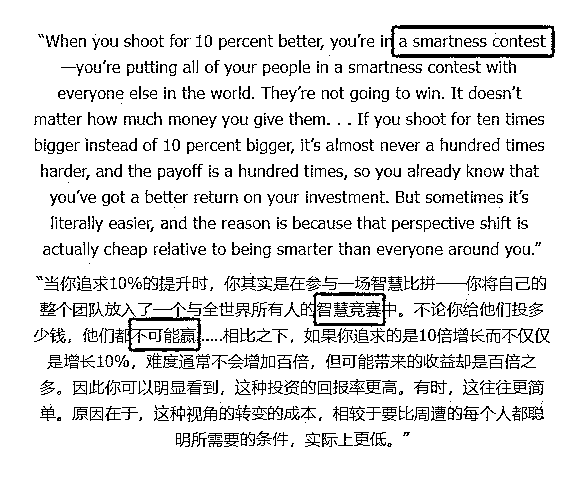

为什么把精英们置于同场竞技的环境，反而大多数人无法胜出？

这段内容的核心，在于探讨目标设定与创新路径的抉择。作者用「追求10%的改良」与「追求10倍的增长」做对照，来阐释创新与竞争的深层关系：

1. 追求10%意味着陷入聪明人的内卷：如果你的目标只是将现有事物优化10%，那么竞争的维度就变成了「谁脑子更快、谁执行更狠」。在全球化浪潮下，你的团队面对的是全世界聪明头脑和资源的围堵，想要从中胜出难如登天——因为总有人比你资源更多、策略更优、执行更强。
2. 追求10倍增长打开了另一扇窗：当目标从10%变成10倍，性质就完全不同了。这样的目标会强逼着你跳出惯性思维的牢笼，去寻找颠覆性的方案与创新路径。令人意外的是，这种宏伟的跨越在实现难度上未必高于小幅改良，但由于野心更大，它带来的回报也远超渐进式改善。
3. 有时更宏大的目标反而更简单：作者指出，设定一个足够大的目标，会强迫你去做根本性的重新思考，而不是在旧框架里修修补补。当你试图颠覆游戏规则，而不仅仅是在规则内挤牙膏时，反而可能找到一些意料之外的简洁解法。退一步说，至少你的创新努力不会与那些专注小幅改良的人正面交锋。

归根结底，这段内容是在呼吁人们选择更大胆的创新路径，不要安于微改良。在全球白热化的竞争格局下，唯有真正的颠覆式创新才能让你站上牌桌。定一个更大的目标，你不仅可能发现它比预想中更容易实现，还能获得远超常规的回报。

### P17：the master calls a butterfly

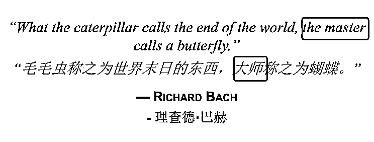

为什么把毛毛虫和大师放在一起对照？

更好的翻译是：毛虫眼中的末日，正是大师眼中的化蝶时刻。若要追求信达雅，还有一个更精妙的译法：夏虫不可语冰。

这句话源自《庄子·外篇·秋水》。它的意思是：对于只在夏天存活的虫子，你没法与它讨论冰雪——因为它的生命周期根本触及不到冬天，自然无从理解冰为何物。这个典故常用来比喻人的认知受限于自身的时间维度与经验范围，对于未曾经历或无法感知的事物，往往缺乏理解能力。

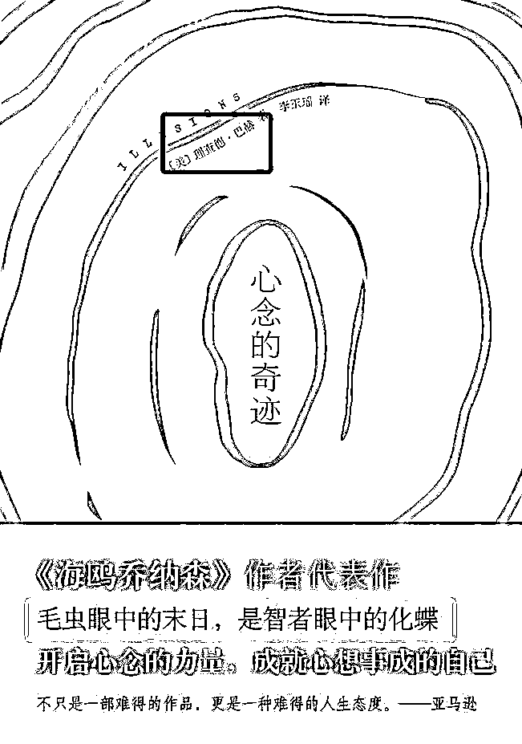

### 米开朗基罗小传

米开朗基罗·布奥纳罗蒂（Michelangelo Buonarroti，1475-1564），文艺复兴时期的意大利雕塑家、画家、建筑师兼诗人，在艺术史上堪称最伟大的巨匠之一。他的作品以技艺登峰造极和强烈的美学感染力而流芳百世。

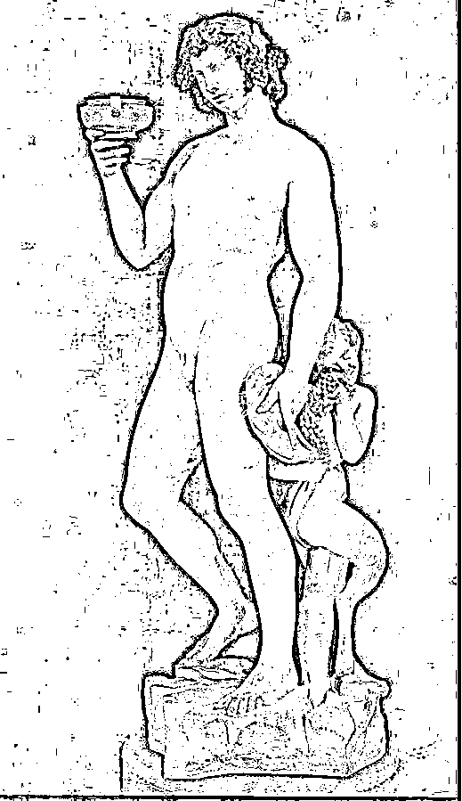

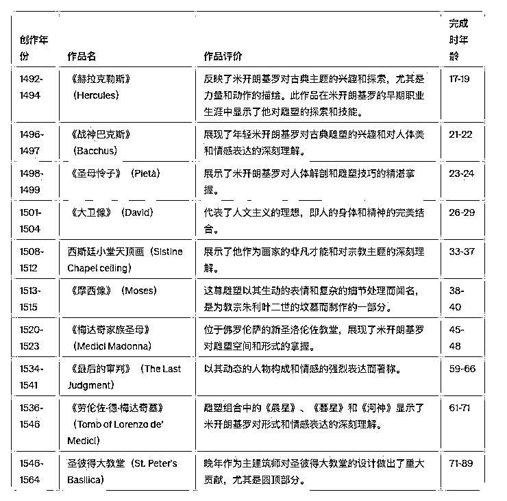

# 1【第一章】10X思维与2X思维的根本分野

## 领读音频

https://o2r4amaky8.feishu.cn/minutes/obcnwtn3553um8s8qxp86361

第一章旨在系统揭开10X思维的全貌，帮助读者从更高维度俯瞰这个思维工具的完整面貌。

本章以「三个板块+一份总结」的结构，为你输送以下关键内容：

1. 2X思维模式运行的结果是滋生混乱，而10X思维模式带来的则是简洁与增长。导言部分已经清晰演示了这两种思维模式的运作差异。
2. 书中给出了10X与2X的对照思维框架。我在其基础上做了整理并加入个人理解，方便你更好地吸收本章精华。
3. 书中配备了三组真实案例，逐一解构10X思维作为核心原则的运用方式，以及在落地过程中可能经历的各个阶段，并展示了在不同阶段如何调整打法、取得成效。
4. 除此之外，书中还提供了一系列实用性极强的工具，比如unless工具、成为谁的英雄工具、收益调整预演工具等。

掌握这些内容之后，一个层次分明的10X框架就会清晰呈现在你面前。你可以据此逐一对照，判断自己在哪些环节已经具备优势、哪些环节尚缺乏深度思考。

第一板块，P60-68 导言部分：为什么2X思维是（你内心所求的）结果的敌人？

5. 导言直接点出了「根源性问题」：为什么10X比2X更简单、更容易让人感到热血沸腾？
6. 核心逻辑链条整理如下（对应下方配图）：

制造混乱的逻辑：
- 想要走向未来→感受到未来的不确定性→内心产生不适；
- 于是退回旧有的经验模式→至少能获得心理上的安全感；
- 拿着旧地图探索新大陆→路径越来越多，但有效性无从验证；
- 那就做更多、拼更狠、试更多→混乱持续加剧；
- 结果反而加固了「不敢想象未来」的心理惯性；
- 越被这种惯性捆绑，越不敢触碰10X→越陷在2X的平庸循环里→最终真的沦为「普通人」。

通往「持续非线性增长」的逻辑：
- 从心底笃信10X的基本前提→专注极少数关键要务→一切以质量为优先→在删减中实现简化→从而在非线性增长的道路上持续前进。更完整的展开，欢迎在共读营中继续深入探究。

b. 先立下一个心愿：奔赴自己真心向往的十倍未来。
c. 可抵达方式尚无线索，怎么办？启用 Unless 这个思维工具。
d. 它像筛子，滤除大量无关干扰，往往只留下一条可行通道。
e. 接着，把心智、时辰与干劲集中灌注到该通道，磨高它的品质。
f. 内外在状态便迎来整体焕新。
g. 由此对十倍增长的根本机理愈发笃信。
h. 动力循环一旦强化，便会反复开启十倍进程、持续参与这场十倍博弈，人生自由度也随之层层打开。
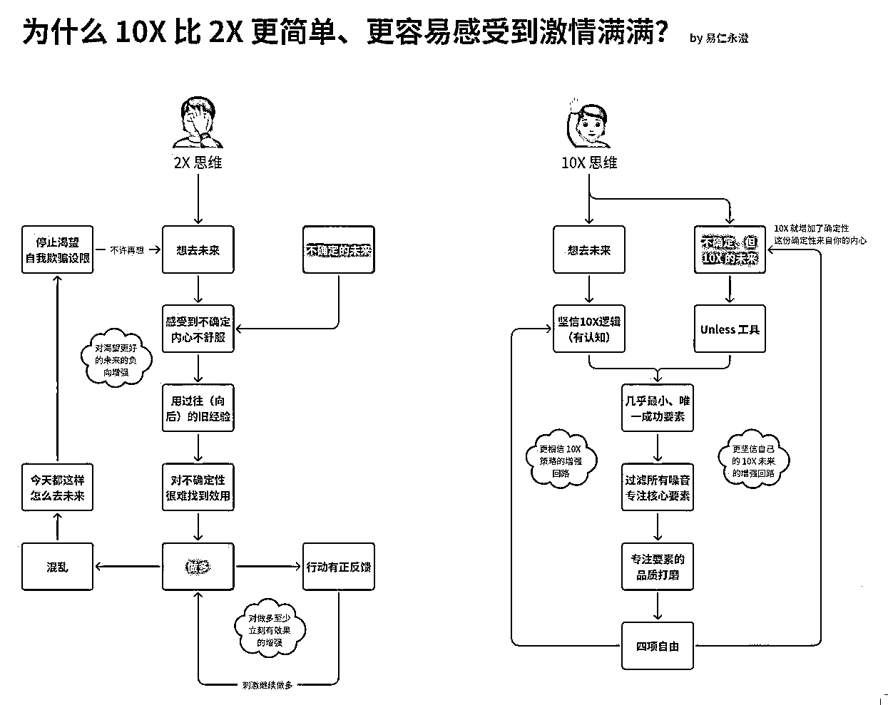
7. 这一节对参与者提出三项底色：渴望高成就、敢于诚实、对路径更挑剔。
8. 关键抓手是 Unless 工具：它几乎扫清了立志十倍增长者心中最大的拦路石与杂念。

第二个模块，P69-88 思维框架：两类思路何以水火不容？
9. 这里呈现两套思维框架。我替你做了提纲式梳理，既省去再归纳的工夫，也便于对照遗漏：哪些阅读时被忽略了？
10. 作者提出一个要紧概念——不对称收益：怎样只投两成力气，却拿到能撬动十倍成效的八成收获？
a. 整章以系统视角立论，即“输入—系统—输出”，并追问一个刺耳问题：你的时辰究竟耗在系统之内埋头执行，还是耗在系统之外调参，让不对称产出（两成投入、八成结果）成为可能？这套算账思路会不断提醒我们审视精力配置。也唯有先接受这个前提，后续才肯缩减眼下八成的时间支出，甚至割舍部分现金收入，为搭建增长系统腾出余力。（P69-76）
11. 连同上述一点，P69-76 还讲透五件事：
a. 系统视角＋立志成为系统改良者＋重新配置时间与精力。
b. 精力投放的关键模型：Dan 博士优化过的“28 分配法”。
c. 改良系统的先决条件：先设定系统产出，含两步——①确定目标；②把目标定得足够大。
d. 将两倍与十倍路线的投入产出摆在一起对照，尤其点明：两倍思维者吝于为“改变”付出必要心力，长期窝在舒适区，于是很难切换到十倍状态。
e. 好用的工具：收益调整预演工具（P75）。
12. 随后书里摆出一个真实案例（P77-86），可拿来照见自己的事业。借这个案例，作者又补了几层意思：
a. 日程被塞满的创业者很难完成自我升级；注意力与时间的分配（那两成高回报投入）至关重要，十倍跃迁还必须伴随愿景、思维、行动、习惯、心态等层面的自我重塑。
b. 实用工具：成为谁的英雄工具（P79）。
13. 收尾处，作者归纳要点，并列出若干自检问题，供你反观自身。

第三个模块，P89- 怎样接连运用“10X 进程”实现跃迁式成长，并挣得指数级自由
14. 这一节借 Linda 的经历展开。顺着故事线，可辨认出她实现跨越成长的若干关键台阶：
a. 认知缺什么，就先补什么。
b. 认知到位后，立刻付诸实践。
c. 走进相应圈层，积累实战经验。
d. 识别当下长处，随即加码投入。
e. 一旦感觉不对，马上微调。
f. 持续砍掉八成时间消耗。
g. 着手撬动组织杠杆。
h. 让这一循环延续，并不断升级社会杠杆。
i. 最终成为领导者，把趋势、平台、资本、文化、组织、市场、技术、团队、机制等生产要素统筹起来，使其协同生效。
15. 故事还透露两件事：为何大幅削减八成时间反而令人干劲十足、热情高涨；为何遇事先问“谁来做”而非“怎么做”。其中要害是——一旦直觉发出不适信号，就该动手调整，而非硬扛或拖下去。
16. 这个模块勾勒出十倍跨越者从零起步的大致路径，颇具参照价值。

末尾是总结模块。我的建议恰好相反：不妨先浏览总结，建立大致印象，再挑自己好奇的段落切入，读完第一章。

### 自行研读
### 本章在全书中的坐标
### 记录研读日期
### 研读路线：本章骨架
1. P60-68 开篇：两倍思路怎么会变成你真正想要结果的对头？
2. P69-88 思维框架：两类思路为何彼此反向？
3. P88-112 综合案例：怎样接连启动“10X 进程”实现跳跃成长，并获得指数级自由？
4. P112-115 Chapter Takeaways：本章关键收获汇总

好问题像路标，能校准人生方向；下面这些提问可让研读更聚焦。
1. 两倍思路的运作过程如何？十倍思路又怎样运转？
2. 作者为何断言：你眼下所做的绝大多数事情都属于噪音？
3. 你的时辰、干劲与专注力，往往在不知不觉间流向何处？
4. 哪些人事只需极小的时间精力成本，却能回馈最大收益？
5. 平日里，你更常追问“怎么做 How”，还是“找谁做 Who”？
更细的追问列在后面。你大可先通读一遍，再回望这些问题，重新作答。

P60-68 本章引言：2X 思路为何是你渴望结果的天敌？
1. 平日里，你对自己抛出的多是“两倍”式提问，还是“十倍”式提问？
2. 抛开对十倍缺少基础认知与意识不谈，你为何仍会下意识抛出两倍问题？心底真正害怕的究竟是什么？
3. 请换自己的说法解释：两倍策略的底层预设朝后看，十倍策略的底层预设朝前看；这一根本差异为何会拉开结果差距？
4. 十倍思路面向尚未可知的将来；为何抛出“unless”式追问，能给人走向未来的底气与胆量？
5. 你可曾担心：若选择十倍却根本办不到，该如何是好？本节内容能赋予你怎样的力量？
6. 十倍成长对人格底色有门槛：你需属于高成就期待型，并能极度诚实地正视无效解法。你目前已具备哪些条件？
7. 书中称“几乎一切都是噪声，你眼下所做的一切也是噪声”。请说说你的感触、触动、启发与理解。

P69-88 思维框架：两类思路为何南辕北辙？
8. 结合阅读与上面的框架梳理，你认为：自己未能按十倍方式生活，最要紧的干扰因素是什么？
9. 你身上浮现了哪些两倍思路的典型征兆与后果？
10. 平常的你，是在系统内部干活——被动接收输入、随意给出输出；还是站在系统外操作——先定输出、再精准输入、并持续优化系统？
11. 你的时辰、干劲与专注，常在不经意间被哪些方向吸走？
12. Dan 博士提出的 28 框架，让你得到什么启发？
13. 你平时是否习惯明确设目标？是否拥有宏大目标，并笃定地为其持续投入？
14. 若此刻要砍掉八成投入，你会先停哪些事？
15. 停掉这些投入后，收入会少多少？你又要多久，才能靠更有价值的新业务把收益拉回当前水位？
16. 哪些人事最值得你用最少时辰与精力去换取最大回馈？
17. 你哪八成努力，正让你长期无暇思考，最终拖散未来最大的一次飞跃？

P88-112 怎样接连启动“10X 进程”，完成跳跃式发展并赢得指数级自由
18. Linda 的经历里，有哪些关键阶段？
19. 看她借“谁来做”（助理、代理人、更换平台）等做法，你有何体会？
20. 为何停掉八成时间投入，反而让自身状态更佳？
21. 若身边人不支持你快速成长，你作何感受？
22. 你经历过快速发展期吗？如今是在有意识寻法助推自己快跑，还是已经停住？若已停住，又是什么在搅扰、阻挡你？
23. 你是否已开始尝试带领他人产出十倍成果？

核心术语与要点
1. Bad question（坏问题）：
a. 你向自己发问，却不能让十倍愿景更清晰、关键条件更明确、注意力更收拢、目标更具体、产出更可见，也不能引向“找谁做而非怎么做”的，都算坏问题。（P61）
2. 最稀缺的资源：有效的注意力（P62）
a. 决策者最要紧的是维持好状态（可参加另一场航海活动：睡饱饱），再把专注力用于杠杆最高的决策，并带动团队一起投入。
3. 思维工具：Unless 工具（P63）
a. 面对看似不可能之事，先自问：“除非……才可能。”接着追问：如何造出这些“除非”条件，让不可能转为可能。
b. Barnard 博士认为，创业者若想让时间与精力回报最大化，就该聚焦这些条件与策略。
4. 噪音（P63）
a. 除此之外，他们所做的其余事情，皆为噪音。
5. 目标
a. 判断目标是否有效，办法是把它推至边界、推到看似不可能。唯其如此，你才会跳出现有假设与知识惯性，愿意接纳新念头、尝试从未走过的路。不向全新事物敞开，就只是在旧地图上兜圈。（不破不立）
b. 目标决定过程（P65）：目标会塑造过程。
c. 目标充当过滤工具（P68）：若一个目标留下太多可能路径或解法，它便算不上好工具。目标应像筛网，分出信号，指明何处最该聚焦、最能产生大影响。目标与标准越高、越具体，可选项就越少——反直觉的是，这反而更易达成。更宏大、更具体的目标会迅速砍掉当前大多数活动，为探索与评估更优选项腾出空间。只有把目标放得足够大——大到十倍——哪些策略、关系或行为不会奏效（那八成），才会荒唐甚至滑稽地显现出来。（P72）把十倍增长设为目标时，你会发现现有客户与关系里有八成变成拖累；同样，现行活动、习惯与思维里也有八成成了绊脚石。（P87）
6. 线性 or 非线性
a. 简言之，若追求两倍增长，你可保留或维持现有生活八成，或眼下所做之事。事实上，走两倍/线性路线时，你做的正是这件事。
b. 两倍增长从过去出发，主要是延续既有道路。
c. 两倍增长是线性的。你未做根本不同的尝试，只是在尽量少变的前提下，把现在做的事做得更多。（P74）
7. 10X（P66）
a. 十倍目标可把信号从噪声里分离。
b. 十倍增长带来流程精简；两倍增长却使局面纷繁又浑浊。（P86）
8. 诚实 be honest about（P66）
a. 适用于十倍增长的策略少之又少。若你当真对待它，就得对眼下所做的一切更加坦白。
9. 高期望人群/成就导向型群体（high-hope people）& 路径思维（P67）
a. 心理学中，路径思维是高希望感人群的属性——那些对特定目标高度投入的人。
b. 这些高希望感的人会持续学习，并迭代通往目标的过程和路径。
c. 他们会从碰到的障碍和未达成的目标中收取反馈，用来学习、改善并调整路径。
d. 这与本章前面提到的希望研究相契合。希望的核心要素之一是路径思维，意思是高希望感的人会不断调整路径，直到最终找到并创造出达成目标的方法，哪怕处境极其艰难。（P93）
（这一条可对比赚钱初阶用户：遇到问题就放弃，最大问题还是心理灵活度不足，需要训练！）
10. 28 不对称收益思想：将两成注意力聚焦投下，以换取八成高回报的 unless 关键要素回报（P70-75）。
11. 辨别重要方法：先设目标，再把目标放大（P71）。
12. 启动十倍进程的步骤（P74）
a. 觉察心底真正渴望（第三章），敲定大目标（P62）。
b. 舍掉当前八成时间（P74）。
c. 借 Unless 方法锁定关键要素（P63）。
d. 将两成注意力灌注到这些关键要素（P74）。
13. 转变（transformation）（P74）

# 2【第二章】先换身份，再谈增长

10倍增长不是把现有生活调大音量，而是换一套完全不同的生活质地。它要求彻底重构，而不是把旧家具挪个位置。

2倍增长，是你一头扎进业务里忙；10倍增长，是一边升级自己，一边升级业务。卡森若不肯改变自己、愿景和思考方式，就只能在2倍模式里反复打转。

把10倍设为目标，会立刻暴露一个残酷事实：你手上约80%的客户和关系、约80%的活动习惯与思维习惯，都会变成拖累。20/80工具因此很关键：把最高收益的20%做到全情投入，主动放下低收益的80%。这样的人生不只增长10倍，还会更简单、更轻松、更有热情。

10倍看质量，不看数量。它不是“更多”，而是“不同且更好”。你越是为某一类高度精准的人做到独特和优秀，你做的每件事越能产生不对称的回报。先精准界定你想服务的那类人——他们欣赏并看重你最核心的价值，这就是“你想成为谁的英雄”。所以，别在许多事上混个及格，要在少数事上做到极致。其余动作，多半只是噪音。靠堆工时换不来高回报，真正的高回报来自洞察，以及做自己真正想做的事。

过程是由目标倒推出来的。看似不可能的大目标反而实用，因为它会迅速筛掉无效路径，只留下少数真正有效的路。2倍目标的问题在于可选路径太多，容易分析到瘫痪，不知道把最好的精力放哪里。让当下变好的唯一办法，是先把未来做大。几乎没有什么做法能服务10倍目标，这正是它的价值：它能把信号从噪音里分出来。瞄准月亮，就算没命中，也会落在星辰之间。

10倍思维还会逼你对时间和精力变得挑剔。你明白加班多不等于结果好，常常只是思考没有升级。不能靠过去的思维走到10倍，因为让你走到今天的东西，未必能把你送到下一站。反直觉的是，10倍目标的人往往比2倍目标的人更好相处。卡森的日程表可以空无一物，因为他不再用忙碌冒充进展。

追求10倍，关键不在“怎么做”，而在“找谁一起做”。你需要的是合适的人，不是更多方法。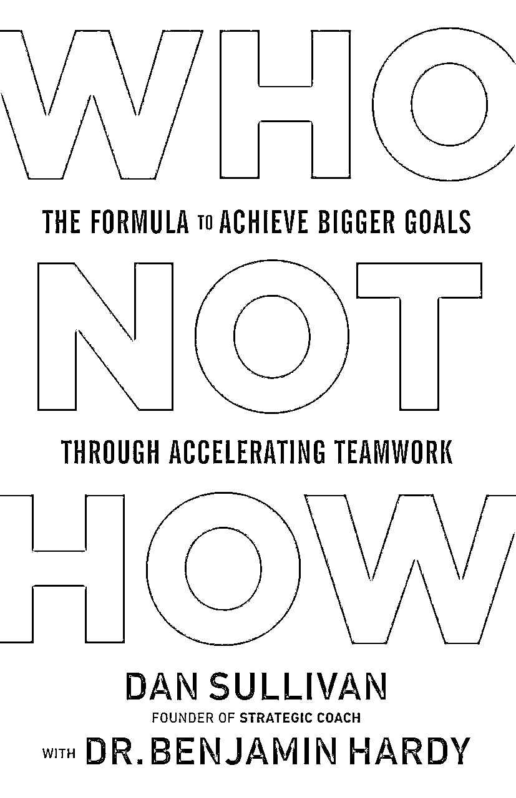

承诺是起点。没有承诺，什么都不会发生。每次你舍弃旧的80%，把全力投向一个更开阔的新20%，你就更像一位大师、创新者和领导者。经历足够多次10倍跳跃后，你会成为领导者的领导者：直接影响的人变少，影响涟漪却指数级扩散。每一次跳跃，都让你在20%的领域更接近世界级；然后借助已获得的增长与自由，再完成下一次看似不可能的跨越。你会不断剥离80%，拥抱更高层次的自由，最终成为最强版本的自己——独一无二的“大卫”。

用unless工具反过来问：除非哪些条件成立，你的10倍愿望才可能成真？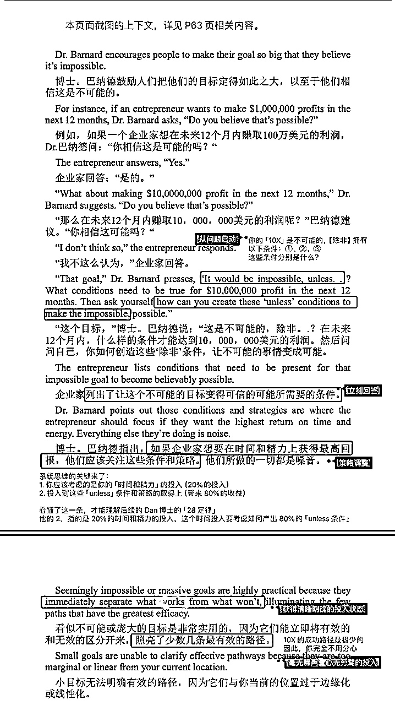

再把问题换成“in or on”：你是在系统里埋头做事，还是在改造系统，让它支持不对称产出？

# 真正的10倍，从“你”开始

你有没有过这样的瞬间：明明可以找人搭把手，却下意识把事全揽过来；不是别人做不了，而是你总觉得“我不亲自做就不放心”。这就是素材里提到的“个人坚强主义者”——凡事自己扛，不肯把任务交出去。接着问：某个你不太喜欢的行为背后，藏着怎样的自我形象？你为什么相信“我就是这样的人”？很多行为不是能力问题，而是身份设定问题。

再看目标。有些事情你只给了自己一个表面数字：做多少、完成多少，却没想清为什么做。结果就是在数量上反复堆叠，在品质上很少迭代。日常思考也一样：你是遇到什么想什么，还是留出时间用10倍框架思考？10X Often and Become the Best at What You Do，说的就是高频做10倍，最终成为所在领域最好的人。要打造真正属于自己的竞争优势，展示与众不同；要先释放干扰，前提是清楚自己要什么，关键是敢放下不重要的80%。团队为什么愿意跟随一个只做某些特定事情的人？因为这样的领导者边界清楚、标准稳定，能把空间留给团队。你什么时候会进入深度工作、反复打磨品质？你有没有承诺的习惯？什么让你不相信自己的承诺？内心最深处，你是否渴望成为“伟大的人”？如果现在就下决心，你是什么感受？除非消除哪些条件，你才敢相信自己会成为伟大的人？Clear 的成长故事也会让人触动：真正属于自己的竞争优势，不是包装出来的标签，而是把独特能力打磨到极致后自然呈现的与众不同。

原文在P116到P165标注了多处关键金句，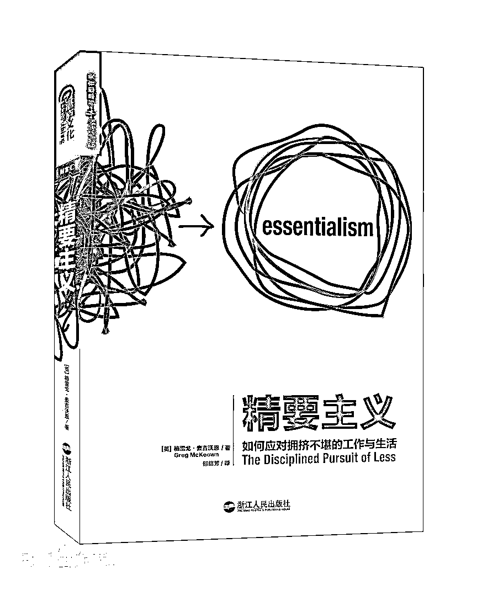

辅助资料还整理了赛斯·高汀的书籍与演讲，主题集中在营销、创新和换脑式思考。

第三章讲的是匮乏思维与丰富思维，也是整本书里最关键一步的展开：10倍的源头就是“你”。初读会觉得这一章偏内在、甚至有点玄，但它其实给了一张路线图。内在探索往往从“而立”开始，到“不惑”才真正清楚我是谁、我要什么、我该怎么活；孔子这样的圣人都用了十年，我们一时弄不明白也正常。

Dan博士在1979年经历破产和离婚，用四个月恢复，并开始写下自己的渴望和期盼。这里引出了“需要Need”和“渴望Want”的区别，也埋下了“独特能力Unique Ability”的线索。这一章先让你离开匮乏的“需要”，去拥抱丰盈的“渴望”：渴望关于创造，创造没有尽头；财富也不等于金钱，金钱只是其中一层，财富的本质与创造有关。渴望不需要解释、合理化，也不需要向谁证明。第二个关键是独特能力：它是最纯净、最诚实的自我表达，你越充分表达自己，越能看见它。用独特能力去创造独特价值，没有人能和你竞争；你的独特能力也就是你的独特愿景和目的，是背后的“质”。要精通它，就找到这项能力的成功要素，在要素上持续迭代。发展独特性可以靠诚实、拓宽视野、定义成功后的行为特征，以及厘清20%、放下80%，还需要承诺和勇气。

第三个方法是买家思维Buyer Mindset：像买东西一样挑剔地守住自己的标准，带着丰盈感去选择。你可以随时调动这种感受，并慢慢把社交关系更新为“买家联合”——彼此没有压力，诚实追求自己想要的，减少内耗。第三章的自测题其实就落在两问上：你的独特能力是什么？你准备如何用买家思维创造变革型关系？这一章也标注了从P168到P222的多处关键金句，适合对照回看。

第四章回到实践：前三章讲理念，后三章由内而外展开——第四章谈内在关系，第五章谈时间调整，第六章谈自主工作团队。这一章提出Gap&Gain这个关键心智模式，把前面的要点串起来；面向过去，回顾你的10倍成就找到独特性；面向未来，用多个工具组合推进。你要相信：你曾做到过，也将再次做到。若想持续追求渴望的自由，内在必须转变。Gap视角会让人明明进步了还贬低自己，目标理想化却仍掉进去，根子上和“需要者”心态有关，甚至会为停滞找理由；Gain视角则关注收获，能助力10倍，也和每次放手80%相关。你可以找出过去生命中的5次10倍突破，给它们命名、标注时间，厘清每次突破中重要的20%和放下的80%，再想这些20%如何进一步发展你的独特能力。当你做出承诺去转变，10倍就会发生。

第四章后半程给出两个工具，并强调组合使用。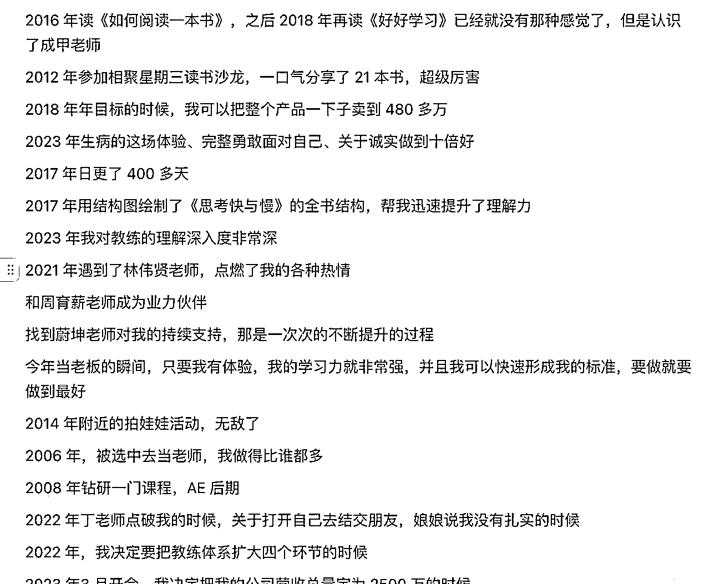 第一个是适应度函数Fitness Function：你关注什么，就成为什么。做自己是最可怕也最勇敢的事。请回答：你在优化什么？最终想成为什么、做什么？想设定和达成什么标准？什么最低标准能帮你适应和进化？你的适应度函数是什么——你想掌握哪些能力和成果？第二个是梦想支票Dream Check：好钱不只是额度大，还能让你在做事过程中持续兴奋；坏钱相反。作者出书的故事也说明，钱可以成为梦想的支票。你的梦想支票数额是多少？

最后，把标准立起来，把承诺守住。制定标准并承诺做到，价值在于让行动有边界、让信任有依据，也会放大你的影响力和吸引力。给自己设一个高于平均、可交付、能持续迭代的品质标准，别用次数掩盖质量。身份之所以决定行为，是因为人总会去做与自我形象一致的事。如果设一个10倍、看似不可能的目标，你可能会既兴奋又害怕，但它会逼你升级。10倍框架从内到外，大致是：先看清身份与自我形象，转向丰盈的渴望，澄清独特能力，立标准并承诺，释放干扰、放下80%，进入深度工作打磨品质，建立买家式关系，用Gap/Gain回顾10倍突破，再用适应度函数和梦想支票校准方向。你内心是否渴望成为伟大的人？决心之后，还缺哪些条件，你才敢相信自己真的会成为那样的人？

现在，不妨把这些问题写下来，给自己一个诚实的答案。

b. 我究竟要拿出哪些看得见的价值，才能让乐意付钱的人认为这张梦想支票值得毫不犹豫地签下，而且性价比高到像捡了便宜？

c. 我的独特能力要修炼到什么水准，才会让付款方觉得为我开出并兑现梦想支票既顺理成章，又极其划算？

## 关键金句

P229

P232

P235

P237

P238

P240

P241

P244

P245

P248

P250

P253

P254

P259

P260

P264

P266

P267

P268

P269

P272

P274

P279

P283

## 自测题

1. 回看你过去的10X经历，你对自己多了哪些认识？

2. 对你来说，最重要的20%是什么？

3. 你的梦想支票数额是多少？

# 5【第五章】时间重排：从忙碌到10倍产出

## 音频导读

领读音视频：https://o2r4amaky8.feishu.cn/minutes/obcn7446pi9265me536bcg82

这一章像一本操作手册，初读时让我明白“落地动作”长什么样。它也让我卸下了“必须一直拼”的自我设定，敢把每周工作时间砍掉两个整天，重新编排节奏。连我持续二十四年的晚睡习惯，也在这轮调整中被改掉了。

本章上手门槛不高，我先把它的骨架搭给你看。

全章围绕四个关键概念展开：

1. 心智模式：说到底，它是一种内在自我认同，书里叫identity。第二章讲过用4C重建identity，这里再次接上。  
   a. 书中点出一种很典型的状态：长期泡在自己并不喜欢的工作里，把那种喘不过气的“非我不可”当成勋章。  
   b. 要叫停这种无休止消耗，把“无用之用”放回生活，让生命体验更丰盈，而不是用十几个小时把任务硬塞满。

2. 时间使用模式：时间是我们手里极重要的资源，怎么用它，就会长出什么结果。跳出钟表去看，时间使用也有套路。书中摆出两类：  
   a. 工业时代那一套，是把一天八小时切成任务格子，只盯投入量和产出结果。结果和时长都定死，剩下就看人像机器一样运转。它绝对、固定、线性、客观，流水线工人最熟悉。书中称它为Chronos，你可以把它想成一只停不下来的忙碌计时器。  
   b. 书中更看重“以人为本”的时间观。尺子不再放在外部计件计量上，而是回到人的体验：更主观，更重品质，非线性，也更灵活。场景一换、视角一变，时间的感受和框架都会流动。为什么必须变？因为今天的人要靠创新、创造和内在本质出结果。知识工作成为主流后，时间使用方式自然要改。既然以人为本，就会更在意心流、愉悦和转化——把内在的Quality变成有品质的成果。书中称它为Kairos。

3. Kairos大致包含这些意味：  
   a. 它讲究火候，强调在合适节点做合适决定或行动。  
   b. 它看重内在之“质”，相信“质”有恒久属性。  
   c. 在这种时间里，人能真切感到“我”在场。越感到“我”，越能遇见长长的呼气、共同的笑声、多彩日落和勇敢时刻，而不是只被一条流动的秒表推着走。  
   d. 越活出“我”，越不受头脑里的线性关系束缚；每一刻都能把“质”活出来，整体性、灵活性更强，每个瞬间都在创值，效率也会明显跃升。  
   e. 越沉浸，越容易进入流动状态和巅峰体验，感到敬畏、自我扩张与意义感。  
   f. 每一刻都能遇见“我”，这是Kairos最重要的提醒。

4. Dan博士给出三种时间切法：自由日（FreeDay），用来恢复，在无约束状态里体验自我、享受无用之用；增益日（BuffDay），给卓越表现加Buff，也是持续训练日；聚焦日（FocusDay），用来做出独特绩效。Dan还给了参考安排，值得动手试。

概念讲完后，Dan用三节讲自由日的意义，只用一节谈增益日和聚焦日。篇幅本身就说明作者把重点放在哪里。

重点看自由日：

5. 自由日的第一任务，是把“我”的基础机能充到满格。创业者容易陷入“以竭尽全力为荣”的惯性：头疼、肩背疼、胃痛、心脏不舒服、腰疼轮番报警，还是硬扛，甚至把小问题拖成慢性病或更严重的状况才处理。这和情感账户一个道理——身体报警，说明亏空已深，必须先补。读完书后，我开始把睡眠当第一项目：22:30入睡，睡足7.5小时，深度睡眠争取超过2小时。不断调整睡眠方案后，甚至长出了新的业务空间，这就是Kairos时间给的礼物。

6. 对决策者来说，自由日更是战略必需。一个判断出错，可能把自己、团队、公司乃至价值网一起拖进坑里。最大的杠杆不是努力，而是那份关键思考；思考偏了，往往要用十倍、几十倍时间去填坑。所以必须用自由日停下来休整，和自己待在一起，听清内心声音，认真感知各要素如何运行，才可能把本质用更有创意的方式接到结果上。

7. 自由日还能让创始人“不在场”，把团队的能量放出来。2022年初，我确诊新冠后连续发烧21天。那21天里，团队生产力反而爆发，比我坐镇时更高效。创始人越爱干预，越难长出自主工作的团队，整体效能也被拖住，自己更难抽身去做10X增长需要的各种转变。

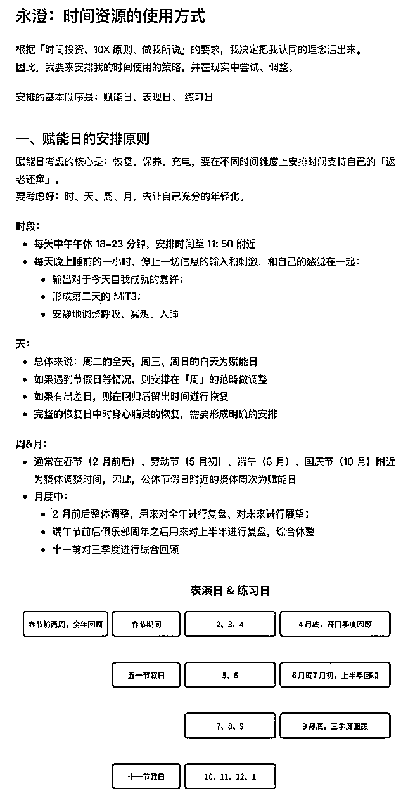

再说增益日与聚焦日：它们偏向刻意训练和高密度产出。增益日给优势加Buff，聚焦日做不可替代的成果。它们和自由日配合，才组成完整的10倍绩效系统。

本章给出一条很落地的改变路径——时间转变。无论如何，先从睡好觉开始。

## 自主阅读

### 本章节的整体位置

### 自主阅读日期

### 自主阅读导引：本章节的整体结构

标记表示需要慢读、摘录、反复咀嚼的部分。

1. P290-294：摆脱工厂式时间，把日程交给Kairos式流动、趣味与转化

2. P295-301：用自由日、聚焦日、缓冲日组合出10倍表现

3. P302-305：自由日之一：恢复优先

4. P306-311：自由日之二：筹码越高，越要留白

5. P312-314：自由日之三：团队不自我管理，就难成长

6. P314-325：聚焦日与缓冲日：怎样安排一天，换来十倍转变与结果

7. P326-328：本章收束

## 好问题引领生命方向，这些问题帮助你的阅读更聚焦！

1. P290-294：摆脱工厂式时间，把日程交给Kairos式流动、趣味与转化  
   a. 你怎么看Chronos与Kairos这两种时间？  
   b. 读完后，你对时间与时间管理有什么新认识？

2. P295-301：用自由日、聚焦日、缓冲日组合出10倍表现  
   a. 你如何理解自由日、聚焦日、缓冲日？为什么要区分？  
   b. 这三种时间和Kairos有什么关联？

3. P302-305：恢复优先  
   a. 你过去怎么安排休息和放松？  
   b. 为什么作者认为要10x，就得把恢复放第一位？  
   c. 这会给你带来什么改变？

4. P306-311：筹码越高，越要留白  
   a. 你的时间安排是忙碌的2x，还是留出空间的10x？  
   b. 你如何理解探索（Explore）与利用（Exploit）？

5. P312-314：团队不自我管理，就难成长  
   a. 你平时怎么带团队？  
   b. 你怎么看“自管理团队”？

6. P314-325：怎样安排一天，换来十倍转变与结果  
   a. 你如何理解聚焦日与缓冲日？  
   b. 你当前的时间怎么安排？  
   c. 作者的建议里，哪条最触动你？  
   d. 你准备怎么调整？

## 关键金句

P290

P292

P293

P299

P301

P304

P305

P307

P308

P309

P311

P312

P313

P315

P319

P321

P324

# 6【第六章】让公司自己跑起来

## 音频导读

https://o2r4amaky8.feishu.cn/minutes/obcn9is83v5u27c95of744v6

这是全书的最后一章，也是应用篇第三站。应用路径由内而外：第四章讲内在转变，第五章讲时间转变，第六章讲不同层级领导者的特征。

本章从职业经理人苏珊加入保险公司的故事切入。它很像《团队协作的五项障碍》的故事原型，核心是变革型领导者的基本逻辑：“稳定—优化—成长—转变”。随后，书中把这一循环放到四个阶段里，展示变革型领导者的成长路线。

顺着这条路线看本章：

首先，L1到L2：从“一个人就是一支队伍”的硬扛，转向会用“Who not how”的领导者——先找对人，而不是死磕方法。

其次，L2到L3：从简单用Who，升级到带领一个“自我管理”的团队。

最后，L3到L4：让整个团队持续发展Unique Ability，每个人都成为独特的Buyer，一群Buyer并肩往前走。

## 自主阅读

### 本章节的整体位置

### 自主阅读日期

### 自主阅读导引：本章节的整体结构

标记表示需要慢读、摘录、反复咀嚼的部分。

1. P329-340：从微观管理者走向变革型领导者

2. P340-368：L1到L2：从坚强个体到应用“Who not how”的领导者

3. P369-378：L2到L3：从应用“Who not how”到发展出自管理公司

4. P378-387：L3到L4：从自管理公司到自我拓展的独特能力团队

5. P388-391：本章收束

## 好问题引领生命方向，这些问题帮助你的阅读更聚焦！

1. P329-340：从微观管理者走向变革型领导者  
   a. 苏珊和加内特的故事给你最大的启发是什么？  
   b. 你判断自己处在哪一层级的企业家？为什么？

2. P340-368：从坚强个体到应用“Who not how”的领导者  
   a. 蒂姆的故事对你有什么启发？对当前业务有帮助吗？  
   b. 你如何理解变革型领导者？  
   c. 要成为变革型领导者，你准备先做什么？  
   d. 你怎么理解“Who Not How”？如果用起来，准备从哪件事开始？

3. P369-378：从应用“Who not how”到发展出自管理公司  
   a. 你认为什么是自管理公司？  
   b. 打造这样的公司需要哪些条件或要素？  
   c. 你准备打造自管理公司吗？如果准备，从哪里起步？如果不准备，挑战或顾虑是什么？  
   d. 请认真回答书中的问题：  
   - 你是坚强的个人主义者，还是应用“Who Not How”的领导者？  
   - 说实在的，你是真正的领导者，还是仍然卡在瓶颈上的管理者？  
   - 你信任身边的Who，还是只信自己？  
   - 你能想象一家自管理公司是什么样、什么感觉吗？在那里，你把自己解放出来，可以去探索、扩展、创新、学习和创造。

## 4. 别再只做自管理：让团队靠独特能力自我拓展

想不想完成一次真正的领导力升级，成为能带动组织进化的变革型领导者？这一节把镜头对准L3到L4的创业进化：组织不再满足于自管理，而是走向以独特能力为引擎、能够持续自我拓展的团队。

在进入L3到L4之前，先把前两级看清。L1的企业家像独行侠：事情自己扛，或者对身边少数“Who”紧盯不放。L2则完成一次转向——不再困在“怎么做”的个人主义里，而是用“谁来做”统领生活与事业，把Who Not How落到各个领域。

**a. 它是什么，和自管理公司差在哪？**
所谓自我拓展的独特能力团队，是把每个人的独特能力放在分工中心：成员聚焦自己最擅长的部分，其余不擅长的80%则通过引入合适的“Who”来补位。自管理公司强调的是团队自主运转、减少层级控制；而L4团队更进一步，它不只让团队自己管理自己，还让团队围绕独特能力不断重组角色、吸收新伙伴，从而持续扩大能力边界。

**b. 打造这样一支团队，要做什么？**
领导者先要认真对待自己的独特能力，把自己从80%的非优势事务中解放出来；同时以身作则，建立自由文化，让成员也获得认真对待自身独特能力的许可；接着推动团队围绕独特能力打磨角色，并有信心引入额外的“Who”接走原来的80%。一句话：你先松手，团队才敢重构。

**c. 风险是什么，你愿意承担吗？**
代价很真实：放权后的短期失控感、角色重排带来的磨合、新人融入可能引发的文化摩擦，以及授权不等于卸责——结果仍然由你承担。你愿不愿意为更大的团队能力，接受这些不确定？这是每位领导者必须诚实作答的问题。

**d. 请回答书中的问题**
- 你愿不愿意把独特能力放到战略高度，借此把自己从80%的非优势事务里解放出来？
- 你会不会先做榜样，把自由文化建起来，让伙伴们也敢把独特能力当回事？
- 你那支自主运转的团队，敢不敢把独特能力做到极致，重新定义各自角色，再请新的“Who”接走原来的80%？

变革型领导者的关键，不是把自己练成全能选手，而是让独特能力成为团队的共同语言：你先解放自己，再让团队敢于解放彼此；你先引入合适的Who，再让团队学会持续引入Who。这样，公司才不只是自管理，而是能自我拓展。

