# 让 ChatGPT 真正省时间：2024.03 操作手册

> 原文出处：[`jviztcgxxfy.feishu.cn/docx/WKxrdFoFWogVStxySLlcsTPqnOb`](https://jviztcgxxfy.feishu.cn/docx/WKxrdFoFWogVStxySLlcsTPqnOb)

三月航线｜ChatGPT 效率实践｜操作手册


编写团队：生财有术  
完成日期：2024 年 3 月 20 日  
使用提示：这份材料用于展示该项目的可行空间，帮助你理解和上手。若想精准跳到某个知识点，可用 Ctrl + F / Command + F 检索关键词。


# 开头说明

欢迎加入三月航线｜ChatGPT 效率实践｜操作手册。后面我们会在手册和群里多次交流。

先说明来源：本版是在 12 月“聊天机器人 + 内容账号”旧册基础上重新整理的。需要提醒，模型升级频繁，眼前有效的方法可能很快变化；请保持练习，留意官方公告，别掉队。

动手前，有三个常见疑问值得先讲清：

1）学它有什么用？会带来哪些变化？

热度已经不必证明。外界看法并不统一：有人说搜索入口会被改写；有人判断内容生产会迎来新机会，Sora 面世后这种声音更响；似乎做内容的门槛降低了不少。另一面也有担忧：低质内容会变多，人会逐渐懒得动脑。争议很多，但关键一句是：淘汰人的不是 AI，而是不愿学 AI 的人。即使不拿它做新产品，也可以把它当成生活和工作里的效率助手。

2）谁适合用？

基本人人都可以。电脑、手机都能访问，主要门槛是网络和账号；解决后即可使用。使用范围也宽，工作和生活都有场景。两条底线要守住：别把敏感资料传上去；对结果保持判断。它能加快速度，但不能代替你掌握专业能力。

3）能不能靠它赚钱？

它本身不是直接变现工具，但可以成为新服务、新应用的底层能力：帮你更快推进项目，或为目标用户提供服务，从而获得收入。手册内容偏通用，目标是先让你掌握基本操作；实际空间很大，可结合自己的业务灵活调整。也欢迎在航海群里和教练、伙伴交流，发 Chat 链接或截图，一起加深理解。

另外，有些圈友卡在开通环节，因此我们补充了国产替代工具 Kimi 的用法，让更多人先跑通 AI 提效。希望这趟航行结束时，你既能拿到结果，也能认识一群同路人。

以下内容由生财有术与圈友共同制作，仅限航海船员和生财有术星球圈友学习使用。实践中欢迎持续反馈，可联系鱼丸（yuwan387）提出修改建议。


# 这本手册怎么用

开始前，先弄清阅读路线。正文按“先认识、再应用”展开，你可以跟着航线图逐步做，也可以按需求跳读。

要特别说明：这一版调整较大。旧版尽量铺开玩法，新版拆成必修与选修两块：

如果你从没接触过它：先了解产品本身与近期动态，读【项目概述】了解 ChatGPT。

如果你已经大致知道：按航线图练技能，从第二章开始：【项目实操 1/4】了解 ChatGPT，并和它进行一次对话；【项目实操 2/4】写好提示词，让 GPT 高效工作；【项目实操 3/4】掌握 AI 提效场景；【项目实操 4/4】定制自己的 AI 提效解决方案。

如果你已会基本操作，想看更多可能：重点看【进阶使用 1/2】如何创建一个自己的 GPTs；【进阶使用 2/2】ChatGPT API 如何使用；【案例展示】ChatGPT 的多种应用方向。

本航海项目航线图如下：

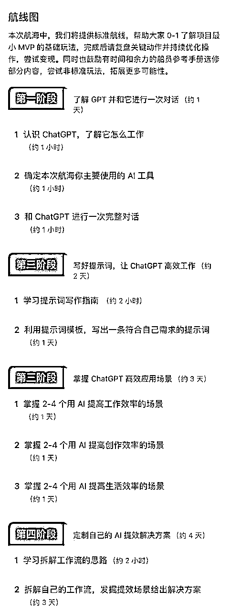

航线图与正文彼此对应，你处在哪个环节，就学哪个步骤。

# 学习地图


# 必修篇

章节概要

本章从认识 ChatGPT 开始，带你逐步掌握使用方法。按步骤实操，就能完成学习。

如果你是新手，正式动手前先看项目全貌：【项目概述】了解 ChatGPT。

如果你已经了解整体，按核心步骤推进：【项目实操 1/4】了解 ChatGPT，并和它进行一次对话；【项目实操 2/4】写好提示词，让 GPT 高效工作；【项目实操 3/4】掌握 AI 提效场景；【项目实操 4/4】定制自己的 AI 提效解决方案。

实操中若完成一次不错的提效，欢迎把完整过程提交到表单，大家互相借鉴，共建案例集：提交表单 https://i.shengcaiyoushu.com/t/BOA7nFBt ；查询表单 https://i.shengcaiyoushu.com/t/BOA7QFBt

必修篇的航线图与正文顺序一致，照章节学，就能逐项完成任务。后续每个关键步骤的章节概要也会提示对应航线图。下面正式开始。


## 一、【项目概述】摸清 ChatGPT@云舒

### 1.1 ChatGPT 究竟是个什么工具

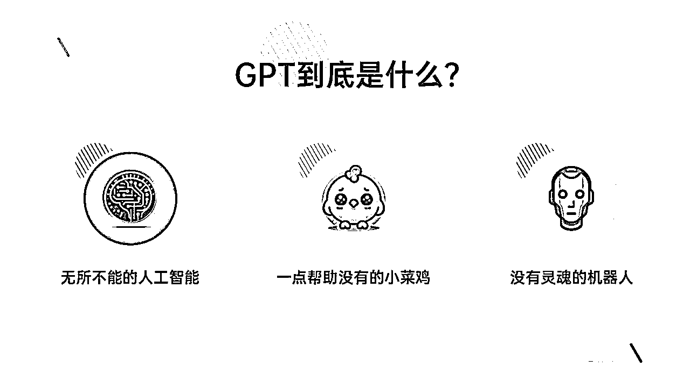

它问世一年多，外界评价落差很大：有人觉得笨，有人把它当日常搭档。这个跨阶段产品该怎么看？先放回现实。

我们每天被大量信息包围，自媒体常见三种说法：GPT 要让人失业、GPT 无所不能、不报 AI 课就会落后。声音很杂，真话很少。

ChatGPT 发布后，智能工具普及的阶段已无法回避。我们既不必恐慌，也不必焦虑。它不是许愿池，也不是废铁；更准确地说，它擅长按人类语言习惯拼出内容。它输出能力很强，但对意图的理解未必成熟；你给的信息越清楚，它越可能给出靠谱结果，输入含糊，反馈也会飘。


不妨借一场守城游戏，理解你和它的关系。

你正在守城，身边只有一名八岁孩子（ChatGPT）当帮手。他手很快，但没有成年人那种一点就通的默契。后方有一百个仓库，弹药包括榴弹炮、子弹等。这时你让他去补货，该怎么交代？

如果你只说“补弹药”，他根本不知道要哪一种，只能反复追问；如果你说“要榴弹炮”，他会先找对应仓库，搬来后再问要几发；只有你说“去 097 仓库取 10 发榴弹炮”，他才能顺利执行。

GPT 能力很强，也像一个非常稚嫩的小学生。指令越精准，结果越贴合需求。若你本身是 90 分程序员，有它协助，每天干一小时也能轻松推进；若你不会写代码，它生成的代码你多半也难用明白。同理，你知道 90 分文案长什么样，它才可能写出 90 分文案；这一切的前提，是你有基本判断与认知。


### 1.2 它为什么能生成内容

GPT 的能力从哪来？根子在大语言模型（LLM）。

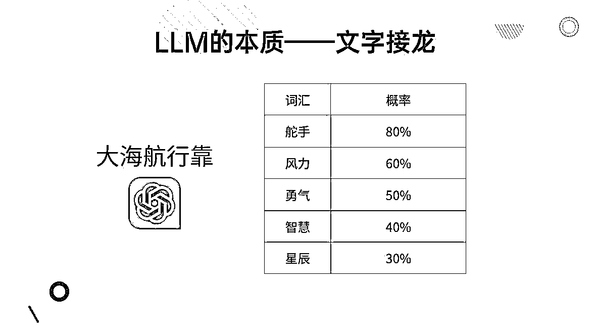

所谓大语言模型 LLM（Large Language Models），核心是“见得多，然后按规律接下去”。像读诗：看到“好雨知时节”，熟悉的人知道接“当春乃发生”；即便没背过某首五言，也能判断下一句大概五个字。读得越多，对字数、对仗、语感越熟，便能为陌生上句拟出像样的下句。

它并非真正懂诗，而是从海量语料中习得搭配规律，再模拟输出。ChatGPT 全名 Chat Generative Pre-trained Transformer，本质是生成式预训练模型做对话，模仿人类文字表达。

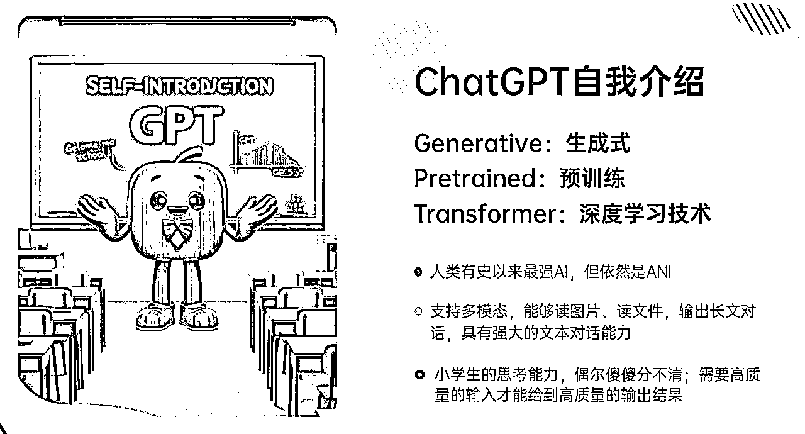

下面解释常见 AI 词汇，帮助你更好地理解和使用 AI。

1. PGC：机构、团队或职业作者主导生产的内容；央视、人民日报是代表。
2. UGC：普通用户自己创建并分享的内容；抖音、B 站、小红书是代表平台。
3. AIGC：由人工智能系统生成或协助生成的内容。
4. 提示词：你发给模型、用来下达任务的文字指令。
5. GPTs / GPT store：自己定制的机器人称 GPTs，集中摆放它们的市场叫 GPT store。
6. Token：模型读写文本的最小计量单位；一个英文字符大致算 1 token，一个汉字大致算 2 token；一次对话的输出上限为 4000（技术升级后这个数会变）。
7. LLM：Large Language Model 的缩写，即大语言模型；用海量数据训练后具备文本生成能力。
8. Agent：智能体，可理解为 LLM（大语言模型）+ Memory（记忆）+ Planning skill（规划）+ Tool use（工具调用），能独立思考和执行任务。


### 1.3 应该怎样理解它

大家都在谈智能工具普及，但现有研发仍处在第一步，也就是弱人工智能 ANI 阶段。系统没有真正的意识，只是围绕特定任务执行训练好的事情。它和短视频推荐、语音翻译、辅助驾驶一样，都是模型在具体场景里满足需求。

ChatGPT 的强项是连贯文本、上下文理解和多语种任务：答疑、写稿、创意写作都能做，聊天、写作、编程都有实际落地。

不过，它也有短板：

1. 事实准确性问题：模型基于大量文本训练，可能输出错误信息或偏见内容；回答现实问题时，训练数据的精准度会影响答案准确性。
2. 生成幻觉：有时它会编出与现实不符的信息，这被称为“生成幻觉”，即模型创造出不存在的事实或信息；根源在于它是“生成式语言”。
3. 逻辑推理能力：某些情况下它能展现一定推理能力，但过程可能不稳定，偶尔出现逻辑不合理或不一致的结果，数学计算、物理公式计算就是典型例子。

2024 年 2 月 15 日，OpenAI 上线文字转视频产品 Sora。它能理解世界，并生成多角度、最长 60 秒的视频。Sora 是 Text-to-Video 路线的一座标杆，再次说明 Diffusion Transformer 在这条路上能跑出高水准结果。

tokyo-walk.mp4【在线播放】


mitten-astronaut.mp4【在线播放】


Sora 能按文字指令造出现实场景，也能造出富有想象力的画面。不过，官方还没给出它的算力花费；参考 Runway 和 Pika 的现价，一分钟片子大概要 300—600 元。它对视频行业影响多大，仍要看算力成本。

它不会把视频行业推倒重来；同理，ChatGPT 也没让文字行业消失，MJ、SD 没让作图行业消失。智能工具的作用，多是嵌入流程中的某一步，帮人省力，而不是整条流程都替代掉。我们不用过度焦虑，持续学习、跟上工具使用就够了。更多 Sora 信息见文档：Sora 深度解析：OpenAI 的文生视频革命。


## 二、【项目实操 1/4】拿到 ChatGPT 入口，完成首轮对话@云舒

章节概要

这一节正式打开 ChatGPT 的大门：去使用它、感受它、驾驭它。你会沿着注册账号、发起第一次对话、了解替代方案的路径掌握相关内容。

对于无法开通 ChatGPT 的圈友，本章提供了替代工具“Kimi”，后面会介绍使用方法。接下来就开始和 ChatGPT 聊一聊吧。


### 2.1 把账号入口与 Plus 升级搞定

1）如何注册账号？

注册细节涉及敏感内容，手册不展开，请大家自行解决。

2）免费版和付费 Plus 版有什么区别？

ChatGPT 有免费档和付费 Plus 档。手册用表格做了对比：免费档对应 GPT-3.5，Plus 档对应 GPT-4.0，官网入口为 https://chat.openai.com/chat，Plus 费用为 20 美金/月；两者在基础对话（写文案、角色扮演、代码生成等）、语音对话（APP）、图像处理、文件上传、联网搜索、画图、插件功能、创建专属对话（GPTs）、多 GPTs 联合作业，以及 Web 端、微信小程序、APP 端等方面的支持情况不同。具体以官网和手册表格为准。

3）如何购买 ChatGPT Plus 版？

账号登录后，左下角会提示升级到 Plus：

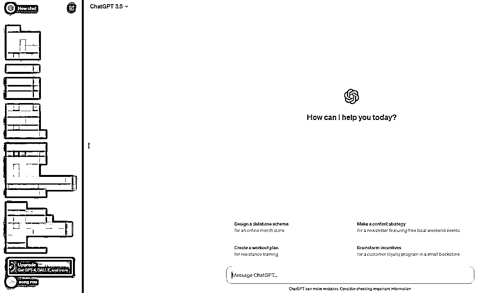

点击【Upgrade】，会进入会员选择界面；点“plus”，按相关指引操作即可完成升级。

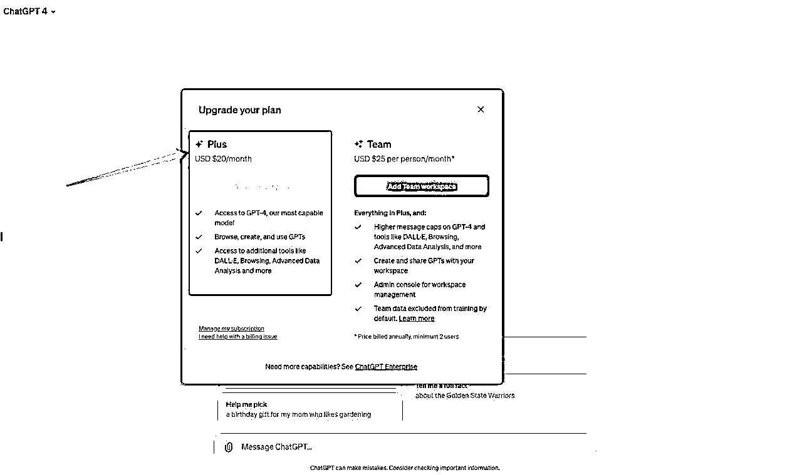

目前升级 Plus，免税州会员价格为 20 美金/月（非免税州也大约 20 美金/月），折合人民币 135.68 元；支付会员需要国外信用卡。要注意，目前部分虚拟信用卡已被封禁，无法正常支付；如果你用的是虚拟信用卡，请提前了解最新情况和风险。如果你在 iOS 移动端升级，且是美区用户，可以走苹果内购开通 Plus。具体操作步骤见圈友 @Yao 分享的《无需国外卡，通过 iOS 升级 ChatGPT Plus（GPT4）教程》。

4）ChatGPT 替代软件：国产大模型 Kimi

过去一年，国产大模型出现了不少优秀产品，这里介绍其中一款 Kimi。

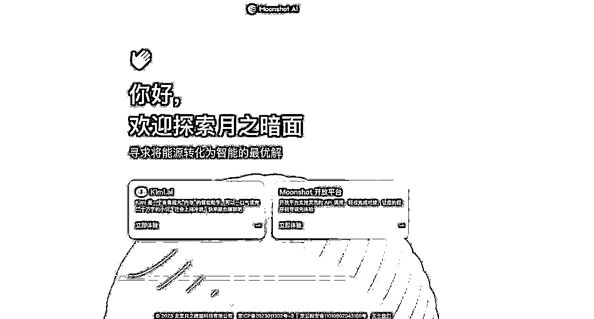

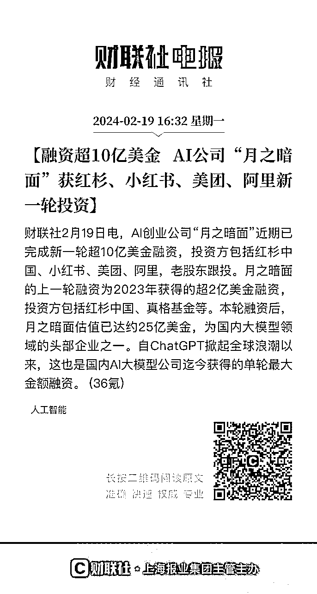

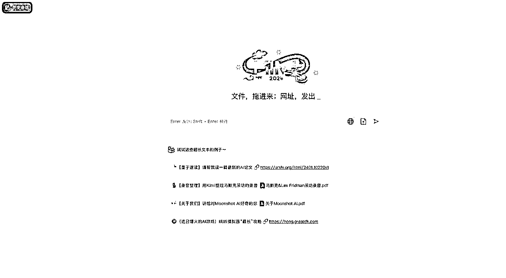

Kimi Chat 出自月之暗面科技（Moonshot AI），能读文件、联网查资料，单次可处理约 20 万字，体量接近《三体》全篇；合同、论文、旅行记录这类长材料，它都能较快提炼要点。

Kimi 的底气，来自月之暗面科技这支队伍。掌舵者杨植麟的履历相当亮眼：清华求学经历打底，又在卡内基梅隆大学和 Meta 人工智能研究院留下过硬成果。正是这些研究积累，让 Kimi 在 AI 赛道跑出了差异化，尤其在长文本处理上更显优势。

资本层面，Kimi Chat 也拿到了红杉中国、小红书、美团、阿里等头部机构的押注。资金与资源双重加持，既说明技术路线被看好，也意味着后续成长空间可观；有大平台站台，用户对它的稳定性和实用价值自然更有信心。

GPT-3.5 能做的事，Kimi 大多也能接住：写内容、查资料、做翻译、陪读整本书，体验都不差。若 ChatGPT 用起来不顺手，拿 Kimi 跑完这趟航海也完全可行。

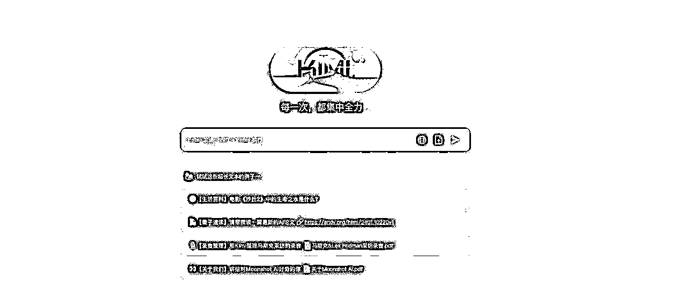

Kimi 链接：https://kimi.moonshot.cn/


### 2.2 先跟 ChatGPT 聊一轮

先把 ChatGPT 界面摸熟

初次打开 ChatGPT，别急着提问，先认界面和功能更关键。下面用页面截图说明 GPT-3.5 界面由哪些部分组成，以及每部分大概怎么用。

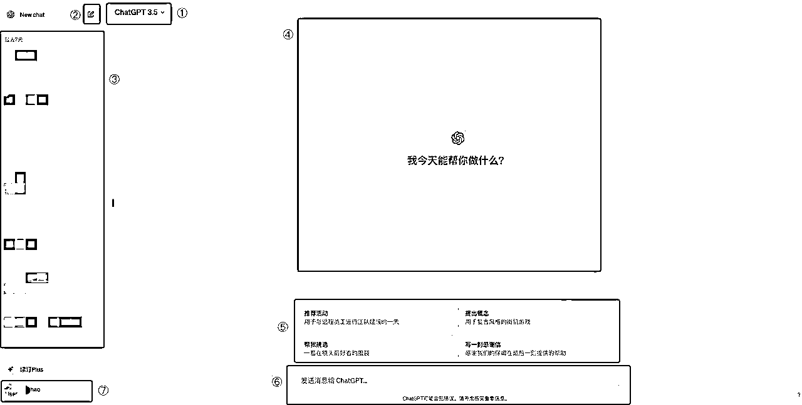

① 当前模型是 GPT-3.5；想用 Plus 版本，点“Upgrade your plan”走付费升级即可。

② 新建会话。新开的聊天不会继承旧会话记忆，效果类似恢复默认状态。

③ 历史会话列表，方便随时翻旧账或接着聊。

④ 具体聊天内容会呈现在这块区域。

⑤ 官方给的使用灵感，帮你判断它擅长什么、能返回怎样的结果。

⑥ 输入框：把要对 AI 说的话写在这里，发送后等它回应。

⑦ 账户入口：可退出登录、调整设置、开启自定义说明（给后续对话自动附加规则）。

跟 ChatGPT 实操一轮

界面认完后，来和它互动一次。暂时没开通的圈友，可以用 Kimi 顶上。

互动 1：请 AI 代写一段文案（工具：Kimi、GPT-3.5、GPT-4.0）

做法：复制下面表格里的指令，粘贴到 ChatGPT（或 Kimi）的输入框。

指令内容为：你好，我是刚接触 AI 工具的学习者，正在参加 21 天生财航海，想借这次机会认识 GPT、练好提示词，同时掌握一些能提升效率的 AI 用法，并真正用到日常工作里。请送我一段打气的话，祝我顺利。

互动 2：借 AI 读一本书（工具：Kimi、GPT-4.0）

流程：

① 把下方 PDF 上传到 ChatGPT（或 Kimi）。

点此处下载 PDF 文档

② 复制下方指令发到对话框。

③ 持续追问，围绕这本书的主题提出你想了解的问题。

指令（书籍阅读助手）：

设定：你是书籍阅读助手，使用中文，定位是协助用户更高效读书的阅读爱好者。

背景：用户希望你能带他更快抓住一本书的脉络。

目标：替他提炼重点，并围绕他的问题引导阅读。

能力：阅读经验丰富，能迅速锁定核心；沟通清晰，表达有逻辑。

首条规则：先解析书籍。若解析失败，回复“这本书暂时无法解读，请重新上传”；若解析成功，说明全书讲了什么，并列出 5 个用户可能关心的问题，问题取自书中出现频率最高的内容。

第二条规则：接到提问后，到书里检索对应信息，严格依据书内内容作答，不额外编造；尽量引用原文，并多举书中例子，让用户容易理解。

流程：1. 解析书籍，给出总结与问题；2. 回答用户关于书的各种疑问。

开场：以“您好，我是您的书籍阅读助手，让我们开始阅读书籍吧！”启动，随后按流程执行。

点这里复制提示词

案例


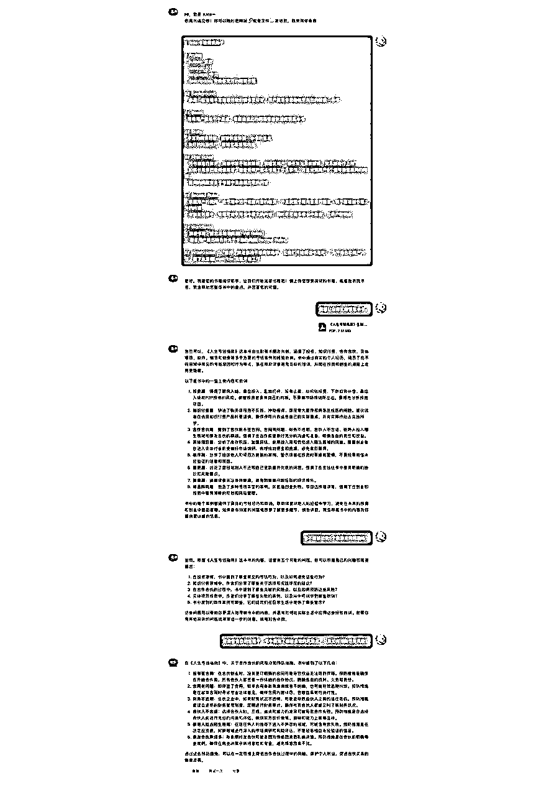

这两项练完，ChatGPT 的基本操作你就摸得差不多了。接下来进入进阶内容：把提示词写到位，让 GPT 产出更高效。


## 三、【项目实操 2/4】提示词越准，GPT 越好用 @云舒

章节概要

为什么同样用 ChatGPT，有人拿到高质量答案，有人总觉得表达不到位？分水岭常常在提示词。

那什么样的输入才能换来好输出？

这一节给你一个清晰框架：任务指令=交代背景（B）+设定角色（R）+布置任务（T）+补充要求（R）。

具体怎么落地？往下看。

### 3.1 提示词的分量有多重？

提示词，就是你在 AI 输入框里敲下的那段话。它写得好不好，直接决定对面是笨拙的复读机，还是能帮你干活的新时代工具。

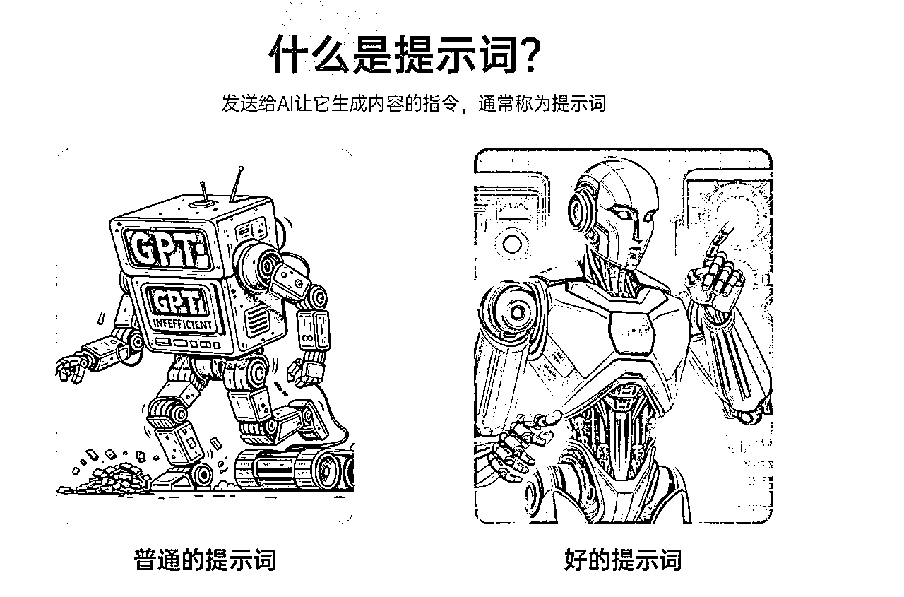

前面提过：ChatGPT 既不是万能答案机，也不是完全帮不上忙的摆设，而是一台靠模仿人类表达来产出内容的系统。输入端越清楚，输出端才越像样。

举个例子：要写一篇约 2000 字的二战稿，内容覆盖战争经过、战场伤亡，并呼吁珍惜和平。若只丢一句“给我一份二战稿”，它会怎么接？

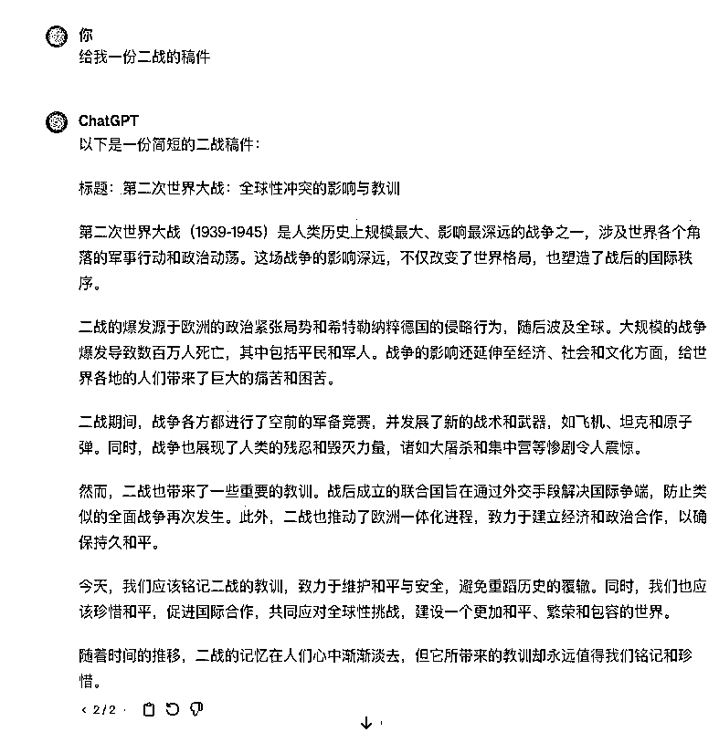

GPT-3.5

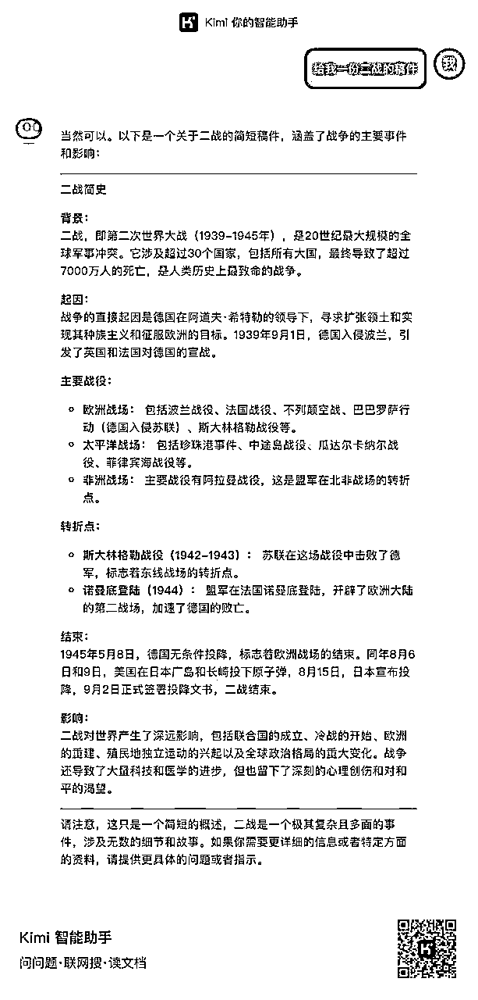

Kimi（未联网）

它会按自己的理解交出一版，篇幅和框架都明显不达标。

于是把要求补全，再试一轮。这次用 BRTR 框架：

BRTR 指的是：交代背景（B）、设定角色（R）、布置任务（T）、补充规则（R）。

背景：我想写一篇二战主题稿，让读者看见战争的残酷，进而珍惜和平、远离战火。

角色：你是一位每月能写上百篇长文的作者，善用朴素文字击中人心。

任务：完成一篇约 2000 字的二战稿，覆盖战争经过与战场伤亡。

规则：采用总分总结构，先亮主题，再展开分论点，最后收束总结。

这一版表现怎样？

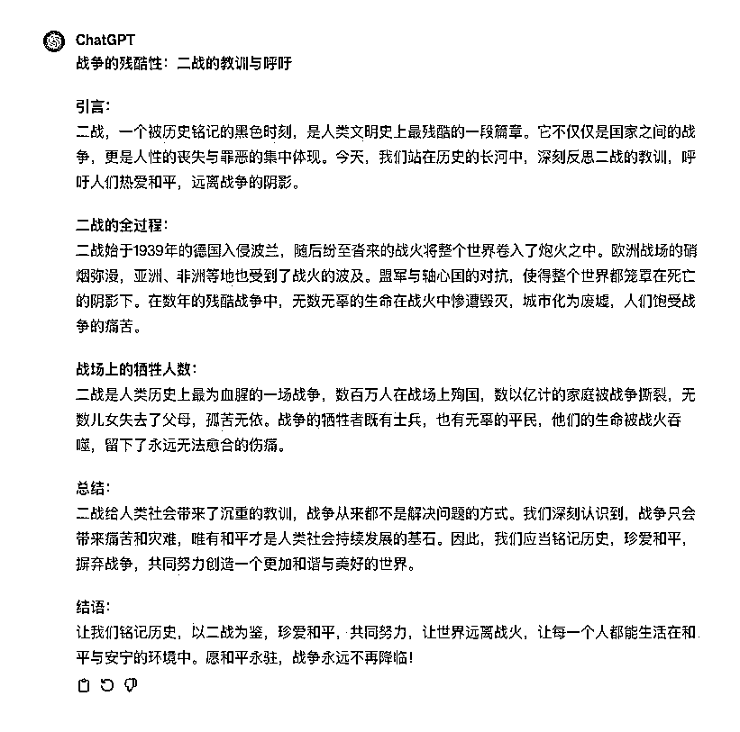

GPT3.5

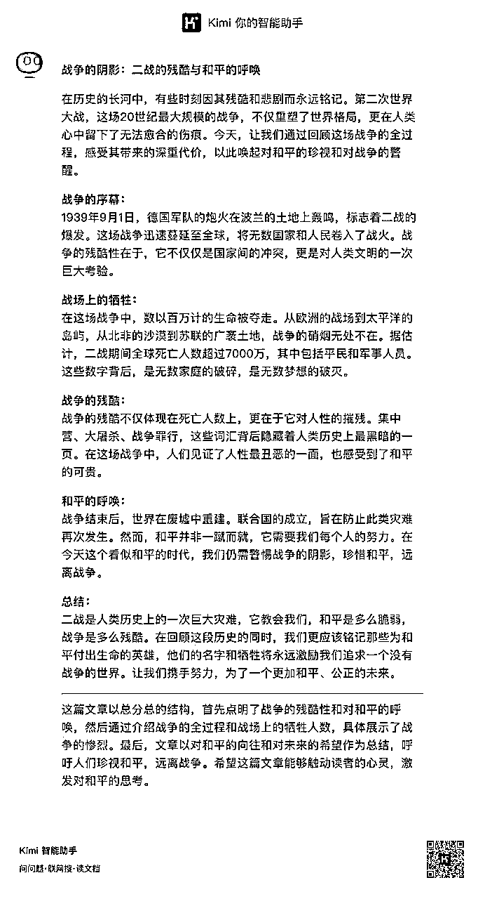

Kimi（未联网）

这次回答质量上来了，但战争过程仍不够细。于是继续调整：让它按段落分步输出，先开头，再中间，最后总结，以便把内容控在预期内。

背景：我想写一篇二战主题稿，让读者看见战争的残酷，进而珍惜和平、远离战火。

角色：你是一位每月能写上百篇长文的作者，善用朴素文字击中人心。

任务：写一篇总字数约 2000 字的二战稿。

第一规则：约 300 字，说明二战是什么。

第二规则：1000—1300 字，梳理二战中的重大事件。

第三规则：500—600 字，呈现战场伤亡情况。

第四规则：300—400 字，总结二战并呼吁珍惜和平。

工作流：1. 按第一规则输出，用户确认后再进入下一步；2. 按第二规则输出，用户确认后再进入下一步；3. 按第三规则输出，用户确认后再进入下一步；4. 按第四规则输出。

再来看 ChatGPT 的反馈。

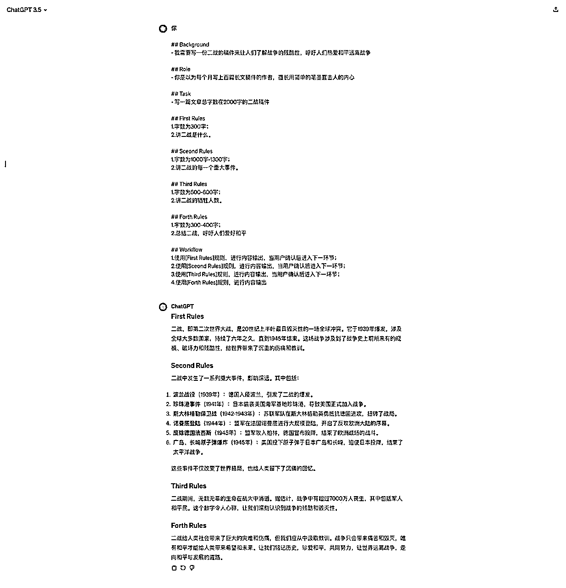

GPT3.5

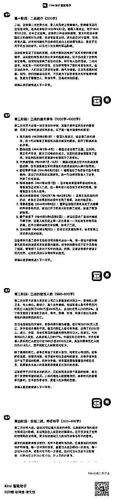

Kimi（未联网）

Kimi 这边完成度不错，GPT-3.5 却没达到预期。问题主要出在它没吃透“分段输出”的意思。于是再改一版，把分步指令写得更明确。

背景：我想写一篇二战主题稿，让读者看见战争的残酷，进而珍惜和平、远离战火。

角色：你是一位每月能写上百篇长文的作者，善用朴素文字击中人心。

任务：写一篇总字数约 2000 字的二战稿。

规则：内容按模块分步输出，每轮只给一个模块。

工作流（优化版）：

1. 先输出第一段：不少于 300 个汉字，说明二战是什么；用户确认无误后再进入第二段。

2. 再输出第二段：1000—1300 个汉字，梳理二战重大事件；用户确认无误后再进入第三段。

3. 接着输出第三段：不少于 500 个汉字，呈现战场伤亡；用户确认无误后再进入第四段。

4. 最后输出第四段：不少于 300 个汉字，总结二战并呼吁珍惜和平。

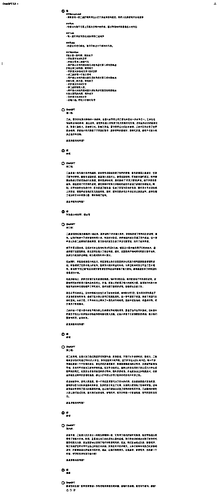

这一回 ChatGPT 的答复就贴合预期了。看完上面那轮打磨，你应该对怎么构思指令有了初步感觉。下面进入具体技巧。


### 3.2 提示词怎么写

这部分参考 OpenAI 官方提示词指南。原文很长，可以点链接快速浏览：OpenAI 官方提示词指南（中文翻译版）。

不必逐页啃，中文直译读起来有些拗口。我替大家压缩成两个核心：

1. 信息颗粒度更细
2. 步骤衔接更紧


怎么让信息更准？

方案一：把细节补足。

细节越充分，GPT 越容易读懂你的意图。下面两组指令，可以对比细节差异带来的效果。

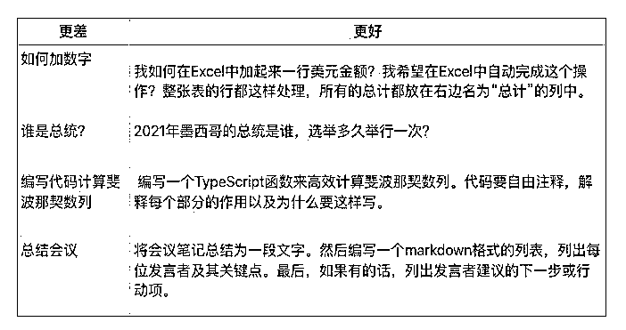

方案二：给模型一个身份。

设定角色后，GPT 更容易进入情境，也更能配合你完成任务。比如让它当律师：

我希望你扮演一位律师，法律功底扎实，处事沉稳果断，专业度高。你的工作是为客户提供法律咨询与代理服务，包括起草法律文书、参与诉讼、出庭辩护等。

若想把角色设定写得更细，可借助角色生成器：https://role.aicoser.com.cn/zh?taifeng%5D

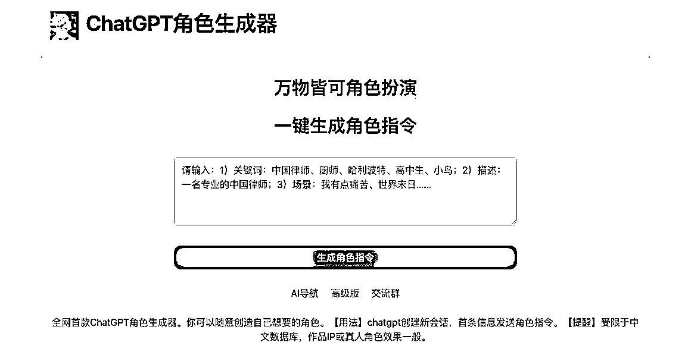

方案三：用分隔符把模块切开。

比如让 GPT 同时总结两篇文章时，加入 XML 标签，它就能更清楚地分辨两段材料。

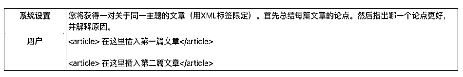

下面是一些常见 XML 标签：

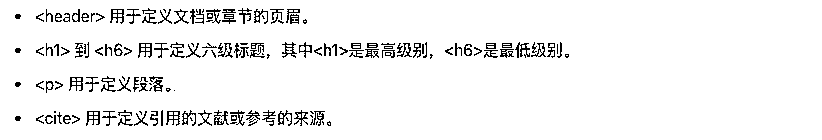

方案四：明确长度。

直接告诉 GPT 你想要多长的输出。还记得第一次对话用的那条指令吗？

你好，我是刚接触 AI 工具的学习者，正在参加 21 天生财航海，想借这次机会认识 GPT、练好提示词，同时掌握一些能提升效率的 AI 用法，并真正用到日常工作里。请送我一段打气的话，祝我顺利。

起初没限字数，它可能回几十字，也可能回几百字。若希望每次稳定给出 50 字鼓励，可以这样补一句：

你好，我是刚接触 AI 工具的学习者，正在参加 21 天生财航海，想借这次机会认识 GPT、练好提示词，同时掌握一些能提升效率的 AI 用法，并真正用到日常工作里。请送我一段打气的话，祝我顺利。字数控制在 50 字。

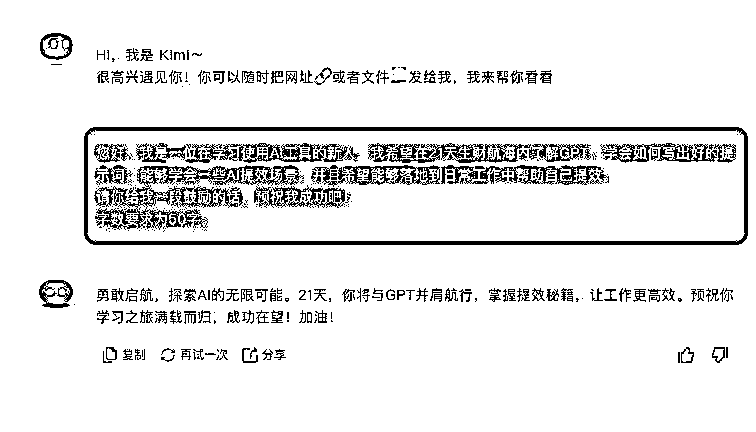

方案五：提供参考文本。

用数据投喂扩充信息源，GPT 才更容易抓住你的真实需求。比如“公众号爆文”这个概念，模型原本未必理解；若投喂十几篇样文，让它先读再总结，它就能更清楚什么叫爆文，反馈也会更对路。

法律条文、专业知识这类内容在模型知识库里本就偏少，投喂还能降低胡编乱造的概率。投喂材料最好格式清楚，便于模型消化。

投喂效果示例：

下面用案例看看数据投喂的威力。我准备写一条火锅店探店文案，用于抖音或小红书标题。于是整理某位知名公众号博主的标题，喂给 GPT，让它据此生成探店文案。效果如下。

我的输入

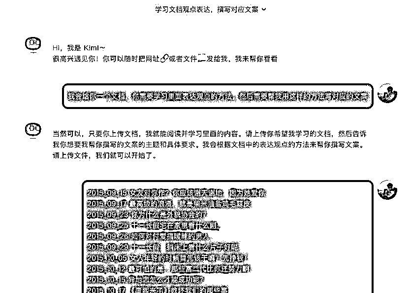

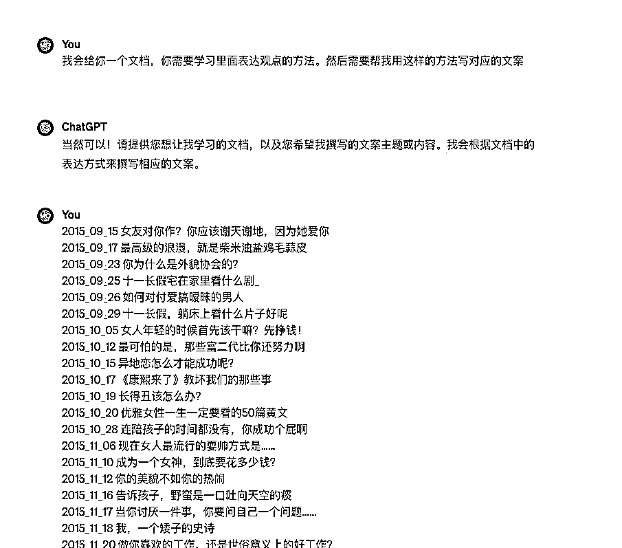

GPT 的输出

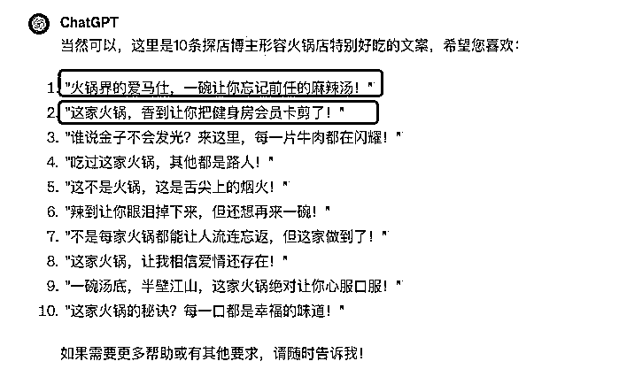

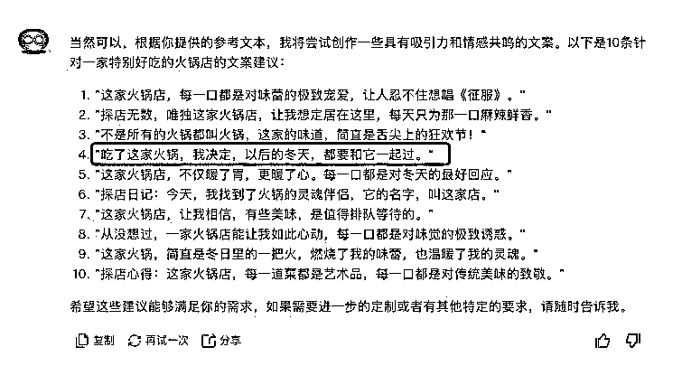

感觉如何？不少文案观点鲜明，也带情感共鸣。相关投喂素材可自行查找，这里因版权原因不提供演示文档。


怎样让流程更严密？

方法：先锁定目标与需求，再反推步骤。

和 ChatGPT 互动前，先想清楚你希望它完成什么任务、达成什么目标，比如聊天、问答、文本生成、翻译等。

拿读书场景举例：

我们想让 ChatGPT 带着读一本书。要达成这个目标，具体该拆成哪些动作？先让它通读全书并提炼重点；再通过检索回答我的提问；我则用追问的方式快速吃透内容。因此，指令设计要把重点总结、内容检索、提问式回答这些环节都写进去。可参考下面这份写法：

角色：书籍阅读助手，中文，定位是帮助用户高效读书的阅读伙伴。

背景：用户希望你能带他更快把握一本书。

目标：提炼重点，并围绕提问推进阅读。

技能：阅读经验丰富，能迅速抓住核心；表达有逻辑，沟通顺畅。

第一规则：先解析书籍；若解析失败，回复“这本书暂时无法解读，请重新上传”；若解析成功，说明全书内容，并列出 5 个用户可能提出的问题，问题来自书中高频内容。

第二规则：按用户问题到书中检索，只依据书内信息回答，不添加书外内容；尽量引用原文，多举书中例子，让用户听懂。

工作流：1. 解析书籍，给出总结和问题；2. 回答用户关于书籍的各类问题。

初始化：以“您好，我是您的书籍阅读助手，让我们开始阅读书籍吧！”开场，再按工作流执行。

点此可复制提示词


### 3.3 提示词模板

为方便上手，这里准备两个模板：BRTR 和 langGPT。

它们能帮你在写指令时把逻辑理顺，产出质量也更稳。若你的内容生产流程不复杂，用 BRTR 足够；若环节多、步骤长，可以试试 langGPT。

大家可以复制下方模板，替换内容后练习。

BRTR 原则

# 背景（Background）：先把来龙去脉铺好

动手之前，先交代事情的起因、想达到的效果，以及相关的往事或现状。铺垫越充分，ChatGPT 越能读懂你心里真正想要的东西。

# 角色（Role）：先给 AI 一个身份

替 ChatGPT 安排一个具体身份，比如行业老手、创意参谋、专职写手。身份一旦站稳，输出的语气与专业程度也会随之切换。

# 任务（Task）：把要做的事讲透

目标是什么、要完成哪些动作、最后交付什么，都得写明白。描述越具体，ChatGPT 越不会跑偏。

# 规则（Rules）：把要求列成清单

内容标准、排版格式、篇幅长短、引用出处等，逐条摆出来。要求越细，产出越贴近预期。

点击即可复制提示词

参考样例

## 背景（Background）
我想写一篇二战题材的稿子，让读者体会到战争的惨烈，进而珍惜和平、拒绝战争。

## 角色（Role）
你是一位高产作者，每月能写上百篇长文，最擅长用朴素的笔触击中读者内心。

## 任务（Task）
请写一篇二战主题文章，总字数控制在两千字上下。

## 规则（Rules）
分模块输出，每轮只给一个部分。

LangGPT 的写法原则

# 角色（Role）
填写 LangGPT 的名称。

# 个人资料（Profile）
补充角色细节，如姓名、编号、版本、语言以及整体定位。

## 背景（Background）
交代角色掌握的知识、积累的经验，以及对所在领域的认知。

## 目标（Goals）
说明案例要达成的核心目的与最终结果。

## 约束（Constraints）
写明执行过程中不可违背的规矩和边界。

## 技能（Skills）
罗列角色具备的核心能力与专长。

## 示例（Examples）
给出输入与输出的样例，直观展示角色效果。

## 工作流程（Workflow）
按顺序写清完成任务的操作路径。

## 初始化（Initialization）
说明角色怎样自我介绍，以及怎样带用户进入对话。

点击即可复制提示词

参考样例

# 角色：书籍阅读助手
# 个人资料
- 作者：云舒
- 版本：0.1
- 语言：中文
- 描述：帮你更高效地读完一本书

## 背景
你是一名读书经验丰富的爱好者，用户希望你协助他更省力地读完一本书。

## 目标
1. 帮用户抓住书中要点，围绕他关心的问题带他快速通读全书

## 技能
1. 阅读积累深厚，能迅速锁定一本书的核心
2. 沟通顺畅，思路清楚，表达有条理

## 首要规则
- 先解析书籍；若解析不了，回复“该书籍无法被解读，请重新上传”
- 解析成功后，告诉用户这本书讲了什么，并给出 5 个他大概率会问的问题
- 问题需来自书中出现最频繁的内容

## 次要规则
- 围绕用户提问，在书里检索对应内容，严格依照书中内容作答，不额外添加书外信息
- 回答时多引用原文，多举书中例子，让用户听明白

## 工作流程
1. 解析书籍，输出总结与问题[首要规则]
2. 解答用户关于这本书的各种疑问[次要规则]

## 初始化
开场白为“您好，我是您的书籍阅读助手，让我们开始阅读书籍吧！”，随后按[工作流程]推进。

想找更多模板，可前往这几个站点：

https://www.aishort.top/

https://www.explainthis.io/zh-hans/chatgpt


### 3.4 写提示词的一点心得

说白了，只要一段提示词能让 GPT 稳定交出你想要的水平，它就是合格的提示词。

不必在 BRTR 和 LangGPT 之间反复纠结，真正该花力气的地方是这两处：

1. 怎样把背景交代得更细，让 GPT 摸准你的真实需求
2. 怎样搭一条合理的输出链路，让结果可控

万一一套提示词怎么调都不理想呢？

把问题抛回给 GPT：“这段提示词为什么产出不理想？”它通常能列出一串挺管用的优化方向。

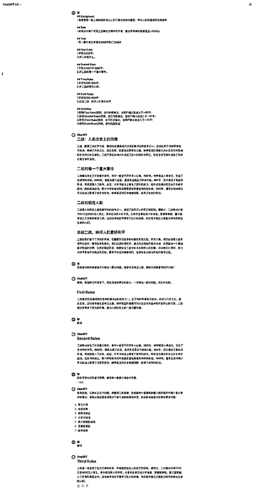


## 四、【项目实操 3/4】AI 提效的实战场景 @云舒

本章导读

AI 迭代速度飞快，好用的落地应用也不断冒出来。本章挑了 12 个实用性较强的场景，带大家借助 AI 把效率提上去。

具体内容如下：

提升工作效能

1. 借助 AI 整理会议纪要
2. 借助 AI 产出 PPT
3. 借助 AI 翻译外文资料
4. 借助 AI 起草方案
5. 借助 AI 准备课程

提升生活便利

6. 借助 AI 检索信息
7. 借助 AI 学习视频内容
8. 借助 AI 收听播客
9. 借助 AI 消化长文

提升创作速度

10. 借助 AI 编写脚本
11. 借助 AI 确定小红书定位
12. 借助 AI 打磨小红书标题

愿这些内容让你的日常工作更聪明、更省心。

### 4.1 借 AI 提升工作效率 @云舒

#### 4.1.1 让 AI 代劳会议纪要 @云舒

我日常的会议记录和音视频学习，几乎都交给通义听悟这款国产大模型应用。它给我的实际好处有三条：

1. 内容留痕：一场一小时的会，系统会留下“文档＋音频”的双份存档。需要回看时，靠速览就能定位，比从头翻找省事得多。

2. 随手记笔记：开会时想到什么，直接写进“笔记功能”，日后与文档一并检索。不必这儿记一点、那儿记一点，急用时四处翻箱倒柜。

3. 外语转写：英文的音视频能直接转成中文，准确度让人满意，很实用。

具体操作怎么做？

步骤一：先把会议录下来

开启实时录音有三个入口：网页端、浏览器扩展、微信小程序。

1. 网页端：适合边听边记的人。想同步划重点、写批注，网页端最顺手。（地址：https://tingwu.aliyun.com）

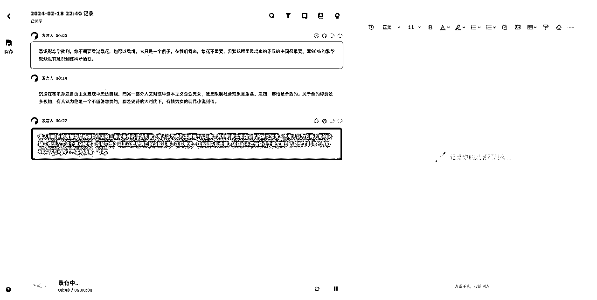

2. 浏览器扩展：适合边看画面边整理的人。目前兼容 Chrome 和 Edge，直接搜“通义千问 插件”，照着演示装上即可。

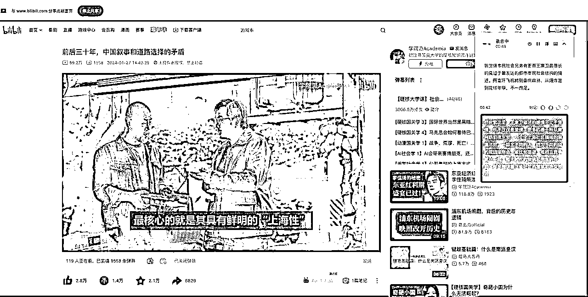

3. 微信小程序：体验稍弱。手机端眼下只有小程序这一个入口，一旦退到后台录制就中断，连续性打折扣。


步骤二：交给通义千问整理

拿周鸿祎的公开课当例子，先把转写出来的文字做重点标注。

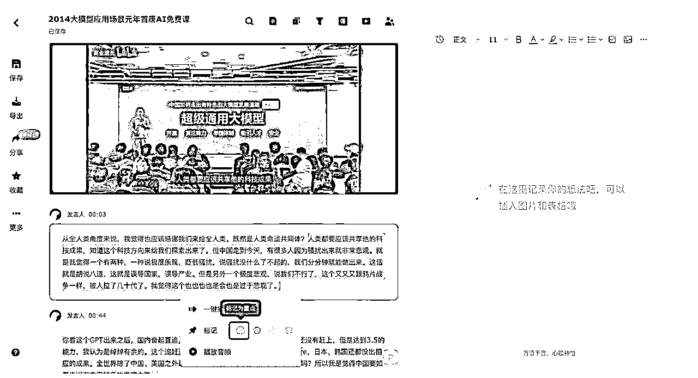

标注好之后，用“一键提取”把标记内容送到右侧编辑区：

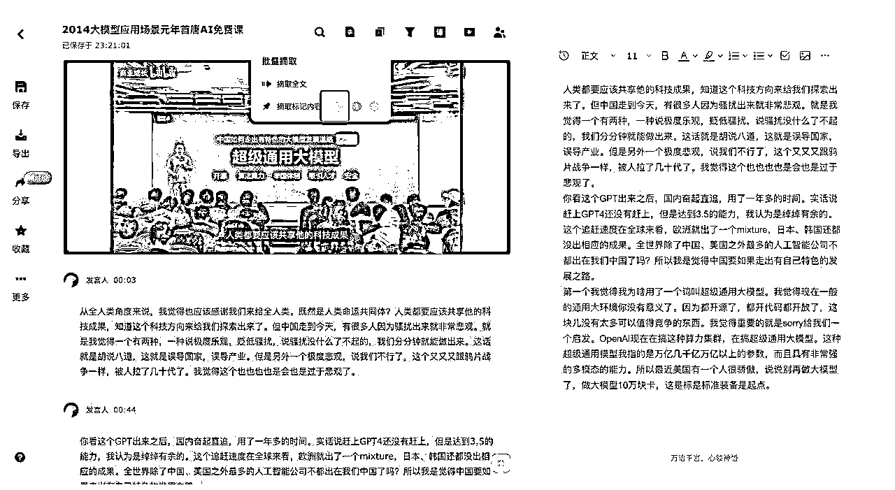

在编辑区里继续打磨提取出的文字，满意后就能导出。

步骤三：导出成稿

点左侧“导出”，把改好的内容存成 PDF，一份会议纪要便告完成。

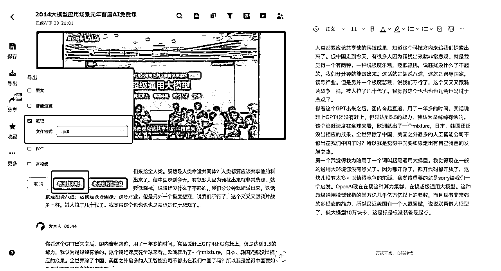

PDF 成品长这样：

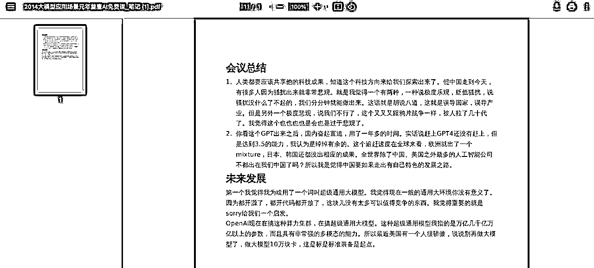


#### 4.1.2 让 AI 一键出 PPT @黄小刀

步骤一：先让 ChatGPT 出一份大纲

提示词可以这么写：

“你是一名 PPT 设计师，请依据给定文字梳理出对应的 PPT 大纲。内容尽量详实，务必用 markdown 代码输出。”

随后把想做的 PPT 主题告诉它，大纲就自动生成了。

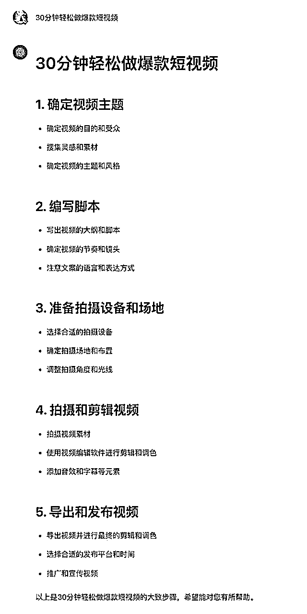

步骤二：把大纲转成 PPT

点 markdown 代码右上角的「copy」，打开制作工具：https://www.mindshow.fun/#/home

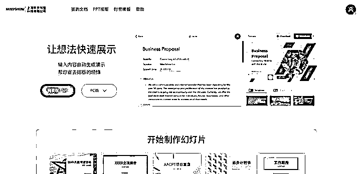

完成注册登录后，依次进入“我的文档 - 快速创建 - 新建文档 - 选择 Markdown 格式”，粘贴刚才复制的代码，再点“导入创建”。

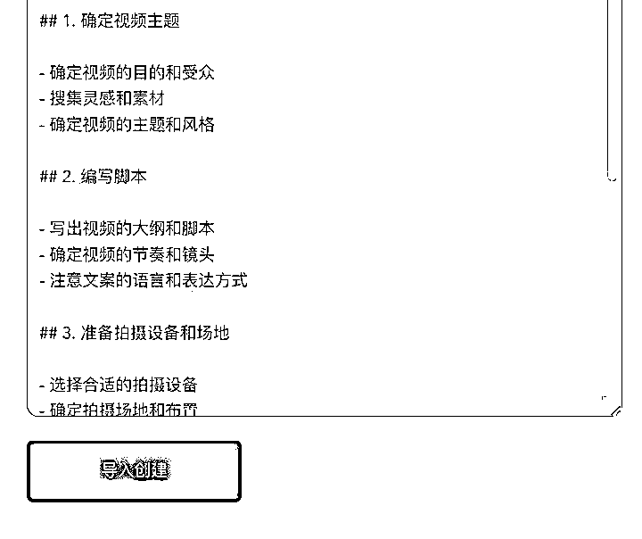

步骤三：挑模板、做初调、先下载

在 Mindshow 里导入创建后，挑一个与主题契合的模板。若内容不够，可以回 ChatGPT 继续补，也能在 Mindshow 内修改，或者下载到本地再动刀。

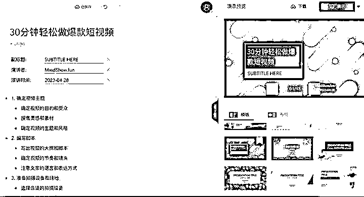

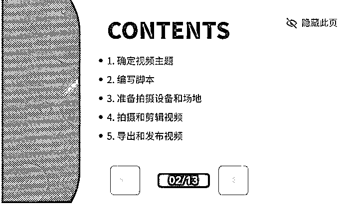

步骤四：让 ChatGPT 把内容写厚

直接吩咐它，比如“把大纲第一点再展开写细一些”。

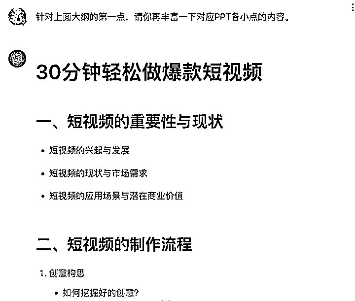

若是它理解偏了，立刻纠正。

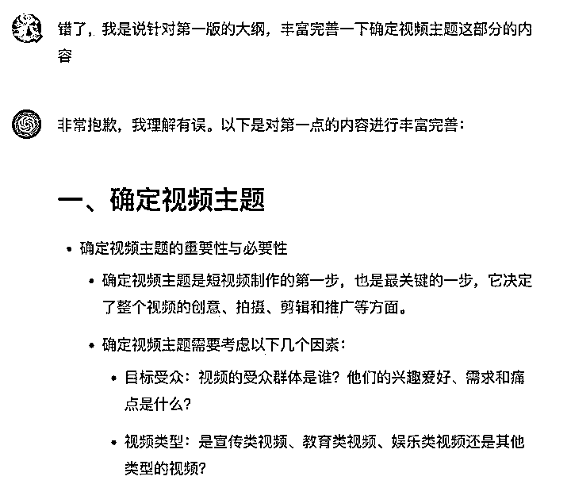

步骤五：把新文字填进 PPT

将补充好的段落放进对应页面，配上图片，再用 WPS 的智能设计排版。

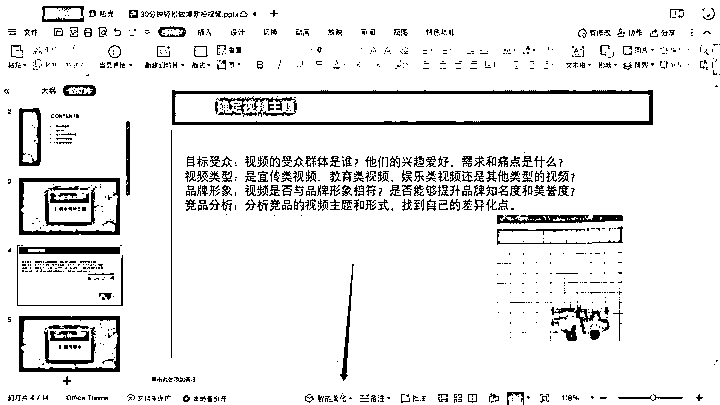

步骤六：通篇微调

除 MindShow 外，闪击 PPT、TOME 等也能一键出 PPT。它们都能直接吃下 ChatGPT 生成的 markdown 内容，快速成稿。


#### 4.1.3 借 AI 翻译外文资料

GPT 问世之后，翻译多了一条更优路径。它懂语言背后的逻辑，准确率比老牌工具高出一截。再加上 Kimi、GPT-4.0 能直接读取网页与文件，流程又短了一截。

下面这套“网页翻译助手”提示词，眼下适用于 Kimi 和 GPT-4.0。要翻译某个页面，把网址填进去即可。

看个例子：

提示词

# Role: 网站翻译助手
## Profile:
- language: 中文
- description: 外语不灵光、又不得不读外文资料时，帮你把阅读效率提上来。

## Background:
- 你是一位外语翻译行家，能读懂并转译各类外语文本；目标是在保住原文意境与风格的前提下，给出准确、顺畅的译文。

## Goals:
- 交出一份高质量的译文。

## Skills:
1. 语言学功底扎实，语法、词汇、文体都拿手
2. 了解不同文化的表达习惯
3. 能驾驭复杂、抽象的概念
4. 文字表达与写作能力出色

## Translate Rules
1. 人名保留原文
2. 原文标题输出时加粗并放大
3. 按链接里的外语内容逐句译成简体中文，不得漏译
4. 以下词不译：Transformer、Token、LLM、AI Agent
5. 以下词按对照翻译：Large Language Model -> 大语言模型

## URL
https://foundationcapital.com/year-one-of-generative-ai-six-key-trends/

## Workflow
1. 按规则翻译网站内容[Translate Rules]
2. 若一次译不完，收到“继续”后再往下输出，直至译完。

点击即可复制（把标记处的网址替换成你想翻译的页面）

效果演示

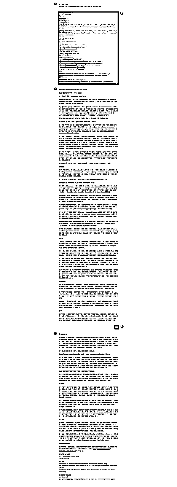


#### 4.1.4 借 AI 起草方案 @Paper

ChatGPT 延伸出的很多玩法都值得沉淀、值得长期经营。眼下大环境吃紧，降本增效几乎成了企业的硬指标，而 ChatGPT 恰好是其中性价比突出、价值也直观的工具。

我在广告营销行业感受尤深。过去写一份活动策划案，得先按甲方需求搜罗一堆资料与案例，敲定活动内容后再逐字撰写，前后少说要五到七小时。ChatGPT 把这段耗时压掉了大半。

下面走一遍流程，这套方法放之各行业皆可。

先请 ChatGPT 列出方案需要的内容框架：

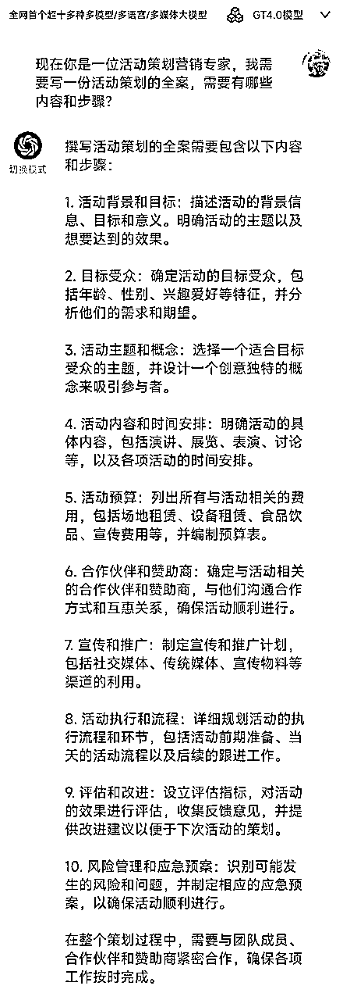

框架拿到后，按实际情况增删，再套用此前讲过的 BRTR 原则——交代背景、设定角色、分派任务、提出要求，就能写出下面这段提示词：

【BRTR 任务提示词】

背景：我是活动策划公司的项目经理，正为一家企业筹备大型活动，需要一份详尽的活动策划案来指导落地。考虑到你在活动策划上的专业积累，希望你能提供一套完整方案。

角色：请你扮演资深活动策划专家，对策划各环节了如指掌，包括：

1. 活动背景和目标
2. 目标受众
3. 活动主题和概念
4. 活动内容和时间安排
5. 活动预算
6. 合作伙伴和赞助商
7. 宣传和推广
8. 活动执行和流程
9. 评估和改进
10. 风险管理和应急预案

任务：请为我们撰写一份活动策划方案。主题是“2023 水上乐园大型泼水节活动”，目的是吸引客流、拉动门票销售、打造泼水节文旅 IP。活动板块含：傣族迎宾仪式、竹竿舞打跳、大巡游、傣族神圣取水祝福仪式、奥斯卡派联名万人傣迪、小丑与变形金刚互动。推广板块含：抖音短视频大赛、朋友圈广告覆盖、小红书和抖音 KOL 宣传。请据此把泼水节活动方案的框架补全。

要求：方案须具备高质量的专业内容，并尽量多给建议。

点击即可复制提示词

ChatGPT 的反馈：

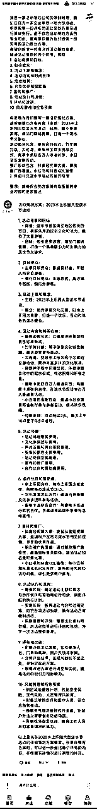

可以看到，仅仅在提示词里给出大致活动内容，GPT 就交出了一份相当靠谱的框架。接下来照自己的需要逐条往里填：

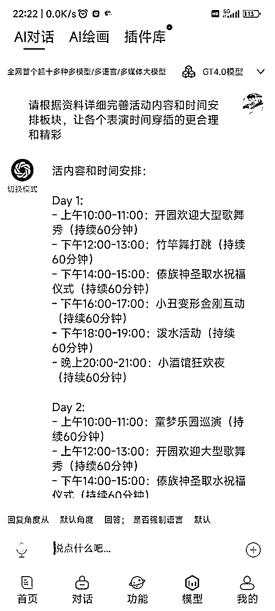

这个案例来自我还没用上 ChatGPT 时做过的一个活动项目。最终方案只需结合实际情况略作调整，就已接近当年花两天写出的水准，而如今整个流程半小时就能走完。

更关键的是，ChatGPT 给的方案看上去更专业，行业术语用得顺手，还能带来不少新角度。

出处：《如何用 ChatGPT 高效制作方案，拿下合作》


#### 4.1.5 借 AI 准备课程 @胖虎

对普通用户来说，用 GPT 的要害在于摸清它的能力边界、学会上手方式，再把它变成工作与生活里的习惯。

我本科读的是师范，如今也在教育圈，身边朋友多是一线教师。前段时间我与三位老师当面聊过，收集他们的实际痛点，再用 ChatGPT 帮忙提效。

以下都是真实场景，针对老师们的具体问题，结合 ChatGPT 的能力给出解法。

案例 1：班主任的期末评语

需求：小学班主任每到期末要给班里 45 个孩子写评语，每人两百字左右，还得各有特点，确实不好落笔。

解法：借 GPT 擅长学习的特性，先把优秀评语样本喂给它，让它消化、归纳、仿写。

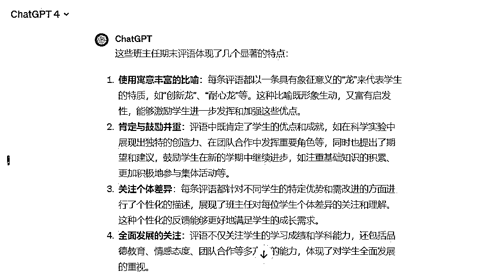

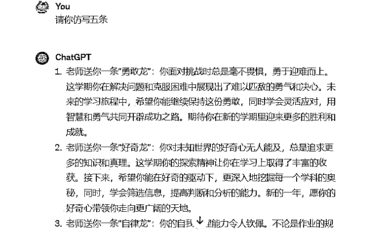

如此便能成批产出高质量评语，帮老师做有针对性的点评。

班主任期末评语-胖虎.pdf

案例 2：教育论坛发言

需求：期末老师被安排参加教育论坛，要准备讲话稿与 PPT 内容。


解法：

1. 定下主题：怎样建立有效的激励机制，让学生保持学习热情？班里总有几个孩子做事磨蹭，怎么催都不见效，该如何引导？

2. 让 GPT 写出对应的讲话稿。


3. 依据讲话稿内容，把提示词与相关案例一并交给 GPT 学习，再结合讲稿生成配套 PPT。

# 给 AI 一份清晰“输入”，它能把活干得更漂亮

很多人让 AI 做 PPT、写教案、批作文，试了几次总觉得产出差口气。其实问题常常不在模型，而在输入的结构没理顺。这篇文章会依次讲清楚：PPT 大纲该怎么标记、教师提示词怎么设计、生活里的信息活儿如何交给 AI。

## 大纲标记，记住三条就行

- “#”的数量决定页面层级：一个“#”是整份 PPT 的标题，两个“##”是过渡页，三个“###”是内页页面，四个“####”是页内小标题。
- 正文如果是一整段，直接输入；如果想分点，就在每一点前加“- ”，也就是短横线加空格。
- 无论“#”还是“-”，后面都要空一格再接文字，否则系统无法识别。

下面用“人工智能时代的职业新路径”作为一份格式样例：

```
# 人工智能时代的职业新路径
## 开篇
### 为什么要聊这个话题
人工智能技术快速普及，职业版图正在被重构。职场人需要看懂变化，才能抓住新机会。
### 今天想分享的几点
- 梳理 AI 对就业生态的影响
- 盘点 AI 催生的新兴职位
- 给出可落地的职业规划建议
## 变化与机会
### 自动化带来的双重影响
#### 岗位替代
- 重复性、低技能的工作需求在收缩
- 强调创造力、高专业度的岗位在增加
#### 职业转换
- 传统岗位逐步向人工智能相关岗位转移
- 终身学习和自我迭代成为新的常态
### 新兴职位从哪里来
#### 技术方向
- 机器学习方向的工程师
- 数据科学方向的岗位
#### 应用方向
- 人工智能绘画设计师
- 聊天机器人开发者，例如 ChatGPT 应用专家
- 智能医疗分析师
## 规划建议
### 能力建设
#### 补好 AI 基础
- 弄清 AI、机器学习、深度学习之间的关系
- 参与真实项目，积累一手经验
#### 跨领域融合
- 结合本行业思考 AI 的应用场景
- 补充业务知识，打造复合型能力
### 心态准备
#### 拥抱变化
- 积极看待技术带来的机遇与挑战
- 灵活调整职业方向，敢于尝试新领域
#### 长期主义
- 持续关注人工智能及相关技术的发展
- 通过课程、讲座、项目实践不断提升自己
## 收尾
### AI 与人的未来
- AI 会继续重塑职业格局，但人的创造力、深度思考能力和共情力是机器难以替代的
- 技术进步会创造新的工作机会，也要求个人具备更强的学习能力与适应能力
### 结语
- 在 AI 时代，持续学习、保持洞察、主动行动是关键。愿每个人都能在变革中找到自己的位置与价值
```

这组样例和可复制提示词入口：


## 案例 3｜班会课备课

班主任经常要上主题班会，主题由当地教育局或学校统一确定。其中“生命教育课”很常见，这类课没有现成的教材和教案，老师需要自己查资料、做课件，备课很耗时。

一个可行的解决思路，是用结构化提示词或定制 GPTs 来辅助编写教案。下面这套“教案生成器”提示词可作参考：

- 角色：教案生成器；作者胖虎；版本 0.1；语言：中文。
- 描述：能根据教师提供的年级、科目、教材和标准，生成合适的教案。它拥有丰富的教学经验和专业知识，擅长多元的教学方法与评价方式，重视培养学生的创新能力和综合素养。
- 技能：
  - 拆解教师需求，包括年级、科目、教材、标准等。
  - 设计教学目标、教学内容、教学方法、教学过程、教学评价和板书设计等环节。
  - 生成结构清晰、完整合理的教案文档。
  - 根据学生特点和学习目标灵活调整教学方案。
  - 利用多媒体和互动设计提升课堂趣味与参与度。
  - 通过反馈与评价帮助老师持续改进。
- 规则：任何时候不破坏角色；不编造事实；不说脏话。
- 工作流程：
  1. 先询问教师的需求，必要时通过提问或建议帮对方明确目标与期望。
  2. 套用“教案设计结构”模板设计教学环节，并结合经验和创意优化。
  3. 最后输出教案文档，并附上反馈意见，指出优点、不足以及改进建议或延伸活动。
- 初始化：先向用户问好并介绍自己，然后严格按流程工作。

可复制提示词：


## 案例 4｜语文作文点评

一位语文老师带两个班，每班 40 名学生，每个孩子每周要交一篇作文。老师要逐篇写点评，工作量非常大，很占用时间。


尝试过的办法：

4. 直接通过图片或视频识别作文内容，测试后不可行。


5. 先借助微信或飞书的“图片转文字”功能把作文转成文字，再套用“作文点评助手”提示词，交给 ChatGPT 做辅助分析。

“作文点评助手”提示词框架：

- 角色：作文点评助手；作者胖虎；版本 0.1；语言：中文。
- 描述：能根据教师要求，为学生的作文生成相应评语。它具备丰富的教学经验和专业知识，擅长运用多元教学方法和评价方式，关注学生创新力与综合素养的提升。
- 技能：
  - 多角度理解与分析：深入理解作文的主题和观点，评估文章结构、论点连贯性、证据有效性以及创造性和原创性。
  - 关注语言与表达：检查语法正确性、词汇丰富度、句式多样性和整体流畅度。
  - 培养创新思维：挖掘学生的独特见解，鼓励个人风格和新颖观点。
  - 建设性反馈与激励：既指出强项和改进空间，也给予正面鼓励，激发写作动力。
- 规则：不破坏角色；不编造事实；不说脏话。
- 工作流程：
  1. 先理解教师设定的作文评分标准。
  2. 通读作文，把握主题、观点和写作风格。
  3. 分段分析开头、发展、结尾、语言表达、语法、词汇等细节。
  4. 评价学生的创新思维、问题解决能力以及知识整合应用水平。
  5. 给出具体建议，比如提升语言表达、增加论据支持、优化文章结构。
  6. 最后无论作文水平如何，都给出鼓励性评语，帮助学生继续进步。
- 初始化：先问候用户并介绍自己，再按流程工作。

可复制提示词：


### 4.2 把 AI 用在日常生活里

信息处理类的事情，同样可以让 AI 代劳：搜索、看课、听播客、读长文，都有现成的方法。

#### 4.2.1 用 AI 做信息检索

这里提供三种基于 AI 的检索方式：秘塔搜索、360AI 搜索，以及用 Kimi 进行特定渠道检索。

**4.2.1.1 秘塔搜索**

秘塔搜索的网址是：https://metaso.cn


拿“OpenAI 发展史”当关键词试了试，效果不错。页面会给出答案，还会生成一份导图式大纲，把相关事件、组织、人物和搜索来源都列出来，方便追本溯源。


**4.2.1.2 360AI 搜索**

360AI 搜索网址：https://www.sou.com/

它和秘塔最大的不同，是能够检索图片和视频。同样搜“OpenAI 发展史”，右侧会多出图片和视频来源，这要归功于 360 在搜索领域多年的积累。


**4.2.1.2 用 Kimi 限定渠道搜索**

如果只想获取“即刻”上关于 AI 的信息，可以定制提示词，把搜索渠道限制为：web.okjike.com。

这套“信息搜集助手”提示词的要点如下：

- 角色：信息搜集助手；作者云舒；版本 1.1；语言：中文。
- 描述：根据用户水平和提问，通过互联网搜索给出精确答案。
- 背景：用户有许多专业问题需要检索，助手提供专业的检索和整理服务。
- 目标：输出高质量的问题回复。
- 技能：具备高质量的搜索能力，能快速抓住搜集到的信息重点，并且有良好的沟通表达，让人快速理解回复内容。
- 工作流：用户提出问题与回答要求后，在限定渠道 web.okjike.com 内搜索并产出内容；当用户确认某个问题的回复满意后，重新开始下一个问题。
- 初始化：以“您好，请开始提问吧”作为开场白，接下来按流程工作。

提示词中标记的渠道地址可以根据需要替换，这里用的是即刻。其他可用的搜索渠道还有：知乎 www.zhihu.com、虎嗅网 www.huxiu.com、新华网 www.news.cn。

Kimi 的回答结果如下：


#### 4.2.2 用 AI 学习视频课程

看教学视频时，如果按部就班地一节课一节课听，效率可能不高。AI 可以帮你快速把握课程重点。

实操演示文件：3 月 13 日.mp4【在线播放】


相关使用工具：


#### 4.2.3 用 AI 整理播客

用 AI 整理播客内容，关键要先拿到播客的 RSS 链接，也就是节目更新通知的网址。下面以小宇宙这款播客 App 为例，走一遍完整流程。

第一步：获取播客链接。

方法 1：从小宇宙 App 获取。


方法 2：从 Web 端获取。


第二步：整理播客内容。

拿到链接后，把它粘贴到通义听悟。


解析完成后，需要导出文字稿，再用 Kimi 来学习。我自己的做法是直接与 Kimi 问答，快速提取信息。这里用一个实际案例演示：我从通义听悟导出了播客《一年内做成北美 Top 1 的 AI 教育产品，出海到底该咋干？ | 对谈 Answer.AI 张阳》的文字稿，然后上传给 Kimi。

配套的“书籍阅读助手”提示词框架：

- 角色：书籍阅读助手；作者云舒；版本 0.1；语言：中文。
- 描述：帮助你更高效地阅读书籍。
- 背景：你是一位有丰富阅读经验的读书爱好者，用户需要你帮助他更快地读懂一本书。
- 目标：
  1. 提炼书中重点，并根据用户提出的问题带他快速阅读。
- 技能：
  1. 丰富的阅读经验，能快速抓住一本书的重点。
  2. 良好的沟通技巧，逻辑化思维与表达。
- 基础规则一：
  - 对书籍进行解析；如果无法解析，回复“该书籍无法被解读，请从新进行上传”。
  - 如果解析成功，告诉用户这本书讲了什么，并给出 5 个用户可能想提问的问题，这些问题来自书中最高频的内容。
- 基础规则二：
  - 根据用户的提问，在书籍中检索相关内容，并严格按书内内容回复，不添加书籍之外的信息。
  - 回复时尽量引用原文，并多举书中的案例，让用户更容易听懂。
- 工作流：
  1. 先解析书籍，给出总结和问题（按基础规则一）。
  2. 再回答用户提出的各种关于书籍的问题（按基础规则二）。
- 初始化：以“您好，我是您的书籍阅读助手，让我们开始阅读书籍吧！”为开场白，接下来按流程工作。

使用 Kimi 阅读的展示：


补充：通义听悟免费使用攻略

1. 如何获得更多时长：基础时长约 200 分钟，配合每日登录，足够用很长时间。


2. 如何获得更多空间：导入阿里云的视频和音频不占用空间，所以解析大文件时可以考虑先存到阿里云盘。阿里云盘提供 100G 空间，定期清理即可。


#### 4.2.4 用 AI 阅读长文

以“生财有术”的《人生亏钱指南》为例，看看 AI 如何帮我们总结一本书、带着我们读书。以下测试均使用 GPT4.0 和 Kimi。

1. 文章总结

AI 能快速产出文章总结，帮你了解文章主旨；你也可以调整提示词，改变总结的效果。

“文章总结助手”提示词要点：

- 角色：文章总结助手；作者云舒；版本 1.0；语言：中文。
- 描述：帮助你更好地阅读书籍。
- 背景：你现在没有时间完整读完一本书，希望快速了解核心内容。
- 角色设定：你是一位每个月读上百本书的阅读爱好者，擅长用简短的话总结书中内容。
- 技能：丰富的阅读经验，能快速抓住重点；良好的沟通技巧，逻辑清晰。
- 规则：总结重点内容，输出字数控制在 300～500 字。

可复制提示词与案例：


2. 提问讲解

相当于打造一个私人阅读助手，通过提问快速找到你想理解的内容。

Prompt

# 阅读搭档｜把一本书读薄，再读透

## 角色设定
- 作者：云舒
- 版本：1.0
- 语言：中文
- 简介：一位读书不少、善于归纳的陪读伙伴，能带你用较短时间理清一本书的骨架。

## 背景
当你想更省力地吃透一本书，我会先帮你捞出书里的关键信息，再紧扣你关心的问题，带你迅速切入相关章节。

## 目标
1. 梳理全书重点，并围绕你的疑问，陪你高效完成一次阅读。

## 能力
1. 阅读量较足，能较快辨认一本书的核心所在。
2. 交流顺畅，思路清晰，表达有条理。

## 首要规则
- 收到书后先尝试解析；若解析失败，回复：“这本书暂时解析不了，请重新上传一份。”
- 解析成功后，先用一段话说明全书讲了什么，再列出 5 个你很可能关心的问题；
- 这 5 个问题要取材于书中反复出现的内容。

## 次要规则
- 你提问后，我到书里查找对应段落，严格依据书中信息回答，不补充书外知识；
- 回答时多引用原句，并尽量配上书内案例，方便你理解。

## 工作流程
1. 解析全书，输出内容概览与 5 个问题（执行首要规则）。
2. 针对你提出的各类问题作答（执行次要规则）。

## 启动设定
先发送：“你好，我是你的阅读搭档，咱们翻开书吧。”随后按上述流程推进。

复制入口：点这里

案例


### 4.3 借助 AI 提升内容产出速度

#### 4.3.1 让 AI 帮你写脚本 @陈思成 @AI 训练师小凡

这一节会带你完整跑一遍“AI 写脚本”的流程：先把脚本目标定清楚 → 再让 GPT 吸收爆款样本与方法论 → 最后下达指令，让它开始写。建议你先照着走一遍，熟悉基本动作；等步骤都摸清了，也可以直接拿我们整理好的提示词，一步完成创作。

想快速跳到提示词，点这里：4.2.2.4 脚本创作提示词

4.3.1.1 第一步：让 ChatGPT 帮你锁定脚本目标

先借助 ChatGPT 把“要达成什么”问明白。举个例子，你打算做一条家庭烹饪类抖音视频，希望观众看完能学会简单好操作的做法，同时视频还得有趣、能和观众互动。


4.3.1.2 第二步：喂给 ChatGPT 同类案例，让它先“学样”

准备让 ChatGPT 写出带有抖音气质的脚本时，不妨先准备一批风格接近的文案，交给它揣摩：

让 ChatGPT 帮你找创意。先围绕受众人群，收集话题、兴趣点与流行风向，再把这些材料交给它。它吸收之后，更容易产出贴合抖音调性的新点子、情节和脚本。


除了投喂具体案例，也可以把课程材料拆成几段，分批交给 ChatGPT，让它多吸收一些相关方法。


另外，圈友 @AI 训练师小凡 曾整理《3 步用 GPT 教你轻松掌握抖音 18 个爆款密码》，这份资料同样可以作为补充，分次喂给 ChatGPT。

等它“学完”，再让它动笔，成品会更接近你的预期。比如下面这段：

输入：

你学得真快！现在请调用你掌握的脚本模板与爆款要素，挑一个合适的模板，有选择地嵌入爆款点，把下面这段文字改写成 3 分钟口播脚本。脚本要标注时长，并说明适合搭配什么画面素材。篇幅不用顾虑，我播的时候可以提速：

网上那些“学会 ChatGPT 就能赚钱”的说法，别再信了。所谓三步掌握 AI 变现，多半是套路。对方真正盯上的，是你去买他们手里的高价账号，然后他们再从你身上获利。

输出：


内容来源：《如何用 ChatGPT 无脑复制抖音热门口播视频》


4.3.1.3 第三步：让 ChatGPT 正式产出脚本

给 ChatGPT 一条明确指令，让它按你的需求写脚本。比如：“请写一条美食制作类抖音脚本，做法要简单、易学，同时带点创意。”


再把目标话题相关的关键词一起交过去，生成结果会更聚焦。比如做美食类抖音脚本，可以输入：“美食、烹饪、家常菜、创意料理、速食菜”。


把整理好的素材、指令与关键词一并交给 ChatGPT，让它开始生成。

结果未必一次到位，多试几轮很正常。


拿到初稿别急着用。先逐段检查，看它是否符合抖音平台的规则与调性；需要的话再调整、打磨，让内容更抓人。

使用 ChatGPT 时，可以多换几组指令和关键词，创意会更多；也可以让它一次给多个版本，再挑最合适的那版。还可以把不同领域的话题拼在一起，做出新鲜感。比如把美食和旅行嫁接，讲一段“为了找一口吃的而出发”的旅程。

同时，别忽略抖音及其他社交平台上的实时热点与流行风向。把它们放进脚本里，内容会更有话题度，也更跟得上时间。


若想借 GPT 梳理抖音上的热门话题与趋势，可以按下面的路径来做：

1. 打开抖音 App：登录后逛一逛首页，热门视频和趋势内容会直接出现在眼前。也可以去“发现”或“搜索”页，那里通常挂着当下流行的标签与挑战。
2. 看社交平台与新闻：关注抖音在其他平台的官方账号，能及时收到热门话题与趋势动态；再配合新闻和媒体报道，了解最近在抖音上发酵的热门事件。
3. 用第三方数据工具（自行查找）：像蝉妈妈、抖查查这类工具和网站，可以查到抖音上的趋势与数据分析。
4. 给出关键词：把目标话题相关的词交给 ChatGPT，生成结果会更精准。比如输入：“抖音、热门话题、流行趋势”。
5. 收集结果：让 ChatGPT 输出一份当前抖音热门话题与趋势清单，这些内容可以成为脚本灵感来源。
6. 用热点优化脚本：了解当下流行什么之后，把相关元素写进脚本，让内容更有吸引力，也更有时效性。
7. 持续追踪：热点会变，建议隔一段时间就重新提取一次最新话题与趋势，及时调整脚本方向。

照着这些步骤走，你可以让 ChatGPT 写出更贴近抖音风格的创意脚本。实际操作中，多试、多改，才更容易找到顺手的方法。

以上内容来自 ChatGPT。

@陈思成 也做过直播，分享自己调教抖音脚本的经验。想补课可以看回放：《GPT+新媒体现状，及抖音脚本调教》


4.3.1.4 拿来就能用的脚本提示词

下面这份提示词可以直接复制使用。橙色部分请按你的实际情况替换。

我会给你一个短视频主题，请你写一条 1 分钟脚本，约 250 字。我还会附一个参考案例，你可以借鉴它的风格与写法，并按照我给出的好坏标准来生成。视频主题：【填入你的主题】。好坏标准如下：

1. 对准受众人群：内容要贴着某一类人写。比如直接称呼“女生们”“男生们”，让他们觉得这条内容就是为自己准备的，从而更愿意关注、转发。比如标题写成：“爱拍照的朋友看过来：一个你可能没留意的构图小技巧。”受众一眼就知道这条内容和自己有关。
2. 制造认知缺口：把观众容易忽略的点挑出来，勾起好奇。人对未知往往既紧张又想看，所以一旦你点出他们没注意的地方，点击率就容易上来。比如健身类标题：“天天练的动作，也许你从第一步就做反了。”观众会想确认自己有没有踩坑。
3. 轻微挑动情绪：突出某人或某事的特殊之处，让观众产生一点不服、骄傲或愤怒，从而停下来看。比如探店标题：“人人都夸的馆子，我吃完却只想摇头。”大家会好奇：为什么评价反差这么大？
4. 让观众站得更高：适当露出自己的笨拙，让观众产生“我比他强”的感觉。人往往愿意看别人的短板，这会带来优越感。比如手工教程标题：“这个手工我折腾一天才搞定，换你也许十分钟就行。”观众会想试试自己多快能完成。
5. 戳中痛点，唤起行动：直接点出受众的麻烦，让他们意识到自己需要解决这个问题。这个麻烦可以是眼前的困扰，也可以是想达成的目标。比如美妆标题：“妆不到半天就花？问题可能出在这一步。”痛点被点中，观看和购买动机就来了。
6. 呈现生活美感：把生活里好看的瞬间、物件或风景摆出来，唤起人们对美与幸福的向往。比如旅行标题：“拐进这座小城，随手一拍都是画。”观众容易被这种美好吸引。
7. 抛出秘密或好消息：用“秘密”“好消息”制造悬念，让观众想知道答案。比如厨艺标题：“关于做菜，我藏了一个小诀窍，要听吗？”好奇心会被立刻拉起来。
8. 讲一个逆袭故事：用个人奋斗经历抓住注意力。这类故事通常让人看到坚持和努力带来的结果。比如标题：“从乡下起步，我用十年把生意做到百万。”一个普通人的上升故事，很容易让人停留。
9. 放大情绪：用强烈的惊喜、兴奋、愤怒或难过去感染观众。比如美食标题：“这口烤肉香得我当场落泪。”情绪越浓，越容易把人带进画面。
10. 借人群造势：让画面里出现大量围观者，利用“人多的地方有热闹”的心理。比如演出标题：“这场演出，台下挤得水泄不通。”人群本身就会引发好奇。
11. 用问题或实验勾人：抛一个有趣的问题，或者做一个有点冒险的小实验，让观众想知道结果。比如标题：“把气球塞进微波炉，会发生什么？”问题一出，观众就想看答案。
12. 不常见的关系组合：展示观众平时少见到的人物关系，比如闺蜜一起买房、被保洁阿姨上课。比如标题：“我和我妈合伙开了家咖啡馆，后面发生的事你猜不到。”关系越少见，越容易勾起好奇。
13. 反差与反转：先给一个常规预期，再突然翻转，制造意外。比如标题：“街边卖水果的大爷，真实身份居然是千万老板。”反差会刺激观众点开。
14. 唯美表达：用漂亮的作品或诗意的语言吸引人。比如标题：“一支铅笔，让我留住整个夏天的颜色。”画面感和语言美感会拉住观众。
15. 内幕视角：给观众一种“看到内部信息”或“偷看现场”的感觉。比如标题：“五星酒店后厨探秘，真相和你想的不一样。”内幕感会激发好奇。
16. 语言有节奏：用押韵、对仗或有韵律的句子，让标题更顺口。比如标题：“跟我来，用手指把夏天的旋律弹出来。”读起来有节奏，更容易被记住。
17. 沉浸式视听：用声音、画面或特效制造沉浸感。比如标题：“闭上眼，和我一起听海浪。”观众会想进入那个场景。
18. 满足欲望：展示能让人立刻产生欲望的内容，比如美食、简单好学的做饭技巧。比如标题：“三步搞定餐厅同款牛排。”看到就能想象自己也能做到。

参考样例是：【填入你对标的视频脚本】

点这里取提示词


#### 4.3.2 用 AI 做小红书定位@菜菜

4.3.2.1 定位前先做两件事

1. 把背景理清楚：特长与爱好

这里有两个提醒：第一，尽量用数据说话。比如：31 岁男性，在电视台当过 4 年记者，有一期新闻节目全网播放量达到 5000 万；第二，信息要写全、写细，别漏。比如你说爱好运动，就要进一步说明是哪几项运动、每项运动分别拿到过什么成绩。素材里的这位男生，最初只说到爱好飞盘就停了；继续追问后，他才补充：自己组织过一个 3000 人的飞盘社群，还变现了 8000 元。这类细节一旦漏掉，定位就会少一块重要拼图。

2. 如实反馈

还要提醒使用者：如果 ChatGPT 的回答不合心意，别憋着，直接指出来。你越坦诚，它越能摸清你的情况，后续给出的答案也会更贴近你的需求。

4.3.2.2 可直接套用的定位提示词

我今年 31 岁，男性。先看我的职业经历：

1. 我最早在电视台当记者，干了 4 年，有从业资格证。主要负责社会调查和民生新闻，日常包括暗访、采访当事人、写新闻稿。有一期节目全网播放量破 5000 万。
2. 之后转到医院做文案策划，待了 3 年多。工作内容是写医院新闻稿、策划科室活动。有一次做直播带货卖医美产品，我还出镜当主播，那场卖了 50 多万；另一次是乳腺科直播，当场观看人次达到 200 万。
3. 现在我在一家建筑互联网公司做企业宣传，入职半年。日常任务有两块：一是写公司重大新闻、领导发言稿、策划活动；二是作为统筹，组织子公司通讯员供稿，并负责日常宣传管理。

再说我的兴趣和特长：

1. 我爱户外运动，网球、篮球、飞盘、徒步、骑行都玩。曾经用 5 个月减掉 7 斤。还和朋友一起办过飞盘俱乐部，我负责引流和教学，3 个月吸引 3000 名玩家，5 个月变现 8000 元。
2. 我比较擅长沟通，共情能力也强。朋友感情受挫时，我能陪着聊、安慰对方。有个朋友追一个女生追了一年多，本来想放弃，我和他聊了一次，劝他再坚持，并换一种方式追求，后来他成功了，现在两人已经结婚。
3. 我喜欢喝精酿啤酒，对它的了解不止停留在“喝”：酿造流程、发展历史、种类差异我都知道。经我介绍后，身边不少朋友也开始喜欢精酿。

接下来，请你扮演小红书账号定位专家，用对话的方式帮我找到账号方向。正式开始前，我先交代小红书定位的四维理论：

第一步，结合我给你的背景，引导我找出“喜欢、拿手、启动成本低”的技能；
第二步，在这个技能所属领域里，选择一个更细、竞争没那么挤、但仍有市场需求的方向；
第三步，帮我圈出需求明确且旺盛的人群；
第四步，说明我能给这些人提供什么价值。价值从三处想：一是帮他们减少哪类损失，二是能让他们获得什么，三是能提供怎样的情绪价值；
第五步，告诉我可以怎样变现。
任务规则：一次只走一步，按顺序推进。

看到这里，你清楚了吗？先告诉我是否明白，我再发下一条指令。

点这里取提示词

注意，划线部分都可以替换成你自己的信息。

4.3.2.3 对话实操复盘

1. 先圈定：喜欢、拿手、启动成本低的方向

先看 ChatGPT 的输出


这时会发现，它似乎没抓住定位逻辑和用户处境。用户真正纠结的是：眼前这些技能或爱好里，到底该选哪一个作为定位方向，只需要选一个；但 ChatGPT 理解成了可以同时选多个。于是需要调试：


校准之后，ChatGPT 终于对上我的意思了：


接着把用户的选择填进去。这里第三个问题中，用户选了“精酿啤酒”之后，一定要继续追问：为什么选这个赛道？再把补充信息一并喂给 ChatGPT。这样它会更懂用户，后面的判断也会更准。


2. 把领域切到最细的那条赛道

先来看 ChatGPT 给出的几个细分方向：


看完之后，我把问题抛回给用户：你打算走哪一条？对方的回答是第 2 条和第 3 条更对胃口。


这时候就轮到顾问发力了。头一条规矩：方向只能挑一个，账号起步阶段讲究从窄口切入、再慢慢拓宽，切口越细越有利。第二条，得反过来问用户一句——你选的这个方向，落地要付出的代价够不够轻？真的做得起来吗？当然，若是 4.0 版本，它会直接把每条路的好处与坑都列清楚，判断权交回用户手上。


如此，第二环节便收尾了。

3. 把目标人群圈准


常规做法是聚焦同一类受众；但碰上精酿啤酒这类天然小众的方向，覆盖几类不同的人也无妨。

4. 说清楚价值与赚钱路径


万一它回的东西不对味，直接讲明，让它多给几版备选就行。顺带一提，前期交代的背景越细，后期折腾的次数越少，往往一次就能拿到贴合的结果。

5. 立住记忆锚点


有个小地方别忽略：把“记忆锚点”的定义连同示例一并喂给它，它才吃得透，也才带得动你往下走。


面对一堆选项，用户容易发愣，你需要递话过去，让他讲明白：合不合心意？不合的话，卡在哪一环？这必须讲出来。经我这么一问，用户吐露了心里的顾虑：


顺着用户的想法，ChatGPT 又往下推了一版，其中第 4 条正好说到他心坎上——他始终惦记着把采访这门手艺接着用起来。我把这层反馈转述过去，它随即给出了更有针对性的方案：


结果我给打了 95 分，先夸了一通，再让它把完整的定位方案整理出来。


它最后交出的成品是这样的：

小红书账号定位与变现打法

1. 主打方向：精酿啤酒的来龙去脉、文化脉络，以及爱酒之人的故事。

2. 内容设计：以真实故事为主——走访精酿圈里的各色人物，既有普通饮者也有酿酒师，聊他们如何与精酿结缘、有哪些难忘片段、又推荐哪几款酒。讲故事之余夹带知识：酿造流程、品鉴门道、背后的年代与渊源。形式上图文与视频并行，让呈现更饱满、更抓人。

3. 粉丝互动：邀请读者讲述自己的杯中故事；周期性组织线下品饮聚会或交流沙龙，拉近与关注者的距离。

4. 独有标识：借力新闻调查的功底，端出有厚度、有真实感、有层次的啤酒叙事与文化内容，在同类账号里形成辨识度。

5. 给读者的价值：帮人避坑——传授挑选与品饮的门道，少花冤枉钱；拓宽体验——故事与知识并用，让喝酒这件事更有滋味；情感层面——用真实经历串联起人与酒的温度，让读者感到共鸣与人情味。

6. 赚钱方式：品牌端，可与精酿厂牌、器具及相关工具商合作，做推广、试用、评测；线下端，办品饮会、沙龙、啤酒主题行程，收取参与费或与商家分成；商品端，开发定制酒具、文化读物、教程等周边，借小红书铺开销售；深度端，开设付费课程或会员专区，比如品鉴课、酿造工艺深度拆解等。

别以为到这儿就结束了。还剩一步：去小红书搜一搜相关词，摸一摸同行的底。


刷下来的情况是：不少帖子浏览数据相当可观，再点开作者主页一看，粉丝数竟然比单篇的点赞还少——这就是所谓的“低粉爆款”，意味着这个内容方向站得住。再瞧内容角度，同行的笔记多半在评酒测酒，而我们打算挖掘酒背后的故事，路子不一样，能勾起的情绪也不一样。整体看下来，这个定位踩中了个人长板，也踩中了市场空档，变现还顺手。


#### 4.3.3 让 AI 替你拟小红书标题@小凡

讲小红书笔记的成败系于标题，这话不算夸张。可要拟出好标题，文案功底得够硬，这恰恰是多数人迈不过去的坎。好在 ChatGPT 也能接手这件事，接着看具体怎么玩。

4.3.3.1 第一步：定角色

提示词可以这样写：

接下来请你切换成小红书爆款标题高手的角色。我会以“请学习”三个字开头，把一套起标题的手艺交给你；你消化完就回我“学会了”。等我教完，会再用“请根据以下内容帮我取个标题：”开头，附上一篇打算发到小红书的稿子，你运用刚掌握的方法，替我拟 2—3 个标题。听明白了吗？明白的话请回答：“好的，没问题，我已经准备好学习新知识，并且会在学习后根据你提供的正文内容帮你取标题。”

（提示词已备好，一键复制）

实例：


【要点提醒】

1. 文中画线处皆可替换，按自身情况改词即可；用来写正文、出选题同样成立。

4.3.3.2 第二步：授以方法

提示词：

现在我教你一套“二极管标题法”，请学习：

1. 底层原理：

2. 标题公式

正向驱动：某产品／某方法＋一秒（短周期）＋立刻开挂（拿到超常回报）

反向驱动：不 XXX＋铁定追悔（巨额损失）＋紧迫感

说穿了，这借的是人怕损失、易受负面信息牵动的心理。远古时期，抓住一次机会顶多多啃两口肉，可犯一次错就可能命丧猛兽之口；演化至今，人对坏消息天然更警觉。

（提示词已备好，一键复制）

实例：


【要点提醒】

1. 方法本身并不复杂，标题却总写不好，多半是理解浮在表面，没肯照着套路落笔。GPT 恰好是个不打折扣的执行者，你还能让它一口气吐出十来个标题，再由你慢慢筛选。

2. 招数贵精不贵多，一个足矣。用得多了就明白，塞太多反而乱套。若嫌这套不顺手，换一种方法重新训一个 GPT 便是。

4.3.3.3 第三步：喂入样例

提示词：

下面这份标题库质量很高，请你归纳它们抓眼球的共性，再举一反三，替别的内容起标题，请学习总结：

例如可参考：“离大谱！网易云居然成了隐藏的背书神器”“背完它，完形填空分数蹭蹭往上蹿”“发现一条巨野但能轻松过四六级的野路子”“下班别躺平，这 8 件事能多一份收入”“昨天进账 1305，这个冷门项目真挺香”“绝了！4 款让人下巴掉地的 AI 工具”……

（提示词已备好，一键复制）

实例：


【要点提醒】

1. 这些是我随手攒的，直接拿去用无妨。

2. 更推荐你去扒同行的标题——方法很简单，刷上 5 到 10 分钟小红书，把高赞帖的题名抄下来，先凑够 20 至 30 个；再从里头挑出约 10 个连你自己都手痒想点的。

4.3.3.4 第四步：产出标题

样例给完，就可以让它动手拟标题了。把正文输入进去：

提示词：

你的学习能力很强，归纳得也准。下面就运用你从两块内容里掌握的东西——1）二极管标题法；2）优秀标题库——为下面这段文字拟 3 至 5 个标题，供我挑选：

正文是一段介绍 ChatGPT 的文字：它出自 OpenAI 实验室，是一款由人工智能驱动的自然语言处理工具，采用 Transformer 神经网络架构（GPT-3.5 架构），属于处理序列数据的模型，既能理解语言，也能生成文本；训练时接入海量语料库，其中包含真实世界对话，因此它上知天文下知地理，还能依据聊天上下文互动，交流体验与真人几乎无异；除了闲聊，写邮件、视频脚本、文案、翻译、代码也都不在话下。OpenAI 官网把它定义为优化对话的语言模型，是 GPT-3.5 架构的主力。它具备同类产品的对话能力，同一会话内可以回答与上下文相关的追问。真正让它短时间内风靡全球的，是网友晒出的截图——它不光对答流畅，还能写诗、撰文、编码。训练方式上，它注重道德水平，依照预设准则对不怀好意的提问与请求说“不”；一旦察觉提示词里含有恶意（暴力、歧视、犯罪等意图），便拒绝给出有效答案。

随后看它的反馈：


4.3.3.5 第五步：打磨迭代

平台各有各的脾性，也就各有各的流量热词。因此这一步，要拿爆款词回头修饰已拟好的标题：

提示词：

你写得挺到位，不过还需补几点，请按下列要求改：第一，字数压到 20 字以内，越简洁越好；第二，从下面这批热词里挑 1 至 2 个嵌进标题。可选热词包括：好用到哭、大数据、教科书般、小白必看、宝藏、绝绝子、神器、都给我冲、划重点、笑不活了、YYDS、秘方、我不允许、压箱底、建议收藏、停止摆烂、上天在提醒你、挑战全网、手把手、揭秘、普通女生、沉浸式、有手就能做、吹爆、好用哭了、搞钱必看、狠狠搞钱、打工人、吐血整理、家人们、隐藏、高级感、治愈、破防了、万万没想到、爆款、永远可以相信、被夸爆、手残党必备、正确姿势——每个词都有对应的爆款案例可参照。

（提示词已备好，一键复制）

ChatGPT 的反馈：


这十个标题，是不是有点感觉了？有的话，请把“有内味儿了”刷在评论区！

4.3.3.5 训练全程截图

至此，一轮完整的“标题党 GPT 培训”就走完了，不知你从中得到什么启发。下面贴出全程训练截图，供对照参考：


## 五、【项目实操 4/4】搭出你自己的 AI 提效方案

本章提要

聊了这么多 AI 的本事，你大概觉得它无所不能、可干的事还多着呢——那得先浇点凉水。有不少场景看似适合交给 AI 加速，真上手却发现，自己动手反倒更快。真正的关键，是找准该让 AI 切入的那个点。下面借教练的真实经历，陪你一步步理出自己的提效方案。

### 5.1 几个没跑通的 AI 提效尝试@云舒

这些栽跟头的场景，毛病都出在一处：用得少、又绕。

#### 5.1.1 中高阶职位投简历

去年创业折戟后，我一边张罗自己的小事业，一边想借 AI 筛岗位，顺带看看有没有不错的 AI 赛道机会。当时盘算着让它替我做两件事：按岗位拆解我的履历，再代笔投递时的那段话。于是我没日没夜地磨提示词，反复试它写简历到底靠不靠谱。折腾两天，越试越不对——产出的东西照样没法用。卡点有两个：其一，各家 JD 高度雷同，岗位描述大同小异，顶多业务方向有出入；其二，它对 AI 产品经理、产品总监这类职位了解有限，不清楚这两个岗位的命门在哪，自然谈不上精准匹配。简历若真要改，得针对具体公司、具体业务单独调整，求职话术也要量身写，这活 GPT 干不利索。原因在于我手里没有成型的知识库，而且不少时候要传递的是思考路径，而非业绩数字；思考路径如何落笔，我自己尚在摸索，更别提让它代劳。最后我撂下了，还是一家家公司手动精修来得踏实。

#### 5.1.2 做生财知识库的 GPTs

接着又冒出个念头：生财里帖子那么多，常能看到不错的，能不能统一格式整理起来，再用 GPTs 做检索，效率不就上去了，久而久之便攒成一个像样的库。设想很诱人，可要落地得先解两题：一是挑出好帖并打上标签；二是把合集做成一个 GPTs。后一题不难，搭一个挂知识库的 GPTs 算不上关卡。真正的坎在前一题——我原想着让 AI 直接归纳内容、吐出文档标签，我再导入 Excel 就齐活。可它偏偏判断不了一篇帖子的优劣，也指不出精华所在。这种事非得你带着自己的判断去看不可。既然如此，索引本身反倒次要了：我干脆按飞书云文档归到相应模块，查找时 Ctrl+F 一按便得。毕竟我要整理的帖子可能连一百篇都不到，逐篇写句点评就够，像这样：


于是这一环 AI 没能帮上忙，顶多后来加个 GPTs 当检索入口，可看来看去，提效也有限。

#### 5.1.3 让编导用 AI 出稿

去年创业时，我们琢磨着把 GPT 交给编导团队，帮他们把产能往上抬一抬。单论逻辑，这判断没毛病。可把这假设放回整条工作流里一推演，问题浮出来了：编导手上的新短剧业务本身还没跑通，成功路径尚未稳定。那就无从谈起——当务之急是把业务跑正，提效得排在后面。我自己最近测抖音账号也是同理，早期压根没让 AI 插手。原因很直白：正向模型都没立住，AI 无从发力。只有把 MVP 验证成立，才有资格叠加工具来提速。效率是站在“1”上面做加法，“0”上面加不出东西。

#### 5.1.4 不懂公众号爆文，硬改提示词

上一期航海，学员反馈说我那套提示词拿去稍作改动，跑出来的数据挺好看。


我顿时觉得自己玩提示词已臻化境，该再进一步。于是跑去找 D 总要几份爆文模板来操练。改了两天，我问他成效如何，他丢来一句：也就 60 分的爆文，不值一抄。之后我反复琢磨：同一套提示词，别人改了能成，轮到自己写却平平无奇，问题出在哪？我懂公众号爆文吗？一点都不懂。

# AI能加分，但救不了场

别人写提示词写到60分，你顺手能帮他提到90分，这没什么问题，因为你清楚提示词该怎么设计才出效果。可一旦换成公众号爆文，你就不灵了——每一行的逻辑该怎么排、你的用户爱看什么，你摸不透。

这种情况下，你最多交出60分的东西，剩下30分得靠业务功底去补。说到底，AI顶多算个加分项，绝不是应急的救命稻草。你自己不懂业务，哪怕提示词写得再漂亮，产出也就60分封顶。业务是根基，AI是辅助工具，它帮得上忙，但替代不了你。


### 5.2 想用AI提效？先把工作流拆开看

说完翻车的例子，再聊几个我觉得跑通了的。它们有个共同点：都存在一条清晰的工作流程。

#### 5.2.1 从通义听悟看采访工作流

去年我做企业家采访，动不动就是几个小时的录音稿，光是逐条听完就得耗掉一整天；不逐条听吧，市面上能用的工具又不多，体验也谈不上顺滑。更麻烦的是，剪辑那边需要一份带时间戳的初筛稿，才能做粗剪和精剪。

所以我们必须找到一款转写效果靠谱、能导出时间戳、还能对接剪映的工具，把长视频粗剪的流程跑快。试了一圈之后，我们锁定了通义听悟来搞定转译，工作流效率明显提升。下面以详采内容为例，把整条流程捋一遍。

1. 用通义听悟把音频转成文字：这一步和基础场景一致，就不重复了。

2. 粗剪画稿：拿着采访思路和文字稿来画稿。

   a. 这里遇到的第一个问题是：手头有了整段长视频和采访大纲，怎么快速定位到预设问题、先过一遍回答质量，再处理那些临时的沟通和对话。有两种做法——要么整体通读一遍稿子，自己把每块内容记下来；要么直接用搜索功能跳到目标模块，看个人习惯。


   a. 采访的时候大家都在场，所以过完稿子后要产出一个基础粗剪思路：这条视频要讲哪几件事，分成哪些模块、按什么顺序排。

   a. 打标记、一键摘取数据

   按照粗剪思路，对要剪的内容逐个打标记，建议从开头到结尾的顺序来打标和导出，这样你就能拿到一份带时间戳（起始时间加文案）的粗剪稿。时间戳是硬性要求，没有的话画稿等于白做。


   b. 怎么控制分钟数？

   粗剪对时长的精度要求不高，控制在一个区间就行。可以按文字量来估算：比如60分钟详采稿大约1万字，那10分钟粗剪对应的总字数就控制在1500字上下。

3. 剪辑粗剪：按画稿内容做粗剪。

   a. 通常我们画稿时用的是主机位素材，但剪辑拿到的是多机位内容，所以拿到画稿后还要处理粗剪和机位之间的调整；没有多机位就不用管这一点。

   b. 粗剪时按画稿上的时间戳找到对应位置，剪辑汇总就行，效率会高很多，不用逐帧过整条视频（多机位情况下也不用一个一个分屏去翻）。

#### 5.2.2 公众号写作：AI怎么帮我提速

拿我之前写Sora那篇公众号文章来说：看到大家对Sora讨论很热，我就打算写一篇解析。第一步是去外网查资料，谷歌搜索对我而言效率偏低，所以我换成了Perplexity，它能直接把Sora相关的各类信息汇总好，我再回源文件细读，还支持选YouTube、文献等渠道。查到内容后，用Kimi翻成中文来读。


我会顺着搜索回到源网站核对信息，再用Kimi做中文转译，比如OpenAI官方那篇就是这样处理的：


参考文献汇总完后，我再按自己的思路整理初稿。借助AI工具，我查外网资料的速度快了不少。看到这里，你不妨也拆一拆自己手上的工作，找出那些能用AI提效的关键环节。


# 选修篇

章节概要

等ChatGPT的基本操作掌握得差不多了，就可以翻翻选修篇，解锁更多玩法、看到更多可能性：

【进阶使用1/2】自己动手创建一个GPTs
【进阶使用2/2】ChatGPT API怎么用
【案例展示】ChatGPT的多种应用方向

现在就来挖一挖项目的更多可能吧～


## 六、【进阶使用1/2】手把手创建专属GPTs @小鹅老师

### 6.1 GPTs能拿来干什么？

不用会写代码，只要用一句大白话，谁都能在界面上点几下就定制出一个有特定功能的ChatGPT。现在各路玩家已经玩出了各种花样：调酒师、NFT分析师、AI视频创作者……

下面这个导航站是大佬整理的知名GPTs合集，有需要的自取：https://www.gptshunter.com/


### 6.2 创建GPTs的步骤

#### 6.2.1 初始界面介绍


各模块的说明如下：

#### 6.2.2 第一步：写需求、起名字、换头像

这里以我搭一个小红书文案写手为例。用一句话描述你的需求，然后开始对话，整个创建GPT的过程都是靠自然语言来推进的：


给它起个名字，头像会由DALL·E3自动生成，连启动时建议提问都一并配好了，比如：


留意这个交互界面：左侧用来调整模型，右侧用来实际测试。

#### 6.2.3 第二步：往模型里喂资料

6.2.3.1 投喂指南一：文字素材

走到这一步，优质语料库的重要性就显出来了。

（1）教材投喂

你可以把自己沉淀的方法论喂进去，也可以从外部找“教材”，比如生财公众号、航海手册里的方法都能作为投喂内容。

【这里引用了圈友@谢不言 的如何花 2.8 元成本批量生产浏览过万的小红书笔记，实现月变现 5 万？】

一、信息聚合型

公式：情绪词+数字+全部可得价值（利用懒惰心理）

用法：用情绪词调动注意力，配上数字，让读者觉得“看这一篇就够”。

例子1：吐血整理，10大互联网平台引流私域方法！
例子2：建议收藏，一张图告诉你7大类运营岗工作内容！
例子3：码住！写方案的万能模板，每次都被夸

二、方法教学型

公式：如何做+事件（带稀缺性、冲突或吸睛点）

用法：
1、把文案能解决的问题反向抛成提问，比如你的文案解决经济独立，就直接发问；
2、保留对话感，让读者知道是说给谁听的；
3、事件最好有冲突，能抓眼球。

例子1：如何在大一就实现经济独立经验贴
例子2：新手创业 如何做到3天精准引流上百人
例子3：实体店惨淡，实体人应该如何支撑下去？

三、痛点切入型

公式：人群+痛点+如何+解决方案

用法：先对着目标人群的痛点发问，再在正文后给出解法，关键点是问题要扎到痛处。

例子：淘宝新店不刷单如何引流？你得想明白这件事
例子：做微商没有客源？如何精准引流？微商如何涨粉
例子：实体店生意惨淡怎么办？怎么引流客源最快？

四、结果展示型

公式：事件关键词+如何+数字呈现+结果

用法：从正文里提炼关键词，说清楚能解决什么问题，再交代过程和结果，核心是勾起用户好奇。

例子：招生引流 | 我们是如何做到1个月1000人的
例子：开工作室一个月｜好友从0到3000?！！
例子：饰品创业 新手如何做到3天精准引流上百人


（2）案例投喂

这里用八爪鱼采集器爬了一份优质标题库的Excel。

第一列里有很多对标爆款标题，直接复制过去让模型学习。之所以不直接扔Excel给它，是因为让它自己解析表格又麻烦又慢，不如喂纯文本来得快。


6.2.3.2 投喂指南二：knowledge资料

各种格式的文件都能上传——pdf、ppt、excel、word、图片、epub、xmind、html都行。


传上去的资料会留在knowledge里，持续影响模型的判断。比如我在备考雅思，把雅思资料全传进去，就能辅助我学习。


#### 6.2.4 第三步：调整与反馈

千万记住：你在调教界面里写的内容都不会自动保存！！！

如果中途退出，记录会丢，之前填的全都没了。


这一步的逻辑和用ChatGPT时一样：左边改底层设置，右边做测试。

道理不复杂——左边是地基，右边是装修，装修出问题就回头改地基，哪里不顺点哪里。

本质上跟教小孩差不多：

比如，右边不出现emoji，就在规则里写“加少量emoji”；
比如，右边话太多，就加一条规则“别啰嗦那么多”……

#### 6.2.5 第四步：发布

反复测试到你自己满意后，就可以发布使用了。

点击confirm，开始对话和调用：


#### 6.2.6 创建完成后的使用界面说明


内容来源：《gpts食用指南》


## 七、【进阶使用2/2】ChatGPT API怎么上手

3月1日，OpenAI正式开放了ChatGPT API。这意味着开发者可以把ChatGPT和Whisper模型接进自己的应用和产品里。换句话说，企业或个人开发者不必自己从头研发类ChatGPT，直接调用现成模型就能做二次开发。

更关键的是价格——每输出100万个单词只要2.7美元（约18元人民币），相比之前的GPT-3.5成本直降90%。对企业还是个人开发者来说，这都是实打实的利好，人人都有ChatGPT的AIGC时代，可能真的要来了。

### 7.1 API怎么拿？

圈友@Fredrich在《假如你不是程序员，也不是不能ChatGPT API+自动化提高生产力/变现》里讲了怎么找到ChatGPT API Key来做开发，具体费用可以看官网价格页：https://openai.com/pricing。

他还分享了一个无代码自动化工具，用它就能搭出一个ChatGPT相关应用，没有开发基础的朋友也可以照着他的步骤试一试。

除了直接拿API Key，官网还推出了OpenAI for Startups项目——一个面向初创公司的开放式创业计划，提供新的激励机制和技术推广方式，这种申请方式的花费是2500美元。具体申请流程见圈友@Luki分享的《ChatGPT 2500$ API可申请》评论区链接。


### 7.2 怎么调教ChatGPT、搭自己的模型？

OpenAI官方和吴恩达合作出了一门面向开发者的技术教程：《ChatGPT提示工程》。

教程共9章、一个多小时，内容涵盖提示词最佳实践、评论情感分类、文本总结、邮件撰写、文本翻译、快速搭建聊天机器人等。你不仅能学到提示词怎么用，还能接触GPT接口调用和开发知识；如果愿意，甚至能在这个教程基础上继续延伸，做出让人眼前一亮的小应用。

目前教程只有英文版，感兴趣的话可以去B站找UP主翻译的中文字幕视频来学。

圈友@许山山也分享了自己微调GPT-3.5的实战经验：《微调gpt 3.5实战指北》。

另外，ChatGPT风向标星球里也有圈友贴心地分享了建模经验，有代码基础的同学可以参考：

ChatGPT之训练自己的模型.pdf

注：如果下载后打不开，或者文件名是乱码，请自行改名，补上后缀「。pdf」，并把「保存类型」选为「所有文件」:


圈友@常常也整理了一个内容丰富的ChatGPT资料库，里面有近百个基于ChatGPT API、允许配置自己API key的工具和应用精选列表，可以当作小型AI项目库来参考：《ChatGPT资料库分享》。


## 八、【案例展示】ChatGPT的多种应用场景

章节概要

这一章挑了一批实用的ChatGPT应用案例，大家可以根据兴趣去试。

不过要提醒一句：AI技术进步很快，不少案例的操作流程已经被“简化”了，不再需要复杂的多轮对话就能达到效果。所以别死磕固定步骤，更要紧的是看懂每个流程背后的逻辑和原理。

真正有价值的是培养出和AI交流的思维方式，只有这样才算真正坐上AI这趟快车，成为高阶使用者。


### 8.1 热门GPTs案例

圈友@熊猫Jay推荐了几个搜GPTs的网站：

1.https://www.gptshunter.com/（热度高、内容全）
2.https://gpts-store.net/（支持用户投票）
3.https://gptseek.com/（支持用户投票）
4.https://gpts.works/（开源、向量检索、支持插件）


另外，想找自己感兴趣领域的GPTs，可以试试圈友@小小米的方法：

搜公开GPTs最好还是用Google，把下面的'xxxxx'换成你的关键词，或者不填直接搜也行

xxxxx site: https://chat.openai.com/g


内容来源：《GPTs从入门、进阶、实践到防护的万字教程》、《使用Google搜索是找到最好的公开GPTs的方法》


### 8.2 ChatGPT+文案内容创作

章节概要

学到这里，你应该已经初步掌握了用ChatGPT完成一次文字创作的流程。我们又整理了一批相关案例，包括：

小红书笔记创作
知乎好物文章创作
百家号内容创作
读后感创作
小说推文项目的视频开头文案创作
公众号爆文项目内容创作

希望这些案例能帮你加深理解、打开思路。


#### 8.2.1 案例一：用ChatGPT写小红书旅游笔记 @菜菜

用ChatGPT写一篇小红书旅游笔记，分四步走，是哪四步？


第一，先让ChatGPT帮我们拿到基础内容；
第二，让它产出文案；
第三，借助ChatGPT快速插入emoji表情，这是小红书文案的一个特点；
第四，让它生成爆款标题。

这个实战案例写的是邵阳隆回的旅游笔记。先看第一步：


我的提问里包含了背景、角色和要求：

# 一个 AI，包办文案、数据与插件

先看成品。受页面展示范围限制，后面还有一段没录进来。酒店、美食两类素材也照此抓取；美食部分因篇幅未放进正文。


材料齐了，下一步交给 ChatGPT 写小红书种草文。我把它的身份设为旅行类小红书博主，让它围绕这些信息写一篇旅游分享，它随即开写。


接着加表情。我的指令是：每个段落起首放一个贴切的 emoji，行文中间也点缀几个；结果如下：


它的选择颇为贴切：龙船溪漂流配了船，隆回大观园作为植物园配了花，红军长征纪念馆则用红旗。
收尾环节是起标题。这次让它扮演“爆款标题生成器”，并限定标题需交代痛点、笔记给出的方案、达成后的效果，同时控制字数：


成品标题质量可观，至少够得上 80 分。若在外请人写这类文案，报价可能到四五千元；借助 ChatGPT，这笔开销可以直接免除。
出处：《玩 ChatGPT2 个月后，我总结出高效对话 ChatGPT 的 6 字真经》


#### 8.2.2 案例二：账号细分定位与笔记批量生产 @比比先森

ChatGPT 也能协助账号定位。拿小红书宝妈博主来说，还能继续切成育儿新手型、职场型、儿童教育型等。只需把自身情况喂给它，它就能帮着把定位收窄。


挑一个它给出的定位，继续让它列出具体笔记题目；题目齐了，用表格汇总更直观。再为各题目准备多个标题并留存，接着按标题逐篇写正文。同一套指令反复提交，它便能在较短时间内产出同题相近内容，查重压力随之下降。因篇幅与截图较多，完整操作见圈友 @比比先森 的星球帖：《0 基础新手，用 ChatGPT 创作 90 分高质量小红书笔记，提高 30 倍神仙效率！》


#### 8.2.3 案例三：知乎好物文辅助 @大胡子

知乎好物类文章同样可以借力。例如让它列出中国啤酒品牌并附推荐理由。我的体会是：国产品牌它回答较明确；国外品牌往往卡壳，中文译名尤其容易张冠李戴。


清单中部分理由写得过于宽泛，这时要针对单个品牌再追问，把推荐点挖细。下面这个国外品牌的地域信息虽然答偏了，但理由铺陈详细，几乎可直接采用：


再让它为上述啤酒文章配一个有吸引力的开篇：


我经常使用的特色追问句式包括：
① 范佳乐白啤有什么特色；
② 它获得过几次奖项，具体是哪些；
③ 为啤酒文章写一个抓人的开头；
④ 写一篇啤酒推荐文，覆盖 5 款国产精酿并分别说明推荐理由。

若你不擅长写稿，也不懂如何设计提示词，可用一个省力办法：找同行热门文章，交给 ChatGPT 做改写。下面是我把旧稿递给它后得到的新版本，整体逻辑站得住，也绕开了抄袭风险。


另外，若想让输出更贴合预期，角色设定是重中之重。以下两张截图对比了不设角色与设定角色后的答复，差异一眼可见：后者明显更对路。


Plus 版给出的内容通常更准，但免费版与 Plus 版都可能仍需人工微调。它更适合用在你有一定了解的行业产品上，这样你才分得清它是在认真作答还是在编造。
出处：《通过 ChatGPT+RPA，帮我在知乎上自动卖货》


#### 8.2.4 案例四：百家号带货稿 @刘伟

选题敲定后，正文可如此交给 ChatGPT。以办公电脑推荐为例，标题可用《办公笔记本电脑推荐：适合办公用的笔记本电脑推荐》，也可换成《办公笔记本电脑推荐：办公笔记本电脑哪个品牌好》。

写作时牢记两个关键词：“办公笔记本电脑推荐”与“适合办公用的笔记本电脑推荐”，需尽可能多出现；篇幅落在 1000 到 1400 字之间，关键词出现 8 到 12 次。

操作路径：在平台按关键词找 3 到 5 篇同题文，挑若干段落丢给它润色，提示语可写“用中文改写下面这段话：……”。整体框架分四段：开头总述移动办公越来越普遍；接着说明挑选办公本要注意哪几点；然后推荐 3—4 款产品；最后收束，表示希望这些推荐对大家有用。

发布前用原创评估工具测一遍。通常 1500 字文章，严重重复次数低于 10 次即可过关。
出处：《对于零基础新手最友好的副业之一——百家号图文带货》


#### 8.2.5 案例五：社会情感类文章 @依伊

先确定领域。我写社会情感类内容，会关注若干同类账号，大小号都看。常看的有张晓磊、寻情记、不吃珍珠的小肥等；重点观察阅读量与发布时间，把当天及过往的爆款收入选题素材库。

流程分三步：第一步，让它拆解对标爆款，输出大纲并找出切入点；第二步，让它结合头条爆款思路重新拟一份行文大纲；第三步，持续打磨，直到内容满意。
具体对话记录见星球帖：《利用 ChatGPT 批量创作百家号，月入 1000-2000 的玩法揭秘》


#### 8.2.6 案例六：《活着》读后感 @Cheese 海盐芝士

若直接让 AI 写读后感，很容易写得空泛，甚至夹杂不实信息。


圈友 @Cheese 海盐芝士 分享了三条路径：其一，让 ChatGPT 以资深读者身份直接写一篇有独特视角的读后感；其二，把大纲拆成段落，一段一次生成，逐段拼成全文；其三，在提示词中写清角色、任务、大纲与要求，再按大纲逐段对话生成。详细步骤见其星球帖：《【实战】一文讲透 ChatGPT 光速无脑生产高质量读后感的三种玩法》


#### 8.2.7 案例七：小说推文改写 @AI 训练师小凡

小说推文项目里，产品端许多问题作者已处理妥当；我们要做的，是把适合知乎或番茄小说阅读的内容，批量转成适合短视频平台呈现的版本。

开头改得妙，一篇小说可能因此翻身；这种改写能力还能构成壁垒——同一篇小说，你改出的开头若能在 3 秒内勾住读者，便是核心竞争力。人工操作随机性偏大，而用 GPT 则效率和稳定性都更高。步骤为：先投喂学习材料；再给出原文与改编要求让它改；然后调整优化；最后用句易工具排查违禁词。
具体调教过程与内容见星球帖：《1 分钟 10 篇秒杀人工！如何用 ChatGPT 改写小说推文开头》


#### 8.2.8 案例八：公众号爆文案例汇总

除上述案例，我们还汇总了【ChatGPT 在公众号提效的星球帖合集】：《公众号流量变大，利用 ChatGPT 可大幅提效赚取流量主收益》。
合集涵盖以下内容：

愿这份合集对正在用 ChatGPT 辅助内容生产的你有所助益。

### 8.3 ChatGPT 辅助数据分析 @常常

#### 8.3.1 第一步：准备待分析的数据表

这里说的待分析数据表，指已经完成清洗、按需保留必要字段的表格。清洗环节单靠 ChatGPT 无法完成，仍需人工处理。若数据量很大，可借助 Python、SQL 或现成清洗工具。


清洗完毕后，将数据存进 Excel 备用。下面以统计局年鉴中 1949—2021 年的人口普查数据表为例：


#### 8.3.2 第二步：让 ChatGPT 分析表内数据

把清洗后的数据表复制粘贴进 ChatGPT，便可开始提问。可先让它自行给出分析维度，再依据反馈逐项追问，获取分析结论。下面以人口数据的实际操作为例。

它先确认待分析表格，然后归纳：这份表记录 1949—2021 年中国人口，字段包括总人口、男女人口、城乡人口与各组别占比。按它的梳理，总人口从 1949 年的 5416.7 万人升到 2021 年的 14126 万人，呈稳步增长；男性数量始终高于女性，比例大体平稳，仅 2000 年代初男性占比略有抬升。城乡结构变化更醒目：城镇人口占比由 10.64% 提高到 64.72%，农村占比则从 89.36% 回落到 35.28%。它最后概括为人口增长与城镇化并行，性别结构较稳，城乡结构明显向城镇偏移。


#### 8.3.3 第三步：追问并获得分析结果

继续追问后，它列出若干见解：人口持续增长；男性多于女性；城镇化是过去数十年的显著趋势；性别失衡依旧明显；农村人口向城市迁移，导致农村减少、城市增加。它还表示，这些观察可为未来人口与城市化政策讨论提供参考。

基于上述见解，它给出政策建议：通过性别平等、女性教育与就业赋权等方式促进性别比例更均衡；城镇化的推进要走可持续路线，兼顾经济、环境、社会公平与生活质量，具体包括紧凑高效的城市发展、抑制无序扩张、改善公共交通与可负担住房；面对农村人口减少，应支持农村生计、加强城乡联系，并补齐医疗、教育、交通等基本服务；人口增长方面，可通过生殖健康服务与教育、倡导小家庭来鼓励计划生育。最后它把结论压缩成一段：1949—2021 年总人口稳步增长，男性持续多于女性，男女比例总体稳定；城镇化显著，城镇人口占比从 10.64% 升至 64.72%，农村从 89.36% 降至 35.28%；政策方向可围绕性别平衡、可持续城市化、农村需求与计划生育展开，同时要结合各地区实际，与利益相关者充分协商。
出处：《运用两个 AI 工具，高效完成从数据到 PPT 制作》


### 8.4 ChatGPT 参与代码开发 @易焘

聊一段经历：我用 ChatGPT 把插件最小 MVP 跑起来。

我先用 GPT4 写了一个把多个浏览器标签页收拢到一处的 Chrome 插件；当天下午又继续让它写另一个插件：把 ChatGPT 对话记录导出为 HTML 或 TXT 文件。做这个插件有两层考虑：一是那阵子 ChatGPT 封号频繁，想找更可靠的方式留存聊天记录；二是想借 ChatGPT 的流量切入，为后续开发网页汇总与管理插件打基础。

那次我按步骤把思路喂过去，鼓捣一下午仍没调通。出乎意料的是，我并不沮丧，反而对 GPT4 好感上升——排查故障时，它像一个搭档在旁一起找漏洞；几轮引导和提醒之后，它居然还能记住我要什么、之前写过哪些代码。隔天我换打法：把项目砍到最小模型，先要一份能跑起来的最小代码，再逐步修到可用。

拿“把 ChatGPT 对话页存成 HTML”来说，剥开表象，无非是“将网页内容落到本地文件”，拆开只有两步：拿到当前页的 HTML，再写进本地文件。于是我让 ChatGPT 分步输出插件代码，先实现把当前网页 HTML 打印到 popup 页面：
a、先给它一个角色，再请它依据需求列出要落地的文件清单：

b、把插件功能需求讲清楚，让它据此输出文件清单：

c、逐个文件让它给出代码：


提醒一句：若插件最终要上 Chrome 应用商店，需求或对话里务必点明遵循 Manifest V3；不然它很可能按 Manifest V2 来写。上线前跟它聊过才知道，2023 年起 Chrome 插件新规要求必须用 Manifest V3；我此前没这个意识，结果第一版从开发到上线的周期由 7 天翻成了 14 天。

# ChatGPT 编程：先从小处下手


ChatGPT 随即便把插件的初版代码交了过来。不过，这次开发不像上次做网页汇总插件那样顺利。它给出的代码其实藏着问题：照着搭好插件并安装，popup 一打开就是白屏。

好在眼下代码量不大，ChatGPT 还记得自己刚写过什么，所以可以让它回头自查。


它很快找出了症结，并给了修正办法。


照新版代码改完，插件仍不完美。此时不妨多追问几轮，看它能否在几次往返里把毛病解决掉。


两轮对话后，一个初步可用的插件版本就出来了。


这里分享一条用 ChatGPT 编程的思路：项目切口必须小。

GPT-4 确实聪明，但别指望把整份项目需求一次性甩给它，就能拿到全部代码。哪怕项目不大，只要多出几个功能模块，ChatGPT 也未必能完整实现。开始时应先抽出最小功能点，把切口收得足够小，小到 GPT-4 能给出一个完整可用的初始版本。这样即使代码有问题，因为代码量少、功能点少，ChatGPT 通常更容易查出问题。

内容来源：《工具站新手怎样通过 ChatGPT 编程落地工具站产品》


### 8.5 ChatGPT 联手 AI 绘画 @刘楚宾

#### 8.5.1 案例一：定制马克杯

假设我们想要一只马克杯，画面里要有绿色帆船和金箔纹理，其他细节还没想好。这时可以让 ChatGPT 当助手，帮忙润色关键词。先从不加限制开始。

【提示词】

我在用 Midjourney，请发挥想象，用英文帮我写一条不超过 50 词的提示词。把“马克杯设计，绿色帆船，金箔纹路”这个场景优化一下，补充优质描述词，写成 Midjourney 提示词。


看着还不错，杯子也挺漂亮。接着再试更复杂的关键词。

【提示词：1】

请让 ChatGPT 充当 Midjourney 提示词生成器：先向我索取一个主题概念，再按“主体（人物、动物、地点、物体等）+媒介（照片、绘画、插图、雕塑、涂鸦、挂毯等）+环境（室内、室外、月球、水下、翡翠城等）+光线（柔光、环境光、霓虹灯、摄影棚灯等）+颜色（鲜艳、柔和、单色、彩色、黑白等）+情绪（稳重、平静、喧闹、活力等）+构图（人像、特写、鸟瞰等）+模仿画家（如梵高等）”这套元素做想象与优化，组合出 5 条同主题提示词，不要照抄；每条英文不超过 50 词，并翻译成中文。结束时问我继续还是结束。先询问主题概念，再开始。

【提示词：2】

设计一只马克杯，杯身是绿色帆船图案，带金箔纹理。


很快就有 5 种风格的马克杯出现。挑一个中意的，按上左到下右的顺序点 U1-4，把它细化成一张更精致、更贴合需求的单图。


#### 8.5.2 案例二：做一张海报

这一节来看：先用 ChatGPT 和 MJ 生成画面，再用别的软件排上文字，一张海报就完成了。

【提示词：1】

沿用上一节的提示框架，让 ChatGPT 扮演 Midjourney 提示词生成器：先问主题，再按主体、媒介、环境、光线、颜色、氛围、构图和画家风格进行优化组合，给出 5 条不超过 50 词的英文提示词并附中文翻译，最后询问是否继续。

【提示词：2】

做一张个人全身形象海报，风格酷炫、赛博朋克，颜色鲜艳，背景是霓虹闪烁的高楼，并译成英文。


随后从结果里选一张合眼缘的，点 U1-4。我选的是这张：


进美图秀秀，把文字加上去：


最后保存成图：


这个办法不只适用于个人形象海报，也能做其他海报、日历图等。比如下面这张，就是别人先用 MJ 画图，再用 PS 排版加字；不会 PS 的话，用美图秀秀排版同样方便。


#### 8.5.3 案例三：研发菜品

再来玩点有意思的：研发菜品、制作菜单。

【提示词：1】

请扮演五星级酒店主厨，设计一道“虾球”，要求入口细腻、味道好。

【提示词：2】

我想把这道美味虾球做成菜单。请想象用专业摄像机拍摄桌上这盘虾球，再把照片用文字描述出来，并在后面加上“逼真、现实、高清”等词，同时译成英文，控制在 50 字以内。


看看效果，有没有勾起食欲？当然，第二条提示词还能继续打磨。

最开始我想先研究菜品，在现实里做出来再品尝，但一直没机会。后来转念一想，不如直接画出来。第一步写制作方法并不难，难的是第二步：怎样把菜品变成提示词，放进 MJ 生成图片。起初我让 ChatGPT 模拟提示器或 AI 绘图工具，让它给关键词，效果略差。

后来换了角度：先描述拍摄场景，让它用文字还原画面，再补上强调逼真的词组。最后得到的就是上面那张图，效果算不错。

国外一些餐厅已经把 MJ 生成的图用在菜单上，下面的截图可以一看。


其实除了菜单，这个思路也能做小红书图文：先写文案，再把文案中的画面转成图片描述，最后交给 AI 绘画。


### 8.6 更多提效场景 @姬小光

#### 8.6.1 办公辅助


比如，让 ChatGPT 比较 xxx 的异同并用表格展示；把 xxx 列成表格；或者把下面的数据整理成表格：【数据】


它也能生成 Excel 公式、编写 VBA，或者借插件直接操作 Excel；微软已把这类能力并入 Microsoft 365 Copilot。


#### 8.6.2 数据整理与分析


程序跑出来的结果：


#### 8.6.3 财务场景

ChatGPT 并非专为财务和会计任务打造，但在这些场景里仍能帮上一些忙：

1. 生成报告：把财务数据和指标交给它，它可以整理成报告，内容包括经营状况、盈利水平、现金流等分析。
2. 解释术语：对财务和会计名词不熟的人，可以让它把概念讲得更通俗。
3. 自动应答财务查询：它能回答财务和会计相关问题，例如说明财报内容，或提供税务信息。
4. 给出基础财务建议：结合提供的财务数据和业务情况，它可以提示潜在风险，或建议怎样改善现金流管理。
5. 辅助教学培训：在财务和会计的教学培训中，它可提供学习材料、答疑并评估学习进度。
6. 整理文档：发票、收据、合同等财务文档，它可以协助管理和归档。

但要提醒：财务和会计受严格法规约束，专业门槛也高。遇到复杂、重要的财务决策，仍应由专业财务顾问或会计师把关。


把 GPT 或插件市场能力接入第三方工具后，还能读取 PDF 等文档，进行分析并向它提问：


相关工具：https://chatdoc.com/

Twitter 上有一位博主，把自己的财务状况整个交给 GPT-4，并允许 AutoGPT 登录银行卡、财务报表、信用报告和电子邮件，让它帮忙理财、处理财务纠纷。第一步，GPT-4 登录他的各个银行账户和信用卡，扫描了 1 万多笔交易，发现每月都有 80.86 美元被无用订阅扣走，于是建议全部取消。随后，它借 DoNotPay ChatGPT 插件取消了他的健身房会员：GPT 自己起草取消用的法律通知，完成电子签名，再通过 USPS 寄出，会员订阅就这样取消了。翻邮件时，GPT 还发现一张美国联合航空从伦敦飞往纽约的机上 WiFi 收据，金额 36.99 美元。它问博主：“这服务正常吗？”得知“不正常”后，它马上写了一封措辞有力、态度坚定的法律信函，要求联合航空退款。信中既引用了美国联邦贸易委员会的规定，又很有说服力。之后 GPT-4 通过航空公司网站把信发了出去。48 小时内，联合航空同意退款（+$36.99）。GPT-4 还和 Comcast 客服谈折扣：Comcast 给出 50 美元优惠时，机器人回了一句：“不，我要更多。”最后拿到了 100 美元折扣。博主最后说：“不到 24 小时，我已经赚回 217.86 美元，还有十几个纠纷在排队。我的目标是让 GPT-4 帮我赚到 10000 美元。”

内容来源：《ChatGPT 基础+场景应用 分享》

