# 202403 航海实战手册：先让第一个海外小站跑起来

> 来源：[`jviztcgxxfy.feishu.cn/docx/NwYsdbeJpocnLdxxtKYcja5CnNc`](https://jviztcgxxfy.feishu.cn/docx/NwYsdbeJpocnLdxxtKYcja5CnNc)

3 月航海 | 出海第一站 | 实战手册


出品方：龙哥盟团队

定稿日期：2024 年 3 月 10 日

使用说明：下列内容作者排名不分先后。本册想做的，是把一个项目的多种可能摊开给你看，帮你看懂它、动手试它。

提示：若想直接跳到某一段落，用 Ctrl + F（Mac 上为 Command + F）检索“关键词”即可。


# 开航之前，先聊几句

欢迎加入 3 月航海 | 出海第一站 | 实战手册。这一程里，我们大概会不止一次在这儿碰头。

本次的目标是让每个人交付一个最初版本的海外静态站，并在站里留一个能产生收入的入口。

理由很朴素：以英文工具站获利，本来就是长跑型项目。与其一上手就找所谓“完美需求”、做理想中的产品，不如先把整个链路走一遍，摸清每一步在做什么，慢慢养成“先跑最小可行版本”的习惯，以及按搜索逻辑思考的方式。

这也是必修篇要交付的东西：一个站点从找到缝隙到尝试收钱的完整过程。

走完这一趟，等第二、第三个点子出现时，你出手会更快，抢到流量也更早，钱自然赚得更顺。

那么在动手之前，先把几个问题说清：

1）为什么选海外工具站？

先看竞争面。国内已经很挤，海外的对手密度低不少，可分的流量池反而更大。再看护城河。这类站点并非随便一个散户或小团队就能照搬，活得比较舒服；做到头部，一年利润过亿也有实例。想往上走，可以融资冲刺 SaaS 独角兽；想稳住，也能悄悄挣钱。天花板留足了想象。

另外，海外搜索生态仍以谷歌为主要入口，短期看不到塌方风险。把一套打法磨出来，还能平移到下一个工具类需求上，重复使用。

龙哥在星球里劝过好几回：有产品功底、会搞流量的圈友，应该去试海外产品。他甚至说过，假如自己不干龙哥盟，就去写英文工具站。

有一点必须强调：这件事不可能一口气到位。要快速验证想法、拿到真实的用户声音，从找缝隙到上线推广，每一步都得带着“先做最小可行版本”的判断，以及按搜索逻辑思考的习惯。

2）哪些人适合？

① 在产品设计、开发、营销上有些手艺的人；
② 对海外市场有兴趣，愿意反复试错，并且懂一点需求洞察与工具开发的人。

如果站点后来握住了稳定流量，可以考虑长线经营，平时抽点时间打理，就有机会进入“睡后收入”状态。但门槛与难点同样存在：

1、做出来容易，推出去难。上线只是开始，此后要一直盯着数据、持续打磨；
2、技术上有一定要求。自己开发能力不够，就靠自学、借助工具，或者拉个搭档一起补。

另外提前交代：本册是在 2023 年 12 月那一版上迭代来的，主体沿用，另有三处增补：

1. 必修篇：站内各块内容的搜索优化讲解
2. 必修篇：NS 与 DNS 扫盲
3. 选修篇：补齐更多 SEO 元标签，以便吃下更多曝光

参加过前几期航海的船员，可以按需跳读——先看新增部分，或先补自己手生的操作环节。

最后，愿大家此行除了拿到结果，也交到几个同路的朋友。

以下材料由龙哥盟与圈友共同完成，仅限航海船员和星球圈友学习使用。

也欢迎在实操中随时反馈，一起把这本册子改得更好。有建议可以找鱼丸（yuwan387）。


# 【更新提示】手册的正确打开方式

开始前，先说清怎么用这本册子，方便你按自身情况取用。

整本册子的排序逻辑，是围绕“从 0 到 1 搭一个海外静态站”展开的。你可以照着航线图一步步做，也可以只挑自己需要的部分读。

请注意：这一版改动不小。旧版思路是把尽量多的玩法摆出来让你自选；现在则拆成必修、选修两大块：

若你从未碰过英文工具站项目：

建议动手前先扫一眼全局

【项目概述】英文工具站基础介绍

若你对项目已有轮廓：

可以直接进入航线图第一阶段，从第二章读起

【项目实操 1/3】通过挖新词找需求

挖到词之后，进入航线图第二阶段，开始搭第一个站

【项目实操 2/3】快速制作网站并上线

上一环节结束，站点雏形已成。接着走航线图第三阶段，去争取曝光与收入

【项目实操 3/3】获取流量

【项目变现】通过广告和捐赠获得你的第一刀

若你已跑通 MVP，想拓宽玩法与案例：

以下章节可以继续翻

【项目变现拓展】其他变现方式

【项目拓展 1/4】更多挖需求的方法

【项目拓展 2/4】更多获取流量的方法

【项目拓展 3/4】如何分析竞品网站流量

【项目拓展 4/4】如何使用 ChatGPT 搭建工具产品@AUDI

【注意事项】做英文工具站有哪些注意事项

【案例展示】英文工具站案例分享

本项目航线图如下：

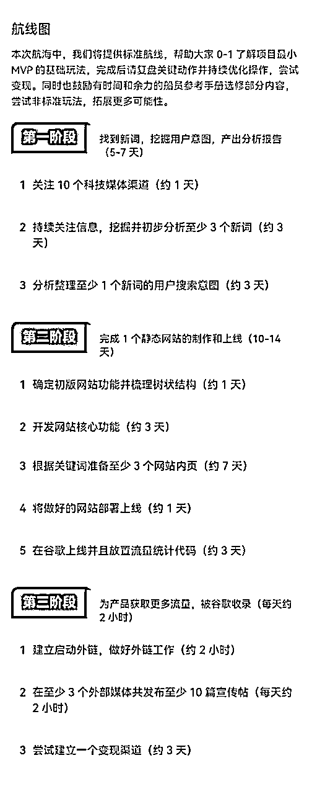

航线图与册子内容一一咬合，你可以按自己处在哪一环，去查对应步骤。


# 必修篇：把最小可行版本跑通

章节概要

这一章从“认识海外工具站”起步，一环一环带你走完整个流程。照章操作，就能跑通最小可行版本，把第一个静态站立起来。

新手请先看全局：

【项目概述】英文工具站基础介绍

已有轮廓的人，直接按核心步骤往下走：

【项目实操 1/4】通过挖新词找需求

【项目实操 2/4】快速制作网站并上线

【项目实操 3/4】为网站获取流量

【项目实操 4/4】通过广告和捐赠获得你的第一刀

必修篇里，航线图的任务顺序与册子一致。顺着读，就能把图上的任务逐个清掉。

后面每个关键节点的章节概要，也会点到对应航线图，提醒你别漏步。

那么，现在开始。


## 一、【项目概述】英文工具站入门

章节概要

正式动手之前，先给“英文工具站”这件事建立一个整体认知。本章不上手操作，却会左右你之后每一步的判断。

你会读到：

工具站到底是哪类产品？
它靠什么把钱收进来？
一个站点从诞生走到衰落，中间经历什么？
为什么这件事离不开最小可行版本思路与搜索优化意识？

读完这一章，你对“为什么要做出海站点”会理解得更透。我们开始。


### 1.1 工具站是什么

#### 1.1.1 网站常见类型 @ChatGPT

本段由 ChatGPT 协助整理：

概括来说：

……

上面这些类型的站点，日常到处都能碰到。但这次的实操，我们只盯住工具站这一类。为什么挑它？因为它足以承载“从读懂用户需求、找准位置，一直到收回成本”的整条链路。


#### 1.1.2 工具站的特征与分类 @ChatGPT

本段由 ChatGPT 协助整理：

通常，一个既能赚钱又让用户满意的在线工具产品，要在以下几方面下功夫：

工具站的本质，是给出好用的功能替人解决具体问题，比如算个税、查日历、看 IP 归属等。

按类别划分，可以举这些例子：

这些名字大多耳熟。但对单人或小团队来说，更值得盯的是细分场景里的空隙，也就是常说的 Micro SaaS——一类体量小、聚焦单一业务场景的在线软件服务。与体量大、功能全的传统 SaaS 相比，它做得更窄，价格也更亲民。想把它做出来，前提是摸清用户真正要什么，然后给出足够简单的解法。

这类站点开发完之后，日常几乎不用花太多精力，能自行运转。而且只要真的好用，用户会主动记住域名，或者干脆存进收藏夹。


#### 1.1.3 为什么先做英文工具站 @刘小排 @哥飞

为什么优先选海外站点，也就是英文工具站？

答案就一个字：快。比别的产品形态都快得多。

做 iOS、Android 应用，慢。

一来，客户端代码比网页复杂，对编码水平的要求也高；二来，上线前要打包、送审，还可能被驳回，时间成本很高。

做国内应用更慢。软件著作权证书要先花三个月办下来，才够格上架国内应用市场。更别扭的是，改一个小 bug 也得重新发版，用户还要升级安装包，修问题的节奏被拖得很重。

做国内站点，同样不快，卡在域名备案上。备案一般要一到三周；碰上审核特别严的城市，比如北京，还常常被退回来。

做🛰️小程序比前面两项轻一点，可也没快到哪里。麻烦在于它的开源生态不够厚，很多轮子得自己造，想靠现成开源代码提速并不容易。

海外站点则是最轻的路：不用著作权证书，不用域名备案，不用商店审核；程序更新时用户也不必重新下载。代码托管在 Github，配合 Github Action 搭好 CI/CD，提交即上线，开发体验很痛快。

等站点做起来、排名爬上去，这套资产几乎能吃十年二十年。只要互联网还在、搜索引擎还在、在线广告还在，收入口就不会断。而且站点活得越久，散落在网络上的外链越多，排名也越稳。

当然有前提：别碰垃圾站。钱的前提，是你给出的功能确实解决了别人的问题，用户才会愿意替你说好话。

种树最好的时机是十年前，其次就是眼下。做站点是复利型的事，别等“以后”，现在就动手。做好之后哪怕不再更新，只要还有人在用，权重就会一点点堆高。

特别今年，AI 的话题热度一直很高。只要你的工具沾上 AI，用户会主动帮你扩散。

所以，现在正是入场的好时候。

方向可以很多样：有的需求是短期的，有的能长期做；有的纯粹为了好玩，有的则来自真实的工作生活场景。

对多数新手而言，先用短期或好玩的需求练手更合适。练的过程中，你会熟悉怎么找需求、怎么做 SEO、怎么把流量引进来、怎么对外宣传、怎么把访问变成收入。

练熟了，再去布置那些长期、刚需型工具。可以研究竞品，然后在某些维度上压过它——更好用、更好看、跑得更快等等。

还要说清一点：所谓“从站点起步”，并不代表产品一辈子都只是个网站。

网站只是最小可行阶段的载体。等你攒够用户反馈，再补🛰️小程序、iOS 客户端，任何时候都不晚。

内容来源：《写给独立开发者：如何快速做出产品 MVP》、《海外工具从需求挖掘到网站制作一篇文章让你搞懂》


#### 1.1.4 中国工具出海的时间线 @非洲水手

前阵子翻完吴晓波的《激荡四十年》，有些感触，索性在这里把中国工具走向海外的时间线捋一遍。这二十年，大致可以切成四段：萌芽、起始、扩张、转型。

1、萌芽期

先是萌芽。1998 到 2007 年，中国互联网还在早期，主流玩法是 Copy to China。周奕——后来被称作中国工具出海第一人——带队做出 MP3 CD Maker，算是为这条赛道点亮了第一盏灯。

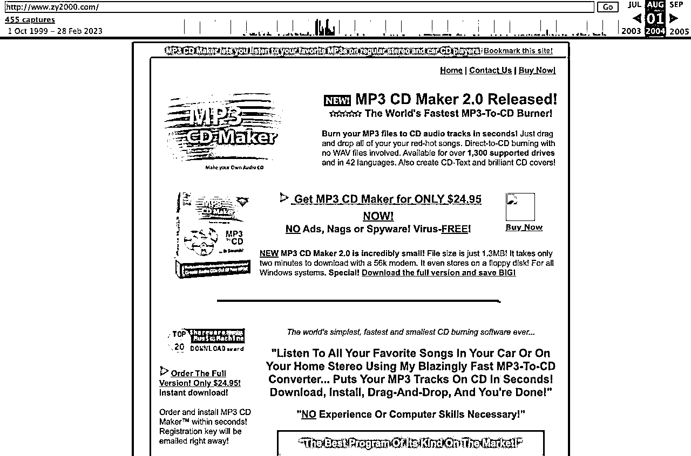

2、起始期

也是在这个阶段，大家慢慢看明白一件事：工具类产品可以绕过中西方文化的隔阂。2007 年 iPhone 初代与 Apple App Store 登场，移动互联网开闸，中国工具出海进入起始期。久邦、百度、360、UC、金山等一批国内厂商，开始在海外不声不响地圈地，静悄悄地挣钱。

3、扩张期

2011 到 2016 年，移动出海正式进入扩张期，工具品类也逐渐分化：手机管理方向有 Clean Master；拍照修图方向有美图秀秀；桌面类有 Solo Launcher、Go Launcher；浏览器类有 UC、海豚浏览器等。那时候买量成本不到 0.01 美金，安装量动辄几亿、几十亿，资本也迎来了好时光。

这一阶段还养出了一批广告代理公司，比如 Yeahmobi、Mobvista、Avazu；也有像猎豹 CM 那样自己开出代理业务的。我本人恰好在那个年代入行，服务过不少当年的明星产品，也算亲历了行业的盛景。

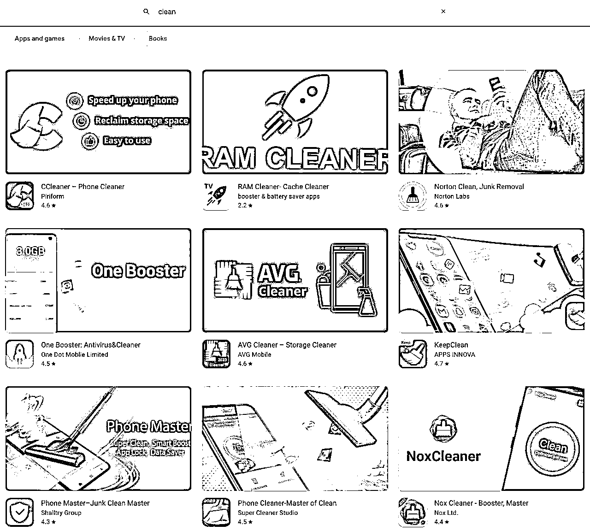

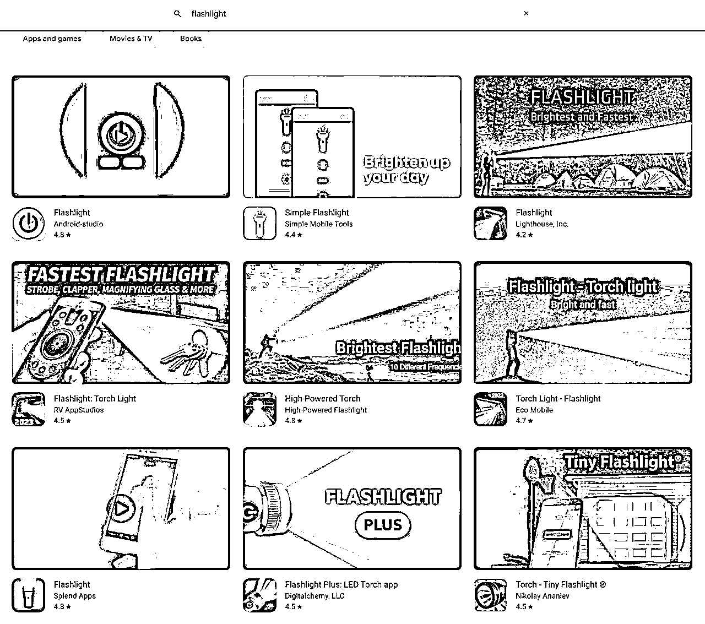

4、转型期

时间一晃到了 2017 年。经过几年好日子，工具出海的增长路径越来越杂，变现手段也越来越“成熟”（某种程度上是夸张式成熟）。与此同时，海外的人口红利在缩水，产品同质化加剧，平台规则——主要来自 Facebook 和 Google——越收越紧。

久邦股价腰斩，最终退市；Google 与 Facebook 先后封杀锁屏广告；Facebook 干脆停掉了中国区工具类广告主的投放；Google 则陆续下架了 iHandy、猎豹等开发者合计几百款工具产品。唱衰工具出海的声音此起彼伏，利润空间被一层层挤压，整个行业不得不转身。

中国工具出海真的走到头了吗？后面的内容接着看。

内容来源：3 月 6 日《关于出海工具产品营销推广，我的几点经验分享》@非洲水手


### 1.2 变现方式速览

赚钱只看两件事：流量、产品。

两头都要抓，别只顾埋头做功能，最后发现没有收钱的口子。

如图，ChatGPT 这类海外工具站，收入也分两条路：卖流量、卖产品。先有个大致印象。

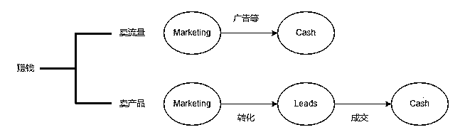

竹子是一节一节拔起来的。要走到变现这一步，前面还有找需求、开发、拿流量几道关。所以心里要清楚：起步时可以先把某种变现方式当成方向，但真要做的是先把第一个站推出来、把访问量做起来，收钱才有下文。

主要变现方式的具体步骤，第五、第六章还会讲。

下面先看看都有哪些路子，挑一条当作努力的方向。


#### 1.2.1 卖流量：靠广告挣钱 @子木

所谓卖流量，就是用免费工具吸引访客，再靠广告位换成收入。像 https://decompilertool.com/、https://sharegpt.com/ 这样，如图，页面挂上广告就有钱进账。

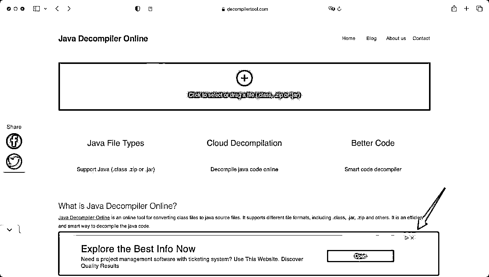

这类站点的特征是：

放到 ChatGPT 这个赛道，最简单的做法就是做一个免费的 ChatGPT 工具站，先把人导进来，再用 ChatGPT 账号自动发卡完成转化。

#### 1.2.2 卖产品：靠付费挣钱 @子木

卖产品，则是把工具本身做成付费商品。

比如 ChatGPT 方向的付费站，像 https://www.proseoai.com/（圈友做的谷歌 SEO 获客内容神器），先让用户体验，再引导其转为付费用户。

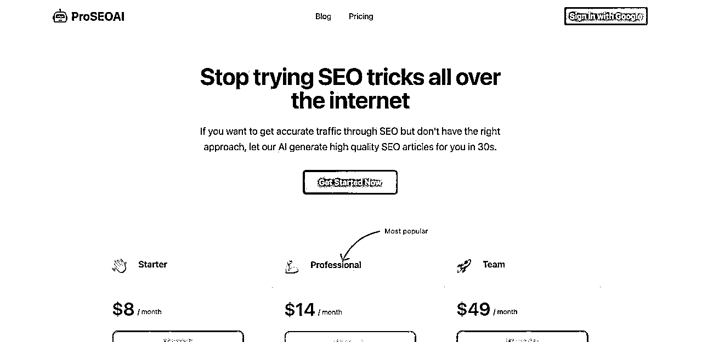

这类站点的特征是：

两条路能不能一起走？

可以。手里有流量，就意味着产品和你掌握的流量可以同时出售，只要保证相关性、客群一致即可。这样一份流量能收两份钱。

内容来源：5 月 25 日《普通人能做 ChatGPT 相关海外工具的 IDEA 方向》@子木


#### 1.2.3 广告 + 订阅，两条腿走路 @龙哥

Google play 的政策越收越紧之后，“广告 + 付费订阅”这套组合在全球慢慢成了主流。它的底层逻辑很朴素：把愿意付钱的那批人筛出来，让他们买单；不愿意付的，就让他们看广告。

早期还没有用户画像、不清楚哪类人肯掏钱时，可以粗放一点：所有人先走一遍付费流程，拒绝付费的再走一遍广告流程。这样做多少会伤体验，接着用 A/B 测试反复调，一步步把 LTV 抬到最高。

广告侧，可以借聚合工具筛出最合适的来源，再做调优。

聚合干的事，是把回报最高的那条广告挑出来展示，让每一次曝光都拿到更优的 eCPM，从而提升填充率、拉高整体收益。

订阅侧的 LTV，是新增用户数、订阅率、支付率、续费次数四项相乘。

其实 Google play 和 appstore 早就鼓励开发者走这套模式，只是最近一两年，我才真切感到它在中国的出海开发者中热了起来。工具类产品我建议试一试订阅，原因有两个：

内容来源：《龙哥盟 #轻享栏目：出海工具怎么玩》

订阅模式这块，龙哥此前还讲过一段，一并摘在这里。想读全文的同学可以点原文。

# 订阅制：出海工具的变现新路

如今，订阅制早已挣脱最初那个狭窄的定义，几乎渗透到每一个细分商业领域。放到出海赛道来看，工具类产品的变现路径中，这套打法的出场频率越来越高。五家增长之星里，喜马拉雅、蓝城兄弟、WPS Office 三家都选择了订阅路线。各家执行手法当然有差异，但有一点很明确：订阅帮它们把原本的应用边界向外推了一大圈。

拿 WPS Office 来说，其 COO 章庆元在 Morketing Global 的采访中表示，会员订阅已经是 WPS 越发倚重的一条收入主线。这条线靠两样东西撑着：一是持续扩大的用户盘子，二是面向不同人群的本地化内容服务。他透露，团队在海外市场还在试水模板、H5 海报制作这类轻量编辑产品，并认为这正是 WPS 应当坚持的方向。作为办公工具，WPS 的文字处理、图表制作等底层能力对所有用户免费开放。可要是业务只停在这一层，就容易掉进同类工具常见的变现陷阱——传统工具 App 很难让用户留下来，黏性不足，商业模式的想象空间自然被压得很小。订阅制恰好能补上这块短板。WPS 用大量创意模板之类的轻量编辑产品引导用户付费订阅，用户打开应用的次数随之变多，跟产品打交道的方式也悄悄改变。有了这层基础，社群运营、奖励优质内容生产者等动作才能展开，WPS 的业务外沿也就跟着拓宽了。

内容来源：《订阅模式让出海工具获得新生》


#### 1.2.4 先免费、后收费的变现路径 @静水流深

先用免费服务把人聚起来，再琢磨后面怎么收钱。看下面这个站点：

https://realfavicongenerator.net/api/

估计不少人会纳闷：既没有广告又不收费用，这站靠什么活着？答案藏在细节里——想调用它的 API，得先留下邮箱，之后它就能通过邮件把别的服务推到你面前，变现就这么完成了。


#### 1.2.5 靠资本变现 @静水流深

做海外流量生意，Adsense 账号基本是必备的，它撑起了最底线的收入。若真想认真创业，那就老老实实注册一家公司——最赚钱的往往不是业务本身，而是把公司卖掉，这正是资本市场的魔力所在。

BLOCKCHAIR 为加密货币提供优质服务，技术过硬、体验也好，偏偏没有任何收费项目，它图什么？逻辑很简单：先把口碑和用户量做起来，再到资本市场出让股权融资。这类网站只要用户基数持续上涨，没人会怀疑它的变现潜力，资本自然愿意抢着投。再看 IP 数据定位与服务这个案例：用免费服务沉淀大数据，再把积累的数据做成定制化商业服务来收费。

内容来源：《英文工具站，你没见过的那些案例》


### 1.3 摸清产品的完整生命周期 @Cathy

章节概要

摸清一个产品从诞生到退场的完整轨迹，对规划大有裨益。通常，产品落地后会经历三个阶段：

测试阶段要解决两件事：拿到用户反馈，判断值不值得推。

能走到推广阶段，意味着用户接受度已经过关，要么自己长了腿，要么手里有资源可以猛推一把。此时拼的是持续拉新与变现的本事，重点盯新增、活跃、留存、收益四项数据。服务对象从一个个具体的人变成了数字，因此推广之前就得把数据统计平台接好。

至于稳定期或衰退期，诱因可能是市场环境，也可能是用户本身发生了变化。这个阶段的目标是找到第二波用户增长或收入增长，办法是把注意力重新拉回用户身上，去弄清他们此刻真正想要什么。

测试、推广、稳定或衰退——每个产品都躲不开这条路径，顺着规律走，才能少费力多见效。


产品——不论工具站、内容站还是 App——落地之后，基本都要走过三个阶段：

下面以圈友 @Cathy 操盘过的 App 作为样本。

#### 1.3.1 测试期

目标：

收集用户反馈，同时判定要不要推向市场。

周期：

一个月，拆成四步。

第一步：

先让同事和熟人上手。这个阶段直接给 demo、未上架的 APK，人在旁边看他们怎么操作即可。因为这些人早先就知道你要做什么，所以重点盯三样：Bug、易用性、需求吻合度。

第二步：

找前期锁定的一小批核心种子用户，人数不用多。重点同样是需求吻合度、Bug 与建议。

第三步：

在应用商店放出 Beta 版，同时到论坛社区发帖招募 Beta 参与者。关注点还是需求吻合度、Bug 和建议。

第四步：

正式版上架应用商店。这时在社群里发邀请，把此前攒下的用户请进来体验；如果人数不够，就去非专业论坛、App 测评站点发帖，像 XDA Developers（建议提前养好几个账号）、Quora、Making Money with Android、Droid Forums、Facebook Group、AppAdvice、App Store Apps、148Apps 等都是可选渠道。

应用商店方面：GetJar、SlideMe、Opera Mobile Store、AppsLib、Amazon Appstore、AppBrain。若产品素质过硬，还可以去下面这些地方申请榜单曝光：Kiip Build Fund、The mobileys、Appy Awards、Best App Ever Awards、AppCircus Competition，甚至争取 AppStore 与 Google Play 的官方推荐。

在猎豹时负责的一款 App，就靠推荐拿到了超百万早期用户。想提速，也可以通过 Facebook、Google 等渠道买一点量（务必精准），此阶段最该盯的是用户反馈和自增长表现，这往往决定了 App 的生死。反馈与自增长都不行，说明方向或路径至少有一处出了问题。

不同类型的 App，测试期在第三、第四步会有些出入。以我经手过的产品为例：

社交型 App：

第三、第四步的外部社区测试格外关键。我帮朋友做过两款社交产品，一款是游戏语音交友，一款是匿名交友。我的做法是备好多个马甲，潜入对应品类的 Facebook Group、XDA Developers 以及竞品社区里放钩子。

工具型 App：

这类产品测试讲究短平快。我们团队曾监测到大量竞品下架，迅速做了一款短期获利的产品：在包名、名称、描述等素材里巧妙嵌入竞品关键词，一分钱没花就引来大量测试用户，为打磨和推广攒足了数据。

所以测试期除了看反馈，还要重视 ASO，它能让推广事半功倍。包名、名称、Logo、短描述、长描述、关键词、宣传图、Page 页、视频内容、评论——每个模块都值得认真对待，最基础的部分往往最要紧。

另一款前面提过的、竞争压力很大的 App，则要靠付费推广拉一批精准用户来做测试，一般一天不到 100 美金就够。

背后有大公司、且有同类产品可导流的 App，通常用内部导量的方式获取测试用户。

订阅型 App：

一般是两种流量搭配着来。我参与过的一个 TikTok 付费工具 App，早期测试流量大多来自 Quora 和 Google，所有问答末尾都留了产品名或链接；由于这个品类竞争也不小，测试期还叠加了每天约 20 美金的 Google 流量。

对个人团队而言，把 Facebook 广告和 Google 广告开起来很重要，小钱能办大事。


#### 1.3.2 推广期

产品走到推广期，说明用户接受度已经让人满意，要么有自增长，要么有资源可以大推。此时要盯的是持续获客与变现的能力。

核心指标转为新增、活跃、留存、收益。服务对象从一个个具体用户变成数字，所以推广期来临前，数据统计平台必须到位。

推广分免费与付费两条路：

免费推广需要长期维护；付费推广没什么捷径，说到底就是「细节」二字——预算与推广规划、渠道拓展与维护、质量监控、数据分析，每样都得做。不同产品适合的付费渠道不一样，主流的有社交媒体、Google、网盟。

新产品建议先从社交媒体试起，质量相对稳定。不知道该投哪里，就去看竞品在哪些渠道投放，先照着复制一轮做测试。最后锁定一两个 ROI 最优的渠道长期投入。

这个阶段，除非自增长特别强，一般都要做付费推广。以我以前负责的 App 为例：有两款工具 App 始终没做付费，原因是整个行业受 Google 压制，而这两款靠竞品关键词就能活下来，推上去反而容易枪打出头鸟，于是一直低调苟着。

前面提到的两款小 App——3V 和美化类 App——竞争压力大但 ROI 尚可，付费推广就一直在做。它们的经验是只投竞品看不上的 Google 长尾流量，在获客成本上做出差异化。

而在猎豹期间做的桌面产品，流量大头来自免费渠道，具体做法是用大量主题 APK 去铺大量长尾关键词。

无论免费还是付费，都要围绕 AARRR 模型，它贯穿整条用户链路。从用户看到素材到最终使用，每个环节都要反复做 AB testing。比如我们的 Top 主题产品，每周会分语言测试图片和文字，提升点击下载率。

用户下载到下载成功这一段，要优化包体积，在质量与大小之间找平衡。下载成功后点击应用主题，则要 AB testing 按钮颜色、样式以及推荐的主题。应用成功落到桌面，继续优化包大小、配图和文案。下载成功到使用环节，会根据用户特征（国家、机型等）在第 * 天推荐相似主题或 Top 主题，以提高使用率和留存。


#### 1.3.3 稳定期或衰退期

产品进入稳定期或衰退期，原因可能是市场，也可能是用户变了。这时的主要目标是实现第二次用户增长或收益增长，得把主要精力重新放回用户身上，去寻找他们当下的真实需求。

我负责的桌面产品算是一次非线性增长，关键在于当时的目标用户还有未被满足的需求，通过差异化的运营推广手段把这部分人拿了进来。

但我自己的小 App 大多已进入稳定期或衰退期。稳定期的 App 需求平稳，我的服务和推广都跟得上，就继续维护。

衰退期的 App 本来做的就是短期效益，投入太多反成负担，食之无味，弃之也不可惜。

内容来源：《Google Play 赚钱机会：对于小型技术团队/个人开发者，如何判断一个 App 是否值得做、引流及变现方法论分享》


### 1.4 工具产品 MVP 的快速做法 @刘小排

章节概要

为什么必须快速做出产品 MVP？因为新产品的失败率实在太高。想提高整体成功率，只能靠增加数量、不断试新 idea，这是所有创新者共同的窘境。

我们整理了几套快速做产品的方法论。在精益迭代的商业竞赛里，一年能发布 12 个 MVP 的人，相比一年只发 3 个的对手，优势直接翻了四倍。

当然，做出 MVP 只是工具产品的第一步，重点在于验证需求、明确后续优化方向。当 MVP 初步证明这个方向可行，就要依据数据和反馈继续完善、迭代功能，提高竞争力，最终实现持续变现。


知名独立开发者 Peter Levels 今年 10 月上线了新产品 avatarai.me，首日进账 1 万美元，十天累计 10 万美元。

厉害吧？他的成功秘诀就一个字：多。

过去十年左右，他总共做过 70 个产品，只有 4 个成了，成功率 5%——请注意，他可是全球最顶尖的独立开发者之一，成功率也才 5%，更何况我们普通人？

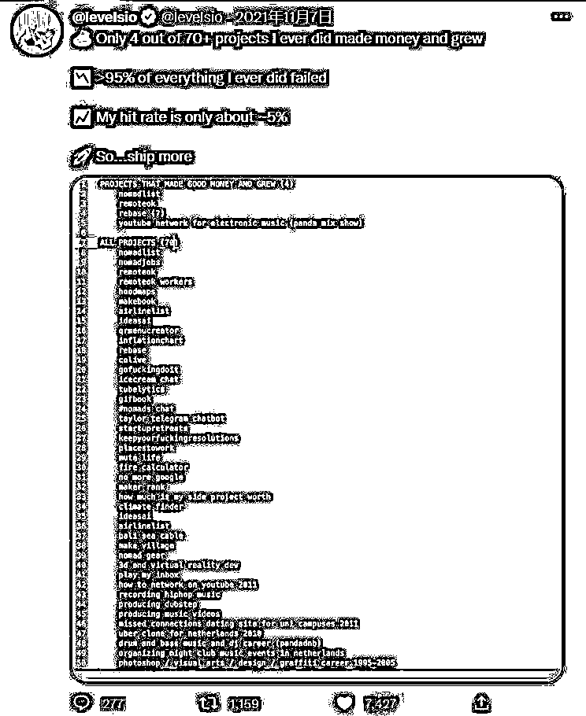

既然如此，最优解就是：

具体怎么做？下面是较为详细的方法：

方法一：买模板，两天做出 MVP

作为海外工具网站的 MVP，真正重要的只有两点：

围绕这两点，解决方案其实很直接。

第一，界面怎么变漂亮？——花钱买模板！

我买的是 https://tailwindui.com/templates/salient。

你可以拿它和我前面提到的 https://keywordsea.com 比一比，是不是感觉一模一样？

不过这款价格不低。我更推荐去 themeforest.net 逛逛，选择更多也更便宜，通常 10 到 50 美元不等。

第二，核心功能怎么完成？——只写一个函数！

对，就写一个，这个函数就是你的主功能，其余函数一概不写。

我不太相信一个合格程序员在开源社区帮助下，8 小时内写不出一个函数。

比如你想做“下载 YouTube 视频”的工具，先定义输入输出（输入：URL；输出：视频文件），然后去 GitHub 找现成代码，稍作修改，全程不超过 1 小时。

汇总一下：

买模板：1 小时

买域名：1 小时

写文案：1 小时

改模板：2 小时

主函数：8 小时（往往更少）

部署上线：2 小时

两天时间，绰绰有余。

上线之后，把链接发到 Product Hunt 这类 Startup 社区，然后静等数据。

该看什么数据？如果是免费产品，重点看自然流量增长，因为它代表用户在自传播。自然流量包括社交网络流量、搜索流量、外链流量。


方法二：通过预售，半天做出 MVP

敏锐的你可能已经发现，上面流程里最耗时的是写主函数，其次是前端界面（买模板+改模板），两者占了整个 MVP 工期的七成以上。

那如果这两项都不做，时间是不是还能再压？

没错，可以。

尤其对付费产品，主功能完全可以先不写——你要验证的只是“用户愿不愿意掏钱”。

验证付费意愿最直接的办法就是预售，俗称“卖空气”。

具体步骤

carrd.co 和 typeform 的产品体验都不错，具体用法我就不手把手教了。

在 carrd.co 里做 landing page，界面如图所示：

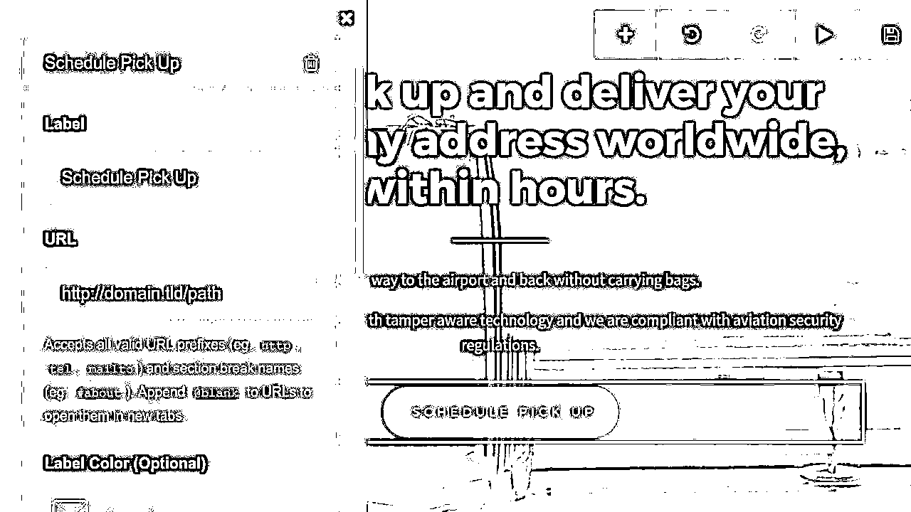

在 Framer 里做 Landing Page，如图所示：

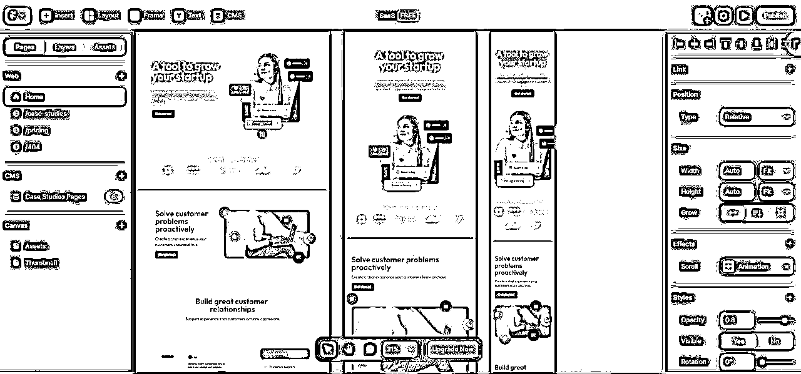

在 typeform 里加收款功能，界面如图所示：

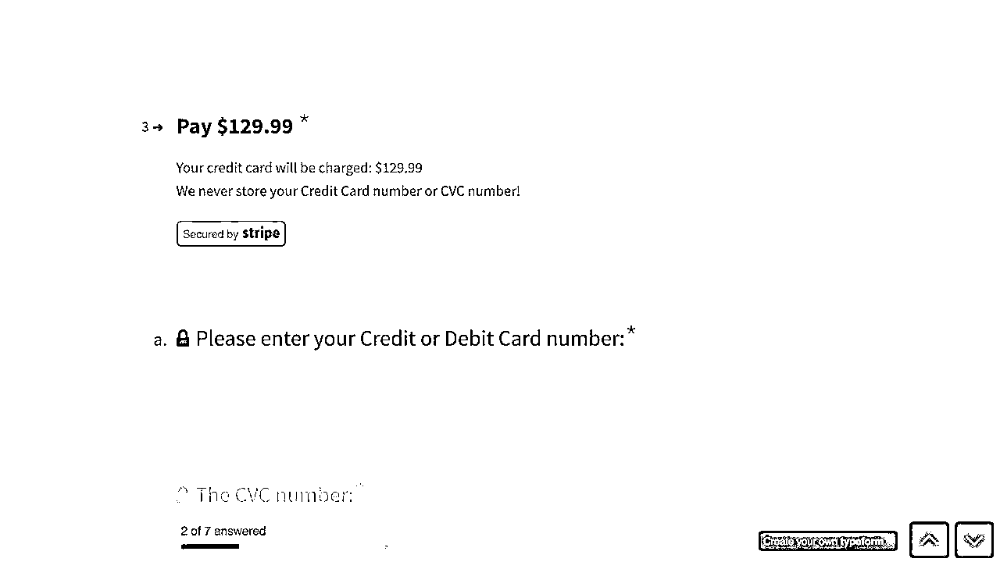

再举几个例子。

下面两个产品的 landing page 都是用 carrd.co 生成的，不用写代码：

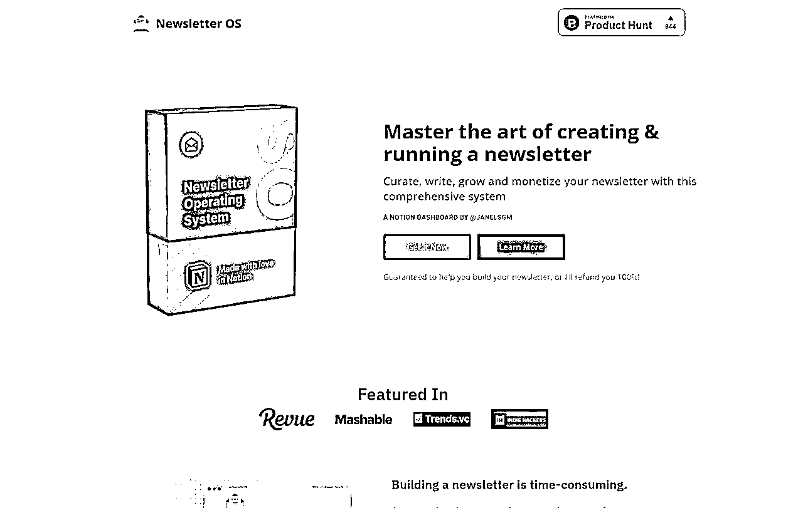

而这个链接是 Typeform + Stripe 组合，实现了“带支付功能的调查问卷”，同样无需写代码。把它放到 landing page 上，MVP 就算完成，可以开始测转化率了。大家可以点开感受一下：

https://template.typeform.com/to/zDzdJ3Me

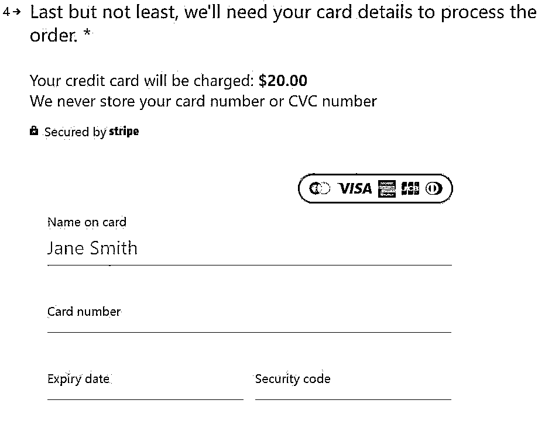

内容来源：《写给独立开发者：如何快速做出产品 MVP》


### 1.5 用 SEO 思维打造工具站 @子木

谁都知道，谷歌靠内容搜索抓流量。所以想被用户搜到、还想让谷歌更快收录，建站之初就该把选好的关键词及其拓展词埋进去。

这意味着代码、域名、站内内容、外部宣传等每个环节都要带着 SEO 思维，最终目的只有一个：更容易被搜到。

在没有资源的情况下，新启动的英文网站想从谷歌 SEO 拿流量，目前有两种策略：

1. 农村包围城市：走长尾词路线，第一阶段目标是把 long-tail 词对应的 1000 个页面做出来。等新站养到中老站，再向 mid-tail、short-tail 词进攻。

2. 大力出奇迹：海量关键词配海量内容页面。比如新瓶装旧酒，新站靠 AI 或二次原创内容起量。

我目前对谷歌 SEO 的认知是：SEO = Contents（80%）+ Backlinks（20%）+ Technical（0%）。

能“搞定”流量的能力有很多，但我建议程序员优先掌握 SEO，因为懂技术之后再学再实践 SEO，本身就有基础。

另外，一旦拿到稳定的 SEO 流量，它相对长期、有复利效应，边际成本几乎为零。

接下来，带着 SEO 思维去创作你的第一个海外站吧！


## 二、【项目实操 1/4】挖新词，找需求 @哥飞

章节概要

建站第一件事是挖需求、定方向，它会影响功能设计和流量获取的每个环节。挖需求的方法五花八门，有没有适合新手的那一种？

这里重点介绍一条相对容易拿到流量的路子：找新词。通常分四步：

第一步：找新词

第二步：判断该词是否可做

第三步：深入了解新词

第四步：分析用户搜索意图

具体怎么一步步找到需求、敲定网站方向？往下看。

#### 本章航线图

完成第二章的学习和实操，即可完成航线图的第一阶段：找到新词，挖掘用户意图，产出分析报告（约 1 周）

1. 关注 10 个科技媒体渠道（约 1 天）

2. 持续关注信息，挖掘并分析至少 3 个新词（约 3 天）

# 3. 新词搜索意图拆解（约 3 天）

下面进入实操：按流程发掘新词、把发现填进记录表，并在航海日志中打卡存档。

记录表可以这样建：

| 新词 | 来源渠道 | Google Trends 情况 | 取舍判断 | 新词含义 | 检索目的 |
| 新词1 |  |  |  |  |  |
| 新词2 |  |  |  |  |  |
| 新词3 |  |  |  |  |  |


### 2.1 新词为什么值得做

发现需求的方式很多，看竞品、挖自身、翻榜单都可以，可对刚入场的玩家来说，要从大量信息里判断哪个需求真正适合自己，并不容易。

换个思路会轻松不少：做站始终要考虑流量。判断需求难，那就直接跟着热点和新词走。找那些搜索热度正在上涨、但存量页面还很少的词，顺着这些刚冒出来的需求去建站，引流难度也会明显下降。

这里说的“新词”有两个特征：
1. 最近 6 个月内才出现；
2. 形态不限，产品名、开源项目名、模型名、AI 名称等都算。

比如【GPTs】是 11 月 7 日才出现的，它是 ChatGPT 新功能的名字，完全符合这个定义。

再比如搜索【draggan ai】时，排名第一的不是官网，而是 dragganaitool.com。这个域名 5 月 28 日注册，6 月就拿到了 4.5 万次访问。

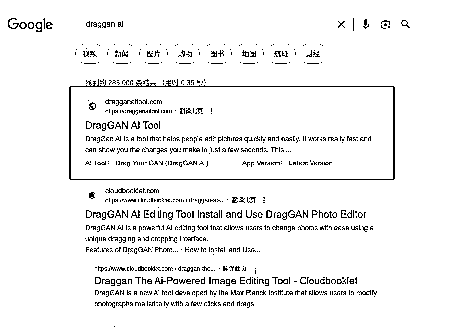

为什么新站能压过老站？

核心原因就是它足够新，竞争者极少。

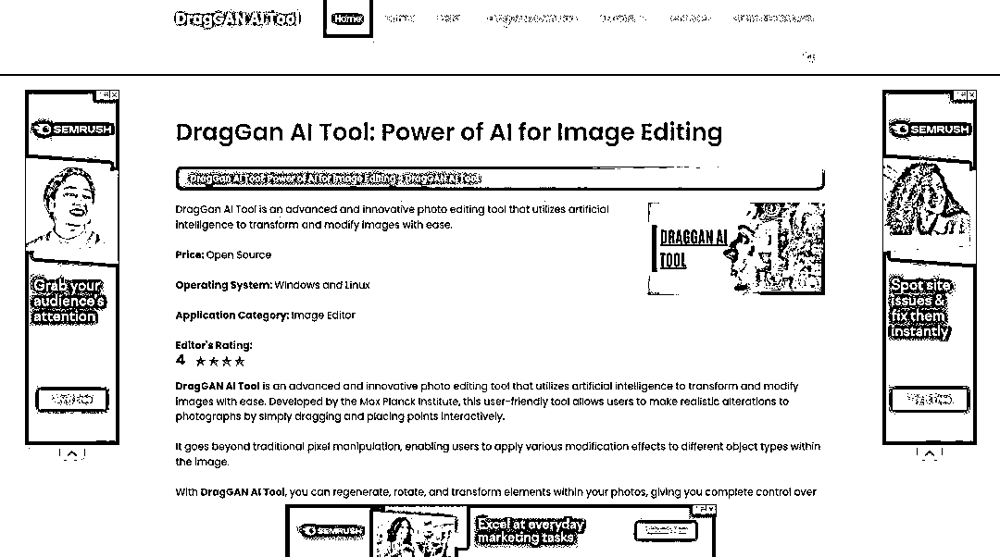

Google 官方曾公布数据：每天的搜索请求中，有 15% 是此前从未出现过的词。

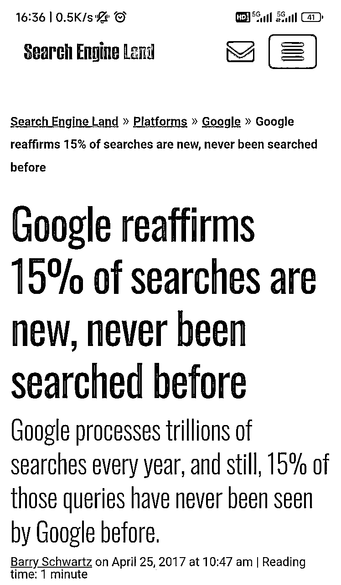

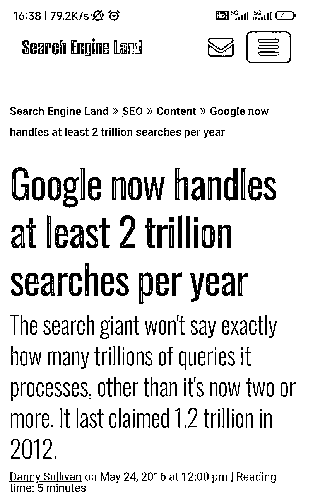

2016 年 Google 说全年有 2 万亿次搜索，到 2023 年大概率超过 3 万亿次。按 15% 算，一年就是 4500 亿次，除以 365，约等于每天 12 亿次。就算里面大部分只是旧词的变体，剩余的全新搜索也不小；哪怕只按 1 折算，每天依然有 1.2 亿次。

全新搜索意味着什么？意味着页面只要被收录，就有机会直接排到第一位。

选词建站时，建议每个关键字对应独立域名。根据 Google 公布的影响因子，垂直领域的专精度占比为 14%。

从上表可以看到，权重最高的是持续发布有吸引力的内容，占 21%；第二是标题里包含关键字，占 15%；外链和垂直领域专精度并列第三，都是 14%。


垂直领域专精度怎么理解？

可以理解为 Google 不想让单一巨头包揽一切，也不希望某个需求只能靠大站的内页来承接，它更希望有专门做这个需求的独立网站存在。

通常某项需求对应某个关键字，所以也就可以理解成“一个关键字一个域名”，用全站力量去打这个关键字。

如果某个词现在只是被其他网站的内页带了流量，我们就值得做一个垂直站，集中优化这个主题，把这个词的流量抢过来。

最后的问题，就是每天冒出来的新词到底要去哪找。


### 2.2 第一步：去哪找新词

新词往往先出现在科技媒体上，比如：

另外，这些社交平台和社区也值得盯一盯：

1. Twitter：
   a. 信息整合账号
   b. AI 科技公司官方账号，比如 OpenAI
   c. 关注以上账号后，Twitter 会自动推荐类似账号，等于给你更多线索来源

2. GitHub 趋势榜：https://github.com/trending

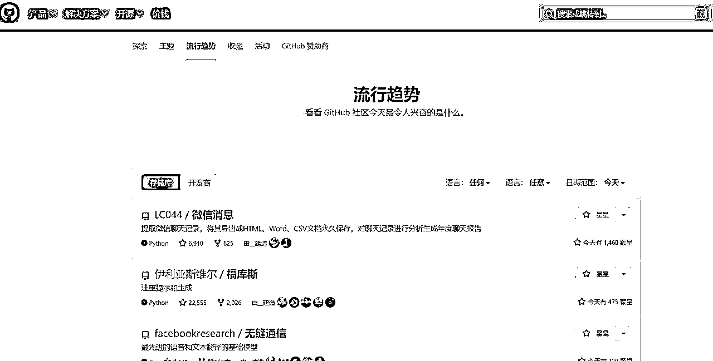

3. Hugging Face 趋势榜：https://huggingface.co/models?sort=trending

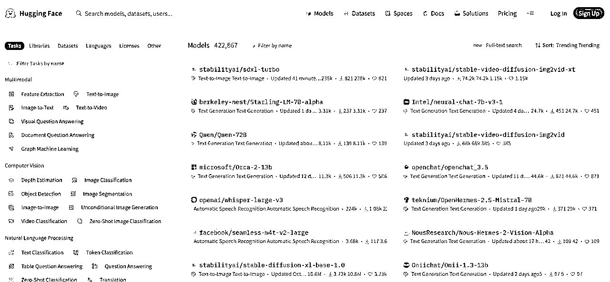

新手期建议优先用这些渠道，它们对前沿技术词的反馈速度最快。重点关注产品名、开源项目名、模型名、AI 名称等。

等判断流程熟练后，还可以顺着 Twitter 和社区内容不断发现同类网站，把找词范围越扩越大。


### 2.3 第二步：新词是否可行

找到几个候选词后，用 Google Trends 看趋势，曲线平稳或向上最好，一路向下就直接放弃。

Google Trends 地址：https://trends.google.com/trends/

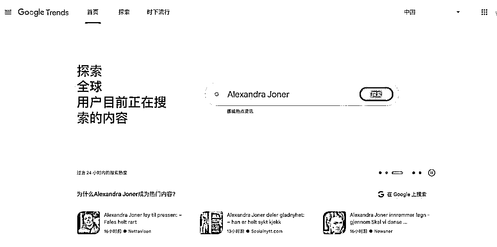

打开后在搜索框输入要查的词，比如 GPTs，地区选“全球”，时间设置为 2023 年 11 月 1 日至今。

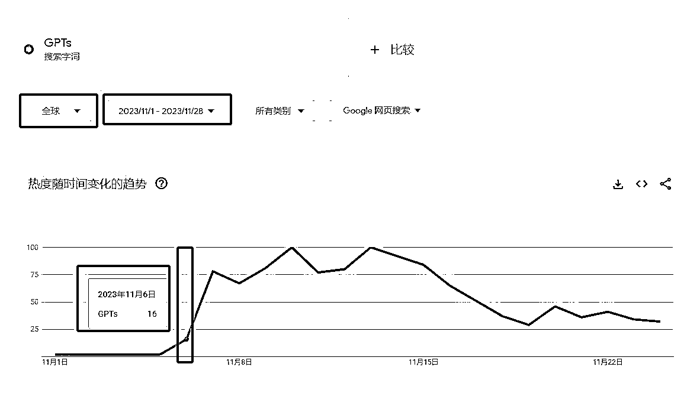

GPTs 是 2023 年 11 月 7 日在发布会上亮相的，趋势图显示这个词从 11 月 6 日开始有搜索量，与发布时间完全对得上。这个方法能帮你判断一个词是否属于“新词”，也就是出现时间不超过 6 个月。

再看 Grok。这个词之前有一些搜索量，但一直不高；直到马斯克 11 月 4 日发推宣布 xAI 第一款产品叫 Grok，搜索量才开始明显上升。

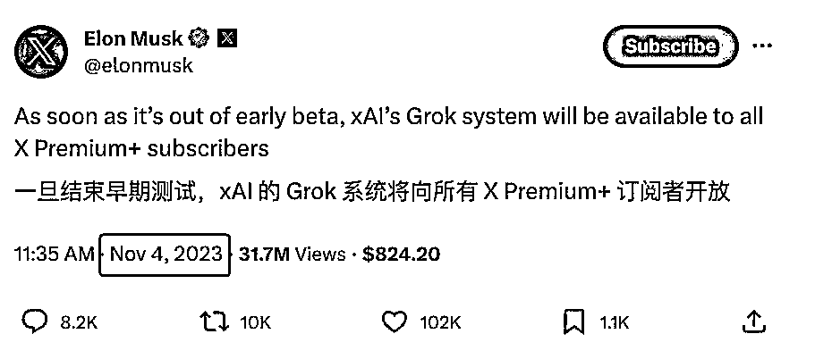

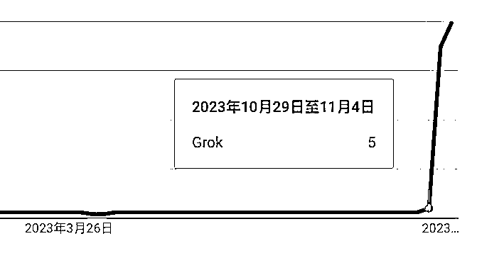

除了看单个词，也可以把多个词放在一起对比。下图里 ChatGPT 和 Grok 的对比很直观：Grok 目前的量级还很小，ChatGPT 已经深入人心。

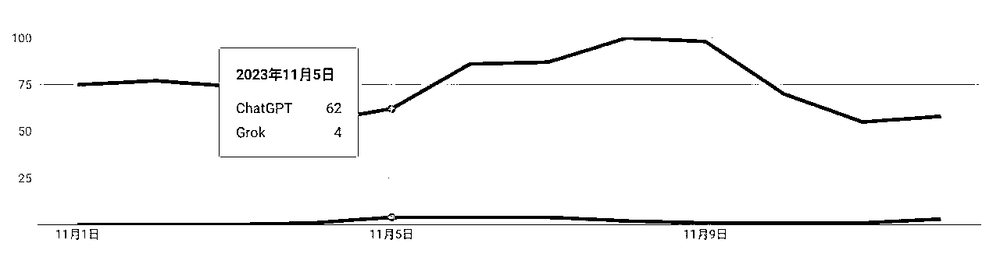

如果不想做新词，而是选一个半年以上的词，比如“在线计算器”，要判断是否值得做工具站，又该怎么办？

可以用 Semrush 做关键词拓展，算出做哪种“在线计算器”回报最高。

关键字没选对，后面很可能白干。这里有两个特点值得注意。

哥飞设计了一套公式：kdroi = volumn * cpc / kd。kdroi 即优化难度回报率，volumn 是搜索量，cpc 是点击单价，kd 是优化难度。

把每个词的 kdroi 算出来，从高到低排序，就得到了最值得做的词表。

实际演示一下：打开 Semrush，输入【Calculator】，把筛选设为搜索量 600+、kd 0～29、cpc 大于 0.1，并排除“near me”，最终能看到 357 个关键词。

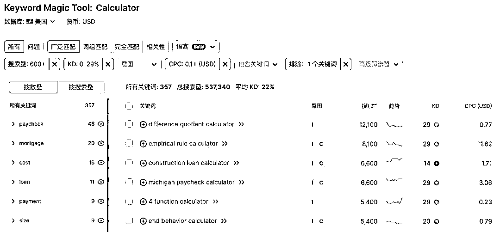

点表格右上角的导出，下载 csv 或 xlsx，用表格软件打开后只保留 Keyword、Volume、KD、CPC 四列，其余列删掉。新增一列输入公式 =B2*D2/C2，下拉填充，再按这一列从高到低排序，新词表就出来了。

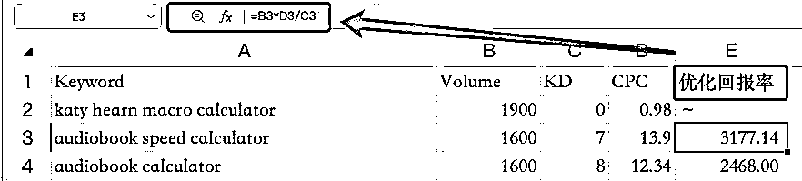

回报率最高的前 10 个词如下：

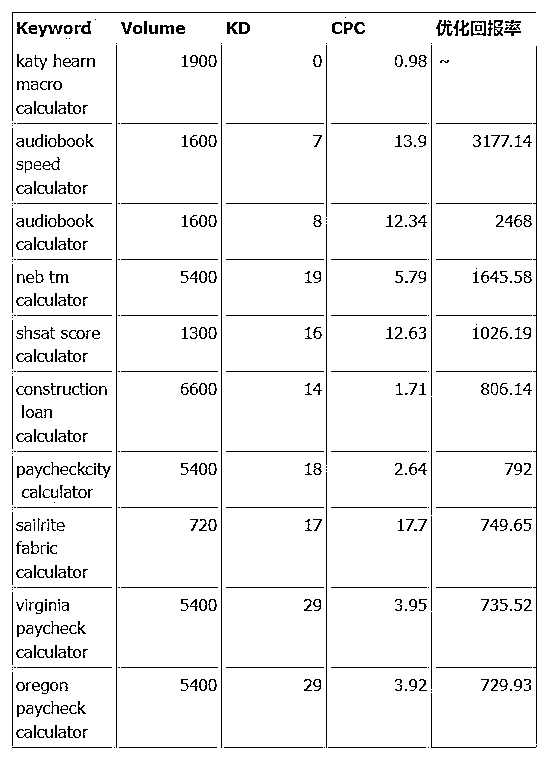

你也可以打开 Semrush 查询任意关键字，拿到列表后按同样方式计算 kdroi。


### 2.4 第三步：搞懂新词本身

当一个词热度够高、趋势又平稳或向上，基本可以判断值得做。但网站方向怎么定？

需要先搜索了解两块信息：
1. 这个新词本身是什么含义，代表什么？
2. 用户搜这个词，是想获得什么结果？

先把词的意思、来龙去脉和背景摸清楚，后面建站才会更准确。

通常来说，需要搜索了解但不限于这些信息：
1. 它是一个产品、一种情绪表达，还是一个研究理论？
2. 是谁提出的？何时出现？
3. 什么场景下会被使用？
4. 有哪些关联词汇？
5. 它是在什么背景下出现的？
6. 它承载着什么样的意义？


### 2.5 第四步：分析搜索背后的意图

找到词之后，还要看穿搜索意图。用户是想体验功能、了解介绍，还是想购买下载？意图决定了网站该做什么、页面该提供什么。

以【phone number generator】为例，可以先到谷歌搜索框看相关推荐词。注意，光标落在不同位置，推荐词也会不一样，最好把所有位置的词都收集起来。

以下是光标放在最后位置时看到的词：

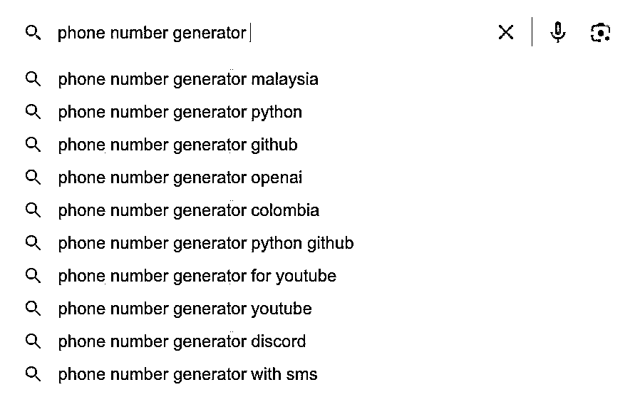

光标放在 number 后面时看到的词：

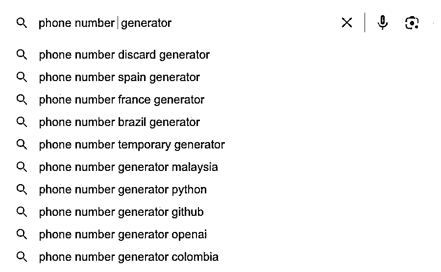

光标放在 phone 后面时看到的词：

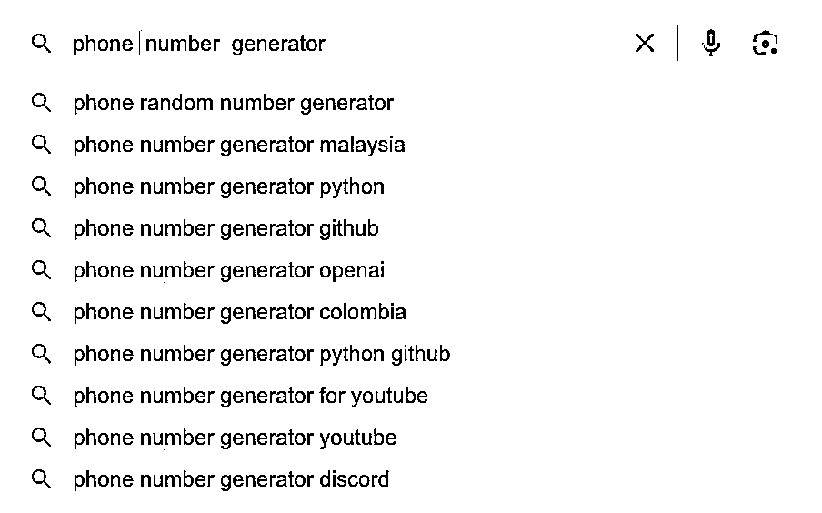

光标放在最前面时看到的词：

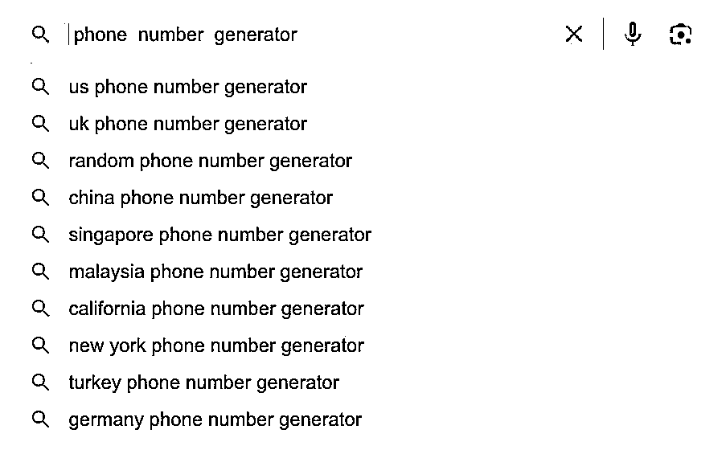

把上面 40 个推荐词全部合并，去掉重复项后得到 27 个关键词：

1. phone number generator
2. phone number generator malaysia
3. phone number generator python
4. phone number generator github
5. phone number generator openai
6. phone number generator colombia
7. phone number generator python github
8. phone number generator for youtube
9. phone number generator youtube
10. phone number generator discord
11. phone number generator with sms
12. phone number discard generator
13. phone number spain generator
14. phone number france generator
15. phone number brazil generator
16. phone number temporary generator
17. phone random number generator
18. us phone number generator
19. uk phone number generator
20. random phone number generator
21. china phone number generator
22. singapore phone number generator
23. malaysia phone number generator
24. california phone number generator
25. new york phone number generator
26. turkey phone number generator
27. germany phone number generator

拿这些词之后怎么办？

以前只能逐个去谷歌搜索，看排在首页的都是什么网页，再逐个点开分析服务内容。现在有了 ChatGPT，直接让 AI 帮忙即可。

先用 GPT 3.5 演示。

Prompt 如下：

# 从搜词到第一美元：英文工具站冷启动手记

先从一个很具体的搜索词说起：当用户输入“phone number generator for youtube”，他真正想解决的是什么？答案通常不只是“生成一个号码”这么简单。背后可能包括：批量注册 YouTube 账号、自动发评论、绕开手机验证、做测试开发，或者给多账号运营准备虚拟号码。这里必须提醒：用号码生成器绕过平台验证或滥用规则，可能违反 YouTube 政策，甚至带来法律风险。所以如果要做网页承接这类需求，思路应是：先确认合法合规，把服务边界讲清楚，做好用户教育与风险提示，提供免责声明和隐私政策，加入验证码等防滥用措施，突出测试、开发等正当用途，保留联系方式，持续监控异常，并链接平台官方政策。透明、合规，比短期流量更重要。

素材中原本有一份关键词意图分析作业表，改写后可以这样梳理：

| 项目 | 内容 |
|---|---|
| 新词 | 待填新词 1、新词 2、新词 3 |
| 挖掘渠道 | 谷歌搜索下拉框、关键词规划师、竞品页面、社区讨论等 |
| 谷歌趋势分析 | 看搜索量、趋势方向、相关词增长 |
| 判断是否值得做 | 结合搜索意图、竞争强度、变现路径综合判断 |
| 新词含义 | 用一句话解释用户到底在找什么 |
| 用户搜索意图 | 内容查询、工具使用、教程学习、替代方案比较等 |

对应素材位置标记：``` 关键词： 搜索意图： `````` phone number generator phone number generator malaysia phone number generator python phone number generator github phone number generator openai phone number generator colombia phone number generator python github phone number generator for youtube phone number generator youtube phone number generator discord ```

## 三、【项目实操 2/4】快速做出网站并上线

关键词意图看清之后，就该动手了。第一版网站不必追求“大而全”，MVP 才是主线：先满足核心功能，尽快上线静态版本，拿真实数据和反馈，再迭代。与此同时，SEO 思维要贯穿始终：站内内容、域名部署、关键词布局，都要让谷歌更容易抓取和理解。

先确定网站类型：它究竟是解释某个名词的内容站，还是解决某个具体问题的工具站？确定方向后，画出网站树状结构，明确首页、分类页、内页各承担什么关键词。没有思路时，就看排名靠前的竞品怎么组织页面，再用浏览器开发者工具观察单页代码结构。

开发阶段，有编程能力就自己写，但别陷入“技术栈越高大上越好”的陷阱；简单工具用原生 JavaScript 往往就够了。没有开发能力，可以自学基础、找人组队、基于开源代码或模板部署，也可以用模块化代码拼出页面。素材中提到的模板、源码和拼装工具，都是为“先上线”服务。

站内内容优化要抓住 TDK：标题要独特、简洁、准确，重要关键词自然前置，长度尽量控制在 50—60 个字符；描述不是排名因素，却影响点击率，要用一两句自然的话说明页面价值，重要关键词可被高亮，长度约 150—160 个字符；keywords 可以不写。页面结构要有清晰的 H1、H2、H3：H1 每页一个，既给用户看，也帮助搜索引擎判断主题；H2、H3 用来组织语义层级；正文放 p 标签；图片写 alt，既服务读屏软件，也帮助图片搜索。站内链接要形成网状：首页指向二级、三级关键词页面，子页面也回链上级。页面必须后端渲染，保证查看源代码能看到完整内容；每个页面设置唯一 URL，并用 canonical 指明规范地址。多语言支持值得做：英文放根目录，中文 /zh/、日语 /jp/ 等用子目录，翻译可借 GPT 完成。

域名和服务器方面，海外站尽量选海外注册商；服务器可用国内云厂商海外节点，也可用 AWS、谷歌云、DigitalOcean、Linode 等；简单前端工具用 Vercel 免费版、Cloudflare Pages/Workers 就够起步。Logo 可用 AI 绘画工具生成。部署前理解 NS 与 DNS：域名像好记的门牌名，DNS 负责把域名指向服务器 IP；用 Cloudflare 管理解析时，把 Cloudflare 给的 NS 填到注册商后台，等待生效，再添加 A 记录、CNAME 记录等。Vercel 部署静态站通常走：GitHub 仓库、Vercel 关联项目、自动构建、绑定自定义域名、开启 SSL、Cloudflare 配解析并选 Full 模式。

上线后，制作 sitemap，在 Google Search Console 添加资源、验证所有权、提交 sitemap，等待抓取。最后放流量统计代码：在 Google Analytics 添加媒体资源，把统计代码放到所有页面 head 前；用不惯也可以同时放百度统计。

对应素材位置标记：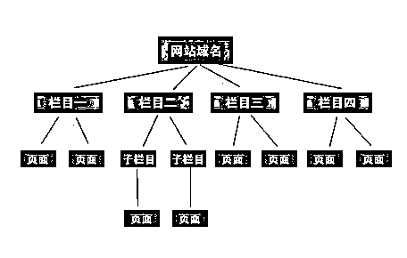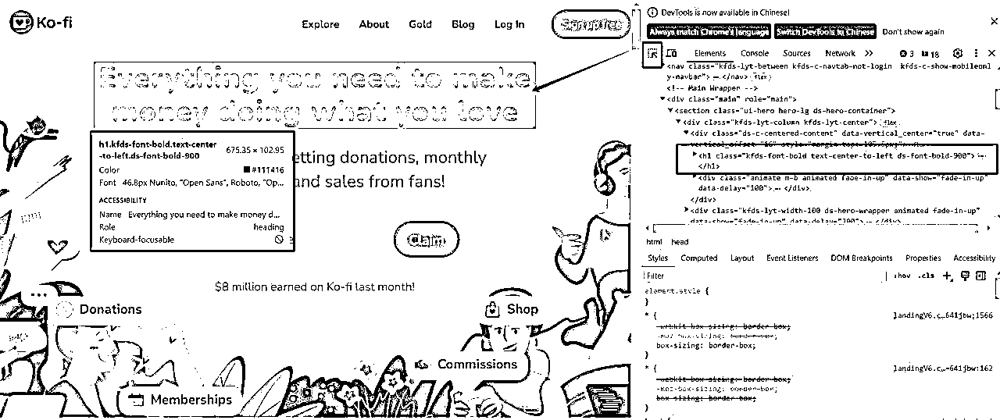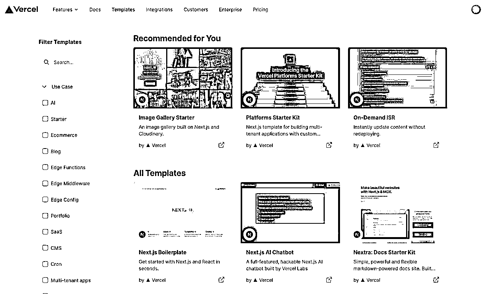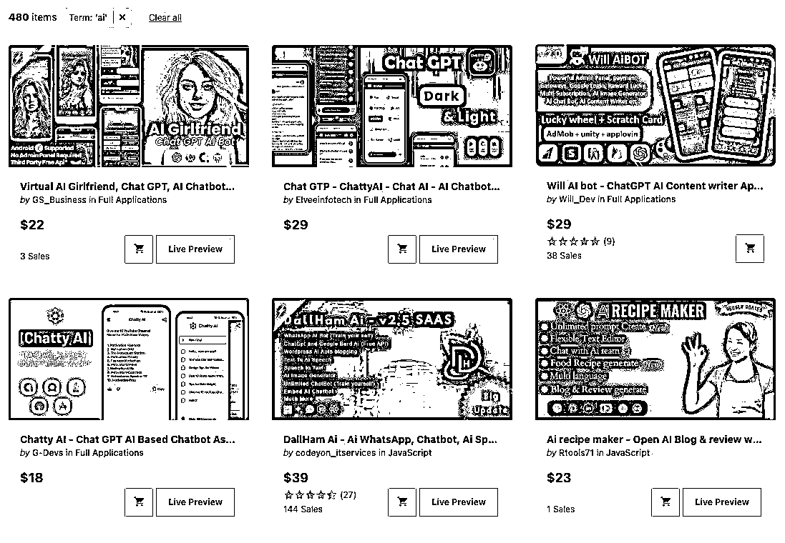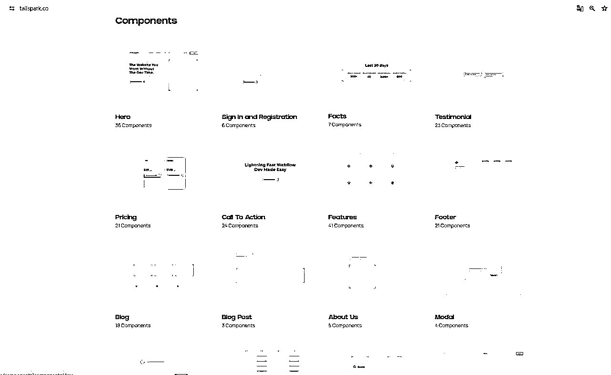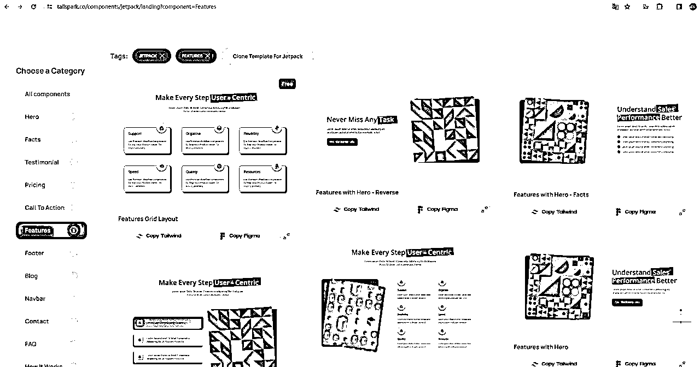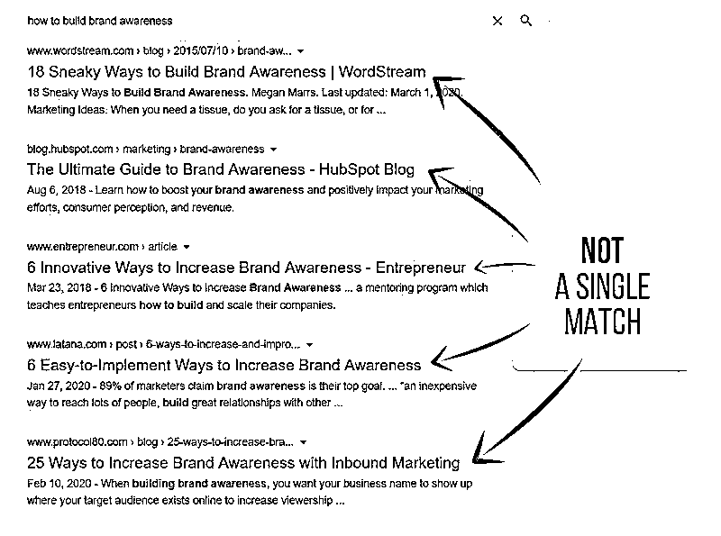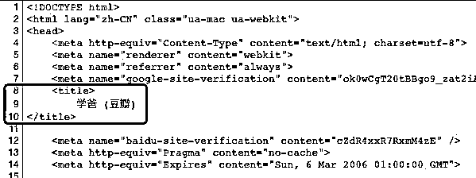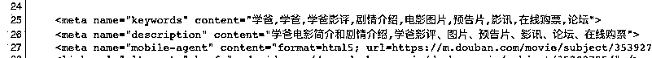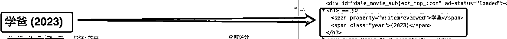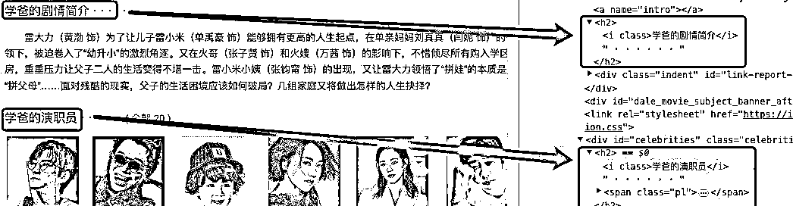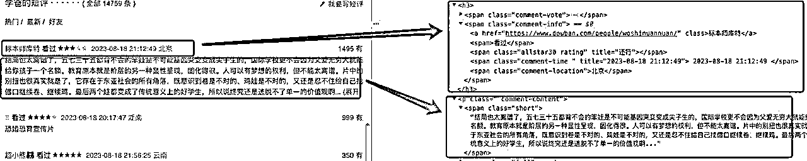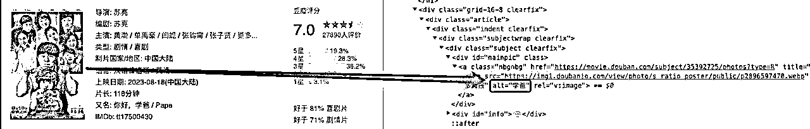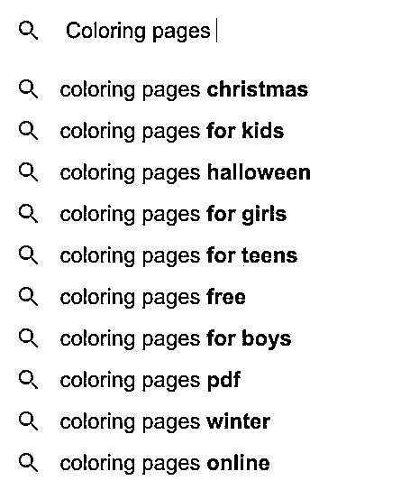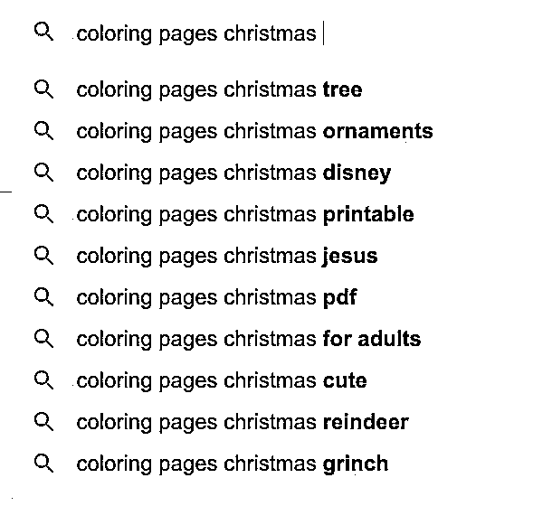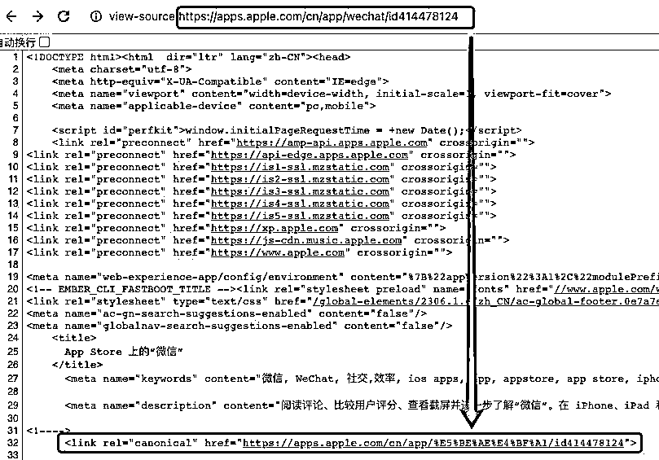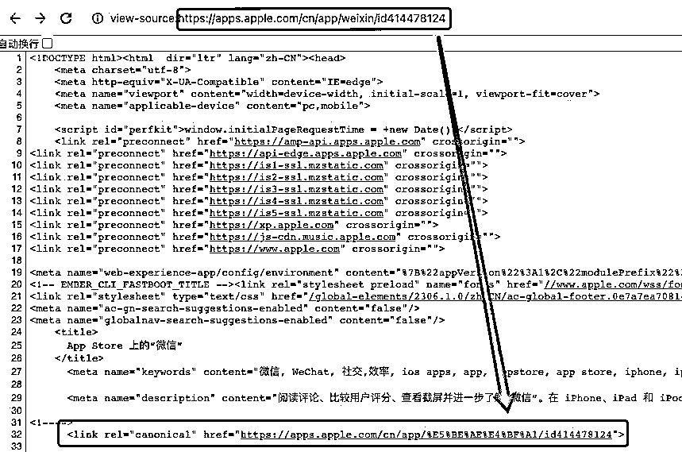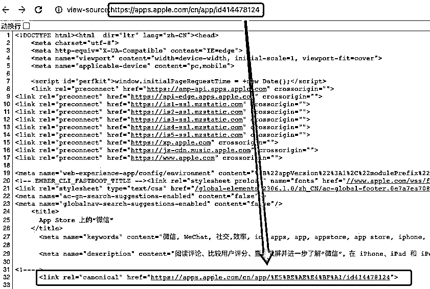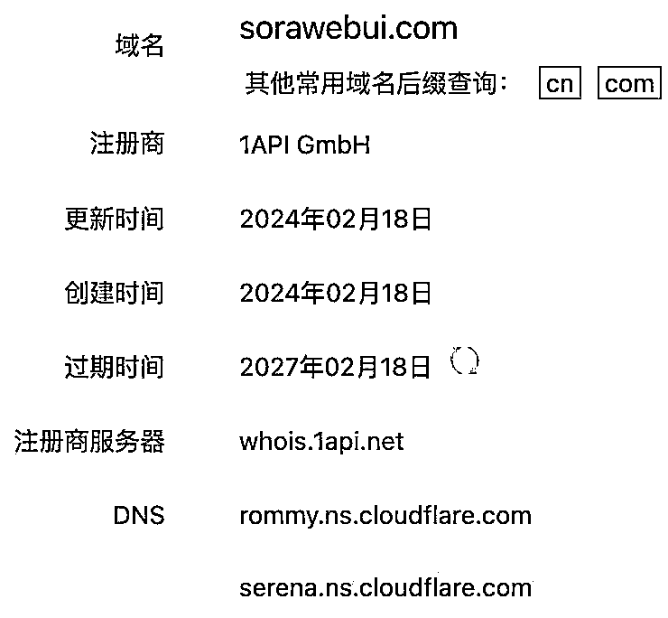

## 四、【项目实操 3/4】给新站找到第一批流量

网站做出来，不能坐着等收录。冷启动的第一步，是建立启动外链，让谷歌蜘蛛尽快发现你。可以在 V2EX 等社区真诚介绍产品，别只写一句敷衍的广告；介绍写得具体，别人才愿意点。新站被收录的速度，取决于蜘蛛访问你提交链接的频率。一般快则一小时，慢则一天；若几天没收录，要检查页面质量或 Search Console 提醒。如果手里有已被收录的老站，也可以在页脚或全站通用位置给新站加链接；和朋友换链或付费合作时，位置可放在首页底部或专门友链页。

第二步，把产品提交到熟悉的渠道、科技周刊、小众软件、导航站，以及 ProductHunt。ProductHunt 往往能带来第一波真正海外用户，随后一些导航站爬虫会自动抓取收录，形成第二批流量。第三步，去 Twitter、TikTok、V2EX、Medium 等社媒发干货、经验、科普，用软广方式带链接或产品名；也可以搜索正在找相关产品的人，在评论区诚恳自荐。第四步，看数据复盘：如果拿不到排名，检查站内内容是否丰富、结构是否清晰，站外宣传是否足够；如果关键词排上去但流量小，可能词本身搜索量有限，要考虑换词；如果有流量却不转化，要判断用户是想看内容还是想用工具，再决定做广告、做付费工具，还是先接 AdSense 或捐赠。

对应素材位置标记：

## 五、【项目实操 4/4】先跑通第一笔变现

网站还不完善、没接支付时，可以先试两种变现：捐赠入口和 Google AdSense。捐赠可用 Buy Me a Coffee、Ko-fi 之类工具建页面，连接 PayPal 或 Stripe，再把入口放在首屏显眼位置或社媒宣传链接里。

AdSense 要过审核，重点看：内容原创且有用户价值；不同页面不重复；网站结构清晰、有分级和菜单；每日 UV 尽量达到 500 以上；申请者年满 18 岁。被打回常见原因包括所有权未确认、不良流量、内容不足、复制内容、历史违规、缺少 ads.txt、页面价值低、网站时间太短等。只要不是原则性错误，按提示改完可再次提交。注册 AdSense 需要 Gmail，添加顶级域名，选真实国家地区，填真实个人信息；获取广告代码放到网站，同时在根目录添加 ads.txt，两种验证都要做。审核通过后，广告才会显示。

收款前要填真实地址，等谷歌从美国寄 Pin 码信件，收到后在后台输入；若三次没收到，可申请线上实名认证，上传身份证和地址旁标志性建筑照片。广告收入累计到 100 美元才会付款，建议用招行电汇收款，关键词可查“China Merchants Bank + Adsense”。

对应素材位置标记：

# 选修篇：更多打法与案例拆解

## 六、【项目变现拓展】其他变现方式

当工具更完善、流量更稳定，可以考虑联盟营销和付费订阅。联盟营销类似国内淘宝客：CPS 按销售额分成，SaaS 类产品佣金常常不低；CPA 按用户完成下载、注册等行为付费，常见佣金 2—10 美元。新人可先从 CPS/CPA 联盟入手，也可以看竞品在推什么，再用“关键词 + Affiliate”找入口。选定产品后申请推广资格，尽量填真实资料，避免佣金提现受阻。Shopify 这类平台佣金空间可观，且建站周边插件、主题、营销工具还可能带来额外分成。

付费订阅需要收款渠道：个人可先用 LemonSqueezy，Stripe 最好用海外公司主体。注册海外公司、银行账户、Stripe 后，可更稳地收美元或 USDT。常见准备包括护照、驾驶证、海外手机号、注册地选择（英国或美国）、EIN、Mercury 银行账户等；Mercury 虚拟卡可绑定支付宝消费，也方便管理订阅扣费。Wise 可用于收汇款和结汇，Kraken 可通过 SEPA 提现到 Wise。成本要提前算清：手机号年费、注册代理费、地址邮箱费、年报和税务工具费等。

对应素材位置标记：

## 七、【项目拓展 1/4】更多挖需求的方法

高成功率的产品想法，通常满足三个条件；常见挖掘路径包括：原生 idea，成功率最高，从自己每天遇到的问题出发；抄成功竞品再做差异化，市场已被验证；通过关键词找未被满足的需求；从用户痛点出发；围绕大平台周边找机会；围绕自身需求拓展；看排行榜找方向；接付费定制再产品化；以及重点关注 ChatGPT 相关工具站。反面提醒是：生造需求往往风险很高，别轻易爱上自己的点子。

关键词挖掘可先框定母词，再用谷歌关键词规划师、Ahrefs 等拓词，清洗、分组、筛选有价值词，放进项目库。用户往往搜长尾描述，公式可理解为“核心词 + 需求动词/名词 + 疑问词”。谷歌下拉框、相关搜索、星号通配符都是找词入口。拿到词后，看搜索频次、竞争强度、外链难度，再决定做不做。痛点挖掘可以从巨头产品周边入手：巨头不做、没顾上、或为了多数人体验而牺牲的小众需求，都可能真实存在。围绕平台也有机会，例如 Instagram 只能放一个主页链接，就催生了中间页工具。排行榜要多看，ProductHunt、Toolify、Chrome-Stats、YC 公司库等都能开拓视野。个性化定制则是有人先付费找你做，再尝试标准化卖给更多人。

ChatGPT 相关工具站值得重点关注：浏览器插件是轻量形态，AIPRM 做提示词增强，ChatGPT for Google 做搜索场景，ChatGPT Writer 抓写作场景，ShareGPT 补官方分享功能，Voice Control 做语音对话，Shulex VOC 用 AI 升级评论分析。核心认知是：从面向 Google 编程，到面向 ChatGPT 编程；Prompt 可视为迷你工具，一套 Prompt 可视为迷你 SaaS；结合自身业务场景用 AI 赋能；出海做英文工具站仍有空间。

对应素材位置标记：

## 八、【项目拓展 2/4】更多获取流量的方法

除了常规外链和社媒，内容引流也很关键。TikTok 可包装账号、找对标粉丝、关注回关、私信引导，或者用“大号做包装、小号评论区引流”的方式触达精准用户；测评网站能带来高质量初始流量，先分析竞品被哪些大站推荐，再联系对方请求评测；Instagram 可批量账号引流、关注回粉、子母账号配合，但要注意平台风控；教程类内容可批量制作，发布到 B 站、知乎等平台做转化；SEO 是长期基本盘，Google SEO、YouTube SEO、独立站 SEO 都值得学。

工具产品投放要理解常见数字营销方式：SEO、ASO、SEM、社交媒体广告、移动应用广告、邮件营销、红人营销、社群营销、再营销等。中小开发者最直接有效的往往还是效果广告，尤其是 SEM 和社媒广告；投放前准备好账户、开发者授权、MMP 或 GA 设置，再按步骤建广告、选受众、设出价和预算、做素材、看数据。监控重点包括展示频率、CTR、CVR、版位、广告质量排名、花费和 ROAS；竞品分析最原始但有效的办法，是亲自刷广告。

更多 SEO 元标签也值得补：站外用户生成链接可加 nofollow，避免权重被薅；不想被收录的页面用 robots meta 的 noindex；用 canonical 告诉搜索引擎规范 URL，避免带跟踪参数的链接分散权重；Schema Markup 按谷歌文档提交结构化数据；Open Graph 和 Twitter Cards 控制社媒分享效果；Viewport 元标签做好移动端适配，移动友好也影响排名。

对应素材位置标记：

## 九、【项目拓展 3/4】如何分析竞品流量

分析网站表现，常看四个维度：流量、流量来源、跳出率、转化率。流量分 PV 和 UV，PV 永远大于等于 UV；平均访问页数和平均停留时长可衡量粘性。看流量还要注意时区，出海站要换算成目标用户所在时区，才能判断活跃时段。流量来源主要有搜索、直接、引荐、社交：搜索流量分自然和付费；直接流量可能来自直接输入 URL、桌面软件、App、社群链接或 noreferral 链接；引荐流量来自其他非社交网站，可借 Top Referral Sites 看竞品策略、代理站、马甲站和多语言站；社交流量高往往说明广告投得猛，或工具本身依赖社交平台，或 YouTube 引流有效。跳出率高说明页面可能不匹配预期；转化率则要结合网站目标定义。

定价方面，核心是“为价值定价，而不是为自己的成本定价”。在小众市场，明确价格本身会给用户一个价值预期；可按 80/20 法则优先服务好贡献大部分利润的 20% 用户；设置价格锚点，让用户有参照；订阅模式在海外接受度高，但要理解自动续费带来的用户遗忘和争议；涨价有时是最好的增长方式，只要新增收入能覆盖转化率下降。

对应素材位置标记：

## 十、【项目拓展 4/4】用 ChatGPT 搭建工具产品

做 MVP 可以借 ChatGPT 加速。以“预置 Prompt 的 AI 文本生成工具”为例：先把需求描述清楚——页面有哪些元素、每个元素做什么、点击后发生什么；让 ChatGPT 生成 Python 和 HTML 代码；代码不完整就让它继续；再按 OpenAI API 文档生成 key，替换到代码中；保存为 .py 文件本地运行；需要网页版就把 HTML 放进 templates，和 py 文件同级，再部署到服务器。样式和 Prompt 都继续让 ChatGPT 优化。关键不是一次生成完美产品，而是用小切入点快速跑起来。

对应素材位置标记：

## 十一、【注意事项】做英文工具站有哪些坑

做英文工具站，机会和坑并存。招人方面，需求没拆细就找海外开发者，沟通和进度容易失控；应先列清实现细节，多找几个对比磨合。业务流程上，优先找已经被验证赚钱的需求，再深挖差评和未满足点；先模仿核心需求，尤其把支付环节跑通。支付是大坑：PayPal 对虚拟产品不友好，Stripe 申请门槛和封号风险都不低；插件收款还要考虑支付回传、本地标识 Key、邮件通知等。图标图像要注意侵权，别等被扣款才后悔。推广上，Chrome 插件可直接投谷歌搜索广告，但联盟广告往往需要另做网站；投放前要准备试错预算，并持续优化地域、设备、关键词。最后，失败很正常：提高失败速度，从每次失败里学习，继续尝试；别因为一次成功就飘，也别因为连续失败就否定自己。

对应素材位置标记：

## 十二、【案例展示】英文工具站案例分享

案例能帮我们看清“需求—产品—流量—变现”的完整链路。ChatGPT 相关案例里，有人从📕 Python 作业需求切入，一天做出 AICodeHelper，靠 SEO、社区冷启动和热点流量做到单日最高千元级变现；有人用 ChatGPT 开发 Chrome 插件，把对话保存为 HTML、TXT、PNG、PDF，验证了 GPT 辅助开发小工具的可能；有人做 RPA + ChatGPT 的批量写手机器人，把“半自动复制粘贴”推进到全自动批量；也有人围绕 ChatGPT 做细分工具站，找利基需求。

非 AI 案例同样有启发：程序员代码聚合站靠初始内容、V2EX 宣传、英文版和自然外链获得搜索流量；图片上传生成链接工具 prnt.sc 靠简单功能和裂变属性，日访问约 100 万、月广告收入可观；Shopify 数据导出插件抓住店铺装修和评论数据需求；PDF 小工具矩阵从细分需求切入，先跑通再扩展；linktr.ee 抓住 Instagram 单链接限制，做中间页工具；酒店协议代码集合站靠精准关键词，每月约 1000 美元广告收入；Dropbox 扩容、GMass 定制邮件、Scrubber 清理社交黑历史、Notion 模板、资料网页化、内容农场、多语系工具站、海外促销折扣站等，都说明一件事：需求可以很小，但只要能解决具体问题，就可能被搜索、被传播、被付费。工具邦月 PV 数千万仍持续迭代；促销站两年多没怎么管，也能积累亚马逊联盟收入；这些案例不保证人人复制成功，但提供了可拆解的打法。

对应素材位置标记：

说到底，英文工具站不是“建个站等流量”的生意，而是从搜索意图出发，用 MVP 快速验证，用 SEO 和内容承接需求，用外链和社媒完成冷启动，再用广告、捐赠、联盟或订阅跑通变现，最后在数据复盘里持续优化。第一步不用完美，但一定要开始。