# 强项挖掘实操手册 202403

出品团队：龙哥盟团队  
成稿日期：2024年3月21日

使用提示：这份资料想带你看见强项的更多可能，也帮助你理解后真正用起来。若想迅速定位某段内容，可在文档里按 Ctrl+F/command+F 搜索关键词。

## 开篇寄语

### 你好，

欢迎来到12月航海·强项挖掘实战手册。接下来的时间，我们会在这里反复碰面。

出发之前，先想清楚一件事：为什么要找到自己的强项？

过去不少教育都在提醒我们补弱项、求全面发展。可现实常常相反：弱项拼到极限，也许只能摸到及格线；强项稍加投入，却可能接近高分。真正能让你安身立命的，是别人难以复制的那块长板。找到它、打磨它、让它变成竞争力，是每个人都要补的必修课，而不是可有可无的选修。

所以，本期航海最核心的命题，就是怎样找到并放大强项。

平时，我们可以从做成的事里找线索，也能从反复出现的行为里找线索；如果再加上专业的优势识别工具，速度会快很多。因此，本次选了市面上颗粒度较细、科学性较高的盖洛普，作为辅助工具。

这份资料希望帮你做到三件事：认识盖洛普、初步读懂报告、结合案例理解自己的强项，并试着用它处理现实中的卡点。

当然，盖洛普体量不小，仅34项才干的组合就有上千种。想靠一份资料立刻读透报告、一次性看清全部强项，并不现实。

本期最想传递的一句话是：用拿手的才干去压制弱点，相信同一道题不止一种答案。交朋友并非只有社交一条路，专业过硬同样能聚人。

我们常常在不知不觉中调用自己的才干。用对了是助力，用错了也可能暴露短板。等你足够了解它们，这些才干就会成为趁手工具；有意识地使用拿手部分，很多难题会松动。

航海结束后，这份资料仍可作为你的实操教材。航行期间，我们也会请教练从不同角度分享，回应大家可能遇到的问题，也欢迎你交流自己的强项挖掘心得。

此外，请多提问、多交流。这里解决不了的地方，多问几句，我们一起寻找更多解法。

希望你在这次航行里拿到成果，也结识一群并肩的伙伴。

本资料由龙哥盟团队组织编写，供航海船员和龙哥盟星球圈友学习使用。实践中若有反馈，欢迎联系鱼丸（yuwan387）提出修订建议。

# 【使用更新】这份指南怎么用

开始前，先弄清楚使用方式，方便你按自己的节奏取用。

整份内容按从0到1掌握强项挖掘来推进。你可以顺着航线图一步步做，也可以按实际需要跳读。

这次相较以往航海有较大调整：旧版尽量铺开更多玩法让大家自由选择；新版拆成必修与选修两块。

如果你刚接触这个项目：

建议先看项目概览，建立整体印象。

【项目概述】认识强项挖掘

如果你已经大致了解项目：

可以从第二章起步，完成一次盖洛普测评，进入航线图第一阶段。

【测评】完成1次盖洛普测评

准备完成后，进入第二阶段：学会读自己的报告。

【分析】如何看懂盖洛普报告

熟悉流程后，进入第三阶段：把盖洛普用进生活。

【应用】怎么将盖洛普应用到生活

如果你已完成必修部分，想继续深入：

可重点阅读扩展章节。

盖洛普更多应用案例

常见问题答疑

优势&成长书单推荐

本航海项目的航线图如下：

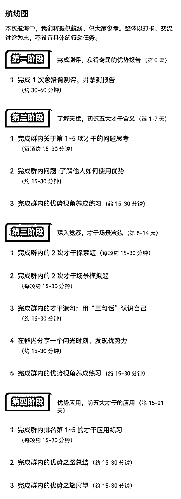

航线图与正文相互对应，你可以按自己所在环节学习相关步骤。

# 必修篇：先把最小闭环跑通

章节概要

这一篇会从认识强项挖掘开始，带你一步步完成盖洛普的探索与落地。

如果你是新手，正式实操前先了解项目全貌：

【项目概述】了解强项挖掘

如果你已了解整体，就按核心步骤开始：

【测评】完成1次盖洛普测评

【分析】如何看懂盖洛普报告

【应用】怎么将盖洛普应用到生活？

在必修篇，正文顺序与航线图一致。顺着读、逐项做，就能完成航线图上的任务。

后续每个关键步骤的章节概要里，也会提到对应航线图，提醒你完成相关动作。

接下来正式开始。

## 一、【项目全景】认识强项

#### 章节概要

这一章会一起走近强项挖掘，包括：

强项是什么？怎样找到它？

盖洛普测评是什么？它与强项挖掘有什么关系？

先对项目有整体认识，很有必要。一起看下去。

### 1.1 为什么要发现自己的强项 @醒醒同学

“拖延、想多做少、笨、冷漠、软弱、强势”等评价，常会卡住职业发展和人际关系。可这些标签背后也许另有解释：拖延可能是任务不合拍、效率低；冷漠有时来自理性；软弱里藏着善意；强势也可能是果断。

每个负反馈背后，常常有正向的一面。一旦把注意力从“哪里不好”转向“哪里本来就好”，改变就会慢慢发生。

在我有限的职业经历里，越觉得自己不如人，越容易比较，拿弱项去碰别人的强项，结果越做越差。反倒是顺着直觉做拿手的事，结果常超出预期。

过去我有很多毛病想改，总觉得成绩都是运气；越改，越被旧习惯拉回原地。

不管别人怎么肯定我，我都觉得自己不够好。直到接触盖洛普，它像放大镜，让我看见天赋和盲区。结合过往经历，我才明白互联网为什么比国企更合我：关系建立、战略思维突出，成就排第九，想法多、怕闲、爱灵活变动的环境；纪律排最后，在规矩固定的地方会很不适。若在国企天天朝九晚五，我会憋得难受，想法越多、越用力，反而越压抑。

用盖洛普复盘过去，也解释了为什么之前能连续拿销冠，很多同事遇到危机也来找我帮忙。

我体谅与个别突出，对情绪敏感，和用户聊几句就能抓到需求；理念突出，点子多、办法多；战略突出，能迅速想到方案并赢得信任；适应突出，越是突发状况越兴奋、越能发挥。信任到位后，成交自然发生。

做优势教练近两年，我观察到：在职场和生活中认清自身天赋的人，通常越活越顺。盖洛普研究也表明，成功者有个共同点——扬长避短。

如果天赋是升级打怪时的专属武器，盖洛普就是武器使用说明。有一身好武器却不会用，实在可惜。

希望更多人加入“唤醒天赋的旅程”。认识并接纳自己的好，是长期幸福的起点。

#### 1.1.1 强项到底是什么？

强项可以这样理解：同一件事，你上手比别人快，做起来也更省力。它由天赋才干、技能和知识共同构成，但底座是天赋才干。

天赋才干，是老天给的、较早成型且之后不易翻转的稳定特质。盖洛普照出的，正是你擅长的那些天赋才干；强项也从这些才干里长出来。

天赋像原材料，强项是把原材料用到极致后的成品。

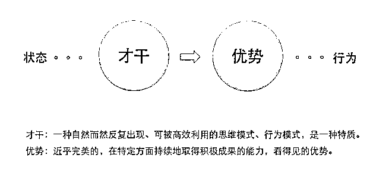

用盖洛普官方的说法，才干与优势的关系是：才干 × 投入 = 优势。想弄清自己的强项，第一步是认出自己的天赋才干。

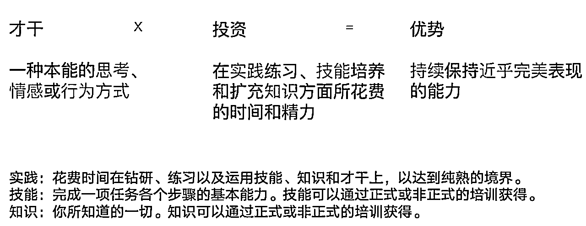

想把一件事做成，除了天赋才干，还要看所在领域有没有经验积累，以及知识、技能是否到位。当你所在的领域、积累的经验和学到的知识，恰好与天赋咬合，强项更容易显形。

#### 1.1.2 怎样找到强项？

找强项的重点，不是贴一个标签，而是找到能让你持续投入、容易拿到正反馈的事情。这里的“优势动力”是个动词：做起来容易收到正反馈，越有反馈，越愿意继续做，成果也越稳。人做擅长的事，才更容易不断获得正反馈。

下面两种观察法，日常都能用；若再配合专业测评工具，找到强项会更快。

市面上探索强项的工具不少，大多帮你认识“真实的自己”，例如九型人格、MBTI、DISC、盖洛普、VIA。各自有解读体系，相对而言，盖洛普颗粒度更细、结果也更准确。

所以本期用盖洛普辅助探索，后续内容也围绕它展开。具体才干分析与解读，可查阅「3.5 了解34项基础才干」。

1.1.2.1 从做成的事里找线索

强项常表现为：某些事你比别人更轻松。天赋正向发挥时，会带来成就感。把那些让你有成就感的事件记下来，找共同点，这些共同点可能就指向底层才干。

从成就事件入手最容易。请回想：你做成过哪些事？其中反复出现了什么特质？

朋友L做投资，是个好例子。

她从小对数字、原理敏感，数学成绩一直不错（成就一）。

大学时，父亲一次性给了四年学费，她拿去投资，过得挺滋润，像在玩一场数字游戏（成就二）。

工作后，她专注炒股，常能从盘面看出买卖点，整体收益不错（成就三）。

每次聊投资，她扫几眼就能讲清不同数字代表什么，并推导合适时机。她不怕质疑，甚至享受逻辑验证，靠专业度吸引了不少客户（成就四）。

从小到大，她对数据、逻辑、原理保持敏锐，分析能力很强，也一直靠这种方式取得阶段性成果。

放到盖洛普语境里，这就是“分析”才干：数字敏感，爱追根究底，难以接受未经证实的结论，更信证据而非直觉，常能看透事物本质。

你也可以列3—5个成就事件，找反复出现的做事方式。那些帮你拿到阶段性成果的“常用路径”，往往就是强项线索。

1.1.2.2 从反复做的事里找线索

一个人乐意花大量时间重复某件事，大概率是其中有利可图——可能是快乐、能量或反馈。这件事里，可能就藏着他的优势动力。

朋友A喜欢出门、参加活动、结交新朋友。她会不断参加活动，半夜11点也能准时到场；一段时间不社交就无聊；生活里遇到难事，第一反应也是出门见人，听朋友经历和建议。

她的取悦、行动、积极很突出。认识新朋友、尝试新体验，对她像充电；有她在的场合不容易冷场，大家也开心（取悦+积极）；听到好建议立刻行动，拿到反馈后持续迭代。

当然，重复行为不一定都带来好结果。

比如我忍不住刷消息、看商业报道、发朋友圈，也容易分心。另一个朋友爱囤课、收集小物件，可能被说不务正业。还有朋友话不多，一开口就指出问题、给方案，容易被认为挑刺。

我们都在不同阶段怀疑自己走错路，却没意识到这些“忍不住”的背后，可能是思维、理念、搜集、学习、取悦等才干。我朋友圈素材几乎不断：搜集提供材料，理念带来灵感，思维加工成文字，靠持续写变现七位数，但我从没系统学过写作。

所以，如果你有忍不住想做的事，不管旁人支持还是否定，它大概率对应着底层才干需求。关键是找到适合它的场景，把强项不断放大。

内容来源：《接触盖洛普后，我唤醒了自己的天赋，也希望能帮到你》《3个挖掘底层天赋的小妙招，一般人竟都不知道》

### 1.2 认识盖洛普 @叶叶在觉 @醒醒同学

工欲善其事，必先利其器。要挖强项，先认识本期会用的评测工具——盖洛普。这一节回答几个问题：

#### 1.2.1 盖洛普是什么？

盖洛普由美国盖洛普咨询公司研发，测的是一个人不假思索的心智模式，也就是思考与行动的习惯，像一份个人操作说明。

陆地动物不必下水比游泳，水生动物也不适合上岸赛跑；先分清自己属于哪种赛场，比盲目较劲更重要。盖洛普测的正是：你该往水里去，还是往陆地去；该游，还是该跑。

它不只是一份测评，更是一套语言，用来描述人的行为规律，以及这些规律对应哪些天性优势。

在盖洛普体系里，共有34种行为规律，也就是34种天赋优势，通常叫才干（talent），是一个人自然流露的情感模式、行为模式和思维模式。

例如：闲不住、想多完成任务、看到成果才踏实——成就；爱报课、享受学习过程——学习；遇冲突先求同、重一致——和谐；点子跳跃、常有新想法——理念；先排风险再行动——审慎；爱追问本质、常深度思考——思维；陌生场合也能聊开、从社交中充电——取悦；更愿和熟人深聊、慢热——交往；对数字与证据较真、爱验证结论——分析……

这些反应不用刻意提醒，也不用咬牙硬撑，它们是下意识习惯，也是内在需求。有意识训练这些本能模式，往往事半功倍，更容易感到正反馈。

每个人的34项组合与排序都不同，这份测评能体现个体差异。按键数量有限，能编出的曲调却几乎没有穷尽。

#### 1.2.2 盖洛普准吗？

判断一份优势测评准不准，可以看信度、效度和测谎机制。

1）信度

信度指结果的一致性、稳定性与可靠性，也就是同一对象重复测量时，结果是否相近。信度越高，结果越稳、越可信。

人很复杂，还有社会化自我，测评时可能不自觉戴面具、美化自己。因此市面上还没有100%精准的优势测评。盖洛普重测信度约73%，即两次测评前后一致性约73%，在同类工具里已算较准，具备参考价值。

2）效度

效度指有效性，即测量结果是否真的反映了想考察的内容，也就是常说的“测得准不准”。效度越高，结果越贴近个人强项。

盖洛普由美国优势心理学之父、盖洛普前董事长唐纳德·克里夫顿主导设计。团队至少花30年，访谈200多万名不同国家、行业的杰出人士，了解他们如何成为佼佼者。

基于大量访谈数据，团队提炼出这些成功者共有的思维方式，并用34项天赋才干主题（talent theme）来命名。

目前官网已有3000多万样本数据，用于证明盖洛普的有效性。

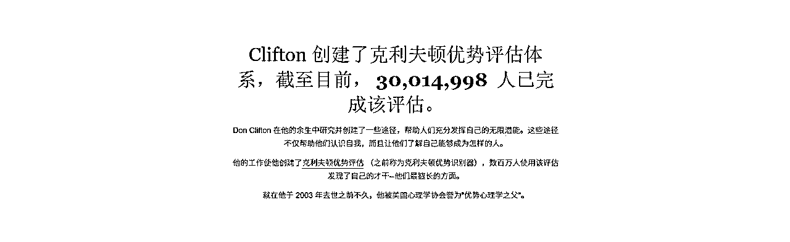

关于盖洛普测评的更多历史，可点此阅读：

https://www.gallup.com/cliftonstrengths/zh/253745/%E5%85%8B%E5%88%A9%E5%A4%AB%E9%A1%BF%E4%BC%98%E5%8A%BF%E5%8E%86%E5%8F%B2.aspx

3）测谎机制

最后说测谎机制。

人是复杂生物，哪怕面对自己，也未必足够坦诚。一旦反复思量，或被“政治正确”引导，测评很容易失真。

不少测评让你给自己打分，或给出明显“正确”的选项，比如“你觉得自己责任心强吗？”这种题很容易作假。因此，很多专业付费测评会加入测谎机制。

先给结论：这套测评真正捕捉的，是你下意识里的反应模式，而非你经过斟酌后给自己贴的标签。

不少人心里打鼓：凭直觉作答，结果能准吗？

其实，设计者在出题阶段就把“人为偏差”当作头号问题来处理了。

完整评估包含 177 道题，前后题目会彼此印证。同一个才干主题不会只押在某道题上，而是分散到多个位置，并且尽量让你察觉不到它正在测什么。拿“积极”来说，它可能表现为日子过得有笑声，可能表现为你爱夸人，也可能表现为你习惯往好处看，或者单纯笑点低……

这些描述，都是你比较容易判断“像不像我”的。越贴近，该特质越靠前；大致沾边，落在中段；越不沾边，排得越靠后。

另外，等你对这套体系摸得比较透了，就别反复重测。因为一旦知道每道题在考什么，作答就会偏向“我理解的自己”，而不是“本能的自己”，准确度会打折扣。

#### 1.2.3 这套工具能用在哪些地方

这套方法脱胎于职场实践与学术探索，本质上属于积极心理学取向的综合评估，无论用于认识个人还是理解团队都有广泛适用性，对象涵盖普通员工、高管团队、学生群体、家庭成员以及追求自我发展的人。几个典型用武之地如下：

个人成长：人想持续进步，总得搞清楚“从哪儿下手、怎么改”。说到底，先要看清自己真正要什么，把自我认知往深里走一层。测评折射出的是你的做事惯性——你总用类似方式行动，背后往往对应着某种才干层面的诉求。看懂诉求、接纳本来的自己、学会欣赏自己，信心才能扎下根。

职业发展：它能帮你识别强项，也能指出有待成长的空间。把优势才干和岗位要求对照起来看，往往能提升胜任程度和工作效率，效果好比给职业生涯装了一根撬棒。

团队建设：管理者拿它来读人、用人，摸清成员各自的长处和薄弱处，团队效能和协作顺畅度都能往上走。成员之间一旦理解了彼此的才干差异，也更容易养成兼容并包、多元共生的氛围。

人际关系：每个人顺手的事本来就不一样，于是我们容易拿自己的标准去衡量别人。比如有人受不了随性，有人受不了刻板，你看我不顺眼、我看你别扭。借助这套工具去理解对方的行为逻辑，不少误会和敌意就能消解，用在伴侣、亲子等亲密关系里尤其见效。

更细致的才干用法，我们会在四、【应用】怎么将盖洛普应用到生活？里结合案例来讲。

内容来源：《盖洛普是什么？一个龙哥盟全团队都在用的工具》 《276 。 我觉得自己一无是处，还能找到天赋吗？》

## 二、【测评】做一回盖洛普测评 @醒醒同学

### 本节提要

走到今天，盖洛普旗下已有 7 种评估工具。其中「34 项才干测评」属于必做的那一个，它能帮你挖掘自身可能藏着的天赋。至于其他评估与它的差别，可移步官网查询「查找最适合你的克利夫顿优势评估」。

如果你打算实际测一次，大致按下列顺序走：

第一步：拿到测评码

第二步：注册新账户

第三步：参加克利夫顿优势评估

第四步：开始作答

第五步：下载报告

眼下测评码主要有两种来路：

盖洛普测评经过多年发展，优势教练的认证体系已经比较成熟。这次航海的教练都通过了官方考核。为了方便教练推进工作，官方会给到教练少量测评码折扣。折扣码仅官方认证教练持有，全年限额 350 个。

当然，你也可以走别的渠道，只要最终拿到的是正规报告，就能看懂自己的结果。不建议直接在各大浏览器搜「盖洛普测评」，十有八九会点进非官方广告。

正式开测前，请务必把注意事项过一遍，并严格照着做。不然可能招来没必要的差错和困扰。「2.2 盖洛普测评注意事项」

#### 本章航线图

完成本节内容的学习和实操，即走完航线图第一阶段：完成测评，拿到专属优势报告（第 0 天）

1.完成 1 次盖洛普测评，并拿到报告（约 30-60 分钟）

那么现在，开始吧。

盖洛普优势测评的正式叫法是克利夫顿优势测评（正版官方入口：https://login.gallup.com/）。你在搜索引擎里输入“盖洛普测评”，会冒出许多推荐，但多数不是正版，测出来的结果偏差也不小。

截至 2023 年 4 月，官方共有 7 种评估，其中「克利夫顿优势 34 个才干主题测评」属于必测项，下文简称“34 项才干测评”。它能帮你发现自身可能存在的天赋。

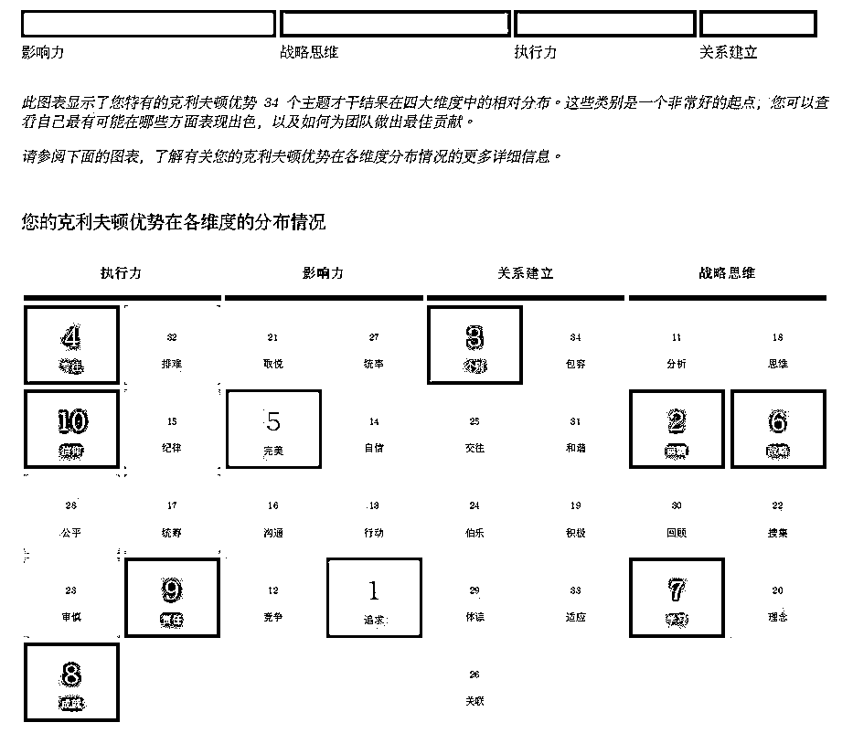

（官方参考报告）

图中“经理人”“领导者”“销售人员”这几类优势不需要单独测评。做完“34 项才干测评”后，付费就能解锁对应报告。

若你对别的评估也有兴趣，可以找航海教练购买，同样能拿到一些优惠。

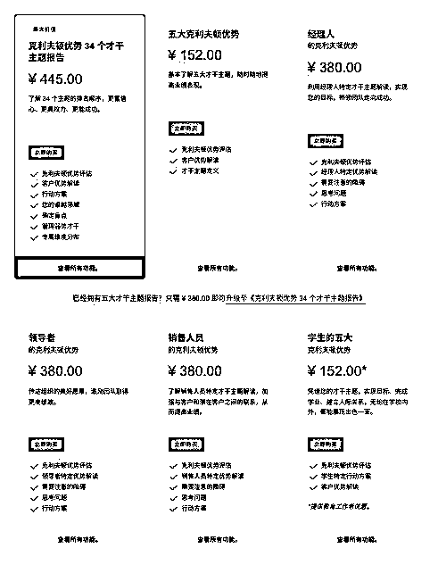

（图片来自盖洛普官网）

本期航海主打「克利夫顿优势 34 个才干主题测评（CliftonStrengths 34）」。

用途：呈现你的强项与弱项，让你更清楚自己擅长什么、卡在哪里，从而把长处用出来，推动自我成长与职业进步。

价格：445 元（教练价 410 元）

报告内容：涵盖 34 个才干主题的排序和逐一说明，并附带针对你个人优势与弱项的定制化建议。

其余评估的差别，可去官网查看「查找最适合你的克利夫顿优势评估」。

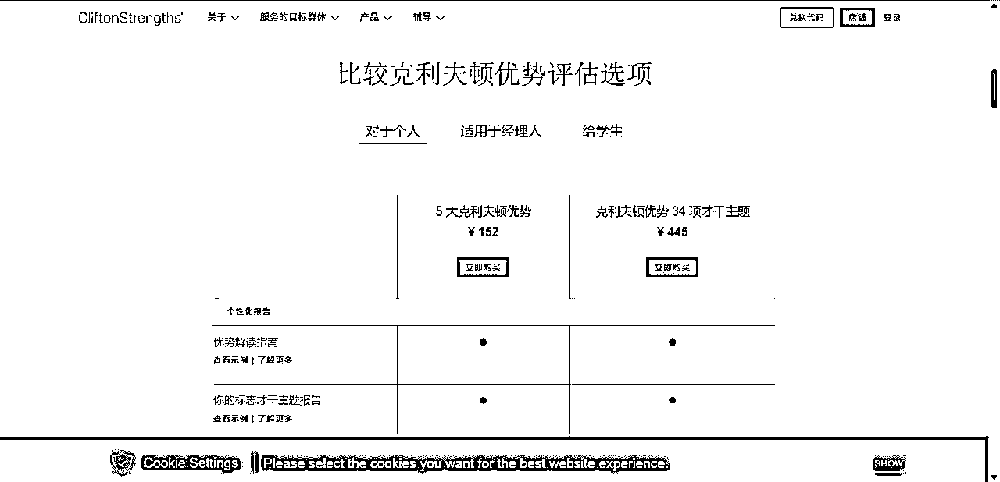

### 2.1 测评码怎么买

买前须知：

盖洛普测评走到今天，鉴定优势教练的流程已经比较完善。本次航海的教练都通过了官方认证考核。

为方便教练开展工作，官方会给教练一些测评码折扣。折扣码只有官方认证教练才有，每年限额 350 个，不过并非每位教练都愿意让利给用户——本次赚钱官方合作教练都提供优惠。

测评码原价 445 元/个，教练优惠价 410 元/个。若你打算从教练处买码，本期航海会组织圈友统一采购，具体对接方式请留意航海大群通知。

1）打开盖洛普官网（官方入口：https://login.gallup.com/），注册一个盖洛普账号；

2）在商店购买“克利夫顿优势 34 项才干主题评估”，支付 445 元；

3）买完后，测评链接会在一天内发到你的邮箱。

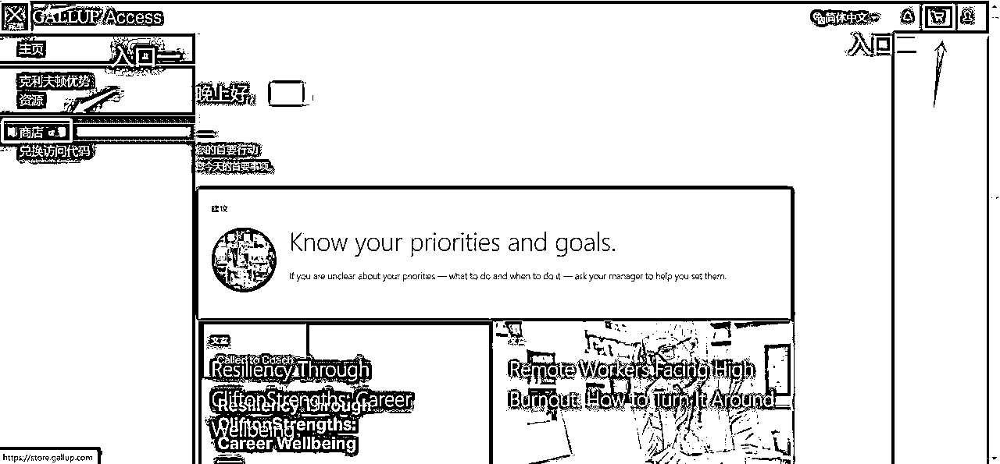

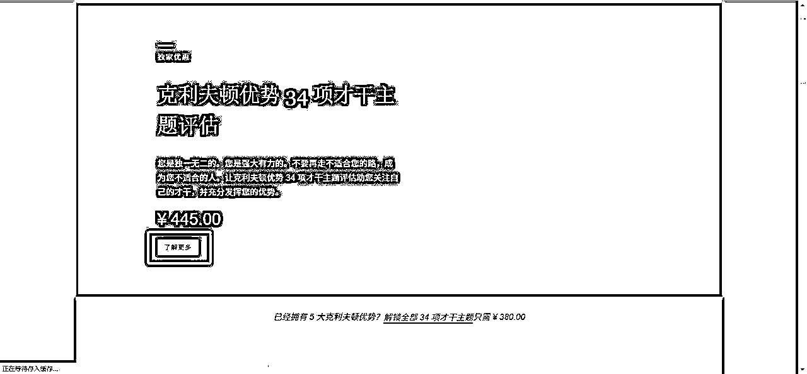

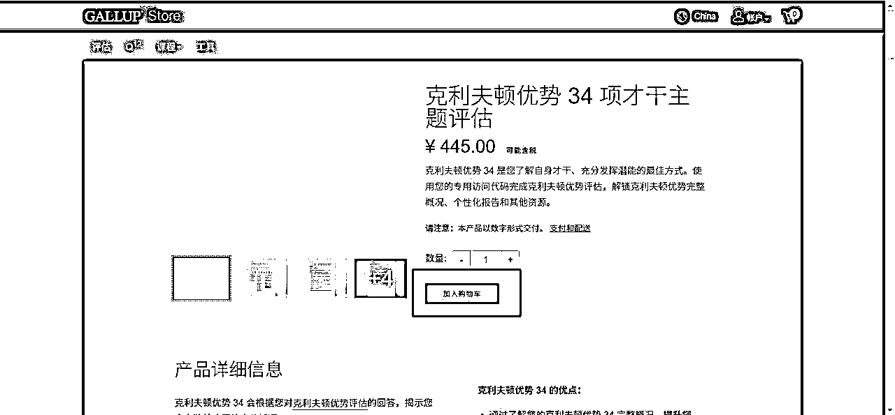

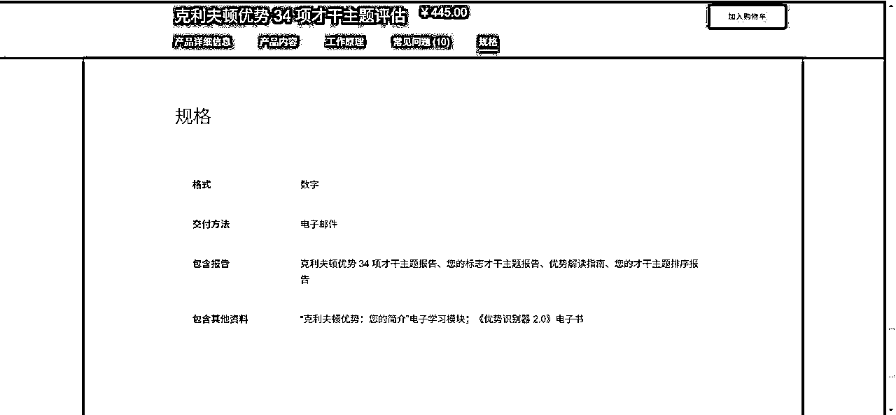

### 2.2 测评前必读

正式作答前，请先把这些提醒过一遍：

1. 整套评估一共 177 题，注册加作答约需 40—60 分钟，请找个安静的地方进行；

2. 别大量勾选中立项，那会影响结果。优先按“本能”“不自觉就会这么想/做”来选，尽量避开“后天练出来的”“被压抑的”“别人教的”“想成为的样子”这类选项。想更懂自己，就选最贴近真实想法的那个；

3. 每题限时 20 秒，超时会自动跳到下一题，不能回头重答。空着不做选择也算一种结果，系统会记下来；

4. 手机、电脑均可作答，推荐用谷歌浏览器（电脑版），盖洛普官网打开速度不算快；

5. 中途有事退出怎么办？重新进入会顺着原先进度往下走；

6. 测试时的状态可能影响结果，尽量挑心情平稳的时候做，别情绪大起大落；

7. 盖洛普的很多题目并非非此即彼，不必担心被它“定义”。我看过上千份报告，至今没见到两份完全相同的——盖洛普是定制化的；

8. 盖洛普支持多语种，网页右上角可以选国家/语言。英文水平不错的话，不妨直接做英文版；

9. 测评码有效期：官方眼下没设过期，但建议尽早测（半年内）。

### 2.3 测评流程怎么做

下面以“找教练买码”为例，把测评流程走一遍。自己上官网买也差不离，区别只在于第二步从“注册新账号”换成“登录账号”。

第一步：拿到测评码

联系教练购买优惠码，你会收到一串“测评码”。

第二步：打开盖洛普官网，注册账号

（1）访问网址：https://my.gallup.com/

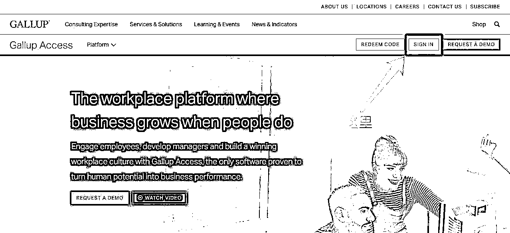

（2）点击“创建账户”

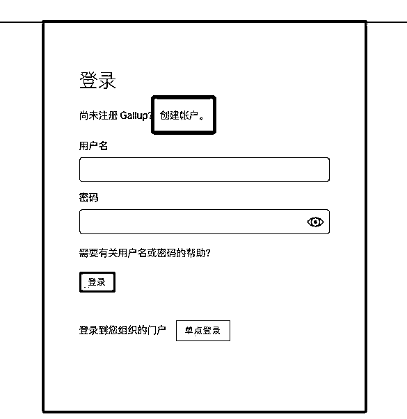

第三步：填写注册信息

提醒：以前测过的，请换一个新邮箱重新注册，再去兑换测评码。

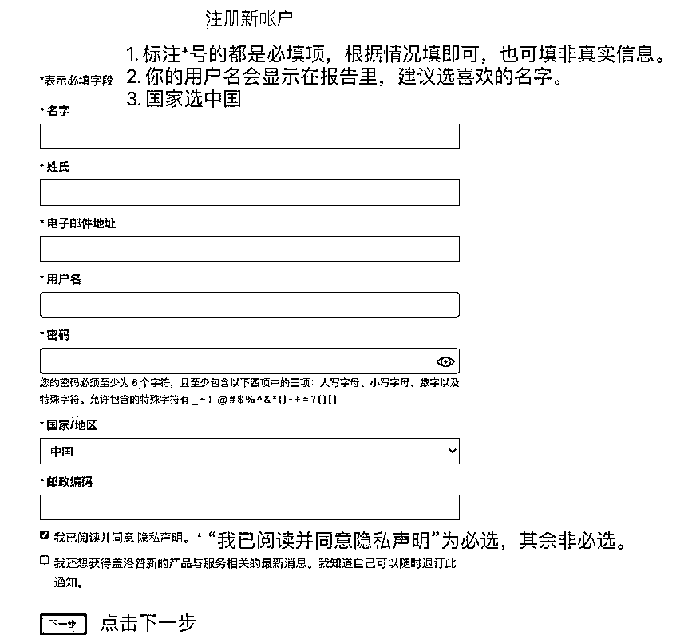

第四步：登录账号，点击「菜单-兑换访问代码」，把教练给的“测评码”输进去

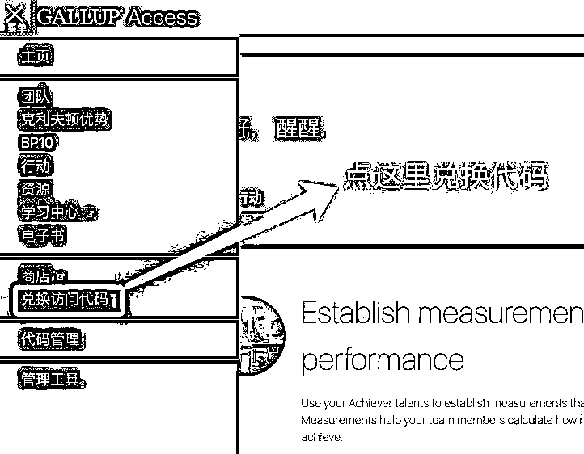

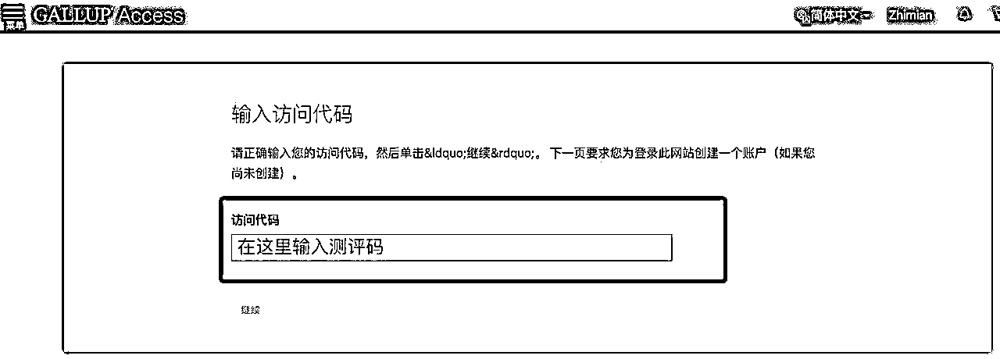

第五步：页面上出现“参加克利夫顿评估”字样后，就能开测了。记得把网页右上角切成“简体中文”。

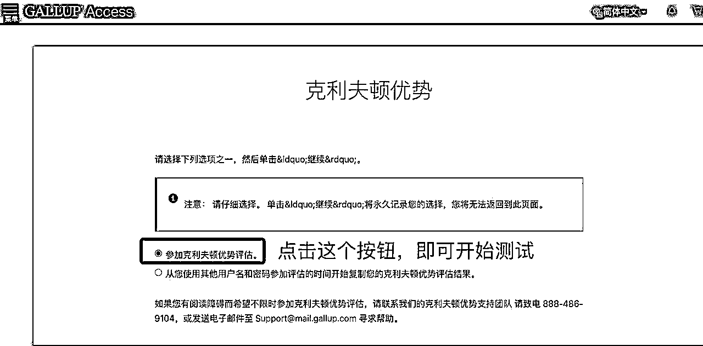

第六步：正式作答，完成 177 题，每题 20 秒（别忘了回看前面的测评提醒）

注意：每题有 5 个选项，左右两端代表不同的倾向，分别是“非常符合我”“较为符合我”“两边差不多（中立）”。

用手机作答的话，你很可能看到选项挤成一团的界面（如下图）。电脑屏幕上则清楚得多（我做了张对比图）。

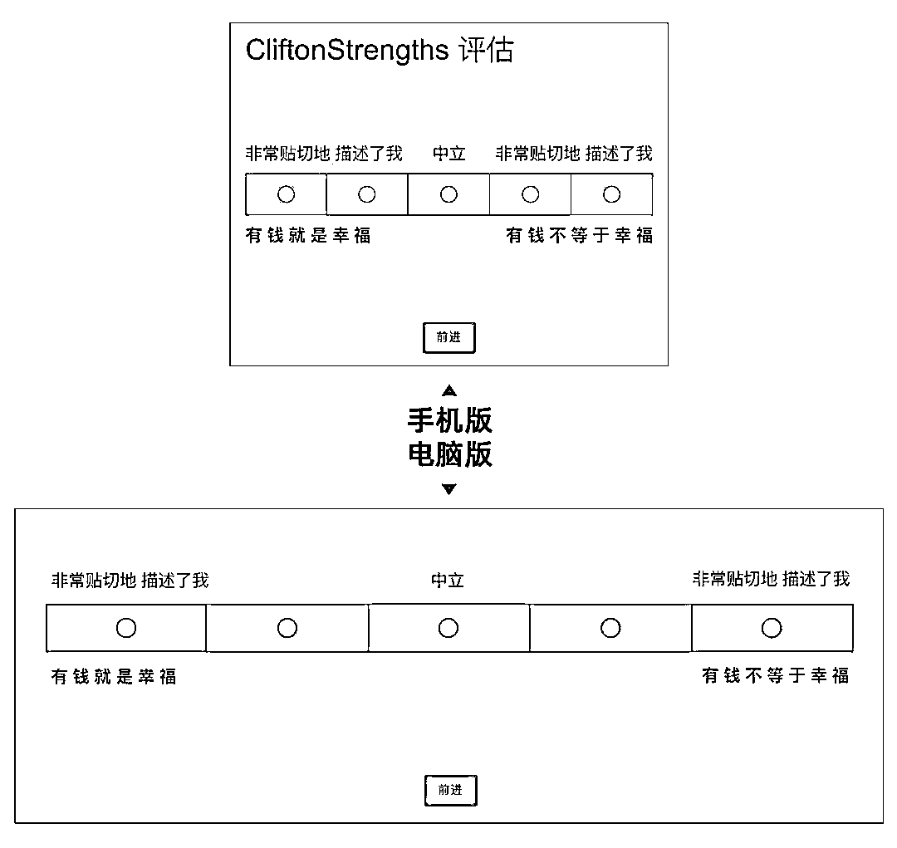

示例：假如你感到“有钱就是幸福”非常贴合你的看法，那就点左边第 1 项；感到略微贴合，点左边第 2 项；认为两边都说得通、没有偏好，就点“中立”。

第七步：答完后，怎么下载自己的“34 项才干优势报告”？

（1）作答结束后，点击“菜单”-“克利夫顿优势”，然后把鼠标往下滑。

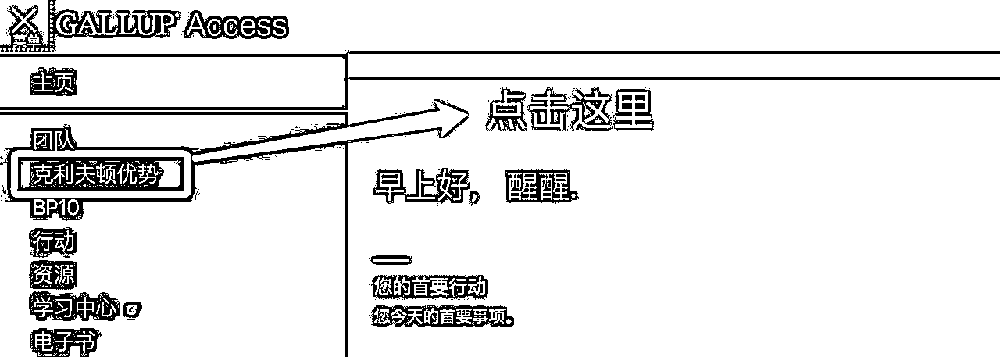

（2）看到报告后，点屏幕下方的任意红框，例如“克里夫顿优势 34 项才干主体报告”。

拿“醒醒”来举例，左边那张彩色图是醒醒的 34 项才干分布，点右侧那个红框里的“查看我的报告”，就能打开完整版。

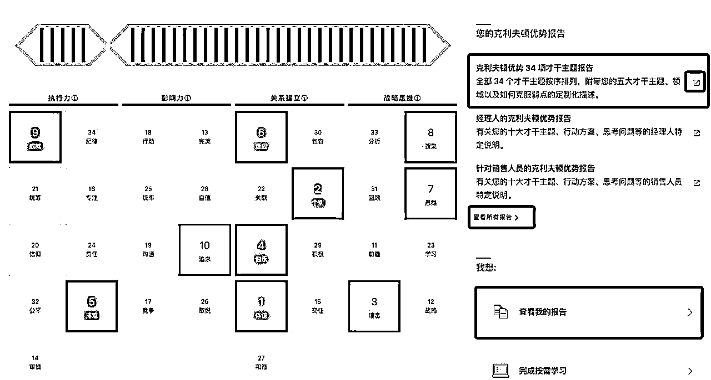

（3）进入报告后，点击右上角的“下载按钮”，把文件保存下来。

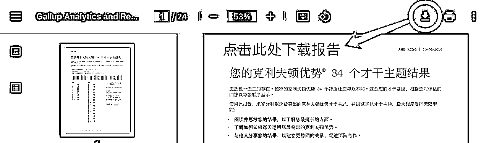

（4）下载好之后，你会拿到一份 24 页的优势报告，大致可以当入门导读来看。图为报告第 1、2 页的展示。

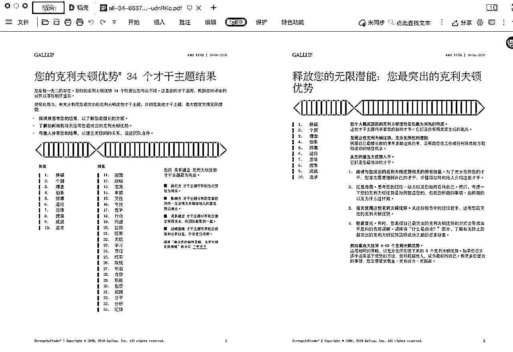

## 三、【分析】报告怎么看 @醒醒同学

### 内容速览

拿到报告后，可以先做两件事：

第一件，看清四类维度，锁定自己的强项方向。

盖洛普把人的优势归成四类：执行力、影响力、关系建立、战略思维。从这四个方向切入，认识自己会轻松些。要是其中某几类不突出，也不必灰心——你照样具备对应能力。

第二件，读懂天赋才干的次序。

1. 新手先锁定前 5 项，从中找优势。

借助报告里的“才干特质”“报告详解”“盲点”等板块，弄清它们适合在哪些场景用、哪些场景容易卡壳，再主动寻找能把它用起来的环境。日子和工作都会因此多几分充实感与意义感。

为了不让篇幅太挤，34 项才干的具体说明挪到本节末尾「3.5 附 2：了解 34 项基础才干」，可自行翻阅。

排在末尾的才干，多半就是你的“短板”。

2. 理解排在末尾的才干，正确对待短处。

盖洛普认为，短处有两种：一是排在前面的才干用岔了，反而带来负向结果；二是动用了排在末尾的才干，同样收到负向反馈。盖洛普更倾向于拿长处去填短处，靠目标拆分、长处互补之类的方式，让困难慢慢解开。

在「3.4 附 1：34 项才干的需求清单」里，那里列了一张需求对照表。要是搞不懂某一项才干该用什么动作来满足它，可以翻到那里看看。

最后，把才干搭配起来用，也是这套体系迷人的地方。

只看单项，它只折射出你的一种特质；当 34 项才干拼到一起，就叠出一个只属于你的组合。

才干搭配的 N 种样子，后面会在「3.3 第三步 了解组合才干的应用」里展开。

新手若一上手就猛啃组合，多半会把自己转晕。建议先把单项才干吃透，再练两两搭配，循序渐进就熟练了。

当然，正如开头提到的，这本手册更像一本关于盖洛普的案头工具，帮你先对盖洛普和自己有个粗线条的认识，本节也一样。若想拿到更深入的指导，不妨约教练做一次更深入的拆解。

许多人报告到手后，想用它来处理眼前的难题，却感觉使不上劲。这一期航海专门添了块内容，帮大家把盖洛普更顺畅地搬进真实场景。

#### 本章航线图

完成本节学习与实操，即可完成航线图第二阶段和第三阶段。

第二阶段：了解天赋，初识五大才干含义（第 1-7 天）

1.完成群内关于第 1～5 项才干的问题思考（每项约 15-30 分钟）

2.完成群内问题：了解他人如何使用优势（约 15-30 分钟）

3.完成群内的优势视角养成练习（约 15-30 分钟）

第三阶段：深入觉察，才干场景演练（第 8-14 天）

完成群内的 2 次才干探索题（每项约 15-30 分钟）

完成群内的 2 次才干场景模拟题（每项约 15-30 分钟）

完成群内的才干造句：用“三句话”认识自己（约 15-30 分钟）

在群内分享一个闪光时刻，发现优势力（约 15-30 分钟）

完成群内的优势视角养成练习（约 15-30 分钟）

那么现在，就请开始吧。

### 3.1 第一步：辨明你的强项维度

盖洛普将人的优势划为四类：执行力、影响力、关系建立、战略思维。四类之下细分出 34 种才干。每个人才干次序与搭配不一样，显露的强项自然也不同。

这一节重点聊四类维度的区别。

打开报告翻到第 21 页，你会看到四类维度的次序与长短都不一样。排位越靠前、色条延伸得越远的维度，大概率是你更亮眼的强项方向；同维度中位置越往前的，越可能是你惯用的天赋。

不过，别让这四类框住你的思路。谁都可以把任务做完、对他人产生影响、搭起关系、消化信息。把亮眼的才干放到别的领域去用，同样能拿到成果。

你或许更在意“怎样把事办成”，在推进任务、抵达目标、做计划、抓落实、盯进度这些方面有天赋。执行力天赋的细节是什么？去你执行力维度里排前十的条目找。

你或许更在意“如何让别人动起来”，在沟通、谈判、说服、带动、鼓舞、把控局面这些方面有天赋。影响力天赋的细节是什么？去你影响力维度排前十的条目里看。

你或许更在意“怎样搭建信任”，在深度互信、长期维护团队并让它具备支持性这些方面有天赋。关系建立天赋的细节是什么？去你关系建立维度排前十的条目里找。

你或许更在意“怎样做决定”，在搜集、拆解、消化信息、拟定策略、研判趋势这些方面有天赋。战略思维天赋的细节是什么？去你战略思维维度排前十的条目里找。

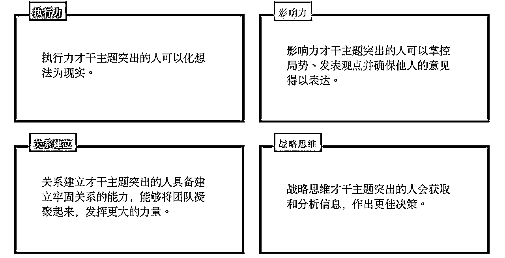

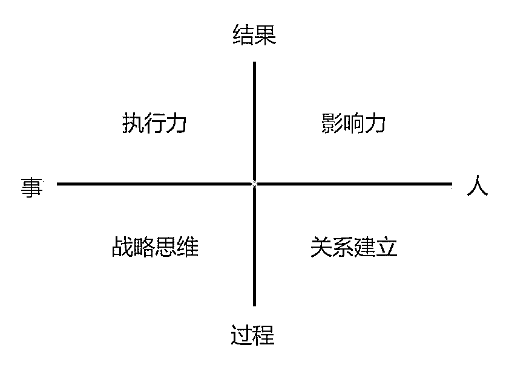

各位可以翻开自己那份报告，找到第 21 页，试着列出：大的方向上，你更拿手的是哪一块？再想想从前那些让你觉得有成就、或者心里满意的时刻，是不是都出现在你比较拿手的范围里？

拿 @醒醒 来说，四类维度中，关系建立>战略思维>执行力>影响力。

她习惯先把合适的人拢到一起，把团队搭好，再动手；在她看来，人对路了，事情才走得顺。

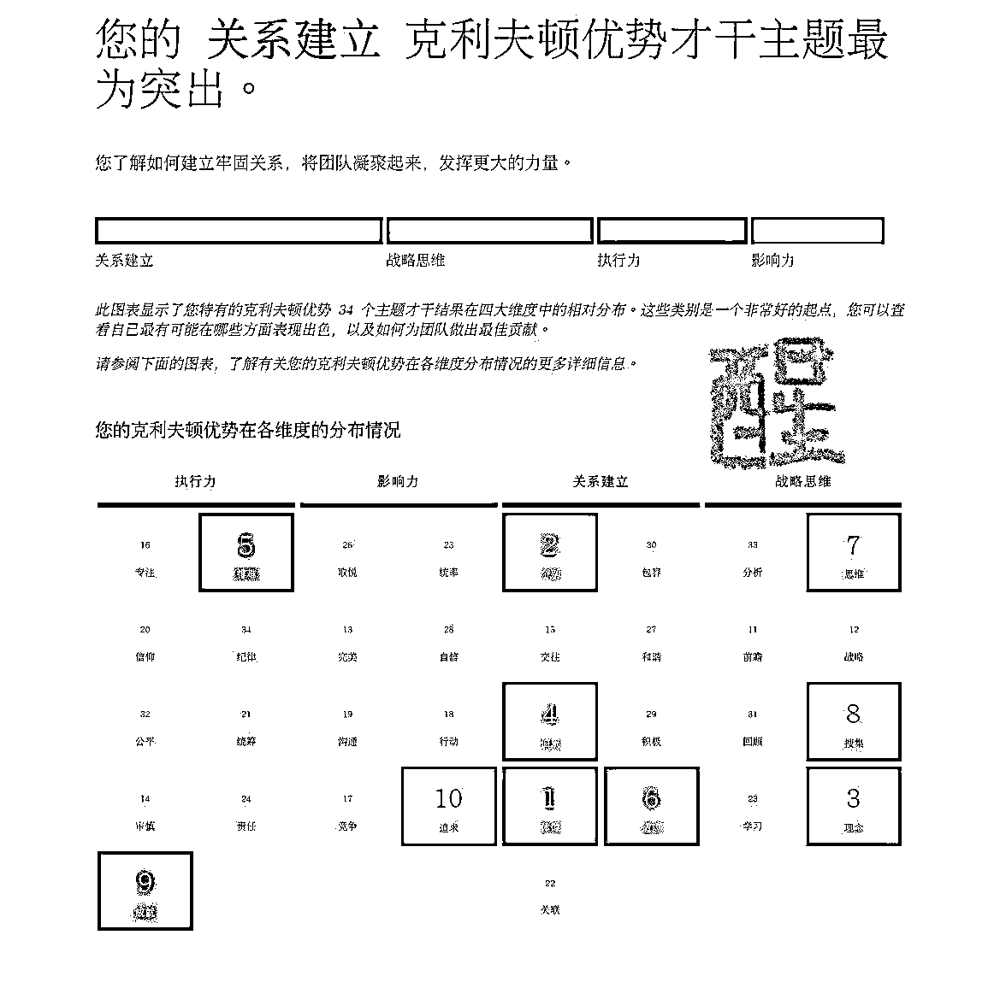

她排进前 10 甚至前 15 的才干，在四类维度里都有比较亮眼的分布，这也能进一步看出她潜在的长处。

例如：

如果让她每天带队打仗、搞研究、不碰跟人有关的工作，她会十分难受。关系类长处几乎没地方使，她搞不懂那些数字代表什么，那些条条框框也在压她的想象空间和创造力；指使别人干活会让她觉得是在损伤彼此关系，也让她打心底排斥“权威型”的领导风格。

回看她的职业经历，运营社群、做群发售、提供咨询、当教练、写东西，她都干过，结果都不差。这些活都跟人有关，需要托着别人往前走，持续冒出新的点子，让别人受到启发，自己也从中得到满足感，还让她遇到几位贵人。

反过来，凡是要求准点打卡、反复推逻辑、跟数据较劲、必须按固定步骤走的业务场景，她常觉得被捆住手脚，施展不开，忍不住嘀咕：“规矩定死了，人可是活的，何苦非这么干？”

越能把长处用到对的地方，出成绩的概率就越高。这些在报告里都有迹可循。不过，四类维度的强项一旦用起来，也可能藏着盲点：

在认清并调用自己强项维度的时候，多想想哪些领域更能让强项冒头。对盲点也得有觉察、有调整。

举个例子：某人执行力+战略思维排得很前，关系建立和影响力排在后面，他求职时若选择销售岗，去钻研推广工具来拉高成交比例，会比直接当面跟人应酬更与他的本性合拍。

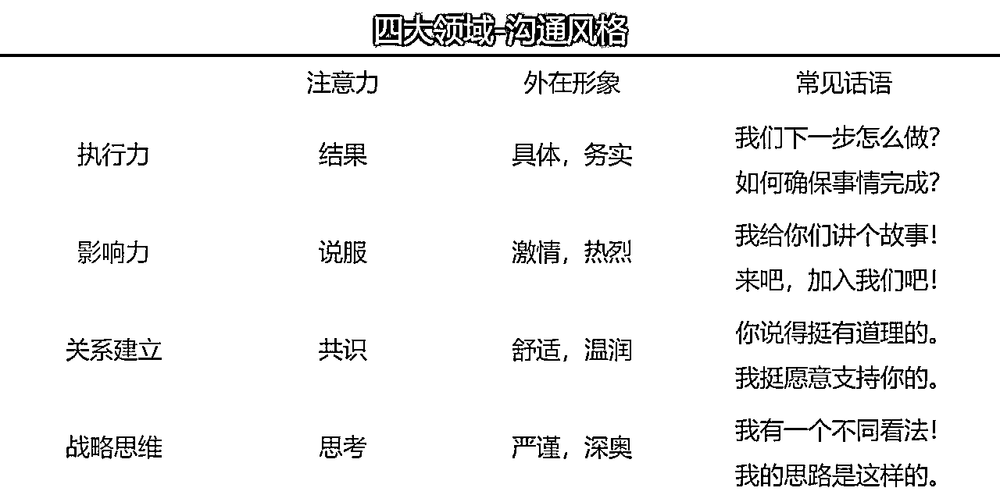

### 3.2 第二步：解析才干次序

# 你的天赋，写在前五里

看清自己的长项分布之后，别急着下结论。还有一步绕不开：查一查才干顺序。

在盖洛普的体系里，人的思维、情绪与行为被划成34类，称为才干。它们像出厂配置，只有经过知识积累和技能打磨，才可能变成真正拿得出手的长处。

翻到报告首页，那里列着你的才干名次。第2页到第11页逐条拆解前十项，其中排名最前、附有个人化点评的五项，务必细读。

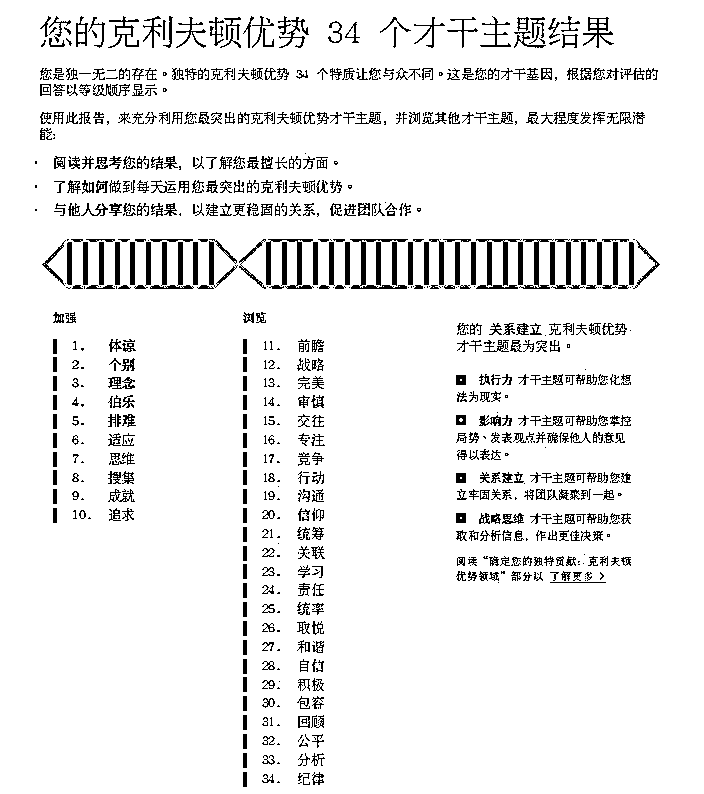

名次不同，人的性格、价值取向、长项也就各异。建议把注意力先放在靠前的几项——那是最可能兑现成能力的区域；名次越往后，通常意味着你调用得少，或者说不太灵光。

拿醒醒举例：她高频使用的是“体谅”“个别”“理念”，低频的是“公平”“分析”“纪律”。她能迅速捕捉旁人情绪（体谅），看得见每个人身上的差异（个别），脑子里新点子很多（理念）；而规则制定、数据推演、逻辑拆解、排期计划这些，她既不上手，也提不起兴趣。由此推测，她的潜力可能在“共情力”“组建长项互补的团队+人才发展”“创新力”上，短板则是立规矩、做推理、排计划。

报告里每一项才干都有它的位置价值。越靠前，越像你不假思索就会启动、几乎零成本的能力——天赋多半就躲在那儿。打个比方：有人自幼作文强、数理弱，玩文字比玩数字顺手；有人打小就往外跑、呼朋唤友，坐不住家；有人习惯性琢磨人、研究人。这些早早就冒头的特质，测出来往往名次靠前。

刚接触盖洛普时，视线应先落在前排：它究竟是怎样一种能力，在哪些场景下使着顺，在哪些场景下容易翻车，然后替它找对土壤。人跟环境对上了，日子和事业都会更有奔头。后排那些不拿手的，固然会带来麻烦，却未必等于缺陷。另外，中文版部分才干释义受翻译影响，理解上可能走样，建议以官方报告为准，或者去“3.4 了解 34 项基础才干”那节翻查。还有一点：两人测出同一种才干，实际拿手的事也未必重合。盖洛普会结合才干搭配给出个人化描述，让人看见自己独有的那一面。

先看两位同样带“沟通”才干的人：
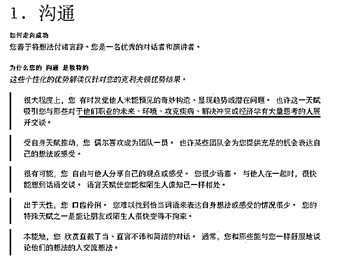
（沟通才干案例一：医生）

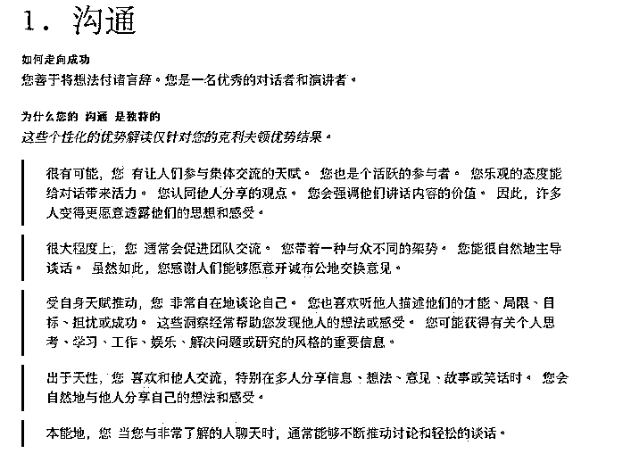
（沟通才干案例二：Leader）

读下来会发现，两段描述并不一样——因为才干描述跟整份报告的排序挂钩。

#### 3.2.1 读前五才干，先抓“这说的就是我”的瞬间

想找到自己的天赋，入口是排名最前的五项。报告第二页给了一套“了解天赋的方法”：
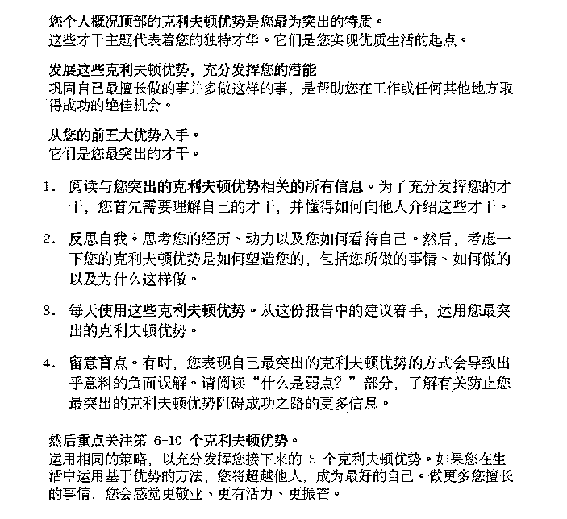

不妨以醒醒排第一的“体谅”为例，重点盯这几处：
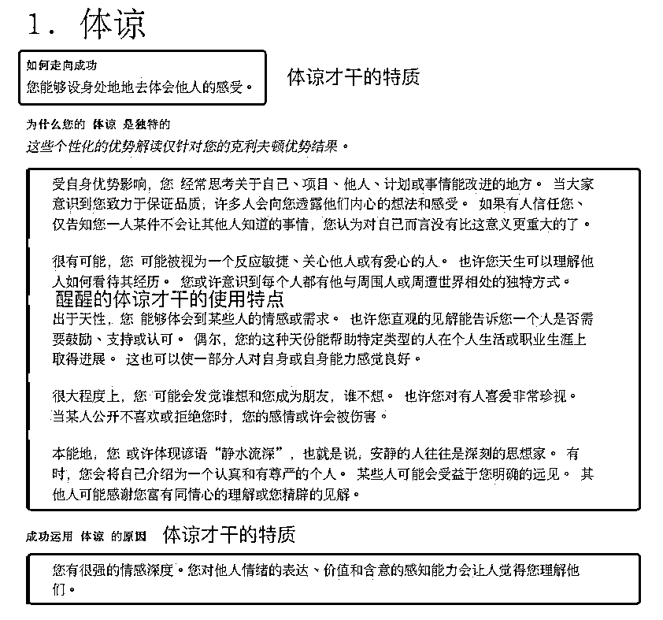
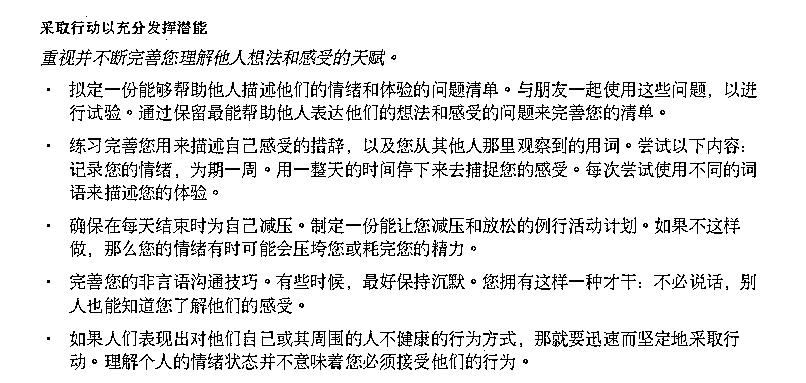
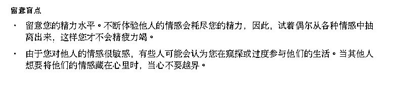

你可以这样试。假设某人“行动”突出，念头一来就动手，动手能力强是他的长项；反过来，他也可能急脾气，没盘算清楚就先干，试错花掉不少时间。把他放进需要不断开荒、鼓励试错的项目里，这股冲劲能打天下，评价多半是“敢闯”；把他放进必须反复推演、一步走错代价惨重的场景里，评价就可能变成“毛躁”。可见才干本身不分优劣，是中性的。人在不自觉的时候动用才干，不管拿不拿手，都可能因为用法失当而露出破绽；目标定得合理，再主动调用强项，破绽出现的几率就小得多。

这里有组概念要分清：“有意识管理”和“无意识发挥”。

把戳中你的句子划出来之后，反复咀嚼自己的高光片段，强项的影子会慢慢浮出来。对前排才干有了体感，再去生活里比对自己与他人的差异，留意感受和本能反应，用起来就会越来越自觉，它的好处也就看得见了。

#### 3.2.2 后十四项才干：不拿手，不等于有缺陷

报告里排在第21至34位的，习惯上叫后排才干。频繁动用它们，容易因为不熟练而收获负反馈，进而演变成“弱点”。盖洛普所说的“弱点”，指的是在释放优势的途中，因才干管束不当，或知识、技巧欠缺及用法有误，给自己和旁人添了麻烦。

动用后排才干吃了负反馈，该怎么办？举个例子：你很想拓展社交圈、多认识些人，偏偏“取悦”排在后面，眼下圈子也窄——这时不必硬着头皮扎进各种局。窍门是找一个自己顺手的入口：“取悦”强的人天生能跟陌生人打成一片，你既然不靠它，就换条路：

“学习”靠前的人，若本就爱学，可以挑感兴趣的线上课，借同学互动结识新面孔；“交往”靠前的人，若有几位铁杆好友，不妨拉上对方一起出席活动，慢慢融进去，或请朋友牵线；“排难”靠前的人，若擅长处理难题，就多替别人解决麻烦，日久自然朋友增多。

其余不再赘述。应对弱项，有两条路：

1）把想达成的目标摊开、拆细，再核对手上的强项能否撑住它。拆解可循这条线：明确目标—盘点长项—设计打法—跑通链路—复制成果。举例来说，目标是在赚钱项目上新增500人；优势在于策略型思维与关系搭建维度共有7项靠前，擅长定打法、把人放到对的位置、推动落地；影响力偏弱，不擅长拉人和迅速成交。于是打法定为：用内容吸引气味相投的客户，让成交自动发生；同时借关系搭建的长处，找有分量的伙伴联手，自己主抓策略和内容。30天运作下来，今年最后新增847人。

2）找能与你互补的人搭伙。还是这件事：醒醒的好友梁靠谱，“影响力+执行力”都排在前列，对应“统率+专注+取悦+积极”，成交意愿强，也善于同陌生人破冰、把人引到🛰️，带人进私域特别见效。两人半年前就分好工——她管拉人和直播，醒醒管策略、协调人手和后端的细致运营，结果同样是847人。

一句话：用顺手的、让自己不别扭的路子去填“自认的坑”。补弱项的上策，是先摸清强项，再拿最强的那块去撬动弱的那块。再补一句：后排才干若肯稍微学点用法，常常能抬高整体战斗力。醒醒的“分析”靠后，她就特意找擅长此道的朋友聊，揣摩对方的思路，如今进步肉眼可见。不管你认不认天赋这回事，人其实一直在有意无意地靠它护住自己；结果不理想，可能只是待错了地方。末尾送一句：顺天赋而行，势不可挡；逆着弱项硬顶，处处别扭。补弱项，也别硬来。

### 3.3 第三步 看才干如何组合发力

前面拆的是单个前排与后排才干。才干往往成群结队起作用，下面说说组合。

盖洛普的分辨率很高。多数测评产品像一面蒙雾的镜子，只能照出个大概类型；盖洛普更像一台8K精度的摄影机，靠才干搭配照出你的身形轮廓与面部细节，把自己的天赋看得更清楚。

以人际关系为例，它可以有无数种呈现，看个例子：
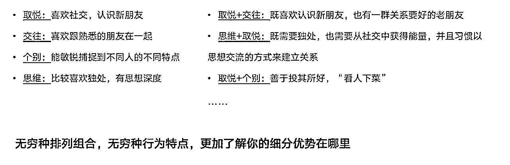

假定A、B两人的前五都含“取悦”，说明二人都享受社交、乐于结识新人，并因不断建立新连接、被对方接纳而满足。若A的头名是“沟通”，B的头名是“成就”，区别就显出来了。若在双项搭配上再叠一项，每叠一层，复杂度与难度都上一个台阶，精准度也随之提升。才干的多种形态，正体现在34项的排列数量与位次差异上。也就是说：其一，测评结果如同指纹，几乎独一无二，映出的是本人天然的特质；其二，34项有无穷种搭配，即便两人优势相似，组合不同，呈现的差异优势也不同。

新手不必急着跟组合较劲，很容易看晕。想更准确地摸清自己的天赋搭配，仍要从单项起步，弄透之后再练双项拼接，渐渐就熟了。以下这些搭配，比较容易一同挤进前五，当作了解即可（组合数据源自盖洛普官方）：

- 成就+学习：手上有任务就想顺顺当当收尾；遇到新东西，不由自主想搞明白，自动切进学习模式。
- 专注+成就：认准目标往前推，按轻重缓急排好活儿，目标不落地就不收手。
- 统筹+责任：与人协作时，只要事儿跟自己沾边，过程和结果都愿意扛。
- 信仰+责任：心里装着重要的原则与目标，对求助的人许下承诺就尽力兑现。
- 审慎+责任：做事既尽责又谨慎，话出口的承诺一定守住。
- 排难+责任：见人、事、物受损，宁可自己吃亏也要出手，服务他人。
- 纪律+责任：爱用日历、日程表盯进度，确保计划落地、承诺兑现。
- 公平+和谐：为让事情顺利推进，会尽量管住情绪，压掉冲突与争执，稳住心神。
- 行动+战略：先筛出最优解，再催大家赶紧动手。
- 追求+成就：内驱力足，也想站上更高的舞台；有人赏识就干得更猛。
- 完美+战略：规划未来时，先把不够格的剔除，再从拔尖的里头挑最好的。
- 自信+战略：对自己的本事和判断心里有数，清楚最优解与实现路径，旁人很难摇动他。
- 统率+战略：习惯把所有可行选项先过一遍、选出最优，统领全局时少走弯路。
- 竞争+成就：不光肯下力，还会在比拼中燃起斗志，想压过自己也想压过别人。
- 沟通+取悦：社交场上凭清晰的表达抓住注意力，进而铺开人脉。
- 适应+体谅：扎根此刻，对眼前状况与情绪波动敏感，并随之调整。
- 伯乐+体谅：情感和潜力虽无形，却能帮人把感受说出来、把潜能挖出来。
- 包容+积极：爱张罗大家凑一块儿，盼着请的人一个不落，缺一个就有点扫兴。
- 个别+交往：容易看穿别人的底色，也希望有人懂真实的自己。
- 和谐+责任：能营造利于协作、提升实际产出的氛围，并借此赢得信任。
- 交往+责任：长期为客户、家人、同事、朋友出力，越帮越懂得欣赏他们，也收获认可。
- 关联+体谅：很在意旁人，对他人的独特情绪敏感，也认同人类共通的部分。
- 积极+取悦：对情绪和赢得好感很敏锐，结交新人、鼓舞低落者都轻松，且乐在其中。
- 分析+学习：爱学习，但学的主要目的是练就客观评判事物的本事。
- 回顾+搜集：不停搜罗资源、翻检旧记录，总能给别人递上他们想要的东西。
- 理念+战略：为达目标会把各种可能都想到，若都不满意，就另辟新路。
- 前瞻+战略：能看出未来走向，并找到通往那里的最优路径。
- 搜集+思维：爱琢磨并收集深刻的洞见与哲理，也认为这很有分量。

### 3.4 附 1：34 项才干的动力清单 @叶叶在觉

一个人干活没劲，往往能从这份测评结果里查出缘由。动力枯竭，多半是心里某个需求没被接住。34项才干，每一项背后都牵着一种需求。比如“追求”需要旁人的崇拜与肯定，才容易火力全开；“竞争”需要有个能比、能互相刺激的对手，才会持续发力、想赢；“适应”需要多变的环境，才能把灵活应变的潜力逼出来，遇强更强。需求被喂饱了，你每天上班都像加满油，热情高涨，一路向前。

举例说，当你知道自己的“交往”——也就是跟熟人打交道、经营长期关系的能力强——那就该常和几位固定好友联络，多见面、深聊，跟他们待在一起你会松弛。你也更适合做单人深度服务或小范围服务，走深度而非走量，相应地更适合高客单产品，靠提升老带新比例来带流量。大家可对照下面这张表，找到自己的动力开关。

34 项才干动力对照表@上淇&醒醒：
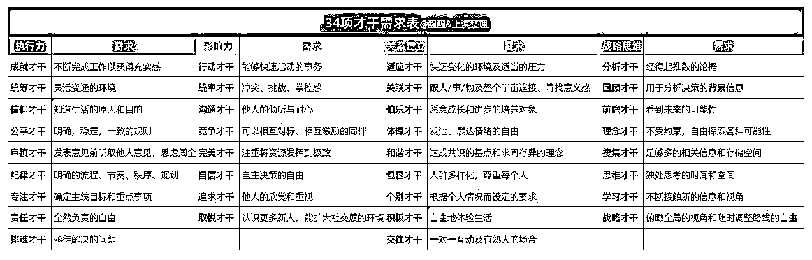

### 3.5 附 2：认识 34 项基础才干

下面这张表罗列了34项才干，含定义、动机、内核与特征，可对照查阅。表格由@柳大教练整理：
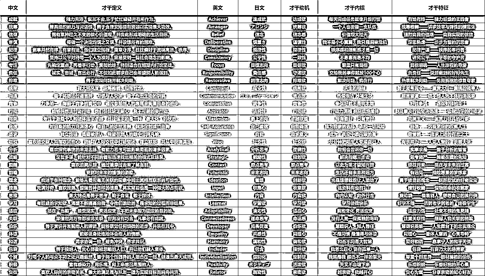

为便于理解，每项才干分三个角度解读。点开左栏目录，即可跳到对应条目。

#### 3.5.1 执行力

01 成就才干
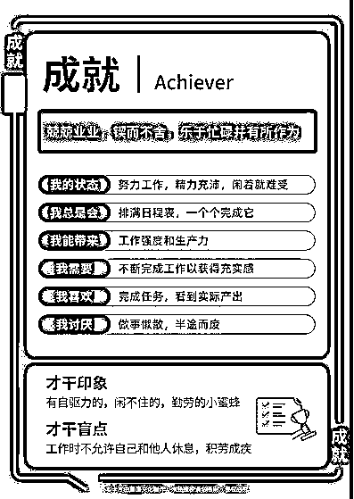

02 统筹才干
像一位高明的指挥家，面对繁杂琐碎的事务，能化简为易、进退从容，把效益做到最大；通常也是多线并行、擅长调度资源的那类人。
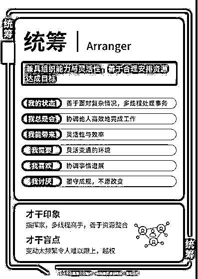

03 信仰才干
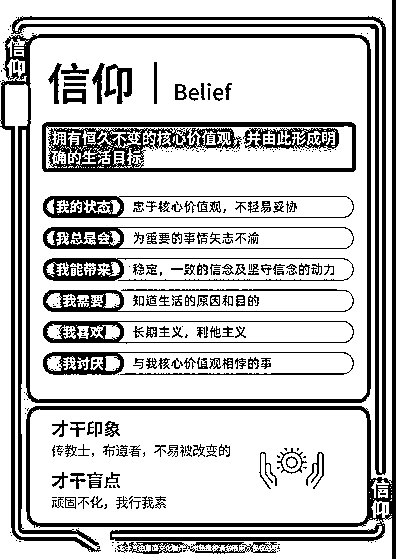

04 公平才干
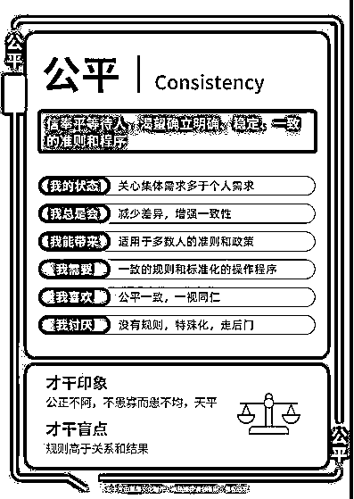

05 审慎才干
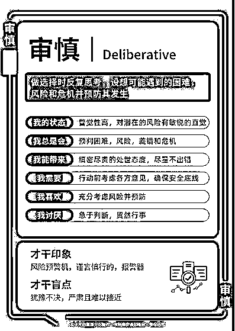

06 纪律才干
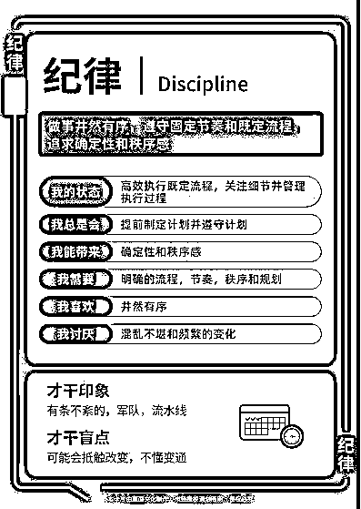

07 专注才干
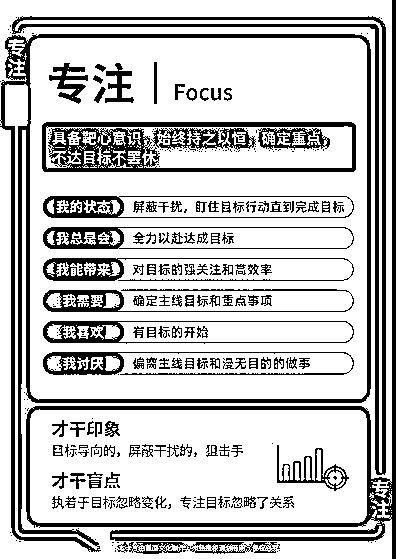

08 责任才干
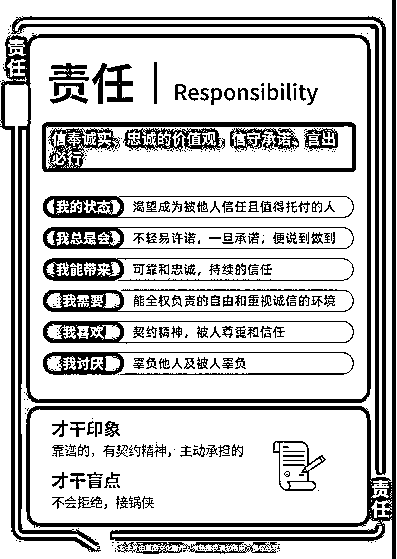

09 排难才干
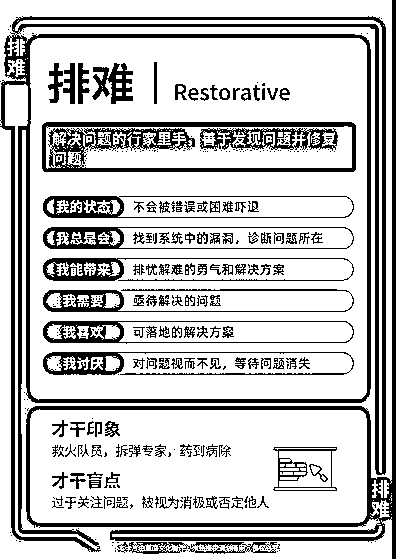

#### 3.5.2 影响力

10 行动才干
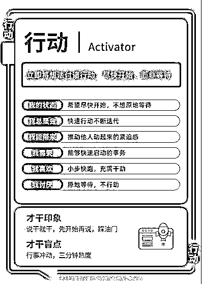

11 统率才干
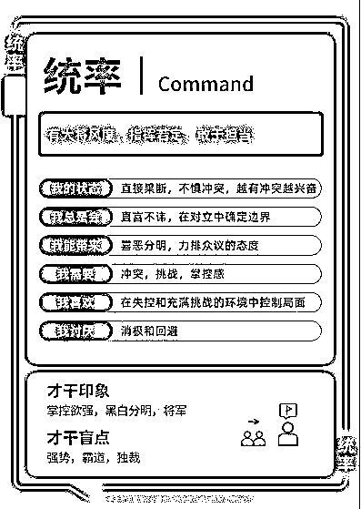

12 沟通才干

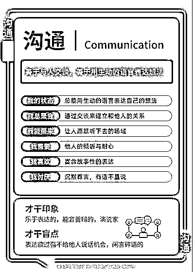

13 竞争才干
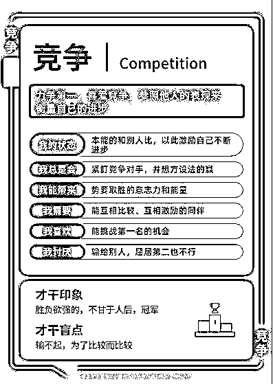

14 完美才干
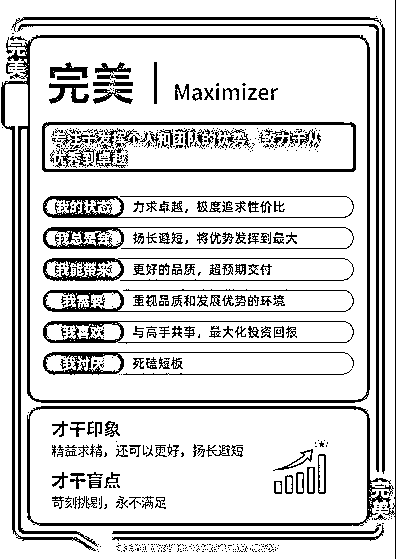

15 自信才干
一旦拿定主意，立场往往很硬，旁人的劝很难入耳。

16 追求才干

17 取悦才干

#### 3.5.3 人际连接：让每种特质都有位置

**18 适应才干 | 顺势调整**

**19 关联才干 | 看见整体**

**20 伯乐才干 | 点亮他人**

**21 体谅才干 | 感知情绪**

**22 和谐才干 | 求同存异**

**23 包容才干 | 接纳多元**

**24 个别才干 | 尊重差异**

并不希望所有人被塑造成相似的样子，而是相信每个人都该按自己的样子发光。

**25 积极才干 | 传递热情**

**26 交往才干 | 深耕亲密关系**

会把大量时间与心力投入到好友身上，用来维系一段长久而稳固的关系。在人际中，他们习惯坦诚相见，愿意先给出真心，也会默默留意重要之人的喜怒哀乐、走过的路和未完成的愿望，并期待对方也能这样对待自己。

对信赖的人几乎不设防，愿意付出所有；但若把关系看得太重，太过在意对方的反应，有时也会因此受伤。

#### 3.5.4 思考方式：头脑里的地图

**27 分析才干 | 用逻辑说话**

在他们眼中，真相是客观且可以量化的，做任何判断前，会先依靠理智推演。弱点是过分讲理，把事实与逻辑放在最高位，容易忽略人的情绪和感受。

**28 回顾才干 | 向过去取经**

喜欢把经历记下来，写日记、翻阅史书、读人物传记都能让他们沉浸其中。容易忽略的是：别人未必对自己热衷的旧事有同样的兴趣。

**29 前瞻才干 | 望向远方**

在许多场合中，他们会格外留意那些通往好结果的信息、对未来的判断，以及能帮助自己成长的人；至于那个好前景具体在哪儿，往往和个人的兴趣与优势密切相关。风险在于：过多陶醉在对未来的想象里，不断寻找唯一正确的方向，却忘了真正通向未来的路是一步步走出来的，想象的蓝图也要靠实践去修正。

**30 理念才干 | 灵感不灭**

只要脑子里冒出新的念头，就会立刻兴奋起来。他们好像天生擅长打散旧框架，从各种角度观察问题，给出出人意料、富有创造力的提案。短板也很明显：表达过于抽象，让习惯具象思考的人难以跟上。

**31 搜集才干 | 收藏一切可能**

囤积的各种资料，只要有一天派上了用场，无论受益的是自己还是他人，都会感到满足。在他们看来，世界上没有真正无用的东西，只有暂时没用上的东西。不过，如果信息来者不拒、不加筛选，很容易把过量参考丢给别人，本想帮忙反而添了乱。

**32 思维才干 | 在内心里思考**

**33 学习才干 | 从学中获取能量**

**34 战略才干 | 在复杂中找出路**

### 3.6 盖洛普在自我分析中的落地用法

#### 3.6.1 SIGN 模型：找到你的优势信号 @《现在发现你的职业优势》

S（Success）自我效能——也就是“我能行”：面对某些事，内心会有一种笃定，觉得自己肯定能搞定。
I（Instinct）本能热爱——也就是“我热爱”：那些一看到就忍不住想立刻去做的冲动。
G（Grow）成长很快——也就是“我擅长”：有些领域你学得特别快，刚接触就有明显的进步。
N（Need）满足感强——也就是“我快乐”：有些事即使没什么回报，做起来依然很满足，能感到价值。

当你的前10项才干所对应的需求得到填补，你更容易找到那种“我能行、我热爱、我擅长、我快乐”的感觉。

可以试着用下面这些问题给自己做一次梳理：

▶ 对照 S（自我效能）：
· 我能向别人传授什么？大家遇到什么事会来问我？
· 做什么决定的时候，我几乎从不怀疑自己？
· 哪些事一落到我手里，我就格外有把握？

▶ 对照 I（本能热爱）：
· 做什么事，我几乎不需要催自己，很少拖延？
· 哪些任务、场景或环境，只要听说就兴奋，忍不住想参与？
· 有没有一件事，能让我进入心流状态，忘了时间？

▶ 对照 G（成长很快）：
· 学什么内容，我总能快速上手？
· 与周围人相比，我在哪方面经常做得更出色？
· 是否有人给过我反馈，说我身上有一个明显的“优点是……”？

▶ 对照 N（满足感强）：
· 做什么事，我会忘记时间并感到充实？
· 哪些事在做的时候，让我觉得有分量、有意义？
· 回忆一下至今最开心的一段经历，是哪件事？

拿这四组问题，再对照盖洛普的才干排序，就能整理出一份属于你自己的“SIGN 模型优势梳理文档”。

#### 案例：醒醒的优势拼图

醒醒的自我观察很典型。她提到，做线下沙龙的时候，从流程安排、物料准备到招募，每一步她都觉得“我能行”；但活动收尾后的跟进、加好友聊天、找话题，却让她有些犯难。她猜想，这与自己的体谅、理念、思维、个别才干有关。

她也喜欢用户抛来有挑战的问题，喜欢给产品做迭代，一直维持现状反而难受。她觉得，这可能是排难和理念才干在起作用。

凡是涉及洞察用户、识别他人天性的场景，她学得都很快。她不但能看见情绪背后的需求，还能记住大量优势案例，似乎用不着刻意背诵，见过一面就留下来了。

如果能帮别人解决问题、写点东西、独处，不用被迫社交，她就觉得很满足。

凭借这些线索，她在优势教练的方向上走得更稳，能判断现阶段适合什么产品、怎样获客、想尝试什么新玩法，也喜欢给客户埋下惊喜。

此外，她找到了擅长快速建立关系和整体统筹的同行牙牙教练，两人一起做线下活动。醒醒负责流程与物料，牙牙负责统筹和活动后的跟进。

#### 3.6.2 职业、副业与转型卡点自查

想找到一份真正顺手又愿意长期投入的事业，无论主业还是副业，都要同时满足四个条件：感兴趣、有本事、能赚到钱、做得有意义。

一旦在某处卡住，往往是因为四个条件里至少有一个没达到。用这个模型，可以快速判断自己该在哪个环节补课。来看几个职场中的例子：

有的人工作清闲稳定，但公司没有太多晋升通道，孩子上学后开销变大，于是想提升收入，既要在主业上想办法，也要考虑拓展第二收入来源，给自己增加一点安全感。

有的人是设计师，总被要求照搬别的公司的产品，自己的想法没法落地，价值感越来越低。他未必需要立刻辞职或转行，可以先去做一点更能体现自身价值的事。

有的人跟着老板创业，从技术岗做到管理岗，却对管理毫无兴趣，觉得工作没意思。他可以去尝试一些别的事，不一定非要留在这个岗位上。

也有自由职业者，背后没人兜底，收入起伏不定，只能不断学习、请教、升级技能，去对抗不确定性。

看清卡点之后，缺哪里就补哪里。

#### 案例：小周怎么看自己的路

小周在一家公司做了5年项目管理。最近公司人事变动大，她的工作陷入瓶颈，常常夹在各个部门之间，协调得很疲惫。她知道这样下去绩效会受影响，想辞职，但房贷压着不敢随便走。

如果换一家公司，以目前行业情况看，现在这家已经算待遇很不错的了。她该怎么办？

拿上面的模型对照：小周在“兴趣”和“价值”两项上的得分比较低。工作不断消耗她的心力，每天在扯皮沟通中度过，价值感也被稀释了不少；但“能力”和“赚钱”两个维度，她目前还比较满意。

兴趣上，她对做短视频和开一家属于自己的店都很好奇，只是不知道具体从何入手。
价值上，职场给她的正向反馈很少，价值感自然就低了；她平时把时间花在孩子教育、自我探索上，却觉得这些事特别有价值。

把几点放在一起，开店短期内不现实：前期要砸钱，也要耗时，她暂时离不开工作。如果做短视频，她需要提前弄清楚：

1. 能力：要具备哪些底层技能？剪辑、短视频内容创作课、商业化知识，哪几样要先补齐？
2. 赚钱：怎样靠短视频获得收入？在所有变现选项中，她最想尝试的是哪一种？
3. 价值：平台上的内容能帮到谁？可以做职场、亲子教育，还是个人成长？

单看副业方向，这至少是小周可以试一试的选项。

#### 3.6.3 问题定位：先看差距，再找答案

想理清问题，先记住一句话：问题，是“想去的地方”与“现在的位置”之间的距离。

第一步，把目标、期待或理想状态写清楚；第二步，如实描述现状；第三步，标出两者之间的落差，那才是真正要处理的问题；第四步，从落差中找出能采取的行动，一步一脚印地把它缩小。

我们通常更习惯先问“是什么挡住了我”，却忽略了：有时是目标设得太高，有时是目标本身模糊不清。这两种情况，都需要靠大量教练式对话或亲身尝试，让目标慢慢清晰起来。

盖洛普能解释“问题为什么会出现”：多半是前10项才干进入了盲区，或外部资源不足。看见盲区，再去寻找发展才干的机会，问题往往更好解决。

#### 案例：阿哲的百万目标

阿哲主业做设计，今年想赚到100万。目前主业年收入40多万，副业是接私活，平均一年约10万。

目标：年收入100万。
现状：主业40多万，副业10万；周末有整块时间，平时零散时间不多。
问题：中间60万的缺口，从哪里补？

想提高收入，能力上他并不缺。现在更像是用“单位时间”换钱，真正的天花板是时间。既然不打算离职，今年就不必死磕100万：可以先把能走的方向都列出来，挑一个当下最合适的去启动，一步步积累资源。

#### 3.6.4 精力分配：把时间留给值得的事

借助“四宫格”来安排任务，四个区域只作方向参考：

第一格：紧急且重要——立刻处理，别犹豫。这类事情越少越好，占总时间的20%—25%。
第二格：重要但不紧急——先规划、再行动。这是最值得投入的部分，应占75%—80%。
第三格：不重要也不紧急——有空再说，能省略就省略，占比最好小于1%。
第四格：紧急但不重要——快速做完，或交给别人，不必亲自上阵，占比控制在1%—5%。

把重点放在第一、二格，尤其是把第二格的事情处理到位，才不会天天被第一格里的“火情”追着跑。

借助盖洛普，我们能找到自己在精力管理上做得好和不好的地方，也能看出自己在哪个领域更愿意主动安排时间。

#### 操作建议：先列全，再分类

可以试试滴答清单，把每天、每周、每月要办的事这样处理：

1. 先别管轻重缓急，把所有事项一股脑写出来；
2. 列完后，再逐条放进四宫格的对应区域；
3. 每隔一天/一周/一月检查一次：自己是否把更多时间投进了第一、二格？然后总结复盘。

坚持一段时间，你会看到许多“紧急但不重要”“不紧急也不重要”的事项，会在执行中被自然淘汰。慢慢地，你就知道自己真正“紧急且重要”的事是什么了。

#### 3.6.5 执行力提升：福格行为模型

B = MAT，这个公式的意思是：当（M）动机、（A）能力、（T）提示同时在场，行为（B）才会真正发生。

M（动机）：你做事的欲望和出发点——这件事对你有多大的吸引力？渴望越强，行动起来越顺。
A（能力）：你把事情做成所需的技能和条件——门槛越低，越容易开始，也越容易变成习惯。
T（提示）：促使你行动的信号——它是习惯的触发器，缺少提示，任何行为都不会启动。

想要做出改变，三个要素一个都不能少，动机和能力还要互相搭配。提示需要主动设计，动机和能力则处于动态平衡，需要随时调整。

动机强 × 能力匹配 → 事情更容易做成。
动机强 × 能力不足 → 心里很急，手上没劲。
动机弱 × 能力足够 → 总在拖延、转眼就忘。
动机弱 × 能力不足 → 基本做不成。

盖洛普可以帮助解释你的动机为什么强或弱，找到驱动你向前的力量，也能启发你设计更有效的“提示信号”；但它解决不了“能力不足”的部分。把盖洛普报告和福格行为模型放在一起，改变的路径会清晰不少。

#### 案例：从“摸一下键盘”开始

小吴和朋友小陈约好一起练键盘盲打，想提高打字效率。小吴练得不错，可小陈练了一天就放弃，直说太难。小吴于是帮他拆了一套计划：

1. 小陈每天上午看完书，去键盘上摸两下，找到书名的缩写就行，不必真的打字；完成后告诉小吴，小吴就给他分享一本自己当天读的书。

2. 等这个动作固定下来，每天读完后在键盘上敲出一句书里最打动自己的话，发给小吴；小吴也会回他一句自己最喜欢的话。

3. 如此反复，直到熟练，再慢慢加量：打一小段、打一章。小吴还陪他聊每天的阅读感受。等他能完整敲出1000字，两人就互赠一份礼物。

这个例子来自醒醒一个朋友的真实经历。醒醒最初听见“摸一摸键盘”这个动作时，还觉得不可思议：没想到最小的微动作，能简单到这种程度。后来，那位朋友真的学会了盲打。

#### 3.6.6 情绪内耗排查：6W2H 模型（问题仅供启发）

情绪宜疏不宜堵。它像一个信号灯，折射出我们内心没被满足的需要。把情绪疏通，心才能腾出空间去做事。

6W2H 通过八个问题，带我们整理“情绪从哪里来，该向哪里去”。

上面列出的问题只是参考，不需要全部用到。哪一个能帮你松口气，就先用哪一个。情绪往往是多种因素共同作用的结果，与其停在“我就是烦”的结论上，不如多问几个“为什么”，找到那个最关键的因，再抓住自己能改的部分，变化就会一点点发生。

#### 案例：小郑的烦躁从哪来

小郑最近心情很糟：公司今年业绩压力大，加班成常态；在家里，和丈夫三天两头拌嘴，辅导孩子写作业也让她冒火；各种鸡毛蒜皮的事堆在一起，她忙得脚不沾地。

有时让她烦的是同事，有时让她烦的是家人。这一天，她又因为项目的事和隔壁部门的同事闹了矛盾；回到家，看到丈夫正窝在沙发里打游戏，火气一下子就蹿上来，骂了丈夫，两人大吵一架。小郑气得不做饭，孩子又嚷着要吃麦当劳，她更生气了，觉得这个家没有一件事让她省心。

用 6W2H 梳理后，她发现自己气的其实不止一件事。顺着每件事往下问“为什么”，几个可以做点什么的点浮了出来：

1. 和同事吵，根源是两边领导没有把任务分清楚，两个部门都认为是对方的责任，没人愿意接下这个活。以后的做法：先把自己这边要做什么讲清楚，进度同步给领导，需要支援就开口，别等最后出了问题没人兜底。

2. 和丈夫吵，是因为她把单位里的情绪带回了家，加上最近不断有裁员的传言，两人心里都发慌，游戏只是个导火索。以后的做法：工作和家庭分开，别混在一起；正视家庭的矛盾，和丈夫好好谈一谈；同时为“可能失业”做些准备，比如尝试副业、寻求晋升或看看新机会。

再往深处看：

3. 如果事业上的压力能缓解，收入焦虑减轻，她也会更有余力去善待自己和家人。经济问题一天不解，现实就会一直摆在眼前，让人没有安全感。

4. 她对自己、丈夫和孩子都有期待，但生活不会事事如意。需要好好沟通，也要适当把期待调低一点。

5. 别忘了对自己好一点，不必所有事都亲力亲为。每周给自己留一天，去做喜欢的事，把能量补回来。

## 四、【应用】盖洛普在日常中怎么用？@醒醒同学

### 章节概要：从“测完怎么办”开始

很多人在拿到盖洛普测评结果之后，都会愣一下：这么详细的报告，到底该怎么变成行动？

# 128份问卷，筛出7类高频卡点

为了摸清大家共有的困扰，我们在5月航海群里做了一次问卷，回收128份反馈，再从中归纳出7个方向、13个最常被问到的难题。覆盖范围包括：落地力、人际往来、伴侣相处、时间安排、自我笃定、情绪调节、工作议题。

另外，还补上了一个关注度很高的应用主题。

#### 本章通关路线

把本章内容学完、练完，航线图的第四阶段也就走完了：优势应用，即前五项才干的运用（第15—21天）。

1. 在群内完成排名第1～5的才干练习，每项约15—30分钟。
2. 在群内完成优势之路总结，约15—30分钟。
3. 在群内完成优势之旅展望，约15—30分钟。

现在，可以动手了。

### 4.1 七类常见情境怎么用优势

### 本节速览

全章拆成七块：落地力、人际往来、伴侣相处、时间安排、自我笃定、情绪调节、工作议题。每块安排1—2个困扰，除少数例外，基本按下面几个角度展开：

用优势项时，别脱离情境、目的、身份和动作。说得直白些：我准备干什么，想拿到什么结果，要和谁建立连接，需要哪些资源配合，自己又有哪些优势项能推着我往前走？

拿直播带货举例。沟通、追求两项靠前的人A，通常更敢面对镜头，讲产品时更有感染力，表现也更放得开。可若他没练过找供应链、塑造产品价值、促成下单这些环节，结果照样可能不理想；一旦把这些功夫补上，成功率就会明显提高。

再看另一个人B。假如成就、学习、搜集靠前，他先研究50位优质主播的玩法（学习、搜集），再每天练5小时（成就），最终未必比A差，甚至可能更好。

同样的结果，背后往往是不同优势项在共同发力。更值得关注的是：自己习惯用哪种方式成事，以及目标该怎么落地。下文案例不可能覆盖所有情况，多数只是从优势项角度举例，仅供参考，具体情形仍需具体判断。（案例均已获本人同意公开）

#### 4.1.1 落地力：定目标、动起来、拿结果

落地力，说白了就是目标定得下、行动跟得上、结果拿得到。

很多人被它卡住：想法一堆，动作很少；什么都想试，什么都难做深；天天忙碌，进展却迟迟不来；非要拖到最后一刻才肯开工……

篇幅有限，这里挑两个常见困扰：「拖延：总想考虑周全再开始，顾虑很多」和「难坚持：三分钟热度，常常半途而废」，试着借盖洛普视角找找破法。

4.1.1.1 拖延：总想准备万全再动手，顾虑一大堆

拖延是普遍心理现象，不少人深陷其中。

它常常来自对结果的过度担心：怕时间不够、怕能力不足、怕知识储备不够，也怕过程中冒出麻烦。这些担忧一多，人就不肯迈第一步，任务和目标自然被搁置。

① 常被此困扰的人，哪些优势项往往靠前？

完美、审慎、排难、分析、战略

② 症结在哪（从优势项看）

③ 可尝试的对策（仅作参考）

4.1.1.2 热度只有三分钟，事情做到一半就放手

三分钟热度，指的是一开始干劲很足，后来因为某些原因迅速失去兴趣和动力，接着放弃，或者转去折腾别的事。

① 常被此困扰的人，哪些优势项往往靠前？

行动、适应、理念、战略、学习等

② 症结在哪（从优势项看）

③ 可尝试的对策（仅作参考）

#### 4.1.2 人际往来：陌生人与半熟朋友怎么打交道

人际交往是日常绕不开的一课。

不管在校园、办公室，还是聚会饭局，各种社交难题都会冒出来。这一节重点处理：面对陌生人或不熟的朋友，该怎么相处。

4.1.2.1 太在意别人眼光，怕说错话，索性不开口

这种状态，多半来自对他人评价的过分关注，以及对自身能力的不确定。不少人在陌生人面前或社交场合里会紧张、有压力，于是选择沉默，能躲就躲。

① 常被此困扰的人，哪些优势项往往靠前？

和谐、审慎、体谅

② 症结在哪（从优势项看）

③ 可尝试的对策（仅作参考）

4.1.2.2 凡事自己闷头研究，不好意思开口问人

总爱独自琢磨，可能因为本人享受探索过程；也可能怕暴露“我不懂”、担心问得太基础会挨批评或被否定；还可能是不愿麻烦别人，被脑海里想象出来的恐惧拦住了。

① 常被此困扰的人，哪些优势项往往靠前？

排难、分析、思维、体谅、责任

② 症结在哪（从优势项看）

③ 可尝试的对策（仅作参考）

#### 4.1.3 伴侣相处：先读懂彼此，再调整模式

在亲密关系里，有两句话值得记牢：“谁先迈出改变那一步，谁就握着关系的方向盘”“好的伴侣关系，不能只靠讲道理”。两人的优势测评差异特别大，既可能互相补位，也可能针尖对麦芒；两人的测评很接近，既可能格外懂对方，也可能彼此纠缠。关键看双方怎么调，能不能并肩面对麻烦、一起解决麻烦。

想让关系往好处走，最好从“先弄懂对方”起步。老话说，万人宠不如一人懂；只靠单方面使劲，两个人的难题是解不开的。

建议拉着伴侣一起学盖洛普，把它当成一种对话工具。这样能少一些主观评判，多一些看见彼此需求和差异的机会，找到突破口的概率也会更高。

4.1.3.1 相处模式难找，磨合总卡壳

性格不同，相处方式自然不一样。这里拿一个双方测评差异较大的案例来说明。

常见情形是：女生想试新东西，男生先给她分析一通。男生未必想泼冷水，可女生听完分析，发现不少项目产出可能不高，心里总像被浇了凉水。平时逛街，男生也提不起兴趣，她只好约闺蜜。

女生希望男生多理解她一点，支持她去试一些项目，而不是凡事都用理性分析来回应。

① 借优势测评看懂对方需求

男：战略、成就、追求、专注、统筹、分析、行动、责任、取悦、个别

女：体谅、理念、积极、伯乐、个别、搜集、战略、交往、学习、思维

男生在事业上头脑清醒、肯下功夫，有目标感，也非常理性，不愿把时间耗在没意义的尝试上。

女生在关系里更愿意主动，喜欢新鲜事物，会报各种课程，也擅长体会他人感受，整体偏感性。

两人本能的习惯不同，差异便随之出现。以旅行为例，男生大概率想先确定目的地，然后照着计划走；女生就算做了攻略，到了当地发现别处更好玩，也可能临时改道。

男生可能纳闷：怎么又换地方了？不是说好去A地吗？

女生却觉得，若提前把每一步都讲死，一切都在预料之中，反倒少了“惊喜”。

② 一方先换位，主动做出改变

关系磨合，总得有人先动。愿意站到对方角度，等伴侣感受到关系有变化，再谈需求、讲道理都会顺很多；若谁也不肯先变，新的相处模式就不会出现。

翻一翻34项才干卡片里每项“我需要”那一栏。比如“追求才干”，越被欣赏越有能量，特别需要伴侣能看见自己的好。

那就多制造能让他展示的场景，常常夸一夸，他会很开心，能量也越来越足。若长期不被关注，他可能就会失落。

借盖洛普工具去理解对方需求，彼此的付出才更容易对上胃口，关系也会更甜。

4.1.3.2 伴侣总读不懂自己的需求

伴侣相处时，理解不到位、或觉得自己不被理解的情况并不少见。沟通一旦不畅，双方就可能陷进不健康的相处状态。

① 常被此困扰的人，优势项通常怎么分布？

可能关系建立、战略思维、执行力靠前，沟通才干靠后

② 症结在哪（从优势项看）

③ 可尝试的对策（仅作参考）

#### 4.1.4 时间安排：让24小时用得更顺

时间安排是人人要修的课。同样一天24小时，有人工作生活两头顾，睡眠也充足；有人只能熬夜加班，成果还不理想。

这一节主要看两个困扰：

4.1.4.1 立的flag总倒，觉得自己不自律，时间白白溜走

① 常被此困扰的人，哪些优势项往往靠前？

适应、理念、行动

② 症结在哪（从优势项看）

③ 可尝试的对策（仅作参考）

4.1.4.2 时间总不够，想做的很多却都做不好

① 常被此困扰的人，哪些优势项往往靠前？

成就、统筹、适应

② 症结在哪（从优势项看）

③ 可尝试的对策（仅作参考）

#### 4.1.5 自我笃定：把注意力收回自己身上

4.1.5.1 习惯跟别人比，别人一句话就怀疑自己

这未必和优势项绝对挂钩，但自信才干很可能不在前列。习惯性比较，可能源于成长中收到的正反馈太少：常被家长拿去对照，或被人打击，于是慢慢认定“只有更强，才配得到肯定”。久而久之，只盯着比自己厉害的人，看不见自己做得更好的地方，也养成了遇反驳先怀疑自己的习惯。

① 常被此困扰的人，哪些优势项往往靠前？

竞争、思维、排难

② 症结在哪（从优势项看）

③ 可尝试的对策（仅作参考）

举个例子。曾有位来访者，总跟朋友比谁赚得多，心里却并不喜欢天天加班。聊过才发现，他脑子里一直有个声音：只有成为朋友中收入最高的那个，日子才算越过越好。

可一想到一个月没陪伴侣和孩子，他又会懊恼，对自己做的事生出怀疑。后来他意识到，之前的比较没意义，家庭没因此更幸福，矛盾反而多了，朋友也觉得和他相处不舒服。

等他理清内心真正要什么，减少无意义攀比，更多拿今天的自己和过去比，把焦点放回自身，攻击性降了，生活也顺了不少。关系里，本就没有真正的输赢。

#### 4.1.6 情绪调节：别让感受一直憋着

4.1.6.1 讨好型人格：情绪长期压着，最后突然爆发

① 常被此困扰的人，哪些优势项往往靠前？

和谐、体谅、审慎（关系建立突出）

② 症结在哪（从优势项看）

③ 可尝试的对策（仅作参考）

可以读读《被讨厌的勇气》，或者加入气氛轻松、相处融洽的团队。多和“积极+沟通+取悦+交往+体谅”的朋友待在一起，她们往往能看见你的好，也更希望你“有话说出来”，而不是“全憋回去”。

4.1.6.2 总爱过度解读别人，把自己耗进内耗

过度解读，常常发生在我们和他人相处时：对方的行为恰好是自己不喜欢的，于是生出一种“被伤到”的感觉；可又因为各种原因，没去确认或没法确认对方到底什么意思，只能凭过往经验猜测意图，委屈、愤怒、难过都说不出口。

这类人可能关系建立靠前、沟通才干靠后，遇事更习惯替别人考虑，而不是通过沟通解开误会，时间一长就形成了内耗。

① 常被此困扰的人，哪些优势项往往靠前？

思维、和谐、个别、体谅

② 症结在哪（从优势项看）

③ 可尝试的对策（仅作参考）

举个例子：同事问你能不能帮他做件事，你不想接，又怕拒绝会影响关系，最后还是应了下来。这里可能就存在过度解读——对方也许只是随口一问，你帮不帮都没关系。

#### 4.1.7 工作议题：意义感与可见度

不管是刚入职场，还是已经工作多年，多多少少都会遇到工作上的烦恼。

最常见的一种，是不喜欢自己的岗位，觉得做的事没意义。有人刚上班就发现这份工作不适合自己，也有人干了三五年后慢慢进入倦怠期，很少有打工人能完全绕开。

与此同时，在职场上不会表现自己，也会让升职加薪的机会溜走。酒香也怕巷子深，怎样把成果完整呈现给上级，或许「4.7.2 不擅长邀功，埋头干了很多活，但升职加薪没自己」能给你答案。

4.1.7.1 不喜欢自己的工作，觉得没意义

不喜欢手头工作，是很常见的状态，什么才干都可能出现。

若想弄明白“没意义”从哪来，可以拿出自己排在前十的才干，对照醒醒做的才干卡，重点看“我需要”那一栏（航海群内领取，小程序里没法放进航海手册）。

当“我需要”被满足时，才干通常用得顺。例如：取悦才干要不断认识新朋友，从社交里获得能量，做那些需要接触新人的事会更得心应手。若一个人总被关在家里，认识不到新朋友，也得不到关注，自然觉得工作没劲、没意义。

4.1.7.2 不会展示成果，埋头苦干却升职加薪没自己

很多职场人习惯埋头苦干，不懂或不愿把成果亮给上级，最后升职加薪名单里没有自己，只剩苦劳，没有功劳。

① 常被此困扰的人，优势项通常怎么分布？

关系建立、执行力维度靠前，影响力维度靠后

② 症结在哪（从优势项看）

③ 可尝试的对策（仅作参考）

主动一点，好运更容易来。别把“展示自己”直接等同于“邀功”。站在领导角度想，他们不在执行一线，很可能不知道你都做了哪些事。主动同步信息，让领导看见你的“苦劳”，也能提升沟通效率。可以学些汇报技巧，让汇报更有重点，也更能为自己争取利益。

### 4.2 怎样看清性格长短处，找到合适工作或副业？@叶叶在觉

### 本节速览

不管你是求职迷茫，还是职业倦怠、不喜欢现在做的事，或者已进入平稳期、想找个副业，都可以给自己做一次职业规划，找到擅长的领域。

职业规划往简单里说，就3步：

第一步：向内看，了解自己
第二步：向外看，了解职业
第三步：做匹配，筛出合适与不合适的领域

当然，若你已经拿到盖洛普报告，第一步可以跳过，直接看第二步，借叶叶教练的「职业匹配罗盘」，匹配相对合适的职业类型。

请注意，这套方法并非100%适用。找到适合自己的工作或副业是个过程，需要持续探索、不断验证。你并非只适合干一件事，可能有很多件事，千万别用任何工具把自己框死。

祝你能在擅长的领域做擅长的事，向世界交付你的价值。

#### 4.2.1 第一步：向内看，摸清兴趣、动力、优势与需求

先回忆过往每份工作内容和副业，哪些是自己喜欢、做得好、有成就感的，再把它们填进「我的优势探索表」的具体内容栏。这里的表格以我自己为例：我喜欢的工作内容分两块，一块和文字有关，一块和人有关。

填完后，对照工具1《盖洛普34项才干解读卡片》，找出自己可能具备的优势才干。卡片共34张，分别讲34个才干的特点、优势和动力。

比如「取悦」的优势是社交达人，喜欢结识新面孔，这很贴合我，因为我本身就爱交朋友。每次参加赚钱的线下活动，一想到能认识很多新朋友，我就很兴奋。

于是我在“业余兴趣爱好”对应的可能优势才干一栏，写上了「取悦」。

（「取悦」别理解成讨好。它是英文翻译过来的专有名词，每项都有特定含义；按字面意思去套，容易产生误解。「取悦」更接近大家常说的自来熟、社牛。）

其余项也照这个逻辑，把你认为符合的才干填到右边“可能有的优势才干”一栏。

写好后，接着填第2张表《我的优势动力表》，把每个才干的优势和动力总结出来。

比如「取悦」，我仔细想了想，自己确实挺擅长和陌生人破冰。很多人第一次见我，就愿意敞开心扉，我的🛰️好友也有七千多人。我的动力是喜欢接触新朋友，不断拓宽社交圈。若没有这个优势，做这类事就会觉得累，也没动力去认识很多新人。

剩下几个才干就不逐项解释了。最后我整理了一份优劣势360°画像，列出自己特别突出的优势和动力，以及不擅长、也不喜欢的工作内容。

到这一步，对自我的认知就差不多探索完了。但若想更精确，我还是建议做一次盖洛普测试，因为它会测出你最突出的5项优势排序，并附上较详细的描述。

比如我的「学习」才干提到，每天获得知识和技能，会给生活添热情。像我每天总要花点时间看书或听音频课，才觉得舒服，这就是我很自然的模式。

所以这份测评报告能帮你看见：平时习以为常的行为背后，藏着哪些优势。这样你才会开始有意识地按优势去挑匹配的职业。

#### 4.2.2 第二步：向外看，理解不同职业的特点

这里再分享一个我原创的工具：「职业匹配罗盘」。

为什么很多时候方向一多，反而不知道选哪个？

除了不了解自身优势，另一个重要原因，是我们对这些职业方向缺少清晰的分类标准。我们只看见各行各业优秀的人做得风生水起，却不知道不同行业对人的优势要求是什么，于是这个也想学、那个也想试，最后不知从何选起。

而当你学会用职业匹配罗盘给方向分类，就能更清楚地判断自己适不适合。

职业匹配罗盘把职业或副业大致分成6类：技术专家类、流程管理类、创意策划类、服务助人类、思维分析类、影响表现类。

下面详细说说这6类：

技术专家类：

# 六类职业赛道，你更贴近哪一条？

先说明白：本文所说的“技术专家”，与写程序无关。它涵盖的是手艺活、操作流程、工艺这类肉眼可见、双手可及的具体技能——摄影修图、收纳整理、美妆造型、建筑设计、外科手术皆属此列。选择这条路的人，一般坐得住冷板凳，乐意针对具体环节一遍遍细抠，眼力好、善于捕捉细节，倒不一定喜欢频繁与人打交道。用盖洛普优势来对照，多半是执行力较为突出。

## 流程管理型：把资源和节奏串起来

这一型同样以“事”为对象，但跟技术型存在明显分界：他们对死磕单个点兴趣不大，长处在于调度资源、推动项目、安排不同角色各司其职，或者依照既定流程与规则把任务办妥。项目管理、商业操盘、电商运营、产品运营等岗位，都接近这个画像。此类岗位对综合素质要求偏高，既能对接人，也能管住事；所以盖洛普优势常横跨三四个领域——战略思维、执行力、关系建立、影响力，各个领域下都可能有所分布。

## 创意策划型：把脑洞落成体验

广告创意、婚礼策划、活动策划这类工作，创意含量要求高。要是你平日爱天马行空，脑袋里常蹦出奇特念头，也愿意追求新鲜好玩的体验，不妨把这个方向纳入视野。盖洛普优势方面，通常战略思维会排在前面，其中“理念”这一项的位次必须足够靠前。若同时还带有“个别”之类关系建立才干，承接私人定制型的产品与服务会更得心应手。

## 服务助人型：在支持别人时获得能量

这一型天生有服务他人的意愿，喜欢听人倾诉、给人支持、关心身边人，也乐意协助他人进步、化解迷茫。用盖洛普优势对照，一般由关系建立才干唱主角。

## 思维分析型：跟抽象问题打交道

这一型和前文的技术型有重合之处，两者都可以在细分领域做到专家级别。区别在于：技术型打交道的是看得见的实物，思维分析型则更偏爱抽象的东西，愿意琢磨理论、推敲概念，也爱跟数据、信息周旋。数据分析、咨询顾问、产品经理、律师、程序员等，都算这一类，优势分布上，多半由战略思维挑大梁。

这个大类还可以继续劈成两半：一半侧重人文社科方向的思维探究，另一半侧重数理方向的分析。因此，假使数据分析功底不够硬，就尽量绕开那些成天跟数字打交道的职位，例如金融分析师，硬上只会让自己很疲惫。

## 影响表现型：让注意力成为工具

这一型既喜欢、也善于吸引别人的视线，分享欲和表现欲都强，还能带动他人对某件事产生关注、参与进来。主持人、模特、配音演员、主播、博主、自媒体等，基本都归入此列，对应的优势通常是影响力主导。

需要强调的是，展现自我的途径各人不同，未必都要站到舞台中央、被聚光灯照着。文字、口才、穿搭、美食，都可以是出口，关键看你的其他优势落在哪里。

把职业这样归完类，要判断某个方向适不适合自己，心里是不是多了一把更清晰的尺子？

当然，也会有人犯难：自己感兴趣、或者看着合适的方向超过一个类别，这又该如何取舍？

举个例子，某人既被服务助人型吸引，又对思维分析型心动，这完全没问题。有些岗位天然就横跨两三样甚至更多形态，课程讲师便是一例——它把服务助人、影响表现、思维分析几种特质揉在一起。可见这些类型完全可以混搭、叠加，没必要把自己框死在单独一格。

为什么没把销售单独拎出来做一类？原因在于，撇开少数通用特质不论，各个行业对销售岗的期待差异不小。个性外向，未必就能把销售做好。某些对技术底子要求高的领域，从业者还得兼有技术型或思维分析型的优势。因此，若打算往销售走，务必核对自己的长处与行业门槛是否对得上。

#### 4.2.3 第三步：完成匹配，圈出适合与不适合的领域

依照前文完成的“优劣势360度画像总结”和“职业匹配罗盘”，把适合自己的方向列出来，同时标明不合适的领域。

圈出大范围以后，若想把目标收窄到某一具体岗位，就得把专业、技能、经验等一并摆上桌面做全盘权衡。也可以到招聘平台检索对应职位，确认日常工作内容合不合自己口味、需要哪些技能。

锁定该补的能力之后，可以靠课程培训或自学来啃下相应知识，动手做几份该领域的作品，同时混进业内圈子、攒下人脉，没准哪天就被人看中，拿到入场券。

不少从零起步转型成功的例子，背后都站着一位拉他一把的引路人。所以磨技能的间隙，别忽视混圈子的价值。龙哥盟便是一个优质的圈子，航海则是更垂直的小圈子，挑自己感兴趣的加入就好。

做职业匹配时，还有三条关键原则需要拎清：

1. 核心匹配：自身优势尽量与岗位门槛对得上。
2. 避免对立：切勿挑选与自身优势南辕北辙的方向。
3. 创业多元：想创业，得靠多样的优势组合。

下面讲个真实例子。我过去有位学员，原先在一家业内领先的教育公司负责运营，去年换岗去做了OKR课程产品经理。

前几年，他始终觉得自己没干出什么让自己满意的成果，自责成了常态。久而久之，这种自责让他越发只会盯着自己的不足，把做过的事也一概否掉。身边朋友和同事没少夸他，说他好多方面做得相当不错，在团队里也颇受欢迎，可他照旧用一副彻底负面的眼镜审视自己。

举例来说，他曾把“对他人情绪极为敏感”视作一种毛病；又觉得自己成天推敲概念、琢磨那些看似飘在空中不着边际的念头，是在躲避现实；还认定自己干事浮而不实，光会空想，执行和行动都跟不上。

做完测评、认真梳理过自己的优势之后，他才恍然大悟：那些他一直看不上眼的特点，居然正是自己的“天赋”。他排在最前面的优势，是战略思维与关系建立。

他对旁人情绪的敏锐，根子在“体谅”这项天赋。由此他也想通了：自己在团队里之所以受欢迎，是因为格外懂得体察、照顾同事的心情，还时常帮人做心理疏导。

至于自认为“想太多”的部分，其实是战略思维天赋在起作用。他也回忆起，自己确实常在团队里贡献不错点子。于是他逐渐用正面的眼光重新打量自身特点，例如旺盛的好奇心、对各类信息的搜集癖。

工作里最让他享受的是站上讲台讲授，跟家长和孩子交流时他最开心。他反感的是硬邦邦的推销，一旦课程内容自己并不认同，更不愿费劲找说辞替它圆场。因此，包装、宣传与营销这类活儿是他的短板，这与他影响力才干排位靠后互相印证。

对照360度画像与职业匹配罗盘，他落在思维分析型加助人型这个区间。不过离职后他仍没拿准该投向哪一行，低落了大半年。后来总算碰到一个自己中意的岗位，一打听，那家公司由大厂孵化，他便递了销售岗的简历。

意外之喜是，面试官反倒觉得另有位置更配他——课程开发，而他听着也来劲，于是顺顺当当转成了课程产品经理。虽说此前他从没接触过OKR落地的实践，可上岗没多久，他就感到这份差事把自己的长处用了个痛快：海量吸收、反复琢磨、持续产出，与盖洛普测评结果高度对得上。领导翻过他的优势报告，也觉得和平时对这个年轻人的观察严丝合缝。

很多时候，我们误判成缺点的东西，可能恰恰是一块还没用顺的优势。只要不把自己丢掉，并把优势摸清楚，合适的机会终会找上门。

内容出自：《如何分析自己的性格优劣势，找到适合自己的工作/副业？》

# 选修篇：盖洛普还能派上什么用场

## 五、盖洛普的更多实战案例（@叶叶在觉 @醒醒同学）

### 本章速览

前文聊过的用法之外，盖洛普还能帮上什么忙？

它能让你看清自己身上许多反复出现的行为套路——顺着那些早已习惯的思考与行动方式往回看，认出其中被忽略的长处，也照见困住自己的思维死角。

光这样说难免空泛。一旦把它放进更具体的情境中，其精准和好用就显现出来了。反复练解读、反复还原现场，这些才干便会渐渐被用熟，落到该落的位置。

为了呈现盖洛普的实际用处，本章搜罗了12个应用实例，按团队管理、个人成长、人际关系、职场生涯、创业或副业等维度归拢。每一场景下，再拆成“应用方向”与“实际案例解读”两块。

“应用方向”这块主要交代怎么用，结合具体情形列出若干参考方向；真实生活里，你也许还能挖掘出更多玩法。

“实际案例解读”则以真人真事为底，配上盖洛普报告，一步步演示才干该怎么读，帮大家把认知再夯实一遍。

“实际案例解读”的拆解套路是这样：

案例背景

四大维度

前十才干

盖洛普才干图谱

盖洛普分析（重点看）

下面借@叶叶在觉 与@醒醒同学 两位教练经手的个案来作说明（均已征得本人许可公开）。展示的只是盖洛普的部分效力，更多可能，留待各位自行发掘。

### 5.1 个人成长场景里的盖洛普应用

#### 5.1.1 【应用方向】揪出内耗与行动卡壳的根源 @叶叶在觉

案例一：学了一年抖音，视频却一条没发的自由职业者

小强（化名）一心想做抖音账号，前后砸进去一年工夫，却连一条片子都没发出去。他不拼吗？倒也不是。课程报了不少，器材也置办了，脚本写过，镜头拍过，后期也动过手，可总觉得差口气，于是一直搁着。

测评报告显示，他“学习”排第一，“完美”列第二。看到这个结果，他明白了自己为何迟迟动不了手：大部分时间都拿去研究“抖音该怎么做”“片子该怎么拍”，再加上完美主义作祟，第一条内容自然一拖再拖。

症结找准后，他不再死磕完美，转而信奉“先交卷，再改卷”。

案例二：对内容嗅觉偏钝的内容运营

阿杰（化名）坦言自己对内容不够敏感，憋出的爆点方案领导总不买账。有人给他支招：多刷热搜，看多了手感自然来。于是他狠刷了一阵，可判断什么内容更能抓住受众，依旧没底。

问题出在哪？他刷热搜的路子和旁人不一样，所以数量堆得再多，嗅觉也没被练出来。

从盖洛普报告看，他“专注”和“学习”都靠前，因此偏爱个人成长以及与自身目标挂钩的内容，对跟工作生活八竿子打不着的人和事提不起劲。可爆点恰恰要吃透大众情绪。想补这块短板，他得走自己拿手的路。

他强在抓共性、拆底层规律，我便建议他顺着这条路建一套数据库，用规律来补敏感度。他觉得这主意靠谱，也就不再嘀咕“我是不是干不了”“要不要挪个地方”，重新相信自己能扛下眼前的岗位。

#### 5.1.2 【实际案例解读】把自己看透之后，自信怎么长出来 @醒醒同学

案例背景：打小就缺乏自信、动不动否定自己的人，怎么把自信养起来？

四大维度：执行力>关系建立>战略思维>影响力

前十才干：审慎、和谐、回顾、伯乐、统筹、排难、体谅、成就、适应、交往

盖洛普分析（择要）：

“审慎、和谐、排难、体谅、适应”齐齐挤进前十，而“积极、自信、统率”排在后面的组合，日子过得容易因迁就别人而委屈自己，内耗随之而来。建议多做些能补能量的事，把信心一点点垒起来；这类才干配置在与人来往时，往往能收到不少正面回应。

小结：这组才干的人，无论拿出多漂亮的成绩，都很难真心认可自己，正反馈对他们格外重要。好在她适合待在关系简单、讲究稳定的团队中，那里能给她不少肯定；用户运营这类岗位尤其合适，服务口碑容易做起来，若上头是一位对内护短、对外强硬的领导就更妙。氛围过于狼性的地方，不适合她。

提高自信，除了留心环境带来的影响，还得做到几步：先承认自己确实容易自我否定，并接纳这一点；再是靠近“积极、沟通、伯乐”才干靠前的人，从他们身上吸取大量正向反馈；最后，每当又要贬低自己时，不妨也翻翻自己做得好的那一面。

### 5.2 人际关系场景下的盖洛普应用

#### 5.2.1 【应用方向】找出亲密关系中的相处卡点 @叶叶在觉

案例三：青梅竹马、明明相爱却总起争执的一对

两人从小一起长大，相识已有二十载。可女生Linda一直想不通：男友为何动不动就泼她冷水？

拿做📕来说，她盘算这能给履历添点分量，男友非但不替她高兴，反而吓唬她：小心被网暴。

翻开盖洛普报告，答案浮出水面：男友“排难”位居第一，她的“积极”则排第五。她眼里先看到的是光亮那头，男友的排难本能却总把他拽向隐患与风险。

解读时我告诉她：“他不是存心打压你，只是提醒你把这层风险想在前头、提前做点准备。”这番话男友连连点头。他解释，自己清楚女友对差评格外敏感，怕她真做起📕后挨了难听的话、情绪受挫，才故意把“网暴”说得夸张些，好让她先掂量清楚。

听完男友的肺腑之言，Linda很受触动，终于读懂了他的脑回路，而不是急着给这段关系判“不合适”。

两个相互喜欢的人，别因为频道对不上、相处起来费劲就赌气散伙。借盖洛普这面镜子，你能读懂对方脑子里的回路，许多冲突和猜疑自然就消于无形。

#### 5.2.2 【实际案例解读一】看这对伴侣能不能并肩走远 @醒醒同学

案例背景：找到我时，两人正卡在感情的低谷。他们既是生意上的搭档，也是生活里的伴侣，因某些摩擦，其中一方提了分开，这次是想把心结摊开，再为这段感情搏一把。解读结束九个月后——就在今年五月——他们领了证，彼此更懂对方，也摸到了适合二人的相处法子。

男生四大维度：影响力>战略思维>执行力>关系建立

女士四大维度：执行力>关系建立>战略思维>影响力

男生前十才干：战略、交往、行动、理念、统率、信仰、完美、取悦、个别、自信

女士前十才干：排难、责任、交往、学习、纪律、分析、和谐、思维、伯乐、审慎

盖洛普分析（择要呈现）：

互补视角：男生更像关系里的“掌舵者”（影响力加战略思维），果决、机灵、点子多、对将来有盘算，拍板与外部的社交、资源接洽都拿得出手；女生偏“护航者”（执行力加关系建立），性情温和不折腾，体贴又不失理性，有股韧劲，挑品、把业务落到实处的功夫很稳。女生能看见男生身上的可能性（伯乐，愿意信他），男生也接收到她的欣赏，感觉相当熨帖（体谅、和谐、适应）。

相似之处：两人的“交往”才干都很抢眼，格外在意亲近之人的感受，肯为心里重要的人倾力付出；再加上“责任”靠前，对家庭的分量看得很重。“竞争”双双排后，在金钱与成长这两件事上，更愿意彼此搭手，而非分个高下。

差异之处：工作上，男生拍板常常很快，想法说变就变，恨不得立马开工（战略加理念，行动靠前），是个急脾气。女生更盯落地，思路不怎么发散，碰到没吃透的环节就迈不动步（排难加审慎，行动靠后），总习惯先踩一脚刹车。男生会下意识觉得她慢半拍：是不是信不过我？怎么老追问“为什么这么干”（分析）。女生则下意识觉得他思维太跳、听不明白、落不了地，跟不上就浑身难受（责任）。

男生进入一段关系的速度较快（取悦、沟通、交往、个别：天生会跟人周旋），女生偏慢热（交往、审慎：得处上一阵子，确认对方靠谱、合拍，才肯真正接纳）。等到要融入彼此家庭时，男生往往一点不见外，迅速把自己当成家里人，场面话也说得圆；女生边界意识强些，没结婚前总觉得自己是客，有想法也闷着不说。于是，俩人容易在鸡毛蒜皮上把感情磨薄。

差异摆了一箩筐，这段关系里究竟该盯紧哪些地方？

#### 5.2.3 【实际案例解读二】帮情侣互读对方，摸出舒服的相处模式 @醒醒同学

案例背景：这对是在热恋阶段做的解读，大矛盾倒没有，但两人心里必定还压着些没出口的话，有些念头甚至本人都没意识到。正好借才干报告提前照一照，让摩擦少一点，把互动模式调顺。

理白四大维度：影响力>关系建立>战略思维>执行力

比比四大维度：关系建立>执行力>影响力>战略思维

理白前十才干：成就、理念、个别、关联、沟通、交往、追求、完美、战略、专注

比比前十才干：和谐、搜集、个别、取悦、沟通、排难、伯乐、统筹、适应、思维

盖洛普分析（择要）：

互补视角：正式确定关系前后那阵子，理白的影响力亮眼，关系建立居次；比比这边关系建立领先，执行力紧随。整体上，理白更像主动出击的一方（对照才干来看）。在理白眼中，比比让人如坐春风、通情达理（个别、和谐、取悦、沟通）。比比则被理白的“想法与拼劲”勾住（战略、理念、成就、专注）。比比夸得越多，理白越感到自己在这段关系中被看见了（追求）。一个事业型、一个生活型，配到一起倒也踏实。

相似之处：关系建立这块双双居前，都挺把关系当回事。“个别”也都靠前，天生能发现彼此的不同，很容易生出“我懂你”的默契。“沟通”与“取悦”同样靠前，话多、嘴也甜，甜度得以加码，闹了别扭也不至于拖到隔夜。

差异之处：理白（成就第1、专注第10、完美第8），比比（成就第20、专注第27、完美第31）。理白在事业上肯下重注，标准也高；比比未必把工作视为人生头等大事。两人的节奏能不能合拍，或至少互不干涉、彼此尊重，就成了关键。

比比这边，“排难、和谐、审慎、适应”略微靠前，“自信、积极、交往”偏后，姿态更被动。理白则“交往、专注、成就、追求”居前，一旦认定比比值得，就会主动往前推。对比比而言，反而会本能琢磨“他对我这么好，图什么”，对别人的关心与爱意生出疑问（排难在思虑）。

理白这厢，“追求、成就、交往”靠前，越亲近越舍得给，同时打心底盼着被肯定（追求）；一件事非要办成，办不成便堵得慌（成就）；若迟迟等不到回音就受挫，忍不住怀疑对方是不是一样上心。一个还没拿定主意要不要起步，另一个已经觉得受了伤——误会往往就这么长出来。

整体看，理白更高调些，也享受那种向全世界宣布的爽感；比比或许会害臊、不自在，这一点同样得放在心上。

差异列了这么多，这段关系里有哪些地方值得特别盯一盯？

### 5.3 职场选择里的盖洛普应用

#### 5.3.1 【应用方向】先把不合适的岗位划掉，少走弯路少内耗 @叶叶在觉

案例四：向往创造性工作的应届生，随大流进了银行，半年后撤离。

# 先认天赋，再挑环境

有位大学生校招进了银行，干了一段时间只觉得憋闷。后来他接触了盖洛普这套工具，测出「理念」居首。这个才干意味着脑洞多、思路飘、讨厌一成不变的流程。银行岗位的节奏恰好撞上他的首要特质，难受几乎是必然。看清症结后，他离开银行，转去做文案策划，整个人明显舒展了。他还感慨：要是大学期间就做过这项测评，当初绝不会随大流挤进银行。

案例五：不擅陌拜的人，别把渠道维护当主战场

有位商务从业者偏社恐，做渠道关系维护格外煎熬。他的「取悦」排在倒数第二——这里说的取悦，不是讨好，而是面对陌生人的社交能力。可他的日常偏偏要联系大量渠道商，电话不断、饭局要攒、节日还得应酬，这些事对他极耗能。相较之下，他更适合少靠关系维系、偏幕后执行与操盘的岗位，例如广告策划、产品经理。

也许有人会讲：我也社恐，练一练照样能应付社交。对此回应两点。其一，社恐程度因人而异，克服时承受的痛苦也天差地别。其二，靠后天训练做到“能应付”，与天生就爱和人打交道，在效率和能量上根本不是一回事。后一种人做这类事像充电，不觉得累；前一种人压着本能完成大量对接，是放电，结束后得缓很久。逼自己死补最短的板，精神可嘉，却不利于职场竞争力的积累。竞争力说到底，是用更小成本换来更好结果；拿弱项去撞别人的强项，吃亏的终究是自己。

#### 5.3.2 【实际案例解读】换到对的环境，赚钱也能更顺心 @醒醒同学

案例背景：叶子是保险销冠，却从不主动推销，反倒常有陌生人找上门。她嫌自家产品性价比不够高，整整一年不愿出单，客户来了也往外推。后来她加入保险经纪公司，能替客户挑到高性价比方案，动力瞬间回来，很快又杀回销冠位置。

四大维度：关系建立>影响力>执行力>战略思维

前十才干：责任、和谐、体谅、适应、积极、竞争、包容、完美、沟通、信仰

测评解读（节选）：

小结：人都有赚钱愿望，但驱动方式各不相同。有人图开心，有人图心安，有人把理想放在钱前面。看才干图时，越靠前的部分越能映出内在需求与价值观。叶子若违背“对客户负责”的底线，为赚钱去卖自己不认可的东西，必然痛苦；一旦产品让她信服，销售长处立刻被点燃。

### 5.4 优势测评在团队管理中的用法

#### 5.4.1 【应用方向一】找出管理内耗的卡点 @叶叶在觉

案例六：绩效垫底的员工，主管为什么迟迟不启动辞退

有位主管一直纠结要不要辞掉某位不胜任的员工。对方常出错，提醒多次仍不改，团队绩效被拖累，士气也受影响。可她就是下不了决心走辞退流程，总想再给机会，又怕伤人、怕对方失业。她的报告里「和谐」「审慎」很突出，这解释了她为何不愿在关系里扮坏人，也爱预想糟糕后果。找到症结后，我帮她卸下“辞退=当坏人”的包袱：让一个人早点离开不合适的岗位，反而是给他更早遇见喜欢工作的机会。

案例七：团长总想抽鞭子，先看看成员动力从哪来

有位微商团长，「学习」「成就」很靠前，自己每天干劲十足，于是理解不了别人为何卷不动，误当成下属懒。真实原因可能是对方精力没她旺，或对工作的看重程度不同。过去她常催逼大家，团队难受，她也累。对此给两条建议：一是筛选同样高驱动的人；二是接受不是人人都把钱看得很重，去摸清成员的动力源，用别的激励方式带动。想通后，她很少再因带不动队伍而内耗，只带能带的人，团队反而发展得不错。

龙哥也聊过才干如何影响他的带队方式，详见：https://t.zsxq.com/0cHEoq5DE

#### 5.4.2 【应用方向二】看清成员长处，激励才有效 @叶叶在觉

案例八：赚钱团队部分成员的测评画像

赚钱团队曾整体做过测评分析，下面是当时部分成员的情况：

有人盯目标盯得紧，有人偏爱与人交流，也有人更重落地。摸清成员各自的风格、长板与短处，既利于协作，也能帮每个人成长。

#### 5.4.3 【实际案例解读】摸清自己的管理风格，带团队才顺手 @醒醒同学

案例背景：这位管理者程序员出身，写代码时常自然承担牵头角色，带同事做没试过的项目，还能超预期交付，公司里几乎人人都认识她。她属于赋能型，愿意给下属机会去试，团队氛围很好。

四大维度：战略思维>关系建立>影响力>执行力（四个维度差不多长）

她既能搞定人也能搞定事，没有明显短板。相对而言，是对事在意、对人温和的领导。

前十才干：积极、搜集、成就、学习、取悦、沟通、行动、统筹、体谅、专注

测评解读（节选）：

小结：性格不同，带队方式也不同。她的风格是温和、看结果、会激励下属并给反馈、重视氛围、允许试错、对外低调。活能干好，平时管得不多；可一旦有人拖延影响效率，她也会果断换人。另一种截然不同的领导则是：要求高、只想招强人、容错低、有野心、能持续带团队拿结果；比起关系融洽，更看重解决问题，说话也直接。跟着这类领导，别太敏感。

### 5.5 优势测评在创业/副业时的用法

#### 5.5.1 【应用方向】找到适合自己的影响力与获客路径 @叶叶在觉

擅长人际的人，社群引流更顺；不爱社交或不愿离用户太近的人，去公域平台做内容更合适。而且优势不同，内容风格也不一样。曾有客户说写不了深度文章，不好意思动笔。沟通后发现，她特别爱搜集提升生活品质的好物。对她来说，不必硬走深度路线，走生活化路线就行。我建议她找生活里的痛点，做能解决痛点的产品测评，这同样是在提供价值。还有人一聊天就有灵感，我便建议她约朋友，每期定一个话题对谈，用双人或三人闲谈式音频输出。

#### 5.5.2 【实际案例解读】想做副业社群，适不适合先盘一盘 @醒醒同学

案例背景：这位来访者25岁+，在动画设计相关行业，换过好几份工作，副业项目0到1总能跑通。她想建副业社群，却不确定行不行，目标是年营收50万。

四大维度：战略思维>关系建立>影响力>执行力

前十才干：前瞻、理念、个别、体谅、战略、适应、交往、伯乐、竞争、完美

测评解读（节选）：

小结：和她复盘过往后，梳理出的结果都能对上。目前更建议暂不建社群，先做内容与流量，再与有知识产品的人合作分销，把战略思维和关系建立的长处用足。

内容来源：《盖洛普是什么？一个龙哥盟全团队都在用的工具》

## 六、常见疑问集中答 @醒醒同学

盖洛普作为工具，使用中难免遇到疑问。下面集中回应一些常见困扰，或许能帮你解开部分困惑。

关于“两次测评结果为什么不一样”：

我也测过两回，前后排序确实会变。有人变动小，有人翻天覆地。按个人经验，可分三种情况看。

第一种：前十的大部分仍在前十，只是名次微调。怎么理解？1. 名次不代表“哪个才干最强”，靠前只说明你常用它、特质更容易显现。两次之间经历变了，常用频率有变化，很正常。像你会跑步也会游泳，某段时间常跑步，另一段时间常游泳，都是你的本事。

第二种：名次大挪移，靠后与靠前互换。怎么理解？1. 人生可能遇到重大变化，价值观和环境要求巨变，不得不调用不擅长的才干；也可能曾被打压到靠后的才干得到滋养，跑到了前面。2. 适应才干靠前、价值观还没稳住的人，会在不同环境里切换才干应对当下，也很容易大变。把前后几份报告放一起对比，或许能看出自己经历了什么、突破口在哪。3. 多次测评未必都按本能选，有时是照着“我喜欢/我应该”的样子选，觉得不准又反复测、反复校正，结果自然不同。想校准，建议找专业教练梳理。

第三种：熟悉工具后，很难测出真实反应，结果可能不准。学过盖洛普后，能调用的才干更多了，再测几乎很难做到“凭直觉和本能答题”，还会忍不住猜每道题问什么，结果有差异也正常。

关于“能做什么、能不能用于招聘”：

它可以帮个人了解天赋、识别优势与卡点，再按才干找更适合发挥的场景，事半功倍；也能帮老板或管理者识别员工长处，把人放到合适位置。但不能只靠这一件工具招聘，否则容易误判。它展现的是个人惯性，看不出经验、知识、技能，才干图并不直接等于优势和能力。

关于“才干会被后天影响吗”：

可能会。测试没作假的前提下，越靠前越可能是天生天赋，但不排除部分才干受后天影响。自然状态、本能意识下的反应，往往还是反映天赋。优势由天赋才干、技能和知识组成，可核心优势仍来自天赋才干。正常状态下，你习惯的模式最能反映真实天赋。

关于“报告怎么校准”：

以自己的直觉为准。了解才干含义后，用直觉判断是否准确，或联系专业教练做深度解读来校准。关键在能否正确理解才干的意思。才干含义可查看「3.4 了解 34 项基础才干」。

关于“短板能不能提升”：

也不是完全没办法提升，但这约等于逆天改命，要看值不值得非要补天生不擅长的部分。就个人经验，的确能提一部分，但很难做到和天生擅长的人一样厉害。可以多和擅长的人交流，观察他们怎么用，向他们请教。我更倾向于找到能发挥天赋才干的场景，尽可能把优势用足。

关于“只用盖洛普够不够精准”：

只用它肯定不够精准，但还是有参考价值。可参考叶叶教练的文章：《如何分析自己的性格优劣势，找到适合自己的工作/副业？》。

内容来源：《学了盖洛普，劣势也可以是优势！》

## 七、优势与成长书单推荐 @醒醒同学

发现个人优势是一门很深的学问，因此准备了一些书单，供大家阅读。在航行过程中，如果能读完其中1-2本，都会对个人优势有更进一步的理解。

