# 👸号原创爆文：零基础跑通变现的实操笔记

3月航海｜👸号原创爆文实操笔记

成文日期：2024年3月21日

本手册用途：内容作者排序不分先后。写这份材料的目的，是展示该项目的多种可能性，协助你更深入地理解并落地操作。想迅速找到具体内容，可用快捷键 Ctrl + F/command + F 检索关键词。

# 开篇的话

各位圈友，欢迎加入3月航海｜👸号原创爆文实操笔记。往后这段日子，咱们估计会在此处频繁相遇。

动手之前，先把两个疑问捋一捋：👸号原创爆文到底指什么？眼下入场还有没有空间？

不少朋友或许会困惑：都2024年了，谁还愿意读👸号？多数人空闲时刷的是短视频、看的是直播，哪还有耐心把一篇文章读完？那我现在做这件事，真能出成果吗？

能，答案是肯定的。已经有一批圈友借这个项目取得了相当亮眼的回报。拆开来看，道理并不复杂。早年间的👸号，靠的是社交关系链传播，你得有极强的创作功底，还得手握大批关注者或私域资源，才有机会制造广泛传播。如今局面变了，👸号开始“接纳算法”，内容的扩散方式升级为“社交+算法”双轮驱动。即便你的账号毫无粉丝积累，只要方法得当，同样能闯进算法推荐的流量池，拿到曝光机会。说得直白些，哪怕起步时一个关注者都没有，写出十万加阅读的文章也完全可能。

哪些人适合做👸号原创爆文？倘若你正在寻找一份能长久经营的副业，这个方向很值得下手。又或者你早前开过👸号，却一直搁置未用，那正好借这个项目创造些额外收入。

本期航海以原创手写为核心，目标是先把爆款创作功底打牢，之后再借助ChatGPT等智能工具提升效率。正因如此，手册着重增补了以下板块：

1.3 推荐机制

3.1.4 选题技巧

5.2.3 双倍流量主收益

5.2.4 提高推荐的几种方式

此外，教练@安七汇总了航海群内新手高频疑问与易踩的坑，集中给出解答。实操中碰到困惑，可到这里翻查：《👸号小白变现从0到1，最常见的20个问题》。

祝愿各位在这趟航程中，除了收获成绩，也能交到一群同路人。

以下材料由龙哥盟与圈友共同打造，仅限航海船员及龙哥盟星球成员学习参考。也欢迎大家在实际操作中不断回馈，与我们一道完善内容，可联络鱼丸（yuwan387）提出修订意见。

闲话少叙，扬帆出发。

## 入门篇（必修）：打通最小可行闭环

### 本章导读

必修篇将从认知👸号原创爆文起步，逐环节陪你走完项目全流程。你可依照本章步骤动手实践，打通👸号原创爆文变现的最小闭环。

若你此前从未涉足👸号，正式操作前建议先粗略了解项目整体面貌：

【项目概述】了解👸号爆文写作

倘若你对项目已有基本认识，那就按核心环节开始学习：

【项目实操 1/3】确定写作方向，开通账号流量主

【项目实操 2/3】爆文写作与发布

【项目实操 3/3】👸号变现

【复盘优化】通过优化与提效，提高爆文数量

必修篇的任务路线与手册排列顺序一一对应。你只需顺着手册往下学，便能逐项完成路线上的任务。后续每个关键步骤的导读中，我们也会标注对应路线，提示你推进。

下面，正式启程。

## 一、【项目全貌】搞懂👸号原创爆文

### 本章导读

本章咱们共同拆解👸号原创爆文这个项目。为让你掌握更充分的信息，我们将从四个维度展开剖析：

1.1.1 当前局势与未来空间

2.1.2 项目运作主干

3.1.3 推荐逻辑

4.1.4 平台规则

航海手册每期都在升级。若你参加过上一轮航海，下面这些新增或调整过的部分或许更值得留意：

5.1.3 推荐逻辑

6.1.4 平台规则

学完这些，你应当能对👸号原创爆文形成基础判断，也能大致找准自己的切入点。

### 1.1 当前局势与未来空间

圈友@渭水徐公的看法是，🛰️👸号的前途仍在，2013年、2016年它有机会，放到今天同样不缺机会。

他的原话大意如下：

先摆一摆过往的数据。单篇文章最高收入突破7万元；月收入过万的学员有120位；月收入3000元以上的超过200位；月收入500元以上的则有300多位。相当多的人此前从未写过👸号，从毫无基础到产生进账，速度极快。第一期开营才3天，就有学员拿到了300多元。从这些结果看，表现确实不俗。

大家也清楚，近期头条、百家号等内容平台的流量收益大幅缩水，部分学员的单价跌幅接近十几倍。👸号的境况则完全不同：一篇稿子通常1500字上下，用“嘴炮大法”半小时完工，纯打字也就一小时。篇幅短，流量单价却高，长尾效应还格外持久。

因此，无论从收入水平、写作门槛，还是时间投入来比较，👸号创作都算当下自媒体领域最易上手且最容易见钱的路子。

下面展示几张变现截图，供各位参考：

备注：上述数据均来自保持每日更新的创作者。

说实话，👸号的eCPM（每一千次展示可获取的广告收入）确实在往下走。但即便这样，它仍高于其他平台。况且部分蓝海领域，参与者寥寥。对新手而言，此刻正是入场的好时机。回归本质，把爆款创作能力练扎实，而非过度仰赖AI智能，反而更易出效果，正反馈也来得更迅速。

### 1.2 项目运作主干

#### 1.2.1 从零到一的最小闭环与核心节点

👸号原创爆文的玩法人话讲就是：

账号关注者达到500人后，即可解锁流量主功能。此后每次推送文章，都能在内容里嵌入广告位，进而产生收入，🛰️会将款项直接划入你绑定的银行卡。

所以，👸号原创爆文从零到一的最小闭环可归纳为：

选定赛道 → 创建账号 → 开通流量主 → 锁定对标（核心） → 撰写文章（核心） → 嵌入广告获取回报。

整个链路中，找到合适的参考账号与范文，并写出高质量内容，是最为核心的两环。

最小闭环跑通之后，重心便转向提升创作水平与产出效率。此时，建立素材库对取得成果至关重要。

#### 1.2.2 收入路径概览

👸号赚钱路径大体分两类：广告收入与读者打赏。

广告收入是主要渠道，亦是本期航海聚焦所在。广告收入还可细分为若干形式，但👸号原创爆文项目并不牵涉。

读者打赏多见于个人IP色彩浓厚的账号，因此不属于本期航海重点。

### 1.3 推荐逻辑

#### 1.3.1 排序算法 @肖旭东

推荐系统会截取某段时间，将该时段内用户行为汇总为一个累计值。这个累计值牵涉两大要素：其一是统计周期，也就是时间窗口；其二是用户标签。

时间窗口并非一成不变，它会随时间推移而调整，因此属于动态概念。依据动态变化，又能衍生出多种细分窗口类型，以适配不同场景。随后，推荐系统模型据此计算读者与“账号+内容”之间的契合程度，业内称之为排序模型。该算法考察的是近期区间，例如最近若干小时、天、周、月或年。

具体涵盖的数据有：实时阅读量、点击率、点赞率；以及实时新增关注数、点击率、在看率、完读率等。

对推荐逻辑有兴趣的朋友，可翻阅圈友@肖旭东的文章《👸号，与其推文自嗨，不如用术赚钱》。

#### 1.3.2 赛马逻辑@枫宇翔

1.3.2.1 赛马机制究竟是什么

赛马机制是推荐系统中相当普遍的一种设计，不仅👸号在用，抖音、快手、视频号等平台同样采纳，值得各位仔细了解。

1、赛马机制为何存在？

👸号、抖音、快手、视频号，这些平台随便哪个都是用户规模过亿的存在。每天大概有几千万内容创作者在上传作品，作品质量参差不齐。

平台自然渴求优质内容。因为好内容能留住用户的时间，提升平台活跃度，推动平台良性运转。

要在每天上亿件作品中筛选出精品，平台必须借助各类高效机制。赛马机制便是其中之一，也是自媒体创作者普遍认可的一种。

2、赛马机制的内在逻辑

拿👸号举例。你发布一篇或多篇内容后，平台会执行去重筛查、机器审核、原创校验。任何一环出岔子，内容都可能被丢进低流量池，最终阅读量卡在几十便不再动弹；若问题严重，甚至直接无法发出。

假设上述关卡全部通过，内容便进入分发阶段。此时，其他人的内容也在同步分发。若赛道相似、目标受众重叠，例如大家都在写情感类内容，系统自然倾向于把更优质的那篇送到用户眼前。

那么问题来了：内容彼此相近，系统凭什么判断谁更胜一筹？

系统会将不同内容投放给目标人群，初始曝光量通常只有几百人，相当于让这几百人给内容打分。打分依据便是数据表现：完读率、点赞量、转发次数、评论区互动热度等。

完读率高，意味着用户读得投入；点赞多，说明内容受喜爱；评论区讨论热烈，表明内容有争议、有话题性。如此，你的内容便能脱颖而出，晋级到更大的流量池。到了新池子，又要与同池内容再较量一番。若落败，就留在当前池子；若胜出，继续向上攀升，被反复推荐，阅读量一路冲至5万、10万、100万乃至1000万。

这一过程如同多匹马在赛道上竞逐，所以被形象地称作“赛马机制”。

1.3.3.1 怎样借力赛马机制

弄懂赛马逻辑后，它能给我们带来什么启发？主要可从四个方向思考。

其一，避开主流扎堆，主动挖掘蓝海领域。领域再窄也无妨。小众意味着参与者少，你的内容发布后，面对的竞争者更少，于是更容易一轮轮胜出，持续闯入更大的流量池。中国有14亿人口，再冷门的领域也藏着规模可观的目标群体。只要内容能爆，十万加并非难事。

其二，发布时间上可以做文章。既然内容要与他人同台竞技，错开别人的发布高峰，是否更易突围？找到参考账号后，把推送时间与其稍微错开即可。例如对方晚8点发，你就晚7点发。当然也可以测试其他时段，然后进入👸号后台的“内容分析”板块，多观察数据、多做复盘，找出自己账号的最佳发布节奏。

其三，要在赛马中取胜，就得拉升完读率等指标。这些数据是赛马的评分依据。用户被标题吸引进来后，你就得集中精力把数据做漂亮。比如960多字即可在文中安置两条广告，那就无需写太长，让用户更快读完，完读率自然比长文更高。“开幕雷击”要用到位，文中和结尾多设钩子，牵引用户一路读下去。内容里也可适度引导点赞、收藏、转发，这与短视频博主在片尾求赞是一个逻辑。

其四，与参考爆款做出差异。既然是赛马，动笔前就要把对标账号的内容拆解透彻，做到人无我有、人有我优。具体而言：对方写得笼统，你就写细致；对方素材模糊，你就讲清楚。对方论证一个观点只给三个角度，你就给五个，且每个角度都比对方更鲜活。若对方标题平平却照样爆了，那就拆解其命名套路，你爆的概率也会随之提升。做过视频的朋友会发现，这套打法同样通用，因为赛马逻辑本就是最普适的机制。

### 1.4 平台规则

👸号原创爆文是一个需要时间沉淀的项目，关注者越多，阅读量越高；反过来，阅读量攀升、内容进入推荐池，关注者也会随之增长。想让项目长久健康地运转，合规是前提。部分船员在操作中忽视了平台规则，导致前功尽弃。因此这里列出官方平台规范，供各位研读。

#### 1.4.1 🛰️👸号平台运营规范（官方）

https://mp.weixin.qq.com/mp/opshowpage?action=newoplaw&token=464216875&lang=zh_CN

#### 1.4.2 🛰️👸号推荐运营规范（官方）

撰写内容时滑到页面最下方，会看到“不允许被平台推荐”旁边有一个“？”图标，点击它就会出现“推荐规则”四个蓝字，再点即可跳转至🛰️👸号推荐运营规范（官方）。

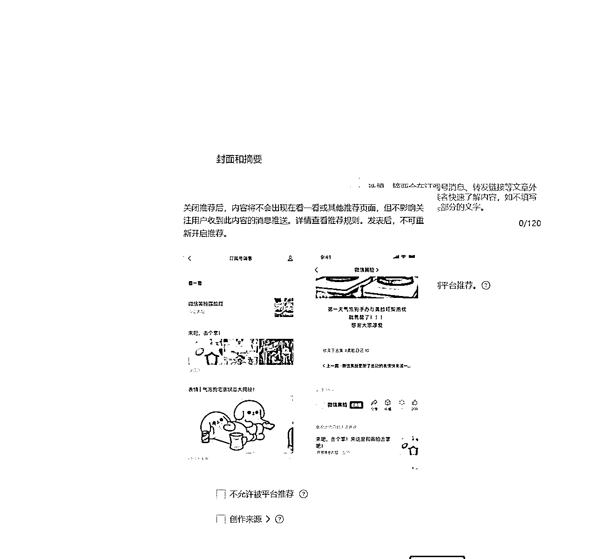

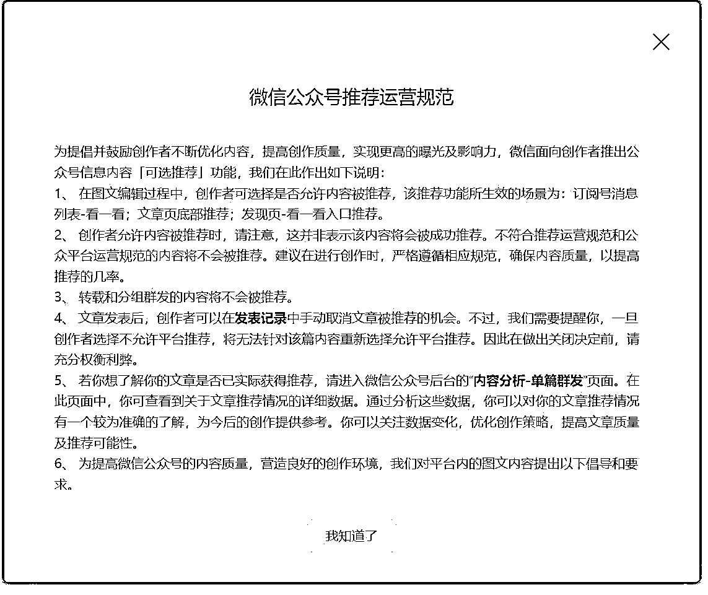

末了做个总结。

运营👸号，底线务必守住：不触碰党政话题，不造谣不诽谤。否则，轻则账号被封，重则可能被请去喝茶。

一般而言，你选定一个领域，依照对标账号的选题与文风去写，只要自己不犯飘，基本不会出现严重违规。毕竟那些参考内容发出来没被删除，说明方向是可行的。

对新手来讲，最容易踩的雷是“滥用原创”，多数源于洗稿，特别是AI洗稿。因此真心建议大家练就一项本事：读懂原文含义后，用自己的语言重新表达，并且尽量写得详尽，通常就能避开这个坑。

守住以上几条，违规的概率会大幅降低。

## 二、【项目落地 1/3】锁定领域，开通流量主

### 本章导读

从本章起，咱们正式踏入👸号原创爆文的实操阶段。你心里或许会冒出这些疑问：

我此前从未接触👸号，哪些方向对新手友好？

想找不拥挤、回报又高的方向，存在吗？

据说开通流量主需要500关注者，我是新账号，难道得先攒粉？

别慌，学完本章，这些问题都会有答案。本节将围绕以下内容展开：

准备妥当，咱们开始。

### 本章任务路线

完成本章学习与实操后，你就走完了任务路线的第一阶段：确定赛道，准备2个账号（约1天）。

1. 确定1个写作赛道，2个细节方向（约1小时）

2. 完成2个👸号搭建（约0.5小时）

3. 每个账号积累500粉丝，开通流量主（约0.5小时）

那么现在，请着手完成这几步筹备吧。

### 2.1 锁定领域与创作方向

#### 2.1.1 赛道如何挑？

我长期使用一套选题框架：将四个维度糅合在一起——【你感兴趣且擅长的、你的技能与工作履历、市场是否需要（饱和与否）、你的输出习惯】。这四个方面都能兼顾、价值最大化，那个领域便是你的归宿。

1、你感兴趣且擅长，你才有动力持续更新。无论有没有收入，你都乐意写下去。

2、你的技能与工作履历，会让你乐于琢磨复盘，越复盘越精进。

3、市场是否需要，是供大于求还是供不应求，竞争激烈程度如何，你可自行感知，也可去新榜查阅。

4、最后一点，你愿不愿意调整输出习惯？此前没有的话，能否下决心培养？

以上四项，每项25分，给自己打个分。

举个例子。我选的是娱乐领域中的剧评，当时的打分是这样的：

1、兴趣：15分。感兴趣，但尚未到痴迷程度，况且平时要带娃、要写作，追剧时间有限。

2、技能与经验：15分。从知道、了解、熟练到精通四个层级看，起初大概10分，后来逐步升到15分。我知道娱乐领域可行，但了解还需深化；等整套内容流程跑熟了，才算精通。

3、市场需求：电视剧与电影的剧评，目前仍是刚需，处于非饱和状态，至少20分以上。

4、输出习惯：这个习惯很关键。没有的话就要主动培养，和锻炼写作能力是一个道理。我给自己20分。

合计80分，可以做。

按百分制来看：40分以下，建议考虑换方向；40到60分，看看四个方面中哪个能突破；60分以上，可以入手。分数越高，你的主观能动性越强。

#### 2.1.2 值得尝试的爆款领域

目前已知在👸号上跑出成绩的赛道，共有6个：

这6条热门赛道，均适合新手入门。至于拥挤程度，我建议用【章节2.1.1】的选赛道方法去筛选，找到契合自己的细分方向，再依据目标人群布局内容，就不会觉得卷，值得长期经营。

当然，若你学习速度快、接纳新事物能力强，也可尝试一些较新的热门赛道，具体可查看【章节七、当前爆文蓝海赛道推荐】。

新手建议选定1个赛道、2个细分方向，坚持创作，更容易出成绩。

本期航海将以这6个热门赛道为例，教大家如何写出爆款👸号文章。

# 新手起号与爆文选题路线图

这次手册收录的五类稿件，拆开来都绕不开四样东西：素材、选题、正文、标题。因此不同体裁的写作技巧不会分章隔离，而是穿插在同一章里讲。比如「3.1.2 六个推荐赛道的选题方法」，就会分别说清情感、热点等类型该从哪里找题。

### 2.2 把👸号注册下来

先做证件准备：身份证与绑定银行卡放在手边。

刚入门者最好手里有两个号。一是某个号出问题时还有回旋空间；二是当唯一账号长期没起色，心态不容易崩。注意：身份与银行卡是绑定的，一套证件只对应一个号。普通个人通常就一个名额；有营业执照的个体户、企业或其他组织可开到两个；政府机构和媒体最多五十个。若要第二个号，借家人证件注册即可。

接着走注册流程。

打开🛰️公众平台 https://mp.weixin.qq.com/ ，在页面右上角找到“立即注册”，进入注册页后选中“订阅号”，再按页面提示提交资料。

### 2.3 做基础包装

包装环节别想复杂，抓住名称与简介两项。刚起步的人，选一个顺口、能看出内容方向的名字，再写一句让人秒懂的介绍，就够用。若准备长期扎根某领域，SEO 也值得研究；本轮主线是爆文，先不延伸。学有余力可看 @郭耀天 的《最新👸号 SEO 核心玩法，自动引流躺着赚钱》。

### 2.4 流量主开通

号下来后，流量主有门槛：关注者达到500。想快速解锁，买粉是常见做法，效率高且不影响后续起量；某宝渠道很多，不展开。风险也要知道：刷粉可能触发封号。决定买，就预设好被封的预案，封了注销再注册。平台治理一阵紧一阵松，多在航海群交换信息，能及时知道风向。

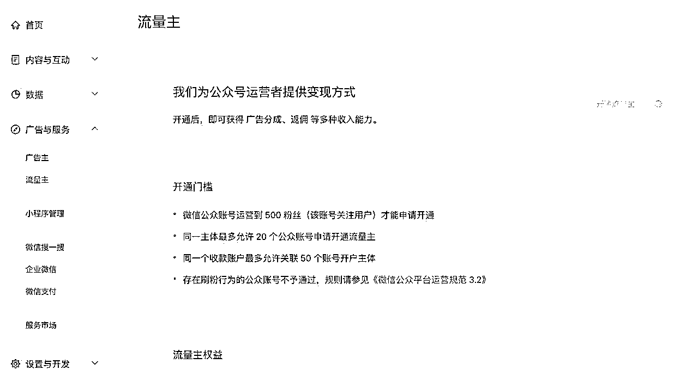

流量主打开后，先用原创声明群发三篇，打赏入口就会开。把账号名称、头像和打赏页信息做成同一套，可信度会更高。至此，起号准备基本收尾。这些环节不必内耗，内容才是主战场，其他都是配角，别把精力放反。

## 三、【项目实操 2/3】从写作到发布爆文

### 本轮要做什么

这一章是整个项目的主战场，也是耗时最多的环节。文章通常由三块搭起来：选题、正文、标题。选题决定文章最终走向；正文承载论据与细节；标题影响用户会不会在信息流中停留。本章按这三块推进：第一节找适合你的题；第二节把正文写到让人愿意读完；第三节做出打开率更高的标题。每期手册都会迭代，上次参航的老船员可重点看新增和改动处。持续练，爆款能力才会长；这一阶段走完，就有机会收到爆文广告的第一笔收入。

### 本章航线图

学完并做完本章，就走完航线图第二阶段：爆文写作与发布（预计5-7天，每天3-5小时）。

1.用搜一搜筛粉丝少而阅读高的文章，锁定3-5个模仿样本（约1小时）
2.照着样本的选题方式，产出一篇正文（约3小时）
3.学开幕雷击等技巧，把开头和标题打磨好（约1小时）
4.单号每天至少更1篇，争取账号被流量池收录（每天3-5小时）

现在就可以按这几步动手。

### 3.1 寻找选题方向

### 本节要点

圈内把选题说成生死线。它像选品：品类决定受众规模。本节先给几种快速找题法。第一，抓住一个关键词持续外扩，能撑起一周甚至更长时间的内容排期，所有方向通用。第二，按六个热门赛道拆招：职场、热点、剧评、法律、历史、情感。最后谈风险区。选题踩雷的后果不轻：轻则单篇被处理，重则账号归零。怎么避坑，本节会说明。准备好了就往下看。

#### 3.1.1 通用找题法：用🛰️搜一搜锁定模仿样本 @枫宇翔

刚上手时，最省力、最容易出结果的找题方式，是研究已被市场验证的高阅读文章，再照着找样本。样本怎么来？常见路径是打开🛰️搜一搜，把领域关键词丢进去，筛出可模仿的爆款。搜一搜有记忆效应：用过之后，算法会持续投喂同类内容，越投越多，所以目前效率最高。

**3.1.1.1 搜索词怎么定？**

读到此处，应该已经完成2.1的赛道与方向选择。先定第一个搜索词。赛道确定后，例如三农、军事、情感、法律，根据个人经验和常识，先抓一个高频词。做情感，我第一反应是婆婆、婆媳，这类词搜下去通常有爆款。之前我还推荐过大厂裁员方向，那关键词就落在裁员、毕业、失业、降薪、减薪上。实在想不出细分词，就把三农、情感等大类词直接搜，也能找到第一篇爆文，只是耗时。关键词越贴赛道，筛选越快。写这段回答时，我就在🛰️搜一搜输入了“裁员”。

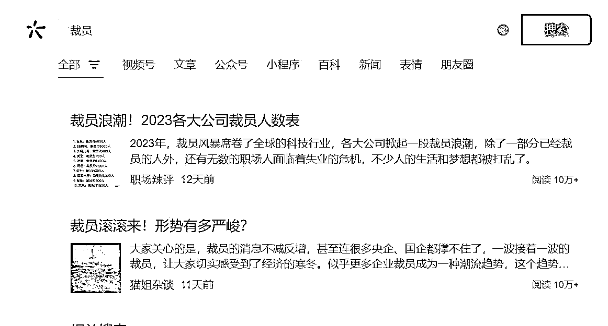

你看，十万以上的文章很快出现。拿到第一篇爆款，第一个模仿样本就到手。别跳过这一步，它是0到1的必经动作。用这个方式找到样本号后，接着做关键词扩展。

下一步是把关键词滚大，我叫它套娃式扩展。文章能爆，标题往往贡献很大，而标题里常藏着赛道流量词。拿着样本号，翻它几万阅读甚至十万以上的文章，把标题一条条抄下来。前面用“裁员”搜，出现“职场辣评”“猫姐杂谈”；我点进“职场辣评”大致浏览。

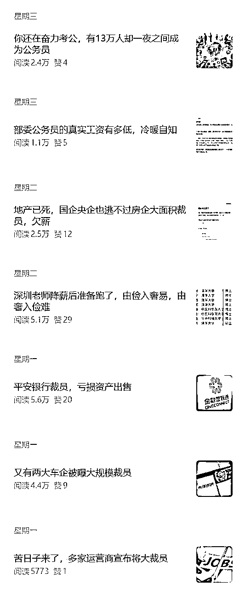

截图里的标题透出不少入口词：国企央企、欠薪、降薪、亏损等。你甚至能把这些标题再丢回搜一搜，又会收获一批高阅读文章，并顺带发现更多样本号。循环这个动作，关键词越滚越多，爆款和样本号也越滚越大。第三方工具也许能帮上忙，但我没试，嫌麻烦。我的原则就是简单、直接、见效快。另外，头条这类平台有频道入口；写军事就点军事频道，大量文章会出现，标题本身就是词库，逐个收走。有人提醒正文也有词，确实有，但我更愿意从标题下手。用户第一眼扫到的，通常就是标题里的关键词。

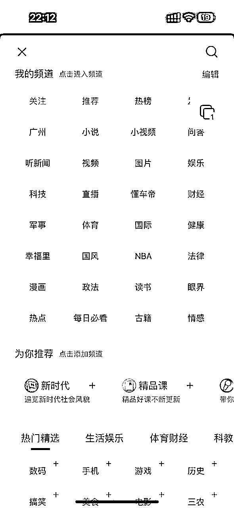

**3.1.1.2 样本文章怎么挑？**

判断一篇文章是否值得模仿，指标不用多。第一，搜一搜结果里先挑十万以上的，其次再考虑七到八万阅读的。第二，发布时间尽量落在最近三个月，且越新越好。理由很朴素：爆过的内容还容易再爆；最近还能跑出高阅读，说明需求在，你跟进写，成功概率更高。第三，前两条满足后，再看发布号的注册时间，最好也在最近三个月内。原因是，老号注册久、关注者多、原创积累厚，高阅读可能是粉丝托起。我们要找的是粉丝不多却跑出高阅读的样本，这类号和我们的起点接近，它能爆，你也有机会。

**3.1.1.3 样本结构怎么逆推？**

逆推框架不难。挑中爆款后先通读，抓住核心意思，再按开头、中段、收尾三块，用自己的话复述。仍以“职场辣评”的两篇为例：《地产已死，国企央企也逃不过房企大面积裁员，欠薪》《某大厂裁员还在继续，大晚上突然被毕业！》。读完可提炼共同点：裁员来得突然。框架大致是：①开头交代企业背景；②追问为什么看似不会裁人的企业也动手；③收尾总结并给建议。通读时留意切换信号，比如“但是”“为何、为什么”“不过”“然而”。这些词一出现，作者往往要换论述方向，前后内容会分层。把前后两层各压成一句，框架就清楚了。其他领域也有表示推进、深化的词。中国人讲话写文，换到另一层意思时常用一个词过渡，否则读起来突兀，听的人也难受。某些领域会有更具体的框架，但手册面向所有方向，每个人写的领域不同，框架自然不同。掌握这种拆法，回到自己的领域手动分析即可。样本号和爆款文已经提供，也做了案例拆解。若暂时不理解，先照着写，写着写着就会开窍。

#### 3.1.2 六条热门赛道的找题套路

**3.1.2.1 职场类：题从哪里来 @枫宇翔**

职场赛道可以再细一点，我重点讲大厂裁员和薪资泄露这一支怎么定题。这个方向我去年在直播和多个场合都反复推荐。当前环境下，企业降本增效会持续调整人员，裁员、优化自然成为很多人关注的话题。这批人又喜欢在职场社区吐槽、讲经历，那里就是题目来源，其中脉脉最集中。把脉脉装好，完成登录，刷大厂板块；也可在搜索框输入公司名，员工爆料会成片出现。

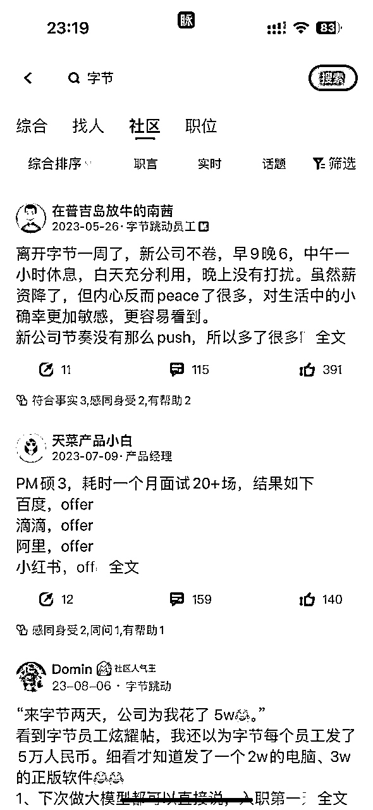

大厂话题天然吸睛，公司名就是流量入口。找到帖子后，把主帖截图和评论区截图嵌进文章，再用你的视角解释来龙去脉。裁员与薪资泄露这两类，在大厂爆料中已被反复验证能出高阅读。手册7.7职场裁员&薪资泄露系列列了样本号可对照；那个号自2023年12月19日起更新职场信息，裁员、薪资泄露都写过，目前数据仍稳。脉脉偏互联网，但方法可迁移到公务员、设计师、房地产等圈子；头条、百家号、抖音、快手同样能搜。若你本身就在这些行业，专业站点或App里的料会更顺手。我是程序员，因此更关注互联网公司的动向。三点提醒：①裁员、薪资泄露只是爆料中的一类，脉脉里还能挖出别的方向。②这类内容受关注，也容易被大厂公关盯上。写的时候只围绕网友公开评论讨论，别自行脑补，尤其不要造谣或鼓动攻击公司；保持客观，借信息表达职场态度。多看样本号怎么处理。③除脉脉，知乎、豆瓣、BOSS直聘等也能找到职场信息；裁员相关的社会新闻，或老板公开谈裁员的观点，也可入文。看样本号就知道，核心仍是职场加裁员，但呈现形式在变。

**3.1.2.2 热点类：题从哪里来**

热点题先盯热榜。我个人常用🧣和知乎的榜单，不过不同热点亚种，出题思路并不一样。

“指点江山类”专打社会不公，受众以中老年男性为主。找题时，知乎榜单通常比🧣更好用：知乎对负面社会事件曝光更充分，🧣榜单修饰多、冲击力弱。还有一点值得留意：知乎上不少高赞回答有流量却挤不进热榜。它们往往更锋利，也更容易写爆，因为高赞是用户逐个投票堆出来的，说明情绪已被点着。我们要抓的就是这种有痛感的内容。因此这类题的顺序可记为：知乎自然高赞 > 知乎热榜 > 🧣热榜。

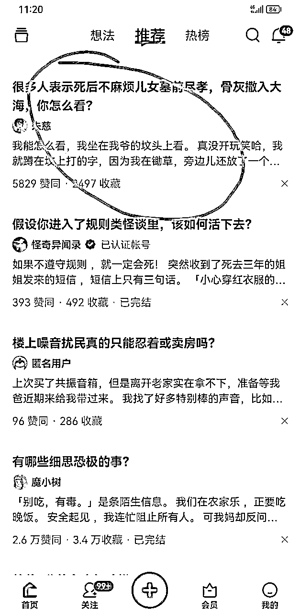

“娱乐热点类”面向中青年女性，追的是当下娱乐圈动态。多数作者应以🧣榜单为第一入口。每天多刷几回，盯住标识：出现“热”可纳入备选，“沸”要往前排，“爆”则要抢时效，最好当天成稿，拖久了流量就散了。顺序可记：饭圈小道消息 > 🧣热榜 > 知乎热榜。

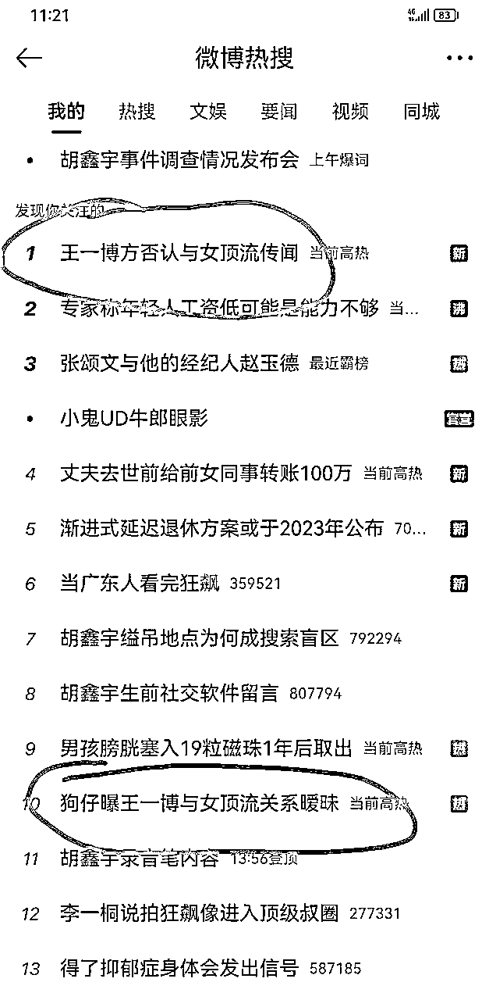

“养生热点类”做的是知识科普，受众覆盖中老年男女。这里的养生不是现代医学概念，而多取自老话，如“立春三不吃两不喝”。老年群体对疾病和死亡焦虑较强，这类内容容易带来阅读。操作时，把农历节气和热榜里的健康话题结合；但只能往传统习俗上写，不得给医学建议，否则容易踩违规线。顺序可记：节气≥🧣等平台健康类选题。

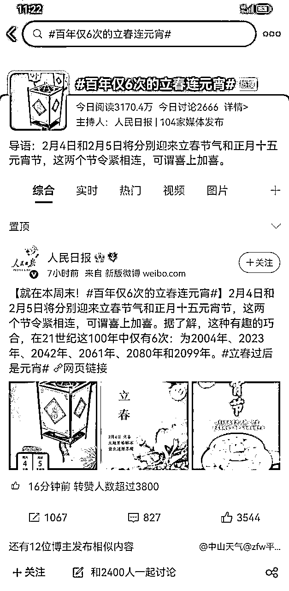

其余热点亚种我接触少，留待以后摸索。

**3.1.2.3 剧评类：题从哪里来**

剧评类可走两条路。第一条是借热点做剧评。以《满江红》为例，影片热度高、评价分化，此时围绕它写多篇新角度影评，能分到一波流量。

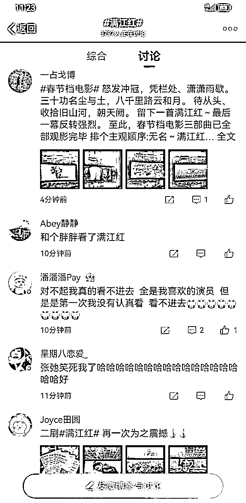

第二条是啃经典老剧，如《知否》《甄嬛传》《大明王朝1566》。这些剧自带受众，信息量也足，一个细节就能拆出多篇，选题储备不容易断。一部剧写出几百篇并不夸张。两条路都可行。

**3.1.2.4 法律类：题从哪里来**

写新闻题，优先用官方媒体已报道的素材，投诉风险会小很多。底线要清楚：不要碰政治、军事，尽量落在鸡毛蒜皮、家长里短的民生范围，越贴近普通人的日常越好。能跑出高阅读的新闻内容，基本都在这个区间。

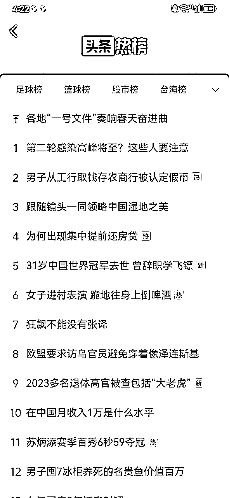

这也是本轮没让你去🧣、知乎找法律题的原因。地方新闻节目同样是素材库。某条新闻让你血压飙升，就纳入候选；无感就跳过。想更理性，可拿开幕雷击七要素做筛子：命中2条以上优先，只有1条不建议，零条直接淘汰。法律条文用百度就能查，搜索词写故事本质。比如有人把别人头打破，就搜“把人打成轻伤怎么判刑和赔偿”，资料会成批出来，再汇编进模块。

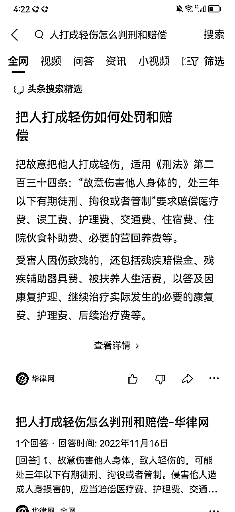

**3.1.2.5 历史类：题从哪里来**

历史题有两条路：追热点，或按个人兴趣稳写。1、追热点要盯动向。比如“胡歌生女”引发关注，可以去找历史上重要人物出生或得子激起大反响的案例。这种写法对契合度要求极高，经验不足先别尝试。同理，遇到“县长贪污”新闻，可借来写古代官员贪腐会受到什么惩处；遇到“明星和粉丝”话题，可写古代追星族的疯狂，《大宅门》中白玉婷嫁尚筱菊照片一事就有历史原型。

提醒：历史追热点既要切口高度贴合，又要以今观古，作者功底要求不低，可在日后练习中逐步提升。2、求稳的写法，是按自己的兴趣挑历史人物和事件。写作者先要写得痛快，可选敬佩者、厌恶者、令人惋惜者、让人落泪者。人物定下后，先立基调，再整理事迹，给一个总体判断：敬佩、同情、肯定，还是功过参半。全文沿此基调展开，通常不会跑偏。写隋炀帝，大多绕不开劳民伤财、暴政、急躁；写唐太宗，则可从虚心纳谏、宽厚爱民等角度落笔。

# 冷门人物也能写爆：选题与避坑实战

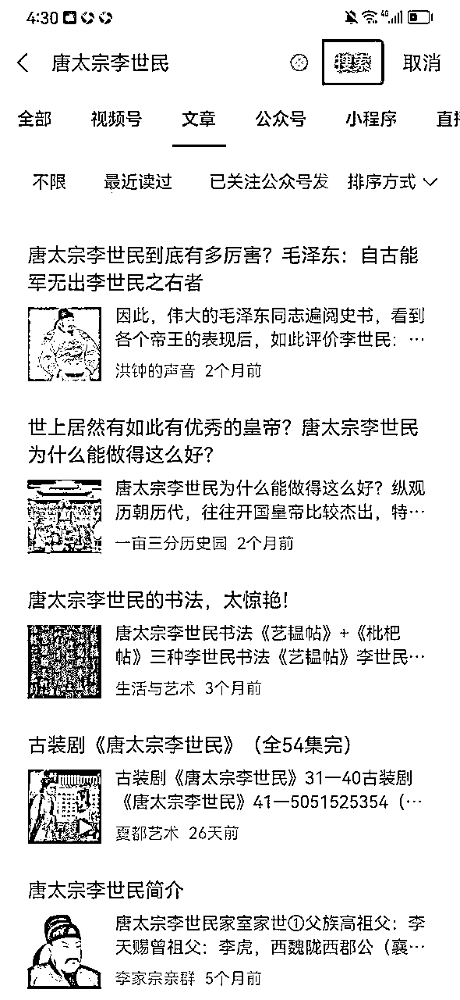

写那些资料不多、却让你念念不忘的人物，别只盯着本人。可以先看他前面的长辈、后面的晚辈，以及同处一个圈子的人；必要时补一点合理想象，但别把人物写变形。补出来的情节，仍然要替真实性格作证。

近代史方向，圈友@一来试过。做历史号可以捎带近代史。这个赛道起量不快，常常要磨一个月，过程中还有变数；一旦被流量池接纳，阅读表现会比较平稳。可观察“飞扬说史”，日更里常能见到大小爆款，缺点是正文里广告位常常空着。

来源：6 月 8 日《👸号流量主的经验分享》@一来

#### 3.1.2.6 情感类：如何选题

情感爆文，先看素材有没有爆相。多平台刷题、建灵感库，是找感觉的常用办法。
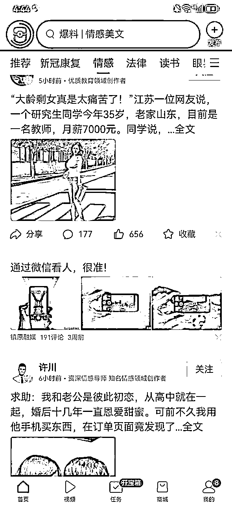

要找的素材通常具备：让人代入、读着鼻酸、观点能吵起来、事情反常。八条抓手如下：

1）情节拐点多；
2）情绪浓度高；
3）读完有新知；
4）贴着柴米油盐；
5）牵涉名人明星；
6）带两性话题；
7）出现暴力冲突；
8）绕不开钱。

至少踩中三条，再动笔。

#### 3.1.3 选题避坑经验 @半糖梦呓

公域平台对措辞很敏感。选题一旦出界，文笔再好也白费；有时一个禁词就足够让推荐停摆。主要防三类坑。

#### 3.1.3.1 政治红线不能踩

平台每月清理的账号数以千计，绝大多数是低俗暴力号，也有一批栽在政治红线上。红线怎么记？抓住“党史”“军史”两个关键词。写文史内容的作者尤其要绷紧弦。党和军队的形象是正面的，落笔也只能取正面材料，别的不要展开。想更稳妥，1840 年以后涉及中国的内容尽量绕开；民国人物与事件，半糖的态度是谨慎，新手干脆不碰。文史题材天然敏感，自媒体人更应守规矩：不该出口的字一个不加，敏感人物与事件连边都别沾。有人问：就爱写历史怎么办？新手可先做古代史，尤其是中国古代史。安全系数高，读者面也宽，话题储备足，更容易出成绩。

#### 3.1.3.2 追热点不吃人血馒头

热点要追，但有一类热点在公域平台不能碰：拿逝者做流量。反面样本一：二更食堂。它曾是百万粉大号，后来被封。滴滴空姐遇害后，该号借公众关注编出大量不存在的情节，措辞低俗露骨，等于二次伤害逝者。这就是吃人血馒头，结局没有缓冲，大号照样封停。

反面样本二：今夜 90 后。孩子与母亲争执后跳桥，该号补写了许多并不存在的细节，后来被证实是杜撰，目的只是吸引眼球。账号同样被封。
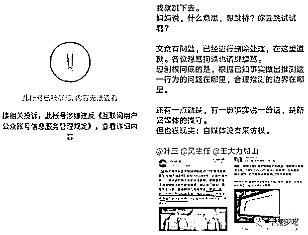

拿逝者做文章，还编细节、用夸张和性暗示语言，吃相非常难看。网络有法律边界，也有道德底线。死者为大是普遍心理，谁拿逝者当素材，谁就容易惹众怒。有人问：不造谣、不脑补，只从普通人立场评两句社会，行不行？不行。这种写法容易把群体推向对立，放大仇恨。正面新闻那么多，偏盯负面猛写，平台不处理你处理谁？

#### 3.1.3.3 财经、健康需要资质才能写

有学员问半糖：昨天发的微头条怎么被官方删了？
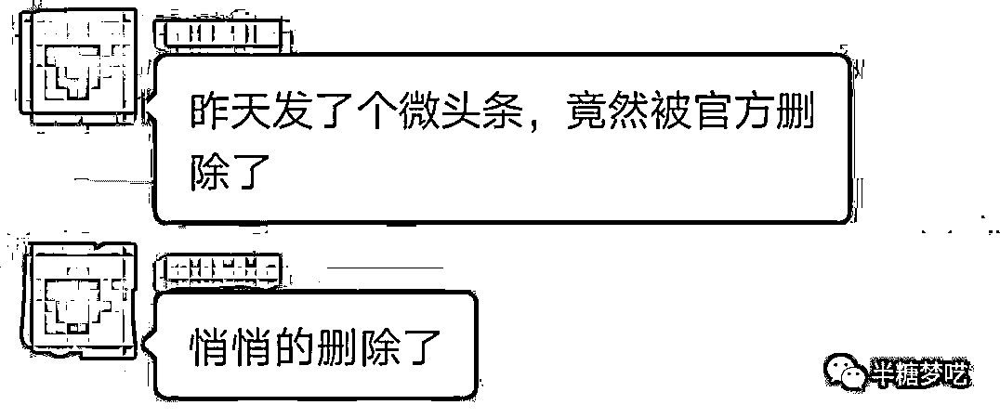

一问才知道，没有财经资质却写了财经内容。财经、健康都要求职业认证。没认证还写，轻则限流，重则删文，想做大基本没戏。平台对这两个领域的门槛写得明白：财经认证需在 22 类职业中具备一种，并提交证明材料。这里按类别列：研究分析类——经济学者、财经评论员、财经媒体人、市场研究员；风险管理与财富类——金融风险管理师、特许财富管理师、特许金融分析师、财经/投资分析师、理财规划师、黄金投资分析师、私募投资人；投资交易类——投资经理、基金经理、交易员、证券投资顾问、证券经纪人；金融财税类——银行行长、精算师、注册会计师、注册税务师；保险类——保险经纪人、保险代理人。健康认证需符合十类身份之一并交证明：医生、护士、药剂师、康复治疗师、放射/检验技师、医院院长、营养师、医药研究员、医药工程师、心理咨询师。细则去头条职业认证标准页看，这里不展开。
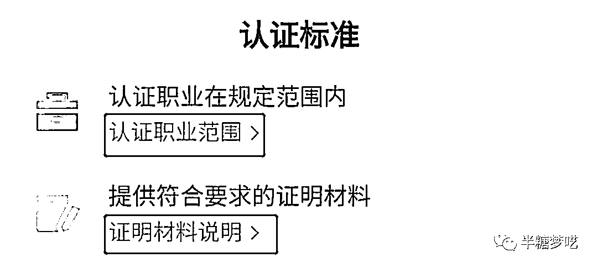

对不上这些条件，就别碰财经和健康。三个明面上的禁区，放到任何公域平台都通用。

避开违禁内容后，还有细节要处理。第一关是查禁词。可用句易网🛰️👸号，把稿子粘进去，系统会标出敏感词。查完常有人惊讶：平时挂嘴边的话也算禁词？具体词不举例，自己试一次就懂。如果没查到禁词却仍被限流，就检查标题党。举个实例：上周有学员问半糖，微头条被警告该怎么改。她原开头写：闺蜜的前夫来电，让我退他 1000000，我骂回去拒绝了。随后他又发照片和消息：晚上 8 点来我家。我盯着照片，眼泪止不住，恨不得打死自己。系统提示“刻意隐瞒关键信息”。
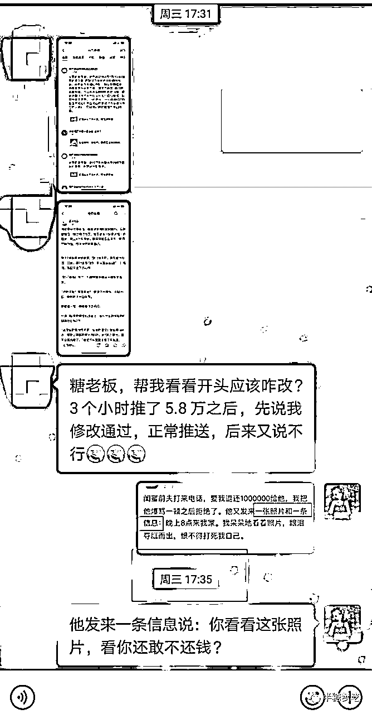

这话说白了就是标题党。早年全网嘲的 UC 震惊体就是典型：故弄玄虚、小事夸大、藏住主语。读者点进来发现内容撑不住标题，会有被戏弄的感觉，于是取关、拉黑，平台也跟着挨骂。平台不傻，有前车之鉴，打击力度只会更大。学员那句“照片和消息”就是在卖关子，所以被限流。半糖让她改成：“他发来一句：你看看这张照片，看你还敢不还钱？”意思没丢，关键信息也没藏。
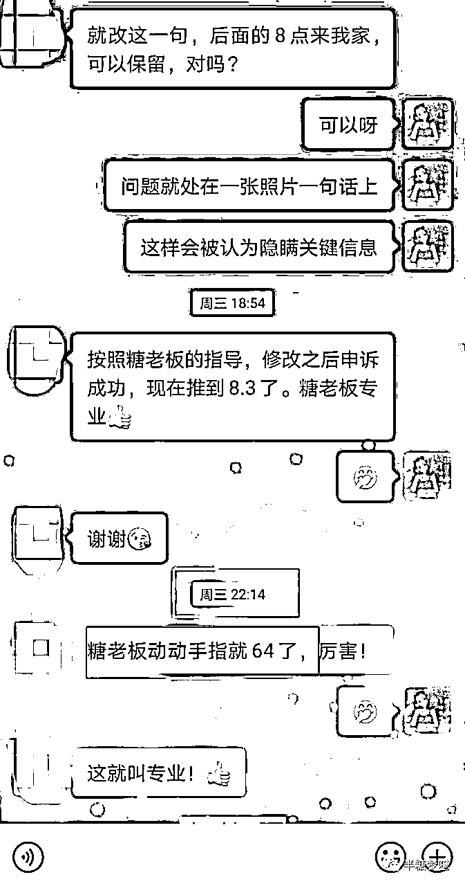

四小时后，这条微头条冲到 63 万+。
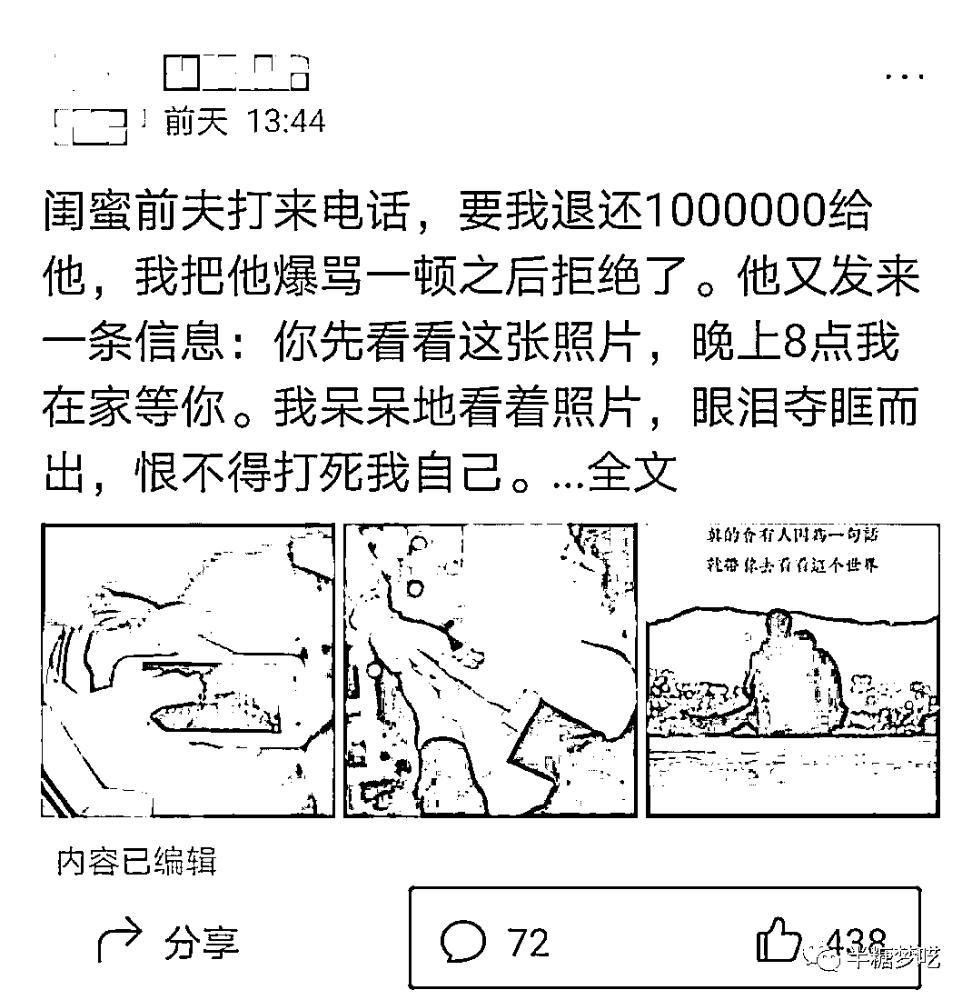

很多扑街稿离爆款只差一句话。可多数人写完就发，文章悄无声息地沉了，怎么想都想不通，问题往往就藏在某句话、某个词里。避坑题材再归纳一遍：

1. 政治相关不写，党史军史、时政热点、国家领导都算，除非有互联网新闻信息服务许可证；
2. 热点不碰人血馒头，哪怕不造谣，只站在普通人角度评社会也不稳妥；
3. 财经、健康要有资质；
4. 公务员、体制内题材少碰，违规概率高；
5. 黄赌毒绝对远离；
6. 媚外内容尽量不写；
7. 娱乐领域负能量事件与艺人谨慎处理，除非官方定调。

来源：《今日头条七大变现方式，我只用一种，半年赚 80000》

#### 3.1.4 选题技巧 @张波

选题必须做差异。内容同质化太严重，千篇一律很难冒头，流量也难拿。情感赛道不少人还在翻炒旧梗，读者对当年的爆款套路早已疲劳，作者自嗨，围观者却越来越少。选题前先拆解。下面两个例子未必精准，但可作启发：重复的东西看多了会腻，顿顿大鱼大肉也受不了，得找不同角度。

**观点+情绪**

看同领域账号的切入角度。若大家都写正观点配正情绪，赛道拥挤，你可以换观点配正情绪，也可以正观点配另一种情绪。以 2024 年养老金调整为例。

正观点+正情绪可写《2024 年退休金调整新规：工龄超 30 年上涨 10%，年金最高可达到 8 万元？真相来了！》；
反观点+正情绪可写《可能 85% 的人都还不知道！养老金今年按工龄进行调整了：满 30 年工龄，每年多涨 240 元。这三种人有福了！》以及《坏消息传来？中央定调：2024 年 3 类人将被取消养老金，社保缴满 15 年也没用！赶紧看看！》；
正观点+反情绪可写《2024 年养老金“20 连涨”？3651 元以下，按 10% 上调；6400 元以上，停涨！这样行吗？》。

**热点+领域**

再看热点叠加领域。大家都写热点+本领域，你也可以写“不太热+领域”，或者“热点+别的领域”。

例子：
热点+娱乐《众人惋惜娃哈哈创始人宗庆后逝世，只有王力宏说得一针见血！》《嫌王力宏老，买百万名表，她是 42 岁的娃哈哈新掌门》；
热点+情感《又上热搜了，娃哈哈宗馥莉谈恋爱啦，知道对方是谁后，我想哭了……》；
热点+业务《来了！不给娃哈哈设计大厦，我都对不起宗庆后和全国人民的热情！》。

引用教程链接保留：https://k170ac9yh31.feishu.cn/docx/KbupdqExXo8z9pxL5RqcUzJOnfb

### 3.2 制作文章正文

### 小节概要

正文大多有现成骨架，照着骨架找材料、做润色即可。本次航海涉及五类，下面拆解各自可复用的爆款模板。

#### 3.2.1 职场类：爆文模版@枫宇翔

职场故事文可套：标题+故事主干+网友争议+总结建议。我的看法是，职场爆文七成以上胜负在标题。标题能撬开流量池，正文怎么写都更容易被读到。若非要固定一个模板，可这样做：第一，定题后把主题截图放到开头，围绕截图讨论原因；第二，挑评论区观点相左、吵得厉害的留言嵌入正文，对照分析，再亮自己的判断。对标号可看“职场故事荟”，早前叫“程序员圈儿”。它的做法是拿一张图起手，懒一点就多截几张网友评论来讨论。分析原因时别只干讲道理，学会用故事承载观点；故事比分析更抓人。多翻这个号，手感会出来。
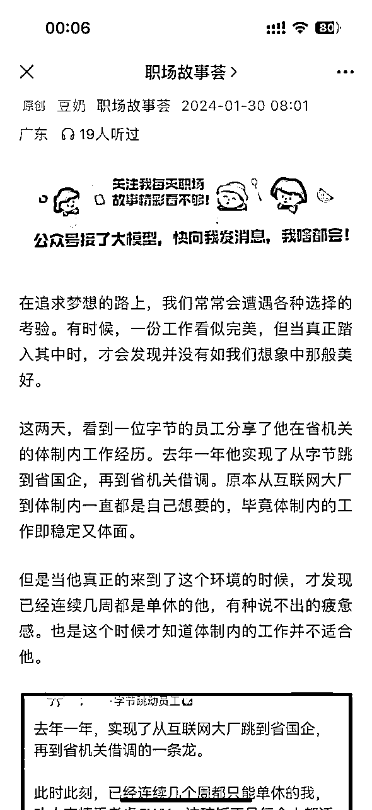

#### 3.2.2 热点类：爆文模版

热点文可记成：标题+基本故事+态度/观点+结尾。

#### 3.2.2.1 案例一：龙骨龙鳞公式

把成稿想成一条龙：事情梗概是龙骨，散在文中的金句、判断、细节、立场是龙鳞。龙骨只负责把事说清，不追求面面俱到。事件太复杂、篇幅拉太长，完读率会受伤，挑一个侧面讲透即可。龙鳞用来表明态度、亮出观点。写故事时，细节是为了让虚构可信；热点本身就是真事，不必再靠细节证明真实，硬加反而可能翻车，二更食堂就是警示。热点文里的龙鳞只做一件事：站队、表态、说清看法，别承担别的功能。陈述事件时，情绪上来就用句子接住，用观点去连接同频读者。记住这一条就够了。

#### 3.2.2.2 案例二：不同难度的爆文公式@妞妞

拆开看：

1）标题要有开幕雷击，控制在 50 字内。例：突发！“中石油牵手门”男女主再曝大料，这背后可不简单。

2）开头约 100 字，可写领悟，也可直接进事。例：①生活常给惊喜。成都一位摄影师街拍，竟拍出国企领导“牵手门”丑闻。②某月某日，一个话题冲上热搜。“宝妈因孩子吃了同学生日蛋糕发飙”，很快引发热议。怎么回事？③没想到珠穆朗玛峰也会出这种事。近日#珠峰攀登者放弃登顶救起濒死女子#冲上热搜第一。④还记得十天前武汉教师碾压学生致死事件吗？学生竟在校内被老师碾死。几天后，悲痛消息再来：被撞孩子的母亲在孩子离世十天后，从 24 楼跳下。按自己习惯来即可。

3）事件陈述约 500 字，把时间、人物、地点、经过讲一遍，配相关图片。

4）对比认证约 300 字，可有可无。热点正猛可省；热度一般就补。去网上找一两个相似事件作对照，加几句点评。

5）亮论点、带情绪约 300 字，看法要鲜明，可以有点愤青。

例文 1《胡继勇带女员工在太古里牵手逛街！女方的素颜照很一般，但胜在腿长肤白》走简单粗暴对比；例文 2《“我儿子被投毒了！”家长群聊天记录流出后，我看得好窒息……》有对比、有深度。

按公式拆例文 2：①标题同上，50 字内；②开头约 100 字，6 月 6 日话题冲上热搜，“宝妈因孩子吃了同学生日蛋糕发飙”引发热议，怎么回事？③事件陈述约 600 字，从网友发帖分享家长群对话、六一儿童节有家长带蛋糕给孩子们分享，写到“再毒的奶油蛋糕，其危害性也比心灵的终极污染小得多”。原文可搜标题。④对比论证约 300 字：知乎作者“一只小仙女”的经历；网友说妈妈同事因孩子吃辣条，逼孩子吃成人两倍剂量泻药；主持人倪萍分享的故事。⑤论点与情绪约 300 字：从“只有自己的内心得到过满足，才不会匮乏”，到“没有人一生都在吃标准的食物，也没有人一生都在走正确的道路。对孩子和家长来说，适当保持一点松弛感和容错率，或许我们都能活得更轻松”。

来源：7 月 13 日《用 GPT 写热点文&👸号快速入池的方法》@妞妞

#### 3.2.3 剧评类：爆文模版

剧评可套：标题+剧情+观点/解析+结尾。观点式剧评，剧情和细节最后都要落到一个判断上。

例一：标题《明兰不知，原来顾廷烨与贺弘文求娶她目的相同》，读者会追问目的。剧情：顾廷烨为娶明兰做局。他清楚明兰与贺弘文将订婚，偏把贺弘文青梅竹马的曹表妹送进京城。曹表妹求做妾，贺弘文心动，还想等明兰让步；僵持之际，顾廷烨出手求娶。观点：合适。对贺弘文，明兰的手段与家世都匹配；对顾廷烨，也合适，但靠的不是门第，而是品性与手腕。顾廷烨记得父亲那句“娶妻娶贤”，明兰有主意、有办法，还能与继婆婆周旋。结尾：婚姻的底层不是爱情，而是适配；互相托举的关系，比单靠心动更稳。借明兰的话收束：婚姻未必需要爱情，女人也不该把目光锁在儿女情长上，经济与精神独立后，去看更大的世界。该文阅读 3.8W，收益 200+。

例二：标题《盛家四个女儿，墨兰才是嫁的最好的》，读者好奇：墨兰做了不光彩的事，为何反而嫁得好？剧情：墨兰为进高门不顾盛家名声，与永昌伯爵府公子苟且，逼全家成全，帮她嫁入梁家。说她嫁得好，是因为丈夫宠爱、婆婆和善，符合她对高嫁的期待。观点：嫁得好不等于过得好。她明明是正房，却把心思全放在与妾室争宠，还主动给丈夫纳妾，家里天天鸡飞狗跳。结尾：墨兰起点最好，却把日子过成一地鸡毛；另外三个姐妹无论用手腕还是计谋，都把不如意的婚姻经营成了想要的生活。该文阅读 4W+，收益 280 多。

两篇都遵循标题+细节+观点+总结，构成完整剧评。

2）另一种常见写法，就是专门做剧情拆解：把藏在故事表面之下的暗线挑明，再把主角的命运轨迹讲透。

比如那篇《知否》相关爆文，标题走的是“曹锦绣衣襟半露向表哥示好，才看懂贺家为何放弃明兰”的路子。故事讲的是曹锦绣终于嫁给表哥贺弘文做了妾，可成婚之后的日子远没她想象中舒心——吃住不愁，但其他的什么都谈不上。贺家祖母总是变着法子拿捏她，贺弘文对她也没什么怜爱之意。有一次她想见丈夫，只好谎称身体不适，把人诓来后，才出现了那场主动亲近的戏码。

这里拆解出来的道理是：曹锦绣没想明白，自己一旦成了贺家妾室，反而把软肋完全暴露给对方。一是妾的地位太过低下，说白了跟丫鬟差不了太多；二是主母处置妾室是天经地义的事，不需要顾念任何情面。这篇文的收尾落点也很清晰：曹锦绣一次又一次得寸进尺，把贺弘文心里那一点情分与亏欠彻底磨光了。人在权衡的时候都会掂量轻重，可一旦发现自己的感情被人利用，剩下的就只有心灰意冷。

整篇采用“叙述剧情+拆解逻辑+收束点题”三段落结构。数据上，这篇文章阅读达到十万加，收益做到了八百多。但有一个坑必须避开：千万别为了吸引眼球去编造剧情，一旦被读者识破，对账号的伤害非常大。

#### 3.2.4 法律类：七步新闻爆款流程

新闻向的爆文有一条七步流程，口诀可以概括为“报方位+抛冲突+讲经过+览评论+引条文+教应对+抛问答”。全文长度控制在一千二到两千字，千万不能超过两千字。好，下面逐步拆解这条流程。

“报方位”要求把地名写到省市一级，最好精确到地级市。这一句话要独立成段，用最简练的方式交代地理位置，通常开头就是“近日X省X市”。

“抛冲突”的任务等同于开场炸雷。它的位置就落在第一段的前五十到一百字，紧挨着方位信息。你要先想清楚这条新闻里最尖锐的矛盾是什么，再换位思考：如果换成你，短短几十个字，能不能让读者和你一样气血上涌？这就是这一步要达到的效果。

我见过一个展现量冲到千万级的爆款开头，是这样写的：“近日山东菏泽，一女子去加油站把油加满，结算时一看表直接愣住，油表读数59升，而她的车油箱最大容量只有41升，况且进站前里面还有7—10升余油。女子当面质疑，加油站员工却一口咬定没问题，女子气不过，直接跑去4S店里干了一件疯狂的事。”

除了“近日X省X市+事件”这种常规开法，也可以用高情绪词语直接点燃读者，比如“令人发指！”“太残忍了！”“严惩不贷！”“太坑人了！”“太猖狂了！”

不过要说一句：像“残忍”这类词，使用时要多留个心眼，存在一定风险。往下走是“讲经过”，这一步要用400到800字的篇幅，把新闻的完整来龙去脉铺开，这时节奏可以放慢一些。语言要接地气，生动形象，就像平时跟熟人唠家常一样，千万别端着写官方书面语。有一点特别注意：这里不能使用插叙、倒叙这类技巧，否则读者看不懂，一迷糊就直接划走了，后面辛苦铺的篇幅就全白搭。

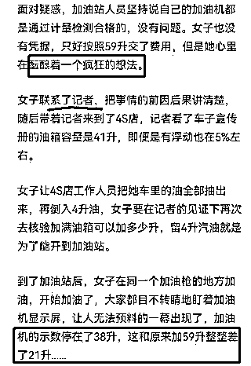

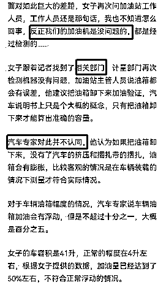

讲经过的时候，还可以穿插一些能制造波折、吸引注意力的表达，比如“酝酿着一个疯狂的想法”“目不转睛”等等。再加几个观察视角——比如当事人怎么联系记者、怎么找计量部门、怎么咨询汽车专家——读者就会顺着你的思路往下走。

接下来是“览评论”，篇幅约200到300字。做法很简单，去相关新闻的评论区挑几条点赞高的网友留言放进来就行，不用多花心思。网友观点这块，可以去爆款内容里找那些讨论度高的评论摘过来引用；要是平时写得够多，脑子里已经积了不少看法，也可以自己编几条——反正都是“网友说的”，对错也无人追究，只当是网友个人观点而已。最好正面、反面、中立各来一条，最后再补上一小段你自己的观点，这样既有别人看法，也有自己的态度，整体就更完整了。

再后是“引条文”。这里特意强调一下：就算你没有法律相关资质，只要你援引的法律条文没有差错，照样有机会出爆文。平时需要做的是多积累法律常识，多刷知乎上的热点提问——评论区往往已经有高人帮你列好法条，省得自己动手；同时存一些电子版法律资料，需要时按关键词检索定位对应条款。这步看着似乎很难，但信息时代，只要你掌握了最基础的关键词检索技巧，就完全不成问题。这段同样是400到800字。

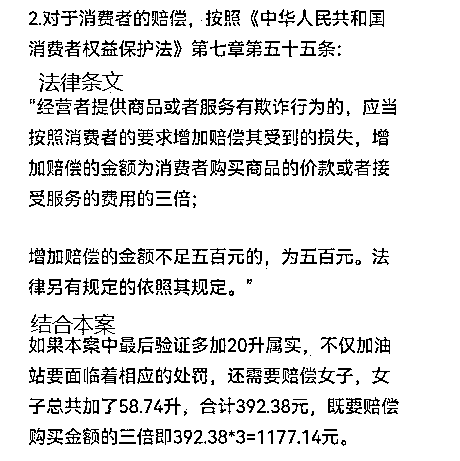

条文写完之后，还要接着给出针对这个具体案件的分析，以及按相关法律法规应如何处置。然后是“教应对”，也就是告诉读者，以后遇到类似困境该怎么做。这个环节放在倒数第二段就行，写几句话就够。如果觉得前面内容不够饱满，或者字数还差一点，也可以把亲身经历放进来，讲讲自己遇到类似事情时是怎么处理的；没经历过的话自己写一段也行，目的就是引起读者共鸣。最后是“抛问答”，留两三个问题引诱大家在评论区讨论。这个位置放在最末一段，两三个问题足够。

#### 3.2.5 历史类：四种模式任你选

历史类公号文章的写法，跟头条的微头条、问答、文章是一样的逻辑，同样是提出问题、解答问题。要说差异，可能就在题目上：头条的文章题目要求有深度、概括性强、给人启发；👸号的题目则要求吸睛、猎奇，用非常夸张、让人欲罢不能的措辞制造新鲜感，逼着读者非点开不可。

1）第一种，锁定人物结局的遗憾感或意外感。写法是顺着人物的生平脉络走，从他出生到少年、中年、晚年，按时间线依次梳理。每个阶段穿插一两段故事，尤其是晚年部分一定要写得够尖锐，因为那是全文的点题之处。

2）第二种，用人物性格或事迹的震撼感做钩子。整体风格还是讲人物生平，但只需要聚焦一两件事，重点刻画他的反面特征，比如行善之人做过恶事、贤明君主干过糊涂决定。主体可以讲大家熟知的内容，再用小半篇幅揭出这个人鲜为人知的另一面。

3）第三种，把事件原委讲透，让读者看完心生敬服。这其实也接近热点写作的思路，可以从不同侧面解读一个主题，比如清代保密措施究竟怎么运作。还可以延伸开来，写历代皇位怎么交接、皇帝没有继承人怎么办、各朝各代选立长的还是立贤的、孩子多到底是福是祸……用各种方向去拆解同一个问题。

4）第四种，做人物盘点。这个方式最容易上手，就是盘点那些大众固有认知中需要被刷新的人物。也可以盘点有功劳的皇帝、战神级的武将、命运顺遂的女人、一生凄惨的女人等等。盘点类文章不需要多高深的理论，基本就是一个人物配一段小故事，说得有理有据就行。

#### 3.2.6 情感类：故事的万能模板

情感类故事文的公式是：文题+主角+故事主线+收尾=一篇完整故事。展开说，就是开好一个题目，设定一个主人公，写清楚故事主干——里面包含梦想或目标、挫折或意外、惊喜或反转——再给出一个结局。再拆细一点：谁，想做什么，为什么做或怎么做，做的过程遇到什么，最后结果如何。

落笔前，先确定打算写什么主题的故事，再把题目定好，最后围绕这个核心，把故事顺着写下去。人物介绍部分要回答：我是谁，多少岁，从哪来，做什么工作——把主人公的基础情况说清楚；再交代与主人公相关联的人或物，他们是什么关系、怎么认识的、各自做什么的——同样简洁地介绍背景即可。

故事主线要解决的是：想做什么、发生了什么事、卡在了什么问题——目标或梦想，挫折或阻碍或意外，都装在这里。结局则要回答：这件事对主人公产生了什么影响，主人公怎么做或应该怎么做，最终结果是什么。这样，一个故事就完整了。

需要记住，一篇爆款好故事通常具备五个条件：题目足够好、内容原创、有信息增量、不炒冷饭不重复新闻、不传递负能量。五个条件都满足，才谈得上大爆的可能。写法上一般用第一人称写，读者更好代入；当然这不是硬性规定，按自己习惯选择即可。故事主干与情节要做到繁简得当：与主题无关的，粗略带过；能凸显人物性格、推动情节进展的，详细铺写。

结尾尽量不按常理出牌，让读者产生一种意料之外、情理之中的阅读体验。比如素材里的例子：某女结婚索要天价彩礼，婆家气得要退婚——读者预想的结果肯定是分手，但我们偏偏把结果写成两人还是结了婚。至于为什么还能结，就要靠作者在反转情节上下功夫了。故事可以虚构，也可以是自己或朋友身边的真实经历，但一定要正向引导，不能坏了伦理纲常、违背道德、散播负能量。

附几个参考题：《除夕夜公公给我们100万，本是高兴的事，可被老公闹得家里鸡飞狗跳》《我69岁，发现40岁保姆偷我钱，我要求她“肉偿”，她的反应吓傻我》《我33岁阳了，老公连夜带着孩子逃了，半夜有人压在我身上，睁开眼我吓傻了》《公公病危，儿媳献身，公公舒服，婆婆支持，老公发飙，结局意外》《我51岁，二婚老婆夜班，继女爬上我的床，说难受让我帮帮她，我让她愉悦，老婆夸我真棒》。

### 3.3 学会给文章起一个“雷击”标题

### 本节要点

做内容的人都清楚：文题决定了文章的打开率，也就是阅读量，而阅读量又直接关系到你的收入。所以标题的分量，怎么强调都不过分。好消息是，起标题是有套路可循的，核心就是「开幕雷击」。说白了，就是让读者第一眼看到的文字或画面就足够炸裂，像被雷劈中一样，吊起他点进来读完的兴致。下面就用大量案例，手把手教你怎么掌握这个技能。

#### 3.3.1 什么是开幕雷击

每一篇文章想要阅读量高、收益高，都离不开一个高打开率的标题，用它锁住用户的目光，把读者的注意力死死拽住。抓住注意力的诀窍就在于：把读者最在意的东西写进标题，点燃他的欲望和好奇心。标题的好坏，直接决定读者是否愿意点开。如果他完全没有打开的冲动，没有兴趣点进来探个究竟，那文章里的内容就算再出色，也没人看得到——没有点击，收益就是零，文章等于白写。

把这点想通了，就会发现写好标题的核心只有一件事：用好「开幕雷击」。这一概念最早由星球圈友@半塘梦呓 分享，当时他以微头条为切入点，讲怎么写出一开篇就能抓住人的内容。想深入了解可以翻翻原帖《半塘梦呓：如何用好开幕雷击》。所谓开幕雷击，就是读者眼晴扫到的第一屏内容里，有足以让他心头一震的言论或画面，如同挨了一记雷劈。

我反复测试之后，把爆款标题的“雷击要素”总结成了7个：1）金钱、数字；2）性暗示；3）暴力；4）死亡；5）捷径；6）异常、悬念；7）民族主义。这7个里面，异常是屡试不爽的王牌。这些要素不只适用于👸号，在短视频、百家号、头条的图文、问答、微头条等各个平台上，全都能直接套用。在不违背平台规则的前提下，能糅进几个就糅几个。

很多同学文章写得不错，问题就出在雷击没有打好；还有的同学把雷击误理解成狗血、暴力、血腥，这是不对的。那样只会让读者产生反感，内容也可能被限流，甚至被投诉举报，最后被平台删除封号。真正的雷击，只是要求出现令人震惊的言论或画面，能勾起人们好奇就可以了——本质上就是一种“反常”，跟平常的思维逻辑反着来。

这种震惊感不是靠写“太震惊”“惊呆我了”这种词，更不是“某某某手起刀落，血溅当场”“倒在血泊中”这种露骨描写。真正高级的写法，用委婉的字眼引导读者自己去联想。比如说：某人家里亲人去世了，别人都在悲痛，他却显得很高兴。这就是反常，读者自然而然会好奇：他到底为什么高兴？再举个例子：某家小卖部矿泉水3元一瓶，10元三瓶，大家都说老板是傻子，于是一个个分开买，三瓶花9元。没想到老板反而乐了。这个标题同时踩中了金钱和异常两个要素：金钱一眼可见，异常则是——老板明显亏了，为什么还在笑？换成你，是不是也想点进去看个究竟？

记住：暴力、血腥、涉黄的画面不能直接写，小黄文更是碰都不能碰。要隔着一层纱，字面上绝不带出来，把想象空间留给读者。别为了流量去硬刚平台规则，那样做只会得不偿失。标题里只要包含“开幕雷击”7个要素中的任意2个，打开率基本就有保证了，当然是要素越多越好。

#### 3.3.2 实战案例：看高手怎么组合要素

1、金钱、悬念、异常组合：

1）《我65岁，再婚老伴每月退休金9000，直到外孙生日，才发现老伴骗了我》——钱+悬念的组合，公号爆了40万+阅读，收益三千多块钱；转去头条，又爆了35万。

2）《我63岁，后老伴每月给我5000块零花，3个月后，我一天都不想和他过了》——钱+异常的组合，公号爆了20多万阅读，收益两千多；头条端更是冲到80万。

3）《从负债3000万到百亿富豪，他用同一个套路，骗了我们5次》——钱+捷径的组合，拿下137万阅读。

4）《表妹是做电商的，又借助了直播的风口，亲戚们都说她年入1000000，今天我去找她想学学怎么做电商，表妹却对我连连叫苦》——钱+异常的组合。

5）《年薪80万，坐标北京，金融气质女，29岁，主动表白。竟然被年薪30万的二本男给拒绝了》——钱+异常的组合。

2、异常、悬念组合：

1）《知否：梁晗娶墨兰为妻，不是盛祖母面子大，而是因把柄太大》——悬念拉满，阅读量3.6W，进账180多。

2）《知否：明兰不知，顾廷烨与贺弘文求娶她目的相同》——悬念向，阅读3.8W，收入200+

3）《知否：嫁到齐家做当家主母的盛小六，她才是真正的狠角色》——异常+悬念双管齐下，阅读3.7W+，收益190+

3、性暗示+悬念组合：

1）《知否：看到曹锦绣胸口半敞求欢，才懂贺家为什么不要明兰》——性暗示+悬念，17W阅读，800+收益。

2）《我33岁阳了，老公连夜带着孩子逃了，半夜有人压在我身上，睁开眼我吓傻了》——150W+阅读，收益11000+。

3）《52岁保姆伺候32岁小伙三个月后，突然怀孕，小伙说不是他的，我大骂：不要脸，结果出乎意料》——1000W+阅读，收益63000+。

4）《24岁保姆伺候59岁老头半年，老头每天摸她脸，得知真相后，保姆说甘愿照顾他一辈子》——800W+阅读，收益32000+。

5）《老公不在家，公公半夜让我满足要求，掏出3万块，结局意外》——45W+阅读，收益6400+。

标题够硬，读者才愿意点进来；抓住标题，也就抓住了流量，收益自然跟着水涨船高。

## 四、【项目实操 3/3】👸号变现：让流量变成收益

### 章节导读

👸号的收益是按阅读量计算的，本质上是流量生意。👸号的流量长尾非常长，哪怕过了很久，还会有源源不断的流量进账。稿件最好写到1200字以上，这样文中可以插进两条广告，增加收入。有个很省心的点：👸号的收益不需要自己手动提现，平台每个月会自动打到你开通流量主时绑定的银行卡上，分别在次月的1号和15号入账。哪怕收益只有一分钱，也照样准时。目前👸号爆文有两种主流变现路径：广告变现和打赏变现，前者是主要收入来源，后者更像是偶尔给自己加个鸡腿。这一章就把两条路径讲清楚，供各位参考。由于本章聚焦的是变现逻辑，就不单独设置航线图任务了。

### 4.1 收益怎么来的：阅读量就是硬通货

👸号收益按阅读量结算是基础逻辑，也就大家常说的流量——流量越高，收入越高，而且👸号的流量长尾非常可观。当然，流量的单价不是固定的，它取决于很多变量，比如文中与文末广告的展示量、点击量、完读率。这里也提醒一下：文章最好写到1200字以上，这样正文里可以放两条广告，对收益更有帮助；因为800字左右的稿子，最多只能插一条广告。

### 4.2 👸号有哪几条变现路子

👸号变现方式主要有两种：1.广告变现（主力）；2.打赏变现（辅助）。

#### 4.2.1 广告变现：怎么接单、怎么操作

广告变现，简单说就是在文章里嵌进广告卡片，比如小程序、游戏、电商产品等，读者点击或点击后产生消费，你就能分到收益；另一种形式是文章本身就是一篇广告软文。目前一共有四种姿势，先说第一种：自己接广告。需要先关注“新榜有赚”这个👸号，里面有丰富的赚钱方式，有分销类别，也有文案类别——比如《刘小念》账号里每天发的那种，按阅读计费，一个阅读差不多4毛钱。时间要求也不一样，有的24小时后就能删，有的允许长期挂文。新榜里面有现成教程，大家可以去慢慢摸索。

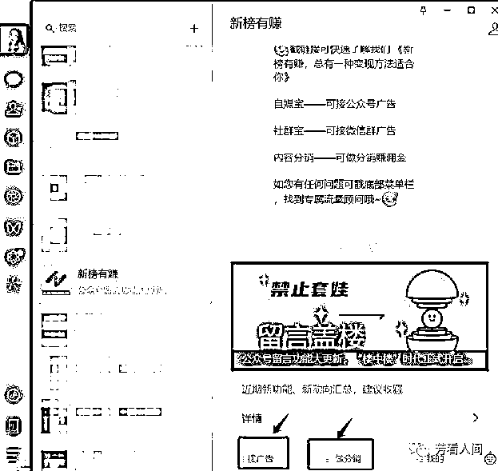

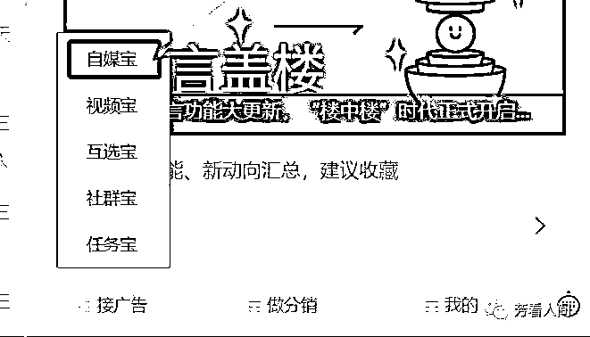

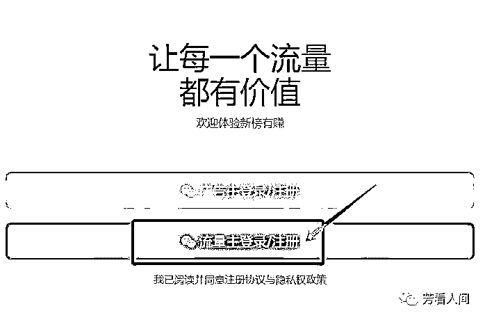

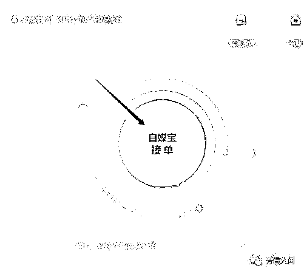

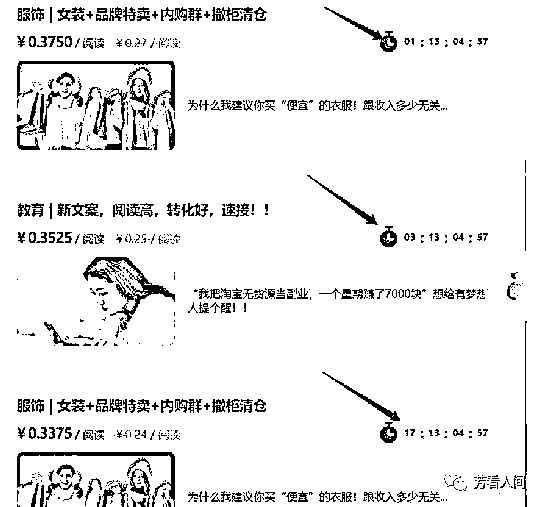

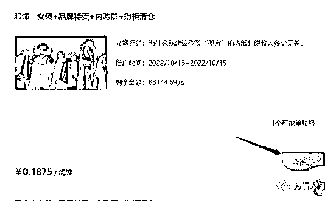

按照系统的操作指引，参考上面这一系列截图，一步接一步操作就行了。抢到单子之后，在商家限定的时间段里把广告文案发到自己的👸号里，接下来就坐等收益。到账后可以立刻提现到🛰️，到账速度堪称秒开。

# 👸号赚钱：四条路子与避坑清单

我的实操记录很短：只投过两次限时推广，挂满一天就撤，单次到手八百出头。后来担心消耗读者信任，便收手了；等关注量再涨一些，再考虑试水。

“新榜有赚”平台提供多种变现玩法，建议抽空研究。我亲身跑通的只有按阅读量结算的软文投放，其余项目尚未测试，留给大家自行摸索。

## 方式二：广告主找上门，接不接有讲究

广告主通常先在后台发来合作意向，再加🛰️聊价。多数时候由我们这边先报价，对方提供成稿，我们排版发布即可。位置分头条、二条、三条，头条位报价最贵，常见两千元起。

这类广告要慎接。先看对方文案涉及什么内容，涉黄、涉赌、封建迷信之类别碰，弄不好会封号。

价格大致如下：

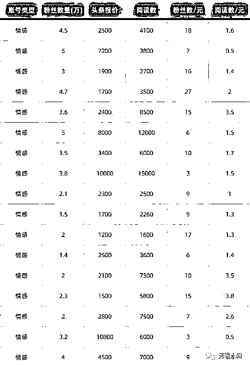

最终报价和细节，以你和广告主协商结果为准。

## 方式三：推文挂商品，赚分销佣金 @徐胖子

大约十年前，👸号卖货曾经很火。短视频带货兴起后，文字转化效率确实走低，但机会并未消失。

为什么还能做？主要有四点优势。

第一，流量底盘还在。@渭水徐公 的👸号训练营已办到第七期，十万加爆款累计超过一千篇，阅读过万的小爆款更多。一个号一天发八条，每条最多挂十件商品，合计八十个商品位；只要有一件跑出销量，收入就不容小看。

第二，创作弹性大，图文与商品不必强绑定。写情感号的，学习、励志、文学、情感类书籍都能带；食品、日用品也能塞进推文。

第三，佣金空间可观。商品可自行找商家谈分成，书籍最高能到五成，水果、蜂蜜通常也不低于两成。

第四，结算走官方链路，流量主收入有保障，佣金到账效率高。用户下单并确认收货后结算，创作者后台可查，官方打款，流程透明。

具体操作：先注册👸号并入驻；粉丝达到500，确认财务结算资料，申请流量主；审核一般三到五个工作日，资料正常当天通过。开通流量主后，再开返佣商品广告，进推广商品，把返佣商品广告插进文章，发布分享赚收益。逻辑和头条带货类似：文章出现商品关键词，就在对应位置插商品。

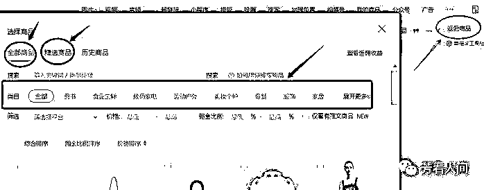

单条推文最多十件商品，读者点卡片进小程序下单，成交后流量主拿销售分成。

带货模板可以这样套：故事开场→过渡到话题→介绍商品→引导下单。具体写法可看3月6日《如何在👸号带货》@徐胖子。

## 方式四：文末贴片分销，顺手也能做

识别二维码，注册成为有赞分销商，挑选想卖的产品，做成超链接，贴到文章末尾即可。

不会做超链接，可以找客服帮忙，但需要把有赞账户密码告诉对方。我当时就是让客服代做的。

客服🛰️：可扫码添加

注意：账号没起量前，发文尽量干净，别太花哨。起量后、粉丝多了，再按粉丝年龄调整：年龄偏小的可以活泼些，年龄偏大的保持清爽；头部放一张图，甚至不放图，文中加分隔符即可。

分隔符别太密，200到300字放一个，不要少于200字，也不要多于300字。

#### 4.2.2 打赏变现（次要）

开通流量主后，先挂原创群发三篇文章，之后就能拿到打赏权限。账号名头像和打赏名头像尽量一致，人设看起来更真。

打赏多集中在IP强、人设硬的账号，高额打赏可能出现；对我们只是补充渠道，不是主力，开通后偶尔添点零花。

### 4.3 👸号收益如何到账

👸号不用手动操作。每月收益自动打到开通流量主时绑定的银行卡，每月两次，分别是1号和15号，本月发上月。

到账金额再小也会准时；1号和15号可进手机银行查看，偶有延迟但不会不到。打款前已按20%税率代扣，到手为税后数。

## 五、【复盘优化】降本提效，让爆文不断档

### 章节概要

前面讲的是单篇爆款怎么写。这一章解决的是：怎样一篇接一篇地持续产出。

👸号爆文不只拼文案，也拼体力；只有不断拿出有爆款潜质的内容，收入才可能稳定。

持续产出的抓手就是降本增效：压低创作成本，提高创作效率。本章围绕这两个目标展开。

降本：第一节搭素材库，靠日常记录加快写作速度，让选题不断。

增效：第二节自检与复盘，靠迭代提升爆款能力；第三节快速入池技巧，用被验证过的方法提高文章被算法推进流量池的概率；第四节写作避坑指南，提前了解平台规则，别让爆款半路夭折，减少浪费。

每期航海手册都会迭代；如果你上一轮跟过，这次新增和修改处更值得看。

下面进入本章。

### 本章航线图

完成本章学习实操，即可完成路线图的第三阶段：复盘&优化（约1小时）

1.对已发布文章进行复盘与优化（约1小时）

### 5.1 素材库怎么搭，日更才不慌

做自媒体想日更，绕不开一个难题：每天写，素材从哪来？

没有素材库，写一篇故事就要想半天；连续更新一个月，根本撑不住。

素材库既供灵感，也明显加快写作速度。下面看来源和搭建方法。

#### 5.1.1 职场素材：从脉脉和招聘评论区挖 @枫宇翔

职场素材来源不少，我首推脉脉。这个APP聚集大量职场人，吐槽和分享多，容易引发共鸣，多刷有收获。

比如“入职SHEIN后，终于知道为啥大家都劝退”这类标题，一眼就能抓人。除了个人吐槽，也有账号发争议话题，讨论很热。

此外，BOSS直聘等招聘APP评论区，豆瓣、知乎、微头条，都能找到职场素材；抖音、快手的高赞职场视频，评论区同样是富矿；👸号里直接搜“职场”也有大量信息。

素材用不用，先看点赞、评论等数据；数据好就写，哪怕自己没感觉，也要相信市场验证过的结果。

#### 5.1.2 热点素材：热榜之外更值得挖

热点素材常来自🧣、今日头条、知乎等热榜。

不过热榜内容有时被修饰过，得多想一层：大众真正在意什么。不少知乎高赞回答明明有流量，却上不了热榜；这类内容反而比热榜更值得写，也更容易出爆款。

原因是它们靠用户一个个赞投出来；没有热榜加持还能被关注，说明戳中了需求。我们要找的就是这种能扎到读者痛点的内容。

#### 5.1.3 剧评素材：一部剧能拆出多篇

剧评的好处是素材不用愁，做好三件事即可：

1）看剧时把打动你的片段、台词截图，收进素材库；

2）拆解剧集的高光时刻；

3）拿电视剧和原著对照，把差异、狗血处写出来。

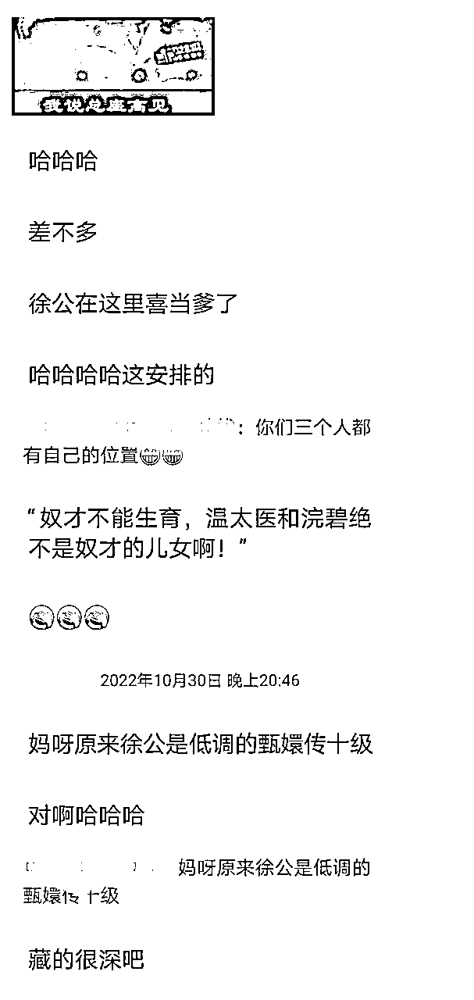

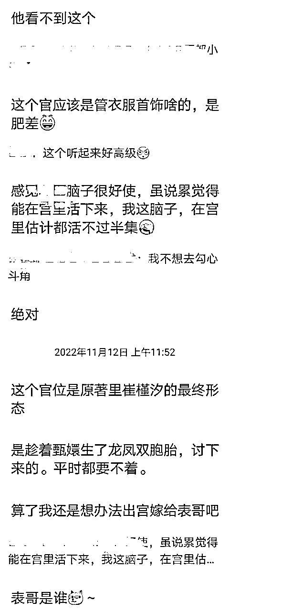

以《知否》《甄嬛传》为例，这两部口碑热度都好。盛祖母对明兰的教导、明兰对生活的感悟，都能延伸出不少写点。

单说《知否》淑兰和离的高光段，就能拆出三篇以上。

先补背景：淑兰出自经商的盛家大房，带着厚嫁妆嫁给穷秀才孙志高；婚后婆婆一家花她的嫁妆，还百般刁难。后来孙秀才要带风尘女子回家做妾，盛家大房震怒，才有了和离。

三个方向：

①淑兰为何能顺利和离。古代男权社会，孙秀才没有太出格行为，淑兰本来不占优势；可深挖关键：娘家护她，不在乎名声受损，只求她脱离苦海；也可引申为女人自己立不住，带着丰厚嫁妆养孙家，却被折磨得憔悴苍老，只能说性格太软。

②孙秀才凭什么敢和盛家叫板。根本原因可从经商盛家地位不如读书人孙家写；孙家一无所有，真撕破脸未必怕盛家；两家翻脸不只是两个家庭，而是两个家族交恶；在家族为上的社会，盛家就算和离也要顾及孙家家族。

③明兰帮淑兰和离后，祖母的话暗示她与小公爷的结局。这点可写更多：齐衡与明兰私下有情，却注定走不到一起。先看家世：齐家是国公府，齐衡是独子，承载平宁郡主的期望；盛家只是五品，明兰又是庶女。其次齐衡虽喜欢明兰，却没魄力争取，不敢违逆母亲。最后平宁郡主看不上明兰，真要对付她，手段不少。

你看，一个高光片段就能写出三篇甚至更多；对爱追剧的人，选题几乎不用愁。

#### 5.1.4 法律素材：官媒、热榜与裁判文书网

法律素材第一类来自北青网、1818黄金眼等官媒，信息通常可靠，适合拿来写。

第二类是头条新闻热榜和地方热榜。

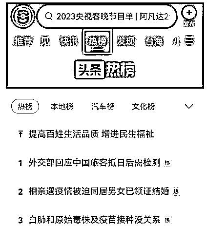

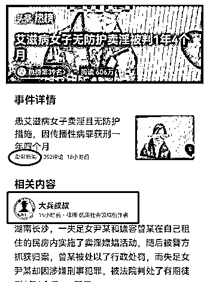

点开热榜详情，通常能看到官方媒体报道。比如“艾滋病女子卖淫无防护被判刑”这个热点，来源是澎湃新闻。可以关注澎湃新闻，遇到其他热点也点进去，顺手关注相关媒体；慢慢积累一批媒体资源，以后查资料方便。热榜下面还有不少法律人写的文章，可作参考。

有些律师账号会标“抄袭必究”，比如大兵叔叔；可以学他的写法，但别照搬，否则头条可能判为相似作品、只推荐给粉丝，还可能被作者投诉，不划算。

第三类是裁判文书网。

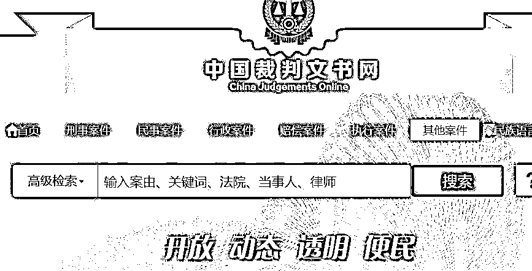

里面有大量已宣判案件，可当资料写。注意把涉案人姓名做模糊处理，不能直接写真名：一是保护当事人，二是防止被投诉。

#### 5.1.5 历史素材：课程、B站与喜马拉雅

历史素材也容易找。大家从小上历史课，新奇有趣的故事不少：帝王将相、平民百姓，将军出征、女子出嫁，可写面很宽。人们爱听故事，用惊险、紧张、圆满、愤怒或搞笑的故事抓读者，是很好的方向。

来源包括看过的影视剧、听过的《百家讲坛》、历史大V的人物讲解；看到某个历史人物素材，还可以深挖他后来的命运——人们往往只看到他人生的一瞬，我们要做的是把整段人生铺开。

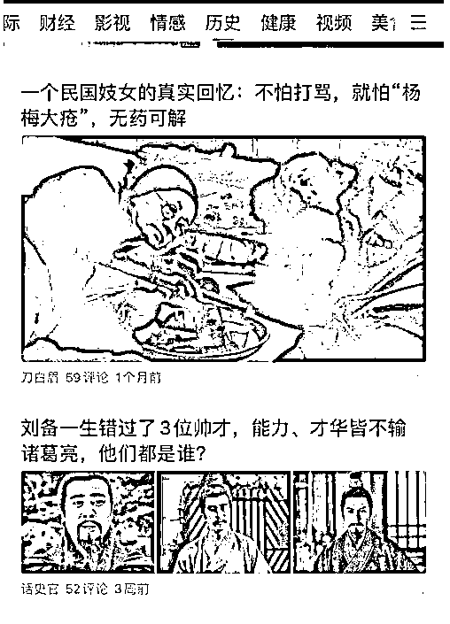

平时刷头条、百家等平台，也能看到不少历史小故事，都可进素材库。

B站有几位讲历史不错的老师：文大郎（三国历史很强）、正直讲史（清朝历史一把好手）、直男文史课（漫画讲历史，搞笑有趣）、御史房（综合分享历史，思想分析周到）。

这里重点推荐喜马拉雅，它几乎收纳了《百家讲坛》的内容。写故事先要理解故事；无聊时或通勤路上点开一集，老师用通俗方式讲一段故事，就是很好的来源；再加上思想深度和史料来源靠谱，写起来会顺。

我常听《百家讲坛》，分享几个常听节目。

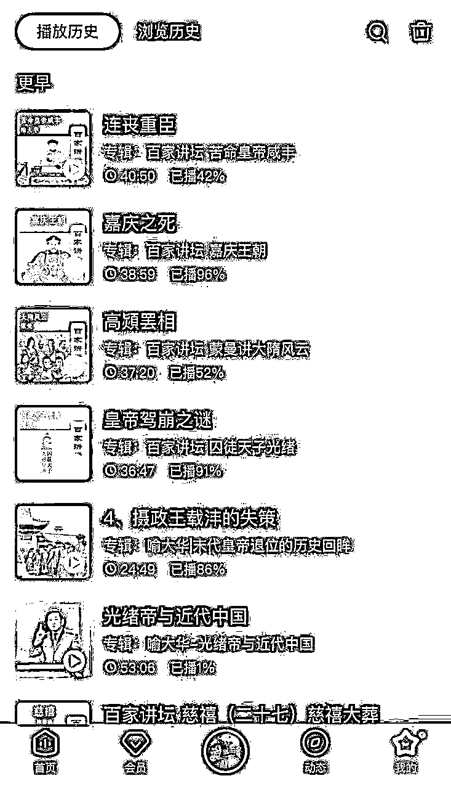

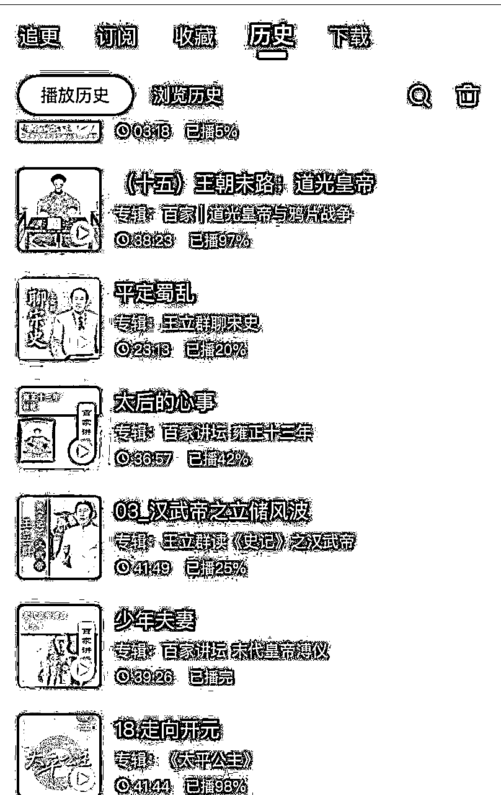

#### 5.1.6 情感素材：身边事与短视频评论区

情感素材来源很广：身边亲朋好友、邻居身上发生的事；网络上的知乎、抖音、百度、头条等。

生活中遇到或听到触动自己的事、话，随手记；网上闲逛看到有意思的内容，也记下来。等读者积累到一定量，可设置自动留言留下🛰️号，让读者来倾诉，从他们身上取素材。

平时看书读报遇到的好词好句、新奇故事，以及影视剧、小说情节，也能收进库。总之，宝藏到处有，难在发现。

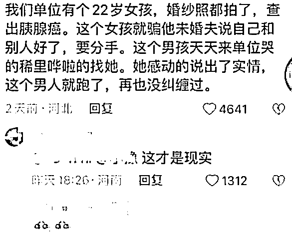

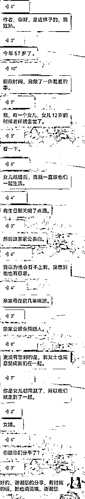

下面重点讲从亲友和短视频平台获取素材 @Ray。

1）亲友讲述。故事常来自生活。前阵子和亲戚吃饭，我发现二姨很爱聊村里的事，了解得特别细。她说村里有个已婚妇女，两个孩子，为了生计去大城市打工，后来跟别人在一起，还生了孩子，逢年过节不回家；最后和原配离婚，两个孩子丢给老人，爸妈都不管，很可怜。

要不是亲戚说，我多半不信。一直以为这种狗血情节只在电视剧、小说或新闻里，没想到离自己这么近。

于是我想到，每次刷抖音，情感纠纷新闻下面总有网友评论，讲自己或身边人的经历；能不能把这些故事拿来用？这就是第二个来源。

2）短视频平台的情感故事和评论区。核心方法是：用关键词检索各平台情感故事，同时留意后续发展和评论区引申故事，丰富素材库。

步骤：先按关键词搜，比如“婆婆”；再筛选视频，尽量找新闻媒体发的，因为媒体号自带流量；如果纠纷没结局，搜“XXX后续”；情感纠纷视频下常有人分享经历，可作参考；不只情感新闻，情感节目也行，比如《爱情保卫战》，后面还会提《老娘舅》；不知道有哪些节目，直接搜“情感纠纷节目”。

我具体这么做：在抖音搜关键词。我感觉婆媳关系的故事最多，就搜“婆婆”，再加一个情绪词或动词，相关视频会很多。

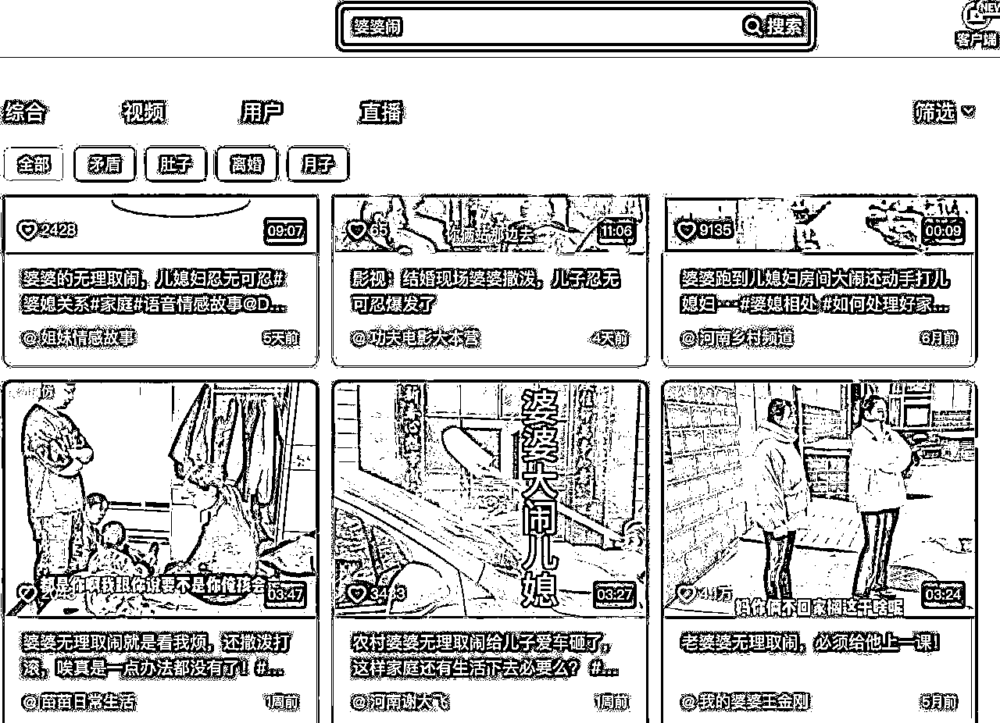

搜到后不能直接用，还要筛选。

个人用户发的视频不少是照着剧本演的；优点是受众明确、已经验证过，但素材可能老旧，或是其他平台爆文改编的，直接用阅读量未必高。

另一类是媒体发布的新闻视频。媒体号常转发别人的视频再加标题，和营销号性质接近，但媒体号自带流量，评论区很精彩。

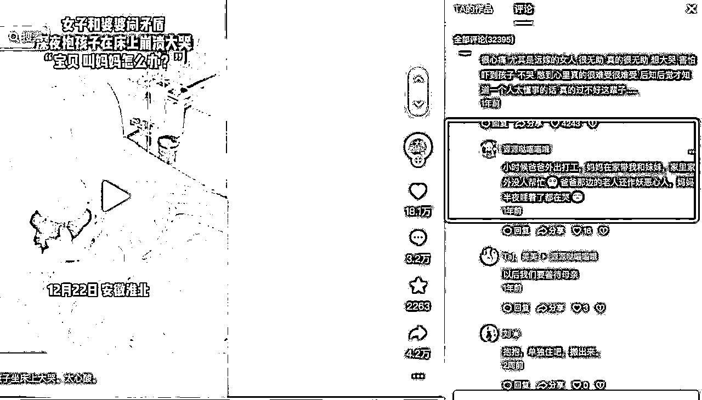

看这个大象新闻的视频，18万赞，评论区32395条，说明引发共鸣，有网友会讲自己的亲身经历。

比如我图里圈出的这条，内容虽简单，但我觉得可以当素材。于是我继续搜，发现了前段时间的新闻。

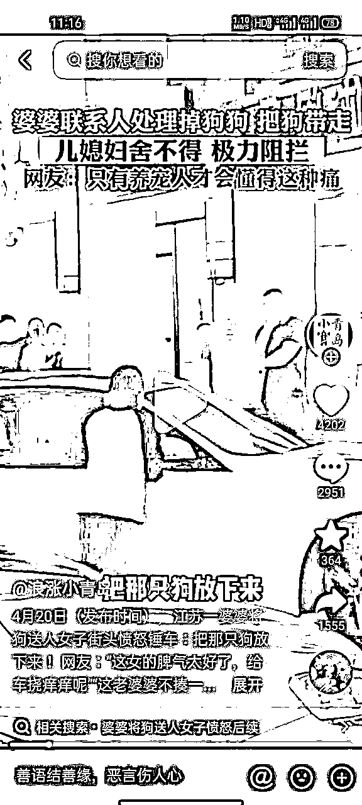

搜索下拉框里会出现“XXXX事件后续”，说明大家关心结局。我也好奇搜了，但没有后续；那还是老办法，打开评论区，里面还有相关评论。

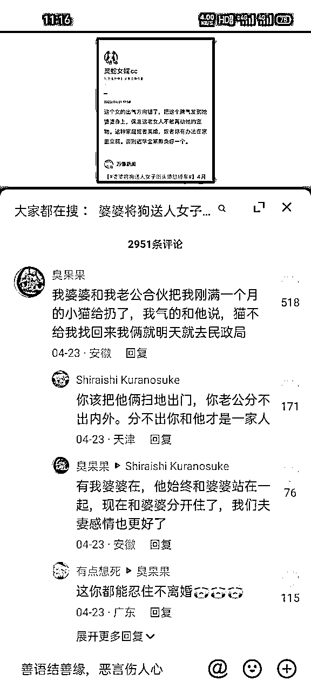
刚刷到一条网友留言，发布时间很近，我觉得它同样能当素材。顺着线索去搜，发现“曹心柔”被不少人提起，点开一看，内容确实有看头。

那是一条情感调解类视频：婆婆动手把儿媳胳膊打伤，又和两个女儿一起把儿媳撵出家门；后来儿子再婚，新媳妇性格强硬，反过来把两个小姑子请了出去。后面的情节不展开，想看可以自己搜。视频底下，赞叹的人不少，也有人讲起身边类似经历。

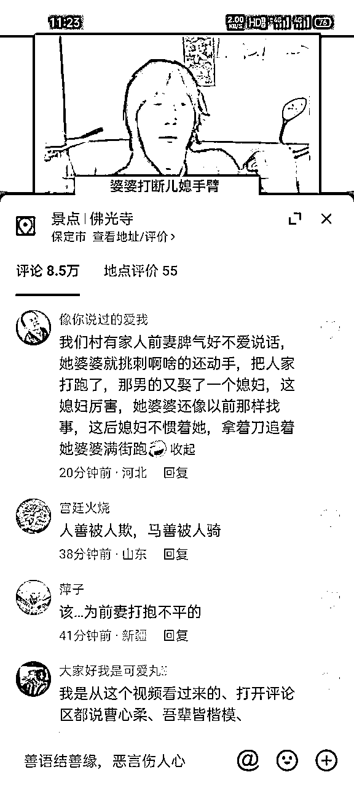
这条留言是我检索时二十分钟前刚出现的，但直接拿来用仍要二次加工。我在B站查找“曹心柔”时，顺藤摸瓜找到了调解视频的原始出处，可提炼的故事不少；再把相关新闻搬到抖音检索，看看视频下方有没有用户留言。

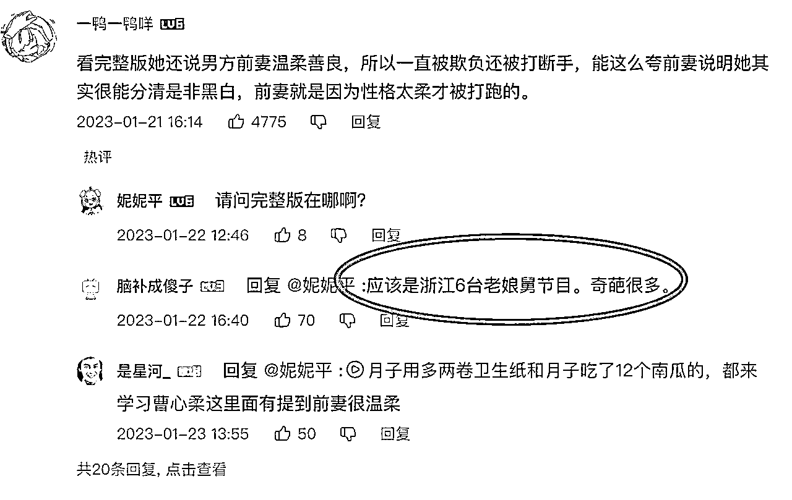
材料到手后，就可以进入故事写作。资料出处：5月25日《抖音平台挖掘情感素材，网友评论也能出爆文》@Ray。

#### 5.1.7 建好材料库

当你的材料渠道足够丰富，写作就不会断粮。接下来要做的，是把它们按类别归档；以后动笔时，从库里挑出匹配内容进行拼接即可。下面用情感类举例。

先列几个参考账号：写故事的刘小念、陈若鱼、猪小浅。三位都写故事，路数各有差别，既能借鉴写法，也能从她们的内容里攒材料、拆标题。

在「3.2.6 情感类：爆文模板」中会讲情感正文框架：一个故事=标题+主人公+故事主干+结局。展开说：标题+主人公+主干（梦想/目标、挫折/阻碍/意外、惊喜/反转）+结局。拆得更直白：谁～打算做什么～为何做或如何做～过程中碰上什么～最后怎样。动笔前先定主题、拟标题，再围绕主题往下写。

主人公：我是谁、年龄、籍贯、职业等，交代基本盘；再说明与主人公有关的人或物：彼此什么关系、如何结识、各自做什么，也做简要介绍。

故事主干：人物想达成什么、发生了什么、碰到哪些问题，包含目标梦想、挫折阻碍意外。

结局：事情给主人公带来什么影响、主人公如何应对或本该怎样应对、最终结果。

这样一篇故事就有了骨架。按这个框架来归档建库。生活、文学作品、小说、影视剧、热点新闻、各平台中遇到的素材，怎样反复利用？先建6个库，之后交叉调用，就能迅速拼出故事。

1、标题池：刷到让你忍不住点开的标题，立刻存。例如：66岁，退休金8000，儿孙绕膝却不想活；母亲临终那番话，让我这辈子无法结婚；与堂哥地下情20年，结局出人意料；68岁大病一场才明白，有些东西比亲生子女更靠得住。要点是有反常、有钩子。

2、主人公池：来源包括新闻、报道、八卦、小说、影视、身边真事，把事件主角放入池中备用。例如：18岁未婚先孕的小佳；被不孕困扰的小爱；40岁不婚却仍有女性主动靠近的老光棍；55岁生下三胎的大妈；50多岁再婚还开口要100万彩礼的大妈。选人要有反常、有争议。

故事主干池由愿望池、坎坷池、反转池组成，共3个，来源同上，记录人物的目标、挫折、惊喜。

3、愿望池：不孕夫妻想生娃；结婚想买婚房；老大爷想找老伴；重男轻女家庭二胎想生男孩；想开美容院。

4、坎坷池：恩爱夫妻多年未孕，医院查不出原因；房租突然上涨；谈几年男女友因彩礼房子遭父母反对；跳舞时突然中风；感情很好一方卷钱失踪；相亲相爱多年老公老婆突然要离婚。

5、反转池：老家拆迁得钱得房；女友父母原本要50万彩礼突然只要8万；失散多年儿子开宝马回来；结婚多年看医生没怀孕3年后突然怀孕；房东突然减免房租。

6、收尾池：来源同上，记录好坏结局。比如复婚；离婚；一家人幸福快乐生活；儿子接她养老；找到合适老伴安享晚年；去养老院；夫妻更恩爱。

6个池子建好，几分钟就能讲一个故事。比如用主人公池1、愿望池5、坎坷池2、坎坷池4、反转池5、收尾池3：小佳18岁未婚当妈，想开美容院，只有8万，看中月租7万的店想租，房东突然要9万；她想放弃时房东中风，儿女不舍得出钱治病，想尽快出租，愿降到6万租给她；8年后美容院做成连锁，孩子父亲回来找到她，一家人幸福快乐生活。这样一波三折的初稿就有真实性，容易共鸣。

不想写故事、想写观点鸡汤文，就用小故事加观点、名言、金句，一般3个小故事，每个后面加观点名言金句；在6个池子基础上再加观点名言金句池即可。

回到正题，故事有了，再补细节、对话、动作、心理活动，就成有血有肉的故事文。故事要引人入胜，情节要曲折，不能平淡，要有起承转合。有材料库，一天写10个故事不难。

一个材料库写N个故事的方法：把主人公、愿望、坎坷、反转、收尾打乱组合。比如小佳用152453，也可用12345或22335，稍作调整即可。

再举简单例子：主人公小爱26岁财务；小王29岁业务员，夫妻。他们想生孩子（愿望1），结婚3年没怀上（坎坷1），看很多医生吃很多药没用，认命不治，1年后意外怀上（反转4），收尾7夫妻更恩爱。合起来：我叫小爱，26岁做财务；老公小王29岁做业务。结婚3年多想要孩子，没避孕也一直没怀上；看医生吃药没用；认命不治，1年后意外怀上。

这个小故事雏形字数少、吸引力不够，要填细节情节，越曲折越好。填完再在结尾加观点和信息量。故事写完@自己，加上总结观点或感悟，最后给读者抛问题：可以问认不认同观点，也可以问对故事里的事怎么看。这样完整故事文就完成。

比如小爱例子，观点：怀不上孩子的夫妻别放弃，积极就医、放松心情，奇迹仍会出现。问题：你身边有不孕不育的夫妻吗？他们后来生孩子了吗？总结观点感悟和问题不能少；能引用心灵鸡汤、名人名言、电影电视书金句更好。

以后看电影、看新闻、看书、刷剧、刷视频，记得把有意思的标题或开头、主人公、愿望、坎坷、反转、收尾6要素提取出来分类放进材料库，要用就有。

说白了，收集材料像去超市买菜，喜欢什么、被什么吸引就放进购物车；整理建库像买菜回家分门别类放冰箱，要煮随手拿；写故事像炒菜煲汤，可以胡萝卜玉米马蹄骨头一起煮，也可以换别的菜炒煲。众口难调，得多试。

注意：主干情节详略得当，与主题无关略写；体现人物性格、推动故事的要详写。结尾尽量反其道而行，让读者有意料之外、情理之中的体验。主干多用动词、大白话；少形容词，多连贯动作，让人身临其境，有代入感、画面感，引发共鸣。语言简练，带入场景，多用动词+名词，多用转折词连接词。不要抄袭，包括标题，自己动脑改，可模仿不能抄。尽量贴近生活、温情、正能量，别太狗血暴力，有违公序良俗、乱伦色情千万别碰。我用Excel建材料库，再导入印象笔记，表格直观；大家按习惯选工具。

上面那张图就是我的材料库。里面的内容互相交叉搭配，能写出很多不同故事；60条材料一年都写不完，当然收集越多越好。

### 5.2 爆文写完后的自查与复盘

#### 5.2.1 自查要点

1）行文尽量快、短、平：尽快进入主题，句子别拖，最好平铺直叙。

2）读者刷文章，多半想在放松里学点东西，不愿费脑，所以浅白文字更讨喜，过于文绉绉反而不吃香，用大白话写就行。

3）单句尽量别超过15个字，单段别塞太多内容，两三句足够。

4）检查病句，主谓宾是否齐全，段落末尾与下段开头是否接得上，做到阅读顺滑。

5）要有避坑意识，清楚什么能写什么不能写，否则写了违禁内容，时间花了没收益还可能封号，竹篮打水一场空。一是政治不能写，记住两个词：党史、军史；二是黄赌毒不能写。

6）最后检查开幕雷击，冲击力够不够大、画面感够不够强，不够就优化到OK。

打开👸号爆款大门，就能收获粉丝和收益；能举一反三、触类旁通，在其他平台也可能有惊喜，实现一鱼多吃。

#### 5.2.2 数据复盘流程 @枫宇翔

我复盘主要看完读率、渠道构成、用户画像这几个指标，这也是👸号平台提供的数据。在哪看数据？电脑打开🛰️👸号后台，点“数据=>内容分析”，就能看到发布的文章，点详情看各项数据。
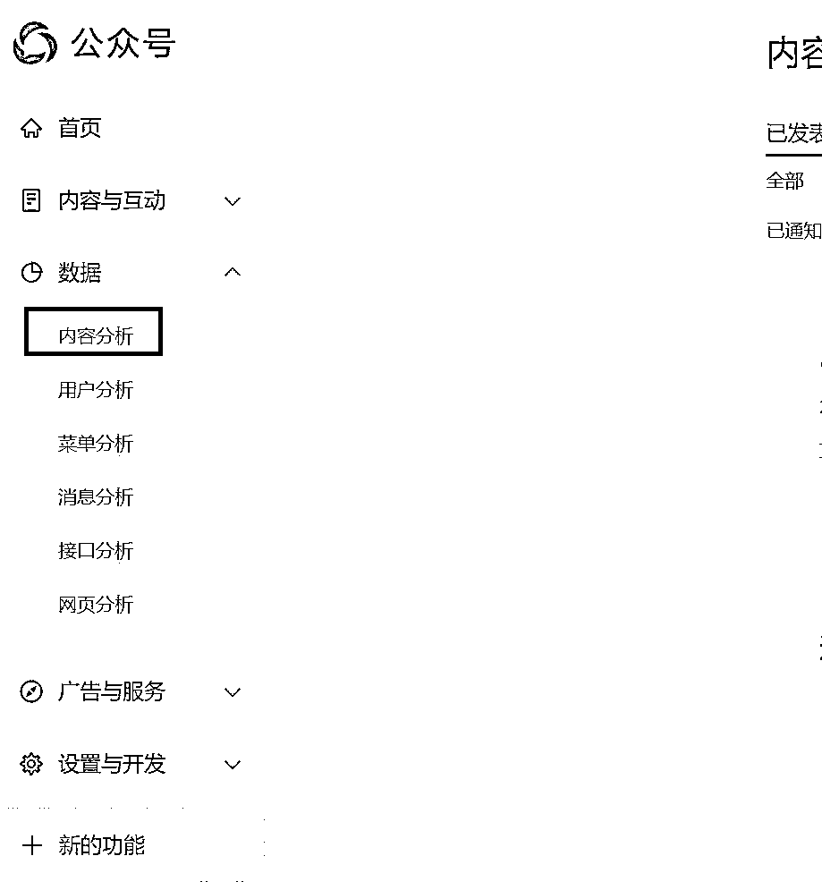
第一、完读率。它很重要。我有篇文章阅读20万，收益600多；另一个人同样阅读量，收益300多，差在完读率。文章读完能获取文中两个广告收益和底部一个广告收益，读完的人越多，完读率越高，收益越高。

比如有篇文章浏览位置到100%，跳出比例52%，完读率就是52%，大约一半人没看完就跳出，说明内容还不够抓人。接下来我会把精彩内容往后放，前面做引导，比如告诉读者详细数据在文末、感兴趣可到文末查看。也可能因为字数多，有意识缩短篇幅来提高完读率。如果阅读量高，但浏览位置30%~40%时跳出比例到50%左右，说明一半人只看了一个广告就走，很少人看完三个广告，阅读量再高收益也少，要重视，下篇及时调整内容。第二、渠道构成。看用户来源哪个多。

比如文章流量基本来自推荐，说明进了流量池，不错。如果数据都来自搜一搜，说明没进推荐池，可能撞上节点，热度一过文章可能断崖式下跌。碰到这种情况，戒骄戒躁继续日更。朋友圈、👸号消息等比例通常不大，我不太关注。第三、用户画像。包括性别分布、年龄分布、地域分布。

性别分布说明男粉多还是女粉多；年龄分布说明哪个年龄段用户多。比如我的数据是36岁以上男粉居多，文章内容就更偏向这个群体，游戏、时尚之类不会出现；也会根据当前赛道和对用户群体的了解，选相关赛道测试，看看能否提高阅读。地域分布能看出哪些地方爱看文章，广东居多，就尽量写广东内容，增加爆款概率。第四、数据趋势。这个也稍微关注。

选推荐时看文章趋势是否上升；如果上升且曲线陡峭，说明还有流量、一直在推流。这时别睡，赶紧根据这篇文章写一篇类似的，很可能再爆。除上面三个指标，还有送达转化、分享转化等，我关注不多，占比也少。所以复盘主要看上面几个，尤其完读率要重点关注。以上是我看文章数据的一些复盘思考，大家按自己情况参考。

#### 5.2.3 获取双份流量主收益 @枫宇翔

以往写👸号文章，就是简单写一篇发出去，靠文章里的广告拿收益。其实还有很多人不知道的方式：开通后发布一篇文章，能获得双份流量主收益。那就是腾讯内容创作平台 https://om.qq.com/ ，注册账号，开通分成权益。

然后在侧边栏选“我的主页=>内容同步”，按提示绑定自己的👸号。

这样只管发文章，既拿🛰️👸号流量收益，又拿企鹅号收益。

#### 5.2.4 提升推荐量的几个办法 @枫宇翔

① 合集推荐。看过我那篇爆款文章就知道，文里提到要把合集的连续阅读功能关闭。有同学以为是不把文章放进合集，不是。建议文章放进合集，因为合集也能被推荐和订阅。

但注意，到合集里关闭连续阅读功能，避免底部占太多空间。👸号后台侧边栏=>合集标签=>编辑其中一个合集=>关闭连续阅读，合集就不会在底部占一大块。

② 小绿书。如果写文章一直找不到感觉，可以考虑小绿书的创作形式。

类似📕那种形式，直接发图就行，有些流量确实高，可以试试。
② 划线推荐。之前说过增加推荐几率的功能，比如合集；这次说👸号的划线功能。对文章里的金句划线，这些句子有机会在订阅号信息流再次推荐，给文章带来曝光。

如果是情感文，就把精彩情感段落，比如婆媳争吵之类，用划线功能划出来；当这段文字被推荐到订阅号信息流，可能吸引用户。所以要善用划线功能。

**先把划线功能说清楚**

很多人不知道：划线入口并不是在编辑文章时出现的。你得先把文章推送出去，然后回到自己的👸号主页，打开刚发的那一篇，在正文任意位置长按屏幕——这时候划线选项才会蹦出来。

**③ 小绿书这条路子**

假如你一直写长文找不到节奏感，不妨换个思路，试试小绿书。

它跟📕玩法接近，不需要长篇大论，直接甩图片就行，有些账号靠这个拿到了相当可观的流量，值得上手试一把。

### 5.3 让账号早点进流量池：几条实操心得

### 本段核心

先摆个事实：进池这件事没有精确的时间表。快的账号一天就能进去，慢的半年都进不了，这也是👸号让人无奈的地方。

不过按大多数情况来看，只要持续动笔，7 到 21 天内基本能进。

换句话说，更新不断更、标题会做钩子、内容方向别飘，进池是早晚的事，区别只在快慢。

如果手上是注册满一年以上的老号，它本身带一点权重，进池速度通常会快些——我们反复测过，老号确实有这个便宜可占。

自己没老号怎么办？发条朋友圈问一圈，看谁有闲置的注册时间久的👸号，借来实操，效率会高一截。

刚注册的新号，先锚定一个领域，然后找到对标账号，拆解对方哪些选题爆了、内容怎么写的，在此基础上做二次创作，保持每天 2 到 3 篇的节奏别断更，也能比较快地进池。

一旦进了流量池，就意味着开始有进账了。

要是迟迟没动静，得回过头盘一盘：自己在这件事上究竟投入了多少时间、花了多少精力，标题有没有认真琢磨过。

一般而言，付出与回报是对等的：一天更一篇跟一天更两篇的、只运营一个号和同时跑两个号的，测出来的结果肯定不一样。

#### 5.3.1 账号进池的判断方法 @一来

👸号的规则一直在微调。早前的情况是：只要有一篇文章进了流量池——比如阅读量从个位数蹦到三位数甚至四位数，还拿到了看一看的推荐流量——那基本就能断定账号进池了，第二天再推文，阅读量往往就跟着上来了。

但最近似乎改了玩法：某篇单文进了看一看的池子，第二天再发阅读依旧惨淡，有的甚至只有个位数，这种情况就继续更，直到账号整体进池为止。

账号真正进池最直观的信号，是文章阅读量冲破 1000 乃至上万。

但如果阅读量只是从个位数爬到两位数或三位数，那还不算数——因为这部分流量可能来自搜一搜。

所以说，盯数据加持续更新，两件事都不能松。

内容来自：6 月 8 日《👸号流量主的经验分享》@一来

#### 5.3.2 入池技巧一：文章变视频文案，在视频号分发 @亦小亮

题目选好了、文章写完了、👸号也推送了，结果就会自己找上门吗？当然不会。

下面这步操作值得每个人试一试：把一篇👸号文章拆成 2 到 3 条，甚至 5 条视频号文案。

视频文案的取材方式很灵活——可以从文章开头截一段出来用，也可以把小标题串成一条线；还能倒着来：先写视频文案或大纲，再回头补齐文章细节，这样衔接起来很顺滑。

视频呈现形式可以是图片为主、图文混搭视频，或者纯视频。

如果剪辑功底一般或者是新手刚上路，建议直接做纯图片或纯视频，别搞混搭，省时省力；原创通过后的推荐效果可能不如混搭那么猛，但可以循序渐进。

纯图片路线就多用画面渲染和展示，娱乐类账号拿明星图做素材，剪映里的图文成片功能就能直接出片。

纯视频素材可以去扒治愈系或解压类的内容，比如下面这段洗车解压视频，配上生活情感类文案就很搭。

c136b7f2b804ed57fd8ed7ca6967958d.mp4【在线播放】

这个环节门槛不高，剪映就能搞定；平时多逛逛视频号和抖音，素材到处都是。

视频做完后，记得在视频下方挂上你👸号那篇文章的链接。

注意：文章发表后的 7 天内阅读量满 10000，才有资格被放上链接。

我大致算过一笔账：视频每被播放 1000 次，点进文章的打开率在 10% 以上，而且还有长尾效应。比如我写过王宝强的《八角笼中》，到现在每天还能带来几百阅读。

你可能想说热点一过流量就归零了——别急，重点在后面。

🛰️最近上线了「问一问」，你可以用视频去回答问题；如果找不到合适的问题，还能一个号提问、另一个号作答。

有一点要记住：回答只能以视频号身份进行，所以你可以把视频号名字改成👸号的名字，这样等于一鱼三吃。

这样一来又绕回到选题上了：选题选得巧，👸号、视频号、问一问三个渠道能互相导流，三边都能变现，而不是只盯着流量主那点收益。

比如副业这个方向就特别适合打这套组合拳，旅游领域也同样能相辅相成。

问一问的入口目前藏在搜一搜栏目里，打开就能看见。

做创业、副业赛道的朋友已经尝到了🛰️问一问的甜头，而且这才刚开局，还有大量空白领域等着深耕。

内容来自：7 月 4 日《如何迅速把一篇文章的阅读量提高到 1 万+》@亦小亮

#### 5.3.3 入池技巧二：拿已进池的号给新号导流 @妞妞

① 在已经进池的👸号文章开头或末尾，挂上还没进池的👸号名片，如下图所示：

② 在已进池文章的开头或末尾，插入未进池👸号的文章超链接，如下图所示：

①和②任选其一即可，也可以两个一起上，如下图所示：

以上两种操作都是在👸号后台编辑文章时完成的。

（1）插入👸号名片的具体步骤

（2）插入文章超链接的具体步骤

最后补一句引导语就齐活了：

就这么简单。

可能有朋友会问：我手上没有已进池的号怎么办？可以找朋友或同学合作，合作方式自己商量。

比如请朋友帮忙挂文章链接，把这篇文章的收益分给对方，怎么合适怎么谈，互助互利、大家都开心。

内容来自：7 月 13 日《用 GPT 写热点文&👸号快速入池的方法》@妞妞

#### 5.3.4 入池技巧三：请朋友帮忙关注阅读

1、找 5 到 10 个分布在 different 地区的朋友，在🛰️里搜索你的👸号并关注。

2、让这些朋友从订阅号推送里点开你的文章阅读（你自己别转发给他们），按正常阅读节奏来，别快速划拉。方便的话点个在看或赞。当天如果朋友没刷到推送，不用刻意去找，等推送来了再看就行。

下面是我自己后台的数据：我大约每天找十多位朋友来读，坚持了一周左右，账号就进池了。

这是第一篇进池的文章数据。其实文章有没有进池一眼就能看出来，阅读量通常会翻几十倍。

#### 5.3.5 入池技巧四：自己读一遍，再拿爆款做对标

账号还没进池的阶段，我会先点开自己的文章从头读一遍，把阅读过程中的感受记下来——比如排版看着别扭、字号偏小、开头太啰嗦、后面情节没劲。

把这些毛病记下来之后，我会把文章切成 3 段，拿去和 10 万+的爆文做一对一拆解对比。

重点对比这几个维度：主人公在第几段出场、第一个挫折什么时候出现、第二个挫折什么时候出现、标题埋的悬念在第几段揭晓……

我会逐项摘抄核对，找出自己缺的那块，然后针对性优化。

举例：

那篇 10 万+的文章开头就埋了悬念，逻辑顺畅，转折一点不僵硬，会让你忍不住往下猜：老婆到底怎么拆散的？八卦的心一下子就被勾起来了。

再回头看我自己写的：红线那段转折生硬，逻辑乱糟糟的，而且一眼就能猜到「老婆拆散了我和初恋」，后面完全没有继续读的欲望。

所以优化方向很明确：故事要顺、逻辑要清、开头 5 句话把人物、职业、关系交代清楚并抛出悬念，紧接着进入细节描写。

如果用 GPT 帮我优化故事，我的指令是：「需要扩写的内容」请扩充这部分内容，要有故事发生的具体细节，有对话、动作和神态描写，有情绪，写一下（你的具体需求可以给它）。

#### 5.3.6 入池技巧五：把数量提上去

经常看到有人问：账号更了一个月还没进池？两个月了还没动静？

我的看法是，最有效的解法之一就是多开账号、多发高质量内容。矩阵是对抗不确定性的最佳策略。

为什么要多账号？因为账号本身自带随机性。

打个比方：家里三个孩子，同父同母同吃同住，为什么偏偏只有一个经常生病？很多人会归因于体质问题，但父母能决定孩子的先天体质吗？其实很难。

账号也是同样的道理：同一个作者、同样的写法，有的号 2 天就进池，有的号 15 天才进，有的一直进不去。所以我认为，多账号是对抗这种随机性的办法。

这期航海我建议大家至少从 2 个号起步；已经掌握基本发文能力的，有余力可以再多开几个。

如果你发现自己两个号都不进池，那就该反思文章质量是不是有问题，再回到质量层面做提升。

为什么还要多发文章？这里的「多」指的是多练——熟能生巧，写得越多提升越快，也能更快摸清一个领域的门道；多写、多看、多踩坑，成长自然快。

内容来自：5 月 30 日《情感类公号如何从 0-1 起号，拿到第一个 100 元》@Adrian、6 月 29 日《👸号文章如何快速入池》@Beverly、6 月 8 日《👸号流量主的经验分享》@一来

### 5.4 写作避坑指南 @半塘梦呓

以下内容摘自学微头条的老师 @半塘梦呓。

虽然原始内容针对的是今日头条，但内容平台创作要绕开的坑，底层逻辑是相通的。

这里挑一些高频踩坑点摘录出来，想看更多可以去原帖翻：《微头条踩坑经验》。

#### 5.4.1 措辞上的雷区

不少人在发布前已经养成了查违禁词的习惯，也确认过没有违禁词，但仍有一些地方需要留神。

5.4.1.1 为了绕开违禁词把句子改得别扭

前面提过，很多违禁词完全出乎意料，查出来你会觉得莫名其妙：这也能算违禁词？

但平台有平台的规矩，大平台为了安全，限制非常严。有人为了规避，用空格把词隔开，或者拿拼音、错别字替代——少量使用问题不大，但建议别在开头用，全文也别反复出现。

5.4.1.2 带上了竞品平台的关键词

竞品平台的关键词不要碰。

有人写作时会顺手写还花呗、刷🧣之类的词，措辞一旦带上营销感，也可能被限流。

5.4.1.3 写出了企业名称

稍不留神就会在故事里写去中国移动上班、去电信营业厅办事、去中石化加油——这些企业名称都别带。如果非提不可，就用某通讯公司、某银行之类的说法隐去。

引用名言时，也不要说某企业的 CEO 说了什么。

给主角起名同样要小心。有位同学死活找不到限流原因，我一看——主角叫大华。不好意思，大华也是知名企业，还上了美国的制裁名单。

当然，主角也别叫小米之类的，都很危险。

甚至连「门铃叮咚一声响了」这种描写都要避开，因为叮咚买菜。

5.4.1.4 主人公名字别随便取

上面说了名字跟企业名冲突要注意，那避开不就行了？找个像人名的——叫王强总像人名了吧？但王强在句易网里算敏感词，这种太大众的名字，一不小心就撞上国家官员或者穷凶极恶的罪犯。

所以起名别太指名道姓，叫小王、小强、阿强、强强都行。

那主角叫小王就安全了？看这句：小王刚刚吃好饭。有问题吗？王刚也是敏感词。小李刚刚洗好澡。李刚也是敏感词。

所以这些地方一定要多加小心，发文前过一遍句易网要刻在脑子里。

5.4.1.5 标点符号别乱使

标点方面，别从头到尾只用逗号、一逗到底；也别动不动满篇感叹号。那样容易被判定为「马景涛体」，文章看起来质量低，读者不买账、审核也不待见。（感受到了吗）

5.4.1.6 专业术语要谨慎

别随便往文章里塞专业领域的词。比如你没有医学资质认证，文中写主人公急得乳腺增生——增生、结节属于医学用语，没有医生资质还写这些，可能被判定为误导读者。

5.4.1.7 那些查不出来的词

还有一些句易网根本查不出来的违禁词。

暴力血腥类，如割腕、脑浆。

带封建色彩的，如占卜、卜卦、风水、当铺。

带性暗示的，如小姨子（句易网里姐夫是敏感词）、黑丝（蕾丝是敏感词）、情趣、袭胸——这些在句易网都查不出来，只能靠自己平时积累。

建议收藏这份句易网查不出的隐形雷区清单：

1、渣男、渣女、高富帅、白富美、富二代、官二代、男神、情侣套房、打情骂俏、试管婴儿、代孕

2、首付、房住不炒、宣扬房价上涨的都会被打击

3、支付宝、信用卡、保险、银行卡

4、投资、炒房、炒股、赌博

5、人格侮辱、干了见不得人的事、好吃懒做、三观不合

6、辞职、离职、资料、空降、投资

7、奥运、抗洪、三胎话题都受限

8、热点别瞎蹭，很多可能是坑。不管你写得多正能量，舆论不可测，照样可能被限。没有金 V 护体，就写稳妥些，才能走得长远。

9、叮咚买菜是品牌名，「叮咚」最好别用。

10、只要涉及其他软件、商品品牌名称的，基本都别提，最保险。

这块没什么规律可循，全靠敏感度和日常积累。

#### 5.4.2 配图上的坑

查违禁词很多人已经玩得很溜了，但限流的元凶常常出在容易忽略的图片上。微头条配图也要谨慎，常见翻车姿势有这些：

5.4.2.1 图片暴露了个人信息

生活场景类的图片尽量别让人露脸；露了脸就打马赛克，尤其是小孩。

手机号、车牌号等信息也要打码处理。

明星图慎用，尤其是有负面新闻的明星。

5.4.2.2 图片上带了营销信息

选图时稍不注意，画面里就冒出一个品牌 logo 或公司名字，这类内容比较敏感。

品牌名称和标识也容易被忽略，比如苹果电脑的标识；美团外卖虽然把袋鼠打了码，但黄色头盔和工作服一出现，谁都知道是哪家。

再比如育儿领域无意中拍到了奶粉罐，罐身上的 logo 也会出问题。

图片里的支付宝、🛰️二维码也要打码。

5.4.2.3 图片偏负面或敏感

抽烟、酗酒、娱乐场所的配图属于偏负面的。

大面积裸露肉体属于敏感类，比如光膀子袒胸露乳的大爷、给宝宝洗澡的图、小孩大面积裸露身体。

5.4.2.4 图片会引起不适

恐怖图片、车祸现场、某人被打得鼻青脸肿的图都不合适。

之前有位学员写蛇的文章，放真实蛇的图片都不行，最后换成了卡通蛇的图。

找图时这几条要记在心上。

5.4.2.5 图片和内容对不上

文中说中国人，配图是外国人；文中说婆婆，配图却是婆婆去超市和做饭的两个人；文中说车头相撞，配图是车尾被撞；文中写别人的事，却用明星照片（除非写某部电视剧、电影可以用剧照，或者追娱乐热点用明星照片）。

5.4.3 运营上的坑 @Nicole·纯

5.4.3.1 排版别搞得花里胡哨

发表一般用秀米，排版很简洁。我写的是情感文，受众主要是中老年人，所以排版越简单越好，内容才是主角。

5.4.3.2 别反复发旧文

提醒大家：尽量不要重复发表。重复发表只能发一两个月以前的文章，而且不能频繁用这招。

目前出现过三种情况：1、有人因为经常发以前的文章被限流，比刚开始做的时候还惨，每天收入只有个位数。

2、把以前发过的文章再发一次，有的号主原创标识被摘掉 1 到 3 天。

3、也有号主几乎天天发旧文。比如一天更新七八篇，其中只有一篇是往期内容，总量上没出问题。

不同账号的判定尺度不一样，上面案例只能参考。

5.4.3.3 原创记得勾选，转载不要开

发布时必须打开原创声明，否则单价和推荐都受影响。赞赏功能的开通条件是已发布 3 篇原创文章。快捷转载一定不要开启，不然别人能直接搬运你的稿子，流量自然被分走。

所以发布之前，把这些设置再审一遍，同时确认广告插入是否正常显示，看到下面这样的提示就可以了。

发文后用自己🛰️从头看一遍，检查错别字（👸号推文只能改 20 个字符，仅一次机会，标题不能改）。可以给自己点赞、点在看。但广告不要点，也别转发到朋友圈或群，更不能叫别人帮你点广告。如果始终是同一批人在点赞、点广告，账号很容易“死”，进不了流量池。

内容出处：3 月 13 日《避开这些坑，你也能写出爆款文章》@Nicole·纯

# 选修篇：进阶玩法与蓝海赛道

### 章节导读

最小 MVP 落地、基本操作熟悉后，就可以翻开选修篇。

无论想进一步扩大项目，还是寻找更多玩法，这一章都值得细读：

【项目放大】用 ChatGPT 提高写作效率

【项目拓展】当下爆文蓝海赛道推荐

现在，一起去发现项目的新可能。

## 六、【项目放大】让 ChatGPT 帮你加速写作

### 章节导读

ChatGPT 的出现，帮内容行业解决了两大难题：原创度不高、生产效率低。有它帮忙，半小时就能走完从构思到发布的全程。把前文讲的具体写法套进工具里，爆款产出会容易很多。

按不同侧重点，这里给出两种工具思路。

思路一：直接用 ChatGPT 提效

这种模式下，一篇文章人工约四成，ChatGPT 约六成。人工要做的是想选题、定情节、把模型生成的内容改顺、起标题、发稿子。就文字量来说，模型能覆盖 80% 以上，人力主要花在删冗余和打磨上。

思路二：用 RPA 做批量自动化

这个方法是在 ChatGPT 之上再加一层 RPA，把重复动作交给流程，包括自动产稿、自动推送👸号，只需提前设置好规则。但批量出的稿子质量常常不稳定，后文会讲对应的优化方案。

另外注意：4.0 版能直接读链接，3.5 版只能处理文本，别搞混。

账号问题得自己解决，本文不负责账号，只讲操作。想深入学，可以去看手册「12 月航海 | ChatGPT | 实战手册」。

### 6.1 实操：ChatGPT 写稿流程 @木白 @袁永兵 @妞妞 @小浩哥

#### 6.1.1 生成正文：让 ChatGPT 动笔

6.1.1.1 定风格

把「3.2 制作文章正文」里的爆文模板，连同「3.3.2 实战案例」中的爆文样本，一股脑全丢给 ChatGPT。

也可以去👸号挑几篇稿子当范文投进去，让它参照着学。

提示词：请研读下面这篇稿子的写法，把它的风格要点提炼出来，命名为“风格 A”。 text: """ 这里放文章内容 """

官方推荐用「text: """ """」包住正文，这样能分清哪些是指令、哪些是需要处理的内容。

正文别给太长，不然 ChatGPT 很容易报错；👸号爆文一般 1200 字左右，问题不大。

风格提炼出来后，接着让 ChatGPT 吸收这套风格，完成调教。

提示词：接着吸收上面内容，把“风格 A”融进你的写作习惯里，之后写稿都按这个来，现在先别动笔。

6.1.1.2 锁定选题

先找一篇跑出过数据的文章，把情节抽出来交给 ChatGPT，让它当作选题样本，多生成几个可选方向。不满意就补充具体修改点，继续让它出，直到看到相对合适的。然后由人工做最后调整，敲定选题。

这招用熟了，基本不用自己硬编故事，题材会越攒越多。

1）选题从哪来

可以翻前文 3.1 找到合适的选题，里面有爆文库和榜单；也可以看 3.2 制作文章正文的例文，这里不展开。

2）情节怎么抽

有两种常用方式：

① 直接从原文里拿。很多文章开头几句话就把主要情节讲完了，甚至标题已经剧透，直接摘出来就行。

② 让 ChatGPT 来抽。要是原文没有现成的梗概，就交给模型处理。

提示词：你现在是一位情感故事作者，请把下面这篇文章缩写成 50 字以内，重点是冲突、悬念和转折，结尾一句收住。 text: """ 文章内容 """

3）把选题定下来

基于上一步抽出的主要情节，让 ChatGPT 生成多版选题，最终由你拍板。

提示词：“主要情节” 请参照上面的说法，写 5 段类似内容，要像真实发生一样，让人非常想继续读。情节要有起伏，开头就有冲击力，写的都是普通人的身边事，比如家庭矛盾、婆媳关系、伦理难题，最好贴近生活。

6.1.1.3 编排大纲

让 ChatGPT 根据选题列大纲。不满意就让它改，改到满意为止。

提示词：“选题内容” 请基于以上内容，写一篇 1500 字的短篇故事。要求：1.按时间顺序线性推进；2.带点现实主义味道，文字平实又有画面感，让读者容易共鸣；3.读起来要像真人真事，情节一环扣一环，读完开头就想追下去，转折要有力，写的是普通人的日子，比如家庭、婆媳、伦理这类。先给大纲。

这里有个提高效率的小技巧：用不同指令搭几套大纲，也就是多准备几个“模型”，下次想写什么类型，直接调用对应模型。

比如我的创作模型就有这些：

刚开始可以拿不同模型各写一篇，看哪个效果最对味，之后就一直用那个模型。创作过程中，还能在指令模板上叠加自己想要的剧情或细节。

比如指令一：让模型当一位心思细腻、笔法老练的作者，写一篇 1300 字以内的第一人称故事，要有人性深度。开头把主角的家底和个人情况交代清楚，还要给人物起名，让读者容易共情。设定是：28 岁的杰克，老爸开出租，老妈做医务，他在小公司当市场专员；他的房东艾米 49 岁，离异多年，儿子在外地，她自己是会计。故事发展写杰克和艾米从房东房客慢慢产生感情，杰克表白；冲突写艾米拒绝后的尴尬和拧巴；转机写一次电视故障让两人互相取暖，艾米借着酒劲接受了杰克；结局写艾米主动求婚，两家人都反对，他俩还是去领了证。全文要让人看到爱情的力量，也让人觉得年龄根本不是障碍。

再比如指令二：让模型围绕“丈夫在外地，我却逃不开上司的温柔”来写，把情感纠缠和道德煎熬写透。开头交代女主角的家庭和职业、她跟丈夫的关系、丈夫外派的原因，也稍微带出她和上司的暧昧。中间写丈夫走后她的生活变化，重点写她和上司越界的过程，以及她心里那些挣扎、愧疚和害怕。然后安排一个危机——可能丈夫突然回家，也可能同事撞破秘密——逼她回头想清楚。最后给一个反转：要么她选择坦白，要么她决定承担一切后果。故事用第一人称，开头同样交代背景、给角色起名，让读者代入。全文控制在 1300 字以内，节奏要紧。

6.1.1.4 正文部分怎么写

ChatGPT 写东西多少都带着固定模子，不是“1、2、3”，就是“首先、其次、然后”，又机械又程式化。所以别指望整篇自动生成，或者拿脚本批量跑，质量起不来。

更好的办法是：一段一段拆开写，写清楚重点要什么、字数多少、还有什么附加条件。各段写完再拼起来，这时候原创度差不多能到 60%。

提示词：故事开头（占 30% 篇幅）：“主要情节” 请写这一段，400 字以内。要求：1.延续风格 A，用第一人称口吻，语言朴实；2.朴实又生动，容易让读者产生共鸣；3.多写行为、动作、对话，避免大段心理描写；4.不要自行增加额外内容。

6.1.1.5 人工精修

ChatGPT 给的是“标准答案”，冷冰冰的。这种稿子实测数据通常一般，缺少人情味，也缺情绪价值。

所以人工润色这步不能省：调整优化、加引文、把段落间的起承转合理顺、给结尾升个华，情绪价值就出来了。一篇千字原创文搞定，再测原创度，基本 70% 以上，主流平台都能过。

1）补衔接处的漏

ChatGPT 按大纲分段写，段落碰头的地方经常出现重复或多余的字句，需要人工删一删、改一改。

比如下面两段，是同一篇文章里不同位置生成的，内容基本重复，留一段就行。

2）把结尾压短

ChatGPT 写的结尾通常很啰嗦，而且大多是一些正确的废话，比如下图这种：

人工改起来不难，一般取其中 2、3 段就够。要是段落之间接得生硬，顺手调两句，几分钟就完事。

上面那截内容精简后可以这样：虽然结尾没有标题和开头那么重要，但别拖泥带水。

那次风波之后，我和老板更懂得珍惜彼此。谣言在我们合力之下散干净，松口气的同时，也明白真正的友谊经得住考验。如今再想起那个夜晚，还是会感慨——正是那场误会，让我们找到对方，也让我们更在意当下。那些弯弯绕绕的经历，成了最珍贵的记忆。

不用怕字数不够，就算删掉不少内容，通常还是能保住 1200 字以上。

#### 6.1.2 标题怎么来

起标题是人工活。标题水平直接决定读者点不点开文章。ChatGPT 生成的标题现在还没法直接上手，但可以拿来找灵感。

6.1.2.1 用 ChatGPT 产出爆款标题的简单办法

先让 ChatGPT 看几个爆款标题，再让它照着我们的内容写一批。

提示词：爆文标题 1、爆文标题 2、爆文标题 3、爆文标题 4、爆文标题 5。请参考这 5 个标题，为我的内容生成 5 个吸引人的标题。 text: """ 文章内容 """

要是都不满意，就加几条要求，让它再出一版。

提示词：

6.1.2.2 可套用的简易标题指令

为了方便大家快速“批量取标题”，这里给一个只要给主题就能套的模板：

“你是一位能敏锐观察日常生活的作家，请根据指定主题，为我们的👸号写一批标题，目标是让大家愿意点、愿意聊。注意：1.标题要短、要直接、要有钩子，先抓住重点，再留点悬念，让人手痒；2.多用带情绪、带画面的词，比如‘崩溃’‘反击’‘震惊’；3.把人物、情感冲突、生活难题和悬念都塞进去，让人物鲜明、冲突具体、结局未知。请按这个方向生成标题。”

第一种用法：直接甩关键词，比如工作、恋爱、婚姻、人际关系、老板、男友、男同事、老公这些角色词：

不满意就让它继续写：

第二种用法：直接丢几个爆款标题，让它仿写同类型。

出完以后，挑一个顺眼的，简单改改就能用。

#### 6.1.3 快速出稿：一次讲透

如果你是冲着速度来的，或者需要大量稿件，可以参考 @妞妞 老师的方法。

在手头已经有选题（6.1.1.2）和大纲（6.1.1.3）的情况下，再结合平时攒下的素材库（5.1 如何搭建素材库），就可以把选题、大纲和你的要求直接打包发给 ChatGPT。

提示词：细节设定： 氛围： 叙述视角： 背景： 人物： 剧情： 结局： 请以故事大师的口吻，根据以上信息写一篇 1200 字的故事。

ChatGPT 单次回复有字数上限，没写完就让它接着写。

提示词：“接上文结尾” 这里没写完，请继续往下写。

这篇的标题，是在 ChatGPT 给出的基础上，结合前文「3.3 如何写好文章标题」自己打磨出来的：《56 岁大妈嫁 63 岁老头，儿子拒认继父，18 年后，儿子抱住继父哭喊爸爸》。

正文润色可以参照「5.2 爆文写作自检方向」，把段落顺一顺，把不够口语的句子改得自然些，基本不用大动就能发。

就这样，一个故事完成了。最终成文看下图：

只要素材库里有情节大纲，一小时写出十几篇并不难。

当然，每个人情况不同，不能一概而论，因为大家调教模型的时间不一样，对稿子的要求也不一样。

平时有空，还是要多跟 ChatGPT 泡一泡，多调教它。

#### 6.1.4 ChatGPT 写作随想

# 内容自动化：调教、RPA 与赛道选择

先把三条经验摆出来。

**经验一：** 从起稿到推送，一篇通常要一两个钟头。主因是 GPT-4 反应偏慢，夜里更拖，连接也常掉链子。因此能白天做就别熬晚上。

**经验二：** 把模型调顺后，连续产出五篇左右，就该再校准一次。按 GPT-4 API 的输入上限推测，对话可承载约两万五千个 token。token 与汉字无固定换算，常见说法是千 token 约合七百五十个英文词，或四百到五百个汉字。五篇成品加上设定内容，常逼近一万字；再往下写，早期设定可能被模型丢掉。所以有 GPT-4 就用它。GPT-3.5 只能记住四千零九十六个 token，差不多一篇就得重设一次。

**经验三：** 若用 GPT-3.5，预设要更勤。它对前文记忆弱、条理差，常出现上下不衔接，甚至自信地胡编。条件允许就换 GPT-4：它更能接住前文，行文有条理，也更贴近人的语气，等于替运营者多分担一段。

参考材料：《ChatGPT + 👸号爆文写作，从 0 开始，7 天达成阅读 10W+，方法全分享，毫无保留》《大杀器 ChatGPT 问世 135 天，一篇👸号爆文 10 分钟搞定，千元收益唾手可得！》，以及 6 月 1 日《👸号 AI 写作分享》@小浩。

### 6.2 让 ChatGPT 与 RPA 接力：自动产文与发布 @春柏

#### 6.2.1 自动产文流程

阶段一：先摸清工具。自动成稿会牵涉 ChatGPT、影刀 RPA、Python。以情感故事为例：人工先把模型设定好，再备一份故事提纲。随后让 RPA 执行动作：选中输入框并填入指令；触发发送；等待回包；抓取文字落盘；循环往复，直到整篇完成。

指令示例：请依据三引号内的提纲，沿用预设“风格 A”，以第一人称写故事；全文九段，每段至少一百三十字；本轮先交一至三段。text: """故事大纲……"""

一次索要过长内容，模型容易产生幻觉，质量反而下滑。因此一千二百字上下的稿子，我拆三轮交付，每轮约四百字。模型对字数统计不敏感，于是每轮限定三段，篇幅更可控。故事创作挑 GPT-4 更稳，效果优于 3.5。指令里的“风格 A”来自事先设定；设定与提纲写法，详见《ChatGPT + 👸号爆文写作，从 0 开始，7 天达成阅读 10W+》。下方是 RPA 驱动模型写故事的示意。

阶段二：自动推送。上轮产出的文稿落在文件里，再由 RPA 操作后台：打开网址并用账号密码登录；新建图文，从指定文件夹读取文本并粘贴；排版参数预先固定，如正文字号 17px、行距 1.75，控件位置固定，自动化点击不难；最终群发仍需管理员手机扫码，这一步得人来做。听说在“安全中心”关闭扫码校验后，可尝试无人值守。图例仅作展示，实际界面会随电脑环境变化。

只要把成稿放进指定目录，并套好固定格式，基本可自动推送。下方是 RPA 操作👸号发布的示意。

阶段三：批量作业。把前两个环节拼接，形成从生成到群发的连续流程，人只负责最后扫码。让 RPA 循环跑：先批量产稿，再批量推送。示范如下：

1. 把一份提纲拆成四份，各自落盘。

2. 将这些文件归入同一目录。

3. 在 RPA 中设置轮询，读取文件里的提纲，交给模型生成故事。

按此操作，便能成批产稿。产出的文稿集中存放，再由 RPA 逐个读取并推送，成批发布即完成。

#### 6.2.2 规模化的两个卡点

规模化有两个卡点：提纲供应与内容质量。若同时运营一百个号、每天各发一篇，就需一百份提纲，手工写几乎不现实。模型直出的稿子又常含赘词与重复，需人工收拾。两者都有破解法。

#### 6.2.3 破解路径

**6.2.3.1 提纲也批量造**

提纲也批量造，但别放任模型自由发挥，质量不稳。更稳的做法是让它对照现成爆文提炼骨架：先成批抓取对标号文章；交给模型归纳大纲；参照归纳结果产出相近大纲。

**6.2.3.2 批量抓取👸号文章**

我早先写过 Python 抓取；后来推想 RPA 也能干，只是正文抽取更费劲。要抓文章，得先有个自己的号：

1. 登后台，创建“图文消息”。
2. 点顶部“超链接”。

3. 弹窗里选“其他👸号”。

4. 填目标号名称。

5. 搜索后列出该号全部文章。

6. 取得所有链接，即可抓全量。

该流程交给 Python Selenium 可无人化。

**6.2.3.3 让模型批量归纳大纲**

抓下来的文章存本地文件夹，交给 RPA 与模型做摘要式大纲。摘要环节 GPT-3.5 足够；GPT-4 会更佳，但增益有限，且不接 API 时受三小时二十五次调用限制。3.5 快、省、效果不差。

示例指令：大纲按四块写——引子（人物背景与关系）、冲突（开端与矛盾）、转折（关键变化）、解决（冲突收束）。请基于"""里的正文产出故事大纲：更换人物姓名与年龄；适度调整情节让故事更抓人；第一人称；全文控制在二百字内；按上述四块输出。text: """故事内容……"""

此法可成批产出质量尚可的提纲，还能让模型基于已有提纲继续改写，生出更多版本。提纲来源问题便解决了。参考：6 月 27 日《ChatGPT 自动化生产👸号文章》@春柏。

## 七、【项目拓展】可切入的爆文蓝海赛道

章节概要：如果你已能写出爆款，想往更新、更小众的方向探路，下面这些推荐可作参考。赚钱星球常冒出细分选题，如拆解生僻字、茅台行情、大厂薪酬爆料，看似冷门也能带量。我们把可复用的套路与方向汇成表，方便找灵感；表会持续补充，尽量不漏有用信号。除表格外，前几期航海实战中学员跑通的领域也做了归类。各领域要点与雷区，手册有提示。欢迎翻开本小节，找到适合你的切口。

蓝海变化快，新赛道常冒头，所以整理了近两月爆文风向标（周更）供参考。另有若干长周期热门方向，请教练梳理具体打法。

### 7.1 情感领域 @一来 @Adrian

情感号起量较快，女性读者多，也易上手，AI 成稿原创度不低。弊端是同行拥挤，标题不抓眼就难有打开率；尺度拿捏不当，封号风险也会上来。

该领域爆文逻辑，手册已拆过素材来源、选题法与模板，可点链接查看。还有一点：情感类单价整体偏低，阅读冲高后，总收益仍会被单价拖住。来源：6 月 8 日《👸号流量主的经验分享》@一来。

### 7.2 三农民生领域 @一来 @林戏生 @亦小亮

这个方向热度持久，爆款出现频率高，写起来门槛也不高。读者偏中老年，对农村、农民与民生议题关注度高，流量池相对宽；单价普通，万字大约五十至一百二十元。新手可从看完材料写感想入手，素材多来自🧣、知乎、百度新闻。题材覆盖面广，常见总分总结构，操作难度低，社会现象乃至天气变化都能成题。

找素材、定选题时，可在🛰️“看一看”里检索三农关键词，页面会涌出一批文章；挑十万加的点进去，关注作者，积累十几个号，再拆解其中数据好的内容。别的平台同样可循此路：锁定阅读、播放或点赞高的作品做对标拆解。比如这个题：“返乡潮”又开始了？大量农民工陆续返乡，究竟是怎么回事？

把原文该段复制到百度检索：

找到时间接近的一篇，点开对照：

能看出，框架与内容组织高度重合，区别在措辞与少量个人思考，其余几乎照搬。看作者主页，是百度百家号，已发 1585 篇。

再搜可知，同一作者围绕农民返乡不止写过一次，数据尚可，说明该题值得反复做。做这个方向不必只围着养老金转，还可往更细处切。

比如事故灾害、社区新闻、民生政策、公益、奇闻趣事、法律法规、正能量、校园新闻、海外民生。来源：7 月 6 日《👸号流量主核心逻辑分享》@林戏生、6 月 8 日《👸号流量主的经验分享》@一来。

### 7.3 军事领域

先划红线：军事题别碰太敏感的角度，尤其不要贬损或嘲讽某个国家。六七月该方向热度高，爆款不少。军事内容容易冲大爆，点赞、在看可观；但阅读分布常呈两极，有的篇目上万，有的只有个位数，容易让运营者怀疑账号是否被移出推荐池。别被数据牵着走，保持更新即可。

素材入口有三：🛰️对标号、今日头条、百家号。🛰️端：进“发现”→“看一看”→“热点”，刷到军事文章点开，若阅读过万，再看该号是否长期稳定或近期爆款密集，若是就关注并星标，留作素材库。头条与百家号同理：把军事爆款标题复制到头条检索，观察哪些号持续产出该题材，关注下来；缺灵感时翻这些号，还能顺藤摸出更多对标号。👸号、头条、百家号各关注十来个，素材基本够用。

素材有了，选题怎么定？若尚未熟练，先别急着原创选题，直接借别人的爆款题。写前翻对标号近半月阅读破五万的文章，把标题一字不改拿来用。若从头条或百家号借题，就挑评论或点赞特别多者，单项指标过五百即可。👸号借题更快更省事，但同题竞争也密集，所以可与头条、百家号交叉取材。选题常围绕俄乌冲突、普京、泽连斯基等人物展开。

看这个例子：基辛格：美国宁可投降，也不敢制裁的国家，只有这 3 个

这篇属仿写，带来四千多元收益，是爆款之一。做法很直白：对标号同题已跑出十万加，我便把标题原样搬来。

随后拆对方骨架：开头引入、并列三国、末尾分析。我照同一结构组织，内容读几遍抓住大意，再换自己的措辞重述。说白了，是用更巧的方式过原创。并非每篇都能爆，需自己体感、试水、持续写。

归纳成动作：借爆款标题；正文读三遍弄懂；列骨架；换话重写；篇幅千字上下；配三张相关图；发布。此法是模仿式爆款写作。若笔力够，最好借题自行构思、给出独立判断；笔力弱，再走仿写路径。

军事类单价约万次一百元，但不少文章挂不上广告，台湾相关题材无广告概率最高。所以起号期可写台湾题，号起来后尽量收手，否则阅读再高也可能变现弱。当前该领域最大麻烦是文中广告，需多观察。另记一条底线：内容别给社会添乱，负面信息过密的题不碰，账号才能走得久。

### 7.4 明星领域 @一来 @亦小亮

明星方向里，穿搭是较热且适合长做的细分。三月时热度很高，有运营者单号单月拿到二十万流量主收益，跟做者不少。穿搭内容自带明星关注度，起号与更新都相对轻。

找爆款、拆对标：自媒体细分赛道实操笔记

做内容，先把素材池搭起来。整体来源基本就三路：👸号里的同领域对标号，今日头条上的明星穿搭号，以及网易上的明星穿搭号。

找对标其实不复杂：刷到一篇爆款，就把这篇内容分别放到百度、头条、网易、👸号里搜一遍，通常能看到不少账号在写同一题。接着筛出那些长期深耕该领域、持续更新、阅读表现还不错的号，关注并记下来。缺选题时，翻出来看看就有方向。

已经爆过的题，往往还有再爆一次的机会。选题有两个标准，但最不能丢的一条是：选题本身要立得住。没有好选题，或者只凭个人理解硬造选题，翻车概率很高，所以值得多花时间拆爆款标题。某篇没起量，隔几天再写几篇，或者换账号测；不同账号对某类题材有偏好，多试几轮自然会有手感。

明星穿搭类的行文结构可以记成：开头＋穿搭图片＋图片分析＋总结。

例文可以改成：张天爱“下车照”刷屏，生图里的真实腿围太抢镜，几乎每个角度都抗打！

开头先交代这位明星让大众记住的代表作，再放穿搭图，围绕图片拆重点。要特别注意，明星穿搭文别碰负面新闻，容易引发投诉，这也是这个领域麻烦的地方。操作要点是：找知名女星，标题要有吸引力，配图尽量精致，再照着配图提炼穿搭亮点，这一步最考验功力。不过穿搭文的流量单价一直不错。当然，明星领域不限于穿搭，花边吃瓜、演技、影响力事件都能写，素材主阵地还是🛰️。只是对部分人来说，穿搭号持续找素材会有些难度。

### 7.5 近代史赛道 @一来

这个方向起号偏慢，有时要熬一个月，结果还不完全可控。但账号一旦进入流量池，阅读表现会稳一些。近代史题材敏感，外平台可借鉴的内容不多，不少还会卡审核。所以素材主要靠批量盯对标号，把值得跟的账号攒成关注池。

目前观察到的账号里，“飞扬说史”出过不少爆款，而且比较持久，一直在流量池里。想找更多历史号，可以把它文章里的爆款标题放到👸号搜一遍，看看同题还有哪些账号在写，再逐个点进去关注、加星标。

找选题也是同样思路：先找爆款，再用同题做二次创作或新写。爆文模板可以参考「3.2.5 历史类：爆文模版」。

### 7.6 名人金句拆解 @妞妞 @亦小亮

这个领域门槛不高、出爆款概率不低，风险小、回报可观。从七八月一直热到现在，我实操后7月进账两万多；也有人8月才到4号，收益已经破万。

名人金句的素材来源和情感故事文相近。除了对标正在做这个领域的👸号，还可以在👸号搜“某某说”，莫言说、杨绛说这类关键词就会冒出来。多刷几篇后，系统会继续推同类内容，看得越多，对赛道理解越深，素材库也越厚。也可以去各平台搜集名家名言、警句和心灵鸡汤，或者翻翻为人处世类书籍，挑那些文字漂亮、能引发思考与洞察、给人启发、鼓励积极面对生活、有哲理、容易共鸣、能带来安慰和力量的段落来写。

成文公式可以记成：标题（开头有“开幕雷击”更抓眼，也可直接用“某某说……”）＋金句＋解读（怎么理解）＋体会（收获什么）＋建议。

例文可以改成：杨绛谈女性强大：这四样东西，越早放下越好

标题要么用“开幕雷击”把人吸进去，要么走“某某说”的句式，具体可参考下图：

现在热度还在，建议按这个公式先套写几篇试试；明星类尽量绕开，少写或不写。还要提醒一句：不少人说流量差，原因是全挤在少数名人身上反复写，最后谁都分不到量。别把“名人”想窄了，不只作家，也别只盯着莫言等几个人，多关注不同领域的知名人物。素材渠道主要在百度、🧣名人账号。

### 7.7 裁员与薪资泄露系列 @枫宇翔

裁员方向去年我在赚钱直播里就推荐过：这是当下正在发生的事，加上AI推动降本增效、大环境变化，接下来大概率仍会被很多人关注。薪资泄露则自带金钱话题的敏感性，用户对高薪岗位的待遇好奇心很强，所以去年也是热门赛道。

素材大多来自脉脉、BOSS直聘讨论区等职场社区，头条、百家号也能找到相关内容；除了看主题，多翻评论区找灵感，评论区常常藏着高手。现在入场比早期难一些，但并非没机会。下面直接给两个号，去研究就行。

比如这个号，2023年12月才注册，几个月内写裁员和薪资泄露就出了10w+爆款，整体流量表现不错。

再看下面这个号，也是2023年12月左右注册，同样跑出了不错的流量，可以拿来试手。

### 7.8 职场人情世故 @枫宇翔

还是职场，不过聚焦人情世故。这个题材和👸号读者挺契合。人情世故在国内很重要，但有些人受环境所限，不太懂也没人教，反而更愿意看这类内容。

这里同样直接给对标号，去搜来看即可，这个号出爆款的文章很多。账号虽然2020年注册，但真正开始更新职场内容是在2023年12月，流量相当能打。

素材获取也不复杂：拿文章关键词在🛰️、微头条等平台搜；还可以去抖音、快手、视频号等短视频平台，爆款视频的文案和评论区都藏着大量素材。

