# 剪出第一支成片：三周剪辑起步路线

后期特训

3月航行·操作手册

资料制作：龙哥盟团队
发布时间：2024年3月15日
阅读说明：作者排名不分先后。材料用于展示项目路径，辅助理解与动手。
提示：想迅速跳到某段，可用 Ctrl+F/command+F 搜关键词。

# 开始之前

### 你好，

欢迎加入3月航行·后期特训。接下来的学习里，我们会多次碰面。

成片加工，是把拍好的画面、声音等原料，按一定结构与节奏重新组合。无论你卖货、做图文转视频、打造个人IP、做短剧CPS，还是其他方向，只要最终要交出一条视频，就绕不开这一环。

不过它并非零门槛：工具要学，手感要练。很多人卡在这里，项目迟迟开不了头，或者做到一半难突破。

因此本期围绕“剪片”做集中训练，主力工具选剪映电脑端，因为它对新手更友好。课程全部用视频演示，我们请到@奇杰老师录制36节内容，便于跟学。

另外两点提醒：

除了课程，遇到问题要多问、多交流。这里解决不了的地方，尽管提出来，我们一起找更多办法。

希望这趟学习既能出成果，也能遇到同路人。

本资料由龙哥盟与圈友共同完成，仅限航海船员及星球圈友学习。

实践中有建议，欢迎反馈，联系鱼丸（yuwan387）。

# 【更新提示】怎么用这份资料

先说明打开方式，方便按自己的进度取用。

整体按从0到1的路径编写，你可以顺着路线图练，也可以只挑需要的部分看。

这次改动较大：旧版尽量多列玩法，新版拆成核心模块与拓展模块两块：

零基础：先完成入门准备——第一步：开工前的认知与准备

已有准备：进入以下部分，边练边巩固——第二步：软件界面与画面处理；第三步：基础操作练习；第四步：进阶操作练习

核心模块完成后：可看拓展模块：深度应用与工具推荐

路线图见下：

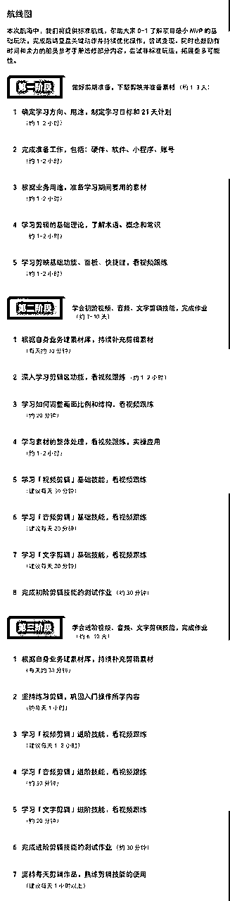

路线图与资料相互对应。你可以按自己当前环节去找对应步骤：

1. 每天结合项目进展，判断自己站在路线图哪一格、下一步该做什么；
2. 点开要练的步骤，跳到资料对应位置，看清动作后马上动手；
3. 当天做完，记得打卡日志，回看执行情况，再安排下一步；
4. 路线图与项目关键路径紧密相连。全部动作走完，说明你跑通了最小可运行闭环；此时别停，继续把第一到第三阶段再走几轮。

如果上述路线图全部完成，说明核心模块已经学完。接下来要持续找片源、剪成片、发作品，把手感磨稳，并放回真实项目里使用。

# 核心模块：打牢基础操作

#### 本模块说明

核心模块会从认识剪片开始，带你走一遍视频号分成计划的完整流程。你可以照着这里的内容与步骤动手，先跑通最小可运行闭环。

为让学习路径更清楚，建议按下面顺序推进：

零基础：先做入门准备【第一步：开工前的认知与准备】

想建立对剪映的基本认识：从看懂软件面板开始【第二步：软件界面与画面处理】

有基础了解但操作不熟：进入【第三步：基础操作练习】

想学关键帧、蒙版等进阶能力：进入【第四步：进阶操作练习】

想检查成果，资料里也放了两个小测：

基础操作检测【3.4 初阶剪辑技能检测】

进阶操作检测【4.4 进阶剪辑技能检测】

核心模块的内容与路线图一一对应。顺着资料学，就能逐项完成路线图任务。

后续每个关键步骤的说明里，也会提示对应路线图，提醒你完成该环节。

下面正式开工。

## 第一步：剪辑前的了解与准备

正式动手前，先做认知与工具上的准备，能让你更快进入状态。

磨刀不误砍柴工，从这一章迈出第一步吧~

#### 本章路线图

学完并练完本章，路线图第一阶段即可完成。

第一阶段：做好前期准备，下载剪映并准备素材（约 1-3 天）

1. 明确学习方向与用途，定下目标和三周安排（约 1-2 小时）
2. 准备硬件、软件、小程序、账号等（约 1-2 小时）
3. 按业务用途，备好学习期间要用的片源（约 1-2 小时）
4. 补一补基础理论，认识术语、概念和常识（约 1-2 小时）
5. 熟悉剪映基础功能、面板、快捷键，看视频跟练（约 1-2 小时）

现在就开始第一阶段的学习与练习吧。

### 1.1 三周怎么排学习节奏

#### 1.1.1 先把目标定清楚

成片加工是视频制作中很关键的一环。它要把影像、声音以及其他原料，按特定结构和节奏重新编排。这个过程不只是剪断、拼起画面，还包含声音处理、效果添加、色彩修正等内容。

短视频和社交平台火起来后，这项能力变得更吃香。各大平台上，细分创业方向成百上千。

想抓住这波机会，剪片就是绕不过去的功夫。卖货视频、图文转视频、个人IP、短剧CPS，乃至其他需要交付成片的方向，都离不开它。

@奇杰老师 对这次后期特训的目标是这样说的：

1-1.短视频剪辑学习目标.mp4【在线播放】

一句话收束：目标清楚了，再排时间。

#### 1.1.2 写出自己的三周安排

这一部分是本次后期特训的重点动作之一：给自己排一张三周学习表。

往期训练中我们看到，不少人对学剪片抱着“交任务”的心态，打开资料就直奔两个检测题。

但大家花时间，是为了真正掌握能力，而不是只为打卡和测验。检测是为了督促学习、验证成果，不是走形式。

所以请把注意力放在能力增长上。

需要说明的是：

“排三周安排”虽是重点动作，但是否做仍看个人意愿与需求。若你希望三周内成长更清晰，建议认真排一份。

长久进步，还是要靠项目实践中的不断复盘和打磨。

### 1.2 准备工作

常见的视频后期工具有 Adobe Premiere Pro、Final Cut Pro，以及大家常听到的剪映。

本资料以“剪映专业版”为教学对象。它在国内使用广泛，门槛相对低，适合新手入门。

为把功能学全，建议安装剪映专业版桌面端。下面展示的操作，均以电脑端为准。

#### 1.2.1 准备工作总览

奇杰老师对“开工前准备”的建议，主要分三块：硬件、软件、片源。

时间戳：

1-3.学习剪辑的准备工作.mp4【在线播放】

#### 1.2.2 下载剪映

剪映官网：https://www.capcut.cn/

打开链接后选“专业版”，按“立即下载”即可：

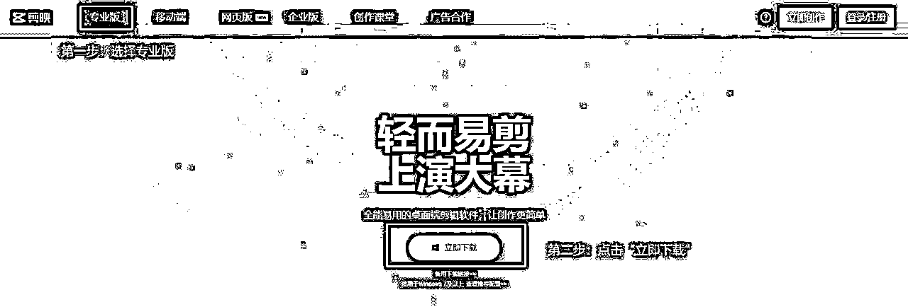

软件要跑得顺，电脑配置也有一定要求。不过门槛不高，普通电脑通常能达到最低配置；能上推荐配置当然更稳。

Windows 配置要求：

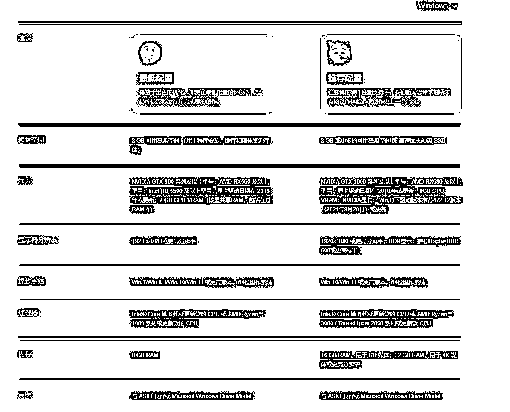

MacOS 配置要求：

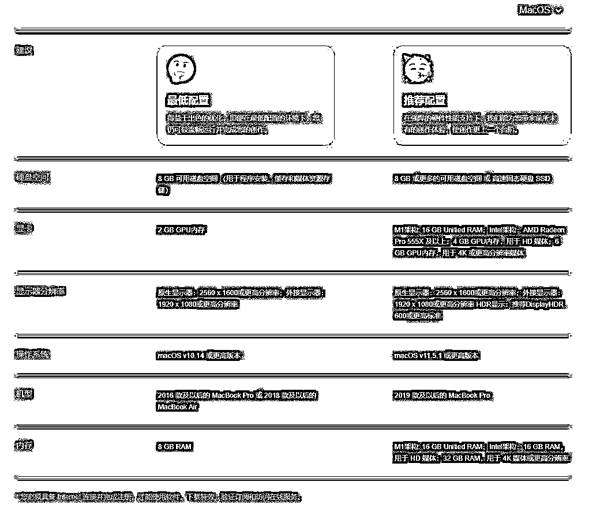

电脑配置不必过度投入，够用就行。

#### 1.2.3 其他软件准备

为方便后续操作，除剪映外，可提前备好这些工具。

工具一： https://snapdrop.net/#
优点：不用装第三方软件，同一 WiFi 下可网页互传
缺点：网站偶尔打不开

工具二：www.localsend.org
优点：跨平台、无线、无损互传
缺点：要安装第三方软件

### 1.3 素材从哪里来

找片源其实也属于准备环节，但它很关键，而且不少新手容易忽视，所以单独拿出来讲。

获取片源的核心是：

如果你有业务在跑，建议直接拿业务里的原料练手。技能学得再多，最后都要落到实际工作里。

往期训练中我们发现，有些同学不备片源，直接拿测试题里的文件，照着老师成品生硬模仿。这样大概率练不出真本事。

所以建议自备一些原料，并在训练期持续从各平台积累，再围绕资料里的技能反复练，才能越来越熟。

当然，为让你更快进入状态、少花时间找片源，本章也会给一些常见渠道。

常见的素材渠道：

时间戳：

1-2.剪辑素材的来源.mp4【在线播放】

看到合适的视频后怎么保存？可借助工具，比如亨亨猫（链接 https://h.zzrjcp.com/）等。同类工具不少，挑顺手的用即可。

### 1.4 基础术语说明

为了避免后文出现陌生词，先认识一些基础概念。

常见的视频名词术语（重点关注）：

以上是剪片时常见的一些术语，熟悉后更容易理解制作过程。

知识拓展-常见的视频格式：

这些格式各有适用场景，也各有优势与限制，按需求选即可。

大多数短视频平台场景里，MP4 用得更多。

### 1.5 记住常用快捷键

想提高效率，常用快捷键可以记一记。

在剪映编辑页右上角，点开小键盘图标，就能看到官方整理的快捷键：

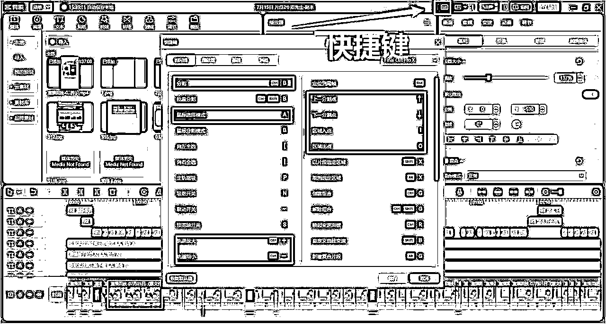

其中使用频率较高的有：

现在看不懂没关系，后文具体操作里会慢慢遇到。

## 第二步：软件和画面的认识与处理

本资料以“剪映专业版”为教学对象。它在国内使用广泛，门槛相对低，适合新手入门。

本章先认识剪映电脑端的基础功能、面板和剪辑区，再用这些能力整理片源。熟悉之后，后续正式操作会更快上手。

#### 本章路线图

第二阶段：学会初阶视频、音频、文字剪辑技能，完成作业（约 7-10 天）

学完并练完本章，即可完成路线图第二阶段的前半部分：

1. 按自身业务建片源库，持续补充原料（每天约 30 分钟）
2. 深入熟悉剪辑区功能，看视频跟练（约 1-2 小时）
3. 学会调整画面比例和结构，看视频跟练（约 20 分钟）
4. 学会整体处理片源，看视频跟练并实操（约 1-2 小时）

现在就开始第一阶段的学习与练习吧。

### 2.1 软件基础功能与界面

#### 2.1.1 先认识基础功能

接下来，先认识剪映有哪些基础功能。

视频教程主要涉及以下功能：

2-1.剪映专业版基础功能.mp4【在线播放】

#### 2.1.2 看懂剪映面板

安装后打开剪映，会直接进入主界面。先简单认识几个功能分区，后面用起来更顺手。

本视频主要介绍素材区、预览区、参数区和剪辑区：

2-2.剪映专业版软件界面.mp4【在线播放】

下面简要收束一下。

素材区：

这里是导入和集中管理原料的地方。本地视频、音频、图片都能从文件夹进入项目，线上资源库也能直接调用，省去到处找文件的时间。实际剪片时，把文件从该区域拖进时间轴即可开始编辑。

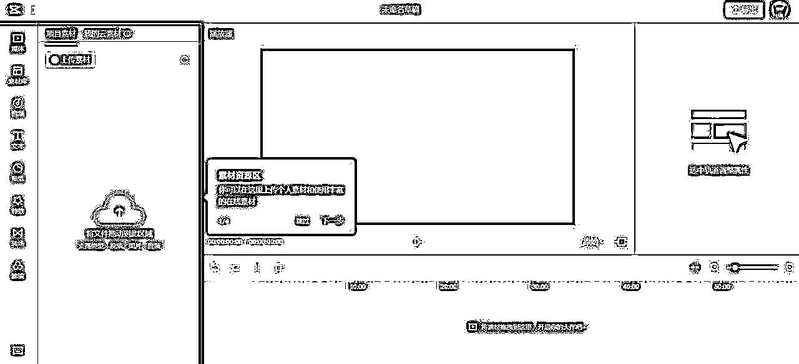

预览区：

这里负责即时看成片效果。时间轴上的编辑结果会同步显示，点播放就能检查画面，便于随时修正和优化。

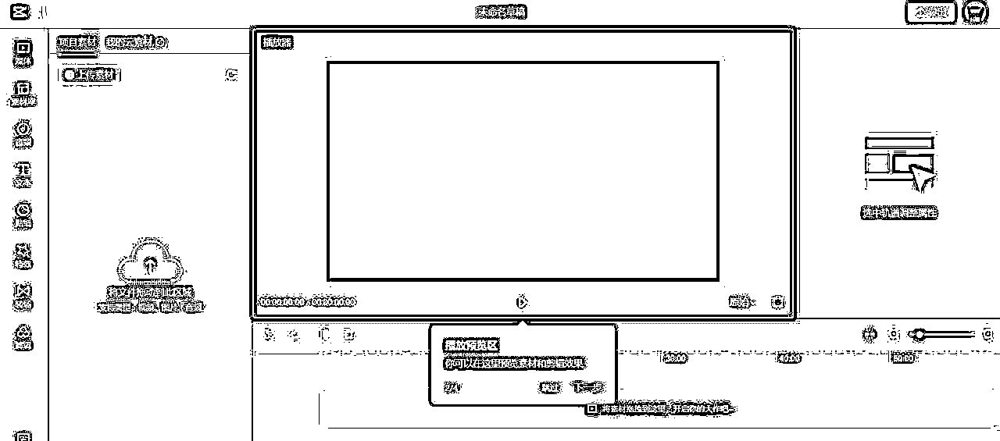

参数区：

这里用于调整效果属性。选中目标轨道后，可改画面位置大小、透明度、色彩、音量、变声、动画等，设置会直接作用到对应文件上。

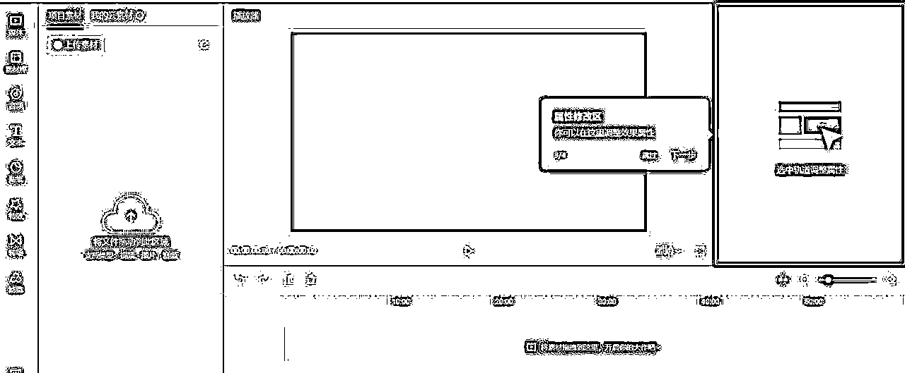

剪辑区：

这里是整个流程的核心。文件排列、剪切、调整，以及轨道的新增、删除和修改，都在这里完成；视频、音频、字幕、特效等轨道均可编辑，最终形成流畅成片。

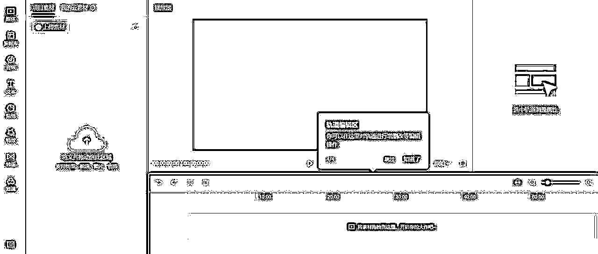

具体功能和操作怎么做？我们会在【章节3.1-章节4.3】用视频讲解。你也可以从目录找到想学的功能，定向学习。

### 2.2 剪辑区能做什么

前面讲过剪映面板分区，但最重要的剪辑区到底能完成哪些动作？为让操作思路更清晰，我们把“剪辑区功能”单独拎出来做专题小节。

本小节部分教程与后文视频、音频、字幕处理有重叠，但教学角度不同，大家可把后文当作巩固练习。

以下视频教程包含：挑片源、切分、整段选中、撤销、重做、画面冻结、反序播放等。

挑片源：00:25-00:47。先点剪辑区左上角小箭头，切到“小剪头”，再点文件即可选中。
切分：00:48-01:10、02:10-02:42。点“分割”后鼠标变刀片状，可裁开原料。
整段选中：01:12-01:49。视频介绍了左全选与右全选两种方式。
撤销：01:50-01:57。点撤回可退掉上一步。
重做：01:58-02:09。点恢复可还原刚撤回的操作。
向左/向右裁切：02:44-03:35。按对应按钮，可切掉所选文件左端或右端。
画面冻结：03:36-04:22。选中文件后点定格，对应帧会被固定，时长可拖动调整。
反序播放：04:23-05:40。让画面倒序播放；若想保留声音，需先分离音频。
镜像：05:41-06:00。将画面左右翻转。
旋转：06:01-06:18。每次把画面转90度。
裁剪：06:01-06:57。选中画面后点裁剪，可调整尺寸与长宽。
智能口播：06:58-结尾。可智能分析口播原料，方便删掉停顿和重复词等。

2-4.剪辑区功能介绍（上）.mp4【在线播放】

以下视频教程包含：录音、主轨磁吸、自动吸附、联动、预览轴、音频踩点、锁定轨道、隐藏轨道等。

录音：开始-01:06。通过该功能，可以为原料做后期配音。

# 剪辑区10个功能，用对了效率翻倍

**主轨磁吸（01:07-02:21）**：这个开关一般默认打开。它会让素材自动贴合主轨；如果你想不受约束地随意调换素材顺序，把它关掉即可。

**自动吸附（02:23-03:41）**：用来让素材之间彼此贴合，对齐的时候特别省心。

**联动功能（03:43-05:13）**：开启后，你拖动主轨上的某段素材，与它绑定的联动素材会同步位移，不用再一个个手动搬。

**预览轴（05:14-06:38）**：也就是剪辑区里那根黄色竖轴。打开后，只要移动鼠标，预览窗口就会实时呈现画面变化，找镜头非常快。

**放大和缩小（06:39-07:15）**：可以缩放剪辑区的轨道视图，方便在密集素材里迅速锁定目标。

**自动踩点 / 手动踩点（07:16-09:23）**：点一下，音频素材上就会用「黄点」标出卡点位置，做卡点视频时对着这些点切画面就行。

**清空踩点（09:24-09:41）**：把之前标注卡点的那些「黄点」一键抹掉，重新来。

**锁定轨道（09:43-10:13）**：给某条轨道上锁，之后处理其他轨道素材时，就不会误操作到它。

**隐藏轨道（10:14-10:43）**：暂时让某条轨道的素材不显示，便于对比有它和没它时画面的差别。

**轨道静音（10:44-结尾）**：单独把某条轨道的声音关掉，其他轨道照常播放。

2-4.剪辑区功能介绍（下）.mp4【在线播放】

### 2.3 看懂画面比例与结构

画面比例，说的是画面长与宽的比例关系；画面结构，则指主画面在整个画幅中占据多大的面积。

本节会带大家认识两种常见画面比例下，各自有哪些典型的画面结构：

2-3.画面比例和结构.mp4【在线播放】

### 2.4 素材先整体处理，再动手剪

动手剪之前，最好先把素材整体梳理一遍。如果等切完再回头调整，剪辑效率会被拖得很低。

本节教程会分别讲解画面素材与声音素材的整理方法。

3-1.素材整体处理.mp4【在线播放】

## 第三步：初阶剪辑操作与练习

这一章聚焦入门级剪辑技巧。学完它，你就具备了独立做出一条简单短视频的本事。

在【3.4 初阶剪辑技能自测】里，我们安排了一次小测。把它做完，本阶段的学习就算画上句号，余下的时间用来反复巩固与练习。

这里提前提醒一句：测试之前，最好先把本章内容过一遍。如果几乎没学就上手，感到吃力是再正常不过的事。

设置测试的目的是督促学习、检验成果，而不是走个形式；靠硬凑答案勉强通过，其实没什么意义。

#### 本章学习路线

第二阶段：掌握视频、音频、文字的初阶剪辑能力，并完成作业（约 7-10 天）

学完本章并动手实操，航线图第二阶段的后半程就完成了：

1. 学习「视频剪辑」基础技能，跟着视频练（建议每天 30 分钟）
2. 学习「音频剪辑」基础技能，跟着视频练（建议每天 20 分钟）
3. 学习「文字剪辑」基础技能，跟着视频练（建议每天 20 分钟）
4. 完成初阶剪辑技能测试作业（约 30 分钟）

准备好了，就开始第二阶段的旅程吧。

### 3.1 初阶操作：视频篇

这一节讲的是短视频剪辑里，画面部分的入门操作。

时间戳如下：

3-2.入门操作-视频部分（上）.mp4【在线播放】

时间戳如下：

3-3.入门操作-视频部分（下）.mp4【在线播放】

### 3.2 初阶操作：音频篇

这一节来看音频部分的入门处理。

电子配音：不想自己开口录？可以用电子配音给视频配声音，平时听到的 AI 配音就是这种。操作上，先选中素材、添加文本，再点「朗读」，各种配音音色就会列出来，常用的有四郎、动漫海绵、东北老铁等。

3-4.入门操作-音频部分（上）.mp4【在线播放】

时间戳如下：

3-5.入门操作-音频部分（下）.mp4【在线播放】

### 3.3 初阶操作：文字篇

这一节学习文字的添加和设置（入门）。

时间戳如下：

3-6.入门操作-文字部分.mp4【在线播放】

### 3.4 初阶剪辑技能自测

学完「初阶剪辑技能」这一章，你应该已经能独立剪出一条完整的视频了。

为了让你看清自己的掌握程度，本节准备了一批素材，以及用基础技巧剪出的成品视频。你可以试试，能不能把原素材做成和「示范效果」一致的样子。

下载链接：https://pan.quark.cn/s/6844348eae4b

1.初阶检测-成品示范.mp4【在线播放】

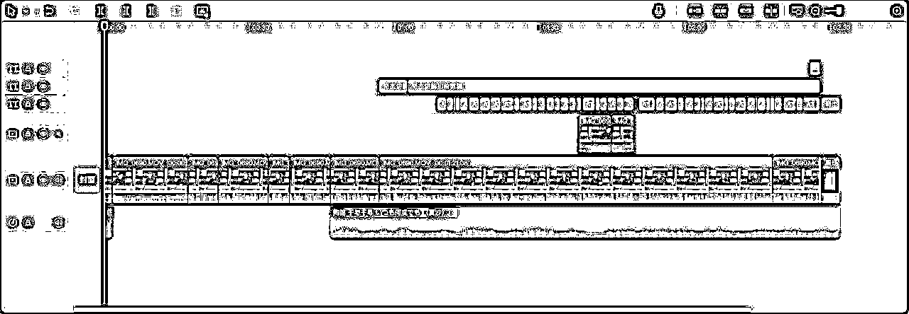

## 第四步：进阶剪辑操作与练习

这一章带你进入进阶剪辑。掌握之后，你就有了做出精致短视频的能力。

同样，【4.4 进阶剪辑技能自测】安排了一道测试。完成它，本阶段学习即告结束，剩下的就是不断巩固与练习。

测试前仍要提醒：先把章节内容学一遍，否则在测试中寸步难行也很正常。

测试是为了督促学习、检验成果，不是搞形式主义；仅靠生搬硬套通过测试，意义不大。

#### 本章学习路线

学完本章并完成实操，航线图的第三阶段就达成了。

第三阶段：掌握视频、音频、文字的进阶剪辑技能，并完成作业（约 6-10 天）

1. 结合自己的业务方向搭建素材库，持续往里补充（每天约 30 分钟）
2. 坚持练习，把入门阶段学的内容练熟（约每天 1 小时）
3. 学习「视频剪辑」进阶技能，跟着视频练（建议每天 1-2 小时）
4. 学习「音频剪辑」进阶技能，跟着视频练（约 30 分钟）
5. 学习「文字剪辑」进阶技能，跟着视频练（约 20 分钟）
6. 完成进阶剪辑技能的测试作业（约 30 分钟）
7. 每天动手剪作品，把技能用熟（建议每天 1 小时以上）

现在，开始第三阶段的练习吧。

### 4.1 进阶操作：视频篇

本节进入画面剪辑的进阶部分，涉及抠像、蒙版、贴纸、滤镜、特效、关键帧和背景设置。

把这 7 项练熟，大多数短视频项目里的画面需求都能应付。

#### 4.1.1 抠像

抠像，是把画面中某个区域的人像单独提取出来，其余部分变为透明。剪映提供智能抠像和自定义抠像两种模式。

选中素材，进入参数区的「画面」-「抠像」，就能选用。

4-1.进阶操作-视频抠像.mp4【在线播放】

#### 4.1.2 蒙版

举个场景：加完画中画后，如果觉得衔接生硬，可以给这层画中画套一个蒙版，改变它的外形和呈现样式。

剪映的画面蒙版有线性、镜面、圆形、矩形、爱心和星形。

选中素材，点开参数区的「画面」-「蒙版」即可操作。

4-2.进阶操作-蒙版应用.mp4【在线播放】

#### 4.1.3 贴纸

贴纸就是往画面里加一些装饰元素，让内容更生动有趣。

选中某条轨道的画面后，打开素材区的「贴纸」，热门贴纸都在里面。想找得更快，可以直接输关键词搜，比如搜「箭头」，挑中喜欢的加进画面就行。

4-3.进阶操作-贴纸功能.mp4【在线播放】

#### 4.1.4 滤镜

对原片色调不满意，可以用滤镜来提升画面的整体氛围感。

选中要处理的画面，点击素材区的「滤镜」，各种风格一目了然，挑顺眼的用就好。

4-9.进阶操作-滤镜功能.mp4【在线播放】

#### 4.1.5 特效

特效分两类：画面特效和人物特效，都能给视频添氛围或加趣味。

画面特效（00:18-01:30）：在素材区点「特效」-「画面特效」，列表里种类很多，点一下即可预览效果。

人物特效（00:18-01:30）：在「特效」-「人物特效」里，可以给画面中的人物加脸红、怪脸等效果。

4-4.进阶操作-特效功能.mp4【在线播放】

#### 4.1.6 关键帧

在剪辑里，关键帧是你在时间轴上特意选中的某一帧，往往对应视频里的重要瞬间或转折点，用来标记变化和状态切换。

和普通帧不同，关键帧会记录位置、大小、旋转角度、透明度等信息，正是这些信息决定了物体或角色在某个时间点的状态。

把关键帧用到位，画面过渡会更顺滑，视觉效果也更丰富。想实现画面由小变大、声音由弱渐强、水印移动等效果，都离不开它。

4-5.进阶操作-关键帧.mp4【在线播放】

#### 4.1.7 背景填充

要记住：背景设置只对主轨素材生效，操作前先确认素材确实放在「主轨」上。

举例来说，当画面结构是 4:3 时，上下会留出默认的黑色区域，这时可以用背景设置，把主轨素材中「非主画面」的部分填上内容，比如上方放标题、下方放字幕。

另外也可以直接填充背景：在参数区的「画面」里拉到最下面，会看到「背景填充」，常见方式有模糊、颜色与样式。

4-10.进阶操作-背景设置.mp4【在线播放】

### 4.2 进阶操作：音频篇

本节讲音频的进阶处理，重点是淡入淡出和变速。

#### 4.2.1 淡入淡出

作用很直白：让声音缓缓进入或慢慢消失。

音乐突然响起或戛然而止时，用这个办法过渡会自然很多。

选中音频素材，在参数区的「基础」里找到「淡入时长」和「淡出时长」。一般设为 3 秒效果就不错，具体按自己的需要调整。

4-6.进阶操作-淡入淡出.mp4【在线播放】

#### 4.2.2 变速（声音同步变速）

就是调整视频的播放速度。若视频自带声音，变速时音频也会一起变。

选中素材，进入参数区的「变速」，设定想要的倍速即可。变速有常规和曲线两种模式，另外还有声音变调、智能补帧等选项，按实际需要勾选。

4-7.进阶操作-视频变速.mp4【在线播放】

### 4.3 进阶操作：文字模板

这节介绍文字处理中的「文字模板」。

它的用处是让你更快做出想要的艺术字。打开素材区的「文本」，里面有个「文字模板」板块，艺术字样式非常多，挑合适的套用即可。

4-8.进阶操作-文字模板.mp4【在线播放】

### 4.4 进阶剪辑技能自测

学完「第四步：进阶剪辑技能」，你应该能运用进阶技巧去优化视频了。

同样为了让你检验成果，本节给了素材，以及用进阶技能剪好的成片视频。不妨动手试试，看能否把原素材做出「示范效果」的水准。

下载链接：https://pan.quark.cn/s/7ee255d9f012

1.进阶检测-成品示范.mp4【在线播放】

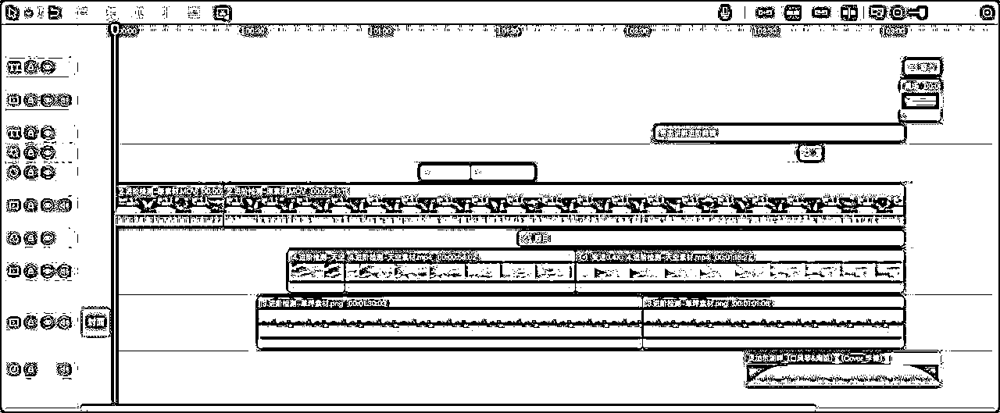

# 选修篇：深度玩法与实用工具

#### 章节概要

把必修篇的内容学完、基础与进阶操作都掌握之后，就可以来选修篇逛逛了。

不管你是想把技能练得更熟，还是想找点新玩法，这一章都值得细读：

【拓展玩法】批量剪辑的学习与应用

【实战工具】加餐与分享

如果精力充足，欢迎多试试选修篇的内容；要是前面的还没学完，建议先回必修篇把基本功打扎实。

下面的内容会帮你再往前走一步——准备好，开始你的探索吧。

## 五、【拓展玩法】批量混剪入门与实战

### 5.1 混剪与批量混剪是什么

初阶和进阶技能都拿下之后，你已经会做短视频了。但如果你运营的是多账号矩阵，产出需求很大，那就得用上「批量混剪」。

「批量混剪」是在「混剪」基础上做批量化处理的一种剪辑方式。在学它之前，先要搞清楚混剪的逻辑，以及批量混剪中的去重设计。

这部分建议读一读 @奇杰老师 在 5 月航海时分享的《剪辑基础决定上层建筑，了解混剪逻辑和去重设计》。

那么，混剪和批量混剪到底是什么意思？

5-1.混剪和批量混剪的概念.mp4【在线播放】

### 5.2 实战教程：单人一天产出 200 条

@奇杰老师 现在一个人供着 30 多个抖音账号的内容，全力运转时一天能混剪 200 条以上，效率比起步阶段翻了几十倍。

注意，这里的满负荷指 7-8 小时的工作时间，不是熬通宵。

关于「批量混剪」的实战，@奇杰老师 曾在星球发过一篇攻略，讲清了短视频混剪带货的要点和批量混剪的操作步骤，原帖可点链接查看：

【短视频混剪进阶】单人日产 200 条实战攻略

帖子发出后，圈友反响很热烈。随后龙哥盟邀请 @奇杰老师 把攻略录成了视频教程，方便大家学习。这套教程涵盖了批量混剪较完整的操作方法，下面的视频会带你了解「批量混剪」具体怎么剪。教程如下：

【短视频混剪】单人日产 200 条视频教程-奇杰.mp4【在线播放】

### 5.3 辅助工具：切片素材与混剪工具

做批量混剪的去重，得用上切片素材。这里准备了一批教学素材，供你练手。

奇杰【批量混剪】切片素材-教学用
下载链接：https://pan.quark.cn/s/c0a2379f4551

批量混剪要对素材切片再混合，这里分享两个工具。

Windows 系统：素材切片混合工具 + 素材命名打乱工具
下载链接：https://pan.quark.cn/s/dbd5dd5ef182

Mac 系统（苹果电脑）：素材切片混合工具
下载链接：https://pan.quark.cn/s/45c9b00aca41

### 5.4 实操：用批量混剪做不同类型视频

为了帮大家把「批量混剪」用到具体的项目里，我们针对常见的 9 大短视频类型，各配了一套实操课程，可以对照着学。

#### 5.4.1 人物抠像类

5-2.「人像抠图」一人一天两百条合集（_batch.mp4）｜点开即看

#### 5.4.2 实景拍摄类

5-3.「实景拍摄」一人一天两百条合集（_batch.mp4）｜网页直看

#### 5.4.3 汤包炖煮类

5-4.「汤包炖煮」一人一天两百条合集（_batch.mp4）｜点开即看

#### 5.4.4 生活好物类

5-5.「生活好物」一人一天两百条合集（_batch.mp4）｜网页直看

#### 5.4.5 盆栽绿植类

5-6.「盆栽绿植」一人一天两百条合集（_batch.mp4）｜点开即看

#### 5.4.6 养生茶饮类

5-7.「养生茶饮」一人一天两百条合集（_batch.mp4）｜网页直看

#### 5.4.7 励志短句类

5-8.「励志短句」一人一天两百条合集（_batch.mp4）｜点开即看

#### 5.4.8 音乐开唱类

5-9.「音乐开唱」一人一天两百条合集（_batch.mp4）｜网页直看

#### 5.4.9 优质书目类

5-10.「优质书目」一人一天两百条合集（_batch.mp4）｜点开即看

### 5.5 学完批量混剪，检验一下掌握程度

「批量混剪」这块内容看完之后，不妨给自己来一次小考。

达标线是这样：全程不翻教程、也不提问求助，自己能顺畅独立地把整套混剪做完，同时十条成片的制作时间控制在一小时之内。

## 六、实用工具：额外福利与资源索引

这些工具中，有些前面已经提过，这里统一放一份索引，方便随时查找。

### 6.1 练手材料

做混剪去重之前，得先准备好切片，下面这份材料可以拿去练手。

奇杰「批量混剪」切片材料·练习版

获取地址：https://pan.quark.cn/s/c0a2379f4551

### 6.2 切分与组合工具

原始材料需要先切成小段、再重新组合，下面两款工具能帮上忙。

Windows 版：视频切段与组合器＋文件名乱序器

获取地址：https://pan.quark.cn/s/dbd5dd5ef182

Mac（苹果电脑）版：视频切段与组合器

获取地址：https://pan.quark.cn/s/45c9b00aca41

### 6.3 跨设备互传

方案一：Snapdrop 网页互传（https://snapdrop.net/#）

好处：无需安装任何程序，两台设备连上同一个无线网络，打开网页就能互发。

短板：页面偶尔会打不开。

方案二：LocalSend（www.localsend.org）

好处：不同系统之间都能无线互传，文件原样不压缩。

短板：需要先安装客户端。

### 6.4 二十一天学习规划表

奇杰帮忙整理出一份「二十一天学习规划表」。各位可以照着它，结合自己的水平和空闲时间，把剪辑特训安排成适合自己的三周节奏。

### 6.5 桌面分类方案

很多人对教程中那套整齐的桌面很感兴趣，这里直接放出来，需要的自取。

混剪专用桌面分类（与教程一致）

获取地址：https://pan.quark.cn/s/3be589a77a85

### 6.5 延伸阅读：《剪辑基础决定上层建筑》

要是对混剪的整体思路、方案怎么搭、去重环节怎么设计还没头绪，建议把下面这篇认真读一遍。

《剪辑基础决定上层建筑：弄懂混剪思路与去重方案》

