# 聚光投放实战手册202403

三月航海 · 让📕的获客变得可控

编写：龙哥盟团队
成稿日期：2024 年 3 月 20 日
阅读提示：各位作者排名无先后之分。这份材料的用意，是让你看到这件事还有哪些做法，从而更快上手试试。
小技巧：想直奔某个话题，先按住 Ctrl（Mac 上是 command）再敲 F，页面会带你跳过去。

# 前言

时间拨回 2023 年。📕给私信导流上了锁：不想账号被处理，唯一的正门就是开聚光。政策一落地，愿意掏预算的店家肉眼可见地多了起来。除了靠导流吃饭的人，卖货的、做品牌的也陆续进场。

他们为什么肯花这笔钱？去找博主做种草的账其实不好算——周期拖得长，中间门道又多，最终能不能成交几乎靠猜。而自己开广告，用户刷到就能直接来问，链路短，成败一眼看得清。

这次航海，主题就一个：怎么靠聚光，把📕上的获客难题解开。

希望这趟航程结束时，你手里不止有成绩，还能多几个并肩的伙伴。

以下材料由龙哥盟和圈友一同整理，限定航海船员和星球成员内部学习。

执行中遇到问题或想到新点子，欢迎回传给我们，让这份材料再厚一点。可以联系鱼丸（yuwan387）提修改意见。

# 【更新提示】这本册子该怎么翻

动手之前，先花两分钟弄清它的用法，之后你就能按自己的节奏取用。

整本册子的编排逻辑，是带一个新手从零开始，把聚光买量这件事真正跑通。你可以顺着航线图一步步做，也可以只挑自己缺的那几节读。

要提醒的是，跟往期相比，这一版改动不小。旧版恨不得把所有打法摊在桌上让你随便挑，新版则切成【必修】与【选修】两块：

- 从来没碰过聚光：先别急着操作，把项目长什么样弄明白——【项目概述】了解聚光平台
- 已经大致摸过一遍：从航线图第一阶段动手，对应册子第二章，一路做到收尾
  - 【项目实操 1/4】开通聚光平台
  - 【项目实操 2/4】准备 6 篇合格的投放笔记
  - 【项目实操 3/4】实现一次成功的投放
  - 【项目实操 4/4】提升投放转化率
- 已经把 MVP 跑通、想加码：把最后几章当作重点，多学几种打法，顺便养出投流直觉
  - 学习聚光投放的更多玩法
  - 提升聚光投放的投放网感

本次航海的【航线图】长这样：

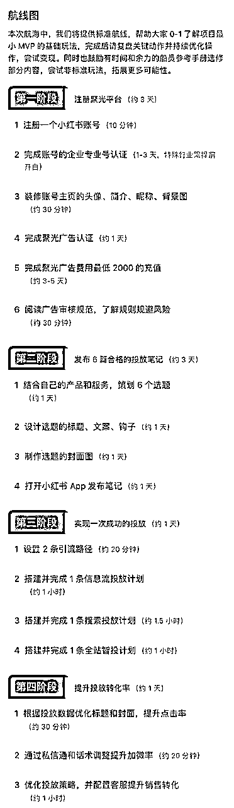

图和册子是咬合着排的，你处在哪个环节，就从对应那一步接着往下走。

上面这些步骤，最好在航海头两周内清完。走完之后，重心就该放到复盘和二次投放上，把整套动作多来几遍，效果才会慢慢显出来。

# 必修篇：把最小闭环真正跑起来

### 章节概要

必修篇先讲【项目概述】和【投放实操步骤】，目的是让你对项目有整体认知，再跟着步骤把 0 到 1 走完，拿到一个最小可用的结果。

完全的新手，动手之前建议先把项目全貌看一遍：

【项目概述】了解聚光平台

心里有谱之后，就可以照核心步骤开始操作：

【项目实操 1/4】开通聚光平台
【项目实操 2/4】准备 6 篇合格的投放笔记
【项目实操 3/4】实现一次成功的投放
【项目实操 4/4】提升投放转化率

必修篇里，航线图和册子章节是一一对位的，顺着书页读下去，图上每个任务自然就点亮了。

那我们从这里出发。

## 一、【项目概述】了解聚光平台 @天堂地狱

### 1.1 它究竟是个什么工具？

2022 年，📕上线了这个名为聚光的买量产品，定位是“一站式”——想打广告的店家，无论走信息流还是搜索位，都能在同一个后台把产品推给目标用户。

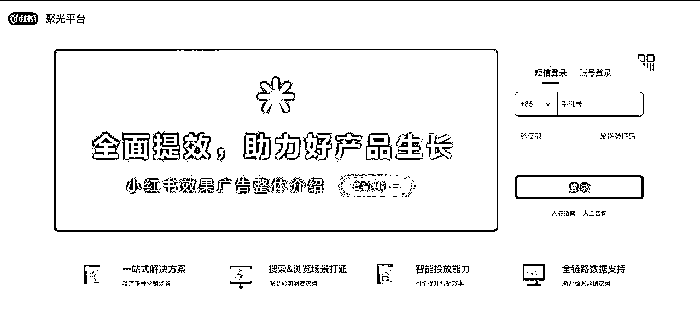

放到📕的广告版图里看，聚光的位置相当于抖音的千川、快手的磁力，本质是把多种买量形态收进同一个口袋。和偏简单的薯条相比，它多出了搜索位、信息流之类的选择。

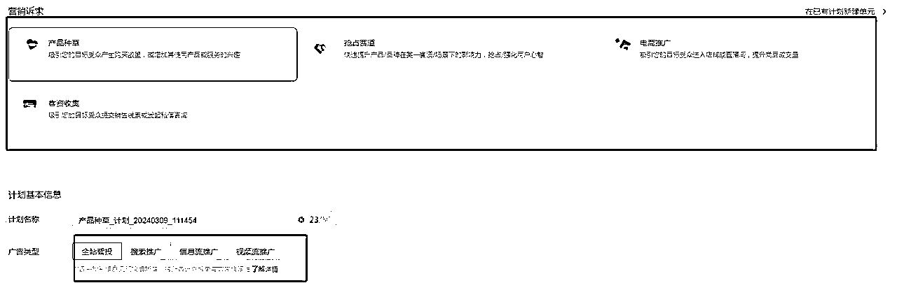

### 1.2 眼下为什么值得押注？

#### 1.2.1 先说三个好处

好处一：导流合规，不必提心吊胆

📕如今是公认的流量富矿。门槛低、天花板高，谁都想挤进来分一口。人一多，免费的流量池立刻卷成红海，平台的手也越收越紧——只要露出一点导流的迹象，轻则禁言限流，重则直接封号。

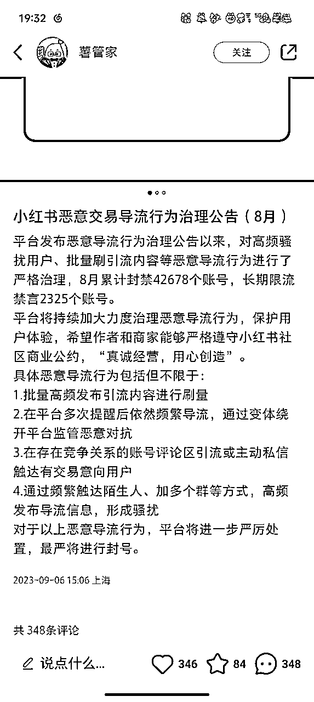

于是圈子里讨论最多的话题，变成了“怎么导流才安全”。答案五花八门：小号置顶、背景图做手脚、把账号 ID 改成联系方式、评论区玩谐音和藏头……你大概都试过，可没有一个能长期稳住，随时可能翻车。

从目前跑出来的结果看，最管用也相对稳妥的路子，反而是顺着平台的意愿走：帮它商业化团队把 KPI 做上去，也就是开聚光，光明正大地导流。

好处二：花出去的钱有回响

不少赛道靠聚光拿到了相当漂亮的留资数据。

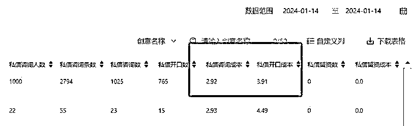

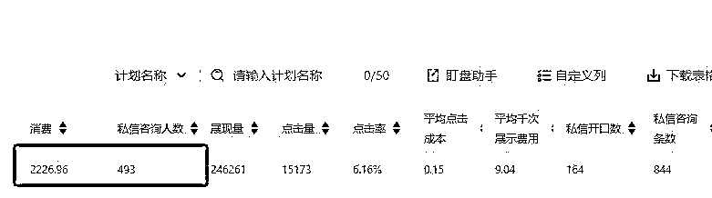

一个开口五块，加一个🛰️十块——懂行的看到这组数字就明白了。

一个被低估的渠道，价值不亚于一只被低估的股票。把这部分价值挖出来，正是这趟航海的使命。

好处三：门槛比同类工具低得多

无论是找官方直客还是对接服务商，是首笔预存的数额，还是账户日常消耗的频次，聚光在同类里都算得上亲和。平台上大把账户每天只花一百到五百块，也照样在持续产出。换成那些资历更老的平台，很难有这样的宽松。

对非职业投手尤其友好：你原本就有自然流量的底子，再加上付费放量，价值能被放大好几倍，导流这件事上体现得最明显。

#### 1.2.2 但这两个坑要先知道

优点说完，缺点也得摊开讲。

1. 论体量，聚光还比不过抖音、百度那几家。池子小，赛道就更容易挤。一旦某个领域的大玩家进场，后来者能腾挪的空间就很有限了，要么硬碰硬，要么换打法、换赛道。
2. 规则尚在打磨期，漏洞不少。举个最典型的：你没法设置同一用户在一段时间内不重复看到同系列广告。结果就是有人连着几天刷到你，点了一次又一次，预算白白烧掉。更有同行专门钻这个空子恶意点击，硬把出价抬上去。

## 二、【项目实操 1/4】开户

### 本节导读

开户这件事，路径大致是三步：先做专业号，再注册聚光，最后往里打钱。本章就围绕这条线展开。

具体包含：

2.1.1 第一步：备好账号，把门面收拾干净
2.1.2 第二步：拿下企业专业号
2.1.3 第三步：把广告账户注册下来
2.1.4 第四步：往账户里打钱

此外，本章还会顺带讲清聚光有哪几种广告位，以及行业的红线在哪。这些提前弄懂，后面的素材才不容易被驳回。

包括：

2.2.1 四种主流广告形态
2.2.2.1 不能投的类目
2.2.2.2 需要避开的敏感词

以上就是本章的“路线图”。准备妥当，我们就出发。

### 2.1 走一遍开户流程

#### 2.1.1 第一步：备好账号，把门面收拾干净

手上有老账号就直接用，没有就新注册一个。

账号到位后，紧接着要收拾门面。这件事的分量有多重？想个画面：你刷到一条“云南大理私人定制游”的推广，本有点心动，顺手点进对方主页，结果空空如也——你还会把行程交给它吗？

包装没做好的账号，就算流量像瀑布一样砸下来，也接不住。

怎么收拾才能让人觉得“这家靠谱”？四件事：

1. 头像：放品牌 logo
2. 昵称：用品牌的正式名字
3. 简介：几句话说清做什么行业、主营哪一类、有什么特色，让访客快速判断“你是谁”“你能给他什么”
4. 背景图：用门店实拍或符合品牌调性的图，画面干净些，别堆一大段文字

可以参考下面的例子：

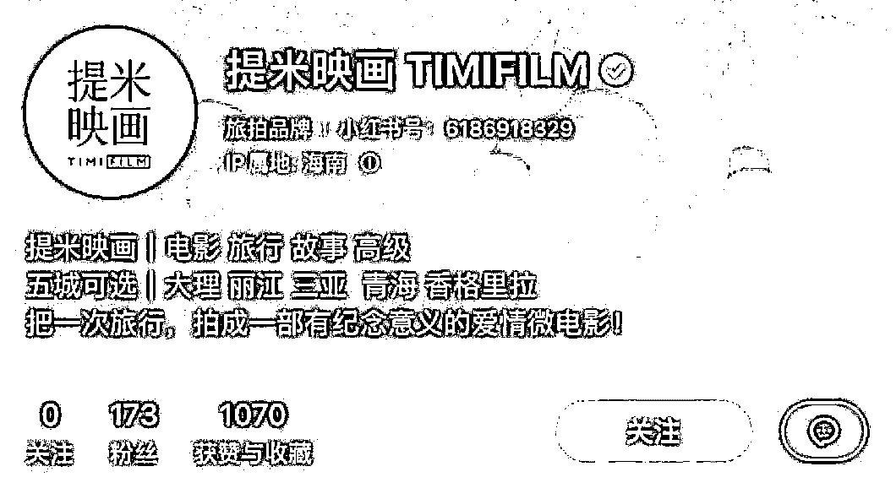

做头像和背景图，这几个工具够用了：

提醒一句：带商标的图片容易踩侵权，尽量绕开。

#### 2.1.2 第二步：拿下企业专业号

想开聚光，前面这道企业专业号的门必须先过。

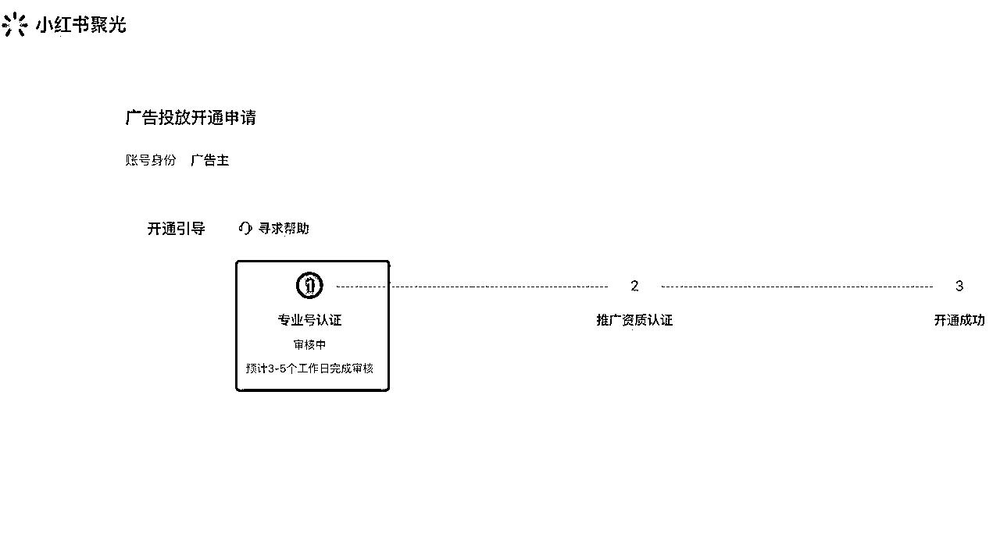

具体怎么走，往下看。

2.1.2.1 动手前先读规则

先看规矩再交钱，别让六百块审核费打了水漂（没过是不退的）。

1. 翻一遍《禁止认证行业范围》（企业专业号认证规则第四章），确认自己所在的行业不在黑名单里，否则钱交了也过不了；
2. 再翻《准入行业分类及资质标准》（企业专业号认证规则第五章），把该行业要的资质材料、品牌材料，连同简体中文翻译件一并备齐；
3. 登录后台时，务必用将来要开店的那个号。提交时的登录账号就是被认证的账号，交上去就改不了了；
4. 如果手上是已通过认证的个人号，想升格成企业专业号，得在📕 APP 里操作：我 → 左三栏 → 专业号中心 → 做互动 → 立即升级，就能进到企业号认证页。

2.1.2.2 递交材料

提交入口：https://pro.xiaohongshu.com/enterprise/home
（建议在电脑端完成）

路径是左侧「账号管理」→「专业号认证/年审」→「专业号+广告账户同步开通」，进去就是材料填写页。

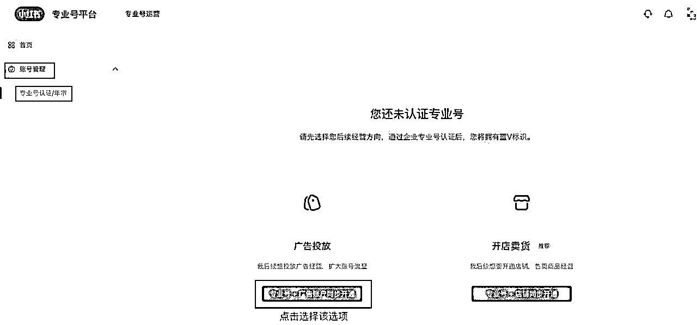

1. 账号资料

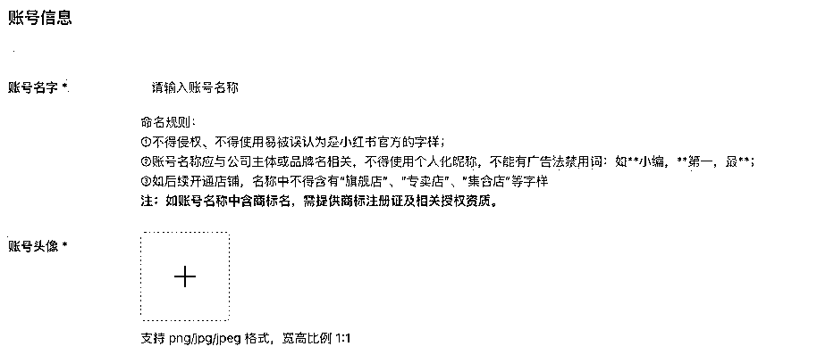

2. 主体资料
上传最新的工商营业执照扫描件

3. 身份核验
法人刷脸，或出具一份申请公函

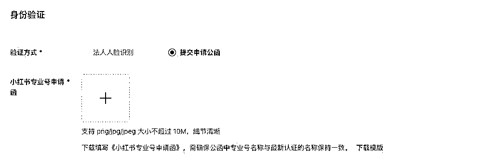

4. 行业资质
身份类目的选择直接决定入驻标准。建议先查《专业号身份类目》，把对应的行业资质与商标材料找齐；材料不够，就换个类目再报。

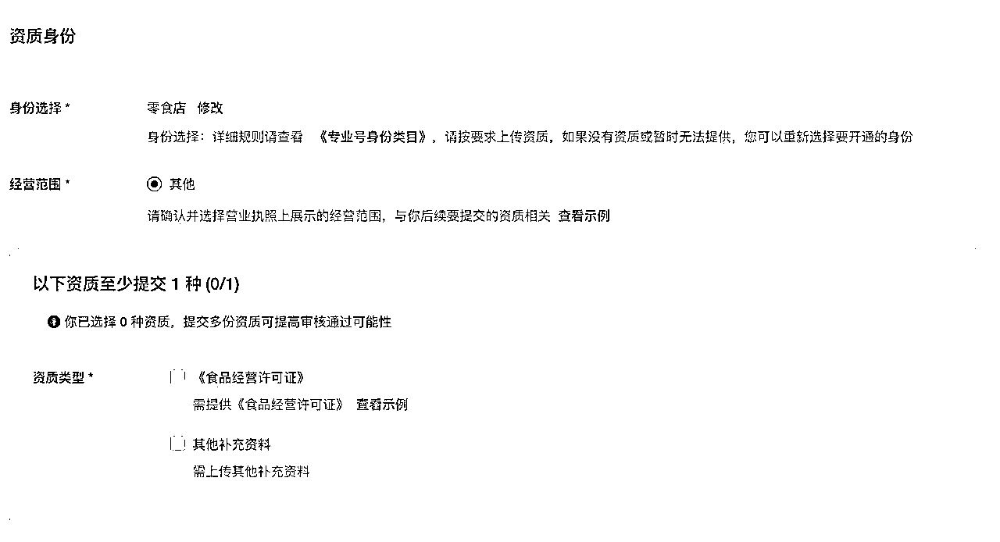

5. 运营者资料
填实际负责📕的人，且必须和《📕专业号申请函》上写的那个人对得上。

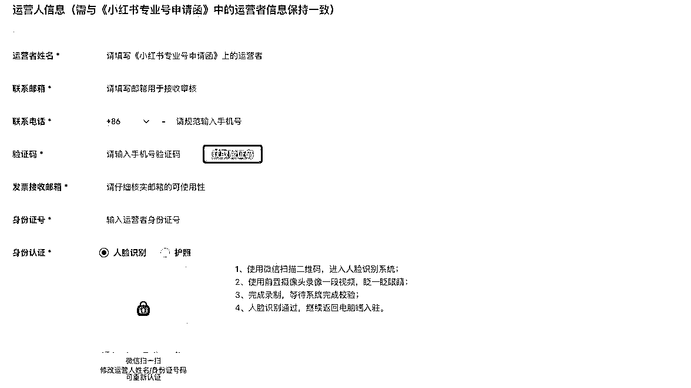

2.1.2.3 交那六百块

类目确认无误、材料齐备之后，再点支付（拿不准的地方，群里问教练）。往后只要动了主体资料或身份类目，都得重新走一遍认证、再交一次钱。

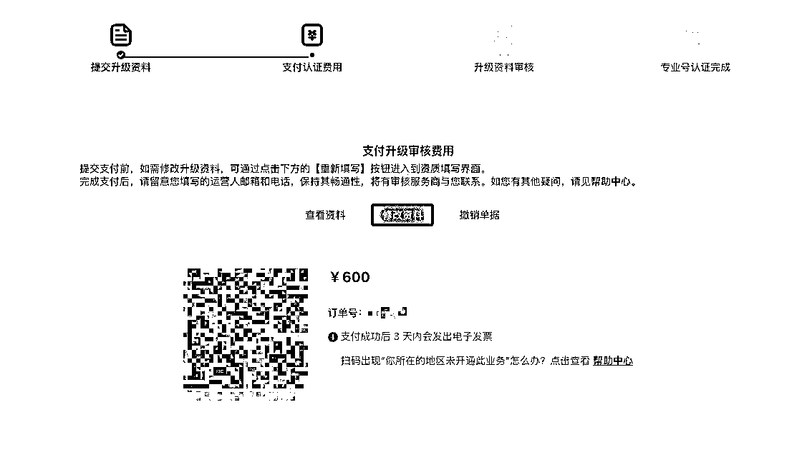

另外几条要记牢：

1. 审核只给三次机会。三次都没过，按失败结案，费用不退；
2. 单笔订单有 30 天有效期。到期没走完流程，或不符合平台规范，同样按失败处理，费用不退；
3. 每次审核 600 元。付款成功后由服务商接手审核。专业号身份只管一年，每年都要年审一次。

#### 2.1.3 第三步：把广告账户注册下来

企业专业号过了，就能去注册聚光。入口有两条：官方和代理。

① 官方

官方那边也在冲聚光的业绩，多数情况下企业号一注册好，电话就来了，催你开户。要注意的是，一旦被官方“客保”，代理这条路就堵死了。

开户条件：他们自己的指标会变，要求也跟着浮动，通常是五千或一万起开户。

走官方的好处：
- 有人带着调投放
- 能提前听到一些政策风向

走官方的短板：
- 官方给的投放经验偏理论，不够落地
- 没有返点
- 起开户金额高

② 代理

各家代理的返点会随时间调整，册子里就不写具体数字了。需要的话在群里找教练聊，建议多比较几家再定。

走代理的好处：
- 白名单免费开
- 两千就能起户
- 有返点，能把获客成本压下来

走代理的短板：
- 只适合想拿返点、且已经完整跑过投放流程的人

下面以官方流程为主线，讲讲账户怎么开。

注册入口：登录聚光（https://ad.xiaohongshu.com/），进【广告】页 →【账号管理】→【推广资质认证】，就到了资质填写的环节。

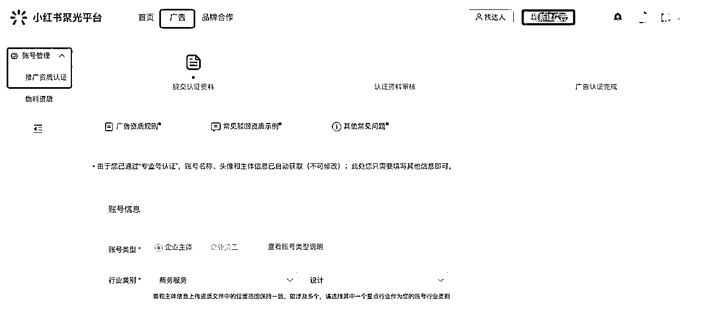

Step 1：填写账号资料

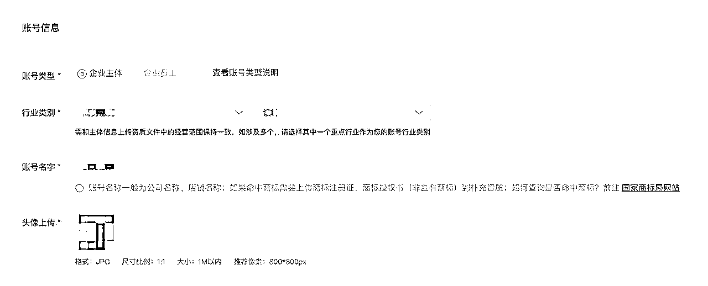

注意事项

Step 2：填写主体资料

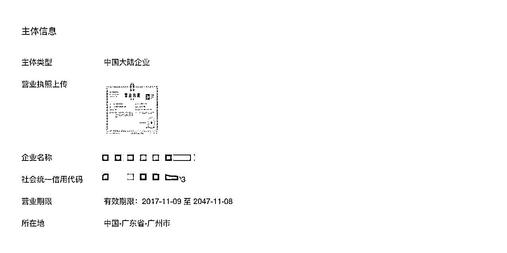

Step 3：填写行业资质

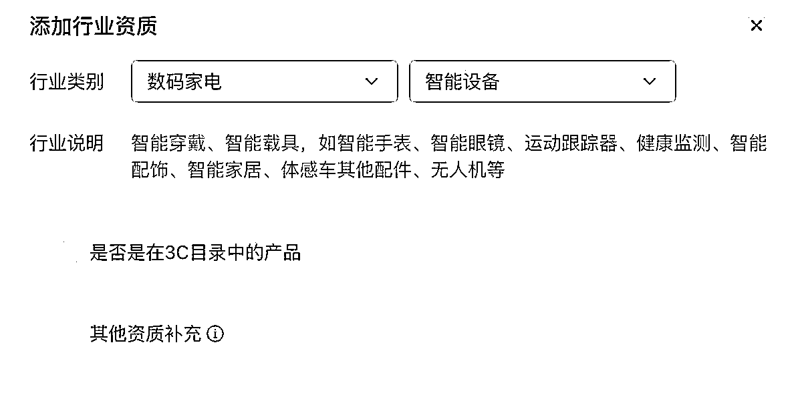

Step 4：填写其他资质（选填）

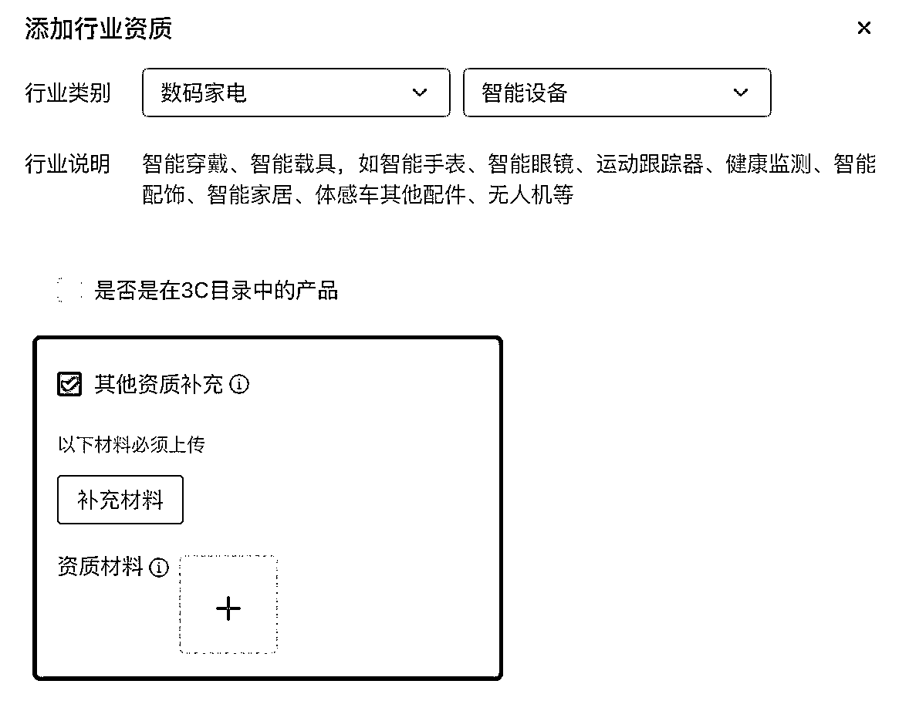

#### 2.1.4 第四步：往账户里打钱

自己在后台充，两千是起步价；走官方销售对接，起步五千。之后追加多少都不设限。

多数人首笔都是五千。要是这笔钱没花完，又不想做了，是可以申请退回的。

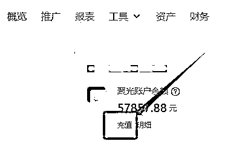

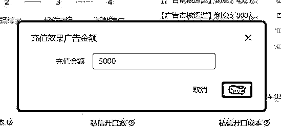

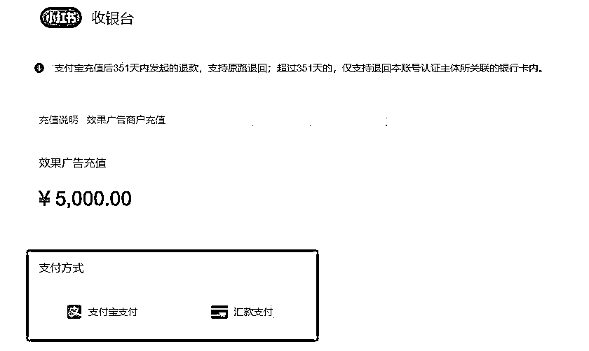

接着说材料被打回的常见情形和应对办法。

1）资质被打回

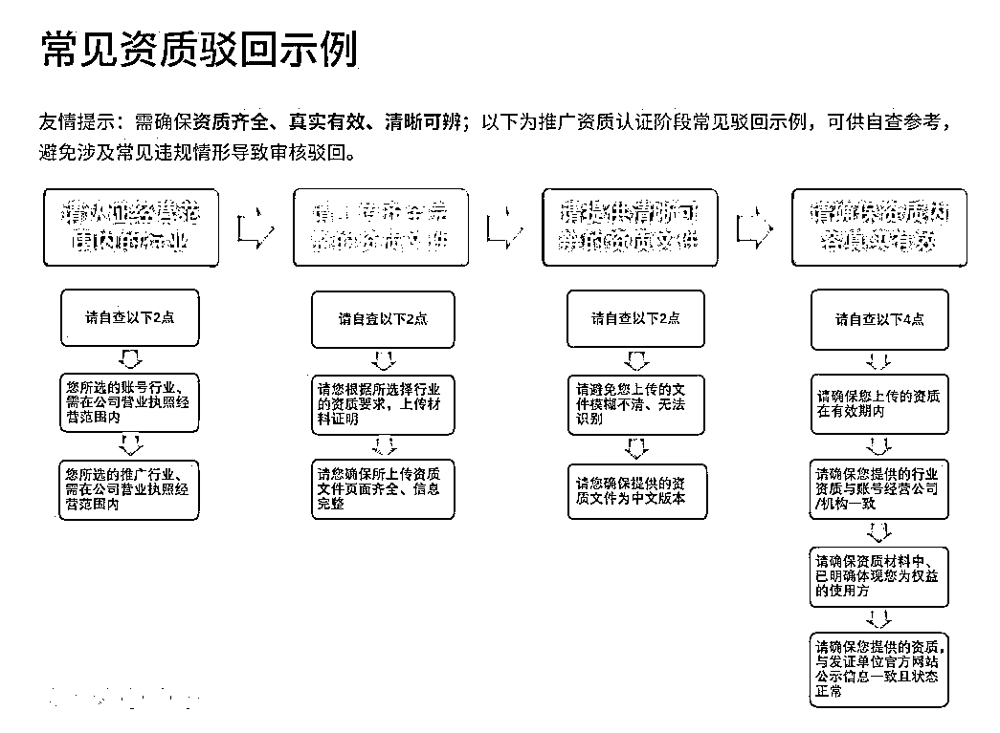

2）物料被打回

提个醒：素材送审之前，先照着要点过一遍，别碰广告法和平台规则明令禁止的东西，免得白等一场。常见问题包括但不限于：

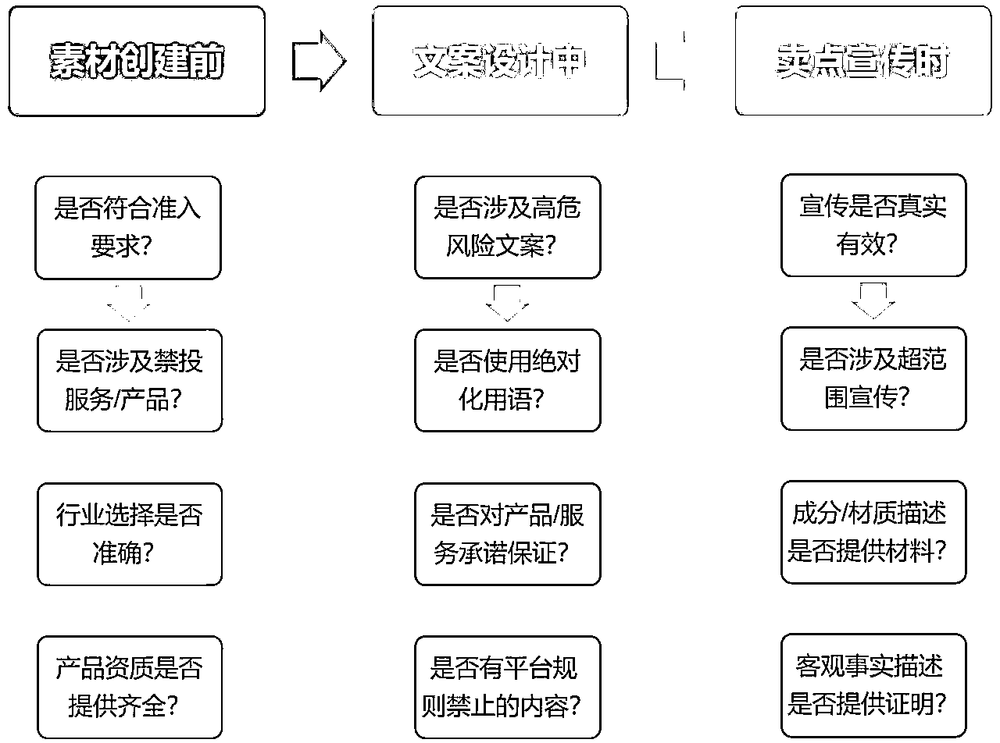

### 2.2 四种广告形态与平台红线

钱到账，理论上就能开投了。不过在此之前，最好先摸清聚光的几种主流广告位，以及审核的边界在哪。

#### 2.2.1 四种主流广告形态

聚光常用的形态有四种，逐个说。

1. 搜索

举个例子：你在📕敲下【婚礼摄影】四个字，结果页会跳出一串相关笔记。看到排在第 2 位、右下角标着“赞助”的那条了吗？它就是搜索位的广告。

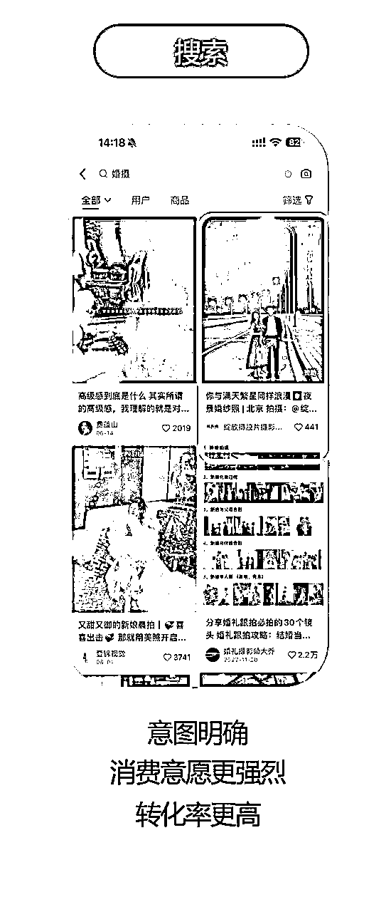

一句话概括：把你准备好的内容，塞进用户搜完某个词之后的必看位置。

它最大的长处是精准——目标人群被关键词框住了，你还能对每个词单独出价，一次性买上千个词也没问题。反过来，词选偏了，钱就容易打水漂，甚至一点水花都没有。所以这种形式更适合手上有点运营或投流经验的人。

2. 信息流

这类广告混在用户平时刷的内容列表里出现。论精准它比不过搜索位，但只要人群标签筛得准，转化照样能拉起来。

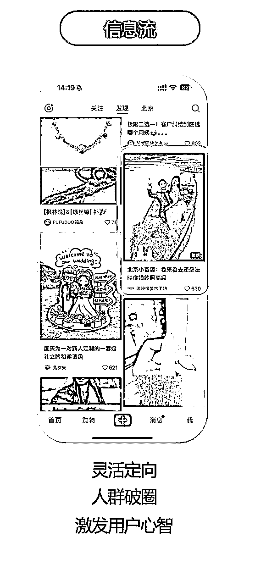

3. 视频流

体验上很接近抖音。点开一条视频笔记，手指往上一划，就能像刷抖音那样接着看下一条——在这个场景里插进来的广告，就是视频流。

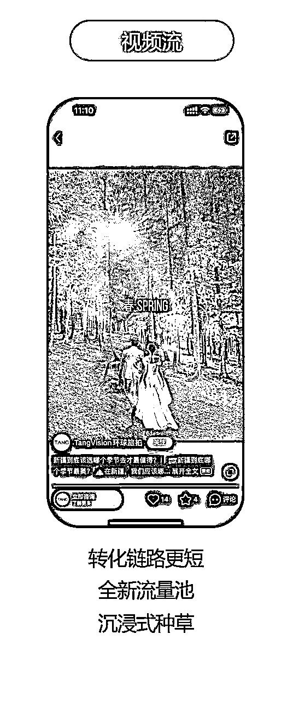

4. 全站智投

这是种打包式的买法，把预算同时铺到信息流、搜索和视频流三个位置。适用的行业很宽，美妆个护、服饰、食品饮料都在用。

设置也不复杂：选好基础人群画像、给个出价，剩下的交给系统，它会结合行业和内容情况给出建议。上手快，跑出来的结果也相当能打。

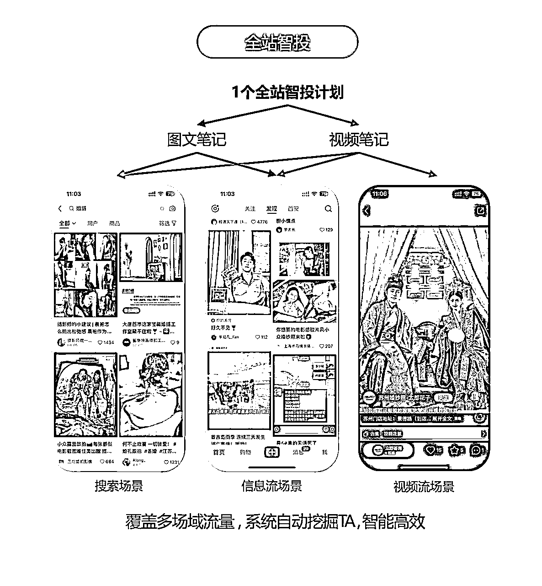

#### 2.2.2 行业的红线在哪

2.2.2.1 不能投的类目

# 广告开跑前：先查禁区、再避雷词、最后备6篇笔记

正式投放之前，合规自查不能省。聚光对推广范围有硬边界，下面七类通常进不了投放池：

一、违法或违规类：毒品、赌博、色情、暴力、诈骗、侵权等产品与服务。
二、涉政敏感类：国家政治、敏感事件、领导人相关内容。
三、虚假与误导类：夸大其词、虚假宣传、误导消费者等。
四、医药健康产品：未获批的药品、医疗器械、健康食品，以及部分受限健康类产品。
五、金融理财类：未获监管批准的理财、保险等金融投资产品，尤其是高风险产品。
六、危险物品：管制刀具、易燃易爆物、烟花爆竹等。
七、兜底项：平台规则和法律法规更新后，可能新增的其他不可投范围。

平台帮助页可查详情：https://ad.xiaohongshu.com/help/docs?id=2767

## 2.2.2.2 聚光平台会拦的词

广告文案里有些词，平台明确不接受。发布前先比对一遍，能减少驳回和返工。下面按类别列常见例子，不是全部清单。

### 一、绝对化表达：不能写

带“最”的词：最高端、最先进科学、最奢侈、最科学、最新科学、最好、最优秀、最佳、最具、最、最高、最高技术、最优、最爱、最大、最新、最高级、最先进。

带“XX级”或“顶/鼎”的词：宇宙级、冠级、百万级、千万级、全球级、世界级、国际级、国家级；TOP级、顶级工艺、顶级、顶尖。

带“领”的词：领头羊、领先者、领先、领军者、创领、引领、领导品牌、领袖、领先上市、世界领先、创领品牌、领袖品牌、遥遥领先。

带“极”的词：终极、极佳、极品。

带“绝”的词：绝不再有、空前绝后、绝后、绝对超值、绝佳、绝版。

“第一/1”类：第一品牌、排名第一、销量第一、全网第一、中国第一、全国第一、TOP/TOP.1、NO.1、第一/1。

“首”类：首创、首屈一指、首次、首府、首席、全网首发、全球首发、全国首发、首家、首款、首选、首个。

其他绝对化说法：独创、老字号、冠军、专供、特供、祖传、XX之王、独家配方、无敌、王牌、免检、独家、永久、性价比之王、万能、100%有效、空前、开创、销量冠军、销冠。

真实驳回情形：

情形1：素材含【top 1】，属于绝对化表达，要求改掉或删掉。
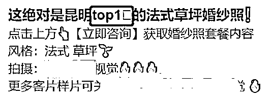

情形2：素材含【最好、最亲民】，属于绝对化表达，要求改掉或删掉。
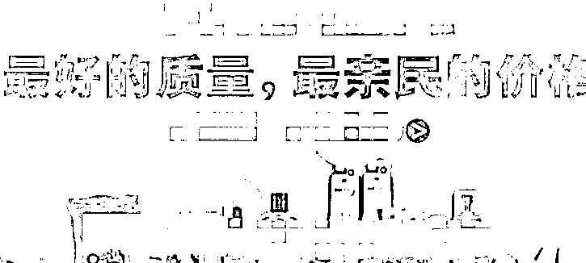

情形3：素材含【最大，最高，最快】，属于绝对化表达，要求改掉或删掉。
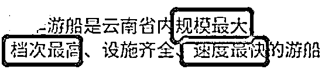

情形4：素材含【贵替之王】，属于绝对化表达，要求改掉或删掉。
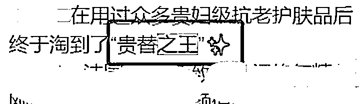

情形5：素材含【天花板】，属于绝对化表达，要求改掉或删掉。
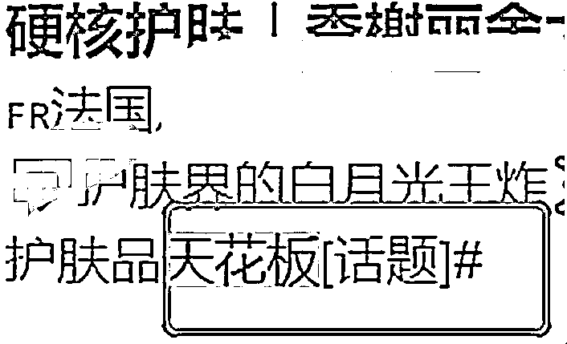

情形6：素材含【最舒适】，属于绝对化表达。

### 二、夸张说法：不建议出现

常见例子有：前无古人后无来者、屈指可数、世所罕见/稀世罕见、千金难求、稀世珍宝、无与伦比、不可再生、前所未有、绝无仅有、不可复制、无人能及、非此莫属。

2.1 借国家形象背书：无需国家质量检测、质量免检、国家XX机关专供、国家XX机关推荐、国家XXX领导人推荐、驰名商标、中国驰名、国家免检。

2.2 效果承诺：脱帽率、神效、速效、奇效、强效、全效、特效、零风险/0风险、无效退款、不满意退款（符合真实性时可用）。

2.3 理财收益暗示：承诺保底、返本销售、保底收益、投资回报、包回报、收益率。

2.4 普通商品别碰医疗词（不含药品、特殊用途化妆品、保健食品、医疗器械、医疗服务）：解毒、活血、抗炎、消炎、治疗、医治、医疗、中药、药物、药用、药方。

2.5 迷信类：招财进宝、增加事业运、化解小人、增强第六感、带来好运气。

2.6 美妆类：激素脸（医疗功效）、去斑（承诺效果）、有效（利用特化批件为产品效果做背书时，承诺效果）、黄褐斑/肝斑/蝴蝶斑/妊娠斑（医疗疾病）。

2.7 医疗器械类：五官科、妇科、外科、内科、中西医结合、西医、中医；面膜（医用敷料禁用）、美容（医用敷料禁用）。

2.8 酒类：精力旺盛、保障健康、增强体力、消除焦虑、消除紧张。

2.9 婴配粉：妈妈般亲和、母乳化、替代母乳/人乳、接近母乳/人乳、替代哺乳。

2.10 教培类：一次通过、保过、包过、命题人、出题人、命中率、预测、押题、原题、保证通过考试、保证就业、保证提高学习成绩、全程无忧、优先入学。

2.11 消毒用品：消炎、杀菌、杀毒。

2.12 房产类：价值洼地（禁投）、承诺移民、城市中央（禁投）、你在城心（禁投）、城市核心地段（禁投）、龙脉、府邸、宝地、融资（禁投）、占卜、风水。

2.13 医美与口腔等医疗服务：干细胞美容（非规范用语）、达拉斯鼻（非规范用语）、欧式芭比眼（非规范用语）、韩式双眼皮（非规范用语）。

真实驳回情形：

情形1：保健食品素材含【天然、安全无副作用】，触及效果承诺，要求删改。
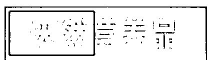
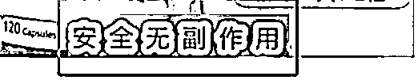

情形2：素材含【1支见效】，触及效果承诺，要求删改。
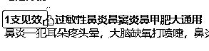

情形3：素材涉及禁止投放的服务【非法网络兼职】，属于法律法规禁止情形，不支持推广。平台要求针对此类素材自查；若持续违规，风险会升级处理。
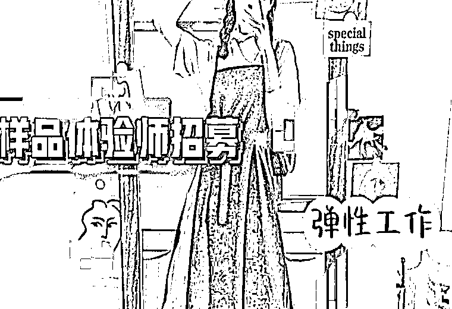

情形4：素材涉及禁止投放的服务【面向十八岁以下人群培训】，属于法律法规禁止情形，需在素材中标注或体现“课程面向18岁以上人群”。
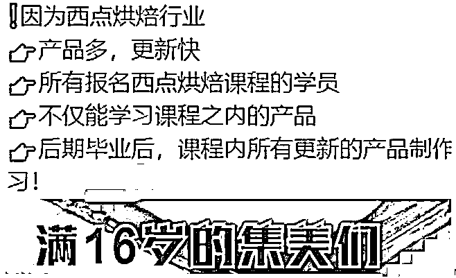

## 三、投放实操（2/4）：把6篇笔记备齐

### 章节概要

聚光开通后，下一步就是实操。本节要完成的事：发出6篇用于客资收集的广告笔记。

有圈友会问两件事：客资收集指什么？为什么偏偏是6篇？

先解释客资收集。聚光覆盖产品种草、商品销量、客资收集、直播推广、抢占赛道等五大营销目标。这次把“客资收集”拎出来重点讲，原因有两个：一来私信引流是多数商家的共同需求，客资收集能合规、安全地承接；二来“抢占赛道”“产品种草”更吃资金实力，本次先不展开。

再说6篇。不少圈友拿的是新号，因此主页至少铺2篇干货，再准备4篇专门用于广告推广的内容，合计6篇。

### 3.1 客资收集到底是什么？

说直白点：靠投放内容拿到客户线索，形式包括🛰️或电话。看两条主要链路就清楚了：私信咨询、表单收集。

第一条路：私信咨询
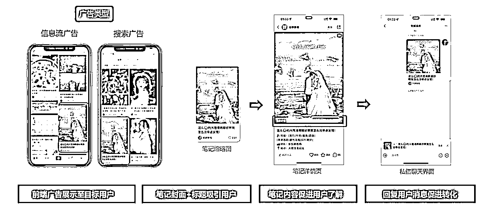
用户从搜索或信息流点进笔记，在页面上点“立即咨询”转化组件，进入私信页。适合谁：几乎所有想从平台引流的行业商家。

第二条路：表单收集
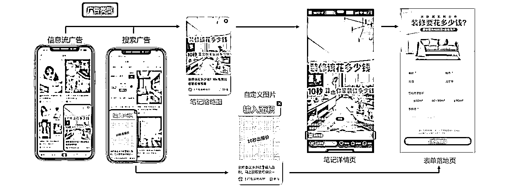
用户从搜索或信息流点进笔记，点互动组件进入表单页；也可能看到广告后点广告页，直接进表单。适合谁：少数行业，比如品牌声量大、用户多但接待人手不够的商家。

两条路的对比看下图。
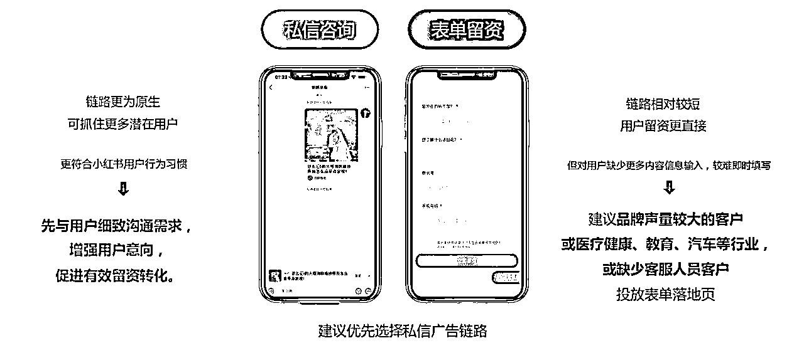

小商家建议优先走“私信咨询”，更友好。接下来看在聚光做客资收集的3个步骤，逐一拆开讲。

### 3.2 投放内容怎么做

### 本节要点

客资收集的投放笔记很关键。内容不行，钱可能花不出去；点击率低，成本还会被抬高。好笔记的关键在选题、封面、标题，这三项直接决定点击率。下面展开。

#### 3.2.1 选题怎么策划

主页通常按“80%营销笔记+20%干货、日常笔记”搭配。日常和干货可以围着产品、服务核心来发。还没发过笔记的圈友，建议结合自家产品和服务策划6个选题：2篇干货铺主页，4篇广告选题用于投放。先找方向，再筛选，最后留合适的。

3.2.1.1 先找选题

做客资收集推广，目的就是引流，选题要往引流、投放方向靠。

路径A：搜关键词，看带“赞助”标记的笔记

这样搜，能大致判断同行哪类内容在哪些关键词上花了钱。位置靠前的笔记，转化大概率不差，可以模仿。
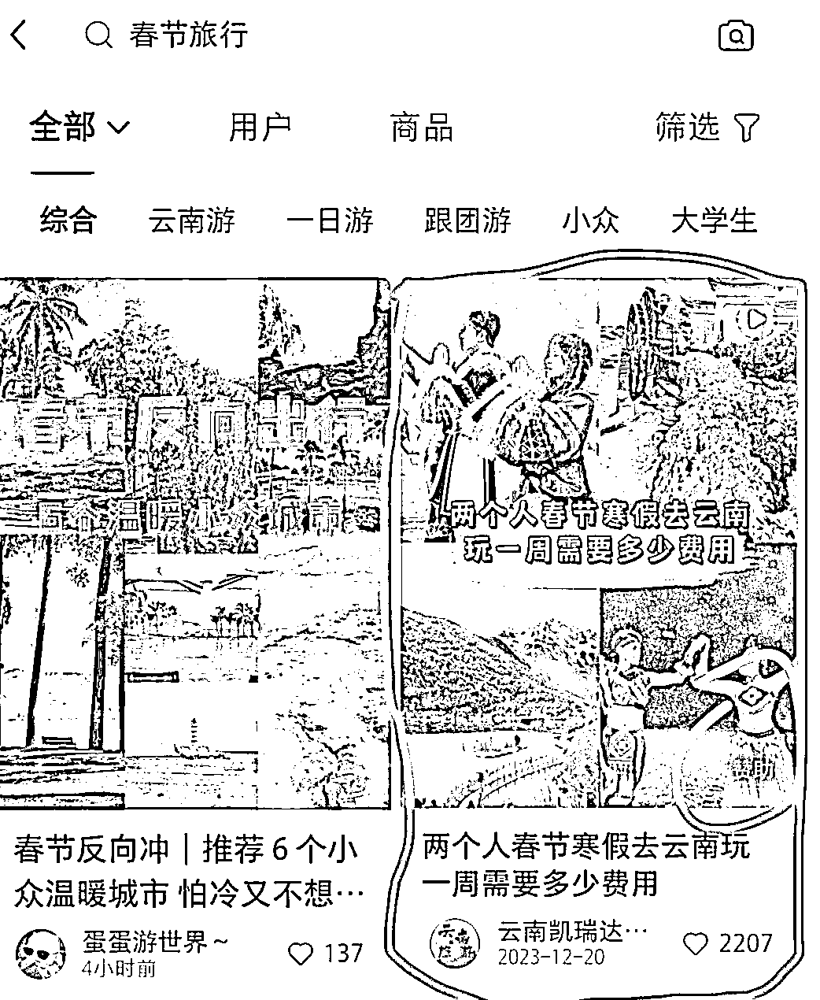

怎么找合适关键词？用聚光“关键词规划工具”：打开工具，点“行业推词”，逐级选自己的行业。
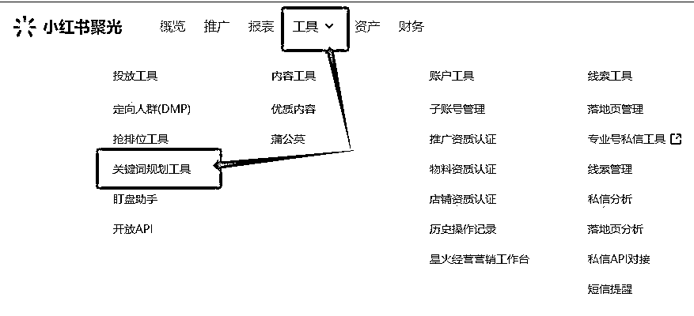

平台推荐的关键词里，挑“同行买词”“高点击”“月均搜索指数”以及最贴合自家产品、服务的词，直接拿去搜索；也可以点“以词推词”，让系统继续推荐新词。
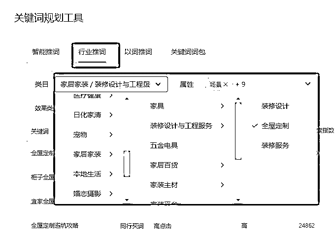

关键词别太少，先备20个左右，才更容易翻出同行热门笔记。
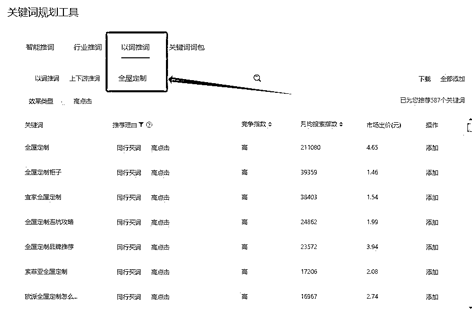

路径B：用自然流训练系统，让同行投流笔记自己冒出来

除了搜关键词，还可以训练笔记算法，让页面自动展示同行内容。逻辑是：关键词泛搜（了解阶段）→阅读相关内容→触发信息流推送→关键词精搜（购买意愿）。关键是像普通用户那样把流程走完，让系统迅速识别你的兴趣。

拿陈皮举例：

第一步：搜行业词，深度阅读。泛搜可以搜“陈皮”或“陈皮泡水功效”，从下拉词里选几个，开始读。重点在于让系统觉得你非常感兴趣，所以要有深度行为。深度行为包括深度阅读和深度互动：图文读满10秒或完整读完，视频播满30秒或完整播完；互动可收藏、截图、保存图片、发求购评论。阅读时保持深度阅读，部分内容做深度互动。数量越多越好，参考基准是每个关键词先读20篇左右。

第二步：刷新“发现”页，继续加兴趣信号。读完回首页“发现”页下拉刷新，系统会推送陈皮相关内容。继续按上面的方式深度阅读，同时把无关内容长按后点“不喜欢该笔记”关掉。刷到同行投流笔记就分享到🛰️，方便后面整理。
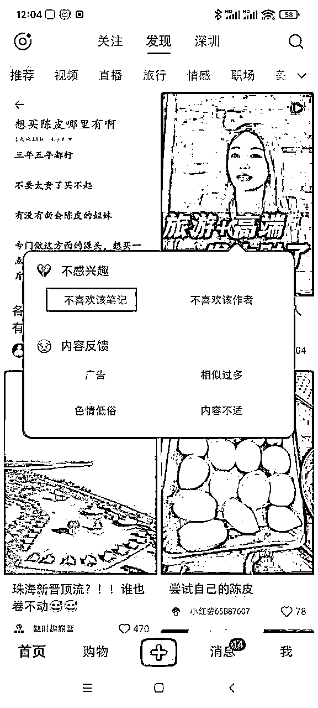

第三步：搜购买词，深度阅读。再回搜索场域模拟精搜，精搜代表有购买意愿、想深入了解。看搜索下拉词，挑几个点进去继续搜。
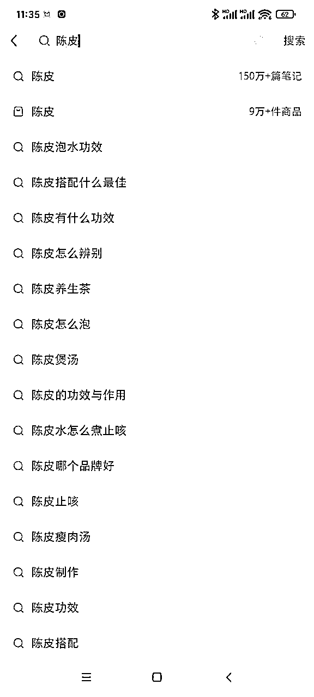

继续按上面的方式读相关内容，然后回首页“发现”页刷新，刷信息流找同行投流笔记。找到就分享到🛰️。到这里，系统会推越来越多同行投流笔记。

路径C：从自家产品和服务出发

引流笔记要直接告诉用户：你卖什么、能做出什么效果、比同行强在哪。直接宣传的笔记，转化率也不错。比如出境游产品，把目的地做成海报，标上价格，转化效果就很好。
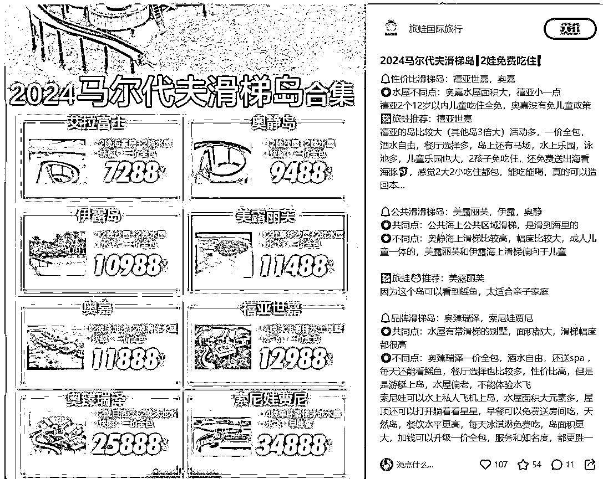

路径D：把公司实力亮出来

如果业务、服务有门槛，可以把相关资质晒出来，证明有实力；如果比同行优势明显，也能做成选题，比如自有工厂、大展厅、资质齐全、公司规模大、服务人员多等。

路径E：做资源合集

还可以把产品/服务，或者报价、价格表、服务表整理成大合集，这类内容适合长期投放。
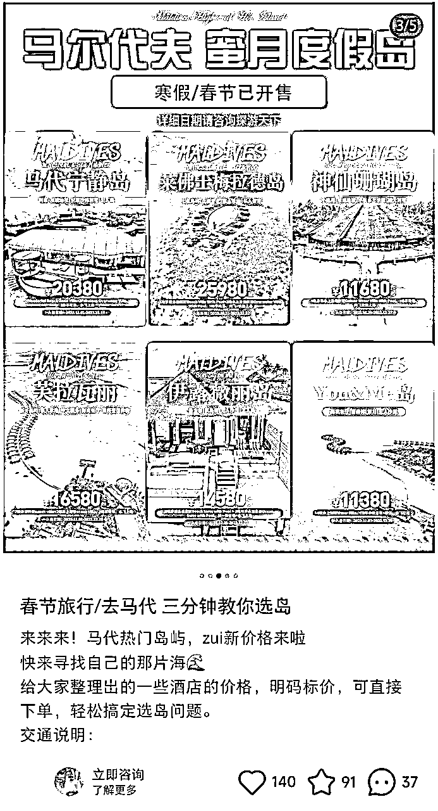

总结：目标仍是策划6个选题，2篇干货+4篇投放。建议用上面5条路径，至少准备10个候选选题。

3.2.1.2 再筛选题

找到或刷到同行选题后，别急着照搬，先验证有没有转化。主要看发布时间和评论区。

1. 看发布时间：太早期的笔记参考价值不大。有些笔记会持续投1年甚至更久，数据都是投出来的，新手刚推广去参考很难竞争，建议找近1个月发布的笔记。
2. 别只看点赞，多看评论：评论多，而且都在问业务、产品的，更适合模仿。
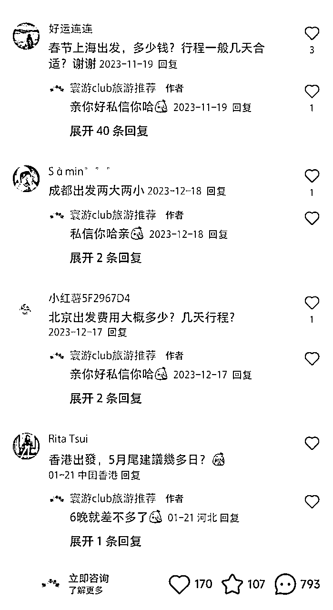

按这两个标准筛完，差不多会有6个合适选题。如果不够，就重复上面的操作继续找。

#### 3.2.2 标题、正文、结尾话术、钩子怎么设计

选题是骨架，内容是血肉。选题定好后，要填充标题、正文、结尾、钩子这4部分。

3.2.2.1 标题怎么写

平台是信息流场景，用户一眼会看到大量笔记，只有抓眼球的标题才能让用户停下来并点进去。虽然投放时有“标题优选”帮忙优化标题，但自己也要会写合格标题，才能有备无患。

分享一个好用的“三步起标题”。

第一步：筛标题

取标题前，搜同选题爆款笔记，找5～10个爆款标题放到Excel表。比如想分享连帽卫衣，先搜卫衣相关爆款笔记，收集一批标题，重点看“快看”“今年很”“上身太绝”“美式复古”“秋冬衣柜”“燕麦色刺绣平替”这类表达。

第二步：拆标题

比如“快看”这种开场词能移植到别的品类；“今年很”后头可以接不同单品；“上身太绝”属于体验句式，保留骨架、替换产品即可。把爆款标题拆开，再拼出自己的标题。

# 📕投放全程实操：从拆标题到聚光计划

先来说标题拆解。比如“我简直爱了”“上身太绝了”这类短句，都能拆出来复用；如果选后者，就得配一张上身实拍图。

再看“好喜欢美式复古bm穿搭！复古又可爱～”这句，能被拆成“好喜欢”“美式复古”“bm穿搭”三个大词，都可以单独迁移，原标题偏平淡，可挑着用。

“秋冬的衣柜一定要有的连帽卫衣！”能摘出“秋冬的衣柜”“一定要有”“连帽卫衣”，不过这几个词是连在一起成句的，不太好拆开，遇到合适的场景再套用。

“54冲下这件燕麦色刺绣连帽卫衣平替”的通用点在于“xx（金额）”“冲下xx”“平替”，整个标题主打低价，如果你的产品也是低价款，可以直接换个产品词来用。

### 第三步：重写标题

关键词拆好之后，按这些词多写几个备用，挑顺眼的发：

1.快看！xx 冲下今年很的 xx 卫衣

2.今年很的 bm 穿搭！上身太绝了！

3.美式复古卫衣我简直爱了！

4.好喜欢 xx 卫衣！秋冬衣柜一定要有！

5.秋冬衣柜一定要有的 xx 卫衣！

照这三步走，手头能攒不少标题，数据不理想就换新的，没有压力。

### 3.2.2.2 笔记正文

不同品类的笔记正文差别很大。你先去搜同类目的“对标笔记”，仔细看完再结合自己的产品和服务来写。要是半天找不到参考也不用急，下面两个思路可以帮上忙：

1.代入法

实在没头绪的时候，把读者想象成你的朋友或者客户。比如去旅游回来写笔记，就想象你正跟朋友炫耀这趟旅程，你平时怎么跟他们分享，笔记就怎么写。或者把对方当成来咨询的客户，客户问你问题你怎么答，把聊天内容整理一下，把跟选题无关的废话删掉，留下来的就是文案。

2.提炼产品卖点

笔记里要介绍产品的话，可以从下面几个角度去提炼：

功能：这个产品能干什么？直接转化成文案。

差异点：你推荐的产品跟别人的有什么不一样？

反馈：其他博主、用户是怎么评价它的？

视觉：产品外形、做工上有哪些值得说的点？

嗅觉：闻起来的感受和别的产品有什么区别？

触觉：摸上去的手感怎么样？

味觉：吃起来的味道如何？主要适用于食品。

听觉：使用时有什么声音？比如电器类的卖点就是没声音。

笔记写完之后，记得自己先过一遍，别光顾着自嗨。这里有一份自查清单，只要都能做到，基本就是一篇好笔记：

1.内容通俗：碰到专业名词和术语，用大白话解释，让人不费劲就能看懂。

2.语气口语化：📕不要求写得多么专业、句子多优美，像聊天一样就好，把多余的字词砍掉，句子短一些，不拖沓。

3.排版舒服：段与段之间多空行，每段最好控制在20字以内，用emoji填充空隙，文案里也多用表情。

4.内容要有用：口语化不等于记流水账，内容得让读者觉得有价值。比如推荐一部电影，只发个名字毫无价值，把电影的精彩之处说出来，让人产生想看的冲动，这才是价值。

5.紧扣选题：全文要围绕选题展开，不能跑偏。一旦文案和选题不符，系统给的流量就会歪掉。你本来做美妆，发一堆别的领域内容，吸引来的人根本不看美妆。

### 3.2.2.3 结尾话术

用户愿意点进来看完，说明对你的内容有基本认可，但不代表他会点赞、评论或者私信你。所以结尾得推一把，提醒大家互动，也提醒他们可以联系你。

常用的结尾话术有3种：引导留资、账号引流和咨询引导。

1.让用户留下信息

这种主要用在咨询类笔记上，比如旅游笔记可以让大家在评论区留下出行人数和日期。

看到用户评论后，要第一时间回复；私信阶段可以顺势引导对方留联系方式，常用话术是：“您好，这里是临时窗口，方便留个联系方式吗？”

2.账号引导

如果你做的是矩阵账号，可以在结尾@别的账号，让用户按自己的需求去关注。

3.咨询引导

投放客资收集时，可以开启「立即咨询」的入口，这本质上是一个跳转到私信的链接。

用户点“立即咨询”会直接进入私信窗口，后台也会提示你是从哪篇笔记点进来的，这时候就可以顺势打招呼了。

### 3.2.2.4 钩子设计

除了结尾话术，还要埋一些“钩子”。总结一个公式：用户私信行为=私信动力×私信能力×私信提示。投放客资收集的时候，已经把「私信能力」的阻碍降到最低了，用户找你几乎没有什么门槛。前面说的「结尾话术」是在做「私信提示」。那「私信动力」从哪来？用户凭什么要主动找你说话？钩子解决的就是这个问题。

常见的钩子有以下几类：

1.免费领取资料

给用户提供电子版资料，比如英语类的可以说免费送语法表，减肥类的可以说领一周减肥餐食谱。总之你的用户需要什么，就送一份免费的基础版资料过去。

2.免费诊断问题

帮用户免费分析他的问题所在。比如帮减肥用户判断适合哪种减肥方式，帮护肤用户看肤质适合什么产品。诊断的好处是能顺势点出用户的问题，再引出你的付费解决方案。

3.加入xx交流群

像读书打卡群、减肥打卡群等，用群聊的形式把人引到你的私域里。

钩子弄好以后，评论区也得准备一下。用户普遍有从众心理，好比在淘宝买东西会优先挑销量高的，评论越多，笔记带来的效果往往越好。

### 3.2.2.5 评论区设计

拿3个例子说明评论区不同方向的运营思路：

例1：正文引流+评论区“水军”铺垫

这篇笔记先是在正文结尾做了引导评论的动作。

然后又用小号或者朋友的账号发了几条模拟用户视角的评论，把节奏带起来。

这里还放了几条求资料的留言。

例2：用户在评论区有疑虑，直接回应

拿一篇洗面奶的硬广笔记举例。

不管那两条评论是不是用户真发的，你都可以用小号来设计类似的内容。想想用户在下单之前会担心什么，把这些顾虑用小号的第三方口吻在评论区解答掉。

例3：引导关注、收藏和咨询

细心观察会发现很多博主喜欢自说自话，置顶一条“这个博主太有趣啦，关注你啦”。我以前也看不懂，自己评论自己，账号上明晃晃标着“作者”两个字，这不自卖自夸吗？但事实证明这招是有效的，很多用户根本不在意这个标识，看到这种评论顺手就点关注了。

还可以更进一步，用小号或朋友账号来发引导评论。截图里是引导关注的做法；如果用户对你的内容还没强到想关注的程度，就引导他们先收藏。

置顶文案不用长，站在用户视角，把自己的核心优势写进去就够了。

到这里，6个选题就算是血肉俱全了，📕投放的内容准备基本完成。最后一步是设计这6个选题的封面。封面有多重要？在信息流里说一句“封面定生死”也不夸张。

### 3.2.3 笔记封面图制作

封面制作也是从借鉴模仿起步的，模仿多了再慢慢原创。借鉴阶段要做的事情是收集加拆解。

#### 3.2.3.1 封面收集

先去📕找一些爆款封面存起来，刷多了网感自然会变好。这里分享一个好用的收集工具：花瓣网（建议用网页版）。先去花瓣网上建一个“画板”。网址：https://huaban.com/follow

然后在电脑上装好花瓣网插件（具体安装方法搜索一下浏览器就能找到）。装完之后，电脑上打开📕网站，图片左上角会自动出现“采集”按钮，点它就能把封面存进画板。

如果你平时用手机刷📕，就下载“花瓣app”手机版，手动保存封面再上传到画板。我之前做旅游账号的时候，就采集了一批旅游相关的封面，后来做新笔记时都是拿这些当参考的。

#### 3.2.3.2 封面拆解

封面收集好之后，下一步是拆解，拆的时候可以按下面这些维度来思考。举个例子，我拆的是这个封面：

#### 3.2.3.3 封面制作

学做封面之前，先搞清楚：📕真正的好封面长什么样？优质封面都是有共性的：

内容来源：《航海实战｜📕-合集带货｜实战手册》

#### 3.2.3.4 模板举例：

知道了好封面的标准，就可以动手做了。我的建议是直接用参考现场提供的模板，出图快，效果也有保证。

模板一：「图标+关键词+金句」 @杨星城

这种封面用「图标+关键词+金句」来组合，不需要什么排版功底，很好上手。看看下面几个账号，感受下风格：

模板二：封面=图标+图标题+金句+作者

整张图只做一张封面，内容全部放进正文里。很多人在排版美感上要耗好几个小时，这个模板能把排版时间大大压缩。只要固定好格式，📕对我们来说拼的就剩文案功底了。

把上图拆开一个个看：

「图标」：直接去网上搜“图标网”能出来一堆，比如：https://www.aigei.com/s?type=design_icon。不过很多图标网站每天只给免费下载一个，或者图片大小和格式不统一，又要注册又要各种操作，很麻烦。想省事的也可以直接去淘宝买个全网多家图标网站的会员，几十块钱就能搞定。

「图中标题」：图片里的标题同样会被系统识别收录。选标题时尽量蹭热门笔记的关键词，不要用太冷门小众的词。

「金句」：可以理解成副标题，也可以看成全文最核心的一句话。这个要多花时间打磨，里面的字也会进入系统收录范围。

「作者」：就是你的📕账号名，基本不用改。

「总结」：制作难度低、排版清楚，尤其适合做图能力和审美不太强的同学。固定好这套格式，排版3分钟就完成。

内容来源：《零投放从0开始，📕2个月8万粉丝的实操经验分享》

模板三：“梨云绿”封面 @梨云

模板的核心元素也就那么几个，每个都可以单独迭代优化：

①配色：用了森系绿打底，再配上阳光感的暖黄和纯白，整体看起来温馨又岁月静好。

②封面：采用大字报排版，简单直接，用两行字突出标题的核心信息。这样做的目的是把关键词集中聚焦，让用户一眼就知道这篇笔记讲什么，然后快速决定要不要点进来。

内容来源：《📕三个月涨粉17w，变现10w+，我做对什么？》

模板四：真人出镜、实拍封面 @赵承纬

实拍和真人出镜比前两种封面真实感更强，人设表达也更直接，还能根据每篇笔记的内容做灵活调整。

内容来源：《📕内容底层逻辑：从底层情绪、4大内容构成、关键词出发，打造爆款内容》

#### 3.2.3.5 工具推荐：

如果上面这些模板还是不合适，就考虑自己做。

方式一：用PPT做 @Enda九七

拿PPT做封面图既简单又省时间。📕用户的审美普遍在线，所以首图比其他页面都关键。但每次都用不一样的封面，P图实在太费时间，这时候可以借力一些工具，例如PPT、稿定设计这些。我自己写种草笔记时用的是稿定设计，先把模板做好存下来，之后每次直接套模板就行。用PPT存模板也是一样的逻辑，每次换个标题或者图标就能快速出图，效率很高。

内容来源：《不懂流量的新手：怎么从零开始到接3个📕商单》

方式二：用第三方工具

封面尺寸可以设为1:1、3:4等多种规格，但不管图片还是视频，更推荐用3:4，因为它在屏幕上占据的视觉空间最大。

### 3.2.4 笔记收集工具推荐

用上面的方法应该能收集到不少同行的投流笔记。不过笔记越攒越多，整理就成了麻烦事。这里推荐一个收集工具：后羿采集器（下载网址：https://www.houyicaiji.com/）。

第一步：创建模式

选择【创建流程图模式】，把收集的投流笔记链接粘贴到内容预览框里，点【立即创建】，进入下一步。

第二步：登录账号

先做预登录这步，不登录的话，点赞、收藏、评论这些反馈数据是不具体的。登录自己的账号就行，然后点【登录完成】。

第三步：添加字段

把【提取数据】拖到【打开网页后面】，再点【添加字段】，然后去点页面上你想采集数据的那个位置。每采集一个数据就要新增一个字段，循环这个操作。

第四步：采集笔记

点【开始采集】，再点【启动】，就自动开跑了。

第五步：导出表格

很短时间就能采完，把数据导出来就是Excel表格。

导出表格后稍微整理下排版，看起来舒服很多，也可以把封面一起放进去。最后的成品是这样：

这样就能开始看数据了，找出同行投流笔记在各个部分值得借鉴的地方，最后汇总成自己的投流笔记。

### 3.2.5 发布笔记

接下来就是发布环节。打开📕APP，点最下方那个红色?按钮，在相册里选中之前准备好的封面图（如果还没存，记得提前保存到相册）。再把写好的标题、正文填进去，加上与选题相关的话题，就能发布了。

6篇笔记可以一次性全发出去，后面要拿它们去投聚光广告。

## 四、【项目实操 3/4】实现一次成功的投放@叁斤@吴大脸

### 章节概要

笔记发完之后，只要没有违规（也就是能看到正常的小眼睛数据。小眼睛代表笔记被官方算法推荐给多少粉丝），就可以去聚光后台做投放了。这一章先带大家看一遍聚光投放的完整流程，先把认知框架搭起来。看完之后，会从头到尾完整还原一个客资收集计划的搭建过程，你可以跟着一步步操作和模仿。准备好了咱们就开始！

### 4.1 投放操作的整体介绍

#### 4.1.1 「计划」是什么？

这里说的计划，其实就是你的投放目标。比如你是想多拿一些用户的🛰️，还是想让产品在📕里被更多人搜到，都得在这一步设定清楚。

投放目标确定以后，还要把广告的投放方式设定好。平台一共提供了四种路径——“全站智投”“搜索推广”“信息流推广”“视频流推广”。这四类投放方式之前在章节里已有详细介绍，这里就不再重复了（相关链接：2.2.1 聚光投放的四种广告）。

#### 4.1.2 「单元」是做什么用的？

等投放目的确定下来，接下来就要选定想推广的笔记了。所谓单元，其实就是一个用来添加笔记的配置模块。

除了挂载笔记之外，在这个模块里还要想清楚两件事：投放的目标人群是谁，以及出价采用什么策略。

目标人群的圈定，可以拿自家产品的受众作为参照。比如做全屋定制的话，主要客群年龄大多在28岁以上，只有一小部分低于28岁，所以勾选28～32岁和32岁以上这两个区间就够了。

出价方面，比较省事的办法是找📕官方人员要一个参考价。假如联系不到官方的人，那就靠自己多试几次。

具体怎么试？先把出价设为5元/次，审核过了以后观察5小时，如果钱一直花不出去、曝光量始终是0，那就按7元、10元、15元的顺序往上加，直到找到一个能正常跑量的价位。

#### 4.1.3 「创意」又是啥？

创意，说白了就是笔记投放出去后的“门面”，包括封面怎么做、标题怎么起，以及笔记里那些营销元素怎么摆，比如在左下角放一个「立即咨询」或者「立即参与」的按钮。

要留意的是，一个计划下面可以塞进多条创意，每条创意也能配上不一样的转化组件，给足了大家做试验的空间。

不过，做客资收集的时候，“立即咨询”这个组件基本是默认选项。

接下来，我用一个真实的投放案例，带各位完整走一遍聚光广告的操作流程。你可以把聚光后台打开，跟着一步步来。

### 4.2 投放计划怎么搭

第一件事：登录📕聚光平台，点击“新建广告”。

第二件事：把基本信息填好。

计划名称这块没啥硬性要求，按自己的习惯命名，只要自己能分清就行。

广告类型选一个符合自己笔记情况的就好。如果你是新手，还没有积累投放模型，那“全站智投”是最稳妥的选择。

第三件事：把目标出价设好。

这里面专业名词不少，我一个个解释。

1.表单提交量：简单理解就是在一篇笔记上“绑”一个问卷表单，用户点击以后填完信息，就算一次提交。

适合商家：

2.私信咨询量：用户主动打开了和商家的私信对话窗口（就算是没发任何消息也算）。

适合商家：

补充一个概念：搜索人群追投，指的是广告主可以针对那些搜索过某类商品的人，再做一次广告触达。

3.私信开口量：用户主动发私信给商家，不管是发笔记卡片、表情、图片还是文字，统统算在内。

适合商家：

4.私信留咨量：用户通过「立即咨询」入口进来后，留下了联系方式，就记作一次私信留资。

适合商家：

官方给的案例里，【私信开口量】这个推广目标的效果要明显优于【私信咨询量】，所以大家优选【私信开口量】就对了。

第四件事：把预算设好。

预算控制在100～300元左右比较合适，再按笔记数量多少做加减。如果要一次推广好几篇笔记，那就得往上加预算。

节假日的时候可以考虑让预算上浮，这个开关按需求决定开还是关，消耗速率记得选“匀速消耗”。

### 4.3 投放单元怎么配

第一步：把推广笔记加进来。

设置单元的时候，前半截操作都是共通的——命名、加笔记。

要加的笔记，最好是你之前发过的、互动和转化表现都不错的内容。

用户的从众心理很明显，看见点赞多、有人气的笔记，点击的意愿会更强。一般来说，点赞冲到100以上的笔记，就值得考虑拿来投了。

不过光有互动还不够，转化也得跟得上。一个笔记互动数据再好看，投出去没转化也是白搭，所以必须专门挑转化能力强的笔记。那怎么判断转化高不高呢？教大家一个土办法——翻评论。

笔记发出去之后，重点扫一眼评论区，看有多少留言是在问产品、问服务的。比如“怎么买？”“xx地区能做吗？”“多少钱？”“求报价”这类问题。如果这种咨询留言多了，那这条笔记多半就是高转化潜质股。

拿我自己的例子来说，下面这条就是我以前投放效果很不错的笔记。

我为什么拿这条笔记去投？因为它一发出去，评论区很快就有人来问，而且问的都是产品相关的事，所以我就直接拿它上投放了。

别看这个数据不咋亮眼，可经由这条笔记过来的咨询量却一点都不少。算到最后，获客成本特别低，平均下来一个私信开口只要14块。

可能有些圈友会说，我目前手里还没有这种互动高、转化也高的笔记，该怎么办？别慌，先把整个流程跑顺了再说。后面内容能力上来了，高互动笔记自然会有。

还有一点必须要提：这个位置可以一次性挂多条笔记。我建议大家至少加2条，要是笔记数量多，预算也要适当调高。大致按2条笔记配100块钱来算（再低的话很可能跑不动）。

第二步：把推广方式定下来。

新手的话，我的建议是先拿全站智投练手。选完以后，再按自家产品和服务来粗略筛一下人群。比如做家装类的品牌，一般用不到18～22岁这个年龄层，那就可以不勾。

第三步：把出价方式定下来。

目标成本这块，可以找📕商务人员问一下大概值多少钱一个。要是实在没头绪，就从5～10元开始投，没消耗再一点点加价。

以上，就是广告在单元层级需要配置的所有内容。考虑到有的圈友可能不打算采用“全站智投”，而是倾向“搜索推广”“信息流推广”或“视频推广”，我就把这几类和全站智投的差别单独拿出来说一下。有需要的朋友可以对号入座。

补充1：搜索推广的单元怎么做

要走搜索推广这条路线，建计划那一步就得先勾「标准投放」，不然后面没法设置关键词。

选定搜索推广以后，系统会提供一个关键词定向功能——这个功能的作用，是让你的笔记有机会匹配到正在搜索某些词的用户。这个模块里有智能推词、行业推词、以词推词、关键词包、智能拓词五种玩法，我一个一个细说。

1.智能推词

平台会根据你这篇笔记的内容，自动推一批关键词出来，匹配度合适的你直接加进去就行。

2.行业推词

把你自己所在的行业选好，平台会按行业自动匹配一批词给你挑，这个行业的划分还是挺细的。

3.以词推词

你丢一个词进去，平台就能给你扯出一串相关的词。这个功能属于最常用的了，它还能显示关键词的搜索指数——哪怕你不做搜索推广，平时拿来查词也很香。

4.关键词包

把经常要用的关键词整理到一个excel表格里，统一上传成一个关键词包。之后选词的时候直接调用关键词包就行了，平台也会顺手推荐一些现成的词包。

5.智能拓词

智能拓词开启以后，地域这块一般不用设限（但要是你的产品或服务有特定区域限制，那就得把地区选上）。

关键词虽然最多能加到1000个，但真的不建议搞那么多。我一般会控制在300～500个的范围里。就算你真凑齐了1000个，最后能跑出数据的也没几个。

补充2：信息流推广的单元怎么做

信息流定向一共分三种：通投、智能和高级定向。走信息流这条路，就有机会把人群画像切得更细再去投放。

1.通投：直接面向📕所有用户投放，但绝大多数产品其实不适合这么干。

2.智能定向：这是📕基于行业和产品属性来做的智能推荐，新手可以直接拿来用。

3.高级定向：可以按用户标签、兴趣方向、关键词偏好来选人，做针对性的推送。

补充3：视频推广的单元怎么做

视频流推广在设置上和信息流是基本一致的，这边就不再多说了。

### 4.4 创意怎么设

搞定单元这层，接下来就轮到创意设置了。

创意名称可以自由起，主要是为了方便自己识别。

投放资质按照自己所属的行业选好，同步上去就行了。

智能创意这一块，如果你对标题和封面的点击率没太大把握，就把「创意优选」打开。

转化组件里面，互动栏胶囊是必须勾选的，选了之后笔记左下角就会冒出「立即咨询」或者「立即参与」这样的按钮。

另外还能加一条「置顶评论」，用户点进笔记就能看到，点一下这条评论也能直接跳进私信。

## 五、【项目实操 4/4】怎样把投放转化率做上去

### 章节概览

想要把客户信息的收集效果拉上去，一般得从两个方向使劲。

第一，想办法让来咨询的人数变多；

第二，想办法让已经来咨询的人，更愿意把🛰️加给你。

接下来我们就一步一步拆开讲。

### 5.1 提高咨询人数

其实不管你把推广目标选成私信开口还是私信咨询，本质都是在给笔记买曝光。至于最后能有几个咨询进来，完全是内容决定的，跟目标选哪个没太大关系。所以，这个环节的关键词就两个字——优化笔记。

按📕的标准，点击率得大于等于11%才能叫优质内容。要是一条笔记的点击率不到11%，而且也没带来多少咨询，那你就得重点关注了。

优化思路1：看看「封面优选」是不是该关掉

点击率老是上不去，很可能是图片本身就不过关。如果你开着「封面优选」，系统随机把封面以外的图片设置成首图，点击率当然会被拖累。在封面已经精心设计过的情况下，建议把这个功能关掉。反过来，如果内图比封面更好看，那就开着。

优化思路2：给用户一个掏钱的理由

这个理由可以基于产品或服务的卖点来打造。

举个例子，下面这条笔记的消费理由是：“他能把35平的小户型打造得很好看”，而它的封面图恰好就把这层意思给视觉化了。

优化思路3：让消费者信任你

获取信任的常用方法，无非是晒背书、秀实力，把自己的优势和成果亮出来，让用户第一眼就感知到你的专业度。

要是把这些都改了，点击率还是上不去，那就痛快点换一条新笔记上去投。

### 5.2 让用户更愿意加你的🛰️

现在做客资收集的投放，前面3天平台没法保证你一定能把联系方式发给客户。建议你「连续3天消耗超过100元」以后，再去尝试留🛰️，这么做会安全不少。

聊完注意事项，再来说说怎么让用户愿意加🛰️。

操作多了以后我发现，很多时候不是回复话术有问题，而是用户发过来的消息被漏掉了，结果白白浪费了一堆本来有机会成交的客户。怎么解决？给你两个招。

方法一：打开自动回复

账号消耗累计满1000元，自动回复这个功能就能开通了。大概效果是这样的：

用户点击广告进入私信界面，系统自动弹出一条消息，右下角会出现「咨询价格」之类的快捷键。用户把这个快捷键一点，系统又自动把一条信息回过去。

方法二：打开私信通

账号消耗走到3000元以上，就可以开通「私信通」了。

「私信通」最大的用处，是可以帮忙分配客服子账号，这样客户咨询就能以最高的效率被跟进。

它的主要功能有这么几个：

1.熟客分配：同一个用户48小时内再次进入同一个客服组，系统会优先分配给48小时内接待过他、而且当下在线的客服；

2.接待量少客服优先：优先分给当前接待量最少的客服；

3.低已分配客服优先：优先分给最近1小时内接待量最少的客服；

4.随机分配：随机丢给某个客服。

5.要是同时勾选好几个，那优先级排序是：熟客分配 > 接待量少客服优先 > 低已分配优先 > 随机分配。

另外，客服还能通过私信通主动去私信那些在评论区留过言的用户，确保每一个潜在客户都不会被漏掉。

但要记住，私信通只能私信评论过的用户，它没办法直接回复评论。所以运营那边还是得去账号后台把评论回复掉。

再加一个小贴士：PC端专业号后台的回复功能和私信通是互斥的。开了私信通之后，PC专业号后台就不再显示消息了。所以咨询不多的时候，直接用手机回复反而更方便。

### 5.3 实战经验分享

最后再送大家两条实战经验，都是关于提升留咨转化的。

经验1：按自家产品/服务去精准选人群，该放弃的咨询要舍得放弃。

举个例子，你本来就是做高客单用户生意的，那就尽量少发低价引流笔记。我们之前亲测过，低价确实能弄来一大波客户，可转化率低到没法看，售前还要消耗销售的大量耐心，弄不好还会惹出一堆售后麻烦。

当销售被那些低质量用户磨得没了脾气，后面真来了高质量用户，也没那个耐心好好接待了，服务态度自然就垮掉，实在有些得不偿失。

发现问题之后我们立刻调整策略——只投高价值用户，产品单价也顺势提升。结果一个月下来，转化率提高了，销售额反而涨了不少。客户变少了又怎样？收入没降反升。

经验2：得把客服的“对接成本”算进账里。

咨询量一旦大起来，客服岗位必须配给销售的。要是客服数量不够、咨询量又大，根本应付不过来，最后结果就是回复变慢、态度变差。

我合作过的几个品牌全是高客单方向，每个销售一天大概接待10～20个（🛰️）客户，再多就明显跟不上了。前期你可以自己试，看看一天接多少个是刚好饱和的状态。

### 5.4 投放常见问题与解法

#### 5.4.1 内容类问题

Q1：内容合作笔记的审核流程是什么？

A：内容合作笔记跟日常笔记不一样，它走的是先审后发。整个审核链路是「安全审核」→「内容审核」→「客户审核」，客户审核通过以后，笔记才会正式发到📕APP上。要是还叠加了广告投放，那就得再额外过一次广告审核。

Q2：审核被驳回的可能原因是什么？

A：内容审核阶段确实会有一定概率被驳回；另外，品牌方跟博主沟通传播需求的时候，也得遵守「📕社区公约」。

Q3：之前跑量很好的笔记素材，突然跑不动了该怎么办？

这里有6个方法可以尝试。

放开定向：对于转化率和点击率都比较稳的计划，一步一步放开人群限制，开启智能放量，把曝光空间顶到最大；

提高出价：适当把出价往上抬一点，多换些曝光，但要随时盯着成本浮动和ECPM变化。一天之内改价次数别超过2次，尽量满足赔付规则的各项要求；

赔付条件：要拿赔付，下面几个条件必须同时满足：

提高预算：确保账户余额充足的前提下，把预算加上去，给系统一个正向反馈；

新建计划：多补新计划，让账户里的跑量计划能持续供应，新计划的核心就是把创意质量做上去；

新开账户：新开一个📕聚光账户，把原账户里表现好的计划和素材复制过去，去新的人群里做探索；

测试新素材：任何素材都逃不过衰退期。把原来跑量素材里爆发的元素拆出来，优化脚本、丰富细节，赶紧补上新创意素材做测试。

#### 5.4.2 计划类问题

Q1：计划起不了量、成本超标，或者突然爆量，这种情况怎么办？

Q2：新计划上线头一天怎么诊断？

投放第一天，好多计划都会出现没消耗或者消耗很低的情况。碰到这种事，别急着分析一堆数据、做一堆调整，核心就盯住两个东西——消耗和投产，然后对计划做一个判断性的关停就行。

第一天要保证直播时长在6小时以上，给系统足够的时间去探索。已经出量的计划，就按投产情况决定要不要继续养；

投产稍微低一点的计划，先别急着动它，争取让它跑过学习期；

投产差得太远的计划，就别犹豫直接关掉；

不出量或者消耗很低的计划，留到第二天再调整。另外，在主力计划跑出来之前，每天都要坚持上新创意、上新手计划。

Q3：新计划的出价怎么调整？

新计划刚投出去的时候，可能不起量，也可能消耗特别快。这种情况不光是素材和定向的问题，出价也是一个变量。所以，通过调整出价完全可以提升计划的竞争力。

计划上线两天后还是消耗不动，先排除一下是不是出价的因素，可以尝试3次阶梯式提价，每次提5%～10%，看看调完价能不能把消耗拉起来。

如果计划跑量挺快，但ROI一直没拉平，那先把预算降下来，再阶梯式降价，同时观察每一小段的消耗速度和ROI变化，还不行就继续阶梯式往下降。

如果计划起量节奏偏慢、投产回报却还看得过去，可以分几次小幅上调出价，同时观察消耗能否被带动起来；调价后若ROI依旧平稳、放量仍不理想，不妨再来一轮提价。

Q4：哪些计划应该暂停？

所谓“双低”，指的是ROI（📕后台暂不直接给出，需要自己测算）、点击率、转化率这三项里，有两项同时掉到正常放量水平以下。判断时可参考计划平均值，冷启动阶段的计划不适用。

从开始跑量到数据回传完整，本身就需要一段时间。正在投放的计划如果点击率或转化率偏低，可能会拖累最终投产效果；这类计划可以先暂时关闭，等延迟数据回传后再看，如果ROI转正，再重新开启。

# 选修篇：进阶玩法盘点

### 本章导读

进阶部分会带大家了解聚光平台的更多操作方式，比如搜索流、BKSF流、超级素材流等。把这些方法用起来，聚光投放收益有机会成倍放大。如果你已经跑通基础投放流程，这一部分值得重点看。

具体包含五种玩法：

玩法一：搜索广告流

玩法二：BKSF流

玩法三：超级素材流

玩法四：泛粉转化流

玩法五：灰度素材流

除了玩法本身，内容质量也会影响聚光投产比，因此还补充了网感提升内容，分为两部分：

提升内容网感

提升数据网感

下面进入进阶之旅。

## 六、聚光进阶玩法拆解

### 6.1 玩法一：搜索广告流实操 @吴大脸

#### 6.1.1 搜索广告是什么、价值在哪

搜索广告，就是广告主围绕自身产品特点购买一批相关关键词；当用户在📕发起搜索时，推广内容会出现在搜索结果里。必修篇已经展开讲过，这里不再重复，可回看4.1.1「计划」是什么？

它的价值主要有三方面：

价值一：左右消费决策。📕搜索用户调研显示，超过八成搜索用户在初步了解产品或服务时，会优先通过📕获取信息；近九成用户表示，搜索结果会影响自己的消费决策。比如有人想买新会陈皮，搜【新会陈皮】后，结果页第2、第10位笔记都来自半夏茶坊，该用户大概率会觉得这家商家更可靠，从而产生转化可能。

价值二：构筑品牌护城河。投放搜索广告后，笔记会出现在用户搜索结果页，但位置未必在第2、第3位；对于品牌词、特殊营销节点的产品、品类词等核心词，有时需要抢占广告前三席，这时可以借助营销诉求“抢占赛道”来实现。

以搜索品牌词“核桃编程”为例，广告位第2位就是核桃编程账号；品牌方如果不投这个词，就可能被竞争者截流。

价值三：反复触达、多次种草。高决策成本产品很难让用户刚了解就下单；决策链路中可以形成“搜索关键词—阅读相关内容—触发信息流推送—再次搜索”的闭环，通过多轮触达加深品牌意向，影响最终决策。把用户决策链路中可能出现的搜索行为、可能搜索的词用于内容布局，让每次搜索结果页都有能打动用户的内容，比如产品测评、权威背书、真实用户反馈等，转化率便会提升。

#### 6.1.2 搜索广告搭建步骤

6.1.2.1 计划层设置

第一步：新建广告。在【推广】界面点击【新建广告】，进入计划设置环节。

第二步：填写营销诉求与计划基本信息。选择营销诉求，设置计划名称、广告类型、搭建方式、推广标的类型、投放日期、投放时段（高级设置中）；投放时段支持预览和模板保存。注意：【广告类型】必须选择【搜索推广】，否则无法投放搜索广告。

第三步：设置推广目标、出价方式、成本控制方式、计划预算。

6.1.2.2 单元层设置

第一步：填写单元基本信息与推广标的

第二步：设置关键词定向

第三步：设置出价

6.1.2.3 创意层设置

关键设置点已在图中标注，按图操作即可。

至此，一条搜索广告计划搭建完成。

#### 6.1.3 推广效率提升要点

6.1.3.1 关键词如何筛选与布局

搜索广告成败的关键在选词。投放前需要系统分析关键词，筛出适配词来布局内容，再通过投放放大效果。可以把消费者划分为四类：核心消费者、查询型消费者、对比型消费者、潜在消费者。回到流量底层逻辑（内容关键词），从用户视角出发：用户会怎样搜索？搜索行为背后对应哪些关键词与内容需求？

以旅游行业为例，按词性归类，确定每类词性下的词根，再借助关键词规划工具、📕App下拉词、第三方数据平台挖掘具体词。

方法一：关键词规划工具挖掘词

1.智能推词：系统依据推广笔记、落地页或商品，智能推荐一批关键词。

2.行业推词：根据产品行业类目和属性智能推荐关键词。图中选择类目“出境游—泰国游”，属性全勾选，系统会给出推荐词。词量较大时，可下载生成表格，逐条查看筛选。

3.以词推词：输入业务关键词后，系统会智能推荐更多相关词。图中输入“泰国旅游”，系统给出相关词。

4.关键词词包：平台针对部分类目开发了词包，并随营销节点变化。图中选择类目“婚恋摄影”下全部词包，共37个；合适的可以下载后细看筛选。

方法二：📕搜索下拉词挖掘

通过关键词规划工具筛出适配词后，可以逐个放入📕搜索框，观察下拉出现的相关词，其中可能包含合适词。

将第一次下拉挖掘出的词再次输入搜索框，又会出现新的下拉词，可以循环操作。

方法三：第三方工具辅助

这部分也可以借助第三方工具完成。5118支持📕下拉词挖掘，最多可挖5层。

6.1.3.2 智能拓词使用技巧

智能拓词是搜索推广标准投放下提供的智能推词能力。开启后，系统会在手选词基础上智能拓展相似且优质的关键词，帮助计划跑量。

系统基于投放标的与已选词，为客户拓展更多相关词，解决买词难题；同时依据计划投放表现，按日更新拓词内容，及时根据投放效果调整拿量方向。

如何用好智能拓词？

1、选对搭配：短语匹配+智能拓词。提量方面，智能拓词可在短语匹配基础上扩大选词范围；提质方面，也能拓展出更多点击或转化表现好的优质词，提升计划整体拿量能力。

2、合理安排手动选词量：手动买词80-100个，再开启智能拓词。在搜索场域下，推广目标为客资收集时，手动买词80-100个+智能拓词搭配使用，计划整体消耗增速最快。

3、产品组合：私信留资深转+智能拓词。私信深转可以挖掘潜在高价值流量，智能拓词进一步扩大流量开口，提升客资获取效率，优化拿量效果。

6.1.3.3 否定关键词使用指南

否定关键词是支持广告主在聚光平台自行配置否词的工具。因为入口较深，常被忽略。

使用场景：排除与推广产品或服务不相关的搜索词。添加否词后，该搜索结果页不再展示广告主广告。

使用入口：逐层点击进入单元层级，会出现【创意】【关键词】【否定关键词】tab，点击【否定关键词】tab即可使用。

使用规则：否定类型分精确否定和短语否定。

精确否定：搜索词与精确否定词完全一致时，不展示广告。注意：英文大小写不一致，系统视为同一个词；有空格与无空格，系统视为两个不同词。

短语否定：搜索词中完全包含短语否定词时，不展示广告。注意：短语否定词必须是完整、有意义的词组；完全包含指包含短语否定本身，文字顺序必须完全一致，且不能断开。

6.1.3.4 搜索人群追投怎么用

搜索人群追投是📕聚光平台打通搜索与信息流两大场景的投放能力。

核心价值：

1.提升优质用户触达几率。部分重点词下搜索广告竞争激烈，目标人群难以充分触达。搜索人群追投可以把搜索广告在发现页投放给近期搜索过指定词的用户，提高优质用户触达几率。

2.提升整体营销效果。搜索过指定词的用户，被发现页广告触达时展现出较高营销价值：相比未搜索用户，或同一批用户在搜索广告下的表现，其互动率、转化成本等均有明显优势。因此，搜索人群追投有助于降低搜索广告整体成本，提升营销效果。

适用场景：

1、投放词竞争激烈，搜索广告无法充分覆盖目标用户；

2、想在短时间内再次触达搜索过指定词的用户；

3、对信息流广告价值尚不了解，希望先做前期测试。

使用建议：

1、品牌词/品牌产品词计划，可以开启搜索人群追投。这类用户最精确地表达了对品牌的兴趣。

2、竞争激烈的品类、功效、场景红海词计划，可以开启搜索人群追投。这类词竞争格外激烈，许多用户仅靠搜索场景覆盖不到，可开启追投，在追投场景触达。

使用入口：当前仅在部分营销诉求下，使用指定出价目标和能力创建搜索广告时可用。

【产品种草】营销诉求下，以下广告支持搜索追投：

【转化-客资收集】营销诉求下，以下广告支持搜索追投：

○ 推广目标为表单提交量、出价方式为自动出价、成本控制方式为表单提交成本时；

○ 推广目标为私信咨询量、出价方式为自动出价、成本控制方式为私信咨询成本时。

6.1.3.5 投放节奏规划

1.电商类商家

分阶段：📕把产品生命周期分为引入期、成长期、成熟期、焕新期。

引入期策略：品类词>竞品词>功效词、场景词；笔记类型以新品推荐、用户体验类为主（介绍新品功效）。

成长期买词建议：品类词/产品词>功效词、场景词>品牌词；笔记类型为产品对比测评、体验分享、攻略教程（全方位介绍功效与使用场景）。

成熟期/焕新期买词建议：品类词、功效词持续投放，稳住品牌市场占有率；品牌词加大投入，增强用户粘性；笔记类型推荐干货分享、攻略类。

定场景：

常规投放：持久战，作为长期广告投放，持续获得稳定曝光与有效关注，维持品牌存在感。

投放策略：优先级为品牌词>品类词>竞品词>场景词。

a）品牌词：精确/短语匹配，提高出价，守住品牌心智最强流量；

b）品类词：短语匹配，合理出价，维持品类曝光量；

c）竞品词：合理出价，低价竞得；

d）场景词：短语匹配，低价竞得，获取潜在流量。

侧重点：

1、重点关注全盘平均数CPC及CTR，用长尾词低成本拉低通用大词高成本；

2、关注品类SOV、SOC，是否首位不重要，重要的是量大质优，品类下SOV占比高、CTR高。

活动投放：突击战，配合品牌广告在短期内共同造势，迅速占领高相关度流量高地，短时间获得强势曝光，比如双11、新产品上线。

投放策略：优先级为品类词>品牌词>竞品词>场景词。

a）品类词：精确/短语匹配，尽可能高价竞得；

b）品牌词：精确/短语匹配，看预算情况添加，可适当提高出价，守住品牌心智最强流量；

c）竞品词：推广期可全力竞得，截断同类竞品流量；

d）场景词：根据预算情况调整。

侧重点：

1、重点关注不同词性CTR及CPC，及时关停低数据表现计划；

2、关注在投关键词SOV、SOC，特别是重点词首位数据，集中火力攻下高相关性词。

2.线索类商家

我此前一篇复盘文章提到，团建业务为什么靠搜索广告能跑出来，而测其他产品时没跑出来。复盘后有两个原因：

1、产品相关关键词搜索量不大，或搜索量大但搜索人群太泛；

2、后端产品利润不够高。

关键词搜索量不大，可能竞争激烈，大家争抢导致出价高。搜索人群不精准，如同大海捞针，获客成本必然高；若后端利润撑不住，投放就跑不正。

线索类商家大多初期品牌心智较弱，缺乏内容运营经验，可以避开出价高、竞争大的词，通过前面关键词小节的方法，挖掘符合目标人群的蓝海词、长尾词试水投放。

同时投放信息流与搜索广告，一段时间后观察两者消耗情况；若搜索消耗大且用户精准，可以加大搜索广告消耗预算比例。

搜索广告投放有一定内容经验后，找准竞争较大的核心词，可以用高出价抢占核心词，有效触达目标用户，获取高潜线索。

搜索广告搭建建议：按前面步骤，根据自身业务把关键词分类，按词性搭建不同计划，确保一条搜索计划里的笔记素材与投放关键词对应。

搭建误区：

1.切忌不同词性关键词杂糅在一个计划中，造成无效词高消费，笔记与搜索词不匹配；

2.不要在不同计划下针对相同创意买相同关键词，避免互相抢量；

3.不要创建智能投放计划的前24小时内调整计划；

4.不要生造词，选词要根据品牌/产品/功效/人群等方向选择。

6.1.3.6 数据复盘与优化

投后非常重要的是查看投放数据并优化。这里通过营销漏斗各环节核心指标给出优化步骤。下面列出一些标准及优化方向，可以对照自己的广告计划查看。

阶段一：展现

关键数据：曝光量

调整动作：a）放开定向，增加预算、提高出价（从1.2小节eCPM计算公式可知）；b）尝试信息流；c）搜索词拓展。

阶段二：点击

关键数据：点击量、CTR、CPC

调整动作：a）检查搜索词与素材风格/主题是否一致；b）优化素材（首图、标题），多测素材。

阶段三：互动

关键数据：互动量（点赞、收藏、评论、关注、分享）、CPE

调整动作：a）正文内容；b）评论区做好维护与引导。

阶段四：开口

关键数据：私信开口量、私信开口成本

调整动作：a）正文区内容引导咨询；b）私信聊天话术。

阶段五：留资

关键数据：加V量

调整动作：私信话术优化。

📕搜索域衡量指标SOV/SOC，反映品牌在搜索场域下的可见度。

SOV（Share of voice）：广告曝光占有率，即该广告主在对应时间周期内上传的关键词词包的流量/对应日期对应品类下所有广告主的流量总和。

SOC（Share of click）：广告点击占有率，即该广告主在对应时间周期内上传的关键词词包的点击/对应日期对应品类下所有广告主的点击总和。

学会查看以下数据和分析数据：

# 四个曝光指标，一次看懂

先记住这四个名字：首位曝光排名、首位曝光情况占比、前三位曝光情况排名、前三位曝光情况占比。下面挨个拆开讲。

**首位曝光排名**：在选定的时间范围里，同一个关键词下，你抢到的第一个广告位累计曝光量，拿去和其他广告主比，排在第几。打个比方，整个大盘就两个账户在投水乳推荐，你这边首位曝光拿到1万，对手只有5000，那你就是第一名。

**首位曝光情况占比**：在选定周期里，该关键词第一个广告位产生的所有曝光中，你一个人占了多少。还是上面那组数：10000÷15000，算下来是66.7%。

**前三位曝光情况排名**：在选定周期里，同一个关键词下，你拿到的前三个广告位累计曝光量，和其他广告主对比后的名次。比如大盘里只有3个账户在投水乳推荐，A的前三曝光是10000、B是5000、C是3000，那排名依次就是A第一、B第二、C第三。

**前三位曝光情况占比**：在选定周期里，该关键词前三个广告位的总曝光中，你占的比例。套用上面的数字，总曝光18000，A拿55.6%、B拿27.8%、C拿16.7%。

翻实际数据时，如果某个排名显示空白，基本说明名次已经跌出前十，这个关键词的投放优势就很弱了。你可以考虑先停掉，当然，要是判断这个词流量足够大，也可以专门为它重新做一篇笔记再投。

## 客服回复效率，盯紧三项

1、45s首响率：45秒内第一次回复的咨询数，除以总咨询数。想优化就一个方向——客服看到新进线消息要快回，回得越快，用户开口的概率越高。

2、3分钟回复率：3分钟内给出回复的咨询数，除以总咨询数。一旦低于60%，就得重点抓客服的响应速度了，可以上RPA自动工具，或者用官方的私信通。

3、平均响应时长：每次咨询的响应时长加起来，除以总咨询次数。解决办法是提前把话术备好，客户每发一条消息，客服都能马上接住。

## 链路数据，也看三项

1、私信开口率：私信开口数÷私信咨询数。低于50%的话，该回头检查投放策略了。

2、私信组件（图片底部）点击率：图片底部私信组件的点击量÷展现量。数值不理想时，在笔记内容里多加几句引导点击组件的话。

3、私信组件（置顶评论点击率）：置顶评论私信组件的点击÷展现。数值偏低，就去打磨评论区组件的文案。

### 6.2 玩法二：BKSF 流 @叁斤

大家好，我是叁斤，在📕这行摸爬滚打4年，帮好几家中小企业做过投放。眼看大家都在抢免费流量，我不想跟平台硬碰硬，于是转向了聚光投放。

出境游眼下正热。我手里有一个操盘的账号，专做出境游，每月私信开口能到2500+，导到🛰️大约1700+，营收在770W上下（这行客单价高）。

接下来我以境外游为案例，拆成3块，仔细讲讲BKSF模型怎么玩，帮大家做到0封号还能高效获客——客资收集类行业都能照着用。

#### 6.2.1 BKSF 的底层逻辑

BKSF到底指什么？B是品牌/官号矩阵，K是kos主理人，S是搜索投放，F是信息流投放。说白了，这套模型就是矩阵化投放。运营主线可以概括成：📕矩阵号+投流，矩阵号负责补自然流量，投流负责让引流顺畅、获客精准。

#### 6.2.2 矩阵怎么搭起来

##### 6.2.2.1 品牌矩阵

一个品牌可以开多个矩阵号，按产品线、地域、功能来切分，每个号锁定不同的人群。

拿实际打法举例：每个号只发自己那一摊的内容，两成发干货吸自然流量，八成发产品和营销内容拿去投流。

要是不打算所有号都投流，也有办法——把矩阵号的用户统一往投流号上引，成本最低，风险也归零。

再举个例：A号当品牌主号，正常跑聚光；B、C、D……这些号分别做不同目的地产品，不投流，谁来咨询都引导他去A号私信。

企业号注册小提醒：通常一张营业执照只能认证2个企业号，但满足条件可以突破。因业务需要想特批新号，企业得符合下面任一条：1）有多个分支机构的连锁企业；2）注册资本超1000万人民币的大型企业，旗下含多个子品牌及业务线。

##### 6.2.2.2 内容矩阵

认证不了那么多号，又想铺矩阵，有几条内容矩阵的路子可以走。

1.素人代发：把产品体验、种草和“真实”分享的文案图片准备好，找兼职帮你发，市场价大概5～10元一篇。找人的时候留意业务范围——只做某地区引流，就只找同城兼职。内容写成软广，发完记得关联主号，比如在评论区@主号。

2.客户分享：素人代发终归是假体验，想要真的，就去说服客户自己发笔记。客户发的更真实，可他们不懂运营，数据大概率不好看。这时候需要我们提供图片和标题参考。想提高客户配合度，可以给点优惠——发一条📕打折，或者直接返部分现金。给优惠得看人群……客单价几万几十万的，发条客片就别抠那5块10块了……我们的客片分享流程是：销售先跟客户沟通，客户点头后给参考图，让他拍类似的照片，标题文案我们代写。这么操作下来，爆文率比客户自己发高出一截。

3.伪素人（员工）矩阵：跟素人代发一个路子，内容也是素人种草分享，区别在于账号固定，用员工号就行。简介里@主号，正常发笔记。不过账号没认证，发内容时别踩违规线。比如旅游行业，不能直接推荐产品。

##### 6.2.2.3 主理人矩阵

最后这种矩阵模式效果最猛，也是📕最提倡的。难度不小，但转化和用户信任度都特别强，值得长期投入。

说白了就是做IP，把行业专业身份和业务范围亮出来，再关联主理人（一个企业号能关联3个主理人）。内容以真人出镜为主，讲产品细节、讲服务，用专业身份种草，跟用户拉近距离。

举个例子：旅游行业的主理人，可以立导游、旅行体验师的人设，分享目的地信息、线路、服务特色、酒店试睡这些。内容靠实地拍摄+真人出镜，一次拍够素材，能剪出好多篇。

我做过好几个行业，投过不少账号，结论是主理人+企业号矩阵效果最好。主理人号的自然流和点击率都压企业号一头，但光有主理人号也不行——不配聚光，人群会跑偏，也没法大量引流。

1.主理人设参考：员工人设，从员工视角切入产品，比如“在XXX公司上班是种什么体验”；品牌虚拟IP，用品牌形象出镜，虚构一个IP，像旺仔、雪王；创始人设，把自己当品牌创始人，讲创业经历、品牌故事、品牌愿景和产品，既圈粉又带货；小编人设，最常见的一种，以小编口吻写营销文案，如盼盼、扫描全能王；其他还有岗位型人设，比如旅行体验师、摄影师、设计师、客服等。

2.主理人形象怎么立：头像要能体现专业身份或产品服务，真人头像更有说服力；昵称突出称谓、身份和作用，比如“海岛旅行体验师xxx”；简介@官号联动，写清账号价值、更新方向；定位跟着人设走，老板、员工都可以；内容围绕专业知识、产品测评、品牌故事、实力证明来更新……

##### 6.2.2.4 矩阵之间怎么串起来

矩阵搭完，下一步是把号与号连起来，常见有这几种方式：

1.简介互@：业务不同、方向不同，就@对应的号。

2.绑定主理人：一个企业号能绑3个个人主理人和3个企业主理人。

3.笔记内容和评论区@：直接在笔记里@账号做指路。素人号的话，就在评论区@主号。

4.员工账号：企业号可以绑「企业员工号」和「员工个人号」，绑完能在主页露出来，还能给账号配上营销工具，比如私信营销。

#### 6.2.3 投流怎么铺

矩阵号的基本投放盘是搜索+信息流。我操盘的几个品牌，内容主力是图文，所以没碰视频流。要是你的产品必须靠视频才显优势，可以加上视频流，它本质也属于信息流。

##### 6.2.3.1 搜索投放

📕每天有60%的用户在搜索，生活类问题大家已经不去百度了，所以搜索流量比信息流更精准，这部分是投放的重中之重。

投搜索时，关键词上限1000个，别太少也别太多——太少投不出去，太多人群跑偏、成本上涨。

一般就选：主关键词+相关词。

主关键词分三类：1.品牌词，像上海迪士尼、迪士尼；2.品类词，像上海旅游、上海旅游攻略；3.竞品词，像环球影城、香港迪士尼。这些词跟产品、服务、品牌直接挂钩，搜索量大，但抢的人也猛，所以再加点相关词补位。

相关词分四类：4.需求词，比如“春节去哪里旅游”；5.长尾词，比如“上海迪士尼门票”；6.间接相关，比如“旅行需要带什么”；7.……

旺季预算充足、又想扩大品牌声量，可以追加「抢占赛道」。这功能能把笔记推到关键词搜索广告第1位或前3位，费用很高。真要投，关键词务必精准，数量别贪多。

##### 6.2.3.2 信息流投放

信息流同样是投放重点，通常挑精准人群画像来投。

人群分三块：主人群+相关人群+人群包。

主投放人群：死磕跟产品直接相关的人。做境外游，就是奢美人群、精致妈妈、精致中产这类。

关键词兴趣也都往旅游上靠，近期搜过、互动过、读过相关词的，全部勾上。

相关人群：跟产品服务沾边或有潜力的用户，也加上。比如出境游，我会选母婴行业意向、大孩宝妈、备婚人群、都市白领等。关键词兴趣里也放相关词，但总数只有150个额度，数量得控制，越精准越好。

人群包：如果开了定向人群（DMP），还能加人群包，自己产品筛也行，找直客帮忙也行，他们会协助添一些海外人群包。

#### 6.2.4 笔记怎么筛

我的聚光打法是笔记赛跑——先挑优质笔记建智投计划跑，再细筛出转化更高、成本更低的笔记加码投。

选笔记就一条原则：高互动、高转化，不限时间，老笔记也能上。

1.高互动：用户有从众心理，点赞少的笔记没人乐意点，评论少的也没人愿意评。所以投放优先挑点赞评论都高的，用户看到一堆人点赞，自然更愿意点。聚光投笔记不看发布时间，我自己转化最高、成本最低的那篇，就是一年前发的高赞爆文。

2.高转化：光有互动不够，投出去未必有效果，还得挑转化高的。产品转化：对着自己的产品服务看，近期哪个卖得最火，就挑带它的笔记加投。我投马代的时候，会盯哪个岛屿最近转化最高，然后选带该岛屿的笔记去投。评论需求：翻评论区，看有多少留言跟产品服务相关——比如“怎么买”“xx地区有吗”“多少钱”“求报价”……

#### 6.2.5 笔记怎么投

笔记筛完先分类，合集、单推、干货、产品宣传页各归各的。前期笔记少，只要人群兴趣接近，塞进同一个计划里测也无妨。

##### 6.2.5.1 计划怎么建

1.新建一个「客资收集」、「全站智投」计划，按自己的分类命名，方便区分。

2.设预算，200～500左右就够。笔记超过10篇的话，预算往上提一提，不然跑不动。我拿200预算测3篇笔记。消耗速度选匀速。

3.定向按受众人群来。出境定制游一般不会有18～22岁的人主动来问，我就把这个年龄段去掉。

4.私信开口价设得比均价低一些就行，均价多少可以问直客。

5.封面优选和标题优选记得打开，系统会按点击优化封面。有固定封面的，关掉也行。

6.私信组件务必打开「立即咨询」，再编一条置顶评论，别人在评论里就能直接进私信。

##### 6.2.5.2 笔记怎么细筛

全站智投得跑一阵才能摸准需求，所以头1～3天消耗低、咨询少都正常。大概跑5～10天，有基础数据了再筛，不达标的笔记直接关计划。

筛选看三个指标：消耗——投放周期里没花钱或花得极少的，关；开口数——一个开口都没有的，关，开口特别好的，继续投；开口成本——成本高到自己扛不住，或者明显超出均值的，关。最后只留有消耗、开口不错、成本够低的笔记继续投，或者进入下一轮放量。

##### 6.2.5.3 怎么放量

挑出优质笔记后，留在全站智投里继续加钱。加多少看品牌预算。也可以单独给笔记建「信息流+搜索」计划，方法跟前面一样。

计划都建好后，每天要盯成本有没有涨。📕用户的喜好一直在变，产品热点一过成本就上去，热点一来成本又下来。比如新加坡刚免签那阵，新加坡相关咨询成本低得离谱，一天咨询量还特别可观。

BKSF注意事项：

1.用品牌号矩阵输出产品营销和专业内容。

2.搭kos号获客，把用户信任拉起来。

3.多走一步：搭内容矩阵，造势。

4.主攻搜索，60%预算砸进搜索广告，多切关键词覆盖不同人群。

5.40%预算铺信息流，有视频的话，可以再分20%给视频流笔记。

### 6.3 玩法三：超级素材流 @天堂地狱

#### 6.3.1 超级素材流是什么

超级素材流说穿了不复杂：把自然流里跑得最好的素材扒出来，用聚光放大。这套玩法适合后端转化强、产品有优势的赛道。

现在有些代运营公司，光靠这一招就能接单了。讲个例子：之前有个圈友在钻石赛道，一篇笔记干出1000多万GMV。底层逻辑就是把赛道里最顶的素材拿去投放，这类素材往往点击率和转化率都高得吓人。

下面三张图，分别是钻石的高自然流素材、优化后的素材，以及聚光投放的素材。

跟自然流比，投放后人群更精准，起量更快也更稳，不用大量做素材。我只挑最好的投，有的账号能打的素材就那么几篇广告。

#### 6.3.1 超级素材流怎么操作

第一步：刷素材，找网感。刚进一个赛道，得大量刷，摸清优质素材是怎么引流的。我的习惯是先随便找个赛道大词，搜完开始狂刷，看到不错的就关注、收藏，再转发到自己的素材群。

这么一边攒素材和思路，一边给账号打标签，后面就能刷到更多好素材。我一般刷一个下午就够，建议大家在自己的赛道刷满三天，边做边刷，网感慢慢就有了，也能偷师别人的经验。

第二步：确定核心价值点。手里攒了一堆素材，或者找到合适的对标账号后，要做大量优点对比，把核心价值提炼出来。

# 素材先筛后投，钱才不白烧

手里的好素材只会越来越多，但每一篇都拿去投流并不现实，预算扛不住。更稳的思路是先横向比一轮，把同类型里表现最拔尖的那条挑出来，只投它，试错开销就能压到最低。拿钻石类目来说，素材含金量其实分三档：钻石分级＜钻石预算＜钻石报价。另外，把各处提炼出的价值点汇总成一篇笔记，也是可行做法。

图里圈出来的部分，是我把好几份素材并排拆解后总结出的价值要素，写稿时顺手弄的。平时多翻同行内容找参照、多琢磨素材里的感觉，做起来其实不费劲。等素材能把这些价值全部装进去，离“超级素材”的雏形就不远了。

第三步，打磨引流钩子。这一步主要是为了顺利过审。走自然流的话，非专业号受资质限制，文案里“出售”“销售”这类字眼不能出现，只能以种草口吻来写。所以参考自然流爆款时，要额外塞入能催动下单、锁定目标买家的词，把专业号的势能尽量释放，钩子也要埋得稳。聚光这边，广告审核比自然流内容审核苛刻得多，自然流里好用的元素，到广告审可能就成了雷区，比如“📕爆款”、晒资质、权威口吻等。碰到这种情况，跟着后台提示一点点改、删、减就行。

技巧一：系统指出哪块有问题，就在那块打薄码或覆盖贴图；广审更细的规则，放到“对抗篇”再说。技巧二：多数时候提炼出的价值点又多又打架，硬塞进一篇笔记不现实。别死磕，直接拆成两篇甚至多篇一起测，花不了多少预算，最后让数据来裁决。

第四步，用多套计划去跑测试。干超级素材流运营的多数是新手投手，最好开多个投放计划来验证素材，让数据代替经验判断，也方便把流程标准化。新手起量适合“低开高走”，广告计划拆成两类：执行计划和起量计划。执行计划这块，每条素材配三个计划——关键词、信息流智能、信息流关键词定位各一。出价先比市场均价低三成上下（能问直客就问；问不到就先挂个超低价，后续慢慢往上加），最后哪条计划跑得顺就留哪条。

起量计划则给每条素材开一个种草计划，投互动，主要看点击率、铺垫基础互动数据。前期多数赛道只要点击表现不差，互动成本能压在五毛以内，就先投个一两百块，让笔记带点初始数据，起量会更顺——毕竟自己刷互动差不多也要一块钱一个。后面放量主要靠执行计划，起量计划就可以停了。这样一轮轮筛下来，剩下最有价值的那几条素材，就是你所在赛道的“超级素材”。玩法本身不复杂，核心是“先抄后超”；只要对赛道吃得够透，就能借聚光把流量“吸”过来。不过成也萧何，败也萧何。正因为简单、门槛低，不少赛道在超级素材吃到第一波红利后，红利会慢慢消退，所以要提前琢磨下一步。矩阵流，就是在超级素材那套最小盈利模型跑通之后，用矩阵投放把数据规模放大。

### 6.4 玩法四：泛粉转化流，先低价圈人再成交 @天堂地狱

先前几套玩法相对轻，对新手也友好，但绕不开一个事实：只要赛道有油水，早晚会挤满人，这是大势，拦不住。所以一边吃着红利，一边就得提前琢磨：在什么节点筑起壁垒？进入竞争周期后靠什么继续赚钱？除了素材优化这些常规动作，还有没有别的突破口？泛粉转化流，就是筑壁垒的一条路。通常我们是先有产品，再想怎么转化，接着找需求人群，最后去搞流量。泛粉转化反过来：先锁定成本很低的相关流量，再依据流量设计私域转化链路，最后让产品尽量去承接。这套玩法要求对赛道理解够深，下面用真实案例拆，大家照搬到自己的赛道就行；有空也可以把拆解同行赛道当成练手和实验。案例是作业帮的高客单课程直播转化。直接卖课，客单价过万，流量成本必然压不住；但平台上潜在用户确实不少。于是他们用“免费领学习资料”或“低价卖资料”来引流，获客成本一下就低了。做法是定期开免费直播课，线上直播成本很低，10个人要播，1000个人也要播。送你的资料大概率解决不了你的问题，但他们的课程能。把人加到私域后送直播课，从领资料慢慢带到听课程，让用户感知价值，同时引到导师的企业🛰️。

名师背书加上直播转化，直播这种形式天生适合泛粉。从建立信任到传递价值，成交环节里的大小疑问，直播过程中基本都能消化掉，泛粉转化率的问题也就迎刃而解。

不少赛道都能搭自己的直播转化路径，知识付费类尤其明显。把一堂转化课设计得足够高效，即便流量成本很低，转化率也能做得不差。先找到极便宜的流量，再用高质量的成交链路把转化率和投产比拉到合理区间。所以，泛粉转化的命门，就是设计出一条靠谱的成交链路。

站在客户视角，一开始可能只是有点兴趣，随着一步步了解产品价值，最后才决定掏钱。顺着这个逻辑，大家可以去搭自己赛道的转化方案。

### 6.6 玩法五：灰度素材流，贴着审核线走 @天堂地狱

#### 6.6.1 灰度素材，到底指什么？

聚光对广告素材的审核，分成社区审核和广告审核两道关。广告审核会明确告诉你哪处有问题，照着改就行；社区审核则不给具体指向，只丢一个模糊标准，不通过时得自己排查原因。

素材越往“黑”靠，广告效果往往越好，原因很简单——别人过不了审。越往“白”走，竞争越凶，因为你能做，别人也能照抄。摸清素材的安全区，是运营的基本功。而且这个安全区会漂移，上个月能过的优质素材，这个月可能就卡住。把黑素材洗成灰素材、白素材，是做出低于同行成本的必修课。

#### 6.6.2 灰度素材的制作方法？

第一步，用模糊化素材。图片尽量做得含糊、可左可右。含糊到什么份上？留几个关键词就行，原则是目标用户能明白，审核人员不一定看透，同时不夹带违规信息。多数情况下，翻翻同行已经过审的素材，做点伪原创就够了。比如债务行业的模糊广告素材：

减肥模糊广告素材：

素材文案我会按赛道区别处理：1.多数赛道：把图片上的文案原样再写一遍，这样能躲开文案违规风险，后面改素材时也不容易踩审核雷。2.审核相对松的赛道：文案可以写成引流软文，重点是把吸引读者的钩子埋好。3.审核很严的赛道：干脆不放文案，只留一个标题。

第二步，靠评论区给笔记加吸引力。你可能会嘀咕：这种素材真有效果？用户看得懂？一篇笔记的灵魂在内容，可这种看似“没内容”的笔记，过了审价值在哪？答案是评论区。

都清楚，笔记的评论区也是整体展示的一部分，跟淘宝好评一个道理；而且📕的评论还能给用户打标签。广告审核发生在素材刚建、还没评论的阶段，等审过了，我们自己铺5到20条评论，这篇笔记才算齐活。我们试过不少评论形式，最管用的一招是“把答案藏进问题里”：把目标用户的需求、那些容易踩线的词，用买家口吻抛出来，我们回复时用谐音接住就行。

做到这一步，素材才算完整。用户的浏览路径是：刷到主图产生曝光→被吸引点进来看→评论区内容戳中需求、形成同频→私信来问。一条好素材的标准：对味的用户看完能共鸣、能起需求，也能明白你是干什么的，同时审核不找麻烦。那怎么找到对味的用户？

第三步，把广告投出去。这类素材投搜索推广效果最明显。聚光的关键词工具相当顺手，尤其是“以词推词”，耐心挖一挖，行业里绝大多数关键词都能捞出来。把这些词收拢做成自己的词包，长期用。这个词包，就是你这篇笔记要定向触达的人群。只要素材能让他们产生共鸣，模糊一点也无妨。

同时，信息流广告也值得一试。📕虽然很吃搜索，但搜索广告的量有天花板，热门词抢起来价格也不便宜。有些赛道完全可以用模糊素材去跑信息流。道理不复杂：系统推流认的是你的标签，不是素材本身。标签打准了，就等于掌握了跟系统对话的能力，告诉它你要什么标签的用户，理论上哪怕一张白纸也能定向投给目标人群。所以信息流可以投，哪怕人群稍偏，只要结果是流量大、成本低，就划算。信息流怎么开：选信息流→高级定向→关键词定向。

之前整理好的关键词，正好拿来给信息流圈人。

关键词能定位到的人群偏窄，所以尽量多填，150个词最好填满。把30天内跟这些关键词内容有过互动、或者表达过兴趣的人作为基础人群，再向外扩散做信息流投放。跑一段时间、起量之后，如果人群还比较准，就可以改成智能定向（复制一条计划改定向，原计划留着），让系统自己去圈人放量。放量后如果跑偏了，就切回关键词定位；如果没偏，就继续用智能定向拿量。

第四步，反复“撞审”。新素材刚出炉，安全区很难拿捏，只能靠一轮轮送审去试，很多时候撞着撞着就过了。撞审的思路是：广告审核先由系统初审，再交真人复审。如果秒拒，说明笔记有硬伤，自己改；但更常见的是等几分钟甚至几小时才驳回，这意味着审核员认定你违规，可每个人的尺子不一样。于是就可以换时间、换说法、反复修改去撞，有概率撞过。送审时间可以挑审核员刚上班或快下班、相对松懈的节点，加上素材本身模棱两可，过审几率会高不少。很多情况下，同样的素材别人能过、你就过不了，原因就在这。具体流程：1.养号：先发几篇不相关的笔记，比如绝不会违规的科普内容；千万别发那种正常笔记能过、但广告审过不了的东西，那等于告诉审核专员你这个号想干嘛。所以养号不是养给系统看，是养给审核员看。2.账号装修：这个阶段头像和简介先别动，尤其引流相关的内容，改回白板，同样是做给审核专员看的，让他不好判断你是什么号。3.送审：给笔记建广告计划，系统会自动触发审核。过了就正常投，没过就驳回。驳回后要分清是广告审不过还是社区审核不过。如果是聚光后台提示广告审不过，在计划创意里点查看详情，哪里违规会写清楚，按提示重新编辑笔记，编辑完会自动再送审。

要是社区审核没过，就不会有精确提示，只给一条笼统的统一回复。

这时候就得凭经验去猜，那条模糊笔记里到底是哪个词、哪个字触发了审核员的违规判断。这也是有些笔记我们故意做得极简的原因——越简单，越容易定位问题。一篇笔记按经验改两三次，改到实在没得改，就直接申诉。然后重复这套动作，天天撞、换不同时段撞，总有一定概率能过。

## 七、练出聚光投放的网感 @天堂地狱

### 本节要点

这一节单独聊“网感”。好网感是互联网运营操盘手的底层素质，有没有这东西，往往决定你在这行还能不能往上走、能不能成为高手。所以放在航海手册靠后位置讲，就像正餐之后来点水果，补维生素，也更健康。

### 7.1 聚光投放要练哪几种网感？

我们常碰到一些高手的判断：或者是：有人选的品就是能爆，有人做的素材就是出彩，问他为什么，他说不上来，就一句“我觉得这样行”。这背后就是网感。这套东西通常不需要堆大量数据去验证，却能把效率拉得很高。做电商、自然流、SEO、投流、短视频、直播，甚至打游戏，都能看到网感的价值。在细分行业、单项动作上积累够多，网感慢慢就长出来了。聚光投放的网感，我拆成两类：内容网感和数据网感。

### 7.2 内容网感如何提升？

这里借用徐宿老板的观点：把内容当产品看，读者就是你的用户，你得先弄明白他们在想什么。俞军在《俞军产品方法论》里谈理解用户，大意是：理解用户要从一个个具体的人开始攒案例，因为每个用户都不同；案例攒够了，再依据数据慢慢搭出用户分布模型，然后基于模型去设计产品，比如调策略、换沟通方式，并在迭代中验证假设、持续修正模型。网感训练，第一步就是练理解读者的能力。先“逐个积累”，再形成你的“读者模型”；只有摸清读者的认知层级和兴奋点，才能做出他们愿意看的东西。训练方法不复杂，就三步：感受价值、制定标准、实战迭代。逻辑是通的，也是底层的。下面分别说。

7.2.1 先学会感受价值

你得先知道什么是“好”，才有可能挑出最好的。新手很难一上来就把握整体价值，所以先从感受单个价值点入手，慢慢提炼，攒成优质内容库。在每个点上弄清楚什么算好、是否匹配当前目的，最后拼起来，素材自然不会差。大量拆竞品、感受和分析价值点——一篇笔记往往由很多价值要素组成，比如IP价值点、钩子价值点、爆款内容价值点、共鸣价值点、内容价值点等等。

比如这一篇，晒出律师执业证号，信任感一下就上来了，这可以算一个价值点。当然它也有短板：零评论。而评论这块，我们可以从别的内容里提炼优质价值点。

📕上最基础的“列队”玩法，能拉高评论率，再通过回评撬动私信开口，等等。这些要素综合起来，就可能拼出一篇优质广告笔记。刷得够多，你自然有了对比能力，内容网感也就形成了。所以并不难，关键是有发现价值的能力。这类价值点多得很，多到只能拿“等等”带过。还记得超级素材流那节的案例吧？大量素材里提炼出价值点后，很快就能复刻出自己的笔记。

上面这些案例，你能感受到多少个价值点？多刷同行的素材，就是在练感受价值的能力。

7.2.3 定下自己的标准

我定标准的方法很朴素：现阶段能找到的最优素材，把它们各自的优点拢在一起，就是我的标准。刚扎进某个赛道时，我会利用碎片时间刷数据——蹲厕所、吃饭都能刷，看到有价值点的内容随手备注，扔进素材群，之后再统一分析。

等到要做投流笔记时，把几十篇素材在电脑端全部摊开，对照备注做价值点比对，提炼出几套价值点综合的笔记。

如此反复，在同类赛道里做多了素材，网感自己就来了。老话说拳打千遍，身法自现——很多笔记扫一眼，你就能看出哪儿好、哪儿不对劲。

7.2.4 在实战里迭代

先花一点成本把数据跑出来，尤其是投放的笔记，光靠“感觉”都不准，数据最诚实。网感的预判是用来提效率的，不是用来保准确的；根据数据不断修正，才可能打出真正的爆款。这也是为什么任何投放都强调测款——打投放的人不缺这点流量，我们追求的是拿时间换空间，这是优势。大脑对正反馈很敏感，正反馈攒多了，内容网感会变得更好。再引用徐宿老板一段话：网感拼的是理解力和经历，如果自己没能力走完整个流程，就不可能真正理解它，老师怎么教都没用。学习不是看看听听，学习是输出。

思路往往不是坐着空想想明白的，而是在你把信息讲出来、写出来的过程中逐渐成形。光刷别人的课程，很难真正练成高手；做内容、跑数据测试，本身就是学习。

不少事和道理，岁数到了自然能明白。可社会竞争看的是谁更早开窍，先懂和后懂，走向的结局往往不同。

### 7.3 练出盯盘网感

数据网感在投放岗还有一个叫法：盯盘网感。

投手需要持续观察投放大盘，依据反馈决定下一步：改价格、改预算、另起计划等；同时用它衡量素材值不值得继续，决定要不要改素材，也为下一轮制作攒下判断尺子。换句话说，在当前数据下，这条素材算好还是坏。

盯盘频率没有统一答案，取决于投放需求和赛道：有人每小时甚至每10分钟就看一次，也有人几小时才看一次。

一句话，拿当前周期的数据反馈去推下一个周期会怎样，然后提前动作。

听着有点玄，拆开看并不难，几乎人人都能学会。要练三个本事：对号入座的判断力、定义模型的能力、修正模型的能力。底层逻辑和内容网感的三步是一样的：感受价值、制定标准、实战迭代。

7.3.1 先练对号入座

先说对号入座。合格投手面对大多数可能出现的数据变化，心里都有应对模型：数据好怎么动，数据差怎么动。

为了保证准确，这种对应模型通常是一对多：一个数据变化，背后挂着多个应对方案。数据网感强，其实就是对号入座准：能迅速判断哪个方案最可能奏效，从而做出精准预判。图里红框标出的，就是你精准判断的部分依据，而这些依据的源头正是数据网感。

PS：图只是示例，真实投放会比这更丰富、更复杂。

7.3.2 把模型建起来

经验不会凭空来，得先经历。不同赛道、不同需求，模型细节可能差很多。好在可以通过分类，把遇到的问题和对应方案归整起来，定义模型就会更方便。我以前在其他平台的广告投放课里做过分类，这套分法放到聚光同样适用；把问题按类型归好，判断就能更快更准。

带着目的去开广告，其实也是一种逆向的分类思维。

广告开出去不等于一定有量；先想清楚这次操作要什么，就更容易锁定某个细分问题并解决掉。

怎么在问题下面继续挖到更深的问题？问题像树状图，既有主要的宽泛问题，也有关键的细节问题，类似1、2、3级类目，一层层往下细分就行。

核心目的都是投放拿量，但不同情况下阶段目标不同，操作自然也不同。想把模型养得更丰富、把定义模型的能力练强，就得大量实操。所以得开始干、躬身入局，在实操里撞上大量问题，反过来提升定义模型的能力。

问题和答案怎么收集？我的习惯是：实操时把遇到的所有问题记下来，做成问题库；平时学习、请教、思考时找到答案就攒进去，这些就是搭模型的基础材料。做得多了，自然会攒下大量“数据网感”，最后形成自己定义的应对模型，并长期迭代。

写这篇内容时，我也会时不时盯一下数据，在操作中找灵感。人的大脑挺奇怪，在操作环境里总能冒出奇思妙想；一离开那个环境，同一个人能力立刻打骨折。

7.3.3 边用边修正

模型不光要建、要用，还得持续改、反复迭代。市场不可能一直不变：新素材、新对手数量、新出价、新规则、新目标，都会逼着你迭代。甚至最初有些模型只是运气偏差的产物，慢慢就不适用了。数据分析本身带点玄学、概率学属性，所以不少模型得靠长期执行、持续定义来慢慢修正。不过这些属于偏后期的需求，这次航海大家用得不多。

实操中，只要有基础的定义模型和对号入座能力，就足以胜任大部分投放工作；聚光还在初期，没那么卷，一个简简单单的投放框架就能拿到不错结果。

最后，用大白话解释一下数据网感。

上面这些都是实操层面的解释，没接触过的朋友一时看不懂也正常；等你们入场实操、真正干起来，再回头翻看，收获会更多。

数据网感的第一步，是先弄懂每个数据代表什么，就像先认识1到100的数字。第二步，弄懂数据组合后的含义，知道它们加减乘除之后各自代表什么。第三步，针对问题归纳分析，找出最优解。

在广告里，这并不比小学低年级数学难多少，难的是训练到形成肌肉记忆。数据分析的本质，是归纳现象、推理预测未来；而归纳和推理的基础，必须来自亲身经历的体感。这和费曼说的「以教为学」是同一个逻辑，你也可以叫它「以做为学」。所以优秀投手去面试，常会说“我投过千万级广告费，如何如何”——接触过那么多数据，大概率不会差。

我们常说数据分析的尽头是玄学，因为它本质上是靠直觉（大量信息处理后形成的感觉）做预判；数据本身不完整，你能算的是100+50+3+X+Y=？通过分析判断X和Y大概率是个位数，那就把165当作答案。我们要的就是大概率得到某个结果，这就像打德州：只要长期做大概率赢的应对策略，最终结果就是赢。

