# 202403｜RPA 实战：重复活自动跑

> 来源：[`jviztcgxxfy.feishu.cn/docx/HDJWdReE0oxw0ixe03CcmOY2nlf`](https://jviztcgxxfy.feishu.cn/docx/HDJWdReE0oxw0ixe03CcmOY2nlf)

内容出品人：阿愚呱呱、RPA 一泽、Leeka、伟豪良辰美、德新渣渣浩、光头子木（二哥）、若甯 ning
品控共创：马小威、良辰美

手册出品方：生财有术团队
出品时间：2024 年 2 月 27 日

手册使用说明：上述创作者排序不分先后。这篇内容想呈现项目的更多可能，也方便你理解并动手实践。

小技巧：想直接跳到某段，按 Ctrl+F（Mac 用 command+F），输入关键词即可定位。

# 开篇：把时间从重复劳动里抢回来

欢迎打开 3 月航海 | RPA 提效 | 实战手册。接下来的日子，我们大概会在这里碰面很多次。

1）为什么值得学 RPA？

你很可能也经历过这些场景：

经营小红书店铺、抖音图文带货或视频号带货，往往得跑遍多个平台找资料、攒素材，再导出表格做筛选分析。

日更场景里，视频要成批剪，文案要成批写，各个平台还得逐个上传。

不同平台的经营数据，每天还得手工搬进同一张表里再做分析。

等等。

活儿本身不复杂，难在机械重复：同样动作成千上万次，时间人力都被吃掉，却偏偏不能不做。

这类事务正好可以托付给 RPA 机器人，把手解放出来，把精力挪到更值钱的地方。

用上 RPA，就像给自己配了一批不知疲倦的数字助理，专门接手机械、周期明确、有规则可循、能在电脑或手机上完成的活。

直白点讲：用程序接管重复动作，让机器人替你动手。

项目、企业或日常岗位里，只要某件事规则清晰、输入输出结构固定，比如收邮件、做对账、查文件、出报表，这类枯燥又标准化的流程，都可以交给 RPA。一句话，规则清楚、反复出现、逻辑固定的操作，都适合用 RPA 提速。

2）上手难度如何？

门槛不高。方法对了，零基础也能比较快入门。

主流 RPA 软件经过多轮迭代，越来越易学易用，本来就是为不写代码的人准备的。零基础只要愿意投入，大约一到两周就能把 RPA 用进自己的业务线；有编程基础更轻松，挑一款主流工具研究两三天即可实战。功能虽多，基础功能足以覆盖 90% 的业务需求。

3）这趟航海能带走什么？

最好的学习方式就是动手。这次请到 @阿愚呱呱 老师，围绕 6 个高频机器人做示范，难度逐级上升。大家边做边学，先照着老师的成品复现，再慢慢过渡到按自己的业务需求独立设计。

也盼着每位参与者除了拿到结果，还能认识一批同路人。

本手册由生财有术与圈友共同完成，仅供航海船员及星球圈友学习。实践中有任何改进建议，欢迎找鱼丸（yuwan387）反馈，一起把内容打磨得更好。

# 【使用指南】新版手册这样读

开始之前，先简单说说这份手册怎么用，方便你按自身情况灵活安排。

整体路径是从零到一掌握 RPA 工具，做出工作或项目里真正需要的机器人。你可以顺着航线图逐段学练，也可以按需跳读。

要注意：这次手册相比以往航海做了较大改版，分成必修、选修两大块。

- 必修篇：从备工具，到会用工具，再到能独立设计机器人，对应航线图里的行动主线。此前没接触过 RPA 的话，建议从必修篇开始认真读、认真做，跟着老师的步骤把每个机器人完成。
- 选修篇：补充更多常用机器人、RPA 工具应用等内容。想继续探索 RPA 的可能性，这部分别错过。
- 新增内容：每期航海手册都会迭代。如果你参加过本项目上次航海，下面这些更新更值得留意：
  - 上期不少船员希望有视频演示，这次补上了；另外有些同学用 Mac，跑不了 UiBot，于是增加了影刀方案。
  - 手册里每个机器人的配置环节，都加了视频演示、常见卡点的视频解答，以及影刀版本的演示。具体覆盖：
    - 2.2 第一个极简机器人的快速配置演示
    - 3.2.2 【基于图像批量点赞】机器人的配置演示
    - 3.3.2 【基于元素批量点赞】机器人的配置演示
    - 3.4.2 【批量回复固定内容】机器人的配置演示
    - 3.5.2 【批量回复随机内容】机器人的配置演示
    - 3.6.2 【批量精准回复内容】机器人的配置演示
    - 5.3.3 【小红书账号笔记抓取机器人】的配置演示
  - 同时，为方便大家更快排掉配置中的常见问题，我们把上期船员的典型卡点批注进了源码，实操时可以边做边对照：
    - 3.7 五个入门机器人的源码与常见问题批注
  - 选修部分还多了一种进阶排障方法，帮助你以后遇到机器人故障能自己处理：
    - 7.5 机器人 BUG 自助排查：用调试定位错误

如果你此前没接触过 RPA：

正式动手前，先大致弄清项目全貌
【项目概述】RPA：效率提升的利器

如果你对项目整体已有了解：

可以从手册第二章开始，完成航线图第一阶段
【项目实操 1/4】RPA 起步准备

准备完成后，进入航线图第二阶段，学习工具用法
【项目实操 2/4】做 5 个入门机器人，熟悉工具操作

上一环节走完，流程已不陌生，接着完成航线图第三阶段
【项目实操 3/4】理解设计机器人的底层思路
【项目实操 4/4】完成 1 个航海常用机器人，提升项目效率

如果你已跑通 MVP，想把项目放大：

可以重点看下面章节，拓展更多玩法
【工具拓展】获取更多 RPA 机器人安装包，直接用
【技能提升】学习更多 RPA 机器人的配置方法

本航海项目的航线图如下：

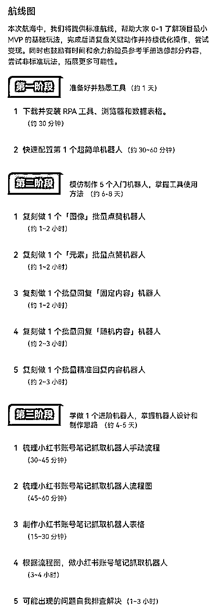

# 必修篇：从会用到会设计机器人

章节概要

必修部分选取真实业务场景，从易到难带着做 6 个高频机器人。

目标是通过练习摸清 RPA 的核心用法，之后能迁移到自己的项目里，做出合用的机器人，把效率或收益往上推。

路径共五步。

第一步：弄清 RPA 能把效率提到什么程度
第二步：备好 RPA 工具三件套
第三步：通过 5 个入门机器人熟悉工具
第四步：理解设计机器人的底层思路
第五步：完成 1 个进阶机器人，掌握设计与制作方法

希望大家按手册任务动手练，21 天达到这些目标：

每天投入 1—2 小时，学会 6 个高频机器人的制作，掌握一套可复用的设计方法，让工作或项目效率得到提升。

学有余力就多做练习，把课程知识迁移到自己的场景，灵活配置所需机器人，提升效率或放大收益。

## 一、【项目概述】RPA：效率提升的利器

章节概要

本章快速弄清三件事：

RPA 指什么？

它怎样给项目提速？

零基础新手能不能较快学会？

### 1.1 RPA 指什么？前景怎样？@浅墨 @君途

#### 1.1.1 RPA 的定义

它的英文全称是 Robotic Process Automation，中文常叫机器人流程自动化。实现方式是把软件机器人同 AI、OCR（文字识别）等能力组合起来，在具体软件业务场景中替代人工，让重复工作自动完成。

它本质上是在模仿人的操作：网页、桌面软件、手机 App、键鼠动作都能接管，流程无需人守着也能跑完。

直白点说：让程序接管重复动作，由机器人代劳。

往后，那些谁都不爱干的枯燥环节，确实有机会不再由人亲自做。重复化、标准化的工作，可以交给 RPA 完成。

项目、企业或日常岗位里，只要某件事规则清晰、输入输出结构固定，比如收邮件、做对账、查文件、出报表，这类枯燥又标准化的流程，都可以交给 RPA。规则清楚、可以描述明白、反复出现的操作，都适合用它提速。

每一个机器人，都可以看作替你分担一小块工作的助手，省下精力、减轻压力。

#### 1.1.2 行业前景

从行业看，RPA 已经进入金融、保险、零售、电商、政务、能源、制造、物流、地产、医疗、教育、电信等众多领域；在财务、人事、客服、法务、采购等职能里也常见落地。

近几年的走势见下图：

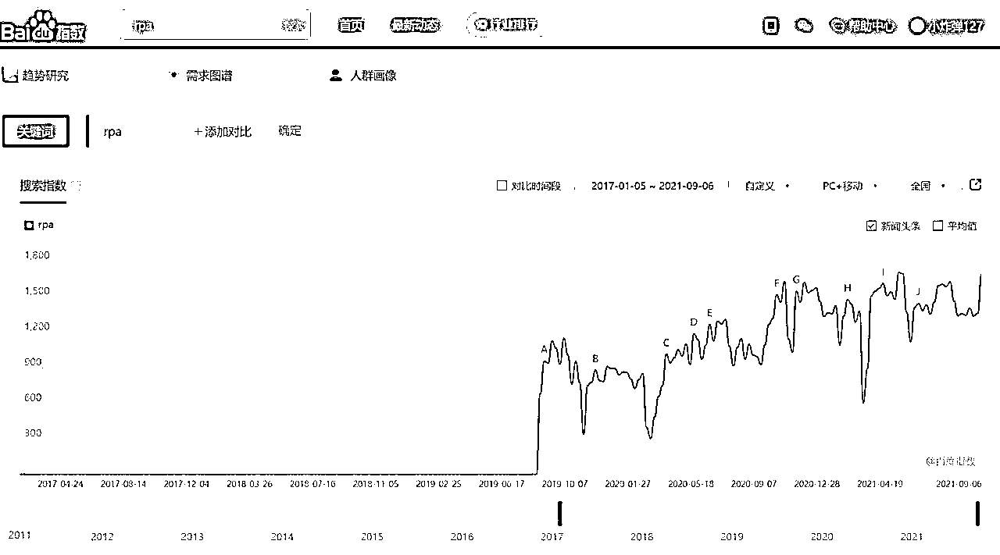

1. 提升技能与效率

职场和项目竞争都激烈，淘汰随时可能发生。鼠标键盘再熟，也扛不住工作量持续上涨。若 5 分钟干完 5 小时的活，10 分钟拿到别人 3 天的信息，就像别人还在翻山越岭，你已经坐上飞机。RPA 就像那趟私人航班：模拟键鼠操作，完成数据读取与搬运，把时间还给更有意义的事。

2. 招聘需求大

国内 RPA 市场正处在活跃期，企业部署意愿强，流程优化、降本增效、生产力提升都靠它。相关岗位——开发、实施、测试、技术顾问、咨询顾问、销售等——需求看涨，就业面宽。

薪资可看图：

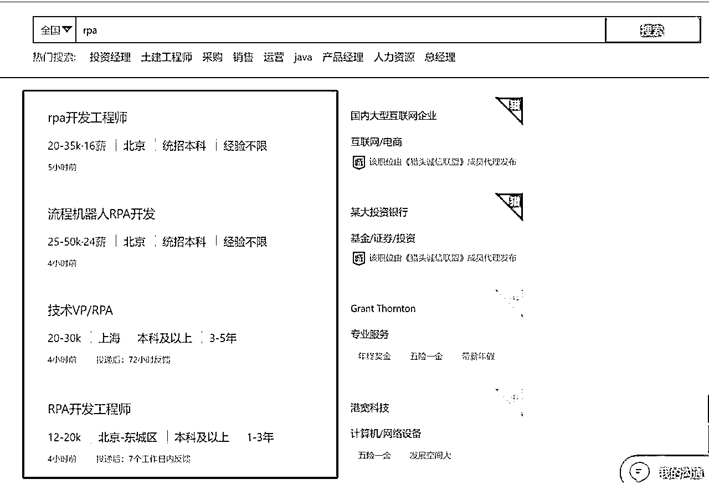

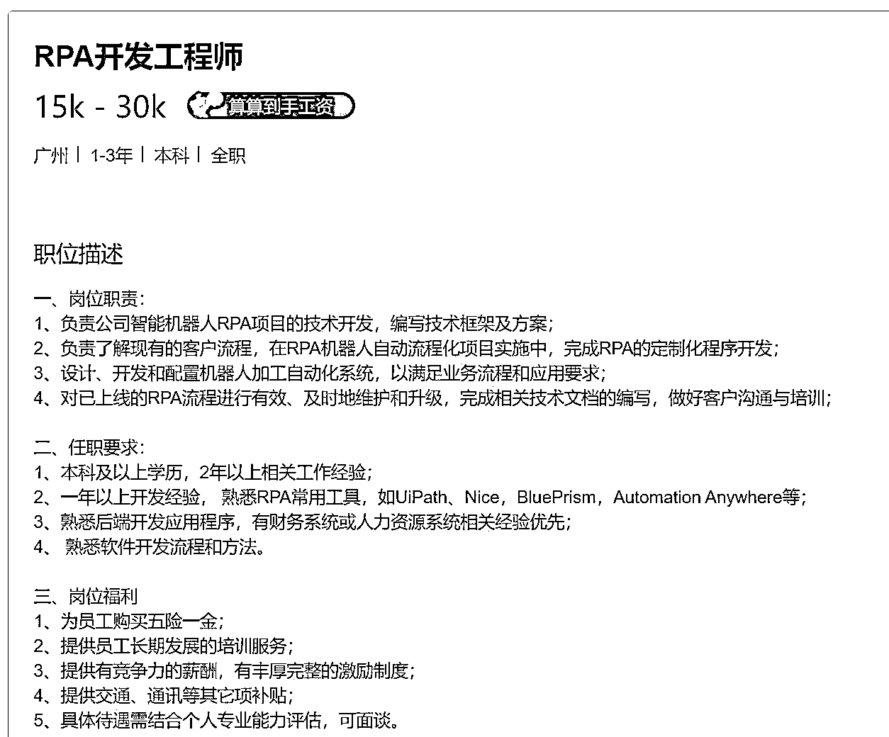

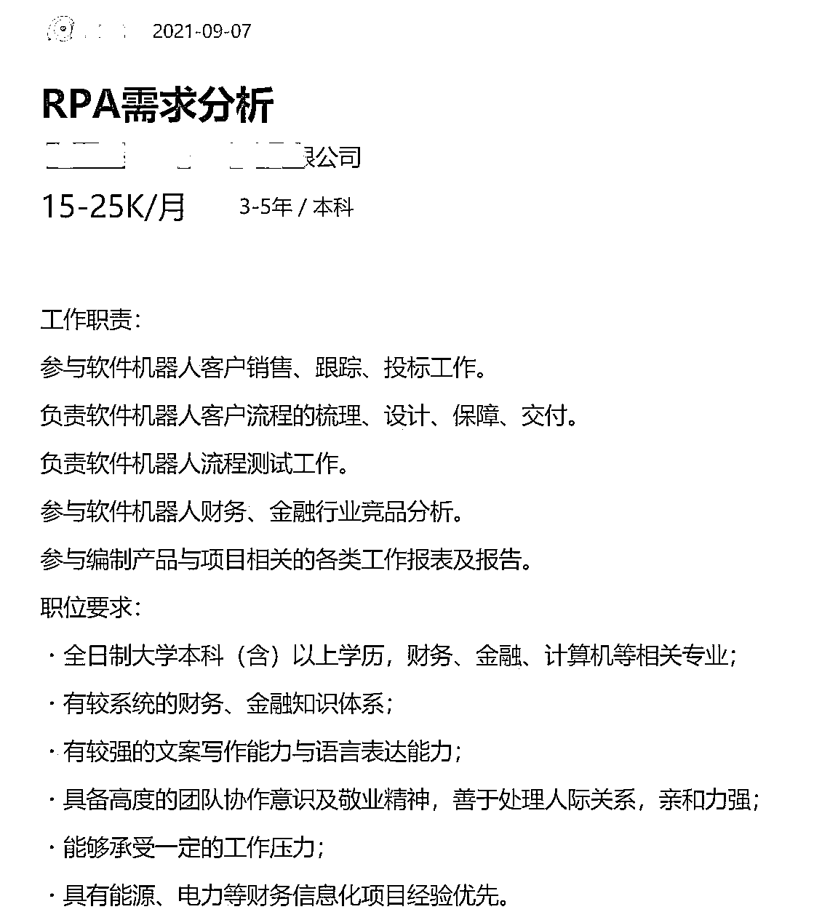

3. 高校也在开课

越来越多高校开设 RPA 课程。学会它既能提高本职效率，也能做线上培训赚课酬；庞大的学员群体本身也是资源。

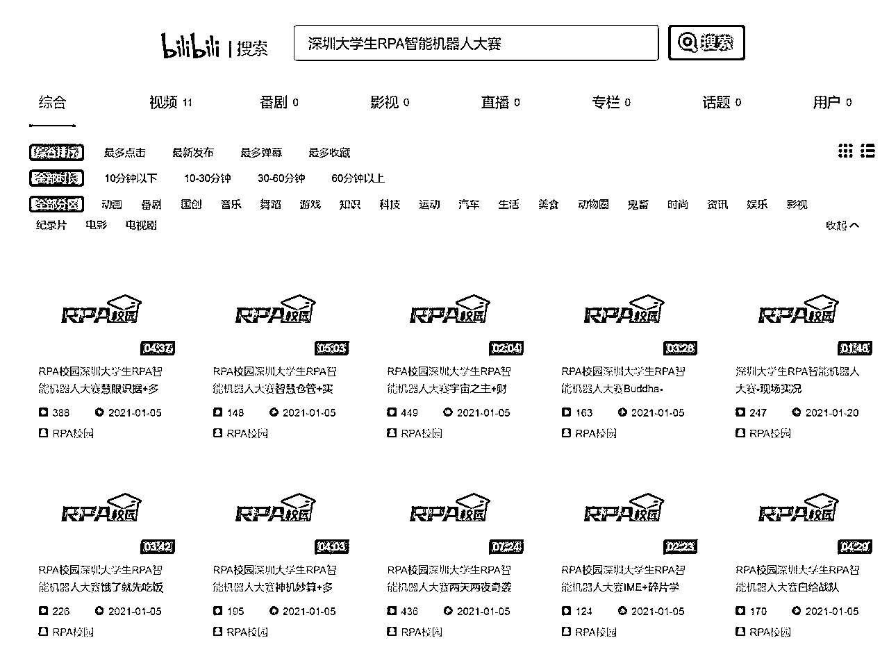

内容来源：《我只学了 1 个小案例，便解锁了 RPA 对我运营工作的巨大价值》《深入小 B 业务场景一年，我意识到了 RPA 背后的万亿市场》

### 1.2 RPA 怎样给项目提速？@君途 @子木（二哥）

不管你是上班族、中小商家还是创业者，日常都有一批高度重复的事：不难、价值不算高，却不能少。很多人只好先搭 SOP，再请若干助理天天执行。

这类事有多少？看几个例子：

案例一：小红书店铺、抖音图文电商、视频号带货等带货项目，都绕不开选品。要跨平台持续搜数据，导表后筛选分析。

案例二：公众号爆文、小红书运营等项目，选题、文案、图片素材都要持续收集，重复且耗人力。

案例三：某电商卖家每天分析产品数据。要把某款产品关键词列表逐个搜一遍，记下该词第一名和自己排名，做成表格；手里十几款产品，最后请了 3 个助理。

案例四：某实体店老板从小红书、抖音等公域往私域引流。为看投放效果，每天整理各平台网红视频数据、自播视频数据、投放金额、ROI 等，做成日报发群；最终请了兼职助理。

案例五：朋友所在独角兽公司有“数据运营”岗，不同项目组共十来人，工作是把各平台业务数据复制粘贴到一张表，整理后发群。

案例六：某代运营公司商务拓展每天刷新美团新商家，私聊询问是否需代运营，或收集电话建商家资源库。

这些重复事项，正在大量吞掉员工和老板的时间。

RPA 正好能接住上述场景。用上它，相当于拥有多个机器人助理，专门处理周期性、无需主观判断、可在电脑或手机完成的重复任务。

- 店群运营：要批量商品上下架机器人
- 图文运营：要一键群发到今日头条、知乎等平台的机器人
- 短视频运营：要一键分发到抖音、视频号、快手等平台的机器人
- 私域运营：要微信群发和主动加人机器人
- 人事：要 Boss 直聘机器人，自动发面试要求、问候语、交换微信
- 等等

内容来源：《如何利用 RPA 实现自动化获客，让项目提效躺赚？》《深入小 B 业务场景一年，我意识到了 RPA 背后的万亿市场》

### 1.3 谁适合学？门槛高吗？@君途 @浅墨

1. 项目中或日常里有重复工作，就可以学 RPA 来提效。

2. 入门不难。方法对，零基础也能较快上手。

主流 RPA 软件迭代后更易学易用，本就面向不会写代码的人。零基础愿意投入，约 1~2 周可把 RPA 用进业务线；有编程基础更轻松，挑一款主流工具研究两三天即可实战。功能虽多，基础功能足以覆盖 90% 的业务需求。

RPA 的目标：把人从机械时间中解放出来，把时间留给更有意义的事。

RPA 不是万能的。

首先，效率受页面加载制约。它要从页面识别元素、操作页面，必须等加载完成，否则流程中断。

其次，会占用电脑部分操作权限。比如把小说存成 Word 时会真的打开 Word，你就没法同时用；python 在程序内处理 Word，不影响其他工作。可用锁屏（UiBot）、分身运行（UiBot）、虚拟屏（影刀）、虚拟机（所有 RPA 软件）等方式运行，这些术语由厂商定义。

再次，编程灵活性不如 python。它优先简单易用，牺牲灵活性可以理解。

内容来源：《深入小 B 业务场景一年，我意识到了 RPA 背后的万亿市场》《我只学了 1 个小案例，便解锁了 RPA 对我运营工作的巨大价值》

## 二、【项目实操 1/4】RPA 起步准备 @阿愚呱呱

章节概要

准备开始 RPA 学习。本章会：

选适合新手的工具并完成安装。

带做第一个简单机器人，快速熟悉界面和基本操作。

分享常见问题的处理办法。

#### 本章航线图

完成本章学习和实操，即完成航线图第一阶段：备好并熟悉工具（约 1 天）

1. 下载安装 RPA 工具、浏览器、数据表格。（约 30 分钟）

2. 快速配置第一个极简机器人。（约 30～60 分钟）

接下来，就可以照着步骤动手筹备了。

### 2.1 工具怎么备

#### 2.1.1 工具选择

2.1.1.1 主流工具盘点与新手选择

市面上的 RPA 工具很多：

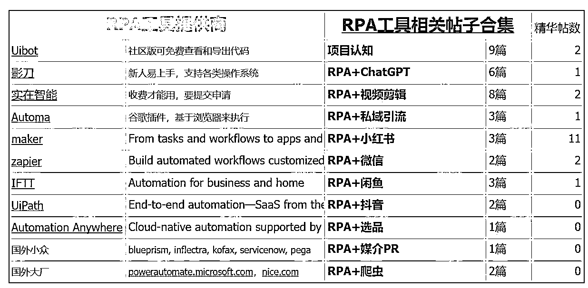

圈友使用多、反馈好且免费的主要是 UiBot 和影刀。两者各有长短，不建议新手在选型上纠结，因为任意一款 RPA 切换成本都很低。

掌握一款后，再用实在智能、八爪鱼 RPA 等，基本熟悉界面按钮就能上手。

本次以 UiBot 为主，原因有二：

- UiBot 可合规分享机器人源文件，方便学员拆解现成机器人学习，其他几款主流软件不提供该功能。这是最主要原因。学习时拿不到源文件，就像学 PS 没有源文件，只能看视频画面，很难体会高手做法中的精妙，连简单机器人都未必能还原。
- 模块更简洁完备，要学的模块少，学习量大幅降低。

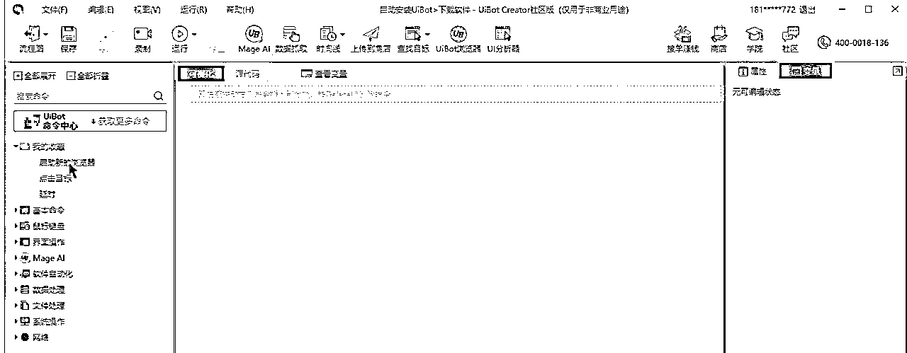

# 功能多≠学得会：选对 RPA 起点更重要

市面上一些 RPA 工具喜欢把多项能力塞进一个大模块，新手几乎开箱就能用。乍一看，这类产品似乎比 UiBot 门槛更低。

但隐患恰好在这里。我见过不少人，场景稍微复杂一点，大模块就顶不住了，转头问出的问题，在 UiBot 学员看来其实非常基础。

说到底，是一开始太依赖打包好的模块，单一功能模块没认真练，结果并没有真正跨进 RPA 的门。

- UiBot 的社区盘子最大，配套资源也更成体系；从普通业务同事、业余开发者，到专业团队和工作室，都能找到同伴。高手之间的讨论，往往更有料。
- 另外，面对复杂甚至超复杂的自动化项目，UiBot 的优势比较明显。我个人也认为它的架构更合理。

不过它也有明显缺口：

- 一直没有现成的大模块，新手起步不够省力。
- 界面偏 Office 审美，不如一些产品好看。
- 只能跑在 Windows 上，手机端缺席。

因此，这次航海加了两场影刀直播和演示视频。

影刀的长处是：

- 有大模块，新手用起来相对轻松。
- 提供手机端。

如果实在没有 Windows 电脑，可以先用影刀。

但工具没有完美的。为了让大家把底子打牢，我建议从 UiBot 入门 RPA。学会之后，再去用影刀等工具，底层原理相通，迁移门槛不高，熟悉一下按钮位置就能上手。

#### 2.1.1.2 UiBot 的获取与部署

准备一台 Windows 电脑，建议 Win 7 及以上版本。

注册 UiBot 账号

注册地址：https://account.uibot.com.cn/view/register/

若注册后登录进不去，可对照下面几种情况处理：

- 误点了「离线」，正常登录流程会被打断；别点它。如果已经点了，改从网页端登录。还没注册成功的，打开链接（https://account.uibot.com.cn/view/register/），再启动 UiBot Creator。
- 全局网络代理开着；把代理模式换成智能代理之类，仍不行就关掉代理。
- 某部手机能注册却登不上；换号码再试。
- 换一台电脑才正常；那就换设备。
- 实在查不出缘由；联系官方客服。

下载 UiBot 软件

下载地址：https://down.uibot.com.cn/OFFICIAL/UiBot/6.0.1/UiBot_Community_Official_X64_V6.0.1_2022.06.29.1740.exe

安装 UiBot 软件

- 双击已下载好的安装包。
- 默认选项一路继续，直到装完即可。

#### 2.1.2 Chrome（浏览器）

课程统一用 Chrome。为了更顺利地跟练，建议装好 Chrome，并给 UiBot 配上浏览器扩展。

2.1.2.1 拿到 Chrome 安装包

下载地址：https://www.google.cn/intl/zh-CN/chrome/

2.1.2.2 完成 Chrome 安装

- 默认设置一路继续，直到安装结束。

2.1.2.3 给 Chrome 加装 UiBot 扩展

环节 1：启动 UiBot Creator 并登录账号，界面参照下图。

环节 2：打开 Chrome 扩展安装入口。

提醒：装扩展前先退出 Chrome。

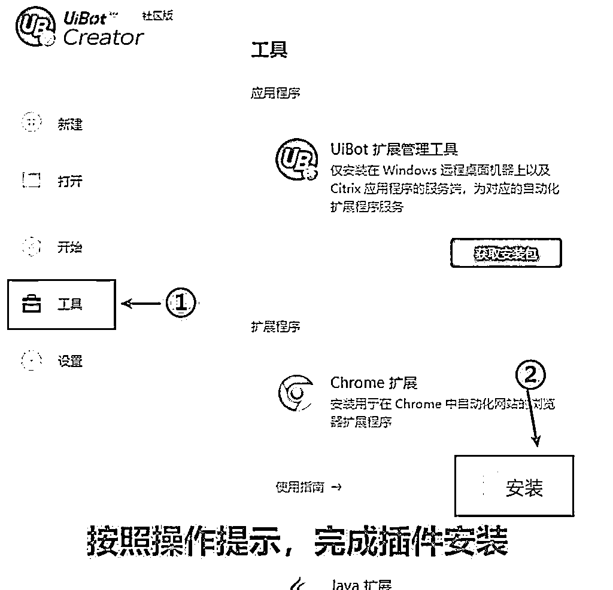

环节 3：安装时可能卡住。

若 Chrome 和 Edge 都已关掉，仍弹出下面提示：

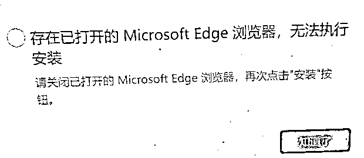

按图结束 Edge 进程：

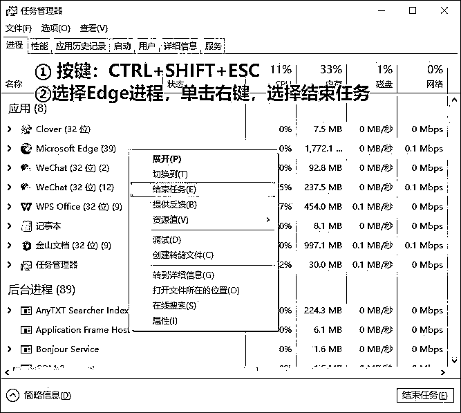

也可以换一种方式结束 Edge：

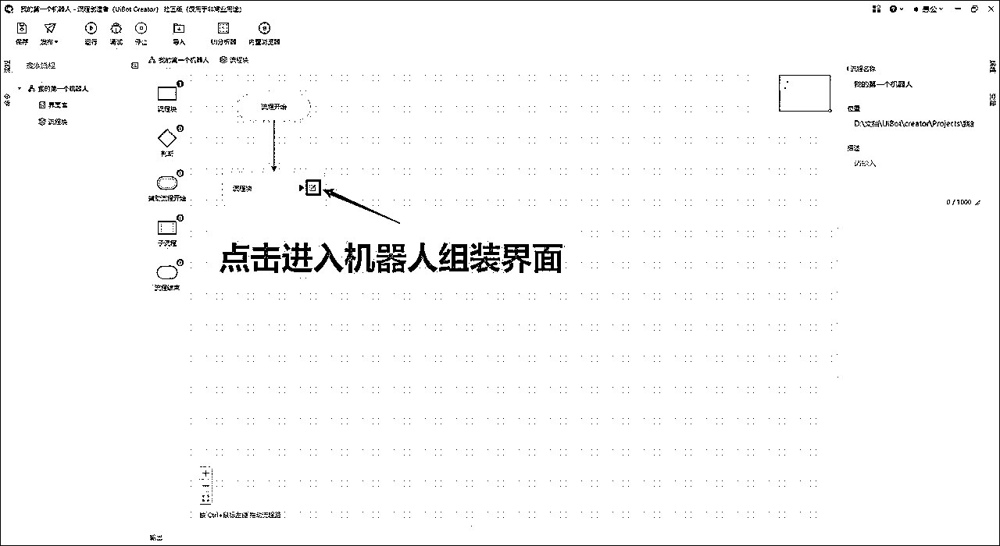

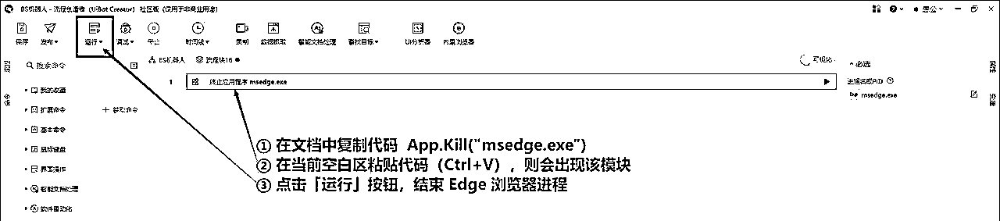

环节 4：启用扩展。

方法一：打开 Chrome，点启用扩展；浏览器启动后可能要等几分钟，按钮才出现。

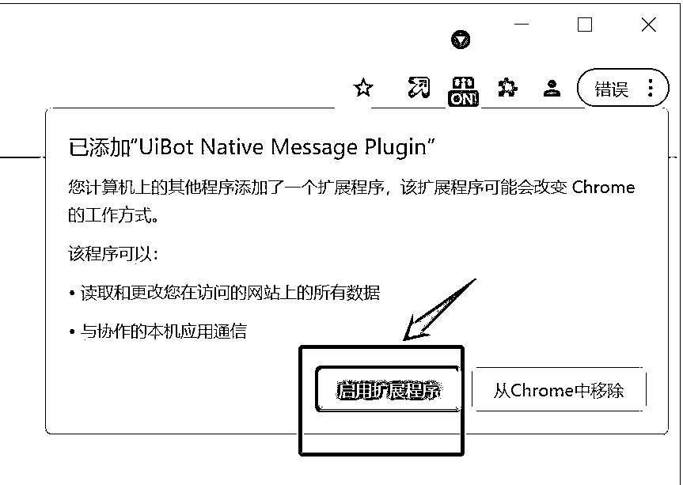

方法二：打开 Chrome，点右上角图标，进「更多工具」，再点「扩展程序」。

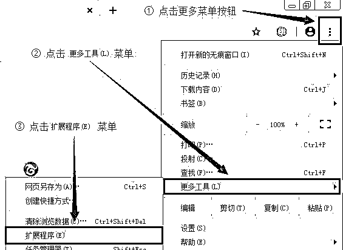

在扩展管理页找到 UiBot 插件，点 UB 插件右下角激活，变蓝即成功。

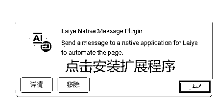

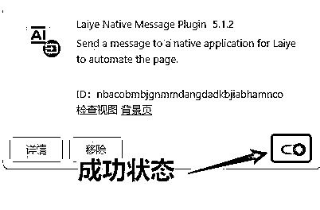

若浏览器启用仍失败，可看配套视频《UiBot 常见故障 1：浏览器为何启用失败？》。

#### 2.1.3 WPS/Excel（表格工具）

有人装微软 Office 不便，课程建议用 WPS；已有 Excel 也能用。

注意：别额外改设置，全部默认，一路继续到装完。

下载地址：https://platform.wps.cn

### 2.2 动手做出第一个极简自动化

打开电脑跟着做，快速认识界面和基础流程。

#### 2.2.1 启动 UB

找到「流程创造者」图标，双击打开 UiBot Creator。

#### 2.2.2 新建流程

在界面里选择「新建」，建一个流程。

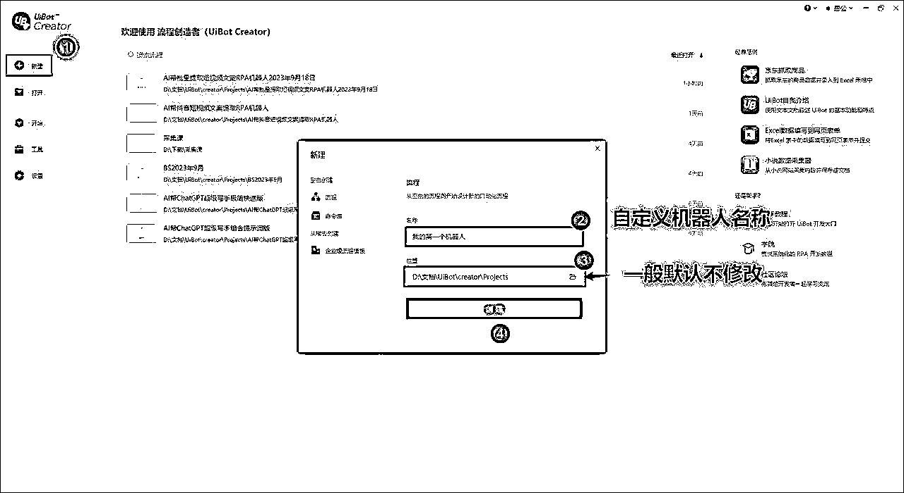

#### 2.2.3 进入机器人搭建界面

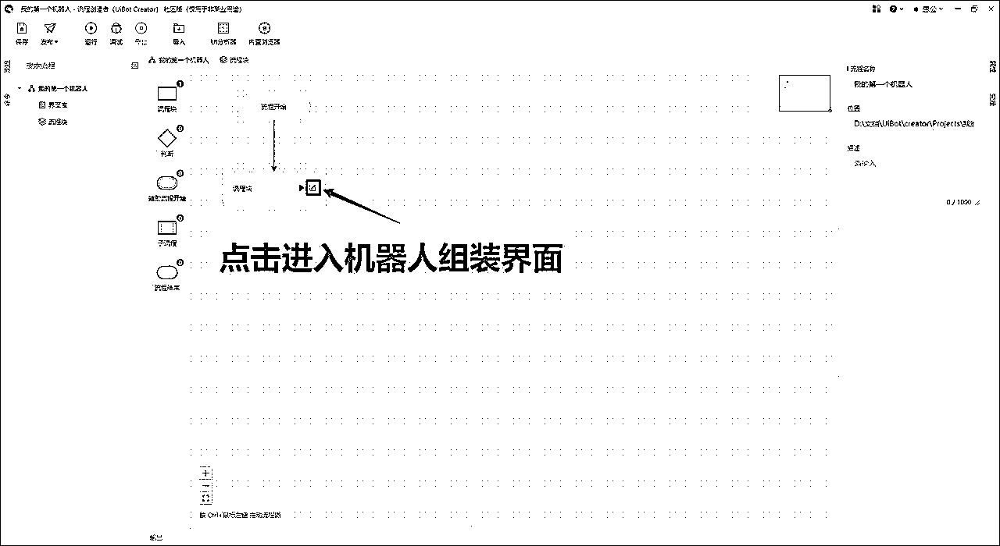

#### 2.2.4 认识搭建界面

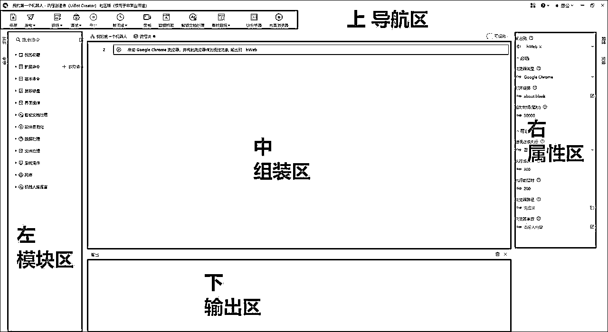

顶部导航区像 Excel 菜单栏，常用重要按钮集中在此。

其余三块是左侧模块区、中间组装区、右侧属性区。可以这样记：左区挑“零件”，中区拼装，右区调参数。底部输出区用来看报错；红色文字是错误，黄色文字通常不是报错。

有了整体概念，就动手配置，在操作中熟悉按钮。

#### 2.2.5 开始配置

配置 RPA 并不难，记住三个动作：挑、拖、调。① 选模块 ② 放模块 ③ 设参数。先做一个立刻见效的小任务：让 Chrome 自动打开并访问百度（www.baidu.com）。

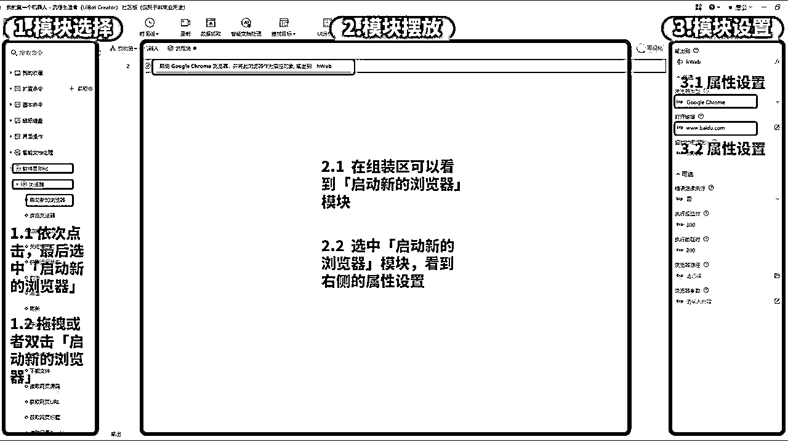

环节① 挑模块：在左侧依次展开【软件自动化】→【浏览器】→选中【启动新的浏览器】。

环节② 放模块：把它拖拽或双击到组装区；选中该模块，右侧会出现属性。

环节③ 调参数：【浏览器类型】选 Google Chrome；【打开链接】填 www.baidu.com。

照图操作完，第一个机器人就配置好了。

视频演示：

机器人配置过程的演示视频-第 5 版.mp4【在线播放】

#### 2.2.6 运行与停止机器人

接下来验证它能否打开 Chrome 并访问百度。

在组装界面有两种启动方式：

- 按导航区的「运行」，或直接敲 F5。

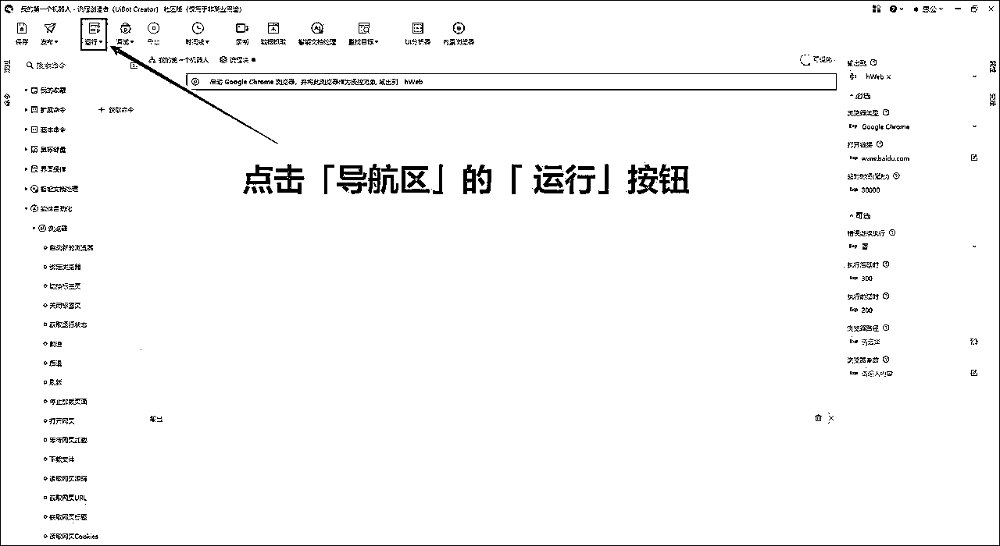

- 也可以先选中要跑的模块，再点「运行」。

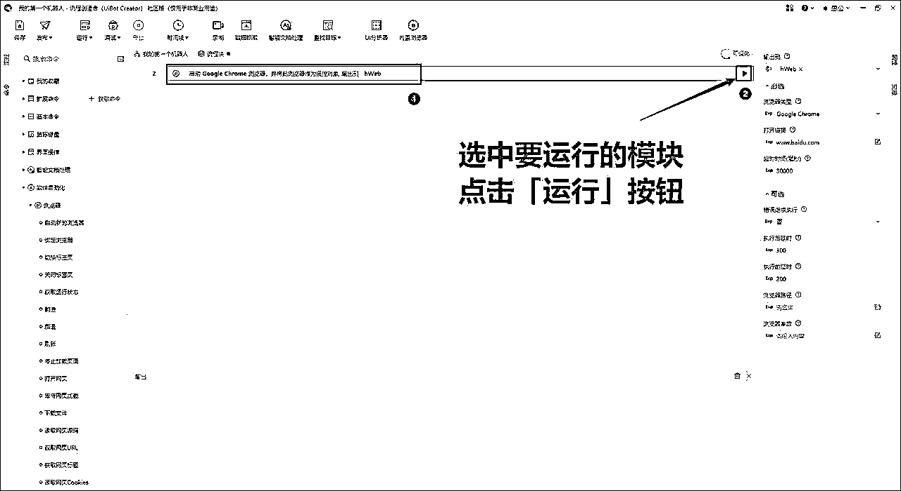

跑起来后，Chrome 会自动打开并进入百度；执行完自动停止。

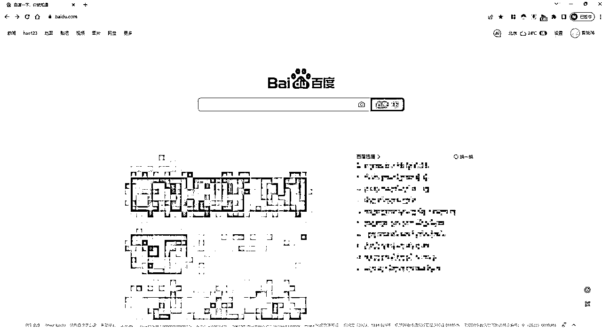

- 若想中途停下，同时按住 Ctrl+F12 约 5 秒。

工具配置、界面认识、基础操作都过了一遍，下面进入真正的设计学习。

### 2.3 卡住时怎么破？

学 RPA 碰到障碍，可以走三条路：

1. 先自查三个点
2. 按模板发帖
3. 再补运行视频

#### 2.3.1 先查三个点

1. 左侧模块是否选对
2. 中间摆放是否合理
3. 右侧参数是否填对

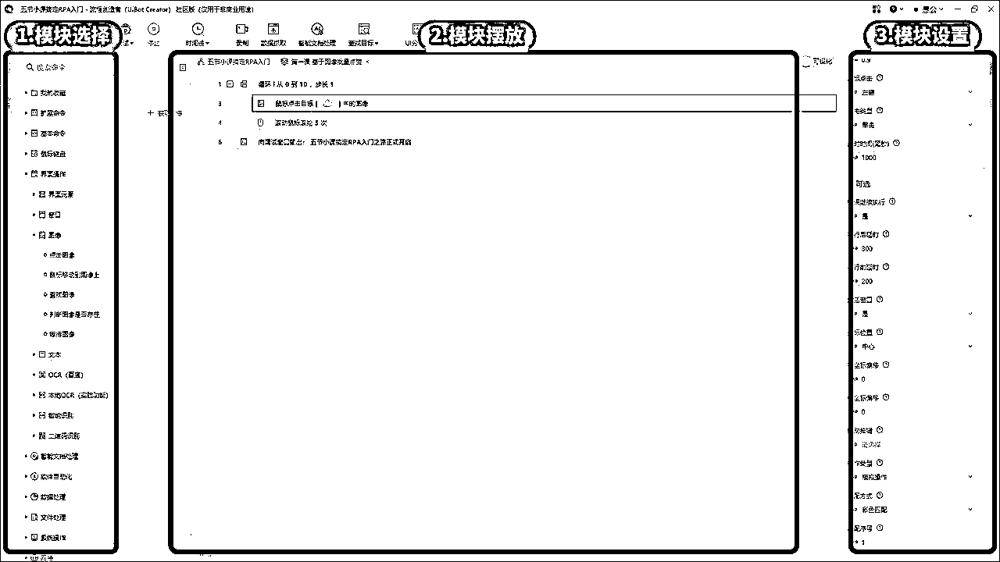

出问题先按这三处过一遍！！！

模块选错的典型样子：

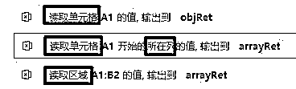

读取表格数据有三类写法：

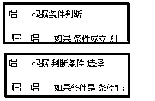

条件分支通常两种：

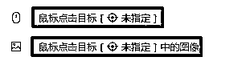

点击也分两类：

放置位置常错：

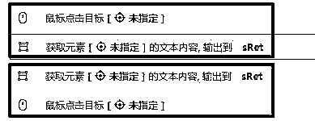

前后次序：

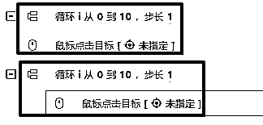

内外层级：

参数填错的典型情况：

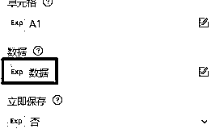

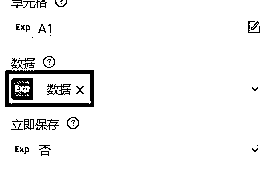

灰色 Exp 和蓝色 Exp 的差别：

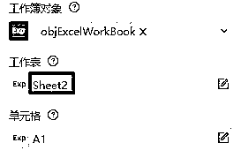

还有纯手滑造成的错误：

#### 2.3.2 按模板发帖

自查无果后，按格式提问更容易被解决。

格式如下

#问题求助#

问题描述：

源代码：

配图：

如何复制源代码

点右上角“可视化”，即可切到源代码页面。

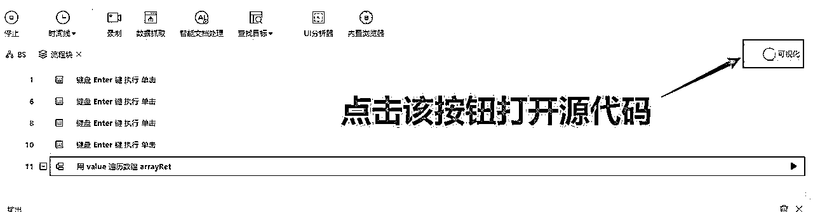

如何配图

截图信息要完整，不能只截「报错提示」。严格按下图操作：

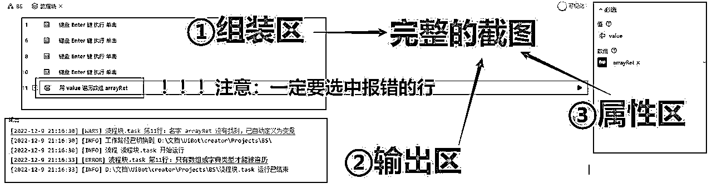

补充运行视频

有时机器人配置本身没错，问题出在运行方式或环境。此时提供录屏，直接发微信群；老师会随机抽船员视频解答。

视频录制工具下载链接：

https://www.bandicam.cn/

## 三、【项目实操 2/4】用 5 个小案例练熟工具 @阿愚呱呱

本章概览

这一章从零开始，由浅入深做 5 个常用入门案例，快速熟悉 RPA 的设计方法和工具用法。

学习时先跟做，尽量照着原样还原；先别纠结“为什么”，先按文档完成配置，尽快获得成就感。

也可以大胆试、及时分享心得和问题。

配置完后，我会梳理知识点，帮大家加深理解。

#### 本章路线图

学完并动手做完本章，就能完成航线图第一阶段：仿做 5 个入门机器人，掌握工具用法（约 6-8 天）。

① 用图像识别做批量点赞（约 1～2 小时）
② 用元素定位做批量点赞（约 1～2 小时）
③ 批量回复固定内容（约 1～2 小时）
④ 批量回复随机内容（约 2～3 小时）
⑤ 批量精准回复内容（约 2～3 小时）

那么现在，就开始学习吧。

### 3.1 自动化流程的底层思路

RPA 的存在是为了代替人手操作，本质是模仿鼠标和键盘。

人手动做事时，通常先用眼睛锁定一个“执行目标”，再做一个动作，比如点鼠标、敲键盘、打开程序，然后反复循环。

一句话：对选定目标重复动作。

理解这条路径，就能明白一个完整自动化任务的两个核心：

- 执行操作：目标加动作。
- 执行逻辑：按什么规则执行。

几乎每个任务都由这些部分组成，只是内容不同。

目标越简单、动作越少、规则越简单，做起来越轻松；反之越难。

接下来从易到难选 5 个案例，逐步覆盖常见目标、动作和逻辑，学完就能一步步掌握设计方法。

每个案例分三块讲：

1. 梳理流程，提取关键步骤，画出流程示意图。
2. 按图配置。
3. 讲设计思路和知识点。

前两块是必备动作，第三块帮你触类旁通。

动手和方法都要有。

先讲操作，是为了避开枯燥术语，让大家先跑起来、拿到成就感。

操作中遇到不懂的术语和疑问，先别卡住，带着问题跟文档做完；完成后再看知识点，吸收后合上手册，自己重新想一遍、配一遍。

这样学得更快。

下面按步骤开始。

### 3.2 用图像识别给帖子批量点赞

这次做一个替代人工“给知识星球帖子批量点赞”的机器人。

#### 3.2.1 先把流程理清

配置前先梳理执行流程，是必修课。

老手有时跳过，边想边做；流程一复杂，没理清就会让配置工作量翻倍。

新手最好养成先画流程的习惯。

先根据人工动作提炼机器步骤，关键是把人的关键动作写具体。

“给知识星球帖子批量点赞”的人工操作是：

点「点赞」；点完，或当前页面没有未点赞按钮，就向下滚几次鼠标，看到新的未点赞按钮再点；如此反复。

翻成机器语言：

1. 点「点赞」；若当前页面找不到未点赞按钮，等 1 秒（1000 毫秒）后滚鼠标。
2. 滚轮向下 5 次（1、2 次也行）。
3. 重复 1-2。
4. 输出「五节小课搞定 RPA 入门正式开启」（教练加的小仪式，标准流程前 3 步即可）。

接着画流程示意图；大多数流程不复杂，思维导图软件或手绘都行。

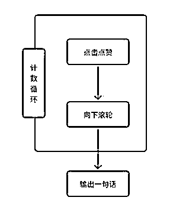

#### 3.2.2 动手配置

先看我配好的模块组装图：只有 4 步，很简单。你也跟着做起来。

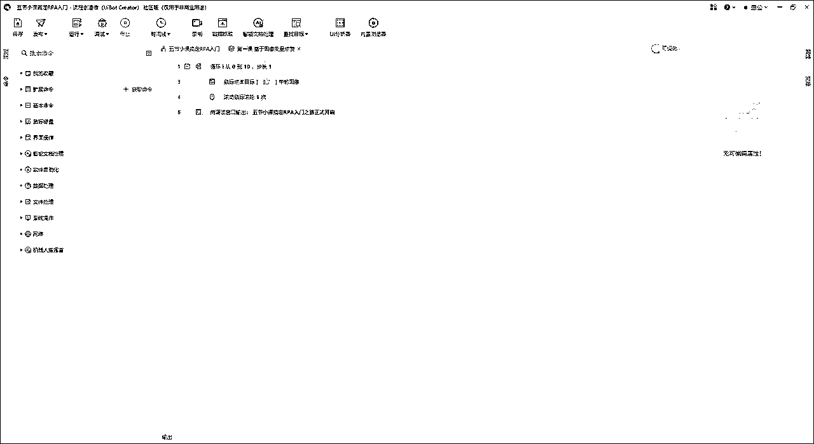

配置前准备：正式动手前，还有两项准备要做。

# UiBot 教程：图像点赞机器人，一次搭明白

本节默认你已经能打开 UiBot 的机器人编辑器，也会拖放积木。如果还不会，建议先回到 2.2 节，把“快速配置第一个超简单机器人”练一遍。

接下来，用 Chrome 打开知识星球“生财 RPA 实战【航海作业专用】”首页。我们要做的机器人会直接给这个星球点赞。

特别提醒：当前页面一定要停在“生财 RPA 实战【航海作业专用】”，否则点赞会误刷到别的星球，甚至引发刷屏。

## 先把流程拆成四步

动手前，不妨把整个动作拆成四段：

1. 点“点赞”按钮；如果当前页面上找不到未点赞的按钮，就先等 1 秒（1000 毫秒），然后让鼠标滚轮动起来。
2. 滚轮向下滚 5 次，目的是让下一个点赞按钮出现在眼前。机器人看不到新按钮，也就不会继续点击。
3. 反复执行第 1、2 步。
4. 最后输出“五节小课搞定 RPA 入门正式开启”。这一句是教练额外加的仪式感，标准流程做到第 3 步就够了。

按这个顺序搭建即可。开始前再确认一次：Chrome 里打开的是不是“生财 RPA 实战【航海作业专用】”？一定要确认，不然容易刷屏其他星球。

## 第一步 用图像点击点赞按钮

这一步对应流程的第 1 步：先尝试点“点赞”；如果没有未点赞按钮可点，机器人会等待 1 秒后执行滚轮动作。

操作时记住“三连”口诀：选组件、放位置、设参数。照着做不会乱。

1. 选组件：在左侧面板找到“界面操作”下的“图像”，选用【点击图像】。
2. 放位置：把【点击图像】放进中间搭建区，拖进去或双击都可以。
3. 设参数：这里有 4 项内容要设置。

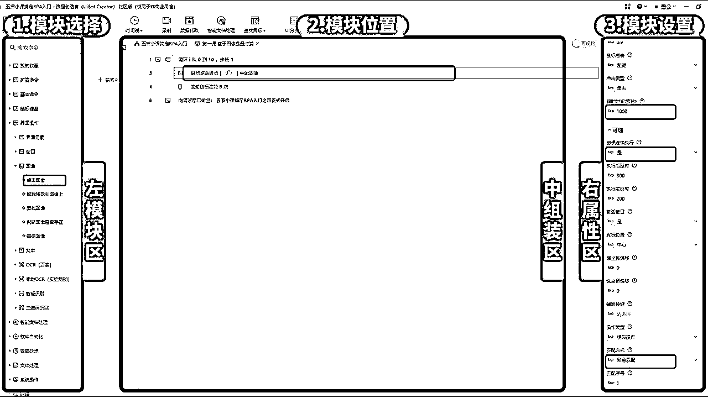

先看“鼠标点击目标”这一项。截取目标时，不要框选太大范围，刚好罩住按钮即可，像图中蓝色小框那样。这里的原理和截屏类似，相当于用 QQ/微信截图把点赞按钮截下来，所以称为“图像模拟”。

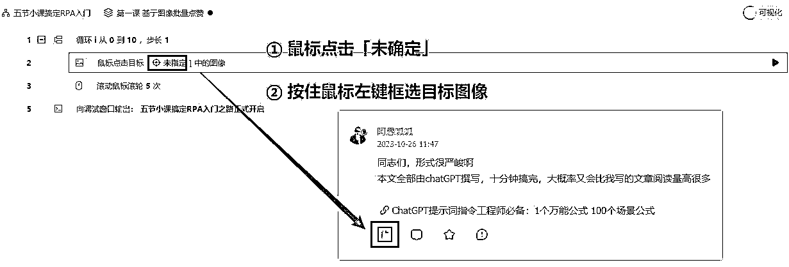

其余参数这样填：
- 超时时间：1000。含义是：当页面上找不到未点赞按钮时，等待 1 秒（1000 毫秒），随后继续执行滚轮。
- 错误是否执行：选“是”。
- 匹配方式：选“彩色匹配”。

## 第二步 让滚轮模拟滚动

这一步对应流程的第 2 步：滚轮向下滚 5 次，让新的点赞按钮显示出来。

1. 选组件：左侧面板“界面操作”下的“鼠标键盘”里，选择【模拟滚轮】。
2. 放位置：把【模拟滚轮】放入搭建区。
3. 设参数：这里只需要设置 2 项。

- 滚动次数：填 5。其实只滚 1 次也可以，但那样判断太频繁，所以我把次数调成 5，让它集中滚动后再判断。
- 滚动方向：向下。

## 第三步 用计数循环让前两步反复执行

这一步对应流程的第 3 步：让“点赞 + 滚轮”变成循环动作。

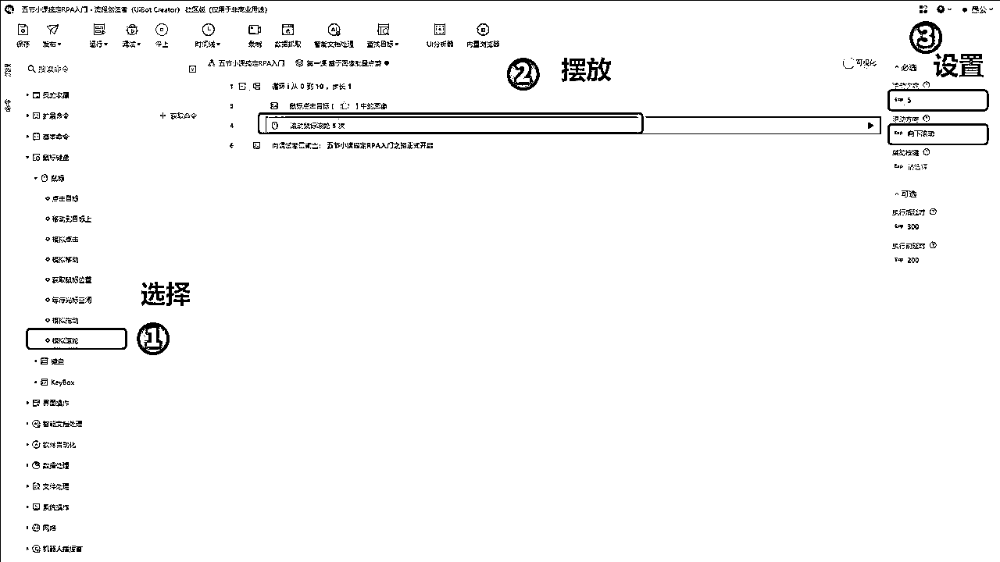

1. 选组件：在“基本命令”的“词法语法”里，找到【从初始值开始按步长计数】。
2. 放位置：把这个计数循环组件放入搭建区。

和前面两步不同，这个组件需要把“点击图像”和“模拟滚轮”包在它里面。也就是说，“点击图像”和“模拟滚轮”要放在“计数循环”的右下方，才能让点赞和滚轮不断循环。具体操作如下：

先拖入“计数循环”：

再同时选中“点击图像”和“模拟滚轮”：

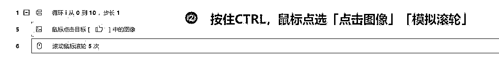

按下 Ctrl+X 把这两个组件剪切下来：

然后粘贴到“计数循环”内部：

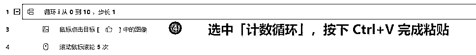

这时，循环组件中仍有 4 个参数待设置。

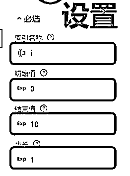

到这里，点赞、滚轮、循环三个关键环节就全部组装完毕。

## 第四步 输出调试文本

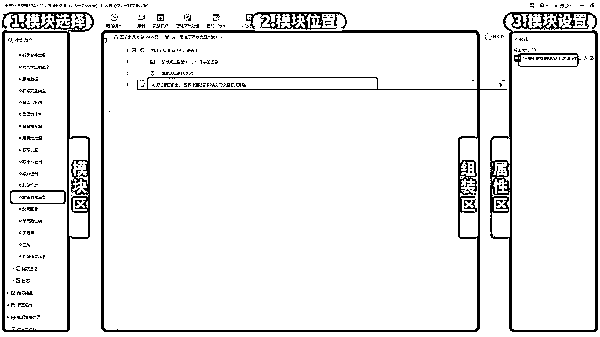

1. 选组件：在“基本命令”下选择【输出调试信息】。
2. 放位置：把它放到整个流程的最下方，也就是最后执行。
3. 设参数：点击“输出内容”旁的编辑按钮，输入“五节小课搞定 RPA 入门之路正式开始”，首尾都要用英文双引号，然后保存。

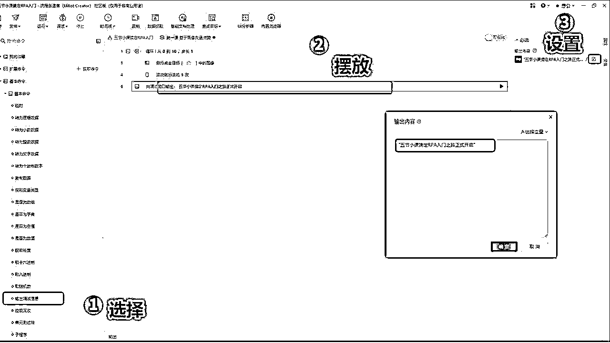

到这里，恭喜你，机器人已经搭好！在编辑器里按 F5，或直接点“运行”按钮，就能启动。如果想中途停止，长按 Ctrl+F12。

## 视频演示：换个工具怎么做

之所以额外准备视频，是因为 UiBot 有两个短板：一是始终没有集成模块功能，新手用起来不够顺；二是只支持 Windows，没有手机端。所以我们也录制了影刀软件的实操演示，并安排了两场影刀直播。如果没有 Windows 电脑，可以改用影刀。

但建议你还是先从 UiBot 入门 RPA。工具没有完美一说，先把底层概念学扎实，之后再切到影刀，会发现原理几乎一致，只需要熟悉界面按钮的分布，就能顺利上手。

视频清单如下：

- UiBot 带讲解版 @一泽：01_ 图像批量点赞.mp4【在线播放】

- UiBot 纯净配置版 @阿愚呱呱：第 1 课：基于图像批量点赞-第 3 版.mp4【在线播放】

- 常见问题讲解 @Leeka：《Uibot 实操常见问题 2：为什么我的图像点赞机器人总是失败？》

- 影刀版操作 @一泽：01_ 影刀图像批量点赞.mp4【在线播放】

#### 3.2.3 复盘：这些机器人的底层知识

现在，对照你刚刚完成的机器人页面，看看自己已经在不知不觉中掌握了哪些知识点。只要理解了它们，设计其他机器人时就能举一反三。

还记得吗？一个功能完备的机器人包含两大结构：

- “执行操作”：由“执行目标”和“执行动作”组成。执行目标常见有 2 种：图像目标、元素目标；执行动作常见有 4 种：鼠标/键盘、启动/打开、输入/写入、读取/获取。它们总是成对出现，比如打开某个图像、输入某段内容、读取某个元素。
- “执行逻辑”：决定动作按什么规则重复，常见有 3 种：循环、判断、依次。

思维导图如下：

不管操作还是逻辑，最终都是通过“选组件、放位置、设参数”这三步落到机器人里。

第一个机器人总共用到 3 种执行操作，也就是 3 个“目标 + 动作”组合，对应的组件有 3 个。下面逐一回顾。

### 组件一：“点击图像”

配置过程中，第一步点击“点赞”就是用这个组件完成的。

- 含义和使用场景：看名字就能理解，它代表“点击某个图像”的动作。只要任务里需要点击某个画面区域，都可以使用它。
- 参数设置：大多数情况下，这个组件的参数不用动。但在这个点赞机器人里，我们改了 3 处。

第 1 处：超时时间。默认是 10000，也就是说页面找不到未点赞按钮时，会等待 10 秒；我们改成了 1000，意味着只等 1 秒就执行下面的步骤。

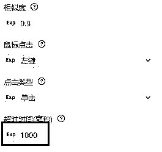

第 2 处：错误继续执行。默认值是“否”。

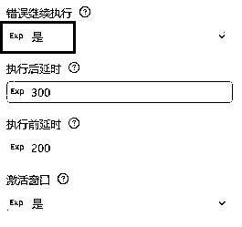

它的意思是：当前页面找不到未点赞按钮时，立即报错并把机器人停下来。我们改成“是”之后，遇到这种情况会跳过当前动作，直接进入下一个组件。换句话说，页面没有未点赞按钮时，机器人不会中断，也不会真正去点一次，而是直接继续滚动。

第 3 处：匹配方式。

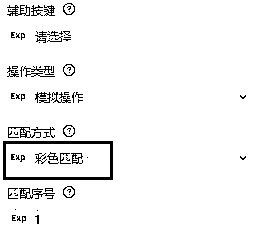

默认的“灰色匹配”只按图像形状匹配、不考虑颜色。但这里的点赞按钮需要靠颜色来判断是不是“未点赞”，所以必须改成“彩色匹配”。

### 组件二：“模拟滚轮”

第二步滚动鼠标滚轮时，用到了这个组件。

- 含义和使用场景：它就是模拟鼠标滚轮滚动的效果。
- 参数设置：必设参数有两个：滚动次数和滚动方向。

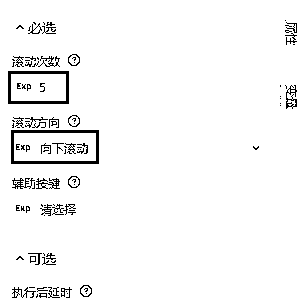

在这个例子中，滚动次数是 5，方向是向下，表示每次执行会让滚轮向下滚动 5 格。因为图像方式选目标非常依赖当前屏幕，不在屏幕里的元素就选不到。如果担心漏掉按钮，可以把滚动次数调小一点，哪怕设成 1 也没问题。

### 组件三：“计数循环”

第三步重复执行前两步，就是用这个组件实现的。

- 含义和使用场景：它用来控制一段动作循环的次数。
- 参数设置：可以调整的参数有 3 个。【初始值】决定从哪里开始，【结束值】决定在哪里结束，【步长】决定每次跳多少。

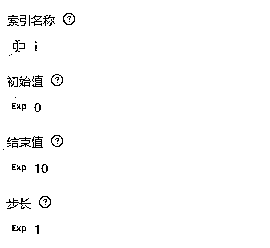

举个例子就清楚了。循环变量 i 从 0 开始，到 10 结束，步长为 1。

这就表示从 0 到 10 一共 11 个数字，每个数字之间相差 1：0、1、2、3、4、5、6、7、8、9、10，总共循环 11 次。

再考考你：初始值为 0，结束值为 10，步长为 3，会循环几次？答案是 4 次，因为取值是 0、3、6、9。

- 放置位置：如果希望某个组件反复执行，就必须放进循环组件内部。比如前面说的“点击图像”和“模拟滚轮”，就被放在了“计数循环”下面。

给新手的建议：可以先配置循环内部的组件，等内部动作正常跑通后，再添加循环组件把它们包裹起来。

执行操作讲完了，最后看执行逻辑。

### 执行逻辑的三个原则

机器人执行动作时，遵循三个原则：从上到下、从里到外、条件判断。这一节的前两个原则都用上了。

从上到下：机器人先执行上方的组件，再执行下方的组件，如图中 ①。
从里到外：机器人先把内部组件执行完，再执行外部组件，如图中 ②。

所以，图中“点击图像”和“模拟滚轮”被压在“计数循环”里，就会先跟着循环跑 11 次，跑完后才执行外面的“输出调试”。“输出调试”本身不影响机器人，只是为了方便观察执行顺序。因此，11 次循环结束后，它才会输出一次“五节小课搞定 RPA 入门之路正式开启”。

你可以把“输出调试”拖进“计数循环”内部试一下，会发生什么？结果是它会跟着循环输出 11 次“五节小课搞定 RPA 入门之路正式开启”。

对应航线图任务：复刻一个“图像”批量点赞机器人。请完全按照上面的步骤，1:1 重新搭一个图像自动化机器人。

### 3.3 换成元素目标批量点赞

接下来做第二个机器人，目标还是“对知识星球的帖子批量点赞”。你可能会疑惑：这和第一个不是一样吗？

不一样。这一节要掌握的新方法是：元素目标，它比图像更精准。

图像自动化最接近人的手动操作，性价比高，配置起来也简单直接。但图像识别的准确度有限，常常需要搭配其他动作。比如，机器人跟人一样是“看屏幕”的，屏幕里没有点赞按钮时，就得靠滚轮把新按钮加载出来；滚多了可能漏掉目标，滚少了又可能等不到新按钮，白白浪费时间。

元素目标自动化则没有这些问题：不需要担心漏点，甚至可以不用“模拟滚轮”加载内容。所以，它更稳健、更高效。想做出更可靠的自动化，必须掌握这种方法。

老规矩，先梳理流程。

#### 3.3.1 流程梳理

从人工动作抽象出机器步骤：“给帖子批量点赞”可以理解成——找到知识星球里所有“点赞”按钮，然后挨个点一遍。

用更精确的机器语言描述，就是：

1. 点击“点赞”按钮，并且用精确定义找到全部“点赞”按钮。
2. 重复第 1 步。

流程示意图：

#### 3.3.2 开始搭建机器人

先放一张配置完成后的模块组装图，大家感受一下结构，其实很简单。

正式搭建前，先确认两件事，和第一节课相同：

- 你已经会打开 UiBot 机器人配置界面，并且知道怎么拖拽组件。如果还不会，请先返回 2.2 节，完成第一个超简单机器人。
- 用 Chrome 打开知识星球“生财 RPA 实战【航海作业专用】”首页。机器人会直接对当前星球执行点赞。

注意！一定不要开错星球，否则会导致其他星球被刷屏。

具体搭建流程开始前，最后再强调一次：请确认 Chrome 打开的是“生财 RPA 实战【航海作业专用】”。

按下面的流程配置：

1. 点击“点赞”按钮，并精确定义出所有点赞按钮。
2. 重复第 1 步。

#### 第一步 使用“点击目标”并定义“点赞”

这一步对应流程中的“点击点赞按钮，并用精确定义找到所有点赞按钮”。

选组件：在“鼠标键盘”的“鼠标”类别下，选择【点击目标】。
放位置：把【点击目标】拖入搭建区。

设参数：最关键的是要对元素目标做准确定义。

先选择目标：

再编辑目标，这是重点也是难点。操作步骤：

1. 在目标编辑页面，把鼠标移到绿色文字上，在弹出的菜单里点“编辑”。
2. 在目标编辑窗口，点“从 UI 分析器中打开”，以获得更多目标特征。

进入 UI 分析器页面后：

1. 点“从界面上选取”。
2. 再选择一次点赞按钮。之所以要选两次，是为了拿到更多特征。特别注意：两次选择的目标必须一致，可以用区域大小和提示内容来对照。比如一个提示是 DIV，另一个是 Span，就说明不是同一个目标。

接着获取更多目标特征：

1. 把窗口最大化，以便看到更多内容。
2. 把特征筛选器拖到最底部。
3. 点选最后一个层级。
4. 勾选属性名 class。为什么这样做，后面知识点会详细讲解。
5. 点“保存”。

回到目标编辑页面：

1. 把目标名称改成“点赞”，提升可读性。改完名字后，再看模块组装图会轻松很多。
2. 点“确定”。

#### 第二步 加入计数循环

这一步对应流程中的“重复第 1 步”，具体做法和第一个机器人相同，这里不再展开。

完成所有配置后，在编辑器里按 F5，或直接点“运行”按钮，机器人就可以跑起来了。

若是想中途收手，按住 Ctrl+F12 不放即可。

演示资源

- UiBot 版
- 一泽讲解：02_元素批量点赞.mp4【在线播放】

- 阿愚呱呱纯净配置：第 2 课：基于元素批量点赞.mp4【在线播放】

- 常见疑问拆解：元素批量点赞常见问题.mp4【在线播放】

- 影刀实操（一泽）：02_影刀元素批量点赞.mp4【在线播放】

#### 3.3.3 配置门道，一次讲透

做完页面别急着关，回头对照一遍，你会发现不少能力已经悄悄到手。把这些点想明白，下次遇到同类任务，就能自己变通。

仍从知识地图说起。上一节已经打通「图像目标」自动化，用到了「点击图像」「模拟滚轮」「计数循环」；同时也弄懂了两种执行顺序：自上而下、由内向外。

这一节换个路子：靠「元素目标」完成自动化，关键模块叫「点击目标」。

「点击目标」模块

- 含义与场景：

先弄清名字：它完整叫法是「点击元素目标」。实际动手时，元素目标和图像目标怎么选？

元素目标：看的是控件自身的层级与内容。把指针放到控件上，它背后的结构、文字会被自动读出来。

图像目标：更像用眼睛认画面，看到什么就找什么，控件内部怎么组织与它无关。

论适应面和稳定性，元素目标通常更胜一筹；图像目标胜在直给、门槛低。可以这样把握：

- 能识别控件时，优先元素目标，机器人更稳。
- 界面读不出元素时，退回图像目标。
- 新手暂时不会改元素属性，也可先用图像法把事办成。

- 「点击目标」模块的属性设置

这里藏着元素自动化的关键，也是新手容易卡住的地方。什么时候才需要改目标属性？

常见误区是：有人一上来就先把目标编辑一遍，不管需不需要。其实没必要。

判断标准很简单：同一个目标第一次能点，后面重复时却失灵，这才需要动手改属性。记成一句话：调一次属性，适配多个同类目标。

最常见的情况是：页面里出现多个相似控件，只配置一次，就能把它们都点一遍。

例如整页点赞、整页勾选、连续下载、批量读取商品价格，都是典型场景。

具体怎么改「点击目标」属性？记住 221 套路：

- 抓两回目标
- 比对两处
- 锁定一个共同点

核心不是背属性名，而是找出多个控件共享的那一项。抓住它，就能一处配置、多处生效。

若跳过这步，机器人点完首个按钮后仍盯着它，结果就是赞了又撤、撤了又赞，循环打转。是不是有点憨？所以必须先找到共同点。

下面就用 221 走一遍。

- 第 1 步：先后抓两次属性。

第一次抓取如图，选第一条未赞按钮。

抓到后进编辑界面，借 UI 分析器展开更多字段，再截图贴到屏幕边上，方便后面对照。截图小工具 Snipaste 的获取入口：Snipaste - 截图 + 贴图

第二次抓取如图：

仍在同一区域操作：先把刚才那个按钮点成已赞，再选中紧随其后的未赞按钮。

抓到后照旧进编辑界面，借 UI 分析器展开更多字段，再截图贴到屏幕边上，便于比对。

- 第 2 步：把两份属性摆在一起，只盯两件事——哪些一样、哪些不一样。最终要让两个目标在特征上统一。

- 相同项勾上
- 不同项取消
- 不同项的值用通配

举例，一个标题是「阿愚|首页」，另一个是「呱呱|首页」，差异部分交给 * 代替，写成「*|首页」即可。

以前面两次抓取为例，可以这样处理：

- class：相同，勾选
- parentclass：相同，勾选
- title：相同，勾选
- idx：不同，取消勾选

实操里我通常不把 parentclass、title 都勾上。相同项并非越多越好。经验是：class 勾中，九成场景够用。

有人怕属性名像天书，以为还得补网页结构课。其实不必。你只看哪些一致、哪些有差异，属性名本身不用深究。

- 第 3 步：用高亮功能验收。点一下「高亮显示元素」，若闪在正确控件上，说明共同点找对了。

大量学员的实战反馈都指向同一处：RPA 里最难的是准确选中控件；而控件选得准不准，关键又落在目标编辑。

如果你已能把 221 用顺，这一关基本过了。暂时不熟也别急，后面还有案例继续练。

航线图任务：照步骤复刻一个「元素」批量点赞机器人。按上面的配置流程，一比一做出同款。

### 3.4 固定内容，批量回复

前两节已经把两类执行目标——「图像目标」「元素目标」——以及「点击」这个动作用熟了。现在再加入「输入」，让自动化从单动作升级为多动作串联。

学会输入后，机器人能做的交互会丰富不少。本节的新任务就是：在知识星球里给帖子点赞，并跟一条回复。

当目标不止一个时，你也会更清楚：哪些情况要改元素属性，常用套路又该怎么落。

#### 3.4.1 先把流程拆清楚

先照着人工操作，提炼出机器要执行的步骤。

重点是别写得太虚，要把每一步落到具体动作上。

以「给知识星球帖子点赞并回复」为例，人手操作是：

1. 点击「展开回复」按钮
2. 在「回复框」输入内容
3. 点击「发送回复」按钮
4. 重复第 1 到第 4 步

然后，再画出流程示意图。

#### 3.4.2 动手配置

模块拼装示意

先看我配好的模块组装图。照着图里的位置，把模块拖起来即可。

开工前准备

正式动手前，有两件事先备好：

- 会打开 UiBot 配置界面，也会拖模块。若不会，先看《如何配置第一个机器人》。
- 用 Chrome 打开知识星球“生财 RPA 实战【航海作业专用】”首页，机器人将直接在该星球执行评论。

再次提醒：务必确认当前打开的是「生财 RPA 实战【航海作业专用】」！开错星球，评论就可能刷到别处去。

配置动作顺序

流程仍是那四步：

1. 展开回复
2. 回复框写内容
3. 发送回复
4. 循环重复

前面做机器人时，我们按顺序先搭 1—4，再在最外层套循环。这次换个顺序：先把第 5 步的计数循环放好，再把 1—4 塞进循环体内。两种搭法都行，顺手就好。

开始前再确认一次：Chrome 里打开的是「生财 RPA 实战【航海作业专用】」，别刷错星球。

第一步 计数循环

也就是流程第 4 步：重复第 1 到第 4 步。

每一步都按同一节奏来：先选模块，再摆位置，最后调参数。照这个顺序，不容易乱。

第二步 「点击目标」-展开回复

对应流程第 1 步：点开「展开回复」按钮。

选完目标先别急着往下走。这里正是前面说的「调一次、复用多次」场景，用 221 法处理。

按下图筛选并修改特征。

第三步 在「目标中输入」

对应流程第 2 步：把回复内容写进框里。

右侧属性“写入文本”：五节小课搞定 RPA 入门

第四步 「点击目标」-发送回复

对应流程第 3 步：按下「发送回复」按钮。

到这里，第三个机器人就搭完了。按 F5 或点「运行」即可执行；想中途停，按住 Ctrl+F12 不放。

实操录像

- UiBot 版
- 一泽带讲解：03_批量回复固定内容.mp4【在线播放】

- 阿愚呱呱纯净配置：第 3 课：批量回复固定内容皮.mp4【在线播放】

- Leeka 常见疑问：《Uibot 实操常见问题 3：为什么我的评论回复机器人会反复在同一帖子下评论》
- 一泽影刀版：03_影刀批量回复固定内容.mp4【在线播放】

#### 3.4.3 新模块复盘：输入怎么做

对照刚完成的配置页面，看看这一轮又解锁了什么。

通过前两个机器人，图像目标自动化、元素目标自动化都已经走过一遍，四个模块也上手了：点击图像、模拟滚轮、计数循环、点击目标。

执行顺序也理解了两套：自上而下、由内向外。

本节新增一个动作：在目标里写字，也就是「在目标中输入」模块。

「在目标中输入」模块

- 含义与场景：

它对应「往指定位置填内容」。流程里凡是要打字，都用它。

- 属性设置

写入文本有两种格式：灰色 Exp 和蓝色 Exp。点一下灰色 Exp，它会转成蓝色 Exp。

两者差异如下：

灰色 Exp：普通模式。看到什么写什么，属于纯文本。填的是五节小课搞定 RPA 入门，输出同样内容。

在灰色 Exp 里直接写 五节小课搞定 RPA 入门，等价于在蓝色 Exp 里写 "五节小课搞定 RPA 入门"。

若只是固定文字，两种模式都行。

蓝色 Exp：专业模式。要放变量，只能在这里写。

关于变量

变量可以想成给内容起外号。外号不变，背后的内容可以换。

比如从 Excel 单元格取内容发到评论框，就先起个变量名。机器人每次只认这个变量名，实际内容随表格变化。

可以设变量名为「输入内容」。机器人每次都向输入框填这个变量，但真正内容来自表格中的变化值。

变量名不要套引号；纯文本则要套上英文单/双引号。见下图：

文本示例：

再走一遍目标编辑套路

本机器人有四个元素操作：点赞、展开回复、输入内容、发送回复。

其中「点赞」和「展开回复」需要调属性；另两个动作抓完目标后即可反复使用。

知道属性编辑是难点，再走一遍套路：

- 抓两回目标
- 看两处
- 锁定一个共同点

- 两次选中「展开回复」目标

进入编辑窗口展开更多字段。不会展开可回看第二课，结果如图：

- 查看两处

勾选或取消勾选后得到下图：

Class 相同，勾选。

Idx 不同，取消勾选。

这时点「高亮显示元素」，第二次抓的目标没有亮在第二个上，仍停在第一个——说明还没做到一次配置多处复用。

把 idx 勾上，值改 0 亮第一个，改 1 亮第二个。继续试 3、4、5、6、7，会依次往后跳。

这个值按规律递增，可交给变量 i 承载。注意：填变量时不能直接点高亮，因为变量不是具体数字，得由上游把值传进来。

i 的值从循环里来。i 只是名字，背后数值会变。

循环 i 从 0 到 10，意思是从 0—10 这一列依次取值，当前值记作 i。

具体变化见图：

最终共同特征如图：

不必深究 idx 的字面含义，其他属性名同理。多数情况下，不勾 idx 等价于勾上且值为 0：0 通常亮第一个目标，1 亮第二个。极少数页面首个目标不是 0，可能是 1、3、10 等正整数；只要确定首目标值，后续一般加 1 类推。

设计 RPA 的本质，是把人工鼠标、键盘动作翻译成机器步骤。

流程理清后，每一步用对应模块模拟即可。

本节虽有四个动作，但与上一节单动作机器人没有本质鸿沟，难度也没有陡增。多出来的动作，照着流程一个个补上就行。

航线图任务：按上面步骤，一比一复刻一个批量回复「固定内容」机器人。

### 3.5 随机评论，批量回复

# 升级机器人：随机回复 + 条件精准回复

上节课搭好的机器人，这节继续加装新能力。机器人的本事在涨，我们操控它的熟练度也跟着涨。

之前机器人只会发同一条内容；这次改成从多条里随机挑一条。实现方法很多，我们挑最直接的一种：把备选文案先放进表格。

整体配置继续沿用上一版，只加入「打开 Excel 工作簿」「读取单元格」两个新模块，同时练熟数据如何在流程里传递。

#### 3.5.1 人工动作如何拆成机器步骤

先做动作抽象。要点是把人做的关键动作写清楚。

“给知识星球帖子回随机内容”人工流程：

1. 表格里预先存好多条评论；
2. 按下帖子下方的「展开回复」；
3. 从表格取一条评论，填进回复输入区；
4. 按「发送回复」；
5. 第 2 到 4 步反复做。

换成机器能执行的描述：

6. 启动表格程序；
7. 取得指定格子里的文字；
8. 按「展开回复」；
9. 把文字填进回复输入区；
10. 按「发送回复」；
11. 第 2 到 6 步循环。

示意流程如下。

#### 3.5.2 组装机器人

先看成品模块拼装图，照图操作即可。

动手前先确认

正式动手前，有两件事先确认。

• 会打开 UiBot 配置界面，也会把模块拖进流程区。若还不会，先看《如何配置第一个机器人》。
• 用 Chrome 打开知识星球“生财 RPA 实战【航海作业专用】”首页。后续评论只针对这个星球。

务必注意：必须确认停留在“生财 RPA 实战【航海作业专用】”，否则可能把内容刷到其他星球。

• 另外准备一个表格文件，在 A 列放好备选回复文案。不想自己建，可直接下载下方文件。

五节小课搞定 RPA 入门第四课.xlsx

五节小课搞定 RPA 入门第四课.zip

配置环节

整理后的执行顺序：

1. 启动表格；
2. 取得指定格子文字；
3. 按「点赞」；
4. 按「展开回复」；
5. 往回复输入区填文字；
6. 按「发送回复」；
7. 第 2 到 6 步反复。

再提醒：开始前确认 Chrome 当前页面是“生财 RPA 实战【航海作业专用】”，别让回复跑到别处。

第一步 复用上节模块

本课机器人由上一版改造而来，因此可把上次拼好的模块直接复制过来，效果如下图。

复制方法学会后，以后遇到相同结构都能省下重搭时间。

复制操作：

• 选中目标模块；
• 按 Ctrl+C；
• 到新流程块里按 Ctrl+V。

随后把流程第 4 行的输入文本换成变量“回复内容”（也就是刚从表格里取出的那条文字）。

流程第 3 至 7 步至此齐活，剩下前两步。

第二步 启用「打开 Excel 工作簿」

对应顺序里的第 1 步：调用「打开 Excel 工作簿」模块。

为什么建议把文件放进默认打开目录？以后复制、分享、管理都会更顺手。

第三步 调用「读取单元格」

对应顺序里的第 2 步：用「读取单元格」取出文字。

注意：专业模式（蓝色 Exp）下，表达式写 "A"&i+1，不要填在普通模式。

到这里配置完成。

按 F5 或点「运行」即可执行。

若想提前中止，长按 Ctrl+F12。

配套视频

• Uibot 操作演示
• 讲解版 @一泽

04_ 批量回复随机内容.mp4【在线播放】

• 纯配置演示 @阿愚呱呱

第 4 课：批量回复随机内容皮.mp4【在线播放】

• 常见问题答疑 @Leeka

《Uibot 实操常见问题 4：为什么我的点赞评论机器人老是报错？》

• 影刀版演示 @一泽

04_ 影刀批量回复随机内容.mp4【在线播放】

#### 3.5.3 新知识回顾

对照自己的配置页，看看本节新增了哪些能力。

前四课已经接触过图像目标自动化、元素目标自动化，并用过 5 个模块：「点击图像」「模拟滚轮」「计数循环」「点击目标」「在目标中输入」。

也理解了两类执行顺序：自上而下、由内向外。

本节新增 2 个模块：「打开 Excel 工作簿」「读取单元格」。

「打开 Excel 工作簿」模块

• 用途：字面意思，负责把表格文件打开。
• 属性：一般无需调整。

「读取单元格」模块

• 用途：取出某个格子中的内容。
• 读取表格内容有不同做法，这里选用最基础、也最适合新手举一反三的「读取单元格」。
• 属性：通过设置指定工作表和格子位置。
• 选工作表：一个文件可能包含多个工作表，要指明目标表。像图中的 Sheet1，就填在工作表属性处（紫色标注）。

• 选格子：用「行」「列」定位，见红色标注。

“回复内容”以及 "A"&i+1 都牵涉变量拼接。

拼接规则拆解 "A"&i+1：

• 文本 "A"
• 连接符 &
• 变量 i
• 加号 +
• 数字 1

规则：

• 英文引号文本（"A"）与不带引号的变量（i）相连，用 &；
• 数字变量 i 与数字 1 相加，用 +；
• 只要不是数字相加，其余连接一律用 &。

航线图任务：照着前面的配置，原样做一个批量回复「随机内容」机器人。

### 3.6 批量精准回复内容

课程一开始就说过，机器人执行逻辑有三条基本准则：

• 自上而下
• 由内向外
• 条件判断

前四课反复练了前两条。本节专攻「条件判断」，借助「判断文本是否存在」和「如果条件成立」两个模块完成。

以前回帖是不加筛选地全回；加入条件判断后，就能只处理符合条件的帖子。

#### 3.6.1 人工动作如何拆成机器步骤

先观察人工怎么判断。

关键是描述清楚人的筛选动作。

“只给知识星球里符合条件的帖子回内容”人工流程：

1. 打开帖子，看里面是否出现目标内容；
2. 若出现，按「展开回复」，填内容，再按「发送回复」；
3. 若没出现，继续看下一篇；
4. 第 1 到 3 步重复。

换成机器描述：

5. 检查目标中是否包含某段文字；
6. 若包含；
7. 按「展开回复」；
8. 往回复输入区填文字；
9. 按「发送回复」；
10. 若不包含，不执行动作，进入下一个目标判断；
11. 第 1 到 7 步循环。

示意流程如下。

#### 3.6.2 组装机器人

先看已拼好的模块图，跟着操作。

动手前先确认

动手前同样确认两件事：

• 会打开 UiBot 配置界面并拖拽模块；不会就看《如何配置第一个机器人》。
• 用 Chrome 打开知识星球“生财 RPA 实战【航海作业专用】”首页，后续操作只对这个星球生效。

务必注意：确认当前星球是“生财 RPA 实战【航海作业专用】”，不然回复会刷到其他星球。

配置环节

整理后的执行顺序：

1. 检查目标中是否包含某段文字；
2. 若包含；
3. 按「展开回复」；
4. 往回复输入区填文字；
5. 按「发送回复」；
6. 若不包含，不执行动作，进入下一个目标判断；
7. 第 1 到 7 步循环。

再提醒：开始前确认 Chrome 页面是“生财 RPA 实战【航海作业专用】”，避免误刷其他星球。

第一步 复制已有模块

还是沿用第三个机器人的模块，复制进来后如图，流程第 3 至 7 步就齐了。

复制操作：

• 选中目标模块；
• 按 Ctrl+C；
• 到新流程块里按 Ctrl+V。

第二步 使用「判断文本是否存在」

对应顺序里的第 1 步：检查目标中是否包含某段文字。

① 找模块：在搜索栏输入“判断”，选中「判断文本是否存在」。

② 放模块：双击或拖拽「判断文本是否存在」到中间组装区。

注意：位置要落在上一循环模块的右下，也就是置于循环体内部。

③ 配模块：同一个目标只编辑一次、后续会反复操作同类目标，所以先要改目标。按下面图示操作：

① 把鼠标悬停在绿色文字，弹窗里选「编辑」；

② 接着在弹窗中选择「从 UI 分析器中打开」。

① 随后在弹窗中选「从界面上选取」；

② 重新点一次目标，让系统抓取更多筛选特征。

再按图示调整筛选特征。

第二步 借助「如果条件成立」完成条件判断

对应顺序里的第 2 步：若包含内容。

到这里配置完成，恭喜！

按 F5 或点「运行」执行。

想提前停止，长按 Ctrl+F12。

配套视频

• Uibot 操作演示
• 讲解版 @一泽

05_ 批量精准回复内容.mp4【在线播放】

• 纯配置演示 @阿愚呱呱

第 5 课：批量精准回复内容皮.mp4【在线播放】

• 常见问题答疑 @Leeka

《Uibot 实操常见问题 5：为什么我的条件判断机器人不工作了？》

• 影刀版演示 @一泽

05_ 影刀批量精准回复内容.mp4【在线播放】

#### 3.6.3 新知识回顾

对照配置页，看看本节又补了哪些能力。

前四课已接触图像目标自动化、元素目标自动化。

用过 7 个模块：「点击图像」「模拟滚轮」「计数循环」「点击目标」「在目标中输入」「打开 Excel 工作簿」「读取单元格」。

也理解两类执行顺序：自上而下、由内向外。

本节补上第三种执行逻辑——「条件判断」，并引入「判断文本是否存在」「如果条件成立」两个模块。

「判断文本是否存在」模块

• 用途：检查目标里有没有某段文字。
• 例子：在抖音找意向客户，可在视频评论区搜“价格”“多少钱”“如何联系”等词；出现这些词，就是值得抓取的信息。
• 属性：沿用元素目标的 221 编辑法，不再展开。

「如果条件成立」模块

• 用途：根据条件是否满足，决定机器人走哪条分支。
• 例子：做加好友机器人时，对微信号搜索结果做判断；若结果是男性就添加，是女性则跳过并继续搜下一个。
• 属性：本节用精简版条件判断，见下图第一处红框。

选精简版的原因很简单：只针对单一条件行动——只要「存在 RPA」为 true，就回复。

完整版适合什么情况？当需要按 RPA 出现数量分别回复时：

• 出现 1 个「RPA」，回「good」；
• 出现 2 个及以上「RPA」，回「very good」；
• 没有「RPA」，回「sorry」。

完整版的判断结构可以写成：

• 若「存在 RPA」为 true，则执行回复；
• 否则如果「条件成立」，则执行××（实际配置写具体条件）；
• 否则，执行××。

• 小练习：用刚学的知识改造第一课机器人，把「错误继续执行：是」替换成「如果条件成立」模块，让基于图像批量点赞的机器人更稳。

判断结果只有 true 或 false 两种。如下图，分别检查两个帖子是否出现「RPA」，把结果命名为「到底是什么」，再输出调试「到底是什么」。第一次结果是 false，第二次是 true。

换一种找模块的方式：搜索

前四课选模块多在左侧模块区逐层翻找。其实还有更快的办法：搜索。

如果 RPA 工具命名清晰，绝大多数目标模块都能靠搜索一键定位。

多数主流 RPA 工具内置两百多个基础模块。数量看着夸张，日常高频的也就十来个。

工具通常按类别陈列模块，可以逐层展开；但花几分钟熟悉搜索，往往比层层点开更顺。

这些模块大致可归为两组：

• 「动作」及「动作+目标」类：点击图像、点击目标、打开 Excel 工作簿、模拟滚轮等；
• 「语法」及「语法+目标」类：计数循环、如果条件成立、变量赋值、判断元素是否存在。

这样分类后，大部分模块都能通过搜索“动作”“语法”关键词找到。

掌握下面四组动作词、两组语法词，大半场景就够用。

• 四类动作词：
• 启动/打开
• 读取/获取
• 输入/写入
• 鼠标/键盘

这四组里，后三组尤其常用。

• 两类语法词：
• 循环/计数
• 条件/判断/是否

它们分别呼应两类流程控制：「循环/计数」服务于「由内向外」，「条件/判断/是否」服务于「条件判断」。

如果这些词不好记，或搜不到目标模块，还可以用“目标”关键词。想到什么就搜什么。

例如：

• 界面：元素、图像、文本
• 软件：浏览器、Excel、Word 等
• 数据：字符串、数组、时间

航线图任务：照步骤复刻一个批量精准回复内容机器人。

# 批量精准回复机器人：照步骤复刻一台

把前面那套配置动作原样走一遍，你就能得到一个能成批、且回复内容精准的自动化助手。

### 3.7 五个入门机器人的源码与踩坑标注 @一泽

五节入门课走完，动手时卡壳是常有的事。为了让大家少绕弯路，除了视频里已经讲过的内容，圈友 @一泽 另外整理了一份“把易错点标出来的源码包”。

这几套练习脚本全部打包在下方，拿 UiBot 直接就能打开运行。

五节小课搞定 RPA 入门 _UIBOT_ 注释版.rar

凡是容易翻车的位置，都用蓝色字体写了提醒。练习中哪一步走不通，翻开对照一下，症结往往就在那里。

## 四、【项目实操 3/4】摸清底层思路，换场景也能套用 @阿愚呱呱

章节概览

经过前面几轮练手，RPA 工具的基本功大家应该已经拿下了。本节要把“从零搭出一个完整自动化程序”这件事，从头到尾捋成一条线。

1. 先看清所有程序的骨架——它们其实是同一个模子刻出来的。
2. 真正决定成败的，是流程怎么设计。
3. 落地第一步：挑准组件，把每一步动作定义到位。
4. 落地第二步：把要操作的对象精确锁定。

### 4.1 全局视角：程序共用一副骨架

#### 4.1.1 通用结构图

自动化程序做的事，无非是把人的手工动作搬进电脑里跑一遍，所以它们的底层结构高度一致。

下面这张图，就是绝大多数程序共用的骨架。把它看懂，等于拿到一张地图，能越过琐碎细节，把 RPA 的知识串成体系。

最上方是需求目的，用来明确这台程序到底要达成什么。

真正撑起整个程序的，是“做什么动作”与“按什么规则做”这两块。

RPA 生来就是替人干活的，说到底是在模仿人按鼠标、敲键盘。人做事时，先靠眼睛锁定一个对象，再对它施加一个动作——点一下、敲几下、启动或打开——然后一遍遍重复。

一句话概括：锁定对象，重复动作。

沿着这条线，一个完整的程序无非两块要点：

• 动作部分：对象 + 动作。
对象常见两类：图像、元素。
动作常见四种：鼠标/键盘、启动/打开、输入/写入、读取/获取。
二者通常成双出现，例如打开某张图、写入一段字、读取某个元素。

• 逻辑部分：按什么规则反复执行，常见三种——循环、判断、依次。

几乎任何一台程序都由这三块拼起来，区别只在每块里装的东西不同。

#### 4.1.2 实例：抓取知乎用户数据

上面流程图里，箭头、菱形、包住若干步骤的方框，通通属于逻辑部分；剩下的才是动作部分。

例如：

• 菱形里写的是「是否有结果」

• 包住步骤的方框：数组循环、计数循环

#### 4.1.3 实例：在微信群里加好友

同样地，箭头、菱形、包裹方框归为逻辑，其余归为动作。

例如：

• 菱形里的「是否有添加通讯录」「是否有添加朋友」「是否有确定」

• 包裹方框：计数循环

### 4.2 流程设计：想清楚怎么做，比会不会写代码重要得多

跟程序员聊天，常听他们说“需求你捋明白了，我就能写出来”。这话有夸张成分，但确实点出一个事实：流程没想透，技术再好也白搭。

RPA 的玩家里有相当一部分是业务岗，像我一样不懂编程。这恰恰是优势——业务怎么运转，没人比你更清楚，梳理步骤正是你的主场。

而且这事没听上去那么玄。你要做的，不过是把自己动手时会怎么做忠实记录下来，再交给程序去跑。

第一步，把手上的操作尽量写细。

分享一个好用的笨办法：每做一步就截一张图，然后对着图把动作描述出来。

拿批量剪口播视频举例。

1. 打开剪映

2. 按下「开始创作」

3. 按「导入视频」

4. 挑出目标视频导入

5. 拖入编辑轨道

6. 按「智能剪辑口」

7. 按「确认删除」，若没有这个按钮则选取消

8. 找到菜单栏的「文本」

9. 选「智能字幕」

10. 按「开始识别」

11. 看字幕轨道是否出现——出现即代表识别结束

12. 还没出现，就继续等或再判断一次

13. 出现了，就按「导出」

14. 指定保存文件夹

15. 填写文件名

16. 确认导出

17. 检查导出是否结束，依据是发布/关闭按钮在不在

18. 没结束就接着等

19. 结束了就按下提示框的关闭键

20. 关掉剪映创作窗口

21. 把这条记录填进表格

22. 回到第 2 步继续循环

怎么判断自己写下来的步骤够不够清楚、够不够全？找个朋友，把这份清单交给他，让他照着做一遍。他能顺畅做完，说明过关；哪一步他停下来发问，那里大概就写含糊了。

第二步，把手工动作翻译成机器能懂的语言。也就是找到与每个动作对应的【对象】【动作】【逻辑】组件，再把它们拼好。

这一步确实更难，要对常用组件和它们的设置心里有数，才能调用得灵活。但也别被吓住，跟着课程照做，大多数高频组件用几次就熟了，知道它们各自能干什么。练得越多，手感越好。

那课上没提到的组件该怎么学？下面接着说。

### 4.3 模块清单：抓住 10%，解决 99%

前面的设计过程已经透露了一个规律：流程定下来之后，搭程序无非三件事——挑组件、摆位置、配属性。

组件是成败的关键。

RPA 到底有多少组件？拿 UiBot 来说，九个大类，往下分小类，小类下面再挂具体组件。官方在册的已经突破两百个，而且还在往上加。可实际用起来，根本不必学这么多，甚至没必要认识它们。绝大多数组件你可能一辈子碰不到，也有些不用学就能上手。

只要圈出那 10%，剩下 99% 的场景基本都能应付。

#### 4.3.1 10% 清单怎么圈

两个方向看：

• 语法类：变量、延时、调试、循环、判断这类高频件。

• 动作类：靠鼠标/按键、打开/启动、读取/获取、输入/写入这几组词搜出来的件。

#### 4.3.2 两个小技巧，秒调常用件

很多时候没必要一层层点分类去找。我常用两招：

• 收藏：把顺手的语法件收进收藏夹。

• 搜索：背下几组关键词。

• 四组动作词：启动/打开、读取/获取、输入/写入、鼠标/键盘。尤其后三组，做各类需求时出现频率极高。

• 两组语法词：循环/计数、条件/判断/是否。

当然，光靠这 10% 也有搞不定的时候，通常是两种情况：想找的件搜不到，或者找到了却不会用。

搜不到时，从动作词下手。比如要新建一个文件夹，直接搜「文件夹」，对应的件立刻就跳出来。

这就找到了「创建文件夹」。

不会用的时候，记住三句话：先选中、再摆位、后设属性。

「创建文件夹」这玩意儿你可能从没碰过。

选中它，照流程图放到该在的地方，然后把属性一项项填好，就行了。

最后看这 10% 在真实程序里的样子：蓝色四个是动作件，橙色七个是语法件。看着几十步，真正用到的就这十一个。

### 4.3 选择控制：锁得准，才能打得准

#### 4.3.1 锁定对象的三种路子

新手最大的坎，往往不在动作，而在——怎么精确锁定对象。所有操作都建立在对象之上，锁得住，自动化才成立。

对象锁不准，后面动作再花哨也稳不住；反过来，只要锁得准，用什么动作都是小事。

前面那张通用结构图，从对象的角度给了三条路：图像、元素、位置。我们正是靠它们把对象钉死的。

下面逐条说。

#### 4.3.2 图像法

这是我们遇到的第一个图像自动化程序。用图像找对象，比编辑元素目标省事得多。

多数情况下，「点击图像」模块的默认设置就够跑。偶尔出岔子，通常只需要动三个参数：相似度、匹配方式、匹配序号。

相似度怎么调？
默认 0.9 一般不用改。
• 屏幕上长得像的东西多、怕点错，就往高调。
• 死活点不到目标，就往下调一点再试。

匹配方式怎么调？
形状一致、颜色不同的图，用「灰度匹配」容易一网打尽。
• 本就想全点一遍、不在乎颜色，选「灰度匹配」。
• 需要分清颜色、只想点其中一个，换「彩色匹配」。

匹配序号怎么调？
同屏出现多个一样的图时：
• 默认为 1，也就是点第一个。
• 想点别的，改序号即可。

#### 4.3.3 元素法

第二个元素自动化程序里已经展开讲过。难点和重点，都在“编辑目标”这一环。

具体可回看【3.3.3 知识点讲解 1. 「点击目标」模块】。

#### 4.3.4 位置法

位置，说白了就是坐标。下图是（1920,1080）分辨率下桌面坐标的示意。这招偏难，用得也少，先有个印象即可。

用坐标锁定对象，有两种玩法：独立与复合。

• 独立位置选择：直接对整个屏幕取点定位。用得极少，稳定性也差，只适合目标永远出现在固定角落的场景。

• 复合位置选择：先靠图像或元素找到一个“参照物”，再按偏移量推到真正的目标。

为什么要偏移？因为目标本身没法被图像或元素直接识别。但它附近总有个能被识别、且与它距离固定的东西，先锁定那个参照物，再平移过去即可。

属性面板里，横纵坐标都能设偏移值，可正可负。

• 真正的目标在参照物右边，横坐标填正数；在左边就填负数。

• 在参照物下方，纵坐标填正数；在上方就填负数。

具体差多少怎么量？最土也最有效的办法是用截图工具量，比如微信截图，截完直接就把偏移值读出来了，下图是（163,111）。

组件和对象控制这些内容看着多，但真不用背。动手时多试几次，错了就换一个，做上几个程序，自然就顺手了。

## 五、【项目实操 4/4】做一个进阶机器人，把设计与制作思路吃透 @阿愚呱呱

章节概览

本章挑了一个几乎所有项目都用得上的程序：爆款选题抓取。它跑在小红书上，靠自动搜索关键词，把笔记数据成批捞回来。

学完它，你会摸到“做一个功能完整的自动化程序”的核心门道。说得直白点，拿下这一个，大多数常见程序你都能照着推演出来。

学习分四步走：

第一步：搞清楚它能干什么。

第二步：先跑一遍老师写好的版本，亲身感受效果。

第三步：跟着操作一步步配，配的过程中把知识点顺带吃下去。

第四步：自己独立做一个小红书爆款选题抓取程序。

提醒一句：进阶程序对新手确实有门槛。不妨把任务切成 3-5 天，每天啃一块，对自己多点耐心。这一个吃透了，其他的都是同一套路。

再去设计别的程序，会轻松很多。动起来吧！

老师也会在高手领航的直播里一步步演示。手册看着吃力，或者哪里卡住，去直播间问就行。

#### 本章路线图

走完本章的学习与实操，路线图的第三阶段就算完成：做一个进阶程序，掌握设计与制作思路（约 4-5 天）。

1. 梳理小红书账号笔记抓取程序的人工操作流程（30～45 分钟）

2. 画出对应的流程图（45～60 分钟）

3. 制作配套表格（15～30 分钟）

4. 照流程图把程序搭出来（3～4 小时）

5. 遇到问题自行排查（1～3 小时）

任务提示：

设计一个小红书笔记数据抓取 RPA 程序（账号主页版），让它自动打开账号主页并抓取笔记数据。

账号主页版和搜索词版，差别只在“怎么走到笔记页”这一步：

• 账号主页版：反复打开目标账号的主页，从那里进入笔记。

• 搜索词版：反复输入关键词，从搜索结果进入笔记。

把搜索词版玩熟之后，只需把“输入关键词”这个动作换成“打开账号主页”，主页版基本就成型了。

### 5.1 认识机器人

#### 5.1.1 基本信息

小红书爆款选题抓取 RPA 机器人（搜索关键词版）——它干的事，就是自动跑关键词搜索，把小红书的笔记数据批量采集回来。

采集到的结果长什么样，见下图。

每条抓取结果里，都包含笔记名称、页面链接、发布账号和获赞量等字段。

#### 5.1.2 操作效果一览

演示文件《小红书爆款笔记抓取（搜索版）》可直接在线观看：

#### 5.1.3 这套方案解决什么问题

- 让软件代替人手跑流程，把采集效率提上去，也把双手释放出来。
- 降低长时间机械重复带来的出错概率。

#### 5.1.4 机器人能做哪些事

一句话概括：它先从「输入表」中取出待查词，再依据「参数表」里写好的规则，去该平台自动检索，最后把整理好的内容回填到「输出表」。

拆开来看，包含这些能力：

1. 自动把待查词送进平台
   你把词写进「输入表」，程序就会逐个提交到平台搜索入口，并拉回对应的笔记列表。

2. 用「参数表」控制执行细节

   a. 圈定待查词的处理区间
      在「参数表」里指定开始行与结束行，就能决定这次处理哪些搜索词。

   b. 只取图片或只取视频
      检索结果通常包含图文与视频两类，你可以在「参数表」里勾选本次要哪一种。

   c. 限制单个词的产出规模
      通过设置翻页上限，控制每个词最多取多少条，防止结果量过大拖慢进度、造成无效采集。

   d. 调整采集节奏
      在「参数表」里填写等待时长，用延时降低请求密度，减少被平台风控拦截的可能。

3. 自动汇总并写入「输出表」
   程序会把每个搜索词命中的笔记信息逐条写入「输出表」，让词与结果一一对应，同时附上采集时刻。

### 5.2 拿来就能用的成品机器人

现成版本已经准备好，安装后即可试跑，先看实际效果，也能帮助你更快熟悉操作。

#### 5.2.1 获取与安装

下载附件后按下面步骤安装。下载入口：小红书爆款选题抓取 RPA 机器人

1. 取得压缩包，解压成普通文件夹。
2. 启动 uibot，在主窗口选择“打开”。
3. 定位到刚才解压出的目录。
4. 回到 uibot 主界面，双击目标机器人即可运行。

#### 5.2.2 模板表格怎么用

安装完成后，配套模板表也会落到本机。

模板表如何打开、怎样运行？可参照下方通用图示；除非另有说明，训练营里各类机器人的模板表都可用同样方法调出。

表内已经预置了搜索词与筛选条件。若想换成自己的选题，只需改表内内容。

四个工作表要灵活用：打开 Excel 文件（步骤同上），底部会看到「输入表」「输出表」「参数表」「说明表」。

- 「输入表」：提供原始输入数据。
- 「输出表」：承接运行结果。
- 「参数表」：存放控制参数。
- 「说明表」：写使用说明的地方。

这套“四表分工”思路，大多数机器人流程都能套用，因为读数据和写数据几乎必不可少。把四张表用规范，配置门槛会明显下降，日常使用也更顺手；个人自用或交付团队、客户，都能靠它把机器人管得清楚。

提醒：三个核心表名不要改——「输入表」「输出表」「参数表」。程序按固定名称定位读写位置，名称对不上就会直接报错。

动手改表之前，先留一份副本；万一结构被弄乱，用副本恢复即可。改完按「CTRL+S」保存。

「输入表」：程序从这里取原始数据。

- A 列是时间戳，由程序回填检索时刻，使用者不要手动改，便于判断哪些词已处理。
- B 列是待查词，由你自行录入。

「输出表」：程序把结果放在这里。

- A 列同样是时间戳，由程序自动写入。
- B 列起是搜索词及后续字段，程序会回填。
- B 列的内容来自「输入表」。
- 具体有多少列，看你需要记录多少项。

通常「输出表」不用人工打理。若想清掉旧记录，务必用“删除整行”的方式：选中目标行，右键点“删除”，这样行才会真正消失。

不要用“清除内容”——它只抹掉单元格里的字，行还留在表里。程序统计已用行数时，这些空行仍会被算进去，前面就可能出现大片空白。清理时请认准“删除”。

「参数表」：程序从这里取控制值。

- 第 1 行 起始行：决定从「输入表」的第几行开始读。
- 第 2 行 结束行：决定读到「输入表」的第几行停止。
- 第 3 行 延时：设置每次动作之间的等待，防止请求过密被平台拦截；单位是毫秒，1000 毫秒即 1 秒。
- 第 4 行 下拉次数上限：限制向下加载的轮数，从而间接约束单个词的采集量。
- 第 5 行 采集图片：填 1 表示要图片，不填或填其他则不取。
- 第 6 行 采集视频：填 1 表示要视频，反之不取。

「说明表」：写机器人用法的地方。它有没有都不影响运行，但建议放上操作说明或文档链接，方便后来者查阅。

表格就绪后，即可让机器人开始工作。

#### 5.2.3 启动与中止

启动、停止按钮的位置见下方图示：
若想中途结束，请按住 CTRL+F12 不放。

### 5.3 自己搭建机器人

#### 5.3.1 先理清手动流程

文字版手动步骤：

1. 启动 Chrome。
2. 在地址栏打开该平台首页（先登录账号，否则搜索结果不完整）。
3. 在搜索框录入词。
4. 执行搜索，查看笔记。
5. 需要图文笔记就点图片筛选，需要视频笔记就点视频筛选。
6. 收取当前页的笔记信息。
7. 向下滚一屏，触发新数据加载。
8. 将信息写入 Excel。
9. 循环第 6～8 步。
10. 循环第 3～9 步。

配合示意图再看一遍：

1. 打开 Chrome。
2. 输入平台首页地址并访问（登录后才能看到正常结果）。
3. 在搜索框填入词。
4. 点搜索按钮找笔记。
5. 用图片或视频筛选项切换笔记类型。
6. 读取当前屏的笔记内容。
7. 按 End 键向下翻一屏，加载更多。
8. 存进 Excel。
9. 重复第 6～8 步。
10. 翻页达到设定次数后，回到第 3～9 步继续下一个词。

流程示意：

#### 5.3.2 把模块拼起来

整体拼装图：

动手前：请先人工登录平台账号。

第 1 步：清理运行环境

先做一轮环境清理，能让程序跑得更稳。例如把接下来会反复调用的应用先关掉，避免重复启动干扰运行。

此机器人运行时会拉起 Excel.exe（微软表格）、et.exe（WPS 表格）以及 Chrome.exe，因此开头放了三段“结束进程”的配置。

1. 结束进程 

操作套路：选模块 → 放进流程区 → 配属性。

① 找模块，有两种办法：
- 按分类逐级点：系统操作 → 应用 → 关闭应用；
- 用搜索框：动作搜“关闭”，对象搜“应用”。

② 放入流程区：双击目标模块，或把它拖到画布中。

③ 配置：填写进程名。

进程名怎么查？可用任务管理器：
- 同时按 Ctrl + Shift + Esc 调出任务管理器；
- 按图示找到目标进程；例如 Excel 对应 Excel.exe。

1. 结束 WPS 表格进程 

同样按“选→放→配”：
① 按分类找到“系统操作 → 应用 → 关闭应用”，也可搜索“关闭应用”。
② 将模块拖入流程区。
③ 填入对应进程名。

2. 结束 Chrome 进程 

步骤一致：
① 模块选择：系统操作 → 应用 → 关闭应用，或搜索“关闭应用”。
② 模块摆放：放到流程合适位置。
③ 设置进程名。

第 2 步：载入 Excel 文件

加入“打开 Excel”模块：

仍按“选→放→配”：
① 找模块：
- 分类路径：软件自动化 → Excel → 打开 Excel；
- 搜索法：动作“打开”，对象“Excel”。

② 放入画布。
③ 设置：按图示指定文件。

文件路径如何指定？照下图操作即可。

小提示：把文件放进默认目录，后续打包分享机器人时，该文件会被一并带走。默认目录就是你点“文件夹”按钮后自动跳到的位置。

为何选 Excel 做数据读写？
- 表格工具对普通人友好，管理数据很自然。
- 主流 RPA 产品对表格能力封装充分，现成模块多。

第 3 步：拉起 Chrome 并进入平台首页

1. 启动 Chrome 

还是“选→放→配”：
① 找模块：
- 分类：软件自动化 → 浏览器 → 启动新的浏览器；
- 搜索：动作“启动”，对象“浏览器”。

② 放入流程。
③ 配置：链接填 https://www.xiaohongshu.com/explore。

为何推荐 Chrome？它用户基数大，和各 RPA 工具的兼容性通常更好；教学环境也统一用它。

第 4 步：取数并做预处理

1. 读取单元格内容 

配置仍是三步：
① 找模块：
- 分类：软件自动化 → Excel → 读取单元格；
- 搜索：动作“读取”，对象“Excel”。

② 放入流程区。
③ 具体设置见图。

要从表格中取一个单元格的值，用哪个模块？RPA 工具有多种读表方式，其中“读取单元格”最直接、最常用。

这一步就是从「参数表」的 B1 单元格取值，并把结果存到变量“起始行”。

“起始行”只是变量名，你可以换成别的名字；后续引用它，实际就是引用「参数表」B1 的值。

读取属性有三处要留意：
- ① 选对工作表：这里指定「参数表」；
- ② 选对单元格：这里填 B1；
- ③ 给结果起变量名：例如“起始行”。

先把关键点③记下来：给读出来的数据配一个变量名，并指定输出位置；本流程输出到「起始行」。

2. 把文本数据转成整数

操作分三步：先选模块，再放模块，最后填参数。

① 挑模块有两种找法：按目录逐级展开“基本命令 → 基本命令 → 转为整数数据”；或者直接搜语法关键词“整数”。

② 放置模块：把选中的模块双击或拖到摆放区。
③ 参数设置：按图示填写。

这一步为什么要做？Excel 读出的内容默认是文本，文本没法当数字用；只有转成整数，机器人才能用它决定从第几行开始读取。
那为什么转换前后都叫「起始行」？因为转换前的「起始行」是文本，输出变量「起始行」已经是整数。输出变量名其实可以随便取，只要命名合法；为了简洁好记，这里仍沿用「起始行」。

3. 读出 B2 单元格的值

操作还是三步：选模块、放模块、填参数。
① 挑模块：可沿“软件自动化 → Excel → 读取单元格”展开，也可用动作关键词“读取”加目标关键词“Excel”搜索。

② 放置模块：双击或拖拽选中的模块到摆放区。
③ 参数设置：具体见下图。

4. 再次把文本转为整数

操作照旧：选、放、设。
① 找模块：分类路径为“基本命令 → 基本命令 → 转为整数数据”，也可搜语法关键词“整数”。

② 摆模块：双击或拖拽到摆放区。
③ 填参数：按图设置。

5. 再读取一个单元格

三步不变：挑模块、摆模块、设参数。
① 模块选择：按“软件自动化 → Excel → 读取单元格”逐级展开，或搜“读取”+“Excel”。

② 模块摆放：双击或拖拽选中的模块到摆放区。
③ 模块设置：按图填写。

6. 继续把文本转为整数

操作仍是选、放、设。
① 找模块：走“基本命令 → 基本命令 → 转为整数数据”，或搜“整数”。

② 摆模块：双击或拖拽到摆放区。
③ 设参数：照图填写。

7. 接着读取单元格

还是三步：选模块、放模块、填参数。
① 模块路径：“软件自动化 → Excel → 读取单元格”；也可搜动作词“读取”与目标词“Excel”。

② 放置：双击或拖拽到摆放区。
③ 设置：按图操作。

8. 再次转为整数

选、放、设三步走。
① 模块选择：分类展开“基本命令 → 基本命令 → 转为整数数据”，或搜语法关键词“整数”。

② 模块摆放：双击或拖拽到摆放区。
③ 模块设置：具体见图。

9. 读取下一个单元格

操作方式仍是先选、再放、后设。
① 找模块：按“软件自动化 → Excel → 读取单元格”展开，或搜“读取”+“Excel”。

② 摆模块：双击或拖拽选中模块到摆放区。
③ 填参数：按图设置。

10. 把文本转为整数（续）

三步：挑模块、摆模块、设参数。
① 模块选择：沿“基本命令 → 基本命令 → 转为整数数据”展开，也可搜“整数”。

② 模块摆放：双击或拖拽到摆放区。
③ 模块设置：照图填写。

11. 再读一个单元格

依旧三步：选、放、设。
① 挑模块：分类路径“软件自动化 → Excel → 读取单元格”，或搜动作关键词“读取”和目标关键词“Excel”。

② 放置模块：双击或拖拽到摆放区。
③ 参数设置：按图填写。

12. 继续转为整数

操作还是先选、再放、后设。
① 找模块：走“基本命令 → 基本命令 → 转为整数数据”，或搜语法关键词“整数”。

② 摆模块：双击或拖拽到摆放区。
③ 设参数：见下图。

13. 加入计数循环

操作分三步：选模块、放模块、填参数。
① 模块选择：按“基本命令 → 词法语法 → 从初始值开始按步长计数”展开，也可搜语法关键词“计数”。

② 模块摆放：双击或拖拽选中的模块到摆放区。
③ 模块设置：具体按图填写。

14. 获取本机时间

操作仍是三步：选、放、设。
① 挑模块：可沿“数据处理 → 时间 → 获取时间”展开，也可用动作关键词“获取”加目标关键词“时间”搜索。

③ 参数设置：按图填写。

为什么要加获取时间这一步？因为把获取到的时间再写回表格，相当于给搜索词查询和数据抓取留下时间记录；使用者能据此了解搜索与抓取频率，并判断是否需要调整频率。
② 模块摆放：把选中的模块双击或拖拽到摆放区。
怎么确认模块已被循环包住？看位置：如果模块位于循环模块的右下角，就说明它被循环包裹了。

15. 把时间格式化

操作三步：选模块、放模块、设参数。
① 模块选择：按“数据处理 → 时间 → 格式化时间”展开，或搜动作关键词“格式化”+目标关键词“时间”。

② 模块摆放：双击或拖拽选中模块到摆放区。
③ 模块设置：具体见图。

拿到本机时间后，为什么还要再格式化一次？UiBot 里有4种获取时间的模块，见下图。

但这4种方式拿到的都是“原生态”时间，并不是我们常见的年月日时分秒。若想得到日期和时分秒，需要使用「获取时间」模块。执行「获取时间」后得到的原始内容长什么样？看下图。

这种原始时间显然很不直观，所以必须格式化；格式化之后才会得到年月日时分秒。见下图：

16. 把数据写入单元格

操作还是三步：选、放、设。
① 找模块：沿“软件自动化 → Excel → 写入单元格”展开，也可搜动作关键词“写入”+目标关键词“Excel”。

② 放置模块：双击或拖拽到摆放区。
③ 参数设置：按图填写。

写数据进表格时，属性设置要盯住3个关键点。
• 关键点①：写进哪个工作表：这里设为「输入表」。
• 补充一句：这样做是为了方便直接在「输入表」里查看搜索词查询情况，所以把时间记录写进「输入表」。
• 关键点②：写进工作表中的哪个单元格：这里填「"A"&当前行」。
• 这里的设置是字符串与变量的拼接：字符串要用英文双引号包起来，字符串和变量之间用&连接。更详细的拼接说明，可参考【3.5.3 读取单元格 模块中关于变量的知识】。
• 「"A"&当前行」里的“当前行”，值来自「循环当前行从起始行到结束行，步长 1」。循环知识点的详细说明可参考【3.2.3【计数循环】模块的知识】。

• 关键点③：给写入的数据指定来源：这里设为「记录时间」。
如果遇到跟表格相关的报错，比如下图，第一件事就是检查上面三个关键点有没有填对。

另外，若发现读出的数据不是想要的，或写入的位置不是预期的，多半也是这三个关键点填错了。

17. 最后再读取单元格

操作照旧：选、放、设。
① 挑模块：按“软件自动化 → Excel → 读取单元格”展开，或搜动作关键词“读取”+目标关键词“Excel”。

② 摆模块：双击或拖拽到摆放区。
③ 设参数：按图填写。

# 用「当前行」变量控制循环读取

循环取数时，变量并不是随意变化的：它从「起始行」开始，按顺序一路取到「结束行」，每一轮都会刷新「当前行」。举例来说，起始行填 2，结束行填 10，第一轮「当前行」就是 2，`"B"&当前行` 自然等价于 `"B2"`。

## 第 5 步：往搜索框里输入关键词

### 1. 向目标输入文本

配置思路很固定：选模块，放模块，设参数。

**① 选模块**：有两种入口。分类里逐层展开：鼠标键盘 → 键盘 → 在目标中输入；或搜索定位：动作词用“输入”，目标词用“目标”（说明：UiBot 的“目标”默认指元素目标）。

**② 放模块**：双击，或拖拽到摆放区域。

**③ 设参数**：细节见下方截图。

**为什么要把目标属性改成“搜索输入框”？** 选定目标后，系统会生成一个默认目标名。为了让流程更容易读懂，可以手动改一下名称。更详细的操作可参考《5 节小课搞定 RPA 入门》第 2 讲中点击目标的配置。

## 第 6 步：点击搜索查找笔记

### 1. 鼠标点击

配置还是选、放、设三步。

**① 选模块**：分类路径为鼠标键盘 → 鼠标 → 点击目标；搜索时动作词填“点击”，目标词填“目标”（UiBot 中“目标”默认指元素目标）。

**② 放模块**：双击或拖拽，把模块放到摆放区。

**③ 设参数**：参数配置见下方。

## 第 7 步：采集图片笔记时，点击图片筛选

### 1. 根据条件判断

配置按老顺序：先选、再放、后设。

**① 选模块**：分类路径为基本命令 → 词法语法 → 如果条件成立；搜索时以“条件”为语法词。

**② 放模块**：双击或拖拽，放进摆放区域。

**③ 设参数**：参数如下。

「如果条件成立」和「根据判断条件」这两个模块，很多新人会搞混。本流程只需要用「如果条件成立」就够。

更详细的说明见《5 节小课搞定 RPA 入门》第 5 课。

**“采集图片 = 1”怎么理解？** 这个字段来自「参数表」的「B5」单元格，实际就是判断读到的值是否为「1」。

注意：这里的「1」是整数类型。等号两边类型不一致时，条件永远不成立。因此要先把「采集图片」转成整数，再判断它是否等于整数 1。

如果不做转换，「采集图片」的值就是文本「"1"」。这时把表达式写成「采集图片 = "1"」也可以，因为「"1"」本身就是文本数据。

### 2. 鼠标点击目标

配置依旧先选、放，最后设参数。

**① 选模块**：路径为鼠标键盘 → 鼠标 → 点击目标；搜索时动作词是“点击”，目标词是“目标”（UiBot 的“目标”默认为元素目标）。

**② 放模块**：双击或拖拽到摆放区域。

**③ 设参数**：具体配置如下。

### 3. 延时

配置同样遵循选、放、设。

**① 选模块**：分类里找基本命令 → 基本命令 → 延时；搜索时用语法词“延时”。

**② 放模块**：双击或拖拽到摆放区域。

**③ 设参数**：具体见下方。

**延时是干什么用的？** 它主要用来提升机器人运行的稳定性。保证稳定的方式有不少，延时最简单直接，多数情况下也很好用。点击「图文」后，小红书笔记加载需要时间，加一段延时可以让新数据充分加载出来，避免数据没加载完就抓取导致结果出错。

毫秒和秒的换算：1000 毫秒 = 1 秒。示例中延时 5000 毫秒（即 5 秒），具体数值可按实际需要调整。

### 4. 循环

配置继续按选、放、设来。

**① 选模块**：分类路径为基本命令 → 词法语法 → 从初始值开始按步长计数；搜索时用语法词“计数”。

**② 放模块**：双击或拖拽到摆放区域。

**③ 设参数**：设置如下。

**控制下拉次数有什么作用？** 通过控制下拉几次，能间接控制最终抓取多少条数据。

## 第 8 步：获取当前页的笔记数据

### 1. 抓取数据

配置同样分三步：选、放、设。

**① 选模块**：直接选「抓取数据」；搜索时动作词用“抓取”，目标词用“数据”。

**② 放模块**：双击或拖拽到摆放区域。

**③ 设参数**：配置如下。

「数据抓取」位于顶部菜单栏区域，是抓取结构化数据最常用的模块，UiBot 这类主流 RPA 软件一般也把它放在顶部菜单栏。

**为什么把「数据抓取」放到下拉计数的循环内？**

如果放在循环外，流程会等所有下拉结束后才执行抓取，这样可以一次性把已加载的数据全部抓到；大多数情况下更推荐这种用法。

但小红书平台的数据加载比较特殊：多次加载后再抓，只能抓到最后一轮加载出来的内容。所以这里要让“循环一次、抓取一次”，循环 N 次就抓 N 次，确保数据不会遗漏。

## 第 9 步：按 End 键下拉加载新数据

### 1. 模拟按键

配置还是选、放、设。

**① 选模块**：分类路径为鼠标键盘 → 键盘 → 模拟按键；搜索时动作词填“模拟”，目标词填“按键”。

**② 放模块**：双击或拖拽到摆放区域。

**③ 设参数**：具体配置见下。

**为什么用 End 键？** RPA 机器人本质上是在模拟人的鼠标键盘操作。手动操作时用 End 键把页面往下翻，机器人也可以模拟同样的按键来完成页面下翻。

## 第 10 步：把获取的数据保存到 Excel

### 1. 遍历数组

配置依旧选、放、设。

**① 选模块**：分类路径为基本命令 → 词法语法 → 依次读取数组中每个元素；搜索时用语法词“数组”。

**② 放模块**：双击或拖拽到摆放区域。

**③ 设参数**：具体设置如下。

### 2. 获取行数

配置按老顺序：先选，再放，后设。

**① 选模块**：分类路径为软件自动化 → Excel → 获取行数；搜索时动作词填“获取”，目标词填“行数”。

**② 放模块**：双击或拖拽到摆放区域。

**③ 设参数**：具体配置见下。

### 3. 将记录时间写入单元格

配置与前两步相同：选、放、设。

**① 选模块**：分类路径为软件自动化 → Excel → 写入单元格；搜索时动作词填“写入”，目标词填“Excel”。

**② 放模块**：双击或拖拽到摆放区域。

**③ 设参数**：具体如下。

**黄金搭配：「获取行数」+「写入单元格」。** 新手没接触「获取行数」时，往 Excel 里写数据很容易担心覆盖旧数据；搞懂原理后就清楚了——新数据不要和旧数据挤在同一个单元格。先获取当前行数，再从旧数据的下一行开始写，即可准确写入。

### 4. 将输入内容写入单元格

模块选择与上面一致：软件自动化 → Excel → 写入单元格；搜索时动作词填“写入”，目标词填“Excel”。放模块和设参数的方式不变。

### 5. 将图片写入单元格

继续复用同一模块：软件自动化 → Excel → 写入单元格；搜索“写入”和“Excel”，摆放与设置同上。

### 6. 将每行数据写入单元格

还是同一个配置：软件自动化 → Excel → 写入单元格；动作词“写入”、目标词“Excel”，其余操作照旧。

## 第 11 步：采集视频笔记时，点击视频筛选

### 1. 根据条件判断

配置和前面一样：选、放、设。

**① 选模块**：分类路径为基本命令 → 词法语法 → 如果条件成立；搜索时用语法词“条件”。

**② 放模块**：双击或拖拽到摆放区域。

**③ 设参数**：具体配置如下。

**模块复用最简单的方式就是复制。** 做到这一步会发现：抓图文笔记和抓视频笔记，后续操作几乎完全相同。

这里特别提醒新人和想进阶的朋友：绝大多数 RPA 应用场景下，直接复制一份已经搭好的模块，再针对少数地方微调，是最适合多数人的做法。如果本身有编程基础，或想成为技术型 RPA 开发者，再考虑子程序这类高阶玩法；看到“子程序”这个词不明白的话，可以先不碰。

### 2. 鼠标点击

配置依然按选、放、设。先看模块选择：分类路径为鼠标键盘 → 鼠标 → 点击目标。

# 小红书抓笔记 RPA 机器人：从配置到落地一次讲清

先记住一个检索技巧：找“点击”模块时，动作栏填“点击”，目标栏填“目标”。顺带提一句，UiBot 里模块上的“目标”，默认对应的是元素目标。

② 安放模块：选中后双击，或者直接拖到流程区。
③ 参数配置：按下图设置。

3. 延时

配置方式还是老样子：先选定模块，再放进流程区，最后调整参数。
① 定位模块：沿“基本命令 → 基本命令 → 延时”逐级展开；也可以在筛选框输入“延时”一步直达。
② 安放模块：双击已选模块，或拖拽到工作区。
③ 参数配置：按图填写即可。

这个「延时」存在的意义是什么？它的间隔时长通过「参数表」指定，用来控制两次搜索词输入之间的等待时间。用合理的频率去抓数据，能降低被平台限制访问的可能。

4. 循环

循环的作用是让抓取反复进行。配置同样是选、放、设三步。
① 找模块：展开路径“基本命令 → 词法语法 → 从初始值开始按步长计数”，或直接搜“计数”这个语法关键词。
② 放模块：双击/拖拽，放进流程区即可。
③ 设参数：参照下图完成设置。

第 12 步｜抓取当前页笔记数据

1. 抓取数据

① 找模块：在分类树里进入“抓取数据”；搜索时动作词填“抓取”，目标词填“数据”。
② 放模块：双击或拖拽到流程区。
③ 设参数：按下图配置。

第 13 步｜用 End 键加载新数据

1. End 键

① 找模块：从“鼠标键盘 → 键盘 → 模拟按键”这条路径展开；搜索时动作词填“模拟”，目标词填“按键”。
② 放模块：双击或拖拽到流程区。
③ 设参数：参照图示填写。

第 14 步｜把笔记数据保存到 Excel

1. 遍历数组

① 找模块：展开“基本命令 → 词法语法 → 依次读取数组中每个元素”；或者搜语法关键词“数组”。
② 放模块：双击或拖拽到流程区。
③ 设参数：按图设置。

2. 获取行数

① 找模块：进入“软件自动化 → Excel → 获取行数”；搜索时动作词填“获取”，目标词填“行数”。
② 放模块：双击或拖拽到流程区。
③ 设参数：照下图配置。

3. 写入单元格

① 找模块：走“软件自动化 → Excel → 写入单元格”分类；搜索时动作词“写入”，目标词“Excel”。
② 放模块：双击或拖拽到流程区。
③ 设参数：按图示完成配置。

4. 写入单元格

① 找模块：仍在“软件自动化 → Excel → 写入单元格”下选取；检索时动作词填“写入”、目标词填“Excel”。
② 放模块：双击或拖拽到流程区。
③ 设参数：参照下图填写参数。

1. 写入单元格

① 找模块：分类路径还是“软件自动化 → Excel → 写入单元格”；搜索定位时用“写入”+“Excel”。
② 放模块：双击或拖拽到流程区。
③ 设参数：按下图设置。

1. 写入单元格

① 找模块：从“软件自动化 → Excel”下找到“写入单元格”；搜索时动作词和上一步相同，填“写入”和“Excel”。
② 放模块：双击或拖拽到流程区。
③ 设参数：见下图。

2. 延时

① 找模块：展开“基本命令 → 基本命令 → 延时”，或搜语法关键词“延时”。
② 放模块：双击或拖拽到流程区。
③ 设参数：按图示配置。

#### 5.3.3 视频演示：三套版本参考

• UiBot 版本
  - 带讲解版 @一泽：
    - 大作业 _ 小红书抓笔记 01.mp4（可在线观看）
    - 大作业 _ 小红书抓笔记 02.mp4（可在线观看）
    - 大作业 _ 小红书抓笔记 03.mp4（可在线观看）
  - 纯净配置版 @阿愚呱呱：
    - 小红书数据抓取机器人皮(1).mp4（可在线观看）
• 影刀版操作 @伟豪
  讲解版：影刀采集小红书讲解版@伟豪
  实操文件：影刀小红书采集实操.mp4（可在线观看）

这条航线图对应的任务是制作一个小红书账号笔记抓取机器人：设计一个账号主页版的小红书笔记数据抓取 RPA 机器人，让它自动打开小红书账号主页，取回笔记数据。

# 选修篇：更多值得收藏的 RPA 机器人

章节概览

到这里，RPA 机器人设计这条主线就算顺利收官。紧接着，还有更多贴近项目场景的机器人案例可以继续提升效率，共 5 款。

批量创作文案机器人
批量剪辑口播视频机器人
批量混剪视频机器人
批量上传内容机器人

想快速用起来，第六章会说明这些机器人的功能、效果，并提供安装包直接下载。想自己动手复刻，第七章逐款拆解了制作步骤，按部就班操作即可；还可以把其中个别步骤替换成自己的设计，变成完全合身的机器人。比如批量上传内容机器人原来面向小红书，改一改就能去抖音平台使用。话不多说，开始吧！

## 六、RPA 机器人安装包：下载即用 @阿愚呱呱 @良辰美 @德新

必修篇 5 个基础机器人+1 个进阶机器人，再加上选修篇 4 个机器人，安装包统一放在下面文档中：生财有术 RPA 航海资源索引。需要哪个直接下载，装好就能用。

除了这些机器人，圈友@梁镇 老师也发过一篇《RPA 机器人系列汇总-Uibot》，同样整理了不少现成机器人，可以一并参考。

说明：该文档来自圈友的早期分享，只作为延伸阅读。部分安装包或随时间推移出现缺失，或与当前版本不适配，重点看思路即可。

下面逐个看 4 个选修机器人的情况和直接使用指南。

### 6.1 ChatGPT 超级写手 RPA 机器人 @阿愚呱呱

#### 6.1.1 能力拆解

1. 整体定位

ChatGPT 超级写手是靠 RPA 驱动 ChatGPT 自动生产内容的机器人：你只负责写好提示词，它会自动完成提示词输入、结果抓取与结果存储，全程不需要人工干预。它还能自动判断内容是否已经生成完毕、是否需要续写等情形。存储效果如下图：

2. 效果演示

6924dbc23f794986d9817e3480b8b7f7.mp4（可在线观看）

3. 解决的痛点

• 效率提升 N 倍：从向 ChatGPT 输入内容，到最终把数据写入 Excel，整个流程自动化完成。若靠手动，多步骤操作加界面来回切换，流畅度和准确性都不如机器人。

• 额度利用最大化：ChatGPT 每天都会给到一定使用额度，免费版和付费版都有。相比人工，机器人可以根据总量和频率更有规划地消耗额度，达到更充分的利用。

#### 6.1.2 上手使用

下载安装

点击下方文件即可完成安装。

下载地址：ChatGPT 超级写手 RPA 机器人

安装方法参考【5.2 直接使用机器人】。

模板表格准备

安装完成后，机器人自带的模板表格会同步到电脑里。

怎么让机器人读取并运行模板表格？先学会“查看与选择表格文件”。下图展示的是通用示意，训练营里所有机器人如无特别说明，都可以通过这种方式找到并打开模板表格。

四张表怎么配合

表格打开后，底部共有四个工作表标签：「输入表」、「输出表」、「参数表」、「说明表」。

- 输入表：机器人从这里读取原始数据。
- 输出表：机器人把结果数据存到这里。
- 参数表：机器人从这里读取控制数据。
- 说明表：用来填写机器人的使用说明。

需要特别提醒：不要轻易改动「输入表」「输出表」「参数表」的表名。机器人按固定名称读写数据，找不到对应表名就会运行失败。

表格管理注意事项

编辑任何表格前，最好先做一个副本。万一表格结构被误改，副本可以快速还原。修改完成后，记得按「CTRL+S」保存，确保改动生效。

第一张，输入表：机器人从这张表读取原始数据。

第二张，输出表：机器人在这张表存储结果数据。正常情况下无需额外维护；若有历史输出记录需要清理，选中要删除行的整行，单击鼠标右键选择「删除」，整行内容即被移除。

第三张，参数表：机器人从这张表读取控制数据。

第四张，说明表：在这张表填写机器人使用说明。「说明表」是否存在，对机器人运行没有影响。

### 6.2 口播视频剪辑机器人：批量创作视频 @阿愚呱呱

剪映自动化剪辑 RPA 机器人的使用思路是一键启动，机器人会按照你提前设置好的流程和规则，驱动剪映完成自动化的批量剪辑。它接手的是剪映里有规律的重复步骤：不断导入素材、不断处理素材、不断导出视频。双手因此被解放，效率更高，还能把精力留给更有价值的工作。

注意，剪映自动化机器人不是一个固定的机器人，而是“用 RPA 执行你在剪映中的任意操作流程”的机器人集合。为了把这个自动化场景讲透，本节重点介绍两款：口播视频剪辑机器人和素材混合视频机器人。

#### 6.2.1 功能一览

1. 基本介绍

口播视频剪辑机器人能够通过自动智能剪辑，实现口播视频的标准化批量处理。它自动完成的动作包括四个：

- 导入视频
- 智能剪口播
- 添加字幕
- 导出视频

2. 先看它怎么跑

直接放一段实操录像，机器人动起来是什么节奏、值不值得用，看完心里就有数了。
49f96d7d696f78aac92cac537d059fed.mp4【在线播放】

3. 省手也省心

- 把重复动作交给程序，剪辑速度能提上来，人也不用一直守在电脑前。
- 机械活干久了容易麻木，错漏往往就出在这种循环里；自动化接手会更稳。

#### 6.2.2 拿来就能跑

**装好它**
点下面的文件就能完成安装。
下载地址：剪映自动化剪辑 RPA 机器人（口播视频剪辑版）
具体安装路径见【5.2 直接使用机器人】。

**配套表格怎么用**
- 找到并选择文件：安装完成后，配套模板会落到本机。打开、定位模板，或者换成自己的新表，照下方演示图操作即可。
- 小提示：图是通用示意。训练营里的同类机器人，只要没另作说明，都能按这个路子找表、开表。

**先认清四个页签**
打开工作簿，底部依次是「输入表」「输出表」「参数表」「说明表」。

- 读取原始数据的那张，对应「输入表」。
- 存放产出结果的那张，对应「输出表」。
- 装载控制项的那张，对应「参数表」。
- 写使用说明的那张，对应「说明表」。

这里要留心：前三个页签的名称相当于程序认路的门牌，别随意重命名。程序按名字找表读写，对不上就会直接跑失败。

**前三个页签怎么管**
动手改之前，先复制一份备份；结构万一被弄乱，可以快速回退。改完按 CTRL+S，让修改生效。

读取区：程序从这里拿原始数据。

产出区：程序把结果写回这里。

产出区平时不用特意维护。若想清掉历史记录，把目标行整行选中，右键点「删除」，该行就会被抹掉。

控制区：程序靠它读取运行参数。
- 起点：圈定从读取区哪一行开始。
- 终点：圈定到哪一行结束。
- 冷却时长：控制两次动作的间隔，主要是防止跑太快被平台盯上；单位是毫秒，1000 毫秒即 1 秒。
- 下拉上限：最多翻多少次，也会间接影响每个搜索词能加载、抓取多少内容。
- 图片开关：填 1 才采集图片，填别的就不采。
- 视频开关：填 1 才采集视频，填别的就不采。

说明页：用来写机器人怎么用。有没有这一页，不影响程序运行；但写清操作说明或放个文档链接，后来的人会省很多事。

### 6.3 批量创作视频：混剪机器人 @阿愚呱呱

#### 6.3.1 认识机器人

**1. 基本介绍**
把多段素材重新组合，能滚出十倍甚至百倍量级的成片。自动化主要接管两个环节：导入视频、导出视频。实际流程不一样，也可以按自己的习惯改造。

**2. 先看效果**
b97128319eb18d2c3a00831ed599475a.mp4【在线播放】

**3. 省手也省心**
- 程序代劳，双手腾出来，出片速度更快。
- 长时间做重复动作容易疲劳出错，交给自动化更稳。

#### 6.3.2 拿来就能跑

**装好它**
点下方文件完成安装。
下载地址：剪映自动化剪辑 RPA 机器人（素材混合视频版）
安装方法参考【5.2 直接使用机器人】。

**配套表格怎么用**
- 找到并选择文件：装好后，配套模板会部署到本机。打开、定位模板，或者指定新表，按下方演示操作。
- 注意：下图只是通用示意。训练营里的机器人若无特别说明，都能按这种方式找表、开表。

**先认清四个页签**
打开工作簿，底部同样是「输入表」「输出表」「参数表」「说明表」。

它们各管一摊：
- 读取区负责取原始数据。
- 产出区负责存结果。
- 控制区负责读参数。
- 说明页负责写用法。

再次提醒：读取区、产出区、控制区这三个页签名不要改。程序按名字读写，找不到对应页签就会失败。

**前三个页签怎么管**
编辑前先做副本，结构被破坏可快速还原；改完按 CTRL+S 保存。

第 1 张，读取区：程序从这里取原始数据。
- A 列落时间：程序自动记下搜索该词的时间，方便回看哪些内容处理过、什么时候处理的。
- B 列起成片名：自己填写合成后每个视频的名称。
- C 列往右填片段：需要拼进成片的素材放在这里。
- 一行就是一条成片配方。比如 C2、D2、E2、F2、G2 五个格子，对应第一个成片 A001。
- 若一条成片要更多素材，继续往右加第六段、第七段即可。

第 2 张，产出区：程序在这里写结果。

- A 列落时间：自动记录合成时间，方便查看处理进度。
- B 列给新片路径：自动写入新生成视频地址的超链接。这里有个坑：剪映出片前要先把【音频导出】和【字幕导出】关掉，否则产物可能是一个文件夹，B 列地址就会不准。

- C 列往右是原片段路径：程序自动写入这些路径，来源其实就是前面读取区的数据；能写多少行，取决于你喂了几组配方。

产出区通常不用维护。若要清历史，整行选中后右键点「删除」，等于把该行去掉。

第 3 张，控制区：程序从这里读运行参数。
- 起点：决定从读取区哪一行开始。
- 终点：决定读到哪一行结束。

第 4 张，说明页：写机器人使用说明。这一页可有可无，不影响运行；但写清用法或放文档链接，使用者会更轻松。

把刚学的套路搬去新场景：
- 做一个自动加片头、片尾的剪映 RPA 机器人。
- 再做一个自动贴一张图片、并把不透明度拉到 95% 的版本，用最省事的方式做视频伪原创。

### 6.4 批量上传内容：小红书 @阿愚呱呱

#### 6.4.1 机器人能做什么

**1. 主要功能**
小红书视频批量上传 RPA 机器人，会按表格内容和设置自动传视频，标题、描述、标签、地点、发布时间一并设好。传完后视频自动挪进「已发布」文件夹，上传记录也会写回表格，方便查看和管理。记录样式见下图。

**2. 先看效果**
fe60473b8bcec2d1cdb2856f3c8e5377.mp4【在线播放】

**3. 省手也省心**
- 程序代劳，上传效率更高，人不用一直盯着。
- 重复操作做久了容易出错，自动化接手更稳。

#### 6.4.2 使用机器人

**装好它**
点下方文件完成安装。
下载地址：小红书视频批量上传 RPA 机器人
安装方法参考【5.2 直接使用机器人】。

**配套表格怎么用**
- 找到并选择文件：安装好后，配套模板会落到电脑上。打开、定位模板，或者指定新表，按下方演示操作。
- 注意：下图是通用示意。训练营里的同类机器人，若无特别说明，都能按这个方式找表、开表。

**先认清四个页签**
打开工作簿，底部还是「输入表」「输出表」「参数表」「说明表」。

- 读取区：程序从这里拿原始数据。
- 产出区：程序把结果存这里。
- 控制区：程序从这里读参数。
- 说明页：填写使用说明。

特别提醒：读取区、产出区、控制区这三个页签名别乱改。程序按指定名称读写，找不到对应页签就会运行失败。

**前三个页签怎么管**
编辑前先建副本，操作失误破坏结构时可快速恢复；改完按 CTRL+S 让修改生效。

第 1 张，读取区：程序从这里取原始数据。
- A 列落时间：自动记录应用该提示词的时间，方便追踪哪些内容处理过、什么时候处理的。
- B 到 G 列自己填：按每列首行提示，填写待上传视频的对应内容，其中 B 列必须填。
- 平台有规矩：C 列作品标题最多 20 个字。
- 平台还有规矩：G 列发布时间别超过 7 天。

第 2 张，产出区：程序在这里存结果。
- A 列落时间：自动记录执行【上传该视频步骤】的时间，方便查看处理进度。
- B 到 G 列回填内容：程序自动写入视频路径、标题、描述等，来源是前面读取区的数据；能写多少列，取决于成功传上去几个视频。

产出区平时无需维护。若要清历史记录，整行选中后右键点「删除」，该行就会被删掉。

第 3 张，控制区：程序从这里读参数。
- 起点：控制从读取区哪一行开始。
- 终点：控制读到哪一行结束。
- 冷却时长：控制动作间隔，避免跑太快触发平台限制；单位毫秒，1000 毫秒为 1 秒。

第 4 张，说明页：写机器人使用说明。这一页存不存在都不影响运行；但为了方便后来者，建议写清用法或放文档链接。

## 七、再学一手：RPA 机器人怎么配 @阿愚呱呱

### 7.1 ChatGPT 写作机器人

#### 7.1.1 流程梳理

**手动流程**
**纯文字版**
1. 启动 Chrome。
2. 进入 ChatGPT 页面，并完成账号登录。
3. 把提示词填进输入框。
4. 点发送。
5. 看复制按钮有没有冒出来，以此判断内容是否已经生成。
6. 若还没出现，就继续检查。
7. 一旦出现，退出等待循环。
8. 重复第 5 到第 7 步；走到第 7 步后，进入第 9 步。
9. 看有没有「继续生成」按钮，判断内容是否完整。
10. 若还没写完，就点「继续生成」。
11. 若已经写完，就点复制。
12. 重复第 5 到第 11 步。
13. 把拿到的文本写进 Excel。
14. 回到第 3 步，处理下一条。

**图文对照版**
1. 启动 Chrome。

2. 进入 ChatGPT 页面，完成账号登录。

3. 把提示词填进输入框。

4. 点发送。

5. 看复制按钮是否出现，判断内容有没有生成。

6. 若尚未出现，继续检查。

7. 若已经出现，退出循环。

8. 重复第 5 到第 7 步；到第 7 步就转入第 9 步。

9. 看「继续生成」按钮是否存在，判断内容是否完整。

10. 若不完整，点「继续生成」。

11. 若已完整，点复制。

12. 重复第 5 到第 11 步。

13. 把文本保存到 Excel。

14. 重复第 3 到第 13 步。

**流程示意图**

#### 7.1.2 模块组装

**组装整体图**

**配置前先准备**
- 手动把 ChatGPT 账号登录好。

**具体配置**
第 1 步：环境初始化

1. 终止应用程序

配置动作可以记成三步：先选、再摆、后设置。
① 选模块，有两条路：
- 按分类展开：系统操作 → 应用 → 关闭应用。
- 直接搜关键词：动作搜“关闭”能找到“关闭应用”，目标搜“应用”也能找到它。
② 摆模块：双击，或者拖到摆放区域。
③ 设模块：参数按下方图示填写。

2. 终止应用程序

第二个“关闭应用”模块也照同样的三步来：选好模块、放到画布、按图示设置。两个模块各管一次关闭动作，别漏掉其中一个。

### 3. 关掉应用

这套配置可以按“选模块、放画布、改参数”三步完成。

① 挑模块有两条路径：
- 按分类逐级展开：系统操作 → 应用 → 关闭应用；
- 直接搜关键词：动作词搜“关闭”，会指向“关闭应用”；目标词搜“应用”，同样能找到“关闭应用”。

② 摆放模块：双击或拖拽目标模块，把它放进摆放区。

③ 参数设置：按下方图示填写。

## 第2步：打开 Excel

1. 打开 Excel 工作簿

这里依旧是“选—摆—设”：
① 模块选择：可走分类“软件自动化 → Excel → 打开 Excel”，也可搜索：动作关键词用“打开”定位“打开 Excel”，目标关键词用“Excel”定位“打开 Excel”。
② 模块摆放：双击或拖拽选中的模块到摆放区域。
③ 模块设置：按下图设置。

## 第3步：唤起 Chrome 浏览器

1. 启动新的浏览器

配置仍分三步：
① 选模块：分类展开为“软件自动化 → 浏览器 → 启动新的浏览器”；搜索时动作关键词用“启动”，目标关键词用“浏览器”。
② 摆模块：双击或拖拽到摆放区。
③ 设参数：具体见下方。

打开链接设置内容：https://chat.openai.com

## 第4步：读取数据并预处理

1. 读取单元格

配置方式还是先选、再摆、后设：
① 选模块：分类路径“软件自动化 → Excel → 读取单元格”；搜索时动作词“读取”对应“读取单元格”，目标词“Excel”也对应“读取单元格”。
② 摆放：双击或拖拽选中模块到摆放区域。
③ 设置：按下图填写。

2. 转为整数数据

接下来同样是三步：
① 选模块：按分类“基本命令 → 基本命令 → 转为整数数据”，或用语法关键词“整数”搜索“转为整数数据”。
② 摆放：双击/拖拽模块到摆放区。
③ 设置：按图示设置。

3. 读取单元格

继续“选—摆—设”：
① 模块选择：分类“软件自动化 → Excel → 读取单元格”；搜索动作词“读取”指向“读取单元格”，目标词“单元格”也指向“读取单元格”。
② 摆放：双击或拖拽到摆放区域。
③ 设置：按下图设置。

4. 转为整数数据

配置三步不变：
① 选模块：分类“基本命令 → 基本命令 → 转为整数数据”，或搜语法关键词“整数”找到“转为整数数据”。
② 摆放：双击/拖拽选中模块到摆放区。
③ 设置：按下方图示。

5. 读取单元格

还是选、摆、设：
① 选模块：分类“软件自动化 → Excel → 读取单元格”；搜索动作词“读取”或目标词“单元格”都能定位“读取单元格”。
② 摆放：双击/拖拽到摆放区。
③ 设置：见下图。

6. 转为整数数据

最后再用一次三步：
① 选模块：分类“基本命令 → 基本命令 → 转为整数数据”，或语法关键词搜“整数”。
② 摆放：双击/拖拽到摆放区。
③ 设置：按图示填写。

## 第5步：按【参数表】跑循环逻辑

1. 从初始值开始按步长计数

配置三步：
① 选模块：分类“基本命令 → 词法语法 → 从初始值开始按步长计数”；搜索时语法关键词用“计数”可找到它。
② 摆放：双击/拖拽模块到摆放区。
③ 设置：按下图设置。

## 第6步：进入 ChatGPT 页面

1. 打开网页

配置仍按三步：
① 选模块：分类“软件自动化 → 浏览器 → 打开网页”；搜索语法关键词“网页”可定位“打开网页”。
② 摆放：双击/拖拽到摆放区。
③ 设置：按下方图示。

## 第7步：把提示词送进输入框

1. 读取单元格

配置三步：
① 选模块：分类“软件自动化 → Excel → 读取单元格”；搜索动作词“读取”或目标词“Excel”都能指向“读取单元格”。
② 摆放：双击/拖拽到摆放区。
③ 设置：按图示设置。

2. 输出调试信息

配置依旧：
① 选模块：分类“基本命令 → 基本命令 → 输出调试信息”；按素材提示，语法关键词可用“整数”搜索到该模块。
② 摆放：双击/拖拽到摆放区。
③ 设置：按下图设置。

3. 点击目标

配置三步：
① 选模块：分类“鼠标键盘 → 鼠标 → 点击目标”；搜索动作词“点击”可定位“点击目标”，目标词用“目标”也能定位（素材还标注了“读取”）。
② 摆放：双击/拖拽到摆放区。
③ 设置：按图示设置。

4. 设置剪贴板文本

配置仍分三步：
① 选模块：分类“系统操作 → 剪贴板 → 设置剪贴板块文本”（素材中该模块名如此）；搜索时动作词用“设置”，目标词用“剪贴板”，可指向该模块。
② 摆放：双击/拖拽到摆放区。
③ 设置：按下图设置。

为什么这里要用剪贴板？因为往文本框里填内容，最常用的模块是「在目标中输入」；但遇到大段文字时，改用「设置剪贴板」会更合适，之后直接粘贴到输入框即可。

5. 模拟按键

配置三步：
① 选模块：分类“鼠标键盘 → 键盘 → 模拟键盘”；搜索动作词“模拟”或目标词“键盘”都能找到“模拟键盘”（素材另标有“读取”）。
② 摆放：双击/拖拽到摆放区。
③ 设置：按图示设置。

6. 模拟按键

再来一次同样的配置：
① 选模块：分类“鼠标键盘 → 键盘 → 模拟键盘”；搜索“模拟”或“键盘”均可定位“模拟键盘”（素材另标有“读取”）。
② 摆放：双击/拖拽到摆放区。
③ 设置：按下图设置。

## 第8步：按下发送

1. 点击目标

配置三步：
① 选模块：分类“鼠标键盘 → 鼠标 → 点击目标”；搜索动作词“点击”可找到“点击目标”，目标词用“目标”也可定位（素材还标注“读取”）。
② 摆放：双击/拖拽到摆放区。
③ 设置：按图示设置。

## 第9步：判断内容有没有生成、是否生成完整

1. 无限循环执行操作

配置仍是选、摆、设：
① 选模块：分类“基本命令 → 词法语法 → 无限循环执行操作”；搜索语法关键词“循环”可定位该模块。
② 摆放：双击/拖拽到摆放区。
③ 设置：按下图设置。

“无限循环”怎么理解？当没有固定次数，也没有列表限制时，就会用到这种特殊循环。这里要判断的是某种状态是否存在，比如内容是否已经生成完、生成得是否完整；这类判断往往没有明确次数，所以适合用无限循环。与此同时，要防止它变成死循环——一直转下去，后面的模块就执行不到。因此必须在某个条件下跳出，后面的安排就是“条件判断+跳出循环”。

## 第10步：确认内容是否已生成

1. 无限循环执行操作

配置三步：
① 选模块：分类“基本命令 → 词法语法 → 无限循环执行操作”；搜索语法关键词“循环”即可找到。
② 摆放：双击/拖拽到摆放区。
③ 设置：按下图设置。

2. 判断元素是否存在

配置依旧：
① 选模块：分类“界面操作 → 界面元素 → 判断元素是否存在”；搜索语法关键词“判断”可定位该模块。
② 摆放：双击/拖拽到摆放区。
③ 设置：按下图设置。

为什么用“复制按钮是否存在”来判断内容是否生成？新人常卡在“怎么判断一个状态存在”。思路很简单：先想人工会怎么判断。内容生成完成时，页面上可能出现提示、图标或弹窗；那么，只有生成完成后才出现的元素，就能作为判断依据。

## 第11步：已生成就跳出，未生成继续判断

1. 如果条件成立

配置三步：
① 选模块：分类“基本命令 → 词法语法 → 如果条件成立”；搜索语法关键词“条件”可找到。
② 摆放：双击/拖拽到摆放区。
③ 设置：按下图设置。

2. 跳出循环

配置仍按选、摆、设：
① 选模块：分类“基本命令 → 词法语法 → 跳出循环”；搜索语法关键词“跳出”即可定位。
② 摆放：双击/拖拽到摆放区。
③ 设置：按下图设置。

这里有一个“黄金组合”——「条件+跳出」：当某个条件满足时，就执行「跳出循环」。它的作用很直接：结束当前循环，不再重复，转而执行后面的模块。

## 第12步：检查生成是否完整，不完整就再点生成

1. 判断元素是否成立

配置还是三步：
① 选模块：分类“界面操作 → 界面元素 → 判断元素是否存在”；搜索语法关键词“判断”可定位“判断元素是否存在”。
② 摆放：双击/拖拽到摆放区。
③ 设置：按下图设置。

# 别让这个按钮缺席

多数情况下，ChatGPT 界面里不会显示 Continu generating（继续生成）。若想让自动化流程更稳健、覆盖更多变数，就需要主动把它唤出来，再交给机器人的智能判断环节去处理。

> 后文配置有一个通用节奏：先选模块，再放到画布，最后照截图填参数。选择模块时，既可以逐级展开菜单，也可以用检索词定位；放置方式为双击或拖拽。这个“选—放—设”的套路后面不再重复解释。

## 2. 点击目标

模块入口：鼠标键盘 → 鼠标 → 点击目标；检索“点击”可找到“点击目标：读取”，检索“目标”同样能定位。拖入画布后按图填写参数。

### 第13步：内容完整则复制，不完整则转入后续处理

1. 否则执行后续操作：添加“否则执行后操作”模块，菜单位置在“基本命令 → 词法语法 → 否则执行后操作”；搜索“循环”也能看到它。放入画布后按图设置。
2. 点击目标

仍然调用点击目标模块，入口与放置方法参照上文，参数照截图完成。
3. 点击目标

再次使用点击目标模块，按图示配置。

4. 跳出循环

选用“跳出循环”：入口为“基本命令 → 词法语法 → 跳出循环”，检索“跳出”可定位。拖到画布后照图设置。

## 第14步：将生成内容存入Excel
1. 读取剪贴板文本

模块位于“系统操作 → 剪贴板 → 读取剪贴板文本”，检索“读取”或“剪贴板”均可定位；双击或拖入后按图设置。

2. 获取行数

进入“软件自动化 → Excel → 获取行数”，检索“获取”或“Excel”可找到；放置后按图配置。

3. 获取时间

从“数据处理 → 时间 → 获取时间”进入，检索“获取”或“时间”定位；拖入后按图设置。

4. 格式化时间

入口为“数据处理 → 时间 → 格式化时间”，检索“获取”或“时间”可找到；放入画布后按图配置。

5. 写入单元格

模块路径：软件自动化 → Excel → 写入单元格；检索“写入”即可定位。双击或拖入后按图设置。

复用模块最直接的做法，是把已有模块复制一份。配置到这里你会发现，抓图文笔记与抓视频笔记的流程动作高度接近。

给新手和想进阶的朋友一个提醒：绝大多数RPA场景中，复制搭好的模块，再只改少量参数，是多数人最省力的选择。若你已有编程底子，或希望朝技术型RPA开发者发展，可以研究子程序等进阶玩法；若对“子程序”完全陌生，暂时不必学。

6. 写入单元格

入口与上一个写入单元格相同：软件自动化 → Excel → 写入单元格，检索“写入”；放置后按图设置。

7. 写入单元格

继续调用写入单元格模块，照图配置即可。

8. 写入单元格

仍使用写入单元格模块，路径为软件自动化 → Excel → 写入单元格，也可检索“写入”；拖入后按图设置。

## 章节概要：四类高频机器人

在星球社区中，不少伙伴已围绕自己的项目场景搭建了多种RPA机器人，用于提升业务效率。我们把这些案例归为四大类，均为项目里使用频率较高的机器人。每个案例都会附带设计思路、代码细节与应用场景。大家既可以直接下载使用，也能借案例打开思路，结合自身项目探索更多玩法。

### 7.2 批量创作视频：口播视频剪辑机器人

#### 7.2.1 流程梳理

**文字快速描述版**

1. 启动剪映
2. 选择「开始创作」
3. 选择「导入视频」
4. 导入目标视频
5. 将视频加入编辑轨道
6. 选择「智能剪口播」
7. 选择「确认删除」；若未出现确认删除，则选取消
8. 打开菜单栏中的「文本」
9. 选择「智能字幕」
10. 选择「开始识别」
11. 检测字幕轨道是否存在（存在即代表识别完成）
12. 若没有字幕，则继续等待并检测
13. 若已有字幕，则选择「导出」
14. 指定保存文件夹
15. 填写保存文件名
16. 执行导出
17. 检测导出是否结束（依据发布/关闭按钮是否出现）
18. 若未结束，则继续等待并检测
19. 若已结束，则关闭导出提示
20. 关闭剪映创作窗口
21. 将记录写入表格
22. 重复第2至17步

**文字+示意图版**

1. 启动剪映

2. 选择「开始创作」

3. 选择「导入视频」

4. 导入目标视频

5. 将视频加入编辑轨道

6. 选择「智能剪辑口」

7. 选择「确认删除」；若未出现确认删除，则选取消

8. 打开菜单栏中的「文本」

9. 选择「智能字幕」

10. 选择「开始识别」

11. 检测字幕轨道是否存在（存在即代表识别完成）

12. 若没有字幕，则继续等待并检测

13. 若已有字幕，则选择「导出」

14. 指定保存文件夹

15. 填写保存文件名

16. 执行导出

17. 检测导出是否结束（依据发布/关闭按钮是否出现）

18. 若未结束，则继续等待并检测

19. 若已结束，则关闭导出提示

20. 关闭剪映创作窗口

21. 将记录写入表格

22. 重复第2至17步

**流程示意图**

#### 7.2.2 模块组装

组装整体图

**配置前准备**
- 先手动启动剪映软件。

**具体配置步骤**

**第1步：准备工作注释说明**
1. 注释

添加注释模块：入口为“基本命令 → 基本命令 → 注释”，检索“注释”可定位；双击或拖入画布后照图设置。

注释模块能做什么？它只是一段说明文字，用于提醒和解释，不会影响机器人执行。

**第2步：环境初始化（关闭Excel）**
① 关闭应用

入口为“系统操作 → 应用 → 关闭应用”，检索“关闭”或“应用”可找到；放置后照图设置。

② 关闭应用（关闭WPS Excel）

仍选用关闭应用模块，入口同上，照图完成设置。

**第3步：打开Excel文件**
1. 打开Excel工作簿

入口为“软件自动化 → Excel → 打开Excel工作簿”，检索“打开”或“Excel”可定位；拖入后照图设置。

**第4步：读取数据并预处理**
1. 读取单元格

入口为“软件自动化 → Excel → 读取单元格”，检索“读取”或“Excel”可找到；双击或拖入后照图配置。

2. 转为整数数据
把读到的值转换成整数，方便后续步骤处理。

# 自动化配置三步走：选、放、设

模块一多，配置就容易乱。其实把动作拆开，只有三步：先挑模块，再把它放到流程区，最后补全参数。挑模块有两条路：按分类逐层展开，或者直接搜关键词。拿“转为整数数据”来说，可以走“基本命令 → 基本命令 → 转为整数数据”，也可以搜语法关键词“整数”，结果同样指向“转为整数数据”。选中后双击，或者拖进摆放区。具体参数按下图设置。

## 3. 读取单元格：把表格里的值取出来

找模块：分类逐级打开“软件自动化 → Excel → 读取单元格”；或者搜动作词“读取”、搜目标词“Excel”，都能定位到“读取单元格”。

放模块：双击或拖拽到摆放区。

设参数：具体设置见图。

## 4. 转换为整数类型

找模块：分类路径是“基本命令 → 基本命令 → 转为整数数据”；搜语法词“整数”，也能找到“转为整数数据”。

放模块：双击／拖拽选中模块到摆放区。

设参数：具体设置见图。

## 5. 从初始值按步长计数

找模块：分类走“基本命令 → 词法语法 → 从初始值开始按步长计数”；搜语法词“计数”，即可命中“从初始值开始按步长计数”。

放模块：双击／拖拽到摆放区。

设参数：具体设置见图。

## 6. 再次读取单元格

找模块：分类走“软件自动化 → Excel → 读取单元格”；搜“读取”或“Excel”，都能定位到“读取单元格”。

放模块：双击／拖拽到摆放区。

设参数：具体设置见图。

## 7. 获取名称

找模块：分类走“文件处理 → 通用文件 → 获取名称”；搜动作词“获取”或目标词“名称”，都能找到“获取名称”。

放模块：双击／拖拽到摆放区。

设参数：具体设置见图。

为什么要拿到原视频名称？机器人处理完原视频后，会把新视频放进“剪辑后文件夹”，并记录新视频的路径。完整路径不能少了文件名。为了让新旧视频方便对应，新视频就直接沿用原视频的名称。

## 8. 获取父级路径

找模块：分类走“文件处理 → 通用文件 → 获取父级路径”；搜动作词“获取”或目标词“路径”，都能定位到“获取父级路径”。

放模块：双击／拖拽到摆放区。

设参数：具体设置见图。

为什么需要“获取父级路径”？后面给“剪辑后文件夹”赋值时，会写成 `父级文件夹 & "\\剪辑后文件夹"`。这个模块的作用，是让“剪辑后文件夹”和原视频处在同一个总文件夹下。原视频处理完后，新视频会放进“剪辑后文件夹”，查看和管理都方便。怎么确认它们同属一个总目录？靠的就是“获取父级路径”的结果。

## 9. 变量赋值

找模块：分类走“基本命令 → 词法语法 → 变量赋值”；搜语法词“变量”，即可命中。

放模块：双击／拖拽到摆放区。

设参数：具体设置见图。

文件路径的变量值怎么拼？前面已经多次用过变量拼接，本质是把字符串、变量、数字连起来，例如单元格变量常写成 `"A"&行数+1`。文件路径（地址）的拼接也遵循同样规范，只是有些特殊点。

先看文件路径的构成。比如 `F:\剪辑\教学\AI 帮封面图.png` 是一个标准路径，由两部分组成：

- 文件夹：`F:\剪辑\教学` 或者 `F:\剪辑\教学\`
- 文件名：`AI 帮封面图.png`（注意，带上 `.png` 后缀才算完整文件名）

小练习：在自己电脑上找一个文件（图片或视频最好），把它的路径贴进浏览器地址栏直接打开，你会更直观地感受到文件背后就是一条路径。

再看文件路径的表达。两种常见错误：

- `F:\剪辑\教学\AI 帮封面图.png`。这个错误好理解，它显然不是一个文本（字符串）的表达。
- `"F:\剪辑\教学\AI 帮封面图.png"`。这个错误更有迷惑性，路径被英文双引号包起来了，它确实是文本（字符串）的表达，但里面的反斜杠没有转义，所以写法仍不对。

两种正确写法：

- `'''F:\剪辑\教学\AI 帮封面图.png'''`。路径前后各放三个英文单引号。
- `"F:\\剪辑\\教学\\AI 帮封面图.png"`。路径前后各放一个英文双引号（用单引号也可以）。要特别注意，原来的一个 `\` 变成了两个 `\`，也就是 `\\`。在英文双引号包裹下，两个 `\` 表达的是一个 `\`。因为 `\` 是特殊字符，需要在它前面放一个转义符，而转义符恰好也是 `\`，所以就出现了两个 `\` 表示一个 `\` 的情况。

为什么写成 `父级文件夹 & "\\剪辑后文件夹"`？对路径 `F:\剪辑\教学\AI 帮封面图.png` 执行“获取父级路径”，得到 `F:\剪辑\教学`。我们要在这个文件夹下新建一个文件夹，显然要在 `F:\剪辑\教学` 后面再加一个 `\剪辑后文件夹`。`\剪辑后文件夹` 的文本表达是 `"\\剪辑后文件夹"`。所以用变量“父级文件夹”去拼接文本 `"\\剪辑后文件夹"`，最终表达式就是：`父级文件夹 & "\\剪辑后文件夹"`。

## 10. 判断文件夹是否存在

找模块：分类走“文件处理 → 通用文件 → 判断文件夹是否存在”；搜动作词“判断”或目标词“文件夹”，都能定位到“判断文件夹是否存在”。

放模块：双击／拖拽到摆放区。

设参数：具体设置见图。

为什么要判断“剪辑后文件夹”？先看它在不在：存在就不再创建，不存在才新建，这样剪辑后的视频不会找不到新的存储文件夹。

## 11. 如果条件成立

找模块：分类走“基本命令 → 词法语法 → 如果条件成立”；搜语法词“条件”，即可找到。

放模块：双击／拖拽到摆放区。

设参数：具体设置见图。

## 12. 创建文件夹

找模块：分类走“文件处理 → 通用文件 → 创建文件夹”；搜动作词“创建”或目标词“文件夹”，都能定位到“创建文件夹”。

放模块：双击／拖拽到摆放区。

设参数：具体设置见图。

## 第5步：按下“开始创作”

### 1. 尝试执行操作且可以重试 N 次

找模块：添加尝试执行模块时已经自带这个模块；分类走“基本命令 → 词法语法 → 尝试执行操作且可以重试 N 次”；搜语法词“尝试”也能找到。

放模块：添加尝试执行模块时已自带，不用再拖。

设参数：具体设置见图。

### 2. 点击目标

找模块：分类走“鼠标键盘 → 鼠标 → 点击目标”；搜动作词“点击”或目标词“目标”，都能定位到“点击目标”。

放模块：双击／拖拽到摆放区。

设参数：指定目标后会自动生成【目标设置】。

### 3. 尝试执行操作且可以重试 N 次

找模块：添加尝试执行模块时已自带；分类走“基本命令 → 词法语法 → 尝试执行操作且可以重试 N 次”；搜语法词“尝试”即可。

放模块：添加时已自带。

设参数：具体设置见图。

### 4. 抛出异常

找模块：分类走“基本命令 → 词法语法 → 抛出异常”；搜语法词“异常”，即可找到。

放模块：双击／拖拽到摆放区。

设参数：具体设置见图。

“抛出异常”有什么用？把错误信息主动抛出来，方便直观查看。

### 5. 尝试执行操作且可以重试 N 次

找模块：添加尝试执行模块时已自带；分类走“基本命令 → 词法语法 → 尝试执行操作且可以重试 N 次”；搜语法词“尝试”即可。

放模块：添加时已自带。

设参数：具体设置见图。

## 第6步：点“导入视频”

### 1. 点击图像

找模块：分类走“界面操作 → 图像 → 点击图像”；搜动作词“点击”或目标词“图像”，都能定位到“点击图像”。

放模块：双击／拖拽到摆放区。

设参数：获取图像后会自动生成【目标设置】。

### 2. 尝试执行操作且可以重试 N 次

找模块：添加尝试执行模块时已自带；分类走“基本命令 → 词法语法 → 尝试执行操作且可以重试 N 次”；搜语法词“尝试”即可。

放模块：添加时已自带。

设参数：具体设置见图。

### 3. 抛出异常

找模块：分类走“基本命令 → 词法语法 → 抛出异常”；搜语法词“异常”，即可找到。

放模块：双击／拖拽到摆放区。

设参数：具体设置见图。

## 第7步：把目标视频送进剪映

### 1. 延时

找模块：分类走“基本命令 → 基本命令 → 延时”；搜语法词“延时”，即可找到。

放模块：双击／拖拽到摆放区。

设参数：具体设置见图。

### 2. 设置剪贴板文本

找模块：分类走“系统操作 → 剪贴板 → 设置剪贴板文本”；搜动作词“设置”或目标词“剪贴板”，都能定位到“设置剪贴板文本”。

放模块：双击／拖拽到摆放区。

设参数：具体设置见图。

### 3. 模拟按键

找模块：分类走“鼠标键盘 → 键盘 → 模拟按键”；搜动作词“模拟”或目标词“按键”，都能找到“模拟按键”。

放模块：双击／拖拽到摆放区。

设参数：具体设置见图。

### 4. 模拟按键

找模块：分类走“鼠标键盘 → 键盘 → 模拟按键”；搜动作词“模拟”或目标词“按键”，即可定位到“模拟按键”。后续摆放和设置按同样方式处理。

② 模块放置：双击或拖入都行
选中模块后，直接双击它，或者按住拖到摆放区，两种落位方式随你习惯。
③ 模块参数：照下图填写

5. 模拟按键

这个模块的添加可以按“挑、放、调”来走：
找它有两类路径——从菜单逐级进入“鼠标键盘 → 键盘 → 模拟按键”；或者用搜索框，动作词敲“模拟”，目标词敲“按键”，都能筛出“模拟按键”。
落位时双击模块，或把它拖进摆放区。
参数上，Enter 键由系统预先带好。

第 8 步：视频进时间线
1. 移动到目标上

添加这个模块同样分三步：先挑、再放、后调。
挑模块：沿“鼠标键盘 → 鼠标 → 移动到目标上”逐级展开；搜动作词“移动”或目标词“目标”，也能找到它。
放到摆放区：双击即可，也可拖入。
调参数：目标指定完成后，【目标设置】由系统补全。

2. 点击目标

添加流程还是挑、放、调。
挑模块：从“鼠标键盘 → 鼠标 → 点击目标”进入；搜索时动作词用“点击”、目标词用“目标”，同样能定位。
放：双击或拖进摆放区。
调：目标设好后，【目标设置】自动出现。

第 9 步：按「智能剪口播」
1. 点击图像

这个模块的添加仍按挑、放、调来做。
挑：从“界面操作 → 图像 → 点击图像”进入；搜动作词“点击”、目标词“图像”，也能筛出“点击图像”。
放：双击模块，或拖到摆放区。
调：目标指定并抓到图像后，【目标设置】会自动补上。

第 10 步：按「确认删除」
1. 尝试执行操作且可以重试 N 次

添加步骤同样是挑、放、调。
挑：从“基本命令 → 词法语法 → 尝试执行操作且可以重试 N 次”进入；搜索框输入语法词“尝试”，也能找到它。注意，添加“尝试执行”主模块时，这个子项已经随附。
放：因为随主模块自带，无需再单独拖。
调：参数见下方截图。

2. 点击图像

添加分挑、放、调三步。
挑：从“界面操作 → 图像 → 点击图像”进入；搜动作词“点击”、目标词“图像”，都能找到。
放：双击模块或拖入摆放区。
调：抓到图像后，【目标设置】由系统自动带出。
3. 尝试执行操作且可以重复 N 次

这个子项也按挑、放、调处理。
挑：沿“基本命令 → 词法语法 → 尝试执行操作且可以重试 N 次”展开；搜索语法词“尝试”即可。添加“尝试执行”主模块时，它已经包含在内。
放：随主模块一起出现，不用再拖。
调：参数照下图填。

4. 点击图像

添加仍是挑、放、调。
挑：从“界面操作 → 图像 → 点击图像”进入；搜索动作词“点击”、目标词“图像”都能定位。
放：双击或拖入摆放区。
调：图像抓取后，系统会自动生成【目标设置】和【查找图片设置】。

第 11 步：按菜单栏「文本」
1. 点击图像

这个模块按挑、放、调添加。
挑：走“界面操作 → 图像 → 点击图像”这条层级；搜索动作词“点击”、目标词“图像”同样能找到。
放：双击模块，或拖进摆放区。
调：抓到图像后，【目标设置】和【查找图片设置】会由系统补全。

第 12 步：按「智能字幕」
1. 点击目标

添加流程：挑、放、调。
挑：从“鼠标键盘 → 鼠标 → 点击目标”逐级进入；搜索动作词“点击”、目标词“目标”，也能筛到。
放：双击或拖入摆放区。
调：目标指定并获取图像后，【目标设置】自动生成。

第 13 步：按「开始识别」
1. 点击图像

这个模块同样按挑、放、调来加。
挑：从“界面操作 → 图像 → 点击图像”进入；搜动作词“点击”、目标词“图像”都能找到。
放：双击模块，或拖到摆放区。
调：图像获取后，系统会自动带出【目标设置】和【查找图片设置】。

第 14 步：等字幕识别
1. 尝试执行操作且可以重试 N 次

添加方式还是挑、放、调。
挑：从“基本命令 → 词法语法 → 尝试执行操作且可以重试 N 次”进入；搜索语法词“尝试”即可。添加“尝试执行”主模块时，这个子项已经自带。
放：随主模块附带，不必单独拖。
调：参数照下图设置。

2. 点击目标

按挑、放、调添加。
挑：从“鼠标键盘 → 鼠标 → 点击目标”进入；搜索动作词“点击”、目标词“目标”，都能定位。
放：双击模块或拖入摆放区。
调：目标指定并抓到图像后，【目标设置】由系统生成。

3. 尝试执行操作且可以重试 N 次

这个子项仍按挑、放、调来。
挑：沿“基本命令 → 词法语法 → 尝试执行操作且可以重试 N 次”展开；搜索语法词“尝试”即可。添加“尝试执行”主模块时，它已随附。
放：随主模块出现。
调：具体参数见下图。

第 15 步：按「导出」
1. 点击目标

添加分挑、放、调。
挑：从“鼠标键盘 → 鼠标 → 点击目标”进入；搜索动作词“点击”、目标词“目标”，都能找到。
放：双击或拖入摆放区。
调：目标指定并获取图像后，【目标设置】自动出现。

第 16 步：设保存文件夹
1. 延时

按挑、放、调添加。
挑：从“基本命令 → 基本命令 → 延时”进入；搜索语法词“延时”即可找到“延时”。
放：双击模块，或拖进摆放区。
调：系统默认 1000 毫秒（1 秒），时长可以按需改。

2. 设置剪贴板文本

添加仍是挑、放、调。
挑：从“系统操作 → 剪贴板 → 设置剪贴板文本”进入；搜索动作词“设置”、目标词“剪贴板”，都能定位。
放：双击或拖入摆放区。
调：参数照下图填写。

3. 点击目标

按挑、放、调处理。
挑：从“鼠标键盘 → 鼠标 → 点击目标”进入；搜索动作词“点击”、目标词“目标”都能找到。
放：双击模块，或拖入摆放区。
调：目标指定并获取图像后，【目标设置】由系统补全。

4. 延时

添加同样分挑、放、调。
挑：从“基本命令 → 基本命令 → 延时”进入；搜索语法词“延时”即可。
放：双击或拖进摆放区。
调：系统默认 1000 毫秒（1 秒），时长可自行调整。

5. 模拟按键

这个模块按挑、放、调来加。
挑：从“鼠标键盘 → 键盘 → 模拟按键”进入；搜索动作词“模拟”、目标词“按键”，都能筛出“模拟按键”。
放：双击模块或拖入摆放区。
调：参数见下方截图。

6. 模拟按键

添加流程：挑、放、调。
挑：从“鼠标键盘 → 键盘 → 模拟按键”进入；搜索动作词“模拟”、目标词“按键”都能找到。
放：双击或拖入摆放区。
调：参数照下图设置。

7. 点击目标

按挑、放、调添加。
挑：从“鼠标键盘 → 鼠标 → 点击目标”进入；搜索动作词“点击”、目标词“目标”，都能定位。
放：双击模块或拖进摆放区。
调：目标指定并获取图像后，【目标设置】自动生成。

8. 点击目标

添加也是挑、放、调。
挑：从“鼠标键盘 → 鼠标 → 点击目标”进入；搜索动作词“点击”、目标词“目标”都能找到。
放：双击或拖入摆放区。
调：目标指定并获取图像后，【目标设置】由系统带出。

第 17 步：设保存文件名
1. 设置剪贴板文本

按挑、放、调来加。
挑：从“系统操作 → 剪贴板 → 设置剪贴板文本”进入；搜索动作词“设置”、目标词“剪贴板”都能定位。
放：双击模块或拖进摆放区。
调：参数照下图填写。

2. 点击目标

添加分挑、放、调。
挑：从“鼠标键盘 → 鼠标 → 点击目标”进入；搜索动作词“点击”、目标词“目标”都能找到。
放：双击或拖入摆放区。
调：目标指定并获取图像后，【目标设置】自动出现。

3. 模拟按键

按挑、放、调添加。
挑：从“鼠标键盘 → 键盘 → 模拟按键”进入；搜索动作词“模拟”、目标词“按键”都能筛出。
放：双击模块或拖入摆放区。
调：参数见下图。

4. 模拟按键

添加仍是挑、放、调。
挑：从“鼠标键盘 → 键盘 → 模拟按键”进入；搜索动作词“模拟”、目标词“按键”都能定位。
放：双击或拖进摆放区。
调：参数照下方截图填。

5. 模拟按键

按挑、放、调处理。
挑：从“鼠标键盘 → 键盘 → 模拟按键”进入；搜索动作词“模拟”、目标词“按键”都能找到。
放：双击模块，或拖入摆放区。
调：这里 Enter 键由系统自动预置。

第 18 步：执行导出
1. 模拟按键

添加方式：挑、放、调。
挑：从“鼠标键盘 → 键盘 → 模拟按键”进入；搜索动作词“模拟”、目标词“按键”都能定位。
放：双击或拖入摆放区。
调：Enter 键由系统自动带出。

第 19 步：判断导出完成
1. 判断元素是否存在
用“元素是否存在”这个判断，就能确认导出有没有跑完。

**模块配置三步走：检索、落位、调参**

① 检索模块：两条路径可走

- 按目录逐层展开：界面操作 → 界面元素 → 判断元素是否存在
- 用搜索框定位：动作类词输入“判断”，对象类词输入“元素”，都能找到对应项

② 落位模块：选中后双击，或直接拖入编辑画布

③ 调参：按下图逐项填写

**第 20 步：导出尚未结束，继续判断或等待**

1. 当前置条件不成立时

**模块配置三步走：检索、落位、调参**

① 检索模块：两条路径可走

- 按目录逐层展开：基本命令 → 词法语法 → 当前置条件成立时
- 用搜索框定位：语法类词输入“前置条件”，即可命中

② 落位模块：选中后双击，或直接拖入编辑画布

③ 调参：按下图逐项填写

2. 判断元素是否存在

**模块配置三步走：检索、落位、调参**

① 检索模块：两条路径可走

- 按目录逐层展开：界面操作 → 界面元素 → 判断元素是否存在
- 用搜索框定位：动作类词输入“判断”，对象类词输入“元素”，均可锁定

② 落位模块：选中后双击，或直接拖入编辑画布

③ 调参：按下图逐项填写

**第 21 步：导出完成，关闭导出提示按钮**

1. 点击目标

**模块配置三步走：检索、落位、调参**

① 检索模块：两条路径可走

- 按目录逐层展开：鼠标键盘 → 鼠标 → 点击目标
- 用搜索框定位：动作类词输入“点击”，对象类词输入“目标”，即可找到

② 落位模块：选中后双击，或直接拖入编辑画布

③ 调参：【目标设置】在指定目标后，会自动抓取并生成图像

**第 22 步：关闭剪映创作窗口的按钮**

1. 点击目标

**模块配置三步走：检索、落位、调参**

① 检索模块：两条路径可走

- 按目录逐层展开：鼠标键盘 → 鼠标 → 点击目标
- 用搜索框定位：动作类词输入“点击”，对象类词输入“目标”，即可找到

② 落位模块：选中后双击，或直接拖入编辑画布

③ 调参：【目标设置】在指定目标后，会自动抓取并生成图像

**第 23 步：将记录写入表格**

1. 获取时间

**模块配置三步走：检索、落位、调参**

① 检索模块：两条路径可走

- 按目录逐层展开：数据处理 → 时间 → 获取时间
- 用搜索框定位：动作类词输入“获取”，对象类词输入“时间”，均可命中

② 落位模块：选中后双击，或直接拖入编辑画布

③ 调参：按下图逐项填写

2. 格式化时间

**模块配置三步走：检索、落位、调参**

① 检索模块：两条路径可走

- 按目录逐层展开：数据处理 → 时间 → 格式化时间
- 用搜索框定位：语法类词输入“目标”，即可找到

② 落位模块：选中后双击，或直接拖入编辑画布

③ 调参：按下图逐项填写

3. 写入单元格

**模块配置三步走：检索、落位、调参**

① 检索模块：两条路径可走

- 按目录逐层展开：软件自动化 → Excel 节点 → 写入单元格
- 用搜索框定位：动作类词输入“写入”，对象类词输入“Excel”，均可定位

② 落位模块：选中后双击，或直接拖入编辑画布

③ 调参：按下图逐项填写

4. 获取行数

**模块配置三步走：检索、落位、调参**

① 检索模块：两条路径可走

- 按目录逐层展开：软件自动化 → Excel 节点 → 获取行数
- 用搜索框定位：动作类词输入“获取”，对象类词输入“行数”，均可找到

② 落位模块：选中后双击，或直接拖入编辑画布

③ 调参：按下图逐项填写

5. 写入单元格

**模块配置三步走：检索、落位、调参**

① 检索模块：两条路径可走

- 按目录逐层展开：软件自动化 → Excel 节点 → 写入单元格
- 用搜索框定位：动作类词输入“写入”，对象类词输入“Excel”，均可定位

② 落位模块：选中后双击，或直接拖入编辑画布

③ 调参：按下图逐项填写

6. 变量赋值

**模块配置三步走：检索、落位、调参**

① 检索模块：两条路径可走

- 按目录逐层展开：基本命令 → 词法语法 → 变量赋值
- 用搜索框定位：语法类词输入“变量”，即可找到

② 落位模块：选中后双击，或直接拖入编辑画布

③ 调参：按下图逐项填写

变量值这一栏填写："=HYPERLINK(\""&视频路径&"\")"

再复盘一次变量拼接。这次实战对没有编程底子的人来说比较绕，属于进阶操作。

目标很明确：让使用者能在表格里直接打开视频，所以机器人会把视频地址的超链接写进单元格。这样点一下表里的内容，视频就能启动。

Excel 中超链接的写法是这种形式：=HYPERLINK("F:\剪辑\教学\AI 帮封面图.png")

这里的 F:\剪辑\教学\AI 帮封面图.png 就是变量“视频路径”所指的内容。

于是，=HYPERLINK("F:\剪辑\教学\AI 帮封面图.png")可拆成三段来拼接：=HYPERLINK("（文本部分）+ 视频路径（变量部分）+ ")（文本部分）

• 先看 =HYPERLINK("（文本）

第一步：把 =HYPERLINK(" 写成 "=HYPERLINK(\""

注意末尾是\""，开头英文双引号前面放一个转义符\"，它仅代表双引号自身，避免和前面的双引号过早成对。收尾的双引号则与开头双引号配对，被夹在中间的内容才是最终要显示的文本。

• 视频路径（变量）

第二步：把变量接到前面文本的后头。变量和文本之间用 & 相连，得到 "=HYPERLINK(\""&视频路径

• ")（文本）

第三步：补齐末尾部分。") 的写法是 "\")"。最终完整表达式为 "=HYPERLINK(\""&视频路径&"\")"

7. 写入单元格

**模块配置三步走：检索、落位、调参**

① 检索模块：两条路径可走

- 按目录逐层展开：软件自动化 → Excel 节点 → 写入单元格
- 用搜索框定位：动作类词输入“写入”，对象类词输入“Excel”，均可定位

② 落位模块：选中后双击，或直接拖入编辑画布

③ 调参：按下图逐项填写

8. 变量赋值

**模块配置三步走：检索、落位、调参**

① 检索模块：两条路径可走

- 按目录逐层展开：基本命令 → 词法语法 → 变量赋值
- 用搜索框定位：语法类词输入“变量”，即可找到

② 落位模块：选中后双击，或直接拖入编辑画布

③ 调参：按下图逐项填写

变量值：剪辑后文件夹&"\\"&文件名&".mp4"

9. 变量赋值

**模块配置三步走：检索、落位、调参**

① 检索模块：两条路径可走

- 按目录逐层展开：基本命令 → 词法语法 → 变量赋值
- 用搜索框定位：语法类词输入“变量”，即可找到

② 落位模块：选中后双击，或直接拖入编辑画布

③ 调参：按下图逐项填写

变量值："=HYPERLINK(\""&剪辑后视频路径&"\")"

10. 写入单元格

**模块配置三步走：检索、落位、调参**

① 检索模块：两条路径可走

- 按目录逐层展开：软件自动化 → Excel 节点 → 写入单元格
- 用搜索框定位：动作类词输入“写入”，对象类词输入“Excel”，均可定位

② 落位模块：选中后双击，或直接拖入编辑画布

③ 调参：按下图逐项填写

### 7.3 批量产出视频：混剪机器人怎么搭

#### 7.3.1 先把手工流程理清楚

手动执行流程

文字简述版

1. 启动剪映
2. 点击「开始创作」
3. 点击「导入视频」（首次导入与后续导入的操作有差别）
4. 选中目标视频并导入
5. 重复第 3-4 步
6. 将视频送入编辑轨道
7. 重复第 6 步（按从左往右的顺序依次添加）
8. 点击「导出」
9. 设定保存文件名
10. 执行导出
11. 判断导出是否结束（依据是发布/关闭按钮是否出现）
12. 若未结束，继续等待并判断
13. 若已结束，关闭导出完成提示按钮
14. 关闭剪映创作窗口按钮
15. 将记录写入表格
16. 重复第 2-13 步

文字加示意图版

1. 启动剪映

2. 点击[开始制作]

3. 点击[导入视频]（首次导入与后续导入的操作有差别）

4. 选中目标视频并导入

5. 重复第 3-4 步

6. 将视频送入编辑轨道

7. 重复第 6 步

8. 点击[导出]

9. 设定保存文件名

10. 执行导出

11. 判断导出是否结束（依据是发布/关闭按钮是否出现）

12. 若未结束，继续等待并判断

13. 若已结束，关闭导出完成提示按钮

14. 关闭剪映创作窗口按钮

15. 将记录写入表格

16. 重复第 2-13 步

流程示意图

#### 7.3.2 模块拼装

整体装配图

配置前准备

• 先手动打开剪映软件

具体配置步骤

第 1 步：先写一段准备说明

1. 注释

**模块配置三步走：检索、落位、调参**

① 检索模块：两条路径可走

- 按目录逐层展开：基本命令 → 基本命令 → 注释
- 用搜索框定位：语法类词输入“注释”，即可找到

② 落位模块：选中后双击，或直接拖入编辑画布

③ 调参：按下图逐项填写

第 2 步：环境初始化（先关掉 Excel）

1. 关闭应用

**模块配置三步走：检索、落位、调参**

① 检索模块：两条路径可走

- 按目录逐层展开：界面操作 → 应用 → 关闭应用
- 用搜索框定位：动作类词输入“关闭”，对象类词输入“应用”，均可找到

② 落位模块：选中后双击，或直接拖入编辑画布

③ 调参：按下图逐项填写

2. 关闭应用

**模块配置三步走：检索、落位、调参**

① 检索模块：两条路径可走

- 按目录逐层展开：系统操作 → 应用 → 关闭应用
- 用搜索框定位：动作类词输入“关闭”，对象类词输入“应用”，均可找到

② 落位模块：选中后双击，或直接拖入编辑画布

③ 调参：按下图逐项填写

第 3 步：打开 Excel 文件

1. 打开 Excel 工作簿

**模块配置三步走：检索、落位、调参**

① 检索模块：两条路径可走

- 按目录逐层展开：软件自动化 → Excel 节点 → 打开 Excel 工作簿
- 用搜索框定位：动作类词输入“打开”，对象类词输入“Excel”，均可找到

② 落位模块：选中后双击，或直接拖入编辑画布

③ 调参：按下图逐项填写

第 4 步：读取数据并做预处理

1. 读取单元格

# 模块配置三步走：找准、放稳、调好

不管配哪个模块，动作都只有三拍：先定位，再放进画布，最后补齐参数。下面按步骤拆开讲。

## 读取单元格
- 定位：沿“软件自动化 → Excel → 读取单元格”逐级点；搜索框里输入“读取”或“Excel”，也能把它筛出来。
- 放入：对结果项双击，或者直接拖进画布。
- 调参：按下图填。

### 2. 转为整数数据

- 定位：走“基本命令 → 基本命令 → 转为整数数据”；搜“整数”同样能命中。
- 放入：双击结果项，或拖进画布。
- 调参：照截图设置。

### 3. 读取单元格

- 定位：同前面的读取单元格，仍从 Excel 分类进入；搜“读取”或“Excel”都能命中。
- 放入：双击或拖入画布。
- 调参：见下图。

### 4. 转为整数数据

- 定位：同第 2 项，仍选“转为整数数据”；搜“整数”即可。
- 放入：双击结果项，或拖进画布。
- 调参：按截图填。

### 5. 从初始值开始按步长计数

- 定位：在“基本命令 → 词法语法 → 从初始值开始按步长计数”里选；搜“初始值”可直达。
- 放入：双击或拖入画布。
- 调参：照图设置。

## 第 5 步：按下「开始创作」

### 1. 尝试执行操作且可以重试 N 次

- 定位：从“基本命令 → 词法语法 → 尝试执行操作且可以重试 N 次”进入；搜“尝试”能找到。
- 放入：它会跟着“尝试执行”一起出现，不用单独摆。
- 调参：见截图。

### 2. 点击目标

- 定位：走“鼠标键盘 → 鼠标 → 点击目标”；搜“点击”或“目标”均可。
- 放入：双击或拖入画布。
- 调参：选好目标后，目标栏会自动生成。

### 3. 尝试执行操作且可以重试 N 次

- 定位：同本步第 1 项，仍选“尝试执行操作且可以重试 N 次”；搜“尝试”可定位。
- 放入：随“尝试执行”自动附带，无需手动放。
- 调参：按下图。

## 第 6 步：从「输入表」取合并视频名

### 1. 读取单元格

- 定位：沿用 Excel 分类下的“读取单元格”；搜“读取”或“Excel”可命中。
- 放入：双击或拖入画布。
- 调参：照图填。

## 第 7 步：从「输入表」取待合并片段清单

### 1. 读取单元格

- 定位：同上，仍选 Excel 分类里的“读取单元格”；搜“读取”或“Excel”即可。
- 放入：双击或拖入画布。
- 调参：见下图。

## 第 8 步：逐条读出要导入的片段

### 1. 变量赋值

- 定位：走“基本命令 → 词法语法 → 变量赋值”；搜“变量”即可。
- 放入：双击或拖入画布。
- 调参：按下图。

### 2. 依次读取数组中每个元素

- 定位：在“基本命令 → 词法语法 → 依次读取数组中每个元素”里；搜“依次”能找到。
- 放入：双击或拖入画布。
- 调参：照图设置。

### 3. 获取长度

- 定位：路径是“基本命令 → 基本命令 → 获取长度”；搜“获取”或“长度”均可。
- 放入：双击或拖入画布。
- 调参：见截图。

### 4. 如果条件成立

- 定位：从“基本命令 → 词法语法 → 如果条件成立”进入；搜“条件”可找到。
- 放入：双击或拖入画布。
- 调参：按下图。

### 5. 跳出循环

- 定位：走“基本命令 → 词法语法 → 跳出循环”；搜“循环”即可。
- 放入：双击或拖入画布。

### 6. 延时

- 定位：在“基本命令 → 基本命令 → 延时”里选；搜“延时”可直达。
- 放入：双击或拖入画布。
- 调参：默认 1000 毫秒（1 秒），按需要改时长。

## 第 9 步：按下「导入视频」，分首回与后续两种情况

### 1. 如果条件成立

- 定位：同第 8 步的“如果条件成立”，仍在词法语法里选；搜“条件”能找到。
- 放入：双击或拖入画布。
- 调参：见下图。

这里为何要加分流？剪映对待首回导入与后续导入的界面动作并不一样，所以要先把两种场景分开：首回按 A 走，后续按 B 走。

### 2. 尝试执行操作且可以重试 N 次

- 定位：同前，随“尝试执行”自动附带；搜“尝试”可定位。
- 放入：不用单独摆。
- 调参：按下图。

### 3. 点击目标

- 定位：走“鼠标键盘 → 鼠标 → 点击目标”；搜“点击”或“目标”均可。
- 放入：双击或拖入画布。
- 调参：选好目标后，目标栏自动生成。

### 4. 尝试执行操作且可以重试 N 次

- 定位：同上，随“尝试执行”一起出现；搜“尝试”可找到。
- 放入：无需手动放。
- 调参：照图设置。

### 5. 否则执行后续操作

- 定位：在“基本命令 → 词法语法 → 否则执行后续操作”里；搜“否则”可命中。
- 放入：双击或拖入画布。

### 6. 点击目标

- 定位：同本步第 3 项，仍在鼠标分类下选“点击目标”；搜“点击”或“目标”均可。
- 放入：双击或拖入画布。
- 调参：指定目标后，目标栏会自动出现。

## 第 10 步：挑选视频并导入

### 1. 延时

- 定位：同第 8 步的“延时”；搜“延时”即可。
- 放入：双击或拖入画布。
- 调参：见下图。

### 2. 设置剪贴板文本

- 定位：走“系统操作 → 剪贴板 → 设置剪贴板文本”；搜“设置”或“剪贴板文本”均可。
- 放入：双击或拖入画布。
- 调参：按下图。

### 3. 模拟按键

- 定位：在“鼠标键盘 → 键盘 → 模拟按键”里；搜“模拟”或“按键”能找到。
- 放入：双击或拖入画布。
- 调参：照截图。

### 4. 模拟按键

- 定位：同上，仍在键盘分类下选“模拟按键”；搜“模拟”或“按键”可命中。
- 放入：双击或拖入画布。
- 调参：见下图。

### 5. 模拟按键

- 定位：同上，仍是“模拟按键”；搜“模拟”或“按键”均可。
- 放入：双击或拖入画布。
- 调参：Enter 键由系统自动填好。

### 6. 变量赋值

- 定位：同第 8 步的“变量赋值”；搜“变量”即可。
- 放入：双击或拖入画布。
- 调参：按下图。

## 第 11 步：将视频按顺序放进编辑轨道

### 1. 从初始值开始按步长计数

- 定位：同前面第 5 项，仍选“从初始值开始按步长计数”；搜“初始值”能找到。
- 放入：双击或拖入画布。
- 调参：按实际界面填写。

# 剪映导出与小红书发布：自动化配置全记录

这套流程分两段：先把剪映导出收尾动作配好，再搭小红书批量上传。每个模块都按同一套动作落地：定位模块、放进流程区、填写参数。定位有两条路，菜单逐级展开，或用关键词搜索；放置则是双击或拖拽；需要选目标的地方，选定后目标参数会自动生成。

**2. 输出调试信息**

定位这个模块，可以从菜单走“基本命令→基本命令→输出调试信息”；也能在搜索里输入动作词“输出”或目标词“信息”找到“输出调试信息”。双击它或拖到画布后，参数按截图设置。

**3. 移动到目标上**

菜单路径是“鼠标键盘→鼠标→移动到目标上”，搜索时可用动作词“移动”或目标词“目标”。把它双击或拖入流程区；目标项在选定目标后自动生成。

**4. 点击目标**

从“鼠标键盘→鼠标→点击目标”进入，搜索可用“点击”或“目标”。双击/拖拽放到流程区，目标设置同样在指定目标后自动生成。

**第 12 步：点击「导出」按钮**

**1. 点击目标**

模块位置：鼠标键盘→鼠标→点击目标；搜索动作词“点击”或目标词“目标”。放置方式不变，双击或拖入画布；目标参数由选定目标自动生成。

**第 13 步：设置保存文件名**

**1. 延时**

在“基本命令→基本命令→延时”中找到它；搜索语法词“延时”也可定位。双击或拖进流程区，参数照下图填写。

**2. 设置剪贴板文本**

路径为“系统操作→剪贴板→设置剪贴板文本”；搜索“设置”或“剪贴板/文本”都能找到。放入画布后，设置项按截图填写。

**3. 点击目标**

从“鼠标键盘→鼠标→点击目标”选择；搜索“点击”或“目标”。双击/拖拽放置，目标项在指定后自动生成。

**4. 模拟按键**

菜单走“鼠标键盘→键盘→模拟按键”；搜索动作词“模拟”或目标词“按键”。放置后按截图配置参数。

**5. 模拟按键**

同样在“鼠标键盘→键盘→模拟按键”中定位，搜索“模拟”或“按键”。双击或拖入流程区，参数见截图。

**6. 获取元素文本**

路径为“界面操作→界面元素→获取元素文本”；搜索“获取”或“文本”。双击/拖拽放到流程区，设置按截图填写。

**第 14 步：执行导出操作**

**1. 模拟按键**

模块在“鼠标键盘→键盘→模拟按键”下；搜索目标词“数据”可定位到“模拟按键”。双击或拖入画布后，按截图设置。

**2. 模拟按键**

再次从“鼠标键盘→键盘→模拟按键”选取；搜索目标词“数据”。放置方式同前，参数按截图填写。

**第 15 步：判断导出是否完成**

**1. 判断元素是否存在**

在“界面操作→界面元素→判断元素是否存在”中找到；搜索动作词“判断”或目标词“元素”。双击/拖入流程区，参数按截图设置。

**第 16 步：导出未完成，继续判断/等待**

**1. 当前置条件不成立时**

这个条件模块位于“基本命令→词法语法→当前置条件成立时”路径下（按素材所示选用）；搜索语法词“条件”可定位。拖入画布后，设置见截图。

**2. 判断元素是否存在**

仍从“界面操作→界面元素→判断元素是否存在”选择；搜索“判断”或“元素”。双击/拖拽放置，参数按截图配置。

**第 17 步：导出完成，点击导出提示关闭按钮**

**1. 点击目标**

模块位置为“鼠标键盘→鼠标→点击目标”；搜索“点击”或“目标”。双击或拖入流程区，目标参数选定后自动生成。

**第 18 步：点击剪映创作窗口的关闭按钮**

**1. 点击目标**

从“鼠标键盘→鼠标→点击目标”进入；搜索词用“点击”或“目标”。放置后，指定目标即可自动生成目标设置。

**第 19 步：把记录写入到表格**

**1. 获取时间**

在“数据处理→时间→获取时间”中定位；搜索动作词“获取”或目标词“时间”。双击/拖入流程区，参数见截图。

**2. 格式化时间**

菜单路径是“数据处理→时间→格式化时间”；搜索“格式化”或“时间”。放置方式同前，设置按截图填写。

**3. 写入单元格**

从“软件自动化→Excel→写入单元格”选取；搜索动作词“写入”或目标词“Excel”。双击/拖入流程区，参数照图配置。

**4. 获取行数**

路径为“软件自动化→Excel→获取行数”；搜索“获取”或“行数”。放入画布后，设置见截图。

**5. 写入单元格**

仍在“软件自动化→Excel→写入单元格”中；搜索“写入”或“Excel”。双击/拖拽放置，参数按截图设置。

**6. 变量赋值**

在“基本命令→词法语法→变量赋值”中找到；搜索语法词“变量”。拖入流程区后，按截图填写。变量值写作：
`"=HYPERLINK(\""&合并视频路径&"\")"`

**7. 写入单元格**

从“软件自动化→Excel→写入单元格”选择；搜索“写入”或“Excel”。双击/拖入画布，参数见截图。

**8. 写入单元格**

最后一次同样定位“软件自动化→Excel→写入单元格”；搜索“写入”或“Excel”。放置后照截图完成设置。

### 7.4 批量上传内容：小红书平台

#### 7.4.1 流程梳理

**手动操作流程**

**文字快速描述版**

1. 启动 Chrome 浏览器。
2. 进入小红书视频上传页面。
3. 点一下上传区域。
4. 选中要发布的视频。
5. 填写作品标题。
6. 填写作品描述。
7. 添加话题。
8. 设置添加地点，没有就保持默认。
9. 设置发布时间，没有就保持默认。
10. 检查视频是否上传成功：看页面有没有“重新上传”按钮。
11. 如果还在上传中，就继续等待。
12. 上传成功后，点击发布按钮。
13. 把这次记录写进 Excel。
14. 回到第 2 步，重复执行到第 13 步。

**文字+示意图版**

1. 打开 Chrome 浏览器

2. 进入小红书视频上传页面

3. 点击上传区域

4. 选择目标视频

5. 设置作品标题

6. 设置作品描述

7. 设置话题

8. 设置添加地点（没有则默认）

9. 设置发布时间（没有则默认）

10. 核对视频上传状态：是否出现“重新上传”按钮

11. 若仍在上传，继续等待

12. 若上传完成，点击发布按钮

13. 把记录写入 Excel

### 14. 循环复用前序动作

流程路线图

模块拼装总览图

#### 7.4.2 拼装各功能模块

动手配置前，先把三件事准备好：学完《五节小课搞定 RPA 入门》；练完前面那些实战机器人；再手动登录一次小红书账号。准备就绪后，按下面的步骤逐项配置。

第1步：环境初始化
1. 关闭应用

配置时分三步：先挑模块，再放到流程区，最后填参数。挑模块有两种办法：按目录逐级点开“系统操作 → 应用 → 关闭应用”；或者直接搜索，动作词输入“关闭”可找到“关闭应用”，目标词输入“应用”也能定位到它。放置时双击模块，或把它拖进摆放区域。参数照下图填写。

2. 关闭应用

第二个关闭应用同样走“挑选—放置—设置”：目录路径仍是“系统操作 → 应用 → 关闭应用”；搜索“关闭”或“应用”都能命中；双击或拖拽进流程区；设置按图示来。

3. 关闭应用

第三个关闭应用照此处理：从“系统操作 → 应用 → 关闭应用”选，也可以用“关闭”“应用”搜索；双击或拖拽摆放；参数按下图配置。

第2步：打开 Excel
1. 打开 Excel 工作簿

这里依旧是先选、再放、后设置。模块从“软件自动化 → Excel → 打开 Excel”进入；搜索时动作词用“打开”，目标词用“Excel”；双击或拖拽到摆放区；具体参数见下图。

第3步：打开浏览器
1. 启动新的浏览器

选择模块时，可以展开“软件自动化 → 浏览器 → 启动新的浏览器”，也可以搜动作词“启动”、目标词“浏览器”；随后双击或拖拽到流程区；设置按下图填写。

第4步：读取数据并预处理
1. 读取单元格

从“软件自动化 → Excel → 读取单元格”挑选模块，或搜索动作词“读取”、目标词“Excel”来定位；双击/拖拽放入流程区；参数按图示设置。

2. 转为整数数据

模块位于“基本命令 → 基本命令 → 转为整数数据”；用语法关键词“整数”搜索即可；双击或拖拽摆放；设置见下图。

3. 读取单元格

继续取数：选择“软件自动化 → Excel → 读取单元格”，也可搜“读取”或“Excel”；双击/拖拽放置；参数按图填写。

4. 转为整数数据

再次把取到的内容转成整数：从“基本命令 → 基本命令 → 转为整数数据”选择，搜索语法词“整数”；双击或拖拽进流程区；设置按下图。

5. 读取单元格

第三次读取单元格，仍从“软件自动化 → Excel → 读取单元格”进入，也能用动作词“读取”、目标词“Excel”搜索；双击/拖拽摆放；参数见图。

6. 转为整数数据

第三次转整数，路径为“基本命令 → 基本命令 → 转为整数数据”；搜索“整数”即可定位；双击或拖拽放置；设置按图示。

7. 从初始值开始按步长计数

这个模块从“基本命令 → 词法语法 → 从初始值开始按步长计数”选择；搜索语法词“计数”即可找到；双击或拖拽到摆放区；参数见下图。

8. 延时

延时模块位于“基本命令 → 基本命令 → 延时”；用语法词“延时”搜索；双击/拖拽放入流程区；设置按下图填写。

第5步：打开小红书上传视频页面
1. 打开网页

从“软件自动化 → 浏览器 → 打开网页”选模块，或搜索动作词“打开”、目标词“网页”定位；双击/拖拽摆放；参数按图示设置。

第6步：读取上传视频地址
1. 读取单元格

这里仍用读取单元格：选择“软件自动化 → Excel → 读取单元格”，也可用“读取”“Excel”搜索；双击或拖拽到流程区；设置见下图。

第7步：获取视频父级路径
1. 获取父级路径

模块路径是“文件处理 → 通用文件 → 获取父级路径”；搜索动作词“获取”、目标词“父级路径”均可；双击/拖拽放置；参数按下图填写。

2. 尝试执行操作且可以重试 N 次

这个模块可以在“基本命令 → 词法语法 → 尝试执行操作且可以重试 N 次”中选择，也可以用语法词“尝试”搜索。添加“尝试执行”时它已经自带，无需再手动摆放；设置按图示来。

3. 继续循环

继续循环模块从“基本命令 → 词法语法 → 继续循环”选择；搜索语法词“循环”即可；双击或拖拽放到流程区。
第8步：创建「已经发布文件夹」
1. 判断文件是否存在

先判断目标文件在不在：从“文件处理 → 通用文件 → 判断文件是否存在”选模块，也可搜索动作词“判断”或目标词“文件”；参数按图示设置。

2. 如果条件成立

条件分支模块位于“基本命令 → 词法语法 → 如果条件成立”；搜索语法词“条件”即可找到；双击或拖拽到摆放区；设置见下图。

3. 创建文件夹

创建文件夹模块从“文件处理 → 通用文件 → 创建文件夹”选择；也能搜动作词“创建”、目标词“文件夹”；双击/拖拽放置；参数按下图配置。

第9步：读取作品标题、作品描述等数据
1. 读取单元格

读取作品标题时，仍从“软件自动化 → Excel → 读取单元格”选择，或用“读取”“Excel”搜索；双击/拖拽摆放；设置按图示。

2. 读取单元格

读取下一项数据时，继续使用读取单元格模块：路径“软件自动化 → Excel → 读取单元格”；搜索“读取”或“Excel”；双击/拖拽放入流程区；参数见下图。

3. 读取单元格

第三个读取单元格同样处理：从“软件自动化 → Excel → 读取单元格”选，或搜“读取”“Excel”；双击/拖拽摆放；设置按下图。

4. 读取单元格

第四个读取单元格照旧：选择“软件自动化 → Excel → 读取单元格”，可用动作词“读取”、目标词“Excel”定位；双击/拖拽放置；参数按图示配置。

5. 读取单元格

最后一个读取单元格仍从“软件自动化 → Excel → 读取单元格”选择，也可用“读取”“Excel”搜索；双击或拖拽到流程区；具体设置见下图。

第10步：点开上传区域

1. 点中目标

先选模块，再放进流程区，最后调参数。
找“点击目标”有两条路：从“鼠标键盘”进“鼠标”，再点“点击目标”；或者在搜索框里输入动作词“点击”、目标词“目标”，结果里同样会出现它。
选中后双击，或拖到摆放区。
点中目标模块后，系统会自动生成【目标设置】。

第11步：选定目标视频

1. 把文字送进剪贴板

依旧按“选—放—设”来。
模块可以这样找：分类里走“系统操作 → 剪贴板 → 设置剪贴板文本”；搜索时动作词填“设置”、目标词填“剪贴板”，也能筛到“设置剪贴板文本”。
双击或拖入流程区。
具体参数照下图填写。

2. 加一段等待

选模块、放位置、改设置。
从“基本命令”进入“基本命令”，再选“延时”；搜索语法词“延时”也能直接找到。
双击或拖拽到摆放区。
设置按图示来。

3. 模拟键盘动作

配置逻辑还是三步。
分类路径：鼠标键盘 → 键盘 → 模拟按键；搜索动作词“模拟”、目标词“按键”，都能定位到“模拟按键”。
双击或拖拽进流程区。
参数按下方图示设置。

4. 再模拟键盘动作

同样三步走。
从“鼠标键盘”进“键盘”，找到“模拟按键”；搜“模拟”或“按键”也行。
双击或拖拽摆放。
设置照图示填。

5. 继续模拟键盘动作

先选、再放、后设。
分类里走“鼠标键盘 → 键盘 → 模拟按键”；搜索动作词“模拟”、目标词“按键”可找到。
双击或拖拽到流程区。
按 Enter 的模拟键会自动生成。
6. 再加等待

还是三步。
从“基本命令”进“基本命令”，选“延时”；搜索语法词“延时”即可。
双击或拖拽。
默认 1000 毫秒，即 1 秒，想改时长随时调。

第12步：填写作品标题

1. 点中标题框

选模块、摆位置、调参数。
找“点击目标”：分类走“鼠标键盘 → 鼠标 → 点击目标”；搜索动作词“点击”、目标词“目标”同样能找到。
双击或拖拽到摆放区。
点中目标后，【目标设置】会自动出现。

2. 把标题写进剪贴板

三步操作。
分类路径“系统操作 → 剪贴板 → 设置剪贴板文本”；搜索动作词“设置”、目标词“剪贴板”可定位。
双击或拖拽。
参数按图示设置。

3. 模拟键盘动作

配置方式不变。
从“鼠标键盘”进“键盘”，选“模拟按键”；搜“模拟”或“按键”都能找到。
双击或拖拽。
设置照下图来。

第13步：完善作品描述

1. 点中描述区

先选、再放、后设。
“点击目标”可以按分类找：鼠标键盘 → 鼠标 → 点击目标；也可以搜动作词“点击”、目标词“目标”。
双击或拖拽进流程区。
【目标设置】会随模块自动生成。

2. 把描述写进剪贴板

依然三步。
分类走“系统操作 → 剪贴板 → 设置剪贴板文本”；搜索动作词“设置”、目标词“剪贴板”即可。
双击或拖拽。
按图示填参数。

3. 模拟键盘动作

选、放、设。
分类路径“鼠标键盘 → 键盘 → 模拟按键”；搜索动作词“模拟”、目标词“按键”能找到。
双击或拖拽。
按下图设置。

第14步：配置作品话题

1. 点中话题区

配置三步。
“点击目标”从“鼠标键盘”进“鼠标”再选它；搜索动作词“点击”、目标词“目标”同样可定位。
双击或拖拽到流程区。
【目标设置】自动生成。

2. 模拟键盘动作

先选、再放、后设。
从“鼠标键盘”进“键盘”，选“模拟按键”；搜“模拟”或“按键”都行。
双击或拖拽。
参数照图示填。

3. 切分字符串

三步配置。
分类走“数据处理 → 字符串 → 分割字符串”；搜索动作词“分割”、目标词“字符串”能找到。
双击或拖拽。
按图示设置。

4. 逐个读取数组元素

依旧是选、放、设。
从“基本命令”进“词法语法”，选“依次读取数组中每个元素”；搜索语法词“元素”即可。
双击或拖拽。
参数按图示来。

5. 把话题写进剪贴板

三步操作。
分类路径“系统操作 → 剪贴板 → 设置剪贴板文本”；搜索动作词“设置”、目标词“剪贴板”能找到。
双击或拖拽。
按图示设置。

6. 模拟键盘动作

配置方式一致。
“模拟按键”从“鼠标键盘”进“键盘”选；搜“模拟”或“按键”都行。
双击或拖拽。
参数照下图填。

7. 加一段等待

选、放、设。
分类走“基本命令 → 基本命令 → 延时”；搜索语法词“延时”即可。
双击或拖拽。
默认 1000 毫秒（1 秒），需要可改。

8. 模拟键盘动作

三步走。
从“鼠标键盘”进“键盘”，选“模拟按键”；搜动作词“模拟”、目标词“按键”能找到。
双击或拖拽。
按 Enter 的模拟键会自动生成。

第15步：添加地点信息

1. 判断条件是否成立

配置三步。
分类走“基本命令 → 词法语法 → 如果条件成立”；搜索语法词“条件”能找到。
双击或拖拽。
按图示设置。

2. 点中地点入口

先选、再放、后设。
“点击目标”可从“鼠标键盘 → 鼠标”进入；搜索动作词“点击”、目标词“目标”同样定位。
双击或拖拽。
【目标设置】自动生成。

3. 把地点文本写进剪贴板

三步操作。
分类路径“系统操作 → 剪贴板 → 设置剪贴板文本”；搜索动作词“设置”、目标词“剪贴板”能找到。
双击或拖拽。
按图示填写。

4. 模拟键盘动作

配置方式不变。
从“鼠标键盘”进“键盘”，选“模拟按键”；搜“模拟”或“按键”都行。
双击或拖拽。
参数照图示设置。

5. 再次点中目标

选、放、设。
分类走“鼠标键盘 → 鼠标 → 点击目标”；搜索动作词“点击”、目标词“目标”能找到。
双击或拖拽。
【目标设置】会随模块自动出现。

第16步：安排发布时间

1. 判断条件是否成立

配置三步。
从“基本命令”进“词法语法”，选“如果条件成立”；搜索语法词“条件”即可。
双击或拖拽。
按图示设置。

2. 点中时间入口

先选、再放、后设。
“点击目标”按分类走“鼠标键盘 → 鼠标 → 点击目标”；搜动作词“点击”、目标词“目标”也能找到。
双击或拖拽。
【目标设置】自动生成。

3. 再点中目标

三步配置。
分类路径“鼠标键盘 → 鼠标 → 点击目标”；搜索动作词“点击”、目标词“目标”可定位。
双击或拖拽。
【目标设置】自动生成。

4. 把时间文本写进剪贴板

同样三步。
模块从“系统操作 → 剪贴板 → 设置剪贴板文本”里选；搜索动作词“设置”、目标词“剪贴板”也能找到。后续参数按图示配置。

# RPA 流程配置与调试实战

先处理“设置剪贴板文本”模块：检索时动作词输入“设置”、目标词输入“剪贴板”，就能定位到该模块。摆放时双击或拖拽选中的模块到摆放区；具体参数按图设置。

## 5. 模拟按键模块

配置按三步走：先选模块，再放到位，最后调参数。
① 选模块：可以展开分类树“鼠标键盘 → 键盘 → 模拟按键”；也可以在搜索框用动作词“模拟”或目标词“按键”查找。
② 放模块：双击或拖拽选中的模块到摆放区域。
③ 设模块：参数按图填写。

## 6. 再添一个模拟按键

同样按“选、放、设”三步配置。
① 选模块：沿“鼠标键盘 → 键盘 → 模拟按键”展开，或直接搜动作词“模拟”、目标词“按键”。
② 放模块：双击或拖拽到摆放区。
③ 设模块：具体设置见下图。

## 7. 第三个模拟按键

配置方式仍是先选、再放、后设置。
① 选模块：分类路径为“鼠标键盘 → 键盘 → 模拟按键”；搜索时动作词用“模拟”，目标词用“按键”。
② 放模块：双击或拖拽选中的模块到摆放区域。
③ 设模块：默认键为 Enter，如有需要可改成其他按键。

## 第17步：确认视频是否上传成功

1. 尝试执行操作，并允许重复 N 次

配置三步：选模块、摆模块、设参数。
① 选模块：从“基本指令 → 语法词法 → 尝试执行操作且重试 N 次”展开；搜索时语法词输入“尝试”即可找到。
② 放模块：双击或拖拽到摆放区域。
③ 设模块：参数按图配置。

2. 把鼠标移动到目标上

操作顺序依旧：先找模块，再拖入区域，最后改参数。
① 选模块：分类展开“鼠标键盘 → 鼠标 → 移动到目标上”；搜索时动作词“移动”、目标词“目标”都能命中。
② 放模块：双击或拖拽到摆放区。
③ 设模块：目标设置不用手填，点击目标后会自动生成。

3. 尝试执行操作，并允许重试 N 次

① 选模块：分类路径为“基本指令 → 语法词法 → 尝试执行操作且重试 N 次”；也可用语法词“尝试”搜索。
② 放模块：双击或拖拽选中的模块到摆放区域。
③ 设模块：具体参数见下图。

## 第18步：上传成功后点击发布按钮

1. 点击目标

配置分三段完成：
① 选模块：展开“鼠标键盘 → 鼠标 → 点击目标”，或搜索动作词“点击”、目标词“目标”。
② 放模块：双击或拖拽到摆放区。
③ 设模块：目标设置由点击目标后自动生成。

## 第19步：把记录写入表格

1. 获取时间

① 选模块：从“数据处理 → 时间 → 获取时间”展开；搜索动作词“获取”、目标词“时间”。
② 放模块：双击或拖拽到摆放区域。
③ 设模块：按图填写。

2. 格式化时间

① 选模块：分类路径“数据处理 → 时间 → 格式化时间”；搜索动作词“格式化”、目标词“时间”。
② 放模块：双击或拖拽到摆放区。
③ 设模块：具体设置见图。

3. 写入单元格

① 选模块：展开“软件自动化 → Excel → 写入单元格”；搜索动作词“写入”、目标词“Excel”。
② 放模块：双击或拖拽到摆放区域。
③ 设模块：参数见下图，工作簿对象通常保持系统默认即可。

4. 读取单元格

① 选模块：在“软件自动化 → Excel → 读取单元格”中展开；搜索时动作词可输“写入”找到读取单元格，目标词用“Excel”。
② 放模块：双击或拖拽到摆放区。
③ 设模块：按图配置。

5. 获取行数

① 选模块：分类路径“软件自动化 → Excel → 获取行数”；搜索动作词“写入”、目标词“Excel”可定位。
② 放模块：双击或拖拽到摆放区域。
③ 设模块：参数按图设置。

6. 写入单元格

① 选模块：从“软件自动化 → Excel → 写入单元格”进入；搜索动作词“写入”、目标词“Excel”。
② 放模块：双击或拖拽到摆放区。
③ 设模块：具体设置见下图，工作簿对象一般用系统默认。

7. 再写入一个单元格

① 选模块：分类路径仍是“软件自动化 → Excel → 写入单元格”；搜索时动作词“写入”、目标词“Excel”。
② 放模块：双击或拖拽到摆放区域。
③ 设模块：参数按图填写，工作簿对象通常保持系统默认。

8. 移动文件

① 选模块：展开“文件处理 → 通用文件 → 移动文件”；搜索动作词“移动”、目标词“文件”。
② 放模块：双击或拖拽到摆放区。
③ 设模块：具体设置见图。

### 7.5 用调试定位机器人 BUG

#### 7.5.1 常用调试手段

流程写完后，想验证是否符合预期，常用【输出调试信息】指令打印参数和返回值。比如先用【获取元素】抓取网页元素文本，再判断结果对不对。

接着加一条【输出调试信息】，打印“上一条命令的结果”，与预期结果比对。

输出内容也能指定成某个变量。

#### 7.5.2 调试到底是什么

流程跑完后当然希望成功，但现实常常相反：新手要么遇到 UiBot 报错，要么程序不报错，结果却不符合预期，这时就得调试。调试是程序正式运行前，用人工或自动方式测试，修正语法和逻辑错误，确保软件正确性的必要环节。

前面用过的“输出调试信息”是最原始、朴素、常用且实用的办法：在关键代码前后加输出，检查参数和返回值。严格来说它不算真正的程序调试方法，但能测试和排除错误，在无法调试时也是重要补充。

真正意义上的调试，是借助错误提示和运行时变量监测，精准找到错误原因和位置。

#### 7.5.3 UiBot 调试操作方法

在 UiBot 里可设断点，调试时遇到断点会自动暂停。UiBot 业务逻辑主要在流程块中，所以只要在流程块设断点就能满足调试需要。流程块有“可视化”和“源代码”两种视图，两种视图都能用以下方式增删断点：

1. 点任意一行命令左侧空白处添加断点，再点同一位置删除。
2. 选中一行命令，在菜单“运行”->“设置/取消断点”中切换；原来没有的会加上，已有的会去掉。
3. 选中一行命令，按 F4 热键，效果相同。

断点设置后，该行左侧空白会出现红色圆点，行背景也会变红。如下图：

调试运行：菜单栏“运行”下有四个选项：运行、运行全流程、调试运行、调试运行全流程。工具栏“运行”图标右侧下拉按钮也有类似四项。含义如下：

3. 运行：只跑当前流程块，忽略所有断点。
4. 运行全流程：跑整个流程图，忽略所有断点。
5. 调试运行：只跑当前流程块，遇到断点暂停。
6. 调试运行全流程：跑整个流程图，遇到断点暂停。
7. 

#### 7.5.3 调试案例演示

假设要预设多个文件名，并在指定路径下按文件名列表创建文件。初稿思路是：list 变量存文件名列表，循环三次，依次在指定路径下用【写入内容】新建文件。

流程说明：

第一步：用列表指定要新建的文件名。

第二步：用 for 循环逐个创建文件。

第三步：通过拼接等方式组合新文件的完整路径。

第四步：用【写入内容】指令新建文件。

运行结果：

运行后报错。第九行在循环里，如果不理解“数组索引越界”是什么意思，就不能马上判断错在哪里。此时用调试功能可以快速定位原因。

调试步骤：

第一步：加断点。点击指令左侧空白处添加断点，程序运行到断点会自动停。断点能让开发人员在自动化流程执行中暂停程序，便于检查变量值、验证逻辑或做其他调试操作。

第二步：点击“调试当前流程块”。

第三步：查看调试窗口中的数值。

第一次循环开始，i = 1，temp = null。

第四步：点击调试按钮，观察数值变化。按 F8 或点【步入】。

发现：i = 1，temp = E:\UiBot\test\文件二.txt。按逻辑，第一个文件名应该是“文件一”。继续点【步入】，直到进入下一次循环；软件会高亮显示当前执行的流程。

又发现：i = 2，temp = E:\UiBot\test\文件三.txt。继续点【步入】或【继续运行】，直到下一次循环，系统会弹窗报错。i = 3 时 list[3] 没有内容，提示数组索引越界。

到这里就能定位到是 list[i] 引发了错误。补充一个知识点：用索引取列表（数组）中的单个内容时，索引从 0 开始，不是从 1 开始。想拿到 list 里的“文件一”，正确写法是 list[0]。

根据调试结果，把 for 循环中的 i 从 1 开始改成从 0 开始，结束值 3 改成 2。如图：

