# Sora 情报站｜2024 年 3 月合辑

> 来源：[`jviztcgxxfy.feishu.cn/docx/Ah95dcemYoSTKZxYqMOcBMXAnPf`](https://jviztcgxxfy.feishu.cn/docx/Ah95dcemYoSTKZxYqMOcBMXAnPf)

本资料由生财有术团队汇编，截稿日为 2024 年 3 月 20 日，贡献者顺序不代表重要性。我们整理它的目的，是把一个项目可能延伸出的多条路径摆到台面上，助你理解与动手。若想直奔某个话题，按下 Ctrl + F（Mac 用 command + F），输入关键词即可。

# 开场白

你好，欢迎翻开 3 月航海 | Sora 交流 | 情报合辑。往后这段时间，我们估计还会常在这里碰头。

2 月 16 日，OpenAI 亮出了新一代生成式 AI 模型 Sora，一时间议论四起。有人被它呈现的画面惊到，也有人觉得：我们本就生活在影像包围的环境里，所以更能体会 AI 正一步步渗入日常。不管是不是 AI 圈内人，大家关心的无非是——Sora 能干啥、成片像不像、哪天能玩上。

眼下 Sora 仍在封闭测试，别的 AI 影像产品也没闲着。对我们来说，最实际的做法是尽早抓住靠谱消息，主动适应变化，为将来铺路。

这份合辑怎么用？它由圈友 @大国 汇总，信息量不小，切入角度也杂。同一份材料，不同人读出不同价值，不妨按下面几步来：

1. 先大致翻翻，摸清有哪些板块；
2. 按文档指引或自己的兴趣细看，把关于信息落差的思考记进航海日志；
3. 对某块内容想深挖，就定点阅读，再主动搜罗更多资料；
4. 多在航海群里聊，碰撞往往能带来另一个视角。

Sora 尚在封闭测试，消息迭代极快，这里有些内容可能转眼就失效。大家别停下学习，持续盯 Sora 以及国内外同类产品的动向，跟紧版本变化。

提醒一句：Sora 目前仍是封闭测试状态，官方放出的信息有限，没有可操作的入口，开放日子也没定。现阶段能做的只是了解情况；市面上打着 Sora 旗号的课程，请多留个心眼，别轻易掏钱。

末了，愿这趟航行不只让你带走成果，也能交到一帮同路人。

下面这些内容，由生财有术与圈友 @大国 共同制作，仅供航海船员和生财有术星球圈友学习。也欢迎各位在实践中随时反馈，帮我们补全；有修改意见可找鱼丸（yuwan387）。

## 一、认识 Sora

### 1.1 基本档案

2024 年 2 月 16 日，OpenAI 对外发布了新一代生成式 AI 模型 Sora。按公开说法，用户给出文字指令，它就能直接输出最长一分钟的影像，画面里有细致的背景、复杂的多机位镜头，还有带情绪的多名角色。

这步棋意味着，在文字、图片之后，OpenAI 把自家的先进 AI 技术推进到了影像赛道。官方还称，Sora 属于那种能理解并模拟现实世界的模型底座，而这项本事，是通向 AGI（通用人工智能）路上的重要节点。

OpenAI 做影像模型，业内其实不算意外，可还是有人感慨“来得比预想快”，也有人兴奋地喊“新工业革命真的来了”。

从 Sora 那支 60 秒样片看，它大体攻下了 AI 影像的三道难关：

（1）把真实物理世界模拟得比较像；
（2）让角色前后保持一致；
（3）让长镜头不抖不乱。

官网入口：在 OpenAI 官网就能找到。眼下页面已挂出 48 段 Sora 样片，颜色鲜亮，质感逼真。

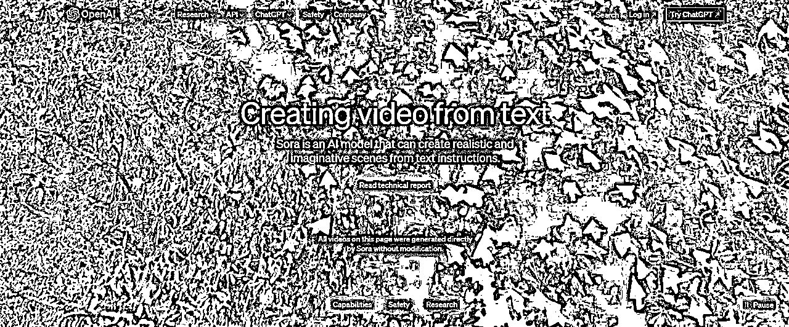

有人把 2024 年真正的红利点概括成一句话：文字转影像。

特别提示：Sora 尚未对外开放，也没有所谓的测试申请，任何账号买卖、课程培训都别信。

### 1.2 效果对照

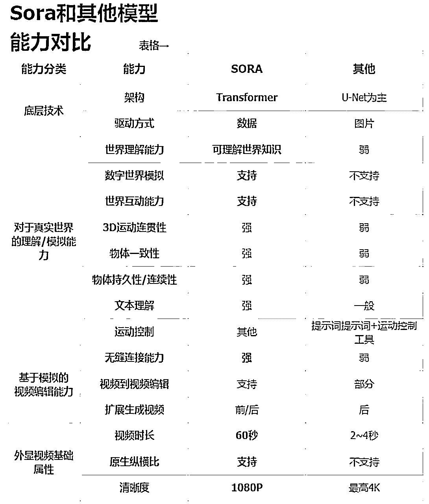

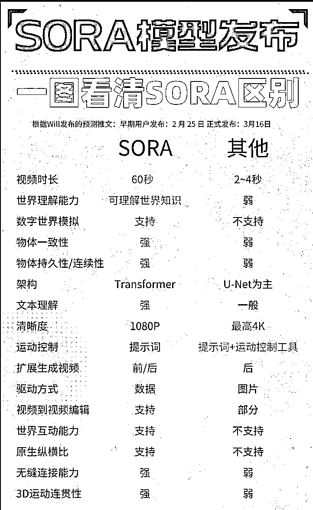

05f698ff0d851448e2749474649b3b.mp4【在线播放】

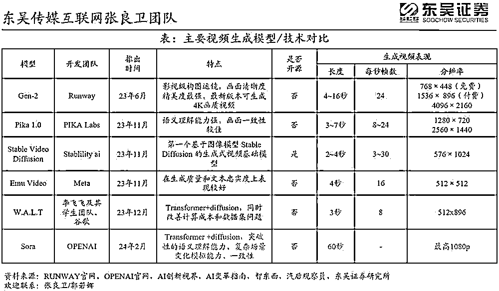

### 1.3 Sora 的六项长处

《每日经济新闻》的记者翻完官方技术报告，归纳出 Sora 的六个亮点：

（1）理解准、题材广。Sora 的一个显眼本事，是能读懂最长 135 个单词的长指令。它会照用户给的文字，产出场景各异、人物不同的高质量片段。短短一句描述，可被它扩成一分钟的高清画面；题材从人到动物，从葱郁风景、城市街景、花园，到水下的纽约，覆盖面相当宽。

（2）对语言的理解够强。OpenAI 借了 DALL-E 模型的 re-captioning（重述要点）手法，给视觉训练数据配上描述性字幕，既让文字更准，也把成片质量往上提。和 DALL·E 3 类似，他们还用 GPT 把用户那句简短提示扩写成更细的版本，再喂给视频模型，于是 Sora 能更贴指令地出片。

（3）图片、影像也能当输入。除了文字转影像，Sora 还收已经存在的图片或片段作为提示，因此能干的编辑活儿不少：做循环画面、把静止图变成动画、沿时间线往前或往后延展内容等。OpenAI 在报告里放了几段基于 DALL·E 2 和 DALL·E 3 图片生成的样片，既秀了功能，也露了编辑方面的潜力。

（4）可续写内容。因为输入形式多样，用户能拿图片造影像，也能给现有片段打补丁。作为基于 Transformer 的扩散模型，Sora 还可以顺着时间轴向前或向后拉长。官方给出的四段样片，都从同一小段起头，朝时间线更早的方向延伸；所以开头各异，收尾却一致。

（5）设备适配到位。Sora 的采样能力不俗，宽屏 1920x1080p 到竖屏 1080x1920 之间，任意尺寸都能接住，能为不同设备生成贴合原始比例的画面。在正式生成高分辨率内容前，它还能先用小尺寸快速搭个原型。

（6）场景与物件稳得住。Sora 能产出视角不断变化的影像，人物、场景元素在三维空间里的运动更显自然，遮挡关系也处理得不错。老模型常有个毛病：物体一旦出了画面，就可能跟丢。Sora 靠一次给出多帧预测，让主体即便短暂离开视野，也能保持原样。

### 1.4 它可能搅动哪些行业

假如 Sora 真把文字转影像做成了，会带来什么？

1. 影视作品里可以没有演员，这对演员是个小考验；真正意义上的“虚拟偶像”或将冒头，之前的二次元人物还没到“偶像”那一步。
2. 编剧这行会受益，剧本和文字功底将变成硬通货。
3. Sora 或许才算真正的文字转影像；早前的产品大多只做两秒，无非让对象轻微动一动。
4. OpenAI 的领先身位继续拉大，那些还在拿大模型跑分 PK 的厂商会感到压力。
5. 最先受冲击的是影视，尤其是特效。用 AI 做部分特效和高危镜头，拍摄成本能砍下一大截，危险也少了许多。
6. 摄影师这行同样会被波及；拿文字直接出画面，不少拍摄环节可以省掉。
7. 短内容走红以后，剪辑师成了热门工种。若剪辑能被 AI 接手，恐怕有不少人要另谋出路。
8. 对大量短内容创作者而言，让 AI 分担繁琐的剪辑，效率能明显往上走。
9. 歌手拍 MV 往往烧钱，若能由 AI 生成所需画面，制作费也能省下一块。
10. 另外，真到了文字转影像成熟那天，不排除有人拿它干违法勾当，冒出新的犯罪手法。

不过，就 Sora 官网眼下放出的画面看，逼真度还没到以假乱真的地步，短期内不至于让谁丢饭碗，但辅助作用是有的，拿来做个动画片问题不大。

在官网，OpenAI 说 Sora 是能理解并模拟现实世界的模型底座，并相信这项本事是通向 AGI 的重要节点。文字转影像究竟能掀起多大浪、会不会翻船，还得让时间说话。

关联阅读：笔记侠、中央政法委长安剑、任泽平、中国电影报的相关文章。

### 1.5 公众何时能用上

此前有人照 OpenAI 以往的发布节奏，猜过 Sora 的面世时间。但 Sora 团队负责人泼了盆冷水：它还不算产品，短期内不会向大众开放。照这看，开放恐怕没那么快。

【Sora团队负责人：Sora还不是产品 短期不会向公众开放】

3 月 13 日，Sora 核心团队的三位负责人露面受访。他们提到，Sora 眼下还在收集反馈的阶段，算不上产品，短期内不会向大众开放。除了时间问题，Mira 还聊了 Sora 的其他几个关键点。

### 1.6 内测入口现状

要强调的是：截至 2024 年 2 月 18 日，Sora 没有公开测试，也没有可提交的测试申请，国内同样找不到尝试的口子。下面这些来源真伪难辨，只作参考。

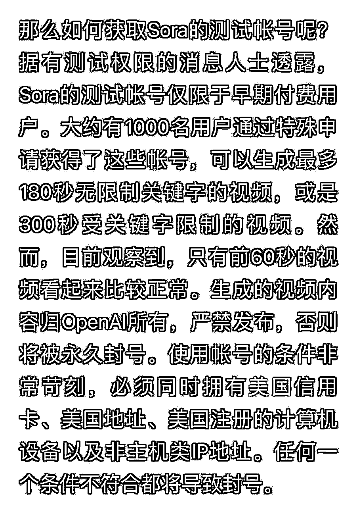

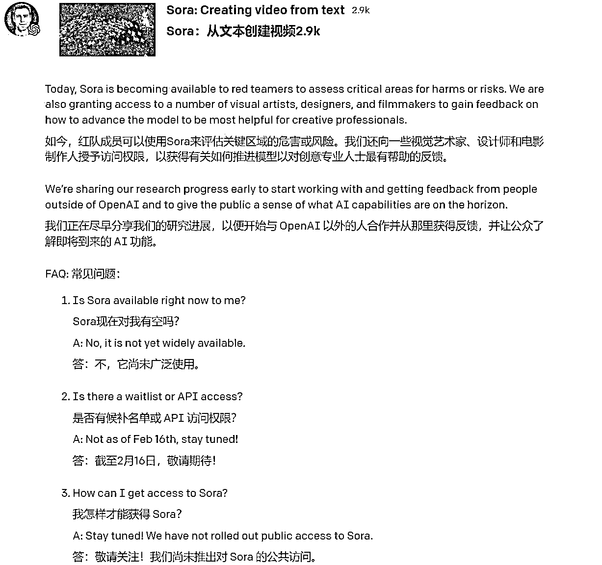

https://forum.openai.com

这是 OpenAI 的官方论坛，有消息称加入后有机会获得测试名额。

早前红队公开招过人，门槛不低，现已关停。Sam 提过，进了红队就能拿到 Sora 的测试机会：https://openai.com/form/red-teaming-network

## 二、Sora 的本事在哪

OpenAI 的原文里有说明；也可以翻圈友 @云舒 那篇星球帖，其中第三章《Sora 能力解析》正是在官方文章基础上做的拆解。

OpenAI 原文：Video generation models as world simulators

云舒那篇星球帖：《Sora 深度解析：OpenAI 的文生视频革命》

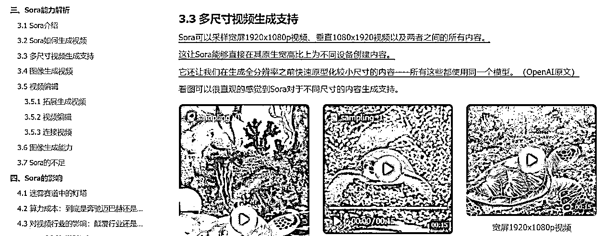

## 三、样片与案例

### 3.1 官方样片

① 提示词：雪原草地上，几头披着长毛的猛犸象缓步走近，毛在风里轻轻摆动；远处是覆雪的树与山，午后阳光穿过薄云、自高处洒下暖意；低机位，带景深。2ad70fa0af3f48790b735ad1f1aeaf76.mp4【在线播放】

② 一段带着自制感的画面，拍的是 2056 年尼日利亚拉各斯街头的人，镜头像手机随手拍的。Sora 确实能模拟现实，连摄影和导演的表达套路都学去了几分。提示：一段精美的自制视频，展示2056年尼日利亚拉各斯的人们。用手机….mp4【在线播放】

③ 提示词：东京街头，一位时髦女性走在暖色霓虹与动态城市招牌之间。黑皮衣、红长裙、黑靴子，肩背黑包，墨镜配红唇，步子自信又随意。路面湿漉漉地反光，把五颜六色的灯映成镜面，行人来来往往。演示.mp4【在线播放】

④ 提示词：镜头贴着蚁巢内部，以蚂蚁的视角移动。WeChat_20240218175600.mp4【在线播放】

⑤ 提示词：一座大教堂里挤满了猫，到处都是；一名男子步入教堂，朝端坐宝座的巨型猫王躬身。案例1.mp4【在线播放】

⑥ 提示词：一段逼真的画面，蝴蝶在水下掠过美丽的珊瑚礁。WeChat_20240218211204.mp4【在线播放】

⑦ 提示词：一片叶子的微距特写，叶脉里有迷你火车穿行。WeChat_20240218211217.mp4【在线播放】

### 3.2 OpenAI 官方 TikTok 账号发布

#### 2 月 24 日合辑

WeChat_20240225122522.mp4【在线播放】

提示词：龟壳由玻璃制成，裂缝用金缮工艺修补，夕阳下的黑沙滩上，这只乌龟缓缓爬行。WeChat_20240224100229.mp4【在线播放】

#### 2 月 21 日合辑

OpenAI 的 TikTok 账号发布了最新一批 Sora 短片。WeChat_20240225122347.mp4【在线播放】

提示词：一只拉布拉多犬套着黑色连帽卫衣，端坐电脑前飞快敲键盘，屏幕的光映在狗脸上。7a654892637bcfcc306afd5a995984ed.mp4【在线播放】

提示词：一支画质粗糙、观感糟糕的超级碗广告。453c235c4b0275a5701af00e55205671.mp4【在线播放】

提示词：用披萨搭成的比萨斜塔。e8d90be3a652d264c05dfef87472b5cf.mp4【在线播放】

#### 2 月 20 日合辑

提示：摄像机贴地，紧紧跟着丛林里的蚂蚁，一路钻入地下，进入它们的世界。f697a4812a0db9e28911b4962f16ff43.mp4【在线播放】

Sora 能照文字造出逼真又带想象力的影像，也能让静态图片活起来。比如下面这几条：

提示 1：小土豆国王头戴华丽王冠，端坐王座，俯瞰它辽阔的土豆王国——臣民是土豆，城堡也是土豆。
提示 2：一座咖啡馆微缩立体模型，点缀着室内绿植；木梁在上方交错，冷萃咖啡台上摆满小瓶和玻璃杯。
提示 3：一朵写实的云，形状拼出“SORA”。
335068c586656c8231c5f3ea1edcbd12.mp4【在线播放】

### 3.3 案例资源导航

入口：http://mianfei.chat/sora

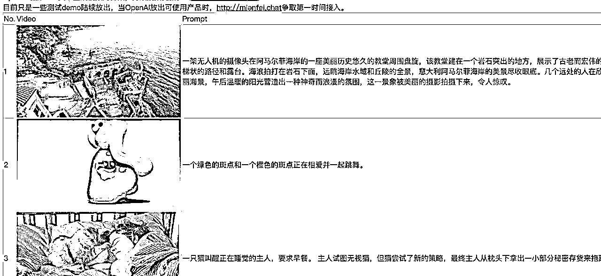

入口：https://www.aisora.org/

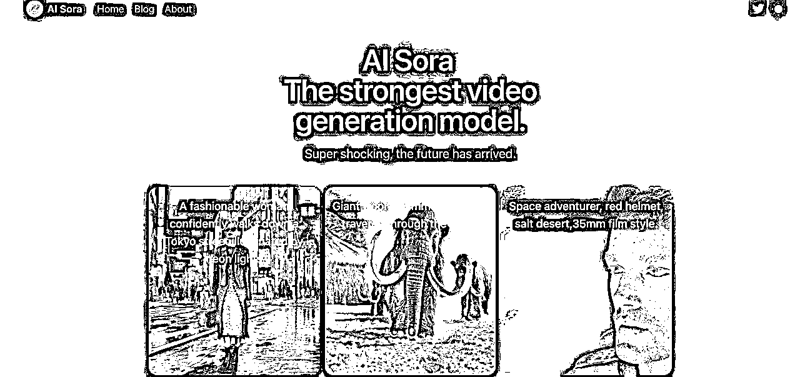

入口：https://sorahub.video/
每天自动抓取网络上的 Sora 短片，可下载，附提示词。

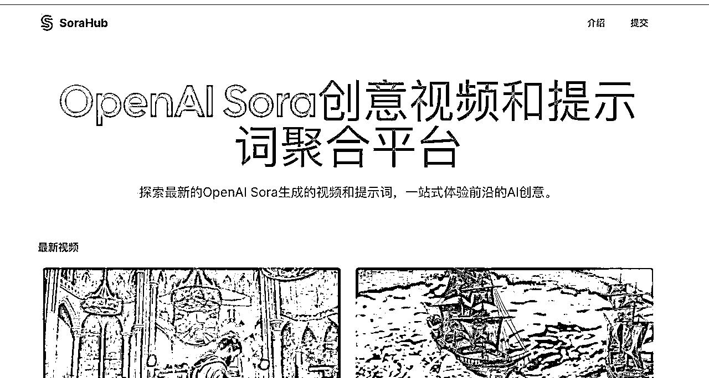

入口：https://soraai.fun/zh/
汇总展示当下 Sora 制作的短片，以及 YouTube 上的相关讲解。

# Sora 全解析：技术、商机与资本

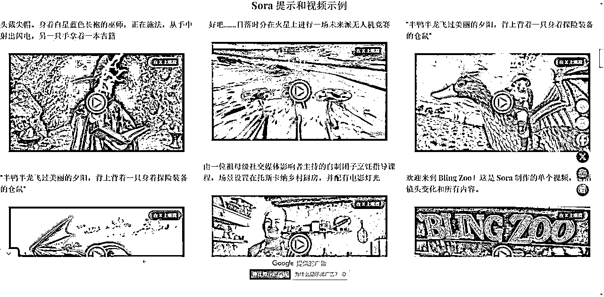

磨铁文化整理：Sora 演示视频汇编

### 3.4 多视角并行生成演示

OpenAI 研究员 Bill Peebles 放出的样片显示，Sora 可以在同一次生成中输出多路视频，并以分屏方式排列，等于同时给出不同机位的画面。在他展示的案例里，一条视频素材就整合了五个镜头，说明系统无需人工剪辑即可自行安排多角度呈现。

演示所附的 mp4 文件也一并放出，可直接在线播放。

### 3.5 音效合成与 Sora 的联动

elevenlabsio 的合成音效工具，目前已经能为 Sora 生成的画面自动添加配音，识别过程依赖提示词和视频像素。照这个方向演进，AI 距离打造沉浸式虚拟世界正越来越近。

WeChat_20240225122359.mp4【在线播放】

### 3.6 高能片段混剪

WeChat_20240225123243.mp4【在线播放】

## 四、技术原理剖析

### 4.1 官方技术报告（中英对照）

Sora 的底层采用 Transformer 架构，并借鉴了 DALL·E 3 与 GPT 系列的能力，走的是文本到视频的生成路径，把自然语言转化为图像或动态画面。

OpenAI 官网展示了这套生成逻辑：Sora 本质上仍是深度神经网络，具体说是一个以 Transformer 为骨架的扩散模型。它从大规模视频训练数据中自主总结出不同风格、题材和类型的特点。

Transformer 的典型结构是编码器—解码器，负责把源语言转译为目标语言；扩散模型则先向数据注入高斯噪声，再通过逆过程去噪，最终复原数据原貌。不纠结术语的话，可以把 Sora 看作翻译器、搜索引擎和概率生成器的组合。

拿到提示词后，Sora 先拆解文本，抽取主题、动作、地点、时间、情绪等关键信息，然后在其资料库中寻找最匹配的影像片段；接着，它把这些片段融合成一条符合指令的新视频。创作过程中，模型需要理解场景内有哪些对象和角色、它们的外观、运动方式、彼此互动，以及面对环境变化时的反应。

Sora 也会根据用户偏好调整成片质感。例如想要 35mm 胶片风格，它会修正亮度、色温和机位，这跟 Midjourney 等文生图工具的做法类似。输出规格上，Sora 支持 1920x1080 分辨率，也可以从静态图片出发生成视频，或用新镜头延展已有素材。给它一张森林照，它能加进飞鸟、走兽和人物；给它一张汽车行驶图，它能补出道路、信号灯、沿途建筑和景观。

Sora 将两段视频拼接后生成的奇幻画面/OpenAI

### 4.2 Sora 超详细解读

一份题为《最强文生视频模型 SORA 超详细解读》的深度资料，可作为补充阅读。

### 4.3 腾讯科技拆解

腾讯科技在 Sora 引爆科技圈后，第一时间发布了官方技术报告的拆解文章。

### 4.4 阿里巴巴分析

阿里方面提供了两篇内容：一篇用图示讲清“复刻 Sora 有多难”，另一篇梳理了 Sora 的技术推演过程。

### 4.5 其他笔记

另有关于 Sora 训练过程的笔记，以及一篇万字技术解析报告可供参考。

### 4.6 思维导图版技术解读

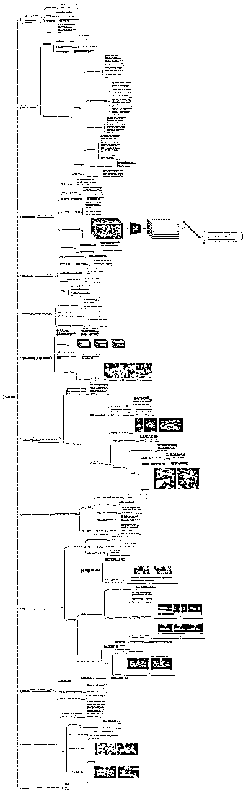

### 4.7 Sora 技术参考论文

以下是论文清单，点击即可跳转至对应内容：Sora 参考论文。

## 五、应用展望

### 5.1 搞流量

有流量就意味着有收入。AI 行业每次出现新物种，都会成为舆论焦点，Sora 在视频生成领域的地位几乎可以比肩 GPT-4.0 在大模型中的地位。此时做流量生意，最容易快速拿到结果。眼下关于 Sora 的公众号爆文和刷屏短片已经不少，无论捧还是踩，话题热度足够支撑一波流量收获。

### 5.2 卖账号

Sora 还没有向普通用户开放，但市场早已迫不及待。当年 ChatGPT 已经验证过这条路，OpenAI 账号生意大概率会继续火下去。需要留意的是，国内大模型和海外产品之间的差距，普通人起初并不容易分辨；文生图时差距开始现形，等到 Sora 正式开放个人使用，这种落差会更加明显，到时候想用 Sora 的人只会更多。

### 5.3 卖课程

课程几乎是 AI 行业最稳定的变现方式之一。目前最赚钱的 AI 课程卖家要数李一舟，坊间传闻年收入超过五千万。更有意思的是，Sora 账号尚未开放，相关课程已经提前上架——这就是“搞钱”的驱动力。AI 工具类课程预计会长线走俏，也算先行者向后来者收取的“带路费”。当然，更合理的节奏是先有产品，再卖课。

友情提示：仅示例，请勿购买

### 5.4 套壳

由于各种原因，国内乃至全球的套壳站点和 App 一直不少。只要掌握流量或分发渠道，套壳生意就能带来持续收入。Sora 刚推出，已经有人借此赚到第一年年费。

常见玩法是：先注册含 sora 关键词的域名，再在应用商店上架相关 App，同时接入 Runway 等现成 API，把流量跑起来；等 OpenAI 发布 Sora API 后，再无缝切换过去。

### 5.5 投资

如果你是二级市场投资者，关注 AI 行业大概率有所回报（A 股可能是例外）。Sora 公布后，谁最受伤？Adobe。消息发布当天，Adobe 股价在 2 月 16 日下跌 7.41%。若提前布局空单，收益相当可观。

### 5.6 提示词交易

去年的 AI 绘画提示词交易已经热过一轮，今年面向 AI 视频的提示词同样会形成市场，从打包售卖到平台化交易，模式都能复制。日光之下，并无新事。

### 5.7 剧本创作

提示词的更高阶形态，是视频剧本创作。无论内容长短，视频对剧本的依赖都会加深，也更考验创作者本身。从这个意义上看，Sora 对内容创作者是重大利好。如果把未来的视频项目比作电影，编剧的角色会越来越重，编剧、导演、制片之间的边界也可能进一步融合。大团队的压力在增加，小团队的窗口反而在打开。

### 5.8 视频制作

视频生成本身就是 Sora 的主业，无需多讲。只要肯花时间学习和试错，持续提升视频质量与产量，商业机会自然会来。早早在 AI 绘画阶段入局的团队和个人，切换过来的成本更低，优势也更明显。

### 5.9 原业务优化

AI 工具对生产力的提升没有疑问。与其单独立项用 AI 变现，不如先把原有业务 AI 化。商业竞争到最后拼的是效率，成本一旦降下来，定价就会有更多弹性，获客与竞争优势随之而来。所有业务涉及视频的公司（注意是“涉及”，和第 08 小节的语境不完全一样），都值得重视 Sora，并思考如何把它嵌入现有流程。

### 5.10 企业服务

很多传统企业并没有自我 AI 化的能力，面向他们的咨询服务由此成为机会。这类业务与过去的咨询公司类似，但团队对 AI 的理解更深，也更强调落地 RPA（机器人流程自动化）。另一条路径是商业化软件：把行业知识与生产流程封装成工具，再通过 Sora 等 API 完成具体功能，最终实现变现。

### 5.11 Sora+电商

用 Sora 批量制作电商产品宣传片用于投流，或者生产各类商品短片做植入推广，都是可行方向。AI 模特换装、虚拟试衣之类的玩法，已有实践参考。

### 5.12 开发与 Sora 相关的网站或工具

技术背景的从业者可以围绕 Sora 开发导航站、AI 写真工具等产品来获取收益，提前储备相关域名也是一种布局思路。

### 5.13 其他圈友分享的机会

## 六、名人观点&相关报道

### 6.1 360 董事长周鸿祎

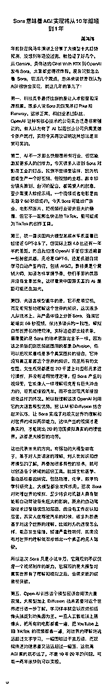

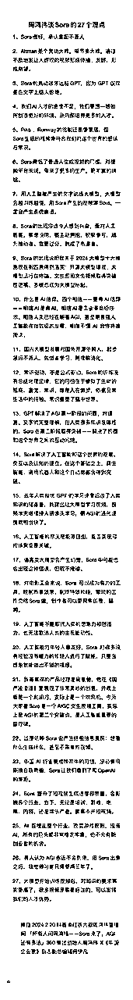

### 6.2 中央电视台台长慎海雄

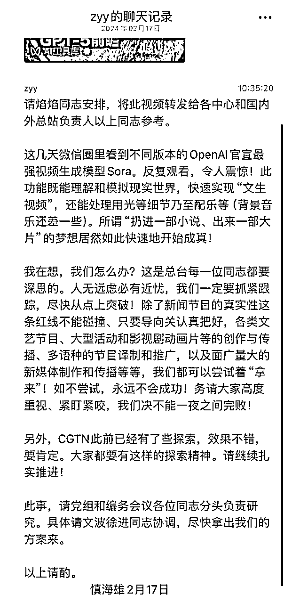

### 6.3 媒体人胡锡进

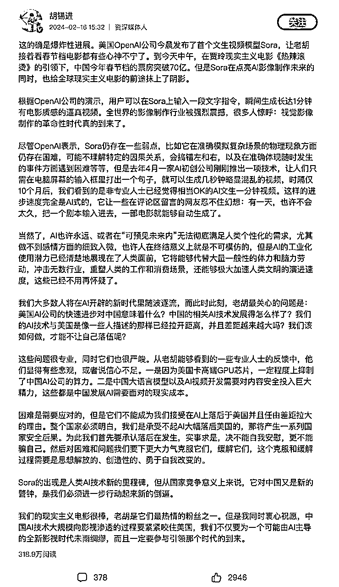

### 6.4 特斯拉 CEO 马斯克

### 6.5 Runway 联合创始人兼 CEO Cristóbal Valenzuela

他感叹技术迭代快到超出想象：原本需要一年才能完成的进展，压缩到几个月，又在几天甚至几小时内实现。

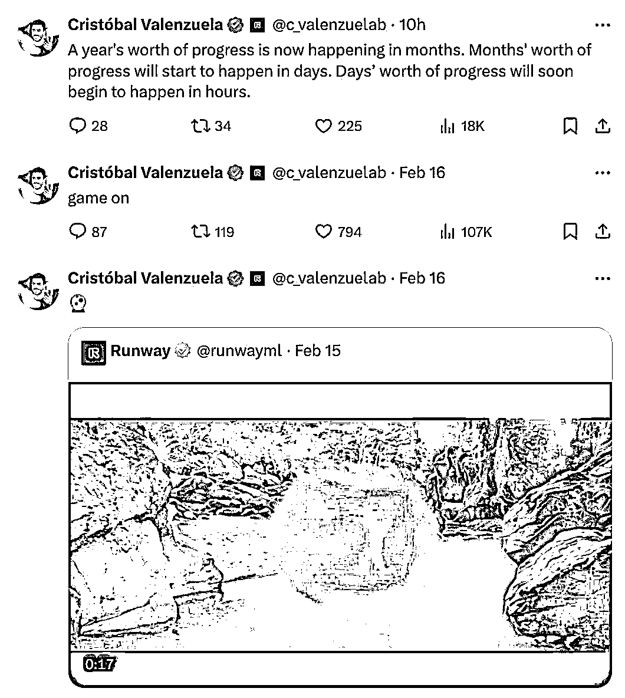

### 6.6 出门问问 CEO 李志飞

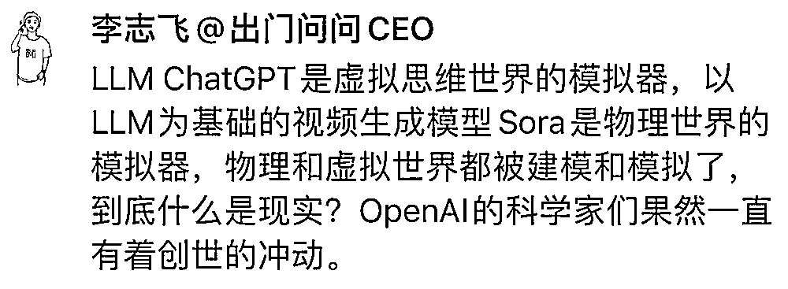

### 6.7 前阿里副总裁贾扬清

贾扬清评价很直接：“真的非常牛。”他认为，对标 OpenAI 的公司会迎来一波被大厂因 FOMO（害怕错过）而收购的机会，开源生态追上来仍需时间。算法类小厂的出路是：要么在算法上接近 OpenAI，要么在垂直领域做深应用，要么干脆走开源。他还预判，infra（基础设施）的需求会继续大增。

### 6.8 相关报道

#### 6.8.1 商业博主刘润

刘润撰文探讨了 Sora 的发布究竟意味着什么。

#### 6.8.2 AI 博主卡兹克

卡兹克针对 OpenAI 新发布的文生视频模型 Sora 写道：“现实，不存在了。”

#### 6.8.3 量子位

量子位报道称，OpenAI 首个视频生成模型效果炸裂，一分钟流畅高清，有网友直呼“整个行业 RIP”。

#### 6.8.4 钛媒体

许四清认为，Sora 进一步拉大了中美 AI 之间的差距。

#### 6.8.5 新智元

新智元用“炸裂登场”“彻底端掉行业饭碗”等表述形容这个能实现 60 秒一镜到底的模型，并追问“世界模型真来了？”

#### 6.8.6 清华大学

清华大学评论称，Sora 的发布意味着 AIGC 视频时代正在加速到来。

#### 6.8.7 央视网

央视网发文向网友提问：OpenAI 首个文生视频模型亮相，你觉得咋样？

#### 6.8.8 新华社

新华社则发出疑问：Sora 来了，会砸掉谁的饭碗？

#### 6.8.9 CSDN

CSDN 的标题是：OpenAI 大杀四方，Sora 彻底革了视频的命。

#### 6.8.10 中泰证券

文生 3D——人工智能的下一站。中泰证券判断，以大模型和生成式为代表的新一代 AI 技术正深刻改变产业格局。从 ChatGPT 的文生文，到 DALL·E 的文生图，再到 Sora 的文生视频，“暴力美学”不断捅破技术天花板，多模态已成为公认方向。继文本、代码、图片、视频之后，最可能实现突破的模态是 3D。

海外 AI+3D 有两条探索线：非工业方向以谷歌 DreamFusion 和英伟达 Magic3D 为代表，主打游戏和元宇宙中的 3D 资产；工业方向以衍生式设计软件为主，PTC Creo、Autodesk Fusion 360 均提供相关能力。投资建议上，可长期跟踪文生 3D 建模领域的进展。

## 七、研究报告

### 7.1 券商报告

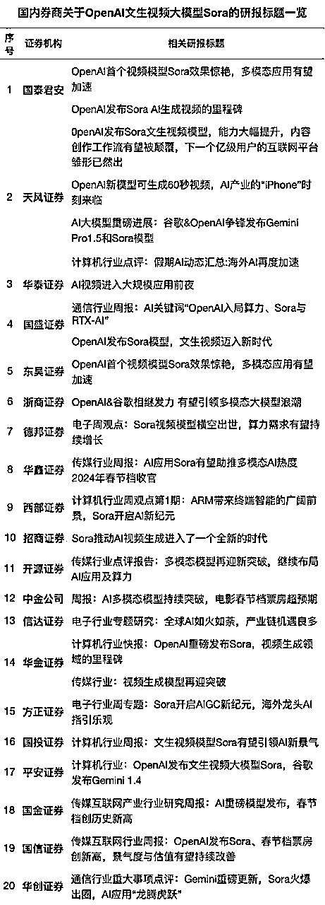

### 7.2 投资纪要

### 7.3 行业报告

## 八、国内大厂文生视频布局动态

国内大厂一边推进语言模型，一边加速圈占视频生成赛道：

## 九、对投资市场的机会

### 9.1 Sora 将为 AI 赛道带来的投资机会

止于至善投资总经理何理认为，Sora 有望再度点燃 AI 行情。虽然当前生成的视频只有一分钟，但按照 OpenAI 的迭代速度，从一分钟到几十分钟并不遥远。未来数年，影视制作和短内容生态都可能被彻底改变。

他认为 AI 热潮已进入第二阶段，重点从概念转向产品创新和业绩验证。后续行情大概率是应用端与基建端同步走强：应用端关注与 AI 深度结合的 B 端产品，基建端留意 GPU、光模块、液冷、数据要素等方向。

中信建投证券表示，AI 仍是当前科技投资的核心主线。海外大模型和应用迭代速度很快，Sora、Gemini 1.5 Pro 等新模型带动多模态能力升级，也拓宽了应用边界，算力基础设施投资将因此受益，光模块、ICT 基础设施等板块值得持续关注。

申万宏源指出，对短视频 UGC 平台而言，借助 AI 提升剪辑工具能激发创作者经济，但竞争格局也会变化。深度内容将受益，IP 价值上升，低门槛浅内容的竞争会更卷。创意工具类公司要守住 B 端客户粘性和版权库积累。AI 伪造内容可能干扰新闻生产与传播，识别合成视频会成为内容审核的核心。可关注光通信、算力设备、多模态算法、IP 储备丰富的深度内容创作，以及美图等有 AI 商业化场景的公司。

招商基金预计，AI 赛道仍会是未来一段时间的主线之一，产业链内算力与应用的机会值得持续布局。博时基金认为，在海外 AI 应用突破的催化下，板块走势强劲，产业逻辑顺畅，后续增长持续性和业绩超预期概率都有提升，对后市相对乐观。

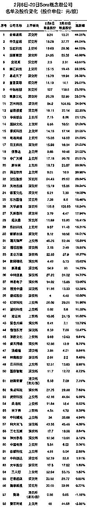

### 9.2 上市公司反应

据财联社不完全统计，截至发稿，岭南股份、名臣健康、因赛集团、首都在线、中科信息、萤石网络、凌云光、芒果超媒、华是科技、东港股份、实丰文化、世纪天鸿、天创时尚、创源股份、巨人网络、会畅通讯、千方科技、北信源、智微智能、掌阅科技等 20 家上市公司，均在近两日通过互动平台就 Sora 相关问题作出回应。

其中北信源表示，公司与 OpenAI 已完成文字生成图像技术的研究对接；对于 Sora 这项最新公布的视频生成技术，相关对接研究正在进行。

除此之外，因赛集团、云从科技、当虹科技、易点天下、汉王科技、博汇科技、海康威视等公司也以其他方式回应了 Sora 相关情况。据媒体报道，因赛集团工作人员透露，按计划 AIGC 项目团队将在三月开发文字驱动视频生成功能，成熟后投入公测。另据科创板日报报道，当虹科技相关负责人表示，视频生成技术已有进展，生成时长和效果仍在突破中。

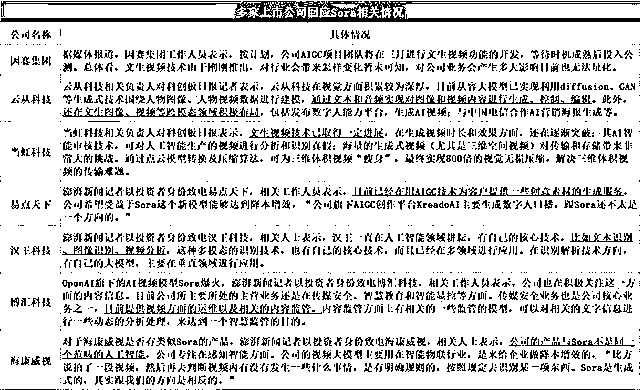

【蓝色光标：预计 2024 年由 AI 驱动的收入有望实现 10 倍以上增长】

财联社 2 月 22 日消息，文生视频模型 Sora 引发市场高度关注。蓝色光标 CEO 潘飞接受采访时表示，公司去年已在大量实践中使用 AI 生成视频，团队能熟练调用 Runway、Pika、Wonder Studio 等模型，按内容需求生产 AI 视频。

他认为，Sora 全面应用后，视频创作会迎来新的智能涌现，相关案例也会井喷。目前蓝色光标已有上千个通过生成式 AI 落地的案例（含出海业务），其中由 AI 深度驱动并创造规模化收入的约占三分之一以上，AI 带来的收入已超过 1 亿元。预计 2024 年这一收入有望增长超 10 倍。（财联社记者 崔铭）

【中文在线：公司海量 IP 未来或可运用 Sora 或类似应用生成短剧/短视频】

财联社 2 月 21 日消息，中文在线接受调研时表示，Sora 是 OpenAI 推出的视频生成大模型，可通过文字提示生成视频。公司拥有大量文字 IP，并已具备成熟的 IP 衍生开发商业链条。

# Sora搅局：内容生产提速，鉴别需求浮现

综合目前已披露的信息判断，Sora这类工具大概率会让内容制作变得更高效，同时把成本压下来。对于手里攒着大量IP的影视企业而言，今后完全可以借助Sora或同类产品产出短剧、短视频，再通过已经跑通的短剧营销、短视频营销渠道，实现规模化的商业变现。

**华策影视：4秒文生视频技术已就位**

2月21日财联社报道，华策影视在互动平台透露，公司把AI研发与应用放在重要位置，并紧盯Sora这类新兴文生视频平台。去年公司搭建了AIGC应用研究院，自己开发的编剧助手、剧本评估、视频检索以及AI剧照等功能，部分已在内部落地，部分仍在测试。借助对开源技术的学习、吸收和消化，目前其技术储备能够产出4秒时长的文生视频。下一步，公司计划探索文生视频等新技术在传媒行业的应用与业态创新。不过公司也说明，这些技术储备短期内不会直接体现在业绩上。

**国投智能：慧眼工作站能识别Sora生成内容**

2月20日财联社消息，有投资者在互动平台发问：国投智能的AI-3300“慧眼”视频图像鉴真工作站，是否具备鉴定Sora视频并出报告的能力？公司回应称，该工作站确实可以识别这类视频，且能出具鉴定报告文书，产品目前已有客户采购。

眼下的AI视频至少横着两道坎：其一是算力，视频对算力的胃口更大；其二是赛道拥挤，科技巨头几乎全部入场，只是产品还没大规模开放公测。另外，W.A.L.T模型的先例提醒我们，算法进步对AI视频格局的冲击不容小视。曹旭特给出的关注方向是视觉算法占优的虹软科技、当虹科技、格灵深瞳，应用层面则可留意金山办公、万兴科技、福昕软件等。

按不完全统计，A股中涉足AI视频视觉算法业务的包括当虹科技、虹软科技、深科达、格灵深瞳、天准科技、博杰股份等，名单如下：

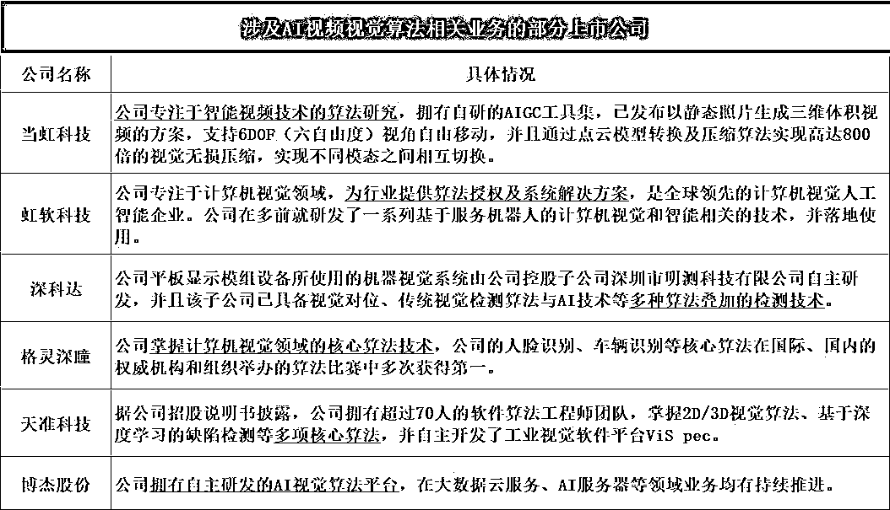

### 9.3 国内AI大模型融资纪录刷新

2024年2月19日，北京月之暗面拿下新一轮超10亿美金融资的消息不胫而走，震动行业。自ChatGPT带火全球AI热潮至今，这是国内大模型创业公司获得的单笔最大融资。参投方有红杉中国、小红书、美团、阿里。此轮过后，月之暗面朝全球第一梯队AI公司又靠近了一步。

## 十、延伸阅读与资料

### 10.1 央视视频报道

555903b68f3a424f83a20c2d80ece3.mp4【在线播放】

### 10.2 首部AI动画片《千秋诗颂》

2月23日晚，中国首部AI动画片《千秋诗颂》启播，中央广播电视总台人工智能工作室同日揭牌。上海人工智能实验室打造的文生视频大模型“书生·筑梦”在仪式上登场。该模型已经开源，用户单位获授权后可免费商用；参数规模逾30亿，能够依据提示词产出有情节、多镜头的分钟级视频，转场顺畅、叙事完整、画质清晰是其特点。

029d2c64-70b3-43d8-a3ee-844b196af83f.mp4【在线播放】

上海人工智能实验室领军科学家林达华博士坦言，受数据与算力等条件制约，“筑梦”在生成能力、视频时长、画面质量方面与Sora尚有距离；不过随着和总台合作的深入，实验室模型在理解中华文化、贴合媒体编创真实生产流程上，逐步显露出独到之处。这种产研协同的新路径，有望让中国AI技术走出差异化路线，并塑造自身的文化标识。

### 10.3 AI视频赛道玩家扫描

不完全统计显示，近一年全球AI生成视频赛道的融资规模已突破数十亿美元，且多数企业尚处种子轮、A轮。今年1月底，A16Z针对AI视频生成领域做了一次系统回顾与展望，梳理出市场上20余款明星产品。

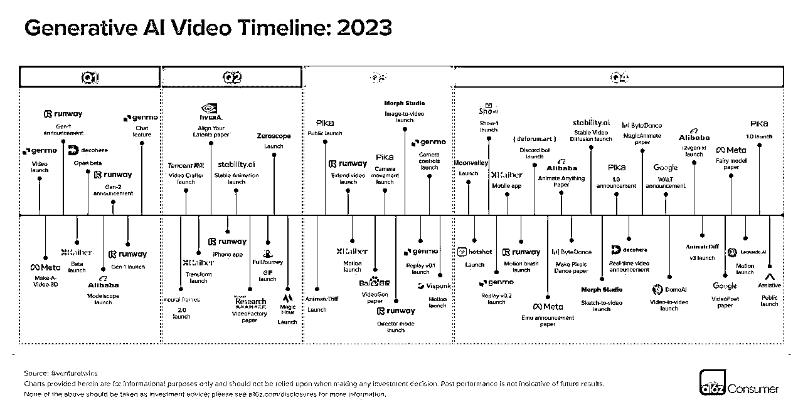

2023年AI视频生成行业参与者盘点

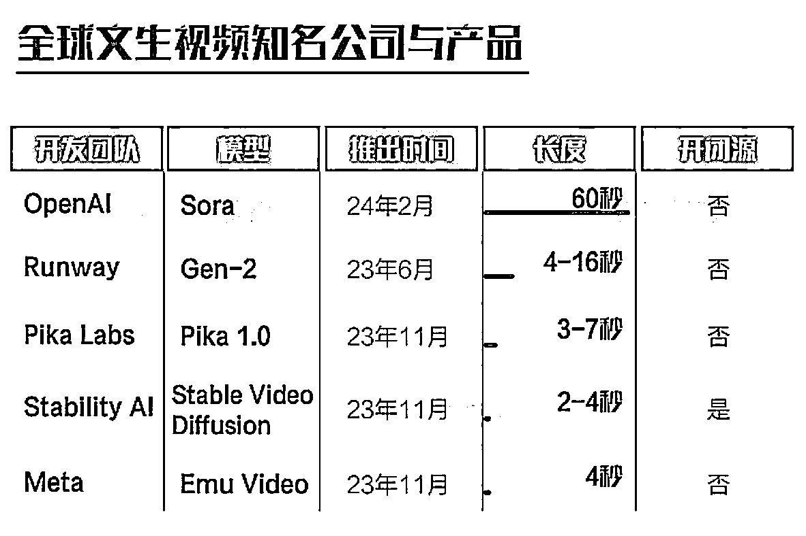

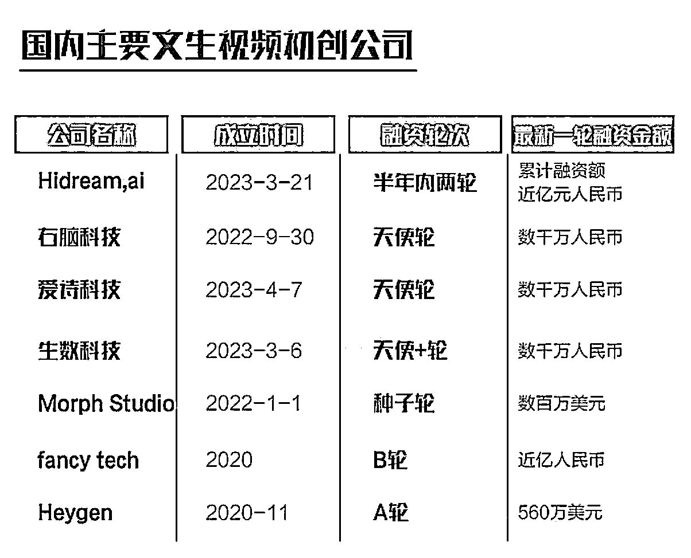

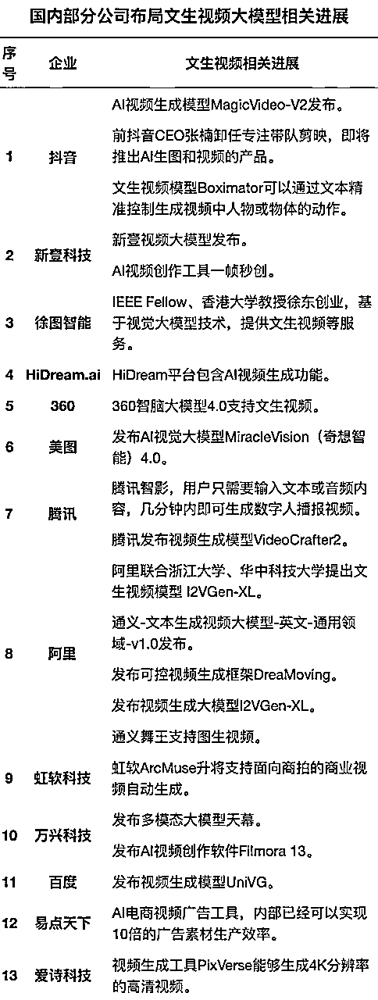

### 10.4 Sora团队档案

Sora的开发班底引发外界高度关注：组建不到一年，核心成员15人，研发负责人Tim Brooks与Bill Peebles来自伯克利，团队中还有多位华人研究员。

#### 10.4.1 核心成员

公开资料显示，Tim Brooks和Bill Peebles的博士阶段都在伯克利人工智能研究所度过，导师同为Alyosha Efros。

Tim Brooks读博期间捣鼓出了InstructPix2Pix，此前在谷歌做过支撑Pixel手机摄像头的人工智能项目，也在英伟达研究视频生成模型。他还是OpenAI文生图模型DALL·E的核心研究员之一。

除了技术，Tim Brooks的摄影作品拿过国家地理、自然的最佳摄影奖，以及国家野生动物联合会颁发的奖项。他还登上过纽约百老汇灯塔剧院的舞台，拿过Beatbox国际奖项。他讲过：“我对人工智能满怀热忱，巧的是，它恰好和我钟爱的摄影、电影、音乐搅在一起。”

William（Bill）Peebles的本科阶段在麻省理工学院度过，师从Antonio Torralba，先后在Adobe和英伟达实习。

这个开发团队里，00后面孔并不稀罕，还有几位华人研究员（其中就有北大校友），以及20岁便入职OpenAI的天才工程师。

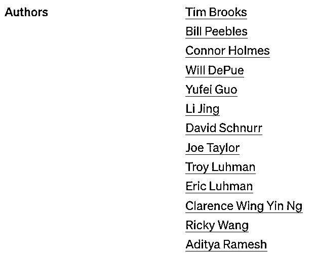

Li Jing是DALL-E 3的共同一作。他2014年从北京大学物理系本科毕业，2019年在MIT拿到物理学博士；在Meta完成两年多博士后研究后，2022年进入OpenAI。

2010年，靖礼披上中国队战袍出战第41届国际奥林匹克物理竞赛，斩获金牌，随后与另外三位金牌得主俞颐超、吴俊东、张涌良一道保送北大（吴俊东去了信息学院，其余三人进入物理学院）。2014年本科毕业后，他远赴麻省理工学院攻读物理学博士。

据了解，靖礼在Meta待了两年，2022年10月转投OpenAI做研究，方向涵盖多模态学习与生成模型，参与过DALL·E 3的开发。2019年，他以Lightelligence联合创始人身份登上福布斯中国30位30岁以下精英榜。

华人作者里还有Ricky Wang，今年1月他才从Meta/Instagram转投OpenAI。

延伸阅读：解密Sora 13人团队：北大校友在内3名华人，应届博士带着21岁天才少年

#### 10.4.2 谢赛宁澄清传闻

此前有自媒体把上交大校友谢赛宁说成“Sora作者之一”，谢赛宁已经发文澄清。

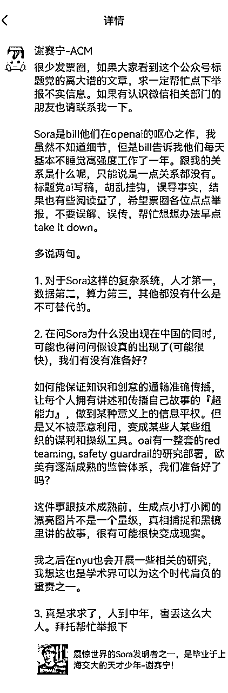

谢赛宁虽不在Sora研发团队之列，但Sora技术报告引用的DiT模型，恰恰是他与Bill Peebles共同完成的。从这个澄清的细节也能看出，Sora领队Bill Peebles的团队近一年几乎不眠不休地高强度运转；这同样反证了“Sora早已开发完毕”的传言不实——它确实是OpenAI新鲜出炉的研究成果。

值得一提的是，Sam Altman偏偏挑在Gemini 1.5 Pro发布两小时后放出Sora，策划痕迹明显。Gemini 1.5 Pro的上下文长度近乎无限（最高可达1000万tokens，付费用户可用100K Tokens），实力相当强悍。

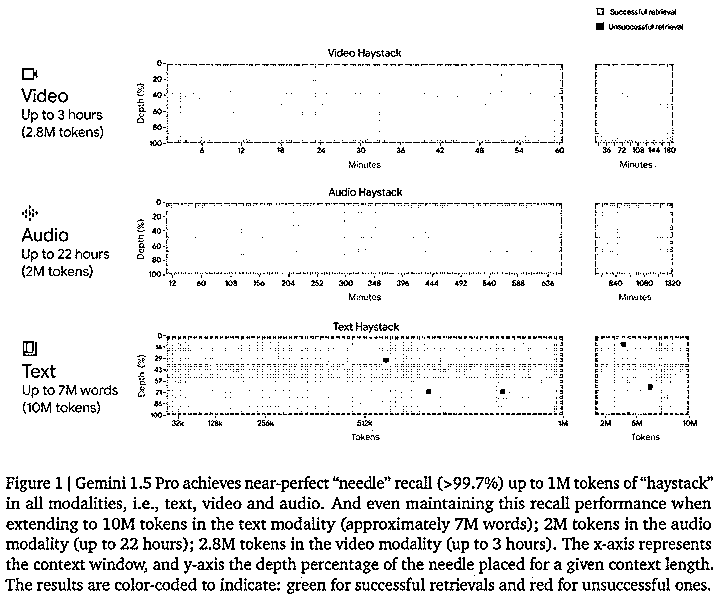

外界原以为Google能靠这次“王炸级”更新霸榜热搜，谁知几个小时后，Sora令人瞠目的视频进步就席卷了整个社交媒体。这样的情况，很难说是巧合。

事实上，Sam深谙此道。据说ChatGPT之所以爆红，正是因为他在得知对手Anthropic要推Chatbot后，敏锐捕捉到这类AI聊天工具的势头，随即叫停员工手头工作，整合已有的研究成果，两周内火速调整并推出ChatGPT 3并发布，先声夺人占据舆论，最终把ChatGPT送上了爆红之路。

#### 10.4.3 OpenAI的工作节奏

这群出色的科学家与工程师，拼劲也相当惊人。优秀的人往往按自己的节奏做事，下面是一位OpenAI技术人员在推特上自述的一天：

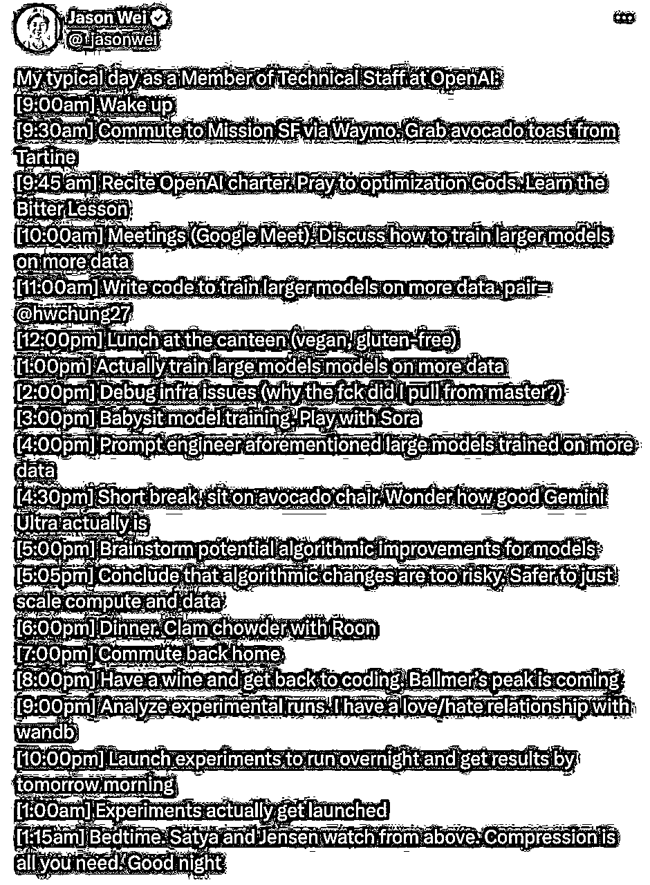

先看Jason Wei的作息：

- [9:00am] 起床；
- [9:30am] 搭Waymo去Mission SF，路上在Tartine买个牛油果吐司；
- [9:45am] 背诵OpenAI章程，向优化之神祈祷，学习《The Bitter Lession》；
- [10:00am] 在Google Meet上开会，讨论怎么用更多数据训练更大的模型；
- [11:00am] 敲代码，在更多数据上训练更大的模型；
- [12:00pm] 去食堂吃午饭（素食，无麸质）；
- [1:00pm] 真正开始在大量数据上训练大模型；
- [2:00pm] 调试基础设施问题；
- [3:00pm] 盯着模型训练进度，顺手玩一下Sora；
- [4:00pm] 对前面训练的模型做提示工程；
- [4:30pm] 短暂休息，坐在牛油果椅子上，琢磨Gemini Ultra性能到底多强；
- [5:00pm] 头脑风暴，思考改进模型的潜在算法；
- [5:05pm] 得出结论：修改算法风险太高，只扩展计算和数据更安全；
- [6:00pm] 吃晚饭；
- [7:00pm] 通勤回家；
- [8:00pm] 喝一杯酒，继续写代码，鲍尔默峰即将到来；
- [9:00pm] 分析实验结果；
- [10:00pm] 启动实验，让它跑一晚上，第二天查看结果；
- [1:00am] 实验真正开始运行；
- [1:15am] 上床睡觉；在纳德拉和黄仁勋的守护下入梦。压缩才是关键。晚安。

只看时间跨度，Jason Wei从起床到睡觉超过16个小时，除了吃饭、通勤、睡觉，几乎都在说工作，称其“卷”并不过分。

### 10.5 其他博主观点

## 附：资料整理者大国的个人思考

在我眼里，AI与其说是短期的风口，不如说会像水电一样渗入日常、工作和思维方式，成为不可或缺的工具。

AI技术一日千里，眼前的短板可以质疑，但要说AI会停止变聪明，那站不住脚。

AI跑得太快，背后其实会有人为踩刹车；试想技术突进过猛、社会来不及消化，监管层承受的压力可想而知。

普通人与其焦虑，不如多琢磨AI怎么用，把AI嵌进自己的思考链条，被淘汰的概率才会小一些。

面对AI冲击，既不必惶惶不可终日，也别对高危岗位抱有侥幸。

普通人一样能搭上AI这班车：不懂技术没关系，把应用场景研究透，甚至挖出新场景，给别人做个样板，就是价值。

多留意海外AI的动向。国内长期处在追赶位置，差距不算小；回看每一次颠覆性的AI节点，基本由海外技术率先点燃。

AI创业里，出海项目肉眼可见地多了起来，这条路值得考虑；海外盘子比国内大得多，而且这是少见的国内外同频的技术变革。

国内内容平台正在主动拥抱AI生产的内容，甚至到了不得不接纳的地步，因为趋势摆在那里。

谁先握住先进生产工具，谁就更有机会站上金字塔尖，这正是AI给到的机会。