# 视频号带货实战指南 202403

> 原始文档：[`jviztcgxxfy.feishu.cn/docx/Le7PdGnEpoyrDpxpauhcLru7nvf`](https://jviztcgxxfy.feishu.cn/docx/Le7PdGnEpoyrDpxpauhcLru7nvf)

三月航海项目 · 视频号带货实操笔记

本手册由生财有术团队制作  
落笔日期：2024年3月20日  
阅读提示：以下内容作者排序不分先后。我们希望借这份材料让你看见项目的多种可能，也更容易理解并动手实践。  
小技巧：若想快速定位内容，可在文档中按 Ctrl+F（Mac 为 Command+F），输入关键词直达相关段落。

# 开场前言

各位好，这里是三月航海项目的视频号带货实操笔记。接下来的时间里，我们很可能还会多次相遇。

正式动手前，先回答几个基础问题：

1）这个项目到底做什么？赚钱上限在哪？

视频号带货，说白了就是借助短视频或直播间完成商品成交。对刚上手的人而言，短视频更友好：某条内容一旦跑出数据，再立刻开播承接，转化效率通常能明显上一个台阶。

不要误以为视频号用户消费力弱。现有案例与官方口径都显示：平均每单价格可超过200元，平均复购水平约六成，想象空间不小。该平台整体退货比例较低，定价余地也比不少渠道更充足；若产品毛利够，适合通过投流放大。今年这块业务增长很快。

2）当前局势怎样？新人还有没有机会？

如今转向视频号短视频带货的人越来越多，平台监管趋严、规则更规范。由此带来两点：一是政策调整频繁，没有一套可以长期照搬的固定方法；二是想做出成绩，必须投入更多精力与执行。

不过，门槛提高也意味着竞争者被筛掉一部分。从实际运营看，流量与转化表现比过去更稳定；官方清理掉不合规内容、改善生态，对认真做事的人是好事。门槛高了一点，但肯努力，结果通常不会差。

希望大家在这次航行中不仅拿到成果，也能交到一群同行者。

以下内容由生财有术与圈友共同制作，仅供航海船员及生财有术星球圈友学习。也欢迎圈里的朋友持续反馈，和我们一起完善；可联系鱼丸（yuwan387）提修改建议。

# 新版手册怎么用：按阶段取用

动笔前先说明一下使用方式，方便你结合自身阶段灵活选择。

整体安排遵循从零到一跑通视频号带货的流程。你可以顺着航线图逐步操作，也可以按自己的需要挑章节看。

特别提醒：本次材料相比以往航海版本改动较大。旧版侧重展示更多玩法，供自由挑选；新版则拆成【必修】与【选修】两部分：

若你从未接触过视频号带货：

建议先花一点时间了解项目全貌：

【项目概述】认识视频号带货

若你对项目已有大致了解：

可从航线图第一阶段开始操作，也就是从第二章读起，一步步完成整个项目：

【实操 1/3】前期准备：选定赛道与商品  
【实操 2/3】做出爆款视频并发布  
【实操 3/3】挂商品、测商品  
【复盘优化】运营优化与工具提效

若你已跑通 MVP，想把项目放大：

可重点看这些章节，拓展更多玩法：

【项目放大】开直播、做付费投放  
【案例拆解】短视频带货案例拆解

本次项目的【航线图】见下：

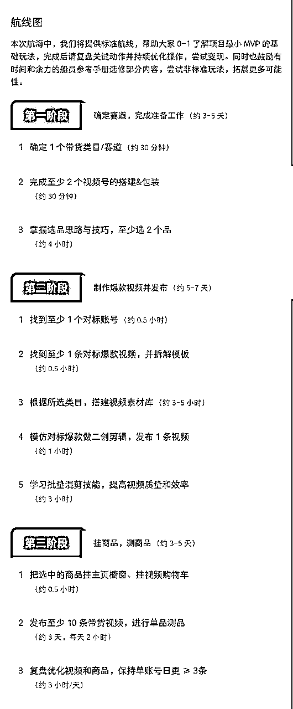

航线图与手册内容紧密对应，你可以按当前所处环节去学对应步骤。

上述航线图任务建议在航海前两周完成；之后把重心放到复盘、优化、提效上，多选品、多发布短视频，提高出单概率。

# 必修篇：先跑通最小闭环

### 本章导读

必修篇从视频号带货的【项目基本情况】与【基础玩法步骤】讲起，让你对项目形成全面认识，并按步骤完成零到一，跑通最小 MVP。

如果你是本项目新手，建议在实操前先了解整体面貌：

【项目概述】认识视频号带货

如果你对项目已有大致了解，就可以按核心步骤开始学习与操作：

【实操 1/3】前期准备：选定赛道与商品  
【实操 2/3】做出爆款视频并发布  
【实操 3/3】挂商品、测商品  
【复盘优化】运营优化与工具提效

必修篇中，航线图与手册顺序对应。你可以按手册顺序学习，逐一完成航线图每个任务。

后续每个关键步骤的章节要点中，我们也会提到相关航线图，提醒你完成对应步骤。接下来正式开始。

## 一、【认识项目】视频号带货到底做什么

### 本章导读

这一章，我们会一步步认识视频号带货。

平台现在是什么状况？具备哪些特点？市场空间如何？玩法怎么跑？……这些问题都会在本章得到回答。

本次航海的核心目标，是带大家从零到一跑通视频号带货，因此先建立整体认知很有必要。一起往下看。

### 1.1 当下格局

#### 1.1.2 赚钱空间

视频号带货的客单区间大多落在9.9元到300元，具体取决于你的类目定位。整体看，这里的客单水平比不少平台更高。

教练 @李诚 的部分成绩可供参考：

一条视频爆发后带来佣金3.2万元；季节性爆品单店当月卖出41.9万元：

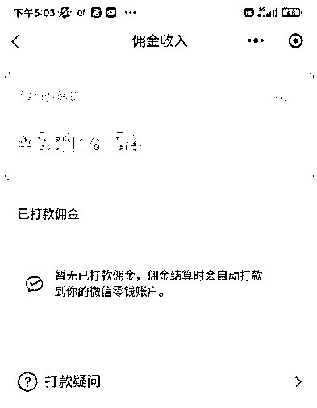

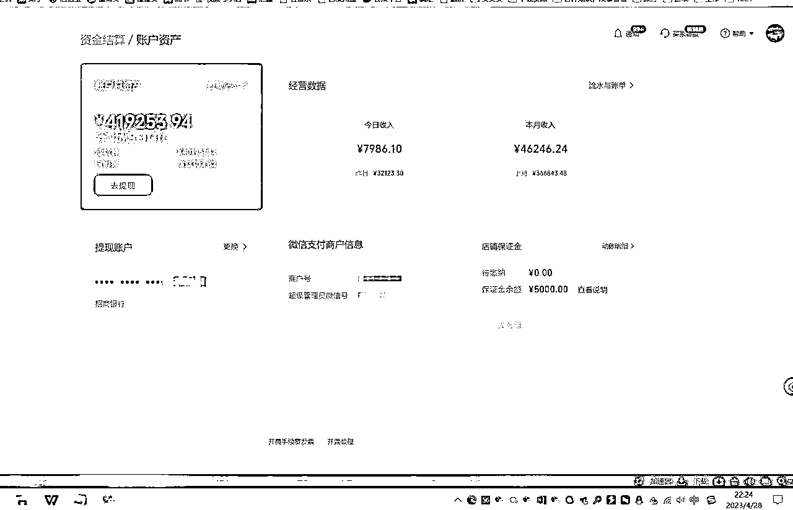

10月热点新闻“狗咬小朋友”出现后，多店铺的训狗、驱狗类产品迎来爆单：

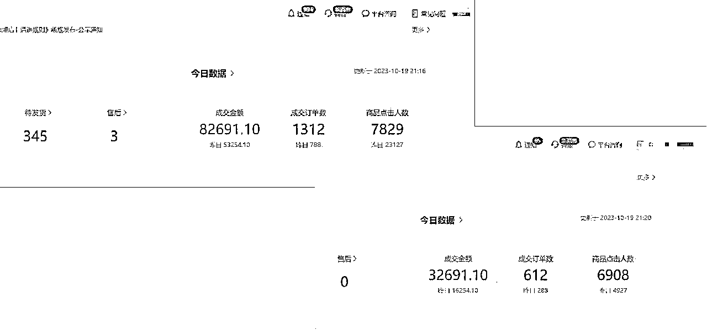

单场直播成交额分别为3.4w、6.1w、4.5w：

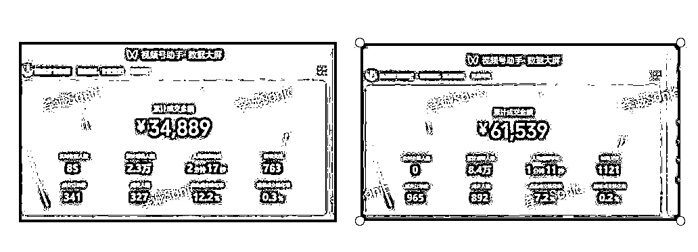

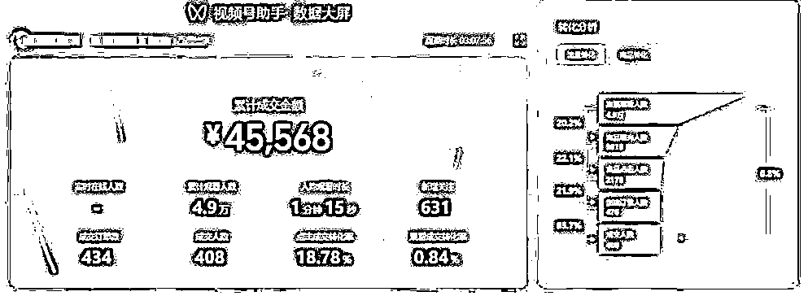

对刚起步者，建议先用低客单商品试水，出单更容易；等运营能力上来，再逐步提高客单价与利润。

#### 1.1.1 平台演变

先把结论摆出来：视频号已经告别前两年那种处处红利、进场就能捞钱的状态，正在进入规则更细、更严、更成体系的阶段。

2022年3—5月：搬运内容也能爆，无人直播、半无人直播可行，店群铺货模式也能跑。

2022年6—8月：简单混剪仍能起量；无人直播被严打，半无人常被判定低质量；店铺端开始治理刷量和重复铺货。

2022年8月以后：搬运、混剪更依赖速度与技巧；店铺要满足一定条件才能进入流量池。

2022年11月：新号扶持期缩短；微信小商店的第三方后端（有赞、爱逛、魔筷、微盟、微店等）开始被清理。

2022年12月1日：视频号带货只允许挂“优选联盟”（视频号小店）商品。

2023年1月：店铺评分体系、达人橱窗评分体系上线，后续评分会牵动带货流量和选品资格。

2023年2月：商品审核更严、耗时更长；平台加大对视频原创度的审核与扶持。

2023年4月：微信视频号预约领券功能的开放范围调整；“优选联盟”的准入与清退规则更新。

2023年7月：优选联盟规则进一步细化，结算订单和纠纷商责考核提高；直播电商推出达人冷启动激励；短视频带货方面，每日挂车数量受限。

2023年8月：电商规则继续补齐，上线【运费险】【先付后用】，并公布旗舰店入驻门槛。同月，普通账号主页不再展示【企业微信】，矩阵号向私域引流的玩法受影响较大。

2023年8月：达人广场上线，达人与店铺可在广场互选。达人带货分高于4.3，才能选择全部优选联盟商品；低于4.3，可选范围会受限。

2023年10月：绿幕直播出新规，只有旗舰店、教育培训、本地生活类目能用绿幕播放【视频】，常规类目不得播放【视频】；不过实测可用绿幕图片作为【背景图】轮播。

2023年11月：直播带货挂链接需要1000粉；达人橱窗链接暂不要求千粉，完成实名认证并缴纳保证金即可挂商品到橱窗。

2024年2月：直播带货小时榜上线，从直播间右上角banner进入，可看当前赛段与上一赛段数据。榜单分11类：总榜、品牌榜、潮流服饰、食品生鲜、时尚美妆、家居日用、珠宝文玩、数码家电、宠物园艺、图书影音、母婴玩具。

眼下纯搬运、混剪越来越难。建议做多重去重混剪，并加入约四分之一到三分之一的实拍（实拍不必与商品一比一还原），效果会好一些；有能力者做实拍、仿拍加混剪，持续性更强。

结合类目和圈友实践，实拍原创占比越高，安全性越好；与爆款素材越接近，越容易获得播放爆发。

总体来看，视频号仍有4大红利：

另外，最早入局视频号的圈友 @盗坤 在2022年7月曾对视频号局面做过分析，内容客观诚恳，这里分享给大家：《视频号带货的真实世界》。

资料出处：3月3日《如何在视频号平台高效做带货》@李诚 Sonic；《2023 如何玩转视频号带货》@李诚 Sonic。

### 1.2 核心打法与最小闭环

#### 1.2.1 最小可行路径与关键动作

目前主流做法是：先发带货短视频，等某条视频跑起来，再迅速开播承接成交。

但新手最好先把短视频做扎实，起号相对容易。等零到一跑通、有放大需求，再考虑直播与投放。

因此，视频号带货从零到一的最小 MVP 可概括为：

选定赛道—搭建账号—挑商品—对标爆款做视频并发布（关键）—挂商品测品—复盘优化—成交。

其中要特别提醒：

账号开通：

新手尽量准备两个以上账号（有条件可三到五个）。平台管控容易触发限流，一限往往就是一周左右。

视频制作与发布：

对标爆款做出高质量视频，是本项目最关键的动作。建议每个账号每天发三条。

平台审核越来越严，每条视频在混剪基础上最好加点实拍素材（实拍占比约四分之一到三分之一），更容易通过原创审核。

另外，二次混剪时注意不要大面积露出原作者真人脸，否则容易被投诉下架，甚至封号；尤其明星、网红等素材出镜过多、占比过大，系统会核查并要求提供核验或授权。

测品：

带货账号每个需缴纳100元保证金才能选品，这笔保证金后期可退。

每个账号每日可发的带货视频数量，会按粉丝数不同作调整。

若账号不足1000粉、其他视频挂不了商品，也可在评论区引导用户去橱窗购买。

#### 1.2.2 内容分发逻辑

1、社交推荐（视频号生态特色）

这一机制依托用户的好友及好友圈层：用户在视频号里发布、点赞、关注、评论、转发等动作，会让相关视频优先进入其社交关系链的推荐范围。

2、个性化定位推荐

微信社交生态会给每位用户打上多类标签，如性别、年龄、职业、兴趣、城市等。系统再依据这些标签，从海量内容中挑出用户可能爱看的内容进行分发。

3、搜索推荐

用户通过微信搜一搜输入关键词后，点赞、评论表现好的视频更容易被优先推荐；用户搜索过的主题，也会更频繁地出现在其推荐列表里。

4、同城推荐

平台会依据视频发布位置，推送给同城用户。线下商家可借这一点提供本地商业服务。

## 二、【实操 1/3】起步准备：定赛道与挑品

### 本章导读

了解完项目整体情况后，就要正式启动了。视频号带货的前提，是先完成账号准备与选品。

这一章整理了带货前需要筹备的事项，包括：

准备电话卡与手机  
注册并完善视频号账号  
确定一个带货赛道  
完成第一次选品尝试

其中，选品与挖掘需求非常关键。为帮你更好选品，这里提供了视频号选品攻略和快速选品方法，帮助你掌握选品技能；除此之外，也准备了快速上手路径，让你能尽快进入状态。

### 本章航线一览

完成本章学习与实操，即可完成航线图第一阶段：确定赛道、完成准备（约3—5天）。

1. 选定一个带货类目/赛道（约30分钟）  
2. 完成至少两个视频号搭建与包装（约30分钟）  
3. 掌握选品思路和技巧，至少挑出两个商品（约4小时）

接下来，就请动手完成这些准备，开始选品吧。

### 2.1 工具清单

#### 2.1.1 电话卡与手机设备

新手最好准备两个以上账号，因此要备齐：

1. 至少一部支持多开功能的手机  
2. 至少两张电话卡（一个视频号对应一个实名微信号，也对应一张电话卡）

电话卡推荐：

手机推荐：

手机除了登录账号，也会承担部分拍摄任务。

若只做短视频拍摄，千元安卓机够用，安卓系统自带双开；若后续想放大做直播，iPhone 的直播稳定性更好，但 iPhone 不能双开。

当然，有条件可以准备三到五个账号一起跑，投入也会增加。

#### 2.1.2 拍摄与辅助设备

1. 拍摄设备与软件

建议直接用手机。

如今手机像素足够拍短视频，拍摄时用后置摄像头性能更好。有人担心看不到自己，拍摄部分会教大家用镜拍方式解决。

若有单反相机，画面会更好；但考虑到多数人的条件，后面仍以手机拍摄为主。

拍摄软件：别用美颜软件！！别用美颜软件！！别用美颜软件！！手机原相机即可。

2. 提词设备与软件

可以用手机提词，也就是备两部手机：一部拍摄，一部提词；也可以手机拍摄+电脑提词。

手机端可用提词拍摄或快题词，拍摄时直接看字幕；手机剪映也自带提词器。

下载入口：iOS App Store 与安卓应用商店均可获取。

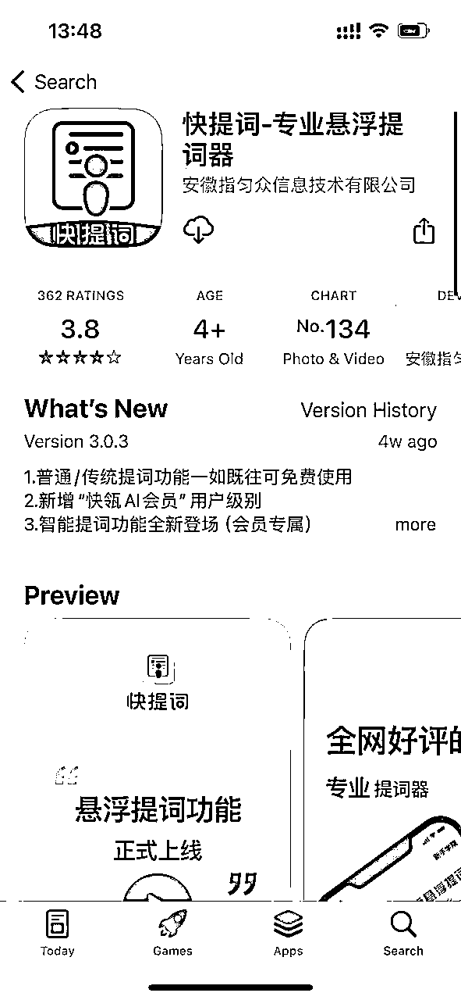

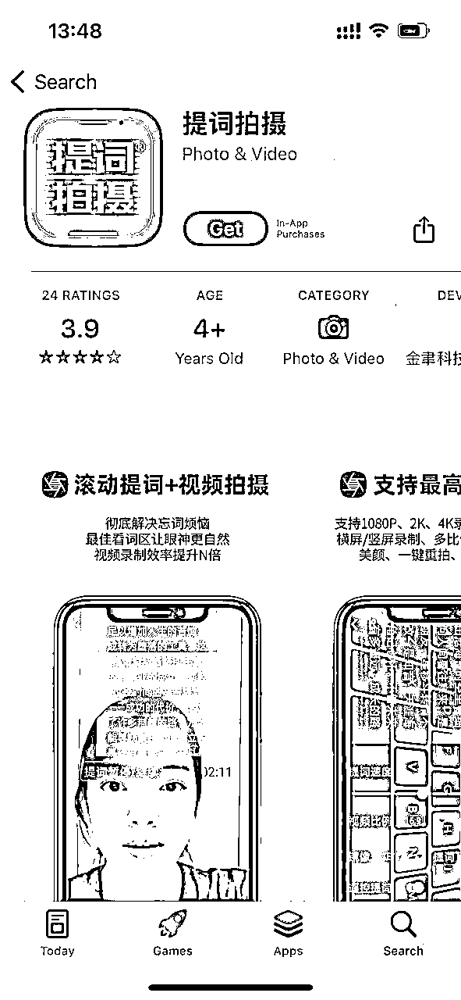

电脑网页端：https://cn.teleprompter-online.com/

3. 蓝牙遥控

如果没人帮你拍，可以准备一个蓝牙拍摄遥控器，操作更方便。

4. 收音话筒

声音效果非常关键。手机直接收音杂音多，因此收音设备一定要备。两个方案：

选择一：蓝牙无线耳机。

如果不想额外买话筒，考虑到拍摄时我们基本会略微侧对镜头、观众看不清耳朵，可以在用户看不到的一侧戴蓝牙无线耳机，用耳机麦克风收音。

选择二：收音话筒。

淘宝、拼多多两三百元的即可，收音效果不错；早期不必大手笔买 RODE 或大疆这类昂贵话筒。

5. 拍摄支架：

建议买两个普通支架，一个架拍摄手机、一个架提词手机。这样手机稳定，调整也自由。如果提词用电脑，家里找东西把电脑架起来即可。

也可买能自由调整相对位置的双机位支架，但万向软管类很多不稳，不太推荐。

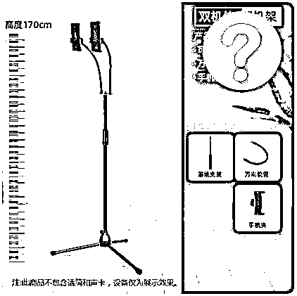

注意：要避免下面这种固定并排放置的机位。放得太近可能拍不到半身，放远了又看不清提词器。

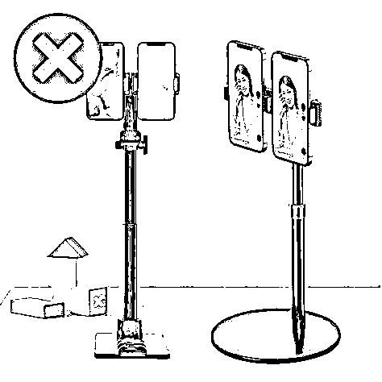

6. 补光灯

推荐球形补光灯，从左侧或右侧上方直接打光；补光灯最好支持三种色温，便于配合内容氛围。

另一侧可放小灯管，或挂一块反光布。具体布置可参考这个视频教程：

https://v.douyin.com/i8jJuV6X/

注意：不推荐环绕手机的补光灯，戴眼镜的人镜片会反光。

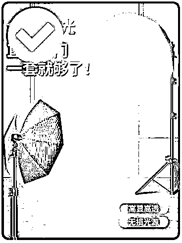

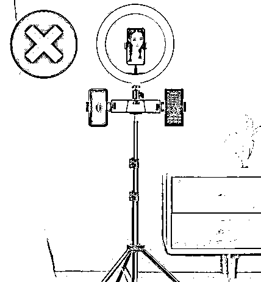

#### 2.1.3 剪辑工具

剪辑手机端用快影、剪映即可，快手和抖音这两个软件基本能满足需求，剪映还能直接导出60帧。

软件介绍：剪映  
手机版：iOS App Store 与安卓应用商店可下载  
电脑版：https://www.capcut.cn/

有电脑建议用电脑版，操作更顺手。

其实一个小道具，从看到到下单执行，会耗掉不少时间精力。比如我为了找一支在黑板上写起来顺滑又好看的笔，花了大半天。所以不建议一开始就追求完美，先发出去再说。好相机、好手机、摄影灯、服装、麦克风、精心布置的场景和道具，都是锦上添花，后期再加不迟。起步阶段与其折腾这些，不如多拍几条作品发出去，把时间花在创作和运营上。

内容来源：《从0到1000万粉，给短视频创作者的80条建议》。

### 2.2 账号搭建

#### 2.1.1 注册、登录与维护

账号注册：

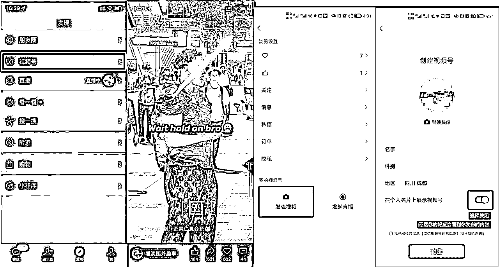

按图示完成以下六步，视频号即可创建成功：

# 视频号卖货起步：建号、门面与挑货

1. 在微信底部打开「发现」，点「视频号」；
2. 点右上方的人像按钮，进到个人页；
3. 点「发表视频」，来到新建界面；
4. 补齐头像、性别等资料，并给“我已阅读并同意《微信视频号运营规范》和《隐私声明》”打勾；
5. 不想让微信好友看到作品，就把「在个人名片上展示视频号」关掉；
6. 建号完成。

**登入与多号操作：**

用应用双开，一台手机挂两个微信。也可以把多个号的管理者都关联到自己的主微信，再用网页版分别登入。

留意：同一个微信号若被多个号设为管理者，一次只能登一个。比如A关联①和②，先扫①再扫②，①会掉线，回①要重扫。

**多个微信号怎么维护：**

批量注册的号容易遭封禁，只注册两个也要留意；培育账号的关键是让操作像真人。具体可参考下面5个办法：

出处：《8月初阶视频号航海实战手册》

#### 2.1.2 门面打造：让号看起来像样

方向没定，先看手册里的「2.3 品类方向与挑货」，把品类方向敲定，比如渔具、百货，再按方向定号的定位。

方向明确后，头像、号名、签名、固定短片就能围绕诉求配置和优化，动作更有针对性。

##### 2.1.2.1 配置路径

点完创建视频号，会来到对应界面；点右上方【···】进【设置】：

在【设置】里点【资料设置】：

进到【资料设置】后，分别点头像、名字、签名逐项配置：

##### 2.1.2.2 门面打造的四件事

1. 号名

先看官方对【账号名称】的提醒：

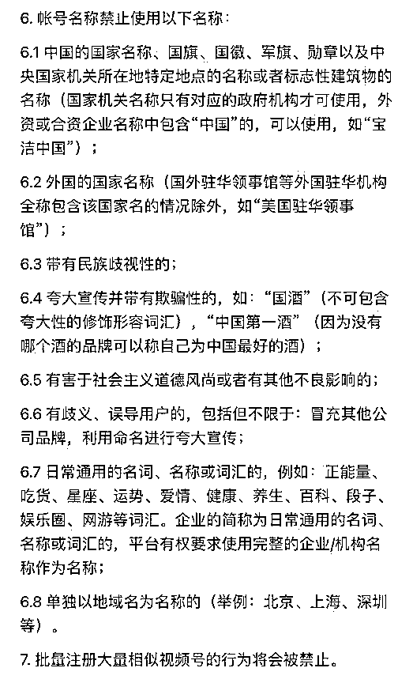

名字要贴合号类型；取好了，本身就能带来被搜到的机会。

常见做法是把相关搜索词拼接起来，例如国学、书籍、认知等；别人搜这些词时，你的号更容易出现。

但顺口好记的名字往往已被注册，所以多备几个，逐个试哪个能通过。

号名一年最多改5次；没思路时，可参考各平台同类号怎么取名，也可用通用格式，如【xx - 同款在橱窗】。

出处：《视频号带货建议指南》

2. 头像

头像出彩，别人更容易记住你。

头像可用文字型，比如名字缩写，也可图片加文字；拿不准时，搜一搜你所在内容方向的头部博主，看他们通常怎么设置。

制作上，可用图怪兽这类网站做图，或找免版权图片。

要避开易有版权风险的商标图；也不建议用个人头像，容易和号的方向不搭。

3. 个人说明

签名随时能改，围绕号的方向来写；完全可以参考成熟大号的写法。

卖货号最直接的做法，是在签名里告诉大家怎么买，例如：

视频同款，在下面【商品】购买

微信号不是必留项；若想留，即使是在腾讯自己的平台，也建议写得含蓄些。尤其放了微信ID和手机号的，最好用另外几个微信查看是否正常显示，防止被平台屏蔽。

前期最好先别放，可能被同行投诉；等号起量、粉丝多了再改，例如：

4. 固定短片（开始更新后再做）

每个号最多能固定2条短片，先后顺序也要斟酌。

通常第一条固定选起量过或近期热门内容，第二条放你最看好的卖货短片。

卖货号还有个实用技巧：把教用户下单的教程短片固定：

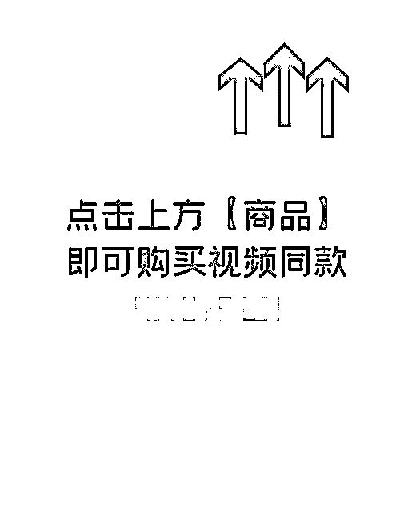

p.mp4【在线播放】

怎么固定？

找到目标短片→点短片页右上方【···】→在底部弹窗选【置顶】→完成。

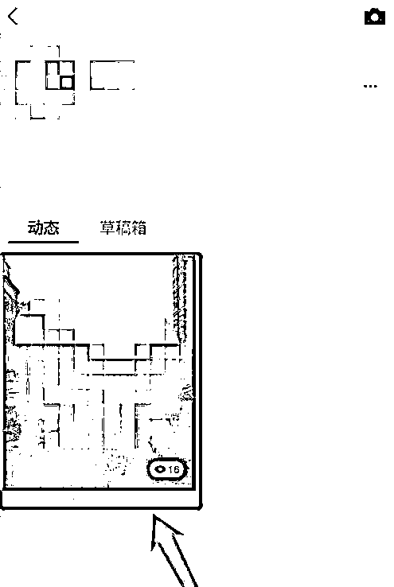

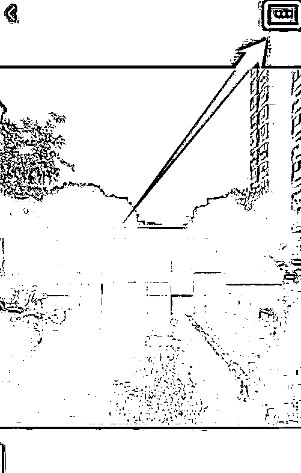

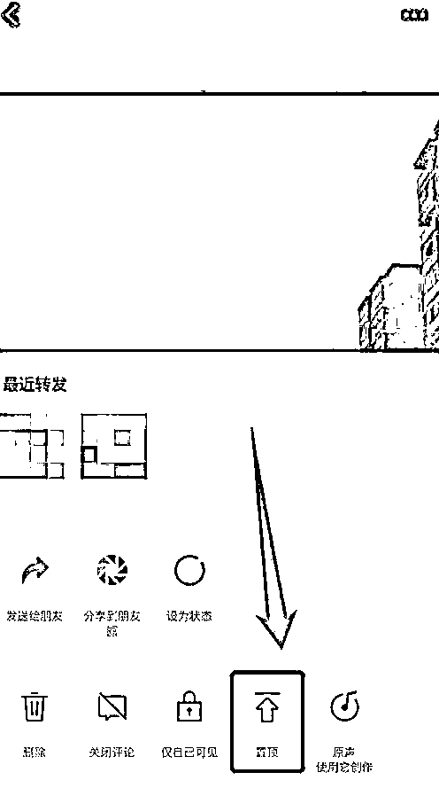

出处：《8月初阶视频号航海实战手册》

### 2.3 品类方向与挑货

正式挑货前，先选一个品类方向，如渔具、百货；再落到具体货品，如钓鱼竿、包饺子工具。

新手最好先集中一个方向，把挑货和内容做深；下面推荐几个适合新手的热门方向。

#### 2.3.1 怎么挑品类方向

挑方向不复杂，核心看受众。

目前平台用户以三四线及乡镇中老年群体为主，选方向就围着这类人转。

比如百货里的粘鼠板容易起量：中老年多住老旧小区或乡下老家，有老鼠需求；大城市租房年轻人没这个场景，自然很难理解有人刷到这种短片会点赞并购买。

目前跑得较好的方向主要有：日用百货、家居用品、各地特产、图书、新奇商品/玩具、农用物资、绿植、服装鞋包等；下面推荐几个热门方向。

平台卖货热门方向

以上是平台挑货里的一部分优质方向，值得多观察、多参考。

按这个思路做完诉求定位和方向选择后，号的方向一旦确定，接下来就是找更多优质货品，继续往下看。

#### 2.3.2 挑货的操作流程

##### 2.3.2.1 挑货的底层思路

挑货最关键的三件事：受众、品类、售价。

平台挑货的底层思路是：受众已经锁定为三四线及乡镇中老年群体，剩下重点看品类和售价。

1. 品类：决定货品卖不卖得动

卖美妆里的假睫毛，50岁上下的女士需要吗？大概率不好卖。

卖百货里的包饺子工具，也许能成交，但用户会先想“我需不需要”。

换成地方美食特产，由于属于食品，用户往往跳过“需不需要”，直接变成“想不想要”；同样的场观，成交率会高不少。

建议挑货时多花心思，多体会目标用户，也就是父母那一代人的诉求。

2. 售价：牵动收益和单量

算笔账：如果每天同样发10条短片，下面几个品你会选哪个？

1. 洗衣凝珠，每天700单，每单1元收益；
2. 螺丝粉，每天100单，每单7元收益；
3. 地方美食特产，每天10单，每单100元收益。

我的选择是：在a和b里选b，收益相同，但客服人力成本更低；在b和c里选c，单量相同，收益更高。

看着简单，其实不少人都在这道题上绕了远路。

挑货时别只看品，还要盯售价，给收益留足空间。

高售价通常对应少单量，反过来也一样。

新手想尽快拿到正反馈，建议先从低售价切入，更容易出单，再逐步优化挑货。

##### 2.3.2.2 挑货的基本流程

第一步：借数据平台

先明白一个前提：微信目前没有向外部开放查询接口，所以我们拿到的数据有时偏差会比较大。

平台结果只能当参考，最终选什么货品，还是要自己思考和判断。

工具一：考古加 www.kaogujia.com

用两个实际案例说明怎么用考古加挑货：

（1）热门短片挑货

做热门短片卖货，可以用搜索词去搜。以父亲节为例，挑货时可搜“父亲节”“礼物”等词：

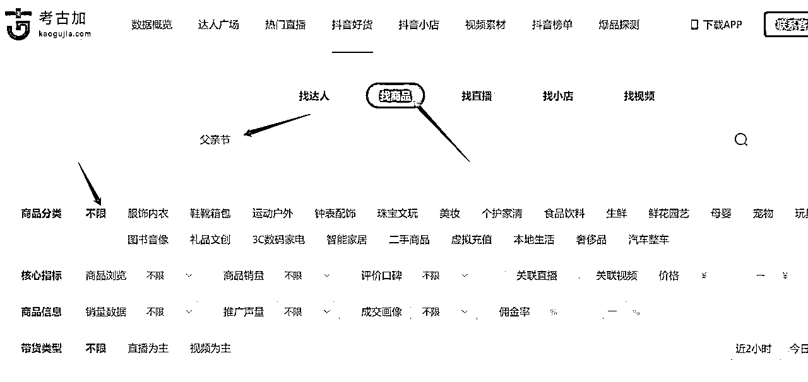

操作路径：抖音好货—找商品—输入“父亲节”—搜索。

接着找一个细分品类：

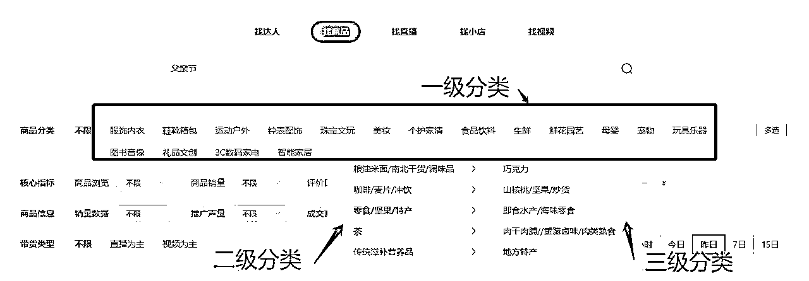

落到几级品类，按自己的需要来。

想大范围扫，就只选一级品类，一页页翻，也能把近期爆品找出来；

想精准挑货，就精确到三级品类，按细分方向挑。

下面以选到三级品类为例：

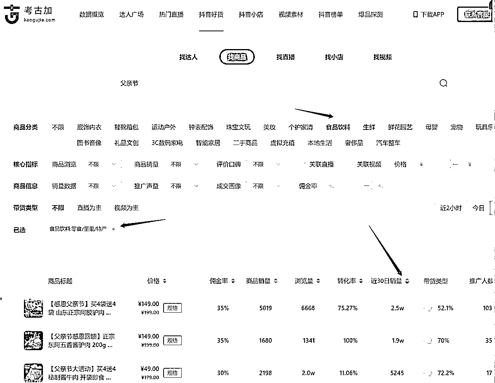

选好后按销量排序，点进货品详情界面，就能看到近期数据和走势。

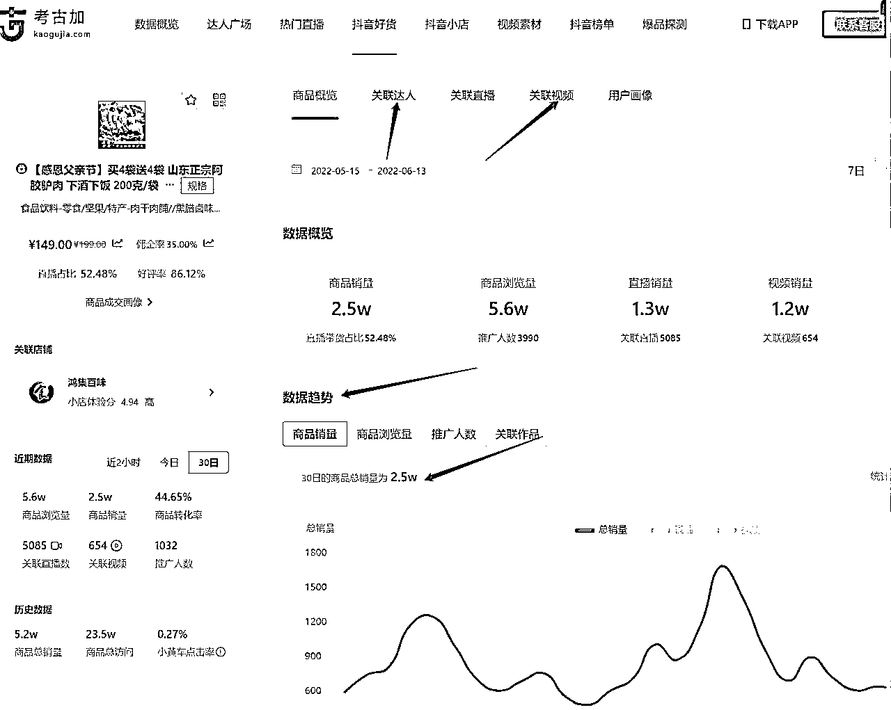

数据不错时，怎么判断这个品能不能选？

主要看两个数据项：

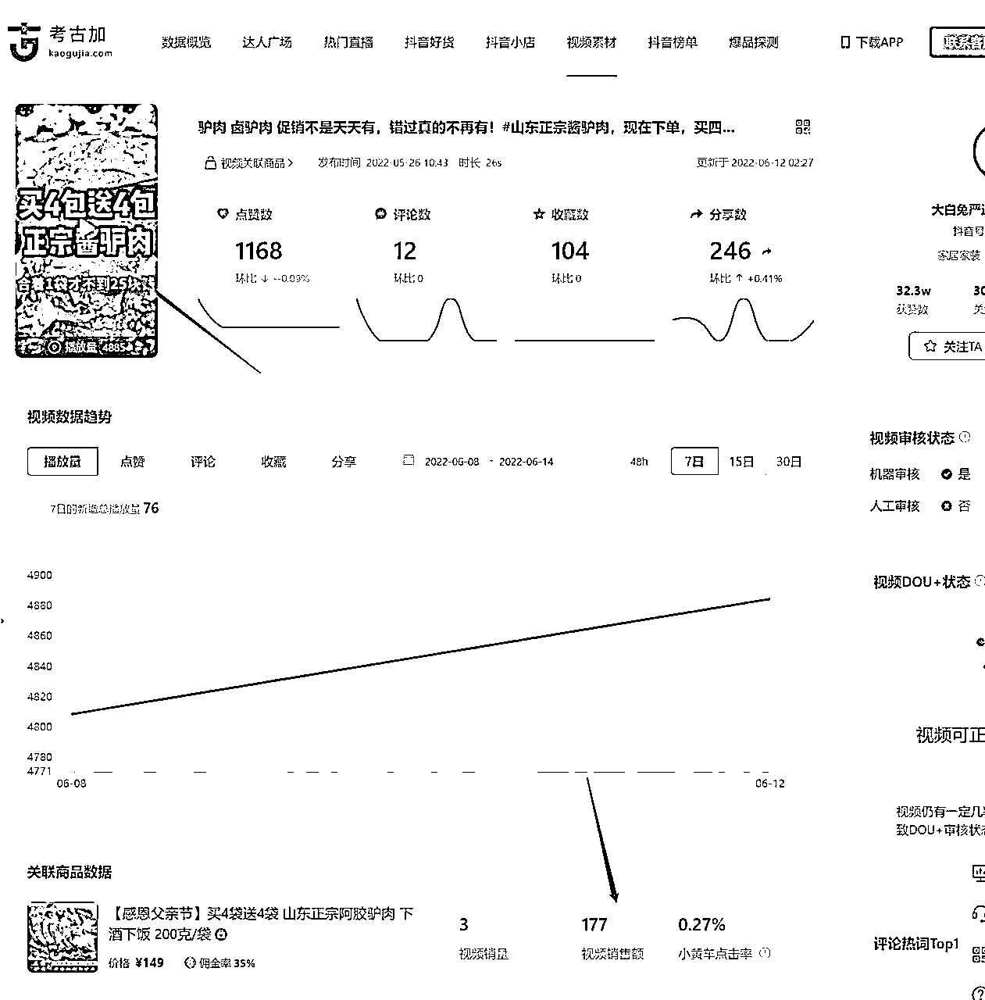

（2）细分品类法

抖音好货—找商品—选商品分类—选带货类型

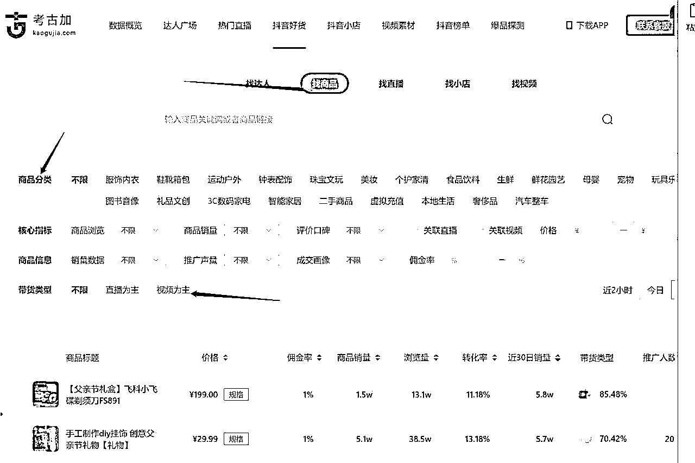

同样，品类层级按需要定。

例如在图书音像下找一个细分品类：

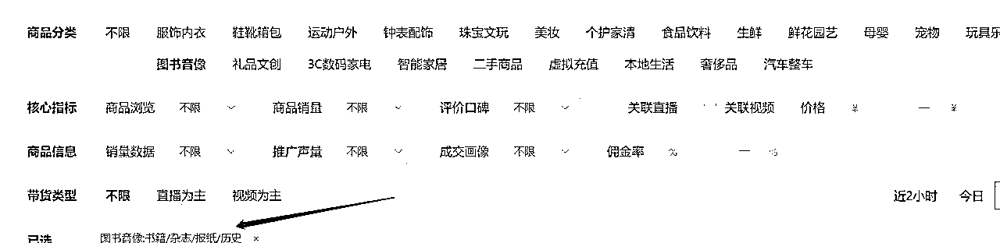

选中【图书音像—书籍/杂志/报纸—历史】后，会出现这些商品：

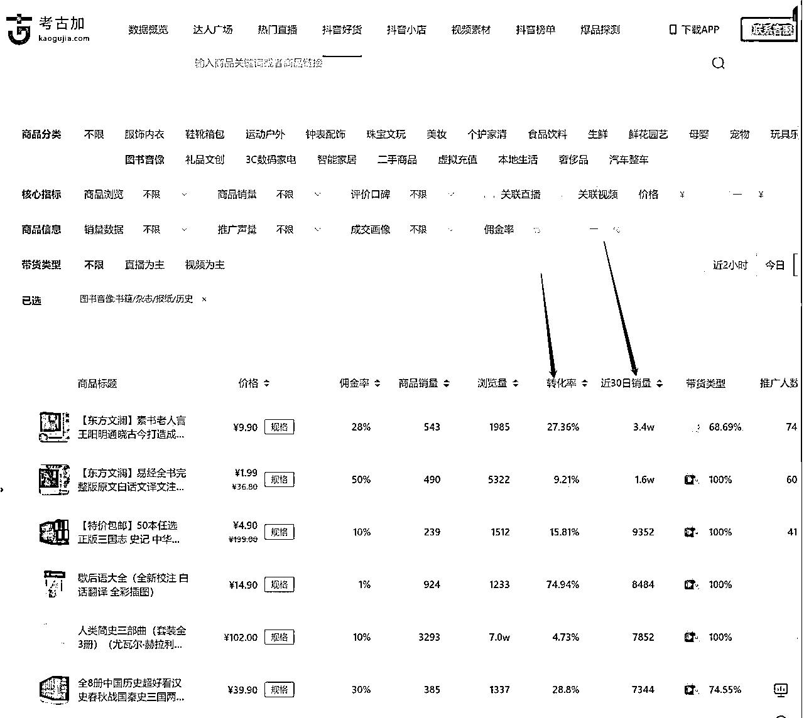

看近30天销量和成交率，定位到具体产品：

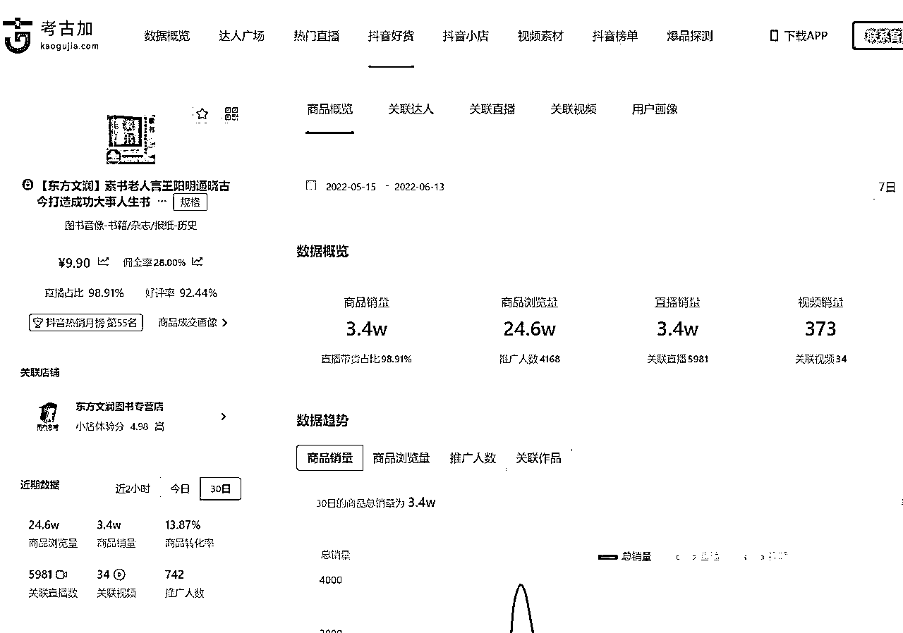

再到详情界面点关联短片或创作者，分析短片数据和质量。

整体看，考古加的价值在于帮你想出一些货品方向，并提供基础数据分析和短片参考。

实操筛选时，还可以叠加自己的条件，比如售价、成交画像等。

找到可能能卖的品，就用表格记下来，慢慢攒成自己的货品库。

工具二：巨量算数 trendinsight.oceanengine.com

它能看搜索词指数、关联洞察和受众画像。

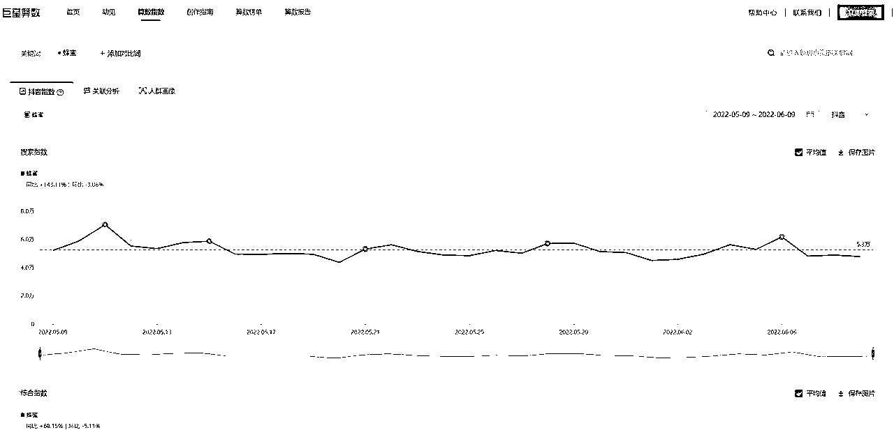

官网还有排行，可查各类产品热度，辅助挑货。

此处附《巨量算数报告合集 -2022》：巨量算数报告合集 -2024

工具三：微信指数（微信内搜“微信指数”）

打开微信指数，以蜂蜜为例搜一下：

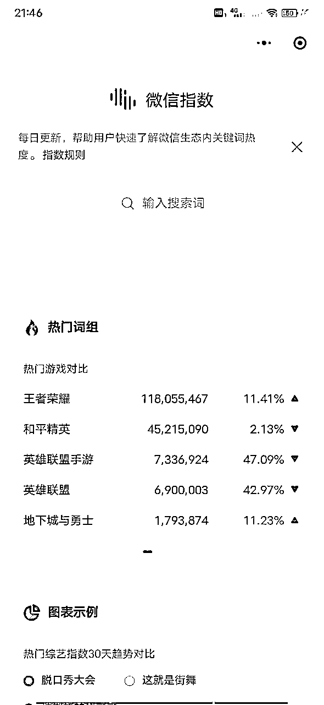

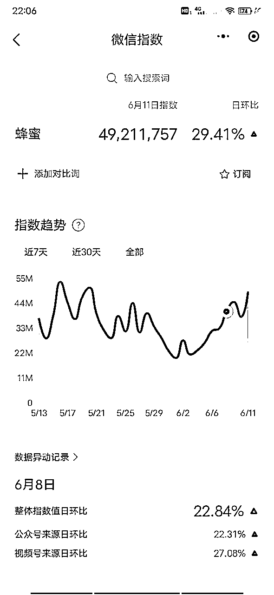

结果页能看到这个词在微信体系里的相关数据。

工具贵精不贵多；能摸透一两个为自己所用，就足够了。

第二步：人工筛选与排除

平台能帮我们初步定方向，具体品类怎么定？

（1）凭偏好

年轻人爱的东西，大概率卖不动。

像索尼游戏机、Supreme T恤，平台用户不会买，那就先排除。

自己不喜欢的东西，可以视情况不碰。

父母辈喜欢的东西、休闲娱乐，可以视情况做。

有长辈退休后天天钓鱼，很多阿姨天天跳广场舞，这类诉求是不是都值得试一试？

（2）靠经验

经验有时也会骗人，但仍然有参考价值。

有社群成员去年在抖音卖百货不错，到了视频号还没起色；

也有人年初在抖音快手做绿植，最近在视频号起号，收益反而不错；

再如春熙路能看到100家火锅店，火锅底料是不是也有大受众，能不能挑？

过往经验和经历都是财富，闭眼回想一下。

（3）刷抖音、快手、视频号

这一步很重要！

每天都得抽时间刷三大平台短片，看到觉得能卖的产品就截屏，留作参考和备选。

比如某社群成员的品在视频号起量，3天内就有5个同行跟进做同款，大概率是刷到了他的短片。

这活每天重复，挺累，但常有惊喜。

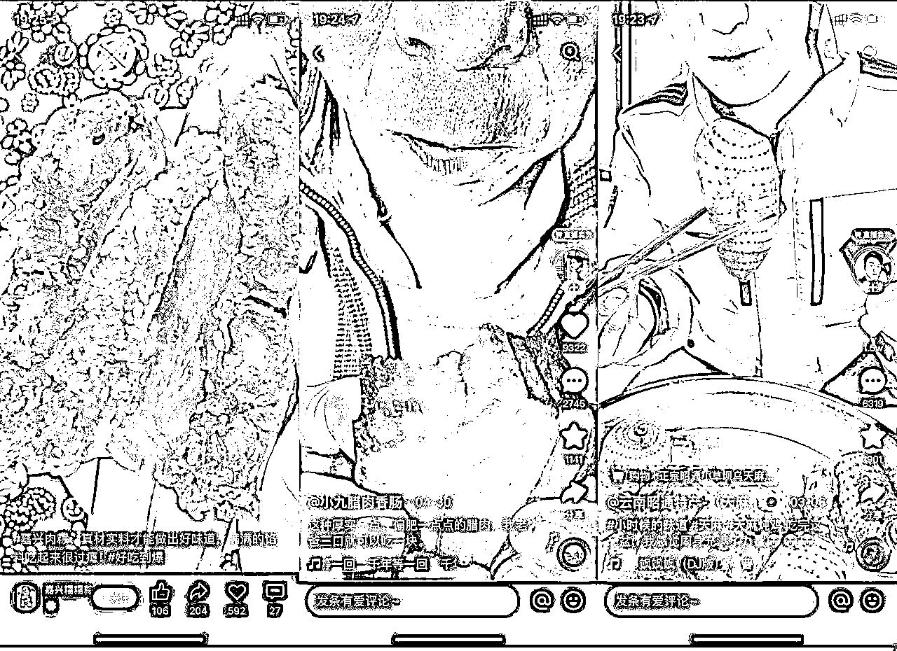

有时刷一天，就能初选出20个产品。

第三步：实际核验与判断

这一步要判断：这个品能不能做？怎么做？卖多少钱？

假设选到蜂蜜，仅作演示，不构成建议，还要按下面几步确认可行性：

1. 分析同行

在视频号搜“蜂蜜”，会看到一些号：

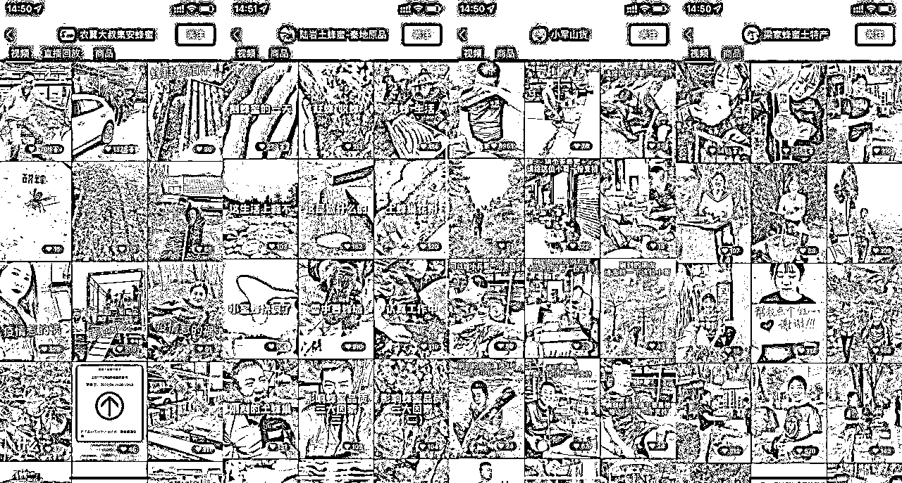

重点观察这些数据：

如果搜某个搜索词没有相关结果，可能就是竞争空白。

平台卖货现阶段就是找空白、占空白，所以目标就是找竞争少或对手偏弱的品。

搜某搜索词后出现很多人，就逐个点进去看，不一定都在卖货。

2. 有没有短片素材来源

详细制作后面再讲，这里只把它当作判断挑货是否合适的一个简单途径。

做法很简单：在抖音、快手搜“蜂蜜”，看有没有相关短片：

重点观察这些内容：

选素材很关键，要找契合平台风格的。同一个品，不同短片来带，效果天差地别。

要尽量避开真人在短片里出镜当主体，这类内容很容易触发真人核验，号基本就危险了。

3. 查货源

去拼多多、淘宝、1688搜要带的商品：

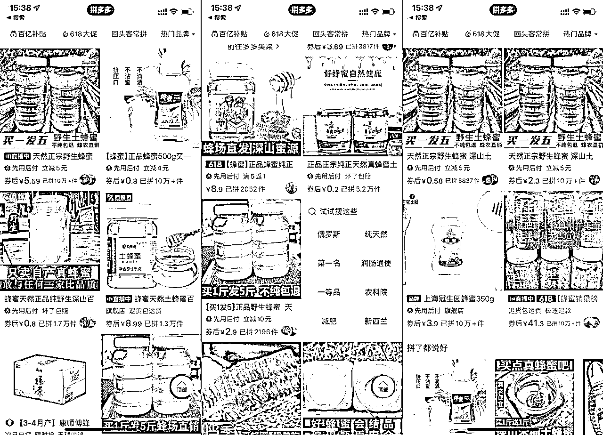

前期只要确保有同款、售价也有收益空间，基本就问题不大。

选到的品可以请朋友帮忙挂小商店，所以微信商品库里没有也不影响。

4. 小结

满足下面3个条件，这个商品大概率就能在平台卖货：

但要注意，挑货就是反复筛选、反复核验；所有努力都只是提高出单概率，没人能保证一定爆。

多试多做，把挑货能力磨出来，爆单只是时间问题。

##### 2.3.2.3 快捷挑货法

如果觉得上面复杂，这里给一种较常规的“视频号—视频卖货”流程，只用这一种也行。

步骤1：看视频号直播广场—购物频道

步骤2：看这个号的短片情况

步骤3：去数据平台验证该品数据是否可观

步骤4：在该短片的带货创作者、带货短片里找合适的参照对象

这里附上社群成员@李诚分享的挑货表，供参考：

李诚 Sonic - 视频号选品表

按这些步骤筛完，基本能选出合适商品，也能初步解决短片内容怎么选的问题。

#### 2.3.3 挑货要躲开的雷区

平台规则更新很快，有的品上周还吃香，这周就可能因封禁做不了。

下面列出几个平台挑货必须绕开的坑：

## 三、【实操 2/3】做出热门短片并上传

**本节要点**

挑货当然重要，但用户能不能看完并购买，取决于流量和成交率；想多出单，要么拿更多流量，要么提高短片成交率，而这两者都绕不开热门短片。

这一节主要讲怎么找到可借鉴的热门短片，建议按下面步骤走：

第一步：找到能借鉴的热门短片

第二步：剖析热门，模仿学习

第三步：用热门思路设计自己的短片结构

第四步：完成剪辑，二次创作或自制都行

第五步：上传

第六步：回复评论、私信和问候消息

接下来，开始做短片。

**本章路线图**

学完并实操3.1，就走完路线图第二阶段：做出热门短片并上传，约5—7天。

1. 找到至少1个参照号（约0.5小时）
2. 找到至少1条参照热门短片并剖析模板（约0.5小时）
3. 按所选品类搭建短片素材库（约3—5小时）
4. 模仿参照热门做二次剪辑，上传1条短片（约1小时）
5. 学批量混剪，提高短片质量与效率（约3小时）

### 3.1 找参照号

#### 3.1.1 参照号怎么筛

做平台和短片卖货，参照号通常要符合这几类要求：

注意：二次剪辑、混剪类内容尽量别用真人出镜短片，容易被原作者举报，导致下架甚至封禁。

#### 3.1.2 找参照号的路径

方法一：在各平台搜参照号

做法很直接：在各大短视频平台搜你想做的号类型。

平台包括但不限于抖音、快手、小红书。

比如做个人护理和家清品类，就在上述平台搜【洗衣液】【家用】等词找参照号。

找到后记得关注，后续刷短片会推送更多相似号。

但视频号这边要反着来：别关注自己的其他号，因为本人微信的视频号没法取消关注；也别关注自己的参照号，因为你关注的号会推荐给你的微信好友。

方法二：挑货时倒推号

以食品饮料为例，用考古加找参照号的流程是：

考古加工具—点商品—视频热推榜—选食品饮料—选产品—看关联带货短片。

具体见图：

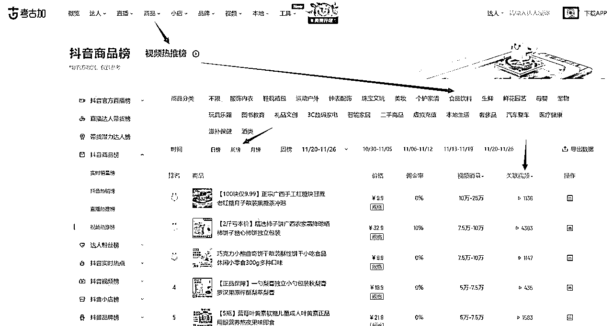

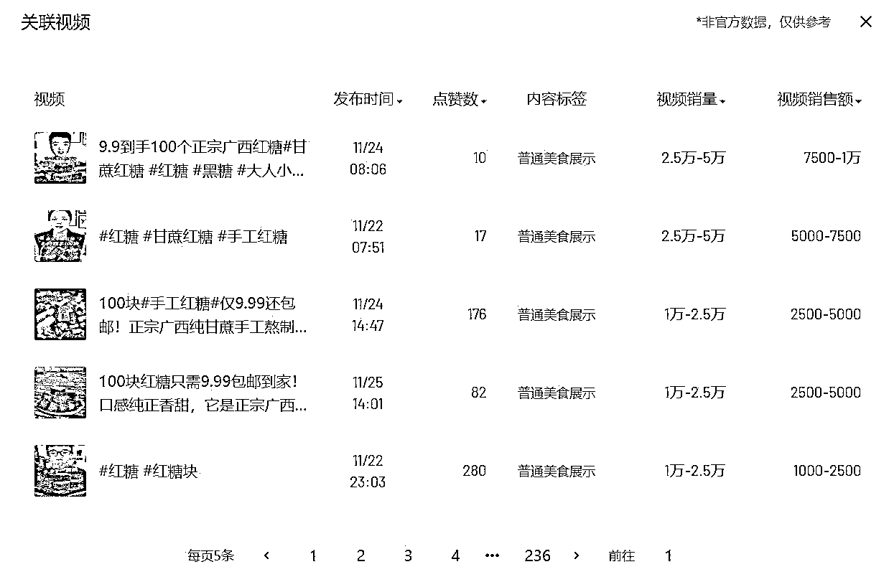

上图的“达人”栏就能看到参照号。

### 3.2 做出热门短片

#### 3.2.1 热门短片的思维

1、热点思维

# 短视频起量，先抓这几步

追热点值不值？一句话：平台在流量上会照顾，观众也买账。要是实在找不到方向，就去盯抖音热榜，榜上哪条冒头，就顺着哪条做。

## 2、爆点丰富度
爆点是什么？就是让一条视频具备走红潜质的那些要素。同一条片子里，这类要素埋得越密，出圈概率就越高。

## 3、黄金前三秒
开头三秒，得按“生死线”来设计。前三秒抓不住人，观众没有理由把片子看完。三秒之后，叙事必须持续给钩子，让观众一路跟下去；临近结尾再把情绪顶上去，转发和评论才会顺理成章地出现。

举个拿到过平台推荐的例子。它是我参加视频号小航海之后，首个被推荐的片子，既有代表性，也值得留个纪念，正好用来说明。后来我其他账号里那些点赞10w+的内容，底层思路其实和它一脉相承。

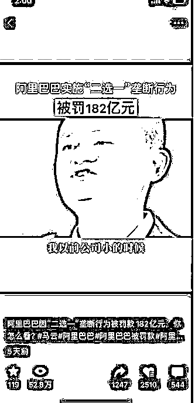

热点层面：阿里被罚182亿，那阵子在各个平台都是炙手可热的事件，曝光量极大。

爆点密度上：其一，182亿罚款本身就是热点事件；其二，马云本人就是流量入口，关注度天然高；其三，内容说的是“公司越大压力越大”，听感像马总在自我圆场，评论区必然热闹；其四，BGM走紧张路线，把观众情绪往上推；其五，标题留了一个问号，勾着人去评论区回应。

前三秒：标题一上来就交代了事件，同时把“被罚182亿元”做了醒目放大，用户刚点进来视线就被锁住；开头出现的人物是马云，而马云本身就是爆点。

## 4、爆款视频打分表
新手如果拿不准，可以照我这份表给视频打个分。得分越高，走红的几率通常也越大。

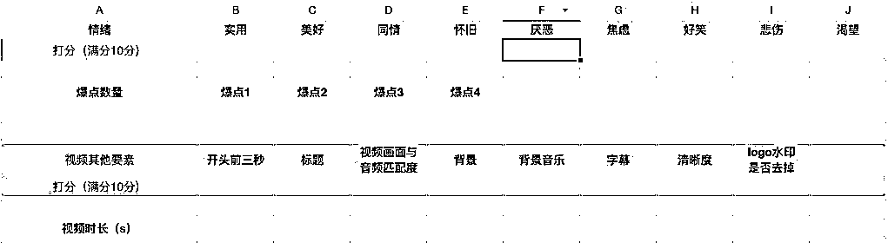

#### 3.2.2 找到值得模仿的爆款
做视频的第一件事，是找到可以用来学习的同行作品。路径有两条。

3.2.2.1 方法一：借其他平台的爆款 @虫二
在抖音跑出过成绩的内容，挪到视频号可能照样能打，也可能反响平平，根子在两个平台的调性差异。可以从两个维度去养判断视频号爆款的直觉。

角度1：看数据。在抖音里按关键词搜，时间窗口选一天内或一周内，按点赞排序；再打开【抖查查】（www.douchacha.com）的视频飙升工具，点赞量锁定5-10w或10-50w区间就行，200w+的头部爆款不用一直盯。

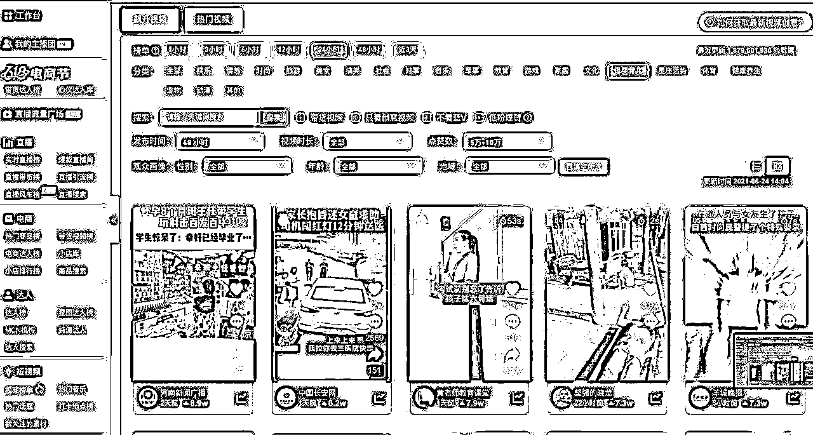

角度2：看调性。进【新视】（https://xs.newrank.cn），把本类别15天内上榜的内容通刷一遍，体会视频号观众的口味。

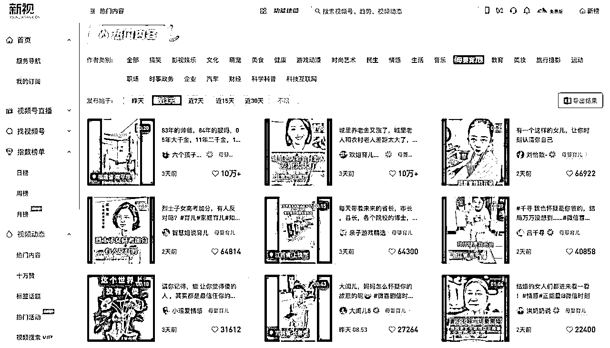

内容来源：《微信视频号变现，单条视频佣金 25000+，5 条视频涨粉 15w》

3.2.2.2 方法二：学视频号里的优秀同行 @鱼骨头
1.借助视频号数据统计分析站点来挖。以友望数据为例（友望数据：http://www.youwant.cn/）：按“视频号查找→视频号排行榜→行业分类”的路径，选定自己对标的领域。

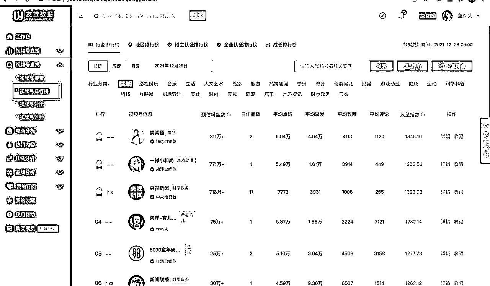

2.也可以在视频号内直接翻。

内容来源：《视频带货月收入 10w+，分享从获取流量—制作爆款视频—带货变现的完整过程》

3.2.2.3 把对标素材下载到手
锁定对标爆款之后，当然要把它下载到本地，剪辑时才好调用。批量下载工具：注：【批量采集抖音工具 密码：2nkd】【蓝奏云下载地址 密码：4v6t】点开这些链接会出现风险提醒，把页面内的链接复制出来，用浏览器打开，再输密码就能提取工具。

内容来源：《8 月初阶视频号航海实战手册》

#### 3.2.3 拆解并模仿爆款
3.2.3.1 拆开爆款找门道
锁定可学习的同行后，就对他的爆款做拆解：视频内容、文案、标题、BGM、评论……拆得越细越好，这样才能看清它为什么能火，并照着复制。下面用一条我们曾参考过的同行视频，示范怎么分析。

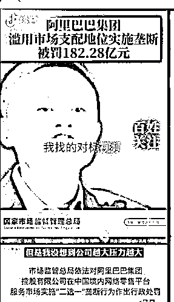

1.内容层面：阿里被罚128亿，当时是刚冒出来的大热点，平台和用户都吃这一口；阿里集团本身就是流量磁铁，任何动静都有人盯；配图用了马云，马云同样自带流量；128亿这个数字够大，而用户又爱看高位者突然翻车。

2.配乐：走的是紧张、激动的路线，属于新闻类内容常用的热门音轨。

3.评论区：满屏是对马云和淘宝假货的调侃乃至谩骂，说明马云和淘宝依然是可以继续深挖的题材。

3.2.3.2 模仿之后再升级
拿到同行的对标视频后，下一步是做内容升级。假设原片只有一个爆点，你就再补一两个，补得越多越好；画质也可以往上提。下面用我两条拿到推荐的片子，讲讲怎么后来居上。

视频一：

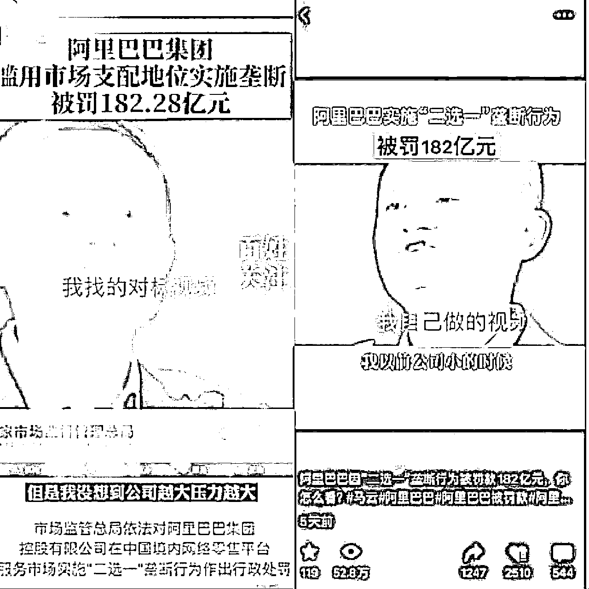

左侧是对标作品，右侧是我的版本。演讲内容一字未改，但标题被我重做了：从三行压成两行——三行太满，用户扫不完可能就划走；同时把“被罚182亿元”放到显眼位置，用户进来第一眼就撞上关键信息，立刻被勾住。加上我的画质明显更清楚。

视频二：

左侧是对标，右侧是我的成品。对标那条是“美团被判赔偿饿了么”的新闻PPT式呈现，我判断爆点太单薄，就去翻美团周边的其他素材，最终选了“外卖小哥三问美团创始人王兴”。话题落在骑手送餐速度、超时赔付这些行业痛点上，评论区注定会吵起来，拿到推荐的概率自然更高——后来果然被推了。有小伙伴说，以前刷到过“外卖小哥三问王兴”，没想到还能这么用；没错，素材可以嫁接，效果就是这么奇。

#### 3.2.4 建自己的素材仓
拿我的素材库做个示范：【场景演示】与【使用效果】按实际情况仿拍替换就行。

第一步：锁定目标与主题。动手之前，先想清楚自己的类目和产品是什么，有针对性地挑素材来源，素材库才不会白搭。

第二步：分门别类。按类型、场景、风格等维度归拢，用文件夹与标签管理，查找调用都省事。

然后从画面入手：围绕需要什么画面、背景、场合、物品、行为等维度去搜集；把收来的画面切成3-5秒的小段，同一画面多存几段；切好的内容归入专用文件夹。前期费点劲，处理好的素材可以长期反复用。素材找齐后，再按A（前3秒：痛点/话题/提出问题等）+B（产品介绍/卖点/解决问题）+C（引导转化）做爆点拆分，边测边迭代。

第三步：攒高质量素材。高清图片、视频片段尽量多收，素材质量高，观感就好，观众也更愿意停留；部分产品与素材可以从商品评价区里挖。另外pdd、淘宝上也能多搜一些素材库。

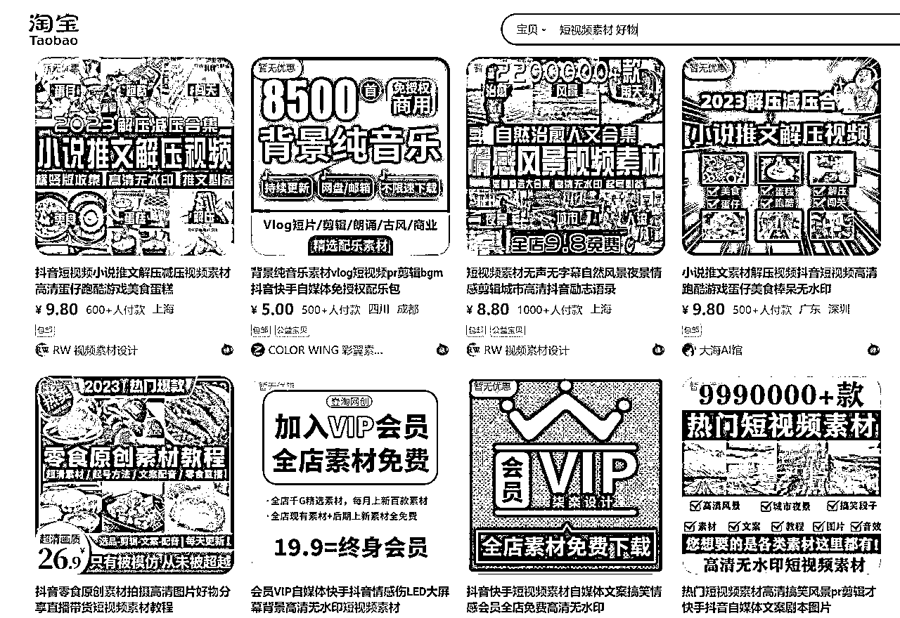

第四步：保持更新。定期往库里补新内容，让素材始终新鲜；每天扫一眼同行同品的爆款，看到合适的就下载、拆分、入库。

#### 3.2.5 基础剪辑&原创视频
处理视频时，建议走混剪、二创、原创这三条路，别直接搬运。短期靠更精细的混剪去规避审核；但想长期稳定拿收益，原创更被鼓励，也更值得投入。下面的剪辑方法建议学一学，实操时把产品展示、书籍展示、部分画面或背景换成自己实拍的内容，用来过平台的原创审核。

举个例子，脚本结构可以这样搭：黄金开场+产品介绍+使用展示+同行对比+优惠活动+引导购买。其中“产品展示”这一段，可以换成自己实拍的画面，或者其他平台的产品好评图、好评视频。

二创的流程，可以概括成三步：拆解爆款素材—批量混搭组合/套视频模板—视频去重。

第一步：拆解爆款素材。前面3.2.2已经讲过怎么找对标爆款，找到后把素材拆开，分门别类放进不同素材库。

第二步：批量混搭组合/套视频模板。工具用剪映电脑端；把爆款片段拆开分析，再针对不同片段做排列组合，填入新素材。比如：开头1+效果1+拆包1+场景1+场景2；开头1+效果2+拆包3+场景5+场景1；开头X+效果X+拆包X+场景X+场景X……照此类推。

第三步：视频去重，加特效、画中画、音乐等。方法1：1个视频画中画+1个图片画中画+4个贴图素材+2段音频+重新编辑的标题，一套组合下来完成二次剪辑去重。

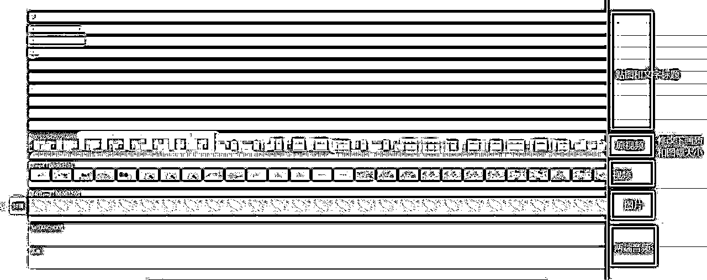

方法2：把原视频的位置换成背景图，素材叠在背景图之上，再补画中画+边框+贴图+音频等，完成二次剪辑去重。

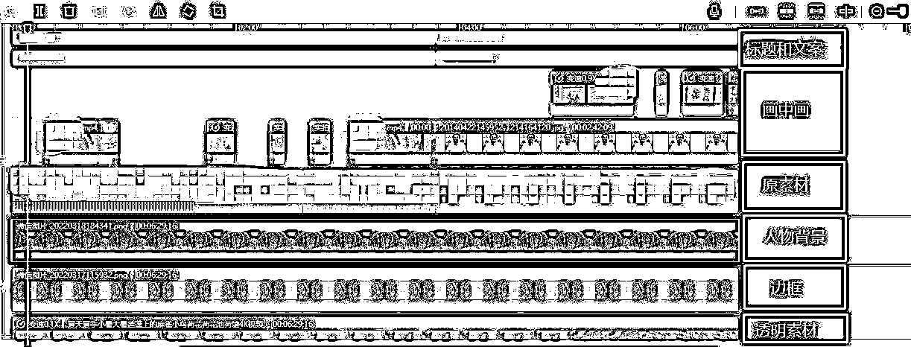

内容来源：《8 月初阶视频号航海实战手册》

模板做好之后，后续产出效率会明显提高。除了这套做法，圈友@figo还分享了批量去重、批量制作内容的另一条路子，这里摘录一部分，完整版见《如何剪辑视频和制作剪辑模板》。

1.先用CRVideoMate做基础混剪，参数如下（可自行调整）。

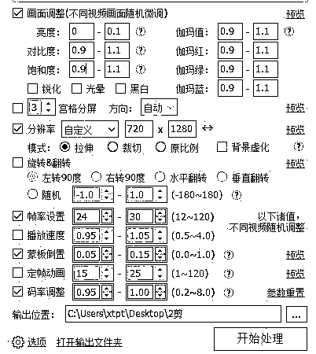

2.做一张水印PNG图片，调用软件自带的水印功能。

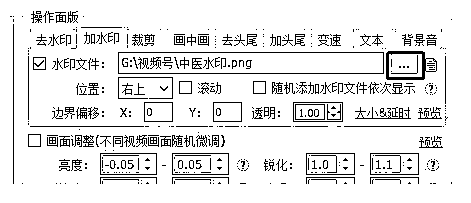

↓添加水印效果如下↓

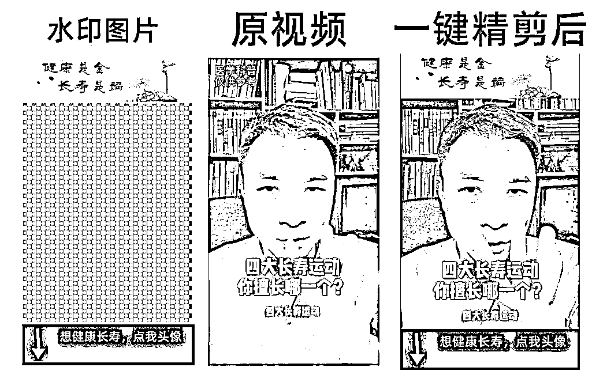

3.水印直接叠上去可能挡住原片的关键区域，这时可以压低原视频高度，参数如下。

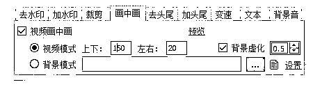

注意：这里的“上下数值”高度要大于或等于水印图案高度，画面才不会被水印盖掉。我填的是150，你们可以调高或调低。压缩后的效果如下↓

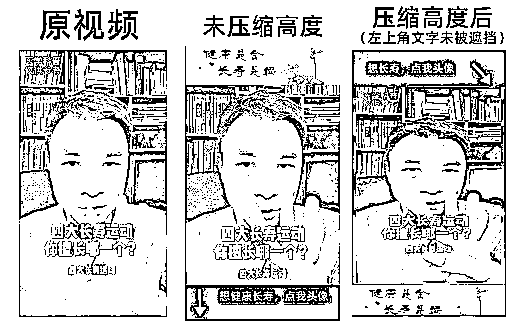

PS：软件可以制作多款水印，做到一个品类对应一张水印，参数也能导出，方便对应不同剪辑类型。CRVideoMate软件下载地址：http://www.cr-soft.net/crvideomate.html。剪辑软件怎么做粗剪、精剪，可参考文档《如何剪辑视频和制作剪辑模板》。

内容来源：《利用批量剪辑软件 CRVideoMate，一键完成视频号精剪去重，可带个性化图案》

第四步：补充原创视频片段（推荐尝试）。视频号带货对原创的要求越来越高，下面给两个好用的原创模板，大家按需取用。

原创形式1：口播带货视频制作 @孟 meng

爆款视频的背后，是平台算法在给流量倾斜，而原创爆款本身极难。所谓“创意都是老元素的新组合”，新手不妨先从复制爆款起步；等素材库攒够了、拆解做透了，对爆款文案有了手感，再去组合出自己的爆款。

把对标视频下载下来，借助飞书秒记或别的转文案小程序，把口播文案扒成文字，存成文档。

前3秒与5秒的完播率相当关键，短视频必须在开头就把注意力攥住。抓住之后，还要顺势引导用户点赞、评论、转发、关注。

用场景化的方式讲清产品的功能、特性和价格优势，让客户对产品产生认同，把购买欲往上推。

视频号里不少用户不是不想买，而是不知道怎么买，需要有人带一下；但平台监管在持续收紧，强引导容易招来限流甚至封禁，建议把引导做得软一些。比如“你觉得好不好，评论区聊聊吧”，再在评论区置顶，把人引到主页橱窗下单。

视频跑量的时候可以开播，也可以挂上直播预约组件，这个功能相当顺手：账号一开播，用户微信会弹出强提醒，告知关注的主播正在直播，预约进入率很高。

口播视频的拍摄流程：

1.找对标账号原素材

2.拆解文案转文字+内容场景

3.仿拍配合提词器口播

4.剪映剪辑配合变老特效+修改音色

5.识别字幕导出发布

扩展阅读：https://wx.zsxq.com/dweb2/index/topic_detail/588424284282414

原创形式2：桌面实拍分享 @听潮

要用到的器材：手机、手机支架、补光灯、背景板、桌面小摆件。

1）手机：手头那台就够，我最早用iPhone6s也拍出过百万播放。

2）手机支架：推荐备两个，一高一矮。高的负责远景，矮的用来俯拍。

3）补光灯：入门款是圆环灯，拍不锈钢这类镜面物体容易反光；进阶款可以选带光罩的。不想花钱就用台灯顶替，灯管外裹一层薄餐巾纸，光线会柔很多。

4）背景板：双面款更实用，纯色和花纹各一面。

5）桌面小摆件：假花、假书、木鱼小和尚、三八大杠之类都可以。

拍摄脚本：动拍之前，先把视频号里的爆款刷一遍，拆出分镜头，写成脚本。拿油性原胶举例：分镜1割开一双拖鞋；分镜2滴上油性原胶；分镜3按压10秒；分镜4撕扯粘好的拖鞋。一个简单的脚本就成了。

一个小技巧：拆解爆款镜头时配合场景切割，效率能再提一档。工具两种任选：用剪映或达芬奇，把素材拖进去，右键→智能场景切割，整条视频就被切成若干片段，一段对应一个分镜；也可以用脚本方式，PySceneDetect + .bat，详见：https://www.bilibili.com/read/cv12005222。

拍摄：备好十张背景板，按脚本走，同时对照爆款拆出的每个分镜做一比一复刻。没有拍摄基础，第一条作品总是难的，通常会卡在两个地方：

1）角度不对。办法是：手机打开爆款视频按暂停，把商品摆到桌面上，拍摄手机切到摄影模式，对着画面仔细比对商品的位置——在屏幕里偏哪边、占多大比例、机位是俯拍还是斜拍——然后一点点挪支架，调到接近一致再开拍。

2）光线不对。这块不必纠结太久，补光本身就是门大学问，做到没有明显阴影就够了。刚开始手生，可以一个镜头录一条，后期再拼起来。同一商品拍过几次后，就能一镜到底，一条视频把所有镜头拍完；中途觉得哪条不理想就重拍，剪辑时挑最好的那段用。一条拍完换背景板和桌面摆件，接着拍下一条；十张背景板轮完，再换机位角度，把摆件的数量和位置打乱，尽量让每条作品的背景都不一样。这么做是为了压低内容相似度，新号相似度太高容易被判低质量。文字讲起来可能不够直观，我录了一条低成本快速实拍的教学视频，可以配合文字一起看。桌面级实拍1.0@听潮 plus-0629.mp4【在线播放】

3）实拍同样有违规风险。常见三类：“低质量”“原创审核不通过”“营销感过重”。被判低质量，多半是画面背景太像，申诉一般能过，但比较耗时间；原创审核不过，通常是因为同一套拍摄模板发布的作品太多，得换模板，实在不想换，就把拍摄场景从室内挪到户外；营销感过重，则跟夸张、硬蹭的噱头有关，比如“可以使用500年，人走杯还在”“经常出锁不带门的人要注意了”“点燃一个炮仗放进管道，然后用防水胶涂起来”，有时候镜头里带上人民币，也会被判定营销感过重。

剪辑：我更愿意一条条手动剪，习惯一条作品建一个文件夹，把素材、文案、配音全放进去。这样某条爆了，能立刻定位到它的工程文件，拿它当模板批量产出。软件我常用PR，因为它的媒体浏览窗口与时间线窗口彼此独立：先在媒体窗口标好入点出点，再拖进时间线，处理变速与画面尺寸；工程文件存好后，转到剪映里打开，导入PR工程，调好画面亮度，自动识别字幕，最后导出。

# 视频号带货实操：从剪辑技巧到测品复盘，一篇讲全

平时用 PR 剪视频，这组快捷键我几乎天天按：先把输入法切到英文，C 键负责切割，V 键用来框选或拖动修剪，R 键按住拖动可变速，想要精确调速就用 Ctrl+R 输入具体数值。

再说配音。

视频号这个音频查重逻辑我真看不懂，同一个配音文件只要用第二次，流量基本就掉到千次以下了。所以我现在每个作品都会单独配音。

做法其实很直白：把别人的爆款文案拿过来，意思不动，只是换掉个别字词，然后用 AI 朗读生成配音，最后丢到 AU 之类的软件里，把每段静音都压到 200ms 以内就行。

### 3.3 发布视频

#### 3.3.1 怎么发布视频

视频号一共提供了两个发布入口。

本节的介绍以手机端为主，网页端逻辑差不多，各位可以自己试试看。

3.3.1.1 手机端发布视频

手机端发视频的操作并不复杂，只是有几个小细节值得留意，后面会专门讲。

3.3.1.2 电脑端发布视频

https://channels.weixin.qq.com/

除了手机 App，电脑上还能通过「视频号助手」发内容，它有三个比较实用的点：

1. 可设置定时发布
2. 能绑定多位视频号运营者
3. 评论管理更顺手

定时发布视频

假设一个账号每天要发 10 条视频，而且保持每小时一条的节奏。如果你的账号数量很多，全靠手机操作不仅累，还容易出错。这种情况下一口气传到后台，让系统按计划发布，省心得多。

只要频率不高、每次少量定时发，对平台分发和流量都没有负面影响。

需要留意以下几点：

3.3.1.3 如何发布多账号视频

假如你手头有 5 个视频号要更新，就算准备了两部手机，在账号之间倒来倒去也够烦的。

更省事的办法是在「视频号助手」里做运营者绑定：把 B、C、D、E、F 五号全部设成 A 号的运营者，之后用 A 号登录后台，就能统一处理这 5 个号的发布、留言回复等事务。

1、评论、私信、打招呼消息回复 @麦洛

别人留言之后，务必及时回。回复不是为了闲聊，而是想办法把对话往“下单”方向推，回答要扣住对方的问题，别自顾自讲一堆。

万一看到一两条“负面评论”，也别往心里去，更不值得为此吵起来：

吵架不产生收入，真正有用的是持续干活、不断变好。

面对这种留言，可以无视、删除，也可以在视频号助手里把「精选评论」打开，让不友好的内容不展示出来。

内容来源：《视频号带货建议指南》

2、如何管理多账号评论 @麦洛

比如你正开着直播，或者几个号来回切换很麻烦，但仍然想靠回复评论把用户引到橱窗下单。

这时同样可以用「绑定视频号运营者」的办法，把所有号的评论集中到一个后台处理。

如果评论里负面声音占比很高，直接开启「精选评论」，只让大家看到你想展示的内容：

这一步操作不难，后台里还有其他功能，大家有兴趣可以自己研究。

另外，视频发布的时间间隔最好拉长一点，一般就不会出问题。

要是视频出现 0 播放，可能的原因是多样的，比如：

建议按照下面的思路逐项排查：

从当下的反馈和实操经验来看，平台对搬运内容的管控正在收紧，关于这个问题，后面「5.1 视频零播诊断和解决方案」一节会专门讲。

内容来源：《视频号带货建议指南》

#### 3.3.2 视频发布注意事项

视频发布完之后，还有一个容易被忽略的事：

刚起步的人要懂得藏住自己的品——无论是正在卖的品，还是刚发现的好品，都要避免让微信好友知道，省得多出几个竞争对手。

具体做两件事：

1. 朋友圈里如果有同行，别给自己的视频点赞，也别转发到朋友圈（否则对方很容易看出你选了什么品）；
2. 不要用大号去关注自己或对标账号的视频号（这类关注关系，平台同样会推给你的好友）。

#### 3.3.3 如何查看视频数据

想看数据的话，按这个路径走：打开微信 → 发现 → 视频号 → 点右上角那个人像 → 进入「我的视频号」→ 找到「创作者中心」。

## 四、【实操 3/3】挂商品，测商品

### 章节概要

到这里，选品和内容发布都做完了，接下来要回答的问题是：怎么判断这个品到底能不能打？

很多新手在前期根本判断不准一个品的真实表现，比较稳的做法是先铺一波流量视频，等视频跑出热度，再挂商品做测试。一旦带货视频爆了，立刻开直播，转化效果会明显上一个台阶。

这一节整理了几种经过验证的测品思路：

首推交叉测品法：一次测试能同时比较多个账号的好坏，还能判断多个产品里哪个受众基础更好，之后就能更有针对性地优化素材和视频细节。

其余方法按需选用：

集中测品法：把所有品类集中在同一个号上，每天各发 10 条视频。

分布式测品法：人群已经锁定，但品类还不清晰时，可以同时发不同品类的视频，哪个跑出来就继续发哪个，没动静的直接删掉。

暴力测品法：直接把对标视频拿来发出，3 天还是 0 播放就换下一个；要是爆了，马上认真深挖运营。

带货 / 流量视频的比例：卖货视频和日常内容视频按一定比例搭配着发。

137 法则：分别看 1 天、3 天、7 天的数据，该放弃时就放弃。

### 本章航线图

学完本章并动手操作后，你就走完了航线图第三阶段：挂商品、测商品（约 3-5 天）

1. 把选好的商品放到主页橱窗，并挂进视频购物车（约 0.5 小时）
2. 发布不少于 10 条带货视频，针对单品做测试（约 3 天，每天投入 2 小时）
3. 复盘并优化视频和商品，保证单号每天更新 ≥ 3 条（约 3 小时/天）

### 4.1 挂商品

视频号带货的规则最近是这样：

想挂小黄车、做直播带货，粉丝必须先到 1000；没到的话，只能把商品放在主页橱窗。够 1000 粉之后，可以主动申请开通，也可以等官方自动开通，前者一般更快。

注意：如果内容搬运痕迹重、违规记录多，就算粉丝达标，小黄车和直播带货也不一定开得下来。

注：按官方规划，2024 年 3 月 13 日会把直播挂商品的门槛从 1000 粉降为 100 粉。

没到千粉怎么办：

1. 用个体户身份开店，可以绕过 1000 粉限制（几十块就能开 5 家店，一个号对应一家店，只能带自家店里上架的产品）
2. 先发祝福类视频把粉涨起来，之后再把视频隐藏

初期其实不用死磕千粉，先安心做内容，把商品挂到主页橱窗，引导用户点进橱窗下单。等整套流程走通了，第二个、第三个账号再考虑尽快开千粉。

#### 4.1.1 挂商品操作流程

品选好之后，下一步就是把商品放进视频号。整体就是两个动作：

1. 先在个人主页的橱窗里上架商品（入口在选品中心，选好后直接挂进橱窗）
2. 发视频时再选择要带的商品（从个人主页橱窗里挑）

4.1.1.1 个人主页橱窗挂商品

在个人主页展示商品橱窗，是不卡粉丝数的，前提是账号完成实名认证，并且交 100 元保证金，之后才能通过选品中心往橱窗里加商品：

1. 在创作者中心找到「带货中心」
2. 进入带货中心后点「去选品」
3. 在选品中心搜你想带的货，点「加橱窗」就行

想让橱窗更稳地运营下去，建议先把这几份官方规则翻一遍：

《视频号橱窗带货规则总则》

《【视频号橱窗】管理规则合集（可对外）》

《视频号橱窗达人违规管理规则》

《视频号橱窗开放类目一览表 -2022 年 5 月 17 日发布版》

4.1.1.2 发视频挂商品 @纸壳 @李诚 Sonic

现在发视频时挂商品，走的都是购物车通道，所以第一步是把购物车权限拿下来。

5 月 16 日之后，新规《视频号短视频商品分享权益、加热商品功能调整公告》正式落地，过去那种 0 粉强挂车的路子已经行不通了，必须先有购物车权限才能挂。

开通购物车权限要满足这些条件：

1. 到 1000 粉，或者有自己的小店（新手不建议一上来就开店）
2. 内容符合平台规范
3. 微信支付实名认证完成

圈友@纸壳 最近做过大量测试，总结出一条开通路径。

先说第一条：如果粉丝不够 1000，有两条路走：

1. 做一些好运祝福、婆媳关系、社会百态之类的轻松内容来吸粉；
2. 注册个体店，只点开店，资料不填、保证金也不交（注意这是店铺保证金，不是达人的带货保证金）。

第二条内容规范其实很容易满足。测试下来，用手机版视频号拍摄，随手用系统自带的贴纸、特效，连续两天发满 10 条以上，大概率就能过审。

把这两点做完，购物车权限基本就稳了。

还有一个办法：市场上能直接买到带购物车的视频号，价格普遍在 400-800 元。想快速进场、先练练手的，可以直接买一个。

商品已经挂好橱窗之后，发布视频时这样操作：

1. 在拓展链接里选「商品」（也就是购物车）
2. 在橱窗里挑这条视频要带的货（商品怎么进橱窗，前面说过了）
3. 搞定

拿到购物车权限的账号还要注意：每天能发多少挂车视频、有什么粉丝量限制，都写在了《视频号短视频商品视频发布频次管理规定》里。

内容来源：《视频号带货建议指南》；《视频号短视频挂车投流常见问题和解决方案》

#### 4.1.2 挂商品注意事项

在「选品中心」往橱窗里加商品时，偶尔会遇到下面这些提示：

这时候更好的做法是：把商品挂到某个你信得过的人开的小商店里（后面会解释为什么必须“信得过”）。

具体操作：

1. 让该小商店的管理员给你发一个「关联视频号」邀请
2. 进入选品中心，点右上角「橱窗管理」（路径：创作者中心 → 带货中心 → 去选品）
3. 选择已经绑定的那家小店
4. 勾选要带的商品，点「添加橱窗」
5. 完成（截图中的店铺只做示例，里面的商品不构成带货建议）

这里要特别提醒：小商店管理员手里捏着商品佣金率，你的视频如果爆了，有人可能会把佣金改成 0，结果第二天之后出的单全白干。这种坑要提前防。

另外注意：现阶段新注册的视频号已经没办法再绑定小商店，也不能把小商店里的商品加进橱窗了。

#### 4.1.3 如何查看带货数据

查看带货数据入口：创作者中心 → 带货数据 → 今日数据 → 佣金

提现时会有手续费，这点要记得。

如果数据表现不理想，接下来要想办法优化迭代，具体思路放在「5.2 整体复盘优化」里讲。

### 4.2 高效测品

#### 4.2.1 交叉测品法 @李诚

新手面对一个品，很难提前判断它行不行。稳妥的做法是：前期先多铺流量视频，等有了热度再开始测品。

交叉测品是我用下来最顺手、见效也最快的方法，适合新手作为主力测品手段。

拿 3 个账号来演示：如果你的号少，视频也做不过来，就把测试周期拉长。比如每天只能发 6 条，就测 3 天；每天只发 4 条，就测 5 天。

3 个号测 3 个商品的具体排法：

每个号每天发 2+1 条——2 条流量视频 + 1 条带货硬视频；精力允许就发两组，也就是 4 条流量视频 + 2 条带货硬视频。

平台上所有号都有基础播放量，把测试号和内容的基本播放水平搞清楚，然后两个号同步对比，记录结果。

举例：

A 号：X 产品配 2 条流量视频 + 1 条带货视频，Y 产品同样 2+1，连续看三天数据。

B 号：Y 产品 2+1，Z 产品 2+1，同样观察三天。

C 号：Z 产品 2+1，X 产品 2+1，同样是三天。

三号三天的数据跑下来，既能看出 A/B/C 哪个号底子好，也能看出 X/Y/Z 哪个品的受众更买账，然后围绕素材和视频细节做优化。

如果带货视频突然爆了，马上开直播，成交量能拉高不少。

直播的具体打法看【章节 6.1 开启直播带货】。

#### 4.2.2 其他测品法 @兰心

4.2.2.1 集中测品法

手里有 5 个号，也圈定了 5 个品类时，常用做法是：每个品类每天做 10 条，全部压到同一个号上发，可以多个品类同时开测。

举个例子：每个品类准备 10 条视频，总共 50 条。5 个品类各挑 2 条，同时发到 5 个号上。哪条有爆的迹象，就把这个号固定成对应品类的专属号，之后只更这个品类；剩下 4 个号继续用来测其他品类。如果第一天 50 条发完毫无反应，第二天、第三天继续按 50 条的体量发，连测 2-3 天。

4.2.2.2 分布式测品法

人群已经确定，但还没想好具体品类时，可以同时把几个品类的视频都发出去，哪个爆了就跟进哪个，剩下的删掉。号不多、又拿不准选哪个品类的，也适用这个办法。

例子：瞄准宝妈人群，但在育儿书、育儿好物、婴儿服饰之间犹豫，视频素材也都备好了，那就三个品类一起发，哪个先爆就做哪个。

4.2.2.3 暴力测品法

直接把对标账号的视频搬过来发，3 天如果还是 0 播放，就换下一个内容；万一爆了，立刻开始精细化运营。

这种方式适合号多的人。完全不做去重，爆的概率会低一些，但省下来的时间能多养几个号。

4.2.2.4 带货 / 流量视频的比例

评论区里有人讲带七流三，也有人讲五五开。其实这没什么固定公式，更多取决于你手上的号的状态和选品经验的积累。

号多的人，可以拿不同比例做组合测试，哪个转化效率高就用哪个。
选品把握十足的时候，带货视频可以多放，流量视频留一两条就行。
心里没底的时候，前期就偏向流量视频，跑爆了再测品。

4.2.2.5 137 法则

用三个时间点来判断一个号有没有养头：

第 1 天：播放能破 300，说明号没事、内容也没事，继续发。
第 3 天：还能破 300 就一切照旧。如果破不了，考虑换对标视频，旧的藏起来。也可以拍一段窗外风景配个音乐试水，能播放就说明号没问题，问题出在去重不够。
第 7 天：去重过关了，但始终上不了推荐，干脆注销重来。就这样反复筛选，直到每个号都能稳定拿播放、稳定出单。

内容来源：《如何高效测品》

## 五、【复盘优化】运营优化，工具提效

### 章节概要

视频数据没达到预期，应该怎么办？这个问题几乎人人都会遇到，也值得花精力去琢磨。

对于视频号短视频带货来说，复盘时要围绕这几个方向：

选品思路要优化
视频内容要优化
引流方式要优化
直播转化要激活

每次发完视频，把数据记录下来，固定做复盘，不断调整迭代。

另外，学会用工具也很重要，它直接影响内容生产的快慢和测品的效率。

下面是一些优化方向，也欢迎大家把自己摸索出来的经验贡献出来，帮到更多人。

### 本章航线图

完成本章的学习和实操，航线图第三阶段「挂商品、测商品」就全部走完了（约 3 小时/天）

1. 复盘、优化视频和商品，保持单账号日更 ≥ 3 条（约 3 小时/天）

### 5.1 视频零播放诊断和解决方案

0 播放是视频号实操里最常见的问题之一。晓文老师和秦松老师专门从诊断方法、原因拆解、解决办法几个维度做了详细解答。如果你也被 0 播困扰，可以针对性地学习，把账号和播放拉回正轨。

完整内容见：《高频问题解答 | 视频号 0 播诊断及解决方案》

### 5.2 整体复盘优化

#### 5.2.1 优化认知

现在网上到处是“做视频号月入过万”的例子，看多了容易产生一种幻觉：好像一上手就能攒出百万播放，涨 1000 粉轻轻松松，爆单就跟喝水一样简单。

但事实并不是这样。

新手别指望一夜暴富，也别指望短时间内就冲到百万播放。

最重要的是先干起来。光看不做，别人的成绩永远是别人的；只有动手做了，机会才可能落到你头上。

所以还没开始的朋友，别再等了，量积累到一定程度，自然会变出质来。

再简单的方法，也都是别人从经验里一层层总结出来的，只有真正消化了，才算是你自己的本事。如果一直不练手、不实践，拖着拖着，几天没结果就开始焦虑，慢慢想逃避——这太常见了。

越到这种时候，越要靠坚持和正向反馈撑着。成年人学习，本来就是为自己负责。正视问题，实事求是，多和老师、圈友交流。暂时没做出成绩没关系，关键是学到了什么，能不能跑通一个完整闭环。

走得快不一定走得远，走得慢往往更稳，到终点本来就不止一条路。

只要还坐在牌桌上，机会就还在——千万别提前下桌。

视频号门槛低、可复制性强，不受空间限制，是所有普通人都能上手的项目。

#### 5.2.2 优化商品

1. 品本身不够抓人

拿手机充电线来说：一个卖家选的是普通数据线，视频里展示线身、接口这些细节，和你手里的线几乎一模一样，观众自然提不起兴趣。

另一个卖家选的是华为超级快充线，直接怼着快速充电界面拍，正好戳中大家“不想慢充”的痛点，还跟你现有的一条不一样。

同一个品类里，只要选的品不同，结果就可能天差地别——视频做得再精致，也救不了一个没有吸引力的品。

2. 用户当下不需要，或者这个品已经过了生命周期

夏天卖棉袄，品质再好也没人买。用户在当下这个时间点没有需求，自然不会出单。

# 冬季钓具不出单？先说结论：问题在选品

有位卖钓具的朋友跟人聊起近况，说十一月十二月短视频电商基本没怎么出单。他左思右想，先是怀疑内容做得不够精致，后来又觉得是不是赛道里挤进来太多对手。

我反过来问他一句：入了冬，还有多少人愿意出门钓鱼？他愣了一下，承认这个季节压根不适合下竿，水边基本看不到几个人。那答案就摆在眼前了——播放量没问题，用户也没跑光，真正出问题的是货没选对。

选品失误的深层原因，说白了就是没察觉用户需求随季节悄悄变了。春秋两季甚至夏天，钓鱼的人一拨接一拨，可到了寒冬，这项户外活动几乎停摆，你再推渔具自然是反着来。

## 3. 挑品的原则：能展示 + 有数据

挑品时先问自己一句：这个产品放进视频里，够不够有画面感？如果展示效果足够强，哪怕剪辑很粗糙，播放量、成交额也容易起来。

同时，决定上什么品一定要看数据，不能拍脑袋。用户到底认不认、买不买，数据是最诚实的答案。想进一步优化挑品方法，本质上和寻找优质品是同一套逻辑，有时间可以读读这本文案：《通用能力 | 如何定位和选品》。

#### 5.2.3 内容制作优化：去重、清晰度、蹭热点、自创

**1. 加强去重处理**

如果是二次剪辑，就要尽量把素材改得面目一新，加入更多去重操作，别让机器一眼认出来是搬运，避免被限流。下面是常见的手法清单：

**2. 保证画质清晰**

片源选高清的，别拿糊成一片的素材来剪。本来就不清楚，再处理一遍更没法看，平台会直接把它归类为劣质内容，怎么可能给你推荐？素材可以去这些地方找：视频号里的同行主页、抖音、快手，以及小红书、微博、微视、西瓜等平台，海外还有 TikTok 和 YouTube。如果只挑两个渠道看，首选抖音和快手。

**3. 用热门话题或引流内容做冷启动**

刚起步的号没有粉丝积累，但平台通常会先给一波新人扶植。不用急着发带货内容，可以先找最新的热门话题或者容易引发关注的引流短片，前提是受众画像跟你的账号定位对得上。先发一两条攒攒人气，把号在平台眼里的分量养起来，再开始发带货内容，这时候的初始数据往往会比新号硬怼带货好不少。比如有同行前一天下午发了一条很有争议性的引流视频，播放冲到五十几万，顺手圈了一批粉，第二天早上再发一条视频，竟然小爆了一下，出了几十单。

**4. 尝试产出原创视频**

原创内容该怎么做，不同赛道、不同品类差别很大，这里不探讨统一流程。比较靠谱的做法是：找到同类目下的对标账号，仔细拆解对方的脚本思路，从完全模仿开始，逐步过渡到模仿一部分、再融合自己的想法，最后打磨出属于你自己的优质内容。

#### 5.2.4 促成转化：视频有数据却不出单，引导环节可能要补课

视频数据还可以，但销量始终上不去，很可能出在“劝人下单”这一步。通常可以把引导做到这些位置：

**1. 评论区互动引导**

可复制的话术：

小号：xx 在哪买？
主号：点头像进主页，点开【商品】就能找到视频同款。

视频号的规则一直在调整，审核也愈发严格，此前已有人因为评论区引导购买被判定违规、吃了限流。

评论区别写得太露骨，像“视频同款戳我头像”这类话尽量少出现。

**2. 主页简介引导**

参考文案：视频里的同款，点下方【商品】按钮即可。

**3. 账号昵称引导**

昵称参考格式：XX 严选 - 同款点头像

**4. 置顶视频封面引导**

封面可标注：点右上角商品，视频同款 xxx 带回家。

（视频置顶引导-参考图片）

视频置顶引导-参考视频.mp4【在线播放】

**5. 头像引导**

头像处也可以直接写明“点我下单”，参考话术见下图：

### 5.3 批量化运营工具

#### 5.3.1 批量保存热门视频素材

下载爆款视频可以借助下面这些工具。用得少的话，小程序轻抖或者哼哼猫的免费额度就足够；如果下载量大、还要供多个号使用，建议直接上哼哼猫，目前它最稳。同类产品还有不少，自己多试几个，挑趁手的用。

#### 5.3.2 大批量产出带货内容

想提高产量，无非几个选择：加班多干几小时、把速度提上来、把每条视频的耗时压下去、或者多招几个人。说到底，你能调整的就是“时间”和“并发”两条线。可这么做的上限太低，账号很难做大。

为了突破这个限制，圈友@奇杰 经过一年多的试验，摸出了一套“单人日产 200 条”的批量混剪方法。效果有多猛？他一个人养着 30 多个抖音账号的视频供给，全速运转时一天能混剪 200 条以上，去重和混剪兼顾，每天只工作七八小时，不是熬夜硬肝。相比之下，产能比刚起步时翻了数十倍。

具体操作请看这两个教学视频：
4.「好物分享」单人日产 200 条系列 _batch.mp4【在线播放】

5.「绿植盆栽」单人日产 200 条系列 _batch.mp4【在线播放】

内容来源：3月13日《单人日产200条之“批量思维”》@奇杰。

#### 5.3.3 视频的批量发布技巧 @郭晓文

《（免费/付费）生财施仁视频批量全自动上传工具》这个软件能提前写好标题、设定发布间隔，支持成批上传和定时发布。实测下来时间省了很多，流量也不会受影响。

内容来源：《视频号带货入局全流程分享》。

#### 5.3.4 多账号统一管理 @麦洛

假如你正开着直播，或者来回切换两个账号太麻烦，又不想错过用评论回复引导用户进橱窗的机会，可以试试“绑定视频号运营者”，把所有账号的评论放到一起管理。

要是评论区冒出不少反对声音，你还能开启“精选评论”，只对外开放你想让访客看到的内容：

操作并不复杂，视频号助手里其他的功能可以慢慢摸索。发视频时也注意把间隔时间拉长一点，基本不会有问题。

如果视频毫无播放，甚至卡在 0，可能的原因挺多，可以一步步排查。结合目前的反馈和实测情况来看，平台对付搬运内容越来越严格，之前“5.1 视频零播诊断和解决方案”里也已经说过了。

内容来源：《视频号带货建议指南》。

### 5.4 账号运营常用工具清单 @Alan

#### 5.4.1 抖快查询工具

#### 5.4.2 视频号查询工具

友望（价格较贵）：友望数据—视频号数据分析平台—youwant.cn，功能覆盖较全。

#### 5.4.3 下载与上传视频

圈友良辰美提供过一套视频号自动批量上传、定时发布的教程。

#### 5.4.4 视频剪辑

电脑端：剪映桌面版、PR、AE、Final Cut（上手相对友好）；手机端：剪映、快影、秒剪（视频号官方）、字说（文字弹幕生成）、来画动画（PPT 转视频）。

PS：去重逻辑建议认真学习（必读）。可以参考“视频去重技术，从一级到五级，你在哪一级”一文，以及防搬运技巧、短视频技巧+爆量素材策略等资料。

#### 5.4.5 去水印

还有一类免费的短视频无水印下载工具，支持多个平台，不收钱。

#### 5.4.6 直播工具

#### 5.4.7 更多工具

做视频去重时会用到一批叠加素材，分享在百度网盘，提取码：tcki。

内容来源：《视频号工具箱合集》。

# 选修篇：进阶玩法和赛道机会

### 概览

跑通最小 MVP，对项目基本操作已经熟练之后，可以来翻翻这一部分。无论你想进一步放大规模，还是寻找更多新玩法，这章都很值得看：

【项目放大】开直播、做付费投流；
【案例拆解】看看视频号带货里哪些赛道比较火。

接下来，就去挖掘项目的更多可能吧。

## 六、【项目放大】用直播和投流把盘子做大

### 本章导读

前面说过，带货视频一旦有爆款迹象，就可以马上开直播来放大成交。对于新手来说，直播是放大业务成本最低、见效也快的路子，下面这些内容可以帮你少走弯路：

平台是怎么推流的；
直播间要怎么布置；
主播常用话术参考；
直播间货品搭配技巧；
直播中容易踩的违规坑。

除了直播，短视频投流也值得一试，但资金门槛相对更高，同时对选品和内容的眼光要求也很严格。你可以根据自身情况去尝试，相关资料我们也整理好了：

短视频投流教程；
直播间投流教程。

如果你已经具备一定的选品和内容判断功底，那就可以来试试这两种玩法了。

### 6.1 直播带货入门

#### 6.1.1 理解平台的推流逻辑 @大树

把平台的推流逻辑摸清楚，干活才有方向、有依据。做视频号直播带货，人气数据要盯，成交数据更不能放，还得懂怎么利用公私域流量。这些要素对账号影响力、直播人气和内容质量都有帮助，也能让卖货更顺利。不过平台政策、算法会不断变化，平时要多关注官方最新规则和趋势。

**6.1.1.1 人气类指标**

**1、曝光进入率**

它计算的是：通过平台各个曝光位看到直播间的人里，有多少人真的点了进来，也就是“进入直播间人数 ÷ 曝光看到人数”。封面、标题、实时画面这些曝光元素决定了别人愿不愿意点，比例越高，说明直播内容越能勾起兴趣。

**2、有效观看占比（30S/60S/180S）**

平台会按观众停留时长分层，分别统计看了 30 秒以内、60 秒以内、180 秒以内的用户比例，再按照推流规则判断直播间内容质量和承接能力，给出对应的权重级别。

**3、互动率与关注率**

互动是观众与主播之间的各种交流，比如评论、问答、送礼物、连麦等，互动做得越多，观众越有参与感、越离不开直播间；关注则意味着主播人气在涨，粉丝多了之后还能收到开播提醒，粘性自然更深。互动率、关注率越高，说明主播和内容越受欢迎，也越容易带动成交。

**4、粉丝团**

进了粉丝团的基本都是死忠粉，可以长期维护、持续转化，还能做裂变，让他们转发到朋友圈、微信群里，替直播间拉来更多流量。

**6.1.1.2 成交类指标**

**1、成交密度（单位时间订单量）**

这个指标对自然流量的拉动特别明显。通常按在线人数的 10% 来定目标，比如直播间有 100 人在线，就争取拿下 10 单。别管订单是 1 块钱还是 100 块钱，关键要出单。争取每 5 分钟成交一轮，连续三轮下来，就有机会刺激平台给你推更多人。

**2、商品点击成交率**

这个率 = 成功下单人数 ÷ 商品链接点击人数。越高说明商品越能打，推动平台给你更多曝光。不同品类的商品可以分别设定标准，整体上尽量让商品点击成交率维持在 30% 左右。如果达不到，就要回头优化主播话术、商品链接，甚至检查选品和排品。

**6.1.1.3 私域换公域（重点关注）**

视频号与抖音最大的不同在于：能做私域，而且能把私域流量当成杠杆去撬动公域。一个私域用户大概能换来 1—50 个公域用户。

**1、分享**

直播是可以甩到朋友圈的，用户也能转发到他们的朋友圈。分享这个动作要全程做，还得想办法“求”分享。每一次分享，都可能带来新的观众。比如亦仁随手分享了你的直播间，他朋友圈里的人刷到后，是不是就有不少会点进来？分享的人质量越高，带来的流量就越大。圈子是有聚集效应的，他的用户中，往往也藏着很多你的目标客户。

**2、预约**

预约可以多做几次，提前为下一场直播热身。和求分享一样，预约也要见缝插针地提，直播间里一有机会就喊一下。记得提前设置好预约链接，方便在直播间弹窗。打个比方，你这次直播为下一场攒了 100 个预约，这 100 人之后都会收到开播提醒；哪怕只有 50 人点进来，开场时靠着预约也能进来 50 人，我亲测过，挺好使。

**6.1.1.4 不同阶段的考核侧重点**

**1、冷启动期：1000 场观以下**

这个阶段主要看人气数据，核心是曝光进入率和停留时长。系统会重点考察直播间的“内容消费表现”，也就是说，它会根据曝光进入率、有效观看占比等数据，判断哪些用户对内容感兴趣，然后持续放大推荐。如果这些指标很差，后续很难拿到更多自然流量。

**2、数据增长期：10000 场观以下**

重点变成了流量精准度，关键数据是商品点击率和支付转化率。这时候平台主要考核“商品点击成交率”，也就是点了商品的人里，有多少真的下单。和金额无关，只看下单人数和单量。用户从单纯看内容到愿意掏钱，平台也会给账号打上更精细的标签，给你推更精准的人群。

**3、成交转化期：10000 场观以上**

平台开始考察直播间的“流量利用率”，核心数据是 GMV、观转率、GPM 千次观看成交金额。当流量人群越来越精准，平台就要看同样的流量你能卖出多少钱，同行又能卖出多少钱。谁给平台创造的价值更高，平台就把更多流量分给谁，这就是赛马机制。GMV、观看成交转化率、GPM 千次观看成交金额这些数据，都是和同行同台竞技的关键指标。做直播说到底，就是要在这些数据上超过同行，才能持续获得流量。

#### 6.1.2 直播间如何搭

行话说，场景搞不明白，直播很难做好。场景就是你能让观众看到的一切：直播封面、直播画面、主播状态、产品包装等等。外场景是封面加实时小窗，点进去之后才是真正的直播画面。

**6.1.2.1 封面与画面**

在直播广场上，用户没点进来之前，先看到的是静止封面，然后才是动态画面。这个阶段对方听不到声音，只能靠封面上的文字和画面本身来吸引人。

**6.1.2.2 画面里的文字怎么写**

风格要简洁，直接讲主题，把重点挑出来说，让人扫一眼就懂，还得有吸引力。

**6.1.2.3 场景搭建的依据**

同一个产品放在不同的场景里，传递出来的信息完全不一样。好的场景自己就会卖货。你要给用户一个画面感，让他能想象到自己拥有这个产品之后，生活会有什么变化。

#### 6.1.3 话术模板与打法

**6.1.3.1 拉流话术：把外面的人叫进来，把进来的人留下来**

目的就三个：要数据、破层级、养权重。什么叫拉流？进来的每个人都是流量，主播用一两句跟对方相关的话把人留住；外面路过的人听到有福利，也可能被吸引进来。进来的人不走，房间里的在线人数就会一点点涨上去。留下的人多过离开的人，在线数据拉高了，拉流就算成功。

示例：欢迎刚进来的姐姐们，看我手里这顶帽子，专柜价 899，今天只要一个快递费就带走。想要的打个 1，这是丝绸面料的帽子，特别适合 XX 的姐姐，已经有 XX 报名了，还剩 XX 个名额，2 分钟后就上架……等会儿还有 XX，都是给大家准备的福利。

**6.1.3.2 立人设：讲清楚背景**

要有背书、能取得信任，一句话来概括就是：凭什么听你的？关键就是摆事实、拿证据、讲故事，让人信服。

示例：我们家就是做帽子工厂的，3000 平方的厂房，100 多个工人，一天能产 XX 顶帽子，平时都在给品牌做代加工。这帽子随便贴个牌就能卖大几百，再看这个款式，某宝某猫上都卖 XX（拿起道具做价格对比）……

**6.1.3.3 讲主题：介绍今天的活动**

要有主题、有逻辑，交代清楚：我今天来干什么？为什么这么做？

示例：我们家一直做线下生意，最近才来线上，打算做自己的品牌。不管是开店还是直播，首先得有人气吧？我们也不懂直播，就准备了 XX 份礼物送给大家，姐姐们什么也不用做，待在直播间领礼物就行，顺便帮我撑撑场面。稍后每 2 分钟发一轮，不耽误大家时间，今天福利有 XXXXXX……

**6.1.3.4 点对点成交：盯紧公屏**

体现专业度，更容易成交，还要会讲点故事。也可以安排水军，带动那些一直沉默的用户。

示例：XX 姐姐给我扣 1 了，马上给她安排一单。

**6.1.3.5 塑品话术：把产品讲出高级感**

不要只是干巴巴地说材质、工艺，要从更高的维度来包装产品，让人联想到大牌同款、纯手工制作、明星同款、进出口等感觉。

1、抓痛点：让用户产生共鸣。
2、讲卖点：为什么要买？它能解决什么问题？
3、做价值塑造：用故事来包装产品，拿大牌做类比。

示例：这个版型是京派旗袍的传承人亲手设计的，京派韵味十足，穿在身上特别显气质。如果你感兴趣，在北京大栅栏那条街上就有这位传承人的店，有机会可以去看看同款。

**6.1.3.6 转品话术：承上启下**

要自然过渡，不能太生硬，最好站在用户立场上说话。

示例：刚刚有姐姐问眼镜还有没有？这个眼镜是昨天答应给大家的福利，新粉先等一等，过完这波就给新粉安排。

**6.1.3.7 催单逼单：为什么今天必须买？**

报出价格后，留一点时间给大家考虑，但一定要把紧迫感拉起来。

# 直播避坑与投流要点

先看一段逼单表达：各位姐姐动作真快，这批已经见底，后面也不会再补。麻烦确认一下，还有没有占着名额没付款的，再留一点时间；若仍未付款，就把机会转给更需要的人。

6.1.3.8 保障话术：让下单更踏实

万一买完反悔、觉得没效果或者心里不踏实，怎么办？把承诺讲清楚。

示例说法：本店商品保证为正品，若查出假货，十倍赔付。屏幕这边展示质检报告与相关部门认证，欢迎核对。收到货后若发现问题，支持七天无理由退换。客户反馈也在这里，已经协助上万名买家处理过问题，可以放心下单。

#### 6.1.4 直播间货品攻略

6.1.4.1 选品：选错货，直播很难起

货品会影响打法、出镜人、场景和受众。下面几个视频号选品维度，能辅助做判断。

6.1.4.2 组品：用组合拉高价值，促进成交

组品要一款一款看，关键是具备搭配意识。想推某个单品销量，可以围绕它设计组合手段。

6.1.4.3 排品：直播中的上架次序

排品就是安排直播里谁先上、谁后上。按照直播脚本，把价格从低到高、成交难度从易到难排好，并提前把出镜表达准备好。

6.1.4.4 测品：用直播间验证产品去留

任何货都有生命周期，需要放进直播间测试。观众的动作，就是判断是否换品的重要依据。

#### 6.1.5 直播违规注意事项

流程熟悉之后，还要把红线记牢。视频号管得严，踩一次线，账号往往很难回到原状。名义上是三天或七天限流，可处罚期一过，流量多半也回不来，最后只能换绑或注销重开。所以团队不熟练时，别轻易碰无人、半无人直播，风险很高。

目前问题集中在两块：一是小店商品售后，比如标题、图片；二是直播间，比如出镜话术、场景布置。

情况一：产品售后违规

1）违背承诺【延迟、无法发货】：视频号橱窗商家没有按平台规定或约定发货，也没有兑现承诺服务。处理通常是橱窗禁用三天，对应商品下架。

应对策略：若确实因为各种原因发不出去，尽快向平台报备，或者联系买家取消订单。报备可在小店后台完成，也可发邮件到 weixinlive-JF@tencent.com。只要理由正当且提前报备，后面若被误判，找官方小二沟通，大概率能撤销处罚、恢复开播。

提醒：报备一次最长十五天，到期要重新提交，否则会按违背承诺处理。

具体规则见：《视频号橱窗商家【违背承诺】实施细则》《关于延迟、无法发货报备的指引公告》。

2）推广超范围商品：视频号橱窗达人在推广中上架了平台明确不能卖的商品类型，也就是禁售品，或者商家没有对应资质却开通类目去卖的商品，还包括超低价商品等。

例如，皮色料属于珠宝玉石禁售；无资质赠送手表，商家本身没有销售资质；莫桑钻商品属于平台明确限制；平台禁售的低价珍珠饰品也属于推广受限商品。

应对策略：先弄清平台哪些类目开放、哪些不开放、哪些属于定向准入，并了解部分定向准入品的最低售价。通常直播间只能卖绑定小店已开通类目的商品；其他类目想直播卖或当赠品送，都要先查规则文档，确认不在禁售范围。

具体规则见：《相关商品橱窗类目准入规则》《视频号橱窗类目、商品资质总览》。

3）发布违禁信息：发布的信息或商品触犯《中华人民共和国广告法》等法规。

常见两类：一是食药同源或滋补品，直播时容易被认定为夸大功效；二是出镜人或团队被全网拉黑，或涉及违法违规团体。

例如，口播亚麻籽油能通血管、养大脑，因夸大普通食品功效被罚；展示A却发B卖“幸福小丸子”（壮阳物品）被罚；话术说“男人加油站；懂的懂，一个小时打底”被罚；口播古玺堂精油可缓解腿疼、颈椎膝盖不适，因把护肤品说成有医疗功效被罚。

以上处理结果为禁播十五天。

应对策略：话术避开极限词、虚假文案和欺骗性表达，同时熟悉平台列出的违规场景。

具体规则见：《视频号橱窗达人【发布违禁信息】实施细则》。

4）发布虚假宣传信息：视频号橱窗达人用了极限词、虚假限时文案，出现欺骗或误导用户的情况。

判罚逻辑大致有：货不对板；质量不过关；用户投诉；纠纷单多；物流异常。

例如，某账号实物与描述有落差且少件，引发较多举报；某账号实物与描述不符，还叠加物流异常；某主播称产品能祛斑，可证明材料上的名称和商品名不一致，无法证明是该商品。

应对策略：虚假宣传很常见，关键点是直播间展示的货和买家收到的货质量不一致，引发投诉或纠纷。若承诺物流很快或几天内送达却做不到，被举报也会判虚假宣传。因此要抓品质，直播样品和正品保持一致；主播不能为了催单给出过多承诺；售后要跟上，客服及时回复咨询并处理退换。

具体规则见：《视频号橱窗描述不符/虚假宣传纠纷处理判责标准》《视频号橱窗交易纠纷处理规则》。

5）发布不合规信息：主要是商品关键信息缺失和类目错挂。

例如，商品名没写重量，或玉石材质、镶嵌类商品无品牌无重量；标题缺品牌；翡翠手绳被错放在翡翠手镯、翡翠吊坠类目；正红菇干货应归入食品饮料>粮油调味>南北干货，却错放在生鲜-蔬菜-根茎类。

应对策略：这类问题多出现在定向准入商品或较特殊商品上，它们需要产地、品牌、重量等信息。关键信息缺失，就会被判发布不合规信息。

具体规则见：《视频号橱窗达人【发布不合规信息】实施细则》。

情况二：直播间违规

1）不正当营销：视频号橱窗达人用虚假福利、虚假抽奖、虚假赠品等拉人气、吸引关注，最后不兑现。

例如：

①直播宣传出现“全场一折、一折清仓、全场X元/折起、免费送XX、某品牌商品个位数、全场清仓、全清、清完走人、专柜X折、特殊材质商品个位数、扣XX免费送、新人免费送”等。

②直播间物料或举牌出现“一折、X元、免费送”等字样，含纸质印刷物、电子屏、灯牌、第三方推流贴图。

③低价商品高运费：商品明显低于市场价或成本价，同时收高额运费引流。

④打击场景包括直播口述、视频号昵称、简介、直播主题、公屏互动等；比如“工厂直销一折优惠”；标题写“全场9.9”，属于低价引流；直播直接展示产品免费试用；直播间新人每人送两份见面礼；用1元低价商品引流，实际售价高于宣传价。

应对策略：平台对“不正当营销”出手最频繁。低价、赠送、福利品这些动作，都容易触碰规则。视频号不鼓励用低价拉流量，标价不能低于9.9，折扣也别压得太狠，否则会被看成恶意竞争、打价格战。抖快那套玩法，搬到视频号未必适用。

具体规则见：《视频号橱窗达人【不正当营销】实施细则》。

2）低质量内容：无人直播、录播。画面若为录播素材而非实时直播，除非提前特殊申请，否则不能做。绿幕直播本身可以，但绿幕背景不能放视频循环播放。

从今年二月起，平台对背景视频放宽了一种场景：服装直播间背景可以放模特走秀视频，画面要清晰、全屏，目前只限这种形式。例如百丽集团旗舰店和佑游健身两个账号持续开播，可作参考。

具体规则见：《视频号橱窗达人【发布低质量内容】实施细则》。

3）以下场景要特别注意：直播间封面、背景、头像、主题、评论区、昵称等，不要出现“扣xxx送xx、新人送xx、关注送xx、免费送xxx”等虚假福利或不正当营销行为。

例如：扣1分享朋友圈送手镯；关注送项链；扣666免费送梳子；新人免费领大礼包；进来免费送、0米送等引导用户在直播间互动换礼品的方式。

其他敏感词见《视频号直播敏感词汇注意事项》《视频号直播违禁词大全》。

另外，各品类也有各自规则。比如生鲜直播间：第一，必须展示实物商品，包装商品要拆开包装展示内容实物，不能用绿幕替代商品展示。也就是说，不能只展示内容物，要连包装一起出现在镜头里；卖生鲜肉的直播间，需同时展示带包装产品，不能只展示肉本身；卖冰冻鱼的，不能只展示新鲜鱼，要展示冰冻包装鱼，避免误导消费者。第二，商品标题、实物包装名称、直播间展示实物，三者必须一致。

再分享一个实操经验：直播时后台若两次弹出处理通知，别犹豫，直接下播并重开一场。因为第三次弹窗出现，处罚通常至少禁播一天起步；而新开播会重新计数，能稍微降低风险。

内容来源：3月8日《视频号直播违规避坑》@宏

### 6.2 短视频投流

#### 6.2.1 短视频投放现状 @Never

视频号短视频投放，指的是仅凭短视频挂车成交。当前主流仍是微信豆，下面简要讲讲微信豆图文投放的特点，供参考：

1）优势

2）劣势

3）行业问题

眼下微信豆短视频投放经常掉购物车。若此时想入场，建议多备手机号和实名微信；我这边主要买号，自己养号时间成本偏高。

618之后，视频号短视频投放门槛明显提高，视频过审后还可能触发人工审核，混剪投放因此难做。我过去总结的低客单价打法，现在也吃力。

4）为什么能做

那为什么还能做？核心是吃到了视频号的人群红利：用户对价格不敏感，溢价空间大；退款和比价习惯还没养成，质量一般的产品也能把退货率压住。平台尚不成熟，小店客服不足，店铺管理偏松，拒绝退款影响不大，店铺分低也能提款，商家自然胆子大。

#### 6.2.2 短视频投放底层逻辑

刚接触短视频平台的同学，对投放往往陌生，甚至对投放素材没感觉，原因是对平台流量机制不熟。短视频平台的流量大体分两种：内容流量和商业化流量，二者实时流转。

平台按兴趣推荐分发流量，而兴趣推荐的底层，是用户和视频各自携带的标签；标签又来自数据表现，包括用户行为，以及视频的播放和成交数据。

商业化流量和日常社区流量不同，通常购买意向更明确。平台清洗商业化流量的主要工具是购物车。投放时自然推荐进入很少，只有部分回流和转发订单；商业化流量看成交密度，完播、点赞等浅层数据权重较低。

#### 6.2.3 短视频投放准备事项

新入门短视频投放，可以从这几方面准备：

1.账号要有购物车权限。一个账号能投不同产品，也能在一段时间只投一类产品。投放期间没有账号标签，只有视频的成交人群标签，且不特别看重浅层数据，核心指标是成交密度。

2.挑适合视频号投放的产品。

3.制作视频素材，原创、混剪、半原创都行。

4.开好视频号小店。视频号越来越规范，差评多的产品尽量别选，容易废店。

5.其他准备：选品/素材工具（蝉妈妈、有米有术等）、投放辅助工具（诸葛、魔力、火星）、个体工商户/企业执照（开对公）、一定流动资金。

#### 6.2.4 短视频投放工具介绍

视频号短视频投放主要面向商业化流量，平台工具有三个：

1.作品加热
投放目标是播放、点赞、关注，主要面向社群流量，属于浅层目标。

2.商品加热
投放目标是商品点击数和成交数，面向商业化流量，属于深层目标。

3.ADQ
投放目标是下单、点击、24小时下单，面向商业化流量，属于深层目标。

#### 6.2.5 短视频投放实操说明

6.2.5.1 投放产品选择

投放只是短视频投放项目里的一环，而且不算最关键的一环，胆大心细即可。

出单后要联系供应链、处理店铺售后，这些都不复杂。这里主要讲不同客单价产品的特点：

1、低客单价

低客单价产品确实有吸引力，别被表面迷惑，它的优势很直接。

优势点：

拿我做过的一个低客单产品举例——高尔夫马桶刷。

只做2只装和3只装，1只装售罄。产品利润率83%，2只装卖29.9，用户能接受。含退货的盈亏ROI是1.25，出价18块的赔付ROI可做到1.66—1.99。这个品当时投放ROI为1.55，全量卡赔付状态下，回流5%，赔付20%以上，GMV利润率超过30%。

当时这个店卖了1300多套；因为购物车掉了，只打了一天，销售额4万2，利润1.3万—1.5万。

劣势点：

有优势也有劣势。这种品能持续打当然好，但视频号整体行情不行，劣势就显现了。

2、中高客单价

中高客单价很吸引人，我当时也一直挑战这类产品。有的品确实暴力，优劣势简单说一下。

优势：

劣势：

3、总结

低客单价适合新手。目前比较稳的方式是起新号自己原创拍摄，拍摄难度不高，可以部分原创或全部原创。我身边有做低客单原创的朋友，能撑过人审，突破200万播放，利润很可观。

有很强视频素材制作能力的内容团队或个人，可以多尝试中高客单价。

6.2.5.2 投放前算账

投放前，账必须先算明白。自然流选品中心佣金带货不同，投放要把全链路抓在自己手里，账算清了，投放才有方向。

还是以高尔夫马桶刷为例。

2个装SKU，代发价2.9元，售价29.9。没有退货和平台扣点时，理想ROI是1.2，ROI=售价/毛利。

把平台扣点、预估售前售后都算进去，盈亏ROI=1.26。也就是说，产品加上平台扣点和售前售后退货后，盈亏ROI是1.26，这是投放时的重要指标。如果投放ROI正好1.26，投放端利润就是0。

再直白点：买126元GMV（约卖4.2件），产品成本4.2×4.9=20.6，平台扣点+退货约5.4，毛利100块。投放时，投产ROI=GMV/投放金额；投放端投产大于1.26，才有利润。

比如下面这笔计划，预算100元，GMV99.8，投产约1。若都按这个投产，就是亏钱。

6.2.5.3 投放的核心

做投放前，先弄明白三件事：

1.投放预算
手上有多少钱可投，据此规划一天预算和每小时大致花费。

2.投放目标
想投到什么投产，判断项目是否可行，也就是目标利润率。

比如上面那个产品，盈亏ROI是1.26，那我希望投产在1.5以上，并且有赔付也能接受。确定这些后再投。

投放最好借助第三方辅助工具，我目前在用诸葛智投。

3.放大数据
数据量到了一定量级，看投产、看转化才有意义。测品阶段要把视频数据推到一定量级。

比如每小时花100块，客单价30元，正常一小时出5单，就能到1.5投产；如果少1单或2单，投产会掉到0.9和1.2，对整体率影响太大，导致投产不稳定，数据准确度太低，没有参考意义。

6.2.5.4 对流量的理解

在讲投放实操前，先聊聊投放端流量。做过投放的人都知道流速重要，但流速具体起什么作用，值得想一想。

首先，什么是流速？一方面看花钱的素材，另一方面看视频播放量，能大致判断流速高低；但看花多少钱，最直观，也能看出流速变化。

其次，流速代表什么？它代表视频热度。想爆单，素材就得有高流速。因为投放是花钱买量，花钱越快，说明视频热度越高，出单速度也越快。

# 视频号买量实操：跑量曲线、素材信任与直播间加热

很多人做买量只盯出价，却忽略跑量速度这个隐形变量。它跟回报、成交单量的关系，不是一路向上，而更像统计学中的钟形曲线：刚起量时，产出慢慢稳住；越过某个高点还继续踩油门，效率就会回落。原因不玄乎——流量一放大，覆盖人群更宽，视频承接不住，转化率被稀释，回报自然被拖低。

**6.2.5.5 六个投放阶段怎么走**

整套买量动作可以拆成六步。眼下赔付门槛比过去低，客单不高的品，在冲量期就能把赔付型单元一起铺开。

1. 测品阶段：先上三到五条单元试品，看回报能不能成立。若对内容有底，试错预算可多给一点。

2. 冲量阶段：按预算画线。回报落在可接受区间，就盯每小时花费和产出，单元可持续加，短时无效花费不必过度纠结。

3. 压价阶段：冲量后回报若慢慢下滑，可小幅下调出价换效率，但量级别打没。比如原先五十元一单的回报扛不住，就试四十五元；四十五元既能出数据、回报也过关，就成批复制四十五元单元。数量要铺够，因为五十元单元退下后，同样单元规模下，五十元那条线的跑量速度会高于四十五元。

4. 卡赔付阶段：很多品现在能直接用赔付型单元冲量，三单触发赔付。全量铺赔付单元，只要跑量速度够、花费能出去，高回报的赚、低回报的赔，整体更稳。前提是出价能拿到数据，且赔付线高于盈亏线。

5. 定向保回报阶段：后期再叠定向包，把回报往上托。

6. 异常处理：测品期拿不到数据，先试智能出价、人群定向、作者定向，尽快破零。实测作者定向配智能出价常能跑正；若还不出，再开智能出价加智能投放的双智能，用来排查账号问题。

这些动作有个共同前提：你得清楚自己的盈亏线，并用第三方工具盯每小时回报和花费来调。

实操中可能同时铺几百条单元，逐条看回报不现实。更稳的做法是看整点综合回报：在预期内，冲量期别频繁动单条；若连续几小时回报和跑量速度都不对，再调整。

只花钱不出单的单元，按场景处理：冲量期可先留着，它们在给视频攒热度，大批关掉会掉热度，冲量就失去意义；赔付期重点看有没有机会触发赔付，能卡到赔付，哪怕跑得差也可先留，只要还能花；保回报期别铺太大，适当关停，把回报和跑量速度拉回目标区间。

资料整理自《视频号短视频挂车投流常见问题和解决方案》，以及 7 月 11 日 @Never 的《视频号短视频投放分享》。

#### 6.2.6 短视频投放：选品、素材与审核

**6.2.6.1 选品与素材：信任是成交前提**

做视频号，货盘和内容是最底层的两张牌。中等货盘配顶级内容，照样可能起量；货很好但内容平庸，未必能爆。这样看，内容权重甚至高过货盘。

爆款内容的底层逻辑是什么？我们内部提过一个“三级信任”的说法。用户刷完视频愿不愿意下单，最核心的并不是痛点、效果镜头或话术，而是信任。熟人安利一件产品，你更容易掏钱，靠的就是信任。视频号用户先信平台，再信内容。信任一旦被破坏，评论区就会出现“不好用”“骗人”之类反馈；没有信任，效果展示再猛也难成交。

我们把信任拆成三层：第一层，常规种草，讲优点、效果、实用性，多数内容停在这里；第二层，真人出镜并直接上手用，让用户直观看到效果，美妆类常见；第三层，做人设，用场景、服装、造型和口播建立身份，比如“做化妆十年，发现很多人不会涂口红”“正宗草原牛肉千层肉，都是风干晾晒”，信任感会拉满。

好内容先让用户放心，再让用户动心。信任回答“为什么选你”，效果回答“为什么现在买”。理解这一点，选素材起量的概率更高，也不必纯靠运气。

适合挂车买量的内容，通常有几个基本盘：画质干净、口播顺，糊画面既压转化也压花费；字幕要配且字号够大，年长用户看不清会直接划走；要有讲解，音色亲切、语速放缓，带讲解的片子通常比纯展示更能出单；商业意图要明确，别做成纯娱乐内容，泛娱乐更适合自然流量而非付费；卖点要密集，效果镜头要直观甚至适度夸张，最好能制造认知反差，例如照明亮度超出预期、去污前后反差强烈。达到这些只是及格线，真正优化还得回到信任那条主线。

**6.2.6.2 混剪与过审：五类高频卡点**

内容可以原创、混剪或半原创，但都绕不开审核。直接发布不买量，通常能进社区流量池；一旦要加热，就会走商业化审核，目前卡得比较紧。常见失败情形有五类：

其一，营销感过重。逼单话术堆太多，像“工厂直销”“今天不买明天贵”这类表达要删。

其二，功效承诺过满。功效类产品要收着说，删掉“效果明显”“价值很高”“肉眼可见”这类保证。

其三，剪辑跳切太花。镜头里背景、人物频繁切换，要减少不同场景和人物出现次数。

其四，去重不够导致“预计无法覆盖”。做深度去重；这类报错一般不影响账号，而且离过审已经不远。

其五，货盘与画面货不对板。供应链找不到同款时，如果差异不大，可在视频右下角长期放一张缩小的产品主图。

### 6.3 直播间付费买量

**6.3.1 直播间买量的底层逻辑**

买量的终点，是让播间持续进人、进准人，把成交推到更高层级，同时把利润和综合回报做上去。付费之后，人群标签更准，转化更顺，成交也更容易放大。

换个说法，买量就是在共享用户池里抢符合自己播间目标的客户。它受两头影响：一头是账号标签权重，比如成交额、订单量、人群画像、行为标签；另一头是买量策略、出价、人群设置，以及播间的人货场。投互动、出价八十，播间就要设计互动动作；投点击、出价四十，主播就要引导用户点商品。

最终拼的是三件事：出价是否合理、人群标签是否准、人货场是否抓人。哪个播间把关键指标做得更好，UV 价值和 GPM 更大，就越容易拿到算法的精准流量，回报也更好。

用成交额除以访客数，就是 UV 价值，衡量单个访客贡献多少销售额；每千次曝光带来多少成交，则是 GPM，数值越高，流量越精准。

**6.3.2 两类投放场景**

视频号分短视频和直播两块。短视频侧有 MCN 机构，直播侧有服务商体系；直播本身又分秀场、游戏、带货。对应到买量，也就两类：一类投挂商品的短视频，另一类直投播间，也叫加热播间或红点投放，后者是本节重点。

短视频投放针对挂车视频，投后出现在短视频广场，用户刷视频时能看到商品入口。

播间投放会出现在直播广场或短视频广场。直播广场里的播间，多数是加热后推出来的；刷短视频时也会看到直播实时画面，点进去就能看，这同样是买量带来的。

从渠道反馈看，近两个月短视频带货的买量效果相当亮眼，不少团队把预算拉得很猛，单日花费冲到几十万元。去年年末也出现过类似窗口，回报很好，有人吃到了红利；春节后冷了一阵，直到最近才重新热起来。直播侧在部分品类同样能打，去年 12 月最夸张，海鲜、菌菇、滋补干货都跑得不错。我们做过海参类账号，纯买量回报能到 30，持续约一个月，每场成交几十万到上百万元。那时主播每天只盯一件事：能不能起量；量一起来，成交基本不用愁，出价直接顶满。

**6.3.3 三种加热工具怎么选**

目前播间买量主要就三类工具。

先看微信豆加热包，也叫创作者流量包、加热工具或红点工具，作用是直接给播间加热。它使用频率最高，效果也最稳，回报在几类工具里最好；由视频号团队内部开发，操作不复杂，类似抖音随心推。短板是起大量难，想把场观推到上百万并不容易。入口：https://channels.weixin.qq.com/promote/pages/platform/login

再看 ADQ，也就是视频号原生广告，背后是腾讯广告体系（AMS），主要投短视频带货，近期也开放了直投播间。

最后是 MP 广告主，也就是过去的广点通、微信广告，主要投朋友圈、公众号和小程序。最近朋友圈里珀伦姿美妆号一直在投，直接加热进播间，效果应该不差；能持续投，说明模型跑得通。这类方式起量和大场观更有优势，但回报要打个问号。

**6.3.4 直播间加热实操流程**

下面以微信豆加热包为主线，拆一遍实操。先看两张图：一张是后台配置页和操作顺序，另一张是跑出来的效果与数据。

**6.3.4.1 开投前先摸清四件事**

建单元之前，先把账号摸透。第一，目标人群是谁，包括性别、年龄、地域、兴趣。获取方式有三种：看投放账号后台的粉丝画像，了解性别、年龄和地域分布；按小店历史订单收货地址，以省市区统计主要目标区域；参考抖快、猫狗等平台的用户画像，再与视频号主力人群交叉，重合部分就是买量人群。

第二，播间客单价和毛利有多少。这决定地域选择和出价空间。高客单更适合城市级别较高的市场，毛利空间大则出价余地更大。

第三，预算多少。这决定能铺多少条单元，以及整体打法。

第四，账号何时开播、播多久。这决定买量时长，是叠投还是一次性投。比如播间在 19:00 到 24:00，流量竞争激烈，出价要抬一些，才更可能拿到量。

**6.3.4.2 投放计划怎么排**

调研完，进入排计划。先定节奏：是一次性批量建，还是按直播节奏一轮轮叠，每隔多久加一批。再定考核口径：以成交为主，还是成交、互动、涨粉、商品点击多目标组合，各目标占多少。

接着是出价。按品类和客单价定，利润空间决定出价上限；出价过高会压利润，所以要在能起量和保回报之间找平衡。

然后是时长。按直播总时长和播间跑量速度来定，计划组里既要有短时长单元，也要有长时长单元：短的保证开播后不断流，长的保证整场都有量。

最后是兴趣包。按前面收集的信息设性别、年龄、地域、兴趣，先窄后宽去测，再根据数据逐步放开。

一条新单元就建好了。若在开播前建好，开播后会自动执行。开播后要及时检查每条单元是否正常，有没有失败或审核不通过。失败常见原因是开播前没把商品挂到播间小黄车，直播前要先挂商品再开播。开播半小时再看一轮；开播两小时观察能不能跑动、有没有起量。跑不动或花得很少，属于空跑；花得很快但场观不涨、回报很低，属于跑飞或空烧。遇到这两类要及时停，重新建单元，也可顺手调整标签和兴趣。整个过程中，要盯每条单元的详细数据，决定停还是加，把回报守住。

**6.3.4.3 下单入口与路径**

手机端入口这样找：PC 端还在内测，界面差不多，链接：https://channels.weixin.qq.com/promote/pages/platform/login。微信扫码即可进入。

路径是：微信“发现页”→“视频号”→右上角入口→“创作者中心”→“加热工具”。

从 5 月 16 日起，短视频商品分享权益成了使用“加热商品”的前置条件，等于短视频加热需要账号达到千粉；直播加热暂未设粉丝门槛，可直接开通。

**6.3.4.4 六个参数怎么配**

可配的关键参数有六个：投放目标、目标出价、投放时长、投放方式、观众类型、下单金额。

下面拆开说。

加热方式有两条路线。控成本加热，以回报为导向，花费跟着效果走；回报不好时它不会猛烧，有点保回报的意思，而且能接卡赔付规则，目前多数买量走这条。放量加热，主打快速拉人、涨场观，花得快，流量偏泛，考验主播承接力，不保回报。它还有个“加速加热”开关：单元不起量时，能在短时间内猛推一波，给播间涨人气，直到把额度烧完才停；这种方式回报通常一般，主要用来带其他单元跑量。

加热目标有五类：成交、互动、涨粉、商品点击、观众。

成交以订单为核心考核，要求账号已有一定成交数据和用户行为标签，回报相对有保障，也是目前用得最多、效果最稳的一类。平台给出的参考出价是 200 到 1200 微信豆，不同品类不一样，比如海参目前要 800 以上，竞争大的品类出价越高越容易抢到量，上限 9999。投手拼的就是出价：既要能起量，又要守住回报，卡赔付也最常用这一类。

互动以播间互动数据为考核，适合会带节奏、能调动观众的主播。回报很吃主播的互动能力：互动强时，回报可能比成交目标更好，但量不够稳，规模也比成交小。平台参考区间是 40 到 220 微信豆，常见出价在 60 到 80，竞争大的品类已经出到 180 以上。

# 视频号投放全攻略：从目标到赔付一次讲透

视频号直播投放，是放大生意的重要手段，但前提是思路清晰。这篇内容会覆盖投放目标、出价方式、预算金额、人群圈选、加热时长、支付渠道、数据复盘、赔付规则，以及短视频带货的账号拆解，帮你把整个投放链路捋明白。

**投放目标怎么选？**

视频号投放一共有五个加热目标：成交、互动、涨粉、商品点击、观众。最常用的是成交，其次是互动；涨粉和商品点击更多作为辅助搭配，带动整个投放组跑量。常见配比为成交:互动:涨粉=6:3:1。

先看观众目标。它的作用是快速拉人进房间，核心是场观。出价不高，通常在2~10豆之间。投产比一般，但战略价值在于，当其他计划跑不动时，它能带动全组起量。

再看商品点击。它考核的是直播间里商品有没有被点击。投产比中等，优于观众，但不及成交、互动、涨粉；除非商品刚需且卖点很强。它的优势是消耗和起量都快，能快速带场观，所以也常用来激活其他计划。参考出价30~300豆，一般从30豆起投。早期不限出价时，用2豆就能跑出数万场观，现在已不可复制。

最后是涨粉。它直接考核关注数。新号阶段适合用来补权重、打标签，也能快速拉高场观并带动其他计划。不过从开始投放到放量有时间滞后。参考出价100~900豆，一般从100豆起投。前两年涨粉的投产比很香，今年明显衰减，多数时候只能打辅助。

**出价方式**

出价方式有两种：智能出价和自定义出价。

智能出价适合新帐号。系统会结合算法和帐号情况自动预估，不会显示具体价位，投放中动态调整，目的是探索人群画像。自定义出价则需按加热目标设置，平台给出建议价，实际出价不能低于建议价，但可以高于建议价。目前大多数玩家选择手动出价，因为更容易控制效果。出价不是越高越好，也不是越低越占便宜，它取决于你所在品类的竞争烈度；价格的关键在于抢到量，让计划能消耗出去，才可能换到好的GMV。

**预算怎么设**

下单金额，也就是预算上限，指一条投放计划准备花多少钱。需要特别留意：下单金额不等于实际消耗。通常情况下，一条计划大概只能消耗下单金额的六成左右。

不同目标对最低预算有要求：观众目标至少100元（1000豆），其他目标至少500元（5000豆），所有目标最高3万元（30万豆）。预算越大，系统给的跑量机会越多，算法逻辑就是这样；但资金占用也更大。这也解释了为什么投放往往是大玩家的游戏。

**人群怎么圈**

期望观众类型，也就是人群圈选依据，主要看四个维度：性别、年龄、地域、兴趣。

性别只有男/女；年龄分五档：18~23、24~30、31~40、41~50、50+，消费主力集中在30岁以上的三档。地域可按城市线级或省份选择，能细到市；除偏远地区外，多数人会全选。兴趣有十几个类目，包括个人护理、厨具、宠物生活、家居、日用、家用电器等。初级玩法是按商品类目匹配；高阶玩法是把类目当作消费力标签，比如卖高价海参，就圈珠宝、文玩、酒水人群，因为他们的消费力更强。

这里有个常见误区：卖珠宝的如果直接圈珠宝人群，反而不容易转化。因为这类人已有购买经验，在新平台收割难度更大；更值得圈的是知识付费或高档家具人群——他们想买但尚未出手，转化阻力更小。

人群设置里还有两个特殊入口：一是圈竞品直播间的粉丝，二是选10个微信群投放给群内成员。但前提是主播承接能力要强于竞品主播，否则人来了也留不住。

**投放时长怎么选**

加热时长覆盖0.5到6小时，每半小时一档，另有12小时、14小时可选。投放时长不等于直播时长。时长越短，流量进得越快，消耗也越快；时长越长，整体效果往往越好，所以有人会刻意拉长直播时长来换投产比。

**支付方式**

支付方式有微信豆、人气卡、流量券三种，不能混用，每个计划只能选一种。

换算关系是：10个微信豆=1元=1人气卡=1流量券，1流量券=5UV，相当于0.2元/用户。微信豆通过人民币充值获得；人气卡由微信豆兑换，但可以赠送，比如转到另一个帐号；微信豆本身不能赠送。流量券只能由官方派发，如活动激励、平台政策激励或私域激励；同样不能转让或赠送。

微信豆支持大额充值和对公付款。电脑端链接：https://webeans.url.cn/#/ ；手机端链接：https://webeans.url.cn/mobile/pay 。有兴趣可以试试。

投放后可以看到效果图，整个投放计划的配置大致就是这样。

**6.3.4.5 跟踪投放计划**

计划上线后，通过数据后台可以看到所有投放计划的整体表现。重点看几个指标：直播间曝光进入率、商品观看点击率、商品点击成交率、下单成交率、直播互动数据和GPM。从这些数据能定位哪一环偏弱，再定向优化。比如曝光进入率低于10%，多半是封面或实景场景有问题，优化后就能改善。如此反复迭代，直播会形成正向增长。以上就是从0搭建计划到跟踪复盘的完整流程。

#### 6.3.5 直播间投放注意事项

1. 在整个直播项目里，投放只是放大器，人货场才是基本盘。人货场跑通后，投放才能放大收益；否则再强的投手也救不了。
2. 出价高不等于烧得快，也不等于更容易抢量。合适出价+稳定人货场，才能实现投产最大化。
3. 不用过度关注单条计划的投产比，要把整体计划的投产比和成交额级放在一起看。利润可观时，投产比10、成交额5000的计划，并不比投产比5、成交额10000的计划更优。
4. 投放很考验心态，胆大心细、敢尝试，才能让投产比维持在高位。平台算法一直在变，尤其是新平台；经验和技巧都来自实战，踩过坑、交过学费，才能走得更远。
5. 投放到了高阶，大家能力差不多，最后拼的是供应链、场景打造能力和资金规模。

内容来源：6月1日《视频号直播投放介绍》@宏

### 6.4 【附】视频号投放赔付规则

赔付也叫成本保障计划。平台会按商家的加热目标，保障加热成本不过分超出预期。当实际消耗的豆除以预期消耗的豆超过120%时，平台将用成本保障流量券返还超出的部分，最高不超过预期消耗的2倍，也不超过下单金额。先看规则图，再听细节，方便大家卡赔付。

#### 6.4.1 赔付三大关键因素

#### 6.4.2 卡赔付的逻辑及关键技巧点

卡赔付的核心，是把转化数控制在规则要求的区间内，让计划符合赔付条件。首先，计划要能跑出量，也就是有消耗；其次，转化数要达到下限，比如成交目标至少3单。上限由出价推导：实际消耗/预期消耗（转化数×出价），比率超过120%就触发赔付。换句话说，消耗固定时，转化数越少，赔付越多。

关键技巧有两点：

1）控制转化数区间。不同目标要求不同：成交目标要求订单数不少于3单。上限按公式计算：上限阀值。例如出价500、实际消耗12000，订单数在3到20单之间可拿赔付；出价300时，区间变成3到33单。出价不同，相同转化数对应的赔付金额也不同。其他目标只需把转化数换成对应行为数据。

2）转化数不够时，可以主动引导。投成交，就在直播间上低价福利品促单；投互动，引导观众发评论；投涨粉，引导加关注。目标换，动作也跟着换。

卡赔付确实能提升投产比。比如消耗1000、成交2000，投产比是2；如果赔付600，投产比变成5，相当于提升2.5倍。但如果直播间承接力很强，转化数可能很快超出区间，此时强行停投反而得不偿失。比如本可转化50单，区间上限是30，强行停到30单，后面20单的利润很可能高于赔付金额。要不要卡，一定要结合承接力综合判断。

## 七、【案例拆解】视频号短视频带货案例拆解 @李诚 Sonic

### 章节概要

前面是视频号短视频带货的完整方法论。但这多品类，怎么找到适合自己的产品和变现方式？本节按不同赛道拆了13个对标账号，包括渔具、家具百货、家居好物、绿植、书单、英语培训、三农产品、文具用品、三农苗木、运动周边、露营装备、爆款好物、宠物赛道。每个赛道给1~2个案例，后续你也能用同样的方法去拆解更多账号。下面直接看案例。

### 7.1 赛道一：渔具

#### 案例一｜@小橘子去钓鱼

主页截图如下：

流量来源：内容形态为女生钓鱼+现场出水结果+产品展示；渠道是免费流量；帐号名和简介突出标签，介绍区引导去橱窗购买，没有留微信和私域。

卖什么：实物产品，包含渔具、户外装备、鱼饲料、渔网等；货源为自有货+其他店铺货；价格带10~300元，工厂做货，佣金30%~50%。

怎么变现：平台内成交。持续更新钓鱼或饵料测试视频，主页简介引导点击商品，上架即可完成交易。

### 7.2 赛道二：家具百货

#### 案例三｜优选居家生活好物

认证状态：企业蓝V｜坐标山东
主页截图如下：

流量来源：好物混剪+热门视频引流直播间；渠道为免费流量；帐号名和简介突出标签，简介区引导购买；特点是多款爆品连续混剪，剪辑效率高。

卖什么：生活好物，品类包括洗碗抹布、洗窗纱工具、加热护膝、枕巾等；货源来自第三方合作店铺；价格带9.9~59.9元，佣金30%~50%。

怎么变现：平台内成交。先到抖音、快手、小红书找素材，搬运后混剪；再从选品中心找同源商品或对接商家上架；再通过评论区和主页引导下单，自己或小号在评论区带节奏；最后开播讲解橱窗商品促成成交。常用工具：蝉妈妈、考古家、飞瓜等。

#### 案例四｜好物推荐官丽姐

认证状态：企业蓝V｜坐标河南
主页截图如下：

流量来源：地垫、墙纸等素材混剪+热门视频引流；渠道为免费流量；帐号名和简介突出标签，简介区引导去橱窗，相关视频置顶；特点是蓝V认证，同时添加企业微信客服和个人微信两个入口。

卖什么：直接卖货，主打3D墙纸；货源为第三方合作店铺（微信小商店、魔筷、有赞都有）；价格带30~59.9元以上，佣金30%以上，定制款佣金更高。

怎么变现：平台成交+私域定制成交。执行链路是选号→搬运素材→混剪对比→选品上架→引导购买；另外做矩阵，不同帐号的微信相互关联，公众号导流到个人微信，客服企业微信朋友圈集中发布多个帐号的视频。

工具：微信视频号橱窗、企业微信；辅助工具：蝉妈妈、考古家、飞瓜等。

### 7.3 赛道三：家居好物

#### 案例五｜乐乐家居好物

认证状态：企业蓝V｜坐标武汉
主页截图如下：

流量来源：好物混剪；渠道为免费流量；帐号名和简介突出标签，简介区引导去橱窗购买；特点是添加了企业微信客服。

卖什么：生活好物，如肥皂盒、垃圾桶、筷子筒等；货源为自营店铺+第三方店铺；价格带9.9~59.9元，佣金30%~50%。

怎么变现：平台内成交。沿用案例三的混剪思路，再用企业微信做客服沉淀。工具：微信视频号橱窗、企业微信；辅助工具：蝉妈妈、考古家、飞瓜等。

#### 案例六｜妙招好物优选

认证状态：企业蓝V｜坐标广州
主页截图如下：

流量来源：好物混剪；渠道以免费流量为主；帐号名和简介突出标签，简介区引导去橱窗，主页展示店铺入口；特点是企业微信和客服两个引导，并挂了公众号。

卖什么：直接卖货，品类为功效性农产品。

# 视频号带货：10条赛道、14个账号的成交拆解

先看一组共性打法：货源上，早期以分销别人的商品为主，后来转向自营店铺、推自己的货；定价多落在30—99元，分佣常见30%—40%以上。

3. 变现链路
交易在平台内闭环完成。具体拆解见：

常用配置是视频号商品橱窗加企微；看数据可借助蝉妈妈、考古家、飞瓜等工具。

### 7.4 赛道四：绿植
#### 【案例七】广州艺桐绿植
账号画像：广州企业主体，带蓝V标识。
主页入口：

获客方式：用绿植用品的使用场景视频打底，再配养护知识做干货；流量主要来自平台推荐。昵称和简介都埋了关键词，资料区把用户往商品橱窗引。这个号还做了企微认证，并关联了公众号。
商品结构：直接卖绿植相关货品，既有绿植本身，也搭液体肥、花土、花瓶等周边；供应链是自有加外部并行。价位集中在9.9—59.9元。
成交链路：交易在平台内完成。路径如下：

工具配置：视频号商品橱窗、企微；数据侧可用蝉妈妈、考古家、飞瓜等。

#### 【案例八】双喜绿植
账号画像：企业号，带蓝V标识，主体位于广东新丰。
主页入口：

获客方式：主打苗圃实拍，配合平台推荐流量、直播和花市活动曝光；昵称、简介强化标签，资料区导向商品橱窗，直播间再推下单。配置了企微客服，也关联了公众号。
商品结构：直接带绿植，石斛和蕙兰是代表；货源为自家供应。价格区间20—100元。
成交链路：平台内完成交易。做法：
工具配置：视频号商品橱窗、企微。

### 7.5 赛道五：书单
#### 【案例九】艾陪你读书
账号画像：文学类博主。
主页入口：

获客方式：励志类混剪加带货引导视频，吃平台推荐流量；名称和简介突出标签，资料区引导进橱窗。账号设了两个企微客服入口，带金V标识，并关联公众号。
商品结构：直接带货，书和女性成长类产品为主；供应链走外部合作店铺。价格带29.9—699元，分佣30%以上。
成交链路：平台内成交。路径：

工具配置：视频号商品橱窗、企微；数据工具同上。

#### 【案例十】知书20
账号画像：未标注属性；所在地广西。
主页入口：

获客方式：剪辑影视片段，靠平台推荐流量；昵称、简介突出标签，资料区同时导向橱窗和直播间。影视片段里的金句停留表现不错。
商品结构：直接卖书，教辅类图书、成长读物、新东方人物传记都在列；货源来自外部合作店铺。价位30元以上，分佣30%以上。
成交链路：平台内完成交易。做法：
工具配置：视频号商品橱窗。

### 7.6 赛道六：英语培训
#### 【案例十一】一点英语服务号
账号画像：企业号，带蓝V标识，主体在广东。
主页入口：

获客方式：剪辑美剧素材，借剧情讲听说读写和俚语，顺带引导点赞、转发、收藏；流量来自平台推荐。核心是用美剧内容把用户带向英语培训线上课。
商品结构：英语培训服务，自营课程体系，走低转高课模式。
成交链路：以平台引流为主。做法：

### 7.7 赛道七：三农产品
#### 【案例十二】芬姐开心果美食+干货
账号画像：达人账号，带金V标识，人在广东佛山。
主页入口：

获客方式：生活分享配美食内容，生活向内容负责拉自然流量；段子有记忆点，本人出镜增强信任。
商品结构：广东农产品、调料、干货、汤包等三农货品；以商家自营为主，价格19—198元。

### 7.8 赛道八：文具用品
#### 【案例十三】志飞习字夏天练字
账号画像：艺术博主，带金V标识，所在地云南昆明。
主页入口：

获客方式：手写范字或搬运素材，靠平台推荐流量；用练字内容吸引关注。字迹好看、签名风格洒脱是记忆点。
商品结构：字帖、笔、练字本等文具；走分销带货，价格9.9—49.9元。
成交链路：以直接带货为主。做法：

### 7.9 赛道九：三农苗木
#### 【案例十四】新品苗木种植
账号画像：账号带金V标识，资料里留了电话，所在地广西。
主页入口：

获客方式：直接怼产品，配文案讲当季苗木，靠平台推荐流量；内容展示操作过程和成果。产品展示加本人出镜，还留手机号把客户沉淀到私域，积累自家三农受众，复购和粘性较强。
商品结构：三农苗木；走合作带货，价格19—99元。
成交链路：落地在带货优选联盟店铺。做法：

### 7.10 赛道十：运动周边
#### 【案例十五】爱跑步霞姐
账号画像：运动博主，带金V标识，所在地福建福州。
主页入口：

获客方式：运动生活实拍加产品分享，流量以平台推荐为主；通过运动场景和产品露出获客。本人出镜，账号权重较高。
商品结构：运动服装、跑鞋、手套、护腕等，护腕是重点品类；货源来自合作商家和优选联盟，价格49—598元。
成交链路：运动实拍加产品展示完成成交。做法：

### 7.11 赛道十一：露营装备
#### 【案例十六】野小野露营装备旗舰店
账号画像：企业号，带蓝V标识，主体在浙江金华。
主页入口：

获客方式：靠爆款产品展示，账号有多条10万+点赞视频；渠道是平台推荐流量加投放，用停留时长更高的内容留人。打法是爆款加效果呈现。这个类目用户粘性强，往往会顺手把配套工具和周边一起买，客单价和复购都高。
商品结构：露营用品、充气睡垫、帐篷、船、户外炉具等；商家自营，价格99—3000元。
成交链路：爆款展示加怼量。做法：

### 7.12 赛道十二：爆款好物
#### 【案例十七】小明精品百货
账号画像：非认证账号。
主页入口：

获客方式：搬运、仿拍爆品好物来引导下单，主要吃平台推荐流量；素材来自抖音快手混剪和仿拍。高爆素材混剪加仿拍是核心。
商品结构：爆款好物，以不锈钢为材质的修脚刀、墨镜等；走分销带货，价格9.9—99元。
成交链路：用高爆素材混剪、仿拍加直播完成转化。

#### 【案例十八】小晓。2560
账号画像：非认证账号，矩阵账号之一。
主页入口：

获客方式：混剪加特效怼视频，直播承接转化；流量来自平台推荐，做法是把抖音快手爆款素材剪辑后发布。怼爆款视频、开直播做承接是特点。
商品结构：防滑垫，属于平台热卖好物；走分销带货，价格9.9—59元。
成交链路：怼素材引流，直播出单。做法：

### 7.13 赛道十三：宠物赛道
#### 【案例十九】蛋宝zzzz
账号画像：宠物博主，带金V标识。
主页入口：

获客方式：原创宠物展示加产品体验，靠平台推荐流量；宠物实拍、产品体验、生活分享三件套获客。生活分享加同行爆款仿拍是特点。
商品结构：宠物日常用品，属于平台热卖好物；走分销带货，价格9.9—99元，分佣30%以上。
成交链路：以视频带货为主，不做直播。

#### 【案例二十】猫咪无极
账号画像：宠物博主，带金V标识。
主页入口：

获客方式：原创宠物展示加产品体验，获取平台推荐流量；宠物实拍、产品体验、生活分享组合获客。生活分享加同行爆款仿拍是特点。
商品结构：宠物日常用品，属平台热卖好物，分佣偏高；走分销带货，价格9.9—99元，分佣40%以上。
成交链路：视频带货为主，不做直播。做法：
