# 视频号分成计划｜实操手册（2024年3月）

3月航海｜视频号分成计划｜实战手册

手册出品方：龙哥盟团队

出品时间：2024年3月20日

手册使用说明：内容出品人排名不分先后。本文旨在向你展示一个项目的更多可能性，帮助你更好地理解和实操。

建议：如果需要快速定位到精确内容，可以使用快捷键 Ctrl + F/command + F 的形式，搜索「关键字/词」，查找你想要的内容

# 写在前面

欢迎来到12月航海｜视频号分成计划｜实战手册。接下来的日子里，我们会频繁见面。

在开始视频号创作者分成计划项目之前，先把几个疑问理清：

1）视频号创作者分成计划到底是什么？现在入场，胜算几何？

2023年4月，🛰️视频号上线了「创作分成计划」。这是一种依托视频号生态的变现模式，创作者只需发布原创视频就能获取收入。通俗地讲，它就是视频版的流量主——👸号承载文字内容，视频号承载视频内容，两者逻辑相通。

系统会在视频评论区随机展示适合的广告。当用户点击广告，创作者即可获得分成。整个过程中，创作者无需主动找广告或手动挂广告。

操作路径很清晰：前期选定赛道，创作视频并发布。当账号满足平台条件后，平台会邀请符合资质的视频号作者开通「创作者分成计划」。之后就持续发布原创视频即可。

「创作者分成计划」的收益并非来自平台，而是商家广告。视频号流量增长，商家投放增加，广告收益自然水涨船高，市场也就随之扩大。目前视频号流量非常可观，哪怕是简单的内容，偶尔也能收获几百万乃至几千万的播放。

必须强调：想在这个项目中盈利，得先同时满足以下三个条件方可加入创作者分成计划：

视频号有效关注人数（粉丝数）在100及以上

符合内容规范：平台鼓励发布优质原创、画风精美、真实正向的作品

优质原创作者

2）什么样的人适合参与视频号分成计划？

若能满足以下4点，项目跑通的概率会更高：

每天投入2-4小时

对🛰️视频号用户有一定了解

至少有1个正常使用的视频号

会简单的视频剪辑，且能在后期逐步提升创作效率

目前「创作者分成计划」拿结果的概率很大，赚多赚少因人而异。起步时可能只有几角钱，慢慢积累到几十、几百、甚至几千。最终收益与内容质量高度相关。

如果你是新手、从没剪过视频，就按手册来操作，不要乱发视频；

如果你有剪辑经验，自认原创能力过关，可以直接剪辑爆火内容涨粉。开通权限只是第一步，内容才是这个项目真正的重心。

最后，希望大家在本次航行中收获成果，也能结识一群战友。

以下内容由龙哥盟联合圈友制作而成，仅供航海船员以及龙哥盟星球圈友学习使用。

同时也欢迎圈友们在实践过程中持续反馈，和我们共同完善。可以联系鱼丸（yuwan387）提供修改建议～

# 【更新提示】手册使用方式

在正式开始前，先来了解一下手册的正确打开方式，以便根据自己的实际情况灵活使用。

这份手册的整体顺序是按照从0到1跑通视频号分成计划项目来编排的。你可以参考航线图，按顺序实操，也可以根据自己的需求选择性地阅读。

需要留意的是：本次手册相比过往航海版本有较大调整。以往手册尽可能展示多种玩法供自由选择，现在改版后的手册分成了必修和选修两大章节：

如果你还没接触过视频号分成计划项目：

建议在正式实操之前，先大致了解项目全貌

【项目概述】了解视频号分成计划

如果你对项目整体已有大致了解：

从航线图第一阶段的步骤开始实操。这个阶段你可以从手册的第二章开始读起，逐步完成整个项目

【项目实操 1/3】确定赛道，制作&发布爆款内容

【项目实操 2/3】开通分成计划，领取收益

【项目实操 3/3】持续复盘优化，提高内容质量&产量

如果你已经跑通MVP，想放大项目：

可以重点关注以下章节，扩展更多玩法

【项目拓展】更多运营技巧与经验

【项目放大】如何在分成计划赚更多钱

【实战工具】更高效开展项目

本航海项目的航线图如下：

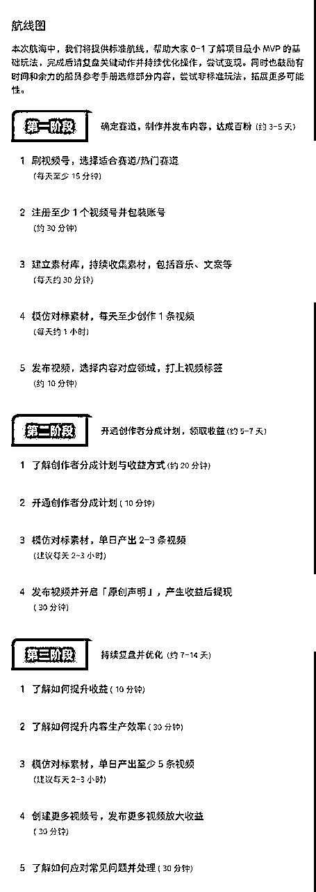

航线图和手册高度关联，你可以根据自己所处的环节，学习对应步骤：

1.每天根据自己的项目进度，确认自己现在在航海图的哪一步，接下来要做哪一步；

2.点击对应要实操的步骤，跳转到航海手册对应模块，了解具体实操步骤后开始行动；

3.当天行动完成后，完成日志打卡，复盘行动内容，再做下一步规划；

4.航线图与项目关键路径强相关，如果你完成了航线图的所有动作，意味着最小MVP已跑通。别停下脚步，继续重复第一阶段到第三阶段的动作。

以上阶段中，所有航线图步骤建议在航海前两周内完成。完成全部动作之后，建议持续找素材、剪视频、发视频，甚至增加新账号，持续运营，直到赚到第一块钱，甚至赚到更多钱。

# 必修篇：跑通最小MVP

#### 章节概要

必修篇中，我们会从认识视频号分成计划着手，一步步带你完成整个项目流程的学习。你可以根据本篇内容与步骤进行实操，跑通视频号分成计划的最小MVP。

如果你是项目新手，建议在正式实操前，先初步了解项目全貌：

【项目概述】了解视频号分成计划

如果你已经对项目整体有所了解，就可以按照项目核心步骤，开始学习实操：

【项目实操 1/3】确定赛道，制作&发布爆款内容

【项目实操 2/3】开通分成计划，领取收益

【项目实操 3/3】持续复盘优化，提高内容质量&产量

必修篇的内容与航线图内容、顺序一一对应。按照手册顺序学习，就能逐个完成航线图上的任务。

在后续每个关键步骤的章节概要中，我们也会提及对应航线图，提醒你完成相关步骤。

接下来就正式开始吧！

## 一、【项目概述】了解视频号分成计划

#### 章节概要

这一章，我们将一起认识视频号分成计划项目。

为了让大家获取更多项目信息，我们会从以下三个角度展开分析：

1.1 什么是视频号分成计划：包含项目基础介绍

1.2 项目现状：包含变现空间、优势风险、项目能做多久

1.3 项目核心玩法：包含核心步骤、视频号内容推荐机制

看完这些内容后，你会对视频号分成计划建立起基本的项目认知，也能在一定程度上找准自己的发力点。

了解项目的过程中，你会发现这是一个借助视频号流量红利入局的新机遇，重点是积极下场尝试。通过本章建立基本项目认知之后，就可以根据后文【项目实操】的内容开始实战了。

### 1.1 什么是视频号分成计划？@郭耀天 @流浪虎

「视频号分成计划」是🛰️视频号今年4月新上线的变现方式。视频创作者不需要出镜也能参与：

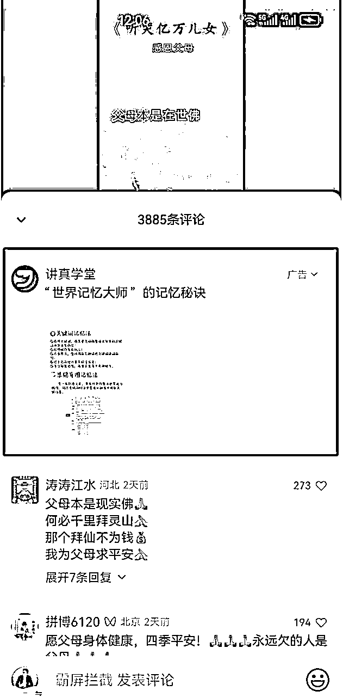

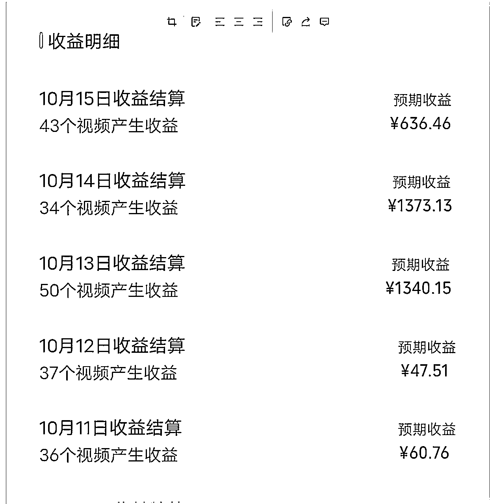

项目前期，我们需要寻找合适的赛道创作视频并发布。等账号符合平台要求后，平台会邀请符合条件的原创视频作者开通「视频号分成计划」：

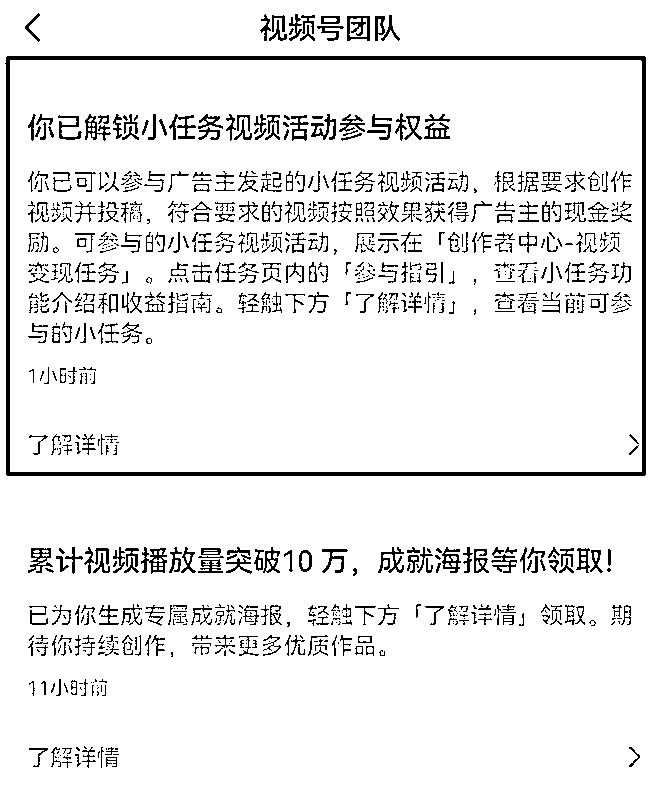

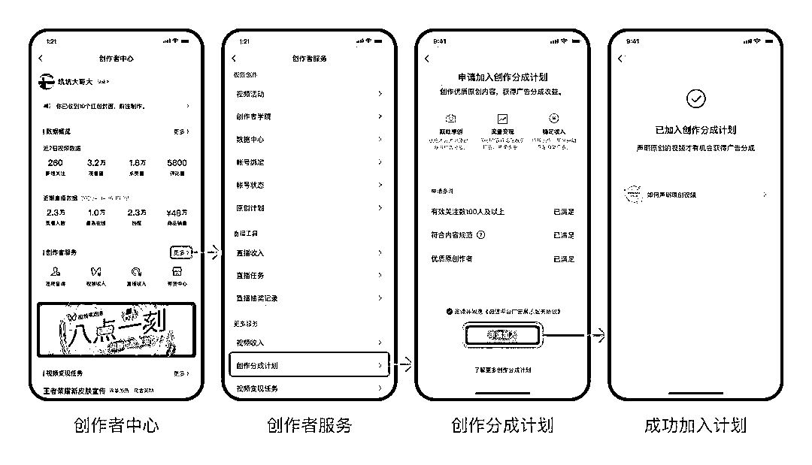

开通「视频号分成计划」后，持续发布视频并声明原创。视频的评论区就有机会自动展示适合的广告。用户点击广告后，我们就能获得收益，无需自己找广告或挂广告。

简单理解，这就是视频版的流量主收益。👸号承载文字内容，视频号承载视频内容。

目前分成计划并未全面开放，仍处于内测期。想要参与视频号分成计划，创作者需要同时满足以下三个条件，才能加入创作分成计划：

有效关注人数（粉丝数）在100及以上

符合内容规范：平台鼓励发布优质原创、画风精美、真实正向的作品

优质原创作者

「视频号分成计划」目前还在探索发展期。如果能找到合适的赛道并持续发布视频，拿到正反馈的概率会更大。

内容来源：《视频号创作者分成收益怎么赚？追好热点，打造爆款视频》@流浪虎

### 1.2 项目现状

#### 1.2.1 变现空间 @流浪虎

「视频号分成计划」的收益计算方式，腾讯并没有给出明确规则：

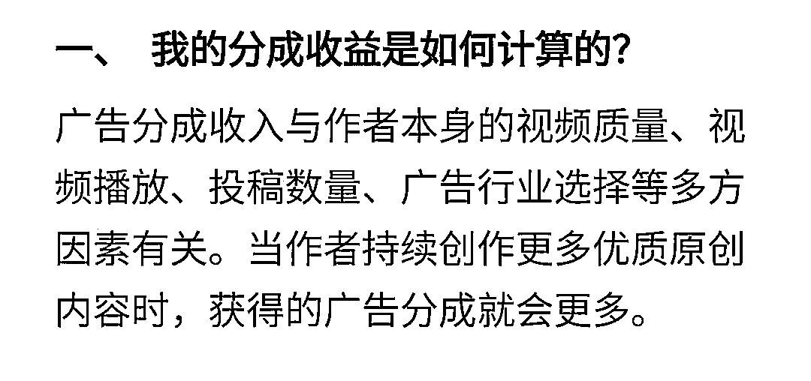

按照经验，1万播放量大概等于1块钱，具体还是依广告点击率而定。有时候播放数据很好，但如果用户没有点击评论区的广告，视频收益依然不高。

举个例子：有个视频播放量300多万，广告收益达到1500多元；

有个视频播放量100多万，收益却只有30元；

昨天爆的一个视频只有79.6万播放，收益却有122.93元。

到目前为止，收益规律还是难以把握。单就我自己的项目收益情况而言，单日纯创作者分成计划收益最高1500元以上，累计涨粉9万多，单条视频最高播放608万，半个月收益3300元。

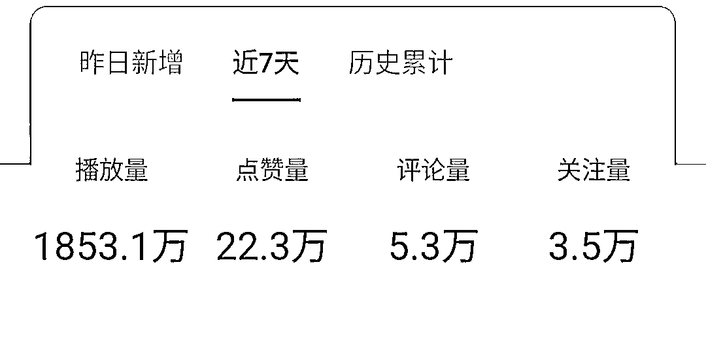

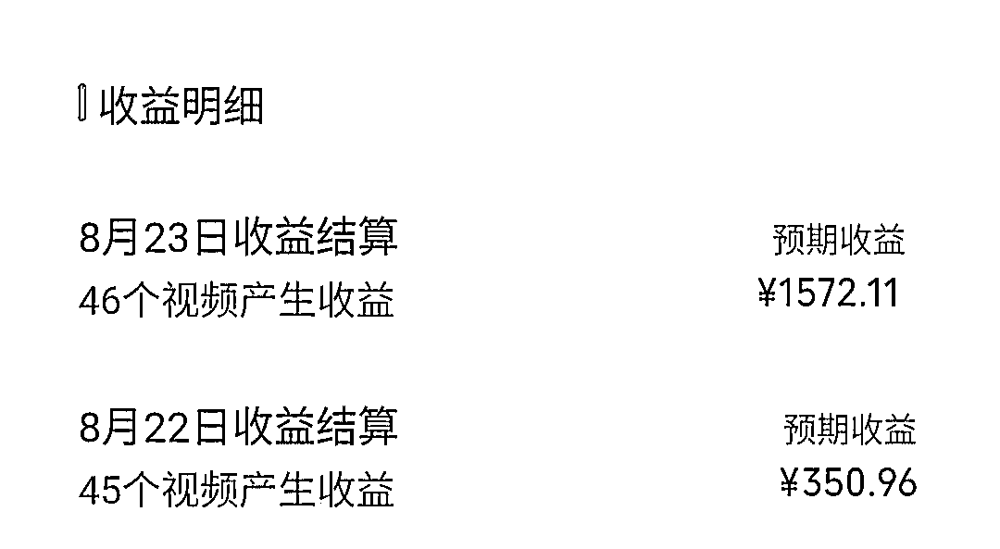

但如果能找到合适的赛道，持续发布视频，不断提高创作效率，获得正反馈的概率会更大。

内容来源：《视频号创作者分成收益怎么赚？追好热点，打造爆款视频》@流浪虎

#### 1.2.2 优势与风险 @郭耀天

目前「视频号分成计划」门槛不高，只要有🛰️号，开通视频号就能操作。收益来自商家广告而非平台补贴。只要视频号流量增长、商户数量增加，广告收益就会水涨船高，所以市场空间比较大。

而且真正运作这个项目的人相对较少，只有前期一直在视频号做原创的一批人吃到了红利。做得好的伙伴，一条视频就能拿到上万元的收益。

目前视频号还没有达到应有的增量，商家还没有完全进入，所以现在入场是比较不错的机会。尤其现在视频号对新账号有扶持期，特别是前三个视频，就算你是0粉丝账号，也有可能获得推荐、获得流量。

「视频号分成计划」的门槛比较低，你有🛰️号、开通视频号就能做。如果你能每天投入2—4小时，对🛰️视频号用户有一定了解，有至少1个正常使用的视频号，会简单的视频剪辑，并能在后期逐步提升创作效率，跑通项目的概率会更大。

所以与其讨论「视频号分成计划」有什么门槛，不如聊聊它的风险：

风险一：账号可能一直不符合要求，无法开通创作分成计划。

应对建议：提高原创视频质量，或尝试申诉开通，详情见「3.1 如何开通分成计划」

风险二：开通创作分成计划后被取消。

应对建议：根据官方通知整改内容或账号，或进行申诉，详情见「3.3 分成计划被取消，如何恢复？」

风险三：赛道玩法调整或人数变多，创作难度变大。

应对建议：积极关注更多赛道玩法，及时调整。详情见「6.4 尝试多种赛道」

#### 1.2.3 视频号分成计划能做多久？@白丁

这个项目从9月份开始爆发到现在，快半年了。目前收益依然非常可观。我们团队每个号每月都会出现几次单条视频四位数收益，甚至能达到五位数。但现在入局的人越来越多，大部分都在做混剪和搬运，平台对内容原创度的要求也越来越高。所以当下简单的二次创作肯定行不通。需要做优质二创，不要与平台对着干，顺应平台生态，踏踏实实做好内容为平台服务。平台依然会回报丰厚的收益。

不要听一些营销号鼓吹项目简单。赚钱本来就不是一件容易的事。成年人至少要具备这几个条件才不会被割韭菜：不相信简单；不相信馅饼会砸到自己头上。踏踏实实做好内容，不要总想着省事，不要走歪门邪道，不要做对抗平台的事。用户在任何平台上的对抗行为，平台都心知肚明。动了平台的蛋糕必然会受惩罚。就像1月份很多人利用漏洞恶意刷广告，随便拍一条视频，把视频转发出去让人点广告，一条视频轻轻松松拿到五位数，结果不到3天号就封了。即使没被封号，产生的收益到现在也没到账。

人走得正，才走得远。视频号分成项目绝对是个长久项目。

判断一个项目能不能长期做，就看赚的是谁的钱。如果这个项目是腾讯直接发钱，大概率不会长久。不管哪家公司做项目，肯定设了止损点，到了止损点就停止发钱。

而视频号分成计划赚的是广告投放商的钱，这个钱腾讯也在赚。为了激励作者持续发内容，必须分钱出来，钱才是一切行为的源动力。这种钱只要视频号流量持续很大，广告商就不会缺，这个分成计划就一直有钱可赚，无非是赚多赚少的问题。

所以，评估一个项目能否长期做，关键是看赚的是什么钱、赚的是谁的钱。

就像7月份推出的支付宝分成计划，为什么后来没人做了？刚开始有收益，后来收益越来越少直到变成0。因为支付宝分成计划的作者收益是支付宝直接发给创作者的，属于项目启动资金。不管哪家公司做项目，一定会有止损点，到了止损点就会停止发钱。

我们来看一下视频号收益是怎么来的：

图1

图2

上图圈起来的就是主要收益来源，即评论区广告展现。点击的人越多，收益越多。视频号分成计划的收益来源就是广告点击收益。

作者开通分成计划后发视频，只要在发布时标注原创，系统会通过大数据给每个浏览者匹配广告。同一个人每次点击同一个视频的广告也不一样。这些广告基本都在评论区的第三到第五条之间。有人点击了，这条视频就有收益。

因为是广告，所以这属于推广费。视频号、作者、推广方三方共赢。例如上图2，游戏厂商拿到点击卡片广告进入游戏的充值钱，腾讯拿到游戏厂商的广告费，作者拿到腾讯分出来的广告费。其中腾讯拿6成，分给作者4成。

只要视频号流量持续做大，广告商就不会缺，这个分成计划就一直有钱赚，无非是赚多赚少的问题。

总结一下：这个项目完全值得长期投入，视频号需要作者，作者需要收益。

内容来源：《视频号分成计划娱乐解说玩法，一条视频一天4815元》@白丁

### 1.3 项目核心玩法 @郭耀天

#### 1.3.1 项目核心步骤

先通过一条简单的路径，看懂「视频号分成计划」关键步骤：

选择合适/热门视频赛道（重要）> 注册视频号并包装 > 搜集视频素材 > 创作视频内容并发布 > 符合要求后开通创作者分成计划（重要）> 持续发布原创视频 > 产生收益并提现

所以可以发现，对于「视频号分成计划」来说，找准赛道和开通创作者分成计划，是项目中最关键的两个动作。

要在这两步上做好，按照本手册的步骤执行即可。我们分别在以下两章进行了重点讲解：

开通创作者分成计划后，要做的事情就是持续发布视频（记得打开原创声明按钮）并复盘优化，通过堆量或堆账号等方式，放大爆款概率，放大项目收益。

平台鼓励原创。这里的「原创」指的是平台没有的内容。如果你参考其他平台上的内容，只要视频号上没有，也算原创。所以做原创还是相对容易的。就算做二次创作，也建议以原创为标准。否则后期可能出现不推荐、不给流量，甚至关闭流量分成权限的情况。情节严重的还可能封号。

制作内容时，需要选择那些容易引发评论的内容。有些领域数据很好、播放很好，但收益不行。比如祝福领域，这个领域流量很大，用户以老年人为主，但收益相对较低。原因在于很多广告无法精准匹配这个领域的用户。

建议大家选择能引起用户互动评论的内容。评论数量比转发量、点赞量都高，这类内容才是我们值得深入研究的领域。比如找不同、看图找茬这类互动玩法——把图片制作成视频，让大家来找找有多少处不同，这种内容互动性非常强，参与的观众很多。

评论量上去了，广告点击概率自然增大，收益也随之提升。

站在平台的角度思考，多创作大家喜欢的内容，才能拿到更多收益与好结果。

#### 1.3.2 视频号内容推荐机制

1.3.2.1 推荐机制

🛰️视频号不同于订阅号和服务号，它是一个全新的内容记录与创作平台。与👸号不同，视频号是非中心化的产品，核心在于推荐。

视频号内容以图片和视频为主。可以选择发布短视频（1分钟以内）、长视频（1—30分钟），或不超过9张的图片，还可以配文字和👸号文章链接。而且操作不受PC端后台限制，直接在手机上就能发布。

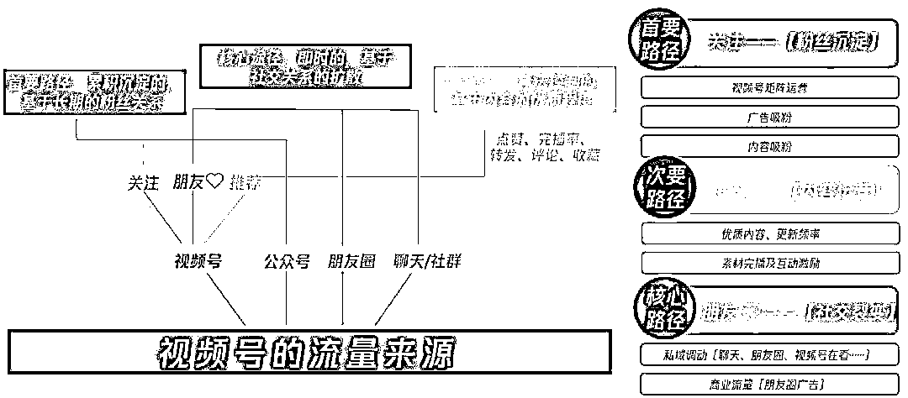

视频号目前正处于红利期。对创作者而言，想把视频号做起来，首先要搞清楚平台自身的流量算法推荐机制，这样才能让作品被更多人看见，精准引流，从而助力业绩增长。

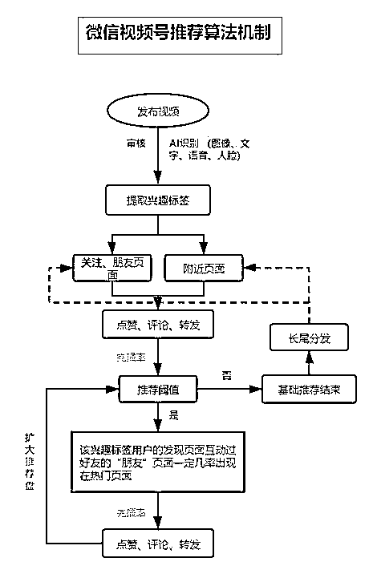

在🛰️生态里，社交是它的先天基因。社交推荐就是视频号根据用户的好友发布、点赞、关注、评论、转发等行为，优先为用户推荐相关视频。社交关系链和熟人链在🛰️视频号的推荐逻辑中权重很高。从🛰️视频号入口显示的“关注、朋友、推荐”栏目中就能清楚看出这一点。

1.关注栏的内容是你关注的人的视频号发布的内容；

2.社交推荐的内容是有好友点赞过的视频号发布的内容；

3.兴趣算法推荐的内容，是系统根据你的兴趣爱好推荐的内容。

系统会根据你的观看偏好推荐内容，类似于“猜你喜欢”的逻辑。这块的推荐算法和抖音比较接近：

先给结论：内容本身是底盘，观众是否看完、是否愿意转评赞，是让流量飞起来的加速器。底盘够稳、看完比例高、互动也漂亮时，平台里的社交分发与机器推荐会越咬越紧，最后形成互相抬轿子的强回路。两者并非各跑各的，而是彼此牵连、互相放大：社交侧反馈越好，系统侧越容易接棒，所谓爆款往往就是这么被推起来的。但想让轮子尽早转，第一步得先点燃最初那批社交传播。

换个角度看，冷启动阶段若没有播放和互动打底，哪怕片子质量不差，也容易沉在水下，系统很难捕捉到它。因此创作者不能只等，要主动把作品丢进朋友圈、🛰️群，请熟人帮忙点个赞、收个藏、留句话，先把最基础的播放量托起来，后面的增强回路才有启动条件。

在🛰️生态里，好友关系和其他平台上的陌生人关系不一样，它属于人际往来中的强连接。所以首页那个“朋友赞过”入口，本质上就是一套靠强关系驱动的内容分发逻辑。

现在视频号首页摆着“关注”“朋友赞过”“推荐”三个口子，分别承接兴趣偏好、社交分发和算法推荐。单独把“朋友赞过”拎出来做栏目，正是它和抖音、快手拉开差距的地方。

这背后说明，视频号不只看常规的个性化算法，还格外倚重“朋友赞过”所代表的社交分发能力，并希望借此把用户留在生态里。

从现有观察看，视频号的个性化推荐大致会把“兴趣标签、地理定位、热点话题、随机推荐”几种方式混着用。

① 兴趣标签

🛰️本身沉淀了丰富的社交数据，用户会被打上不少维度的标记，像性别、年龄、职业、爱好、常住城市等。系统再拿这些标记去内容池里找匹配项，把可能合口味的东西推过来。这也是社交产品常见的匹配思路。

打个比方，某人爱旅行，关注了一批旅游攻略号，平时也常晒相关动态，那么视频号给他推旅游类内容的概率就会更高。

② 地理定位

发片时可以选择附近地点或热门城市。这个做法很讨巧，对同城流量的吸引力不小。给内容挂上位置，好处不止一层：既能在本地获得曝光，也可能被🛰️系统挑出来，送到附近感兴趣的人面前，引流更精准。视频号还会读取手机定位，把同城内容往前排。围绕位置服务，后续还能长出不少玩法。

③ 热点话题

实时冒出来的网络事件和讨论，通常最容易把用户注意力拽过来。再配合协同过滤这套推荐逻辑——先分析用户兴趣，在人群里找到偏好相近的人，参考这些相似用户对某条信息的评价，进而预测目标用户会不会喜欢——热点中的优质内容就更容易被送到合适的人眼前。

系统推荐是整套机制里最关键的一环。片子数据起得来，系统会把它送进下一个流量池；数据继续往上走，还会被推进更大的池子。

可以拆成三点看：

① 创作者把作品发出去后，系统先把它递给已关注该号的粉丝。粉丝若没反应，曝光推荐就不会被触发，作品只拿到一次浏览，暂时进不了更高流量池，但以后仍有机会被重新捞起；

② 若有人产生兴趣，并且点了赞、转了发或留了评论，推荐机制就会被触发；当多位用户一起评论时，作品会进入更大的流量池，权重随之抬高，被推荐的概率也更大；

③ 对联系频繁的🛰️好友来说，他们关注或看过的视频号大号，也可能被引到好友面前。如此循环，基于熟人和社交关系链的裂变就发生了。

眼下视频号流量分发里，社交权重的分量相对更重。按这套规则，手里攒着大量好友、多个社群、👸号等私域资源的人，会更容易成为视频号营销推广的抓手，也比普通玩家更可能跑成头部账号。

1.3.2.2 双重把关：机器先筛，人工复核

平台基本都会给视频设审核过滤，视频号也不例外，目前走的是双重流程：机器审一遍，人工再看一遍。

机器审核：平台会预先训练识别模型，扫描视频画面和文字信息，判断作品与文案有没有违规。一旦踩线，可能被降推荐、被删除，或被设成仅自己可见。严重违规会直接删掉或转为自我可见；机器拿不准的，就转交人工。

人工审核：针对机器筛出的疑似违规内容，由人工进一步判断。人工主要盯三处：标题、封面、关键帧。若确认违规，处罚包括删除视频、发降权通告、封禁账号等。

## 二、【项目实操 1/3】选准方向，做出能爆的内容并完成发布

#### 本章导览

把视频号创作者分成计划的整体盘子看明白后，就要动手开跑了。这一章包含两个做好项目的前提，以及一个落地实操重点。

前提一：方向要选对 2.1 圈定赛道

这一节会结合视频号用户的偏好，讲清楚怎样挑出适合下场的赛道。为了少让大家在选择题上耗时间，也给了两个推荐方向，方便先上手试。

前提二：把账号底子搭好 2.2 注册与包装

这一节从手机号、🛰️号、登录设备、视频号开通四个环节，把账号准备流程串起来。新手尤其要留意，先把基本功做扎实。号开好后，可以照着同赛道玩家，把头像、简介等信息布置起来。

落地核心：围绕热门方向做片并发布 2.3 打磨爆款

内容是整个项目的重心，既影响能不能开通分成计划，也影响最终能赚多少。因此这一章会给出方法和操作步骤，大家可以照着做出第一条片子。

内容做好后，就进入发布环节 2.4 发布动作

开始本章的学习吧。希望大家在这一阶段做出自己满意的作品，拿到好看的数据。

#### 本章任务清单

学完并做完这一章，第一阶段的清单就能划掉。

第一阶段：圈定赛道，制作并发布内容（约 3-5 天）

1.刷视频号，挑出适合自己或当下热门的方向（每天至少 15 分钟）

2.注册至少 1 个视频号并完成包装（约 30 分钟）

3.搭一个素材库，持续往里存音乐、文案等（每天约 30 分钟）

4.照着对标素材模仿，每天至少做 1 条片子（每天约 1 小时）

5.发布作品，选对内容领域并打上标签（约 10 分钟）

那么现在，就开始第一阶段的实操吧。

### 2.1 圈定赛道 @白丁

#### 本节提要

想让后面的项目推进得更顺，挑一个合适或热门的方向很关键：

为了解决选方向的难题，我们整理了通用判断法，详见“2.1.1 判断赛道值不值得做”。

为了降低新手下场难度，这里给出 1 个推荐方向，详见“2.1.2 新手先试娱乐方向”。

过程中希望大家多举一反三，把赛道视野打开，找到属于自己的新地盘。

#### 本小节任务清单

根据本节内容，大家可以完成第一阶段清单的第一项：

那么现在，就去找你心仪的方向下场吧。

#### 2.1.1 判断赛道值不值得做

做视频号分成计划，赚钱这件事往往是方向比蛮力更重要。赛道既决定收益，也决定收益天花板。方向偏了，再拼也很难拿到好结果；方向对了，正反馈来得快，上限也更高。

围绕视频号分成计划选方向，我们归纳了三点：

1.收益逻辑

想在视频号做分成计划，先得弄明白钱从哪来。不少朋友以为只要流量起来、播放做高，收益自然就有。这个判断放在抖音中视频上成立，放到视频号分成计划里就不对了。

先看一张图：

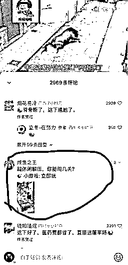

图中红圈标出的地方是一条广告。分成计划的钱，来自评论区这张卡片广告被点击。也就是说，有人刷到你的内容，并在评论区点了广告，才会产生收益；只看了视频或只翻了评论、没点广告，都不会有钱。

这就是视频号分成计划的收益逻辑。

把逻辑弄懂后，影响收益的几个因素就很清楚了：评论、人群、广告类型。

所以做视频号分成计划，必须顺着收益逻辑去布赛道。同样 100W 播放，不同方向带来的收益可能差出 5 倍还多。

2.视频赞评比

点赞、评论、收藏、转发在任何短视频平台都是爆款的核心指标，视频号也一样。选方向时，这些指标要多看。我做视频号分成计划时，重点看赞评比。

原因在于，点赞影响内容推流的上限，评论影响广告展示量。一个对应流量往上走，一个对应收益往上涨。实操中我发现，有些赛道数据看着漂亮，收益却不多。比如老年祝福类视频，几百万甚至上千万播放几乎天天有，评论也不少，但收益相对偏低，这和受众年龄结构有关。

3.同行数据参考

一个方向没跑出结果前，别闷头就干，同行就是最直接的参考答案。赛道行不行，同行已经用数据投过票了。搜一下赛道关键词，看看流量和评论，心里就有数。流量差、评论少的，不值得投入。

视频号分成项目的赛道，只要满足上面三个条件，就算好方向。

内容来源：《视频号分成计划娱乐解说玩法，一条视频一天 4815 元》@白丁

#### 2.1.2 新手先试娱乐方向

怎么用这一节

为了降低行动门槛，这一小节推荐一个方向给大家试手，核心目的是先找找正反馈，把项目信心建起来。

摸清赛道基础玩法后，大家要主动寻找自己真正心仪的方向，勇敢试新玩法，你或许就是第一个吃螃蟹的人。

如果只守着娱乐方向试水，跑通项目的概率肯定远小于多试几个方向。

娱乐方向的视频数据表现不错，找到爆款话题后大概率能出爆款，而且受众更容易点开评论区，广告收益也还可以。

特别注意：娱乐类视频的真实性要自己把关，避免造谣传谣、踩到法律风险，请在合法合规范围内创作。

视频号能不能爆，关键看内容里有没有爆点。实操下来我们发现，娱乐方向的爆款明星和爆款话题是有规律的，甚至可以说爆款明星和话题相对固定，难点在于怎么把它们找出来。

比如 23 年 10 月初，张柏芝和谢霆锋的话题特别火，我们就把整个账号都压在这两个人的视频上，几乎条条都能爆。

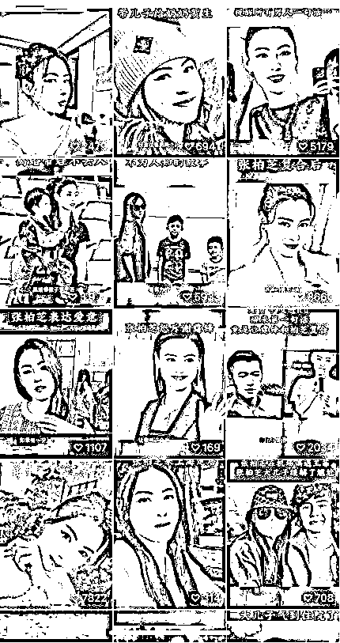

只要摸清娱乐方向的爆款逻辑，做出爆款并不难：

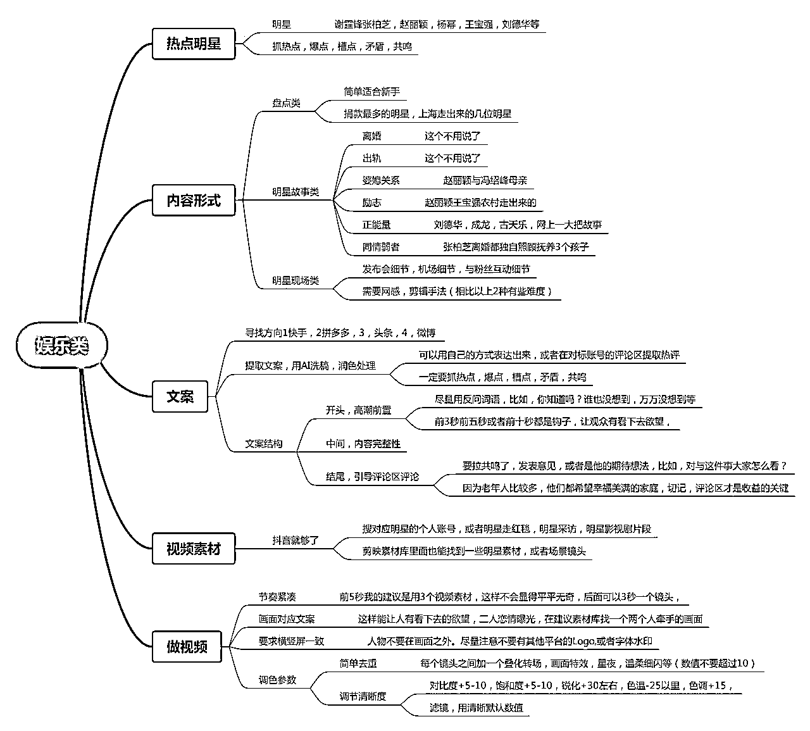

娱乐类内容操作起来很简单：把爆款话题拿来学一学、改一改，可以借助 GPT；改完稿用剪映配音，再配上视频素材就行。

内容来源：《视频号分成计划娱乐解说玩法，一条视频一天 4815 元》@白丁

### 2.2 账号准备与开通 @郭耀天

视频号是挂在🛰️体系下开通的，一个🛰️对应一个视频号。所以🛰️号准备得越足，可开的视频号就越多；能搞定多少个🛰️号，基本就有多少个视频号。

注册🛰️号需要辅助，按官方提示操作即可，可以找身边人帮忙辅助，手机号可以去营业厅办，也可以用虚拟号。

#### 2.2.1 第一步：准备手机号

移动用户可以下载和多号来注册小号，不过注册🛰️有限制。

联通有小号可用，电信部分地区也能用小号，另外还有中国广电。

一个人在上述运营商各注册五张卡，加起来就是 20 张，基本够用。

如果还需要更多，就找身边家人帮忙注册。如果是团队或公司，就让团队去办号。

#### 2.2.2 第二步：开通🛰️号

🛰️注册现在稍微麻烦些，需要辅助。注册时找身边人帮一下，还是能搞定的，比如找亲戚帮忙。

缺点是注册完的号需要养，模拟正常人使用就行，比如刷刷视频、发发朋友圈。不过只要不加人，单独注册视频号问题不大，刚注册的🛰️也能开视频号。

团队测试的很多账号都是这么搞定的。现在视频号确实是机会，能多注册🛰️就多注册，把视频号开起来。

#### 2.2.3 第三步：安排登录设备

多账号操作，就要让多个🛰️同时登录。一个手机可以登五个🛰️：

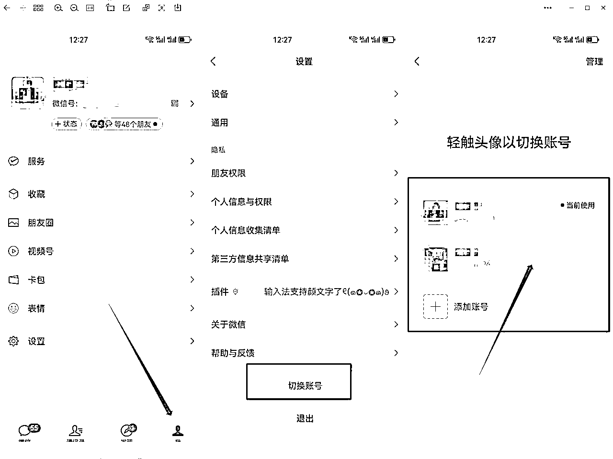

苹果手机可以定制多开；安卓这边，也可以用别人开发的🛰️多开工具，比如我现在用的双开助手：

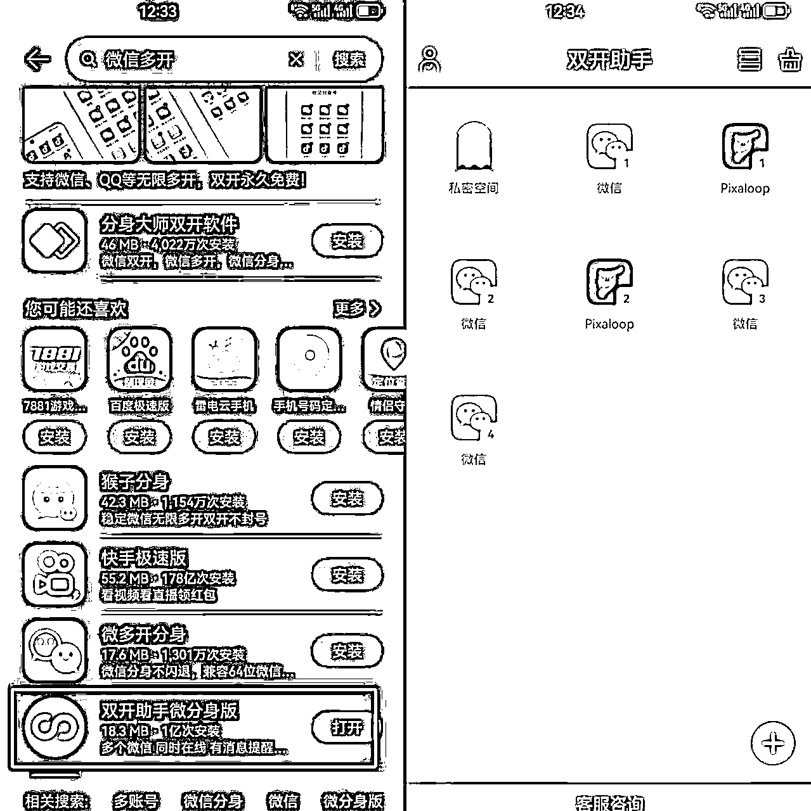

有其他替代工具也行，只要能解决多个🛰️登录。不过多开有封号风险，最好还是用多台手机更安全。

如果拿手机登录，华为能登两个，小米能登两个，摩托罗拉能登六个，另外一些营销手机也能登多个🛰️，比如联想拯救者也可以。这里不多展开，按自己的需求来。

#### 2.2.4 第四步：创建视频号

开视频号之前，🛰️号必须完成实名认证，这里就不赘述了。

打开🛰️，“发现”→“视频号”→右上角小人，进入个人主页：

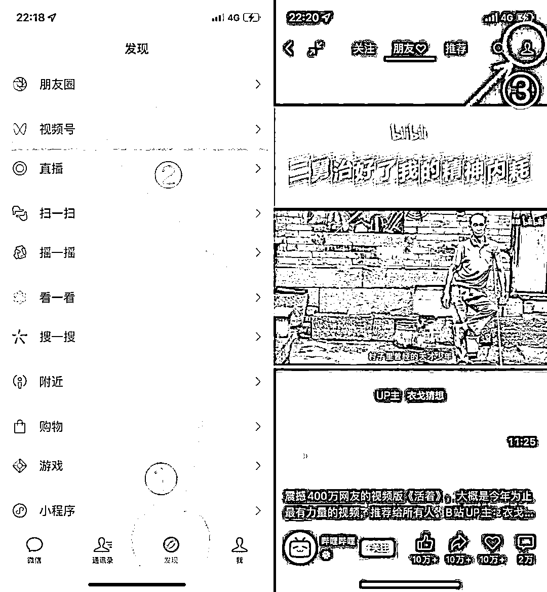

点击“发表视频”，选好头像，填好名字、姓名、地址，再点“创建”：

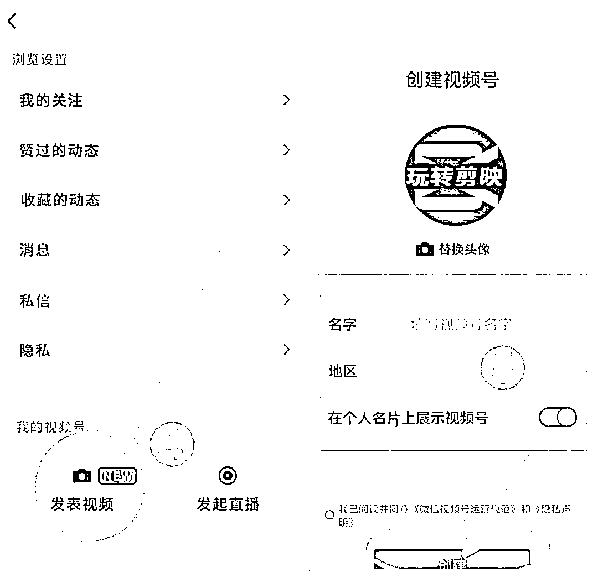

到这一步，视频号就创建成功了。

创建完成后，点右上角三个点→“资料设置”，就能修改个人信息、完善视频号简介：

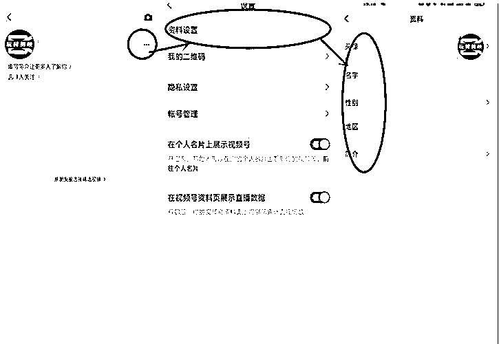

这里要注意，视频号名字和👸号一样先到先得，不能重名。

每个账号每年有 5 次改名机会。如果想要的名称被别人占了，可以申诉，或者在名字后面加点、加符号再申请。

如果确实想用自己的名字，而且你有这个名字的使用权，可以尝试申请，比如有商标、有注册较早的👸号，或者有著作权，都能作为依据。

正常情况下，大家照着对标赛道的对标账号，把视频号信息简单设置一下就好，不用在这上面耗太多时间。

### 2.3 做出有爆款潜质的内容

#### 本节提要

内容是创作者分成计划的核心。方向找对了，不仅能更快达到开通分成计划的要求，开通后也更容易见到收益。按实操经验，好内容十几秒就能带来上千元收益。

目前视频号的内容算法并不透明，但容易出爆款的内容通常绕不开六条原则：

说人话、刺激明确、能引发共鸣、体现价值、真实可信、跟热点相关。

大家找素材、做内容时，可以拿这六条对照。

为了让大家对好内容更有体感，这一小节从三个角度切入：

认识内容载体

抓住热门内容的要点

做热门方向的视频

开始动手做你的爆款内容吧～

#### 本小节任务清单

根据本节内容，大家可以完成第一阶段清单的第三项、第四项：

那么现在，就去找你心仪的方向下场吧。

#### 2.3.1 认识内容载体 @郭耀天

视频号目前能发视频，也能发图文。

视频形态很多，有真人出镜、混剪、二创、AI 生成等。对大多数人来说，主要做混剪、二创、AI 制作这类不用真人露脸的形式。

图文也是视频号的一种展示方式，目前最多能发九张图。有些内容只是几张图配热门 BGM，也能跑成爆款。

#### 2.3.2 热门内容的底层要点 @郭耀天

做视频号内容，一定要扎进垂直细分领域，千万别什么都发。账号内容太杂，粉丝画像也会乱，后期变现会受影响。

就像买衣服，大家通常先逛服装专卖店。如果一家店衣服、鞋、首饰全都有，不少人反而会犹豫，因为类目太杂，看着不够专业。

做内容也是同一个道理，要专一、求精，而不是贪多。所以做视频号内容就像开一家店，尽量锁定一个垂直方向。

热门内容怎么打造？这事很难说死，优质是基础，剩下要看运气。

先说“基础”部分，重点在心态和更新节奏。

坚持是做内容绕不开、也最重要的心态。有人总结得很到位：上班实习期三个月，开实体店守店要一到三年，凭什么你发几条视频就能火？

既然热门算法不确定，那就用数量去“碰”。能日更就坚持日更，能发 5 条就别只发 3 条。

内容策划也是“基础”里的关键一项。

短视频平台有个铁律：三秒决定生死。用户划走一条视频的成本太低了，前三秒能不能抓住人，就显得特别重要。

内容优质与否，有两条评判标准——用户标准和平台标准。

用户标准是内容要有故事性、通俗易懂，画面观感也要强。

平台标准是指内容不能同质化，要和账号标签垂直，价值导向正确，最重要的是让用户停留时间尽可能长。

容易出爆款的内容一般包含六条原则：

说人话、刺激明确、能引发共鸣、体现价值、真实可信、跟热点相关。

热门短视频通常很好理解，用户看的时候不用费脑子，而且视频里要有未知的惊喜刺激。比如前三秒抛出悬念，或放出容易造成误解、产生冲突的对话。

另外，热门短视频往往能带给用户情感共鸣，在真实或真诚中，把快乐或悲伤的情绪传递出去，给用户提供价值。

这里的价值不一定是多高大上的立意。能让用户消磨时间、获得认知、寄托情感的，都是价值。

每个领域能爆的话题和素材类型都是固定的，能挑动用户情绪价值，就是爆款秘籍。其他平台爆过的话题，在视频号爆的概率也比较大。

最后再分享一下，最近视频号里比较受欢迎的内容类型：

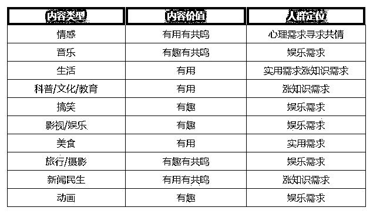

#### 2.3.3 娱乐方向怎么做

注意：娱乐类视频的真实性要自己判断，避免造谣传谣、涉及法律风险，请在合法合规范围内创作。

以下是娱乐方向的视频创作流程。看都是问题，看再多不如做一次，行动很重要。

2.3.3.1 操作流程 @流浪虎 @白丁

第一步：确定当日热点

找热点的方法，赚钱有很多教程，这里不展开讲，主要围绕抖音热榜、🧣热榜来看。

看多了，热点其实很好把握。比如前段时间李佳琦相关的 79 元眉笔、西门子报警、蜂花商战捡粉；华为 mate60 发布，华为自主芯片；日本核废水排海；国足守门员喝水等等。

追热点前先给自己立个规矩：军事政治类的话题一口都别沾，比如金正恩访俄；擦一点边的也躲远点，像深圳“北极鲶鱼”那种。真踩了红线，轻则号没了，重则要被请去“喝茶”。

第二步：热点文案从哪找

热点定下来后，下一步是准备文案。可以自己写，也可以拿现成稿子改。一共 3 条路子：

方法一：上抖音找热点爆款视频，优先选口播类，用轻抖这类工具把口播转成文字，再逐句改出自己的风格。

方法二：启动 360 浏览器，主页上基本都是热点，但多为长文，得压缩成短文案。可以用 ChatGPT 改写，也可以用度加剪辑的“AI 成片——AI 改写”功能（官网链接：https://ducut.baidu.com/）。

方法三：去🧣上搜热点文案，拿回来换种说法，就成了自己的。

文案长度 200—300 字最舒服，尽量别超过 500 字。

第三步：动手做视频

有了文案，就开始制作。我们的策略很简单：批量生产，用数量去赌爆款。所以不做精细剪辑，单条视频制作时间尽量控制在 10 分钟内。

方式一：口播
最简单省事。出门边走边录即可，但很吃表现力，不是人人都能撑住。

方式二：图文
图文有两种做法：一种是单张图配背景乐，简单干净，照样能出大爆款，但文案水平要求高；另一种是多图拼接，一条视频放 3-4 张图，配多个标题，做成“图文震惊版”，靠悬念和震撼感抓眼球。之前李玟和《好声音》那场风波，刷屏的 10w+ 视频很多就是这个套路。先用剪映做好模板，之后不管什么热点，只要换标题、换图，素材找齐 3 分钟就能出一条。

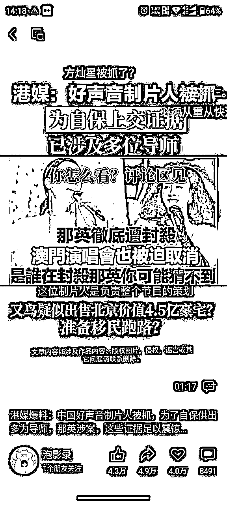

方式三：按流程走
① 把写好的文案丢进剪映配音，铺到音频轨道上，再配上贴合热点的画面素材：

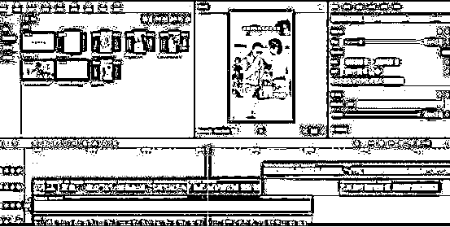

② 做去重：加特效、加贴纸、调参数：

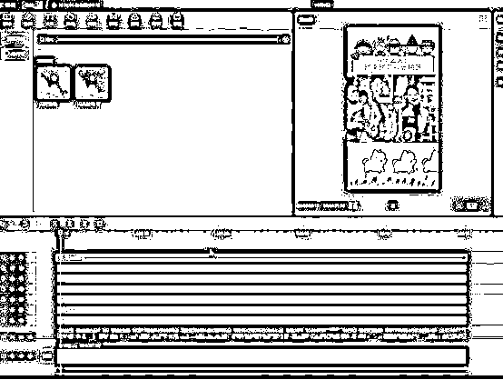

像对比度、饱和度 10、锐化 30 是我们惯用的参数，具体数值看自己素材的明暗再调。以上就是娱乐视频的完整实操闭环，目前按这套流程跑没问题。做视频号分成计划，核心就是灵活，平台政策一变，跟着调就行。

素材出处：《视频号创作者分成收益怎么赚？追好热点，打造爆款视频》@流浪虎；《视频号分成计划娱乐解说玩法，一条视频一天 4815 元》@白丁

2.3.3.2 注意事项：尽量原创 @郭耀天

分成计划的视频，能原创最好；就算做二创，也建议往原创方向改。否则后期可能不被推荐、没流量，严重时连分成计划权限都会被关闭，甚至封号。

所谓的原创，是指视频号上没有的内容。你从其他平台搬来、但视频号还没人发过，也算原创。这样一来，门槛其实不高：
本身就是做原创的，直接发就行；想做混剪或借鉴同行的，就按下面的流程，先把视频号分成计划开通。

另外，做这个项目，前后期都要站在平台角度思考：多做用户喜欢的内容，才有可能拿到更多收益和好结果。

### 2.4 视频怎么发出去 @郭耀天 @黄岛主

很多人以为视频号只能手机发，其实电脑端也可以操作。

#### 2.4.1 手机端发布
手机端有 3 个入口。

第一种：从发现页发布
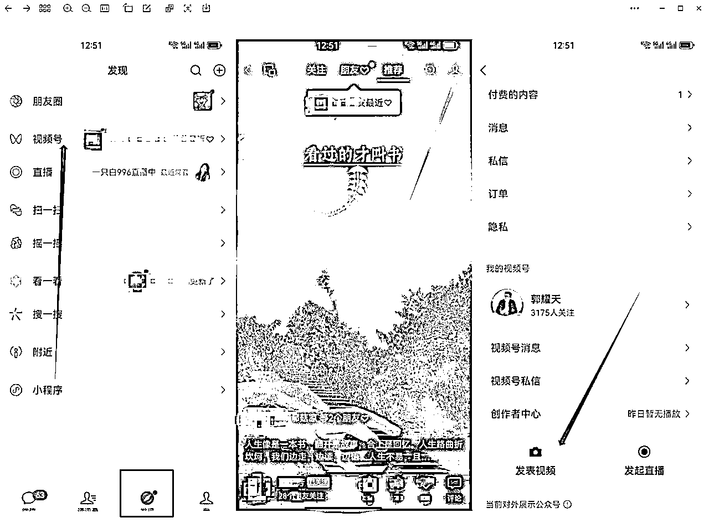

第二种：从我的页面发布
点🛰️底部的“我”，进入视频号，进去就能看到发布页面。
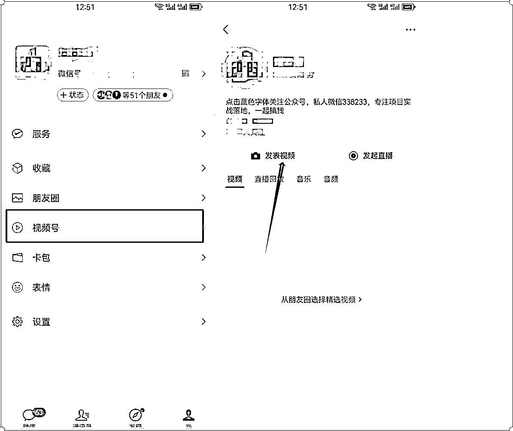

第三种：剪同款发布
带特效的视频，可以直接用“剪同款”发。很多特效自己不会做，正好用这功能。但要留意：不是每条视频都有这个入口。看到下图这种视频，就能试下剪同款，发出去的特效和原视频一样。

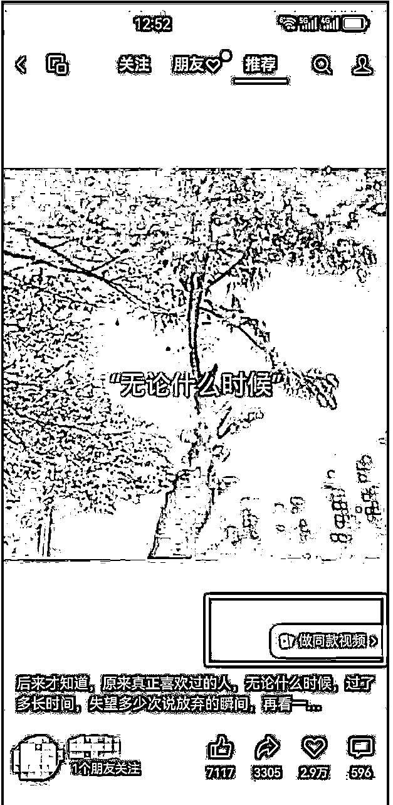

#### 2.4.2 电脑端发布
电脑端同样可以发视频，还支持定时发布。如果视频是在电脑上做好，直接电脑上传更省事，不用倒到手机。登录视频号助手就行：https://channels.weixin.qq.com/login.html

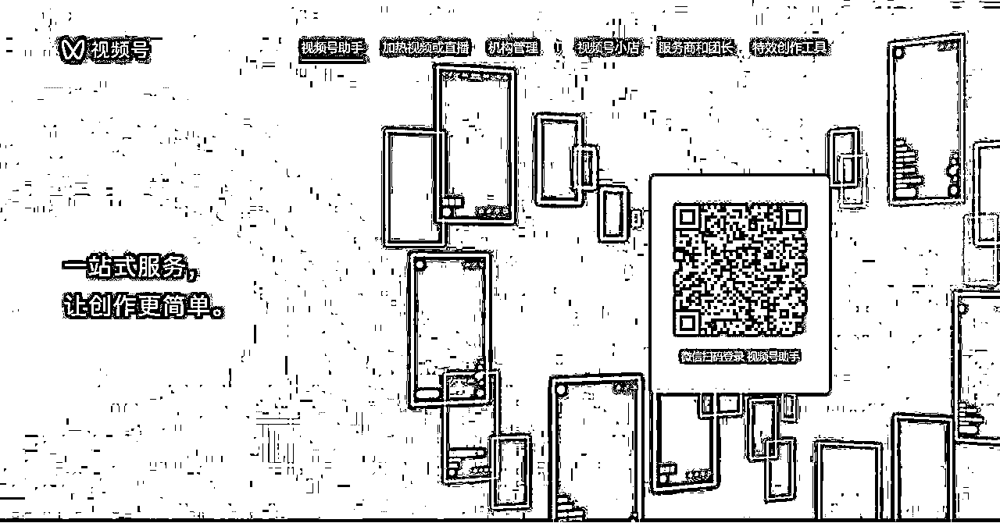

登录后，首页“内容管理”里的视频都可以直接发布：

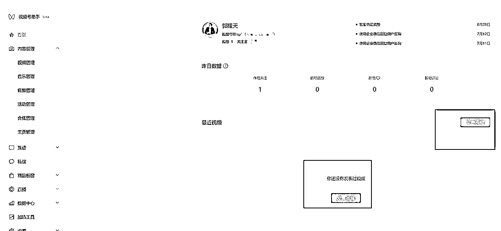
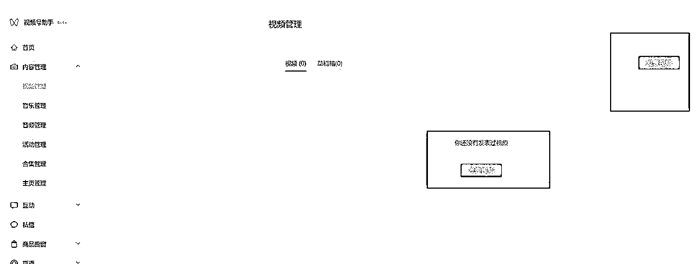

#### 2.4.3 发布技巧

2.4.3.1 通用技巧

划重点：开通「创作者分成计划」后，发视频必须打开“原创声明”，否则没收益。有圈友视频跑到 600 多万播放，结果忘了开原创，少赚约 2000 元。

前期能开原创也尽量开；但有些新号没有原创声明按钮，所以前期不强求。

起号阶段，建议一个账号一天发 5 条来测效果。别连着发，间隔一两个小时放一条。如果发了 5 条都没爆，可以补发 1-2 条。

时间精力够的话，最好多搞几个账号：一个手机能开 5 个号，一个身份证能认证 5 个号，别把所有赌注押在一个号上。

发布时段建议选白天，早上 7 点到晚上 21 点之间最合适。太早人没醒，太晚人睡了，点赞少，流量自然差。

标题参考同行，简单直接；标签贴合视频主题；选好封面就能发。想多争取曝光，可以顺手标记位置。

标签添加方式：在「添加描述」里点“#”，就能输入话题标签。比如做早安祝福，领域选“情感”或“生活”。

发完视频，建议主动分享到朋友圈或发给🛰️好友，让身边人先点赞围观。

如果前面有一条已经爆了、还在跑量，就先别发新视频，否则容易打断爆款推荐。等那条流量自然放缓了，再继续更新。

开通分成计划后，发完视频可以自己或小号去留几条评论，广告才会早点出现。目前是评论区至少两条评论后才会挂广告。

素材出处：《视频号儿女祝福流量变现副业，起号后单天收益 1000+，实操一条龙玩法分享给你》@黄岛主

2.4.3.2 吃透推荐机制

视频号作品发布后共有 6 次推荐，节奏是：3+6+18+24+24+24。

什么意思？简单说，每个作品发布后的第 3 小时、第 6 小时、第 18 小时、第 24 小时，系统都会给一波自然推荐。

发布后的头 3 小时叫“黄金三小时”。这个阶段一定要猛冲，把朋友圈、互助群、红包群全调动起来，尽量把完播、点赞、评论做起来。

发布后 48 小时和 72 小时内，系统会进行第二次灰度推荐。

如果 72 小时过去了，视频的播放、评论、点赞、收藏还在往上走，那恭喜你，基本锁定热门，后面还会被平台反复推荐。

目前这种推荐机制下，社交权重的分量很重。好友多、社群多、有👸号等私域流量池的人，在视频号推广上天然占优势，也比普通人更容易跑出头。

2.4.3.3 不想让好友看到视频号？可以关掉

有些伙伴不想让通讯录里的人看到自己的视频号，尤其是借用家人账号的情况。其实很简单，直接关掉展示入口就行：

点视频号右上角的三个点 → 关闭“在个人名片上展示视频号”，🛰️好友就看不见了。

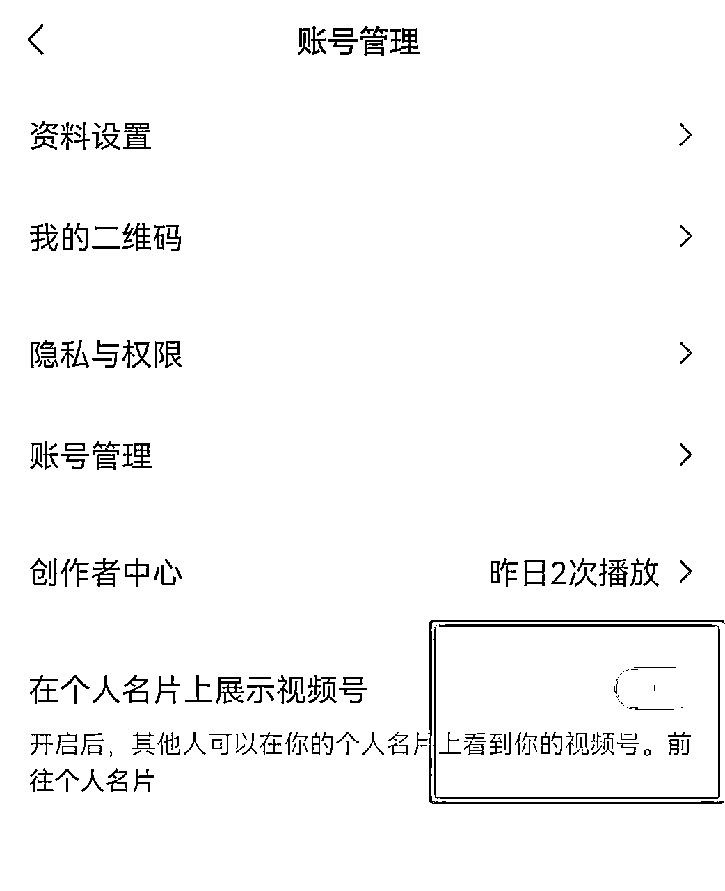

## 三、【项目实操 2/3】开通分成计划，领取收益

#### 章节概要

开通创作者分成计划是本项目最核心的一步。只有先开通，后续发视频才有机会带广告，也才有收益可言。

第一阶段我们已经完成了视频创作和发布。把动作重复下去，就能逐步满足开通要求：
① 有效关注人数（粉丝数）在 100 以上
② 符合内容规范：平台鼓励优质原创、画风精致、真实正向的内容
③ 优质原创作者

那么——
达到要求后怎么申请开通？有没有更快的方法？见「3.1 如何开通分成计划」。
收益怎么领取？提现失败怎么处理？见「3.2 如何领取收益」。
分成计划被取消后怎么恢复？见「3.3 分成计划被取消，如何恢复」。

本章会逐一解决这些核心问题。

#### 本章航线图

完成本章的学习和实操，就走完了航线图第二阶段。

第二阶段：开通创作者分成计划，领取收益（约 5-7 天）
1.了解创作者分成计划与收益方式（约 20 分钟）
2.开通创作者分成计划（10 分钟）
3.模仿对标素材，每天产出 2-3 条视频（建议每天 2-3 小时）
4.发布视频并开启「原创声明」，产生收益后提现（30 分钟）

现在，就按这个步骤行动起来。

### 3.1 怎么开通分成计划 @郭耀天

#### 3.1.1 分成计划开通条件

视频号起号非常关键。起不好号，开通分成计划就慢，白白耽误时间。想顺利开通，目前必须满足三个条件：

符合内容规范：平台鼓励优质原创、画风精美、真实正向的作品；
有效关注人数（粉丝数）在 100 及以上；
优质原创作者。

*补充说明：
整个开通流程里，最重要的就是凑够 100 粉丝和通过内容规范。下面是对应的实操方法。

1.过了官方内容规范 @白丁

操作流程：
风景申诉流程.mp4（在线播放）

这个视频是我早前录的，当时发 10 条就能审过，现在得至少 15 条再去申诉，按视频里的流程操作即可。

要点：
1.必须用手机实拍：路边的树、花花草草、菜园子、自然风景、公园场景介绍等都行。视频时长 15 秒以上，要带着介绍，语言得有内容导向（导向就是主题：这个实拍讲的是故事、科普，还是别的什么）。实拍内容能不能过关，可以找我审稿。
2.发布节奏：第一天 5 条，第二天 5 条，第三天 5 条，第四天申诉（看上面视频里的申诉流程），每条间隔 15 分钟。视频至少发够 15 条再申诉，10 条基本过不了。内容别随手拍两下加段语音就交差，现在要求有主题，太随意官方直接不给过。
3.发布时一定要加标题文案和话题。
4.这条路只是为了打开“内容规范”，千万别标原创。等规范过了，再发布涨粉视频。涨粉推荐用明星故事类，转粉率高，等粉丝到 100，自己去申请开通就行。
5.千万别刷粉、互粉，做内容不要干预任何数据。
6.别想偷懒，随便拍就想混过去；拍太随意一样过不了。省事就是最大的费时、费事。

2.100 粉丝怎么解决 @白丁

内容规范按上面方法开通后，涨粉建议用明星故事视频。涨粉视频不能搬运、不能混剪，依然要做二创。选明星故事赛道，是因为它转粉率高、素材多、话题足、容易出爆款。详细实操见《6.4.12 娱乐赛道三种内容》。

有人担心：一直开不了分成计划怎么办？是不是在浪费时间？其实，我们做的每个项目、拆的每个赛道、解的每个案例，都是在给寻找适合自己的方向铺路。分成计划可能适合你，也可能是块试金石，按教程先试再说。

目前来看，很多伙伴确实能开通分成计划，差别只是赚多赚少。一开始可能是几毛钱，慢慢变成几十、几百，甚至几千。别泄气，爆款往往就在下一个视频。

那怎么提高达标概率？
1.起号内容要垂直
2.内容要原创，至少要平台觉得你原创
3.画面清晰度 720p 以上，视频不抖、不闪

纯原创的话，内容垂直就够了；做二创的，就得在视频里多堆元素：配音、多片段拼接、贴纸、字幕、转场、特效等。

#### 3.1.2 分成计划开通流程

第一步：找到入口，申请加入

方式一：账号符合条件后，入口就会出现在以下位置。
登录视频号，进入「创作者中心 → 创作者服务 → 创作分成计划」，点「申请加入」：

*补充说明：暂时没收到邀请的创作者先等等，拿到邀请后入口就能看到。

方式二：留意开通提醒。内容火了之后，平台会推来很多消息，这时候多看看私信。开通提醒就在私信里，看到下图这种提示，说明获得了推荐权限，点进去申请即可。

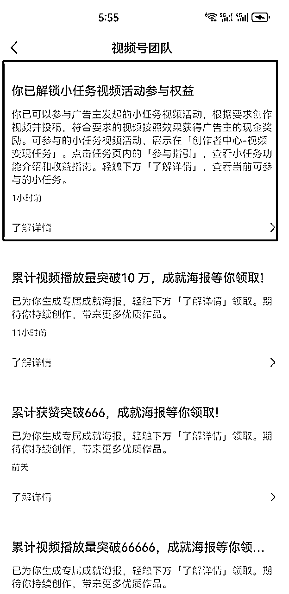

说个重点：视频号不存在“养号”，注册完就能发。我们实测账号注册当天直接发，第一条视频就爆了，第二天分成计划就开了。按上面方式二来，一天就能开通，多发几条视频就过了，前提是内容必须垂直。

开通计划只是第一步，真正的核心是开通后持续产出爆款视频赚钱。

第二步：发布原创视频，自动挂广告

加入计划后，发视频时勾上「原创声明」就行，其他不用管，评论区下方就有机会展示广告。

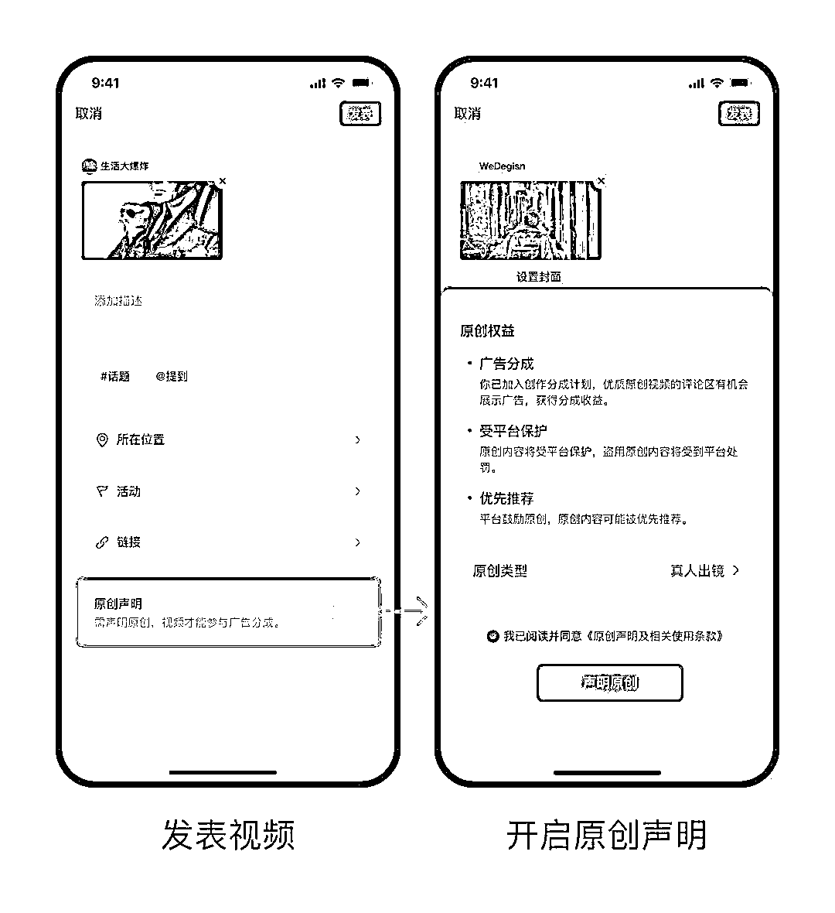

成功参与收益的视频，可以到「创作者中心 → 创作者服务 → 创作分成计划 → 参与收益中的视频」查看：

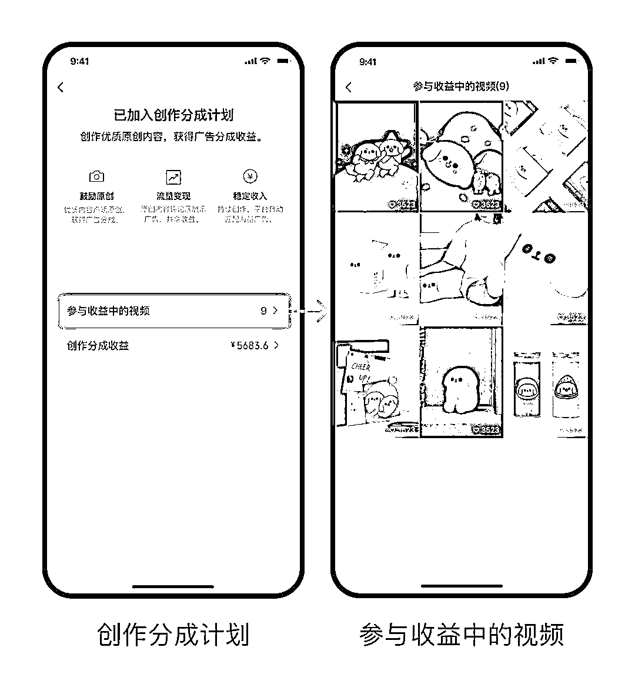

#### 3.1.3 快速开通视频号创作分成计划

前面讲的是常规流程，那有没有更快的路子？有的，下面这些技巧可以试。

3.1.3.1 优质内容渠道邀请
这属于内部邀请制：只要内容原创优质，不管粉丝多少，都可能被邀请开通。其实肯认真做内容，100 粉丝根本不算事。
优质标准：画面 720p 以上，时长 15 秒以上，内容垂直、有导向，画面不抖、不晃。

3.1.3.2 先做优质作者
这是目前多数人用的起号方式，虽然前期慢一点，但稳。
先传 5-10 条随拍视频，传的时候留意后台提醒：进「创作者中心 → 创作者服务 → 收入变现」，看看“优质创作者内容规范”是不是满足。
如果显示「满足内容规范」，马上开剪目标领域的爆款素材，发完涨粉，就能快速开通。
发布间隔可以 1-2 小时一条。我们测试是每天发 5 条，两天发完 10 条，直接达标。

想再快一点，也可以直接凑活粉，比如拉人关注，粉丝一到 100，马上点开通。
不过这样有违规风险；怕出事就老老实实靠内容涨粉。

注意：做这些操作时，切记不要互相关注！不然会出现粉丝数达标了、系统还提示粉丝不足的情况（平台会检查刷粉，互关粉丝重合度太高）。

3.1.3.3 先涨粉起号
这种模式最快。实测新号前 3 条内容有流量扶持。新号直接上成品，粉丝破百后，看看原创等规范是否达标，达标就能申请开通。
没达标的话，随手拍些原创视频发出去，用来补内容规范。
我们测试下来，新视频爆了、粉丝到 100 后，再发一条以上的随手拍原创视频就过了。
这个模式有个缺点：账号定位一开始就得想清楚，不然后期很难改。

涨粉不一定靠爆文，直播、视频号“问一问”答题也能涨粉。破百其实不难，一条视频爆了，涨个几千上万都很正常，所以冲就完事。

如果以上模式都显示没达标，就继续拍相关视频，最好是随拍原创，再往目标领域靠。注意：随拍视频不抖不晃、画面 720p 以上、时长 15 秒以上、内容垂直有导向。

3.1.3.4 多线并行
内容够优质的话，直接发成品。涨粉的同时，原创优质条件也会满足，随后就能申请开通分成计划。

3.1.3.5 申诉开通
如果发了十多个原创视频还是没达标，可以直接申诉，大部分都能申诉成功。
只要内容一直是原创，随时可以申请并申诉。

申诉入口（需在🛰️手机端打开；如果链接异常打不开，可以去项目禁言群群公告找链接）：
https://channels.weixin.qq.com/pandora/pages/appeal/index#account-detAIl

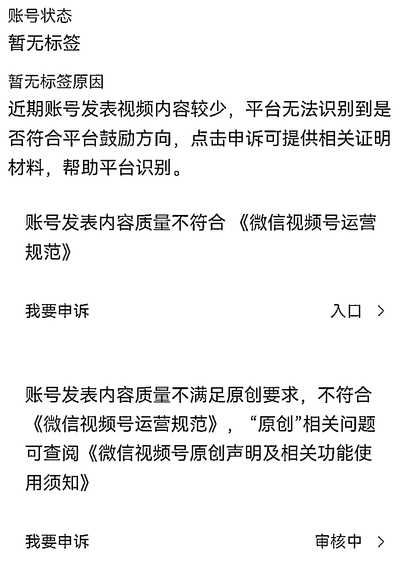

### 3.2 收益怎么领 @郭耀天

#### 3.2.1 收益如何计算

「视频号分成计划」的收益计算方式，腾讯一直没给明确说法：

先说个大概行情：通常播放量到一万，大致能换一块钱，当然点击情况才是变量。播放数字再漂亮，若观众不点评论区那条广告，进账依旧有限。

分成多少，不只由播放决定，还牵涉内容品质、更新频率、所接广告类型等。坚持做原创、把内容打磨好，收入才会水涨船高。

#### 3.2.2 查收益的入口

进入「创作者中心-创作者服务-创作分成计划-创作分成收益」即可。该页各口径这样读：

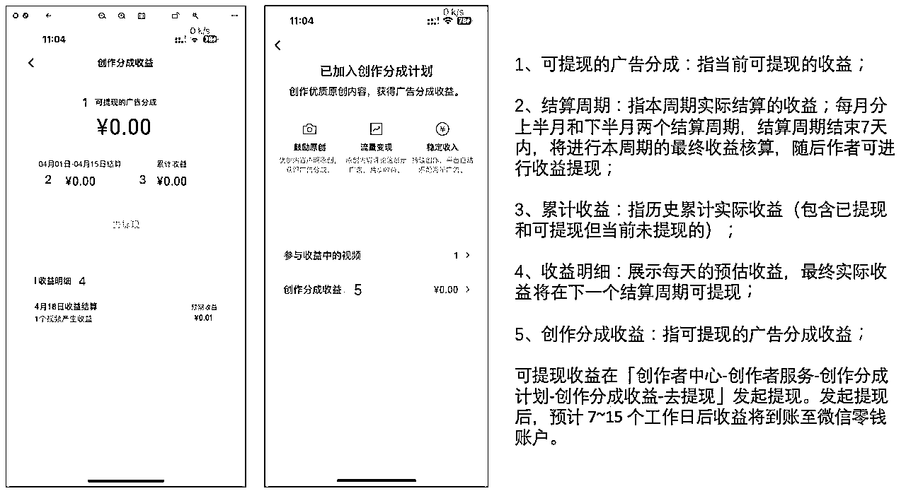

#### 3.2.3 怎么把钱提出来

原创视频发布后的次日开始，每天预计收益都能在前述「分成收益」页看到。点「去提现」，钱会进个人🛰️零钱包。

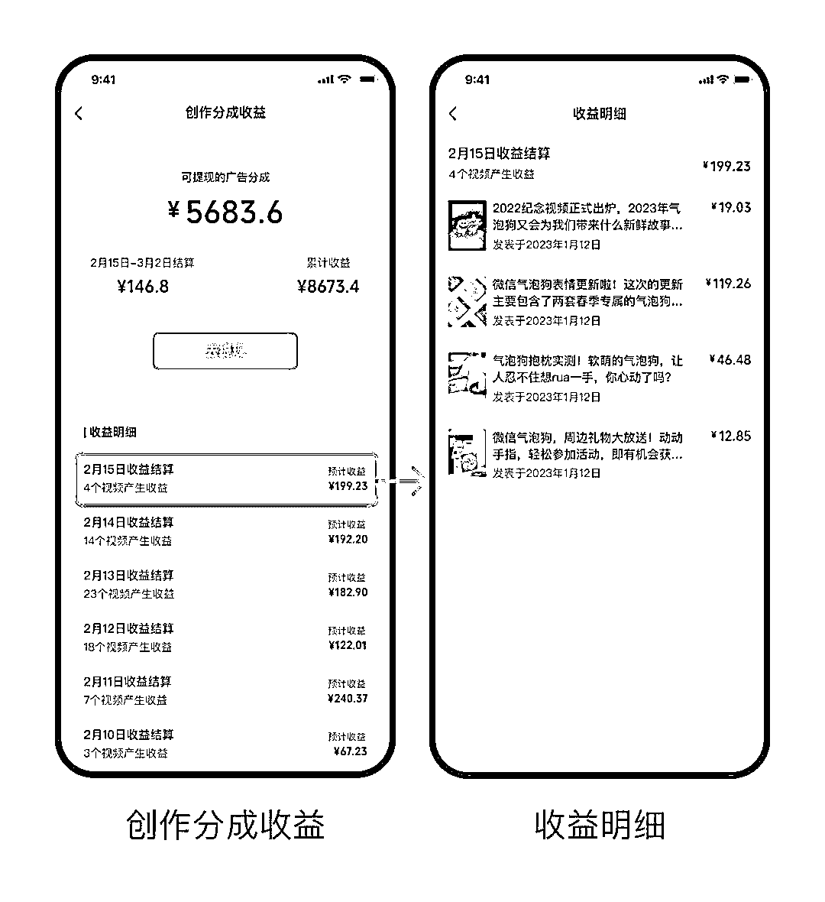
结算规则是每月两笔，法定假日顺延。前半个月那笔，当月22号可取；后半个月那笔，下月7号可取。到账速度很快，基本秒到。
个人身份操作的话，税率最高能到四成（有老师实测，提现几百块时并未扣税，不妨自己试）。部分税款次年可在个税APP申请退回，能不能退取决于你的收入情况；收入过高、不符合退税条件就退不了。
想合规降低税负，可研究「6.2.1 MCN统一收款」。常见公司扣点3%，也有6%的。

#### 3.2.4 提现失败的处理办法

万一提现没成功，按《商家转账失败解脱指引》处理：

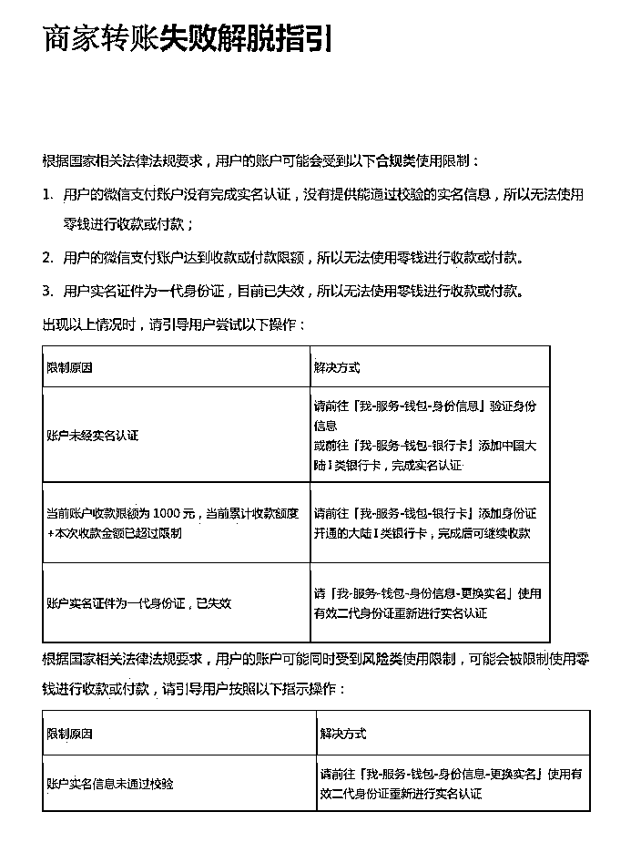

### 3.3 分成资格被取消，如何申诉恢复 @郭耀天

该计划扶持的是优质原创。若内容不达标，平台可能要求整改，严重的会收回权益。
若你认为违规判定有误，可以走申诉流程：

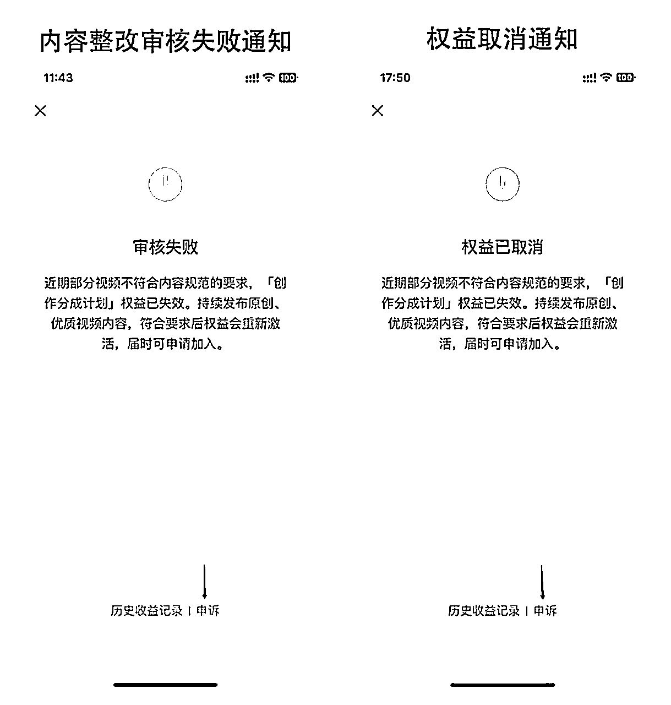

## 四、【项目实操 3/3】复盘优化不停步，内容质量与产量双提升

#### 内容导览
前两阶段走完，基本流程已经完整跑过一遍。回顾一下：选对或选热赛道（这一步很关键）→ 注册并包装账号 → 找素材、做内容、发布 → 达标后开通分成（又一关键）→ 保持原创输出 → 有收益后提现。
不过，会操作不代表能出结果。做一阵子后遇到困惑很正常；真正做得顺的人，通常更善于解决问题。
为帮大家清除卡点，本章从以下几块聊优化：
4.1 收益怎么往上走
4.2 内容生产效率怎么提
4.3 账号与内容如何运营
4.4 常见问题怎么应对
学完本章，愿大家在分成项目里拿到更漂亮的成绩。

#### 本章路线图
完成本章学习与实操，路线图第三阶段即可走完。
第三阶段：持续复盘并优化（约7-14天）
1.弄懂收益提升思路（10分钟）
2.弄懂内容提效方法（30分钟）
3.拆解对标素材，单日至少做5条视频（建议每天2-3小时）
4.多开账号、多发作品，把收益放大（30分钟）
5.弄懂常见问题处理（30分钟）
现在按步骤开始。

### 4.1 收益怎么往上走

#### 4.1.1 收益的命门 @白丁

这个分成项目对赛道极其挑剔，钱主要藏在评论区；单条视频能拿多少，基本由评论带来的点击决定。
所以赚钱的底层公式可以概括为：内容+评论。
评论点击很难靠人工硬拉，刷数据稍有不慎就会违规，甚至被限流。
接下来聊提升收益的办法。先看两张图：

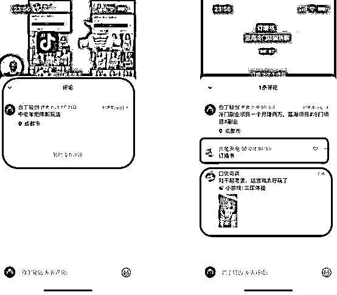

这两张图都是已开通分成的案例，为何第一张没有广告、第二张却有？
前面提过，收益来自第三到第五条中任意位置的卡片广告，这通常适用于评论较多的视频。评论少的时候，只要凑到两条评论，广告就会冒出来；只有一条还不足以触发。
由此有个小操作：视频发出去后，先用主号或小号留一条评论，能少损失一部分流量收益。
别小看这个动作，至少能多拿20%的收益。
如今网友有看评论的习惯，看到一条评论往往想点开；评论写得有引导力，还能带动更多人跟评，评论一多，内容热度也更容易起来。
其他数据不建议动手脚。接着说内容。
内容=视频素材+文案。
一条视频能不能火，素材占很大比重。这就要求有网感，能判断什么话题有爆点。网感是一种技能。我一直觉得，项目能否赚钱跟技能积累有关：本事到位了，运气来了又恰好接住项目，钱自然就来了。
网感并非天生，可以训练。最有效的办法是拆解同行：把同行的爆款素材存下来做档案，逐条列出爆的原因。分析量大了，你会发现不少爆款元素高度相似，这就是规律；摸清爆点后，做内容时集中往那个方向打，坚持一阵，做出爆款就没那么难了。
另一个重点是文案。这个平台对文案要求不低。写稿可以用“开头放固定钩子+后面补完整内容”的结构，这样重复度低，平台也更容易接受。
在这个平台，只要网感到位、文案跟上，想不火都难。
方向和方法确定后，剩下最关键的就是执行：稳定更新，雷打不动。账号80%的收益往往来自20%的作品；只要方向没错，持续发总会出爆款，爆一次就是上千元进账。
内容来源：《视频号分成计划娱乐解说玩法，一条视频一天4815元》@白丁

#### 4.1.2 为什么别人收益比我高 @郭耀天

不少伙伴疑惑：自己的收益为何跟别人差一截？要弄明白，先看钱从哪儿来。这笔钱并非腾讯掏的，而是商家把广告投到评论区，钱先进平台，平台再依据账号流量和点击情况跟你结算。
既然出钱的是商家，收益差异就很好解释：赛道不同，点击和单价就不同。
有的领域金主密集、预算充足，收益自然好看；广告又是智能匹配的，若匹配到低价广告，到手就少。
再有一种情况：视频爆的时候，商家预算刚好吃紧、投放量不够，广告供给不足，收益也会被拉低。
这些因素我们控制不了。能做的是多出作品，用数量增加爆的机会；或者挑高价值领域，比如财经、美容、酒类，这些赛道金主更有实力；泛娱乐相对就弱一些。

#### 4.1.3 提高收益的三个实操方向 @郭耀天 @思蒙

方向一：往年轻人多的赛道靠。
有伙伴拿到分成后嫌收益低，这跟计划尚未全面爆发有关。
留心观察会发现，当前广告以游戏、腾讯自家产品、网剧居多。
不少人做祝福、早安类内容，转发量确实大，但受众偏年长，广告主很少往这些人群投，收入自然上不去。
想提高收益，可以往科技、娱乐、情感这类年轻用户扎堆的赛道走，广告出价通常会高不少。
方向二：把互动做起来。
现阶段收益来自评论区的广告，所以第一要务是把内容做好，让作品有机会爆、被转发，评论量才会起来。
第二，主动引导评论，或者自己留几条、用小号补几条，广告能更早出现；否则要等评论攒到一定数量才触发。目前至少两条评论才会出广告。
内容本身也要有互动感，才容易吸引人参与。
比如图中找人、找动物、问答题，都挺合适；有时在视频里加一句引导，让观众参与进来，收益才会更好。
有伙伴做“一张图里找头像”，用户看完会把答案打在评论区；也有视频写一段语录，再问观众“这句话对吗，评论区告诉我”。
这些技巧得多研究、多实操，才能慢慢摸出来。
方向三：提效跑量，放大成功概率。
门槛不高的项目，比如这个分成计划，本质上是靠数量换概率。
所以能多发就多发，能多开号就多开号。
航海过程中你会看到，有人作品跟你差不多，谈不上多惊艳，但账号就是爆了。这就是概率。
选赛道和制作技巧掌握后，剩下的就是【量】。
一条视频爆的概率是1%，那十条呢？十个账号呢？每条、每个号都占1%，叠加起来，撞上的机会就大得多。
要更好地跑量，实操中就得持续提效：找素材更快、写文案更快、剪片子更快，这些都是熟能生巧，多练就有进步。
内容来源：6月8日《短剧CPS的进阶技巧及常见问题答疑》@思蒙

### 4.2 内容生产效率如何提升

对这个分成项目而言，提效可以从三处入手：素材搜集、文案产出、视频剪辑。
若能稳定做到一天5条，说明效率上了一个台阶。
具体怎么练找素材、写稿、剪片？下面给一些思路，最终还是要按自己的习惯多试。
最直接的路子是：多了解素材渠道，灵活使用，慢慢搭起自己的素材库。
抖音、淘宝、📕、知乎、YouTube等平台都有大量素材。平时刷到合适的就存下来，下次直接调用。
有两个方向可以试：①参考同行的文案；②借助ChatGPT提效。
这两个方法前文做视频时也提过，核心还是多用多练。
赚钱往期开过ChatGPT相关航海，可以结合手册《8月航海｜ChatGPT+自媒体｜实战手册》学习。
剪辑更是需要反复练的手艺。
为帮大家掌握这项短视频时代越来越吃香的技能，往期航海开过剪辑特训，请奇杰老师录了几十个实操教程《8月航海｜剪辑特训｜实战手册》。
其实前文“创作热门赛道视频”已经给了容易上手的剪辑教程；若对自己要求更高，可以按手册从初阶学到进阶。
要提醒的是，学技巧的最终目的是用在自己的业务里，别本末倒置。

### 4.3 账号与内容运营的加分项 @郭耀天

观众更愿意关注真诚、能带来好体验的账号。想涨粉，可以参考：
1）定位清楚，形成个人风格，坚持原创
2）保持更新，让更多人注意到你
3）多和观众互动，提升观看体验
一般来说，画面清晰、内容完整的原创作品更受🛰️用户青睐，也更容易进入热门页。
若希望动态出现在推荐页，可以注意：
1）发原创，别搬运别人的内容
2）画面和封面尽量清晰，避免拉伸、黑边、卡顿，少用马赛克和过度虚化
3）有字幕就完整呈现，裁切时别挡住字幕
4）内容要完整、表达要清楚，可以用配音解说帮助观众理解
5）内容健康，别碰低俗擦边和争议话题

### 4.4 常见问题应对手册 @郭耀天

下面整理项目里大家问得较多的共性问题，附一些经验。

#### 问题一：广告掉了怎么防？

操作这个分成项目时，哪怕是爆款纯原创，也可能出现评论区匹配不到广告的情况，几百万甚至上千万播放的作品也会遇到。
分享几个伙伴测试过的方法，不保证有效，但有一定参考价值。很多人习惯剪映，其实官方也有剪辑工具“秒剪”（官网：https://miaojian.weixin.qq.com/），用秒剪处理过的视频，流量有概率更好。
方法一：剪映导出后，用秒剪再过一遍，然后导出。
方法二：把剪好的片子导入秒剪，随便套一个滤镜，再把画质颜色参数调到10以下，常用值是5。
方法三：导入后套秒剪模板，选“治愈调节”。该模板自带音乐和滤镜；把音乐、原音打开，自带滤镜叫“橘子海”，参数调到10即可。
方法四：用“橘子海”滤镜，参数调到10，再调：亮度3、对比度4、饱和度4、色温5，这四项都不超过5；暗角9，不超过10；锐化14，不超过15；贴纸3～4个，再加2个个性文字。
另外建议发作品别用WiFi，改用4G。WiFi覆盖范围小，4G触达区域更广。

#### 问题二：“参与收益中的视频”为何是0？

加入计划、发视频并声明原创后，该数字仍显示0，怎么回事？
这个专区统计的是账号近7天有收益的作品。若为0，可能是：
1.作品评论区没有展示广告；
2.作品近7天没有实际广告收益。继续发优质原创，等产生预期收益后，就会出现在专区；
3.账号处于内容整改期，或分成权益已被取消，作品无法参与分成。

#### 问题三：哪些作品不会被推荐？

判断维度主要有三：视频质量、内容质量、关键词精准度。
如果作品存在声画不同步、分辨率低、卡顿模糊、大面积无画面、剪辑混乱没逻辑等毛病，一句话：不利于观看的，基本不会被推荐。
平台对内容看重两点：热点性和价值性。
追热点、输出有价值的内容，这跟其他平台逻辑一致。若你发的内容既无热点、又无争议、还没有传播价值，账号就像公开的朋友圈，靠社交推荐只能自己和部分好友看到，不会有流量推荐。
另外，内容同质化、旧闻过了时效，也不会被推荐；低质量内容太多，平台同样不欢迎。
平台的推荐模型会结合内容、标题文案、话题标签、地理位置等关键词做精准分发。若作品跟关键词关联不大，也不会被推荐。

#### 问题四：加入分成计划会拖累流量吗？

不会影响：

#### 问题五：加入后广告会自动出现吗？

申请加入后，发视频时打开「原创声明」，评论区下方就有机会展示广告，不需要额外操作。
你可以在「创作者中心-创作者服务-创作分成计划」下的「参与收益中的视频」里查看已加入计划的视频。

#### 问题六：评论区为什么没有广告？

如果没加入分成计划，仅声明原创，评论区不会展示广告。
加入后，发视频务必点开原创声明。发完自己马上去留一两句评论，广告很快就会出来。有评论才有广告，一般有一条他人评论就会触发，你再补一条，广告就出现了。
若已加入计划、也声明了原创，评论区仍无广告，可能是：
1.暂时没有广告与你的作品匹配；
2.作品属于暂不支持展示广告的类型；
3.账号处于内容整改期，或分成权益已被取消，作品无法参与计划。

#### 问题七：发过其他内容的账号怎么养？

可以直接拍随手拍，持续发，我们的老号这样操作也成功了。
如果实在不放心，就把非原创、非同类的视频全部删掉，然后持续发随拍。若更新几十条仍不满足内容规范，可以考虑注销重开。

#### 问题八：以前作品流量差，现在做这个会不会也差？

先发随拍试试流量。有流量，就可以直接开通分成。
没流量，就换领域测试；测来测去仍没流量，就注销，重新起号。

#### 问题九：开通广告分成后，旧作品要删吗？

建议删掉，也可以隐藏，看个人情况。
如果旧作品完全符合规范、质量高且原创，那当然可以留着。

# 选修篇：更多玩法与工具盘点

#### 内容概览

当你把最小可行产品跑通，项目的基本操作也摸得差不多时，就可以进入选修篇了。无论你是想继续把项目规模做大，还是想解锁更多新玩法，下面三个板块都值得花时间看：

【项目拓展】账号运营技巧与实战经验  
【项目放大】分成计划收益放大方法  
【实战工具】让项目执行更顺手

学有余力的话，欢迎去选修篇里折腾；要是前文还没消化完，建议先回去把基础章节练扎实。接下来的内容能帮你再上一个台阶，出发。

## 五、账号运营进阶：注销、申诉与避坑 @郭耀天

#### 章节速览

必修之外，视频号里还藏着不少实用运营细节。我们搜集了几位老师的经验，集中放在这一部分：

5.1 视频号注销流程  
5.2 视频号更换管理员  
5.3 如何检测账号是否限流违规  
5.4 如何恢复账号各项变现权益  
5.5 避坑经验  
5.6 其他拓展问题汇总  

也许你正头疼的问题，在这一章就能找到答案。

### 5.1 旧号洗白：注销流程与注意事项

有些账号确实让人没脾气：发什么都不推流，违规太严重，评论区功能被关，分成计划直接没法做。遇到这种情况，别再耗着了，注销掉重新开一个新号更省心。之前注销的流程很慢，动辄要等7天以上；现在视频号更新过规则，24小时内就能搞定：

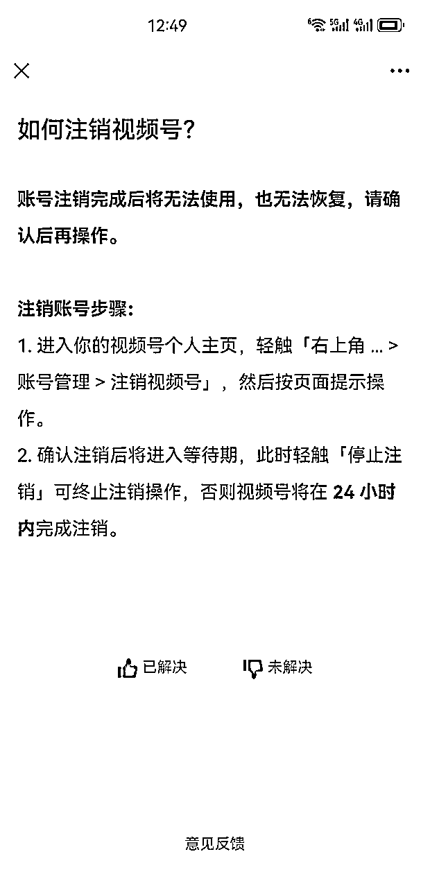

要是提交注销请求24小时后还没反应，或者你想秒速处理，按下方的按钮即可：

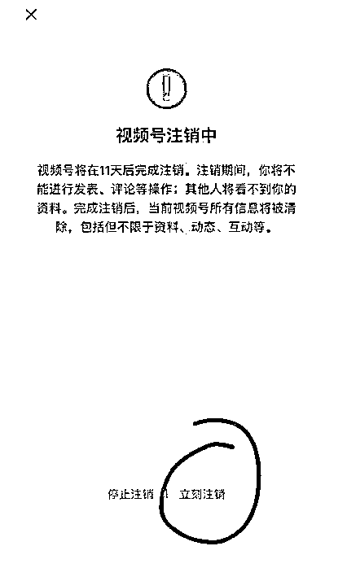

### 5.2 快速注销的另一招：更换管理员

除了常规注销，还有一条“借道”方案——转移管理员。找个从没注册过视频号的🛰️号，把当前账号的管理员权限转过去，这个号就算是“注销”了，之后还能重新注册。操作本身不难，难的是得先准备一个干净的🛰️号；目前市面上也有人专门提供这类资源，自行寻找即可。

进入更换管理员页面，有两条路：

「发现 > 视频号 > 右上角人像 > 头像 > 右上角 ... > 账号管理 > 更换管理员」

或者从“我”进视频号，点进账号管理：

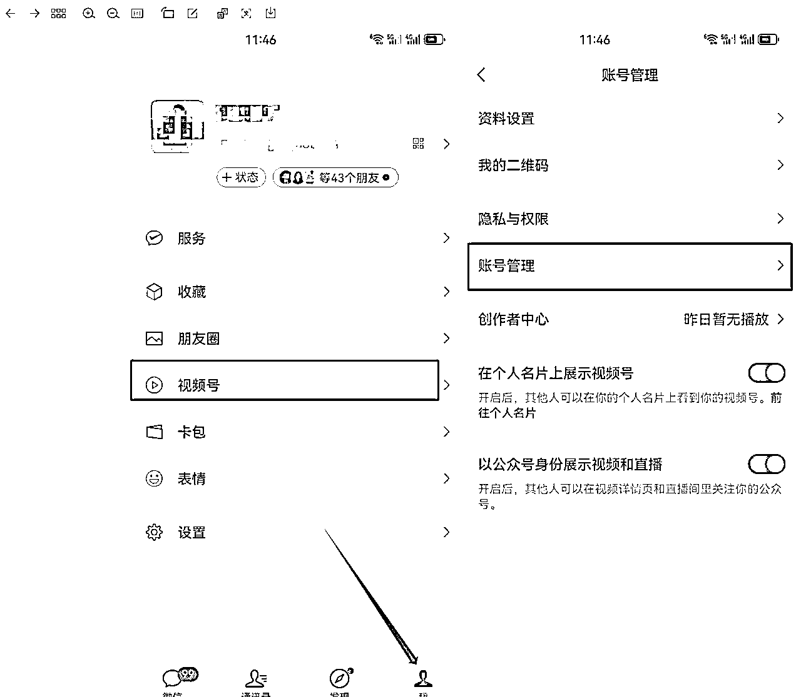

选择“更换管理员”，把权限转给指定🛰️，就能达到注销的目的：

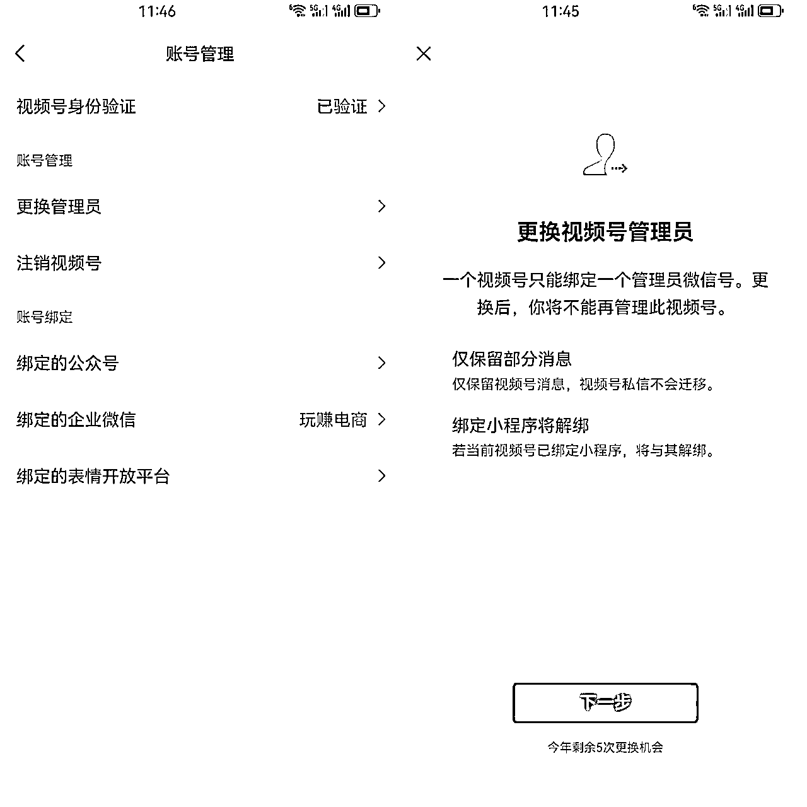

1. 会一起迁走的内容：头像、昵称、简介、认证等基本资料；已发布的动态、动态数据以及粉丝；隐私设置、运营人员设置等账号配置；商品页里的商品；推广充值的余额。
2. 不会迁走的内容：视频号私信。
3. 新管理员🛰️号的条件：未被当前视频号拉黑；没有开通视频号；在两周内没发生过被盗、被封或改密码；账号处于安全状态；已经绑定手机号；已经关注了当前视频号；与原管理员互为🛰️好友；允许被搜索并添加好友。
4. 迁移过程通常要花几秒到几十秒，期间不能发表内容、留言或开直播。

### 5.3 自查账号是否被限流或违规

打开视频号，进入创作者中心，找到“账号诊断”，就能看到账号的状态信息：

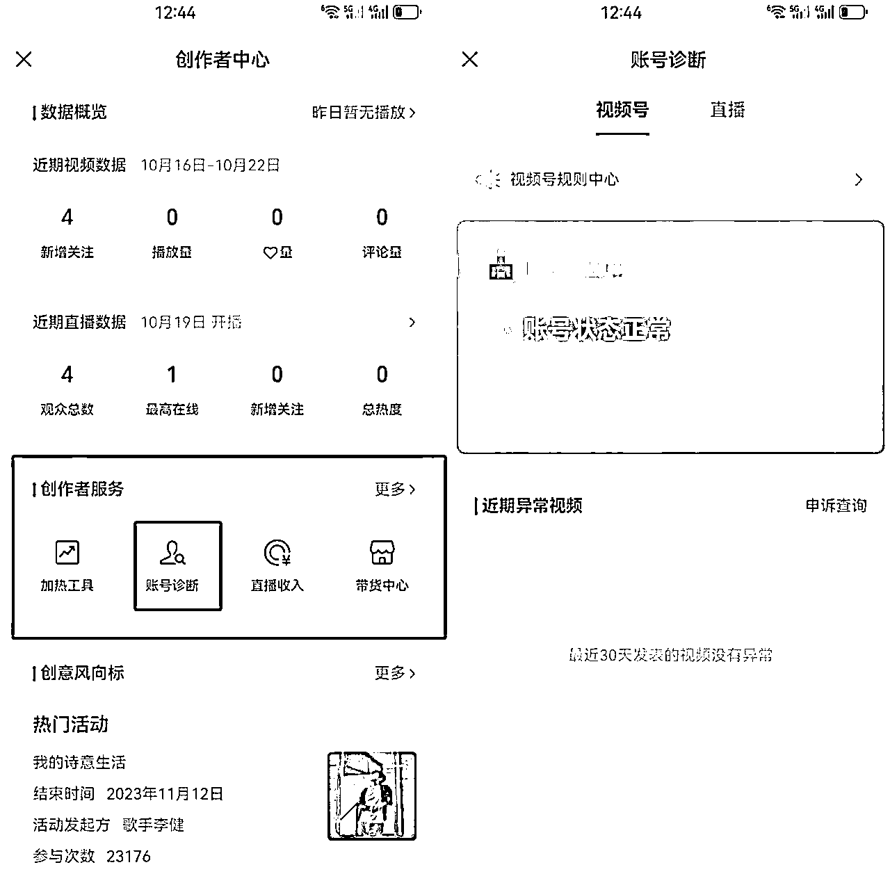

也可以用下面这个链接自查违规情况（只能在🛰️手机端打开；如果链接请求异常，就去项目禁言群的群公告里找可用链接）：

点击链接：https://channels.weixin.qq.com/pandora/pages/appeal/index#account-detAIl?appeal_entrance=1

如果你担心的是内容本身合不合规，进视频号后台，选中想加热的视频，点“加热”试试：加热不了，说明这条内容有问题；可以加热，说明没问题。

流程如下：

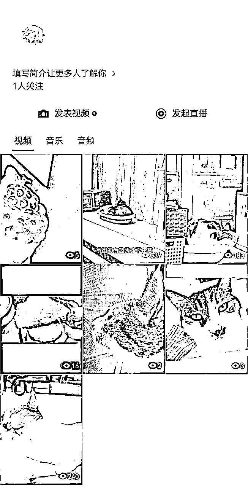

点开后台

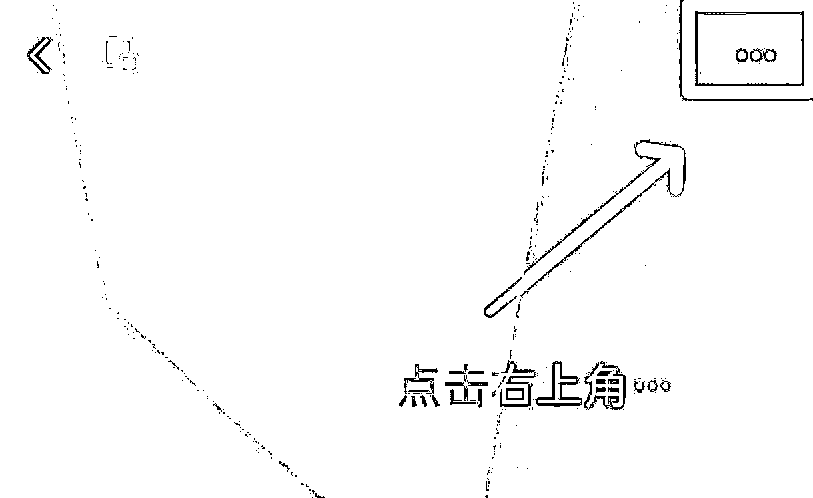

点开要加热的内容，点击右上角...

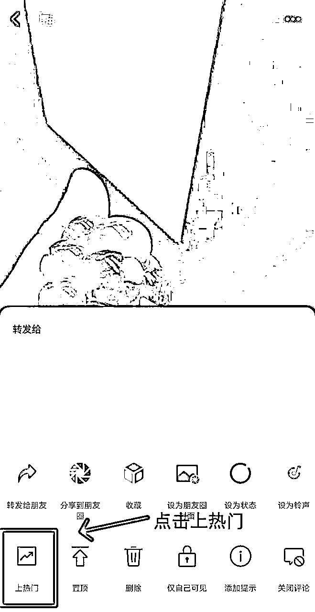

点击上热门

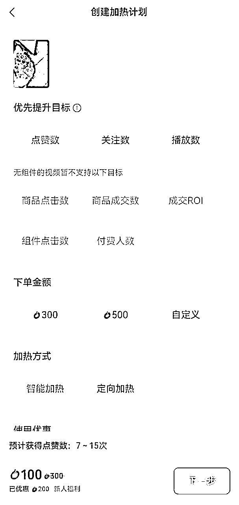

进入加热计划页面，能顺利加热就说明没问题。

无法加热的视频，隐藏或删除都行，反正没流量，留着也没意义。

### 5.4 被取消变现权益，怎么恢复？

以下内容整理自官方手册。适用范围：短视频商品分享、互选平台、视频变现任务等变现权益被取消或被要求内容整改的账号。目的是给账号优化提供参考。

整体原则：平台更愿意看到账号结合自身特点，持续发布原创、画风统一、出镜人一致的内容；不鼓励账号原本有明确内容方向，被判非原创之后，靠发随拍、风景之类的内容来“混”回权益。

1. 收到私信先别慌，这样定位问题

如果账号收到了内容整改或权益被取消的私信，就说明账号需要优化。原因可能出在原创度，可能出在内容质量，也可能两边都有问题。

收到权益被取消的通知时，进入私信详情页就能发起申诉。申诉页面会标明账号当前的状态，也能看出问题是出在内容质量还是原创度。

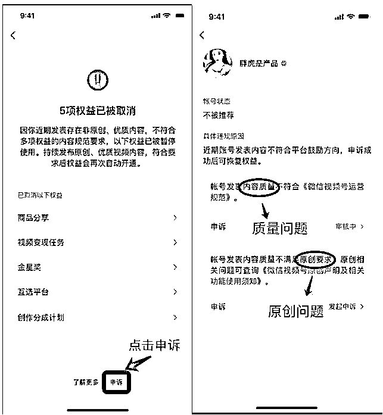

1.1 原创度出问题的常见表现有哪些？

除了平台识别到搬运站内其他账号、搬运其他平台内容，下面几种情况也可能被判定为搬运：账号出镜人前后不一致、内容画风不统一、内容垂类突然变来变去（比如之前做美食，后来转做游戏）。以上行为，都有可能被归为非原创搬运。

1.2 质量出问题又是因为什么？

发布内容同质化严重、反复发相同内容、用模板做低成本内容、把图片拼成PPT式视频、在视频里留联系方式或二维码等广告信息、音画不同步、文字过大影响观看……这些行为都可能被判定为质量有问题。

1.3 恢复权益的正确姿势是什么？

如果收到的是“内容整改”私信：要先发布至少10条新内容，才有可能恢复权益。至于这10条内容怎么发才算合格，可以看下面第2点和第3点。

如果收到的是“权益取消”私信：你觉得自己被误判了，不用急着发新内容，直接在申诉页面提交能证明原创或内容质量没问题的材料，比如作品底稿、作品原件、首次发表截图、视频剪辑工程文件等。平台会结合你发布过的内容重新判断，帮你恢复权益。

如果平台判得没错，那就算你把历史内容全部删除/设为私密，或者临时抱佛脚发10条原创，权益也不会立刻回来。你需要继续稳定地发原创内容，持续一段时间后，平台才会考虑恢复。

2. 发表什么内容才算过关？

如果你是创作者，就发和账号风格、人设一致的内容。比如你是美妆号，继续发同一个IP出镜的美妆内容就行，不用去发随手拍、自拍，也别临时改成情感号或其他方向。否则平台依然会认为你不是原创，权益很难恢复。

3. 哪些内容不能碰？

千万不要为了恢复权益去发跟账号定位八竿子打不着的内容。

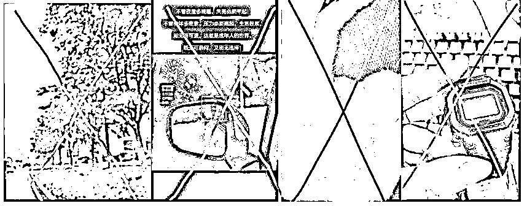

通过这类“无关内容”硬凑权益的账号，平台会认定为恶意对抗，并给予处罚，至少90天内不会恢复权益。商家、创作者还是要靠正常创作来恢复权益，别为了走捷径去做平台不鼓励的事。

备注：不使用变现权益的普通作者，以及本身就是育儿、宠物、亲子领域的创作者，发一些随拍、风景、宠物、儿童等符合平台规范的内容，账号不会受影响，也不会被限流。平台只是不鼓励“有明确垂直领域”的创作者用无意义的生活化内容去恢复变现权益。

### 5.5 这些坑，别再踩了 @流浪虎

腾讯给的规则不算清楚，实际推进项目的过程中，很多经验都是踩坑踩出来的。下面几位老师分享的教训，提醒大家注意规避。

1、发爆款忘了勾“原创声明”

有人的视频播放量冲到600多万，但忘了开原创，白白损失大约2000元。

2、流量太大、评论区没管住，账号被关“小黑屋”

一条视频转发量35.8万，评论区涌进大量留言，有些评论带偏了风向，结果评论被吞掉不少，账号也被关进“小黑屋”。像这种大爆的视频，一旦发现评论有不良苗头，最好就把评论区关了。

3、一个号一天发太多视频

有人一天发30条，结果账号被关了一星期“小黑屋”。建议一个号每天最多9条，比较稳妥的是5-6条。

4、隔了很久再重发以前的爆款

有人把半个月前的爆款视频又发了一遍，结果账号又进“小黑屋”了。过往爆过的视频当然能重发，但最好在1-2天内发，间隔时间太长会被系统识别出来。

5、视频爆完之后，账号会遭遇限流

好几个账号测试下来，大爆后确实会限流，但一般不会超过7天。如果7天过去还是没有流量，那可能是内容本身有问题，这时候可以考虑换新号。

内容来源：《视频号创作者分成收益怎么赚？追好热点，打造爆款视频》@流浪虎

### 5.6 其他常见问题速览

广告会以图文或视频的形式，出现在视频评论区内。平台会在“用户体验”和“作者收益”之间取平衡，对广告出现的频率做整体控制。

已经加入创作分成计划的作者，如果不想让某条视频展示广告，发新视频时不勾「原创声明」就行。要是想彻底退出分成计划，让已展示的广告和之后新发布的视频都不再出现广告，请整理好具体情况，在「视频号 > 右上角人像 > 创作者中心 > 创作者服务 > 帮助与反馈 > 底部意见反馈」里提交反馈，平台会跟进处理。

想要被推荐，可以盯住三个维度：

① 视频质量高：上传的内容清晰、无水印，字幕和声音同步，画面流畅不卡顿，先让观众看得舒服，才有机会进入推荐池；
② 内容质量好：质量好不好虽然不好量化，但从平台和用户的角度看，有热点、有讨论点、有观点的内容更容易被喜欢。简而言之，要么蹭热点，要么有可看性和价值感，这样才能留住观众，也有利于账号长期经营；
③ 关键词精准：视频号会根据用户标签做推荐，比如地理位置、浏览偏好、关注话题、点赞过或评论过的内容等。所以运营者可以从视频内容、标题文案、话题标签、地理位置等地方埋入精准关键词。

有些账号刚开始没有“原创声明”按钮，养号期间、还没开通分成计划的时候不用管，就算有按钮也没钱。正常发内容就行；但开通分成计划后，内容一定要标原创，否则没有收益，这一点要记牢。

开通期间，尽量发同一类型的内容，画风、排版保持一致，这样开通的几率会大很多。

加入分成计划需要同时满足3个条件：原创、内容规范、粉丝数达到100。如果进不去，多半是某个条件还没达标，尤其是“内容规范”这条很容易卡住。如果不确定自己都符合，始终没收到邀请，可以尝试走「3.1.3.5 申述开通」的通道。

可以。当你的内容原创且规范，在群里喊人关注，做一批活粉，是有机会开通的。但不靠谱渠道的粉丝千万别乱刷，尤其是僵尸粉，不但开不了分成，还可能把账号直接搞死。

可以先发10条生活随拍试试。如果官方提示“限流多少天”，等时间到了再去发随拍。

先去检测账号，把不合格的作品删掉。之后点作品里的“加热”验证：能加热就正常，不能加热说明这个作品有问题。

可以的，视频号现在支持授权。想让同一个素材在多个账号里用，就把账号授权一下，这样一条素材能反复用，利用效率拉满。具体教程在「6.2.2.1 多账号授权与爆款复用」。

目前企业蓝V账号和媒体账号没有分成广告，以后会不会开放不好说，现阶段只有个人账号能参与。

所有条件都满足后，就申请加入原创计划；加入成功再开始发视频。情感文案类、搞笑类、感人类都可以试试，测出自己这个号哪个方向流量好，后面就朝那个方向垂直发布。

## 六、项目放大：让分成计划赚得更多

#### 章节速览

如果你已经能稳定变现，下一步就该琢磨怎么放大收益了。

项目放大主要有几条路：

多账号运营，搭矩阵，用数量博弈概率「6.1 多🛰️号矩阵：突破5个实名限制」

提升实际执行效率，提高单位时间产出，比如：

试试更多赛道，说不定能撞出下一个爆款「6.4 尝试更多赛道」

开发更多变现方式「6.5 更多变现途径」

接下来看看具体操作。

### 6.1 多🛰️号矩阵：突破5个实名限制 @郭耀天

矩阵的打法很简单直接：批量做号、批量发视频，把前面教程里的项目流程复制到更多账号上。这里有个绕不开的坎——每个人最多实名5个🛰️号，这个数量撑不起矩阵，必须想办法突破。

但要注意，我们要突破的不是视频号，而是🛰️的“5个实名”上限。🛰️规定一个人最多实名5个🛰️号，超过5个就必须换人来实名。

自己肯定不能一直找别人实名：账号挂在别人名下，熟人的话还好说，万一是不熟的人把号给冻结了，解冻相当麻烦，这个号基本就废了。

突破的原理也不复杂：把不需要支付功能的号先冻结，冻结完之后，自己🛰️名下就会空出一个可实名的坑位。需要留心的是，冻结前一定要先把视频号注册好，被冻结的号码不占那5个坑位。目前还没测过“先冻结再注册”能不能成，但只要按上面这套操作，是可以直接注册的。前提是：

账号里一定要有余额，哪怕几分钱都行。有余额再做清除，才是“冻结”；没余额清除，就是“注销”。

实测下来，目前一个月最多冻结一个账号，连着冻结会提示操作过于频繁，没法继续。

操作路径如下：

打开🛰️“我”页面，进入钱包，拉到底部找“帮助中心”，点进去后找到“实名问题”：

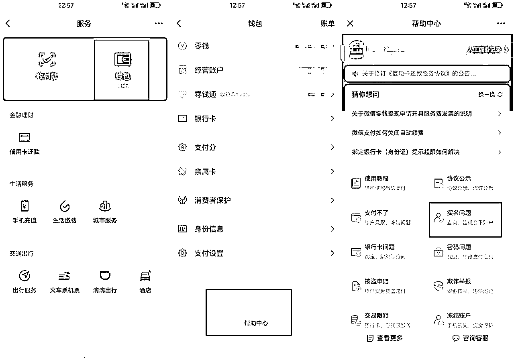

也可以从腾讯客服进入：

到后面提现时，需要先把账号激活。其实也简单：冻结的账号提不了现，把其中一个账号冻结，另一个就能解冻了。反正随时都可以让5个账号保持不冻结，其余的全部冻结。

解冻也很简单，找到那个冻结的🛰️号，按下面的步骤操作：

如果账号是用员工信息实名注册的，离职之前一定要先把实名换过来。要第一时间把他/她名下实名的号码全部解除实名、注销🛰️支付；如果还需要继续用，就第一时间找现有人来补实名，按上面“无限实名”的方法操作，不耽误支付。

再分享一个记录🛰️号实名的文档模板：

实际操作中你会发现，有的号从第一天起流量就好，有的号却一直半死不活（当然前提是内容质量都过关、作品水准一致），这就是账号体质和概率综合作用的结果。在矩阵里，我们可以把素质好的号挑出来继续养，差的注销换新就行。

### 6.2 矩阵号管理提效：MCN收款与批量发布 @郭耀天

想让矩阵跑得更顺，主要抓两件事：用MCN统一收款来降低扣税，以及批量发布内容。二者都能让你同样时间里赚到更多。

#### 6.2.1 用MCN收款，把扣点降下来

如果一个人操作多个分成计划账号，扣税会很高，最高能到40%。其中一部分第二年可以在个人所得税APP上申请退税，但要看你的收入情况；如果收入太高，没达到退税标准，那就退不回来。

所以想合理降低扣点，可以考虑挂靠MCN来收款：

整个注册流程其实不复杂：先把MCN开通，等视频出了收益再申请结算，按规则把发票寄过去，就能享受3%或6%的低扣率。

第一步：访问MCN官方申请入口

注册很简单，浏览器里搜“视频号MCN”，或者直接访问 https://channels.weixin.qq.com/mcn/login

第二步：填写资料，完成开通

登录后跟着指引填下公司资料、对公账户信息，再做个验证，基本就能搞定；想了解具体门槛，可查阅官方文档：https://support.weixin.qq.com/cgi-bin/mmsupportacctnodeweb-bin/pages/YC5kUcvysXxktmMx

第三步：把作者账号绑进来

登录MCN后台，点“作者管理”，再点“视频作者”，然后点“邀请作者”，按提示把需要绑定的账号邀请进来就行。

第四步：整理发票并结算

目前结算是半个月一次，后台会把前半个月的结款登记好。有收入之后，申请结算，再按要求把发票寄过去，就能拿到钱，收益自然更高。一般公司的扣点是3%，也有的收6%：

#### 6.2.2 内容发布效率怎么提

##### 6.2.2.1 多账号授权与爆款复用

当某条视频跑出爆款数据，可以把这条视频加入白名单，授权给其他账号，让不同账号都能重复发布这个爆款。下面是具体步骤：

# 一份片子五个号发：授权、海外素材与热门赛道

后台入口这样走：创作者中心→创作者服务→更多→账号管理→原创保护记录→授权账号。

授权分发这个功能上线时间不算久，但很值得用。你把作品授权给另外五个账号去发，哪怕画面、文案完全一致，也不会被限流。说白了，一份内容能铺到五个号上，热度可以叠加，而且发的还是你自己的片子，这种思路可以重点研究。

6.2.2.2 授权管理员发布

如果账号绑的是家人或亲戚的🛰️，或者另一个不常登录的🛰️号，可以加管理员代发。电脑端进入视频号助手，点设置，再进人员设置，绑定运营者。之后用被绑定的运营号登录，就能直接发内容。

电脑端登录时会让你挑账号，选中这次要操作的那个就行：

6.2.2.3 第三方授权发布

现在也有第三方登录工具，把视频号授权过去后，自动回复之类的动作能交给工具处理，省事。比如快视（官网：www.timexxs.com）。不过不少平台要会员才能用；有需要的话，可以从工具箱里找合适的第三方服务登录，多账号运营的人会更方便。

### 6.3 获取更多快捷素材 @郭耀天

国内能用的素材被反复搬运得差不多了，可以换思路去海外找。难点主要在：怎么打开、怎么用、怎么下载、怎么切分。海外平台里，YouTube、TikTok、Instagram、Triller、Snapchat 都有代表性，其中 YouTube 最常用，高清资源也多。下面以 YouTube 为例，讲怎么把素材拿到手。国外平台需要特殊网络环境，也就是常说的“🪜”，这块要自己解决。

#### 6.3.1 登录 YouTube

打开 YouTube 前需要🪜，这个话题比较敏感，自行研究。链接：https://www.youtube.com，或者在浏览器里搜 YouTube 也能进：

如果浏览器没有翻译功能，页面可能是英文。可以开网页翻译，也可以装翻译插件，这类插件不少。我常用火山翻译，免费，搜索安装即可：https://translate.volcengine.com/

使用教程：火山翻译浏览器插件使用说明书

装好后在网页任意位置点右键，选“使用火山翻译”，页面就能转成中文：

YouTube 能直接搜中文，但英文关键词往往更容易找到好素材：

#### 6.3.2 如何下载视频

在 YouTube 找到目标视频，点分享按钮，复制链接：

接下来用视频下载器。现在这类工具很多，收费免费都有，免费版基本够用。下面几个可以直接试：

还有一个站点支持多种格式：https://YouTube.iiilab.com/

选好格式，通常挑 1080 高清，点右下角开始下载：

也能用浏览器插件搞定。主流浏览器都有扩展商店，不少插件支持直接下载 YouTube 视频，速度也快。我用的是 Edge，打开扩展功能：

点“获取更多扩展”，搜“YouTube 下载”，我装了两款：

插件装好后回到 YouTube，能下载的视频底部会出现按钮，点一下就行：

下面用这个工具（https://wzds.llsbcq.com/）演示：把刚才复制的链接粘贴到下载站：

页面翻译后是这样，点获取链接：

点下载，文件会自动保存：

YouTube 上的长视频动辄几小时，甚至十几个小时，这种素材还得切分后再用：

#### 6.3.3 分割视频，留以备用

分割工具网上很多，这里挑两个常用的讲。

工具一：LosslessCut

下载、解压、运行：

如果界面是英文，在这里把语言改成中文：

把视频拖进去，或者点导入，然后进入编辑：

在编辑页选分段，创建 n 个分段：

接着设置要切出来的段。这个软件目前最多支持 300 段；视频太长就多切几次，同样能达到目的：

切之前还能调基础项，比如保留音频、编辑轨道等。

工具二：BoilsoftVideoSplitter

BoilsoftVideoSplitter 中文版也好用，切割没有段数限制，可以直接切。解压后打开：

点打开，导入要切的视频。比如这个 11 小时的片子，也能直接处理：

导入后有的视频不能直接播放，不用管，点分割：

像这个 11 小时视频，可以切成 600 段，点设置分割：

点分割后会让你选保存位置：

然后系统开始切：

切完的素材拿去加工，就能作为视频号内容发布：

### 6.4 尝试更多赛道 @郭耀天 @流浪虎

视频号上什么内容容易起量？热点、猎奇、爱国、英勇救人、感人故事、婆媳矛盾，都是常见方向。

猎奇就是找稀奇、抓眼球的事。抖音上同类账号很多，直接拆解他们的爆款就行：

爱国类敏感度高，这里不展开。选这类素材要谨慎，方向和立场都要注意。视频号上常见的有新疆西藏修铁路、珠港澳大桥、邮政人员骑马骑骆驼送快递等。参考新闻联播体，后半段内容平台也愿意给流量：

英勇救人类，视频号用户里中老年人多，这类社会正能量内容很吃香：

感人故事类，主要走情感线，比如亲情、爱情：

婆媳矛盾类不用多解释：

可以模仿的账号有：

美摄安然；L 航拍；小啾啾 1987；九儿；感恩有爱小木屋；禅缘智慧；党史博采；

小茹观世界；琨少说说；心心的念叨；宝珠书道；玩玩娱乐；古董那些事；

王耳朵先生；红尘 7666；今古奇谈；12 月 ya。;杰哥看历史；罗兰妹妹；浅笑情感驿站等。

形式可以是视频，也可以是图文震惊版。图文制作更轻，在视频号反而容易出效果。下面看几个热门赛道的具体做法，很多流程其实相通。

内容来源：《视频号创作者分成收益怎么赚？追好热点，打造爆款视频》@流浪虎

#### 6.4.1 真人拍摄类

能真人出镜最好，也最稳。内容没问题的话，不但能参加分成计划，还能接直播带货、短视频带货、收徒、开课程、做社群、做服务。但不是人人都有条件拍、有条件出镜。目前真人出镜容易火的领域有三农、搞笑、经典娱乐、人性哲理、情感生活、生活百态。能拍就直接拍，收益不错，后期变现路子也多；拍不了的，看下面几种不出镜玩法。有出镜特长的人，这块值得认真研究。

#### 6.4.2 聊天搞笑类

搞笑视频和图文在各平台都容易起量。这里重点说聊天图文和聊天视频：用搞笑、经典的对话做内容，或者把对话生成视频。刚接触的人常以为这种内容要一条条手搓，我一开始也这么想，其实不是：

现在有人直接发图文，有人做成视频，都有对应软件，收费免费都有，手机电脑都能操作，整体不难。做搞笑内容，先备文案。自己会写段子就自己写；不会写就找别人的文案，稍作修改，再按对方的内容模式做。聊天类内容各平台都多，也可以去拼多多、淘宝搜相关素材：

聊天图文一般不加音乐；视频会配一些搞笑音效，有的也插音乐，但通常不必，直接做聊天视频即可。可以照着同行做，核心还是文案：文案要能引出大家想讨论的话题，才容易带来转发。做聊天图文的软件很多，135 编辑器、96 编辑器都有这功能，不少网站免费，也有付费的。下面几个免费站做聊天图还可以；实在找不到，去淘宝、拼多多搜“聊天制作”，也有人卖。很多截图软件也能做，比如微截图，挑顺手的就行。

免费网站：

http://www.11fx.cn/tool/wx/ （可以制作视频）

https://www.yeyulingfeng.com/tools/wx/

https://www.bAItuling.com/chat/

http://www.12tool.com/wxduihua.html

https://wx.gravityengine.cc/

http://sc.appbs.cn/1.html

付费网站：

https://vjietu.pro/

https://www.quduihua.cn/（可以做图文，视频，算是目前比较专业一个平台，价格小贵，有手机端，有电脑端）

https://weixinduihua2.com/index/wechat/chat.html

制作软件：

https://wwhe.lanzoue.com/iF1c40k9p3qj

这里用话树演示，各平台思路接近：定角色、传头像、设背景、导文案、出图片、成视频。

进编辑页跟着点就行，不难：

对话做好后点下一步，能看到导出入口，视频、长图、课件都能出：

这样聊天内容就做完了，剩下的就是发布：

#### 6.4.3 自愈音乐类

音乐类在视频号热度一直不错，怀旧、流行、轻音乐都有受众，按自己情况选。目前常见玩法是：一首音乐配随手拍视频，或者配多张 AI 图片，再加特效，容易出爆款：

音乐号想起量，音乐最重要，其次才是素材。素材和音乐要搭，做出减压、娱乐、欣赏的感觉。再往后是文案，文案和音乐配合得好，起量概率更高。音乐号还有个好处：同一首歌能反复用。我观察的几个号，所有视频都用同一首曲子，只换画面，照样能火：

音乐素材来源很杂：随手拍、自拍图、AI 图、表情包、朋友圈截图都行，形式可以多样。提醒一点：一开始选好模板，后面就沿这个模板做，别频繁换风格。随手拍就是每天出门拍点生活片段，夜景、车流、风景都可以，高清图也行；也可以借助 AI 绘画，MJ、SD 都能用。很多自愈音乐就是用图片做成视频的。音乐可以从各平台找爆过的，去📕、抖音、快手、视频号扒最新热门，拿来用起量概率高。选好后下载素材，用软件提取音频。下载好的视频可以用这个工具提音频：https://www.AIgei.com/tool/video/audio

平时更常用剪映的分离功能：导入别人的视频，点分离音频：

还有一点：爆过的音乐可以反复用，换素材继续发，直到这首歌没流量为止。

a：模板制作

音乐号在视频号火的曲子，大多在抖音也火过。所以可以直接找抖音相关视频，学他们的模板。操作不复杂。比如《醒不来的梦》，打开手机剪映，找“剪同款”，看搜索结果，第一个模板就不错：

进模板后能看到“剪同款”按钮：

点“剪辑同款”进入素材编辑页。能添加的素材是亮的，不能添加的是黑的。选一个准备剪的素材，也可以加图片，按自己情况来，最好用原创素材：

上传后点下一步，就会生成一个和模板一样的视频：

我这次加的是做好的视频，所以画面不算好看。会员还能改同款视频，比如加特效，在原模板上优化，加转场、特效、新片段，这就看想象力了。做好后点右上角导出，再发到视频号。这个方法不只适合音乐，其他领域也能套用。

# 两分钟出一条爆款视频，单条收益几百到上千

你刷到过的那条爆款，其实两分钟就能复刻出来——点赞破十万，收益几百到上千不等。门槛低到一个人一天能批量产出好多条，多账号铺量也完全跑得通。

在视频号里刷到正火的歌，照着这个套路操作就行，算是很省事的路子。

b：自己动手做

自己动手做，就是按个人偏好来，拿剪映或其他工具把素材重新组合，剪出一条新片子。

电脑上启动剪映，先拖一条下载好的热门视频进去，目的是要它的音乐，原画面后面要换掉：

选中素材，点一下分离音频：

音频拆出来之后，把原来的画面删干净，只留声音：

接下来往轨道里添自己准备的素材，实拍片段可以，剪映素材库里的也行。剪映里其实有不少素材拿来做二次加工就能直接用，当然原创程度越高越理想。

拿下面这张图里的「夜景车流」举例，在剪映素材库搜“夜景车流”，现成的素材一抓一大把：

挑几段顺眼的拖进轨道。想拉高原创度就多放几段，我通常放四段。放好之后加特效、叠画中画、调色，说白了就是为了去重，毕竟这些素材早被无数人用过了：

再选点自己喜欢的特效和转场，不同片段之间可以各用各的转场；想统一风格就点应用全局：

想快速把审美和手感提上来，最有效的办法是锁定一个厉害的同行，照着他的片子1:1复刻几条，感觉自然就上来了。

这些都弄完就可以配字幕了，按住音频，点识别字幕与歌词，字幕马上就能生成：

字幕出来以后，挑顺眼的字体和字号：

标题也能顺手加上，点添加文本，字体、大小、格式都能调。如果标题要全程显示，就把长度拉到和视频对齐，这样它就会一直挂在画面上：

收尾再做封面、片头和片尾。制作过程中还能穿插一些特效，比如钢琴类的。下面这两款钢琴特效适配很多音乐视频，在剪映里通过蒙版或者视频混合模式就能把电子琴合成进画面，需要的点下面下载。

百度网盘链接： https://pan.baidu.com/s/18TtPOLfPI8c1SXVW8NSaLQ?pwd=andr

提取码： andr

夸克网盘链接：https://pan.quark.cn/s/1be8ee83765d

片子做完就能直接发，但视频号上有些特效剪映搞不定，比如下面这种电影感开场，眼下不少音乐号都在玩，感受一下：

16baffbddb4049295a1820200fa2d893.mp4【在线播放】

想要同款效果，就去视频号里找中意的那个，点右下角的制作同款，把做好的音乐传上去，点下一步，底部把配乐关掉，只保留原音，一条电影感特效音乐号的内容就搞定了：

继续点下一步进入发布，到了发布页，设置封面、写描述，原创声明务必勾上。最下面的“同款账号展示”勾不勾都行，勾上或许能蹭到一些流量：

#### 6.4.4 走心文案，句句扎心

走心文案放到哪个平台都吃得开，视频、图文都容易爆，主要受众是年轻人。这类账号的命门就一个：文案里某个点、某个场景、某句话让人心头一颤，引发点赞、转发、收藏，有些文案会被疯狂转发，就是因为替年轻人把心里话说了。制作上也省事，一张图、一段音频、一个画面，都可能成为爆款：

素材来源五花八门，随手拍的、风景照、AI图、表情包、动漫、电影、动画、剪映自带素材都行。对多数人而言，随手拍和风景照最好上手，原创度也最高。文案号真正拼的是内容文案和标题文案，文案才是灵魂，素材更多是陪衬，但要是能找到跟文案气质契合的素材，那就是锦上添花。

文案类账号，文案质量直接决定生死，所以拿到好文案是头等大事。别的平台已经跑火的文案，挪到视频号上爆的概率也不低，所以可以去外面淘。平时多刷多搜关键词，基本都能挖到；也可以直接上淘宝、拼多多买现成的文案包，各种类型应有尽有。

另外可以去👸号里找专攻文案的账号，这类号一抓一大把，比如去年挺火的漫川，通篇都是文案，直接拿来学，配上素材就能成片。刷👸号时，点文章底部的喜欢和收藏，系统会接着给你推其他文案号的内容，文案来源就源源不断了。用电脑版操作会更顺手。

还有一些垂直网站，或者专门做语录文案的APP，情感语录存量很大。在手机应用商店搜文案、情感、语录这些词，下载就能用。我了解的有句读、句子控、一句心情话、卡片句子等等，挑顺手的用就行：

除了上面这些渠道，还有一个特别重要的来源：各大平台文案和情感类内容底下的评论。比如👸号夜读的评论区，📕、抖音、视频号相关文案的评论，不少评论写得相当精彩，尤其是高赞的那些，直接就能转成视频。赞越高说明这句话越戳人，这种内容爆的概率很大：

获取文案的路子还有很多，渠道本身不重要，拿到结果才重要，操作时多试多找就对了。文案类视频的配乐，要靠平时多刷，尽量追最新热歌，也可以问问周围的小哥哥小姐姐平时听什么。最好的习惯是，在各大平台刷到合适的音乐就随手收藏，后面总用得上。配音方面，如果自己嗓音条件好可以自己上，或者找人配，但成本会高一些。我们这边用的是配音神器，价格便宜，效果也不差，我们一些领域的账号都用它做，扫下面的二维码加入，开会员99元永久，当然你也可以用其他顺手的配音软件。

配音神器手机小程序和电脑端都能跑，电脑端操作更方便。挑一个你喜欢的声音，或者模仿同行的声音，建议用1.1倍速，这个可以调，调好点生成音频，下载下来就能用：

a：模板玩法

文案类账号很多内容可以直接套模板来做。比如想用某句话，可以直接在剪映里搜，也可以在抖音搜模板，收藏之后去剪映剪同款，或者直接在剪映里找现成的内容。

比如搜“人在一辈子”，相关文案直接就能找到，也可以在剪映里点剪同款，进分类找情感：

找到合适的素材后点开，点底部的剪辑同款进入相册，素材可以直接加，挑适合的素材点进去，按自己的情况调整：

如果你是剪映会员，还能直接改原模板，在别人基础上优化成自己喜欢的页面；不想改就直接导出，一条成品就出来了：

除了剪映，快手也能做，而且能找到更多模板，尤其是同类型的其他模板。先下载快影手机版，还是搜“人在一辈子”，找到出来的模板，点一个喜欢的进去，就能看到剪辑同款：

点制作同款，进入选素材，把素材导进去，还能重新编辑。高级编辑要开会员，看自己需求，一般不做复杂编辑也够用：

这里重点说一个剪映没有的功能——相似模板。二创某个系列模板的时候，不可能一直只参考同一个，还得看其他同类的，这时候在快影里点“相似模板”，就能找到一大批和套用模板类似的素材。在这个基础上再做二次加工，同类素材就能源源不断地拿到手。

到这一步视频基本就做完了，素材提前准备好，一条五分钟就能搞定。

b：原创制作

打开剪映或快影都行，我个人偏好剪映，这里就用剪映来演示。原创制作的思路和其他赛道差不多，可以直接套用前面的流程。

在电脑端打开剪映，导入配好的音频，或者别人的音频素材；如果是视频素材，就点分离音频：

选中素材后，点击分离音频：

分离完就拿到文案音频了，把原视频画面删掉，只留声音：

然后往轨道里加要用的素材，自己拍的视频或者剪映素材库里的都行，剪映里很多素材拿来二次加工就能用，当然原创更好。比如搜“夜景车流”，在剪映素材库里一搜就能找到很多：

挑几段觉得不错的拖进轨道，想提高原创度就多放几段。放进去之后加特效、画中画、调色，目的还是去重，因为这些素材很多人用过：

再挑一些自己喜欢的特效和转场，不同片段之间可以用不一样的转场，想全部统一就点应用全局：

想在短时间内提升审美和能力，最好的方式还是找一个厉害的同行，照着他的视频1:1做几条，慢慢就有感觉了。

#### 6.4.5 生活热点，抓住烟火气

生活热点类覆盖面比较广，下面还能拆出不少小类，这里就简单聊聊这个领域的玩法。

这个领域内容体量大，有时候一句话、一条视频、一段配音就能火，就是某一句话能引起大家参与和评论。所以关键是找到相关素材，同时还得有好文案，光有素材没文案不行，有文案没对应素材也不行。所以平时要多看、多收集、多举一反三，才能快速做出爆款：

比如第一个视频，一个农村孩子开车回家，从到家门口开始拍，配一句“2000多公里，终于安全到家”，文案里说家里穷的原因，结果评论区炸了，有人说确实有出息，有人说装，有人说有辆车了不起，就这么火了。第二个是农村70年代接媳妇的场景，现在接亲都用汽车，那时候还抬家具，这个画面能让70、80年代的人想起很多。标题写“嫁给爱情，没有公路也一样娶媳妇，再看看现实，就算结了都会离婚，哪里还能找到当时那样的婚姻”，好评很多。最后一个是一对农民工夫妻，这种场景很常见，能折射出的东西也多，所以也火了。

这个玩法核心就是搜集素材，把一些经典场景攒起来，比如农村办酒、搞活动之类的。生活里那些细微的点滴，能反映某个现象或表达某个意思的素材，就要靠平时多搜集多看，在别人的基础上再发挥，找到引爆点。比如本来只是普通的办酒席，加上“离婚办酒”这个点，就火了：

这个领域文案特别关键，上面那些文案都很经典，日常还是要多攒。生活类的小领域真的值得好好研究、认真做，很容易出爆款，一个爆款就能带来不少收益。这类素材不建议直接照搬，最好做简单修改，达到让人互动、转发、评论的效果，或者能直接反映某个现象。比如下面这个视频，转发量也很可观：

这个领域的视频不需要太多特效和转场，甚至不需要太多内容，简单文案加素材就能火，也没有固定的剪辑套路。多去看同行怎么做，找同类素材和同类文案，爆的概率还是比较大的。操作的时候一定要把视频处理好，很多二创内容容易过不了原创，甚至掉原创，导致创作者分成计划的收益权限被关掉，所以一定要做去重。可以借助消重软件，多给视频加特效或模板，把原创比重拉高，不然容易出问题。

#### 6.4.6 冷知识分享，涨粉利器

冷知识在各大平台都吃得开。所谓冷知识，就是那些零碎、庞杂的事情或知识点，它们其实天天围绕在我们身边，只是很少有人留意。用视频的方式把这些知识讲出来，在各大平台都比较火，尤其是抖音、📕、快手，抖音上有人靠这个做到了几百万粉丝。这个领域不光能做冷知识，还可以分享一些小工具、小神器：

单靠冷知识赚收益，估计不会特别高，但它对涨粉和把内容同步分发到其他领域价值很大。比如把内容发到📕、抖音、快手，如果内容质量好，特别是在📕，粉丝到1000以上就能接商单，冷知识是个不错的领域。如果你做的是冷知识相关的工具，还能把这些粉丝导到私域，做其他项目的转化。

冷知识视频做起来也简单，片头基本都是一张漫画图。下面给大家准备了几百个漫画头像，挑喜欢的直接用就行，这些素材是@耀天老师花钱找人买的。然后是冷知识素材，很多是直接二创外网的内容，配上配音去解读某个知识点，把信息传递出去。配音可以学别人的，也可以用自己的。一开始我也不知道这些漫画头像是怎么来的，后来发现基本都是找人设计的，于是我在淘宝联系商家，沟通之后把他手里的卡通人物全买了下来，不然去淘宝定制一个也得几十上百块。现在冷知识基本都用这种片头开头，如果觉得我们提供的头像不够好，也可以去淘宝定制，几十块一个。

百度网盘链接： https://pan.baidu.com/s/1JPG5N7PCSs_mBh-07COJrw?pwd=i226

提取码： i226

夸克网盘链接：https://pan.quark.cn/s/740cf040f997

百度网盘链接： https://pan.baidu.com/s/1BFBNoJwksx4riT8FKoheRQ?pwd=itm2

提取码： itm2

夸克网盘链接：https://pan.quark.cn/s/ef6d92744512

素材很多来自生活场景，或者录一些工具使用视频、软件操作流程，按自己的操作来选合适的素材。比如介绍🛰️某个功能或者某个软件，就可以把操作流程录屏下来，再配上配音。下面这个就是对工具的录制：

stodownload (4).mp4【在线播放】

很多冷知识可以直接跟同行学，如果觉得别人的文案不够好，也可以自己写。这里推荐几个找冷知识的网站，需要🪜，挂好工具后搜网站名就能找到。

① List 25

List 25 可以理解成《25件某某事》这类视频的文字版，覆盖历史、科学、娱乐等各种类别，文章只包含25个冷知识。篇幅不长，通常一张图配几句话，简单易懂。如果只想找点短小的冷知识打发时间，可以用它的Random功能随机翻一篇，也可以在YouTube订阅List 25官方频道。

② Listverse

# 冷知识站点清单＋短视频落地手册

先看站点。Listverse 与 List 25 都做人文、科学、娱乐等方向，不过前者选题更克制。List 25 单篇塞得多，若你嫌信息密度过高，每篇聚焦十条的 Listverse 会更舒服。它不像 List 25 那样几句带过，而是把篇幅拉长、细节铺开。想真正吃透一个知识点，去 Listverse 翻长文有帮助；前提是英语阅读要过关。

### ③ Facts Slides：真实度优先

知识类内容，准确永远排第一，冷知识同样如此。刚学来一条，转头跟朋友分享，结果被指出是假的，那种场面很尴尬。Facts Slides 宣称站内条目全部真实。进入网站，内容以大幅幻灯片呈现；每张都能追溯到出处，方便核验。因为对真实度卡得严，收录范围不算宽。页面底部可检索站内所有条目。

### ④ Design Facts：只聊设计

做设计或对设计有兴趣，可以看 Design Facts。它不像 List 25、Listverse 那样铺得广，而是收得很窄，只谈设计圈知识点。内容聚焦之外，页面视觉也花了心思。

### ⑤ Hooked on Facts：旧皮囊，持续更新

点开 Hooked on Facts，第一眼像回到十五年前。2003 年上线后，外观没怎么动，内容却一直补。正文区是黄底卡片，随机抽一条；点左下角第一个按钮可换下一条。卡片底部会标明该条出处是否核验过。

### ⑥ Mental Floss：长篇深挖

前面那些站点多以短文分发知识点，Mental Floss 反着来，用长文做深度拆解。文章普遍不短，英语底子要够。引用处通常挂原文链接，有时还附 PDF。只想快速浏览，可点顶部「Amazing Facts」，那里篇幅短，阅读门槛也低。

### ⑦ Trivia Questions：问答题库

Trivia Questions 走数量路线，基本每篇五十条起步，多的时候上百。形式是问答：打开只看到问题，例如“蜗牛能睡多少年？”，点开才显示答案。

## 配音方案

冷知识文案初期可以借鉴现成内容；若准备长期运营，自己配更稳。嗓子条件好就亲自上，也可外包，但花费高。我们常用配音神器，价格低，成品也不差，团队里若干账号都用它。扫下方码加入，99 元可开永久会员；其他顺手的工具也能用，看效果决定。

配音神器有手机小程序，也有桌面版。桌面操作更顺手：挑音色，或贴近同行风格，语速设到约 1.1 倍（可调），然后生成并下载音频。

## 冷知识短视频制作

画幅用 9:16。常见结构是开头真人出镜带一下，上半屏放信息，下半屏摆卡通。这条工具类示例还比较糙，后续要优化，流程如下。示例：下载 (5).mp4【在线播放】

a：启动剪映，先铺背景。

b：把录屏教程、音频、配音、卡通形象依次导进来。

c：进入剪辑。核心是把操作画面和口播对齐；录屏不可能每条都完美，多余段落删掉，按内容切段，只留下与文案匹配的部分。初学者常卡在音画字幕对不齐，这里有个窍门：听音频起伏，安静处通常没有内容，以此定位会轻松很多。

之后按个人喜好加特效、转场。d：字幕。全片处理完，照常规从音频识别字幕，挑字体、调颜色，补标题。

到此成片差不多，封面和标题一配就能发。

#### 6.4.7 人性语录类：短句点破本质

人性赛道在视频号热度很高。它跟普通文案号不同：靠一句或一小段话，把人性底层的东西挑明。受众质量不错，多为三十岁以上，或在社会里摔打过的人，他们希望从人性内容里照见现实、想通一些道理。

素材渠道不少：电商平台能淘到文案包，文案站点可翻，AI 也能批量出。我们现在的路子是：在抖音、快手、视频号挑跑得好的作品，把口播扒下来，略作调整，再用配音重做成新片。后面放了 2.5 万条文案和几十本人性书，需要就存：百度盘链接：https://pan.baidu.com/s/1zK0242ZHpsHPlMLbkoiCgw?pwd=4v8k 提取码：4v8k；夸克盘链接：https://pan.quark.cn/s/1c0c4317733c

画面可用高清生活照、风景照、随手拍，清晰即可；能贴上人性语录的画面更佳。影视剧片段也行，B 站、YouTube 可下。这个赛道拼的是文案和标题，能不能给人价值、让人停下来想，是关键。别人已经跑通的内容，二次加工后再爆的概率更高，所以二创爆款是条快路。若后续要带书，尽量自己配音，否则你参考的账号停更，你也容易断粮。音色选沉稳磁性那类，直接录。嗓子好就自己来，外包成本高。我们依旧用配音神器，便宜且效果够用，团队账号实测；扫码入会 99 元永久，其他软件也可。

配音神器手机小程序和电脑端都能跑。桌面版更省事：选音色或学同行，语速约 1.1 倍，可微调，生成后下载。

a：套模板。想做某领域或某句文案的片子，打开剪映/快影，搜对应文字，能翻到合适模板，直接剪同款。

另一个办法：刷到做得好的账号，进主页看更多素材，这些都能拿来拆解学习。比如某模板挺顺手，换图片就能更新。

随便点一个，我用 AI 生成的图试了下，效果还行；也能在原作者基础上继续改，比如加特效，让画面更丰富。示例：WeChat_20231024154048.mp4【在线播放】

b：自己做。手机或电脑剪映均可，我更偏桌面端，快。打开剪映桌面版，先把录好的音频放进去。

也可先铺画面素材：图片、视频、影视片段、表情包都行。我这次从剪映素材库搜风景视频。

给画面加些特效、关键帧、转场，观感会提升。接着上字幕：选中音频，识别字幕。

字幕出来后，调字号、换颜色，补标题，一条简单片子就成了。

很多片子并不复杂，手熟后几分钟一条。c：AI 成片。人性文案类还能借 AI 一键出片：剪映一键成片能直接生成；快影一键出片的结果需要再修，但能用。最近在试百度度加，出片质量挺高：https://AIgc.bAIdu.com/welcome

度加能干几件事：按内容写文案、压缩文案，也能追热点写。每天次数有限，换账号就能绕开。

自己写好的文案，粘贴进去即可出片；做热点尤其适合。它还有模板，很多三农号文案就是这么产出的，效果不赖。

系统素材不满意，就换自己的。这条我用俗语文章做过，清晰度可以。

发布时标题往扎心方向写，或围绕内容写几句，也可直接放文案，目的都是勾互动，互动上来收益才高。封面设好即可发。人性号粉丝价值高，后面能带书、做社群；👸号上这类社群收费不低。强势文化、弱势文化相关内容眼下关注度不低，值得细做。视频号若开了默认展示，尽快把人往👸号导，做二次变现。

#### 6.4.8 怀旧经典类：老画面拼出新故事

怀旧经典在各平台都热。有人实拍，也有人把老视频混剪成新片。能原创最好；没条件就二创、伪原创。做分成计划时，先拿随拍视频把分成开通，再发怀旧内容，否则审核容易卡。

现在怀旧内容多围绕 70、80 后童年记忆，来源有几路：淘宝、拼多多、闲鱼找高清无水印片源；抖音、📕、视频号、快手搜怀旧关键词，翻同类账号，挑无水印的下。配乐找 7080 年代传唱度高、带回忆的歌，比如《童话》。也可刷同行，把爆款配乐收藏保存；自己中意的歌也能用。优先用别人验证过的爆款音乐，起量概率更高。若借用他人视频里的声音，得先分离音频，剪映就能做。

提醒一句：爆款配乐可反复用，配不同画面，直到这首歌带不动流量。素材处理重点是去水印：从抖音、快手、视频号、📕无水印下载，再用智能分割工具切开，留片段；剪辑时挑几段重新组合，就是新片。

素材若都在剪映里，可直接用剪映智能切割；缺点是素材必须留在剪映内，目前测下来不能直接导出，多数人够用。想把素材放到剪映外，可用下面工具。智能切割工具，点击下载：智能场景.zip 夸克网盘链接：https://pan.quark.cn/s/8e4b8622f004 操作后效果如下。

怀旧视频制作门槛不算高，起量概率和转发都不错，属于较稳的赛道。不少怀旧片带文案解说，直接配音即可。嗓子好自己录，外包成本高。我们还是用配音神器，便宜、效果够用，团队多个账号在用；扫码入会 99 元永久，其他软件也行。

配音神器手机小程序、电脑端都能用。桌面端更方便：选音色或模仿同行，语速约 1.1 倍，可调，生成后下载。

剪辑通常用剪映：素材、音频导进去就能开工。但素材多来自他人或购买，重复使用率高，必须做高度去重，让平台认你是原创；否则原创标打不上，分成计划开不了，收益也无从谈起。1. 背景图放主轨道（兼顾美观），竖屏视频则直接导入切好的素材。

2. 素材尺寸调为 9:16。若设完仍有黑边，就继续缩放画面，让内容填满 9:16。

3. 导入选好的音频：收藏的音乐或其他视频里的声音都行。若来自别的视频，先导入该视频，点音频分离，再把视频删掉，回到切好的片段上编辑。

4. 把分段视频顺序打乱，如 1 换 3、2 换 5，越乱原创度越高；素材多备一些，从多条里挑场景重组。5. 做去重，可按自身情况选：加空镜头盖画面，不透明度 10，关声；加清晰度滤镜，强度 70—100；扫光素材选 9:16，不透明度 10，若用 16:9 注意片尾抖音水印，关声；原片变速 1.1，声音变调，音色、音调、强度都拉到 10 左右，听感自然即可；BGM 任选一条铺满原片，关声。剪映素材库里的声音记得关，带 logo 的裁掉。6. 给配音上字幕，做视频标题，挑喜欢的标题当封面，片子基本完成。发布时带标签、取标题、标原创。

#### 6.4.9 表情包视频：轻内容也容易起量

表情包视频在各平台都吃香，年轻人尤其买账；早先在抖音火，如今视频号也热。用表情包能做文案、情感、歌曲、祝福等方向，很难归到别的类目，所以单独设一个表情包制作方向。操作中收集的资料我们会统一整理，照教程就能上手。

# 表情包也能赚钱：三条视频变现思路

表情包不只是聊天时随手甩的图，它同样能变成一门收入来源。直接拿表情包本身的收益，只是其中一种做法；除此之外，还能替别人供图、接定制单、带学员做表情，甚至开班教人做表情包视频。对这块感兴趣的人，确实值得认真研究。

## 表情包视频：把最短的链路先走通

本节先从表情包视频入手。它的门槛并不高，整套流程摸熟以后，只要素材备齐，几分钟出一条完全可行。

素材从哪里来？手机里那些表情应用当然能一张张存，可真要成批弄下来就费劲了。其实早有人把资源归拢好了，花几块小钱就能省下大量时间——在拼多多、淘宝、闲鱼里搜“表情包”，成堆的合集就摆在那儿。我们自己备下的几千个表情也挂在淘宝和拼多多上，拿来即用。剪的时候把不同素材穿插搭配，并不费事。

资料包地址： https://pan.baidu.com/s/19SuOSsa2tGqPJ8ZeTbg0Gw?pwd=idvq

提取码： idvq

夸克网盘：https://pan.quark.cn/s/c7cbe3e5b2a1

要是存量还嫌少，可以自己动手画，也可以接着上网淘。网上大量合集都是现成的，成本往往只有几块钱。

这个题材能做的方向挺宽——早安问候、情感短句、配乐类都行。也能借用别的领域已经跑通的玩法，再去配对应的文字。文案从哪来？要么拆解同行的说法学起来，要么在拼多多、淘宝直接买；笔头硬的话自己写；一些垂直网站和APP里同样能翻到可用素材。关键只有一点：选题得是受众真正在意的。

说到配音：音色条件好的，自己开口录最省事；外包给他人也可行，只是费用不低，还埋着隐患——对方未必一直配合，万一在音频里夹带广告，后续很棘手。我们走的是“配音神器”这条路，价钱低，出来的效果也不含糊，眼下好几个领域的账号都在用它。扫下面二维码开通会员，99元买断永久；当然，市面上顺手的同类工具也能用。

它既有手机小程序版本，也提供电脑客户端。论顺手还是电脑端：先定下中意的音色——照着自己喜欢的选，或者对着同行调——语速建议设成1.1倍，确认之后导出音频文件就能直接用。

剪辑工具挑顺手的即可，手机上的剪映、快影都行。下面用电脑版剪映走一遍：素材放进去、音频铺上、字幕配上，基本就成型了。表情包类内容最忌讳特效堆砌，花哨效果一多，原本那点意思反而被冲淡。挑图时尽量跟内容对得上，成品看着才顺眼。

第一：搭背景

背景可以直接从剪映自带的样式里挑，也能自己先做一张再导进去。

第二：铺上音频

声音的来源有两条路：用第三方工具把音频抽出来再导入，或者直接沿用原片的音轨。把视频与背景分到两条轨道上。若是借用别人的成片，先把原片导进来，选中它，用“分离视频”把画面与声音拆开。

拆完之后把画面那段删掉，声音就留下来了。

第三：放表情

把要用的表情先存到本地，再送进剪映。手机端既能当贴纸加，也能直接导入；电脑端更随意，拖拽进去或者在添加里选都行。

这里有个容易忽略的点：动图表情自带动作幅度和时长，导进去时必须是完整一段，截断了成品就会显得别扭。

还有一个细节：手上表情的尺寸往往参差不齐，统一成同一规格，观感会整齐不少。这些弄完，就能进入字幕环节。

表情的出场时机最好跟着音频的起伏走，声音高的时候上图、低的时候收住，成片会更抓人。

第四：给视频安字幕

如果只打算放文字、没有音轨，那手动新建文本写标题就够了；一旦有音频或歌词，长按那条音轨，用“识别字幕”功能让系统自动生成，再逐条微调成自己满意的样子，最后补上标题。

再稍微打磨一下，一条视频就算收工。下面是随手做的演示，多花点心思优化，观感还能再上一层。

10 月 25 日.mp4【在线播放】

成片可以直接发出去。发布环节别偷懒：标签记得挂，标题和文案对着同行学一个更好的写法，封面也别敷衍。还有最关键的一步——发布时把原创声明勾上，否则分成计划的收益就与你无缘。

#### 6.4.10 今日话题类：蹭着热点，把收益做稳 @黄岛主

这类视频的骨架跟表情包视频有几分相似，差别在于文字要贴着热点走。平日里得多盯热点、多研究对标号，把好用的文案攒起来。眼下这条赛道回报还行，热度也在，单个账号一天大致能落在30到50元之间。

先看一条成片样例：

今日话题案例视频.mp4【在线播放】

再看看账号后台的真实数据：

做起来不算难，跟着后面的步骤走，一条十分钟上下就能出来，单号日均进账三五十元。不过话说回来，涌入的人一多，最近流量确实有回落迹象，往后如何还得继续盯着看。

下面这张图是刚起号阶段的记录，可以当作收益参考：

换句话说，你上手后拿到的结果，多半也在这一档。除非能玩出差异，形成属于自己的打法——毕竟各人做法不同，起号快慢自然有差别。

还有一点：想拿到分成计划的资格，这个号就老老实实只发今日话题类短视频。等粉丝攒到100，创作者计划大概率会自动放开，没有什么速成偏方，靠的就是在这条赛道里持续输出。

落到实操，几条经验摆在这里，大家各取所需：

1、开号最好用全新的。新号一旦跑出爆款，后续数据会跟着起来；我们拿几个老号试过，流量怎么都爬不动。做这件事得沉得住气：运气好三五天就能爆，我手上两个号都是熬到第十天才起量，前面一直卡在几千播放。所以先按15到30天的周期给自己打底。

好处在于，只要爆一次，上百万播放并不稀奇。发布节奏上建议一号一天一条，数据最好的那个号我就是这么养的，跑得好的同行也是同样频率。更新太猛，系统容易判定账号质量偏低，我第二个号就是发多了，流量再没起来。

2、配图去🧣、🛰️里找。关键词可以试猫、狗、表情包、汤姆猫、壁纸这些，但务必用截图的方式保存，别直接存原图。

3、同行在视频号爆过的内容，借鉴起来最省力。过创作者计划时，标题照着学一遍再改出自己的味道；文案可以翻评论区，挑点赞高的留言来用，切忌整段照搬。

4、养号在这个赛道里分量不轻。我每天都会刷同行的视频，关注、点赞、评论都做，那个数据好的号正是这样养出来的。

这些是我们工作室亲手跑下来攒下的体会，权当参考。

具体怎么下手，一步一步来：进入🛰️，找到“我的”，再进“表情”，列表里表情不少，挑可爱的、顺眼的先添上；右侧放大镜那里能直接搜，在聊天框里输入关键词同样能搜到想要的表情。

在保存表情之前，先去搜一个叫“表情保存助手”的👸号并关注；类似的替代工具也不止一个。

用的时候，把目标表情转发给它，它会回一条下载地址，顺着链接把原图存进相册即可。看图更直观：

选好要对标的内容后，直接到抖音里搜。多看几个对标号是必须的，经验就是这么攒出来的——上手之前什么都不看，很难做对。

操作路径：在搜索框输入文案关键词，筛出图文类作品，这类最省事，先收藏点赞存着；也可以直接搜“如何宣布自己恋爱了”之类的标题，文字拿来就能改，第一步是把里头的文案提出来。

具体怎么剪，用图一步步说：

1、放开头图。打开剪映，进“开始创作”，先把那张开头图导进来，选“高清”后添加，往上拖到合适的位置，画面比例改成9:16；接着新建文本，敲入“如何优雅的官宣恋爱了”，把样式和字体调一调，颜色换成黑色，样式列表里挑个顺眼的，缩小后摆到合适处。

开头图长这样：

百度网盘下载地址：https://pan.baidu.com/s/10oRGvDzJ-KIyWl13YYrjCA?pwd=8epw

提取码：8epw

需要就自取，也可以自己另做一张。

2、写字幕。点“新建文本”，把前面收集的文案一段段敲进去。颜色和样式随喜好定；句子太长的拆成两段——复制一层，把后半段文字替换进去，再按顺序把每条字幕拖到下方合适的位置。

3、配音。给字幕配上声音：取一段文案，向右滑，找到“文本朗读”，音色选“译制片男”，点左上角“应用到全部”，再点勾确认，全部字幕朗读完以后，把每段语音依次对齐。

4、上表情包。之前从🛰️存下的表情可以直接用：点“添加贴纸”，按加号，选“照片”，把需要的表情逐个加进来。多放几个无妨，剩下多余的回头删掉。全部加完，按顺序调整大小和位置——一句话配一个表情，中间不能留缝，必须严丝合缝。摆完整体过一遍，播放检查实际效果。

开头那句“如何优雅官宣自己恋爱了”还没有字幕，可以单独补一条，再给它配个动画：点“动画”，挑一个喜欢的动效，把时长拉满。开头的热榜话题就别放了，后面的字幕也依次加上动画。全部设置完毕，整体回看一遍。

背景现在是黑的，也可以再叠一层颜色：工具栏往右滑，找到“背景”，进“画布样式”，可选样式挺多；不叠也行，或者用纯色，或者去📕下几张图放进去，最后点“全局应用”。

5、铺背景音乐。曲子可以提前在抖音收藏：点“音频”，进“抖音收藏”，搜纯音乐，在里面翻到合适的，直接用上。

把音乐拖到最前端，音量压下去，配音的音量提上来；后面多出来的配音用分割删掉。全片的文本和表情包逐一拉到对齐。完事后点右上角，分辨率选1080P，帧率设成60，码率用推荐值，导出即可。发之前挑一帧好看的画面截下来当封面。

成片效果：

今日话题案例视频.mp4【在线播放】

内容来源：《视频号“今日话题”赛道流量主变现，保姆式教学实操一条龙玩法分享给你！》@黄岛主

#### 6.4.11 中老年祝福：贴合长辈口味做内容 @黄岛主

视频号的用户盘子中，中老年占了相当大的比重，早安问候类内容因此格外多。翻翻家族群就能发现，长辈几乎都转过这类的片子。这本身就是一条选题思路：去看长辈朋友圈里转什么、群里发什么，他们的偏好一目了然。

用年轻人的眼光审视这类视频，大概率看不下去；但不能凭自己的口味来，要做出长辈愿意点开、愿意转发收藏的东西。

第一步：备素材

早安祝福类的素材，来源可以是自己随手拍的视频，也可以是别处下的，但外来的必须做二次加工。

更推荐自己做随拍，或者干脆用一张图。图能在大平台搜到，只是大多被人反复用过，原创很难过审。这里有个取巧办法：用AI绘画生成图片。

随拍的素材反而好弄。出门时拿手机随手录几段风景，或者用行车记录仪的画面，原创度都相当高。刚开始申请权限的阶段，最好别碰搬运和拼凑剪辑的片子，创作分成计划的权限很难批下来。

第二步：找文案

文案不用愁，从同行那里提取再参考就行。

这类文字到处都是，百度、抖音、📕、快手随便一搜就是一堆，把视频里的文字扒下来即可。

比如在抖音或视频号里搜“儿女祝福”，挑一个数据好的作品。有的标题本身就是文案，复制就完事；碰上没有文字的，用提取工具。像“轻抖”这个小程序，进“文案提取”，把复制的链接粘进去，点一键提取，文字就到手了。

图文类的更简单，截图之后把字认出来就行。市面上的提取工具不少，我常用的是配音神器里带的那个。

要是笔头过硬，也能让AI先起个草稿，再自己润色。不过这类产出最好先测一测，挑能联网的AI来写更靠谱。目前试过百度文库的AI助手，联网可用，出稿质量尚可；其他支持联网的工具也不妨试一试，比如百度的文心一言（文言一心AI创作），生成后改一改就能用。

百度文库的智能助手同样能用，从这里点进去即可。

第三步：配音

配音这关，嗓子条件好的自己上；找人代录也行，代价是预算更高。

我们的选择还是“配音神器”，价格亲民，音质也过关，目前有几个领域的账号就是靠它出声。扫下方二维码加入，99元开通永久会员；别的工具用着顺手，换成别的也一样。

手机小程序能开，电脑客户端也能装。日常还是电脑端省事：音色按喜好挑，想贴近同行就照着调；语速这一项建议设到1.1倍，数值可随时改；定好之后一键生成，下载下来即可。

第四步：成片

做视频目前主流两条路：一条用视频当背景，一条拿图片来拼。

工具推荐剪映（官网：https://www.capcut.cn/），上手快、剪辑效果也稳，手机电脑都能装，整体操作不复杂。

类型一：用实拍素材成片

拍实拍素材时，切忌杵在一个地方不动，要让手机跟着走。拍摄时最好有远近的推拉变化，画面才有呼吸感和运动感，剪出来的片子自然好看。对着固定机位拍，成片往往会差一口气。

所以拍摄环节的细节要上心，否则后面怎么剪都别扭。

画面尺寸建议直接拍成9:16，拍完就能用，不必再改比例。

也可以一次拍长一些，之后用切割软件切成十秒左右的段。切割工具在软件库里能找到，里面也附了我们常用的几款。

① 打开剪映，进入“开始创作”（以手机端为例）。

把拍好的素材导入，15秒上下足够，不必贪长。然后点左下角“高清”，添加进来，把原声关掉。

② 点“添加音频”，再选“提取音乐”。

定位到配好的那段配音，勾“仅导入视频的声音”，把它拖到最前面；比例调成9:16，两指按住稍微放大。

说明一下：图里这个案例原本是16:9的素材，我要的是9:16，所以上下留白靠虚化模糊补上。

③ 处理背景虚化。

从下图能看到，上下是黑的，怎么补？

先点“背景”，进“画布模糊”，拉到最后那档最模糊，点“全局应用”，再点勾确认。这一套只针对横屏素材；竖屏素材不必做模糊，直接把比例设到9:16继续就行。

④ 给音频配上字幕。

走“添加文字”—“识别音频”—“开始匹配”。匹配完成后点下面的“批量编辑”，全选，进“编辑样式”，挑一套字体样式套上。

样式里的花色很多，照着喜好选；还能给文字加动画，随后把字号放大，摆到合适位置。

⑤ 加上开头那句抬头字。

怎么加？点“新建文本”，把内容敲进去，例如“妈妈再忙也要为儿子或者女儿祝福”。把文本拖到上方，调好大小和字体样式，位置务必居中。之后进“编辑”继续改颜色、字体、动画等细节，这里只是给个示范，具体照自己的审美来。

# 视频号实操：剪辑细节、分发逻辑与工具库

⑥ 贴纸的摆放
进入贴纸入口，搜索关键词“灯笼”，在结果里挑中演示图中那一款，将它拉大并移动到画面中合适区域；接着打开层级面板，把灯笼层拖到文字层之后。

⑦ 配背景音乐
从音频选项进入音乐库，既可以在里面直接检索轻音乐，也可以调用你事先在抖音收藏好的曲目，选中后点使用。音乐确定之后，把解说的音量推上去、配乐音量降下来；然后将视频、解说、配乐以及贴纸几条轨道长度拉成一致，尾部超出部分切除。

⑧ 成片导出
完整过一遍片子，检查没问题再点右上角“1080”：分辨率调至1080，帧率调为60，码率用推荐或较高档，确认后导出。成片发布渠道不止视频号，还能顺带传到抖音、快手；发的时候可参照同领域账号的标题与话题写法。

类型二：图片做成短视频
① 素材获取
图片既可以交给AI生成，也可以自己拍摄，普通风景图同样能派上用场。手机端和电脑端都能完成操作，高清图库也是可选来源。需要留意版权，来源不明的图片尽量别用，否则容易惹麻烦。图文类视频的文字经常放在封面：若原有标题，直接搬用即可；若封面无文案，就下载图片后用文字识别来处理。

如果对标的恰是图文视频，通常做法是先把它的文案扒出来，截屏存进相册；手机自带和🛰️都有图片转文字能力，点识别、复制文本就完成了。
② 配音操作
配音方式和前面完全一样，此处不再展开「第三步：配音录制」。
③ 剪辑流程
打开剪映，将素材导入，务必点一下左下角的高清导入。先把原声关掉；从添加音频进入音乐，选中已录好的解说，点“仅导入声音”。随后把画面长度与音频时长拉齐；画面偏短时，把配速调至0.6或0.7，直到与声音对齐为止。

④ 三层字幕添加
选择文字功能，新增文本，一共要做三层文字。拿示例图来说：最上层是引导句，如「父母再忙，也要为儿子接住」这类；中间层写祝福语；最下层放「接住全部祝福」作收尾。字体样式、颜色和动画全凭喜好，也可参考同行账号设置，无硬性规定。

⑤ 灯笼贴纸处理
点击贴纸功能，检索“灯笼”，将贴纸放大并摆在合适处，位置稍稍靠上为佳；然后进入层级设置，把灯笼拖到最底层，这样文字就不会被它压住。

⑥ 背景音乐收尾
配乐可提前在抖音收藏热门轻音乐，也能直接在音乐库里搜。较常用的有《童话》这类偏伤感的曲子，搜到后添加即可。使用时把背景音量压下去、人声提上来，边播边调，听感舒服为准。最后把所有轨道对齐即可导出：分辨率1080、帧率60、码率选推荐，点导出并发布。选择原创分类时，勾上“情感”“生活”标签即可。
内容来源：《视频号儿女祝福流量变现副业，起号后单天收益 1000+，实操一条龙玩法分享给你》@黄岛主

#### 6.4.12 娱乐赛道三种内容 @白丁

娱乐赛道基本就跑三条线：讲明星故事、列明星盘点、剪明星现场，核心始终围绕明星。操作时别过分依赖AI：多数人给AI的指令雷同，产出内容重复度自然高；靠AI写稿再一键成片，账号大概率会被判低质。稳妥打法是自己写稿、自己配画面；AI仅用来激发灵感和找观点，再顺着线索去搜集资料、重新组织表达。

1.明星故事实操演示
明星故事剪辑实操.mp4【在线播放】

2.明星盘点实操演示
明星盘点实操.mp4【在线播放】

3.明星现场实操演示
娱乐明星现场剪辑实操.mp4【在线播放】

#### 6.4.13 搞笑解说赛道 @白丁

这个方向流量盘子大，各平台都把它列为大品类。赛道门槛卡在素材上：谁手里有爆点视频，谁就更易起号。内容本质是争夺眼球，因此素材得满足“新奇特”，越反常规越可能爆发。找素材主阵地是皮皮虾，上面这类内容密度高；抖音、快手同样能挖，多平台结合效果更好。理论与剪辑示范如下：
解说剪辑课实操.MP4【在线播放】

### 6.5 更多变现途径 @郭耀天

视频号的变现路子远不止下面这些，此处整理最常见的几类。

#### 6.5.1 内容全网同步

眼下视频号内容制作门槛较低，成品不只能发视频号，还能同步到抖音、快手、📕。抖音、快手有助于涨粉，部分领域可直接带货，📕尤其适合。粉丝满1000，可申请📕商单接广告，收益也相当可观。内容别只押视频号一个平台；粉丝量起来后，账号本身还可转手出售。也可投今日头条、百家号，收益同样不差。关键是让内容价值最大化：这个平台没起色，别的渠道可能就火了；同步操作不过几分钟，单平台赚几百，多平台叠加收益更可观。

#### 6.5.2 视频号生态内其他玩法

以下只给方向、不展开细节；想深入了解可去龙哥盟索引站搜关键词。

- 号内任务除分成计划外，还有游戏任务等；发视频并在评论区挂广告商广告，就能获得收益。
- 流量好、尤其细分领域，会有广告主主动找你；不少广告很软。平台也提供互选广告，需1万粉丝；粉丝不够可私下接单，工具号单子不少。
- 打法类似抖系：立人设，在号内更干货，导流到私域做产品服务，围绕IP做服务。能真人出镜或持续输出价值，这事值得做。
- 粉丝起来后，短视频可植入产品直接带货；带货有门槛，达标可开通。做书籍相关视频带货的人很多。
- 号内直播带货如今很常见；有粉丝、懂玩法或有直播人才资源，可以干。
- 课程变现很普遍，做账号的常开发或售卖课程，如英语口语、驾照考试、创业培训。
- 同城玩法已开放：拍门店火爆场景，下方挂门店链接，引同城客户。
- 多用于游戏或小说：前端放出小说某章节，勾起兴趣，点下方付费阅读变现。
- 以前做社群的，可在短视频输出干货，吸引感兴趣的人进付费社群。
- 有语录主播靠打赏赚钱，见过一天赚百万以上；有才艺口才能力者可做。
- 版权方每月发任务，每条200-2500不等；音乐号可通过这种方式变现，渠道不少，可尝试。

## 七、【实战工具】让项目跑得更快

章节概要
为提升效率，本章列出实操常用工具。工具趁手，做事省力：7.1实战工具包；7.2常用工具。注意：

### 7.1 实战工具合集

文件：视频号航海｜实战工具包
为方便开展项目，往期航海实战中从各渠道搜集了一批实用工具，可能来自交流群、星球帖或项目教练推荐。进入文档后，在左侧目录查看有没有需要的工具，或用Ctrl+F/command+F搜关键词找目标内容。一般来说，每个工具下都有对应网址、网盘链接或工具压缩包；部分工具有时效性，可能已失效，遇到就找同功能替代。

### 7.2 常用工具清单 @郭耀天

下面列部分常用工具，按需选择。

#### 7.2.1 视频号下载器

不同下载工具，选趁手的即可。
入口A：https://github.com/lecepin/WeChatVideoDownloader
入口B：https://pan.quark.cn/s/edac9e880758
入口C：超实用工具分享（圈友专享）
入口D：视频号下载器
入口E：WeChatvideoDownload

#### 7.2.2 智能场景切割

工具压缩包：
智能场景.zip
下载地址：https://pan.quark.cn/s/44c993720746

#### 7.2.3 聊天视频制作工具

免费站点：
http://www.11fx.cn/tool/wx/ （可制作视频）
https://www.yeyulingfeng.com/tools/wx/
https://www.bAItuling.com/chat/
http://www.12tool.com/wxduihua.html
https://wx.gravityengine.cc/
http://sc.appbs.cn/1.html

付费站点：
https://vjietu.pro/
https://www.quduihua.cn/（能做图文和视频，专业度较高，价格偏贵，有手机端和电脑端）
https://weixinduihua2.com/index/wechat/chat.html

制作软件：
夸克网盘：https://pan.quark.cn/s/d3ec326c3160
百度网盘： https://pan.baidu.com/s/1-l1oL5RerecNBc9lH6Em6w?pwd=t6bf 提取码： t6bf

#### 7.2.4 剪辑软件

做视频运营，剪辑软件少不了。手机APP通常能满足大部分视频需求；电脑端软件专业性强，但需要一定入门基础。智能手机普及后，剪辑软件越来越方便易上手，专业制作和运营小白都能用。不管习惯手机还是电脑，下面列几种工具，按运营需求选。

手机剪辑APP：秒剪APP、剪映APP、快影APP
电脑剪辑软件：剪映（官网：https://www.capcut.cn/）、会声会影、Premiere

#### 7.2.5 热点选题渠道

好选题要符合目标受众需求和兴趣，热度高才吸引人，才能传播转化。
即时热榜：http://www.jsrank.cn/ 提供各站热榜聚合，追踪全网热点，覆盖🧣、🛰️、B站、知乎、抖音，以及科技娱乐财经游戏等，掌握各大平台实时热点。
知微事见：https://ef.zhiweidata.com/ 整合互联网社会热点，有深度事件真相解读；可按时间段找热点事件，看影响力，类别齐全。
百度风云榜：https://top.bAIdu.com/ 实时更新网络热点，一站式解读最新最热人事物；据百度热搜榜了解大家当下最想了解的信息，做内容容易把握关注点。
果汁排行榜：http://guozhivip.com/rank/ 快速查各领域权威排名，实时掌握全网动态；汇聚各大热搜榜排行榜，可查实时热点，各领域榜单全面。
煎蛋：http://jandan.net/ 名字特别，不是教做煎蛋，是分享全球新鲜事；想不到选题可来看看，很多有意思的发现，给不同思路启发。
Anyknew: https://www.anyknew.com/ 为高效率读新闻，5分钟遍历全网热点，适合快阅读，用最少时间了解最多信息，实用。

#### 7.2.6 图片素材站

https://pixabay.com/ 超930000高质量照片、插图和矢量图形，可免费商用，无需署名。
https://unsplash.com/ 知名无版权图片站，以风景为主，数量多，但不少滤镜感强、颜色厚重。
https://www.pexels.com/ 精美图片多，有“一周精选”。
https://visualhunt.com/ 无版权图片数量多，可按颜色搜索。
http://streetwill.co/ 图片精致小众，但更新慢。
http://magdeleine.co/browse/ 有编辑精选，图片偏厚重。
http://www.freemagebank.com 多为日常生活图，简笔画质量也高。
http://cupcake.nilssonlee.se/ 色调厚实，适合背景图。

#### 7.2.7 配音工具选择

不管什么类型短片，配音都很重要；配音风格常成为视频标签，质量直接影响呈现效果。

#### 7.2.8 数据复盘工具

视频号运营也要借数据：收集用户数据，了解用户喜欢的元素类型、视频长度、主题等，据此做有针对性的形式吸引用户；收集评论，帮助改善以聚集更多用户。
视频号助手：视频号提供基于关键词、话题、日期、地区等多维度的数据分析服务。创作者可查看观看次数、喜欢数、分享数等，通过分析了解受众兴趣和行为，优化投放策略和视频制作。
友望数据：http://www.youwant.cn/ 优点是快速找到优质博主，便于根据其定位确定自己的定位；榜单数据较全，分类较细，数据更全面。

新视：https://xs.newrank.cn/data/home/index 新榜旗下平台，专业度和功能丰富度算社交行业数据分析头部；优点是提供热门作品和优质脚本，能持续追踪传播动态；也可打通👸号链路，适合计划与👸号联通的品牌方。

#### 7.2.9 多账号统一管理

🛰️扫码链接：https://video.timexxs.com/#/?referralCode=375539420
网站入口：www.timexxs.com
使用手册：快视手册
功能：
1.登录一次授权后，可把自己所有管理和运营权限的视频号放在一个页面管理。
2.支持同时管理多个视频号的视频管理、评论管理、私信管理、通知管理，无需切换账号。
3.支持同时发布多个视频，支持定时。

#### 7.2.10 批量视频去重

以下为不同工具。
工具A：http://www.cr-soft.net/crvideomate.html
工具B：咔咔一通剪
工具C：

#### 7.2.11 手写模拟工具

工具压缩包：
手写模拟器.zip
下载链接：https://pan.quark.cn/s/3e74b5625e3b
使用示例图：

#### 7.2.12 无损切视频，工具清单

想剪视频又不想画质受损？下面这些工具可以试试：

- LosslessCut
- BoilsoftVideoSplitter
- BoilsoftVideoSplitter 中文版
- 在线切割：https://split-video.com/zh/

#### 7.2.13 YouTube 视频下载入口

需要保存 YouTube 视频？这两个在线工具可以收藏：

- https://ytshorts.savetube.me/
- https://www.videofk.com/zh-CN/YouTube-video-download

