# TEMU 出海实操指南 202403

> 来源：[`jviztcgxxfy.feishu.cn/docx/VhXddZvKYoAHMLx9Caacd1rOnGf`](https://jviztcgxxfy.feishu.cn/docx/VhXddZvKYoAHMLx9Caacd1rOnGf)

TEMU 跨境 · 三月航海实操读本

制作团队：龙哥盟  
成稿日期：2024 年 3 月 10 日  
阅读说明：作者排序无先后；本册意在呈现多种落地路径，辅助理解与执行。检索内容可在页面内用 Ctrl+F / command+F 搜词。

# 开头聊两句

很高兴与你在“三月航海｜TEMU 跨境”实操读本里碰面。后面的学习过程中，我们还会多次相遇。

动手之前，先把两个关键疑问拆开：

1）这门生意到底是什么？此时进入还有多少空间？  
它由拼多多孵化，外界常称“海外版拼多多”，运营总部设在广州，价格带偏低，强调实惠。平台包揽运营与售后，卖家主要负责挑货、上架，并把货送到国内指定仓。  
从市场面看，销售覆盖四十余国，盘子够大。2023 年的那波强红利虽然减弱，可相比成熟渠道，竞争密度仍低，平台也在持续给扶持、扩招商。按当前节奏，窗口大概率还能维持一到两年，此时入场并不算迟。  
从个人回报看，本期教练 @Alex（企鹅）经营两家店，单月利润可过十万，且仍在爬坡；刚起步的人，不妨把月赚一万当作第一道坎。后续要放大，常见路径是加店、抬客单。轻量阶段可当副业，跑顺后再转主业。

2）哪些人更容易跑出结果？  
通常，具备挑款眼光或电商履历、手握靠谱工厂资源、每天能挤出两到四小时的人，成功率更高。  
若你完全没做过电商，建议：把本册读透；在群里多提问；把挑款、上架、发货这些环节反复研究。受篇幅所限，个别专业问题请自行查资料，也欢迎进群交流。

特别提醒：本期主线是【全托管模式】。它上手快，信息差被迅速抹平，标准品想突围很难，所以要在产品上做出区别（可重点看【1.3.2 打造产品差异化】）。另外，TEMU 新近上线【半托管模式】，平台资源与流量会向这类商家倾斜；但它要求卖家自备海外仓，门槛更高，符合条件的圈友可翻到选修篇【7.1 半托管模式】。

最后，愿这趟航行不仅带来成绩，也让你遇到一群能并肩的伙伴。  
本册由龙哥盟与圈友共同完成，仅限航海船员及龙哥盟星球圈友学习。平台规则变动频繁，欢迎实践后持续反馈，一起把内容补全；可联系鱼丸（yuwan387）提修改建议。

# 【更新提示】这份读本怎么用

动身前，先摸清读本的打开方式，便于按自己的阶段取用。  
整体步骤围绕“从零到一跑通 TEMU 跨境”展开。你可以顺着行动地图逐项做，也能按需要跳读。  
要注意：这回改版幅度不小。旧版偏向铺开更多玩法，让读者自由挑；新版拆成必修与选修两块。

若你尚未接触 TEMU 跨境：  
先建立项目全貌，再动手。  
【项目概述】了解 TEMU 跨境电商项目

若你已大致知道项目怎么运转：  
从行动地图第一阶段切入，也就是本册第二章。  
【实操 1/4】完成开店准备工作

前期准备做完，进入第二阶段，开始把商品挂上去。  
【实操 2/4】完成选品&上架&备货

店里商品慢慢多起来后，进入第三阶段——日常运营是 TEMU 卖家的固定功课。  
【实操 3/4】店铺日常运营与售后

想提高出爆款的概率，再重点啃第四阶段。  
【实操 4/4】提高爆品能力，精准打爆商品

若你已经跑通 MVP，准备放大：  
重点看下面几块，拓展打法。  
【项目放大】选品进阶&店铺矩阵  
【项目拓展】平台推出的其他玩法  
【案例拆解】TEMU 热门赛道

本航海行动地图如下：

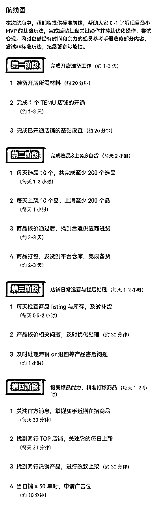

行动地图与读本紧密对应，你可按当前环节查找对应步骤。上述步骤建议在航海前两周走完；全部动作完成后，以实操为主，多挑款、多上架、多维护，提升出单概率。

# 必修篇：先跑通最小闭环

#### 本节概览

这一章从认识 TEMU 开始，带你逐步走完整个流程。照着本节步骤做，就能跑通最小 MVP。  
若你是新手，正式操作前先看全貌：  
【项目概述】了解 TEMU 跨境电商项目  
若已了解项目框架，就按核心步骤推进：  
【实操 1/4】完成开店准备工作  
【实操 2/4】完成选品&上架&备货  
【实操 3/4】店铺日常运营与售后  
【实操 4/4】提高爆品能力，精准打爆商品  
必修篇里，行动地图与读本顺序一致；顺着读本学，就能逐项完成任务。后续每个关键环节的概览也会提示对应地图步骤，帮你按节奏推进。  
下面进入正题。

## 一、【项目扫盲】把 TEMU 跨境生意看明白

#### 本节概览

这一章，我们一起拆解 TEMU 跨境：平台现在走到哪一步、有什么特征、新手如何在这里卖货……这些都会覆盖。  
本次航海的核心，是带你从零到一跑通这门生意，所以先把全局看清楚。

### 1.1 认识 TEMU

它由拼多多打造，外界常叫“海外版拼多多”，价格带偏低，主打实惠，总部在广州。上线时间为 2022 年 9 月 1 日；2023 年 2 月超级碗广告后，流量迅速抬升，同年长期占据应用商店下载榜前列，整体仍在流量红利阶段。  
如今，TEMU 已覆盖近五十个国家的站点，卖家挂出的商品可以同步触达这些市场的买家。  
广东境内已布局近九十处仓库；而 2023 年五六月时还只有二十多处，扩张速度可见一斑。  
仓库变多的同时，入驻商家也在快速增加：到 2023 年 10 月，平台已招揽九万名卖家，SKU 从 2023 年初的二十多万攀升至近百万，且仍在增长。  
早期是“挂链接就出单、利润也高”，现在逐渐转向“资质要合规、质量要严控”。有自有工厂，或本来就做拼多多的商家，会更占优势；无货源卖家在 2024 年可能赶上末班红利，也可当作跨境新手的入门项目。

### 1.2 为什么在 TEMU 做跨境？

#### 1.2.1 平台优势与特点

TEMU 偏中低端市场，采用团购式低价策略，用户中不少是看重实惠又追潮流的年轻女性。当前主流是平台包揽运营售后的托管玩法，对跨境新手比较友好，具体如下：  
1.门槛低  
有身份证就能以个人身份入驻；1000 元店铺押金无需提前掏现金，会从商品售出后的回款里自动扣除。  
2.操作简单  
在托管机制下，商家只需挑款和发货，把货寄到平台国内仓，角色接近供应商，不用管海外推广与国际物流。对没做过电商的人，上手难度较低。  
另外，发往平台仓的运费不高：在平台优惠政策之上，平台还会承担一半。以徐州发往广东仓测算，折合约 1.5 元/公斤。

#### 1.2.2 平台机会点 @Moose

TEMU 还在快速扩张，新站点不断开出，体量大的类目需求旺盛，新拓展类目也在积极招商，对新人来说机会不错。  
平台重点类目参考：

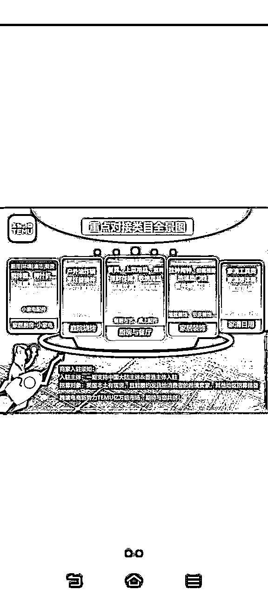

新拓展类目参考：

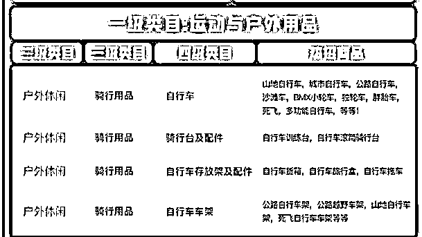

另外，2024 年 3 月起，平台正大力推广【半托管模式】，全面招商扶持；有海外仓的商家可重点留意（详见【7.1 半托管模式】）。

### 1.3 爆单的底层逻辑

#### 1.3.1 对准平台核心用户需求

目前 TEMU 用户体量最大的站点集中在美国、德国、英国、法国，均属欧美。产品要贴合欧美买家的偏好，而这类人群常用的电商渠道是亚马逊。人群重合，所以可以拆解亚马逊的爆款，找出他们喜欢什么，再搬到 TEMU。

#### 1.3.2 打造产品差异化 @Moose

照着亚马逊爆款快速搬到 TEMU，这招很多人已经会用。但同类商品一多，价格优势被削弱，也可能冲不出来。解法是“做出产品差异”，降低同质竞争，这也是出爆款的关键。  
怎么做出差异？对着爆款改款，形成新的 SKC（单款单色）。举例：服装—贴身类目里，你参考的是瑜伽裤，可在结构、面料、颜色不动的前提下，改成七分或九分版，成本更省。（具体在【4.2.2 报价被压怎么处理】展开。）  
改款前：

改款后：

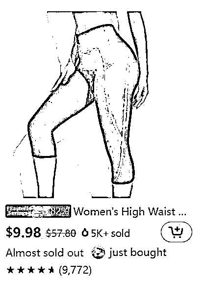

当然，若供应链很强，或价格优势绝对明显，就不必在产品差异上花太多精力。

## 二、【实操 1/4】做好开店前的准备

#### 本节概览

看清项目后，就要真正启动。想在 TEMU 卖货，第一步是完成开店准备。  
多数情况下，新手先开个人店：一张身份证可注册一家店，除特殊品类外，基本没有额外资质要求。若条件允许，也可选择个体工商户店、大陆企业店、香港企业店。几类店的区别会在本章说明，请按自身情况挑。

#### 本章任务路线

学完并做完本章，即完成行动地图第一阶段：开店准备（约 1—3 天）  
1.备齐开店材料（约 20 分钟）  
2.开通 1 家 TEMU 店铺（约 1—3 天）  
3.完成已开通店铺的基础设置（约 20 分钟）  
现在就去把店铺开通并完善好。

### 2.1 个人店与企业店怎么选

#### 2.1.1 入驻资质  
#### 2.1.2 账号限制  
#### 2.1.3 审核要求  
#### 2.1.4 资金管理  
#### 2.1.5 优劣对比

对多数新手而言，若资金、人力、物力都有限，想轻资产试水，先开个人店更稳妥；若手里供应商资源充足、有专业团队，想更快打开市场，可考虑企业店。

### 2.2 开店材料清单

1.个人开店材料  
a.打算卖的产品类目（参考【3.1.1 选择商品类目】）  
b.店铺名称与 logo  
c.身份证、银行卡  
d.办公地址（无公司地址时，住宅地址也可）

2.企业开店材料  
a.打算卖的产品类目（参考【3.1.1 选择商品类目】）  
b.店铺名称与 logo  
c.营业执照  
d.法人身份证、法人银行卡或对公账户  
e.公司经营地址照片（可去 1688 找一家工厂，下载工厂图片）  
f.欧洲环保认证（CE 认证），这是制造商打开并进入欧洲市场的“护照”，可找第三方机构办理。

### 2.3 TEMU 店铺入驻流程 @军

#### 2.3.1 注册入口

点此链接注册：https://kuajing.pinduoduo.com/login/register

#### 2.3.2 账号注册

1.填写手机号  
2.设置登录密码  
3.输入手机收到的验证码  
4.点击注册

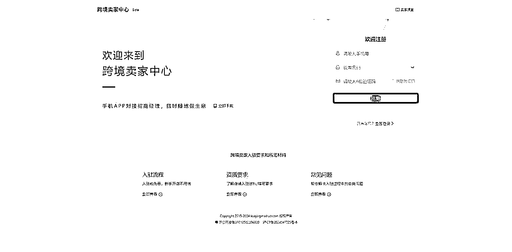

#### 2.3.3 录入主体信息

先选主体类型，目前支持：  
1.大陆个人店：适合没有注册公司的个人卖家，新手建议优先选。  
2.大陆个体工商户：适合有商业实体的个人卖家，财税方面类似企业店。  
3.大陆企业/香港企业：适合有大陆或香港公司的卖家，店铺规模通常更大。  
个人店和企业店的区别可参考【2.1 TEMU 个人店和企业店的区别】，按自身条件和需求选择。

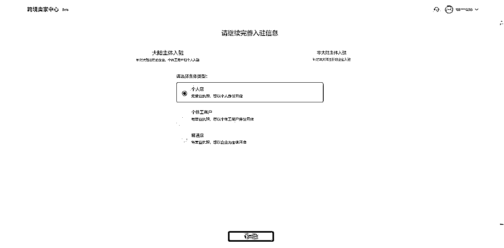

1.大陆个人店  
选择【大陆个人店】后，需填写相应信息。  
2.大陆个体工商户  
选择【大陆个体工商户】后，需填写经营人身份证有效期等相应信息。  
3.大陆企业  
选择【大陆企业】后，需填写相应信息。  
4.香港企业  
选择香港企业后，需填写相应信息。  
以上信息正确填写后，由开店人/经营人/法人/董事完成实名认证，即可完成账号注册。

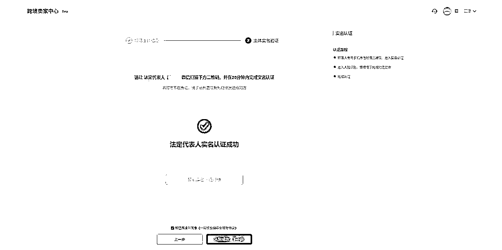

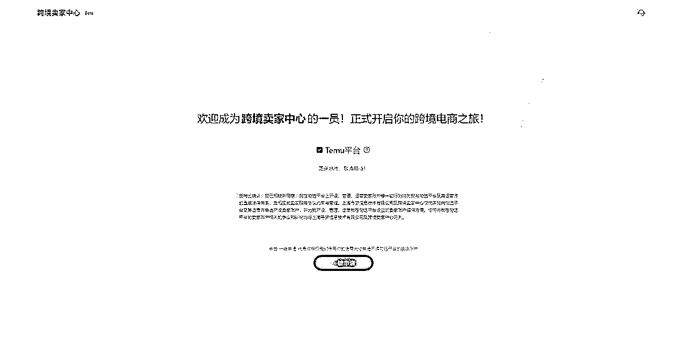

### 2.4 店铺基础设置

#### 2.4.1 完善店铺资料

需填写的店铺信息包括：

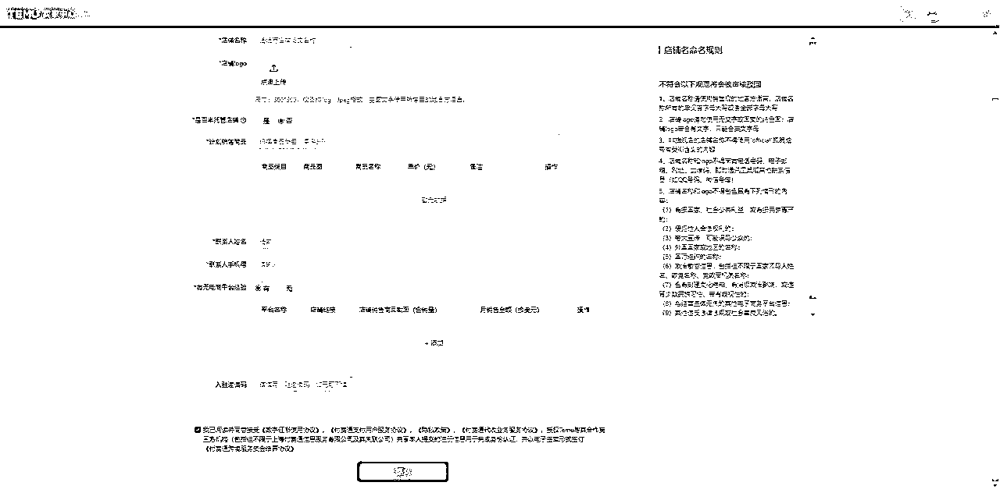

填写后点击提交即可。

#### 2.4.2 等待店铺审核

1.入驻审核目前 1—3 个工作日完成。  
2.审核通过后，注册手机号会收到短信通知。

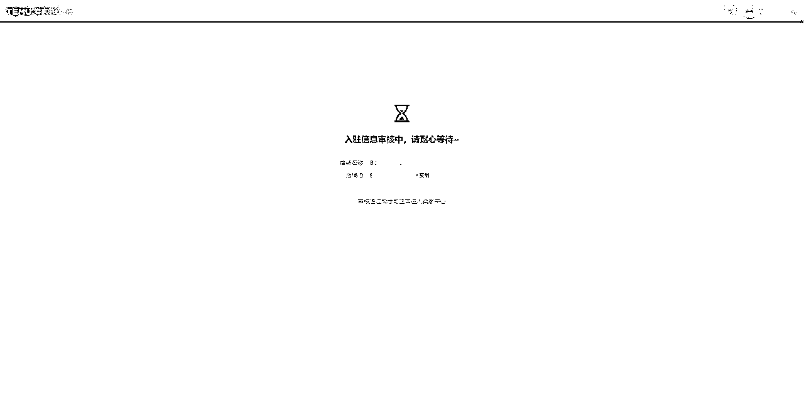

#### 2.4.3 绑定收款银行卡

卖家入驻后要尽快绑定银行卡，一个店铺只允许绑定 1 张银行卡。路径：在【银行卡管理】页面添加并绑定。  
关于 TEMU 入驻驳回和审核问题：  
1.入驻信息若被驳回，提交过的店铺名称不能再用。因为平台审核过程中不可修改信息，提交审核期间没有修改流程，所以提交前务必确认信息无误。  
2.入驻审核驳回后，暂不支持再次发起申请。也有卖家表示，主体被驳回后可尝试换个手机号重新申请。  
内容来源：https://wx.zsxq.com/dweb2/index/topic_detail/588452554452444

## 三、【实操 2/4】搞定选品、上架与备货 @企鹅

店铺入驻审核一般 1—3 个工作日。审核期间，可以先学习下面的内容，尝试开始选品。

### 3.1 选品怎么做

#### 本节概览

店铺准备好后，就要上架商品。怎么挑好卖的品？对新手最高效的方法是：  
第一步：去对标平台亚马逊找爆品，作为选品参考。  
第二步：回 TEMU 搜这个品的销售情况，判断是否上架。  
也可用 TEMU 选品助手作为补充。选品时注意不卖侵权款式，避免店铺违规。

#### 本章任务路线

完成 3.1 的学习和实操，即可完成行动地图第二阶段：选品&上架&备货（每天 2 小时）  
1.每天选 10 个品，累计至少完成 200 个选品（每天 1—3 小时）  
接下来，开始选出你想上架的高客单商品吧。

#### 3.1.1 确定商品类目

有货源的卖家：优先卖自有货源或有供应链的货，有价格优势，也能省成本。  
无货源的卖家：建议新手从【百货】起步。百货多为白牌，通常不涉及产品侵权，通货多、货源也较好找。订单多起来后，再尝试其他类目；但最好还是从自己有资源的货源切入，更不容易踩坑。  
常见起店模式是：前期做【杂货铺】，主营各种日常小商品；跑出爆款后，从爆款往外扩，逐渐转成【垂直店铺】。  
避坑提醒：

#### 3.1.2 选品思路

# 选品不靠猜：TEMU 从找款到上架的实操笔记

做 TEMU，选货本质是看供需是否对得上：什么商品放上去有人买。要判断这一点，先摸清两件事：TEMU 的主要客群是谁，他们的偏好、家庭结构怎样；以及同类渠道里哪些货走得快，所以得参考别家平台的销售数据。

新手想更快拿到结果，可以试这条路径：TEMU 的买家以欧美居多，那就去他们常用的 Amazon 找已经跑出来的款。逻辑很简单——最终买单的是同一群消费者。Aliexpress、Ozon、Shopee、Shein 也能当作找爆款的参照。

这么做的价值在于：成熟客群已经存在，转化阻力小；可以借亚马逊商品页的写法来打磨标题和文案，更贴近欧美买家的浏览与搜索习惯；在亚马逊已经验证过的平台型爆款，搬到 TEMU 后往往更容易拿到活动位和广告资源，曝光也更充足。

但别照抄，要按 TEMU 的规则做适配。下面几类方向，是 TEMU 买手点出的选品重点：

1. 重量与尺寸：1kg 以内优先，500g 以内更理想；超过 1kg 的商品，除非价格优势特别明显再报，其他可以试，电池能省则省。
2. 客群：尽量选全年龄段都能用的货，覆盖面宽，成交概率更高。
3. 品质：低价低质不要碰。评分稳、权重稳，才能长期卖，风险也小。
4. 价格带：申报价要压过主流批发渠道。
5. 节点：超级腕、复活节、生日会、派对、圣诞等都要提前布局。
6. 新品＋视频优先：有技术升级、功能迭代或新奇特创新，并配上视频。

再往深一层，可以去 TikTok、YouTube、Instagram 这类社交平台找正在起势的单品，训练自己的爆款敏感度。这部分放在选修篇【章节 6.2 进阶选品】里讲。

#### 3.1.3 最高效的选品路径：拿亚马逊爆款做参照

第一步：进亚马逊官网

网址是 amz123.com，进去后切到美国站。

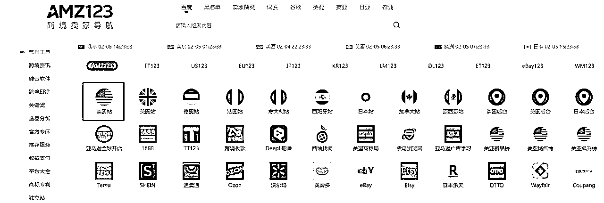

第二步：看亚马逊榜单

热销榜和新品榜都能在这里看：

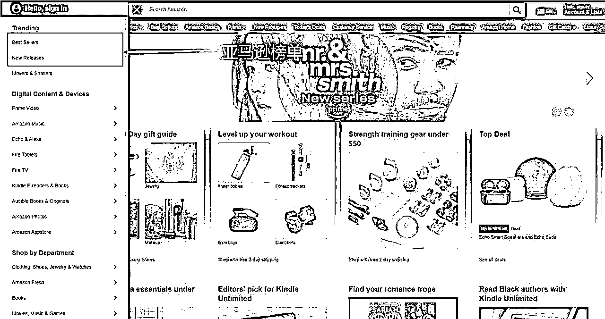

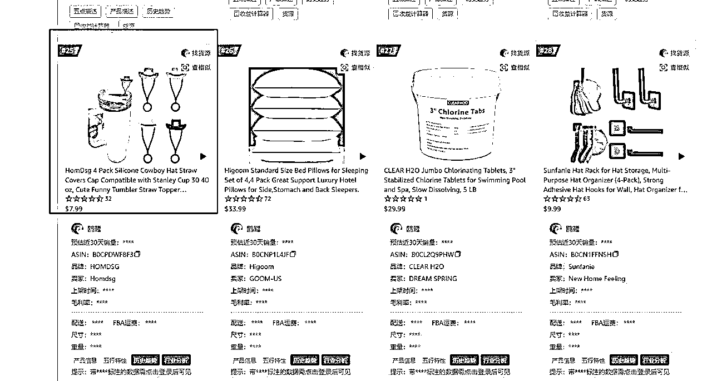

第三步：锁定可对标的亚马逊爆品

优先挑近 1—3 个月上架、日均大约 100 单的商品，这类款适合拿来参照。通常同款挪到 TEMU，销量不会更低，甚至更高。

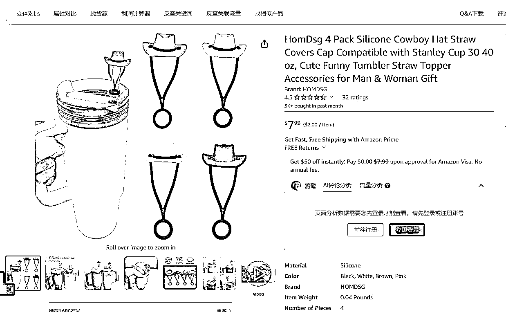

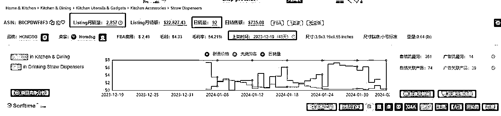

这里要装一个插件 Sortime Save（连续包月会员 19.9 元/月），建议新手都装上。它是亚马逊选品时常用的辅助工具，能快速看上架时间、月销量等指标；后面在【3.3 第二步：补齐商品基础资料】给商品起标题时，也能派上用场。

插件安装与使用流程如下：

【安装教程】

1. 用 Google 浏览器打开 Google 应用商店

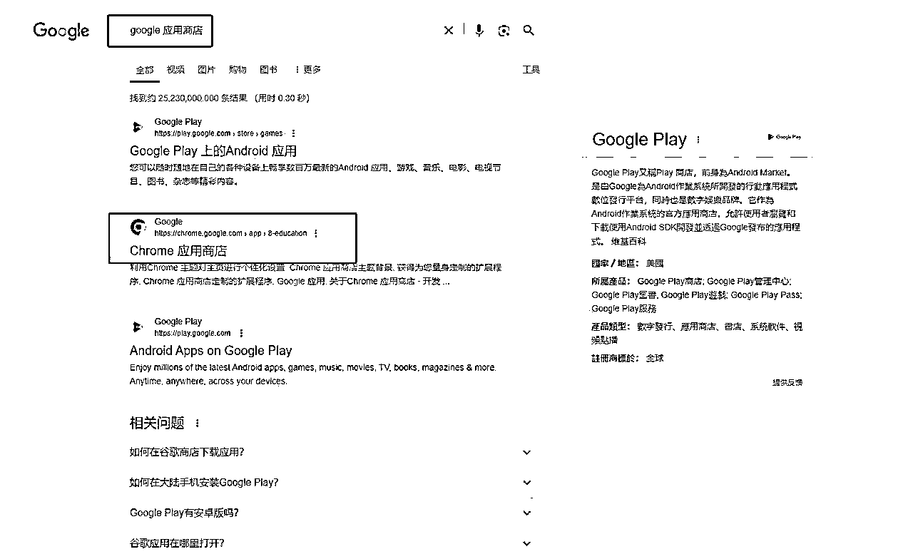

2. 找到 Sortime Save

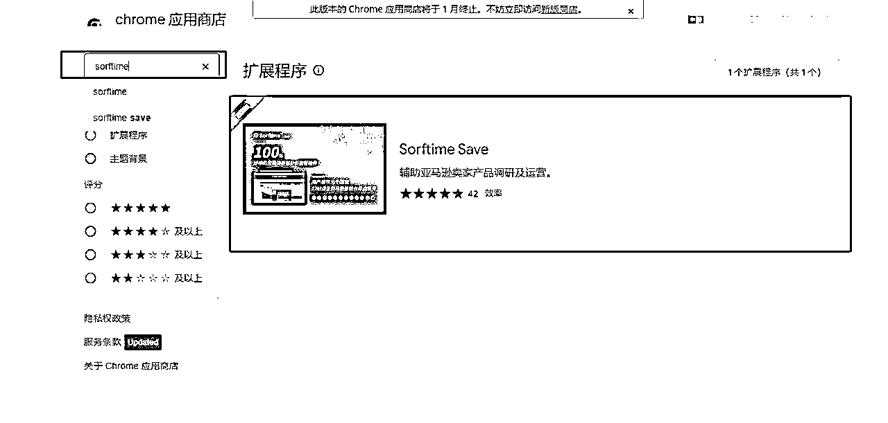

3. 点“添加”完成安装

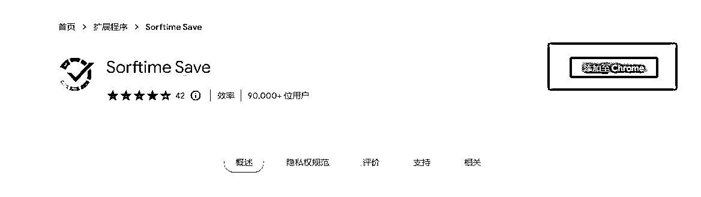

【使用教程】

在搜索框里输入商品关键词，找到对标商品并打开它的 ASIN（亚马逊标准识别号），就能看到日销量，以及该款式过去一年的销售走势。

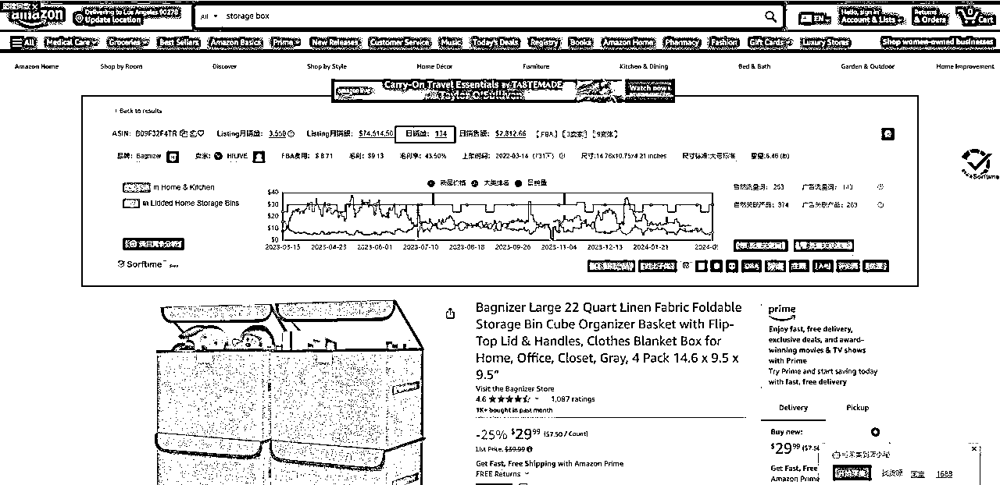

第四步：回 TEMU 搜同款

在亚马逊找到爆款后，回到 TEMU，用该商品标题里的关键词去搜。

举例来说，TEMU 上没搜到这款杯子，但出现不少杯子配件，这说明配件需求存在，可以上；而且这类花型款式，一旦有新设计出来，买家接受度通常不低，出单也相对容易。

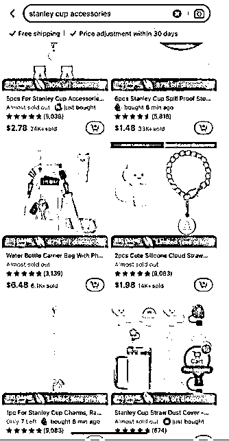

第五步：判断这个款要不要上

把亚马逊爆款拿回 TEMU 搜，通常会碰到 3 种局面。每种局面怎么处理，下面分开说：

情况一：TEMU 有同款，而且卖得不错

先算核价，利润能到 30% 以上就可以上。

比如 TEMU 售价 100，用图片搜索在 1688 找到同款，进价 65，利润约 35%，这个款就能做。

情况二：TEMU 有同款，但销量起不来

看它上架多久。若已经超过 1 个月，日销还不到 10 单，就没必要跟了。

情况三：TEMU 没有同款

没有同款就尽快上新，先小批量测款，测出结果再备货。

#### 3.1.4 选品补充工具：TEMU 选品助手

TEMU 选品助手（https://www.temushuju.com/）是免费工具，用来快速筛出 TEMU 上的热卖品。

不过，已经在 TEMU 卖爆的款，后来者机会通常不大，除非你很会做差异化。所以把它当补充手段就好。

操作方式：打开 Temu 选品助手，输入产品名，筛近 1 个月销量在 100～1000 的商品，再考虑跟款。

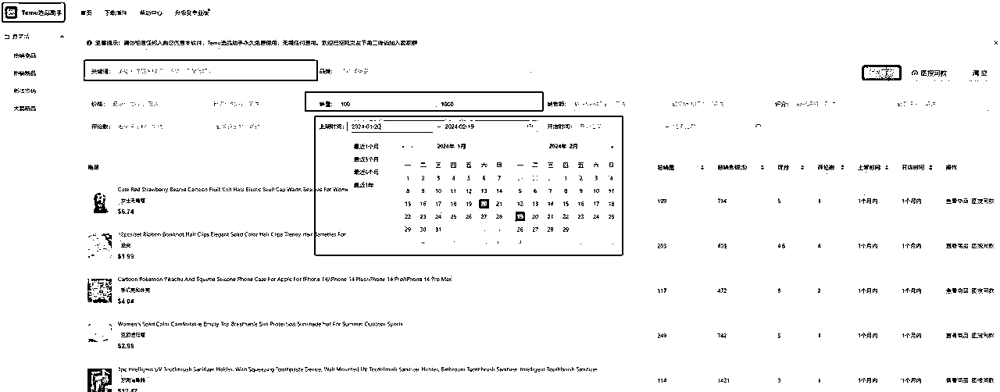

提醒：别碰侵权款。不清楚侵权边界，可以看【章节 4.4 如何避免违规】。

### 3.2 上架流程全景

#### 本节要点

上架这件事，核心目标只有一个：让欧美市场有需求的买家尽可能多地进店浏览，最后完成下单付款。

那怎么让商品被更多人看见并成交？选品之外，上架动作同样关键，它会影响曝光和转化。

整个流程分 3 个阶段：

1. 发布商品：想提高爆款数量，建议每天至少发 10 个品。
2. 找供应备货：找到价格合适的货源，及时备货，有助于店铺权重。
3. 回款结算：每个电商人都要会，关系到现金流管理。

上架时要特别盯住【核价】。能不能过买手核价，是上架成功的关键一环。

本章除了给操作步骤，还夹了一些编辑技巧和注意事项，帮你少踩坑。

#### 本章路线图

学完并实操本章，就能完成航线图第二阶段：选品、上架、备货（每天 2 小时）。

1. 每天上架 10 个品，累计至少 200 个品（每天 1 小时）。
2. 核价通过后，找到合适供应商进货（约 2—3 天）。
3. 打包发货到平台仓库，完成备货（约 2—3 天）。

接下来，把你选出的商品编辑上架吧。

选好品之后，就进入上架环节。商品从创建到可售，要经过几个步骤，先整体过一遍：

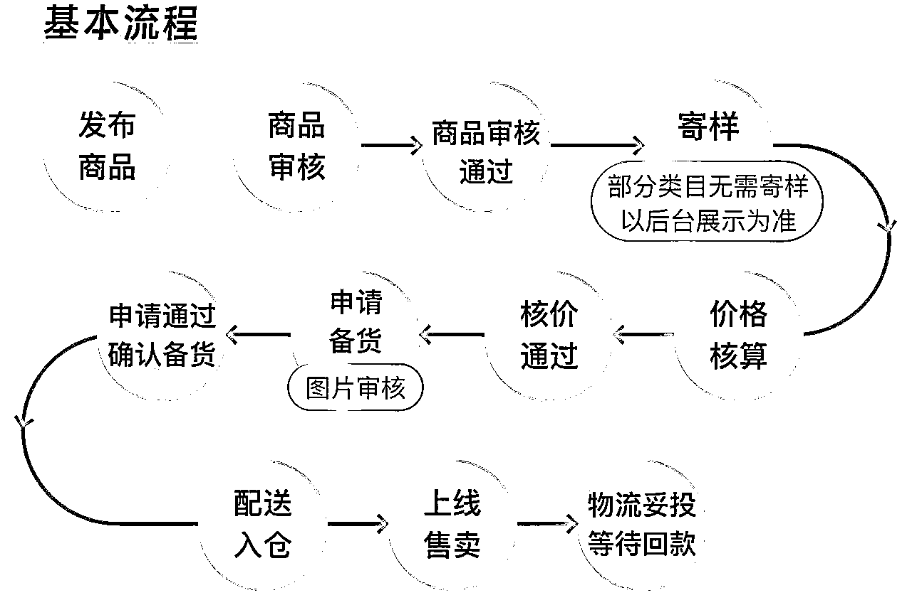

整个流程分 3 个阶段：

1. 发布商品
2. 找供应备货
3. 回款结算

后面按这 3 个阶段分别讲操作。

### 3.3 商品发布

入口在卖家后台：商品管理 → 商品列表

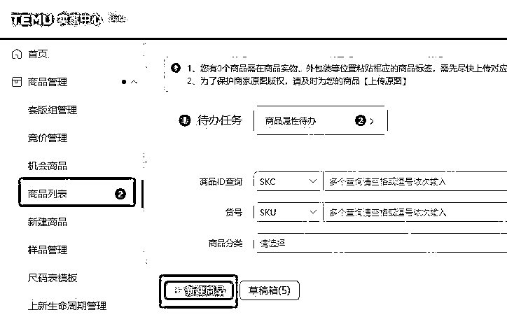

提醒：想提高爆款数量，通常建议每天发布至少 10 个品。

#### 第一步：定商品分类

TEMU 对类目没有限制，平台上所有类目都能上。

在【商品分类】里输入子类目名称，就能快速定位到合适分类。

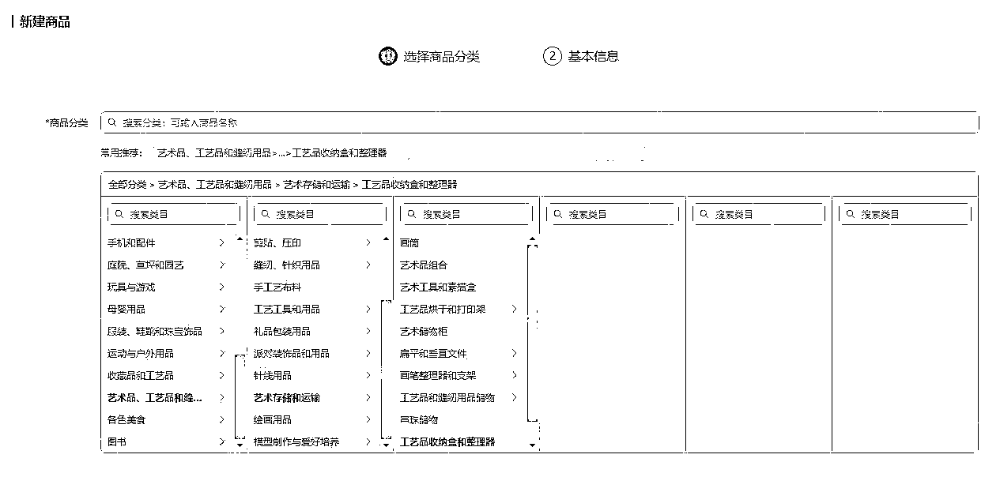

#### 第二步：补齐商品基础资料

1. 选择素材语言

我们主要做欧美市场，这里选英语即可。

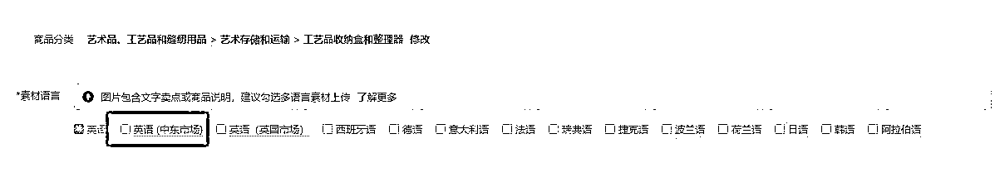

2. 上传轮播图、主图视频

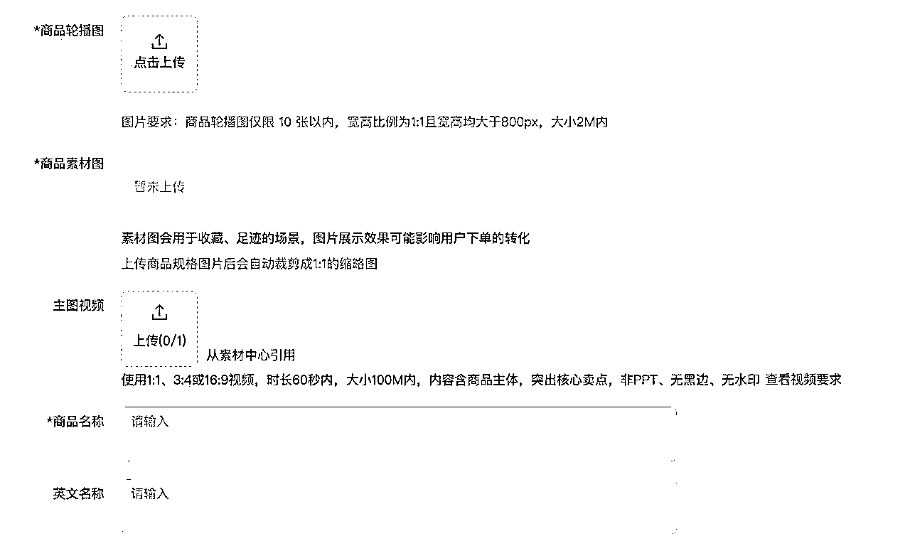

注意：

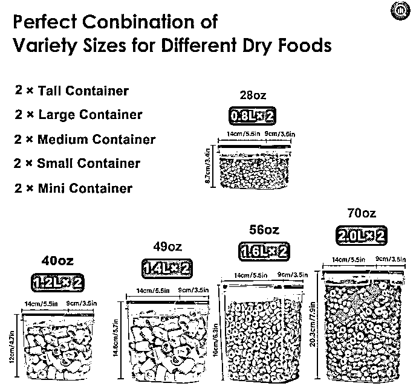

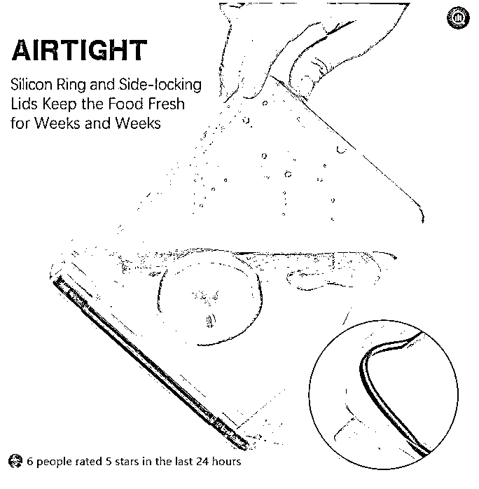

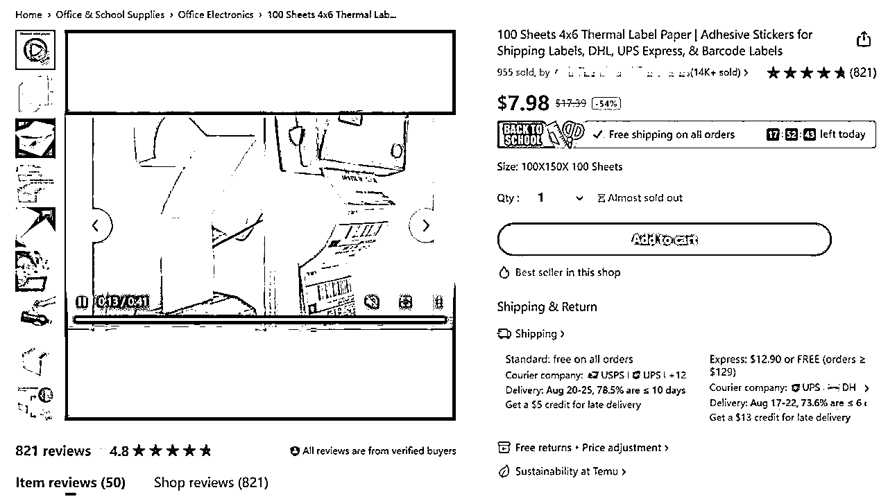

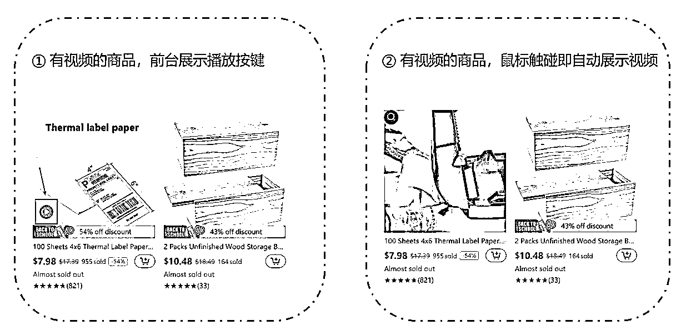

3. 完善商品名称、规格属性

注意：认真填“属性”“规格”，它们会影响核价/比价结果、搜索展示排名和客户转化率等。

【商品名称】里填中文名，写清数量、功能、特征等信息。有条件的卖家，再根据中文名在【英文名称】里补一个符合商品描述的英文名。

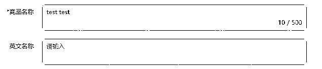

起名时，建议直接参考亚马逊同类产品，把该类目主要的英文引流词都塞进去，再用翻译工具把英文标题转成中文，中英文都填好。

否则没有英文标题，TEMU 买手（类目小二）上架时可能随手取一个，核心词缺失，流量就少。Temu 目前的个性化推荐偏弱，流量更多来自系统推荐的热销品和关键词搜索。

这里可以继续用前面找亚马逊爆品时装的 Sortime Save：

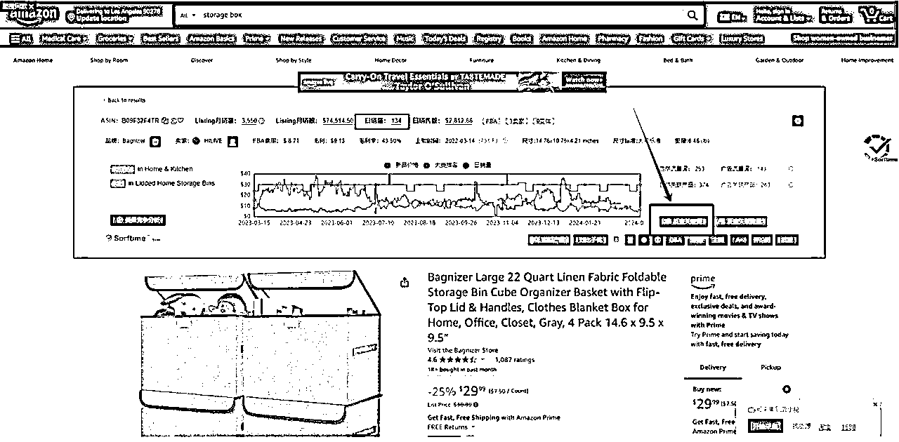

点“反查关键词”，能看到哪个词流量最大。把高流量词放进标题里。工具会把词频从高到低排出来，比如 storage、bins、lids、organizer、closet、box、toy 这些词反复出现，就优先考虑；括号里的数字代表出现次数。高频词按顺序挑出来后，再用英文逗号把短语串成一句。

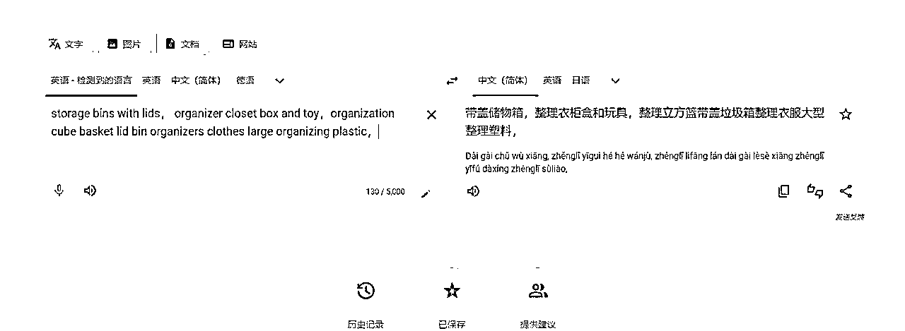

接着用 Google 翻译检查语序顺不顺，别扭的地方微调。示例中的思路是：带盖储物箱、衣柜与玩具收纳盒、塑料收纳篮等词组合成一个英文标题，中文大意也一并填上。

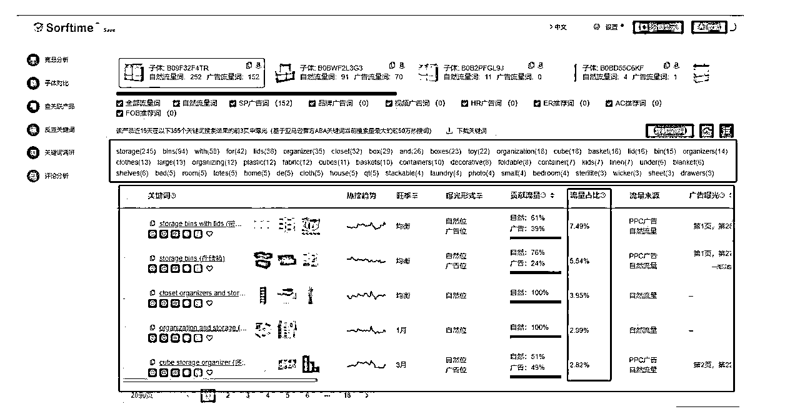

选择符合商品描述的属性。

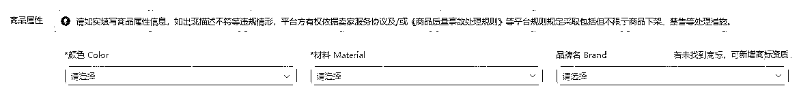

不同类目要填的属性不一样。可以直接去 1688 货源详情页看商品属性，照实填；拿不准就问商家或客服。

选择符合商品的规格（如颜色、尺寸），并填写对应规格名（如红色、M）。

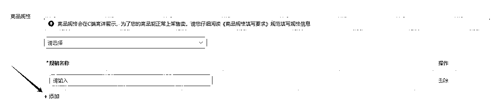

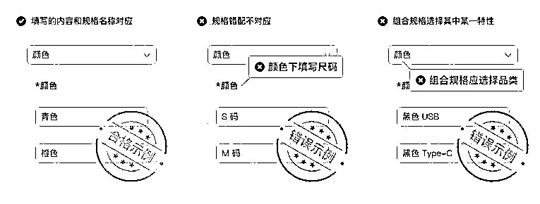

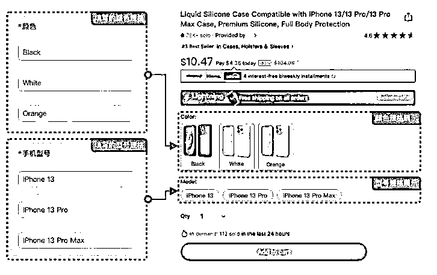

卖家要在首单发货前确认【商品规格】无误，规格填错入仓可能被退仓。

#### 第三步：补齐包装数据

1. 在【商品包装信息】里上传外包装图片，选外包装类型和形状；
2. 填好商品体积与重量。

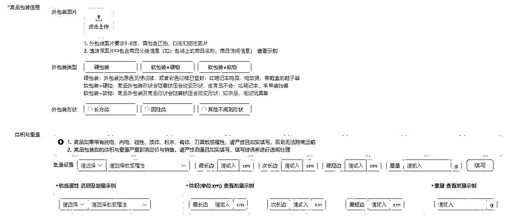

注意：确认发布前认真核对【商品包装信息】。包装后的体积和重量会直接影响定价与销售，必须严格测量、如实填写，填错会按违规处理。

#### 第四步：勾选敏感属性

注意：商品若涉及纯电、内电、磁性、液体、粉末、育体、刀具等敏感属性，必须严格如实填写，否则无法跨境运输。

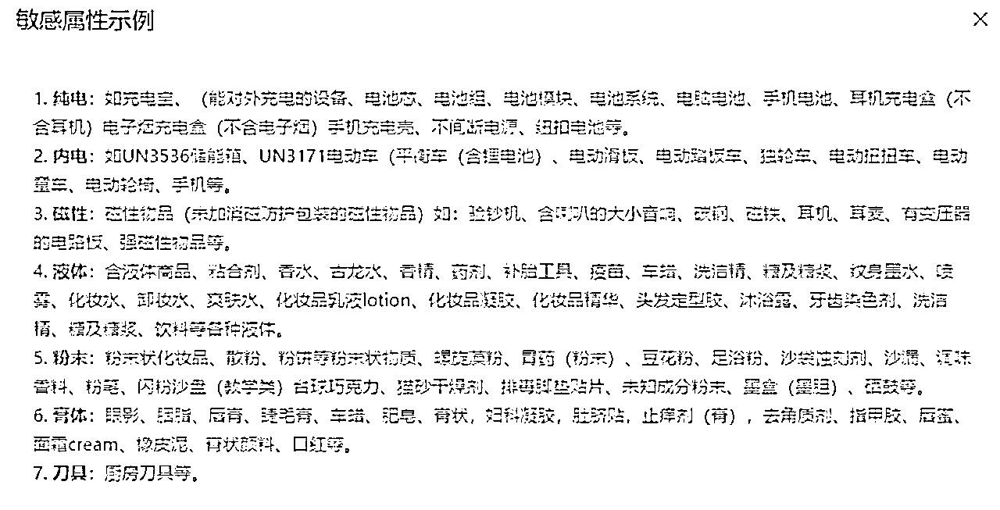

#### 第五步：填全 SKU 资料

1. 上传 SKU 预览图

预览图宽高比 1:1，且 >800px，小于 2M。

2. 填写 SKU 申报价格（人民币）

这里说下定价思路：

TEMU 核价员通常参考 1688 的中位价。比如同款在 1688 有人卖 10 元、有人卖 8 元，核价员会按（10+8）/2=9 元取中间值，所以卖家报价要低于 9 元。

对卖家来说，利润率一般要有 20%—30% 才会做，也就是：

进价 10 元，要赚 2—3 元；
进价 20 元，要赚 4—6 元；
进价 50 元，要赚 10—15 元。

我自己的报价习惯是按进价×2.3~2.5 去报（仅供参考）。逻辑是：先尽量跟供应商压价，拿到更低进价；同时买手核价时通常会砍价，所以报价会在利润上再加一点，留出砍价空间。

注意：这一步必须认真核算填写，直接影响核价能否通过；核价不过，就无法正式上架销售。

3. 选填【商品编码】，自定义【SKU 货号】和【SKC 货号】

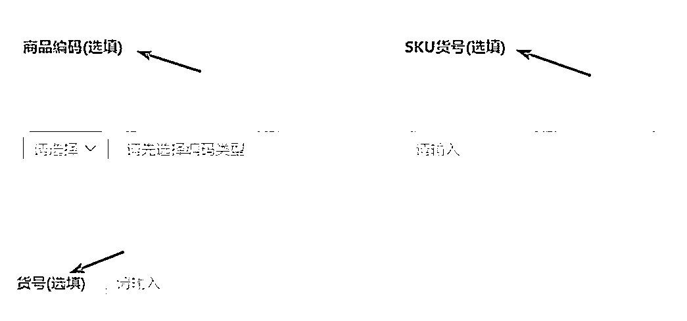

#### 第六步：加详情视频

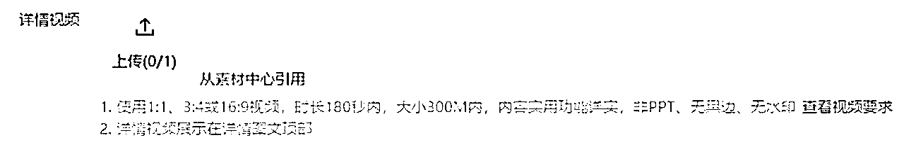

详情视频不是必填，但有精力建议传，能提高下单转化率；也可以等出单后再补。

内容以产品展示或操作说明为主，货采回来后自己拍一下就行，不复杂。

#### 第七步：补商品说明书

路径：卖家中心 -【商品管理】-【商品列表】-【编辑】-【添加商品说明书】

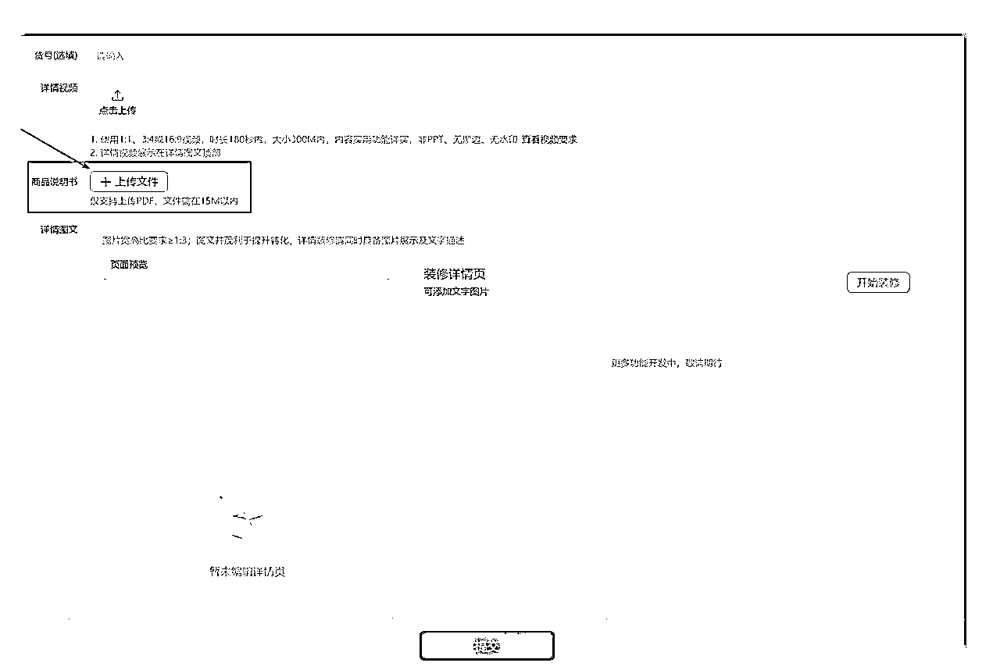

商品说明书非必选，主要写性能、特点、用途和使用方法，能降低买家疑虑、减少进线咨询、提升下单转化率。前台展示如下：

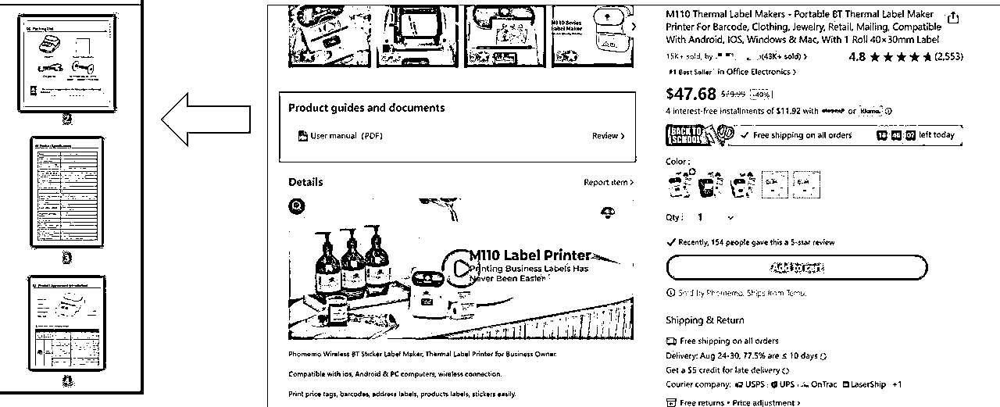

说明书要自己做，可参考采购的 1688 货源说明书，在这里编辑（记得用谷歌翻译转成英文）：

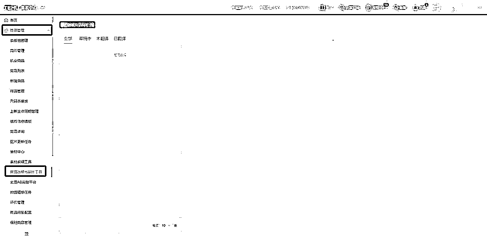

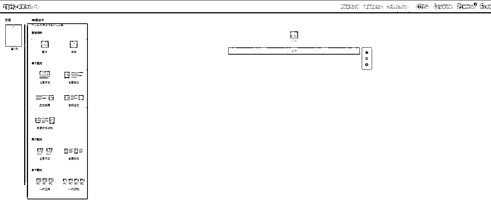

#### 第八步：把详情图文做实

做得差的详情页，问题通常是图片不好看，或者文字堆得太多。

下面这种详情页就做得不错，可以参考：

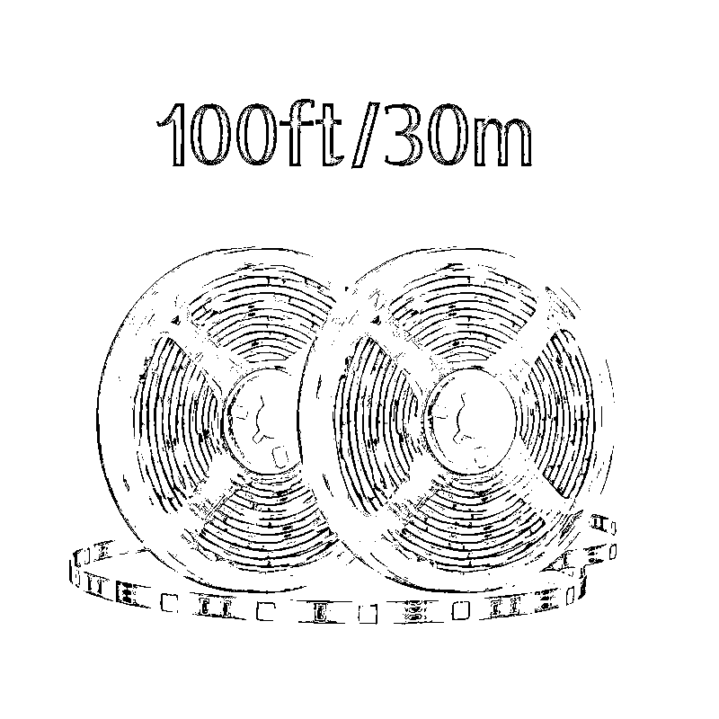

详情页里若有文字，一律使用英文。

店小秘可以完成图文翻译，插件安装方法参考【4.1.2 批量操作与编辑】。

店小秘图文翻译怎么做：

第一步：

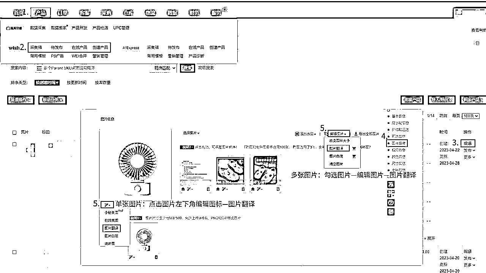

第二步：

图片翻译属于付费功能。账户内还有可用张数时可直接使用；若张数耗尽，系统会弹出充值提示，选定购买数量并完成支付即可继续（5元/100张）。

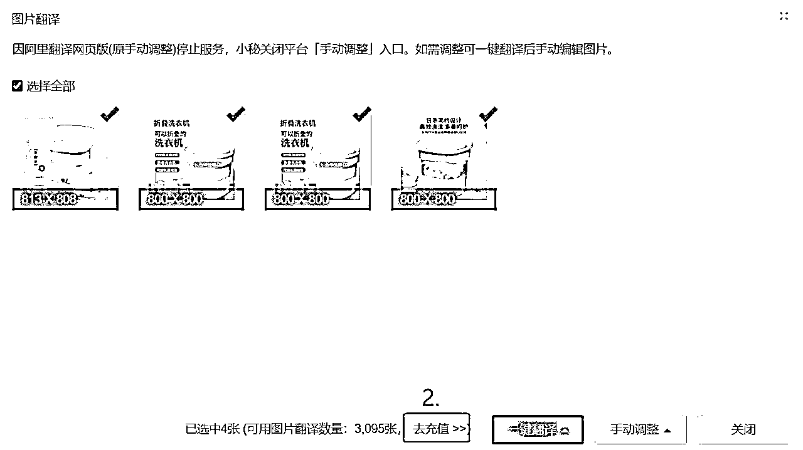

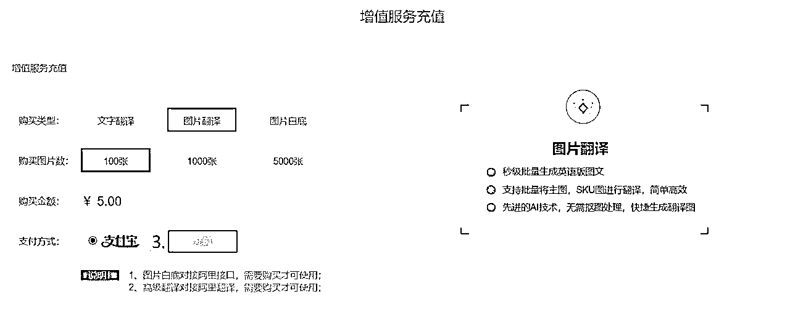

第三步：

全选商品 → 一键翻译 → 确认，产品页面上就会呈现译好的图片。

第四步：

需要微调译文时，选择手动调整，改完保存，产品页面随即显示调整后的版本。

#### 第九步：商品审核与核价

发布之后，商品进入核价环节，等待平台审核。如果着急，可以把SKC（商品ID）直接发给买手，请对方加速处理。商品ID的查询位置在【商品管理-商品列表-商品信息】。

核价方面：
买手会拿同款商品和亚马逊的价格做比对，判断你的供货价加运费后能否压过亚马逊热销款。一旦买手认为报价偏高，就会发起议价，后台会推送议价通知。若商家拒绝平台议价，存在被清退的风险。（更详细的核价技巧，我会放在【章节 4.2.2 报价被压怎么处理？】里展开讲。）

图片审核方面：
TEMU当下的要求是最少5张、最多10张主图，另加详情图和主图视频。主图与SKU图尽量避免“牛皮癣”式杂乱元素，我们通常采用干净的场景图。
商品介绍尽量放进详情区。图片内不得出现亚裔面孔，文字须为英文；计量单位必须包含美制，国际单位可一并标注——长度以inch、feet、yard或mile表示，重量用pound与oz，体积按gallon计算，温度则以F标注，其他同理。

商品审核一旦通过，就能申请备货了。提醒一句：有些类目的买手会挑选款式、查看实物，需要先寄样品过去，具体以平台通知为准。

### 3.4 找货源与备货发货

商品发布并成功上架（即核价通过）之后，卖家便可以着手第一次备货发货，这一步俗称“下首单”。首单完成后，往后只要依据销售表现和库存余量推算需求，按需补货即可。

操作流程如下：

#### 第一步：申请备货

1. 首单（第一次备货）要在“销售管理”里提交申请，由卖家自行发起；
2. 【数量问题】首单每个SPU（标准化产品单元）通常申请20—50件足够。商品跑起来、销量理想的话，后续补货时可以加大申请量。
3. 申请提交后，在系统里@对接买手审核，审核结束可到“我的订单”查询结果。

首单备货完成，务必持续盯销量与库存：

备货审核放行后，卖家要把货发到平台仓库，大致流程是：

当然，若你不是厂家、手里没有货源，就得先落实合作货源、完成采购，再回后台走发货流程。

#### 第二步：找合作货源

已有货源的话，这一步可以跳过。若和我一样手上没货，通常去1688用图片搜索的方式，筛出报价合适的目标供应商。

选好产品后先算毛利。毛利润率接近30%，这单就具备操作价值。

举个例子：
1688上找到的杯子进价16元，TEMU平台同款普遍标价25元。假设你定价24元，毛利润率≈（24-16）/24≈33%，可以做。（运费未计入，是因为发往平台仓的成本很低：平台有优惠政策，还会替商家承担一半运费，徐州发往广东仓折算约1.5元/kg，所以毛利测算里忽略运费。）

不过如今只做标品，在1688上很难挖到高利润率的产品了。建议采用组合品玩法，生成新的SKC来提升利润空间。（详见【4.2.2 方式三：组品，快速生成新的skc】）

另外，也可以和供应商再谈谈价：首批拿20个，后续卖得好继续从他家进货，争取长期合作。

贴标这件事：
早前不少TEMU卖家嫌贴标繁琐，直接放弃了项目，很可惜。其实完全可以把这项任务交给供应商。联系供应商时直接问对方能否代贴——有的愿意免费贴，有的每件加收0.1—0.3元。

#### 第三步：将订单加入发货台

备货申请（首单）提交后，买手会进行跟单审核（着急可以催审）。审核完成，到【我的订单】把订单加入发货台。

路径：订单管理 - 我的订单 - 加入发货台（支持批量加入）。

#### 第四步：创建发货单

这里的发货单，是你把包裹送往TEMU仓库时所用的单据。订单加入发货台后，应尽快【创建发货单】，超时会被系统自动移出；一旦被移出，订单可能因仓库容量不足而无法发出。

操作路径：卖家中心 - 订单管理 - 发货台 - 创建发货单。

常见问题：
包裹重量填预估数值即可。若担心快递超时或物流拒收，建议设置【预约取货时间】，给打包留足时间。万一物流拒绝提货，可以取消发货单，再回发货台重新发货。

【拆单发货规则】（拆单即：平台建议补40件，你手上只有20件，可先在首张发货单填20件，余量后补）
① 最多拆3次；
② 订单剩余未发数量低于20件时，不允许拆单；
③ 首单不可拆，且首单发货数量满足率须大于80%，否则无法发货。举例：店铺首单含10件商品，实际至少发出8件（即80%）。该规则意在保障新店起步阶段的供货能力与物流效率，兼顾买家需求与平台交易秩序。

【移除规则】
加入发货台后，次日05:00前未发货，订单将被自动移出。需要重新发货时，回“我的订单”重新加入发货台即可。

#### 第五步：开始发货

发货单建好后，就能按单发货了。卖家先在卖家中心核对发货信息，打印商品标签并贴好，再把货交给物流公司。打包与贴标规范要格外留心。

具体步骤：

1. 确认发货信息（核对/调整包裹数量）：

操作路径：卖家中心 - 订单管理 - 发货单列表 - 查看包裹信息

常见问题：
【商品打包标签】一经打印，包裹数量便无法再改。所以务必先确认打包情况，再打标签。正确顺序：先打商品条码→逐件贴码→按包裹打包→复核件数→打印商品打包标签。标签打出后，包裹数量即锁定。

2. 打印商品标签并完成贴标
卖家需打印商品条码与商品打包标签（连接打印机操作），贴到待发包裹上：

常见问题：
未贴商品条码的商品一律无法收货，会被直接拒收退回，因此每件商品都必须贴平台统一条码。
发货单中每个包裹都要贴【商品打包标签】；全部包裹装入发货箱后，外箱再贴物流运单。
发货单取消时，对应的商品打包标签立即作废，需重新创建发货单并重新打印。
标签条码需在店铺后台打印后再寄给供应商，供应商端无法直接打印。

3. 商品贴标注意事项：
货品发往海外，包装须使用销售目的国语言。发货时别把商品标签贴在产品外包装袋上，否则可能影响入仓。
可参照下图：垫两张白纸把标签贴上去，或另用快递袋装好后贴在袋上，避免不必要的损失。

4. 商品打包要求
① 每件单品都要贴商品标签（在商品条码入口可下载对应标签）。
② 按SKU维度打包为一个包裹，贴商品打包标签（在发货单列表可下载每批货的打包标签）。
③ 打包标签必须与包裹内商品一一对应，否则仓库不予收货。
④ 多个已贴打包标签的SKU包裹，可交由顺丰合箱发出，外箱只需贴物流面单。
⑤ 袋装商品若袋子尺寸超过婴儿头部，须有警示语；袋子自带警示语则免。没有的，可用热敏标签纸打印：

WARNING: This bag is not a toy.To avoid danger of suffocation,keep this bag away from child under three.Don't use in cribs,carriages or playpens.

大件商品袋（大于15cm）必须带警示语并保留两个透气孔。
⑥ 严禁放入干燥剂。
⑦ 未寄样的商品，如有吊牌/标签，必须纯英文或中英文对照。
⑧ 不得附带任何导流性质的卡片或标签，例如网址、二维码、社交平台信息。TEMU对引流查处极严，这条红线别碰。

提醒：很多人在“打包—发货到平台仓库”这一环卡住，嫌麻烦就退出了。对新手而言，执行力和坚持最关键，按流程每天选品上品，基本都能做出成绩。

内容来源：https://wx.zsxq.com/dweb2/index/topic_detail/585428888811244

#### 第六步：查看产品标签要求

各品类质检要点不同，可在卖家中心 - 合规中心 - 合规看板查阅。

最要紧的仍是两点：
1. 产品标签贴得对不对；
2. 产品有无质量问题（例如破洞、损坏）。

以下列举几个常见的【入库质检注意事项】：

### 3.5 回款与结算

商品上架、首单发出之后，后续运营主要由平台接手，卖家只需持续上新，坐等出单回款。

3.5.1 回款流程

通常买家确认收货的次日，货款就会进入卖家绑定的银行卡。TEMU目前走空运，一般5—10天可送达买家手中。

#### 3.5.2 回款对账

电商涉及商品周转、海量订单处理、供应商与物流合作等环节，对现金流要求较高，因此对账（现金流管理）属于日常运营的一环。

后台有两个模块支持对账操作：

3.5.1.1 收支明细

收支明细怎么查？

路径：结算管理 -> 资金中心 -> 收支明细

点击【收支明细】按钮，进入【对账中心查询】页面。这里能查看并导出货款账户的每笔入账明细，涵盖充值、提现、结算等信息；也可按日期、账务类型、资金流向、金额等条件筛选，提取所需数据。

收支明细怎么导出？
点击【导出】按钮，跳转【导出历史】页面，点击【下载订单报表】，即可导出相应明细。

3.5.1.2 结算数据

结算，指平台按既定规则和方式把资金打款到你的货款账户。

需要掌握不同状态的结算数据——待处理、结算中、已到账，便于自己或财务对账。

不同状态的结算数据怎么查看？
进入【结算管理-结算数据】，可看到“待处理款项”“结算中款项”“已到账款项”各自金额及构成类型。

订单/商品的结算状态怎么了解？
点击三类款项旁的【导出数据】按钮，跳转【导出历史】，点击【下载订单报表】，即可查看对应款项源自哪些订单号、SKU ID、商品名称等，从而掌握订单/商品的结算状态。

结算常见问题：

1. 结算中的款项多久到账？
资金到账至少需3—5个工作日，周末及节假日顺延（含中国节假日与美国节假日）。
若店铺信息出现异常（如信息缺失、信息有误、不满足外汇管理局等机构的资金跨境条件等），请尽快联系客服确认原因，异常解除后货款才会恢复结算；若店铺做过主体变更或资金账户类型变更，结算会暂停，待变更完成再恢复。

2. 为什么【结算数据】页面的汇总收入不等于销售额？
因为只有已销售且已发货的数据才会出现在【结算数据】页面，且该页面并非实时更新。

3. 为什么会有【消费者售后预留金额】？何时释放？
【消费者售后预留金额】是订单发生售后（含待判责售后等）时，平台暂时留存的那部分金额。
若后续判定非你的责任，金额会释放到货款账户（显示为“消费者售后释放金额”）；
若判定为你的责任，或商品退回仓库后仍可销售，这笔预留金额不会释放，平台会将对应款项退给消费者。
同时，当预留金额小于退款金额时，平台会在【消费者售后预留金额】中补充预留。

3.5.3 回款提现

提现无具体时间限制，每日限提1次，免手续费。

路径：结算管理 - 资金中心 - 点击提现

## 四、【实操 3/4】日常运营与售后处理 @企鹅

#### 本章概览

作为TEMU卖家，每日最重要的任务有三项：

- 商品管理与补货：查看商品listing（详情页）有无优惠调整空间，及时关注库存并补货；
- 商品上架与编辑：借助店小秘工具批量操作，提升上架效率；
- 运营已出单商品：出单后检查并优化listing；商品爆了之后，立刻再建3—5个同款链接。

上架途中常会遇到产品审核/核价未通过的情况，本章给出了具体应对方案。当然，电商售后也躲不开，本章同样提供了处理流程与建议。最后提醒：运营时务必避开侵权产品，以免违规。

#### 本章学习路线

学完并实操本章，即可完成航线图第三阶段：店铺日常运营与售后处理（每日1—2小时）

1. 每日检查商品listing与库存，及时补货（每日0.5—2小时）
2. 产品核价问题及时优化（约30分钟）
3. 滞销或退回等售后问题及时处理（约1小时）

若你已成功上架若干产品，就开始店铺日常运营管理吧~

### 4.1 店铺日常运营

#### 4.1.1 商品维护与补货

商品维护与补货，是卖家每天运营店铺的必修课，具体包括：

4.1.1.1 检查商品 listing

## 五、【实操 4/4】爆品打造实战：让好货被精准打爆 @企鹅

#### 章节概要

做电商，最终的落点就是做出爆款。这一章以一套完整动作为主线，讲清怎么把潜力单品一步步推上爆款位置，内容包括：

- 爆款关键自查清单：逐项确认自己是否做到位。
- 卖家进阶打法：借助细分类目、标题属性、图片质量和组合关联，让爆款概率明显提高。
- 官方消息同步：分享 3 个和官方保持高效连接的渠道。
- 紧盯 TOP 店铺上新：测出爆款后，看同行在卖哪些类似款，逐步沉淀成垂直店铺，拿到更精准的访客。

把这几件事做扎实，出爆款只是时间问题。

#### 本章航线图

完成本章全部学习和实操后，航线图第四阶段即可达成：提高爆品能力，精准打爆商品（每天投入 1～2 小时）。

1. 每天 30 分钟，跟进官方消息，掌握买手近期主推的品类。
2. 每天 30 分钟，找到同行 TOP 店铺，关注每日上新。
3. 每天约 30 分钟，锁定同行热销款，做改款之后上架。
4. 每天约 10 分钟，单日销量 ≥ 50 单时，申请广告位。

还没有出单也不要灰心，继续坚持选品上架，并集中精力吃透本节爆品打法。

### 5.1 在 TEMU 做出爆款的关键

先明确“爆品”的标准。不同人对 TEMU 的收益预期不同，这里先分成三档：月赚 1w、月赚 3w、月赚 10w。

若目标是月度利润 1w，爆品门槛大致是：单款月毛利 > 3000 元，通常对应客单价 10 元、单月 1000 单（日销 33 单）。

若目标是月度利润 3w，爆品门槛大致是：单款月毛利 > 1w 元，通常对应客单价 50 元、单月 667 单（日销 22 单）。

若目标是月度利润 10w，爆品门槛大致是：单款月毛利 > 6w 元，通常对应客单价 200 元、单月 1000 单（日销 33 单）。

新手阶段，先瞄准第一档，把低客单价的款做到日销 30 单以上，再想下一步。

想做出爆款，下面 6 个要点不能忽略：

1. 目标用户优先欧美市场
平台主要服务欧美买家，选品要贴合欧美消费习惯，可以直接对齐 Amazon 的热卖款。

2. 保持持续上新
高上新率对单品权重很有帮助，定期推新品也能提升店铺权重，换来更多平台流量倾斜。

3. 库存一定要稳
产品卖得动时，库存充足的店铺更容易拿到重点扶持（这是经验之谈，不一定绝对）。至少不能断货，供应链不稳会直接冲击流量。

4. 评分和详情做到位
包装要抗挤压，尺寸最好直接标在主图里，这样能减少差评；属性完整有利于吃搜索流量；标题卖点突出、核心词够多，曝光机会更大；图片精致，点击和转化都会跟着涨。（详情页优化的完整检查项，见【4.1.1.1 检查商品 listing】）

5. 价格要有竞争力
手上有供应链资源的商家，把价格压到低于 1688 这类主流批发平台，接近源头出厂价就很容易爆单，价格越低胜率越高。
没有稳定货源的商家，则要运用“产品差异化”做出新 SKC，避开价格硬拼，具体见【4.2.2 报价被压怎么处理？】。

6. 在售商品数量要够
单店在售超过 50 个，就可以对接平台买手，方便买手批量选品，核价效率也更高；超过 100/300/500 个时，分别有更高层级的买手重点对接。

Listing 是买家看到的商品详情页，标题、图片、介绍、价格、库存等要素都集合在这一页，直接影响最终转化率。

具体检查维度如下：

1. 主图是否安排视频，适合讲解型产品，对转化有明显拉动。
2. 标题核心关键词是否放在开头，标题是否做了专门优化。
3. 可填的商品属性全部填满。
4. 主图位置放满 10 张图。
5. 详情页是否图文并茂，是否配有产品操作/安装视频（例如组合柜子），是否附带说明书。

#### 4.1.1.2 关注商品库存，及时备货

每天登录【卖家后台管理界面】，查看当前库存余量、销售速度以及库存预警，再跟进备货。项目越往后，备货会占掉你越来越多时间。

操作路径：卖家中心 - 销售管理 - 查看【建议生产数】- 点击【申请备货】，按系统给出的数量备货即可。

尤其当某个款卖得不错时，备货一定要果断，不能拖！

#### 4.1.2 批量上新和编辑（店小秘）

店铺每天都离不开选品上新（建议至少 10 个/天），为了压缩耗时，推荐用【店小秘】采集助手（地址：https://www.dianxiaomi.com/index.htm）。这是一款支持多平台采集发布的工具，可把速卖通、淘宝、天猫、1688、京东、eBay、Amazon 等平台的商品快速抓取并发布到自己的店铺，也是 TEMU 官方比较推荐的工具。

操作很简单：复制产品链接，粘贴到店小秘采集框，点击“开始采集”，系统便会自动抓取 listing 信息，省去大量手工录入时间。

使用店小秘前要先装插件，教程见：https://help.dianxiaomi.com/pre/getContent.htm?id=170

把产品采集后发布到跨境店铺，这个过程就是“刊登产品”。

##### 4.1.2.1 刊登（采集发布）产品的具体步骤

正式开用前，需要先按这个链接把店小秘绑定到 TEMU：https://help.dianxiaomi.com/pre/getContent.htm?id=2347

最常见的刊登方式是直接在店小秘创建 TEMU 商品。店小秘按照上传方式，将 TEMU 商品分成服装、鞋类、其他三类。不同类目的属性、变体主题、变体数量、图片规则都不同，其中服装和鞋类操作更复杂。

“变种”指同一个商品下的不同属性规格，比如颜色、尺码，对应不同 SKU。举个例子：某款衣服变种前有红蓝黄绿 4 色、2 个尺码；变种后变成红黄蓝 3 色、3 个尺码。

拿服装类目来演示：

在“产品”页点击“创建产品”，然后按顺序操作：

第 1 步：填写基础资料
店铺账号：选择要发布的目标店铺。
产品分类：点击【选择分类】选取对应类目；发布一次后系统会记住，下次可直接在下拉框里选。
产品属性：带 * 为必填项，展开后可以看到更多非必填字段。

第 2 步：翻译并估算售价

第 3 步：填入货源 URL（1688 商品链接）

第 4 步：完善产品信息

第 5 步：传产品图

第 6 步：导出带水印图

第 7 步：选颜色/尺码变体

第 8 步：新建尺码表

第 9 步：预览变体

第 10 步：传包装资料

第 11 步：写产品描述

第 12 步：发布商品

【附官方视频教程】https://help.dianxiaomi.com/pre/getContent.htm?id=2778

##### 4.1.2.3 店小秘注意事项

1. TEMU 商品发布时，标题、属性等建议用英文填写；店小秘页面也可先写中文，再翻译成英文再发。
2. TEMU 商品不支持设置售价、库存，只能填写供货价、尺寸等信息。
3. 受 TEMU 跨境接口限制，因此：
4. 服装类产品只可传颜色图，不能传轮播图、预览图；默认情况下，图片素材会取第一个变种的第一张图。

##### 4.1.2.4 店小秘常见问题

Q1：Temu 平台怎么创建模特信息？
A1：卖家中心 - 商品管理 - 模特信息模板创建

Q2：商品在店小秘已显示在线，但平台后台还是未发布，为什么？
A2：商品发布后会先进入 TEMU 草稿箱，等待平台买手审核，审核通过才转为在售状态。

Q3：店小秘不能传视频，想传怎么办？
A3：先用店小秘发布，再去平台后台重新编辑（也可以等出单后再去补视频）。
路径：平台卖家中心 - 商品列表 - 产品编辑 - 点击视频上传

#### 4.1.3 出单/爆单产品如何运营

产品一旦出单，先回头检查 listing 是否有优化空间，同时补充库存，这个款很可能就变成爆款。

如果已经爆了，可以再多建 3～5 条链接，标题和主图稍作变动，正常走核价流程上架，继续承接这个款的流量。

原因有四：

1. 买家对同类产品的搜索需求会增加。
2. 更多款式上线，能带动整个类目的销售爆发。
3. 用户会逐渐形成“这家店有这个品类”的认知，主动搜索下单。
4. 最关键的是，爆款会被同行盯上，但你快速铺开新链接，别人看到链接变多反而会放弃跟进，流量就不容易被分走。

这是我某天的销售表现：

可以看到首个爆款出现后，我马上补了 3 个相似款，销售也都不错。当然，日常销售仍要守住产品质量，不然会适得其反。

### 4.2 店铺运营关键

TEMU 店铺运营最核心的关卡，是编辑发布后的买手审核，含产品审核和价格审核。很多卖家会卡在两个地方：产品没被买手选中、产品被压价。接下来分享一些实操经验。

#### 4.2.1 产品没有被买手选中怎么办？

没有被选中，大概率是两点原因：

1. 平台内同款太多
解决办法就是继续选新品，重新上架。

2. 定价缺乏优势
通常是平台已有更便宜的同款，建议先核实。
如果确实有更低价格，参照【4.2.2 报价被压怎么处理】重新上架；
如果没有更低价格，大概率是系统核价异常，可直接去 Knock 或🛰️找买手重新核价。

#### 4.2.2 报价被压怎么处理？

收到核价结果后，若买手的【建议价格】低于我们的提报价格，就是报价被压。

这时可以用“产品差异化”来降低直接竞争，进而改善核价、提高利润。

方法一：换类目重新上新
例如杯子原本放在“运动与户外用品”类目，重新上架时放到“厨房家居用品”等类目，就能避开同类竞争，争取更高报价。

方法二：用 AI 换商品图背景
新手只需要会换背景即可。用美图秀秀的 AI 换背景功能，找张图直接换掉背景。TEMU 对图片精细度要求并不高，下面这些参考款销量都不错。

方法三：组品，快速生成新 SKC
常见做法是把 A、B 两款组合成一个套装卖，组合品在平台眼中就是新 SKC，竞争减少、核价提高，是提销量和利润的重要手段。

举例：
A = 大号储物盒：

B = 中号/小号储物盒：

A＋B 就形成新 SKC。

再举个例子，如果你在 Amazon 发现某款【杯子】卖得好，可以把【杯子+吸管】组成套装，同样等于一个新 SKC。

简单算一下利润：

发现没有？加了配件之后，毛利率直接增加 8 个百分点。

方法四：改款，生产新商品
这个方案要去工厂开模生产。以塑料储物盒为例，模具成本约 3～5w，新手阶段不建议尝试。
它属于进阶玩法，而且要求销量足够大。比如注塑机从早到晚只能做 150 套，店铺日销量至少也要到 150 套。

### 4.3 售后问题处理

#### 4.3.1 配置退货地址

TEMU 在售商品出现退货时，平台会按卖家预先设置的退货方式处理。卖家可任选其一：

1. 自提
2. 快递-原路退回发货单对应地址
3. 快递-退回指定地址

大多数卖家会选择第 2 种。若自己的地址发生变化，记得改用第 3 种“退回指定地址”。

具体操作：

1. 找配置入口
路径一：平台卖家中心 - 备货单管理 - 司机/地址管理 - 退货方式管理（退货方式管理（kuajingmaihuo.com））

路径二：平台卖家中心 - 库存管理 - 退货包裹管理 - 退货方式管理

2. 编辑退货方式
点击【修改设置】，在【设置退货方式】弹窗中修改即可。

#### 4.3.2 产品质量分太低，被退供怎么处理？

先和厂家协商是否能调整产品；不行就沟通退回，质量问题通常可以退。
也有些厂家不认可平台的质量判定，拒绝退货，这时就要评估是否继续与其合作。

#### 4.3.3 产品滞销怎么处理？

产品已经开卖但销量不佳，可以试试这些办法：

1. 能退就给 1688 商家退回去。
2. 放到国内拼多多、淘宝清理库存。
3. 挂闲鱼卖。

这些都不奏效，最多就是损失首单的钱。首单一般 20 单，按客单价 10 元，再加运费，损失约 200 元出头。

### 4.4 如何避免违规

TEMU 违规通常不只涉及广告法，更常见的是侵权，例如 listing 中包含品牌 LOGO 或商标、IP、明星肖像等侵犯他人知识产权的内容。

可借助以下工具检查：

1. 侵权关键词检测工具：https://www.amz123.com/tools-qinquan
2. 外观侵权专利查询：https://www3.wipo.int/designdb/en/index.jsp
3. 全球专利侵权检索工具：https://eu-cross-border.jpvat.com/
4. 商标和专利信息查询（TEMU 面向全球市场，以下网站建议都熟悉）
美国商标/专利查询：https://www.uspto.gov/trademark
美国授权专利授权数据库：https://ppubs.uspto.gov/pubwebapp/static/pages/landing.html

要特别重视“专利”检索。【附】专利检测教程：https://www.amz123.com/t/FWwITW00

给新手的第一条建议很简单：初期店铺里同时在售的商品，数量尽量保持在 50 件以上。只有这个基数打底，进来的流量才更容易被接住并转化成订单。后面如果资源和精力允许，可以再探索风格化店铺、手作类店铺或单品深度垂直的模式，这类店的成单率和回头率通常更漂亮。

北美品牌授权的门槛，新手可以先放一放。如果手里真能拿到大牌在北美市场的正规授权，品牌关键词的搜索量和转化效率都会明显更高，平台也更愿意给流量位。但这不是新手必须马上做的事。

刚入场做 TEMU 的话，哪种能力最关键？

大量新卖家刚进来时，第一个卡点就是“平台核价”。单价砍不下来，报价单就过不了审。最理想的情况是自带低价优势的货源；如果做不到，就要认真研究怎么把产品做出差异化，从而让核价更容易被接受，详细方法见【4.2.2 报价被压怎么处理？】。

还有一点提醒：当某款产品已经跑出成绩，尽快上架类似款或变体，把溢出的需求接住，让热度延续。运营节奏可以回看【4.1.3 出单/爆单产品如何运营】。

### 5.2 卖家运营进阶：把细节变成资产

#### 5.2.1 盯爆款，不如先盯细分场景

大多数人的习惯是盯着现有爆品跟卖，却忽略了同样需求下尚未被满足的角落。与其跟在一个爆款后面捡剩饭，不如早一步去空白区域占位置，自己把新爆款做出来。

举个例子：TEMU 起步阶段靠低价小件引流，那时很多人凭感觉认定大件走不动。但用户的购买信心是慢慢积累的，从轻小件开始尝试后，他会逐步往大件消费迁移。黑五结束之后，圣诞与元旦、春节、开春换季上新、学校开学的时间点，每一项都能打开一波新的购买需求。

#### 5.2.2 把标题和属性当成搜索入口来经营

自然搜索和广告投放的流量，很大程度上取决于标题与属性字段有没有填到位：

1. 平台买手会定期同步一批行业关键词，标题里要主动往里放。比如饰品类目里 diamond 是明显的大流量词；需要注意的是，前端页面展示的是英文标题，已经知道某个词流量不小的话，就直接用英文写进标题。

2. 前台搜索入口也要自己多试：如果用某个词搜不到自己的商品，通常是标题或属性里漏了词。反过来可以站在买家视角，在搜索结果里观察同类目卖得好的链接，倒推出哪些词更有优势，再补进自己的链接里。Google 的产品热搜榜也值得定期查看，很多广告投放计划都会参考它来选词。

3. 发布商品那一刻选的类目、写的属性字段，后面都会被系统拿去匹配搜索和广告投放，务必填准填全。

#### 5.2.3 图与视频，是转化率的第一道闸门

简单说，电商标的买卖双方是通过图和视频完成第一次握手的。图片不只是在展示商品，还在还原使用场景、传递购买理由。

1. 图片处理一定要贴合场景与目标人群。帽子、围巾、手套这类穿戴品，买家更在意细节做工、材质感和实际用途；而胸针、小发夹这类偏装饰的产品，重点要表现出好看和新鲜感。

2. 不同展现位各有任务。商品页顶部的预览大图，在用户刚点进来时承载着“我是谁”的说明功能，它要和标题卖点保持一致，方便用户快速确认信息是否匹配；再往下的大图则重点讲细节，规格、做工、功能、真实使用画面都要铺开，尽量打消最后一步的犹豫。

底线是：图片不能和实物偏差过大，否则仓库环节就可能拦截，还会引发实物不符或质量问题纠纷。

卖家后台还有一个【素材编辑工具】可以拿来用，很适合给图片加场景氛围，整体画面质感会有明显提升。

入口路径：【商品管理】→【素材编辑工具】。

#### 5.2.4 关联组合：让每一条链接互相导流

可以联系买手申请组合展示功能，把相关商品集中展示在商品页里，一个组合最多可以放 10 个链接。这样做相当于给自己的店铺内部搭建了一个小型流量循环。

好处至少有四层：
1. 拿老链接给新品、配件带流量，让新款更快被看见；
2. 客单价会被抬高，很多用户顺手就会多买一件；
3. 关联购买体验顺畅，复购意愿也更强；
4. 把替换耗材、配套件直接摆在旁边，客服咨询量也能降下来。

组合搭配怎么设计？可以参考三个方向：

1. 主机与消耗品绑定，比如打印设备+墨盒、钢笔+墨囊、自动铅笔+补充笔芯；

2. 高概率同单组合，比如写字笔搭橡皮擦、白板笔搭板擦；

3. 买家可能一次收多件的品类，比如花色不同的贴纸、风格各异的装饰画。

### 5.3 保持对官方动态的敏感

#### 5.3.1 Knock 群：官方信息的第一站

Knock 是官方做的一款内部沟通工具。拿到账号并登录后，买手一般会把你加进对应的商户群。这个群的价值在于响应速度：群里经常发布近期招商方向和新规则，跟得紧一点，就等于比别人多一条信息渠道。

#### 5.3.2 买手资源要用足

遇到运营上的问题，优先找买手咨询。当然，买手要同时服务大量商家，回复未必那么及时，如果迟迟没有消息，就去 Knock 群里同步问题，群里通常有人遇到过类似情况。

另外，当店铺在线商品数达到 50 件以上，且某款单品的单日出单量表现不错（比如稳定在 50 单以上），也可以向买手提一嘴，争取广告位资源。

#### 5.3.3 官方活动：能报就报

##### 5.3.3.1 单品推广怎么做

推广的入口分两类：一种是站内的限时秒杀和品类专场；另一种是平台市场团队在 Facebook、Google 等外部媒体上的投放，也就是站外引流。

提报的节奏很简单：每天 17 点前，把当日表现最好的链接同步给运营，随附的视频和图片质量越高越好；由买手来评估并提交活动申请。当然，前提是你的链接本身已经进入热卖状态，有销量数据支撑，买手才更有把握帮你争取站外位置。

##### 5.3.3.2 其他可以长期关注的活动

店铺进入正常出单阶段后，定期查看后台活动版块，能够参与的档期尽快锁定。如果产品销量下滑形成滞销，考虑报名清仓类大促，可以避免货物长期积压带来的退供风险。

### 5.4 看同行顶流店铺每天上什么新

当自己的选品模型已经跑通，比如店里某款保暖手套突然起量，下一步就可以观察同类目里做得好的标杆店铺（在线商品 50 件以上、已经跑出爆品的品类店），研究他们近期上架了什么，把有价值的信息变成下一轮选品的素材。发现机会后第一时间跟进，就是最简单的放大方式。

持续这样做，店铺也有可能从什么都卖的杂货店，慢慢沉淀为某个细分方向的垂直店铺，平台对垂直店铺的流量倾斜往往更明显。

# 选修篇：放大、拓展、解锁新赛道

章节导读

完成最小闭环，对项目整套流程已经形成手感之后，就可以翻开这一部分了。这一部分适合两类人：想把现有盘子继续放大的人，和想尝试平台新打法的人。

【放大与店群】选品升级与店群矩阵
【拓展方向】平台端新出的运营模式
【赛道图鉴】TEMU 各赛道实录

下面这些内容，能帮你看到项目更多的可能性。

## 六、把盘子做大：选品升级与店群打法 @Moose

### 6.1 进阶选品：从社媒讨论里提前发现趋势款

章节导读

必修部分教的速选方法，核心是找 Amazon 的对标爆品；这一章再往前推一步，把视线放到社交内容平台，从讨论声量里提前找趋势款，适合已经跑通 0-1 的圈友再往下挖。

操作上就两步：
1. 在社媒平台搜索所在类目的关键词，重点看互动量高的帖子，以及评论区里反复出现的产品；
2. 回到购物平台验证这个品的销量表现，用真实数据判断是否值得跟进。

如果你已经完成 0-1 的闭环，可以用这套方法再做一轮测试；有更好的选品思路，随时丢到航海群里交流。

为什么要把社交媒体纳入选品流程？本质是想把判断时点往前移。从一个产品在内容平台上开始冒头，到它在购物平台上全面起量，中间往往存在一段窗口期。如果能在这个窗口期内完成验证和上架，就等于抢在大多数人前面拿到了定价和流量优势。

常用参考平台包括 TikTok、YouTube、Instagram、Pinterest，其中后两个平台的女性用户占比明显更高，且都在投放 TEMU 的广告。下面以 Pinterest（很像国内的📕）来演示完整流程。

1. 先用浏览器打开 Pinterest 的官方网址 https://www.pinterest.com/，输入自己所在类目的关键词，比如用“瑜伽”来做演示：

2. 浏览结果页里的图片，找出出现频率高的商品或氛围图。举个例子，我刷图时会注意到某些风格的单品反复出现，这通常意味着需求正在聚集：

3. 从图片点进对应的商品详细页面，认真看款式设计和评论区反馈，判断这个品有没有成为下一个起量款的潜质。

4. 再用同样的关键词到 TEMU 和 Amazon 分别搜一遍，看同类产品有多少、卖得好不好，综合判断是否要上架。完整的选品框架可以回看【3.1 如何选品】。

TEMU 端搜索结果：

Amazon 端搜索结果：

5. 最后一步，也是最现实的一步：看看自己手头的货源渠道能否支撑，有没有现成的近似货源可以快速调货，成本上是否划算，这会直接影响最终决策。

### 6.2 店群矩阵：让同一个爆款复制进好几家店

#### 章节导读

店铺进入稳定出单状态后，下一步可以考虑店群化运作，用多店矩阵去放大收益。本章会围绕以下问题展开：

店群值不值得做？
开店数量受什么限制？
一个人怎么高效管理多家店？
团队版本的分工应该怎么搭？

下面逐一来看。

#### 6.2.1 多店并行，对冲流量不确定性

只押一家店，等于把所有筹码放在一个篮子里。同样一款产品，放到几家店里同时经营，总有一个更容易跑出来。比如你手里已经有一条验证过的 Amazon 爆品链接，把它复制到另外两家店铺的相应类目下，同时把标题、主图分别做差异化处理，用户搜索相关词时，你的链接有机会在结果页里多次出现，曝光量自然也是成倍增长。

#### 6.2.2 多店注册需要满足哪些条件

要在 TEMU 这个平台开出多家店铺，通常需要准备三样东西：

1. 带好工商登记材料，一个经营主体最高能开 20 家店；
2. 运营精力：一个人做的话，要确保能全职投入，而不是顺带打理；
3. 如果是组队来做，至少要有运营、设计、仓库三个职能岗位。

#### 6.2.3 单人店群的高效姿势

1. 店铺之间做产品组合，一份素材反复用

一个很实用的策略是让店铺之间形成品类互补。比如：A 店只做内衣，B 店只做内裤，C 店专供套装。拍摄素材可以三店共享，库存也分散在不同店铺，资金压力更小。

A 店-只卖内衣

B 店-只卖内裤

C 店-成套组合装

2. 同一批货多店上，换壳不换里

选品只需要做一次，上架时把链接铺到各店铺，标题与首图做差异化调整即可，不必每店重新选一遍。

3. 批量上架交给工具

店群的数量上来以后，每天要传的新品数量也会同步翻倍，纯手工的性价比很低。第三方工具可以明显提速，比如用店小秘：1 店免费，2～10 店的套餐是 168 元/月，从 30 店起年费 6000 元。

#### 6.2.4 团队模式下，人怎么分配

按 5～6 家店的规模来配置，通常需要三个岗位：

运营：这是核心角色，每人管理 2～3 家店，负责日常维护、选品、上传、核价，以及与买手保持沟通。这个岗位最好招有跨境平台运营背景的人，激励方式以底薪加销售提成为主，选品眼光是最大的分水岭。

设计：专门负责拍摄和修图。图片的精美程度长期影响转化率，想做大规模就不能省掉这一环。技能要求是会基本修图+一定拍摄能力，会用 AI 工具做素材图就更好了。

仓库：负责贴单、装箱、发快递。熟悉电脑操作、做事仔细即可，进入门槛最低。

## 七、平台的新打法：半托管模式 @Moose

#### 章节导读

如果你的选品和运营能力已经在平台常规托管式运营下得到验证，想尝试更灵活的打法，可以关注 TEMU 最近上线的半托管模式。这一章会说明半托管和常规模式的核心区别，以及它适合什么样的商家。具体报名通道见下方海报。

### 7.1 半托管：本质是商家自己发货

今年 3 月，TEMU 正式上线半托管模式，官方内部也叫“本对本自发货”。简单说，它和平台此前的模式相比，核心差异在履约端：商家需要自备海外仓，在后台导入买家订单，再自己联系物流发出。

这个模式的价值，是把本土发货的配送速度拉满，平台的流量扶持也更足；相应地，商家的进入门槛变高了：需要自有海外仓，还要缴纳 1 万元押金。

平台当前重点招商的方向如下，给大家作参考：

更详细的官方说明可以看下面的资料：

（有兴趣且匹配要求的圈友，可直接扫码填表，后续会有对应买手与你联系）

附：半托管店铺商品发布及库存维护 sop-商家版 0222.pdf

## 八、几条值得跟进的赛道

#### 章节导读

最后这部分，我们找了几位有经验的操盘手，把他们观察到的赛道做了梳理。这些方向不一定适合所有人，但信息本身很有参考价值，分别包括：

- 服饰-运动
- 低价 3C
- 家居
- 宠物用品
- 美妆工具

每个方向都会覆盖准入门槛、实际运营数据、利润预期、走量商品以及货源渠道，方便你按图索骥。

### 案例一：运动服饰类 @Moose

1）准入门槛

基本没有资质门槛，无需认证，起步阻力较小。

2）运营实况

从店铺公开数据来看：开店周期已经超过 12 个月，累计总销量破 100k，预估稳定在月销 10k+。以店内加绒瑜伽款长裤为例，单件成本约在 20～30 元区间，取 25 元来算，单次进货 1000 件，平台核价约 31.25 元，单件净利 6.25 元。按这样的月销体量跑 1 万件，这个单品月净利润估算约 6.25 万元。

总的来看，贴身类目的需求量可观，赚钱效应不错，测款也容易跑出结果；款式相对稳定，只是会随季节变化出现波峰波谷。需要说明的是，以上是推算值，实际核价会因类目、买手、时间等因素存在差异。

3）走量款参考

4）货源对接渠道

可以从 1688 联系工厂；也可以在📕发现爆款线索后，拿图去 1688 反向搜索同款工厂。

### 案例二：低价 3C 配件 @Moose

1）准入门槛

3C 是一个覆盖面极广的大类目，门槛因具体产品而异。充电线、手机支架、保护壳这类小配件不需要认证，可以直接做。

2）运营实况

开店至今约 10 个月，累计销量破 100k，月销预估 10k。以店内的充电线为例：成本约 2～3 元，按 2 元/根计算，每次进货 500 根，采购成本约 1000 元；平台核价约 2.5 元，单根利润 0.5 元。月销达到 1 万根时，单款利润在 5000 元左右，预估单月到手利润超过 5k。

3C 类目属于典型的靠走量取胜，款式数越丰富，跑成爆款的机会越大，总销量也越稳定。以上同样属于推算逻辑，实际核价会受类目和买手影响浮动。

3）走量款参考

国内外消费者的需求很一致，国内跑出来的热门款，海外同样有市场。可以从 TikTok 和 Amazon 的热销榜单里直接参考。

4）货源对接渠道

1688 上可以直接对接工厂，或者搜索“华强北”定位到源头批发市场。

### 案例三：家居用品 @丝丝

1）准入门槛

如果手头没有现成货源和齐备的资质，通电类产品，以及粉状、液态类产品，尽量都别碰。这类东西的合规要求层层叠叠：电器一般要过 FCC、UL 之类的安规；粉状或液态的美妆个护通常需要 FDA、GMP 相关文件；和食品直接接触的器具也绕不开 FDA。拿不准的时候，把产品成分和用途发给 Chat-GPT 盘一遍，比自己瞎猜高效得多。

免认证起步：先跑通，再放大

对刚上手的人来说，做不需要额外认证的商品，最大好处是进入门槛低、出单链路顺，能比较快看到正反馈；有了正反馈，才更容易坚持。

家居用品种类多，材料跨度也大，常见的有玻璃、木材、亚克力、陶瓷、金属、塑料、纸制品和纺织品。实木类要熏蒸证明，办起来不算麻烦。玻璃、陶瓷这类易碎品，初期不建议碰；包装一旦设计不到位，不良率过高，不只是货值和运费打水漂，还可能被TEMU罚款，最后钱货两头空。

如果直接搬1688现货，很快就会陷进价格战。下面的案例，给“图案创新+小成本定制”提供了一个可参考的方向。

2）案例信息

这家店累计卖出约10万件，按预测地垫和杯子大致是八二开；在售链接189条；开店时间约2023年8月，到2024年3月约7个月。

杯子：只做50～100个的小批量，定制价约15元；量放大后，12元以内有机会，现货款还会更低。按20元核价，单件约留8元利润。

地垫：以40×60cm为主力规格，拿货约11元，大批量定制可谈到10元以下；核价约17元，单件利润5元以上。

算一笔账：地垫80000个×5元=400000元；杯子20000个×8元=160000元；据此预测月利润约8万元。以上只是预测，不同类目、不同买手核价会有差异。

3）常见热门产品
店铺主打汽车杯和玄关地垫，特点是款式丰富，会围绕节日做应季图案。比如万圣节主题玄关垫，就是店内最热销的款。

热销汽车杯里，“护士配料表”款卖出5000多个，设计有趣，也抓住了护士群体的情绪点。

不过，不建议直接跟卖这些爆款。可以用AI绘画辅助自主设计：一方面降低侵权风险，另一方面靠图案差异化，让买手更愿意给到不错的核价；平台也一直需要新款。
设计时，可以参考本类目及其他类目的热销元素和图案。例如：
1）星座元素汽车杯

2）龙年中国龙元素，表现也不错。

3）美国家庭养狗普遍，狗狗主题地垫长期不过时。

4）供应商来源
在1688搜“汽车杯”“地垫”“门垫”，多数厂家支持图案定制。前期先拿样、上架、出单，把流程跑通；初期拿货价可能偏高，利润很薄甚至不赚钱。等订单量起来，带着订单去产业带多找几家供应商谈，压价并不会太难。

换个角度看，不少家居品类都可以用小批量定制来测款，逐步做出风格鲜明、有辨识度的店铺。多看优秀家居店铺的产品，结合自身资源研究，总能找到适合自己的切入类目。

### 案例四：宠物用品 @跨境小泽
1）资质门槛
不碰需要资质的品类，门槛就不高。
2）案例信息
海外宠物经济火热，宠物用品、宠物玩具里不少单品链接跑到100K。方向上包括宠物去毛、撸毛手套、宠物清洁等；既有低客单也有高客单。低客单起量快，高客单如猫窝狗窝利润空间更大。

3）常见热门产品

宠物清洁类、低客单小玩具，适合先冲量、再跑利润率。
4）供应商来源
1688

### 案例五：美妆工具 @跨境小泽
1）资质门槛
同样，避开资质品就没有太多门槛。
2）案例信息
女性向用品中的美妆工具，复购高、消耗快，上新容易出单，起量很猛。

3）常见热门产品

4）供应商来源
1688
