# TikTok短剧出海训练营 202403

TikTok 出海短剧（限额 500 人）

三月航海计划｜TikTok 出海短剧｜实操资料

这份资料由龙哥盟团队在 2024 年 3 月 10 日整理发布。作者排名不分先后，目的在于把项目可操作的一面摊开，帮助你判断并落地。若想快速跳到某个知识点，可用 Ctrl+F（Windows）或 command+F（Mac）检索关键词。

# 开篇：动手前先答三个问题

欢迎加入三月航海计划的 TikTok 出海短剧实战资料。后面我们还会反复碰面。开练之前，先把几个关键问题捋顺：

1）这到底是个什么项目？现在入局还有没有机会？

它的玩法与国内短剧分佣相近：把短剧片段做二创，发到 TikTok；画面里嵌入专属口令；观众下载 App、填入你的口令并付费看剧，你就能拿到不低的推广分成。

先看大盘：海外短剧尚未定型，仍属蓝海。按趋势推，2024 年底前后可能跑出头部平台，随后进入赢家通吃阶段。大平台彼此抢市场，反倒给个人留出缝隙。

再看个人回报：海外单价明显高于国内。国内短剧获客约 5 元/人，美区成本是国内的 20 倍以上，竞争烈度可想而知；平台愿意砸钱抢用户，个人可分的蛋糕也就更大，眼下是较好的切入窗口。

一句话：2024 年想做 TikTok 出海，短剧值得作为第一站。

2）哪些人适合干？

有基本网感，懂短视频；会基础剪辑，想多一份副业收入；行动力强，航海期间每天能剪 3 条以上。

提醒：本期只盯一件事——【剪出爆款视频】。海外账号运营门槛高，教练会提供现成的高权重美区 TikTok 号，并由团队代管。你交成片即可，不必自己备号，操作难度因此降了不少。有条件的圈友也可以自建账号，剪辑和运营一肩挑。

最后，希望你不只拿到结果，也能遇到一群同路伙伴。

以下内容由龙哥盟与圈友共同制作，仅供航海船员及龙哥盟星球圈友学习。实践中欢迎持续反馈，一起把资料补得更完善；可联系鱼丸（yuwan387）提修改建议。

# 【使用说明】这份手册怎么读

正式动手前，先了解阅读路线，方便按自己的情况取舍。整本资料按“从 0 到 1 跑通 TikTok 出海短剧”的顺序编排；你可以照航线图逐步操作，也可以只挑需要的部分看。

和以往航海资料相比，这一版改动不小：旧版偏向罗列各种玩法，让大家自由挑选；新版拆成必修、选修两块。

如果你还没碰过这个项目：先建立整体认知——【项目概述】了解 TikTok 海外短剧 CPS 项目。

如果已经大致知道玩法：从航线图第一阶段切入，也就是从第二章读起——【实操 1/3】前期准备。

准备完毕，进入航线图第二阶段，开始剪片和发布——【实操 2/3】剪辑并发布视频。

剪辑比较熟了，再走第三阶段，琢磨怎样把数据做好、把收益结算清楚——【实操 3/3】复盘&优化 结算收益。

若最小闭环已经跑通，想放大：重点看后面几块——剧情拼接能力进阶；用工具提效；借 ChatGPT 做短剧解说类视频。

本项目的航线图如下：

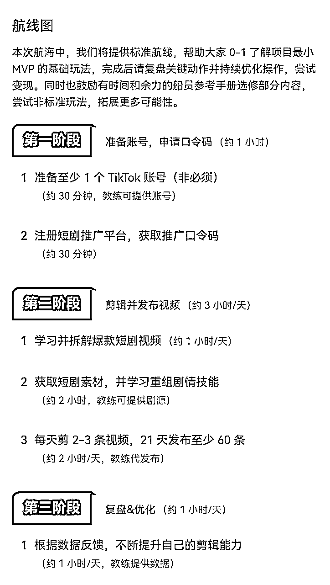

航线图与手册彼此对应，你可以按当前环节去学对应步骤。图中任务建议在航海前两周完成；全部走完后，以实操为主，持续每天输出 2—3 条质量更高的片子，把曝光和转化往上推。

# 必修篇：先跑通最小闭环

#### 本章要点

这一章从认识 TikTok 出海短剧市场起步，带你一步步走完 CPS 项目流程。照本章操作，可完成最小 MVP 的验证。

新手正式开剪前，建议先看项目全貌：【项目概述】了解 TikTok 海外短剧 CPS 项目。

对项目有整体印象后，再按核心步骤推进：

【实操 1/3】前期准备

【实操 2/3】剪辑并发布视频

【实操 3/3】复盘&优化

结算收益

必修篇里，航线图与手册顺序一一对应，顺着读就能逐项完成任务。后面每个关键步骤的章节要点也会提示对应航线图，帮你对照进度。

下面正式开始。

## 一、【项目全貌】看懂 TikTok 海外短剧 CPS 模式

#### 本章要点

这一章先把项目轮廓看清：短剧赛道现在什么状态？新手怎样入门？爆款片段长什么样？这些问题都会在后面展开。本期航海的核心，是带大家从 0 到 1 跑通 TikTok 海外短剧项目，所以先建立整体认知很有必要。往下看。

### 1.1 这个 CPS 项目究竟怎么玩

刷短视频时，你可能见过那种几分钟一集、剧情连续的内容，像小说又像剧集，这就是短剧。

短剧 CPS 说到底是推广分佣：平台根据你带来的短剧付费结果，按约定比例结算佣金。你把专属口令嵌进剪辑成片，观众下载 App、填入口令、付费追剧，你就能获得较高分成。在 Myst Series，佣金上限可到 70%。

海外玩法与国内底层逻辑一致：先做短剧素材二创，再发到 TikTok 等平台；成片里放入口令码；用户下载 App、输入口令、观看并充值后，你拿佣金。

流程可记成五步：

1. 准备 TikTok 号（教练可提供）

2. 到推广平台申领专属口令

3. 参考热门样本剪片，并把口令贴片进画面

4. 发布到 TikTok（教练可代发）

5. 引流转化，等待收益

### 1.2 短剧赛道拆解

#### 1.2.1 市场走势与窗口

2023 年双十一有个现象值得琢磨：最抢眼的爆款不是实物商品，而是“短剧”这个内容品类。电商平台从 10 月就开打流量战，应用商店榜单却被短剧 App 占据。

行业增速很猛：2023 年 6 月，国内全平台付费短剧日均消耗约 4000 万元；到 10 月已到 6000 万元区间，涨幅约五成；国庆假期峰值一度突破 1 亿元。所谓“消耗”，可以理解为广告主按转化效果实际掏出的投放费用。

2023 年中国短剧市场规模达到 373.9 亿元，增速超出预期；结合数据与趋势判断，2024 年可能超过 500 亿元。这意味着短剧仍会保持较强增长，机遇和挑战并存。国内市场的成功，验证了短剧这种内容形态的潜力和受众基础，也带动海外市场继续扩张。

#### 1.2.2 海外 CPS 的收益空间

做海外市场，可利用区域差异避开国内拥挤竞争，触达更广人群，收益机会也更大。

海外短剧单价普遍高于国内。国内获客约 5 元/人，美区成本是国内的 20 倍以上，平台竞争有多激烈不难想象；而平台不计成本抢用户，恰恰意味着个人分成空间被撑大。现在正是较好的进场时点。

目前我们带得比较成熟的代理，单账号月均收入在 8k—12k（仅供参考），上限不封顶。

下面放一张代理收入截图作参考：

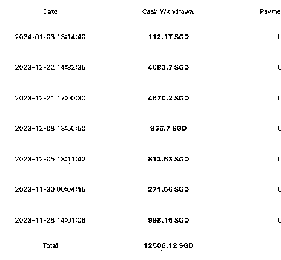

（收益后台截图示意）

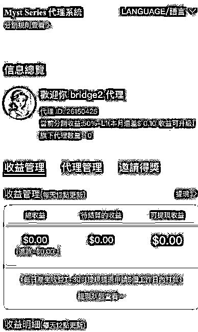

左侧为旧版收益后台，右侧为新的代理系统后台；新后台是为本期航海单独搭建的。

#### 1.2.3 海外短剧用户画像

目标受众锁定美区女性。国内短剧早期靠下沉市场起量，欧美则不同，影视消费中坚是中产女性。受政治正确等多重因素影响，六大制片厂不少剧集围绕大女主奋斗展开，反而给“小女人叙事”留出缝隙——甜宠、复仇等情节因此有空间。美国南部还有大量黑人家庭主妇，偏爱灰姑娘式爱情，是重要受众。想更深入看行业，可翻阅完整版：短剧行业透析 @沐泽。

### 1.3 海外爆款短剧的四个抓手

结合海外用户特征，用国内原片做二创时，内容上要盯住：

1）女性向题材的情绪共鸣

2）不踩国外政治正确雷区

3）配好英文字幕

4）避开血腥、暴力画面

展开见【章节 3.4.5 剪辑注意事项】。下面是海外二创的常见形态，以及用户评论反馈，可直观感受：

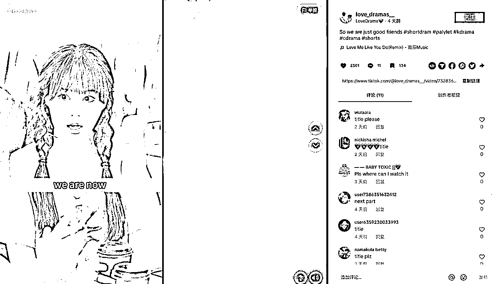

TikTok 上目前跑得较好的短剧片段，列几条供你体会：

Download (28).mp4【在线播放】

Download (29).mp4【在线播放】

Download (30).mp4【在线播放】

看完会发现：这些内容本身未必比国内高一个层级，但加了翻译、能喂给美国观众，播放量就起来了。

### 1.4 谁适合做，门槛在哪

## 二、【实操 1/3】动手前要备什么

#### 本章要点

了解完项目全貌，就要正式启动。开剪之前需备三样：

1. TikTok 号（非必须）

2. 能访问海外网络的设备（非必须）

3. 推广平台的专属口令（关键）

多数人缺前两项，所以本期教练会提供现成的高权重美区号，并由团队代管。船员只需把专属口令剪进视频；用户通过你的口令下载短剧 App 并产生付费，你就有分成。

拿到口令，才算真正迈进海外短剧 CPS 的门。

#### 本章航线图

学完并做完本章，即可完成航线图第一阶段：备号、领口令（约 1 小时）

1. 至少准备 1 个 TikTok 号（非必须）（约 30 分钟）

2. 注册推广平台，领取推广口令（约 30 分钟）

快去领你的专属口令，拿下这个项目的入场券。

### 2.1 硬件准备 @思蒙

#### 2.1.1 剪辑工具

手机、电脑都行，顺手优先。苹果建议 7 代以上，重点是用剪辑工具不卡；安卓机型杂，别太老旧，能流畅跑【剪映】即可；Windows 或 Mac 同理，带得动【剪映】就行。

#### 2.1.2 网络环境

本期账号由教练提供，代发和数据拉取也由团队处理，所以你不用操心网络。若想自己开号运营，则需自行配置网络，保证 TikTok 能稳定打开；细节不展开。

### 2.2 账号搭建（可选） @思蒙 @Bridge

本期会给现成的高权重美区 TikTok 号，你交素材，团队代管，不必自己备号。

新手建议直接用教练号，原因有三：

1. 自己注册海外产品比较麻烦；

2. 新注册号被限流的概率很大；

3. 教练手里有养过的老号，你的视频可分发到多个号，降低因账号问题做不起来的风险，你集中优化内容即可。

若想自己搭，可参考下面流程：

#### 2.2.1 账号注册

注册 TikTok（有条件者）需准备相应条件。

老号怎么判断？

这里容易误解：很多人把“注册久”当老号，TK 不是这个逻辑。发过几百条、粉丝只有几百几千，仍可能算新号，因为账号没打上清晰标签。真正值钱的老号，是在某一内容领域已有标签、粉丝量到几万的那种。若你要切到关联不强的赛道，最好重新起号；比如原号有 5 万粉，换方向后至少也要 5 万粉才能抵消迁移损耗。

最推荐的号：注册满 3 个月、发布内容不多，通常更容易过 TK 风控；TK 对白号和新号审得很严。白号就是无内容、无粉丝、无点赞评论的空号。

前提是不违规。TK 三次违规会永久封号，机会要珍惜。

另有一个隐藏现象：少数号天生流量高 3~5 倍，圈内叫【天选号】。个人很难筛出来，需要海量数据，可遇不可求。教练会留一些给表现突出的学员。

#### 2.2.2 账号定位

短剧分男频、女频。男频通常男主视角，逆袭打脸，男性受众多；女频通常女主视角，有心机女二，情感线为主，女性受众多。

先定方向，一个号尽量只做一个。我们导流平台主要面向美区女性，所以建议用女频素材，转化更顺。

内容来源：《短剧推广：每天 1-2 条视频，单个账号月变现 1w+经验复盘》

#### 2.2.3 账号设置

按需要设三项：头像、昵称、简介。

头像：去📕/Ins 找顺眼的男生女生图，或可爱有趣图，文件最好 100k 以上；会用 MJ、ChatGPT 也可自己生成。

昵称：网上挑喜欢的英文名，并让人一眼看出是短剧号，例如 ShortTV_Lee / ShortDrama_CC / CDrama_Clone / KakosTV 等。

简介：写欢迎订阅，例如 “Welcome! Subscribe and I’ll keep updating daily.”

注意：新号别频繁改资料。

仍不会设？找同行。搜 #ShortDrama、#ShortTV、#CDrama 等标签，看到合适就模仿。这些细节几分钟搞定，别耗太多时间：

内容来源：《目前为止最详细的【短剧推广实操手册】，没有之一！》《短剧 CPS，小白也能月入过万的蓝海项目》

#### 2.2.4 养号这件事

TK 养号不是三言两语的事，先引入“账号权重”这个概念。

新号想快速度过冷启动，别急着换头像、改简介、发作品。先把自己当成普通观众，在 TK 里刷视频、点红心，连续做满七八天，账号评分通常就能站到及格线以上。反过来，如果一开始网络环境就不干净，后面养再久也容易白忙：分数可能长期卡在二十到三十分，新作品不是挂零就是只有几十次播放。

教你两个土办法自测。第一，养号期间顺手点关注；如果系统一天只让你关注不到三十人，基本说明号还在限流池里，没养熟。第二，用手机实拍一条随手视频试水；播放能过三百，通常代表账号已经回到六十分以上，可以开始正常发内容。分数不是刻死的，遇到拿不准的情况，直接在群里举手问教练。教练亲手带过的 TK 号超过一万个，处理这类问题经验很足。

### 2.3 口令码怎么领

Myst Series 是近期冒出的海外短剧推广平台，想靠短剧变现，可以按下面流程注册并启用。

先打开 Myst Series 代理平台（平台链接：https://msh5.tritzoom.com/?invite_code=TBSVA），照页面提示开号。注册完成后点进「邀请得奖」，在第二、第三种邀请方式里找到自己的【口令码】——邀请码、搜索码都算你的口令码。它是流量变现的唯一凭据，别抄错。

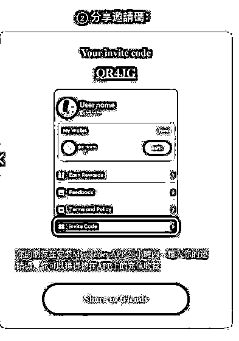

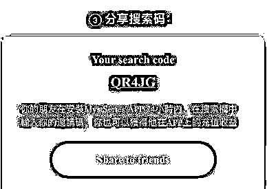

用户进了短剧推广 APP 后，只有在搜索框查这个码，或在邀请码位置填它，系统才认定人是你带来的；之后他每次充值都会记到你名下。怎么把口令码塞进 TikTok 短视频，放到【章节 3.4.4 在视频中植入广告】细讲。

## 三、【实操 2/3】剪片与发布

#### 本章要点

拿到推广平台专属口令码后，就能进入剪片环节，流程拆成几步。怕大家踩版权坑，教练会备好一批可用的正版剧源，也会整理 TikTok 上跑得好的短片供参考。新手前期最省力的起量方式，是照着爆款做一比一仿剪。务必记住：成片里要带口令码，不然播放再高也变不了现。另外，发在 TikTok 的内容别同步到抖音，免得 TK 号被降权。

#### 本章任务表

学完并练完这一章，航线图第二段“剪辑并发布视频”就算完成（约 3 小时/天）。

1. 拆热门短剧视频，学结构（约 1 小时/天）
2. 拿剧源，练剧情重组（约 2 小时，教练可给剧源）
3. 日更 2-3 条，二十一天内发满 60 条（约 2 小时/天，教练可代发）

先动手剪第一条吧，别只顾数量，成片质量更值得磨。

### 3.1 挑短剧：先找能打的

#### 3.1.1 平台热榜先扫一遍

本期教练已经把近期热度高、ROI 不错的剧筛成清单。剧集优选-MystSeries，详见文档：剧集优选-MystSeries。有兴趣的船员，也可以去国内“麻雀”“创作猫”看看市场在推什么，当作选剧参考。

先看麻雀。它有【热门短剧】标签页，会挂出最近火的剧；下面带筛选，能按剧场、时间范围过滤。建议先圈七天内的新热剧，男频就只看男频，女频就只看女频。

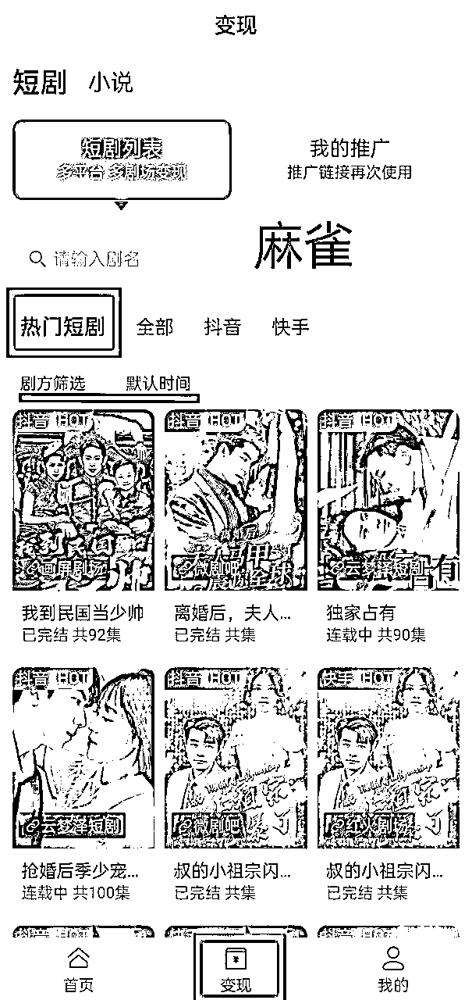

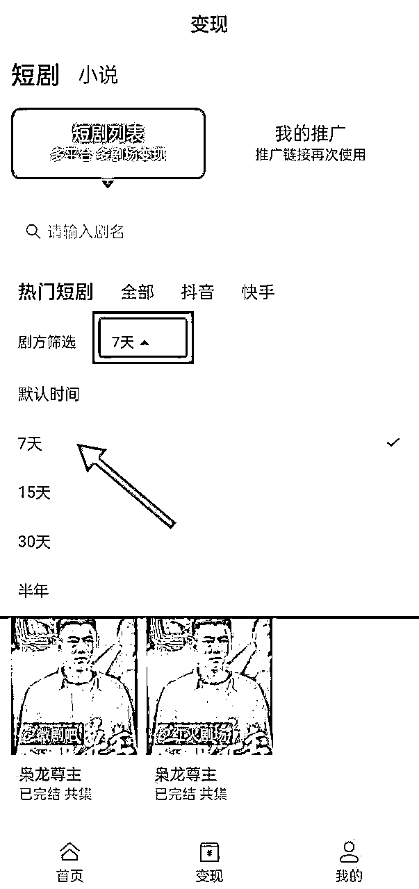

七天内冒头的热剧，大多能直接用。碰上特别能打的，时间可以放宽，比如之前连火几个月的《顾少的隐婚罪妻》。右侧【全部】标签也能翻最新上架的剧。有人偏爱追新，觉得越新竞争越小、越容易起量。可平台几乎天天上新，不是每部新剧都能成爆款。我们要追的是“已经火”，不是“刚上线”；跟着平台口味走，做观众爱看的，流量才愿意来。

创作猫分成“最新热剧”“爆款推荐”“超高转化”三块。按上面的逻辑，刚火的新热剧优先于火过的老热剧，所以先翻“最新热剧”，再考虑后两个。

把两边热榜放一起看，眼尖的人会发现一部重合剧——《叔的小祖宗闪婚后宠爆了》。为什么两平台榜单不完全一样？因为剧场授权、推广用户量、粉丝盘不同，数据会有出入。但一部剧能同时被两边收进热推，说明它的市场反馈很硬。

延伸话题：【爆剧】和【新剧】怎么选？我的经验：

① 先做爆剧：被验证过的热剧优先于新剧
② 若两部爆剧热度接近：刚爆的新剧优先于爆过的老剧

整体顺序：刚爆的新剧 ＞ 爆过的老剧 ＞ 还没验证的新剧。

参考：猫柠关于爆款短剧选择的分享。

#### 3.1.2 从爆款视频倒推剧名

“火过的内容还会再火”，这条规律放哪个赛道都成立。去各大短视频平台搜短剧，看最近哪部剧热度高。考虑到部分船员看海外信息不方便，教练已经筛好并下载了一批 TikTok 热门短剧视频，供参考：

链接: https://pan.baidu.com/s/1_TfvRcDvDZp974wh5JUWlg?pwd=6687
提取码: 6687

有条件的船员，也可以直接研究下面几个海外短剧账号。想练自己找爆款的本事，可以按下面的国内方法操作。优质对标视频通常要满足几个条件。搜索词可用：短剧、九州小剧场、抖音短剧、抖音短剧新番计划、触摸短剧、超爽短剧、热门短剧、短剧推荐、好剧推荐、热门短剧推荐、因为一个片段看了整部剧……等。以【抖音】为例：输入关键词后，在结果页筛选，排序选“最多点赞”，发布时间选“一天内/一周内”。

近期热门短剧一般符合下面两个特征。再看一个例子，同样方法搜，能找到《慕总的隐婚罪妻》和《医王龙婿》，点赞高、相关视频多，所以女频可做前者，男频可做后者。

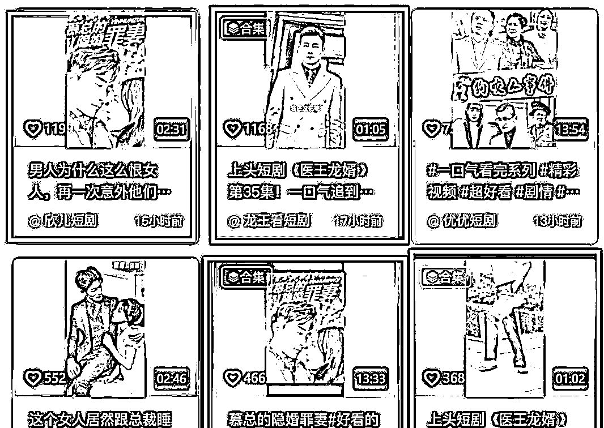

筛选时先看一天内的数据；没有合适的，再放到一周内，或者换关键词继续搜，直到点赞量和视频占比都顺眼。其他短视频平台同理。如果抖音关键词筛出的剧，刚好也在麻雀、创作猫热推里，说明它很稳，优先做这种被多路验证过的剧。碰到数据不错的剧，重点看这几点。以《顾少的隐婚罪妻》为例，搜索结果如下：

点赞成千上万的，基本是被市场跑过的爆款，可以放心选。之后照着爆款剪，通常开头和结尾能直接一比一搬，中间剧情再按自己的思路调整。

参考：短剧CPS相关复盘与猫柠的选剧分享等。

### 3.2 剧源从哪来

#### 3.2.1 淘宝、拼多多买

#### 3.2.2 抖音、快手扒爆款

这条路最接地气，也是多数人常用的方式。

#### 3.2.3 教练给正版剧源

本期航海，教练会发一份内部剧源资料，直接拿来用。剧集优选-MystSeries，详见文档：剧集优选-MystSeries

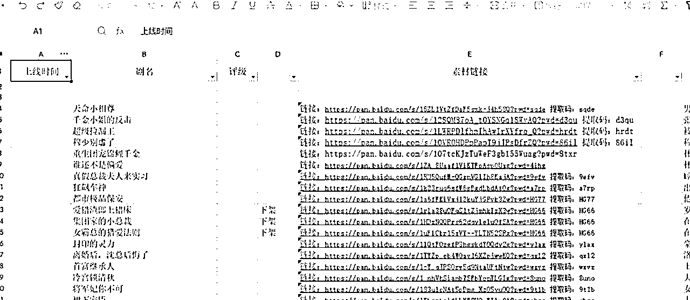

### 3.3 剧情怎么重新拼

#### 3.3.1 剧情为什么决定成败 @思蒙

「短剧 CPS」有两个重点：选剧＋抓剧情。选剧像选品，是项目地基；剧情把控决定创作思路。刚入门、不会选也不会创作时，先做一件事：模仿。跟着最热的剧、最火的模板剪。选剧方法前面【章节 3.1 选择适合推广的短剧】讲过。后期可以沿着爆款思路，把经验用进去，按剧情逻辑设计新剪法，让同一部剧变出多个故事。

短剧能火，是因为它合平台口味，也合观众对内容形式的预期。它绕不开的核心情绪就是“爽”。别把自己的感受带进去，嫌这里假、那里作；目标用户可能和我们不在一个认知频道，要站到观众那边想。剪的时候围着“爽”做：赢要爽，虐要爽，打脸要爽，复仇也要爽……情绪越冲，观众越容易停下来。播放高的剧，一定是某个情绪点被剪中了。找到这个点，就反复用，用到它没价值为止——通常很难失效。

剪剧情时，把作品拆成开头、中间、结尾。开头是黄金五秒，要拉停留，必须精彩；中间不是爽就是惨，起伏要抓人；结尾留钩子提转化，不会就学电视剧每集收尾。总时长控在三到六分钟。重组剧情剪片，基本都绕不开这套内核。

参考：思蒙 5 月 23 日《短剧 CPS 的项目现状及航行路径》分享。

#### 3.3.2 快速重组的土办法

新手前期对剧情和受众还不熟，最快上手就是找对标视频，一比一仿剪。对标爆款可在【章节 3.1.2 从爆款短视频反推爆款短剧】里找，主要包括教练给的 TikTok 爆款短视频网盘，以及自己找爆款的方法。找到后，前期直接仿，后期再适当创新。仿的时候主要看视频这几个维度。对标看多了会发现，爆款都类似，甚至开头几乎一样；前面几个万赞视频甚至只是做了去重。所以不知道一部剧怎么剪时，找对标、多看多学，手感自然出来。建议积累一定经验后，再去学剧情重组的爆款逻辑，提升做爆款的能力（详见选修篇【章节六：剧情拼接的能力进阶】）。

参考：短剧推广相关复盘文。

#### 3.3.3 案例拆解

拿《顾少的隐婚罪妻》举例：每次参考完爆款，我会把对标用到的片段整理出来，按“开头、冲突、结尾”分类，总结出常用片段；再把这些片段排列组合，就能拼出很多内容。因为片段都经过验证，排出来的视频播放一般不会差：

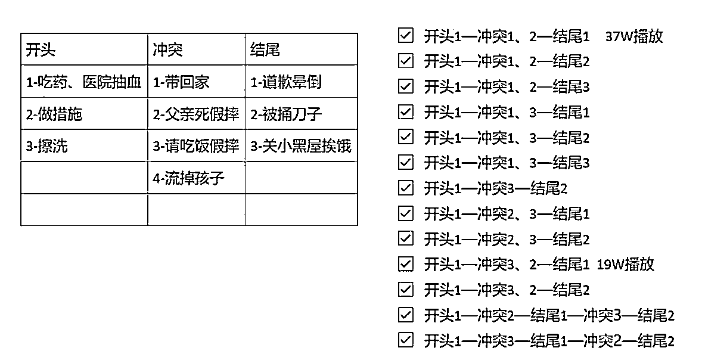

经过剪辑，这条视频最终的剧情结构如下。这个版本加了旁白解说，不加解说，原理也一样。

参考：短剧推广实操与CPS收益复盘等材料。

### 3.4 动手剪

在 TK 上跑得动的短剧成片，常见做法有三种。

第一种：原声＋英文字幕
素材：原声+字幕.mp4【在线播放】

第二种：英文朗读配音＋部分消音＋英文字幕
素材：英文配音+英文字幕.mp4【在线播放】

第三种：全消音＋英文字幕
素材：全消音+英文字幕.mp4【在线播放】

#### 3.4.1 剪辑软件

新手优先用“剪映”，上手简单。后面的操作也围绕它展开。软件地址：https://www.capcut.cn/

#### 3.4.2 字幕翻译方案

剪映的【翻译字幕】是 VIP 功能，【双语字幕】还在内测，只对部分人开放。先查自己有没有这个功能（路径：文字-智能字幕）。没有的话，走下面这套【SRT 文件】翻译流程：

① 用剪映智能字幕先识别视频字幕；

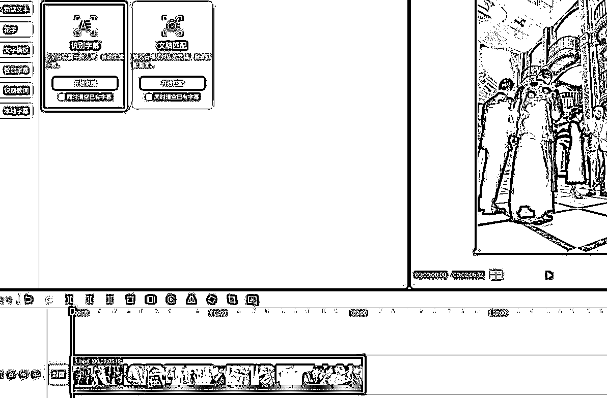

② 导出字幕时选“导出字幕 SRT 文件”；

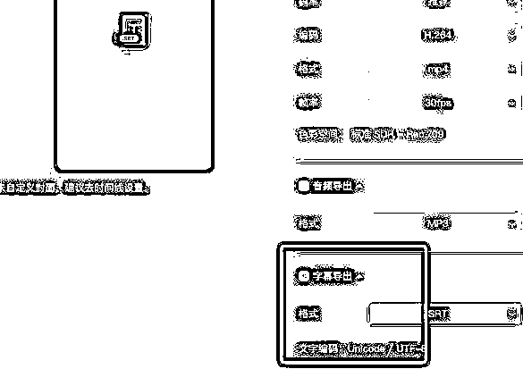

③ 打开导出的字幕，把文字复制到 ChatGPT、有道词典或谷歌翻译；

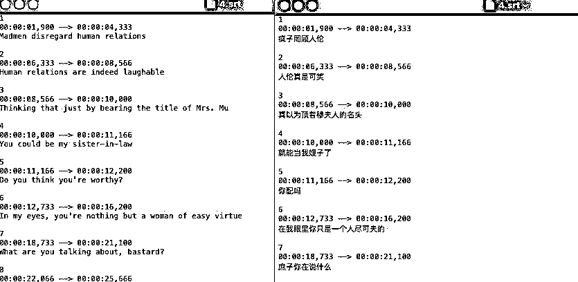

④ 把译好的文本复制回原 SRT 文件；
⑤ 再把 SRT 文件导回剪映工程，就能得到英文字幕。

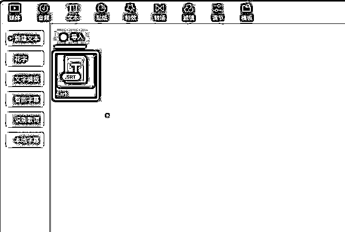

注意：机翻英文通常比较生硬，而且分不清他/她/它和人名，需要再仔细校一遍。

#### 3.4.3 基础剪辑操作

#### 3.4.3.1 视频基本要求

TikTok 短视频要满足以下标准：

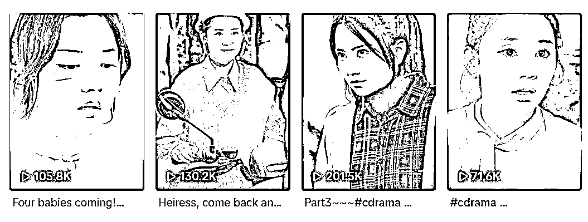

#### 3.4.3.2 剪辑模板

**类型一：截取原片高能片段**

这种玩法是直接截短剧里节奏紧、情绪强的片段，当短视频发，操作最简单。注意：截的内容要够精彩，时长控在一到三分钟；最关键的是做去重。下面结合实例说明。

① 找原素材

原视频地址如下：8.48 YzG:/ 12/25 G@V.yg # 女儿再原谅我一次 # 百亿好剧好看计划 # 因为一个片段看了整部剧 # 抖音短剧新番计划 # 热门短剧推荐 https://v.douyin.com/iLSWcokj/ 复制此链接，打开 Dou 音搜索，直接观看视频！

② 下载素材并导入剪映

把素材下载到设备后，直接拖进剪映。

③ 截取精彩片段

这段素材的 0′0″~1′32″ 是精彩部分，直接截这个时间段，就能做出一条不错的短视频。

④ 去重（加调节和特效）

截完后，用调节＋特效做去重。

1）调节选择：

在调节栏选“自定义调节”，把调节条拖进轨道，参数设为：色温、色调各 -5，饱和度 +10，亮度 +3，对比度 +7，锐化 +10，清晰 +10。点保存预设，之后每条视频都能套同一套。

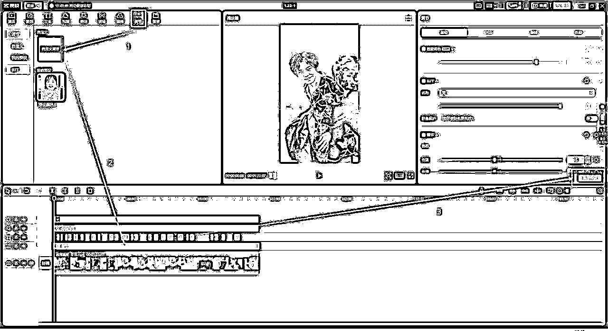

2）特效选择：

特效库选“金粉闪闪”，不透明度 30，滤镜 0，速度 10；贴纸栏搜“蝴蝶”，要带动效的，大小 40，放视频右下角。

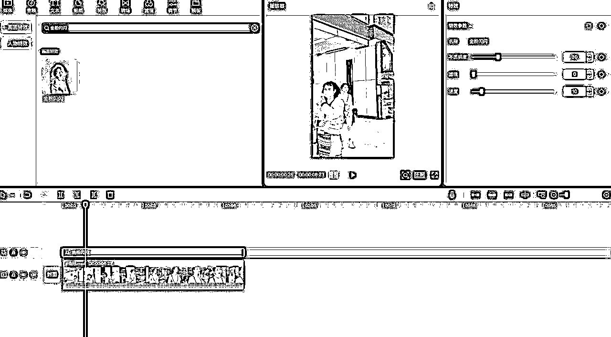

⑤ 检查画质

原片画质糊的话，可以在剪映里处理（VIP 功能）。

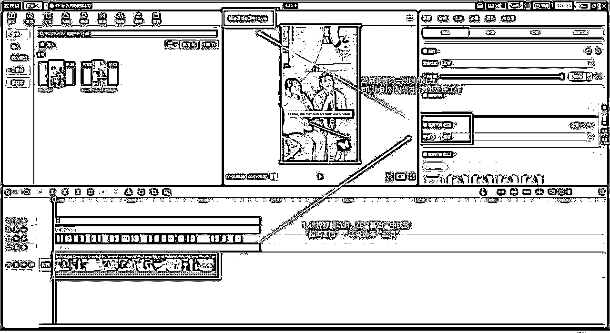

⑥ 加字幕

1）先用蒙版把原字幕遮掉

2）加蒙版后的效果如下

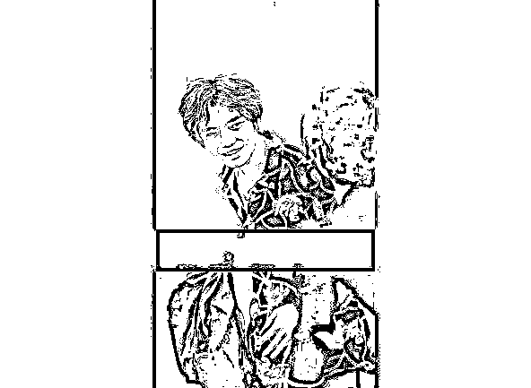

3）填充视频背景

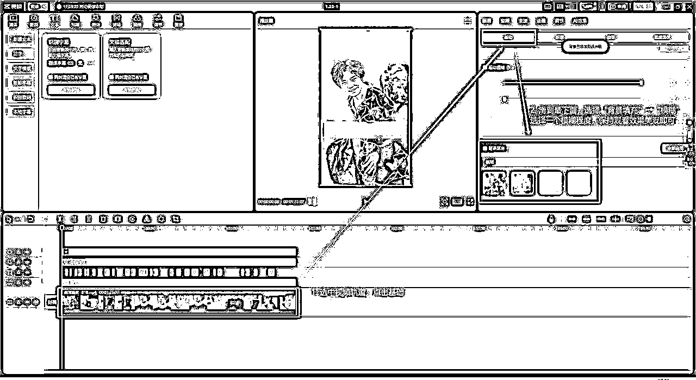

4）加字幕

在剪映里选“文本 - 智能字幕”，识别并译成英文（这是 VIP 功能，没有 VIP 就按【3.4.2 翻译工具】操作）。

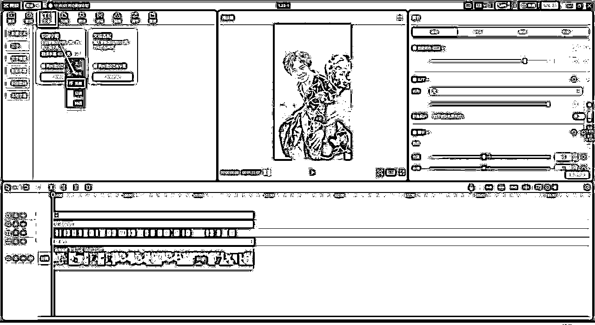

字幕高度设到 -560 上下，比较适合 TikTok 页面观看。

⑦ 导出

这类视频不用额外加 BGM，保留原声直接导出，就是一条合格素材。

**类型二：短剧解说型**

这种类型是“短剧画面＋前几秒抓眼文案”，用来拉高观众的观看欲望。

# 短剧出海实操：3分钟成片、贴片广告与播放量复盘

做 TikTok 海外短剧 CPS，有三个硬规矩得先刻在脑子里：成片时长别超过 3 分钟；开头那段解说必须勾人，而且跟画面紧密挂钩；整个流程里，规避重复判定是头等大事。下面按实操顺序，把从剪辑到结算的整条链路讲透。

## 解说混剪怎么剪：一个完整示例

先拿“解说混剪”走一遍流程。原片地址：看计划 # 因为一个片段看了整部剧 # 抖音短剧新番计划 # 热门短剧推荐 https://v.douyin.com/iLSWcokj/ 复制此链接，打开 Dou 音搜索，直接观看视频！

素材存到本地后，放进剪映。取 1′34″~3′27″ 这个区间作为成片内容，片头配一句解说：“假女儿受了委屈，真女儿被推下水，真相揭开后她会怎么反击？”随后做去重处理——加调节、加特效；画质提到超清；原字幕处理完再补英文字幕；最后选中文案，在参数区找到【朗读】，声音选【商务殷语】。

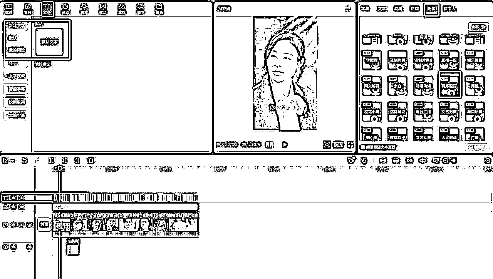

解说类视频有个额外动作：解说段落要铺 BGM，同时把原声抹掉。纯音乐【她的微笑】是个选项。配乐得跟着画面情绪走——画面舒缓唯美，挑温馨轻快的曲子；画面紧张刺激，就换节奏更冲的音乐。

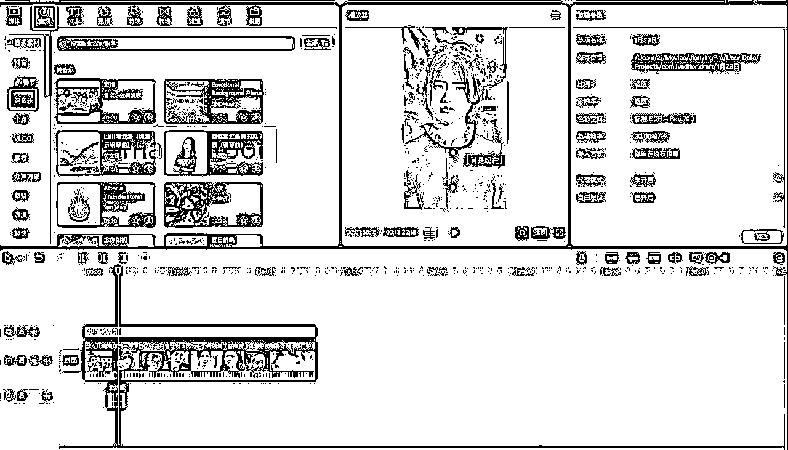
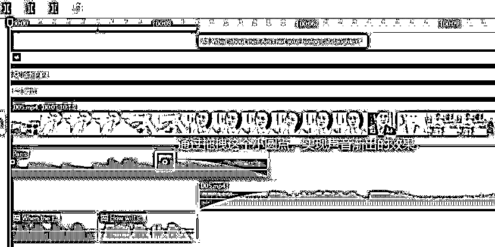

### 类型三：原片二创型

这类玩法是在原片基础上做二次加工，靠几项简单编辑就能出片。成片同样压进 3 分钟，故事得讲圆，规避重复依然是第一优先级。

原片地址：6.10 H@v.fB 02/06 tRK:/ 前任一哭，现任必输。# 前任 https://v.douyin.com/iLScswX3/ 复制此链接，打开 Dou 音搜索，直接观看视频！

下载完放进剪映。这条素材在 2′52″ 之前已经是一个完整小故事，所以只取 2′52″ 以前的部分，男主跟女二出门那段就切掉，后面全部舍弃，音轨也一并去掉，输出纯音乐版本。具体操作：在操作区右键素材，选分离音频，把分离出来的音轨删掉。

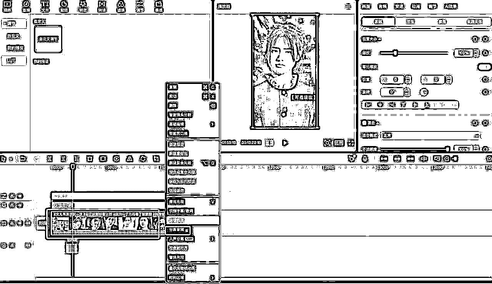

后面的步骤照旧：加调节和特效做去重；画质调超清；处理原字幕、补英文字幕；最后配 BGM。剪映音频栏搜“Sweet but psycho”，演唱者挑苏瞳。

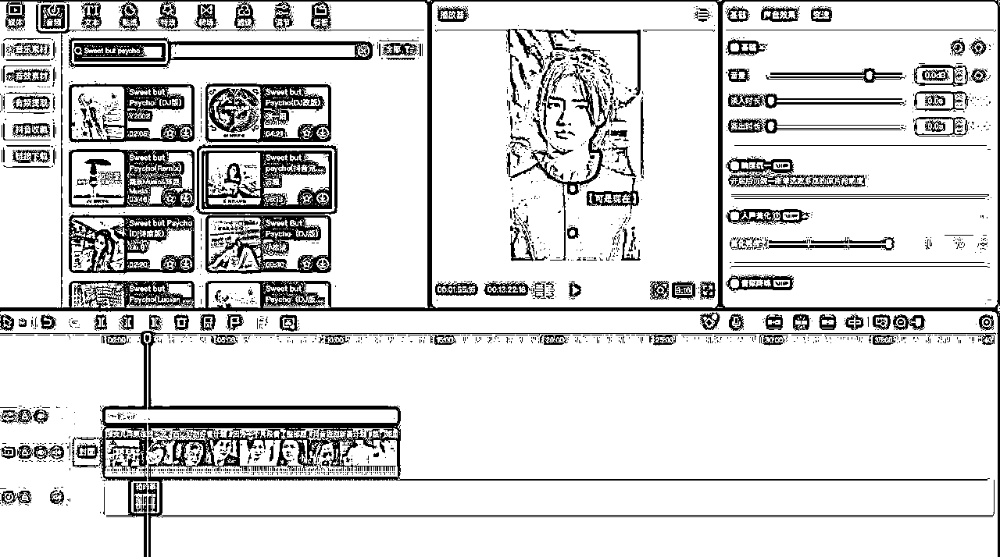

#### 3.4.4 把口令码广告嵌进视频

这一步分量很重——把【口令码】嵌到视频画面里。贴片位置放准之后，你的视频会源源不断把流量导向短剧推广 APP，用户拿着搜索框输入你的口令码，他之后在 App 里花的每一笔钱，都会自动分佣进你的账户。

这里要用到【绿幕的使用】：绿幕就是纯绿背景的视频素材，靠剪映“色度抠图”把绿色抠掉，背景就变透明了。“色度抠图”入口见下图。

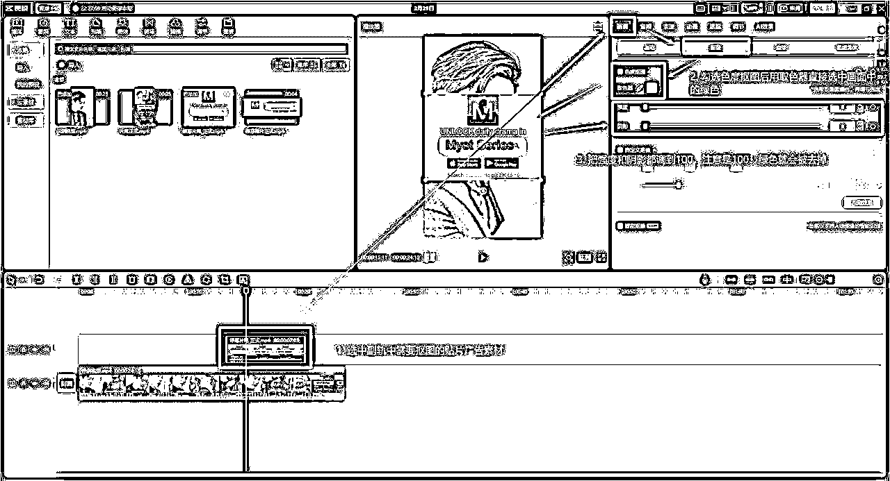

广告贴片绿幕素材和参考示例视频放在网盘，自行领取：

链接：https://pan.baidu.com/s/12EhQnYyA947byNKo5MvqeA?pwd=5a77

提取码：5a77

嵌广告有三种操作路径。

方法一：片尾绿幕贴片广告。从网盘取出“绿幕片尾.mp4”，拖进副轨，摆到视频末尾，尾端与主轨素材齐平；然后色度抠图、调整摆放位置；再打字，把专属【口令码】填在下划线位置，跟贴片素材对齐，调好画面中的位置。（口令码怎么生成，看【2.3 获取短剧推广平台口令码】）

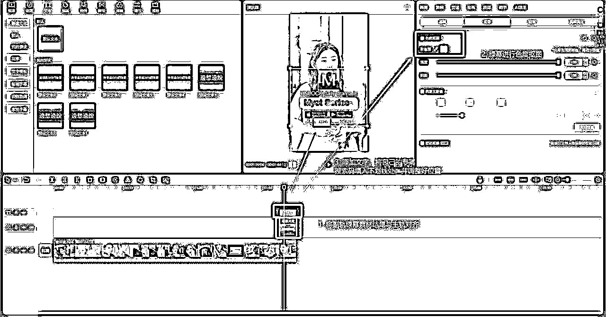
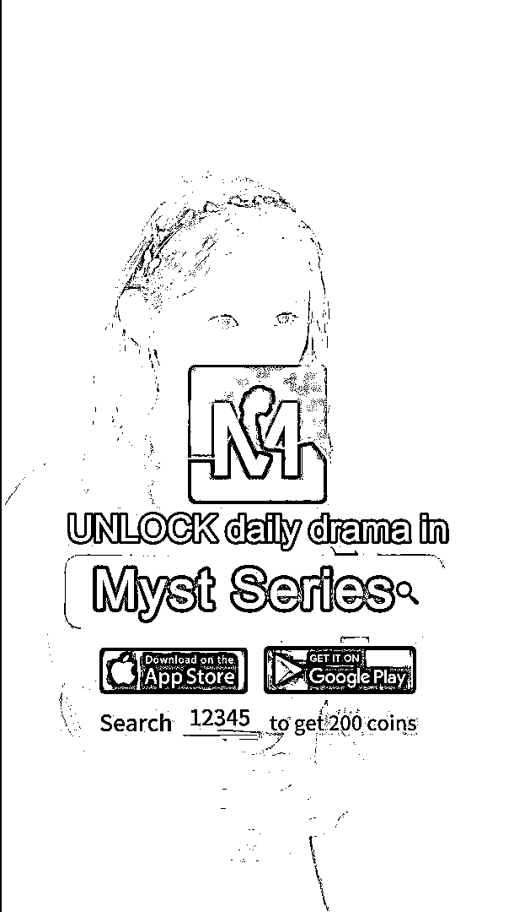

方法二：片尾直接贴广告。把网盘里的“片尾.mp4”直接拖到主轨末端；然后打字，专属【口令码】填进下划线处，跟贴片对齐，位置和字号都调好。（口令码生成同样参考【2.3 获取短剧推广平台口令码】）

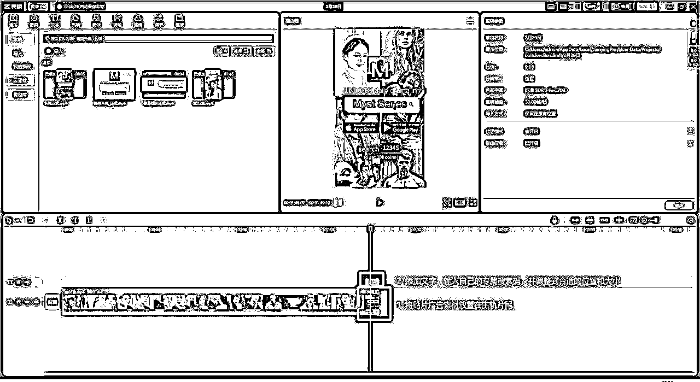

方法三：绿幕插片广告。把“绿幕插片.mp4”拖入副轨，摆到视频第 3 秒附近；色度抠图、调位置；打字，专属搜索码填在下划线处，与贴片对齐并调好位置；之后复制这组文字和广告素材，每隔 10 秒左右再摆一次。

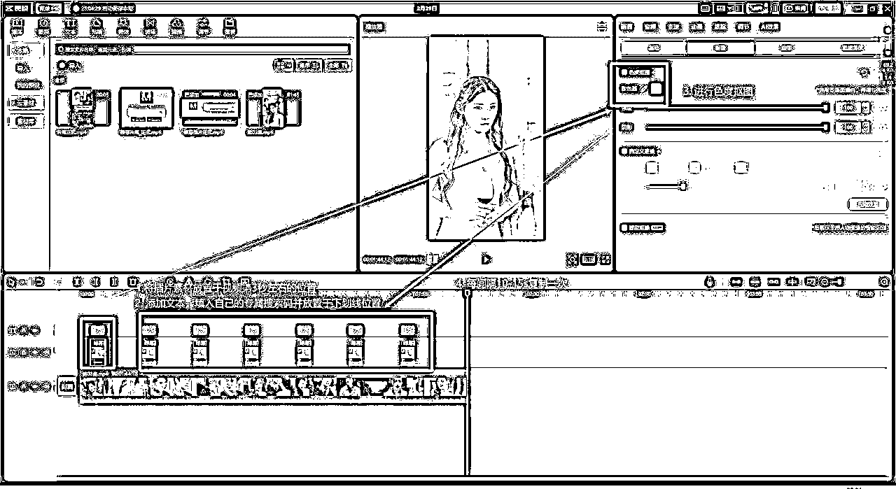

三种方法挑一种用，或者混着用都行。一旦绑定成功，这个用户就跟你终身关联，他以后每一次充值，你都有分成。

#### 3.4.5 剪辑雷区清单

下面每一条都跟流量挂钩，逐条过一遍。

1）题材优先选女频。甜宠、复仇、清新爱恋、虐恋、穿越、重生这类女性向情节更吃香；文化背景别太中式、太玄幻或太垂直——中式宫廷剧、修仙剧这类，美区用户很难代入。

2）本土化要贴合国外政治正确。互相撕扯、打斗、扇耳光这类可能被判定侮辱人格的镜头尽量避开，不然容易吃硬 BAN（视频被藏、记录处罚）或软 BAN（零播放、限流）。

3）剧源不设限。国内那套挂载小程序的思路在这里不适用，我们做的是引流打法——哪部剧精彩就剪哪部，只要题材和内容对上目标用户，把流量圈住、导出去就算赢。当然，去重和原创度不能松。

4）英文字幕翻译是重中之重。TikTok 虽然自带翻译，但体验很差，不做英文翻译大概率没流量；想本地化更彻底，可以把原声全消掉，只留少量英文文案，老外阅读门槛更低，爆款概率也更高。

5）血腥暴力内容坚决不碰。老外对这类画面极度敏感，判了违规申诉都救不回来；账号违规累计到一定次数，直接封号。

6）原片绝不能直接发。素材必须剪过才能上传，直接扔原片到各短视频平台，轻则违规，重则封号。

### 3.5 视频发布环节

#### 3.5.1 发布流程

教练可以代发：剪辑完成的视频上传到【航海群公告】里的飞书表【TK 出海素材提交&反馈表 _3 月航海】即可。教练帮你发到 TikTok 账号，过 1-2 天把视频数据反馈给你。

代发模式下，早期走混发——你的素材可能被分发到多个账号，重点盯的是能不能爆量；这样做是为了让新手更快起量，也让每位伙伴手里都有一个基础量有保障的高权重账号。后续数据明显拔尖的船员，会单独开一个独立账号专门发他的视频。

自己手里有 TikTok 账号的，按正常流程发就行。

#### 3.5.2 发布时的致命雷区

视频别往抖音同步。抖音和 TikTok 共用查重库，你在抖音发过的内容，TikTok 这边会明显降权，收益直接受影响。

## 四、复盘与优化：盯紧播放量

TikTok 海外短剧 CPS 的复盘不复杂，核心就看播放量，用它判断内容是否踩中了爆款剧情逻辑。

基准线：单条视频播放量 1k＋。长期够不到这条线，说明剪辑还有不小进步空间，得多拆解爆款、多练手。

爆款线：单条 10k＋算小爆款。每周都能出小爆款，涨粉和导量才有保障。

完成本章学习和实操，航线图第三阶段“复盘&优化”就算走完了，大约每天 1 小时。根据数据反馈持续打磨剪辑水平，多看、多学、多剪，教练会提供数据支持。

### 4.1 数据查看路径

用教练账号的：教练团队每隔 1~2 天更新一次船员视频数据（播放量）及对应视频链接，更新位置在【航海群公告】的飞书表【TK 出海素材提交&反馈表 _3 月航海】。

用自己账号的：直接进 TikTok 看自己账号的视频播放量。

### 4.2 播放量怎么看

海外 TikTok 的推流机制不用钻太深，这个项目只盯一个指标：播放量。它最能直观反映内容受不受欢迎。

基准线：按规范剪出来的合格视频，播放量通常能到 1k＋；长期摸不到这条线，说明提升空间还很大。

爆款线：单条 10k＋算小爆款，要求每周都有小爆款冒出来。TikTok 上有爆款，涨粉、导量才跑得动。

## 五、收益结算

### 5.1 分佣比例与等级

登录代理后台，能看到自己的分佣比例。代理等级不同，分润比例也不同。

实际到手的收益，要先扣掉 30% 的苹果/安卓支付渠道费，再扣用户所在国家的各项税收。

举个例子：用户在平台消费 10 美金，L1 等级代理能拿到 10*（1-0.3-税率）*50% = 3.2~3.5 美金左右。

代理等级按每月收益升级——达到门槛就能升；在航海期间表现突出、频繁出爆款的，教练也会给升级奖励。

注意：只有通过你的邀请、安装 Myst Series APP（见下图）的用户，才算你的拉新用户！

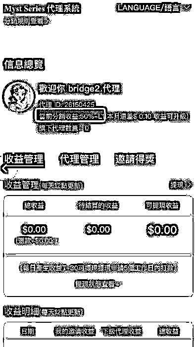

### 5.2 收益在哪看

登录短剧推广后台（https://msh5.tritzoom.com/），进“收益管理”就能看到具体收益，数据每天 12 点刷新。路径：登录账号 -> 收益管理。

### 5.3 结算周期与提现方式

结算周期：T＋30 天。原因是公司财务流程加上应用商店结算需要时间。

结算方式：Paypal 打款，具体金额在推广后台可查；没有 Paypal 的，后台也开了支付宝通道，走支付宝提现即可。

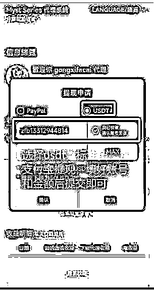

# 选修篇：项目进阶玩法

跑通项目最小 MVP、基本摸清流程之后，可以翻翻选修篇。看看 TikTok 海外短剧这个项目还有哪些放大空间：

- 剧情拼接能力进阶
- 用工具提效
- 借 ChatGPT 辅助产出短剧解说类视频

下面重点拆前两块。

## 六、剧情拼接进阶

循着爆款逻辑，把精彩剧情拼起来。这套玩法要求你对短剧剧情和受众有一定理解，建议学完必修篇、攒够经验再上手。

操作本身不复杂：把整部剧通看一遍——一部剧通常 2 小时以内，2 倍速不到 1 小时就能刷完；熟悉之后用软件 3 倍速甚至 5 倍速快速预览也行。看的时候把精彩点记下来，再把这些片段剪成一条 4-6 分钟的视频。

但“怎么把精彩片段拼成一条视频”，有几个要点得吃透。

### 6.1 爆款结构逻辑

爆款视频守一个原则：开头黄金 5 秒，中段精彩片段，结尾戛然而止。

不管怎么起承转合，模板的内核不变：一虐一反转算一个循环，把观众情绪推上去，最后在反转前刹住，勾着人去看后续。“虐”只是个指代词，跟虐剧无关，任何剧种的剪辑都能套这个循环。

以此为基础，常见爆款剧情归为三类。剪辑时还能拆出更细的主线，比如女主被虐可以细化为：

- 男主直接虐女主，两人正面冲突；
- 女二陷害女主，挑起矛盾；
- 婆媳冲突；
- 拿小孩博同情；
- ……

每条线可以单独拎出来做一条视频，也可以多条线交叉，但过渡得处理好。

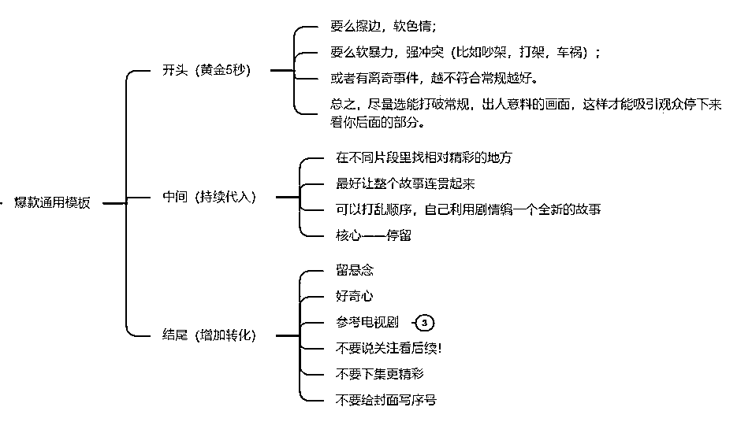

### 6.2 素材怎么挑

按角色选：比如女频，今天剪的情节围绕男女主和恶毒女配，那就选男女主、恶毒女配相关的剧情；如果围绕男女主和婆婆，那就选婆婆相关的，恶毒女配别出现或尽量少出现。一集 5-10 分钟最合适，实在没灵感，剪 3 分钟也行。

按剧情选：按“开幕雷击+虐+小逆袭+虐+小逆袭+虐+悬念”来排。“虐”指的是男主虐女主、女配虐女主、炮灰虐女主，主角处在不利位置；“小逆袭”是女主反击伤害她的人——语言回击、肢体回击，或者男主/旁人替女主说话，都算。很多时候虐和逆袭是连着的。

剪辑时就是反复循环“虐-反转”：剪 2 分钟的视频，中间可能只反转一次，两个循环收尾；剪 10 分钟的视频，5-6 次循环再结束。非必要的过渡剧情全部砍掉，但砍完还得让人看得懂——不能出现“这人是谁、为什么帮主角”这种懵圈感。

这套逻辑玩熟了，剧热不热门对你来说都一样，都能剪出彩，你就是爆款制造机。当然，想熟练套用这个套路，拿到素材先完整看一遍、做好笔记，如图所示：

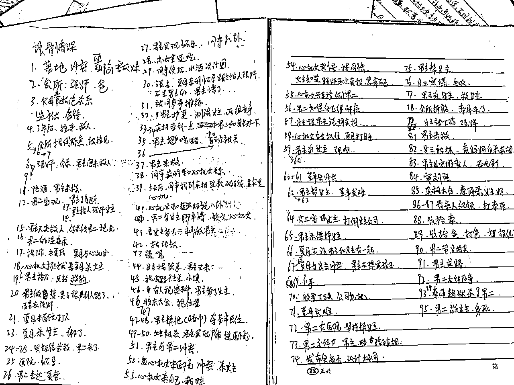

另外，违规尺度得心里有数，拿不准的情节别放。

### 6.3 台词怎么分割

假设有 A、B 两个情节，原剧里 A 在前、B 在后，你剪辑时把 B 提到 A 前面，观看不受影响，那就用 B A 顺序。

具体到一句话也一样：A 句在前、B 句在后，不影响意思就把 B 挪前面。

除此之外，多余的话、无用的话可以删。比如某段情节里男主夸女配、贬低女主，原话是：“我从高中就喜欢你，那时候的你，天真善良，像天使一样。反倒那个顾安然娇蛮任性，让人吵闹。”

第一版保留原话。

第二版：“我从高中就喜欢你，那时候的你，天真善良。反倒那个顾安然娇蛮任性。”

第三版：“我从高中就喜欢你，那时候的你，天真善良。”

第四版：“我从高中就喜欢你。”

换句话说，只要不影响剧情、不影响观看，你完全可以按自己的想法改——这就是台词分割的意义。

## 七、用工具提效

### 7.1 批量下载平台视频素材

推荐一个软件：哼哼猫去水印。

它能够【下载网站上需要会员权限才能观看的视频】，还支持批量提取视频或音频文件，以及网页音频/视频嗅探等功能。

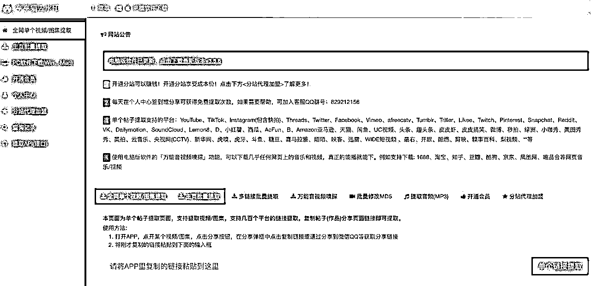

操作说明：

1. 打开哼哼猫客户端

界面上能看到它提供的各项功能，我们主要用到的包括单个链接提取、多链接批量领取、作者主页批量提取、万能音视频嗅探等。软件界面会清楚标注支持下载提取的内容平台，抖音、快手、📕等等都在列。

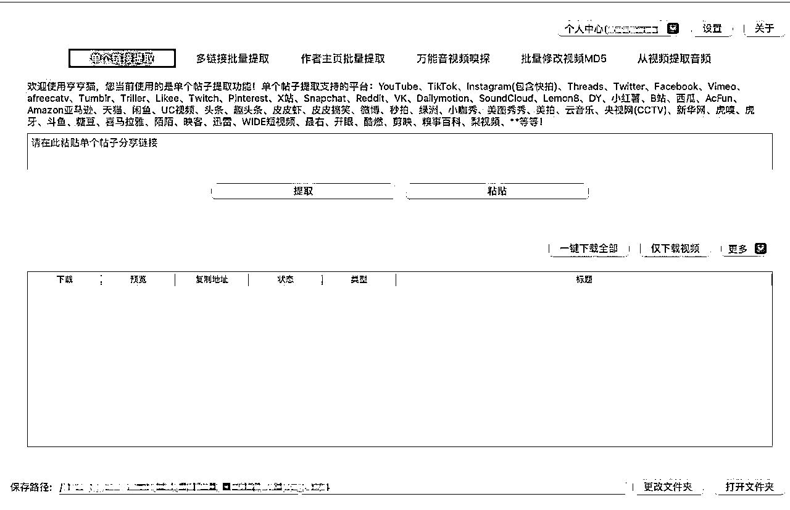

2. 单个视频链接怎么提取

把需要提取的单个视频页面链接粘贴到输入框，点【提取】，拿到视频源文件，再点【一键下载全部】，视频就存到电脑上了。注意：如果是在手机上看快手/抖音，分享出来选【复制链接】，就能拿到视频内容的链接。

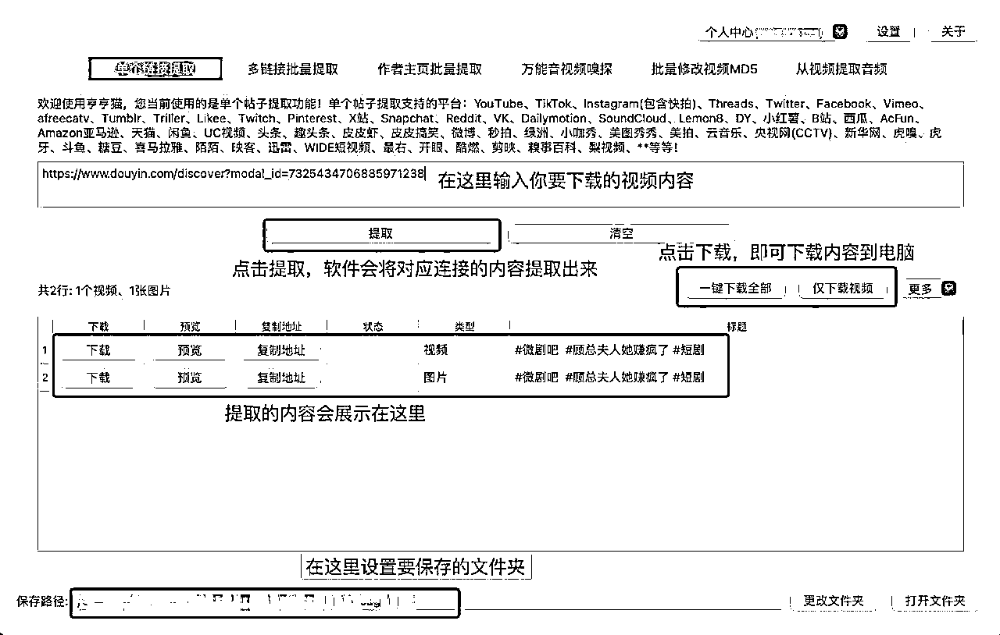

### 3. 一次性搞定多个视频链接

手里攒了一堆视频链接、又懒得挨个处理？这个功能就是为你准备的。把待提取的链接逐一填进输入区域，单次最多放入20条，接下来的操作流程和单独提取完全一样，省心省力。

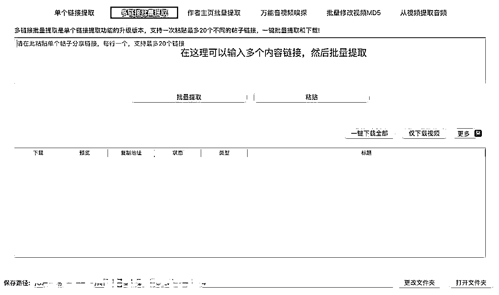

### 4. 作者主页的视频全量抓取

只要你能拿到博主的主页地址，不管对方活跃在快手、抖音还是📕，把这串链接贴进输入框，软件便会自动扫出该博主公开过的全部作品，再一口气都下载好。操作步骤如下：

但有件事得提前打个预防针：内容平台普遍设有反爬虫防线，提取过程偶尔会中途“罢工”。常见的现象是，博主主页明明躺着几百条视频，工具却只捞回几十条，【加载下一页】就再也点不动了。这时候不必干着急，重新触发一次【主页批量提取】按钮，从头再来一遍基本就能恢复正常。

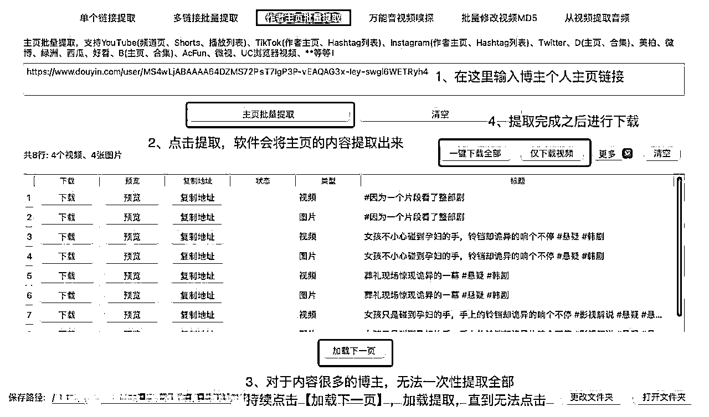

### 5. 音视频万能嗅探工具

假如某个资源用【单个链接提取】始终拿不下来，别硬磕，换这个入口试试。把目标页面的地址贴进输入框，点一下【打开网址】，软件就会自动嗅探页面内嵌的视频、音频资源，并允许你一键保存。

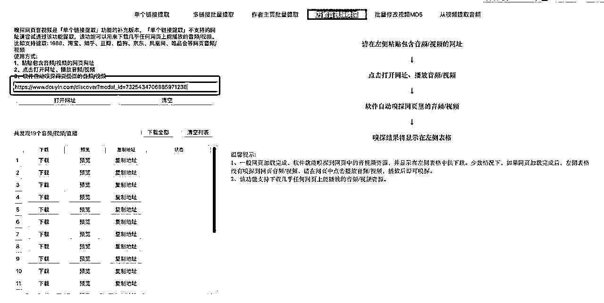

### 7.2 视频去重能力怎么练

去重说到底，是给视频买一道“免限流保险”。作品若与别人重合度太高，一旦被系统判定为抄袭，轻则流量被砍，重则账号直接没了。对于没碰过混剪的新手而言，这道坎确实不好迈。

平台判断抄袭最拿手的方式，莫过于抽帧对比。

所谓视频，其实就是一连串图片快速滚动，其中每一张都叫一帧。

你上传成片后，机器会按规则抓取若干帧画面，拿去和资源库逐一比对。一旦重叠度越过红线，就直接被扣上“搬运”的帽子。

道理说出来不复杂，但真实环境下的检测要精密得多。

所以，去重的根本思路始终是那句：让画面“长”得不像别人，让机器认不出你。

下面这些招数来自几位老师的私藏实战经验，可以参考着用。

crvideomate.rar

#### 7.2.1 去重背后的通用逻辑 @思蒙

不管做哪种短视频项目，去重基本都是一道必答题。

谁要是把这件事理解透，换来的不只是眼下的项目顺风顺水，未来所有与视频相关的活儿都会跟着受益。

奇杰老师早在星球上做过专题分享，建议抽空把那篇内容找出来，静下心研读一遍：

【短视频混剪进阶】单人日产 200 条实战攻略：https://t.zsxq.com/0eHtHeLXs

批量混剪-单人日产 200 条实战教程：https://t.zsxq.com/0eCtPxXXv

此外，真正动手做去重时，请把两句话焊在脑子里：

1是【多不如细】；

2是【副不如主】。

先拆【多不如细】。经常有小伙伴跑来诉苦：“我堆的元素已经不少了啊，怎么原创审核还是不给过？”我一般不急着讲大道理，只回一句话：

去重，拼的不是数量，是细节。

这句话的分量，值得你反复咀嚼三遍。

来，先带你看一张图↓

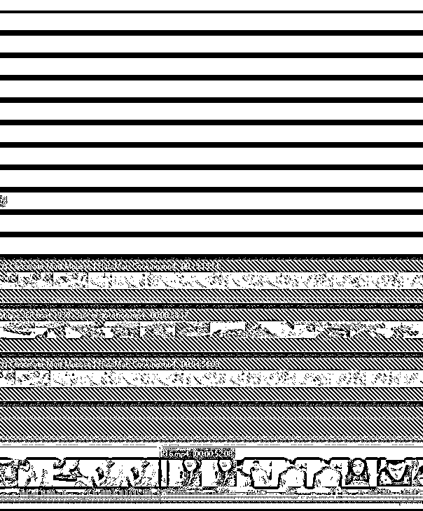

剪映桌面版的工程截图，大家想必都认得。给你5秒钟，说说看——图里做的去重动作，算多不算多？

先按下不表，我们再看另一张：

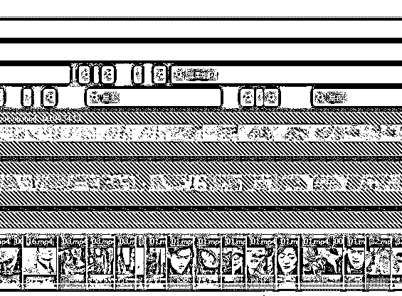

这张是不是看着反而没有上一张热闹？但事实恰恰相反，后者的过审率能把前者甩开一大截。

差别出在哪？

先说特效层：第二份工程里塞满了零碎的短特效，而不是抱着一款效果硬撑到底。这就是“细”的第一层含义——细碎。

再往深了看就明白了：

同样是挂贴纸，第二份工程里几乎是满屏的关键帧。

关键帧是干嘛的？它能把贴纸从“静止装饰”变成“动态角色”——跟着时间线发生位移、旋转、缩放……

运动的画面天然比静止画面更容易骗过算法，这就来到了“细”的第二层含义——细节。

还没完。第二张截图中主轨素材被切得非常频繁，这个习惯有双重收益：

一方面，转场可以塞得更密，等于变相增加了去重素材的密度；另一方面，碎片化的轨道让抽帧也有了更大的施展空间——每20秒截一次图的检测密度，和每60秒才截一次完全不是一个量级。

再补最后一点：主轨本身也不能闲着，缩放、上下左右移动、旋转等变化都要做进去。这是“细”的第三层含义——颗粒度。

【副不如主】又怎么讲？

字面理解：在花费相同精力的情况下，往副轨道糊一堆贴纸和特效，去重威力远不如在主轨画面上做缩放、位移、旋转和抽帧。

当然，副轨道也不是说省就能省。主线副线双管齐下，再加上CR-V（去重辅助软件）这类工具的配合，效果直接起飞。

整理成一句话：

把“细”贯彻到碎特效、关键帧、主轨素材三个维度；核心中的核心，是让主轨画面的缩放、移动、旋转和抽帧成为常态。

来源：6月8日《短剧CPS的进阶技巧及常见问题答疑》@思蒙

#### 7.2.2 基础去重八步走 @清欢

分享几套我自己用着顺手的剪辑去重流程，没什么门槛，新手照做也能安全过关。

整套流程一共八步：

① 一条成片约5分钟的视频，轨道上通常堆着几十个小片段。先把它们全部框选，右键合成复合片段，捏成一段再动手剪；

② 多加几层滤镜、贴纸和特效，参数随手调，原则是别妨碍正常观看；

③ 对画面做自由裁剪，只留下带字幕和人物主体的核心区域；

④ 用画面模糊垫满裁切后露出的上下空白，顺便再刷一次去重；

⑤ 把视频速度提到1.1倍至1.3倍之间即可；

⑥ 最上面再盖一条新素材，静音并调整透明度等参数，仍以不影响观看为前提；

⑦ 前面六步做完，片子基本靠谱了。按快捷键i、o选定你要保留的区间，执行导出；

⑧ 导出设定：分辨率1080p，码率选最低。

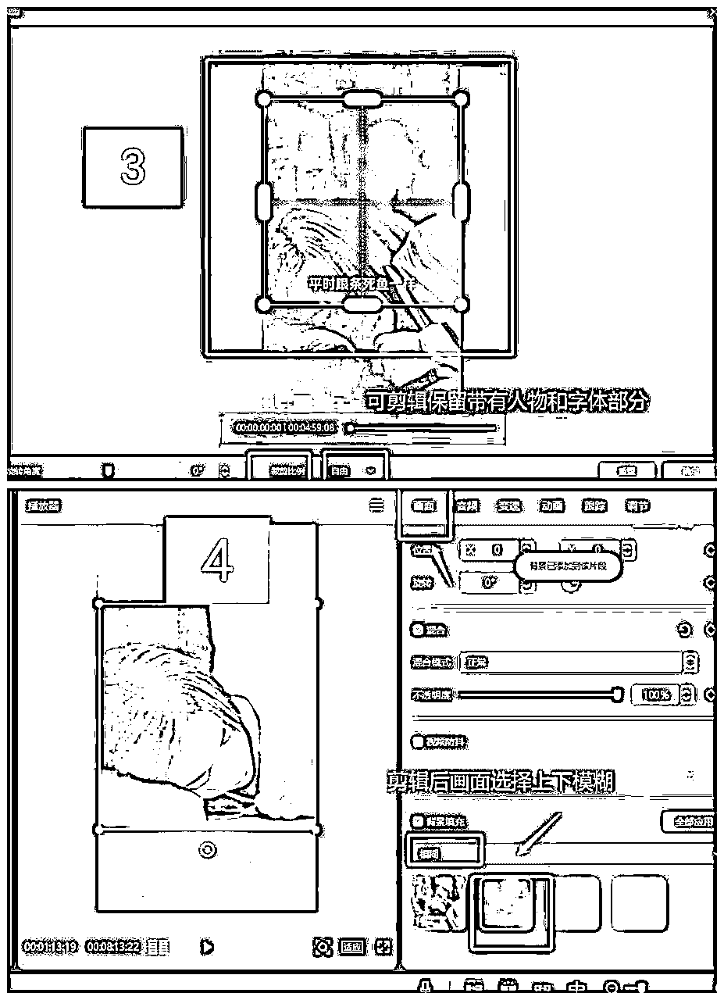

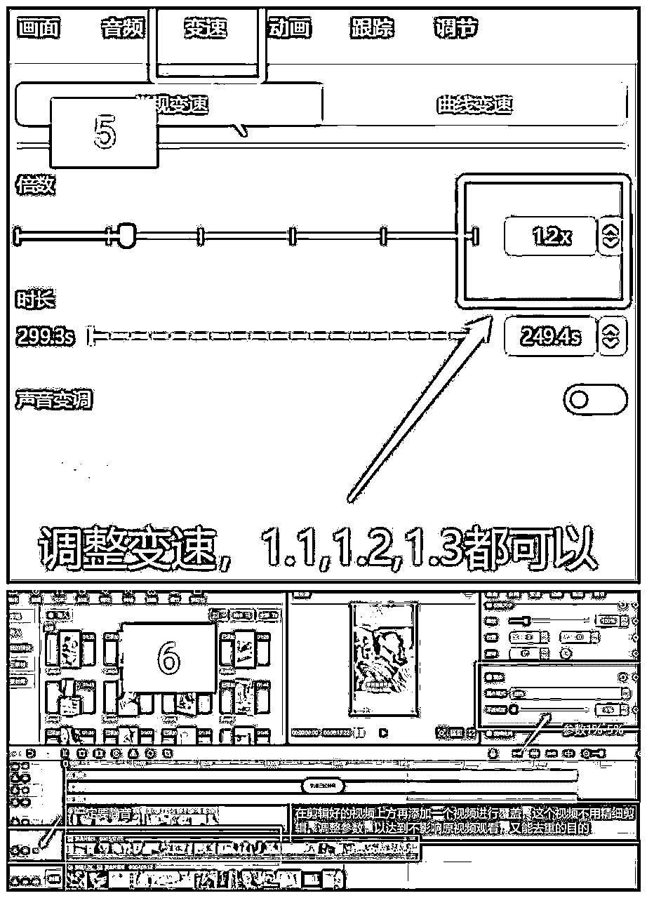

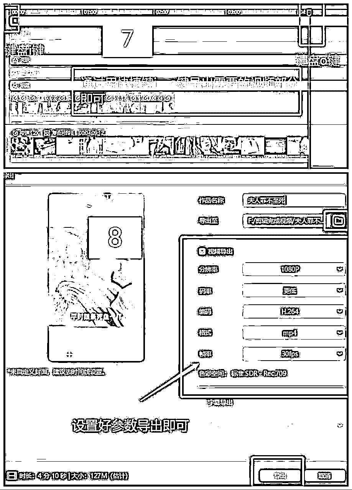

出处：《短剧cps，小白也能月入过万的蓝海项目》

#### 7.2.3 剪辑手法叠加法 @狼魂小毛 @云珞 YunL

@狼魂小毛 老师和 @云珞 YunL 老师的思路内核是一致的：剪辑动作做得又多又密，原创度自然就有保障。

@云珞 YunL 把常用的动作分成了20种：

叠化转场、游动水印、贴纸、滤镜；

画中画盖叠，透明度设在1%到30%之间，选不对观看产生干扰的数值；

特效透明度控制在1%到15%的舒适范围；

扫光特效、旋转、调节、配乐、变速、镜像；

字幕、解说、封面、标题、文字、音效、转场视频、裁剪。

配套视频教程在下方，可以逐条对着练：

短剧去重20个方法.mp4【在线播放】

要是你更习惯看图文，@狼魂小毛 老师的版本也足够详细：

从别处拿回来的原创视频，有的天生带字幕。带字就先处理字幕（没有的话跳过这一步），后面用剪映重新加一套自己的。

也可以把字幕的烦恼留到粗剪完成之后再来解决，更省事的朋友干脆用白底把原字盖住，再叠上新的字幕，做法如下：

顺手推荐一个相对省力的工具：【智影】去字幕。不过先说清它的短板——稳定性一般，发挥不稳的时候会把字幕区域抹出一团模糊。想走别的路子也行，蒙版、裁剪、放大法都是备选项。

【智影】去字幕：https://zenvideo.qq.com/smart/waterMask

把链接粘到浏览器打开，先从右上角登录，或直接点本地上传；登录完成后再点一次本地上传：

把下载好的原视频扔进去，框出需要清除字幕的范围，点确定，字幕就消失了：

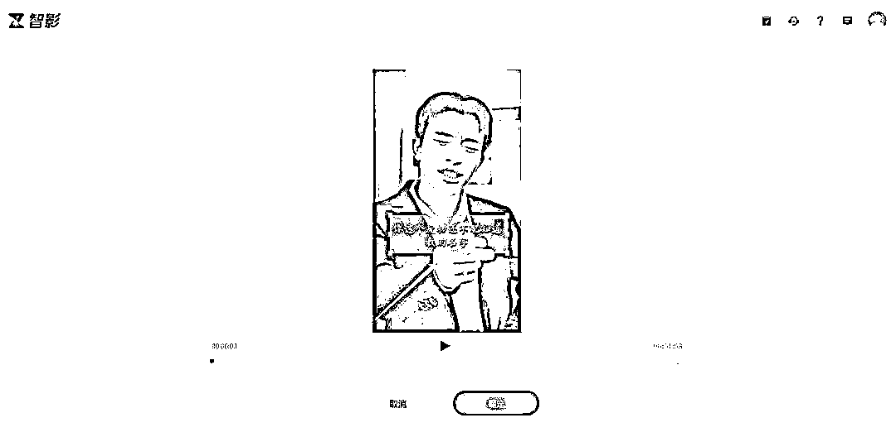

记得把处理完的视频下载下来存好。字幕这件事，也听说过有人PR和剪映来回倒腾的。

封面就等同于视频的招牌。招牌够吸睛，点进来的人才会多，播放数据自然好看。用剪映做封面属于基本功，细节这里就不展开了。

混剪切忌跟原片长得一模一样。开头结尾各切掉一段，再用剪辑工具重新做片头片尾，几秒钟的长度就够。

片尾可以到素材库搜“谢谢观赏”或“下集更精彩”，直接拿来用；当然方法灵活得很，你有别的点子尽管发挥。

导出并保存成片，传到手机上也能随时欣赏：

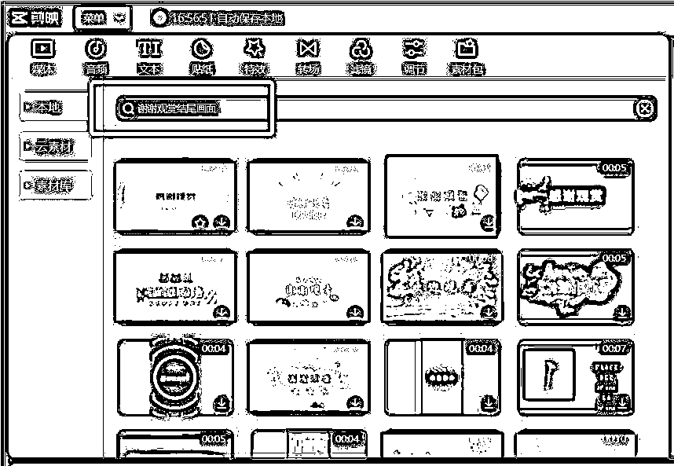

素材导入后，先做常规变速，把速度放到0.9倍，然后进入抽帧环节。抽完便导出；随后再重新导入，将速度提到1.1倍，一番操作之后成片总时长和原片几乎相当。

抽帧的原理，其实就是隔一段时间从画面中抽走若干帧，模拟出“低速摄像”的观感。

实操手法：

把时间指针拖到想要抽帧的位置，用快捷键CTRL+B或点击分割按钮，切出这一段，再按删除键带走它。

几点提醒：

抽帧务必选在无人说话的间隙——比如台词刚说完、下一句还没接上的空当。在人物说话中间抽帧，容易把对白弄丢，破坏前后连贯。

只要不影响观看体验，帧抽得越多，去重效果越明显。

转场功能里预制了大量效果，可以随意挑选。想给某段画面加转场，先分割，再选中需要的转场样式，右侧的参数区还能精确控制过渡时间：

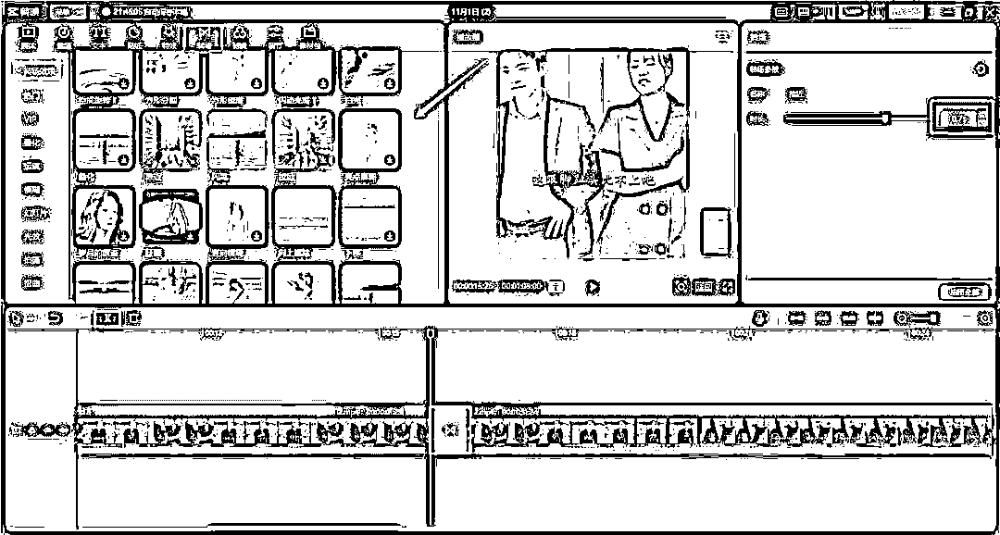

镜像的功能是让画面水平翻转。操作方法也不难：将选中的片段切出来，直接套用镜像效果即可：

给你看看镜像加与不加的对比：

用不用、怎么用，全看你的心情。哪怕随手拍一段视频，随手配首背景音乐，随便套个滤镜，把强度压到最低，都能向平台传递一个信号：这作品是被认真加工过的。

别小看素材库的价值，里面躺着一堆热门素材。那些你刷别人视频时眼熟的内容，基本搜得到，加进自己的片子里常常事半功倍：

特效也是一种“换脸”手段——挑与故事气质相符的效果，在不同位置随机插入，能明显拉开与原片的距离。

这道工序同时也是改写原视频md5值的杀手锏。

或者用画中画功能，把自己拍摄的图片放大到铺满整个画面、贯穿全片；也可以拿一段亲手录的单色画面（比如自家墙壁或地板），同样铺满且时长对齐，然后调低不透明度。

还有亮度、对比度、饱和度、光感、锐化等一系列参数，全部微调一遍，幅度别超过10，调太多容易牺牲画面清晰度。

片段的排列上，把全剧最出彩的几个桥段集中起来，剪掉拖沓的过渡，拼成一条高能回顾；或者把高光部分挪到片头用来抓人；胆子大点还可以放一段前情提要。

经验之谈：剪得松散一点、转场给得勤一点，基本不会出大问题，也没碰过上不了热门的情况。在此基础上加点自己的东西——比如解说式的原创点评，效果更佳。

但必须承认，以上招数还没有谁能打包票做到百分百去重。更进一步的打法，是叠加解说画外音（平时看的影视解说就是这种，把剧情讲明白），以及做多集混剪。

出处：《短剧自然流打法1个月变现2w的实战经验分享》

#### 7.2.4 剧情重构去重法 @惟乔

除了画面层，剧情本身也能成为去重的抓手。把台词删减掉一部分，或者干脆打乱原有次序，故事面貌就会大不一样。比如说原来四句台词按A、B、C、D排列，你可以手动调成C、D、A、B，甚至再加一句E进去。

插叙也是一件好用的武器——让全剧最精彩的段落打头阵，前因后果用回忆来补述。

出处：《新手用赚钱的方法做短剧CPS，一个月1.4w+收益》

## 八、借ChatGPT量产短剧解说视频 @+1

需要先承认的是，本期航海并不鼓励大家一上来就做「短剧CPS」解说：这条路周期长、门槛高，短期内很难看到可观的回报，耐心不足的人很容易被劝退。

但如果你已经把「短剧CPS」玩得很透，想给自己加点难度，那解说类视频可以安排上。

当然，别蛮干，学会借力AI工具，比如ChatGPT。

2月的AI绘画与ChatGPT航海课上，黄小刀教练专门演示过如何调教专属ChatGPT。有空可以翻那期回放：https://i.shengcaiyoushu.com/t/BOA7hbp3，内容非常硬核。

找素材、发布之类的环节和常规「短剧CPS」没什么两样，下文直接跳过。

### 8.1 ChatGPT辅助步骤拆解

第一步：调教专用ChatGPT

开局先给它立人设——一位专职写影视解说的博主：

第二步：喂黄金三秒文案

短视频最讲究开头三秒，这决定了算法愿不愿意给你推流。这里整理了一些开场文案的投喂样例，你有更好的不妨继续补充：

（1）被豆友追封为“最牛P”的老太太，70岁高龄竟去贩毒……

（2）从草根到富豪，他只用了三天，是我见过翻盘最漂亮的男人——可惜风光没能维持太久……

（3）见过最嚣张、最惨、最冤的囚犯吗？这位全都占……

（4）一部让人荷尔蒙狂飙的过瘾大片……

（5）快看，这女人竟然割腕！是什么事把她逼到这步田地？原来，就在一天前，她和丈夫大壮因为……

（6）你想破脑袋也猜不到……/你敢信？/这可真是神奇了……

（7）这人叫……你八成以为他是……吧？错。他是来……从这里打开故事。

（8）男朋友劈腿、变心，还动手打你？接好这份指南，这部片子会教你怎样让老公服服帖帖！女主的故事是这样的……

给人物起外号同样重要：

钢蛋、翠花、阿XX、小哥、大哥、大壮、小美、小凤、二狗……这类大众熟悉的代号往文案里一放，观众记人很快。

旁白中还能顺便皮一下：

谁下线了——就调侃他“领便当”；

谁被打死或失去自由——“只可惜，往后我的视频他再也没机会刷了”。

### 8.2 配音工具怎么选

配音这块，入门用剪映自带的语音功能完全够。付费党我的习惯是🛰️小程序「配音pro」，一次付费永久使用：

抖音上那些专业影视解说号，多数在用「魔音工坊」配音：https://www.moyin.com/

是不是觉得很多爆款视频里的声音味道很熟？没错，源头就在这：

魔音工坊配音.mp4【在线播放】

它的优势在于声线丰富、自然不生硬、能表达情绪；缺点是价格偏贵，哪怕单独买某个音色，也必须捆绑VIP才能用：

### 8.3 剪辑流水线

1）先将巨量创意或有米云下载的解说素材放进剪映，自动识别字幕，导出txt文稿：

接下来进入正式的文案改造环节。

拿《你是天堂，也是地狱》的导出文稿来举例：

顾念悄悄出席了他的婚礼

随后她结束了生命

两人本是青梅竹马、两小无猜

而她只是他深夜孤独时拿来慰藉的一味药

顾南易深夜赶回公馆

看到浴缸里的顾念，他瞬间慌了

2）把文稿粘贴到ChatGPT里做二次创作，记得先向GPT交代清楚角色定位：

若觉得这版回答不合心意，点一下底部的按钮让它重新生成即可：

注意，GPT给的文本量往往很大，从中挑出可用的句子，遇到读不通的地方手动改顺：

3）把定稿文案送进配音工具，得到音频文件：

叠上一层BGM，氛围是不是立马就有了～

7月3日 (3).MP3

4）回到剪映，导入音频并和剧集画面逐段对齐，智能字幕里完成文稿匹配；别忘了同步做去重（镜像、滤镜、闪光素材等），再补一句点击引导语。

5）导出前补上封面，从麻雀APP中取该剧集的官方封面就行。到这儿，一条解说视频就算竣工了：

7月2日 (1)(4).mp4【在线播放】

来源：《如何使用ChatGPT辅助产出短剧解说类视频》@+1

