# 2024.03｜TikTok 美区店铺：从零跑通的实操路线

> 来源：[`jviztcgxxfy.feishu.cn/docx/AYv8do5nboNqqjxEtotcruhSnqf`](https://jviztcgxxfy.feishu.cn/docx/AYv8do5nboNqqjxEtotcruhSnqf)

制作方：生财有术
发布日期：2024/03/15
阅读提示：内容出品人排名不分先后。本手册想呈现项目的更多可能，协助你理解并落地操作。
找内容小技巧：需要快速定位，可用 Ctrl+F / Command+F 搜索「关键词」。

# 开篇：先校准预期，再谈入场

欢迎加入 3 月航海｜TikTok 美区店铺入门｜实操手册。后面这段时间，我们会反复在这里交流。

先把话挑明：美国区店铺眼下热度很高，可它仍属于跨境电商，所需投入不会因为“风口”而消失。21 天很难把 0→1 全部走完，但足以把项目脉络梳理清楚。所以请把目标定在“入门”，心态上做好长期作战的准备。

另外，入驻并非零门槛。符合条件的朋友，先弄清楚资质要求与成本，再动手；暂时不达标也别焦虑，可以先顺着流程看一遍，感受这条热门赛道的玩法，观察别人怎样变现，再决定要不要进场。

正式学习前，先回答三个问题：

1）TikTok 美国区店铺是什么项目？前景如何？

TikTok 做电商已接近三年。和两三年前的拓荒阶段相比，物流、支付等基础设施逐渐完善，消费场景与市场环境也更成熟。美国是平台重仓的方向，电商业务增长很快：2023 年，美国区从零做到近 20 亿美元 GMV；2024 年，业内预计还有十倍扩张空间。

赛道扩容，池子就会变大。无论早入场还是刚关注，都有机会。

2）美国区店铺有几种模式？

眼下分两类：自运营和全托管。拉长时间看，推动平台成长的中坚仍是自运营商家，这种模式的天花板也更高。

3）哪些人适合做？

它和多数电商项目一样，有门槛：可能需要满足开店条件、具备电商经验、手里有供应链，或者能找到靠谱搭档。若货源和合作方都缺，又指望靠这个迅速赚到第一桶金，建议谨慎。

还要看到另一面：TikTok 美国电商生态不只有卖家，还有服务商。开不了店，但能力匹配，也能以服务商身份参与。

注意事项：手册反映的是当前阶段的情况。真正进入跨境业务后，国际贸易政策、当地法规、汇率波动、竞争态势都要持续跟踪，并据此调整策略。

最后，愿大家这趟航行既有收获，也能遇到一群并肩作战的人。

以下内容由生财有术联合圈友制作，仅供航海船员以及生财有术星球圈友学习使用。欢迎在实践中持续反馈，一起把手册打磨得更好；修改建议可联系鱼丸（yuwan387）。

# 【更新提示】这份手册怎么用更省力

动手之前，先花一分钟了解使用方式，方便按自己的情况取用。

手册的步骤顺序，围绕“从 0 到 1 跑通一家 TikTok 美国区店铺”来编排。你可以照着航线图从前向后执行，也可以按实际需要跳读。

要提醒的是：这一版和以往航海手册相比改动不小。过去更强调展示多种玩法，让大家自由探索；现在拆成必修与选修两块：

如果你还没接触过这个项目：

建议实操前先认识平台，并了解近期动态

【项目概述】TikTok 美区电商机会

如果你已经大致了解：

从航线图第一阶段开始，对应手册第二章，逐步把项目做完

【实操 1/4】申请开通店铺

【实操 2/4】选品及找货源

【实操 3/4】美区小店带货运营

【实操 4/4】美区小店店铺管理

如果你已经跑通最小 MVP，想放大：

重点读下面这些章节，拓展玩法

【项目放大】美区小店进阶运营——直播带货

本航海项目航线图如下：

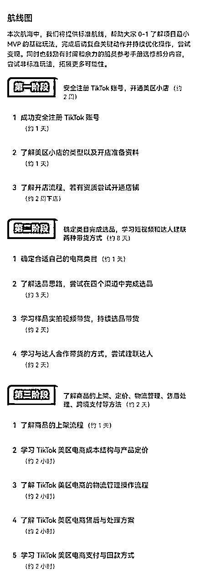

航线图和手册彼此对应，你可以按自己当前所处环节，找到相应步骤来学。

# 必修篇：先跑通最小闭环

章节概要

这一章从认识 TikTok 美国区店铺讲起，带你按顺序把项目流程走一遍。

若满足开店条件，可照本章步骤实操，完成最小 MVP，开出并运营第一家店；暂时不满足，也可以先看全流程，再判断是否入场。

项目新手建议实操前先看全局：

【项目概述】TikTok 美区电商机会

对项目有基本认知后，再按核心步骤学习：

【实操 1/4】申请开通店铺

【实操 2/4】选品及找货源

【实操 3/4】美区小店店铺管理

【实操 4/4】美区小店带货运营

必修篇里，航线图与手册顺序对应。顺着手册学，就能逐项完成航线图任务。

后续每个关键步骤的章节概要中，我们也会标出对应航线图，方便你掌握进度。

现在开始。

## 一、【项目概述】美区电商到底有哪些机会

章节概要

谈到出海，跨境电商是绕不开的板块。在众多跨境平台与海外社交平台中，TikTok 的增速和潜力都排在前列。

这次航海，我们会带大家认识 TikTok，并梳理做美国电商前要准备什么。

本板块分四部分展开，帮你更完整地理解项目：

TikTok 平台的发展现状和机会

为什么入局 TikTok 美区小店？

不同的人 / 团队该如何抓住机会？

目前 TikTok 美区小店的电商模式

提示：已有美区电商基础的朋友，可以直接进入下一章。

### 1.1 平台电商的现状与窗口期

据 Market Splash 数据，2023 年底 TikTok 用户量为 16.77 亿，月活跃用户（MAU）达到 11 亿。不同文化、不同观念在此交汇，平台的多元与包容也因此更明显。

对社交产品而言，TikTok 的用户扩张速度很快，年轻群体尤其容易沉淀为高频用户。流量往哪里聚，生意往往就在哪里冒头；新的流量高地，通常也对应新的机会。

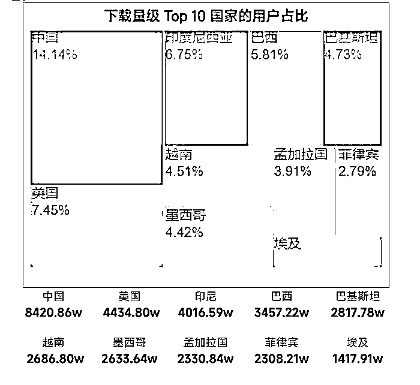

《2023 年度 TikTok 电商行业趋势白皮书》下载量

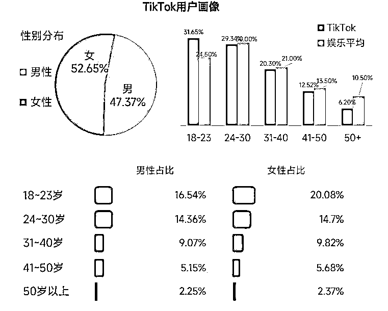

《2023 年度 TikTok 电商行业趋势白皮书》用户画像分析

于是，越来越多卖家把 TikTok 视为新渠道，开始布局电商。平台持续成长，身处其中的商家也能分享增长红利。

在出海赛道里，TikTok 既是内容平台，也是电商平台，时间窗口与经营模式都具备优势。可以从两个层面理解：

经过三年多发展，TikTok 电商形成了全托管与平台模式（POP）两条路径，覆盖东南亚、欧洲、中东、北美等区域。

过去几年，东南亚是其主要发力市场，目前规模也最大。

自 9 月 12 日美国正式上线电商业务后，当地市场信心明显提升，店铺数量激增近百倍。

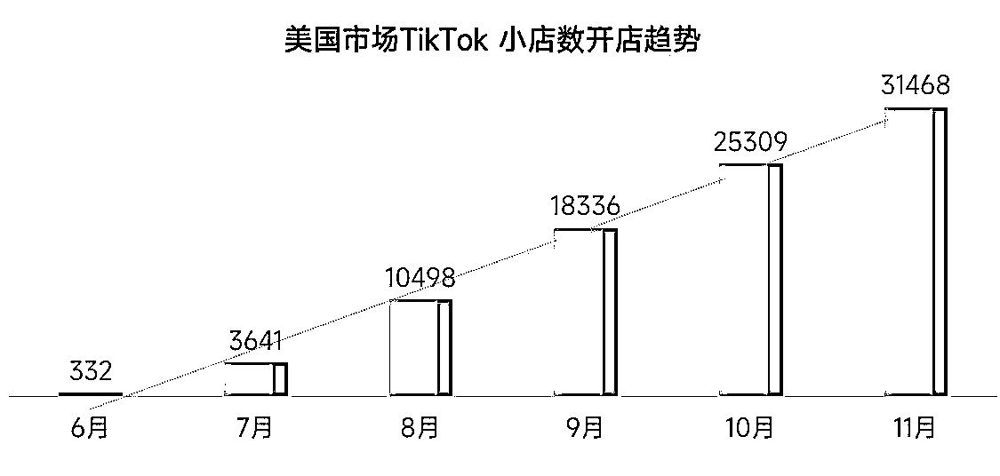

《2023 年度 TikTok 电商行业趋势白皮书》美区小店数量统计

当前美国市场日均 GMV 大约在 2600 万至 3000 万美元，与之前大幅领先的印尼市场接近；2023 年底黑五当天，单日 GMV 达到 3400 万美元。流量闸门已经开启，越早进入，越可能吃到早期红利。

按平台与商家的运营方式划分，TikTok 电商有自运营（POP）和全托管两类。

全托管下，商家更像供货方：按供货价把商品卖给平台，零售价由平台制定。商家先把货发到平台仓库，平台按实际销售结算；若出现滞销，在符合条件时退供，把商品寄回。该模式更适合供应链较强的工厂或贸易型商家。

自运营下，商家自主权更大：既能做内容电商（短视频、直播、达人合作），也能做货架电商（商城），还可灵活定价、参与营销活动。难点在于既要具备供应链能力，又要懂流量，因此门槛更高，更适合有电商经验、尤其内容电商经验的商家。

除商家外，平台还有服务商生态，例如 TSP、TAP、MCN（CAP）等。若达不到商家门槛，或对卖家模型兴趣不大，可以从服务商角色切入。

### 1.2 为什么值得盯住美区小店

从用户与市场两端看，TikTok 美国区店铺的空间不小：

1. 美国市场天花板更高

美国是体量大且完整的经济体，不像欧洲市场那样相对分散，因此上限更高。2023 年第三季度，美国市场月活提升 9.87%。未来走势虽难预测，但在剩余“近亿市场”中，美国是增量关键。

2. 美国用户消费力强

当地人均收入较高，购买力较强，做电商的毛利空间也更大。

3. 美区店铺仍在放量，2024 年有望继续增长

TikTok 电商在美国仍处早期。2023 年，美区店铺数量翻了近百倍。增量不只是数字，变现通道已经打开。2024 年，美区电商预计有十倍增长，增量空间充足。商家要重视细分品类，寻找销量高、在售商品少的蓝海。

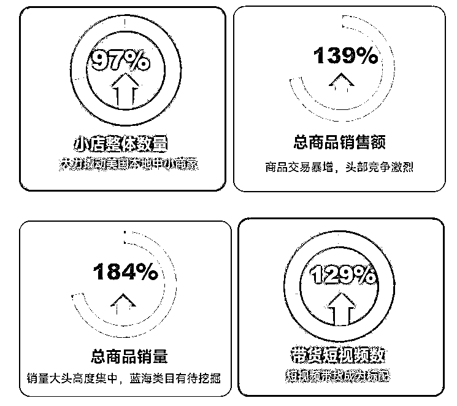

《2023 年度 TikTok 电商行业趋势白皮书》美区市场数据

### 1.3 不同团队怎么切进去

团队能力结构不同，切入点自然不同。

美区电商生态中，主要有服务商与商家两类角色。服务商又包括货盘服务商、代运营服务商、达人服务商等。

对能力模型相对单一的团队，从服务商切入更合适，成本和风险都更低。

例如：

同时具备供应链与流量能力的团队，可以从商家角色切入。

2024 年，达人营销、直播、商业化流量是关键方向。条件允许的话，尽快搭建达人营销团队和本土直播团队。

### 1.4 两种经营模式怎么选

前面提过，TikTok 电商在经营上主要分“自运营”和“全托管”。

#### 1.4.1 自运营：自己掌舵

自运营指平台只提供部分共享资源，销售、履约、售后等环节由商家负责，平台主要承担规则制定。

1）盈利模式

自运营商家有三种销售路径：商家自播（短视频 / 直播带货）、达人带货、商城。其中达人带货是 TikTok 电商较为主流的方式。

2）物流履约模式

自运营卖家可选自履约、海外仓、平台官方 FBT 仓履约等。

针对美国市场，可选发货方式包括：

1. 平台履约：使用 TikTok 官方自营的 FBT 仓，平台提供仓储、分拣、打包和配送；

2. 海外仓发货：自建仓库或合作第三方美国海外仓（包括亚马逊 FBA），尾程较快，买家下单后通常 1—3 天可收到；

3. 虚拟仓发货：实际从中国发出，美国小包自履约，但物流轨迹显示在美国，要求 3 天内出单、7 天内送达。不过现在不建议虚拟仓！非常容易封店，可能血本无归。

时效方面，本土卖家要求本地发货，履约标准比跨境卖家更严，通常 3—5 天送达；跨境卖家在直发模式下通常 7—10 天，海外仓模式可缩短到 3—5 天。

费用方面，平台提供一定配送优惠：TikTok 美区新用户购买 5 美元及以上订单可享免邮，老客户购买 20 美元订单可享免邮。

#### 1.4.2 全托管：专注供货

全托管指商家与供货商负责开发、提报商品，平台负责销售、履约、售后，双方按供货价结算。

商家只需提报商品，平台选款后，把货寄到平台仓库，后续营销推广、履约售后都由平台处理。商品售出后，平台按供货价与商家结算。

简而言之，商家主要管供货和备货，其他多数环节由平台代劳。

2023 年，各平台全托管业务全面开卷。TikTok 全托管下，平台烧钱做补贴，腰尾部商家囤货陪跑，真正赚钱的是谁？

问题在于，头部商家占比不高，头部以下多数商家很难盈利。同时，全托管商品还会与本土商品在价格上竞争，干扰本土商家的定价体系。因此不少人开始思考：全托管对市场究竟意味着什么？

其实，全托管有一个重要价值：开拓市场、带动用户增长。只要新市场持续开放，或电商用户仍在快速增长，全托管就有存在意义。

2024 年就有这样的机会。不出意外的话——PS：TikTok 新开国经常出意外——年中全托管会开放法国、德国、意大利、西班牙、墨西哥、阿联酋等国家。

所以，若供应链有优势，仍可考虑全托管方向，年中重点发力新开国家。

但长期看，基于平台的内容化基因，以及性价比心智并不强，擅长内容产出、商品有特色、履约具备本土优势的自运营商家，仍会是驱动平台发展的主力。

内容来源：《TikTok Shop 推出新模式，商家应该怎么做？》《作为 TikTok 商家，2024 年我的经营方向与思路》

## 二、【实操 1/4】把店铺开起来

章节概要

了解项目全貌后，就要正式启动。要在 TikTok 美国站做电商，前期店铺准备是第一步。

本章整理了项目初期要筹备的事项：

安全注册 TikTok 账号

了解入驻门槛并选择适合自己的店铺

开通店铺

账号注册需自行完成，手册不展开，可参考 2.1 中的链接。

TikTok 美国区店铺的不同类型，入驻门槛不同。请结合自身情况，弄清楚后再进入入驻流程。

暂时不满足门槛的朋友也不用急。本次航海以入门了解为目标。你可以先熟悉项目流程，学习选品、找供应商、拍视频、建联达人等方法，再判断是否入场。如果判断适合自己，之后再想办法达到要求也不迟。

本章航线图

完成第二章的学习和实操，即可完成航线图第一阶段：安全注册 TikTok 账号，开通美国区店铺（约 2 周）

1. 成功安全注册 TikTok 账号（约 1 天）

2. 了解美区店铺类型以及开店准备资料（约 1 天）

3. 了解开店流程，若有资质尝试开通店铺（约 2 周下店）

接下来请正式开始，跟着步骤完成第二章内容学习，记得在航海日志中打卡记录进度。

### 2.1 账号注册：先求稳

为了更顺利地开启 TikTok 美国区店铺之路，需要准备一个美区 TikTok 账号。开店要用，后续选品、找对标、发带货短视频做转化也要用。

具体注册步骤，请参考这篇文档：《3 月航海｜TikTok 美区小店｜前期准备》。

### 2.2 店铺类型与入驻门槛

小节概要

美区店铺有几种不同类型：

接下来，我们逐一拆解每种类型的门槛，以及入驻时的注意事项。

#### 2.2.1 本土店怎么挑：个人、企业、ACCU

在TikTok美区开本土店，别一上来就交材料。个人店、企业店、ACCU店在条件、成本和风险上完全不同，下面分开说清。

2.2.1.1 个人店：没有公司主体也能开

所谓个人店，就是以自然人身份注册，不需要公司作为主体。需要准备：
1. 能接收验证码的美国手机号，接码平台可解决，例如 https://pingme.tel/
2. Outlook 或 Google 邮箱；国内邮箱如 163、QQ 不建议使用
3. 美国公民的护照或驾照，百度、淘宝上可付费找人办理
4. SSN（社会保险号）或 ITIN（个人纳税识别号）

经常有人问：缺第3、4项，能不能直接买现成个人店？我的态度是：别这么做。买店最大的隐患在于资料不透明——你无法确认上家拿什么身份注册，甚至有人用同一份美国护照或驾照批量开店，再转手卖给不同买家。7天质保期一过，店铺被封基本没有售后，风险很高。

税率也不能一概而论。美国各州政策不同，店铺注册在哪个州，就按当地税法执行。加州是 9.5%。阿拉斯加、特拉华、蒙大拿、新罕布什尔不征消费税；新泽西属于部分免税。

2.2.1.2 企业店：核心多一张美国执照

企业店跟个人店在操作上接近，关键区别是必须持有美国本土企业营业执照。资料清单：
1. 美国手机号，接码平台即可
2. Outlook 或 Google 邮箱
3. 美国本土企业营业执照，最终受益人须为美籍，且持股比例达到 75% 或以上
4. 法人的 SSN 或 ITIN

注册时建议使用干净的美国 IP。

2.2.1.3 ACCU店：入口基本关闭

ACCU 是 American Company Chinese UBO 的缩写，可理解为中美合资公司：中国法人设立美国公司，持美国营业执照，性质仍算本土店。所需资料：
1. 美国手机号，接码平台即可
2. Outlook 或 Google 邮箱
3. 美国本土企业营业执照，中国法人持股需超过 25%，且执照最终受益人要与亚马逊执照法人保持一致
4. 亚马逊单个美区店铺一年内做到 200 万美元营业额

办执照前先弄清两件事：目标州的税收和年审成本。各州差异很大，加州按年利润 9.5% 征收，蒙大拿州为 2.6%；年审费用也各不相同。先比较再选注册城市/州，能省下不少成本。

另一个硬条件是：ACCU 店目前要求满足“亚马逊一年内 200 万美元营业额”或“亚马逊总排名前 10 万商家资质”。找服务商办理主体和流水，市场价大约 5000-10000 元，仅供参考；具体看满足的条件和服务项目，价格会分档。

优势：回款快，和本土店一样，订单完成后通常 24 小时内到账；并且配有中国 AM，后续平台问题可以直接沟通，语言和文化门槛低。

短板：注册门槛偏高，不是所有卖家都够条件；同时仍要遵守本土店的规则，比如发货时效。

特别注意：ACCU 入口目前基本关停。现阶段可以转向申请美区跨境小店中的“美国本土发货商家”类型。

#### 2.2.2 跨境小店POP：三条入驻路径

美区跨境小店在 2023 年 10 月上线，POP 模式包含三种类型：

2.2.2.1 美国本土发货商家：货必须在海外

这类商家通常已有海外货架电商经验，比如在做 Amazon、MercadoLibre、Shopee、独立站等，但对履约能力有要求。
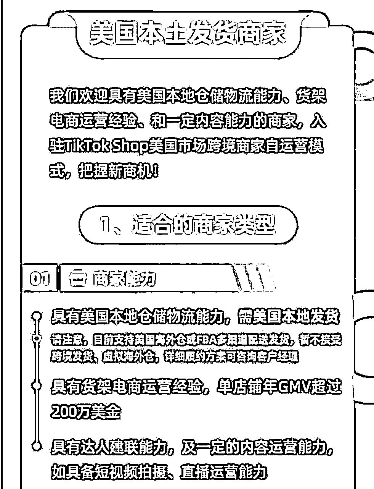
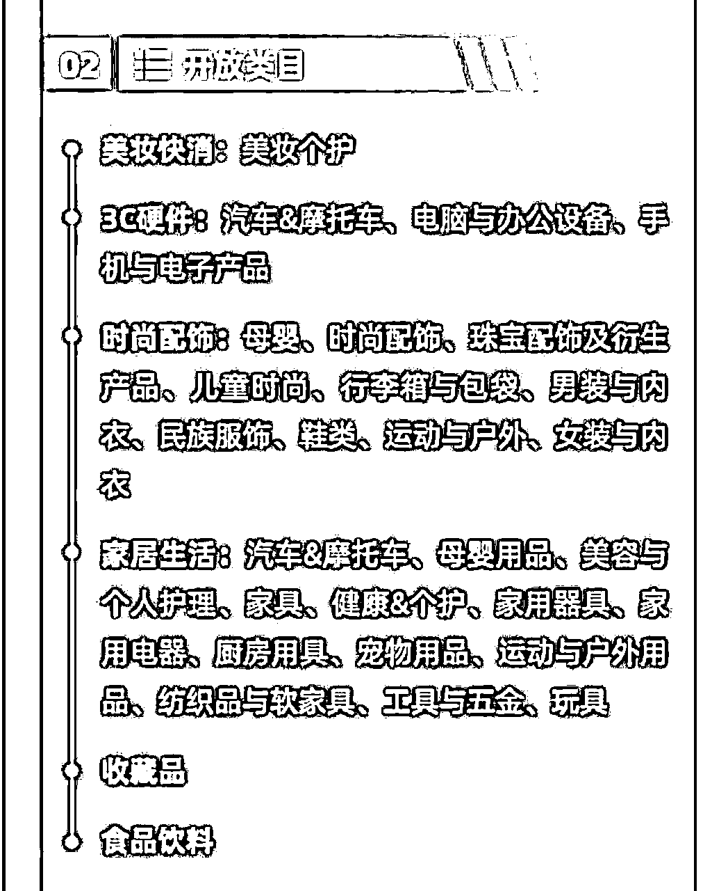
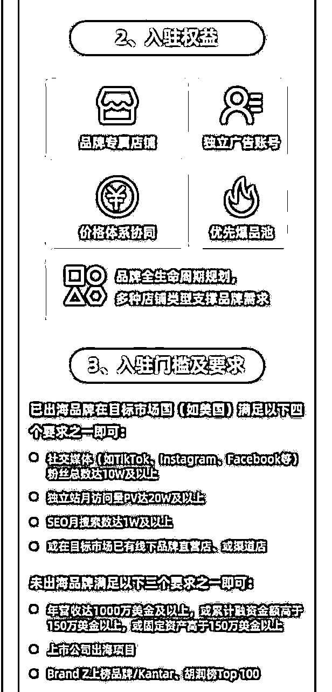

1. 商家能力
核心就一句：货要放在海外，并且能实时发出。平台目前认可美国海外仓或 FBA 多渠道配送；跨境直发和虚拟海外仓都不接受，具体履约方案可以问客户经理。

虚拟海外仓千万别碰，封店概率高，而且往往血本无归。

这条要求并非一刀切，关键看对应类目的招商经理是否认可你的团队。入驻后只要能播、能拍出内容，前期暂时不具备能力也不一定被拒。

2. 开放类目
目前只开放6个类目，范围如下：
- 美妆个护
- 汽车&摩托车；电脑与办公设备；手机与电子产品
- 母婴；时尚配饰；珠宝配饰及衍生产品；儿童时尚；行李箱与包袋；男装与内衣；民族服饰；鞋类；运动与户外；女装与内衣
- 汽车&摩托车；母婴用品；美容与个人护理；家具；健康&个护；家用器具；家用电器；厨房用具；宠物用品；运动与户外用品；纺织品与软家具；工具与五金；玩具
- 水晶珠宝属于特殊类目，后面单独说明。

3. 入驻门槛及要求
4. 入驻大致流程
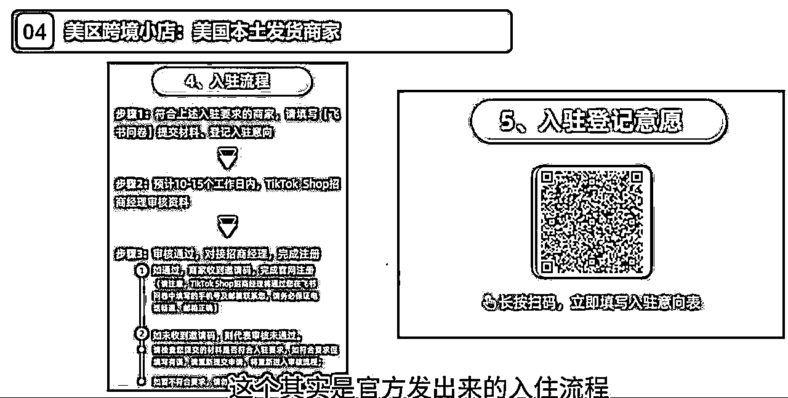

提交后超过 15 天仍无任何消息，基本可以判定审核未通过。

2.2.2.2 品牌出海商家：门槛高，但扶持特殊

这一类对商家要求较高，适合少数符合条件的品牌。成功入驻后会有优先通道，并由专门团队提供资源和扶持。
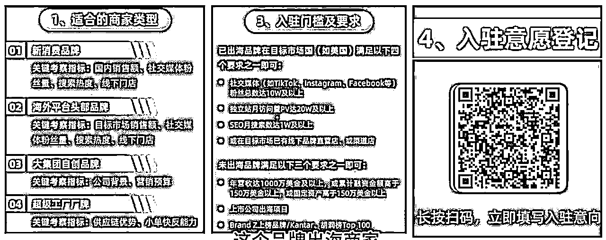

2.2.2.3 珠宝水晶商家：通道暂时关闭

近期入驻通道已关闭，后续开放时间未定。该类商家不要求美国本土备货，可以从国内发货。
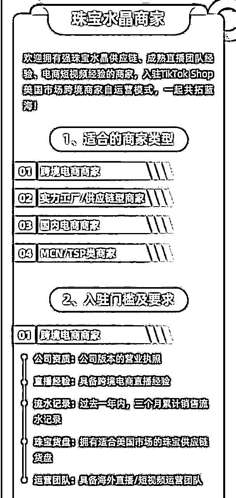
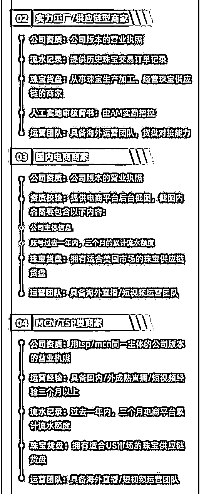

重点划一下：

#### 2.2.3 店铺入驻信息一张图

各店铺的入驻要点已经整理成一张导图，查看起来更直观。
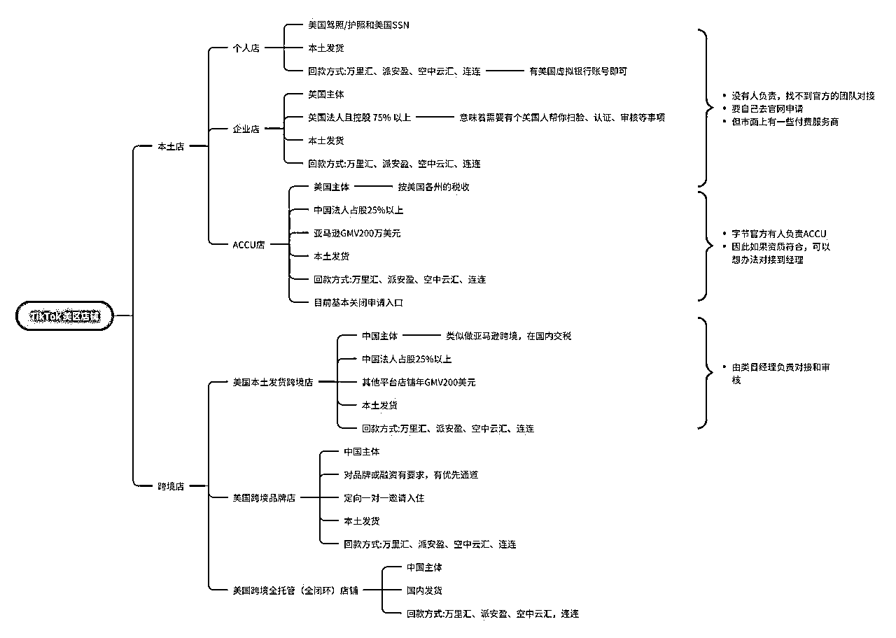

### 2.3 开店流程与避坑

#### 2.3.1 开通跟着官方指南走

弄清各类型店铺门槛后，你应该能判断自己适合开哪种店。接下来按步骤提交即可。官方指南可以直接参考：《TikTok shop 美国商家入驻与运营 Q&A（基础版）》。

再强调两点：
美国本土小店中的个人店、企业店没有官方人员对接，只能自助入驻；
美区跨境小店有招商经理可联系，遇到问题可以请对方协助。

#### 2.3.2 两个坑提前避开

正式启动前，这两个关键点先记住：

1. 店铺通过后，尽快绑定收款方式
一旦被封，会有 90 天冻结期；其中涉及二审申诉，要交材料，流程拖得很长。已发货订单的款项会正常入账，未发货订单则自动取消。

2. 店群模式风险极高
常见做法是批量开 100、200 个本土个人店，盯着亚马逊、淘宝、天猫上的热销品，用 ERP 上架并通过虚拟仓发货；店铺销量和评价起来后，平台会给予更靠前的排序。但虚拟仓现在很容易触发封店，店铺成了消耗品，封了再开、开了再封，眼下新店可能一两天就没了，模式很难跑通。

## 三、【实操 2/4】选品与找货源：方向先定，努力才有效

章节概要

前期准备告一段落。等待店铺审核期间，可以同步推进三件事：定类目、做选品、找货源，为后续上架和运营打底。

其中选品是本章最需要练熟的技能。初步掌握可以按以下流程走：

第一步：确定电商类目
小店开通后，后台可上架的产品类目相对宽松；这里更关键的是TikTok带货账号的类目选择。要抓住两个词：“垂直领域”和“商品属性”。

第二步：理解选品思路
选品本质上是选人群、选需求。这一步从五个角度展开：金额、市场规模、年轻化程度、市场普及度、价格敏感度。

第三步：借助渠道和工具选品
带着前面的思路，通常可以从四个渠道找货：跨境电商平台、社交平台、冷门渠道、数据平台。除此之外还有更多渠道和工具，欢迎在航海期间分享讨论。

产品定下来后，还要落实货源，才能备货和运营。找到靠谱供应商是紧接着的重要一步。如果产品方向没定，后面的环节都会受影响，所以这一步值得多花时间。

做生意不能只顾低头赶路，也要抬头看市场，成功概率才会更高。

本章航线图

完成第三章的学习和实操，就完成了航线图第二阶段：确定类目并完成选品，同时学习短视频和达人建联两种带货方式（约 8 天）。
1. 确定适合自己的电商类目（约 1 天）
2. 理解选品思路，尝试在四个渠道中完成选品（约 3 天）

现在就可以开始定类目、做选品。别忘了提交到航海日志打卡。

### 3.1 类目怎么定：垂直和商品属性是关键

运营TikTok电商前，先选一个主攻类目。小店开通后，后台对上架产品的类目限制不算严，但账号发视频更看重类目是否垂直。所以选类目时，要盯住两个关键词：“垂直领域”和“商品属性”。

类目越垂直，短视频带来的流量越精准，用户画像越清楚，相似需求也越集中。后续就可以围绕这批粉丝反复做营销，覆盖他们在该类目下的多种需求。

反过来，账号内容太杂，比如美妆、3C、家居混在一起发，流量就会分散，二次营销也很难做。

“商品属性”同理，它同样影响流量精准度。有些新手为了快速涨粉，前期做搞笑、泛娱乐内容；等开始带货才发现，粉丝不精准，转化困难。因此账号从第一条内容起，就应该往好物推荐、带货属性上靠。

类目参考：
《2023 年度 TikTok 电商行业趋势白皮书》提到，TikTok 美区小店在“黑五”期间，手机数码、运动户外、保健、居家日用等类目在 10～11 月销售额环比增长，属于增量机会较大的方向。
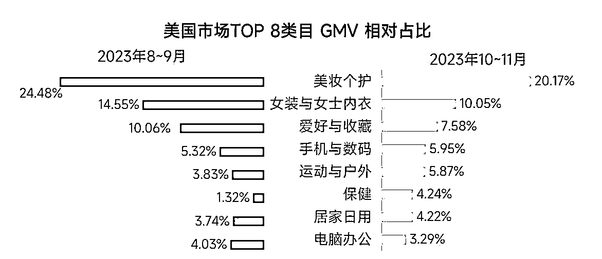
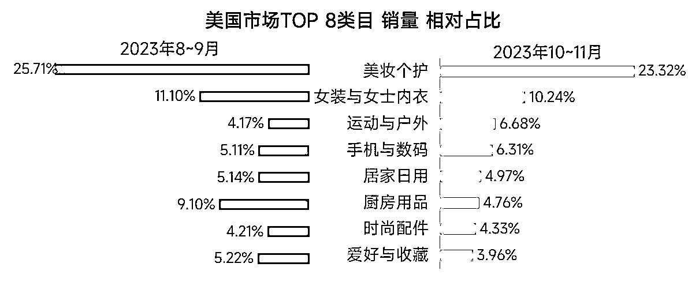

想深挖每个类目，可以翻《2023 年度 TikTok 电商行业趋势白皮书》.pdf。

要留意：美区电商变化很快，热门品会跟着时间和平台内容趋势走，以上内容只能作参考，实际选品要多看当下趋势。

如果手里有几个候选类目，却不知道押哪个，可以在精力允许时多开几个账号绑定小店，用视频测试不同类目，最后挑更适合的深耕。

### 3.2 选品五角度：金额、市场、年龄、稀缺、价格敏感

做跨境电商，选品和运营缺一不可。很多情况下，选品甚至决定整个生意能不能闭环。

选品选的是人群和需求。人群不同、需求不同，商家要具备的能力不同，平台匹配度不同，运营策略也会不同。常说“方向比努力重要”，选品就是定方向。

如果对平台、目标市场、产品和类目属性缺乏认知，方向选错，测试成本会大幅上升，商业模型很难跑正；反过来，选品能力强，测品效率更高，出爆款的概率也会增加。

下面从五个角度看哪些产品更适合TikTok。

#### 3.2.1 客单价别乱定

TikTok 的商业环境还在成长，用户在小店下单的习惯尚未完全养成；同时主流消费群体偏年轻，购买力有限。因此金额上可以参考：
短视频带货，常见区间是 10-100 美金；
直播带货，价格上限可放宽到 150 美金。

下限设 10 美金，是因为低于这个数利润太薄，物流成本（轻小件也要 5-7 美金）会吃掉大头；上限设 100 美金，是因为高客单在TikTok转化表现通常不理想。

#### 3.2.2 新手先做大市场

刚入局TikTok跨境电商，初期建议选市场规模大的类目和产品，比如3C、美妆、家居百货等。

这不是说蓝海或利基产品不能做，而是先用大市场摸清TikTok用户特点；等选品经验足了，再去找利基机会。

2024 年这个阶段，美区市场的产品丰富度远未饱和，大类目下仍有不少空白，机会就藏在这些缝隙里。

之前有位新手学员说想卖毛笔。他的想法很宏大：先做账号教外国人写毛笔字，再顺势卖毛笔。方向本身没错，但新手在不了解当地市场和受众画像的情况下贸然切入，阻力会非常大，很可能一直找不到精准人群，闭环迟迟跑不通。

#### 3.2.3 用户偏年轻

海外社交平台常被拿来对比，TikTok 和 Facebook 的用户结构差别不小。很多人选品时会从 Facebook 找灵感，但两者不能简单套用。

Facebook 的年龄分布更平均，中老年用户占比更高，美国 65 岁以上人群里接近一半在用 Facebook。TikTok 则相反，60% 用户不到 30 岁，也就是说年轻人占了大半。

所以选品和视频内容设计都要朝年轻群体靠。年轻人还有一个标签：消费力相对有限，这也是不建议在TikTok卖高客单产品的原因之一。

#### 3.2.4 好不好买到很关键

TikTok 短视频带货的产品通常带点新奇特属性。因为市面上不常见，更容易勾起兴趣，既能吸引观看，也有利于成交。

可以代入一个场景：你刷抖音看到一件不错的东西，转念一想楼下便利店就有，价格还差不多，多半就不会在抖音下单。所以选品要偏向市面上不容易买到、有新奇特特点的商品。
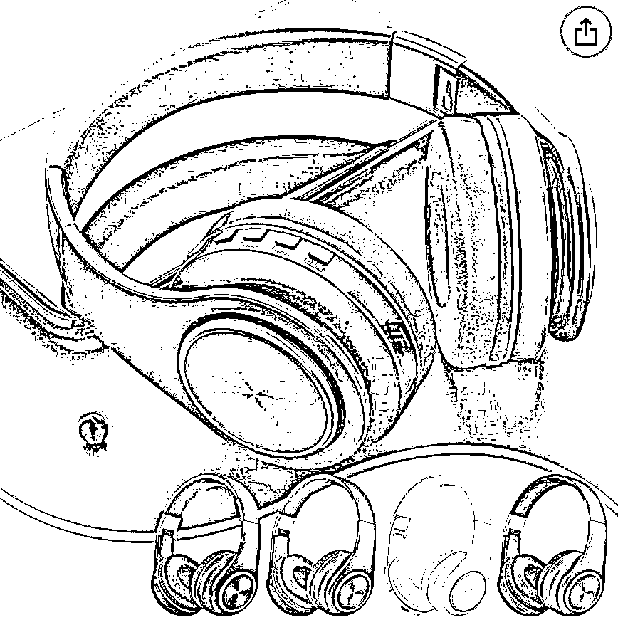
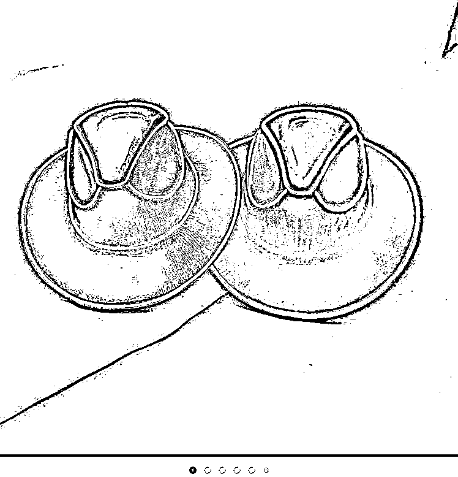

另外，不少TikTok用户仍习惯去亚马逊等传统货架平台比价。他们在TikTok看中一款产品后，会去亚马逊搜同款；一旦搜到，我们很可能丢单。因此尽量选在亚马逊上不那么容易搜到的产品。

#### 3.2.5 价格敏感度要低

用户刷TikTok时往往没有购物计划，只是打发时间。真要买东西，他们更可能直接去购物平台搜索，这叫“人找货”；短视频带货则是在用户没有明确购买意图时把商品推到他面前，也就是“货找人”。

所以社交平台带货很依赖冲动消费，低价格敏感度的商品更合适。如果用户对价格太敏感，冲动会被明显削弱。举个例子：农夫山泉矿泉水就是高价格敏感商品，价格稍微一变，很多人就不买了；而价格认知区间大、或者独特程度高的商品，比如美妆用品、3C配件、猫爪杯、新奇特小夜灯，更容易承接冲动消费。

### 3.3 TikTok电商怎么选品？四条路径与工具

TikTok电商同时带着内容电商和跨境交易两种基因。选品时不能只盯货源，还要兼顾短视频表达与跨境履约。常见路径可归为四类：跨境平台、社交平台、冷门站点、数据工具。

#### 3.3.1 跨境平台渠道

主流跨境平台有亚马逊、eBay、速卖通、Wish、Shopee等，这里以亚马逊为例。亚马逊榜单页：https://www.amazon.com/Best-Sellers/zgbs

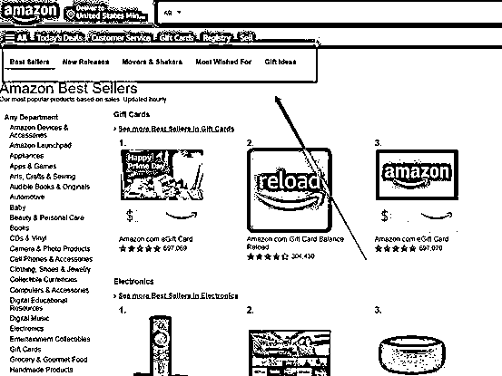

页内共有五张榜：Best Sellers、New Releases、Movers & Shakers、Most Wished For、Gift Ideas。每张榜都能提供线索。挑出商品后要多问一句：它能不能用TikTok短视频讲清卖点？

Best Sellers：别只盯头部。头部销量已高，增长余地有限；类目详情里的中后段商品更值得翻，潜力可能更大。

Movers & Shakers：反映24小时变化，适合判断什么正在起势。

Most Wished For：重点揣摩心理。顾客已加入愿望清单却没付款，原因是什么？连问三次。若在等降价，能否在TikTok用更低价格承接？若在等某个节日，先记录，节点前做节日营销。Gift Ideas同理，分析未买原因，这类常可直接跟卖。

跨境平台本质仍是传统电商，短视频基因弱，且属于人找货。选品时必想两点：能否视频化展示；在货找人场景下能否触发冲动购买。

#### 3.3.2 社交平台渠道

重点看抖音和Facebook，因为二者与TikTok有相似处。TikTok像海外版抖音，推荐逻辑接近；差异是抖音做国内，TikTok做跨境。Facebook同属海外大流量社交平台，但广告形态、推荐机制和用户结构有差别。

**3.3.2.1 抖音**

能在抖音卖动的品，通常已具备视觉或听觉表达力。抖音逻辑是喜欢什么推什么，可用算法反向找品。新号专门刷好物、跨境内容：点赞、评论、转发、关注；无关内容长按不感兴趣或快速划过。一段时间后信息流会偏向好物。再判断客单价、市场规模、海外习惯是否适合跨境；适合就到TikTok测品。也可用飞瓜数据、抖查查等分析工具。看榜时注意物流、政策、受众。比如飞瓜月榜前十不少是食品，而食品跨境难度高。要从多维度判断是否适合跨境。

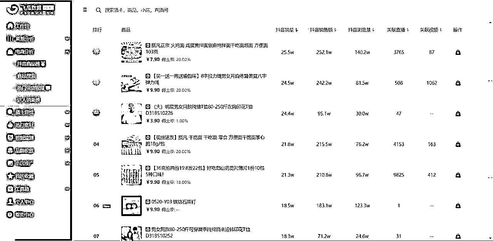

举例：榜一“瑜伽环”，体积重量适中，物流可行；海外也有瑜伽健身需求，可测。榜二“山药脆皮”是食品，跳过。榜三榜四“明星同款T恤”，物流政策没问题，但体型版型是否匹配海外？外国人对中国明星是否有感？通常不算好品。抖音选品两条路：算法养号直接找；数据平台辅助找。

**3.3.2.2 Facebook**

Facebook可用关键词搜广告，再顺藤摸瓜找品。广告文案常放促购词。可参考这些词：

Buy now、30%、40%、50%、60%、order here、claim yours now、free shipping、free worldwide shipping、get it now、get it here、get yours now、get yours、shop here、click here、buy it here、order link、tag a friend、tag a friend who would love this、tag someone who need this、tag someone that would love this。

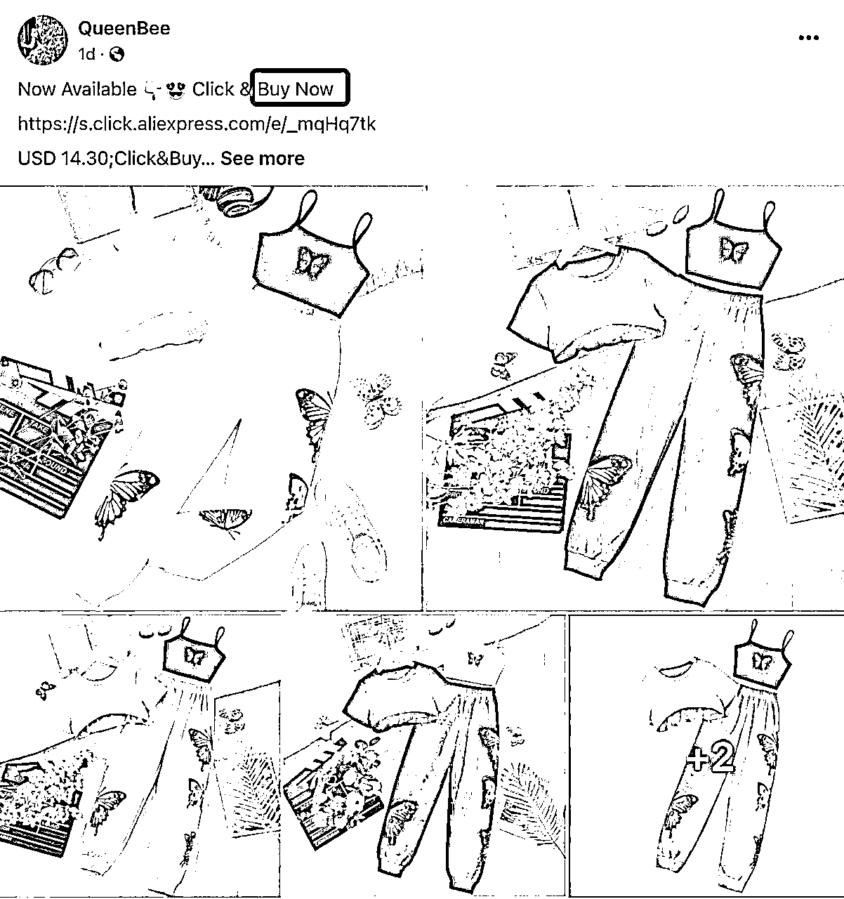

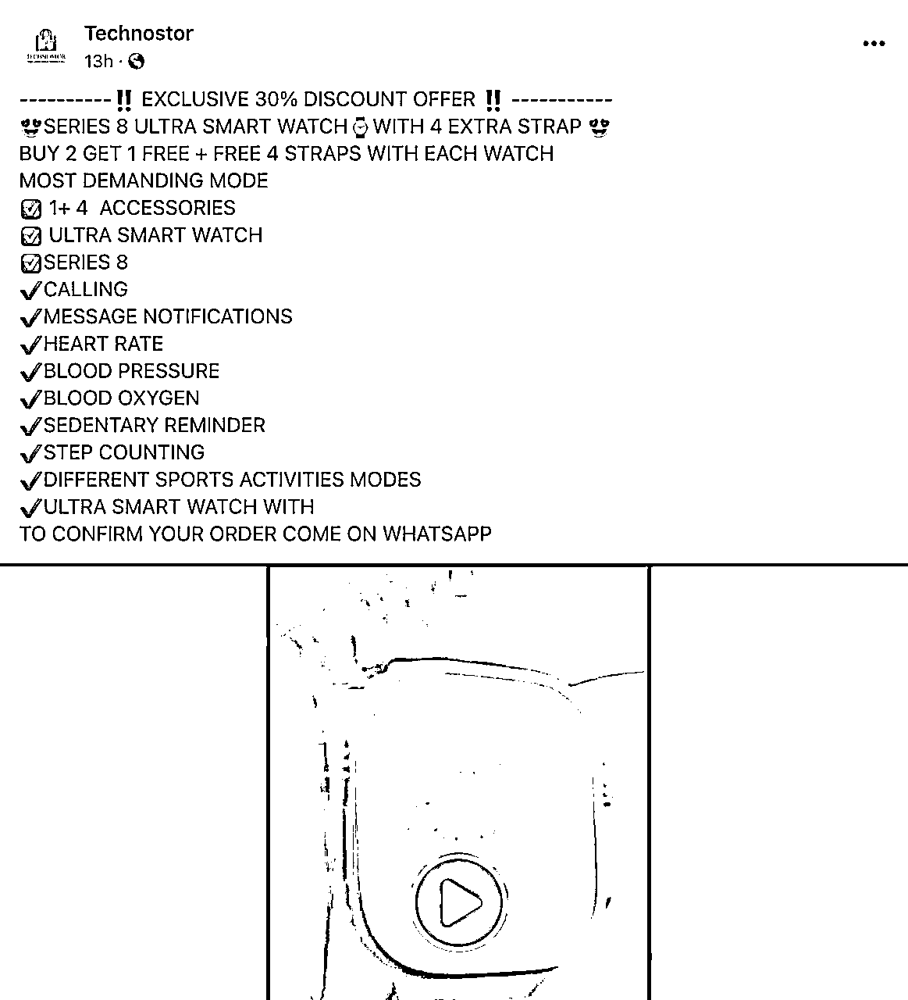

注意两点：TikTok用户是否有相同需求；TikTok节奏更快更紧，商品卖点能否在短镜头里讲清。

#### 3.3.3 冷门渠道

冷门渠道用得少，但可作为灵感补充。众筹站：Kickstarter、Indiegogo。挑完成度高的项目，完成度越高通常需求越强。一般看超过目标500%的项目才重点分析。

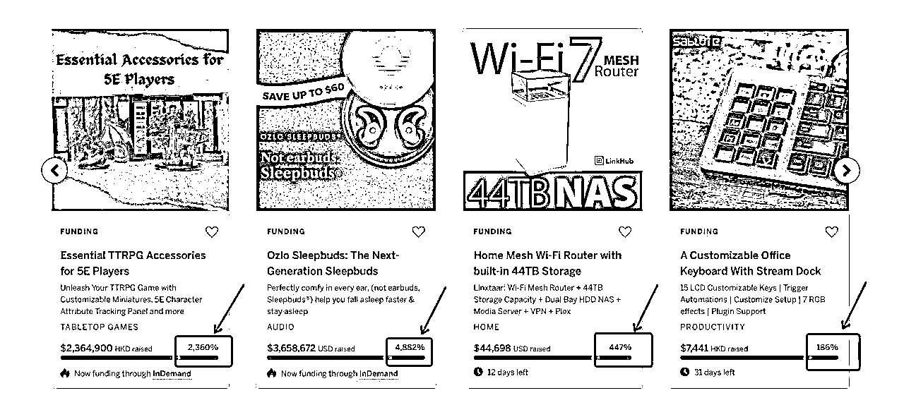

新奇特站：shutupandtakemymoney、thisiswhyimbroke。没思路时逛逛，常能打开脑洞。

#### 3.3.4 数据平台

常见第三方工具：Kalodata、Fastmoss、Echotik、特看。

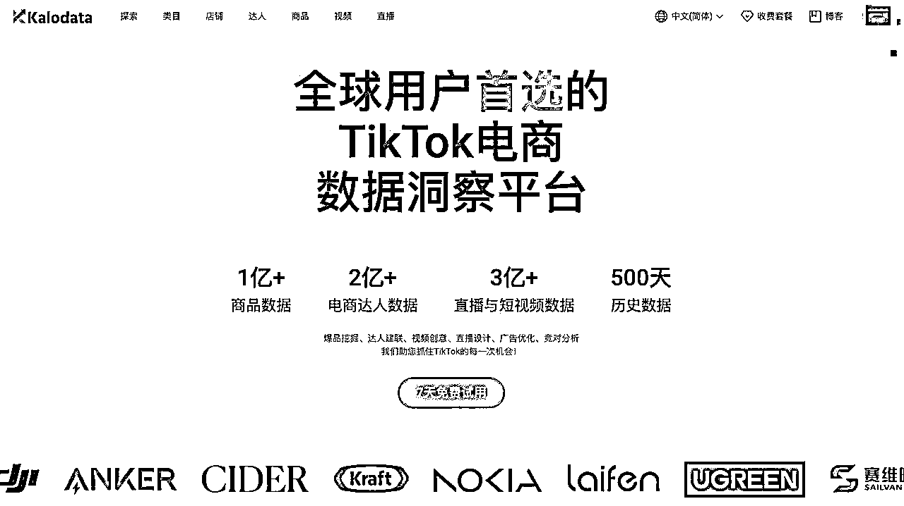

这些工具一般都有商品、店铺、达人模块，初级用户选哪个差异不大。以Kalodata示范。

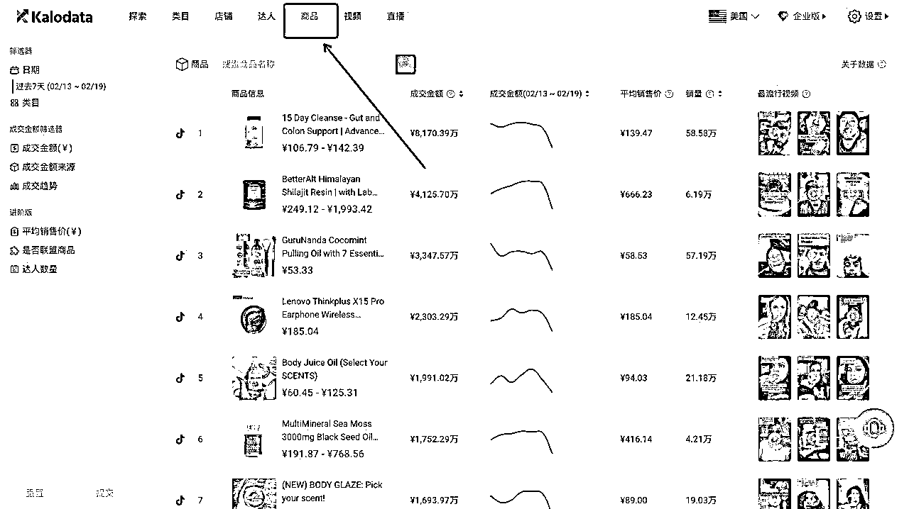

选完品可看热销排名、品名、预估销售额（未必精准）、销售走势。进入选品页，左侧有筛选。

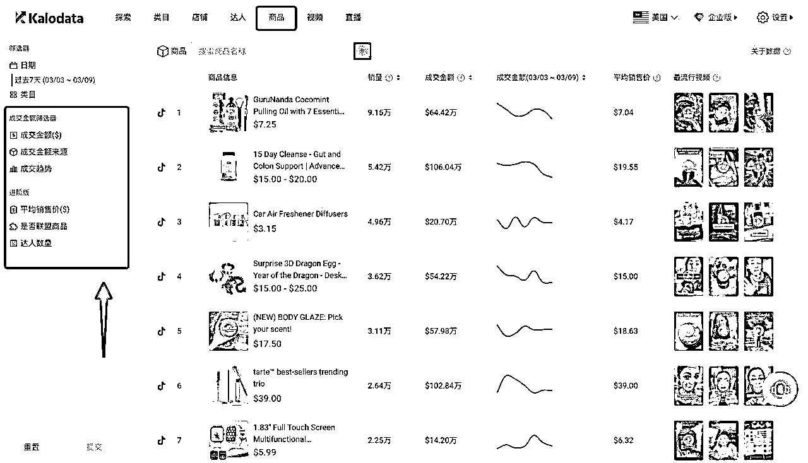

爆品有生命周期，成交趋势选“增长”。美区有全托管和POP店铺，全托管价格通常很低，参考意义小，所以平均售价选20-100美元。

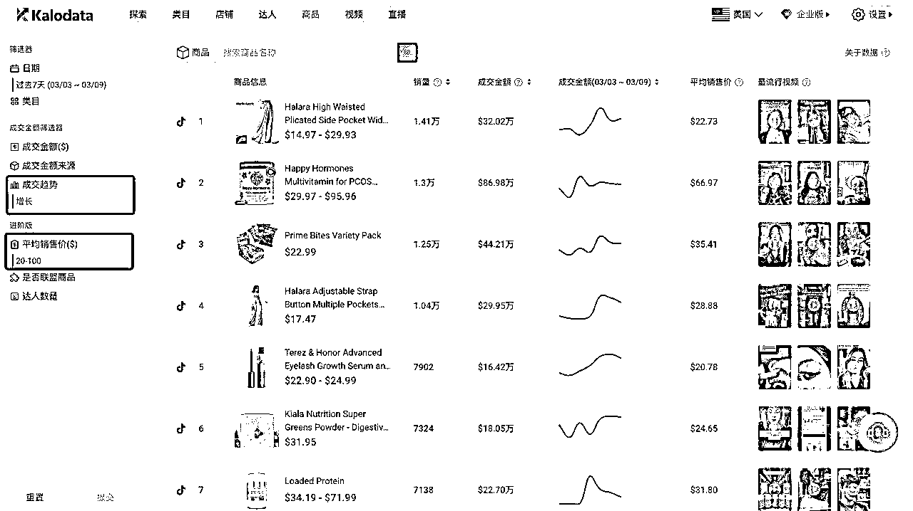

右侧会列出趋势和客单价合适的商品。再结合供应链：供应链弱的团队优先避开服饰、食品饮料，也避开专利、IP授权品，如宝可梦卡牌。排除后找品测试，例如这些热门产品：

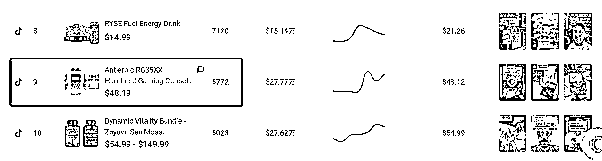

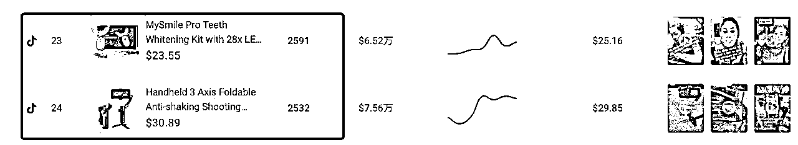

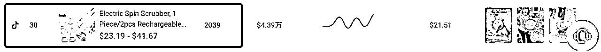

### 3.4 产品供应商怎么找

TikTok美区小店与亚马逊货源相通，多在1688找。亚马逊成熟，沟通偏定制，信息复杂；美区小店增长期，可直接采购现货，沟通更简单。新手可先与海外有货者合作，降低备货到海外的难度。

#### 3.4.1 快速精准找到货源供应商 @郑小焦

1. 以图搜图：多数有效。搜不到可能是边缘模糊，或A+B组合导致识别难；只需A或B时，可拆开分别搜。
2. 关键词：品名、特性、功能、工艺等。
3. 对手链接：详情页看尺寸、重量、包装；评论区找真实细节图，甚至发现买家另类用途。
4. 问1688商家：我曾找一款不知工艺的产品，十几家都说做不了；后来问一家回复较详细的商家该找什么厂，他给了关键词，随后找到一批对标厂。
5. 类似工艺图再搜：有款瓶子市面难找，厂家说现在多买去装榨菜，而我需要装礼品；搜装礼品罐无结果，清空后搜空瓶图，结果全是该瓶。

资料出处：《自由职业5个月回顾之我的亚马逊进修之路》

#### 3.4.2 如何筛选工厂 @Bryce @Jennifer

初期不必直接找源头厂，业务稳定后再考虑。以1688“皂液器”为例。工厂类型：代理商无自有厂，店铺跨多个小类，价格乱；组装厂做结构设计，芯片和模具外采，类似代工厂；产研一体即ODM，有部分或全部方案专利，研发优势更强。找厂时，平台品名可能是直译，和工厂关键词有差异；要用已有词搜出其他常用名。搜皂液器时“洗手机”被系统视为等价词标红，所以也要搜洗手机扩大范围。

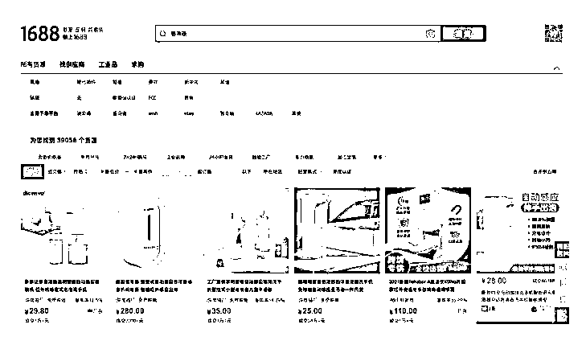

1）以品定厂：首页搜索进入货源模式，按需求细化条件挑品下单。选“泡沫洗手机”，深度认证选深度验厂，选合并供应商过滤小代理商，再筛价格和地区。

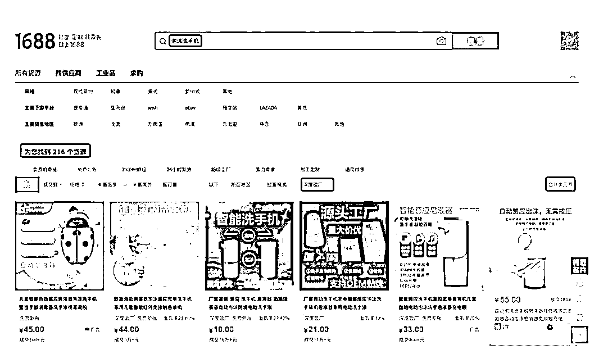

2）定厂找品：首页选找工厂，输入关键词进入工厂模式；看品类排行榜找热门厂（注意有付费刷榜），点厂名看档案和产品目录。

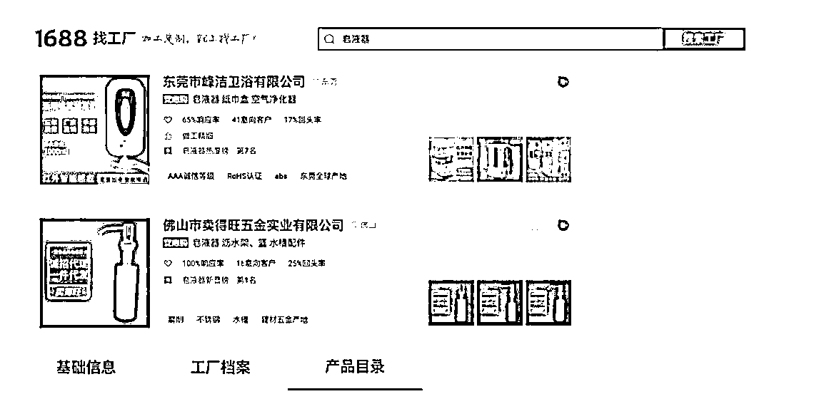

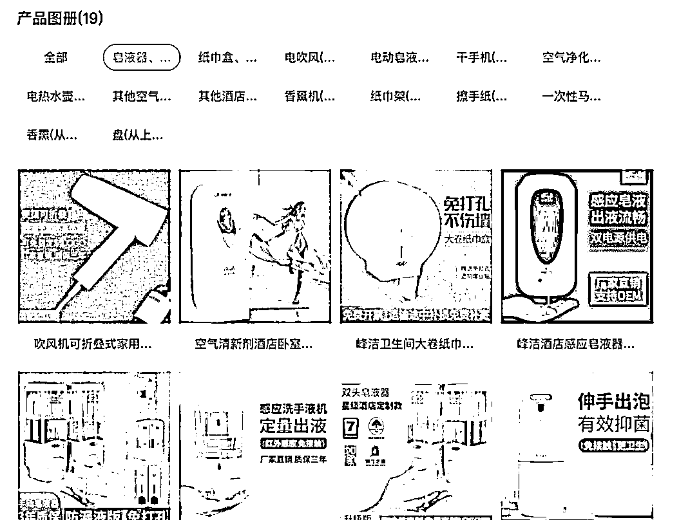

3）样品采购：对比选3-5款，下单通常至少2个，用阿里旺旺联系卖家拿样改价。

4）工厂造访：有样品后针对性走访，了解工期、质检、海外认证与专利、起订量与首批价、返单降价区间和账期方案。

3. 筛选标准：筛后询盘，内容含产品图片、材质、尺寸、做货要求、数量、包装要求。

资料出处：《以亚马逊电商为例，聊聊从公模到私模的整个过程》、《从0到1的亚马逊创业之路》

## 四、【实操 3/4】美区小店带货运营

本章导读

做美区小店最终要赚钱。选品过关后，怎么把货卖出去是另一关键。店铺注册期间先学带货运营，开店后能快速上手；上架流程和店铺管理放到下一章。本章讲两种带货方式：

方式一：自己短视频带货。TikTok本质是兴趣电商，要靠短视频展示并成交。重点理解推荐机制、找对标素材、制作带货视频。

方式二：达人建联带货。自己账号覆盖有限，要找匹配达人合作，借其视频能力和粉丝扩大营销。

直播带货也有，但门槛更高，放在选修篇七、【项目放大】美区小店进阶运营介绍。

本章航线图

完成第四章，可完成航线图第二阶段：确定类目完成选品，学习短视频和达人建联两种带货方式（约8天）

1. 学习样品实拍视频带货，持续选品带货（约2天）
2. 学习与达人合作带货的方式，尝试建联达人（约2天）

记得提交学习进度到航海日志打卡。

### 4.1 方式一：自己短视频带货

#### 4.1.1 TikTok短视频推荐算法逻辑

平台有时比我们更懂自己：知道我们想看什么，并精准推送。为什么能识别喜好，又为什么让人上瘾？关键在推荐机制。先问：你喜欢哪类内容？很多人一时答不上来，而且口头描述未必真实；“用脚投票”才诚实。例子：某公司新品发布前调研，问黄色好还是黑色好，多数反馈黄色；散会时送产品答谢，大多数人却拿了黑色。说明观众未必知道自己要什么，行动才给出真实答案。TikTok算法也如此：不要求你说喜欢什么，而是先推内容，用行为收集答案。如图，系统推荐后发现你在“红色的圆形”“红色的三角形”停留久、互动多，就给账号打上“红色”“圆形”“三角形”标签；再验证，推“红色的六边形”“绿色的圆形”，若你对前者感兴趣、后者不感兴趣，就强化“红色”，弱化“圆形”。

刷TikTok为什么容易停不下来？关键在于平台把推荐做成了闭环：推送内容—收集反应—再推送—再收集。轮次越多，账号画像越清晰，用户偏好也被摸得更透，这正是它让人欲罢不能的底层原因。

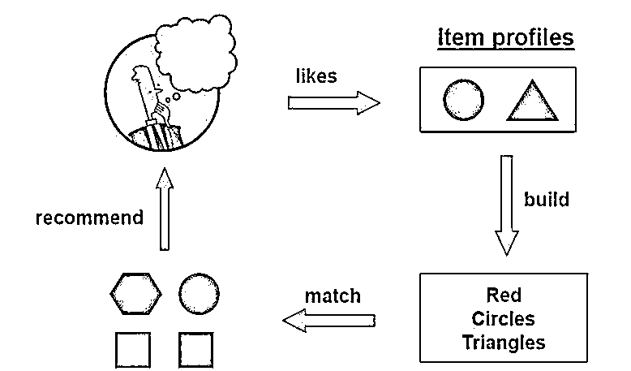

和抖音类似，TikTok的流量是一层一层放大的。初始池一般给200—500次播放；数据反馈好、内容过硬，就进入第二层，播放可能到2000左右；表现继续在线，会升到第三层，播放量可到5000甚至破万。每升一层都重新考核，直到某层表现掉队，推荐便收住。

需要留意，首层流量通常先分给账号所属市场。比如IP与数据归属地在美国，首层大概率先给美国用户；到了第二层及以后，就不再受国别限制，内容可能吃到全球流量，此时题材和完成度决定后续走势。此外，流量天然带随机性。运营无法消灭它，只能通过测试和优化收窄波动，把碰运气变成算概率。

#### 4.1.2 门面包装：让访客秒懂你

门面包装的关键，是用最短时间把“我是谁、我卖什么”讲清楚，降低访客的理解成本，也顺带把信任感搭起来。

包装前：

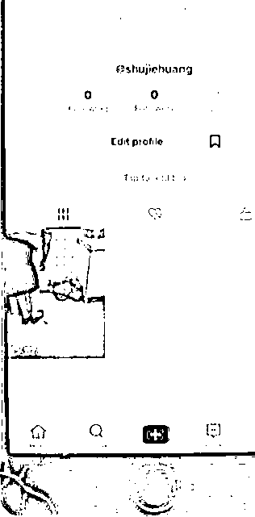

包装后：

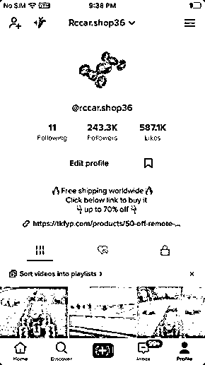

这个环节主要处理五个位置：

1. 名称字段（Name）

名称里允许放表情、空格等特殊符号，正好用来做个性化表达。以玩具车卖家为例，名称中点缀商铺、车辆小图标，亲切又接地气，容易拉近和用户的距离。

2. 头像字段（Photo）

头像是主页除视频外唯一能用图片或短视频展示的区域，所以尽量把文字难讲清的信息用画面呈现。它要承担身份说明，也要帮助建立信任。想立个人IP或专家感，可用真人出镜，比如牙齿健康类账号让头像人物穿白大褂，树立牙医形象；想强化品牌，就用品牌logo；想直接承接流量、打单品爆款，可直接上产品图。

3. ID 用户名（Username）

ID 的首要任务是表明身份。取名尽量好懂、好记，常见组合有“产品+店名”“职业+英文名”“专业领域+英文名”。要注意，这个位置除英文句号和下划线外，不能塞空格等特殊符号。

4. 简介字段（Bio）

简介要交代身份，也要做引导和营销。通常会把优惠信息放进去，亮明商家身份，促使用户点购买链接。简介是TikTok文案营销里很关键的一环，总共只有80个字符，必须用足。

另外，80个字符别挤在一行，否则读起来费劲。建议拆成3—4行，每行前后用表情做分隔。这样用户扫读舒服，也更容易一眼抓到重点。

5. 主页链接字段（Website）

TikTok号达到1000粉丝后可在主页挂链接。除违规站点外，大多数网站都能放。用户点开后可直接跳到外部落地页，这对商业闭环意义很大。链接可用落地页原始地址，也可用短链。

总的来说，装修账号是运营人的基本功。动手前要吃透客户，站在对方视角反复优化，让页面更顺眼、更高效，也更容易赢得信任。

#### 4.1.3 对标筛选：借力已有爆款

这次重点讲围绕样品实拍的短视频怎么起步。

不管是新手还是成熟运营，拍一个新商品时，最高效的起手动作就是找优秀对标账号和对标作品。核心方法是学习加模仿。对原创内容新手来说，同赛道的优质TikTok作品就是现成老师。

这个阶段建议筛出10—20个优质对标号。

可以在国内外多个渠道找，比如抖音、小红书、相关数据平台等，用产品关键词搜索，定位相关优质账号。

这类号要有一定粉丝量，例如20万+粉丝、100万+播放，数值只作参考。

另外，找对标时还要看对方的内容自己能不能拍出来，尽量选可复制的素材。

找到账号后，要研究其中的爆款。怎么判断爆款？一个号不会条条都爆。假设某账号有10万粉丝，多数作品平均播放1万左右，但总会有几条远超1万，可能冲到十几万、几十万甚至上百万。这些明显高于账号均值的作品，就是爆款。

把这些作品收藏起来逐条拆解，研究脚本或拍摄逻辑、分成几个镜头、每个镜头展示什么、怎么运镜、配了什么背景音乐、节奏如何推进，等等。

#### 4.1.4 美区带货片：产品才是主角

内容力强的作品很多，但不是每条都适合带货。有的适合知识传播，有的适合休闲娱乐，有的才适合电商转化。

什么样的内容适合带货？核心就一句：带货内容要从产品里长出来。

不少电商短视频新手有个误区，觉得必须安排复杂剧情或创意桥段才抓人。可这样做常常喧宾夺主，用户光顾着看故事，反而把电商的核心——商品——晾在一边。

要记住，优质电商片看完后，用户会夸片里的东西好；不合格的电商片看完后，用户只会夸这条片子拍得好。市场常提的“泰国神广告”就是例子，传播热闹，ROI却不高。

所以做电商内容时，产品必须突出，所有内容都围着它转。

带货片具体怎么设计？有没有逻辑和模板？下面介绍4种TikTok电商短视频设计思路。它们由4个基础镜头与展示场景组合而成：

（1）呈现生活里的麻烦。
（2）呈现商品长相与款式。
（3）呈现操作方式与使用环境。
（4）呈现用后结果。

把这4个基础画面做不同排列，就能得到以下4种组合。

4.1.4.1 顺序式：先抛痛点，后见结果

画面顺序为：1痛点→2外观→3使用→4效果。示例如下：

video_7274387125343161643.mp4【在线播放】

飞书 20240317-000545.mp4【在线播放】

顺序式很好懂。开头先把生活里的麻烦摆出来，接着给出解决思路，再自然带出商品，随后展示实际操作和使用环境，最后亮出结果。这个结构在4种组合里应用最广，多数实用型商品都能套用。

4.1.4.2 倒叙式：先给结果，再补过程

画面顺序为：4效果→2外观→3使用。

可参考以下视频：

鱼鳞抹布.mp4【在线播放】

飞书 20240317-000253.mp4【在线播放】

倒叙式适合效果直观、用前用后反差强烈的商品。

以曾经的爆款鱼鳞抹布为例。它在厨房清洁中确实能打，那怎么拍？先在操作台面上铺污渍，擦拭时只处理一半，另一半保留。擦过的一侧干干净净，未擦的一侧和干净面之间形成一条清晰分界，反差一出来，清洁力就被放大了。

这类片子在开头先甩结果，用强对比抓住注意力，再回头讲商品长相、款式，以及具体操作和使用环境。

4.1.4.3 场景式：多场景拓宽人群

画面顺序为：3使用→3使用→3使用→4效果。

这种结构适合哪些商品？通常适合第一眼很难看出价值、容易被觉得“鸡肋”的东西。通过场景带入，用户才能体会到它的用处。

这套逻辑的核心是场景要够多。每加一个使用场景，就可能多覆盖一类人群、拓宽一片使用范围。

具体可参考上面的鱼鳞抹布视频，也是用多个场景来使用。

4.1.4.4 教学式：讲清好处与效果

画面顺序为：2外观→3使用→4效果。

video_7343412355512012075.mp4【在线播放】

飞书 20240317-000537.mp4【在线播放】

教学式在排序上和顺序式很接近，只是少了“呈现痛点”这一步，但两者要表达的核心理念差别很大。

教学式拍摄的重点，是展示商品最终的使用结果，以及它能在日常生活里带来哪些便利；顺序式的出发点和落点则都在解决麻烦、处理痛点。

因此，教学式更适合给生活“锦上添花”的商品，顺序式更适合给生活“雪中送炭”的商品。

其实带货片的逻辑和脚本非常多，创意没有尽头。这里给的只是多数人容易上手、也容易做出效果的方法。期待大家在后续学习和实操里，摸索出更多高阶玩法。

创作时还要额外注意：TikTok对配乐版权管得比较严。

有些曲子不能商用，有些在特定地区不能用。若创作时踩了版权雷，会怎样？可能音频被系统静音，可能片子被强制设为隐私状态，也可能直接被删除。所以创作过程中务必重视版权风险。

那怎么在TikTok里找到有授权的配乐？如果是创作者账户，选曲时页面会提示赞助视频可使用商用声音。顺着提示点开声音入口，切到Commercial Sounds，就能看到商用曲库，从这里选曲不会产生版权问题。

如果是商业账户，选曲时会自动切到Commercial Sounds，且不能更改，该列表里都是商用曲目，所以选曲时不会踩版权雷。

关于版权也不用过度紧张。做电商片时你会发现，真正常用好用的配乐并不需要太多。每个不同商品，准备5—10首可商用且不侵权的曲子就够用了。

#### 4.1.5 剪辑上手：轻工具也能出片

说到拍摄设备，很多人以为拍片必须上专业相机、摄像机，还要摄影棚、器材等等。其实未必。很多场景下，一部手机就能覆盖90%的拍摄需求。安卓建议华为P40版本以上，苹果建议iPhone12版本以上，再按场景添些灯光、手机支架等基础件即可。

剪辑工具选择很多。PC端常用Pr、达芬奇、剪映等，手机端最常用的是剪映。Pr和达芬奇功能很强，但做电商短视频时，大半功能用不上；剪映轻量、易上手，能解决创作中的多数需求。所以初期无论PC还是手机，都推荐先用剪映。

不少新手刚拍原创TikTok短视频时会有畏难情绪，其实拍摄门槛和成本并不高，迈出第一步最重要。

剪映的常用功能，简单介绍一下。

1. 启动剪映，在首页选“开始创作”

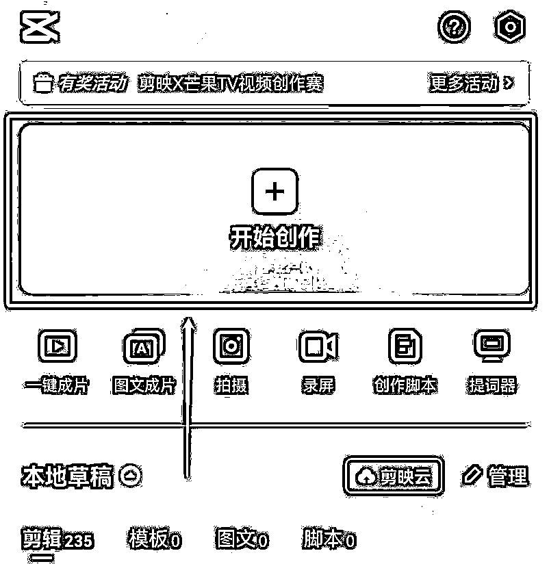

（2）从相册挑一段待剪素材

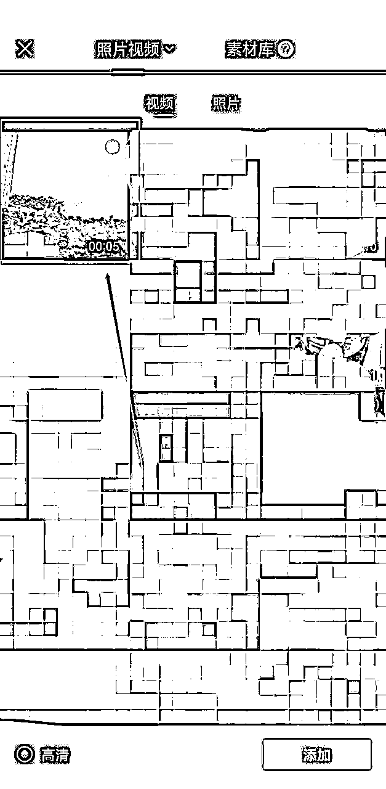

（3）素材导入后会进入编辑界面；底部一排是主要入口：剪辑、音频、文字、贴纸、画中画、特效、滤镜、比例、背景、调节等。下面逐项说明。

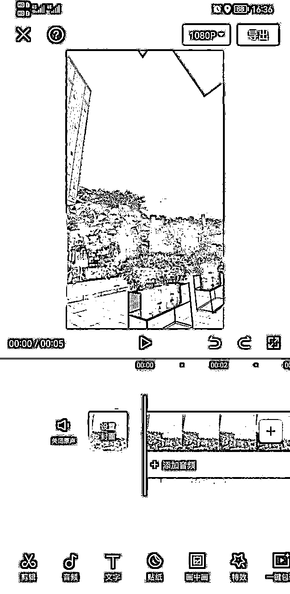

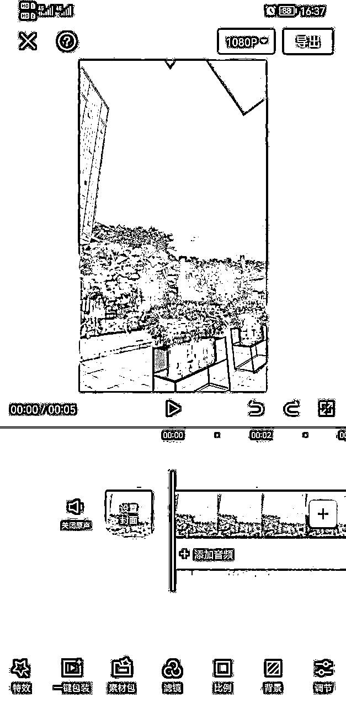

（4）选中“剪辑”，展开二级菜单

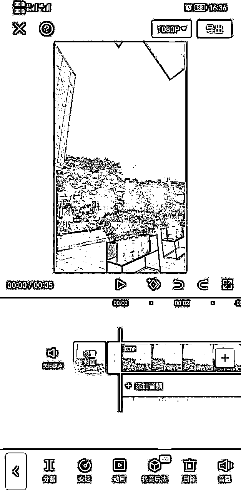

这里能完成裁切、分割等基础处理。

（5）退回主工具栏，选中“音频”，展开二级菜单

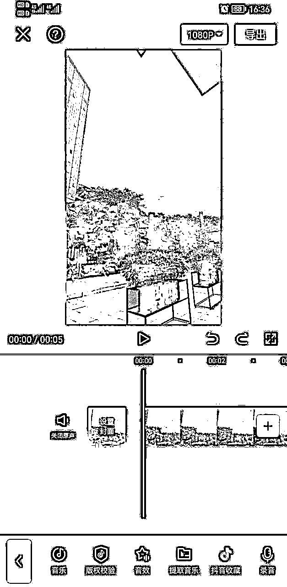

这里给片子铺音乐。

（6）退回主工具栏，选中“文字”，展开二级菜单

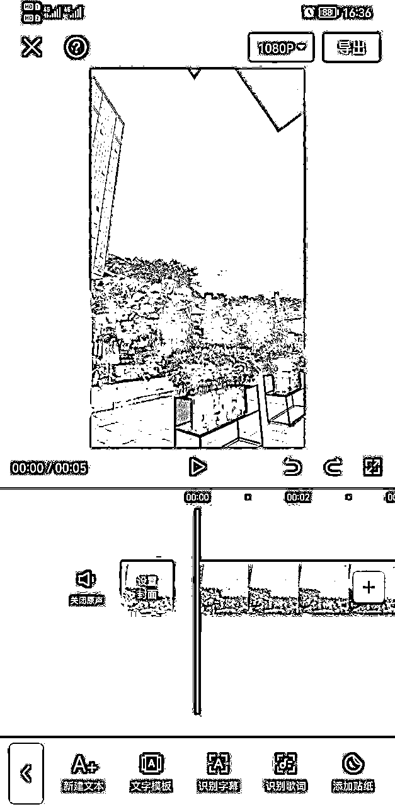

这里可加字幕和各种字样。

（7）退回主工具栏，选中“画中画”，展开二级菜单

若想让两段及以上素材在同一时间点同屏出现，就用这个入口。选“新增画中画”，从相册挑视频或图片，即可叠放。玩法很多，按需组合。

（8）退回主工具栏，选中“特效”，展开二级菜单

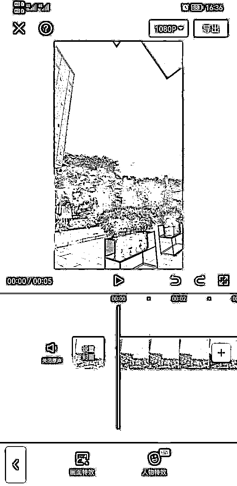

其余简单功能不展开。工具书要看，但真正提升靠动手；实操会解决多数疑问，也会冒出灵感。进阶内容可看《3月航海 | 剪辑特训 | 航海手册》。看到这里别犹豫，装好剪映，拍一条，剪一条。

### 4.2 第二种玩法：达人合作带货

达人营销在社媒电商里分量很重。跨境商家借TikTok达人，可以补上本土化内容生产的短板，同时抬升品牌声量、触达潜在买家、推动成交。内容团队偏弱的商家，更该用合作方式拿到当地语境的短视频或直播素材。

本章依次讲达人筛选、联系，以及合作模式和避坑提醒。

#### 4.2.1 如何锁定合适的达人

第一步是找人。先按类目、目标受众、营销目标做初筛。下面三种路径。

4.2.1.1 App 内搜索法

直接在TikTok应用里搜，是最老派也最管用的路径之一。输入产品相关词，筛出数据亮眼的作品，比如播放明显高于同赛道其他视频，再点进作者主页谈合作。这样能攒出一批已有粉丝积累的垂直达人。若主页留了商务邮箱，可直接发信；没留邮箱的，通常会在落地页的“关于我们”或“联系我们”里放联系方式；也可以在评论区批量留言，等对方来敲门。

4.2.1.2 达人广场主动出击

相比逐个搜号，达人广场更直接、更精准，只是已入驻的达人数量还不算多。

第一步：进入联盟带货界面，点“达人广场”

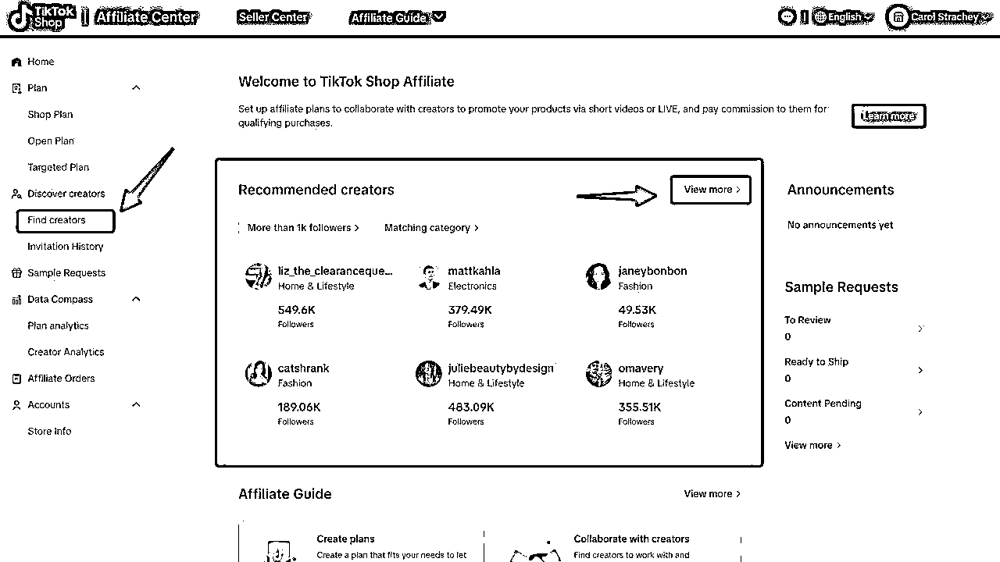

第二步：页面会列出已收录达人，顶部可按商品品类、粉丝规模、粉丝年龄、粉丝性别筛选。先把池子筛准，再谈合作，效率更高。

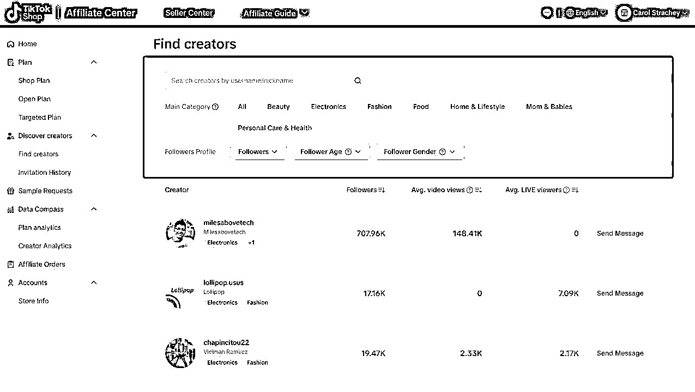

第三步：锁定中意的达人后，点一下“联系”按钮，就能和对方直接建立联系。

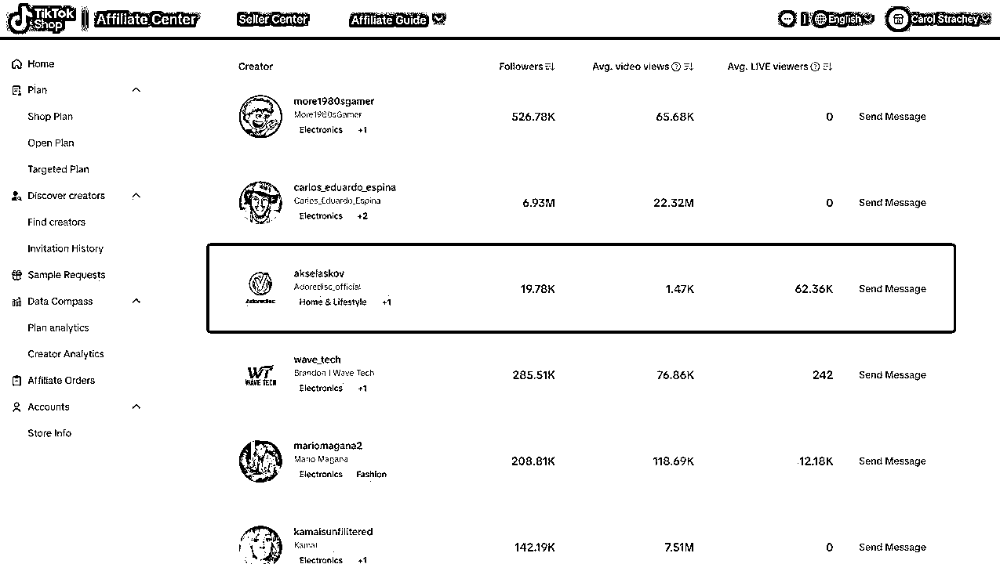

**4.2.1.3 在 TikTok Shop 达人广场等达人主动联系**

主动出击未必总是最省力的方式，邀请发出去后没有回音也很常见。所以，不妨先在达人广场把资料留好，坐等达人反过来找我们，我们只负责接收消息。

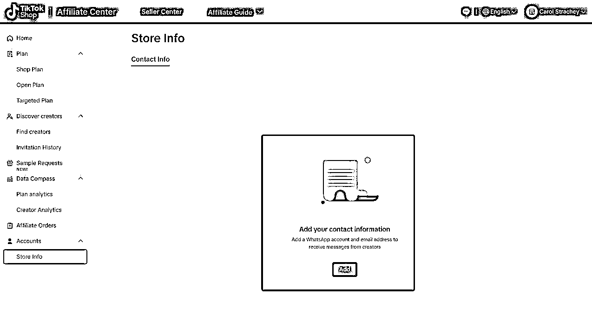

这时，可以把 WhatsApp（即时通讯工具）或邮箱填进联系方式里。

WhatsApp 和邮箱至少填一个；达人看到信息主动来加后，我们就能直接在对应渠道沟通。

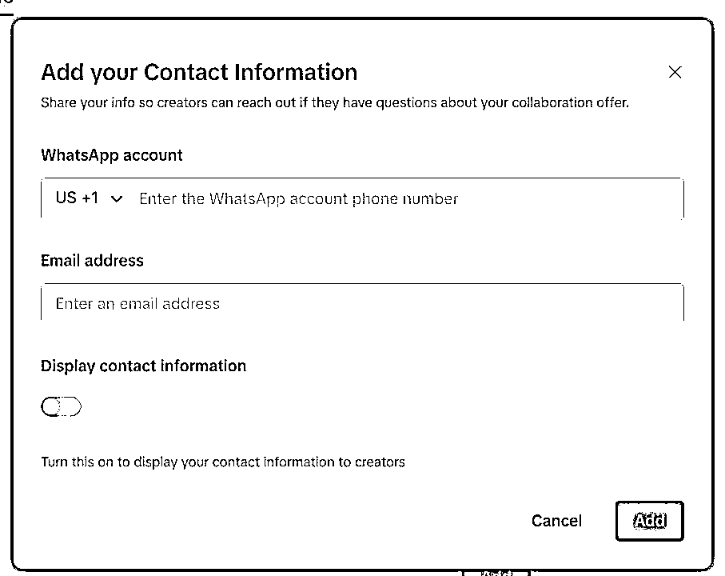

**4.2.1.4 借数据平台筛选达人**

目前较常用的工具有 Kalodata、Ehcotik、Fastmoss、Tabcut（特看）等。以 Kalodata 为例，在“达人”页面能查看不少基础信息：粉丝数、产品、成交金额、成交趋势等。

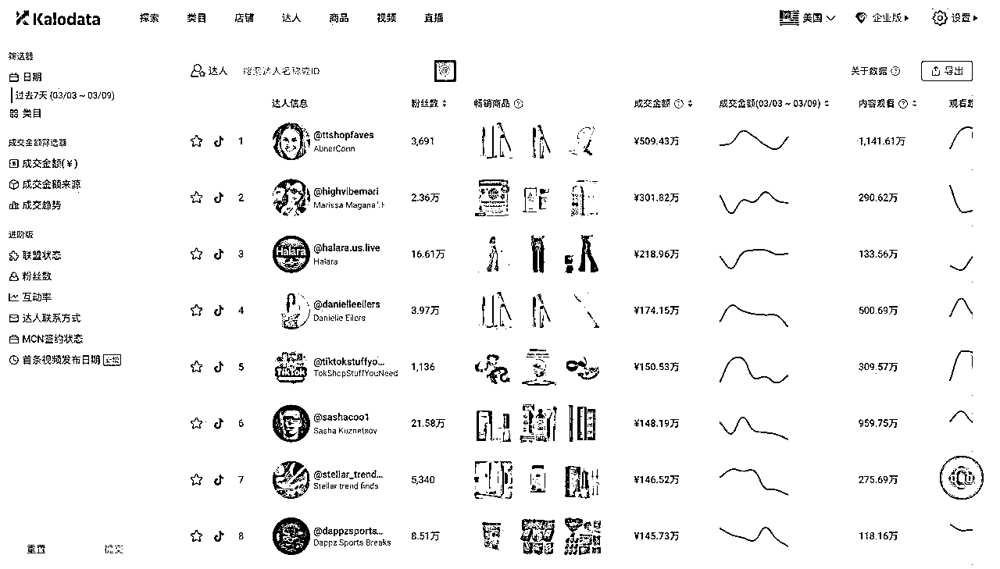

#### 4.2.2 如何判断 TikTok 达人质量

达人营销里，数量当然越多越好，但投产比不能忽略。所以在联系达人前，先判断达人和账号的质量。通常从下面几个关键指标入手。

**4.2.2.1 粉丝数量**

粉丝量与合作形式、合作费用直接相关，所以第一步就要看粉丝量。

不同类目的粉丝量级本身就有差异，所以不能单看数字，要把类目和粉丝规模放在一起看，才能较准确判断账号价值。

比如同样 30 万粉，宠物娱乐账号和宠物电商账号的价值可能差很多。不少垂直细分账号粉丝不多，但变现能力未必弱。分析粉丝量前，先了解该领域多数优秀达人处于什么量级，再给目标达人定位。

同类目里，粉丝越多通常报价越高。前期试错预算有限时，可以先看中小达人，因为不少中小达人愿意免费合作：寄一个样品，就可能换来视频宣传。此时主要算清楚样品成本能否换回预期收益。

**4.2.2.2 视频更新节奏**

这是个很实用的小技巧。看账号时，更新频率往往会被纳入判断：频率高，说明达人内容生产能力较强、收益也较好；频率低，效果通常就差一些。

还要把过去和近期的更新频率做对比。如果目标账号早期更新勤快、近期明显变少，往往侧面说明最近收益不太理想。

**4.2.2.3 近七天平均播放表现**

粉丝量与合作形式、费用关系最紧，但广告主真正要盯的是曝光、播放和转化。

无论 10 万还是 100 万粉，这些粉丝都不属于达人。为什么？很多百万粉账号单条视频播放都不到 100 万，说明不是每个粉丝都能看到视频。谁能决定粉丝看不看？平台的分发算法。所以粉丝其实属于平台推荐机制，我们要重点看账号近期播放量，也就是平台给它的流量。

分析时先把近期播放和以往播放对比，看是否被限流；一旦限流，合作价值会大打折扣。其次对比常规内容和广告内容：有些达人常规内容偏娱乐，账号标签和粉丝也偏娱乐，广告内容接不上，广告流量就差，这类达人也需谨慎。

**4.2.2.4 粉丝构成**

判断达人质量，粉丝结构也很关键。通常看三个维度。

第一是年龄：TikTok 有购买力的用户主要是成年人，建议达人粉丝中至少 50% 大于 18 岁；多数粉丝未成年则不建议合作。TikTok 后台没有年龄标签，怎么了解？用抽样调查法：在达人爆款视频评论区随机抽 50-100 位活跃用户，依次进主页，根据主页信息判断是否成年。

第二是性别：产品有性别指向时，主要性别占比应大于 70%。比如美甲主要受众女性，女性粉丝占比要超 70%；汽车零配件主要受众男性，男性粉丝占比要超 70%。占比太小说明粉丝结构和产品不匹配。

第三是地区：账号粉丝地区分布至少占目标地区 20%。想开拓英国市场，就要求至少 20% 粉丝来自英国；低于 20% 说明粉丝对我们不够精准。

**4.2.2.5 账号内容标签**

看账号类目标签时，先注意它是不是洗粉账号。

所谓洗粉账号：起初为涨粉发泛娱乐、美女等容易吸粉的内容，粉丝到量后隐藏全部内容，再换头像、ID、简介，包装成电商号。

这类账号怎么分辨？可以从两个方面看。另外还要考虑达人视频特点：有些内容娱乐属性强，电商表现通常不太好；找达人时更建议选视频具备电商属性的。

#### 4.2.3 与 TikTok 达人沟通的话术

找到目标达人后，沟通和建联有不少细节要注意，包括用哪个邮箱、邮件主题和内容怎么写。核心是让达人充分信任我们，并愿意沟通合作。

**4.2.3.1 联系邮箱怎么选**

联系邮箱一般建议用品牌域名邮箱。品牌名是 xxxx，就用后缀为“@xxxx.com”的邮箱发建联邮件，达人更容易信任。域名邮箱可向网易企业邮箱、腾讯企业邮箱等服务商申请。

如果没有品牌域名邮箱，或暂时不想注册，推荐用 Gmail。命名时别用晦涩、无意义的字符或数字，建议用自己名字或品牌名，比如品牌名 xxxx，可用 xxxx@gmail.com。这样达人的信任感会更强。

**4.2.3.2 邮件标题和正文怎么写**

选好邮箱后，具体邮件内容很关键，直接影响建联成功率。

这里会分享两个建联模板及其细节，下面先给一个可直接套用的基础版模板。

邮件主题一般要包含“品牌名”和关键词“Collaboration（合作）”，让达人一眼看出这是某品牌来谈合作。

正文第一次沟通不必事无巨细，把基础必要信息写清楚，表明来意，并体现尊重和专业即可。

下面给出一个简单模板：

Subject: [Brand Name] × Collaboration

Hi [Influencer Name],

This is [Your Name] from [Company Name]. We work in cross-border e-commerce and have been impressed by the influence you've built on TikTok.

Your content is full of creativity, and we'd love to explore a partnership that introduces our product to your audience. We believe your reach and expertise could really help.

Would you be open to testing and reviewing [Product]? Here are the basics:

Product Name:
Product Image:
Product Features:

If this sounds interesting, we can arrange a call to go over details and answer your questions. We see this as a potential win-win situation.

Let us know if you're interested, and we'll set up a call at a time that works for you.

Thanks for reading, and we hope to hear from you soon.

Best regards,
[Your Name]
[Company Name]
[Contact information]

签名的位置要写上我们的信息，包括名字、联系方式、公司名称；还可以加上公司简介，提升达人信任感。

如果合作中对达人有特别要求，可在邮件里补充产品详细介绍和卖点，突出与普通产品的差异；这需要一定的英文写作能力。希望大家能根据模板要点举一反三，写出更合适的建联邮件。

另外，邮件若需插入附件，体积别太大；有图片的话，建议控制在 20K 以内。

#### 4.2.4 TikTok 达人合作的常见模式

和达人合作常见三种模式：免费寄样、付坑位费、佣金提成。

**4.2.4.1 免费寄样合作**

这种模式成本较低：给达人寄一个样品，不少达人愿意免费拍宣传视频、带货视频，或在直播间展示产品。免费寄样通常更适合 20 万粉以下的中小达人。

具体流程一般如下。

① 明确推广目标

合作前先和达人确认此次推广要什么，是产品曝光、品牌宣传，还是追求转化。目标清楚，后续易达成一致，也方便复盘和下一次优化。

② 确定视频形式

目标和达人情况不同，视频形式也不同。品宣、曝光可用 Vlogs 或测评展示；追求转化更适合直接展示产品、带入使用场景、开箱、教程等。

③ 敲定文案内容

形式定好后，结合达人风格一起设计文案，包括视频内文案、标题文案和评论区文案。视频内文案建议精简；达人表现力强也可省略。标题文案可提前在 TikTok 建 Hashtag（标签），推广时打上品牌标签。达人愿意的话，可让其“@官方账号”引流。评论区文案要提前把顾客可能问的问题告诉达人，方便及时解答；达人允许时，品牌官方账号也可在评论区互动。

④ 约定上线时间

内容形式和文案确定后，约定拍摄进度和视频上线时间。一般收到样品 7 天内上线，也可按产品、国家地区、达人情况灵活调整。

⑤ 确认主页链接追踪

TikTok Shop 合作的达人发布视频时要挂上指定商品链接。若导流站外，如独立站、Amazon 等，要确认达人清楚导流路径，主页 Website 能方便找到我们的网站，也可约定外链展示时间。

⑥ 复盘打分

达人营销效果复盘很重要，可从互动数据和交易数据两方面给推广打分。

例如：

通过持续复盘和优化，筛出合适的达人及合作模式。

**4.2.4.2 坑位费合作**

这种模式下，达人通常不在意佣金，也不对曝光量、转化量作承诺，只要求保底坑位费。产品知名度较低、达人对产品缺乏信心时常用。

因为我们的收益和达人收益无法强关联，合作有风险，所以要提前预估合作视频情况。主要按展示量市场价估算投产比是否在预期内，因此要分析达人往期视频播放量。目前 TikTok 上质量较好的达人 CPM（千次展示成本）大约在 10-20 美元，可参考这个区间报价。

另外，TikTok 相比 Youtube 等平台，达人推广坑位费更优惠；Youtube 达人推广 CPM 往往要 60 美元。

**4.2.4.3 佣金分成合作**

这种模式下，达人带货出单后，商家按比例付佣金。对商家来说前期投入少、风险较低。

但要算清产品利润率，并从利润中拿出一部分做佣金。过去有卖家没算清利润率，结果卖得越多亏得越多。

不清楚该给多少佣金，可参考联盟广场上友商价格，目前佣金多在 5%-20%。

## 五、【实操 4/4】美区小店管理实操

章节概览

本章会集中说明店铺管理相关环节，包括：

卖家后台物流管理

商品上架流程

成本计算与定价

发货与售后

支付与回款

下面看看每个环节的步骤和细节。

本章学习地图

完成第五章学习和实操，即可完成航线图第三阶段：了解商品上架、定价、物流管理、售后处理、跨境支付等方法（约 2 天）。

1.熟悉商品上架流程（约 1 天）

2.掌握 TikTok 美区电商成本结构与定价逻辑（约 2 小时）

3.弄懂 TikTok 美区电商物流管理操作流程（约 2 小时）

4.熟悉 TikTok 美区电商售后与处理方案（约 2 小时）

5.掌握 TikTok 美区电商支付与回款方式（约 2 小时）

记得提交学习进度到航海日志中打卡哦～

### 5.1 TikTok 美区电商的物流管理

上架商品时，流程里会遇到发货仓设置，所以上架前得先配好仓库。

#### 5.1.1 第一步：仓库基础配置

操作路径：右上角店铺信息图标 →「My Account」→「Account Settings」→「Warehouse Setting」→「Add Warehouse」

Step 1:

Step 2:

Step 3:

美国地域广，通常会把一个产品设置多个仓库，以在一定程度上降低物流成本。

操作方法就是重复 Step 3 做多仓设置；地址、电话等都要填海外仓的真实信息。

#### 5.1.2 第二步：发货方式怎么定？

拿美区跨境小店的美国本土店来说，发货有两条路。

一条是卖家自己揽下从海外仓到买家签收的全部运输，这叫自发货。

另一条是先把货送进平台仓库，等买家下单，TikTok 再从该仓直接发出，这叫官方发货。

两种走法的物流开销其实相差不大，配送快慢可能受仓库与买家距离影响，照自身情况挑就行。

操作入口：「Orders」-「Shipping Options」-「Seller shipping」

#### 5.1.3 第三步：运费模板怎么设？

入口是「Orders」-「Shipping Templates」-「Create」。

Step1:

Step2:

Step3:

提醒一句：同一个模板可以挂一个仓库，也可以挂多个仓库。

Step4：选快递方式

买家结账时会看到不同承运选项，好比顺丰、中通、圆通各走各的。这里要做的就是把每种方式的运费填好。可参照各家价目自行估算，常见的有 USPS、UPS、Fedex。

附：USPS 物流价格计算工具

还要留心，快递报价会涨会跌，设置完不是一劳永逸，后面得跟着调。

### 5.2 商品上架流程

#### 5.2.1 第一步：后台点「Add new product」

#### 5.2.2 第二步：把产品资料填好

5.2.2.1 标题

标题可以按四块拼：热度词、长尾词、产品词、品牌。

举例：Valentine’s Day lovers Large capacity color gradient water bottle The same style as Tiktok

5.2.2.2 类目

直接选对应类目，不难。

5.2.2.3 品牌

通常点无品牌。选有品牌就要交品牌资质，选无品牌主要是怕品牌纠纷。若你是品牌商家，就正常上自己的品牌并传资质。

5.2.2.4 属性

按产品真实情况选。化妆品要填保质期、含不含液体/酒精、带不带电或磁、是不是粉末类敏感货等，照实选。

5.2.2.5 产品图片

要传 9 张图，系统会提示每张展示什么。

图片最好是正方形。矩形会被系统要求裁成正方形，一裁像素就掉。所以主图直接用正方形更稳。第一张当主图，主图还能按实际要点再优化。示例主图如下：

5.2.2.6 详情页

详情内容在红框里编辑，建议不少于 500 字，图文穿插着讲产品。

一般详情页会放这些信息：参考如下：

#### 5.2.3 第三步：把销售信息补齐

5.2.3.1 产品属性信息

下图填完后，内容会同步到销售属性列表：

5.2.3.2 多仓库设置

点「Add to multiple warehouses」，把商品对应的仓库和库存填上。

注意：一定点编辑。不同商品在不同仓，必须把商品和仓库对上。

5.2.3.3 包裹信息

最后一步是包裹重量和整体尺寸，官方会给物流费参考。

重量、尺寸都要照实写，因为这会直接算进预估运费，再影响定价。另外，填的是打包完成后的包裹数据，物流商按包裹重量和体积收费。

5.2.4 第四步：点提交，商品创建完成

全部设置完提交，商品就上架了。

#### 5.2.5 第五步：看看审核过没过

在「Manage Products」里查提交商品的审核进度。

常见失败原因：按情况改；要是缺资质或侵权，直接换品。

### 5.3 TikTok 美区电商成本怎么算、价格怎么定

#### 5.3.1 成本由哪些部分组成

有人内容做得不错，TikTok 上卖了不少货、出了不少单，结算时却发现自己没赚钱甚至倒亏。问题就出在成本没盘清，卖一单亏一单。

所以开干之前先把成本拆明白，免得白忙。重点看五项。

5.3.1.1 包裹成本

商品本身加上包材，比如纸箱、胶带等。

5.3.1.2 物流成本

包括跨境段和本土段两块运费。

不包邮时，商家只担跨境段，本土段买家付；设了包邮，全部运费商家扛。

还要注意，部分可跨境发货的商家，TikTok Shop 官方在国内一些地区有免费上门揽件。仓库在服务范围内就能免这笔上门费；不在范围内，就得自己把打包好的货送到国内官方集货仓，于是多出一段仓库到集货仓的运费。

物流计费分“实际重量”和“体积重量”，最后按两者中大的那个收。比如一箱泡沫塑料，很轻但占地大，通常就按体积重量算。

5.3.1.3 平台佣金与手续费

目前美区店铺的佣金和手续费一样，按成交价的 2% 加每笔 0.3 美金收。

5.3.1.4 提现手续费

把派安盈收款账户里的钱提到国内银行卡，要收提现金额的 1%。

5.3.1.5 场地成本和人工成本

各地场地、人工价不同，也很难精确摊到每件商品上，所以常用倒推：场地加人工占总成本多少算合适？经验上放在 20% 左右。实操中发现场地和人力超过成交额 20%，就得想办法压。

#### 5.3.2 价格怎么定？

把上面各项成本加起来，售价公式是：

美区小店商品售价 = 产品成本 + 包材成本 + 平台佣金与手续费 + 提现手续费 + 跨境物流段运费 + 产品利润

注意：这里的产品利润是毛利，还没扣人工和场地。所以建议留出利润的 30% 给场地、人工、退货等隐形成本，低于 30% 很容易亏。若走达人带货，达人佣金也要算进去。

还有一个麻烦：产品一多，逐个算成本费时费力，汇率还老变。可以借工具，比如定价计算器：https://echotik.live/tool/calculator

它能更清楚地算实际成本和毛利，也能批量算，定价效率会高不少。

### 5.4 订单管理与售后怎么处理

#### 5.4.1 订单管理

先打开后台，点“订单” → “订单管理”，这里能看订单状态。

状态通常有这些：

| 订单状态 | 含义 |
| --- | --- |
| 未支付 | 订单已生成，钱还没付 |
| 待处理 | 钱已付，还没处理 |
| 准备发货/待揽收 | 货已备好，等物流揽收 |
| 已发货 | 已交给物流，在路上 |
| 已妥投 | 买家确认收到 |
| 已取消 | 买家取消 |
| 已退款 | 卖家退款给买家 |
| 已退回 | 包裹回到卖家手里 |

买家付完款后，重点盯“待处理”。在待发货页面找到“待处理发货”的订单，点“安排发货”。

点“确定”，状态变成“待揽收”。

接着在“待发货”里找“待揽收”的订单，打物流面单。点右侧“...”，再点“全部打印”。

进入打印界面，核对信息后点“打印”图标。注意系统面单尺寸是 100*150mm，打印机得支持这个规格，比如“汉印 N51”。

把打好的面单贴平在包裹上，等揽收员上门（不在官方揽收范围就自己送集货仓），发货就算完成。

#### 5.4.2 包裹怎么拦截

还要想到一种情况：货已经发出，客户突然不要了要退款，这时得拦包裹。步骤是：

先看物流状态，只有两种状态能拦：

1. 物流显示：你的订单已提交。
2. 物流显示：你的订单已处理完成，准备运送你的包裹。

一旦包裹进了分拣中心，就拦不住了。那怎么操作？

第一种：订单已提交。

这时货还没发，只是面单打好了，包裹在待揽收。卖家直接拦，通知仓库别发就行。

第二种：订单已处理完成，准备运送。

通常物流商已经揽收，包裹在去分拣中心的路上。商家手动取消订单就能拦。因为这时还没扫码进分拣中心，订单一取消，分拣中心扫不了码，会自动把该包裹和正常包裹分开，等下次揽收员来公司时一起退回。没有上门揽收的地区，仓库会把包裹寄回，运费到付。

发货过程中还有个“小坑”：打包别做成下图那种“异形件”，很容易被物流商退回，尽量打成常规形状。

#### 5.4.3 售后怎么处理

本节主要说售后注意事项，重点讲退款。订单要售后退款时怎么办？

先进“退货退款管理”，路径是“订单”“退货退款管理”。

在这个页面做“同意请求”“拒绝请求”或“查看退货/退款单”。跨境卖家如果本土没仓，买家很难把货退回我们手上，退回国内成本又高，不现实，所以通常走“仅退款”。

先看退货/退款单。如果商品已妥投或签收，买家却说没收到，这明显是想“薅羊毛”，可以拒绝，在页面选拒绝理由。

如果确实是产品、服务出问题，建议直接同意，妥善处理。也可以在后台和买家协商，比如一包裹里只有一件有问题、其余完好，或拍了 4 件只发了 3 件漏一件，可协商“部分退款”，减少损失。

有时物流派送失败、退回仓库，有两种处理：一是让客户联系当地邮局自取。

二是提交工单申请二次派送。二次派送运费谁出分三种：

1. 责任在客户：有一次免费二次派送，超出一次客户承担。
2. 责任在物流商：物流商承担。
3. 责任说不清：TikTok Shop 平台兜底。

售后中买卖双方谈不拢，也可以让客户在 TikTok App 后台申请平台客服介入。

### 5.5 支付与回款怎么走

跨境生意里，资金流转很关键，这些环节都值得盯紧。

做 TikTok Shop 之前，先把收款账户这件事落地。眼下能接入的服务商不止一家，像空中云汇、连连、万里汇、派安盈等，都在可选名单里。账户开好后，记得与店铺完成关联。

下面拿派安盈走一遍流程。开户不折腾：进官网，按页面指引填完注册信息即可。

账户类型别选错：派安盈有个人户和企业户，建议用企业户。

注册完成，回到 TikTok 小店后台，依次点“我的账号”—“商家资料”—“支付信息”，在支付信息页把派安盈账户挂到小店。

钱多久到？这是接下来要盯的结算周期。

买家付完款，平台隔多久把货款打进派安盈？先补一句：从派安盈往国内银行卡转，速度很快，所以重点看平台何时打款到派安盈。

结算日里，平台每天当地时间 0:00 处理“可结款项”，一般 1—5 个工作日能到派安盈。

“可结款项”怎么理解？订单履约完毕、售后期已过、且没有还在处理中的售后，才符合条件。

包裹签收即履约完成；签收后再熬过平台设定的 14 天售后窗口，同时没有未结售后，这笔钱才转为可结。

售后这里还有一条硬提醒：买家申请退货/退款，我们得在 48 小时内处理；超时平台会自动同意。

看图更直观。图中“D”是包裹送达节点，大约 10—15 天；从买家下单到我们拿到货款，整体约一个月。

平台打款后，1—5 个工作日进入派安盈；我们再提现到国内银行卡，回款闭环就走完了。

## 六、避坑清单

1. 店铺开起来后，别用虚拟仓发货，被平台抓到可能永久封店。
2. 买店不推荐，封店风险高。若通过服务商开店，先核实对方靠不靠谱，否则容易店财两空。
3. 现阶段小店做定制不太合适，变化太快跟不上；独立站反而更匹配。
4. 合作过的达人要维护，流失后重新 BD 很费时间。
5. 达人白嫖多半是拍摄能力不足。可以给案例、帮拍摄，把违约率降下来。
6. 账号运营的网络要干净稳定，否则限流找上门。
7. 遇到限流、零播放，可看圈友 @Sky 老思 的《TikTok 为什么会 0 播放？怎么解决？》。

# 选修篇：更多玩法在这里

本章导读

等项目最小 MVP 跑通、操作流程基本摸熟，再翻到选修篇。

不管想解锁更多玩法，还是补充信息，这一章都值得细读：

【项目放大】直播带货

附：延伸阅读

现在，去发现项目的更多可能。

## 七、【项目放大】用直播放大 TikTok 电商

### 7.1 直播权限怎么拿

在 TikTok 做直播电商，得有两把“钥匙”：电商权限、直播权限。常见路径有三条。

路径一：账号挂到 TikTok Shop 店铺下。绑定后自动拿到电商与直播权限，粉丝量不设门槛。已有店铺的话，这条最省事。

但店铺有国家归属，账号归属地必须和店铺一致才能绑。若卡在归属地不一致，重点排查手机硬件与网络环境，再注册新号重试。

路径二：和 MCN 合作。没有店铺，或店铺绑不上账号时，可通过 MCN 开通电商达人权限，同样能拿到两权限，也不要求粉丝量。

不过佣金会先到 MCN 账户，再由 MCN 转给我们；MCN 往往收手续费。合作前把佣金、结算周期、账号归属等条款谈明白。

路径三：粉丝做到 1000，平台自动给直播权限，但电商权限不会自动给。想用视频或直播小黄车带货，需要海外本土身份证明和银行卡收佣。这条更适合当地资源强的团队；资源少则回款链长、资金风险高，建议优先走前两条。

### 7.2 直播间场景如何布置

场景是观众刷到直播间后的第一眼，也定调性。布置时别只想着“好看”，先想客户要什么，再给什么。

设备上，新手用低门槛搭一个“够用”的场景即可，参考下表：

| 用途 | 设备 | 数量 |
|---|---|---|
| 直播设备 | iPhone 11 或更新机型 | 1 部 |
| 运营手机 | iPhone7 或更新机型 | 1 部 |
| 主灯 | — | 1 个 |
| 补光灯 | — | 2 个 |
| 通用落地支架 | — | 1 个 |
| 万向夹子支架 | — | 1 个 |
| 直播大屏 | — | 1 面 |
| 蓝牙音箱 | — | 1 个 |

### 7.3 直播团队：配几人、怎么分

不是所有公司都要自建直播团队。有些更适合外包给专业直播服务商，或与专业团队深度合作，比如没有直播经验的传统外贸工厂。

哪些公司适合自建？

1. 有海外业务运营底子的团队。比如在 Facebook、Instagram 等平台做过运营，对海外客户和社媒有理解。
2. 新晋品牌。处在成长初期，想借新渠道快速建立品牌认知。
3. 创业团队。创业团队什么都能干。

入门团队建议按人力最小化原则来，做出成绩再逐步加人。

直播中有哪些职责要承担、哪些事要做：

从职责拆解看，多数直播间 2—8 人即可跑起来；极端情况下，1 个人也能完成。

### 7.4 一场直播的流程拆解

#### 7.4.1 开播时段怎么选

原则是踩当地黄金时间。多数地区集中在当地时间 16:00—次日 01:00。

#### 7.4.2 话术提前怎么备

主播和助播的话术很关键。语速、表达逻辑、语音语调、口音，都会影响直播间氛围；话术也决定主播与观众的距离感，对观看、留存、下单和持续关注都有作用。

一场完整直播通常要跑通六块：开场/欢迎、互动/宣传、带货、活动、逼单、感谢/结束。

是不是很熟？和成熟抖音直播间的话术模块很像。怎么备？多刷优秀直播间，录下来，按这六块梳理。

然后参考着改成适合自己直播间、自己产品的话术。

#### 7.4.3 直播节奏怎么带

直播间得有节奏，才不乱。人多人少，重心不同。

1. 人少时（同时在线 20 人以下）

冷启动阶段在线少、互动少。核心是刺激互动、顺着观众节奏走。

少于 20 人不是不进人，而是留不住人。所以要让观众有参与感，积极互动，愿意留下。常用办法是让观众在评论区“点菜单”说想看的商品，主播再针对性展示。

2. 人多时

核心是让观众跟主播走，主播别被观众带乱。

人多评论多，主播若没节奏，容易手忙脚乱，被带偏后引流、展示、销售链条都会乱。

所以人多时不适合“点菜单”，应提前排好产品介绍顺序和营销活动；关键节点由运营和助播配合主播，把节奏控住。

### 7.5 直播技巧与雷区

直播时也要避开新手常见坑，别给直播间造成损失。下面分技巧和红线两部分说。

#### 7.5.1 主播可用的几个小招

主播想提高互动、拉 GMV、多拿利润，有些小技巧可以用。这里抛几个。

1. 适当在直播间“不小心”犯个显而易见的“错”。

比如直播打包时，故意多放一件“小礼物”。观众常会好心提醒“放多了”。主播可以大方送出去，也可以道歉说下次注意。无论哪种，都能拉近距离。

2. 展现同理心

主播是离观众最近的销售，要让观众感到你为他着想、和他站一边。比如打造“小气老板”和“大方主播”的人设：老板在时正常卖，老板不在时趁机多送周边小礼品，距离自然近了。

3. 打造鲜活立体的人设

直播时讲点生活化内容，分享个人经历、成长故事，让直播间有人味，观众更了解你，也更愿意靠近。

小技巧很多，大家可以在实操中摸索自己的风格。

#### 7.5.2 这些红线别踩

不少新手不熟规则，无意中违规，轻则流量推荐下降，重则直播间被封。这里列 4 条常见红线。

1. 直播主要面向英语地区消费者，尽量避免中文声音出现，包括幕后人员低声交流。
2. 侵权、假货、山寨产品坚决不卖。
3. 未经授权的站外引流不合规，也会被罚。尽量别把观众往独立站或亚马逊店铺引。
4. 主播别长时间不说话。就算在线人数为 0，也要保持正常节奏；建议无语音沉默不超过 3 秒。

## 八、附：延伸阅读

### 8.1 全托管官方资料

1. 全托管入驻步骤（官方文档）：
https://bytedance.feishu.cn/docx/QCI4d6QOqoGuBJxOIsWcTAu3noc

2. 全托管百问百答：
https://bytedance.feishu.cn/docx/MlJidAQ61ohvdCxkJ78c69QKnac

3. 规则中心：《TikTok Shop 跨境卖家注册规则》

### 8.2 电商市场调研资料

以下资料来自第三方数据分析工具，非官方发布；数据和判断仅供参考。

1. 电商专题报告：
Tiktok 电商专题报告：流量为王，引领内容电商出海大时代 _ 罗戈网.pdf

2. 2023 年度电商行业趋势白皮书：
《2023 年度 TikTok 电商行业趋势白皮书》.pdf

### 8.3 圈友美区小店实战分享

1. Sky 老思直播回放：《TikTok 的机会和风口》

2. 阳光杉木精华帖：《TikTok 美国小店日均 GMV 达 600 万+美元，对我们来说有哪些机会？》

3. Max 精华帖：《3 人小团队做海外定制礼物，通过 TikTok 投放日成交千单》

4. Sun 精华帖：《在 TikTok 上卖珠宝两年多，日均 GMV 从 3000 美金到 500 刀，这门生意还能做吗？》

