# 先建认知，再碰账户：投资第一课实战笔记

> 资料出处：[`jviztcgxxfy.feishu.cn/docx/Y06Bdiq9yoyGx6xbsP6cvAw6nCb`](https://jviztcgxxfy.feishu.cn/docx/Y06Bdiq9yoyGx6xbsP6cvAw6nCb)

有知有行《投资第一课》
三月航海 | 投资第一课 | 实操手册

联合出品：有知有行团队、生财有术团队
成稿日期：2024 年 2 月 10 日
阅读说明：作者排序不分先后。本册用于呈现项目可能空间，协助理解与实操。若想快速跳转，可用 Ctrl+F 或 Command+F 搜关键词。
建议：如需精确定位内容，也可通过查找功能检索关键词。

# 序章：为何先谈认知底座

欢迎来到三月航海·有知有行投资课实操手册。接下来的日子，我们会在这里多次碰面。

1）学投资到底学什么？

很多人一提投资，脑中浮现的是基金、股票、黄金等标的。可这些只是投资系统的一小块。马克·泰尔在《巴菲特和索罗斯的投资习惯》中归纳过典型系统的三块：投资哲学；能力圈与投资标准；投资策略。日常讨论“买什么、何时买、买多少、何时卖”，基本属于第三块。真正更关键的，是前两块，尤其投资哲学。课程涉及的巴菲特、索罗斯、迈克尔·伯利、达利欧，出身、兴趣、路径各异，看世界的角度不同，哲学自然不同。他们的理念与决策，都从哲学延伸出来。因此这次航海不教选股选基的技巧，而是分享我们认可的投资哲学，以及如何据此构建自己的体系。

2）为何选择有知有行？

投资理财不是生财有术的专长。为了让内容更专业、更成体系，我们请有知有行团队共同开发。手册主要取材于他们研发的《投资第一课》《海外投资白皮书》等。孟岩从2006年开始在投资领域创业，最初做基金理财社区“财帮子”，帮基民管理基金账户，曾经做到行业第二。2015年他创办“且慢”，把投资者教育和基金销售结合起来：不做净值估算，不设目标投，不搞排行榜，率先推出基金跟投，降低选择难度，陪伴用户长期持有，让长期投资和价值投资的理念慢慢渗透。他由此相信，投资者教育并非空想。2019年底，他带团队离开且慢，创办有知有行，继续深耕投资者教育，和用户一起学习、共同成长，也获得实打实的回报。团队打造的《投资第一课》文字版和视频版，赢得超过百万用户认可。我们看重他们的专业能力，更看重“长期陪伴用户学习投资、共同成长”的产品理念，所以选择合作，为大家补上投资第一课。

3）你能收获什么？

这次航海想分享我们认可的投资哲学，并带你走上搭建“投资体系”的路。具体分四步：第一步，理解资产配置原理，搭起完整理财框架，梳理个人或家庭资产，按配置原理安排四笔钱；第二步，理解长期投资原理，包括市场本质、特点、为什么很多人亏钱，进而学习长期投资方案的构建思路，在能力范围内设计适合自己的方案；第三步，了解适合普通人的稳健投资方法和配置思路；第四步，了解海外市场的投资方法和配置思路。最后，希望大家除了拿到成果，还能结识一群同行战友。

以下内容由生财有术联合圈友制作，仅供航海船员及生财有术星球圈友学习使用。欢迎圈友在实践中持续反馈，和我们一起完善，可联系鱼丸（yuwan387）提供修改建议。

# 【阅读路径】按基础选路线

开始前先交代手册用法，方便你按自身情况灵活安排。

如果你从未接触投资理财：正式动手前，先弄懂完整投资系统如何搭建，读【项目概述】为什么学理财投资、建立投资系统？然后学习梳理资产、构建整体配置，读【项目实操 1/4】如何梳理资产，做好资产配置？

如果你已有一定基础，可以直接进入实操：学习两类投资思路和策略。第一类是长期资产配置方法，适合风险承受能力较高的人，读【项目实操 2/4】长期投资怎么投？第二类是中短期资产配置方法，适合风险承受能力较低的人，读【项目实操 3/4】稳健理财怎么投？

如果你是投资老手，还想进一步完善资产配置，可以学习第三种：尝试配置海外资产，读【项目实操 4/4】海外市场怎么投？

本航海项目航线图如下：

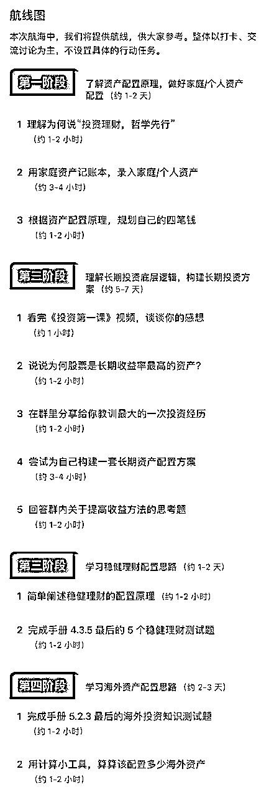

## 一、系统先立，标的后选

章节概要

看到这个航海，不少人会问：身边搞投资的人不少都在亏，生财为什么开投资航海，能帮我们赚钱吗？回答之前，先定义什么是理财投资。

说到投资，大家常想到买基金、买股票、买黄金、买各种投资品。说到学投资，常见问题往往是：“某某股票怎么分析？某某基金怎么看？”“怎么选一只好基金”“怎么选一只好股票”“怎么投资才能不亏钱”……如果你以为这些就是投资，那真是大错特错，它们只是投资系统里很小的一部分。认知只停在这一层，会带来什么后果？先看三个小故事。

本章航线图
完成本章节学习和实操，即可完成航线图第一阶段第 1 条：
1. 理解为何说“投资理财，哲学先行”（约 1-2 小时）

那么，现在开始学习吧。

### 1.1 三段经历，三种教训

以下故事由孟岩讲述。为了保留现场感，仍用他的口吻展开。

第一段发生在2015年那轮牛市。行情很热，短期赚钱的人不少。我认识一位朋友，原本从不碰股票和基金，也被周围气氛带动，冲了进来。理财经理推荐了一只创业板基金，他先投10万元，很快赚了20%，到手2万元。这让他觉得自己判断对了，也许有投资天赋，于是继续加码20万、50万，账面利润越滚越大。最后，他把准备付房子首付的钱也挪了进来，还说：“等装修的钱赚出来，我就卖。”可市场很快转冷，他在高估值阶段买下的基金被套得很深。后来的结果不用猜：装修款没见着，首付也搭了进去。

这段经历说明什么？我们做投资时，得到的反馈往往只看短期输赢。短期结果当然重要，但它不全面。投资难学，一大原因就是缺少有效而真实的反馈：在低位加仓，短期多半难受；在顶部追入，账面又可能很漂亮。更麻烦的是，正确的动作在短期内常常结果随机，甚至阶段性失败；运气也会让较长时间的成绩失真。这就像做题时答案每次都变，若拿这种结果反复修正自己，思路只会越来越乱。

第二段是我自己的账户。

2008年底，金融危机冲击下，A股跌到1664点，估值也处于历史低位。我管理一个新账户，想借机买一些便宜的好公司。那时我已经系统学过投资，明白组合和分散的意义，于是挑了10只自己相对熟悉的股票，包括中国平安、格力电器、恒生电子、天士力、伊利股份等，资金大致均分，并给自己定了单只仓位不超过20%的规矩。

后来，别的股票纷纷上涨，中国平安却一直趴在低位。我判断“市场错了”，觉得机会来了，于是开始违背自己的规则：卖掉涨得好的，不断加买中国平安，仓位一度冲到60%。至于20%上限，早就忘在脑后。

这个账户最后是赚钱的，但运气占了不小成分。我复盘过：如果当时不做那些主观操作，严格按最初的原则和约束执行，收益反而更好，过程中的焦虑也会少很多。

第三段关于一位基金经理。

2017年，曹名长发行中欧恒利三年定开混合基金（下称“中欧恒利”）。当时他的业绩有口皆碑。以他管理最久的新华优选分红混合为例，任职8.91年，净值增长率508.10%，年化回报22.44%。中欧恒利发行当天就卖光，认购资金达74.4亿元，是当时典型的爆款。

然而在2017—2020年的三年封闭期内，他偏“深度价值”的风格与市场偏“成长”的风格不合拍，最终成绩是11.72%，年化收益3.77%。2020年11月2日打开申购后，规模从74.4亿元迅速缩到4亿多元。

我有一位朋友，2017年在银行理财经理力推下买了中欧恒利。11月2日那天，他发朋友圈庆祝，说“等这一天足足等了两年”。他还总结：以后不能轻信银行经理推荐，选主动管理型基金要慎重。

这能怪主动基金吗？怪基金经理吗？怪销售渠道吗？怪市场风格吗？我认为都不是。根子在于“钱”背后的认知，和基金经理的“投资系统”不匹配。很多优秀经理都有自己的系统，也在长期市场考验中取得过超越市场的收益。但任何理念都有与市场风格错位的阶段；如果投资者不理解、不认同经理的系统，就很难坚持，收益自然拿不到。

三段故事看似无关，其实都指向“投资系统”的重要性。我的朋友没有系统，凭主观交易亏得很惨；我曾建立系统，却在市场诱惑下突破它，侥幸赚钱但无法稳定重复；曹名长有系统，也按理念执行，但很多基金持有人并不理解。最后，经理和基民都很痛苦。

内容来源：《投资第一课》16｜为什么我们需要一套投资系统？

### 1.2 三块拼图：哲学、能力圈、策略

马克·泰尔在《巴菲特和索罗斯的投资习惯》中给过一套典型系统的轮廓，通常包括以下部分：

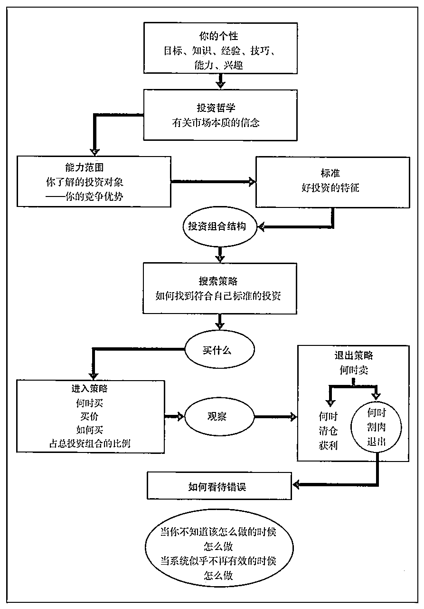

典型系统可拆成三块：第一块是投资哲学；第二块是能力圈与投资标准；第三块是投资策略。我们平时争论的“买哪只、何时进、下多少、何时出”，基本属于第三块。真正更底层的，是前两块，尤其第一块。

#### 1.2.1 哲学：你信什么，就做什么

无论买、卖还是按兵不动，每个决定背后都有投资者对市场运行方式的判断。凡·撒普有句大意：交易的对象并非市场，而是你对市场的理解。格雷厄姆、巴菲特、索罗斯、费雪、达利欧等大师，都有自己的哲学，理念和决策都从中生发。抽象地说不如看例子。

巴菲特盯的是企业未来值多少钱。他凭多年商业分析经验，看到一家公司时，脑中会浮现其10—20年后的样子；把未来图景与当下价格一比，再决定是否出手。格雷厄姆则盯当下价值：找市价明显低于账面价值的企业，买入后等价格回归，方式可能是均值回归，也可能是清算、收购。索罗斯的兴趣在哲学，他认为市场由人构成，价格由人的认识推动。一旦发现反身性过程正在主导市场，且趋势可能延续、价格可能远超多数人预期，他就会动手。

哲学不同，动作就不同。以买股为例：巴菲特买，是因为他能估算企业未来10年能赚多少，价格低于价值才买；索罗斯买，是因为价格背后的人的认识形成反身性，价格可能被推得很高。买入后若上涨，巴菲特可能停手，因为价格可能已越过安全边际；索罗斯可能加仓，因为市场验证了他的假设。若下跌，巴菲特可能继续买，因为安全边际更厚；索罗斯可能清仓，因为市场在提示他判断有误。买什么、何时买、何时卖，两人几乎相反，但放进各自哲学里又都自洽。可见，哲学是体系的根，脱离它谈操作没有意义。

#### 1.2.2 能力圈与标准：只赚看得懂的钱

哲学决定一个人懂什么，也画出能力边界。在边界内，他相对市场有优势；出了边界，判断盈亏的能力就与普通人无异。巴菲特的做法是找优秀企业和企业家，长期持有，分享企业成长。这要求他能识别值得托付的人、有护城河且能持久的公司，所以他主动把圈子收窄，只研究简单、能看懂的生意。科技股他长期不碰，理由是变化太快，看不清十年后的模样；后来买苹果，是因为苹果在他眼里已不再是难懂的科技公司，十年后的轮廓能看清楚了。商业分析与识人能力结合，使他在圈内持续做出优于常人的决策。

索罗斯的哲学是抓市场反身性，利用群体错误获利。因此他把精力放在反身性容易出现的市场，外汇、国债、股票都做。

哲学还决定“好投资”的标准。格雷厄姆要的是市价低于当前内在价值（净资产或清算价值）的公司；巴菲特要的是市价低于未来现金流折现的优秀公司；索罗斯要的是能在反身性改变大众价值认识之前完成买卖的机会。这些标准看似互相打架，却与各自的个性和哲学严丝合缝。

#### 1.2.3 策略：把哲学落成动作

最后一块是投资策略。马克·泰尔把有效策略拆成12个部分。至此，三块拼图完整：哲学、能力圈与标准、策略。后面会展开如何掌握它们、搭起自己的系统，这也是航海的核心。

#### 1.2.4 认知在前，操作在后

在哲学之上，还有一层更基础的东西：个性，包括目标、知识、经验、能力、技巧、兴趣。我把它统称为“个人认知”。

哲学从个人认知生长出来。你是什么人、如何看世界，决定你会形成什么哲学。优秀投资者会按自己的哲学演化出系统，再按系统行动。系统出问题，他们会停下来复盘、修正；但不会因为市场波动就绕开系统做主观交易。恐惧、贪婪、嫉妒、怀疑，都很难侵蚀他们的系统。系统错了可以改；可一旦违反系统做主观单，哪怕短期对了，长期也可能埋下更大隐患。

需要说明：我不是建议每个人都去建一套完备系统。那需要极大热情、足够精力，还要经历牛熊轮回，时间成本很高。我想强调的是：做投资理财，先把认知放在前面。也就是说，在挑基金、定策略之前，先找到自己的投资哲学。举例来说，巴菲特和索罗斯都是大师，但巴菲特不会把钱交给索罗斯管。我们也一样。

# 守不住，赚不到

亏钱这件事，常见病根不在选错标的，而在半途松手。若对某类资产、某套打法背后的信念与因果没有真正搞懂，想陪它走完周期几乎无从谈起。行情口味一旦与这套打法错位，纠结、怀疑、卖出便接踵而至。

把钱交给风险投资人、公募私募的基金经理，还是某个组合的负责人，先得弄清自己的投资信条与风格偏好。

这样做的意义在于：你能分辨什么适合自己，也更容易找到专业且合拍的受托人；所投项目暂时落后时，你不至于沮丧，反而能守住信任；等到策略逻辑兑现，回报才会扎实落袋；收益之外，还可能收获一段舒服的协作关系和内心安宁。

格雷厄姆在《聪明的投资者》里说过一句大意如此的话：别在别人的赛场争输赢，真正的功课是管好自己的节奏。

先认识自己，再顺着自己的信条搭一套可执行的系统，或找到现成的好系统，让规则替你做判断——这就是掌控自己的方式。

投资走到最后，比的不是谁更聪明，而是谁更懂自己、更懂世界，也更能安顿情绪。

航线图任务 1：理解“投资理财，哲学先行”为何成立，并在群里聊聊你的体会。

出处：《投资第一课》16｜为什么我们需要一套投资系统？

### 1.3 学完能带走什么？

前面的铺垫，应该已经让认知有些松动。股票、基金这些具体标的，说到底只是整个财富管理体系里的一小块。

所以，这趟航海不纠结选哪只股、挑哪只基金这类技巧，而是分享我们认同的投资哲学，以及如何据此搭建自己的投资体系。

框架一旦立住，具体买什么、投多少，答案会自己浮现。结合自身情况，哪怕股票基金都不碰，只要逻辑闭环，也算好方案。

我们并不鼓动任何人下场，只想把认可的投资信念讲透，并陪你迈出构建投资体系的第一步。具体包括：

1. 弄懂资产如何分配，搭起完整的财富管理框架，盘点个人或家庭账本，再按配置逻辑安排四笔钱。
2. 理解长期投资的道理：市场本质、运行特征，以及大量人亏损的根源。
3. 学会设计长期方案的思路，在自身能力范围内做出适合自己的安排。
4. 掌握普通人可用的稳健投资方法与配置思路。
5. 了解海外市场的投资方法与配置思路。

### 1.4 为什么拉上有知有行？

说实话，财富管理并非生财有术的看家本领。

每开一条新航线，我们都会先自问：这件事与市面上其他机构相比，长处在哪、区别在哪？只有拿得出手的项目才会启动，图的是让圈友体验更好。

投资课这条航线的回答很坦率：我们并无优势。

于是请来有知有行一起做，让内容更专业、更有章法。手册主体取自他们打磨的《投资第一课》《海外投资白皮书》等。接下来聊聊这支团队和它背后的经历。

#### 1.4.1 孟岩：写代码的人，后来去管钱

孟岩常说自己不是科班出身。1997 年，他考进北京航空航天大学计算机科学与工程系，一学七年。那段时光留给他的最大印记，是发现代码和产品能凭空造出有价值的东西，直到今天仍让他兴奋。

毕业后他进入 Sun Microsystems——个人电脑硬件史上绕不开的名字，程序员熟悉的 Java 正出自这家公司。

2000 年网络股狂潮中，Sun 的市值曾摸到 2000 亿美元，单股价格冲到 250 美元；泡沫破裂后，到 2001 年底，仅一年就滑到 49 美元；2008 年更只剩 3 美元。他那时尚未入门投资，只觉得纳闷：同一家公司的股价，怎么能在短短几年里大起大落？

Sun 股价历史资料，图源：Lee Devlin 的个人站点

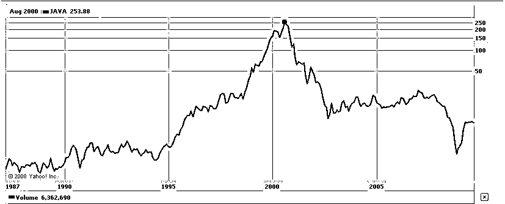

离开 Sun 后，他进入微软。2006 年去西雅图出差，他结识了法国同事 Remy。聊深了才知道，对方经历很传奇。

Remy 曾任知名网络公司 Infospace 的 CTO。2000 年纳斯达克泡沫最热时，他身价暴涨，一度跻身美国 40 岁以下最富有的人群。

那时他的股份还在锁定期，无法变现，但“有钱”的预期可以先透支。他靠抵押贷款等方式提前消费，买下湖边豪宅、游艇、豪车……

泡沫退去后，Infospace 股价暴跌，Remy 也背上银行债务。他没有申请破产，而是变卖资产，再到微软上班还债。

从 Remy 身上，孟岩看见投资和资产配置对一个人的分量：做得好，可能通向财务自由；处理不好，也可能把人拖进窘境。

#### 1.4.2 三次出发

2006 年，孟岩留意到一件有意思的事：父母并不擅长用电脑，却自己摸索 Excel，天天更新基金净值、计算资产变化。细问才知道，2005 年熊市里银行基金难卖，他们被“摊派”认购了不少；后来行情回暖，反倒赚了一笔。

他从父母的举动里嗅到需求，便与同事 Robin、Louie 一同辞职，做出基金理财社区“财帮子”，让基民管理自己的基金账户，也能在论坛里交流。

那阵子正值 Web 2.0 创业热，豆瓣、校内网都在用“用户造内容”打开新的交流方式。他把这套思路移植到投资理财产品上。

用户很快涨到约 100 万，日活十多万，在当时的基金理财平台中排到第二。

可他心里隐约不安：大家天天来，是为了看自己赚了多少；可股市会永远向上吗？熊市降临又该怎么办？

后来果然应验。2007 年 10 月，“迎接奥运”“黄金十年”喊得最响的时候，牛市见顶，从 6124 点一路下行，到 2008 年金融危机最低 1664 点，跌幅 72.8%。

回头再看，当时他们并不懂投资，也不清楚基民真正要什么，只是把互联网里许多“顺人性”的招数，搬到了多少有些“逆人性”的投资上。团队追求的极致体验，迎合的其实是赌性，产品反而成了让用户亏得更快、更多的工具。

这头失手，那头却有了收获。孟岩对投资产生了浓厚兴趣，开始系统补课。他几乎读遍能找到的投资书，也是雪球早期用户。

他看过 K 线，数过浪，认真学过“缠论”；也曾整天盯盘，用杠杆爆过仓，手机不敢离手，生怕漏掉公告和消息……

直到某天，他明白真正推动股价的是背后的经济与商业世界，每天跳动的价格只是幻象，才慢慢建起自己的投资系统，开始稳定盈利。

2015 年，他创办“且慢”。这是继“财帮子”后的第二次尝试。与“迎合用户”不同，他更坚定地走了一条新路：把投资者教育融进基金销售。

他们不做“基金净值估算”，没有“目标投”，也没有“排行榜”，而是首创“基金跟投”，降低选择难度，陪着用户把周期走完，并在过程中把长期投资、价值投资的道理慢慢传递出去。

他仍在意用户需求，但更在意需求表面之下的真实那层。

2017 年 9 月的一个午后，为了更好“吃自己的狗粮”——也就是用自己的产品，他开始写“孟岩投资实证”：每周一篇，记录自己用且慢投资的实盘业绩，也写下投资、创业的思考。

他和伙伴通过且慢、投资实证及其他服务，陪十多万用户学习投资，在熊市一起播种，等企业价值增长。

他们证明了：投资者教育并非做不到，可以和用户共同学习、结伴成长，最后收获沉甸甸的回报。

2019 年底，他和伙伴离开亲手做的且慢，创办有知有行，继续追梦。

十多年实践让他明白：挑主理人、选基金、做每一笔买卖，都是内在认知对外界信息做出的选择与反应。投资收益，只是这类选择的结果。

投资本质上是认知的兑现；能做成，往往是因为人先变成了更好的样子。

财帮子、且慢、有知有行，从“工具、数据、论坛”，到“跟投、陪伴”，再到“知行合一、做更好的自己”……这就是他这些年走过的路。

#### 1.4.3 他们眼中的投资

多数人并不想当职业投资人，只希望把辛苦钱安放在市场里，稳稳拿点回报。

现实却常是：书翻了、课报了，几年下来好像摸到门道，真金白银一上场又失灵。信息太多，反而把投资搅浑；不少人像门外看客，辨不清真相，只能凭直觉下注。

有知有行不认同这种状态。他们想把投资的正道讲给更多同行者，帮人卸下焦虑、打理好每一笔钱，把注意力放回当下，安心工作、认真生活。

投资是一场长跑式修炼。借由它，更多人能实现财富增值，也能在途中变得更从容。

它教人把眼光放长，体会延迟满足的甜；教人在危机里找希望，把难处当成长；教人关注并提升内在价值，外来的结果自会跟上。

说到底，投资是认知的兑现。每笔交易背后，都站着我们对投资的理解。

若肯花时间提升对世界、对商业的认识，学习投资的正道；同时真金白银去练，把知与行合起来，那么，内在认知的提升，最终会通过外在业绩体现出来。

这便是他们对投资的理解，也是“有知有行”四个字的由来：不断提升认知，知行合一。

出处：《投资第 1 课》导读｜这一回，从门外汉到 80 分投资者

## 二、【实操篇 1/4】先摸清家底

本节速览

和初学投资的朋友闲聊，会发现一个共同点：他们把门槛想得过高，总觉得先得吞下大量金融知识、翻完一摞经典、把各类品种摸透，才有资格开始。

有位朋友说得很直白：过去听到“投资”两个字，感觉重得吓人。

他原先以为，投资动辄是几百万、几千万去投一家企业。后来才懂，整理一次家庭账本、拿几百块买只基金，同样属于投资。

说白了，启动这件事并不贵，也不必想得太绕。投资说到底是把赚来的钱安置到合适的位置，让每笔钱承担它该承担的角色。

退休后才动用的养老款，不该一直趴在银行活期；也不能仗着年轻力盛，把买保险的预算挪去炒股。

把每笔钱的去向想清楚、配明白，这就是实打实的投资。

接下来这部分，我们聊家庭或个人的资产配置，包括：

1. 借助家庭资产记账工具，摸清个人或家庭的家底。
2. 为什么说收益的大头由资产配置决定。
3. 资产配置的原理与方法——四笔钱。

本章航线图：完成本节学习与实操，即可走完航线图第一阶段——了解资产配置原理，做好家庭或个人资产配置（约 1-2 天）。

1. 用家庭资产记账工具录入资产（约 3-4 小时）。
2. 按配置原理安排自己的四笔钱（约 1-2 小时）。

那么，现在就开始吧。

### 2.1 盘清家底，再谈投资

聊到个人或家庭财务，不少朋友都有相似的糊涂账：家里究竟有多少资产，说不上来；负债情况，只能凭印象估个范围；头绪一多，不知从哪里下手，索性一直拖着；每月看似投出去不少，实际上还背着高息欠款。

在动手投资前，先把家底盘清楚，这一步很关键。

我们因此做了“家庭资产记账”这个轻量工具，盼着你迈出第一步，抽一点时间把资产状况登记下来。数字最诚实，开始记录后，许多问题会自己浮出水面。焦虑一旦变得具体，可做的事也就多了。

#### 2.1.1 动手记录

一提记录家庭资产，不少人的第一反应是：太麻烦了吧！光是想到要开始，就得先做一番心理建设。

说真的，它没有想象中复杂。“家庭资产记账”已尽量把操作做得顺手，不必有负担，你只需要开始。

获取有知有行 App：用微信扫下方二维码即可下载。苹果手机需系统为 iOS 15 或更高版本。

进入家庭资产记账：打开有知有行 App，在底部找到“有行”，点进去就能看到“家庭资产记账”。

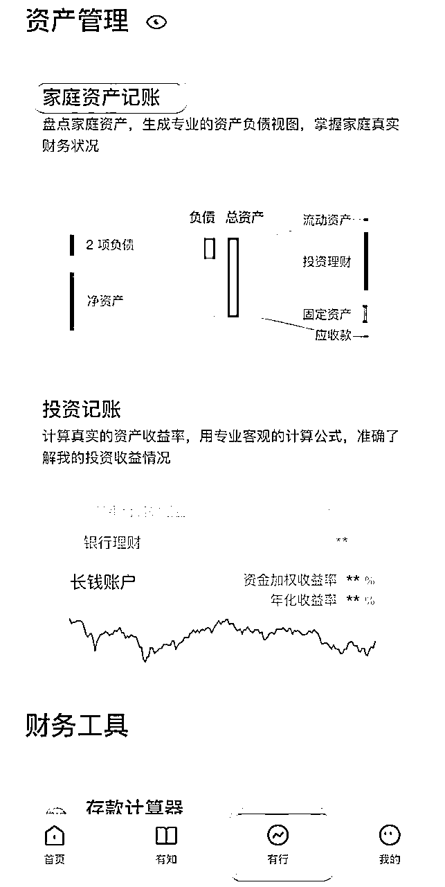

分步录入资产和负债。眼下框架把资产分成五个板块——

1）流动资金：随用随取、能马上变现的钱。例如专门留出的家庭备用金，若一直放在货币基金里，就归到这一栏。

2）固定资产：用于投资或自用、流动性偏低的实物资产。房产、汽车、车位都常见；收藏品、金银珠宝也能记在这里。现有分类不够用，还可以自己新建。

3）投资理财：投向金融产品、追求保值增值的钱。基金、股票、银行理财等，都记在这里。

4）应收款：家庭资产里应收但还没收到的钱，比如借给别人、替别人垫付的资金。

5）负债：未来一段时间或很长时间内要还的钱。房贷、车贷、网贷都常见；京东白条或其他消费分期，也能记在这里。

记完后，你会看到一张很有冲击力的“家庭财务全景图”。不同颜色对应不同资产类别，资产负债情况一眼可见，每一类下还有详细数据。

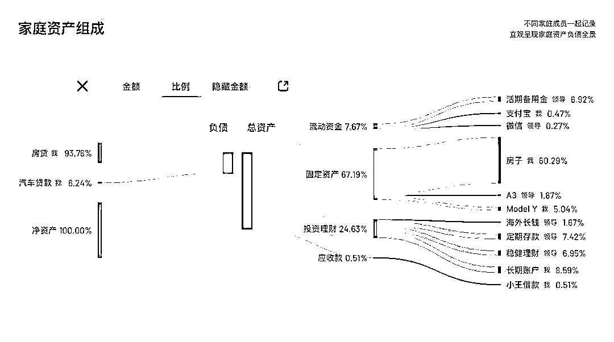

持续更新后，还能得到“资产趋势变化图”。对照不同时间的数据，你能看出这段时间家里攒了多少钱、负债还掉了多少。

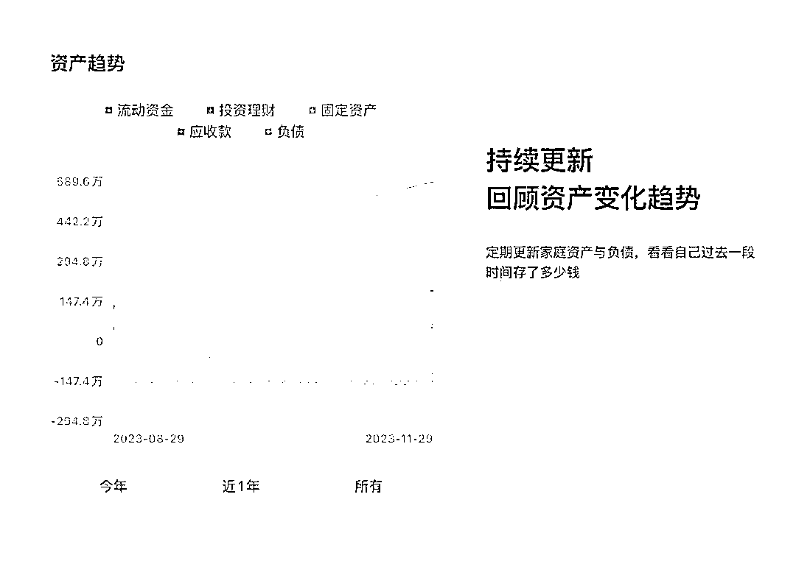

#### 2.1.2 高频疑问

房贷那一栏填本金，还是连本带息？

操作上很简单：打开贷款银行 App，把页面显示的“贷款余额”填进负债。以招行为例，该数字指剩余待还本金，利息不算在内。

每月更新一次，眼瞅着余额往下走，心里会更安定。

公积金归哪一类？放在哪里？

答案取决于账户状态，也取决于你怎样理解这笔钱。

1）直接冲抵月供：若公积金用于还贷，它并未沉淀为你的资产，不必单列。

2）租房提取：这类提取更像是收入，而非资产。只有当钱进了活期账户，或转去做投资理财，才转化为资产。因此提取动作不用记，盯住活期与投资理财账户的变动即可。

3）账户余额：公积金账户里的余额算资产，流动性偏低，可生息，也可变现。记录方式因人而异，常见分法如下，供参考：金额按账户总额填写即可。

在支付宝搜“住房公积金”，点“账户查询”—“账户信息”，即可看到历史缴纳账户的余额。

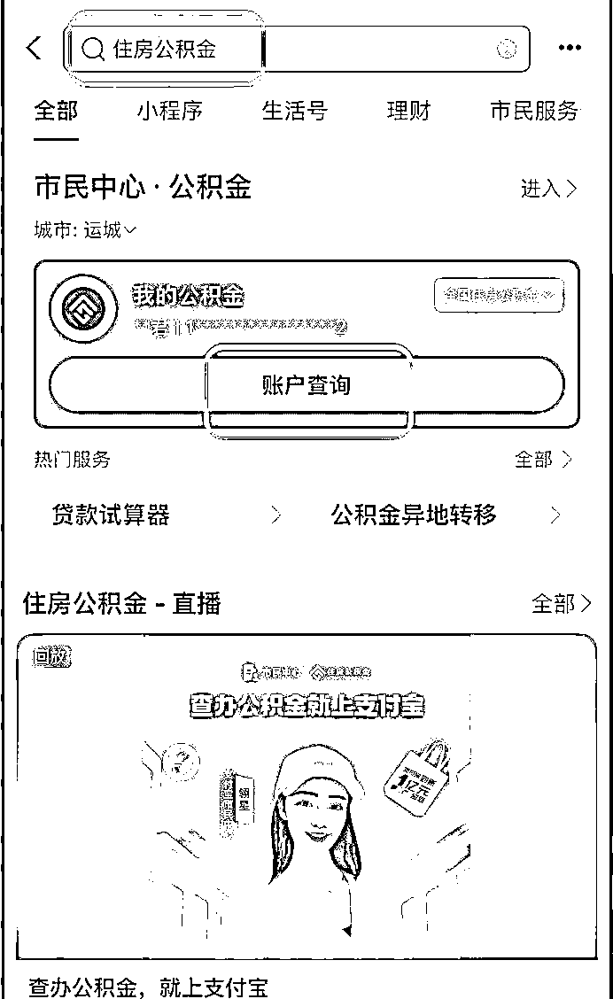

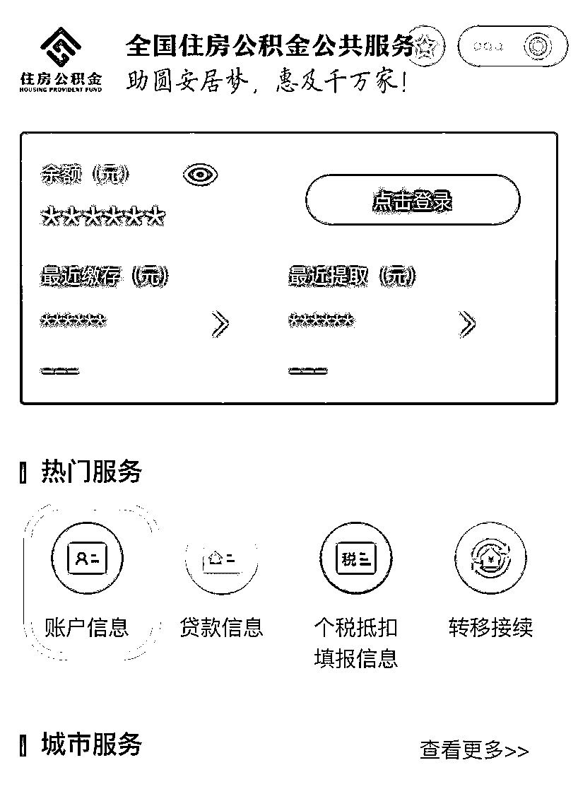

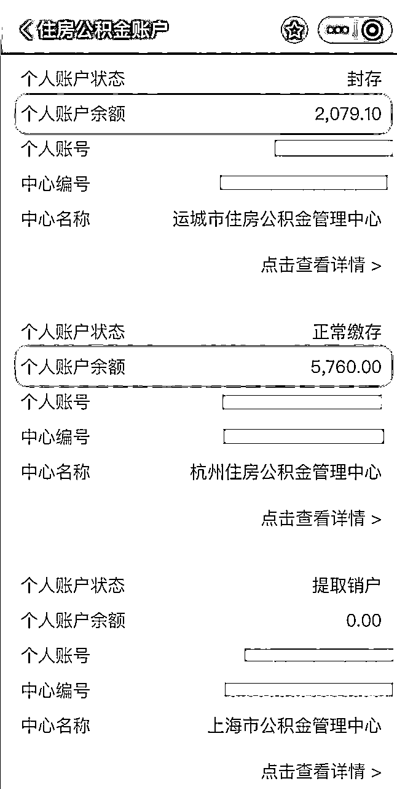

记法不同，背后是对公积金用途的理解不同，没有唯一标准，选你认同的那种。

保险部分怎么处理？

先分清手里的是消费型还是理财型。

消费型如意外险、医疗险、定寿、不带返还的重疾险，主要提供保障。未出险时，保费等于花掉了，不必计入资产。

理财型如年金险、增额寿险、带返还的重疾险，可记录保单的“现金价值”。

所谓现金价值，可粗略看成这张保单眼下值多少。合同里通常附有“现金价值表”，找到当前投保年度对应的金额，填进家庭资产记账即可。

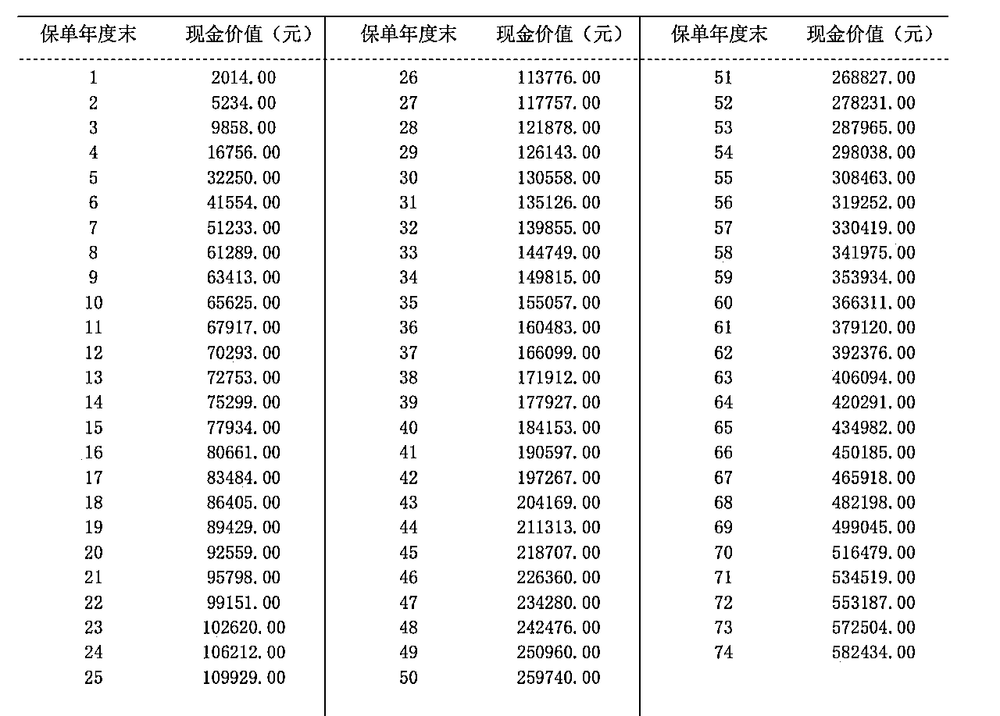

在“投资理财”—“更多投资理财”中，设有投资类保险的专门入口。

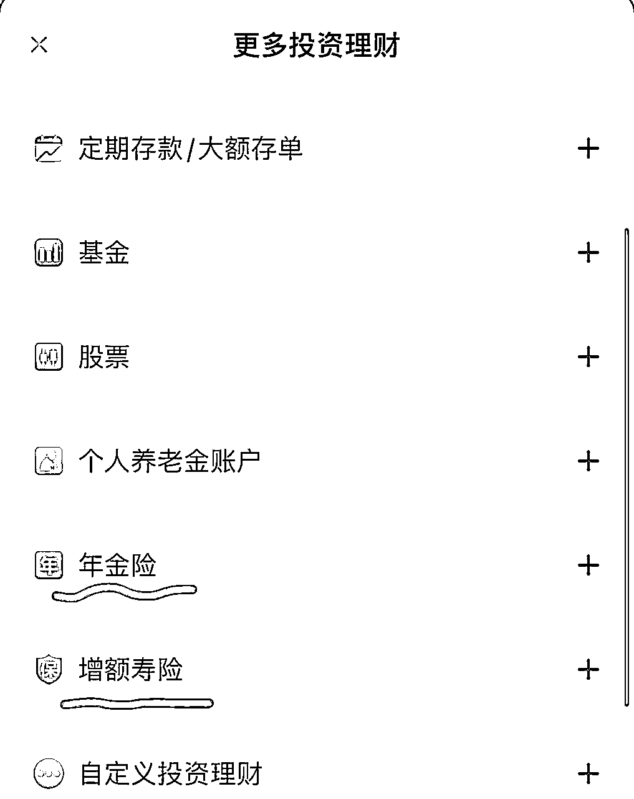

投保早期，现金价值往往不高；随着年份推移，它会逐步抬升。

工具会直接给建议吗？

每个家庭的资产负债表都不一样，指望工具输出具体而个性化的方案，几乎不现实。但一些大原则可以通过图表呈现，我们正朝这个方向做。

被问得最多的是：“我的负债率是 xx，这个比例算不算合理？”

脱离背景谈 20% 合理或 50% 不合理，都不准确。负债还要看利率、久期等因素。

拿生活场景说：有人贷款买房，若每月还款不构成太大压力，现金流稳定健康，这笔贷款就相对合理。

也有人开了消费贷，利率可能高达 10% 甚至 15% 以上。此时手上有余钱，先还贷，再谈投资，更稳妥。

很难给出某个数值或区间，直接判定你的负债、家庭财务健康与否。人生阶段、资产负债类型、风险承受力、家庭责任、现金流不同，财务健康的标准就不同。

更新频率怎么定？

这个工具没有硬性要求，按个人需求来。

想追踪细一些，可以提高更新频率，资产趋势图会更平滑。若无特别需要，按月更新就行，因为工资收入、房贷还款、信用卡还款通常都按月变化。

#### 2.1.3 案例故事

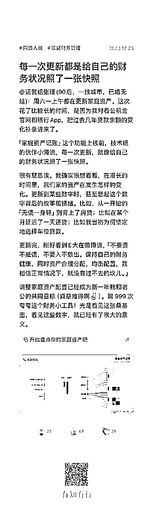

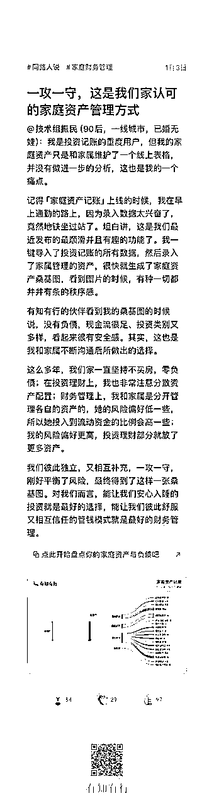

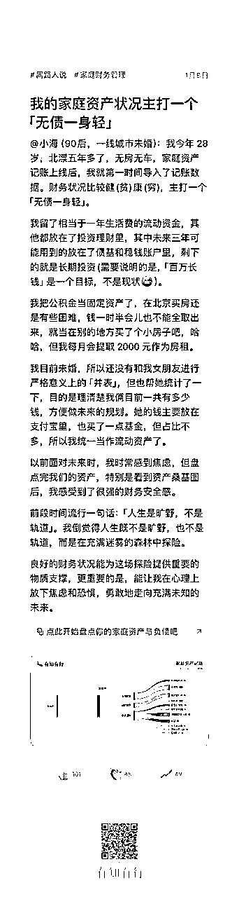

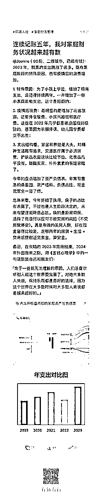

航线任务 2：打开有知有行「家庭资产记账」，把家里的资产逐项录进去，再回头看桑基图，聊聊钱主要流向了哪里、你心里有什么触动。

素材来源：有知有行社群分享

### 2.2 收益大半，由资产怎么摆决定

我有个关系不错的朋友，前阵子专门来找我聊投资。2020 年 3 月，他买了消费和医药方向的基金，账面一度很漂亮。后来他觉得价格贵了，就清掉了。谁想到卖完以后，那两只基金又涨了一截，他懊恼了很久，认定自己卖亏了。再后来行情掉头向下，他又急着问：是不是该买回来了？

我拉着他把家底粗略算了一遍：

两套房子按市价约 1000 万元，银行理财 400 万元。真正让他每天坐立不安、一会儿后悔一会儿窃喜的基金仓位，其实只有 50 万元。

这 50 万元就算多赚 20%，落到 1450 万元的家庭总资产上，提升也不到 1%：

50 / 1450 × 20% = 0.7%

反过来，如果当地房价跌 10%，家庭总资产受到的冲击会明显更大。

听完这段，你也可以顺手盘点自己的配置。市场一波动，人的情绪很容易被带着跑；但忙活半天，对全家资产盘子而言，可能只是小水花。

摩根·侯塞尔在《金钱心理学》里画过一张图，用来说明他心中各类因素对投资结果的分量。

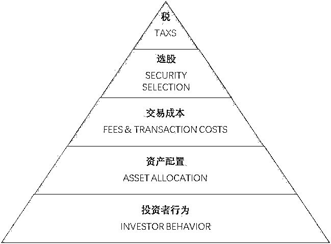

长期业绩不是由单一变量决定的：投资者行为、资产配置、交易成本、选股或选基，都会参与其中。那张图越往下，影响力越大，也越接近决定最终结果的位置。

有知有行的原则说得很清楚：收益的大头由资产配置决定。换句话说，先想明白“钱怎么分”，再考虑“具体买哪只”。

素材来源：《投资第一课》12｜怎样做好资产配置？

### 2.3 家庭资产怎样配得更稳？

普通家庭做配置，先要面对的是房子和金融资产之间的大类比例。

过去二十年，中国房价总体上行，不少购房者把大部分身家压在房产上，也分享到了这轮上涨。另一边，上证指数长期在 3000 点附近打转，给人“股市十年不涨”的观感。

可如今政策基调是「房住不炒」。别说二三线城市，就连北上深的房产，未来十年复制过去那种涨法的概率还有多大，值得重新评估。与此同时，权益类资产在过去二十年的表现并不逊色于房子，未来也可能更有机会。

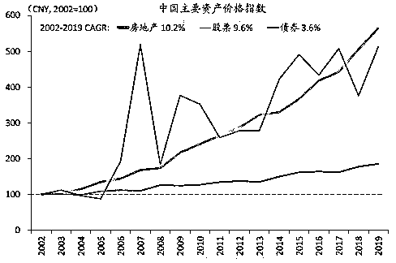

中国房地产、股票和债券资产价格指数 | 来源：中金公司研究部

如果家庭资产高度集中在房产，金融资产只占很小一块，这样的结构未必健康。

对你而言，先调整房产与可投资金融资产的比例，可能比纠结选哪只基金、哪只股票更关键。

有知有行更看重先把大类比例摆正：自住需求该买就买；但若名下房产不止一套，可考虑拿一部分去配置股票、基金等权益资产，让结构更均衡，也提高分享未来增长的概率。

#### 2.3.1 房产占比，别让一套房决定全部

先看房子这一项。

过去二十年，中国房地产价格整体抬升，许多购房者因为重仓房产而获得可观回报。与此同时，上证指数看似十年原地踏步，长期停在 3000 点，也让不少人形成“股市不会涨”的刻板印象。

但在「房住不炒」的大环境下，先不说二三线城市，就是北上深的房子，未来十年还能不能延续过去那种走势？而权益类资产过去二十年的表现并不输房产，未来也可能更好。

中国房地产、股票和债券资产价格指数 | 来源：中金公司研究部

如果你的大部分资产都压在房子里，只有小部分在金融资产上，这种配置未必合理。

那对你来说，比起应该选哪只基金或者股票，更重要的，可能是调整房产和可配置金融资产的比例。

自住改善该出手时仍可买房，这是生活需要。但若房产已经不止一套，不妨分出一部分资金给股票、基金等权益资产。这样既能让家庭账本更均衡，也更有机会接住未来资产增值。

#### 2.3.2 金融资产怎么分？

再往下一层，是可配置的金融资产。

过去，银行等机构帮客户做配置时，常用问卷来摸底：年收入多少、某类资产跌 30% 能不能扛住……然后据此判断风险偏好，再决定现金、债券、股票各放多少。

风险测评想抓的是承受力的下限。这个下限相当于给心里预留一块下跌缓冲垫：在垫子范围内，痛苦还能忍，人也就更容易坚持得久。

股票收益常呈现二八分布：大约 20% 的时间贡献 80% 甚至 90% 的涨幅，但没人能提前知道那 20% 何时出现。所以持有时间越长，等到上涨时段的概率才越大。

问题在于，单靠问卷并不够科学。牛市里填表，大家都觉得跌 30% 不在话下；真到熊市，可能只跌 15%，人已经慌得不行。

而且，在纸上勾选“能承受下跌 30%”很容易，真跌 30% 时心理冲击有多大却很难预估。脑海里可以做压力测试，但没法模拟投资失利回家后，看见家人失望神情时的那种滋味。

既然风险偏好测不准，按它来定配置就难免出问题：牛市风险偏好上升，多买股票；熊市偏好下降，又砍仓位。这种追涨杀跌，显然不是好办法。

那怎么办？可以换一种思路——「四笔钱」。

#### 2.3.3 用「四笔钱」给资金分仓

想想每个月的收入都流向哪里：

给家庭攒养老金……

如果全部押进股市，风险太高；如果全塞进活期，又太浪费。

按用途归类后，钱大致可以分成四类：保险保障、活钱管理、稳健理财、长期投资。

第一笔，保险保障的钱

用投资的话说，保险是在降低生活质量的大幅波动，给人生「托底」。花一笔小额且确定的成本，为不确定的未来买安心。

投资理财像进攻，保险更像防守。它让我们在风险面前少一点狼狈，多一点从容。先把保障做足，风险来临时才有钱可用，不至于被迫卖出、动到本金，长期投资才更可能走到终点。

第二笔，随时要用的活钱

日常开销靠它：房租或房贷、生活支出、孩子零花、父母赡养费等。

第三笔，稳健理财

适合中短期（3 年以内）要用的钱，或者因年龄、风险承受能力等原因偏好稳健产品的人。比如一两年后买车、买房、结婚生娃的钱，半年后旅游的钱。这部分追求的是安稳和稳健增值。

第四笔，长期投资

5 年以上不用的闲钱。它可以用来博取较高收益。简单说，这笔钱没有固定用途，能投很久，即使全亏了，对日常生活影响也不大。

你可能会问：市场估值很低时，短期要用的钱能不能也进股市搏一把？这没有标准答案。3 年也好，5 年也罢，边界没那么死。

但可以先问自己：假如两年后需要用钱，这笔投资却套牢了，我能接受亏损卖出吗？如果答案是可以，那再考虑也不迟。

#### 2.3.4 「四笔钱」比例没有标准答案

四笔钱讲完，下一个问题自然是：各放多少？

答案不是统一的。

拿我来说，我没有单独放稳健的钱，而是留够日常活钱，其余都投到长期策略和产品里。前提是，我对市场波动的承受力超过多数人，这跟性格有关。另外，即使临时要卖出一部分，因为我投资期限很长，我会把那笔卖出想成很久以前成本更低的一次买入，心态上不容易被打乱。

说这个例子，不是让你照抄。对多数人而言，更稳妥的做法是：先按前面的建议做好保险保障，留足日常活钱；再以 5 年为界，把钱分到稳健理财和长期投资。

更重要的是，像上一节说的，比例的关键不在精确数字，而在心态和行为。真正影响长期收益的，也是这些。

用户案例

下面看三位用户的四笔钱安排，以及他们之间的交流，或许能给你一点启发。

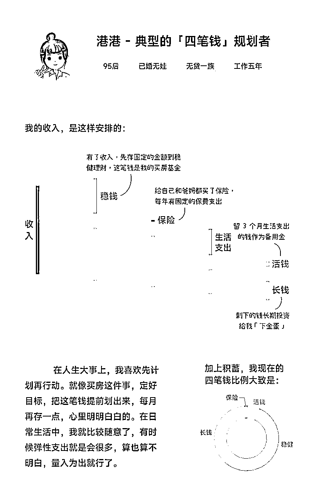

制图：有知有行

问题一

仝仝：两年内买房的钱放稳健里，当然没问题。只是这么大一笔钱放稳健，你不觉得资金利用效率低吗？心里真没动摇过？

港港：没动摇。我计划两年内买房，攒钱目标是那座城市的平均首付，还额外留了一些方便调用的钱，防止超支。我不指望这笔钱赚多少，够用更重要。要是放长期投资里……真要用的时候说不定还亏着。

栋大：也有可能稳健赚的比长期投资还多。

问题二

仝仝：港港你真厉害，存首付的同时还有闲钱投资！

港港：哈哈，首先我准备买房的城市房价没那么高，这笔钱可能没你想的那么大；其次做计划时就算好了，从积蓄里拿多少、每月再存多少，尽量不影响现在的生活品质；第三，我老公每月会给我一笔钱，这也算我的收入……吧。

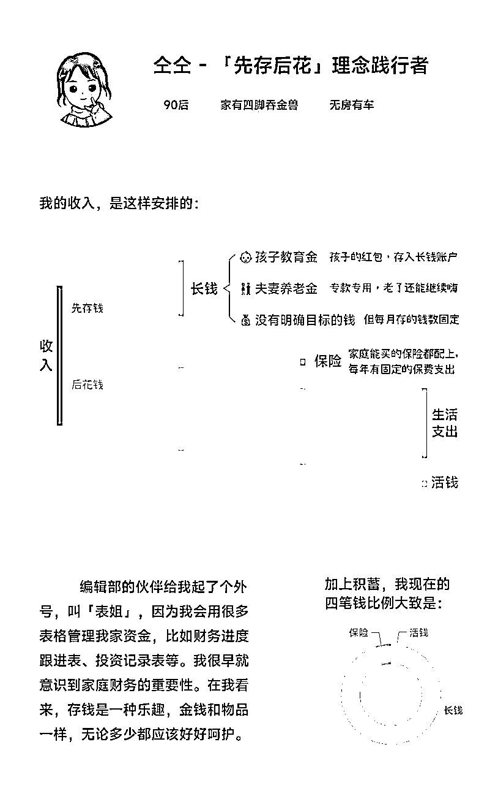

制图：有知有行

问题一

金栋：为什么你没有配置「稳健理财」？

仝仝：主要是两三年内没有明确目标，以及在有知有行工作，很相信长期投资，所以大量资金放在长期投资里。

问题二

港港：你现在花销应该蛮大的，为什么活钱留得不多？

仝仝：理性说，我日常花销不算多，保险也配得比较全。但更多是性格使然。我不太能接受一笔钱放着不怎么赚钱，会下意识觉得资金利用率低。现在的活钱金额是我觉得舒服的状态。

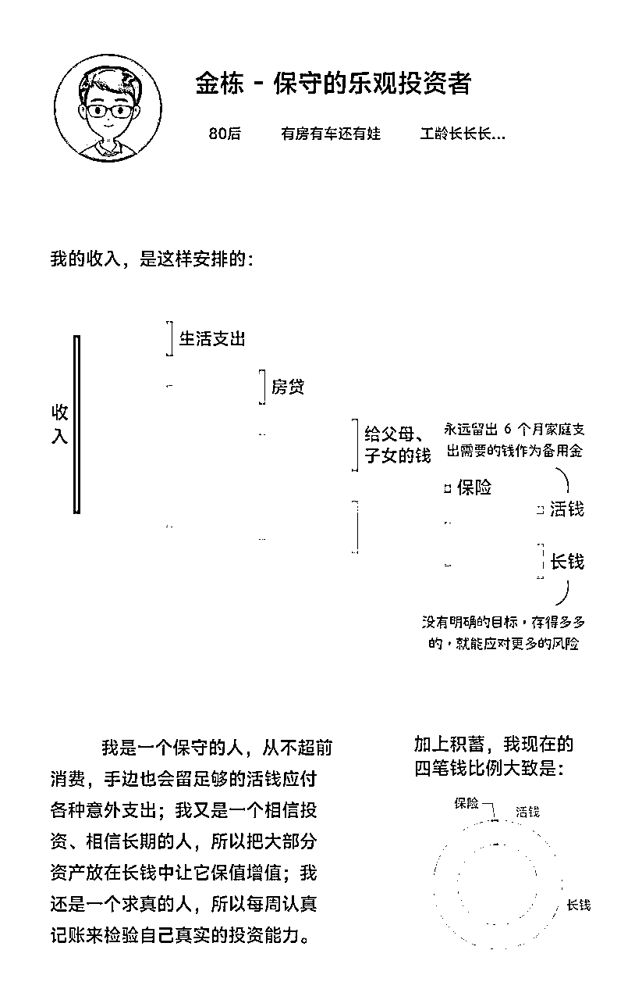

制图：有知有行

问题一

仝仝：为什么你也没有「稳健理财」？

金栋：一是最近两三年没有明确的大额支出，所以没配稳健理财；二是我的长期投资里本身有一定债券仓位，需要时也能当稳健理财用。

问题二

港港：你说永远会留 6 个月应急资金，那要是用了怎么办？

金栋：如果临时支出多，活钱不够 6 个月，我就把支出的水龙头关小，暂停往长钱里充值，先把这个蓄水池存满再说。

总结

四笔钱的意义，是通过分账户，把不同用途、不同目标、不同风险偏好的钱分开管理，搭起一个更健全的财务系统。

比例没有标准模板，只是一个参考方案。

每个人所处人生阶段不同，收入不同，风险承受力不同，配置比例自然不同。

关键是要理解每笔钱为什么存在，按自己的需求分好、管好，再灵活运用。

#### 2.3.5 每笔钱分别买什么？

分清楚四笔钱后，接下来要问：每一笔具体买什么？

这涉及投资三要素：安全性、收益性、流动性。

安全性看的是产品风险高低。债券、银行储蓄风险较低，股票风险较高。

收益是大家最关心的，但想要更高收益，就得承担可能的亏损；追求收益最大化，往往要牺牲安全性。

流动性容易被忽略。之前看过一个例子，很多人没能坚持长期投资，不是本身拿不住，而是意外情况导致被迫退出。所以投资要结合家庭长短期目标。

三者相互制约，没有产品能同时把三样都做到极致。既要安全高、流动性好，又要收益高，哪有这种十全十美的事。

那四笔钱分别适合什么产品？对号入座：

保险保障

保险保障是为生活托底，防止投资中断。有知有行建议选择消费险，配齐人生四大基础险种：医疗险、定期寿险、重疾险、意外险。

活钱管理

这是日常支出类资金，产品特点是安全性高、流动性强，收益要求不高，一般比活期存款好一些即可。有知有行建议选择货币基金。

稳健理财

追求稳健收益，时间大概半年到 3 年，比活钱管理长一些，因此可以在承受较低风险的基础上争取更高一点的收益。

建议选择稳健类投资产品，如稳健组合类产品。这类产品主要投低风险债券资产，同时配少量高风险资产，既分散风险，又能获得比活钱管理更高的收益。

长期投资

长期投资时间更长，可以用风险换收益，选择股票类产品。有知有行建议选择指数基金和好的主动基金。

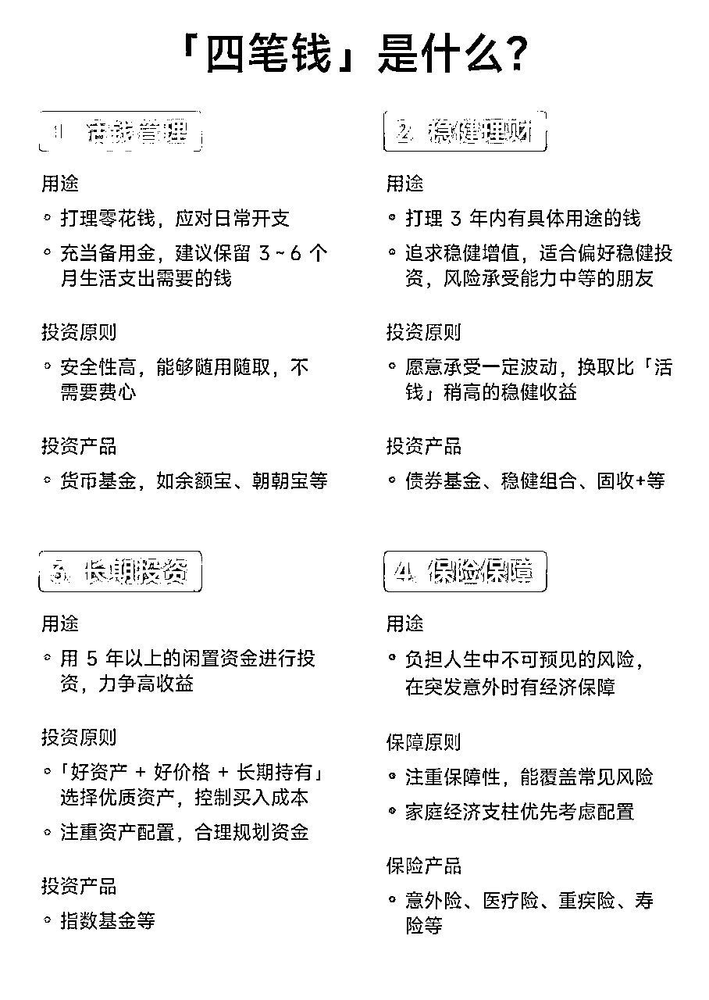

可以说，「四笔钱」给投资提供了一个安全、长期的结构。

长期看股票市场收益最高，但太多因素让人无法长期持有。认知和情绪是两方面，还有一个因素是「钱」的属性。

如果一笔钱能投资的时间很短，却放进股票市场，等于把自己交给随机性和运气。一旦家庭因疾病或意外需要用钱，投资也可能被迫中断。

四笔钱用简单的方式帮我们堵上漏洞，把不同时间、不同用途的钱分开，构建长期稳定的结构，更好地帮助我们长期持有。

素材来源：有知有行《坦白局(一):四笔钱的分配比例有标准答案吗》《分清四笔钱，找到每笔钱的合适位置》《投资第一课》12｜怎样做好资产配置？

航线任务 3：根据资产配置原理，为自己的四笔钱做一份规划，并说明这样安排的理由。

## 三、【实操 2/4】长期投资怎么落地？

章节概要

前面已经知道，可以用四笔钱做资产配置。活钱管理和保险保障相对简单，接下来重点聊长期投资和稳健投资的思路。

具体包括：

1.选择长期收益率最高的资产——股权类资产

2.为什么股市中多数人都赚不到钱？

3.怎样为自己制定一份长期投资方案？

4.「长钱账户」是如何做的？

本章航线图

完成本章节的学习和实操，即可完成航线图的第二阶段：理解长期投资底层逻辑，构建长期投资方案（约 5-7 天）

1.看完《投资第一课》视频，谈谈你的感想（约 1 小时）

2.说说为何股票是长期收益率最高的资产？（约 1-2 小时）

3.在群里分享给你教训最大的一次投资经历（约 1-2 小时）

4.尝试为自己构建一套长期资产配置方案（约 3-4 小时）

5.回答群内关于提高收益方法的思考题（约 1-2 小时）

### 3.1 长期收益的扛把子：股权类资产

#### 3.1.1 财富到底从哪来？

做投资，图的当然是资产增值。应该没人参加这趟航海，是冲着亏更多钱来的。

那么问题来了：钱究竟从哪里冒出来的？

假如你流落荒岛……

这个问题很大，答案也可以有很多角度。有人第一反应是：货币由国家发行、有政府信用作背书。这当然对。但不妨换一个场景来想：

图源：depositphotos.com

海上有一座孤岛，岛上放着一只装满百万美元的箱子。你乘船出海，途中船坏了，人被冲到岛上，活脱脱一个鲁滨逊。这时箱子里的钞票能帮你什么？大概率什么也帮不上，可能还不如一张渔网、一棵能摘果子的椰子树实在。

由此可以得出一个很朴素的道理：货币印得再多，如果换不来你需要的东西，它的价值就接近于零。

所以，我们真正想拥有的并不是钞票本身，而是钞票能换到的资源、商品与服务。

可新的疑问又来了。

资源有限，商品和服务不会凭空出现。既然人人都在想办法挣钱，那钱是从谁的口袋里跑出来的？换句话说，社会财富的增量靠什么产生？

粗略拆解，增量主要来自三股力量：自然资源、劳动、技术。

拿一个极简例子来说。

从古至今，人类生活都离不开木材。早期砍树很费劲，后来有人把石头磨成斧刃，伐木效率立刻上了一个台阶。

在这个过程里，人依靠智慧与劳动，把自然资源（石头）加工成工具，又完成了技术改进（从无斧到有斧），一年砍 20 棵树的水平提升到 200 棵。多出来的木材，又能拿去改善吃穿住行。日子越过越好，社会总财富也随之增加。

人类财富的积累

这当然只是简化版。真实世界的财富创造，比做一把石斧复杂得多。但回头再看历史，大体脉络确实如此。

袁隆平让同一块田打出更多粮食，养活更多人，而人口增长又带来更多劳动力；电话、微信、视频会议让沟通成本下降，协作和共识更容易形成；抗生素、手术刀改善健康、延长寿命。这些变化背后，都能看到自然资源、劳动与技术三者共同发力。

再给你一个尺度：截至 2020 年，人类社会总财富大约在 300～400 万亿美元。其中土地和房产超过 200 万亿美元，约占三分之二——最古老的资产类别，依然占据最大份额。

全球股票市场总市值约 70～90 万亿美元，排第二；现金、硬币等约 30 多万亿美元；黄金约 7～9 万亿美元；剩下还有一些占比很小的类别，比如比特币等加密资产。

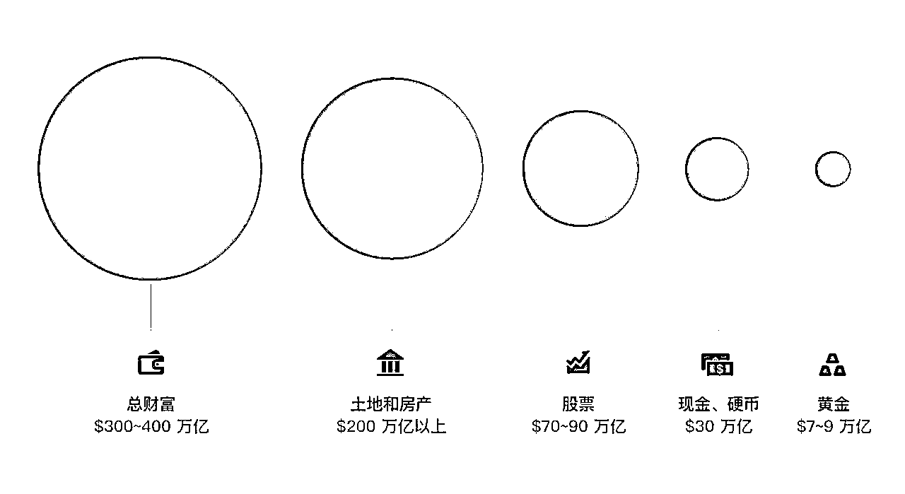

人类社会总财富分布 来源：howmuch.net | 制图：有知有行

把「自然资源 + 劳动 + 技术」这条线索捋顺，你对钱、对财富如何被创造出来，就有了一个基础框架。

近三百年的「财富大爆炸」

不过，宏观讲得再多，你可能更关心：这跟我有什么关系？说得更直接点，社会财富总量再大，怎么才能让其中一部分流进我的口袋？

我们慢慢往下聊。

## 近三百年，财富为何突然起飞

先道声喜。

有个常被忽略的事实：人类文明绵延了极长时间，但今天意义上的物质家底，绝大多数是最近三个世纪攒下来的。

看图就懂：

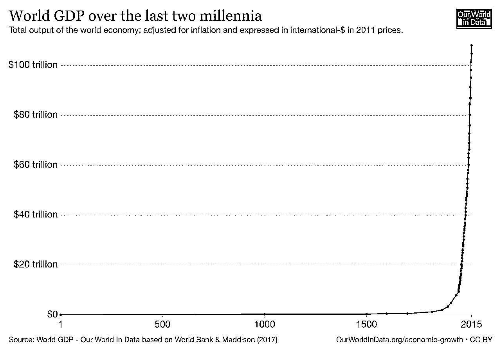

这张图把世界银行1990年后的统计，同经济学家安格斯·麦迪森对更早年代的历史估算拼在一起，呈现两千多年来全球经济产出的变化。图：近两千年全球产出走势，数据来自 ourworldindata.org。

19世纪以前，增长曲线近乎贴地；1800年之后突然抬升，人类进入经济成果快速膨胀的阶段。

原因很多：科学启蒙、工业革命、自由市场发展……相关研究已经非常丰富，这里不展开。

从大历史看，我们确实赶上了好时候：经济腾飞、财富扩张。巴菲特曾谦虚地说自己中了“卵巢彩票”——成功前提是出生在20世纪高速成长的美国。按他的说法，一个只会配置资产、挑选好公司股票的老头，若放到几百年前甚至原始社会，可能最派不上用场。

还有一条线索不能漏掉：现代企业与资本市场的出现。它和每位投资者都有关。

熟悉商业史的人知道，股份制公司早期形态出现在17世纪的荷兰。当时香料是抢手货，胡椒尤其受欢迎，跨洋贸易和运输十分兴旺。

荷兰航运发达，阿姆斯特丹又是欧洲重要港口，远洋船队很多。但小船队各自为战，恶性竞争不断。航海本身风险极高：资金需求大、海盗猖獗、风暴一来可能血本无归；再加上西班牙、葡萄牙的大型船队实力强，于是有人提议把分散船队联合起来，统一调度。这样既能分摊经营风险，也能减少内耗、压缩成本。

1602年，荷兰东印度公司成立，并面向公众筹钱，以便与西、葡船队竞争。筹资办法是把公司所有权切成小份，给认购者一张凭证。

你肯定反应过来了：这就是股票早期的样子。

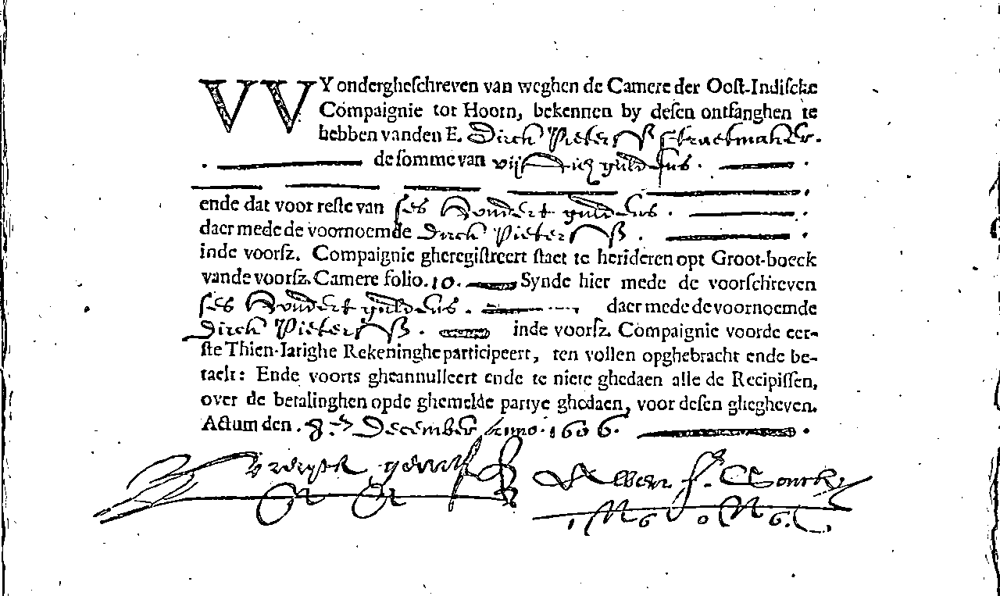

东印度公司的股票凭证，来源：stockmuseum.com.tw。

有了股票，交易市场自然呼之欲出。东印度公司当时有个特别规定：公司要等十年才给股东分红。今天看，这很“长期主义”，甚至有点像风险投资。

可总有人不愿等十年才拿回收益，于是所有权凭证开始被互相转手，阿姆斯特丹也出现了世界上第一家股票交易所。后面的欧洲史，熟悉的人都很清楚。

其他船队哪里是对手？东印度公司很快成为17世纪海上霸主。后人估算，其巅峰市值接近8000万荷兰盾，约合今天的8万亿美元。

钱到底从哪来？思路清楚了。

人类借助自然资源，投入智慧与劳动，发展科学技术，创造巨大财富，其中很大一块由企业组织完成。现代股份制结构加上资本市场制度，让普通人也能加入财富创造过程——当然，分享收益的同时也要承担风险，接受投入的钱可能被一个大浪拍没。

但不管怎样，真实创造财富、合理分配财富、踏实积累财富，是今天我们都能享受的时代红利。

还有一件事要关心：钱最终去了哪里。

懂这些道理，对实操也有帮助。你肯定见过类似情形：听小道消息就 all in 一只股票，稀里糊涂亏很多；牛市高点冲进去，熊市又割肉离场；看别人买房自己也买，结果自家楼盘几年不涨；媒体还时不时曝出理财“暴雷”，比如 P2P、原油宝。

这些事背后，一个重要原因是：太多人把投资理财看成抽象概念，忘了自己是在把钱交给一个真实的、试图用这笔钱创造更多财富的组织。

比如买 P2P 时，很多人只盯着收益，觉得这是“投1万返11000”的理财产品。可世界上没有神奇机器，钱放一年就自动生10%；真正存在的，是创造财富的企业、人和劳动。

所以投资领域总强调：要弄清“底层资产”。不管产品包装成什么样、名字多好听、由多大牌的公司出品或销售，都要追问钱最终放在哪、回报来源是什么、是否符合最基本的常识与公理。

记住这一点，大部分骗局和风险就已经被挡在门外。

**航海图任务 4**：看完《投资第一课》视频，到群里聊聊你的感受。

#### 3.1.2 长期收益榜：股票为何居首

上一节聊了钱、也就是“财富”如何被创造。投资，是把钱交给像企业这样能持续创造财富的现实组织，再通过它参与创造、分得收益。这一节要问：参与财富创造的方式不少，哪种回报最高？

先看一个真实故事。

1969年，美国蓝带体育公司遇到麻烦。它主要帮日本鬼冢虎（Onitsuka Tiger）研发运动鞋，并负责北美代理销售。努力五年，年销售额从8000美元做到约30万美元。

耐克的起源：蓝带体育公司，来源：www.firstversions。

可蓝带体育仍在破产边缘。原因是这门生意极吃现金流：先掏现金向日本公司下单，再等鞋子漂洋过海，之后还要花时间卖掉，才能回款。规模越大，垫付资金越多，现金越紧。

创始人菲尔·奈特当时有两条路。他自传里写过，最初找银行借钱，但卖鞋这种看起来不牢靠的小生意，银行很谨慎；金额一大，贷款更难。他还想出售公司30%的股份，约合当时30万美元；为了融资，甚至模仿加州北部刚兴起的高科技和电子公司，把名字改成蓝带体育科技。结果等了一个月，没人认购。最后他们四处凑了两万美元，才交上下一批货款。

奈特在自传里写当时心情：“我再一次长舒一口气，之后的日子都要勒紧腰带过了。可下次我又该怎么办呢？再下一次呢？”

当然，公司没倒，后来成了大名鼎鼎的耐克。如果当时真有人买下那30%，即便后来被各种稀释，到2020年，30万美元也会变成600多亿美元。

持有股权，本质是成为企业的一部分

这个小案例，带出参与企业财富分配的两种常见方式：股与债。

银行的一项主要工作，是把我们存进去的钱借给企业，这时银行替我们充当“债主”。我们也可以直接做企业的“债主”，买企业债券，收取利息；若公司赖账，还能依法要求它变卖资产还钱。

同时，我们也能买入公司股份，成为股东，成为企业的“拥有者”和“主人”。企业做大，它创造的财富就有我们一份。

这就是价值投资者常说的：买股票，买的是公司所有权的一部分。

假设耐克从未上市，只是一门很不错的生意，而我们是股东，回报从哪来？主要有两处：一是公司盈利后把部分利润分给股东；二是公司若被出售，股份随之转让，可一次性获得收益。前提都一样：生意本身能赚钱，别人才愿意接手。

所以，股票（企业所有权）和债券（有时借给公司，有时借给政府），构成如今参与资本市场投资的两大主要形式。

下面这张图你可能见过。宾夕法尼亚大学沃顿商学院金融学教授杰里米·西格尔统计了美国股票、国债、黄金、现金等大类资产的长期收益。

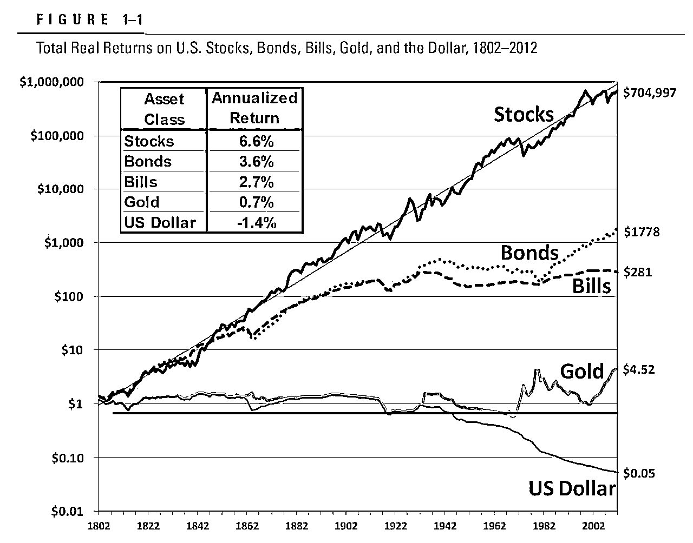

图：1802—2012年美国金融大类资产表现，来源：《Stocks for the Long Run》。

图中可见，1802到2012的两百多年里，1美元购买力只剩5美分。不用解释，这是通货膨胀造成的。黄金年化不足1%，长期波动大，收益并不高。

再看债券。Bills 和 Bonds 分别指政府短期、长期债券，可简单理解为借给政府的钱。两百年间，短债年化约2.7%，长债约3.6%。

最后看股票。长期年化6.6%。数字不算高，还不够一个涨停板，但两百年下来，1美元股票变成70万美元。

不只美国，很多主流国家包括中国，股票长期回报都很高。

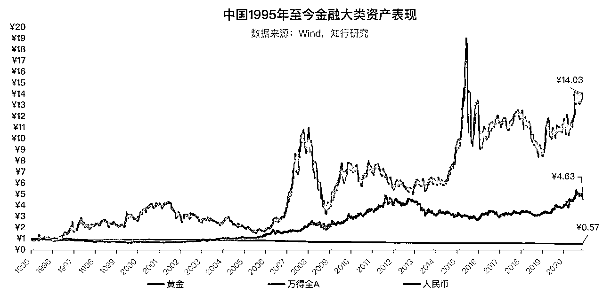

图：中国1995年至今金融大类资产表现，数据：Wind，制图：有知有行。

中国股市历史较短。以深证综合指数为例，1991年4月到2020年10月，近30年累计涨21.49倍，折合年化11.5%，还没算分红。若用代表A股全部大小公司的Wind全A指数，1994年底到2020年11月30日，从379.34点升至5258.66点，折合年化约10.68%。

中国GDP增速快于美国，股票年化收益也更高；但通胀同样更高，因此我国股票实际年化收益率约7%～8%。

所以，有知有行搭建投资体系时，有几条“公理”式理念，其中很重要的一条是：股票是长期收益率最高的资产。后面引入的一整套投资与交易方法，也建立在这个认知上。其他理念，我们慢慢分享。

股票长期回报为何更高

那么，为什么股票——背后代表的上市公司——长期回报明显高于其他资产？其他资产的长期收益，连股票的零头都不到。主要在三处。

第一，复利力量巨大。举例：一年涨5%和一年涨8%，若累积200年，差距多大？一个约1.7万倍，另一个约484万倍，确实天壤之别。股权资产每年只多一点点，时间一拉长，差距就被放大。

第二，企业这种组织形式自带经济优势。比如品牌强的公司，通胀来了可以提价，甚至一年多提几次——路易威登、茅台都是现成例子。再如规模效应：年销售额1亿元时利润1000万元；扩张提效后，销售额2亿元，成本从9000万元升到1.7亿元，利润变成3000万元。收入翻一倍，利润翻两倍，商业上叫“经营杠杆”。所以企业增速可以快过社会整体。

第三，和黄金、石油甚至房地产不同，上市公司尤其是优秀公司，能靠人的智慧、勤奋、勇气“主动”获取价值。过去十年崛起的中外互联网公司，多是创始团队凭聪明才智和不懈努力，借时代之势脱颖而出。伟大公司回报自然高于社会平均。房子或黄金则很难靠“拼命盖房”“努力挖金”来大幅创造价值；即使有，也更慢、更低效。

所以，有知有行倡导做好大类资产配置，该买房时买房改善生活；但投资体系的基石，是相信股票——或说好公司——长期会带来超出平均的回报。这两年A股很火的“核心资产”，背后道理也类似。

高收益背后的两面

说了股票这么多好话，你可能疑惑：这好像反常识。不是都说股市“七亏二平一赚”吗？若长期收益真高，身边老股民怎么还亏得一塌糊涂？

当说“股票是长期表现最好的资产”时，有两件事要注意。

第一，“最好”指的是股票作为集合、大类、一揽子打包产品。任何单只个股都可能价值毁灭，长期归零。

有个经典数据：1926到2015年，美国共上市超过25000家公司，到2015年末只剩四五千家左右还活着，超过80%已销声匿迹。除少部分被并购或主动退市，绝大多数因业绩糟糕而下市或破产。这些公司不仅不提供回报，简直是“价值毁灭者”。

也有学者统计1957到1998年四十多年间标普500的变化，反映每个时代美国最好500家公司的更迭。结果是：1957年那500家，四十年后只有74家仍在指数中；其余426家，一小部分被兼并收购，大部分倒闭或市值大幅衰退，已够不上“前500”。换句话说，即便是上市公司，大部分也“不太靠谱”。

第二，“长期”表现最好，但“长期”有多长，往往难知。即使美国股市被称为“牛长熊短”，历史上也多次出现十年指数完全不涨。比如上世纪七十年代，越战升级、中东石油危机、不合理福利政策导致财政赤字急扩等叠加。1969年末到1979年末整整十年，道琼斯指数和标普500几乎纹丝不动，十年没涨，算上通胀甚至亏损，中间还有几次莫名大跌。十年对市场是白驹过隙，对每个人却是宝贵且无法挽回的时间。

**航线图任务 5**：为什么股票是长期收益率最高的资产？来群里交流一下。

#### 3.1.3 股票长期收益：与企业成长同频

既然股票是长期收益率最高的资产，那长期投资股票，合理预期收益率是多少？

先统一收益率概念。

投资收益靠时间得来。你也许1个月赚20%，但剩下11个月再没这种机会，甚至把20%赔回去；这和一年赚20%完全不同。因此比较大类资产或两个产品时，常用“年化收益”衡量：把1个月、3个月或2年的收益折算成年化。这一讲说的预期收益率，就是年化收益率。

从上往下的推法

厘清定义后，再看什么预期合理。角度很多，先看一种自上而下的推导。

前面反复说过，整个经济体增长，是企业、劳动者共同创造财富的结果。衡量这个结果的一个相对指标是GDP，即一段时间内一国创造的总财富。

过去几十年，我国GDP增长很快。过去20年，中国GDP年均增速约9%。但随着体量增大、人口红利减弱、科技与工业化阶段转型，未来速度会慢一些。参照近年数据，较保守地看，每年5%～6%的增速可以预期。这个数字，是收益率的基础保障。

投资股票，实际投资的是国家里规模较大、盈利能力较强、活力较旺的一批公司——毕竟都是上市公司。所以总体看，若把GDP增速理解为“所有大小企业增长速度的均值”，投资运营水平更高的企业还会获得超额收益。按经验，8%～10%的长期年化收益率可以期待。

ROE 是什么

这里还想聊聊，8%～10%背后是什么。讲稿里只是两个数字，现实中对应企业的净资产和盈利增长。

先看一张图：“Wind全A指数净资产与价格同步图”。

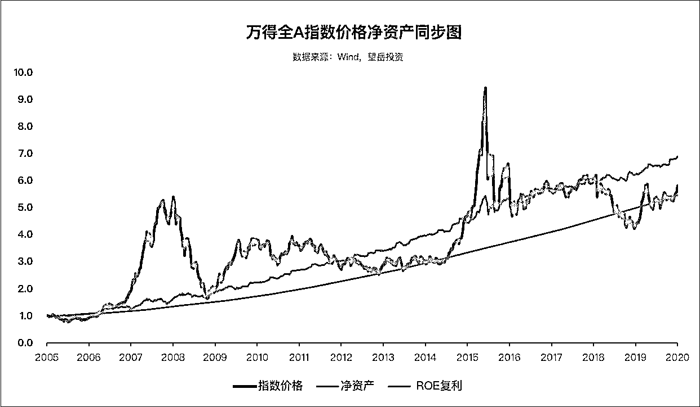

Wind是国内领先的金融数据服务商，“全A指数”代表A股所有公司组成的指数。

图上，橙线是指数价格变化，蓝线是这些公司总净资产变化，灰线是净资产收益率，也就是常听到的 ROE（Return on Equity）复利累积结果。你会发现，指数价格波动很大，但长期表现和这两个指标相关性很高。

稍微解释净资产和 ROE。先放下复杂财务报表和金融指标，回到最基础模型：净资产可看作企业真正拥有的家底；ROE 衡量这份家底创造利润的效率。抓住这两个根，再看指数长期走势，很多杂乱波动就容易理解了。

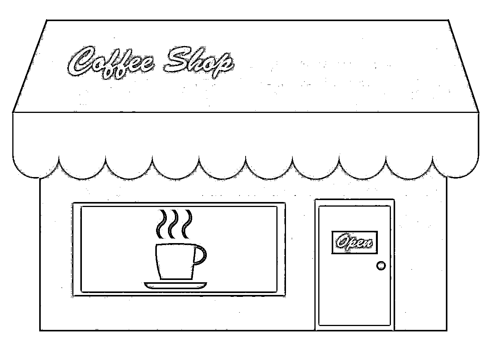

**咖啡店账本里的投资入门**

素材图源：Pixabay

不妨拿一家咖啡馆做样本：启动资金合计 50 万元。其中 30 万元来自自己，另外 20 万元向朋友借，借来的钱连本带息都要还。也就是说，开业之前，这家店的股权结构很单纯——老板只有你一位；但资产负债表上，已经多了一笔债务。资金凑齐后，租店面、添咖啡机、买桌椅，生意就可以运转起来。

忙满一年，目标很明确：多卖咖啡。年末盘点时，用营业收入覆盖房租、员工薪酬、应缴税费等成本，还余下 10 万元，这就是利润。面对这笔钱，常见处理路径有三条：

A. 提现消费，也就是分红；
B. 先偿还部分借款，减轻后续利息压力；
C. 留存店内继续扩张，例如增加设备、扩充人手提升产能，或者上线饼干、蛋糕等新品。

假如在年末给这家店做一次财务“定格”，你会看到设备、咖啡豆库存、银行存款等资产；也会看到尚未归还的借款、应付未付的货款等负债。把资产总额扣掉负债总额，余额就是净资产。通俗点说，这才是老板真正拥有的那部分财富。

经营顺畅时，这个余额通常会往上走：咖啡销量提升，现金储备变厚；研发出新专利，会沉淀为无形资产；盈利后多开门店，甚至购入商铺，也会形成值钱的资产。这些项目减去负债后留下的，便是企业创造的价值，也就是净资产。

净资产收益率（ROE）又指什么？算法并不复杂：用年度净利润，除以当年平均净资产。它回答的问题是——股东投入公司的每一元权益资本，一年能换回多少收益。

查理·芒格有一个判断：股票长期回报，大致会向企业长期 ROE 靠拢。再看万得全 A 指数价格与净资产同步图，其中代表 ROE 的灰色曲线，年化增速约 12%。若未来 GDP 增速放缓，那么前面提到的 A 股上市公司 8%～10% 预期收益率，仍算站得住脚。

参考内容：《投资第一课》01｜钱从哪儿来？；《投资第一课》02｜哪种投资方式的回报最高？；《投资第一课》04｜股票的预期收益率应该是多少？

### 3.2 多数人为何赚不到钱？——耐心拿住，收益才会出现

从原理上说，股票长期预期收益大约在 8%～10%。可现实却是：为什么大量参与者在股市里没赚到钱？

回想 2014 年 6 月到 2015 年底，A 股经历了一轮剧烈起伏。以创业板指数为例：2014 年 5 月 16 日为 1226.47 点，一年内升至 3982.25 点，随后又落至 1797.56 点。

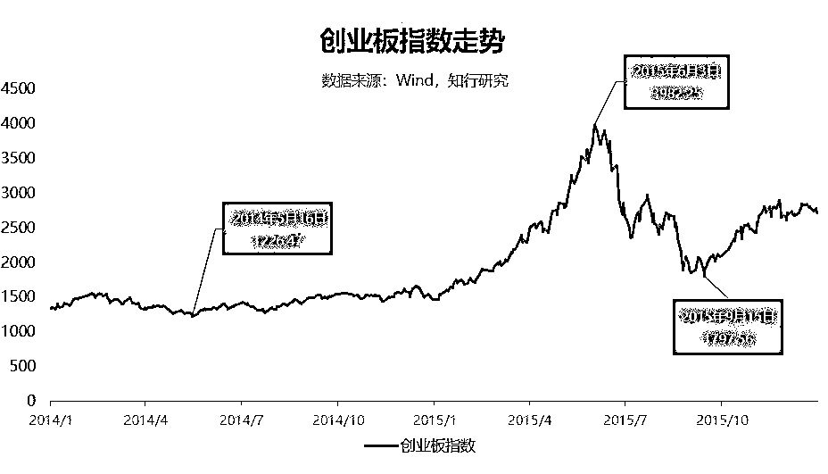

普通投资者在这个过程中收益如何？现实是，多数人不但没赚，反而损失不小。

An Li、Lou Dong、Shi Donghui 在《Journal of Monetary Economics》2022 年第 126 期发表论文，考察了 2014～2015 年牛市及股灾期间的财富再分配。一个发现是：牛市初段上涨时，大量投资者反而降低了股票仓位。原因不难猜——被套多年，终于看到回本机会，自然想先兑现。

到了牛市见顶前的几个月，行情持续升温，许多人又忍不住重新买入，结果成本落在高位。随后市场掉头向下，短短数月恐慌蔓延，“割肉”成为常见选择。而那些在顶部附近才进场的投资者，无论卖出还是继续持有，账面都承受了明显亏损。

这些操作造成的损失有多夸张？约 2500 亿元人民币。基金市场也有类似现象。有知有行曾梳理“基民怎么把钱亏掉”：多数人在上涨初期赎回，却在牛市顶部附近大额申购。

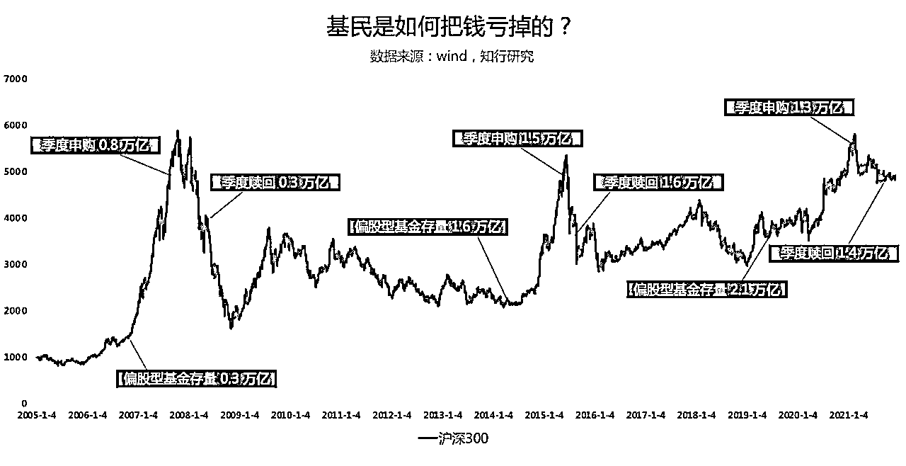

还有人复盘过 2015 年那轮行情。把全体基民视作一个超级账户：假设 2014 年 6 月买入后彻底不管，到 2015 年底，收益可达 50%。可经过一整轮频繁操作，基民整体竟转为亏损。

市场明明涨了不少，股民为何仍亏得厉害？关键就在：股票收益分布并不均匀，而且波动幅度很大。

#### 3.2.1 波动与周期：所谓常态，常常并不“正常”

投资人霍华德·马克斯在《周期》中记录过一项统计。他完整经历了 47 个投资年度（1970～2016 年），同期美国标普 500 指数年化增长率为 10%。这个数字听上去很符合常识。

若年化收益为 10%，人们容易把 8%～12% 的单年回报视作“合理”。但在那 47 年里，美国股市有多少年落在这个区间？马克斯原本猜测不会太多，实际结果仍出乎意料：仅 3 个年份符合。换句话说，大约每 16 年才有 1 年算“正常”。

他还把偏离 10% 超过 20 个百分点的年份归为“不正常”，即涨幅超过 30%，或跌幅超过 10%。47 年中，这样的年份竟有 13 个。因此他感叹：对股票市场来说，常态恰恰是非常态。

市场为何总有大起大落，甚至出现极端牛熊？周期为何反复出现？把这个问题想透，对实际操作很有帮助。

**经济周期与企业盈利周期：市场波动的底层力量**

股市波动当然是无数变量共同作用的结果。从宏观视角看，市场周期主要受三类周期驱动：经济周期、企业盈利周期和情绪周期。为便于理解，我画了一张简图，大致如下：

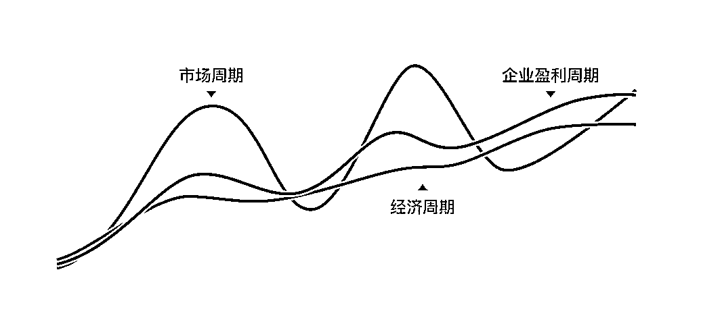

资料来源：《投资第 1 课》

图中蓝色对应经济周期，黑色对应企业盈利周期，红色对应市场周期，也就是情绪周期。需要提醒的是，三者相互影响时会更复杂，并非严格同向变化，这里只是示意。

日常投资者最直观感受到的，是市场周期，即大盘涨跌。但它属于最外层表现。更内核的力量，来自经济周期与企业盈利周期。

经济周期，指的是一个国家或全球在一定时期内的产出扩张或收缩。前面提过“自然资源、劳动力与技术”的财富创造框架。一个经济体长期能走多远，通常取决于人口出生率、劳动生产率、科技水平等因素。因此，经济周期的波动往往不会特别剧烈。

比如，美国股市隔一段时间就会出现大牛市，但该国全年 GDP 增速也不过 2%～3%。再看日本所谓“失落的二十年”，在九十年代泡沫破裂阶段，GDP 表现如何？十年中只有三年负增长，最低也不过略低于 -1%。这和人们想象中的“惨淡”或“崩盘”，显然不是一回事。

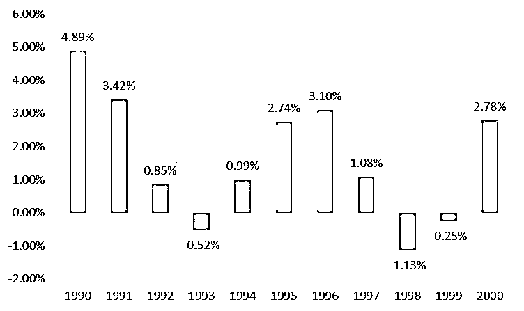

日本上世纪 90 年代 GDP 增速  
资料来源：《投资第一课》

接下来是企业盈利周期。即便 GDP 变化有限，企业利润的起伏也可能很大。

原因不止一个，其中就包括“经营杠杆”。简言之，利润等于收入减成本；收入变动一个百分点，利润受到的影响往往并不对等。

出租车公司是典型例子。它的成本大致分三类：办公室租金属于固定成本——无论车队规模增加 20% 还是减少 20%，办公面积很难立刻调整；车辆成本偏向半固定成本——客流小增时，现有车辆也许能顶住，未必马上购车，但客流大幅变化时就要做调整；汽油则属于可变成本，与总行驶里程紧密相关。

除经营杠杆外，财务杠杆也会发力。企业通常会负债，并定期支付利息。仍以出租车公司为例：假设年收入 10000 万元，总成本 6000 万元，利息固定为 1000 万元，税费固定为 2000 万元，股东可得的净利润是 1000 万元。第二年收入升到 12000 万元，成本不变，净利润则变为 3000 万元。收入只多了 20%，利润却跳升 200%，这就是财务杠杆的效果。

所以，GDP 变动会直接影响企业，而经营杠杆、财务杠杆等因素还会进一步放大盈利周期。市场给公司估值时，利润又是极重要的参照项。于是，盈利周期的起落，也会明显推动整体市场波动。

**情绪周期：人心会把市场推得更远**

在我看来，前两类周期对市场的影响，都不如情绪周期来得猛烈。

市场是参与者行为的集合，而人心转向，常常让行情走向极端。A 股历史上有不少疯狂片段，大家可能早有耳闻。此刻，我想讲一个发生在约 50 年前美国市场的故事，或许对当下仍有启发。

20 世纪 60 年代末到 70 年代初，美国市场流行一个词：“漂亮 50”（Nifty Fifty），指当时被资金热烈追逐、涨势强劲的 50 家大盘蓝筹。它们体量大、知名度高、盈利能力也强。随便列举几家：美国运通、百威英博、可口可乐、迪士尼、陶氏化学、花旗银行、通用电气、吉列剃须刀、IBM、麦当劳……其中不少至今仍是行业巨头。

1968 年底起，“漂亮 50”开启了一段强势行情。当年 11 月，标普 500 连续走弱，最大跌幅达 30%，而“漂亮 50”逆势上涨 19%。之后虽有回落，最大跌幅为 20%，仍小于市场整体。到了 1970 年 6 月的阶段低点之后，新一轮上涨中，“漂亮 50”最高涨幅达到 96%，同期标普 500 为 53%，差距明显。

这轮行情让许多人获利丰厚。市场逐渐形成一种信念：这些公司会持续赚钱，强者恒强，无论什么价格买入都不会错。强烈偏好带来的直接后果，是估值快速抬升。以市盈率看，行情启动前，“漂亮 50”整体约为十几倍，尚算温和；到 1972 年，市盈率中位数已升至 39 倍，最高者达到 95 倍。

这轮牛市后来如何收场？答案并不理想。

《股市长线法宝》作者杰里米·西格尔在 1995 年写了《再看“漂亮 50”：高价成长股最终是否可以证明自己》。他统计发现：“漂亮 50”从 1973 年末开始补跌，明显跑输大盘，直到 1974 年才真正见底；若从 1972 年 12 月算到 1995 年 5 月，这 22 年里其年化收益为 11%，市场整体为 11.2%，几乎打平。

更关键的是，这些公司不少基本面一直不错，也仍是细分行业龙头。可为什么大牛市之后却陷入长达二十年的平庸？原因并不神秘：投资者不再狂热，甚至开始回避，于是即便业绩稳步增长，市场愿意给的估值却大幅下修。

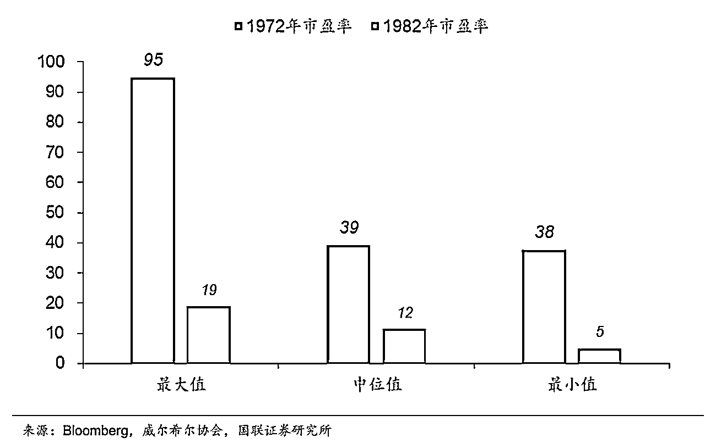

国联证券：《美股“漂亮 50”，后来都怎么样了？》

从图中可见，1972 年“漂亮 50”市盈率中位数为 39 倍；十年后的 1982 年，已降到 12 倍。以可口可乐为例，其业务和后期净利润增速长期变化不大，真正变化的是市场愿意支付的价格：从 50 倍市盈率降至 15 倍。所谓“好日子回不去了”，大概就是这个意思。

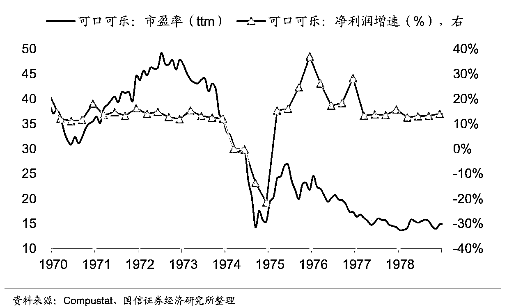

国信证券：“漂亮 50”片尾曲与后“漂亮 50”时代风格大逆转

这构成了一轮完整周期：

市场叙事转向 >> 资金开始追逐某类股票 >> 股价上行又反过来印证故事 >> 更多人涌入，形成“景气不会结束”的错觉 >> 情绪逆转 >> 投资者争相撤离，价格急跌 >> 股价长期低迷……

看看今天的市场，你是否也能找到相似剧情？

**小结**

讲完三类周期，再回到这张图。

资料来源：《投资第一课》

可以看到，经济周期、企业盈利周期、市场情绪周期，波动逐级放大，但最终都会向长期趋势收敛。这个长期趋势，正是课程反复强调的国家经济增长与企业盈利增长。不过，三类周期以及其他周期（例如信贷周期）和各类因素叠加后，便制造出市场的上下起伏，其中人心所起的作用尤其突出。

经济景气时，企业家容易过度扩大投资与再生产；银行等金融机构在上升周期放宽信用、贷款更容易，也会助推这种行为。这些因素在经济向好阶段进一步放大了企业盈利。

映射到市场上：媒体满是好消息，企业盈利频超预期，一片繁荣。此时，投资者的心理和情绪开始主导判断。“这种景象会持续下去，黄金十年不是梦”，股价于是被推高。

某个时点、某个因素使盈利不及预期，而最后的接盘者已经入场，市场便转头向下。经济繁荣期积累的经营杠杆和财务杠杆，这时反而成为负担，企业盈利快速收缩甚至亏损。股市继续下跌，坏消息铺天盖地，投资者认定经济要完，于是抛售。企业裁员、投资者财富缩水，大家压缩开支，企业收入和盈利再受打击……直到下一轮周期重新启动。

#### 3.2.2 怎样理解并应对市场风险？

波动如此之大，股市是不是风险极高？

正因这种大起大落，很多人一谈股票就想到“风险很大”，生怕一不小心血本无归。这里先不急着争论这种说法对不对、该怎么理解。先看一道思考题：

假设有一种资产，占用资金巨大，动辄七八位数，钱不够还得借；遇到风吹草动，它可能在半年到一年内下跌 30%，账面瞬间少掉几百万元，而且好几年都回不来；同时流动性一般，急用钱时卖不掉，真想抄底买入，可能几个月都没人愿意出手。

你觉得，这种资产风险大吗？

有些读者可能已经反应过来：这不就是房子。那么，在国内买房风险大吗？多数人的直觉大概是：不算大，至少比买股票小得多。

可按照上面的描述，房产同样有明显缺陷，波动也不低，为什么大家仍觉得买房总体安全？我总结了几点：

第一，过去二十年，几代中国人亲历了房产大幅升值。其背后的逻辑也容易理解：中国经济高速发展、城市化推进，以及货币发行带来的通胀。很多家庭还享受到房产增值带来的福利，生活水平随之改善。于是，买房逐渐成为一种社会共识，甚至可以说是一种“信仰”。

过去十几年房产的回报高于股票  
来源：中金公司研究部

不只是中国，东亚社会乃至欧美地区，对买房也有很强的信念。前面 3.1.1 提过，全人类社会创造的三百多万亿美元财富中，约 2/3 以房地产形式存在，其中住宅占比超过 70%。有了“房价长期向上”的期待，短期波动似乎也就容易忍受了。

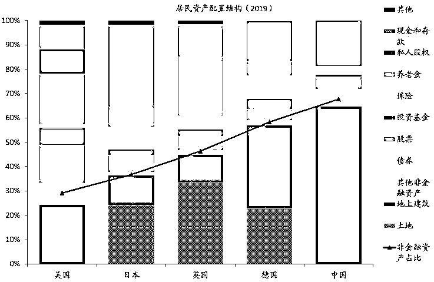

发达国家的房产占总资产比重更低  
来源：中金公司研究部

第二，买房比买股票简单。买房子主要看几个变量：地段、户型、周边配套、开发商与物业水平等；而股票要考虑的因素多得多。多数情况下，买房不容易“买错”；即使选错，比如同价位有更优楼盘却没选到，别人家从 3 万涨到 5 万，你的只到 4.5 万，也谈不上灾难性后果。

可股票一旦选错，可能是涨 3 倍与跌成 1/3 的本质差别。从这个角度看，买房的“风险”确实显得更小。打个比方，这有点像做一道四个选项都正确的选择题，和做数学考试最后一道大题之间的区别。

至于最后一个原因，更耐人寻味。

# 房子拿得住，股票为何拿不住？

很多人觉得买房踏实，说白了就一个原因：楼市缺乏一个类似证券交易所那样的平台，能时时把价格摆在你眼前，还能分分钟成交。价格当然有涨有跌，只不过大伙儿既察觉不到，也没法迅速出手，于是索性不去管它，把房子丢在一边。

你不妨想象一下：要是真有这么个东西，天天给你报价格，账户里的数字随时跟着变，人的心理会受多大冲击？无论你炒不炒股，财经快讯、市场解读、专家意见乃至流言蜚语每天都会涌过来，行情还会对这些信息迅速做出反应。眼睁睁看着账户数字起起落落，能扛住追涨杀跌这种即时诱惑的，恐怕没几个。

再做个假设：十多年前你在国内一线城市买了套房，每平米一万元；到了2020年，价格变成十万元每平米，整整翻了十倍。可要是这期间国家真搞了个房产交易所，你随时能一键卖出或买回，那么当房价涨到三万时，或者从七万掉到五万时，又或者在五六万之间三年纹丝不动时，有多少人能坚持拿到十万？肯定少之又少。

可这套系统根本不存在。所以大多数人压根不清楚自家房子是涨了还是跌了，就算知道了也没法马上操作，于是便作罢。有知有行的同事开玩笑说，过去二十年，相当一部分中国家庭是「稀里糊涂发了财」。

## 有波动就等于有风险吗？

沿着这个思路，再来看「股市风险很大」这个判断，或许就透亮多了。

首先可以确定：波动和风险，不能直接画等号。

传统金融学教材习惯用「波动率」来衡量风险，这是个统计学指标，算的是某段时间内资产价格偏离其均值的幅度。但光凭波动大小来判断一个东西风险高不高，显然太片面。看看过去十几年那些明星股，苹果、微软也好，茅台、格力也罢，哪家没经历过大起大落？单用「风险大」来概括它们，肯定不准确。

这给普通人一个启发：投资时第一要务，是选一个长期趋势向上的市场。

对相对专业的玩家来说，在反复震荡、上下拉锯的市场里也有赚钱机会；但对大多数人而言，只要标的大方向朝上，哪怕中途颠簸，最终取得正回报的概率也会大得多。就像过去十多年一路攀升的楼市，只要自己不瞎折腾，赚钱基本是大概率的事，无非挣多挣少而已。

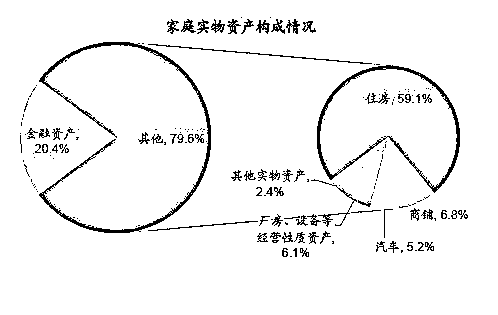

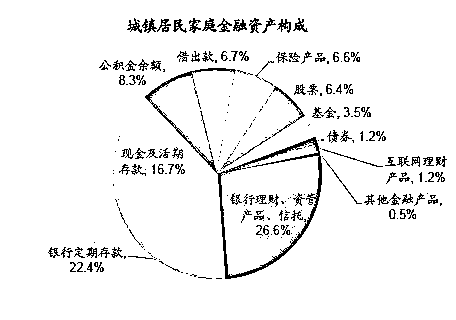

图注：中国居民更偏爱房产，对金融资产心存畏惧｜图源：中金公司研究部

在中国，买房确实是过去十几年最好的投资方式之一，大家见证过「十年十倍」甚至几十倍的回报。但在「房住不炒」的大背景下，先不提二三线城市，就拿北上深的房子来说，未来十年还有多大可能延续这种表现？房价从一万元涨到十万元固然神奇，可同样的房子还能再涨到五十万元每平米吗？

但权益类资产，倒有可能在未来一个新的十年里开始发力。

第一，我国经济正逐步转入需要依靠科技进步、需要大力发展直接融资的阶段。在这样的背景下，A股市场里优质公司会越来越多。按我们之前课程的说法，这正是收益的根本来源；

第二，随着房地产高收益高增速时代逐渐落幕，加上固定收益类产品越来越少，更多资金会流向股票市场；

第三，中国经济在全球依然领先，未来前景依然广阔，海外资金也会逐步提升对中国资产的配置比例。

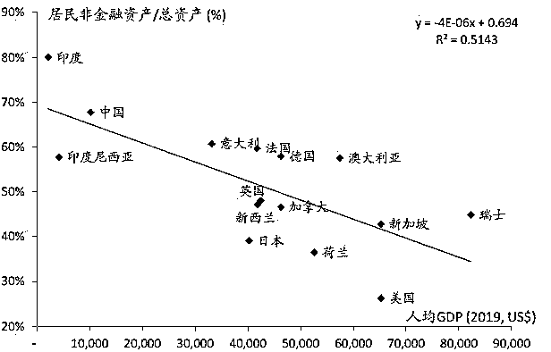

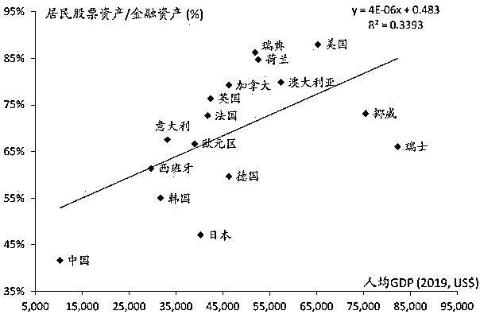

图注：人均GDP与非金融资产占比呈负相关｜图源：中金公司研究部

第二个启示是：尽量拿得久，少动手。

同样是长期向上的资产，房产因为流动性差，让很多人被动地长期持有，结果赚到了钱；股市可以随时交易，大多数人反而亏了。

行为金融学里有个概念叫「短视损失厌恶（myopic loss aversion）」，由著名学者理查德·赛勒（Richard Thaler）和施洛莫·贝纳茨（Shlomo Benartzi）提出。他们在1995年发布的论文里描述了一个有趣现象：投资者查看账户越频繁，回报通常越低。原因在于，大多数人受不了短期价格波动的刺激，总想躲开暂时的浮亏，或者赚一点就急着「落袋为安」。这样反复操作，不但多交了不少手续费，还损失了更多长期收益。

在这方面，有知有行会给你最大的支持。不管是市场跌入低谷、反复震荡，还是亢奋狂热，我们都会冷静地帮你分析当前局势、理解市场情绪，并给出最适合你的行动建议。

当我们对风险建立起正确认知，构建好事前和事后的应对方法，并且有纪律地坚持下去，不仅能获得财务回报，更能收获内心的安宁。

内容参考：《投资第1课》3.为什么股市中多数人都赚不到钱？

#### 3.3.3 持有股票多久可以稳赚不赔？

通过和房产的对比，我们知道了投资股票也应该长期持有，那究竟多久才算长期？持有多久股票才能稳赚不赔？

还是先用数据说话。之前出场过多次的杰米·西格尔教授，对这个问题也做过统计。在《股市长线法宝》这本书中，他计算了从1802年到2012年这超过二百年间，在任意时点持有股票和债券的收益情况。

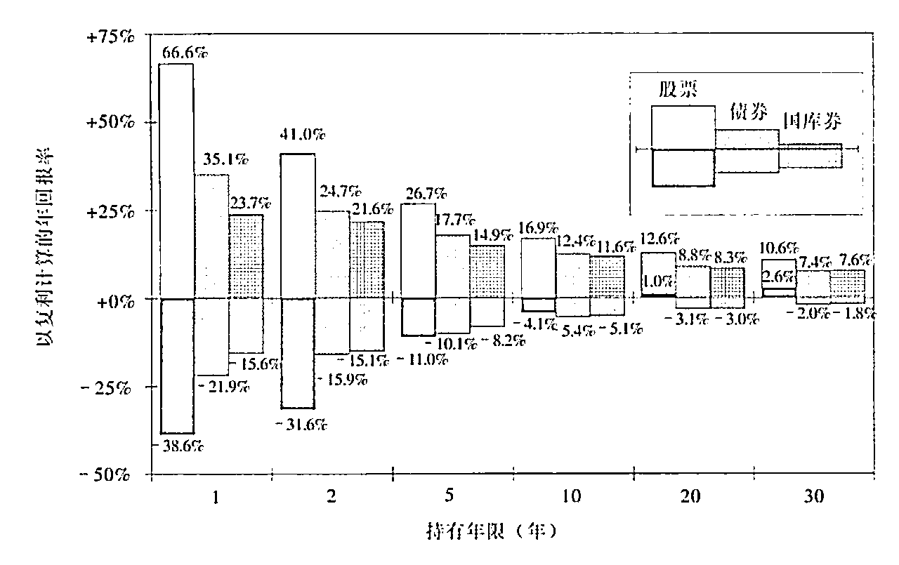

上面这张图里，横轴表示持有股票的时间，以年为单位；纵轴显示的是年化回报率；柱状图的高度代表对应年限里最高与最低的回报率范围。

从图里能很明显看出一种趋势：从任意一个时点如果持有股票一年，最佳收益可达66.6%，最差可以是-38.6%，上下波动极大；可如果年限拉长到5年，这个波动范围就收窄为-11.0%到+26.7%；当时间继续拉长到20年、30年，股票收益率就越来越趋近于我们之前讲到的长期收益率——10%左右（包含通胀）。

不过更有意思的是，当时间拉长到十年以上这个区间，持有股票的最差收益率已经开始比持有债券和国债更高了。到了二十年以上，你能获得的最差收益率也是正的。也就是说，在这个时间尺度上，只要持有不动，你毫无亏钱的可能。

## 「长期」的真正含义

再来看看A股的情况。虽然A股没有美股这么长的历史数据，不过我们还是可以做一下类似研究。我们选取了万得全A指数，从2005年1月1日到2020年10月19日近十五年的数据进行研究，得到的结果是：在任意一个时点持有8.75年以上，都可以获得正收益。如果把获得正收益的概率从100%放宽到80%，最短持有周期会下降到4.83年——这个数据比美股甚至还要好。

所以这组数据，应该算部分回答了刚才提出的问题。当然，我们在这里并不是说投资十年才叫长期，投资一两年、两年半、三四年就不叫长期——关键不在于抠字面上的定义，而在于掌握更多正确的信息。

不过道理大家都懂：只要标的别选得太差，投资时间越长，赚钱概率越高。那为什么长期投资还这么难坚持呢？这里我们先不提认知不足、贪心、自身情况不允许这些主观原因，先来看看客观上「长期持有」为什么这么难。

## 「长期持有」究竟难在哪

第一个客观现象，我称之为：投资回报在时间上的分布不均匀。

来看三张图：

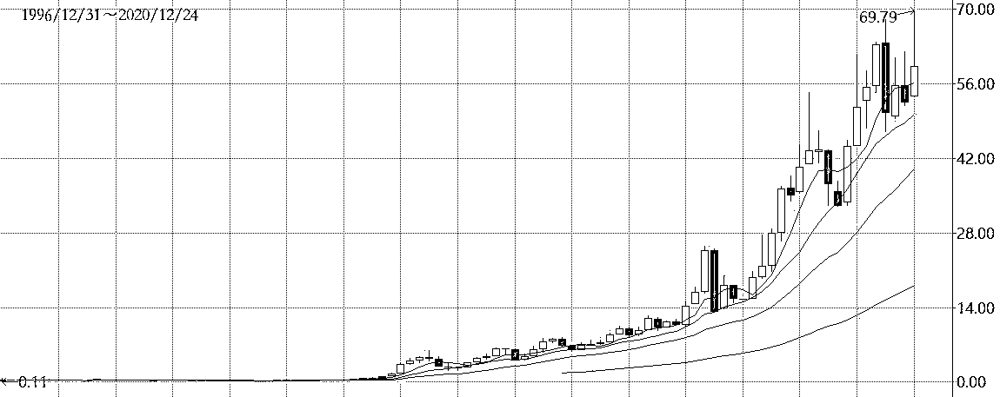

格力电器股价季度K线｜图源：Wind

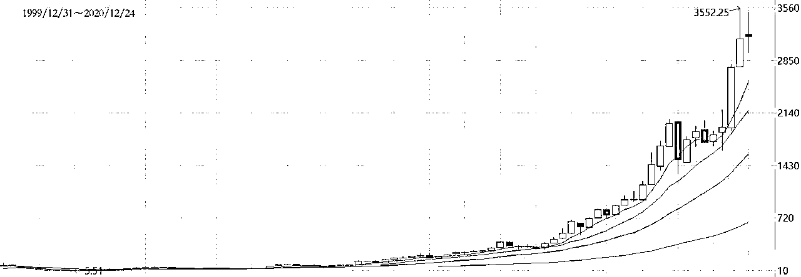

亚马逊股价季度K线｜图源：Wind

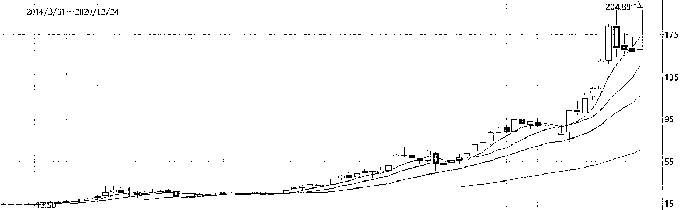

海天味业股价月度K线｜图源：Wind

不知道你注意到没有，这些如今人尽皆知的好公司、白马股、核心资产，股价的发展过程并不是线性的。它们往往蛰伏很多年，然后在一两年的短时间内完成主要涨幅。虽然在蛰伏期股价也会上升，但回头看这条曲线，更像是一种「量变引起质变」的感觉。而且这里选的还是偏传统行业的公司，如果你去看看特斯拉的价格曲线，这个趋势会更加明显。

上面说的是个股，现在我们来看看全市场的统计。之前有学者统计了从1996年到2015年长达20年里投资标普500指数的回报：

换句话说，在这二十年超过4000个交易日里，你要是错过了其中1%的交易日，这二十年可能就都白忙活了。

同样，类似规律在中国股票市场上也一样。还是统计1996到2015年这个时间段：

所以投资界有一句名言：「当闪电劈下来的时候，你最好保证自己在场。」

这就是我们说的投资回报在时间上分布不均匀。不管对于市场还是个股，很可能大部分时间我们都在无聊地等待，而真正的上涨（或下跌）只在很短的时间内发生。换句话说，等待相当煎熬，所以很多人就会选择卖出，然后去追新的热点。

## 「轮动」对投资的影响

长期投资之难，还体现在另一个重要方面：市场总是在「轮动」。

这里说的「轮动」，通俗解释就是「三十年河东，三十年河西」，或者「风水轮流转」。它可能指资产表现的轮动、投资风格的轮动，也可能是行业板块的轮动等等。我们之前的课程说过，万物皆有周期，「轮动」就是周期的另一种体现。

举个例子。回看历史会发现，美股市场在1970年代和1980年代的表现简直天差地别。1970年代，美国经历了一系列危机事件——越战升级、布雷顿森林体系瓦解、中东石油危机等等。从1969年末到1979年末整整十年，道琼斯工业指数和标普500指数起起伏伏，十年下来几乎没怎么涨，算上通胀甚至是亏损的。

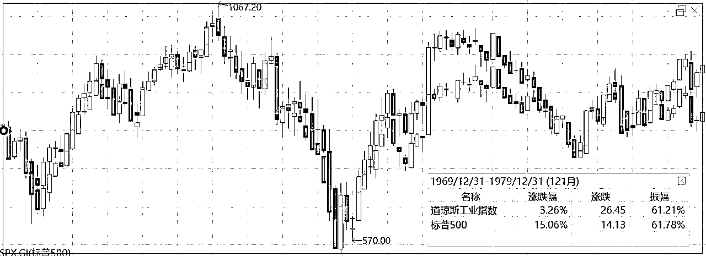

图源：Wind｜灰色线代表标普500指数

而从1980年代开始，美国经济复苏，美联储控制住了通胀，加上科技水平大幅进步，整个1980年代标普500涨了2.2倍——这个幅度和2009到2019年美国十年牛市的幅度差不多。

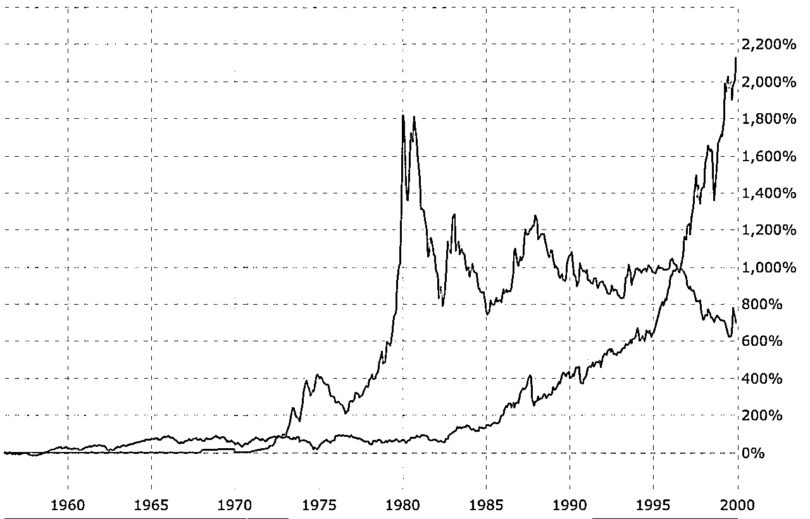

图源：Wind

见上图，虽然1970年代美股表现惨淡，但另一类资产——黄金的表现却非常强。1970年代初每盎司金价在40美元左右，到1970年代末跳到了450美元以上——十年涨十倍，堪比过去十几年的京沪房价。但整个1980年代，黄金价格跌了一半之多。

所以，没有哪类资产能永远表现最好，这就是所谓的资产表现轮动。

同样，在一个资产类别里，投资风格也可以轮动。比如2009到2020年这段美股大牛市中，成长股表现非常出色，而价值股则惨到了历史最低水平。这里稍微说明一下，所谓成长股和价值股是一种偏人为的分类，不同地方定义有所区别。

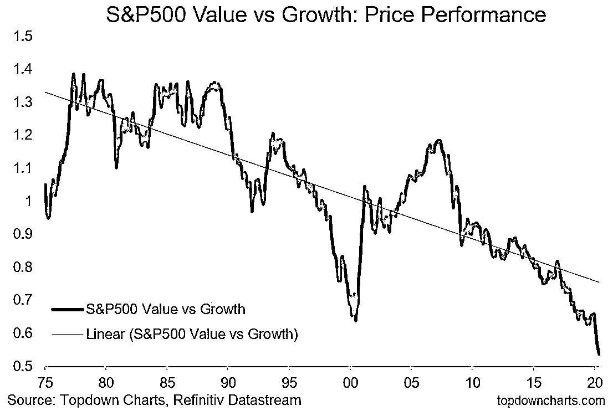

图源：seekingalpha

不过无论怎么定义，有一件事是确定的：不论中国还是美国，这个时间段的市场风格都是把头部公司的价格越推越高，而非头部公司哪怕非常便宜也无人问津。之前我们在课程里也提到过「漂亮50」现象，没多久市场风格就转换了，不再那么热捧那些大公司——这就是风格的一种轮动。

另外大家最熟悉的，就是行业轮动了。比如2020年白酒、消费、医药是最热门的题材，但仅仅几年前，大家还在喜欢银行地产，或者5G半导体。所以市场对行业的偏好也在轮动。

说了这么多轮动，它对我们长期投资的影响是什么？我觉得有两个非常大的影响：

第一，如果当前市场最受追捧的主题和你喜欢或擅长的领域不一致，那么再坚定的人也会对自己的持仓产生怀疑。比如你可能对汽车、地产很熟悉，但看不懂各种热门科技公司在做什么，就会想：市场还会轮动到我这边吗？我是不是该放弃现在的持仓，切换到别的地方？这种过程中的未知感和不确定感，非常难熬；

第二，更关键的是，哪怕你的投资表现不错，但市场上总会有表现更好、更热门的东西。比如你可能在一两年里跟随大盘涨了40%到50%，已经是很不错的收益了，但别人可能投了蔚来、拼多多、特斯拉、比特币，一两年翻了五倍十倍……看到别人赚得比自己多总是更难受的，这也会对我们的长期投资造成影响。

## 小结

最后，我想从另一个角度重新回答一下这个问题。

当我们问股市长期投资需要多长时间时，背后真正的问题可能是：我们都不希望老了才变富。

我们通过投资获得的收益，和三个因素有关：本金、时间和收益率。

收益 = 本金 ×（1 + 收益率）^ 时间

前面的课程里，我们讲过股市长期的预期收益率，今天我们推演了长期投资需要的时间。这些因素都是客观的，不会因为我们希望快速变富而产生变化。我们唯一能控制的，是投资的本金。

因此，对我们来说，可能更重要的事情是：放下焦虑，专注在工作和生活上，在自己不断变得更好的同时，去收获更多的工资、股权等其他收入。与此同时，做好资产配置，根据自己的兴趣慢慢拓展能力圈，在合理的范围内提高我们能获得的收益率。

航线图任务6：在群里分享这些年给你教训最大的一次投资经历

内容参考：《投资第一课》03《为什么股市中多数人都赚不到钱？》、05《为什么市场会有周期？》、06《股票的风险真的很大吗？》、07《投资多久才算长期？》

### 3.3 怎样为自己制定一份长期资产配置方案？

#### 3.3.1 股债平衡

通过前面的内容，我们已经了解到股权类资产是长期收益最高的品种，并且对股权投资市场、周期、波动和风险有了正确认识。接下来我们来看，在这样的市场中，具体如何做好长期投资。

长期来看，股票是收益最高的资产，因此我们应该围绕「长期持有股票」来打造自己的长钱体系。但通过前面的学习，我们知道股市波动很大，很容易影响心态。所以，长期投资的第一步应该是做好股债配置。

什么是债券？

债券是政府、企业、银行等债务人为了筹集资金，按照法定程序发行并向债券持有人承诺于指定日期还本付息的有价证券。

债券的品种很多。比如固定利率债券的发行人承诺每年向持有人支付一定固定数额的利息；浮动利率债券则以当期市场利率为基础支付利息，利息是浮动的。

虽然债券品种多样，但实质上它是一种债权凭证，持有人与发行人之间是债权债务关系。发行人是债务人，持有人是债权人。

不论是机构投资者直接参与债券交易，还是个人投资者通过理财产品间接投资债券，都需要了解投资债券一般能获得多少收益、要承担多少风险。

债券收益主要来源于三部分：利息收入、资本利得和再投资收益。

利息收入是债券发行时就决定的，票面利率越高，债券收益越大。例如风格稳健的投资者配置债券主要是为了获得安全稳定的现金流，就会选择购买并持有到期策略，不考虑存续期内债券价格如何波动。

资本利得是指债券买入价与卖出价或买入价与到期偿还额之间的差额。债券价格随市场变化而周期性波动，投资者可以通过低买高卖获得价差收益。当然，如果预测不准确，则可能承受亏损。

再投资收益是投资债券期间获得的利息收入通过再次投资获得的收益。

为什么债券跟股票相比风险较低呢？

我们经常管股票投资叫「炒股」，但从来没听说过「炒债」的说法。原因有很多，我觉得主要原因是股票和债券的本质不一样。

股票作为公司的所有权，收益主要来源于公司盈利增长，是面向未来的，是对未来的定价，而未来带有相当程度的不确定性，这就导致股票价格波动很大。而债券作为债权凭证，是对过去借钱行为的补偿。首先，债券的票面利率和期限都是约定好的；其次，债券存续期内价格涨跌主要受利率影响，而利率作为资金成本一般都受到调控，不会大涨大跌；另外，不论存续期内债券价格如何变化，最终都要回归面值，也就是说最终会按面值归还本金。

所以，债券跟股票相比风险较低，可以当作避险资产。当然，这是大多数情况下——如果某只债券违约，可能造成本金亏损，此时债券的风险甚至可能比股票还高。

历史上看，投资债券能获得多少收益、承担多少风险呢？

在美国，短期国债和长期国债的年化收益率分别约为2.7%和3.6%。在我国，以主要投资债券的纯债基金为例，从2005年到2022年底，中长期纯债基金指数的年化收益率为4.89%，年化波动率为2.01%。但随着国内无风险利率下移，债券基金的收益预期也有所降低——2017年到2022年底，纯债基金指数的年化收益为3.68%。过往的历史收益并不代表未来的预期回报。投资者要建立合理的预期：中长期来看，投资债券具有保值增值的作用，风险不高，但短期持有仍可能面临亏损。

为什么要配置债券？理想的股债比例是多少？

先来看看价值投资鼻祖本杰明·格雷厄姆在80年前对长期投资的建议。在《聪明的投资者》中，格雷厄姆提出，不论是进攻型投资者（风险偏好较高）还是防御型投资者，都需要同时配置一定比例的股票和债券，并且债券比例不能低于25%。

同时持有股票和债券有两个原因。首先，大多数情况下股票和债券不是同涨同跌的，因此同时配置这两种资产能有效降低组合波动。更重要的是，持有一定比例的债券，能帮助我们在类似2018年大熊市时心里有底，感觉自己还有弹药，不至于把手中的股票卖光。

# 再平衡：真有白捡的收益？

先设想一个场景：市场忽然大幅下挫，满仓股票的人，和手里留了现金、债券的人，心态会一样吗？显然不同。长期看，决定账户最终能不能赚钱的，往往不是多押出去的那部分仓位，而是你能否扛住回撤、坚持到市场回暖。

格雷厄姆还提过一条规则——再平衡（Rebalance）。这三个字怎么理解？

举个简单例子：一开始把股票和债券设成75:25。随着两类资产涨跌，比例会慢慢偏离。假设股票涨得更快，变成80:20，那就卖掉相当于总资产5%的股票，转去买债券，让股债比重新回到75:25。这个动作，就是再平衡。

前文说过，不少投资者之所以亏钱，是因为在股票昂贵时追高买入，随后又在暴跌中恐慌割肉。这和正确的投资做法正好相反。真正的价值投资者，会在下跌时用更低的成本增加股票仓位，在市场狂热上涨时停止加仓甚至卖出。要做到这一点，除了掌握知识，还得管住情绪。

再平衡恰好是一种简单、带纪律性的方法，能帮我们落实这个原则。

有意思的是，这个动作本质上就是卖出涨得较多的资产，买入涨得较少的资产。但它并不要求我们判断市场是高估还是低估，也不需要做复杂估值。难怪投资圈常说：再平衡，是投资里唯一免费的午餐。

那股票和债券各配多少？格雷厄姆给出的边界是：股票最多75%、最少25%，对应股债比最高75:25、最低25:75；对多数人来说，50:50比较合适。很多人总想找到一个精确比例，其实真正关键的不在这里。

## 这套老办法，在A股管用吗？

这套资产配置方法源自美国，距今约80年。放到中国市场，它还能不能奏效？

我们拿万得全A指数代表股票，用中长期纯债基金指数代表债券，选取2004年至2020年的数据做回测，观察这套系统在A股的表现。

75:25组合年化收益9.98%，持有期间最大回撤64%；股票占比降到50%后，50:50组合年化收益8.63%，最大回撤54.69%；股票占比再降到25%，25:75组合年化收益6.94%，最大回撤37%。收益确实有所下降，但回撤幅度也明显收窄。

如果再加上每年年初做一次再平衡——把因涨跌而偏离目标的股债比例调回初始设定，效果会怎样？

75:25组合的年化收益从9.98%升到11.38%，最大亏损从64%降到53%。另外两个组合同样出现收益上升、亏损下降；其中25:75组合的最大亏损甚至降到19%。是不是有点意外？

几乎不用额外操作，以指数基金为核心，就能搭建一个长期运行、自动调整的投资系统。无论市场怎么变，我们都不必预测和焦虑，系统会自己处理问题。

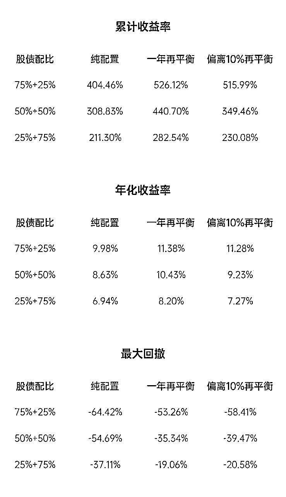

来源：有知有行

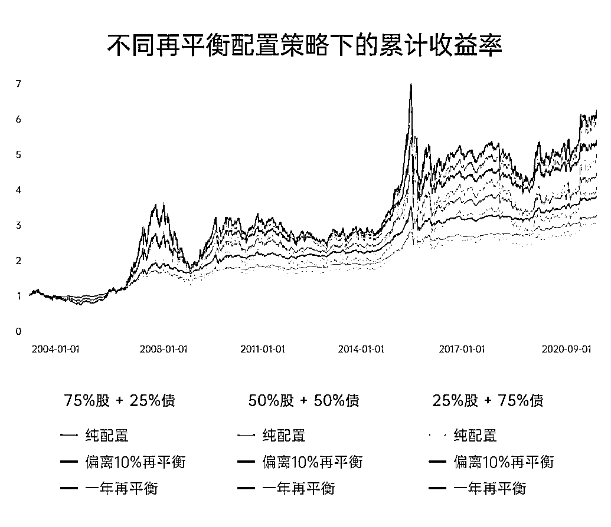

来源：有知有行

格雷厄姆的建议看着朴素，却很有用，它也是我们构建自己投资系统的起点。

## 往后能拿到多少收益？

如果按这套系统投资，未来大致能获得什么回报？不妨推算一下。

2020年11月初，一份重要规划文件出炉——《中央国民经济和社会发展十四五规划和2035年远景目标建议》。里面有不少内容与投资有关。假设到2035年，我国GDP在2020年基础上翻倍、突破200万亿元，那么这15年间的年均增速大约要到4.7%。

前面课程讲过，GDP中约七成由企业创造，而且企业的盈利能力高于个人和其他部门。若投资中国全部企业，大致能获得年化5%—6%的回报。上市公司属于企业中的一部分，整体盈利水平又高于全部企业平均；若投资中国所有上市公司，大致能拿到年化6%—7%。再进一步，沪深300、中证500等宽基指数覆盖的是上市公司中的一部分，指数编制方式使其偏向头部公司。若通过沪深300、中证500以及中概股等指数覆盖中国经济未来15年的主要方向，大致可获得年化7%—8%的增长。

概括来说，如果未来15年中国经济能保持约4.7%的年均增速，那么借道指数投资，年化7%—8%的回报是有可能实现的。

股票部分说完，再看债券。若未来15年GDP预期年均增长4.7%，债券收益大概率会低于过去20年。道理不复杂：如果借钱的利率高过经济增长速度，借款需求自然会减少。我们不妨假设未来15年债券平均年化收益为3%，这是第二个基础。

另外，上面的回测显示，再平衡这一简单操作能提升约1%—2%的年化收益。股票8%、债券3%、再平衡约1%，三者相加构成这套系统的收益底座。按这个底座推算，若采用75:25的股债配比，未来15年的年化收益大约是：

75%×8%+25%×3%+1%=7.75%

搭好股债平衡框架后，债券和股票两头具体该怎么落地？

#### 3.3.2 债券端如何配置？

长期投资里放一些低风险债券产品，目的不是博高收益，而是分散风险、平滑波动，让账户更稳。问题是，债基种类不少，该选哪一类？先梳理常见分类。

债基的分类维度很多：按管理方式，有主动型与指数型；按能不能投股票，分为纯债、一级债基、二级债基；按运作方式，有开放式、封闭式、定期开放式；此外还有聚焦特定券种的主题型产品，比如利率债、信用债、可转债、中短债等。

截至2023年底，各类型债基的规模占比见下图。

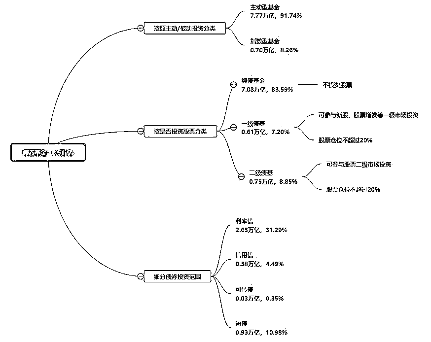

数据来源：Wind；图表制作：有知有行

长期配置最该关注的是按股票仓位划分的纯债、一级债基、二级债基，这一维度也最能跨越周期。

债基必须把至少80%的资产投向债券，剩余20%允许投什么，就决定了它属于哪一类。

纯债基金只投债券等固定收益工具，不碰股票，收益基本只看债市脸色。

一级债基以债券为主，剩余20%可适度参与打新、股票增发等。

二级债基的剩余20%不仅能参与打新和增发，还能直接在二级市场买股票，因此股债两市都会影响它。

买之前，务必翻一翻基金招募说明书。“基金的投资”章节会写清楚它的投资范围。

比如“易方达稳健收益债券”的招募书显示：它以债券为主，同时可投股票，股票上限20%，由此可判断为二级债基；它也允许投可转债，但占比不高，所以不算可转债基金。看清投资范围，才能准确理解一只基金的风险收益特征。

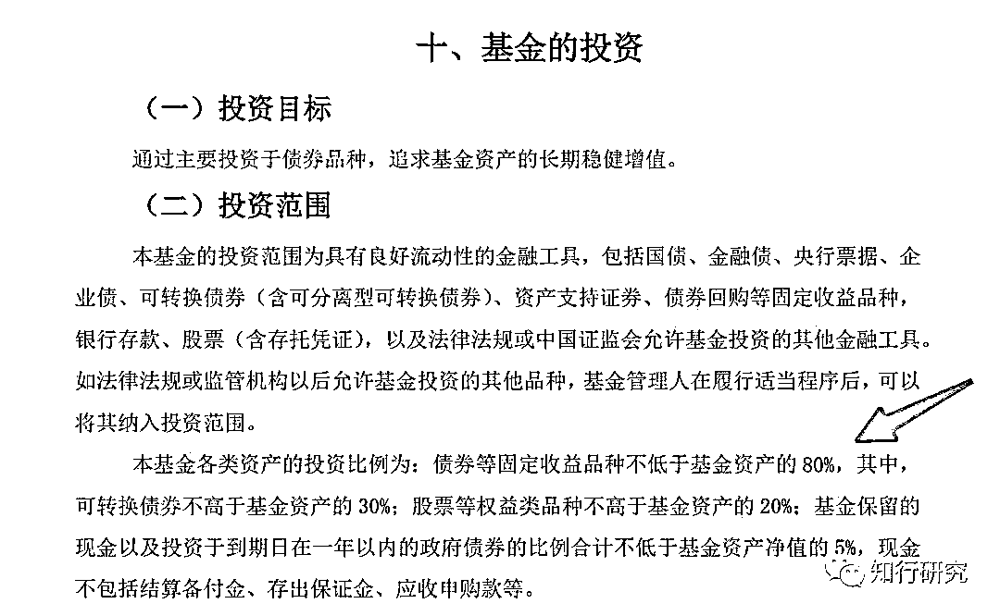

债基品类不少，长期配置该选哪类？

答案偏向纯债基金。理由不复杂：我们配债基，是为了拿相对稳健的收益，并借债券与高风险资产之间的低相关性来压低账户整体风险。

反过来，如果债基里股票仓位偏高，账户的整体风险就不容易被看清。因此，债性越纯，越适合长期配置。有些纯债基金偏爱风险较高的可转债，也应剔除，逻辑相同。

纯债基金在债基里风险偏低。持有几个月仍可能亏，但把期限拉到一年，正收益概率约98%，平均年化收益约5%，最大浮亏仅3.27%。换句话说，哪怕刚买就撞上债市大跌，亏损持续的时间和幅度通常也有限。

买纯债基金要不要挑时点？

债市有周期，大约三年一轮。若能通过宏观政策和债市分析判断未来走熊还是走牛，就能低买高卖，拿到高于平均的收益。但这对普通人来说难度很高。更现实的做法，是挑一只不错的纯债基金做配置。

在此之上还能做点优化。比如某只纯债基金长期年化约5%，但过去一年没达到均值，说明债市近期偏弱。此时买入，风险通常比在它一年赚了10%时追进去要低。

另外，可优先考虑规模不低于10亿元、债券基金经理管理年限6年以上、业绩较稳（债市大跌时回撤控制较好）、历史上未踩雷违约债、公司债基管理规模靠前的产品，机构通常也更偏好这类基金。

#### 3.3.3 股权端如何配置？

有知有行的长期投资理念，可以浓缩成一句：好资产、好价格、长期持有。

先挑好资产

什么叫“好资产”

先要问：什么样的资产才算好？

前面的课程给过答案：普通人最该找的，是一个长期向上的市场。只要大方向向上，中途波动并不可怕，拿得够久，正回报的概率就高。可“长期”究竟多长，没人能精确知道。因此配置资产时要留有余地，别让持有过程中的波动扰乱心态，进而缩短持有时间。

下面看看怎么挑出长期向上的资产。

指数基金为何算好资产？

2010年6月，创业板指数登场，被寄予中国“纳斯达克”的期待，由100家较有代表性的创业板公司构成。

假设当年把资金均分成100份，分别买这100只股票并拿到今天，结果会怎样？年化收益7.77%。

若按涨幅排序，前三是亿纬锂能、东方财富、爱尔眼科，年化分别45%、42%、41%，2010年10月以来的约十年间涨了30—40倍。当年若能押中这三只，回报自然惊人。

标准放宽些，假设能挑中这100家里表现靠前的20家，平均年化是多少？22%，同样不差。

可要是选中的是剩下80家呢？平均年化只有0.6%，不足1%，其中30家还是亏的。

人往往会高估自己的选股能力。冷静看统计：押中那三只牛股的概率仅3%；挑中前20家的概率也只有20%；更大概率是落入后80家，十年下来白忙一场，甚至亏钱。

对普通人来说，靠选股找好资产太难。有没有更省力的办法，既能持有公司股权，又能分享企业和经济长期发展的成果？有，那就是指数基金。

指数基金，本质是买一揽子股票。创业板指数有对应产品，沪深300、中证500等也都有基金。买它，等于同时持有许多公司，照样能分享这些公司的成长。

很多书提到指数基金时，常强调它分散风险、生命力强。但这里想换个角度：指数基金其实还能帮我们筛出好公司。

以创业板指为例，它挑的是创业板里市值最大的100家公司，再按加权方式编制。

时间拉长看，好公司市值膨胀得快，差公司市值不断缩水。一旦某只股票市值掉出前100名，就会被调出创业板指；反过来，市值持续上升的公司，在指数里的权重会越来越高，我们的组合也会自然多配它。

正是这种优胜劣汰，让持有指数的人不知不觉把资金更多配置到优质企业上。

猜一猜：创业板指发布时那100家公司，如今还有几家在指数里？只剩18家，另外82家已在岁月中被淘汰。

可以这样理解：把A股上市公司当成一所学校的学生，选出前10%组成尖子班，每年按成绩重新洗牌。最终，这个班里考上重点大学的比例大概率更高。

回到前面的例子：如果2010年10月买的不是那100只初始成份股，而是自带优胜劣汰机制的创业板指数基金，年化回报能从7.77%提高到12.83%。

A股的头部效应其实非常突出。

再看一组数据：A股财富创造最多的前15家公司，合计贡献了约10万亿元，几乎等于A股过去30年创造财富的总和。

美国也不例外。金融学者威廉·伯恩斯坦（William Bernstein）曾统计，美国股市自1926年以来的全部回报，几乎都来自表现最好的1000只股票，而它们只占全部上市公司数量的4%。

想找到长期好资产、抬高长期收益，就绕不开这些头部公司。可从几千家里精准挑出极少数赢家，难度和不确定性都太高。所以，买指数基金的意义不只是分散风险，更在于用更可行的方式抓住那些能带来长期回报的优质公司。

指数基金个个都好吗？

A股指数数量很多，到底该选哪些？名字里带“指数”二字就一定能买吗？看个例子。

图：中证煤炭指数历史走势，数据来自Wind

例子主角同样是一只指数——中证煤炭指数。

2009年年中，金融危机后的大规模刺激政策推动中国经济回暖，火电、钢铁、水泥、化肥等行业快速扩张，煤炭需求被大幅拉起。中证煤炭指数从发布时的1000点，到2010年底冲上3300点。然而2010年至2020年底的十年间，该指数下跌61%。

根子在于政策与市场环境变了。2010—2015年北方城市雾霾严重，随着人均GDP提升，人们对生活质量和环境的要求越来越高。国家层面，建设清洁低碳、安全高效的现代能源体系被提上日程。煤炭作为传统能源，需求不断被压缩；供给端又因前期刺激而产能扩张，甚至过剩。供大于求，价格自然一路走低。

在一个整体趋势向下的行业里，买指数基金还有意义吗？

像中证煤炭指数这样的行业指数基金，看似是指数产品，实则是在做主动判断，是在“择行业”甚至“择股”。

前面的课程反复讲过，投资回报的根基，是整个经济体的增长，是企业与劳动者共同创造财富。可我们没法准确预判哪个行业、哪家公司最终能赢。

以沪深300的行业构成为例，近20年各行业权重变化很大：“日常消费”从5%升到16%，“信息技术”从6%升到15%；“工业”“材料”“能源”则分别下降12%、13%和5%。

图：沪深300行业成份变化，数据来自Wind

这些权重变化的背后，是过去十多年中国经济从投资驱动转向消费驱动的缩影。

把指数基金称为好资产，有个重要前提：所选指数应尽量代表一个国家的GDP，也就是一段时间内该国创造的总财富。这样投资才有意义。那具体选什么？

核心—卫星思路

目标是用尽量低的成本，尽可能广地覆盖上市公司和中国经济。实际上，沪深300加中证500，就能较好地实现这一点。

沪深300偏向大盘股，由沪深A股中市值较大、流动性较好的300只股票组成，较能代表成熟公司的状况。中证500则偏向中小盘，选的是剔除沪深300成份股以及总市值前300名之后、市值靠前的500只股票，反映沪深两市中小市值公司的整体面貌。

截至2020年12月，沪深300总市值49.60万亿元，占全部A股的57.34%；中证500总市值11.22万亿元，占12.97%。两者合计接近70%，覆盖了A股的大半。

从营业收入、扣非净利润等衡量盈利的财务指标看，沪深300与中证500合计也占全部A股的很大比重，囊括了不少优质资产。

有这样的覆盖面，再叠加“注册制”全面推行，我们更有机会捕捉未来的优秀公司。就像2010年很难预判煤炭此后十年的走势，如今我们也未必看得清未来10年、20年白酒、消费、新能源、半导体等行业的兴衰。但指数基金会定期调整、优胜劣汰，能让我们持续持有市场上大部分优秀公司。

而且，沪深300与中证500之间还有一定的互补性。

想长期拿得住？请先学会“核心+卫星”式配置

A股市场有一个屡次上演、却常被忽视的规律——风格轮动。回溯2012到2014年，重仓大盘股的投资者几乎被市场来回碾压；可到了2014年12月，小盘股又集体遭遇重挫；2015年风向骤然反转，市场重新青睐中小票。而在股灾过后的2016至2017年，大盘蓝筹又稳稳站上了主线。正因为行情风格切换如此频繁，均衡配置才显得尤为重要——它可以让我们从容穿越各种市场节奏，稳稳拿住手中的筹码。

不过，沪深300和中证500并不能代表中国经济的全部。像腾讯、阿里巴巴、美团、小米这类新经济样本，都选择在A股之外上市，所以并不在宽基指数的成分范围内。好在注册制改革正在推进，未来这一情况会逐步缓解；同时，我们也能通过“中概互联基金”之类的工具，把这类优秀企业纳入自己的投资版图。

此外，我们还能基于对行业前景的判断，在组合里加入消费、医药等行业指数基金，以及红利指数等策略指数基金，这就是常说的“核心—卫星”策略。

具体来说，把沪深300、中证500等宽基指数作为“核心”资产，让它们占整体仓位60%以上，确保我们分享中国经济增长的成果，不错过未来各赛道头部公司崛起的过程；再结合自己的判断或市场估值水平，配置一部分“卫星”资产。这样做，既能降低组合的波动，又有机会获得更好的收益。

内容来源：《投资第1课》第14讲：如何选择好资产？

好价格：买在便宜处，卖在热闹时

上一讲，我们聊了如何搭建长期资产配置方案，也谈了怎么挑选好资产。接下来的疑问自然落到三个词上：何时买、买多少、何时卖？

落到日常生活里，它们会变成类似的追问：“每月结余的钱该怎么投？”“手里的一笔钱五年内用不上，现在能买多少？”“市场涨成这样，要不要先跑？”

我并不会直接给出答案，而是结合前面聊过的内容与一组组数据统计，把回答这些问题的底层原则梳理清楚。原则清楚了，答案也就自然而然地浮现了。

如何不错过那些最赚钱的日子？

前面我们说过，投资收益在时间上的分布极不均匀。换句话说，真正的上涨往往集中在很短的时间窗口里，而我们并不知道那扇窗什么时候开启。一旦错过，长期收益就会大打折扣。

图源：Wind、有知有行

回看2005年至2020年的万得全A指数：如果你始终持有，年化收益率是12.9%，这是一个相当亮眼的结果。然而，一旦错过了涨幅最大的5个交易日，年化收益会掉落到10.1%，直接少了近3个百分点；接着再错过更多——比如错过涨幅最高的30天，那么持有了整整15年，到头来几乎一无所获。

这意味着什么呢？我们长期投资获得的大部分收益，其实由极少数时间贡献。在这段长达15年、约3900个交易日的时间里，涨幅最高的30天，贡献了几乎全部利润，占比只有0.76%。

既然如此，正确的应对方式是什么？答案是：尽可能留在市场里，稳稳当当呆在场内，不轻易出局。

总有人会追问：“只看错过上涨太片面了。若我躲过跌幅最大的几天，年化收益能提升多少？能不能帮忙算算？”

恕我直言，这个思考角度本身就是错的。无论是涨幅最大的30天，还是跌幅最大的30天，它们都随机地分散在漫长的投资时间线上，没有人能提前预判并精准躲避。我们能做的，不是避而不见，而是让自己始终在场。

于是我们得到第一条原则：尽可能一直待在市场中。

股市的长期回报，究竟从哪来？

“指数基金之父”约翰·博格在《共同基金常识》里，对美国股市近200年的投资回报做了系统分析，提出决定股市长期回报的三个变量：企业盈利增长率、股息率，以及市盈率的变化。市盈率是反映估值的指标之一，它的变化也可以理解成估值的变化。三者共同塑造了股市的整体回报。

用公式表达就是：

股市回报 ≈ 企业盈利增长 + 股息收益 + 估值变化

这个公式同时印证了前面的课程：长期收益的大部分来自企业自身的成长，也就是盈利增长和股息收益；另一部分则来自市场情绪的变化，即估值波动。

我们把2005年以来万得全A指数的累计收益率做了拆分，分别计算了净资产增长率（代表企业盈利增长）、股息率、以及用PB衡量的估值变化率。

拆解后的结果非常直观：长期看，万得全A的收益几乎全部来自企业盈利增长，估值变化贡献微小。2005年到2020年底，该指数年化收益率12.9%，其中净资产增长率11.17%，股息率1.52%，估值变化率只有0.07%。

换句话说，如果买入股票或投资股票的基金并长期持有，最终得到的结果会更接近“企业盈利增长+股息收益”之和；而且投资期限越长，估值变化在整体收益中的占比就越低。

这就引出第二条原则：长期来看，我们赚到的钱主要来自企业盈利的增长，估值波动贡献的部分会随着时间拉长而不断缩水。

择时到底有没有用？数据不说谎

传奇基金经理彼得·林奇讲过一句意味深长的话：在较长的投资周期里，即使某笔交易恰好买在最低点，对整体配置的影响也没那么重要。他所在的富达基金曾做过一项研究，在1965年到1995年的30年间，如果投资者每年都能精确地买在最低点，年均回报为11.7%；而如果每年都倒霉地买在最高点，回报也有10.6%，两者仅相差1个百分点。

美股波动小，这个故事在波动剧烈的A股是否同样成立？我们做了类似的情景模拟：从沪深300指数发布的2005年4月8日算起，假设三位投资者每年都会投入一笔钱，第一位是“幸运儿”，总能买到当年最低点；第二位“省心派”，每年第一天就买入；第三位“倒霉蛋”，年年撞上当年的最高点。

16年后，他们的账户收益率分别是多少？

图源：有知有行

结果有点意思：幸运儿年化10.69%，省心派年化8.84%，倒霉蛋年化5.63%。相比美股，A股最高点与最低点的买入差距确实更大，波动明显更剧烈。所以，尽量不要买得太贵。

但从另一个角度看，长期来看，每年随意选个时间买入，与真的每次抄到最低点相比，差别并没有想象中那么悬殊。而且，你我心里都清楚，“幸运儿”和“省心派”背后所投入的精力完全不在一个量级——前者需要频繁盯盘，外加惊人的运气；后者则把一切交给时间和概率，把精力留给工作与生活。

这正是第三条原则：对单笔投入而言，只要持有周期足够长，不必苛求买在最低，但也千万不要买得太贵。

怎样让长期收益更上一层楼？

前面两组回测的时间窗口长达15到20年，买入价格对最终收益的影响被大幅稀释。但现实是，许多人未必能拿那么久。如果持有期限缩短到5年左右，买入价格对结果的重要性就会显著提升。

这时就要请出一个有用的工具——“股市温度计”。它可以帮我们大致判断当前市场到底是贵还是便宜。

我们统计了2005年以来全市场股票的每日估值，并依据历史估值的变化规律，把市场情绪热度划分为三个温带。逻辑上很好理解：温度越低，估值越低，安全边际越高，低价买入的盈利空间也就越宽敞；温度越高，买入成本越高，未来回报空间被压缩得越狭窄。

图源：有知有行

那么，在不同温度下买入并持有5年，真实收益会怎样？下面这组回测结果给出了参考。

图源：《投资第一课》

图中蓝色线代表股市估值温度，红色线与绿色线分别对应投资万得全A指数、沪深300指数并持有5年的年化收益率。规律相当清晰：在温度偏低、市场整体便宜的时候——比如2008年、2013年买入并持有5年，大概率能获得10%以上的年化回报；但如果是在市场很昂贵的时刻，比如2007年或2015年买入，哪怕坚持5年，也可能依然赔钱。

由此得到第四条原则：长期持有的过程中，如果能抓住低估值的窗口买入，收益还能再上一个台阶。

“卖在高估”对收益有多大帮助？

最后一个回测，是关于“高估卖出”的。借助温度计，在熊市低估、价格便宜时多买入，在牛市高估、价格高企时卖出，能让估值变化也贡献一份收益。所谓“好价格”，既包含低买，也包含高卖。

我们用2010年初至2015年12月这个跨越一轮完整牛熊周期的区间做回测，对比三种策略在沪深300指数上的表现：

1）普通定投：每月定投2000元，只管买、从不卖。

2）低估加倍+高估不买：根据温度，低估时加倍定投（每月投入4000元），高估时不投，但依然不卖出。目的是让买入成本尽量低，避免买贵。

3）低估加倍+高估不买+高估卖出：在策略2的基础上，结合温度高估信号和趋势交易方法，择机卖出。

三种策略的运行结果如下：

图源：有知有行

从回测结果能读出两个关键信息：

第一，“低估加倍+高估不买”的内部收益率为12%，比普通定投略有提升，但差距不算大，这与第四条原则相互印证。它的主要贡献，是通过低估时加大投入，把总成本与账户总资产规模显著拉大。

第二，“低估加倍+高估不买+高估卖出”的内部收益率高达20%，相对另外两种策略提升非常明显。

为什么“高估卖出”能带来如此大的增益？核心原因还是A股波动太夸张：牛市之后往往跟随暴跌，而浮亏越大，回本所需的涨幅越惊人，甚至呈指数级放大。比如2015年6月之后，市场最大跌幅达到50%，若在顶点买入，回本需要上涨整整100%。如果能在大的周期节点上，趁高估适当卖出一部分，尽量控制回撤，长期收益自然会被有效抬高。

于是我们得到第五条原则：如果牛市的估值已经贵得离谱，卖出一部分，能大幅提高长期收益率。

有知有行App怎么查看全市场温度？

小结

把前面五条原则串起来，再来回答这一讲开头的几个实际困惑。

1）“我每月都有点结余，这笔钱怎么投？”

如果这笔钱确实能用于长期投资，选好“好资产”并定期投入市场，远比纠结周定投还是月定投、周一定投还是周五定投重要得多，也省力得多。可以对照温度计：中估时正常投入，低估时加倍投入，高估时停止买入。定投的具体日期实在不必纠结，更不必懊恼“昨天刚投，今天就大跌”——长期来看，这些短期扰动微不足道。把节省下来的精力花在别处，也许是更聪明的选择。

2）“我现在有一笔钱，能放5年，应该买多少？”

先回到资产配置方案，结合自己的收益预期，算出需要投入权益类资产的比例。然后，再参照温度计，决定一次性建仓的具体仓位。关于这个问题，在【3.3.4 的小结】中我们会用完整案例演示如何做长期资产配置，到时答案会更清晰。

3）“我该什么时候卖出？”

前面的课程已经让我们明白：通过股票和基金，我们持有的是资产，是企业的部分所有权，而不是交易的筹码。所以，只要市场温度不高、估值不算贵，其实没必要急着卖出。长期来看，这些资产会伴随企业和经济的成长而不断增值。但如果市场再次出现类似2007年、2015年那样明显的高估，不妨遵从温度计的提示，卖出一部分高估资产，先锁定收益再说。

到这里，这一讲已经进入尾声。经过上面几轮梳理，我们已经初步搭建起一套以“好资产+好价格+长期持有”为支柱的投资系统。

#### 3.3.4 如何进一步提升收益？

武器1：基于估值的低买高卖

图源：有知有行

一个不得不承认的事实是：人类缺乏给股票精确估值的能力。大部分时间里，市场给出的价格都是“正确”的，我们很难说它是贵还是便宜；但总有少数时刻，胖瘦一眼就能看出来。比如2018年底，哪怕不需要很多专业知识，也能感受到市场的冷清与便宜；而2015年年中那样火爆的氛围，明眼人都知道难以持久。

基于估值，在特别便宜的阶段多买一些，在特别昂贵的阶段卖出一些，其余时间安心长期持有——长期下来，这样的操作能有效提高收益率。至于提高多少，取决于市场里出现了多少“疯子”与“傻子”，换个说法，他们所犯错误的大小，决定了我们能收割多少超额收益。乐观估计，基于估值的低买高卖大约能带来每年3%到5%的额外回报。

武器2：增强型指数

你可能听说过有些基金公司发行“增强型指数基金”。所谓增强，简单说就是在跟踪指数的基础上，尝试多赚一些超额收益。

不同基金的增强路径不一样。以沪深300指数增强为例：有的基金会在这300只股票中保留一个核心仓位（比如70%以上），其余部分做一些优化操作；有的通过量化因子体系，选取“分析师情绪”等高胜率因子争取超额回报；还有的采用“配对交易”，利用“美的”与“格力”这类股票的价差波动来获利……

五花八门的方法背后，共同逻辑是：核心仓位始终锚定指数成分与权重，再做一系列胜率较高的小操作，同时用交易纪律约束组合不偏离指数太远。这些操作具体到每一笔，有成功也有失败，但靠“积小胜为大胜”，在散户占主流的A股市场，依然存在可观的发挥空间。乐观估计，增强型指数基金能帮我们提高1%到2%左右的年化收益。

武器3：主动型基金

“选好资产”是有知有行投资原则中极为重要的一条。指数反映的是上市公司里中等偏上的水平，但在这些公司中间，一定有增长更快、质地更好的存在——就像同一个班级里，学生的成绩总有好坏之分。

有些富有经验的老师，能凭直觉和阅历判断出班里哪些同学更有“前途”；优秀的基金经理也是类似的角色，他们依靠自己的认知、研究和系统，帮助我们在上市公司群体中筛出增速更快的公司。这些公司的长期回报率，自然有望跑赢指数。未来15年，只要我们能找到靠谱的基金经理，主动型基金大概能贡献每年2%到3%的额外年化收益。

武器4：债券型基金

对普通人来说，通过公募基金买债券通常比直接在市场上持有债券更省心。除了对债券质地把关、分散风险之外，债券基金还能借助杠杆（通常约140%）适度放大收益。因此，即便保守估计，通过债券基金拿到4%左右的年化收益率也是大概率事件。

篇幅所限，这里只展列了3种武器。其实在有知有行的“武器库”里，还有很多选择。例如，在买入和卖出时叠加趋势交易策略；又比如在组合中加入美股、德国乃至黄金等更多资产类别。这些做法都能在进一步优化收益的同时，降低整个组合的波动。

小结

到这里，长钱配置的完整思路已经收拢。对大多数人来说，最紧要的第一件事，不是挑哪只基金或哪只股票，而是根据自己的情况搭好资产配置框架——它决定了绝大部分的投资收益。

以个人经验为例，过去15年我在投资上获得不错的回报，最重要原因并不是某只股票或某只基金选得好，而是把大部分资产都投资到了市场里。

最后，用一个贯穿性的小案例来收官：“我现在有一笔钱，能放10年，应该怎样做好长期配置？”

先从收益预期开始。假设你希望10年后把100万元变成200万元，也就是10年翻倍，折合年化收益约7%。

接着，反推股债比例。如果只拿20%仓位买股票，其余都配类固收资产（比如债券基金），这个组合能达成目标吗？不够。前面提到过预期收益率的粗略算法：股票端按年化8%估算、债券端按4%估算、再平衡贡献约1%。于是：

20% × 8% + 80% × 4% + 1% = 5.8%

距离7%还有距离。这时需要提高权益仓位，比如把股债比例调整为70:30，再算一次：

70% × 8% + 30% × 4% + 1% = 7.8%

这样一来，10年后实现100万变200万的胜算就大很多。当然，整个过程是粗略估算，数字不必较真，但它代表了建立长期资产配置方案的基本方法——这比一上来就急着选基金、挑股票重要得多。

为了实现这笔财务目标，我们大致要把100万元里的70%，也就是70万元，投入股市。

确定股债比例后，接下来的问题是：一次性买入，还是分批买入？

这里没有标准答案，但可以设定一个目标：让自己的“后悔程度”最小化。换句话说，无论未来市场上涨还是下跌，自己都能保持舒适的姿态。比如，当前全市场温度是40°，属于中等估值，那就可以先建仓50%左右。接下来如果股市下跌，温度逐渐下降，就随低估区域的分批信号逐步加仓；如果大盘一路上扬，我们手里已经有一半仓位在分享涨幅。涨跌都不慌，进退都有备，焦虑自然也就无从谈起。

先别把“便宜”当成唯一开关。设想一下：如果行情像前些年美股那样，长时间都在合理区间上方运行，你始终按兵不动，最后会不会遗憾？原先的财务安排还赶得上吗？

前面聊到的只是大框架。真正落地时变量很多。有知有行与合作伙伴设计的「长钱账户」，或许能提供一种可参考的做法，细节放在后文。

任务7：沿用此前那几样增厚收益的工具——
股票端占七成，其中四成围绕估值与增强型指数基金做加法，另外三成交给数位业绩过硬的主动型基金经理；债券端占三成，借债券基金及有知有行后续可能推荐的“固收+”产品争取更佳回报。这样调整后，目标回报率会从7.5%升至什么水平？欢迎到群里聊聊。

任务8：请为自己设计一份长期资产配置蓝图。

参考资料：《投资第一课》第13讲“怎样为自己制定一份长期资产配置方案？”、第14讲“如何选择好资产？”、第15讲“怎样买到好价格？”，以及《债券基金（一）债券的基本常识》《说说长钱账户里的债券基金》《债券基金（二）债券基金的发展》《债券基金（四）该如何选择适合自己的债券基金》等债券基金系列内容。

### 3.4 「长钱账户」的运行逻辑

不少朋友弄懂长期配置后，一到执行仍会犯难：指数基金与债基到底挑哪只？依据估值做低吸高抛，买卖点怎么定？股债再平衡落到操作层面又该如何下手？原则不复杂，难的是在市场起伏中始终照做。有知有行团队便与合作伙伴围绕“挑对标的、等对价位、拿得够久”搭了一套参考方案，名叫「长钱账户」。再次说明：这只是参考样本，并非买卖建议；市场有风险，决定前请多想一步。

#### 3.4.1 底仓怎么选

账户的底层选择是指数基金。说得再细一点，以覆盖面广的宽基指数为核心，沪深300、中证500这类大家熟悉的名字都在其中。宽基横跨多个行业，相比押注单一赛道，更能折射整体市场，买入后先求跟上市场平均表现。与此同时，账户也会腾出一部分仓位投向行业指数与主动基金，例如养老、医药、消费等方向，争取做出超额。

（资料来源：有知有行）

打开有知有行App，能看到账户依据当前行情给出的配置建议。以全市场温度10°为例，此时买入会分配75%股票类资产、5%债券类资产、20%现金类资产。

长钱账户的销售服务由雪球基金提供。

这张图可拆成两层看：

第一，新资金进场时的比例并非固定。若买入时恰逢市场重挫，便宜标的增多，账户会提高股票占比，以提升未来赚钱的可能性；若行情已经走高，比如温度超过50°，有些标的质地虽好，价格却不再划算，账户便不再买入，反而减少股票、增配债券与现金。行情起落、股债性价比变动、各细分品种吸引力变化，都会触发比例调整——既调大类，也调细分。正因如此，账户才具备随时可投的特性。

第二，已经持有现金和债券，能不能省掉？不能。这两类资产各有任务：债基用来分散风险、增厚现金收益；货币部分则方便应对行情突变、完成调仓。市场深跌时，账户会卖出货币基金、换入权益资产，无需你另行追加资金，靠账户内现有货币就能完成。这个安排从源头上降低了“手里没现金、眼睁睁错过买点”的概率。

若想知道具体买了哪些品种，可在雪球基金输入金额（只是查看，不会下单，可放心试），再点“查看方案”。

#### 3.4.2 价位怎么拿捏

挑到合适标的，还要等合适价位，避免买贵。账户借助「温度计」判断价格是否合意。温度计承担两项职责：其一，市场温度给整体仓位提供参照，也就是当下权益资产该占多少；其二，各指数温度为单个品种提供参照，决定要不要纳入、纳入多少。依据配置理念与温度计，账户每天会筛出市场上值得入手的品种并配好比例，形成“买入方案”。照着方案投，仓位与结构相对更合理。

#### 3.4.3 拿稳才有长期结果

以合适价位买到合适标的，是否立刻赚钱？未必。股市波动剧烈，但长期方向向上，意味着持有周期拉长后，盈利概率会提高。《投资第一课》的视频用动画把这一点讲得很直观。当然，前提仍是买得合理，选对标的、等对价位、拿得够久，三者缺一不可。

2003年至2022年，约4800多个交易日里，长期收益主要靠涨幅最高的30天贡献，这30天仅占0.6%，回报在时间上的分布极不均衡。若说承受波动是进入股市必须买的门票，那么关键几天就是坚持留在场内的奖赏。没人能预判大涨何时降临，但只要不缺席，就不会错过。投资圈常讲：“闪电落下时，你最好还在场。”因此，建议用长期不动的钱参与，尽量把持有周期拉长。

有知有行常提一句话：“最好的策略，是最糟的时候也拿得住的那一种。”为帮助持有人稳住，市场大跌时他们会做心理疏导，也通过黑板报文章、播客等加深理解。账户本身也用了一些设计：

● 借助温度计，在低温区多买一些、中温区少买一些，高温区不买甚至卖出，持有过程更平滑。

（资料来源：有知有行）

● 搭配中低风险债券与现金，压低风险与波动。有经验的人会认同“始终给自己留安全垫”。账户不会满仓。

（资料来源：有知有行）

● 买入后按行情灵活调整仓位，在一定程度上约束回撤，既避免错失机会，也争取以更小波动换来合理回报。

最后再点一次三原则：挑对标的、等对价位、拿得够久。账户的做法可概括为：

【挑对标的】只在自己看得懂的范围里出手。现阶段以宽基指数打底，先拿市场平均收益；行业指数与主动基金作补充，争取超额。

【等对价位】参考温度计，低温多买，中温少买，高温不买甚至卖出。

【拿得够久】用五年以上不用的钱参与，盈利体验通常更佳。再配合资产配置、分批买入、温度计低买高卖等安排，让持有过程更平稳，从而拿得住。

#### 3.4.4 调仓如何运转

资金投进去后，A股仍在波动。涨跌达到一定幅度，持仓就要跟着调整，以适应当下环境。市场大跌时逆势加权益，提升未来盈利概率与收益，这叫“加仓”；市场大涨时不在高位追权益，甚至卖出权益，把利润落袋，这叫“减仓”。一加一减，本质就是低买高卖，收益来源也在此。

账户每个交易日检查持仓，若判定需要调整，会在交易日13点左右推送消息。默认自动调仓；未改动的话，由账户替你执行，你等完成通知即可。若改为手动，点通知确认、一键跟随即可。平时忙碌想省心，可选自动；需求更个性化，可选手动。调仓发生在已持有资金内部，例如加仓是卖出货币基金、买入股票基金，不需要再掏额外资金。

通知渠道包括：雪球基金向注册手机号发短信；雪球基金App消息推送。新用户一般默认开启，不放心可到App再确认。示意图如下：

1）点击进入长钱账户持仓详情页

2）再次确认自动调仓是否开启

调仓分两种：

1）加仓：赎回货币基金，买入股票基金。此时货币基金赎回费免收，只需承担股票类基金申购费。想查费率，可在雪球基金搜索基金代码，进入详情页，再打开交易规则模块；雪球基金申购费通常打一折。

2）减仓：赎回估值偏高的股票基金，买入货币基金或债券基金。赎回股票基金可能产生赎回费，但有两个缓解因素：多数指数基金持有满两年免赎回费；国内股市总体“牛短熊长”，减仓情形出现得相对少。买货币基金无手续费，买债券基金需付申购费。

以上仅为信息分享，仅供参考，实际以销售机构为准。

资料来源：有知有行

内容来源：有知有行社群分享。

## 四、【实操 3/4】稳中求进的钱怎么安排？

本章概览：前面已经走过债券与股权投资市场，也掌握了长期配置思路，接下来理解稳健理财会轻松不少。本章包含：1.稳健理财如何界定；2.稳健理财的配置逻辑；3.「稳钱账户」怎样运作。

本章航线图：完成学习与实操，即可完成第三阶段“学习稳健理财配置思路”（约1—2天）：1.用简单语言说明稳健理财配置原理（约1—2小时）；2.完成手册4.3.5末尾5道稳健理财测试题（约1—2小时）。

### 4.1 稳健理财的边界

“四笔钱”框架里提过：稳健理财对应中短期（3年以内）要动用的资金，例如一两年后买车、买房、结婚生娃的钱，半年后旅行开支等。这部分钱力求安稳、稳步增值。还有一类人，因为年龄、风险承受能力等原因偏好稳健产品，不希望资产缩水，愿意理财但不愿承担太大风险，更看重风险小一点、收益少一点也可以。

那“稳健”如何界定？一是收益兑现的概率要高，二是风险要压得住。因此挑选时，应优先看以绝对收益为目标的产品。什么叫绝对收益？

#### 4.1.1 目标是正回报，不是跑赢指数

不论行情涨跌，绝对收益先看资金安全，在约束最大回撤的前提下争取正回报，不拿其他基准作比较。市面上很多理财产品、尤其多数基金走的是相对收益路线，目标是击败市场指数，比如沪深300。若碰上长期熊市，这类产品也可能长期亏损。绝对收益则不跟指数较劲，而是设定一个明确收益率作为业绩比较基准。例如不少银行理财把预期收益放在2.5%—3%左右，行情好坏都朝这个目标努力。需要说明，绝对收益并不保本，也不保证一定实现，它更多是拿目标来指导操作。

在奔目标途中，稳健理财还要控风险，核心是最大回撤。最大回撤可理解为可能出现的最大亏损幅度，数值越低越好，越高风险越大。当前市场上的稳健型产品，一般要把最大回撤压在5%以内。

举个例子：某只以绝对收益为目标的基金，业绩基准是一年期银行定期整存整取存款利率（税后）+2.70%，这就是它的收益目标。实际近10年年化回报约5%。从历史走势看，曲线较平稳，最大回撤未超过4%。虽然每年收益不算高，但稳步向上的状态让人安心。

（数据来源：Wind。市场有风险，投资需谨慎。以上仅为举例，历史业绩不预示未来表现，不构成投资建议。）

这便是稳健理财的吸引力：行稳方能致远。

#### 4.1.2 正收益目标≠不会亏

债券持有到期是还本付息的，但稳健理财产品要应付赎回，无法一直拿到到期，中途可能卖出。债券价格受基本面、市场利率、通胀、信用变化等因素影响，会有波动，短期买卖存在亏损可能。下图灰线为纯债基金指数，纯债基金只投债券。整体虽上涨，途中也会回调；若买入后恰逢回调，就可能出现亏损。

（数据来源：Wind、知行研究）

因此，稳健理财这部分资金至少应持有1年以上。

内容来源：《稳健理财的魅力在哪儿》《为什么稳健理财适合中短期投资》

### 4.2 稳健理财的配置逻辑

#### 4.2.1 投什么产品

市场上稳健型产品不少，银行、信托、保险资管、券商资管、基金公司等都有布局。既然稳健理财以绝对收益为目标，那目标该怎么定？其实稳健理财需求一直都在，只是时代不同、可选产品不同，每代人的答案不同。

父母年轻时理财渠道有限，主要是银行活期、定期存款等储蓄，也有人买国债。后来财富积累，人们不再满足于低存款利息，保值增值诉求增强。但多数人风险偏好低，对收益波动敏感，于是需要一种门槛低、风险低、收益更好的产品。银行理财应运而生，第一只是2004年光大银行发行的“阳光理财B计划”。银行理财的目标是跑赢存款利率，收益上去了，风险呢？并没有——相当长一段时间里银行理财实行刚兑，按约定收益率支付，加上银行有国家背书，人们觉得风险极低，这也推动了市场规模扩张。刚兑文化逐步扩散，信托、保险资管、券商资管也发行了不少稳健型刚兑产品，选择更多了。但普通用户仍把银行理财当作主要选择。

后来P2P兴起，野蛮生长。P2P承诺的收益率远高于银行理财，也是刚兑，很多人把稳健理财资金投进去，对银行理财等形成冲击。看似“刚兑”美好，承诺高无风险收益，背后却藏着巨大风险，给理财机构资金链造成极大压力。2018年监管出台资管新规，专门要求打破刚性兑付，要求金融机构产品净值化，反映所投标的真实收益，引导接受“卖者尽责、买者自负”。

站在当下，稳健理财面对的市场变了。P2P大量公司承受不了高收益兑付，不断暴雷、清盘、跑路，逐步退出舞台。银行理财、信托等正在净值化转型。“普益标准”数据显示，截至2020年二季度，银行理财净值化转型进程已由资管新规前的15%大幅提升至53.82%。收益率方面，随着市场利率下行，银行理财预期收益率也不断下滑。万得数据显示，1年期银行理财产品预期年收益率已降到2.8%附近（见下图）。

（数据来源：Wind、知行研究）

刚兑打破、收益率下滑，意味着供需再次变化。对产品供给方来说，银行等机构不能保本保收益了，必须和其他资管机构比如基金公司比拼投资能力。对用户来说，传统银行理财收益率越来越低，还不保本，已不满足收益目标。为了达到目标，用户可以承受一定风险。

在这种背景下，稳健理财里又兴起“稳健组合”策略产品。传统理财产品主要投固收类资产；“稳健组合”策略则是固收打底，同时少量配置高收益资产（比如股票资产），希望通过承受较小风险追求更高收益。基于现在背景，我们的稳健理财会在“稳健组合”策略产品里选择，收益目标是追求战胜银行理财。

#### 4.2.2 “稳健组合”的常见形态

市场上的“稳健组合”产品，如果配置股票资产，股票仓位一般有三档：10%以下、10%—20%区间波动、上限不超过30%。前两档比较常见。我们模拟了两种稳健理财产品：

（数据来源：Wind、知行研究）

从上图看，长期持有的话，股票仓位高一些业绩会更好，但波动也更大。2015年股市大跌时，80/20稳健理财的回撤大于90/10的回撤。相比而言，如果想随时买入都获得正收益，需要持有更长时间。

短期闲钱怎么放，才更安心？

以常见的“八成债、两成股”稳健方案为例：在八成概率的情形下，这笔钱要放足十一个月才不至于亏本金。想少些心惊肉跳，权益那部分最好压在总资金的两成以下，同时别急着取用，至少留够一整年的持有期。

航线图任务 9：试着用几句简短的话概括稳健型理财的搭配思路，再到群里跟同伴交流。

参考：有知有行相关专栏

### 4.3 「稳钱」账户是怎样运转的？

弄懂稳健型理财的搭配逻辑后，再来看看有知有行与合作机构共同推出的「稳钱」账户具体怎么落地。

照例声明：以下只是观点分享，非投资建议，市场有风险，做决定前请结合自身情况审慎评估。

说到“稳”，各人有各人的尺子：有人把不亏本金当作稳；有人盯着净值起伏；也有人要求年年都能见到正回报。有知有行的看法是：投资躲不开风险，这里的“稳”既不是保本，也不代表永远零亏损。投资者能做的，是先认清风险，再挑选与自身目标契合的方案。

下面用问答形式拆解「稳钱」账户，帮你判断它是否合自己的胃口。

#### 4.3.1 谁适合考虑「稳钱」账户？

这两年行情反复，不少人的情绪被涨跌牵着走，账户一浮亏就寝食难安。同样面对下跌，有人看到的是打折的筹码，有人尝到的却是煎熬。用高起伏博高回报，或许能把结果做漂亮；可对后者而言，选一条更平缓的路才明智——能让你拿得安稳、夜里睡得踏实的投资，才是适合自己的投资。

所以，若你觉得权益风险太大、银行存款利息又太薄，不妨了解一下「稳钱」账户。生活中还有不少中短期就要动用的资金：明年出游的经费、后年购车的预算、筹备婚礼的积蓄……这类钱往往一两年到三年内就要花出去，选择上自然该偏保守，哪怕你是能扛波动的积极型投资者也一样。还要提醒一句：「稳钱」账户满足的是稳健增值诉求，既不保本，也不保证年年跑赢银行定存；碰上权益与固收两端都不景气的年份，哪怕拿满一两年以上，仍可能录得负回报。

#### 4.3.2 资金流向何处？

先看大类怎么摆。买任何产品前，都该搞清楚钱去了哪里、涨跌由什么驱动。大类之间的配比，通常决定一个组合的风险与回报底色。「稳钱」账户给债类、权益、现金类资产设定的长期基准配比为 80∶15∶5，以债打底，权益只占小头。八成放在债类，意味着它的长期风险与回报特征更贴近固收，起伏相对温和，目标是稳中求进；少量权益则有望在股市长周期上行时，争取跑赢纯债和货基，当然起伏也会更大。

前面提过，权益与固收在长周期里走势关联度不高，同样的环境下可能一冷一热：股市疲软时，债市往往能贡献正回报；股市火热时，债市可能相对安静。把资金撒开，能明显减轻整个组合的颠簸。

资料参考：有知有行

再来看债基怎么挑。债券这块同时覆盖信用类与利率类品种、长久期与短久期品种，在把风险管住的前提下争取多一点收益。

资料参考：有知有行

账户遵循的思路是：花更低的成本，尽量把中国债市的整体平均回报拿到手。债基这块同时用主动管理与被动跟踪两类工具。被动产品费率低、跟着指数走风格更稳，性价比不差；可若全押被动，现实难题就来了——国内债券指数产品多集中在利率类，比如国开债、政策性金融债相关指数，信用类指数长期稀缺，原因大概与跟踪难度、流动性、评级限制等有关。于是，在利率类被动产品之外，账户还精挑了一批收费不高、风格沉稳的主动债基，用来覆盖更多券种，力争拿到国内债市的平均成绩。

权益这块占比虽小，对整体回报与起伏的影响却不小。账户把「价值＋平衡＋成长」三类风格铺开，以价值打底、成长为辅。超配价值，在权益市场大幅震荡时有助于缓冲账户整体的颠簸；再添一点成长，当行情走出趋势性上行，高弹性品种也能给业绩加把火。

资料参考：有知有行

权益部分同样主动与被动并用。翻看历史数据，主动权益基金整体确有一定超额回报能力，难点在于找到能长期托付的基金经理。挑主动权益产品时，别只盯着短期排名，更要看投资理念、过往战绩、实操与理念是否对得上、风格是否漂移、公司文化如何。权益这块还会像「长钱」账户那样参考市场温度调节：过热时减持高估品种，过冷时增持低估品种，进一步压风险、抬回报。

资料参考：有知有行

当实际股债配比与目标出现较大偏差，账户会按规则行事：跌的加码、涨的减仓，让配置回到合理区间，维持预期的风险与回报水平。

资料参考：有知有行

#### 4.3.3 回报该怎么预期？

账户没有收益承诺，也给不出明确的回报数字或区间。从理念可以体会：它走的是稳健路线，目标是在把风险管住的同时尽量把回报做高，风险与回报特征大致落在银行短期定存和权益投资之间，亏损仍有可能。拿得越久，赚钱的概率越高。

行情不好的年份，回报也可能为负。

#### 4.3.4 要付出哪些成本？

在意成本是好习惯，省下的就是多赚的。投资里有个经典等式：回报＝A＋B－C。A 是 Alpha，也就是超额回报；B 是 Beta，即市场平均回报；C 是 Cost，成本。账户的成本有两块：

1）单只基金的申赎等费用。账户买的是一揽子基金，和其他平台买基金一样要付相关费用。具体分两类：显性费用——申购或认购费、赎回时的手续费；隐性费用——管理费、托管费用、销售环节费用。

各基金费率不一，想查可以在雪球基金 App 输入代码细看。

2）投顾费。账户属于投顾组合，要支付投顾费，费率 0.20%/年，按日计、按季提。忽略净值日常起伏，一万元放一年，投顾费大致 20 元。有知有行测算过账户的投入成本，图如下：

资料参考：有知有行

以上均为信息分享，仅供参考，具体以代销平台口径为准。

#### 4.3.5 实操中的高频疑问

起投多少？适合定投还是单笔？门槛 1000 元。两种方式都支持，怎么选看现金流：领月薪的人，发薪后先规划，拿结余的一定比例买入；现金流是整笔到账的，比如年终奖，也可以单笔投。

何时投？随时可投。与买入时点影响很大的产品不同，账户靠资产摆布与动态校准把起伏压在较低水平，所以当你备好一两年到三年内不用的闲钱，随时可以放进去。

怎么调仓？要我做啥？账户会综合市场估值、实际持仓与目标配比的偏离程度来决定是否动手，调仓频率不高，且自动执行，无需手动操作，一般在调仓日 11:00 前后完成。

急用钱能卖吗？虽然鼓励拿一两年到三年内不用的闲钱参与，但这并非封闭账户。临时有变时，可在雪球基金选「转出」，按相同比例赎回。所谓等比例：卖出账户的 10%，里面每只基金也各卖 10%。

以上为信息分享，仅供参考，具体以代销平台口径为准。

航线图任务 10：完成下面 5 道稳钱理财小测。

建议直接去有知有行 App 做题，选错会有详细解析。路径：打开 App—点【稳钱账户】—点【开始投资问答】。

内容来源：有知有行《开启「稳钱」账户》等课程

## 五、【实操 4/4】海外怎么配？

内容提要

学到这儿，“四类钱的分配方法”已经完整掌握，资产梳理也清楚了。前面说的配置都落在境内。从方便和熟悉的角度看，这没毛病；可从回报来源与覆盖面看，我们只分享了国内经济增长的果实，没直接吃到其他地区的增长。从风险维度看，海外仓位还能帮忙分散。把海外资产纳入组合，对抬高整体回报、分散风险都很有用。下文就聊聊海外投资的门道，希望大家在配好国内资产之余，适度布局海外，既分散风险，也直接分享全球增长的收益。具体包括：1. 为何要投境外市场？2. 怎样设计合理的海外方案？3. 「海外长钱」如何落地？

#### 本章航线图

完成本章学习与实操，即可走完航线图第四阶段：学习海外布局思路（约 2-3 天）。1. 做完手册 5.2.3 末尾的海外投资知识测验（约 1-2 小时）；2. 用计算小工具估一估自己该放多少海外仓位（约 1-2 小时）。

### 5.1 为什么要把眼光放到境外？

#### 5.1.1 「本土偏好」是什么？

投资圈有个词叫「Home bias」，中文译作「本土偏好」，说的是投资者更愿意把钱放在家门口，而不是撒向全球。这现象哪儿都有。晨星 2022 年 10 月的一份《全球投资者投资组合研究报告》用数据作了说明：截至 2022 年 9 月 30 日，全球主要市场权益类基金投向本地公司的比例（橙柱），以及各市场在晨星全球股票指数里的权重（灰柱）。后者想表达的是，若直接买晨星全球股票指数，各市场会分到多少权重。

图：各市场权益类基金投向本地公司的比例

从图能看出，本土偏好相当普遍，境内个人投资者尤甚。比如境内权益类基金投向 A 股公司的比例几乎是百分之百。权益基金是许多人搭组合的工具，这组数据也侧面说明，不少境内个人投资者的钱几乎全押在国内。偏好本地很正常：大部分身家和日常生活都与本地货币、经济、金融体系绑在一起；对家门口的市场更熟、操作也方便，这些都是理由。可偏好本地也可能放大风险。国内散户超配了本国股票，一旦本国股市走弱、而大洋彼岸的美国市场走得更强，机会就白白溜走了。

#### 5.1.2 海外仓位能抬高长线回报，也能分散颠簸

把视角从境内拉到全球，先要问：加入海外仓位，对长周期回报有什么影响？拿 A 股与美股举例。

用 Wind 全A 代表境内市场整体：1995 年初到 2022 年底，28 年间折算成年化约 9.5%，年化波动幅度 51.46%，跌幅最深达 70.59%。若 1995 年初全仓 Wind 全A 一直拿到 2022 年底，能拿到约 9.5% 的年化成绩，代价是过程极其颠簸。

1995—2022 年各组合表现

再看美股。用标普 500 代表美国市场：1995 年初买入并持有到 2022 年底，折算成年化约 9.94%。美股起伏比 A 股小，波动幅度与最深跌幅都更低。

接着看，与只买 A 股相比，两边都配会怎样。上图列了不同配比的表现。以「80% A 股＋20% 美股」为例：1995 年初把长期资金的八成买 Wind 全A、两成买标普 500，每年底做一次动态校准，持有到 2022 年底，折算成年化约 10.60%，比单押 A 股更高。更妙的是，回报抬升的同时，波动幅度与最深跌幅反而都降了。境内个人投资者只把两成资金分给美股，便在抬高回报的同时压住了风险。

原因在于两个市场走势关联度不高。下图是 Wind 全A 与标普 500 在 1995 至 2022 年间每五年的表现，能看出不同阶段各有强弱。比如 2005 到 2009 年，Wind 全A 年化高达 31.63%，同期标普 500 只有 0.42%；而 2010 年到 2019 年末这十年，美股走势远强于 A 股。市场周期错位，长周期里两边都配更有助于抬高回报。

1995—2022 年 A 股与美股的风险回报特征

此外，两边风险也不同。美股代表相对成熟的发达经济体，起伏比 A 股温和。在 A 股基础上加一点美股，长周期看有助于压风险。关联度指标也能佐证：Wind 全A 与标普 500 的相关系数偏低，最近十年（2013—2022）在 0.2～0.3 之间。联动弱，两边都配的效果就更好。

从这个角度说，海外仓位该成为个人整体组合的一部分——长周期看，它有机会在抬高整体回报的同时把颠簸压下去。

#### 5.1.3 有境外花钱计划，就该配点海外仓位

这部分借资产与负债的匹配框架（ALM）来看个人财务目标。ALM 是金融机构做资金摆布的方法之一，围绕目标（即 Liability）来安排资产，为的是更好地达成目标。这套思路也能用在个人身上，帮投资者更好地实现消费目标（也就是资金的用途，即 Liability）。

对个人而言，资产是存款、房产、金融产品等，负债是贷款以及一连串未来可能发生的支出。ALM 的做法，就是通过有效安排资产端来满足负债端需求，同时抬高回报、压低风险。

我们做投资，就是在摆布资产端；生活目标，则是具体化的负债。从财务目标出发，可以把个人目标翻译成眼下或未来的支出。比如：

（1）目标是在二十年后去三亚养老——可翻译成二十年后每年以人民币计的一连串支出（整体看作未来的人民币负债）；

（2）目标是在三年内攒够北京买房的首付——可翻译成三年后单笔支付的人民币首付款；

（3）目标是孩子十年后赴美读四年大学——可翻译成十年后以美元支付的四年学费。

按这个思路，得重新审视自己的投资。好的安排一定顾及负债端，也就是你的生活目标是什么。顾及负债端时，除了期限和金额，还有一个关键维度：地域。

如今，一个人的生活与投资半径，往往不再由出生地决定。跨国务工、跨国定居已很常见；即使常年待在国内，也可能因为旅行、求学、置业等安排而需要外币。只要未来要付的钱和现在持有的资产不是同一种货币，货币错配就值得提前处理。

设想一位朋友准备在北京安家，首付资金却押在东京不动产或日经225上。假如日元购买力下降，投资端出现亏损，买房预算就会被撕开口子。更稳妥的方式，是让这笔“购房专款”尽量落在人民币资产上，把汇率错配从源头压下去。

由此推而广之，资产与负债最好在币种和地域上形成对应关系。比例不必苛刻到完全相等，但大方向应是：配置资产时，把未来支出端纳入考量。若日后要在海外花钱，就该准备与之匹配的海外资产。

把资金投向海外，理由主要有两个：其一，从收益与风险的组合效果看，海外资产有机会让整体配置更优；其二，从资产负债匹配看，未来若有海外开支，就需要相应的海外资产来对应。

#### 5.1.4 社保基金样本

社保基金会是独立法人，由财政部管理，负责全国社会保障基金的运营；其全称是全国社会保障基金理事会。2022年年度报告披露，这家国内规模最大的机构投资人，把9.77%的资产总额投向了境外。也就是说，社保基金同样借助海外配置来分散风险、争取收益。按现行投资政策，境外资产的上限是总资产的20%。

图示：2022年社保基金境外投资占比

整体看，境内个人能接触到的海外产品与标的仍然有限。尽管如此，多数投资者仍值得花些时间认识海外市场、了解海外资产，并尝试把这类资产放进自己的组合。重仓自己看好的国家本身没有错——有知有行的整体策略，就是长期拿住中国核心好资产。若在此之上再加一点补充，例如把A股之外的美股、港股、德国DAX等工具纳入，使组合更均衡，长期回报也可能受益。

资料出处：《投资第一课》第08讲“投资应该集中还是分散？”以及《海外投资白皮书》

### 5.2 海外方案怎么搭

#### 5.2.1 市场怎么选

海外市场里，美国股市应当排在最前面。对境内投资者来说，美国市场规模最大，做海外配置几乎绕不开。美国是全球最大经济体，经济产出在海外国家中占比最高；从分享经济增长成果的角度看，性价比不低。再加上美国金融市场成熟，借助金融资产分享经济成果也更方便。

图示：2022年中美经济与资本市场占比对照

2022年，全球股票市场总市值约为101万亿美元；其中美国占41%，A股占11.3%。换言之，美股是全球最大的股票市场，份额约等于海外市场的一半。做海外股票配置时，它自然不可回避。

此外，许多在美上市的企业业务网络覆盖多国，收入与利润并不完全依赖美国本土。

图示：2022年中美主要上市公司海外收入对比

从2022年两组指数成分股的收入结构看，万得全A样本公司约九成营收来自中国境内；标普500样本则有约四成营业收入来自美国以外，这一比例在十年前曾接近五成。

图示：标普500成分股分行业海外收入占比

分行业观察，标普500里的信息科技与材料板块，海外收入贡献均超过半数。由此看，持有美股在某种意义上也把全球不少地区的增长装进了组合。

美国之外，还有哪些市场值得看？

图示：2022年全球股票市场市值分布

从全球市值分布看，欧洲（不含英国）约10.9%，日本约5.3%，英国约3.1%，这些地方并非没有机会，只是体量占比偏小。更现实的是，境内个人可买的非美股产品并不多。以QDII基金为观察口，到2023年一季度末，投向欧洲、日本、印度、越南等股市的产品数量和规模都较有限，很难说已经形成适合境内个人的成熟选择。

图示：不同市场QDII基金的数量与规模

对长期生活在国内的人来说，海外资产在总组合中的占比通常不会太高，分到美国以外市场的部分就更薄。受可投产品限制，海外长期投资里的股票仓位往往以美股为主；等未来出现合适的全球股票工具，再逐步补上其他市场也不迟。

需要单独说明：本文所说的海外投资，不把中国香港市场算进去。原因在于，尽管股票、债券的发行或上市地点在香港，其底层资产大多仍位于内地，收益风险与内地市场关联很深。

美股的风险收益长什么样

把美股作为主框架之后，先要看清它的风险收益画像。1926年至2022年共97年，美国股债两市的实际结果，大体没有偏离现代金融理论的预期。SBBI的统计显示，标普500全收益指数在其中71个年份录得正回报，占比约73%；负回报年份约占三成。若把无风险收益率纳入比较，有67%的年份跑赢了无风险利率。这97年的年化收益约为一成。

图示：1926—2022年标普500全收益指数正收益年份占比

再看下跌端。进入20世纪后，美股经历过数次深度调整：大衰退带来漫长低迷，政治事件引发恐慌，泡沫破灭拖累价格，近年的疫情也造成冲击。许多人印象最深的是互联网泡沫与2008年金融危机——标普500在这两次的最大回撤都在五成左右，而且花了约六年才重新站上前高。

图示：危机冲击下的美国股市

五成左右的最大回撤，反映的是美股曾出现过的系统性风险。任何股票市场都难逃类似波动；从理论和历史经验看，其他市场（包括A股）的投资风险往往还更高。背后原因在于，美股体量最大、成分更分散。日常波动上，美股也相对温和：近20年平均年化波动率约18%，同期万得全A约52%。

#### 5.2.2 工具怎么挑

股票仓位，优先考虑指数基金。

图示：美国股票市场交易量中个人投资者占比

从成交结构看，美股是机构主导的市场。彭博社智库的数据显示，过去十年，个人投资者在美股交易量中的占比平均不到两成，机构则占八成以上。机构通常拥有更多专业积累和交易经验，也更少被情绪牵着走，决策相对理性。信息流转、加工与成交多由专业人士完成，价格离资产真实价值更近。普通投资者想从对手盘身上赚取超额收益，难度自然更高——也就是常说的“割韭菜”空间较小。

超额收益究竟有多难拿？看主动基金能否战胜基准便知。标普指数公司按季度做详细统计：平均每年有65%的主动管理型基金输给标普500，而且考察期越长，落败比例越高。

图示：标普500每年跑赢多少美国主动型大盘基金

这张图统计的是：每年有多少美国主动型大盘基金被标普500甩在身后。只有持续跑赢标普500，才能说明主动管理创造了超额收益。但过去22年里，有19年出现半数以上主动基金落后于标普500的情况，年均约65%跑输。

图示：美国主动型基金跑输基准的比例

把视角从大盘基金扩展到各类型主动产品，结论类似：以一年为窗口，多数品类跑不赢基准；窗口拉长，落败比例继续上升。五年维度八成以上落后，十年维度九成以上落后。这与过去的A股环境差别很大：在机构主导的美股里，择时和选股的机会成本更高，创造超额收益的空间更窄。个人投资者占比低，主动基金经理面对的是其他专业玩家，平均下来超额收益甚至为负。拉到十年以上，扣除费用后还能取得正超额的主动基金只是少数，通常不到5%—10%。即便大型机构投入大量人力物力，也难以稳定、成体系地筛出这些产品，普通个人就更吃力。

收益和风险指向未来，很难精算；费用却发生在当下，白纸黑字。费率更低，正是指数基金的一大长处。

图示：公募QDII美股基金与A股基金费率比较

不管投A股还是美股，指数产品的费率通常更低。对多数个人投资者来说，配置美股时，指数基金是更合适的抓手。它采用被动管理，长期目标就是拿住市场平均回报，不靠额外操作去搏超额。只要把成本压住、把管理人质量看准，便有机会超过大多数主动管理型基金。同样的逻辑也适用于美国债券基金：主动产品与指数产品的相对表现，和股票基金的情况大体相似。而且不只是美国，在多数发达市场的股债基金里，都能看到“多数主动基金跑不赢指数基金”的现象。

股票指数挑哪只？

确定要投某个市场后，第一步是拿到该市场的平均收益。标普500被普遍视为美国股市长期平均回报的代表。原因有两层：编制方法，以及长期表现。它是美国市场的中性大盘指数，成分股囊括500家美国头部上市公司，约占美股总市值的八成。2023年6月30日的数据显示，其成分股总市值中位数为306亿美元，最小的成分股市值也超过36亿美元（约合200亿元人民币），是典型的大盘指数。

图示：标普500成分股规模分布与占比

该指数以流通市值加权，市值越大的公司权重越高。当前第一大重仓股苹果占7.7%，前十大成分股合计权重超过三成。

图示：标普500成分股行业分布

从行业看，标普500覆盖GICS全部11个主要门类，分散度较高。信息技术权重最大，超过总市值的四分之一；医疗保健约13%，金融约12%，可选消费约11%。因此它更像一只中性、全行业分布的指数，不刻意偏向价值或成长，也不重押某一行业，可以较好地反映美国经济与市场的整体面貌，并在一定程度上代表美股长期平均收益。

在拿到市场平均收益之后，还可以用其他工具争取一些超额。1992年，诺贝尔经济学奖得主尤金·法马与肯尼斯·弗伦奇在论文中指出，小盘股和价值股长期存在明显的风险溢价。适度加入价值股、小盘股，可能对组合收益有帮助。标普500等权指数就比普通标普500更偏价值、也更偏向非超大盘。二者成分股相同，差别在权重：普通版按流通市值加权，等权版则让每只成分股权重相同。于是，等权版会给规模较小的公司更多权重；又因为标普500成分股里价值股居多，等权版自然也更偏价值。

图示：标普500等权指数成分股规模分布与占比

以2023年6月30日的数据看，标普500等权指数中，苹果作为第一大重仓股也只占0.3%，前十大合计2.4%；相比之下，市值加权的标普500前十大权重合计约30%。

图示：标普500等权指数行业分布

行业分布同样更均衡：信息技术权重降到约13%，工业明显升至约15%，成为第一大重仓行业；金融约14%，医疗保健约13%。把等权指数放进组合，一方面可能助力收益，另一方面也能削弱几家超大型公司对整体投资的影响。

此外，高弹性的成长股也有机会为组合增添一些超额收益。代表性指数是纳斯达克100，它由100家成长性强、创新能力突出的美股公司构成，主要映射科技行业的表现。

图示：纳斯达克100行业分布

在纳斯达克100里，信息技术权重超过六成，通信服务约两成，两者合计约八成，因而高度集中于科技通信类企业。指数采用市值加权，公司市值越大，权重越高。

图示：纳斯达克100前十大重仓股

到2023年6月30日，微软以约13%位列第一，苹果约12.6%排第二，英伟达约7%排第三；前十大重仓合计约六成，集中度在科技类指数中相当高。纳斯达克100反映的是高成长公司的表现。做海外配置时，可以关注那些具备突破性和颠覆潜力的行业与公司——它们与其他上市公司以及中国内地经济的相关系数更低，这部分资产有助于分散境内投资者组合的潜在风险。不过，行业集中的科技指数波动也大，仓位不宜过高。

债券基金如何挑？

现在市场上还没有跟踪美债指数的QDII或互认基金，境内投资者要配海外债，只能转向主动管理的海外债产品。问题在于，这类产品的持仓对普通投资者并不友好：QDII海外债基金通常只披露前五大债券持仓，遇到持仓分散的产品，公开信息很难拼出全貌。因此，挑海外股票基金和债券基金时，第三方信息与对管理团队的综合判断就很重要。可以重点看五块：管理公司、管理团队、投资理念、综合费率、第三方基金研究评级。

管理公司和管理团队，能反映基金公司在海外投研上投入了多少资源，团队又积累了多少海外投资经验。投资理念则帮助判断产品主要投哪些市场、债券久期多长、是否会做信用下沉等关键动作。综合费率若太高，会直接侵蚀收益。第三方评级可以补充外部视角，作为筛选时的参考。

#### 5.2.3 比例怎么定

前文谈长期投资时说过，A股可以用“股市温度计”来调节仓位：温度偏低时多加股票、少配债券；温度偏高时反过来。那这套办法搬到美股灵不灵？结论是：作用并不明显。

晨星在2023年5月的一份报告里做了对照：先统计美国战术型资产配置基金的历史表现。这类产品会依据短期行情预判走势，主动调股债等大类资产比例，本质上是在做择时。晨星把它们与经典的60/40股债组合放在一起比较，结果过去十年间，战术型基金大幅落后，基金经理的择时动作反而拖累了收益。

图示：战术型资产配置FOF平均表现对比60/40股债组合

因此，海外配置真正的重点，不在频繁猜时点，而在先把货币匹配、市场选择和工具选择这三件事做扎实，再以合适的比例长期持有。

# 少猜时点，拿住组合

在美国股市，主导买卖的力量以机构资金为主。这类参与者通常受过系统训练，实战经验也更丰富；一旦有新消息，价格往往很快作出反应。也正因如此，靠判断入场离场、挑选个股来持续占优，难度很高。美国本土的主动管理人本身就是专业团队，长期做好择股择时都不容易，中国个人投资者面对的挑战只会更大。

把时间拉长看，在美股市场频繁择时，不仅很难奏效，还经常给策略拖后腿。对个人投资者而言，与其猜市场走向、不断调整股债仓位，不如长期拿住一个比例固定的资产组合，结果往往更优。

那比例怎么定？没有统一标准。可以观察不同股债搭配下的年度收益和波动水平。我们取 SBBI 1926 年至 2022 年标普 500 全收益指数与美国长期国债的年度数据，测算多组股债比例，看看加入债券后表现如何。

图：不同股债搭配的风险收益特征

和满仓标普 500 相比，70/30 的股债组合收益没有大幅缩水，风险却明显下降。每个人可以按自己的风险偏好和收益目标，选定合适比例。

内容来源： 《海外投资白皮书》

### 5.3 海外长钱怎么落地？

#### 5.3.1 海外长钱投向哪里？

先看美国。美国股票与债券市场规模居全球之首，标普 500 企业约四成收入来自海外。买美国市场，相当于把投资触角伸向全球增长。

再看指数基金。美国市场成熟度高，想通过主动选股、择时持续获得超额收益并不容易。时间越长，指数基金战胜主动基金的比例通常越高。

具体品种上，海外长钱以美股指数基金为主，经过筛选和分散，选取标普 500 指数、标普 500 等权指数和纳斯达克 100 指数。

比例安排采用“核心+卫星”：大头放在代表美股整体走势的标普 500，少量分给更偏价值风格的标普 500 等权，以及偏创新、高成长的纳斯达克 100。目标是先拿到美股平均收益，再争取提高回报。

45% 的标普 500：覆盖市值最大的 500 家企业，属于美国市场的中性大盘指数，行业分布与整体表现较能反映美国经济。

10% 的标普 500 等权：在 500 家公司中更侧重价值型和市值相对较小的公司，能削弱超大型权重股对组合的影响。

15% 的纳斯达克 100：从纳斯达克市值最大的 100 家非金融企业中选样，科技属性突出，用来分享创新和高成长企业的收益。

股债分散：海外长钱还持有一定比例债券。股票与债券搭配，有助于压低组合波动、改善整体表现，整体股债比例为 70:30。历史数据表明，美股与美债常能在风险上形成对冲，美股走弱时，美债不少时候能起到缓冲作用。

#### 5.3.2 再平衡，让收益更稳

建仓只是开始。市场涨跌中，“偏离度再平衡”能把收益波动熨平一些，让资产配置保持在合理区间。当海外长钱持有比例偏离目标超过 5 个百分点，策略会触发调整，把组合拉回中枢，相当于被动完成高抛低吸，也避免仓位过度集中。

制图：有知有行

#### 5.3.3 持有越久，赢面越大

短期涨跌很难预判。把目光放在更稳、更容易把握的长期，拿到合理回报的可能性更高。建议用至少 7 年不动的钱参与海外长钱，时间越久，盈利概率通常越高。

#### 5.3.4 投入时的几条提醒

1）用 7 年以上的长期资金
历史经验显示，美国一轮经济与市场周期大约 7 年。持有 7 年以上，获得合理回报的概率更高，因此投入资金最好与这个期限匹配。

2）一年分 12 次投入，分散风险
不必猜买入时点，弱化择时，把资金分成多次投入，减少一次性买在高位的可能，从而分散风险。

3）用新钱投入，无需卖出已有资产
海外配置不是一步到位的事，用新增资金慢慢加，逐步贴近目标比例即可。

#### 5.3.5 海外资产配多少合适？

打开有知有行 APP，在首页找到【海外长钱】入口，进入后完成两项挑战。其中海外投资第一课与前面内容大体一致，可以快速浏览。

完成后就能算出自己的海外配置比例。

只需回答两个简单问题，系统会给出适合你的海外资产比例。下图仅作示意。

航线图任务 9 ：完成上述海外投资知识测试。

航线图任务 10 ：用页面上的小工具，测算自己的海外资产配置比例。

内容来源： 《海外投资白皮书》

## 六、道理都懂，为何投资仍难做好？

课程核心内容到这里已经走完：资产配置的方法、四笔钱的规划，以及长期投资、稳健投资、海外投资三套方案，都已经讲过。

这些内容足够搭起一套投资框架，但懂理论和做好投资之间仍有落差。很多人道理听了一箩筐，实战成绩却不理想，原因何在？

本章会用四个故事来拆解这个问题，也希望能给接下来的实盘操作一些提醒。

### 6.1 两个投资者的对照

《金钱心理学》作者摩根·侯塞尔既做风险投资，也擅长写作。他在文章开头讲了两个互不相识的投资者，两条人生轨迹却隐约呼应。

第一位是格雷斯·格罗娜。她十二岁失去双亲，一生未婚、没有孩子，也没学过开车。大半辈子都独自住在一间小公寓里，工作始终是普通秘书。

2010 年，格雷斯以百岁高龄离世。遗嘱显示，她把攒下的 700 万美元捐给慈善机构。认识她的人都纳闷：这笔钱是怎么积起来的？

答案并不复杂：收入不高、岗位普通，但她生活节俭、持续储蓄、长期投资，八十多年的复利最终滚出了一笔可观的财富。

格雷斯去世几周后，另一位主人公登上媒体。他叫理查德·福斯孔，时任美林证券副总裁。那一年他宣布个人破产，两处房产因还不上贷款被收回，其中一处面积达 2000 平方米，月供就要 6.6 万美元。

和没读过多少书的格雷斯不同，理查德毕业于哈佛和芝加哥大学，工作表现亮眼，四十多岁就退休。可他花钱大手大脚，又参与了不少流动性差的投资和投机，金融危机一来损失惨重。

破产时，他站在法官面前说：“金融危机把我打垮了。现在能卖的，只剩我太太以前定制的那些家具。”

作者讲这两个故事，并不是让大家简单学格雷斯、贬理查德。真正耐人寻味的是：在投资以外的领域，几乎很难找到类似反差——一个没有专业背景、没有相关经验、社会资源也极少的人，成就竟然远超受过顶级教育、智商高于平均、人脉视野都一流的人。这实在少见。

不妨设想，如果你去看病，肯定愿意找协和医学院培养的好医生，不会因为某人性格好、有耐心、勤俭节约，就相信他看病更有效。

同样，没受过良好教育、没经过反复训练，一个人造不出芯片，也赢不了乒乓球冠军。也许只有在投资领域，智力、体能、技术、经验和资源都未必是决定性因素；看似难以量化的个性、环境与行为，反而更影响成败。

所以，对有知有行来说，陪你学习投资知识、提升投资技能当然重要，但更重要的，是在这个过程中陪你打磨心性、直面弱点，最终帮你成为一个更好的人。这个过程反过来也会显著影响投资收益。

### 6.2 大空头鲜为人知的尾声

第一个故事来自著名投资者迈克尔·伯利。他成名的一战，是在 2007 年前预判次贷危机，通过做空次级贷，在市场剧烈动荡时为投资人赚到数倍回报，个人获利超过 1 亿美元。这段经历后来被拍进电影《大空头》，角色由克里斯蒂安·贝尔饰演。

但少有人知道，结局并不圆满。伯利 2007 年赚得盆满钵满，自己的基金却在 2008 年上半年被迫清盘，没能撑到次贷危机全面爆发，也没拿到最后那笔最大的利润。

伯利进入投资圈的过程本身就很特别。两岁时，他患上视神经胶质瘤，左眼球被摘除。细看照片，会发现他装着一只玻璃假眼。因为这件事，他小时候常被同伴嘲笑，性格十分内向。成年后，他又发现自己有轻度阿斯伯格综合症——不严谨地说，可以理解为自闭症。

他最初的工作与投资无关。读的是医学院，第一份工作在斯坦福医院做见习医生。由于对投资兴趣浓厚，他从 1996 年起利用业余时间写投资文章，发表过不少精彩观点。白天看诊、晚上研究股票，高强度运转让他疲惫不堪。

有一次，他在协助外科手术时睡着，一头栽到病人的医疗设备上，被主治医生赶出手术室。加上父亲因癌症被误诊去世，伯利决定告别医生职业，转做专职投资。

投资生涯起步还算顺。很多读者和粉丝成了他的投资人，其中就有价值投资名家乔尔·格林布拉特。伯利深度价值投资的理念，也契合 21 世纪初互联网泡沫破裂后的市场。那时他常能找到被市场遗忘的冷门公司，以极低价格买入，等价值回升再卖出。

2001 至 2002 年，他的回报率分别为 55% 和 16%；2003 年市场大涨 29%，伯利回报超过 50%；到 2004 年，他管理的资金已从一百多万美元增至 6 亿美元。

差不多这时，伯利注意到美国房地产泡沫，并找到一种做空利器：信用违约互换，也就是 CDS。通俗地说，CDS 像一份保险：你每月付保费，如果美国房地产继续繁荣，保费就白交；一旦房地产爆发危机，就能拿到巨额理赔。

据说在下注前，伯利读了上万页 CDS 文件。这段也被搬进电影。他说，这些文件写出来后，除了律师基本没人看，但他每一页都认真读完了。

后来大家都知道，伯利赢下赌局，也赚了很多钱。但过程之艰难少有人知。他的判断太超前：2005 年就开始做空房市，真正的危机到 2007 年下半年才爆发。很长一段时间，基金回报非常难看——牛市没吃到，每年还要白付保费。例如 2006 年市场回报超过 15%，伯利基金却是 -18%。

资料来源：《投资第一课》

可想而知，之前支持他的投资人一定气坏了。设想一下，你投了一个做价值投资的人，他连续五年把你的钱翻了几倍。忽然有一天，他风格大变，股票不做了，花大钱买了一堆你听不懂的东西，背后逻辑是看空美国房市——关键他也不是房地产专家。两年里市场都在赚钱，自己却大亏，你的心情能好受吗？

所以 2007 年初，伯利天天面对投资人质问，很多人要求赎回。赎回意味着基金被迫在低位卖出，把账面亏损变成实际亏损。那段时间他非常痛苦，把自己关在办公室听重金属音乐，还拼命打架子鼓。电影里也有这段，那不是艺术加工，是真实发生的事。

伯利靠打鼓排解压力 | 来源 mandatory.com

这时，伯利偏自闭的性格让他做了更极端的决定——冻结基金，不允许任何投资人赎回。他坚信自己的判断，觉得此时撤资会功亏一篑。投资人当然大怒，不少人还威胁要起诉他。

好在 2007 年下半年，次贷危机终于爆发，华尔街一片狼藉，伯利一战成名。那一年，他为投资人赚了超过 7 亿美元，终于赢了。

然而，这不是一个皆大欢喜的结局。伯利大胜归来，等来的不是客户喝彩和感谢，而是更快、更坚决的赎回。

原因也简单：大家认为次贷危机几十年一遇，伯利下一年肯定赚不了这么多，不如见好就收；而且万一以后资金再被冻结，就太不划算了。

结果撤资的人越来越多，伯利非常崩溃，觉得自己没法再帮别人管钱，只好在 2008 年上半年关闭基金，从此退出资产管理行业。

现在回看，伯利作为职业投资者当然成功。他坚持独立思考，作为受托人也为投资人赚到了钱。但性格上的短板、沟通上的缺陷，也让他阶段性结束职业生涯，甚至被不少投资人记恨。

性格对投资结局的影响，在这里再次显现。

2013 年，伯利休整 5 年后重回市场，重新帮别人管钱。他在采访中说，这些年思考了很多，也成长了很多，感觉自己已经准备好攀登下一个职业高峰。

### 6.3 张潇雨：先认清自己，再谈投资

第二个故事，是有知有行创始人孟岩的好朋友、合伙人张潇雨的经历。在投资上，他也栽过跟头，也经历过很大的成长和改变。

他曾写过一段引起不少人共鸣的话，大意是：自己想过最蠢的问题之一，就是早上跑步好还是晚上跑步好，这和小时候纠结上清华还是上北大差不多。

后来，他既没早上跑，也没晚上跑，当然清华北大也都没去成。

他想说的是，人制定计划时常常高估自己。更准确地说，高估意志力，低估人性。

跑步就是典型。一开始，他下决心锻炼，接着搜各种信息：跑鞋怎么选、跑姿怎样才对、频率和次数怎么定、一天中什么时间跑最好。然后设量化目标，比如一个月跑 100 公里、三个月跑半马、一年后长距离配速达到多少……最后在脑子里幻想，如果真成了能随便跑马拉松的人，那感觉该多好。

可现实通常是：早上起不来，下班累得不想动。偶尔跑一次，又觉得体力差、过程痛苦。两三周过去，别说 100 公里，连一二十公里都没跑够。目标完不成，就更不想面对，慢慢地干脆假装之前的计划没发生过。

投资上他也犯过类似错误。刚做投资时，他计划年化回报 15%，如果半年组合一动不动，就觉得自己落后，得赶紧调整。他一度以为自己能抵抗诱惑，不碰热门基金和股票，但每次看到别人赚钱都眼红，犹豫几次还是冲进去，最后亏损离场。他还立过一年深度研究 50 家公司——每周一家——的宏大计划，结果连一个月都没坚持。

很长一段时间，他都因达不到“理想中的自我”而苦恼。那个理想自我极度自律、言出必行、体力充沛、心态平稳，能像机器一样精准执行计划；还智商超群，永远独立判断，情绪不受外界杂音干扰。总之，做不到这些，他就觉得自己糟糕又可笑。

随着年龄增长、境遇变化，他开始学着接纳自己的缺点，也面对一个简单现实：自己不是超人，绝大多数人有的毛病，他一样不少。自我认识增加后，他也开始寻找更适合自己的投资方式。

比如，他整体风格稳健，但有时也想交易，甚至投机。于是他给自己开了个“赌博账户”（当然是玩笑说法），里面大约占资产的 5%。想追涨杀跌、买冷门个股，甚至做期权交易，都只在这个账户里进行。这样既能过瘾，又不影响组合整体收益。这个账户曾被他做到接近翻 4 倍，后来也跌过 90%，目前又回到 5% 上下。看起来没赔没赚，但中间过程惊心动魄，也让他对市场更加敬畏。

# 投资到最后，拼的是心性

再说回我自己。我也经历过那样的阶段：股票刚买进去，就总想刷新一下，看看今天到底是红是绿。年纪渐长，这个习惯并没有消失，不过我换了个办法来对付它。

我把最重要的仓位集中到一个账户里，故意设了一串几乎记不住的密码；密码抄在纸上，分别锁进几家银行的保险箱。这样一来，我若真起了交易念头，就得先跑银行、开保险箱，麻烦得让人泄气。我索性借这份“懒”逼自己拿住，被动做到了长期持有，最后赚到了十几倍。这些变化，都发生在我看清并接纳自己的短板和局限之后。

### 6.4 孟岩：少操作，多信任

有知有行创始人孟岩，曾帮母亲打理账户，买过中国平安。下面用他的口吻来讲。

我妈炒股十多年，算得上老股民。我跟她提过自己买过哪几只票，她就把它们放进自选，天天打开软件盯行情。2012到2013年，中国平安跌得最惨的那两年，我一度害怕回爸妈家吃饭。

我翻过2012年的投资日记，里面记着这样一幕：

那晚刚进门，母亲的神情就很沉。我到厨房找话说，她直接问我：“我今天下午一直不痛快，平安又跌了4%，当初给你的20万，现在还剩10万吗？”

那一晚，她几乎没再理我。

2012年10月29日

中国平安2012年日K线走势（数据来源：Wind）

同样是4%的回撤，在我眼里是过程中难免、甚至是低价买入的机会；在母亲眼里，却是账户浮亏带来的难受。她的情绪会传到我身上，我也跟着煎熬，甚至差点影响操作。

我后来试了几种办法。先从头给她讲投资：股票是公司所有权的一部分，再讲周期、市场先生。可这些知识没法几天就长成她自己的认知；行情一大波动，那些半信半疑的道理立刻被丢到一边。

我也试过善意的谎言：跌的时候说我已经卖了，涨的时候又说前几天大跌时买回来了。可没瞒多久，她自己装了软件、登进账户，真相全看见了……

最后，我只能和母亲坐下来认真谈。我问她：过去不少事我做得还行，投资也做出了一点成绩，能不能信我一次？如果愿意，我就改掉账户密码，平时不再跟她讨论每一笔买卖，只在每年年底告诉她账户的最新净值。

她答应了。

母亲账户资产走势图

8年后的今天，她账户里的钱已经是当初的四倍。

### 6.5 小结：投资成功，先修心

我们最初写了不少行为金融学概念，最后删得一字不留，改用四个故事来呈现。这些故事从不同角度指向同一件事：投资能成，远不只是懂点知识、搭套系统那么简单。

说得绝对一点，投资本质上是一场“心”的修炼。它让我们重新面对自己与世界、与自己、与他人、与金钱的关系。人变好了，投资成功往往只是自然结出的果。

所以对有知有行而言，陪你学投资知识、搭投资系统当然重要；但更关键的是，在这段路上陪你磨心性、直面弱点，陪你慢慢成为一个更好的人。

内容来源：《投资第一课》11｜为什么听了这么多道理，却依然做不好投资？

