# Web3 新手入门 · 2024 年 3 月版

> 出自：生财有术 · 2024 年 3 月航海

本手册由生财有术团队整理，发布于 2024 年 3 月 10 日。内容贡献者顺序不代表重要性；手册旨在展示项目更多可能性，方便你理解或动手实践。如果想快速定位内容，可以用 Ctrl + F/command + F 搜索关键词。

# 开篇的话

大家好，欢迎进入 3 月航海 Web3 项目。本期我们请来实战经验丰富的 @阿布 Abo 老师，并在手册中为新手增补了一条路径——“十一、新手入门路径”，可以优先查看。过去两年，这个领域的主线始终是“建设”。到今天，Web3 已经变成一个含义宽泛的词，承载着人们对下一代互联网的期待。其中最关键的变化是：用户能够拥有自己的信息产权，内容从产生的瞬间就归你所有。因此，Web3 也被称为“所有者经济”。很多人对它仍然陌生，但这个赛道可能还有 10 倍以上增长，只有先走近它，才有机会抓住它。这次航行的任务，就是用结构化内容加真实案例，帮大家建立对 Web3 的系统认知，从基本概念到行业特点都覆盖到。需要再次说明：手册里没有任何投资建议。去年 12 月的航海，有位船员因为本期内容认识了教练，后来陆续加入几个社群，今年 2 月正式下场，不到 3 个月就赚到了人生第一个 100 万元人民币利润。我们很受鼓舞，也希望更多愿意长期投入的理性玩家能在这里有收获。但在那之前，请先把判断力建立起来。该手册由生财有术联合圈友制作，仅供本期船员和星球圈友使用。若有建议，欢迎联系鱼丸（yuwan387），一起迭代完善。

# 使用前必读

先说一下这本手册怎么读。整体内容按“从零认知 Web3”的顺序展开，你可以照着航线图一路学下去，也可以按自己的需要挑着看。需要说明，这次版本相比过去有较大改动。以前手册尽可能展示各种玩法，现在改为“必修”加“选修”两大部分。如果你此前没接触过 Web3，或者了解不深，建议从必修篇开始，先打牢基础概念；如果你已经有底子，想继续拓展，可以在学完必修后进入选修篇。想快速了解近期新增内容，可以直接看这几处：十一、新手入门路径；2.4.4 Layer1、Layer2；2.5 案例分析：比特币生态崛起；4.1.2.1 资产发行；4.2.3 如何选择稳定币？主流稳定币对比；8.2 各国监管政策；案例三：RWA 概念；13.1 站外资料。下面是本次航行的航线图：

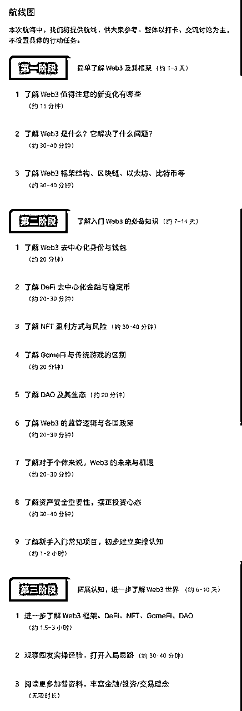

再强调一句：上面提到的阅读时间只是针对手册本身；想真正吃透 Web3，还需要花更多时间自己去探索。航线图和手册是紧密对应的，推荐按这四步走：1. 每天结合当前项目进度，确认自己在航线图上的位置，以及下一步要做什么；2. 点击对应的实操步骤，跳到手册相应模块，边学边做；3. 完成当天任务后写日志打卡，复盘进展并规划次日行动；4. 航线图连接着项目关键路径，所有动作走完意味着最小 MVP 已完成，之后不要停，继续重复第一到第三阶段。完成这些之后，建议继续学习精进，找到适合自己的入场方向，保持谨慎和理性，再真正进入 Web3。

# 必修篇：Web3 从 0 到 1

## 一、认识 Web3 @可达 Koda

章节概要

他们说自己在搞 Web3，可我怎么一句都听不懂？什么叫“我要 Mint 一个 NFT”？遇到这样的人，你可能会怀疑自己穿越了——明明也是互联网原住民，怎么对方的话像天书？大饼、以太、币安、智能合约、无聊猿、阿谢、跑鞋、公链，以及 DID、DeFi、NFT、GameFi、DAO……这些词是不是都听过，但放在一起就懵了？别担心，几乎每个人刚进场都是这样。原因很简单：你撞上了圈内人默认“你该懂”的语境，新概念没有铺垫就丢出来，外人当然接不住。我们会换一种方式，把这些概念一个个拆开讲清楚。准备好了吗？一起推开 Web3 的第一扇门。特别提醒：本期航海新增了「新手入门路径」，也就是后面的“十一、新手入门路径”，零基础用户可以直奔那里。

### 1.1 2024 年 Web3 有哪些新动向【新】

2021 年的狂热过后，Web3 用了差不多两年时间埋头搞建设。2022 年，天价 NFT、6.9 万美元的 BTC、4800 美元的 ETH、马斯克带单的狗狗币等叙事迅速退烧；随后头部交易所 FTX 崩盘，LUNA 币也在 48 小时内归零，大量玩家离场，行业一度接近冰点。2023 年，加密行情重新升温，新故事不断出现，Web3 又回到公众视野。这一年，加密市场总市值比年初增长超过 110%，增量超过 8700 亿美元；其中第四季度至今上涨约 55%，相当于 5960 亿美元。BTC 同样走出大行情：从低点 15000 美元一路冲到 44000 美元以上，涨幅达到 190%。与此同时，BTC 生态中出现了 Ordinals 与 BRC-20，让 BTC 第一次支持可替代代币的部署、铸造和转移，ORDI 的涨幅更是接近万倍。ETH 生态也在持续创新，基础设施不断加固，二层网络项目接连空投。今年 2 月底，Starknet 向 129 万个地址空投了 7 亿枚代币，二级市场价目前在 2.2 美元附近，历史高点约 2.5 美元；单个账号最少拿到 500 枚，折合人民币后，即便是最普通的“低保号”也值 7000 到 9000 元，而单号占用资金不过几百块，交互成本甚至不到 100 元。我自己也从中获得了六位数收益。监管方面，全球最大加密交易所币安与美国监管机构达成和解，付出 43 亿美元罚款；多个基金巨头递交了现货 BTC ETF 申请，未来大量法币资金有望合规流入。宏观环境同样偏暖：美国利率正处于 22 年高位，降息预期逐步升温；欧洲通胀下滑也让欧洲央行的降息时点提前——这些都可能成为 Web3 市场的顺风。随着关注度提高，越来越多人开始涌入，机会也在同步增长。为什么我们仍觉得 Web3 值得学习？下面展开说。

### 1.2 为什么 Web3 值得投入时间？

简单说，我们看中的是这个赛道可能超过 10 倍的成长空间。混沌大学创办人李善友在一门创业课里提过：当你看到 10 倍以上的增长，就意味着历史级机会出现，应该主动迎上去。这番话不只适合创业者，打工人和投资者同样能套用。眼下一些微观动向，已经能说明问题。

#### 1.2.1 对打工人：一个朝阳赛道

之前有篇知乎帖子聊“在某安工作是种什么体验”。某安是 Web3 领域的头部公司，地位大致相当于 Web2 的腾讯、阿里。帖子里有句话很直接：按时薪算，这份工作让同级互联网大厂很难比。事实大致如此。它还支持全球分布式办公，也就是自由远程工作；我认识的不少 Web3 创业者就在家里办公。我不认为这种模式效率更高，甚至觉得大概率不如集中办公。但奇妙的是，薪资依旧很有竞争力，原因只有一个：不卷。而且 Web3 的门槛没有外界传言那么高。仔细看会发现，无论产品还是市场，Web3 目前仍被 Web2 压着打。既然这样，为什么还有“高薪+远程”的组合？关键不在于人才多，而在于真正懂 Web3、愿意投入的人才太少。后面也会讲到，Web2 和 Web3 对人的基础能力要求没有本质区别，真正拉开差距的是认知与选择。

#### 1.2.2 对创业者：还有蓝海可挖

马斯克曾在采访里回忆，他大学时最关心“什么能影响人类未来”，答案是互联网、人工智能、可再生能源、太空探索与地外生命、基因工程。如果你想把互联网事业做大，最好留意 VC 的动向。VC 负责识别赛道，创业者负责经营，专业分工不同。目前资本眼中的大赛道，国内集中在双碳、新能源、半导体等硬科技；海外则是 Web3。

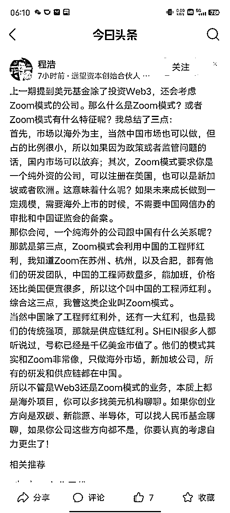

#### 1.2.3 对投资者：多一个配置选项

我们亲历过股票和房产投资，再把目光投向 Web3 相关资产，对比感很强——这是近两年的状况。若拉长到十年，全球涨幅最大的资产毫无疑问是 BTC，这是客观数据。期间美股龙头苹果从 90 涨到 150，约 1.7 倍；谷歌从 1460 涨到 2900，约 2 倍；A 股与港股则出现负增长。

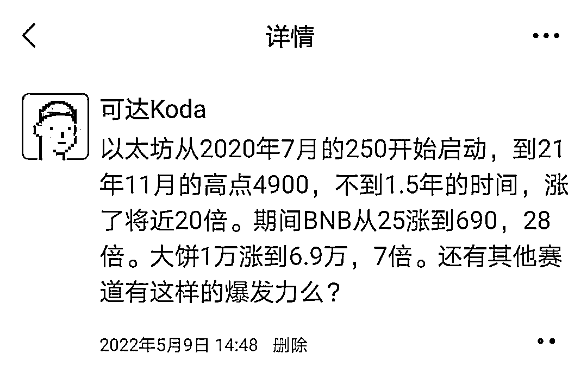

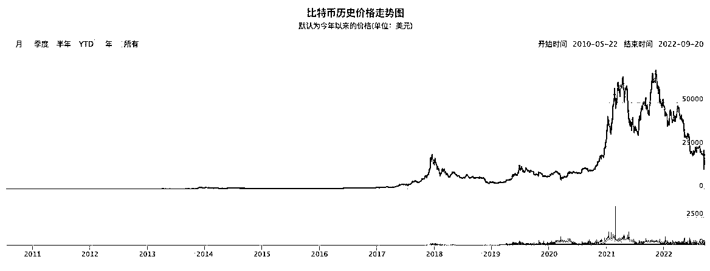

当然，本手册仍然不是投资建议，只是指出配置的新可能。想起早年 BTC China CEO 曾对还是“小白”的赵长鹏说：把 10% 的资产换成 BTC，归零概率很低，更大的可能是翻 10 倍，你的总资产因此翻倍。赵长鹏听完先卖了上海的房子买币，随后投身 Web3 创业。如今，他已是福布斯全球富豪榜 TOP20 的常客，也是整个 Web3 领域最富有的人之一。

### 1.3 Web3 到底是什么？

Web3 的核心理念可以归纳为：去中心化、无需许可、原生支付、无需信任。如今 Web3 已是一个含义宽泛的词，指向一种更新、更合理的互联网想象。它的核心方法，是通过区块链、加密货币和 NFT 等工具，把所有权重新交到用户手中。由于行业仍处在极早期，Web3 并没有唯一的标准答案，但以下四条原则大致构成共识：去中心化、无需许可、原生支付、无需信任。听了可能还是抽象，我们不妨从历史对比入手。

按通行说法，Web1 是“只读网络”，Web2 是“可读写网络”，Web3 则是“读、写、拥有”的网络，因此也叫价值网络。时间线是这样的：1989 年，Tim Berners-Lee 在日内瓦的 CERN 开发后来成为万维网的协议，他设想的是一个开放、分散、能让全球任意角落共享信息的基础架构。这一代产品后来被称为 Web 1.0，大约从 1990 年持续到 2004 年。当时的网站多为公司所有的静态页面，用户间的互动几乎为零，也没什么个人内容，所以叫只读网络。

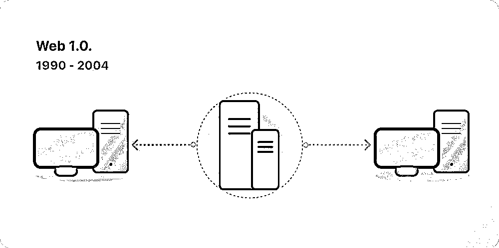

2004 年起，社交媒体登场，Web 2.0 时代开始。网络从只读变成能读也能写，平台不再单向输出内容，而是提供空间供用户创作，并支持用户之间互动。但随着用户规模扩大，少数公司掌握了网络中不成比例的流量和价值，广告驱动的商业模式也随之成为主流。用户虽然能制造内容，却既不拥有内容，也无法分享内容变现带来的收益。

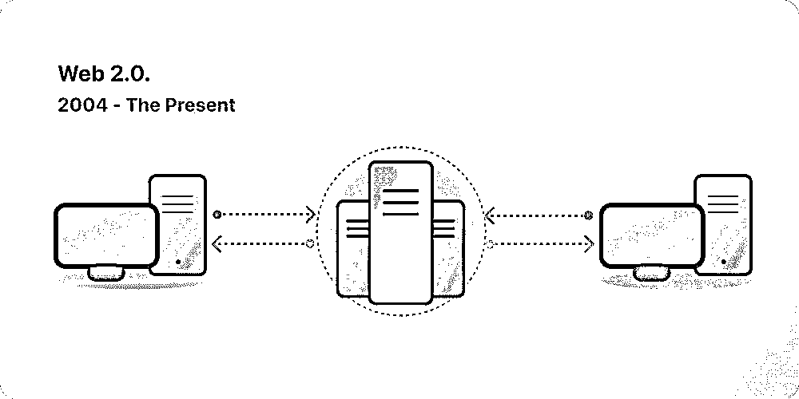

Web3 这个名词则是由 Polkadot 创始人、ETH 联合创始人 Gavin Wood 在 2014 年提出。他关注的问题是：现有网络过于依赖信任——人们把信息与资产托付给少数公司，而他希望用 Web3 解决所有权回归用户的问题。

所以，简单回答 Web3 到底指什么：它是一个价值网络，用户真正拥有自己的信息财产。再举几个例子。Web1 时代的代表是雅虎、谷歌，以及国内的搜狐、网易；这些网站的主要功能是聚合信息，供用户点击浏览。到了移动互联网阶段，信息生产不再局限于门户，全球数亿人都成为内容节点，代表产品有海外的 Facebook、Twitter，国内的微信、抖音。这些平台一方面聚集海量用户，另一方面向商家提供广告位，形成闭环，属于典型的平台经济。本质上，它们用免费服务换用户规模，再把用户数据在未获授权的情况下卖给商家。而 Web3 的逻辑完全不同：用户产出的信息，从生成那一刻起就归用户所有，这就是所谓的“所有者经济”。现阶段，你不需要在每个平台分别注册账号；只要创建好自己的钱包，就能凭它进入各种去中心化应用。这个概念后面会细讲。理论上，你的钱包只属于你自己，不属于任何公司或组织。在 Web2 里，如果游戏账号被封，或者公司倒闭，虚拟财产可能随之消失；但在 Web3 中，属于你的依然是你的，公司没了，资产也还静静躺在钱包里。这，正是 Web3 最核心的特质——信息所有权归用户，天然就是价值网络。

### 1.4 Web3 解决了哪些问题？

接下来换个角度，看看 Web3 到底在解决什么。这里的讨论只代表 Web3 视角，你也可以保留自己的看法。眼下 Web2 的痛点，至少有三点：

1. 数字身份被平台掌控。想在互联网上活动，就得在微信、QQ、网易、Twitter、Facebook 等平台分别注册。从你创建账号那一刻起，身份信息就已经交给了平台，甚至可以说被“售卖”给了平台。而在 Web3 里，只要生成一个数字地址，你就拥有了独立于任何平台的身份，拿着这个地址可以随意进入各类应用。

2. 同样地，数字资产也不归用户所有。前面提过，游戏可能封号，公司可能跑路，你的资产也会跟着消失，本来属于你的东西被平台强行拿走。这里有个流传很广的故事：ETH 创始人 V 神生于 1994 年，13 岁开始玩魔兽世界；2010 年某次暴雪更新改了他角色的属性，他为此伤心欲绝，直接弃游，据说这段经历也为日后创办 ETH 埋下了伏笔。

3. 既然资产不归你，靠资产产生的收益自然也不归你。

# 微信账号，怎么就成了数字资产？

很多人可能还没真正意识到“数字资产”的含义。换个角度想：你每天都在用的微信账号，本身就是数字资产，跟一套房产在本质上没有多少差别。尤其是做自媒体的人，在各大平台持续输出内容，平台却常常一边拿这些内容变现，一边向你收“数字资产租金”，几乎没有直接收益分给你。说得直接点，这就是平台白嫖，而大多数用户还没反应过来。

4. 平台和创作者，权利天平明显倾斜

Web2平台有多强势？封号往往是一句话的事。之前我们RichDAO的小助理有一个微信工作号，专门用来加Web3圈子的人。某天突然有近200人加他，他还要在群里组织活动，结果微信直接把这个号封了，到现在都没找回来。小助理没做什么出格的事，却失去了与新朋友保持连接的资格。这件事背后，就是垄断型平台和用户之间极不对等的权力关系。

知识星球也遇到过类似情况。我们想把部分Web3内容沉淀给社区成员，先放在免费星球上，等申请升级成正式星球时，平台却因为涉及Web3而拒绝审核。那些内容本身只是正常的学习资料。所以Web3圈子的人才越来越相信：这个世界的平台权力需要被制衡，而Web3的理念和精神恰好提供了一种可能。

5. 支付限制

国际社会里，美国动不动就制裁某个国家或个体，冻结对方银行资产。Web3在理论上，可以减少这类支付层面的限制。

说了这么多，其实核心就一句话：Web3要解决的问题，是用户数字资产的所有权到底归谁。

还记得前阵子有一篇《Web3三问》，在Web3圈子里刷过屏。那篇文章提了三个问题，但框架主要是从生产创造价值的角度出发，有一定局限。那三个问题之外，我想再补一问，凑成“Web3四问”。这些问题没有标准答案，你可以结合自己的认知和经验试着回答。

### 1.5 案例对比：谷歌与以太坊

上一节，我们讲了Web3视角下Web2有哪些问题，并留了4个问题供大家思考。这一节，用具体公司来对照Web2和Web3的差别。

Web2的代表，选谷歌。它旗下有安卓、搜索、YouTube等产品线，市值约1.3万亿美元，在全球科技公司中排第三，前面只有苹果和微软。Web3的代表，选以太坊。它现在算Web3生态里最大的公司，市值约1600亿美元，在加密资产里仅次于比特币。

为什么选这两家？因为它们都是生态型公司，放在一起比较有参照感。

以前经常有人问：以太坊到底是什么？如果照本宣科说“去中心化、开源、智能合约区块链平台”，大多数人都听不懂。我后来喜欢用一个不完美但好懂的类比：以太坊就是Web3世界的安卓。网络架构肯定不同，这一点到后面的技术章节再展开，先这么理解就行。

下面分三个角度来对比。

**1. 商业模式**

任何商业公司，本质上都要回答一组问题：为谁提供什么产品/服务？解决什么痛点？卖什么？收多少钱？这套框架缺一不可。对商业不熟的朋友，可以试着拿任何一家公司去套，基本都能套进去。

有人会问：我用谷歌、百度、抖音、微信，没交过钱啊，它们是在做公益吗？当然不是。这是用户视角的错觉。商业公司最终必须盈利，哪怕暂时免费，也一定会在某个环节从你身上获得回报。

把视角切到平台。以抖音为例，它给用户提供短视频内容，然后把这些用户的注意力打包卖给商家，靠赚广告费变现。谷歌的安卓也一样：用户免费使用操作系统，谷歌向商家收钱。本质上，平台是在把你的精力和数字资产拿去变现。

以太坊的商业模式不玩虚的：它给商家和用户提供一个安全可信的网络，收费规则一开始就说清楚，写进协议里，说好就不改。用户用网络要付手续费，商家用也要付手续费。就这么简单。

**2. 扩张方式**

谷歌和以太坊都有规模效应：你越强，用的人越多；用的人越多，平台越大，商家和用户都离不开，最后形成垄断。也可以理解为一条飞轮：用户越多，商家越愿意来；商家越多，用户体验越好，最后同样走向垄断。

增长方式上，两者本质上没什么区别，都是花钱优化产品、花钱做用户增长。差别在于：谷歌用的是法币（比如美元），以太坊大多时候用自己发行的代币。更深层的差异在理念——Web3用户心里，普遍怀着去中心化的理想。

**3. 融资方式**

在我看来，Web2和Web3在形式上最大的分野，就是融资方式。这里先讲两个概念：IPO和ICO。

IPO是首次公开募股，也就是一家Web2公司向普通投资者发行股票。但注意，在公开发行之前，公司已经把一部分股票私下卖给了机构；个人投资者进场时，很多时候是在接机构的盘。这串缩写里，关键不是“首次”，而是“公开”。Web2公司靠融资烧钱抢规模，往往估值高得离谱才上市，结果一上市就割人。

ICO是Web3的专属名词，叫首次代币发行。这里的coin，既是货币，也是股票。这是第一个不同。第二个不同：如果你把代币看成股票，这个“首次”是货真价实的首次，直接面向普通用户发行，翻译成“众筹”可能更好理解。第三个不同：ICO不需要牌照。国内目前不允许，具体在监管合规章节再讲。

谷歌的上市故事就是常规路径，不展开。以太坊当年的ICO才值得说说。

2013年，19岁的Vitalik去美国加州圣何塞参加一场比特币会议，听完后觉得自己的灵感有搞头，回来就辍学了。随后他花6个月跑遍全球——以色列、加州、伦敦、洛杉矶、拉斯维加斯、阿姆斯特丹——去见当时的区块链、今天的Web3团队。但一圈聊下来，他发现大家都在金融领域打转，没有解决比特币的底层缺陷。他当时的设想是：给比特币加上图灵完备的编程语言，让任何人都能在上面开发去中心化应用，而不是只做金融。

这个想法讲出去，没人当回事。他干脆自己干，回家花一个月写出白皮书，取名Ethereum，也就是以太坊。白皮书给身边朋友看了一圈，也帮他找到了早期合伙人。又过了几个月，他在迈阿密比特币大会——Web3全球顶级会议之一——上介绍以太坊，引起不小轰动。随后启动ICO，42天募到31000枚比特币，售出60,102,216枚以太币，按当时的汇率合计约1840万美元。放到现在，按比特币价格折算，这笔钱接近6亿美元，算得上天价ICO。

当然，早期买入并长期持有的人，回报也极其惊人。以太坊ICO价格不到0.5美元，现在约1300美元，不到10年涨了几千倍。看看那张历史价格走势图，是不是想拍大腿？当时哪怕只买1000块，如今也是几百万。Web3的世界里，这样的机会并不少见。

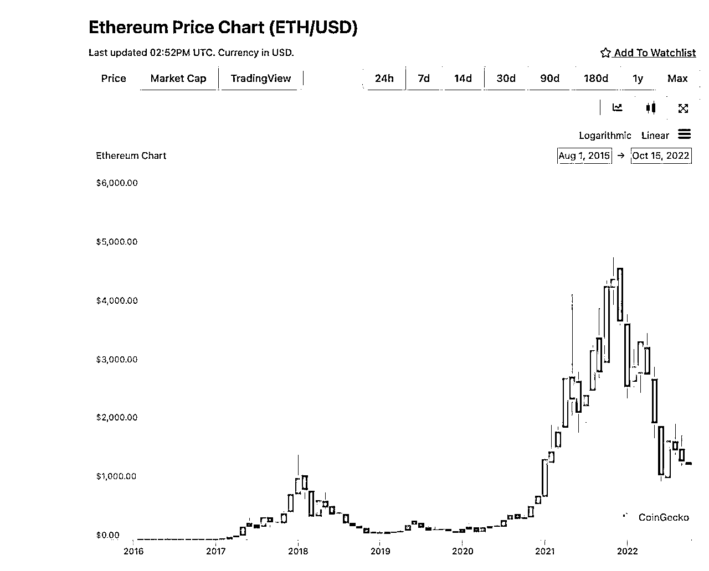

补充两个看价格的工具。如果你还没有交易所账户，可以用CoinGecko查加密资产价格：https://www.coingecko.com/。不过按SimilarWeb的全球排名和访问量，CoinMarketCap更主流一些：https://coinmarketcap.com/。

换一种问法，把这一节的思考作业留给你：在Web2的投融资体系里，投资机构和普通投资者分别得到了什么？又要承担什么风险？

### 1.6 方法：从资本视角看Web3

术业有专攻，资本在判断赛道和公司上，通常比普通人更敏锐。这一节提供一个视角和方法：看看资本怎么看Web3、投了哪些方向，以及如何查一家Web3公司背后有哪些投资机构。这些信息，也能成为判断项目质量的重要参考。

2021年是Web3资本最热的年份。据Galaxy Digital 2021年12月报告，截至当年12月底，风投机构对Web3公司的投资总额达到330亿美元。这个数字意味着什么？2021年一年的投资规模，超过了以往所有年份的总和。The Block的研究也显示，Web3独角兽在2021年集中爆发，从金融服务、交易所、基础设施，到NFT、GameFi、数据分析，各种赛道全面开花。

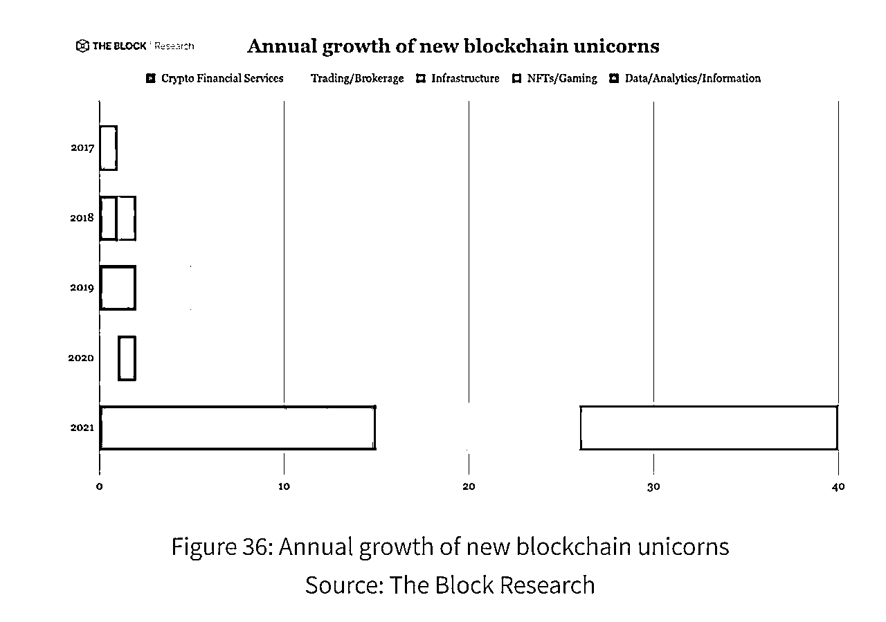

我以前做股票投资时，常用烯牛数据查看腾讯战略投资了哪些公司。这些专业机构的筛选，某种程度上相当于给二级市场投资加了层“安全垫”。到Web3领域，同样的思路也适用：想知道哪个方向、哪些公司更有潜力，可以去看明星投资机构都投了什么。下面这张图，列的就是Web3圈子里最知名的几家资本和它们的成功案例。

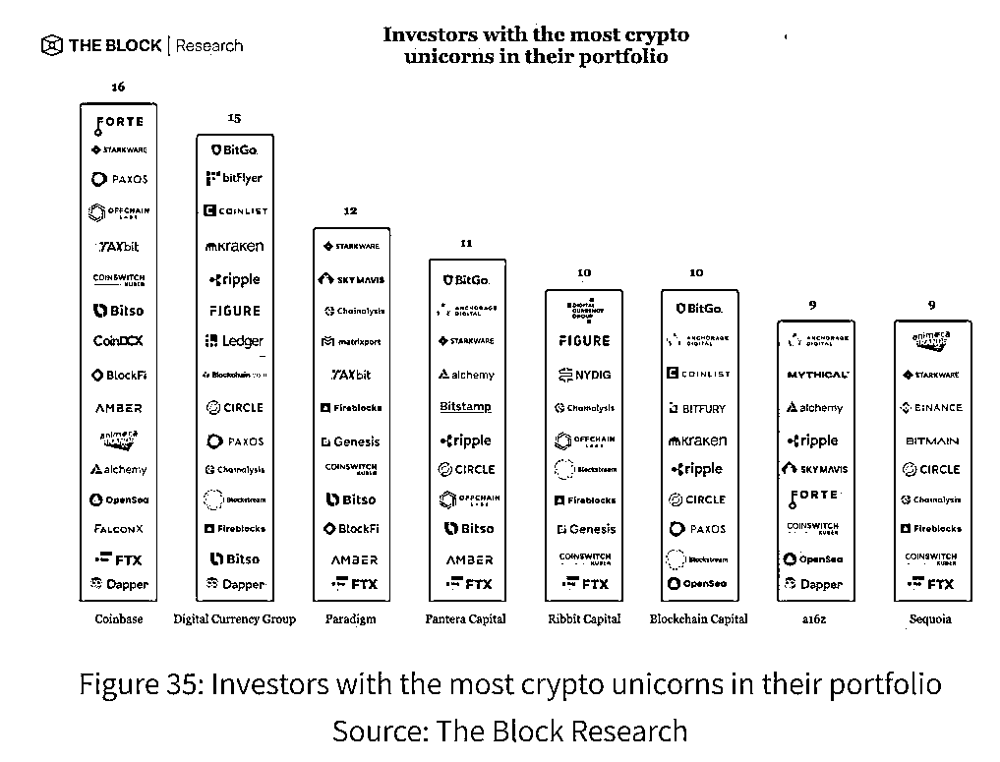

包括Coinbase、Digital Currency Group、Paradigm、a16z、红杉等等。如果你新认识一家Web3公司，想验证它靠不靠谱，可以用Cypherhunter这个网站：https://www.cypherhunter.com/en/，查一下哪些资本进去过。

举个例子，在搜索栏输入Ethereum，页面会显示：以太坊是一个去中心化平台，支持智能合约和Dapp。继续往下，能看到团队信息、Twitter链接，包括V神Vitalik。中间是portfolio，也就是以太坊的投资组合，看它投过哪些项目。最底部则列出以太坊的投资人和投资机构。

再比如OpenSea，目前最大的NFT交易平台，它的投资阵容相当豪华，知名的机构和投资人一大堆，NBA小牛队老板库班也在其中。另外，币安旗下的BinanceLabs近年出手质量也不错，翻翻BinanceLabs的投资组合，对判断Web3项目会有帮助，比如之前的BNB域名项目SPACEID，以及“百倍神话”跑鞋STEPN。

总结一下，今天给的是一个新视角：从资本看Web3。核心就两个问题：第一，知名投资机构最近投了哪类项目？第二，一个新项目背后有没有顶级机构站台？这两点结合起来，可以作为判断项目质量的安全垫。

### 1.7 小结

来做个回顾。

第一节，看Web3在2023年发生了什么新变化，这些变化会对我们产生什么影响。第二节，讲Web3为什么值得关注。第三节，明确Web3到底是什么：Web1是只读网络，Web2是读写网络，Web3是价值网络，数据所有权归用户。

第四节，从Web3的视角，梳理Web2存在的问题：数字身份被平台控制、数字资产不属于用户、用户应得收益被平台剥夺、平台与创作者权利失衡、支付受限。同时指出Web3的解题方向，也就是Web2和Web3的核心差异。

第五节，用谷歌和以太坊这两家生态型公司做案例，从商业模式、扩张方式、融资方式三个维度，拆解Web2与Web3的不同。第六节，给出一套从资本角度看Web3的方法。

整个“Web3概述”这章，除了帮大家理解概念，还留了2个工具和5个思考题。查加密资产历史价格，用CoinGecko；判断项目质量，可以上Cypherhunter看它背后站了哪些资本。

5道思考作业如下：
1. 什么场景是Web2完不成、必须靠Web3实现的？
2. 如果存在这种场景，对应的Web3产品到底有多少人需要？
3. 在这些场景里，Web3产品的解决方案会比Web2更高效吗？
4. 如果你觉得根本没有什么问题必须用Web3解决，那Web3还会发生吗？为什么？
5. Web2和Web3模式下，投资机构和普通投资者各获得什么？风险又是什么？

下一节开始，我们会一层层拆解Web3，从底层技术讲到热门应用。

## 二、看懂Web3的框架 @可达 Koda

章节概要

这一章可能是Web3入门里难度最高的一节，因为要深入到区块链和基础设施这些底层技术。别担心，我们会结合案例拆开来讲，帮大家降低理解门槛。

### 2.1 Web3框架，先分层再看

先放一张图，感受Web3的整体结构。

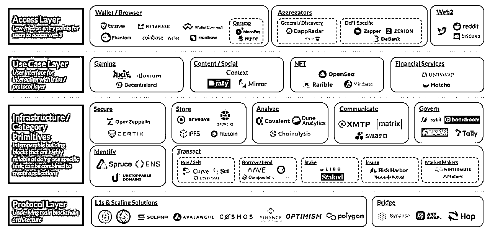

图源：https://www.coinbase.com/blog/a-simple-guide-to-the-Web3-stack

前面我们已经提到不少陌生词汇：区块链、基建、智能合约、比特币、以太坊、DeFi、交易所、NFT、GameFi、DAO。它们都是Web3这台机器上的零件。这张图的价值在于，把这些概念放进不同的层级，你的脑子里就有了一张地图，以后遇到新名词，可以知道该往哪一格放。

简化来看，Web3自下而上分四层：协议层、基础设施层、应用层、接入层。这四层像盖房子一样，上层一定要依赖下层才能站稳。

为了更好理解，我们用更熟悉的腾讯系产品来类比。不要求百分百精确，但足够形象。

1. 协议层

所有互联网产品，都跑在互联网协议上。什么叫协议？可以把它理解成一套大家都认同的交流标准。互联网能把全世界连起来，靠的就是全人类共享同一套语言规则。就像你和一个不懂中文的人没法对话，只有彼此使用同一套标准，沟通才有基础。这就是协议层。

2. 基建层

每天用微信、微信支付、QQ和游戏的时候，你想过背后是谁在支撑吗？这就是基建层。微信支付需要后端记账、安全体系、账户处理；你在应用上产生的数据要被存进服务器，还要被计算和处理。这些幕后工作，全属于基建层。没有这层，App和网站根本用不了。

3. 应用层

这层最好理解，因为离你最近。微信、QQ、王者荣耀，这些腾讯生态里的产品都在应用层。所有互联网产品，本质上也是按这个架构被造出来的。

4. 接入层

接入层解决的是“身份”问题。用微信要注册微信账号，用淘宝要注册淘宝账号，在Web2里，这个身份通常是手机号或邮箱。有了它，你才能进入应用。

搞清楚这套框架后，再来看Web3，会发现从分层和演进看，Web3与Web2并没有太大出入，真正的不同在理念和具体做法上。

最明显的差异在协议层。Web3不是只有一张网，而是有多张网络，各自拥有一套协议。以太坊是一张网络，比特币是一张网络，Solana、Cosmos、币安也都各自成网。如果你觉得“多张网络”不好想象，可以换个角度：Web2目前有iOS和安卓两大移动生态，Web3则更像有多个生态并存，头部是以太坊，币安生态这几年也涨得很快。

# 一张架构图，理清 Web3 的链、钱包与分层

进入 Web3 语境，人们常把一套生态体系称作“链”，这个词的根来自区块链。按开放程度，链可分为公链、私链、联盟链，后文会细讲。举例说，以太坊生态对应以太坊链，币安生态对应币安链。

任何网络都离不开底层设施与前端应用。所以在 Web3 的全景图里，会看到两层产品：底层设施覆盖安全、存储、身份体系等；前端应用眼下以链游、社交、数字藏品、金融类服务为主。

再看接入方式。Web2 时代，用户通常拿手机号或邮箱逐平台开户，账号归平台管。Web3 则把入口收敛为一个钱包地址：同一网络内的应用，凭它即可通行。这和 Web2 的“每家一个账号”很不同：不必为了聊天软件、购物网站、网银分别注册。钱包既是资产容器，也是通行证，一个地址可打开该网络里的各类服务。

可以这样记：协议层是地基，基础设施层是地面建筑，应用层是楼里提供的服务，比如游戏、内容、消费等。楼有门禁，进门要验明身份；在 Web3，这张身份卡就是钱包地址。拿这张分层图当索引，遇到新产品就能大致判断它处在哪一层。后续内容也按这套框架，挑典型项目逐个拆解。

### 2.2 案例分析：区块链的由来与要解决的问题

要了解 Web3，先要知道关键技术区块链是什么。入门内容不讲技术细节；想深入可读我们给的延伸材料，群内交流。这个视频聚焦：它解决什么痛点，以及解决路径。

区块链源于 Bitcoin 比特币。2008 年，网名中本聪的极客发表论文，标题定义新概念：Bitcoin，点对点电子货币系统。区块链由此进入大众视野。

附上《比特币白皮书》作为深度阅读：

《比特币白皮书》英文版.pdf

《比特币白皮书》中文版.pdf

注：若下载打不开或文件名乱码，请重命名，补“.pdf”后缀，保存类型选“所有文件”。

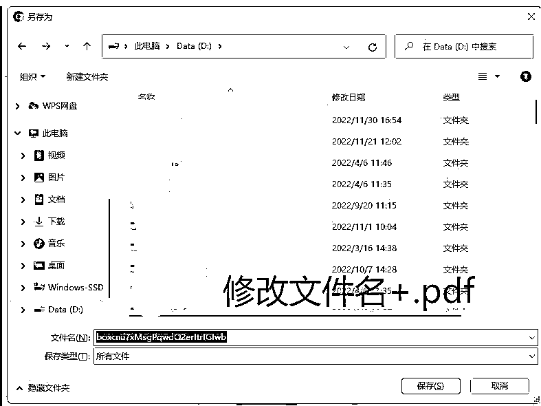

第一遍读不懂正常，多读几遍。下面回答几个问题：

1. 区块链提出时想解决什么？

读白皮书可发现，中本聪瞄准的是同一笔钱被同时支付给两方，即“双花”。为何会有双花？先看现有货币体系。

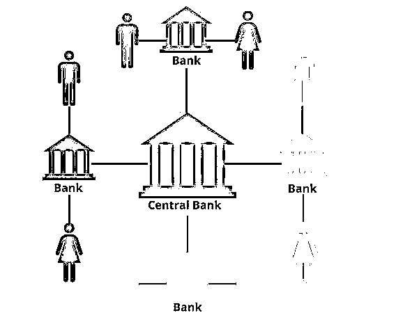

图中是现有货币体系：以银行为中心的交易系统。众多用户与银行，底层靠记账、清算运转。银行核心业务两字：记账；不能错，也不能假。数字时代，集中管理的数据库存在被改动的风险。

有哪些可能？设想：第一，银行一定可信吗？存款在系统里只是一条记录，且不向个人完全公开，真实状况个体难知。第二，银行一定安全吗？经济危机中，一些国家出现挤兑、取不出钱。第三，国家信用背书一定可靠吗？美中这类经济体背书较强；但部分第三世界国家局势动荡，汇率波动甚至超过中国股市，或国家破产，背书还有多少意义？这些都是现实问题。于是，中本聪提出绕过中介、让用户之间直接点对点支付的去中心化货币方案。

2. 区块链如何解决？

“区块链”译自 blockchain，拆为 block（区块）与 chain（链）。区块可视为信息块，前后相连成链。换成生活化说法：区块是不断生成的子账本，子账本用哈希算法串起来，形成总账。通俗说，它并不神秘，是一种难篡改的新型记账方法。

方案概括：过去由单个人或单系统记账；区块链让加入网络的所有参与者共同记账。每发生一笔交易，大家各记一笔，记账者可遍布全球。账本要吸引足够多人参与，才能形成规模效应；参与者越多，网络越安全健康。

核心问题：普通人为何愿意建设网络、参与记账？无利不起早。BTC 系统的办法是约每 10 分钟发一次奖励。分布式账本每 10 分钟要生成一个子账簿并并入总账；生成、校验、确认入账需要计算机贡献算力。干活后有概率抢到 BTC 奖励。系统靠持续发奖励完成货币发行。按白皮书，奖励持续 142 年：起初每 10 分钟 50 枚，之后每 4 年减半，50→25→12.5……总量恒定 2100 万枚。奖励发完后，维护节点仍可赚交易手续费。

抢奖励在 Web3 被形象称为“挖矿”，参与建设者叫“矿工”；因抢到奖励是概率事件，矿工会聚集，集中算力节点叫“矿池”。三个概念一并解释。早期参与者少、总算力低，普通笔记本也能挖出不少 BTC。第一笔 BTC 交易：有人用 1 万枚 BTC 买 2 个披萨。按现在价值约 2 亿美元，峰值约 7 亿美元，堪称最贵披萨。

3. 有哪些特点？

概括特征，我认为关键只有两点；去中心化、公开透明更像分布式方案带来的结果。技术诞生是为了对付中心化弊端，才采用去中心化路径，并非为了去中心化而造链。公开透明也如此：人人参与记账，账本自然公开。但完全公开是否一定优于部分公开？值得讨论，欢迎各抒己见。

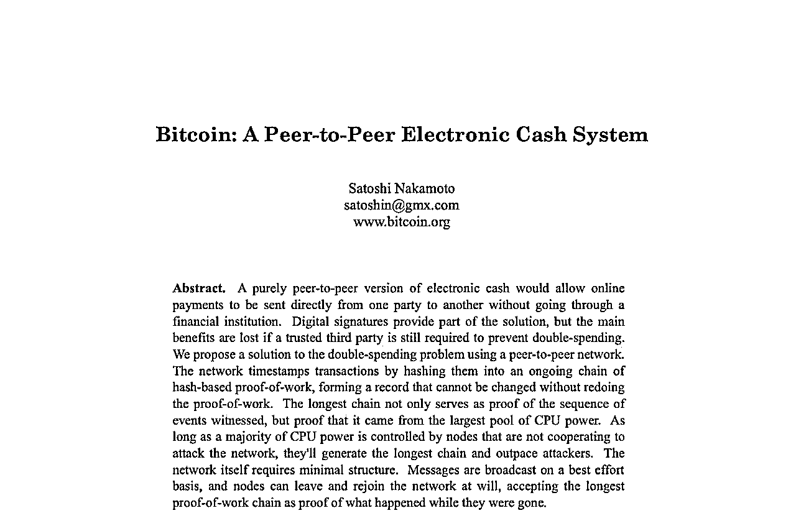

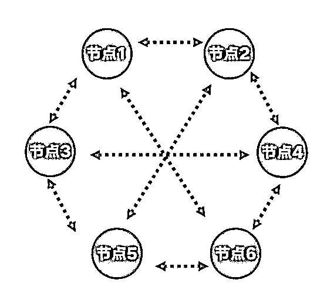

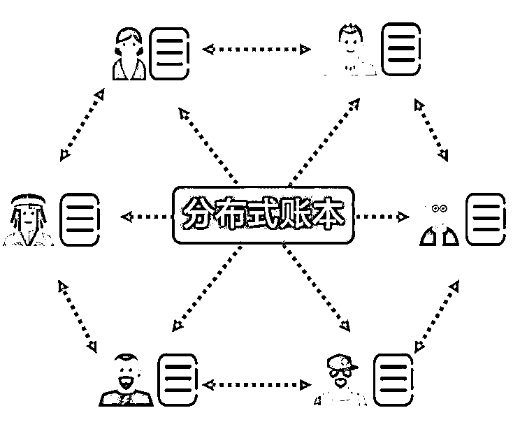

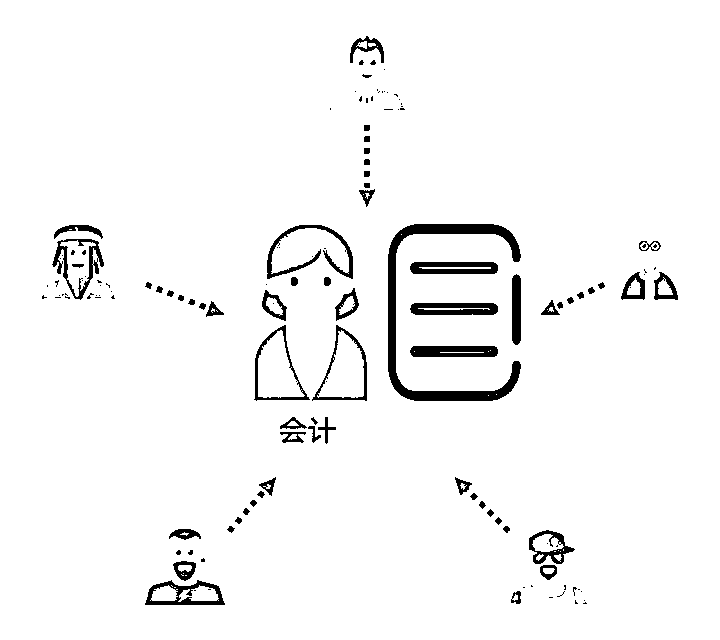

### 2.3 案例分析：公链代表以太坊

上一节讲了区块链源于 BTC 这种点对点电子现金系统，并回答其痛点、方案、特征。此前《Web2 和 Web3 经典公司对比》也提过以太坊，大家是否还有印象？本章细看以太坊。仍用问题引导：1. 它是什么，解决什么？2. 方案是什么，有何隐患？3. BTC 与 ETH 如何对比？

#### 2.3.1 它要补上什么短板

按官方定义，以太坊是新一代智能合约与去中心化应用平台。不好理解就暂记为“自带货币系统的安卓”。创始人为何做它？简言之，BTC 只处理交易。有了 BTC，跨境汇款可即时到账，无需顾虑国界，手续费极低或远低于传统国际转账。随着区块链走红，越来越多人把目光投向金融、云计算、信息传输、分布式管理类应用开发。但 BTC 网络最初只为电子现金设计，开发者要在上面做复杂去中心化应用并不方便。于是以太坊提出：给开发者一个顺手的平台来搭建去中心化应用。是不是像“去中心化安卓”？

#### 2.3.2 它拿出的方案

方案看两点。

1. 定标准、统一语言、简化协议。普通公司做产品，优秀公司做品牌，顶级玩家定标准。在新领域，以太坊基于区块链给开发者一套全球通用、易上手的可编程语言 Solidity。协议上，若想在以太坊发行自己的代币，要用 ERC-20 等标准。

2. 智能合约：规则与合同程序化。Solidity 主要写智能合约。smart contract 直译即智能合约，可理解为一旦启动便无法随意更改的电子合同。比如租房：谁租给谁、何时付多少钱，本是简单合同，但执行靠人或机构系统，不是纯程序。智能合约把 BTC 的分布式记账、难篡改思路搬到各类场景，让合同代码化、程序化。开始各方同意方案与条件，运行后便不能改。货币系统核心逻辑若写成代码，其实很简洁：从 A 扣 X 单位，给 B 加 X 单位；条件为（1）A 交易前至少有 X；（2）A 批准交易。做代币系统，把这套逻辑写成代码即可。可发散：人类社会中还有哪些规则是一开始定好、之后长期不必改的？交易规则是一例，还有哪些？

落地这套方案带来什么？因以太坊基于区块链，相比 iOS、安卓这类 Web2 开发平台，在其上开发的应用自带货币能力。但项目不是合约里写“我要发币”，大家就认它值钱；否则街上随手写个数字都能当钱。美元、人民币为何能花？背后本质是信任共识。于是 Web3 项目可先提理念、发白皮书，再到平台众筹发币，支持者用 BTC、ETH 等认购，项目获得启动资金。换句话说，把项目各方利益分配在开始时算清并写进合同。大家若认可分配合理、格局够大，就会出钱支持。这就是此前说的 ICO（首次公开发币）。以太坊当年启动也走 ICO：42 天募集 3.1 万多枚 BTC，当时价值 1800 多万美元，是一笔巨额启动资金。

#### 2.3.3 风险与硬分叉

The DAO 被盗与硬分叉。

前面说，以太坊可开发各类去中心化应用，规则先说好、说好不改、程序自动跑。有一类应用叫去中心化组织。DAO 由 Slock.It 创建，团队技术过硬，含前以太坊创始成员。Slock.It 把 DAO 看成社区为项目筹资的方式，类似众筹投资组织。核心思路：社区共同筛选项目，提案通过后，资金从以太坊社区投资者处募集；项目成功，投资者分利润。DAO 也是以太坊生态重要实验。参与者不是直接拿 ETH 资助，而是把 ETH 换成 DAO 代币，用代币投票，也能换回 ETH。DAO 代币 2016 年 4 月开始众筹，不到一个月筹到约 1.5 亿美元，占当时全部以太坊存款近 14%。

但语言和规则都有漏洞。树大招风，大项目被黑客盯上。6 月，黑客利用合约漏洞盗走 360 万枚 ETH，约为筹资总额的 1/3。好比合同设计时没想到某种情形下，一方能持续套利；我记得有个彩票规则因漏洞被掏空奖池。面对此事，以太坊创始团队经社区讨论，在“不可篡改”与“追回被盗”之间选择平台介入，把资金退回。这个处理叫硬分叉：在原规则上强行改规则，另开一条链。争议很大。一方认为规则就是规则，区块链精神是去中心化、不可改，被盗也不能改；另一方认为社区需要正义，不能让作恶者得逞，违法应打击，投资者也不该蒙受损失。最终，分叉决定获 85% 以上票数，V 神站在社区正义一边。由此衍生两种以太坊代币。

##### 2.3.3.1 分叉后的两条路

一条是 ETC，代表不可篡改精神：账本一旦形成就不改。另一条是如今常用的 ETH，创始人与社区可在极端情况一起改规则。有趣的是，原链与新网络各有代币：原链叫 ETC，新链叫 ETH；后者是当前主流。BTC 呢？至今可算完全去中心化网络。创建者中本聪无人知其身份，后来这个网名从网络消失，所有决策按发奖励规则持续运转，已 10 多年。BTC 后来也分叉，为解决支付效率分出 BCH，但新链未获广泛共识。BTC 以不变应万变，大道至简，已成为 Web3 世界符号，不追求演进和效率。ETH 诞生初衷是提效率，其进化本质也是不断提升效率。这引出一个思考：为什么有些事物需要持续进化，有些却能以不变应万变？

##### 2.3.3.2 BTC 与 ETH：变与不变

最后对比 Web3 两个代表系统，顺带回顾。BTC 由匿名网友中本聪 2008 年创造；ETH 由计算机天才 Vitalik 2013 年创造。BTC 不属于任何组织；ETH 虽是 Web3 最大去中心化平台，仍受社区与创始人影响。BTC 提出点对点支付的数字现金；ETH 在区块链上提出智能合约、去中心化应用开发平台，把技术推向更多领域。BTC 诞生无融资，有人有共识就自动成为记账人并获 BTC 激励；ETH 靠方案拿到钱再搭网络。激励上，BTC 用 PoW（工作量证明）；ETH 最初也用 PoW，素材所说的当年 9 月完成全网升级，改为 PoS（权益证明）。简单说，PoS 下持有网络货币越多，参与记账可获奖励越多。

### 2.4 多链并存的底层格局

本节聊 Web3 底层多链格局。以太坊三个字可拆三层。第一，它是一家公司或组织，诞生时想解决去中心化应用开发难题，让区块链不止于 BTC 交易。第二，为解决难题，他们搭了以太坊平台服务开发者，类似安卓和 iOS，这个平台也叫以太坊。第三，与 Web2 平台不同，它从协议层就注入金融体系，流通在生态中的代币叫以太坊或以太币，英文 ETH。中文“代币”翻译我认为不够准确；英文把流通在 Web3 平台的这类 token 统称，译成“通证”或“令牌”更易懂。因为它既有货币功能，也有债券、股票功能；叫“代币”容易让人以为只是货币，不够准确。当然，这个平台或系统从底层协议就发挥作用，各类基础设施和应用都跑在其中，所以也可把以太坊理解成一张 Web3 网络；这种网络基于区块链开发，行业称“公链”，即大家都能使用的链。

这种底层平台商业模式，是商业世界必争之地。其他公司、组织、资本不愿 ETH 一家独大，于是出现许多链，针对以太坊的痛点提出各自方案。再回顾本节开头那张架构图。

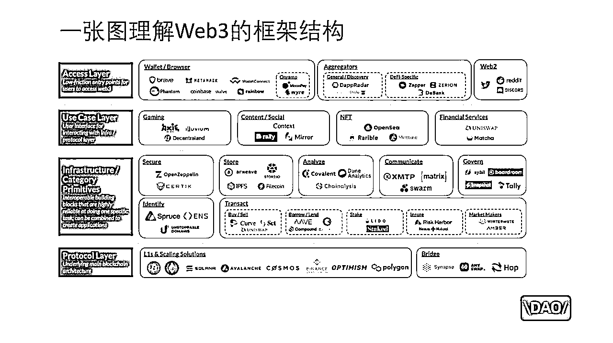

最下层其实有多种链可选。本章展开聊当前公链格局。

# 公链的三重取舍与演进路线

若把“不可能三角”当成观察框架，公链的迭代史其实可以拆成两个追问：某条链补的是哪块短板？它又靠什么机制去补？

#### 2.4.1 三难约束：效率、分布化与安全

所谓三难约束，是指同一个区块链网络很难把扩展效率、分布化程度与安全防护这三项同时推到极限。扩展效率换个直白说法，就是吞吐与速度。

BTC 是典型样本：分布化和安全防护较稳，但吞吐做了妥协，确认偏慢，网络繁忙时等待数小时并不罕见。

ETH 主网一路发展，也撞上了同类难题。今年落地的二层方案，目标就是给主网算力和吞吐减压。

反观日常使用的 Web2，扩展与安全几乎做到极致，可代价是中心化，用户对网络的所有权被削弱。

行业还常按分布化程度把链分为公链、联盟链、私链，这部分后文再展开。

区块链技术出现后，各种公链几乎都围绕这三项做优化和提效。下面展开。

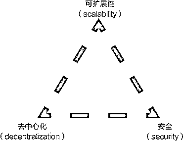

#### 2.4.2 公链简史：性能驱动下的迭代

先看时间线。2008 年 BTC 出现；2008—2012 年间，BTC 与 LTC 是代表；2013 年 ETH 登场并提出智能合约。此后，针对 ETH 主网瓶颈的平台网络密集出现，覆盖范围从共识机制到侧链、跨链、多链，再到 Layer2。

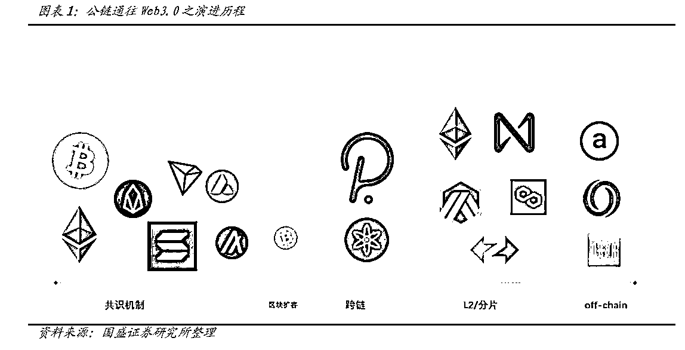

#### 2.4.3 ETH 主网的两道坎：拥堵与费用

ETH 究竟卡在哪？Web3 用户和应用增长后，体验端集中暴露两点：确认慢、成本高。

TPS 衡量一秒能结算多少笔交易，ETH 大致在 15 笔上下。用户规模一旦放大，这样的吞吐就会吃紧。

链上费用随网络状态浮动，ETH 曾被称为“贵族链”：一笔操作少则几美元，多则几十甚至上百美元。

这两点直接影响体验，各网络围绕提速降费出方案，今天的公链格局也由此形成。

#### 2.4.4 一层与二层：自建替代还是外包协作【新】

为方便理解，我们从各公链中挑代表性网络分类说明：

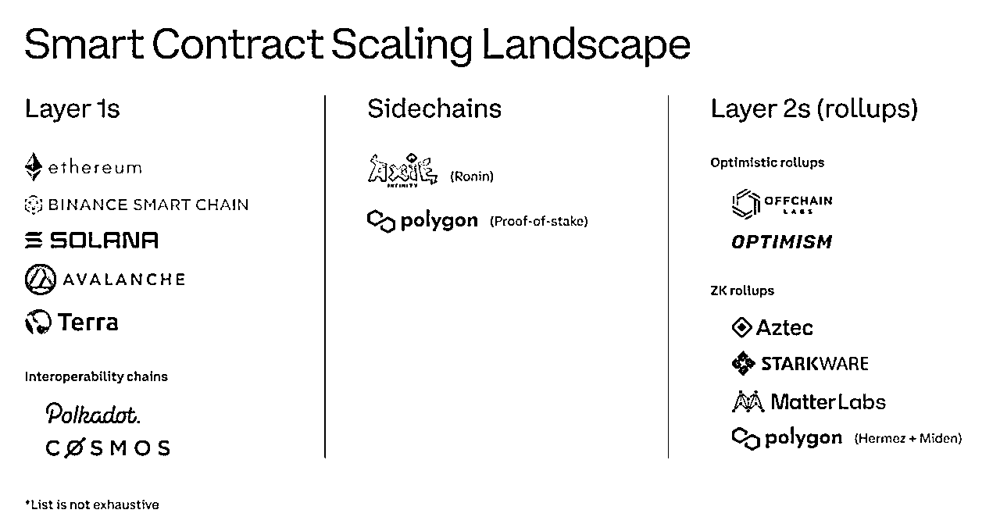

这些方案背后的路径，大致可归为两类：自己另起炉灶，或把任务分包出去。

L1 的逻辑是：既然现有网络不够好用，就另建一套体验更优的网络来替代。

L2 的逻辑是：侧链与 L2 本质接近，都是外包思路。它像 ETH 主网的协作层，承接繁琐事务，让主网继续当“贵族链”；低费用和高速度在二层解决，处理完再把关键数据交回 ETH 验证。

在一层路线里，比如：

Binance Smart Chain（币安智能链）：由全球大型加密交易所推出。它在分布化上做了让步，以安全为前提换取更高性能，用户链上费用近乎为零，确认速度也快。

Solana：采用 PoH（Proof of History）共识，吞吐明显提高，费用较 ETH 大幅下降。

Gavin Wood 是以太坊联合创始人之一，也是 Web3 概念提出者之一，他后来创建 Polkadot。该项目瞄准区块链架构的扩展难题，想把多条链连接起来。

早先的各条链像移动、联通、电信三家运营商，网内畅通、网间不通；Polkadot 试图打通这种隔阂，让不同链互操作，并顺带提升使用体验。

Cosmos 也朝同一愿景努力，即万链互联。

在二层路线里：

AXIE 侧链服务一款经典链游。彼时玩家规模超出 ETH 主网承载能力，于是单独搭一条新链，再与 ETH 对接。

今年热门的 ETH 二层方案 Op、Zk、Arb 思路相近，差别主要在数据打包与认证机制。

下面简要拆解 ETH 推出的 3 个 L2。先说 Rollup。

Rollup 有归纳、整理、打包之意。

前面提到 ETH 又慢又贵，拥堵时费用可冲到几百美元。

可以联想工作日在家做饭，与节假日到景区排队就餐：时间和金钱成本都会被推高。

问题根源在于：ETH 每笔交易都携带数据，处理数据要付费，而区块的数据容量和 TPS 又有上限。交易拥挤时，出价高者先被处理，出价低者只能等待。

解决思路是：既然区块容量和 TPS 难以继续抬高，就减少主网处理的数据量。关键数据留在 ETH，杂项交给其他层，这正是 L2 的外包逻辑。

Rollup 的具体做法：把 ETH 需要计算的内容复制出来，交给与 ETH 相连的 Layer2 协议运算；运算结果被压缩、整理、打包，再送回主网。

打个比方：一百个人分别找老师答疑，老师逐题回应会非常耗时；更有效的做法是先由一名联络人收拢问题、初筛合并，再把少数必须由老师讲解的要点递上去。效率因此提高。

Rollup 协议就承担这个联络人的角色。

但新问题随之出现：不同联络人的能力和可靠性不同，会直接影响交易安全与效率。下面看几个有代表性的方案。

ZK Rollup：

ZK Rollup 指在 Rollup 环节采用零知识证明（Zero Knowledge Proof）的 L2 协议。零知识证明是什么？

设想 A 掌握某个秘密，B 并不知情；A 希望在不公开秘密内容的情况下，让 B 相信自己确实掌握它，这就是零知识证明。

较早的案例可追溯到十六世纪。当时数学界在求解一元三次方程，两位数学家都宣称找到了答案。为了自证又不泄露求根公式，他们互相出 30 道题。若真掌握公式，这些题应能迅速解出。结果一人成功，另一人一题未解。

故事里，两人互为验证方，过程中都没公开公式，只需在短时间内交出对方题目的答案。

因此，ZK Rollup 的核心是用严密的零知识证明算法，让认证者（任何人都能参与）核验数据真伪，核验后把结果打包回传 ETH。认证者无需看到交易明细，从而减少工作量。

它的长处是验证快、安全性高，适合支付等需要快速结算的场景，也被不少人视为“ETH L2 的终极形态”。不过 ZK 算法复杂，开发门槛高，当前落地项目有限，仍有较长路程。

现有应用中，zkSync 生态较为亮眼。

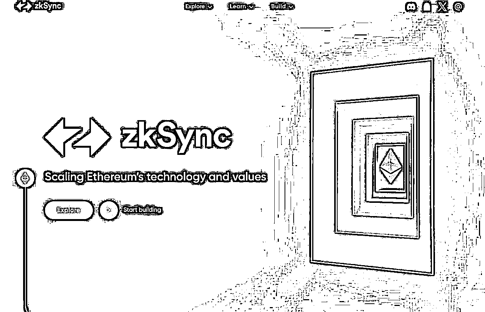

zkSync 由 Matter Labs 开发，a16z 等机构领投，累计融资 4.6 亿美元，已迭代到 2.0 版本，即 zkSync Era。

zkSync Era 生态已有 300 多个应用，TVL（总锁定价值，指项目中用户抵押数字资产的总价值）稳定在 3 亿美元以上，长期活跃地址接近 40 万。它也是本文三个 L2 项目里唯一尚未发币的。

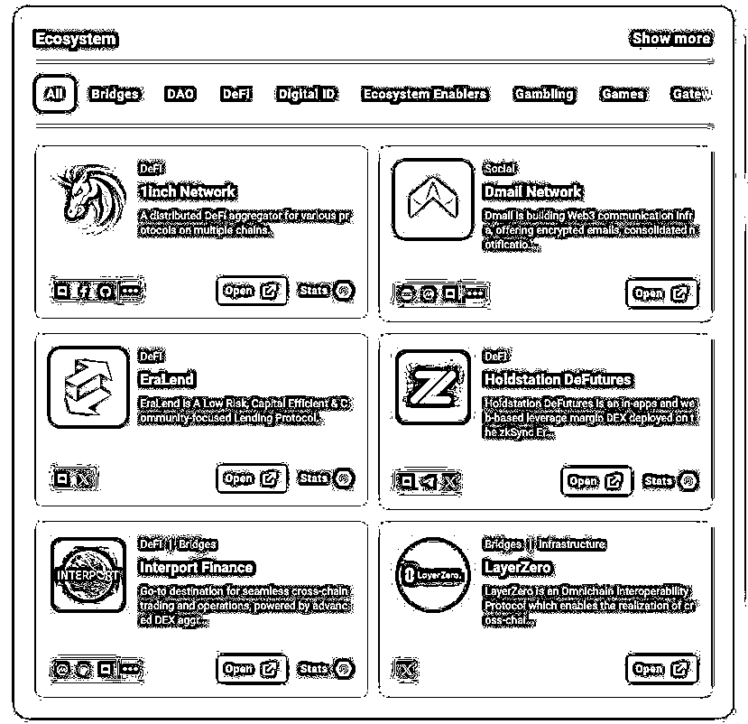

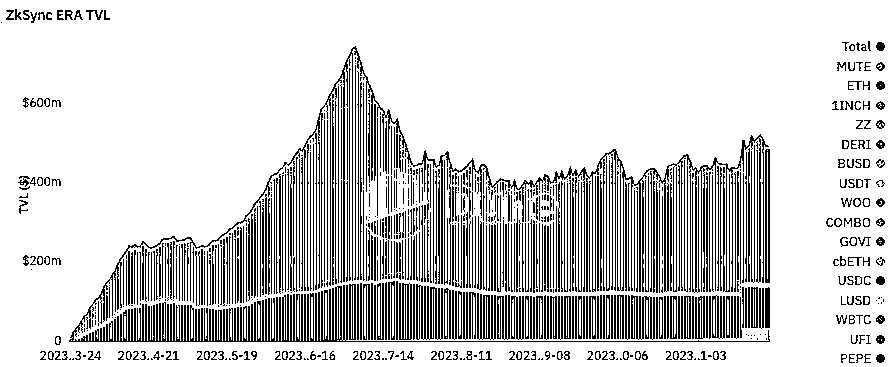

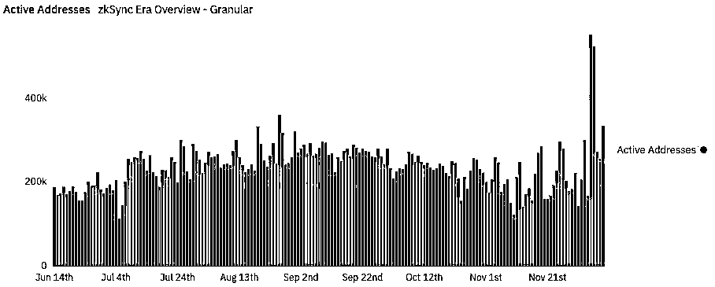

ZK Rollup 给出了“终极形态”的设想，但算法与配套尚不成熟。有没有更成熟的过渡路径？这就轮到采用欺诈证明的 Optimistic Rollup。

Optimistic Rollup：

Optimistic Rollup 如其名，先持乐观假设：默认发出的交易都可信且已认证。

认证者要先缴纳保证金。每笔被打包的交易都有验证窗口期。若认证者先判定某笔交易数据正确，而在窗口期内有其他人发现异常（即认为存在欺诈），这笔交易会交由 L1 智能合约裁定谁在说谎。

若认证者确实作假，其保证金会被部分罚没，用来奖励发现问题的人；问题交易退回并重新打包。

与 ZK 不同，OP 的默认前提是认证者不会作假。因此，ZK 允许任何人参与认证，而 OP 更倾向挑选一小批可信节点，统一监督打包过程。

从证明方式也能看出，OP 处理速度比 ZK 慢不少：它要在窗口期内等待验证，发现问题还要回到 L1 裁决，再交回 L2 处理；此外还存在认证者合谋欺诈的风险。

尽管如此，OP 实现较简单、技术成熟，也适合 dApp 开发，几乎能让开发者把 L1 项目平滑迁移过来。其开发者还在持续升级安全与效率，所以应用面很广，代表项目是 Optimism 和 Arbitrum。

Arbitrum 由纽约的 Offchain Labs 创立，2019—2021 年累计融资 1.23 亿美元；Optimism 由 Jinglan Wang 带领的以太坊开发团队创立，累计融资 1.75 亿美元。两者都明显少于 zkSync。

但从 TVL 看，Arbitrum 与 Optimism 对 zkSync 形成压倒性优势，生态成熟度和活跃地址数也领先。

这也说明 zk Rollup 的发展仍有不少待解问题；就当下而言，OP Rollup 是更务实的选择。

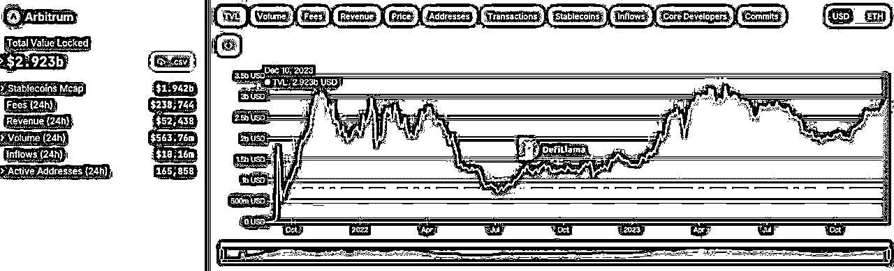

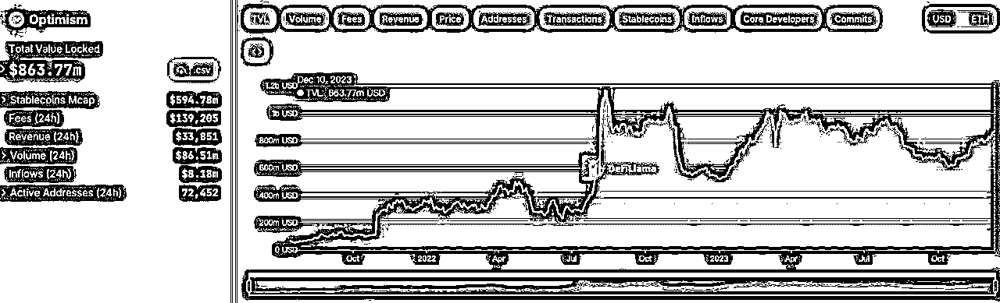

值得注意的是，Optimism 和 Arbitrum 都已发币。持续参与交互、埋伏空投的人，不少在这两个项目上收获颇丰。

Optimism 于 2022 年 5 月 31 日推出原生治理代币 OP，初始供应约 43 亿枚，并在 2022 年 5 月、2023 年 2 月、2023 年 9 月进行三次空投，单钱包上限 10000 枚 OP，当前价值约 21000 美元。

Arbitrum 于 2023 年 3 月推出治理代币 ARB，总供应 100 亿枚，单钱包空投上限 10200 枚，发币后最高价值约 18000 美元。

两者虽同属 OP Rollup，但细节有别：Arbitrum 更像 Optimism 的进阶版。Optimism 只做一轮欺诈认证，且 L2 上的交易计算还要打包到 L1 执行；Arbitrum 采用多轮欺诈认证，交易不在 L1 执行，而在自有虚拟机中运行，对以太坊兼容性更好。

L2 的搅局者：Blast

加密市场按经济模型大致分两类：一类是通缩型，如 BTC，总量固定为 2100 万枚，不再增发；另一类是通胀型，如 ETH，总量每年按固定比例增加，因而 ETH 每年约有 3%—4% 的稳定质押收益。

然而，多数现有 L2 账户中的资金只是静态停放，无风险收益率为 0%，这意味着它们会因 ETH 通胀而被动缩水。

Blast 要解决的正是这个问题：让 L2 账户里的资金也能被动生息。

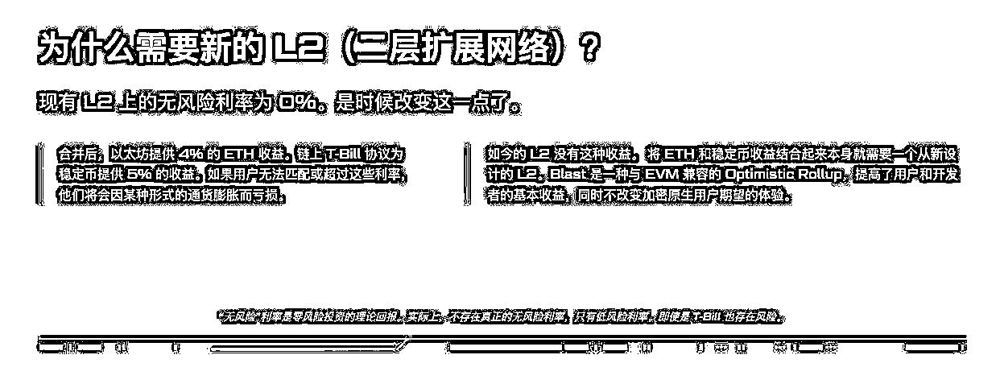

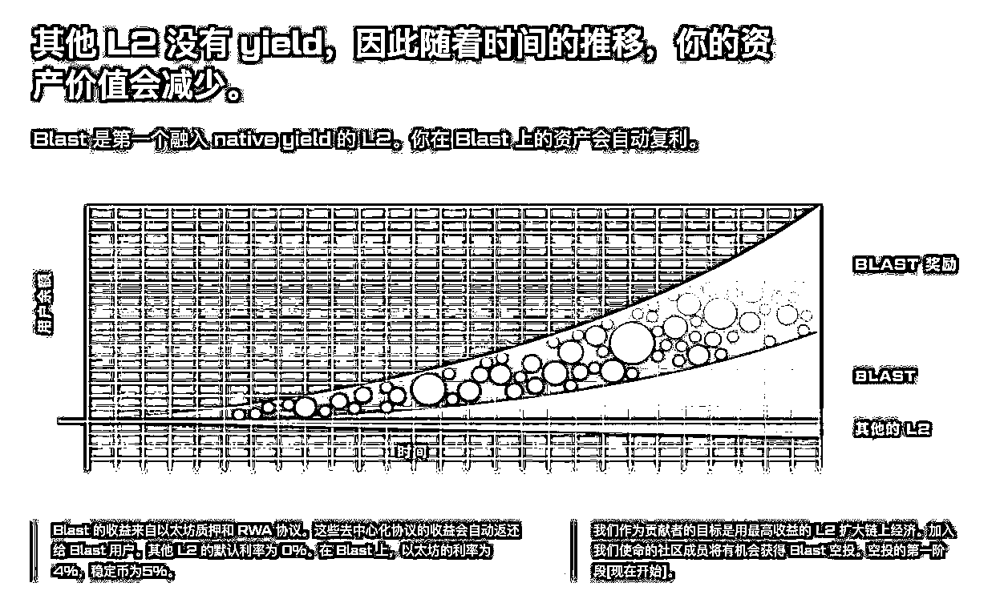

用户把资金存入 Blast 后，Blast 会立即将 L1 上锁定的对应 ETH 用于网络质押，并把质押收益自动返还给 Blast 上的用户。

简单说，若你在 Blast 账户持有 1 枚 ETH，随着时间推移，它可能自动变成 1.1 或 1.2 枚。

除 ETH 原生质押外，Blast 也让稳定币获得被动利息。

用户把稳定币（如 USDC、USDT、DAI）转入 Blast 后，Blast 会立即将 L1 上锁定的对应稳定币存入 RWA 协议（可参考选修部分 11.2.2 的 RWA 概念），再以 USDB（Blast 原生稳定币）的形式把收益返还给用户。

资金存入后，用户可立即享受 ETH 4% 或稳定币 5% 的被动收益，同时累积 Blast Points 奖励。

目前官方仅透露：Blast 计划于明年 2 月 24 日上线主网并开放提款，5 月 24 日开放 Blast Points 的“赎回”。

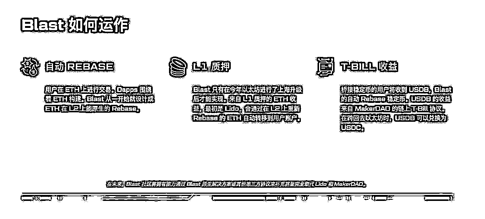

Blast 的出现引爆了沉寂已久的 L2：上线 20 天，TVL 已超过 7.6 亿美元，迅速成为搅局者。但热度背后也有争议。

从本质看，Blast 仍属 OP Rollup 协议下的项目，并无技术创新，严格说当下甚至不算 L2。

先入场者赚后入场者的钱，组队抱团收益更高，且空投积分规则直接公开；再加上联合创始人 Pacman 与投资机构 Paradigm 带来的巨大流量，大量投机者蜂拥而至。

短期看，Blast 会吸走其他 L2 本就稀缺的流动性；长期看，这个类旁氏模型能否维持，还要经受考验。

延伸阅读：Vitalik 的 Rollup 指南精选、零知识证明专题、欺诈证明专题、Optimism 深度研究、Blast 空投操作说明。

### 2.5 案例观察：比特币生态为何升温【新】

从 2009 年 BTC 问世至今，已过去 14 年。

这期间，矿工（负责打包 BTC 区块的人）加入、网络技术升级、新平台涌现，使 BTC 被更多人了解，接受 BTC 支付的零售商也越来越多。

但 BTC 生态此前一直不温不火。直到今年 Ordinals 与 BRC20 出现，矿工收入增加，开发者大量涌入，各团队从技术层面支持 BTC 发展，BTC 生态才重新回到加密叙事的中心。

过去 BTC 常被视为纯粹的数字黄金，发展偏保守。但开发者逐渐意识到，在 BTC 上开发应用存在市场需求。今年 Ordinals 和 BRC-20 的出现说明，BTC 网络同样可以承载生态应用，这些项目也以新方式推动了 BTC 生态。

那么，比特币生态指什么？

它涵盖与 BTC 相关的整个系统，包括 BTC 本身，以及构建在 BTC 区块链之上的应用、工具和服务。

ETH 有主网、L2、钱包和各类代币配套；BTC 也有对应产品与服务，是一个复杂而庞大的网络。

BTC 生态建设已久，为何今年升温？这要从 Ordinals 和 BRC-20 说起。

#### 2.5.1 Ordinals 与 BRC-20：生态闸门

先补一个基础概念：聪。

一枚 BTC 可拆成 1 亿个单位，这个单位叫“聪”（sats），是 BTC 的最小面额。

1 BTC 等于 1 亿聪，因此每聪价值 0.00000001 BTC。

Ordinals 是什么？

2022 年 12 月，软件工程师 Casey 提出 Ordinals 协议；2023 年 1 月，该协议正式发布。Casey 的想法很巧：

BTC 总量 2100 万枚，对应 2100 万亿聪。若按特定顺序排列每个聪，并从 0 到 2100 万亿编号，每个聪就变得可追踪。

更进一步，若在每个聪中写入数据，如图片、文字、视频甚至代码，就相当于创造 Web3 资产，并能安全完成发行与转移。

向聪写入链上数据的过程叫铭刻（inscribe），铭刻出的内容叫铭文。

Ordinals 的实现并不复杂，完全依托 BTC 的基础功能，铭文转账也由 BTC 网络处理。

#### 2.5.1 BRC-20：比特币上的代币发行实验

Ordinals 刚出现时，主要被用来承载 NFT 这类结构复杂、形态多样的数据。到了 2023 年 3 月 9 日，匿名开发者 Domo 在 Ordinals 的基础上又往前推了一步：既然可以发行 NFT，那能不能再制定一套统一协议，让代币发行也跑在比特币上？他给出的答案，就是 BRC-20。

可以把 BRC-20 理解成一套面向比特币网络的“代币发行模板”。它约定了 JSON 数据包的具体格式，再借助 Ordinals 把这些内容铭刻进比特币。部署 BRC20 代币并不设门槛，谁都可以参与，规则相对公平；名称和总量由部署者自己定，但遵循先到先得。某个名字一旦被他人抢先部署，后来者再想用同名部署就不会生效。

如今涨幅接近万倍的 $ORDI，就是 Domo 亲手部署的首个 BRC20 代币。

在 Ordinals 与 BRC20 问世前，比特币的最小单位“聪”彼此没有差别，可以随意互换。巧妙的设计改变了这一点：每个“聪”都能做到独一无二，还能承载数据。就是这样一个看似简单的办法，让比特币网络无法发行资产的老问题有了出口。

BRC20 被更多人看见之后，改进版、仿盘版协议陆续冒出来，比特币生态随之快速扩张。与此同时，铭文市场升温带来链上交易量猛增，矿工收入中手续费占比明显上升，铭文已经成为矿工重要的收入来源之一。

整体看，Ordinals 和 BRC20 所代表的，是比特币生态在技术层面的深层演进。它们已经释放出的能量，很可能成为下一轮加密牛市的重要故事线。

#### 2.5.2 闪电网络：把支付搬到“侧道”上

说到 Layer2，不少人第一反应是以太坊的二层网络。原因不难理解：最近几年以太坊 Layer2 发展快、可用性强，以至于有人误以为 Layer2 是它独有的东西。可实际上，Layer2 的思路最早来自比特币；中本聪在 2009 年勾勒比特币时，就已经埋下了 Layer2 的雏形。

前面解释过 Layer2 的逻辑：把主网中复杂、繁重的交易挪到二层处理，主网只负责少量关键数据，从而给主网减负。以太坊有交易慢、费用高的问题，比特币网络同样绕不开这两道坎。

比特币正常出块间隔约为 10 分钟，单个区块能装的交易量很有限，属于稀缺资源。于是用户只能竞价：谁附加的手续费更高，谁就更容易被矿工优先打包。市场冷清时，低手续费也不至于太难受，等几个区块通常也能确认。可一旦行情火热，所有人都急着成交，甚至主动加价抢通道，低手续费交易就会被矿工晾在一边——总有人愿意出更高的价，你的交易便迟迟无法确认。

更极端的情况下，手续费会在很短时间内被迅速抬高，矿工不断丢下手头正在处理的交易，转而追逐新出现的高费交易。这个逐利过程会让链上暂时没有新块产生，也就是常说的“卡块”。直到手续费稳定下来，矿工才会恢复常态打包。

比特币 Layer2 正是为缓解这类问题而来，其中最出名的协议就是闪电网络。

闪电网络（Lightning Network）是什么？

它架设在比特币之上，目标是解决转账慢、费用高的问题，让用户能够快速收发比特币，而且成本几乎可以忽略。

它是怎么实现的？

在闪电网络里，两个人第一次发生交易时，会建立一份智能合约。你可以把它想成双方共同保管的一本私人账本。多笔交易可以直接记在这本账上，内容只有双方能看到，也不会写进比特币主网。这个只属于交易双方的私人账本，就叫“通道”。

假设我和张三各自往账本里放入 5 个比特币，账面上两人余额都是 5。若我转给张三 1 个比特币，余额就变为我 4、张三 6。这个结果会回传到比特币主网，但“我转给张三 1 个比特币”这笔具体交易不会进入主网，只留在我们俩的账本中。

因为私人账本先记了账，结果回传主网时，不必干等区块确认，支付和转账可以先完成；等区块确认后，再按账本结果把相应金额分到双方地址。

比特币主网正常 TPS 大约为 7，还时常卡块。换到闪电网络，TPS 能到百万级；每 100 美元的比特币交易，手续费不超过 1 美分。支付速度大幅提升，门槛也降了下来，比特币全球支付场景因此获得了相当成功的实践。

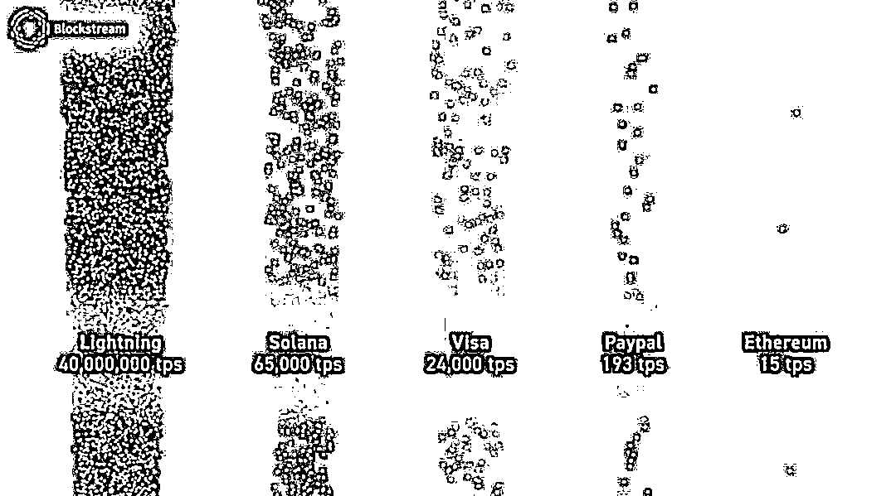

#### 2.5.3 其他：比特币生态里的几类代表协议

今年的比特币生态称得上百花齐放。除了 Ordinals 和 BRC20，这里再挑几个有代表性的协议案例，当作加餐。

正式开讲前，先补两个模型：账户模型和 UTXO 模型（Unspent Transaction Output，即“未花费交易输出”）。

账户模型：

它很像我们熟悉的银行账户体系。银行转账、支付宝、微信支付，底层都可以归入这一类。举个例子：

老王账户里有 200 元，小李账户里有 100 元。老王给小李转 40 元，系统里的变化就是：

老王 -40，小李 +40

余额随之变成：

老王 160，小李 140

这是一笔转账。

再设想另一种情况：老王有 100 元，要给 100 位新开户用户每人转 1 元。那他就得完成 100 次转账。

第 1 笔：老王 -1，第 1 位 +1，余额变为老王 99、第 1 位 1。
第 2 笔：老王 -1，第 2 位 +1，余额变为老王 98、第 2 位 1。依此类推……

到第 100 笔：老王 -1，第 100 位 +1，余额变为老王 0、第 100 位 1。

理论上要转 100 次，而且后一笔必须等前一笔落定，否则余额一致性无法保证，容易出现多转、余额不足等混乱。交易笔数越多，执行耗时也越长。

UTXO 模型：

它更接近现金的使用方式。比特币采用的就是 UTXO 模型，我国发行的数字人民币也基于这一模型。

举个例子：

小陈钱包里有 2 元、20 元、200 元面值的现金各一张。

现在小陈要分别给甲、乙、丙各 2 元，可以有三种做法：

第一种：把 2 元那张给甲。
第二种：把 20 元那张给乙，让乙找回 18 元。
第三种：把 200 元那张给丙，让丙找回 198 元。

三种方式都能完成支付。

回到链上，可以把每一张不同面值的现金理解成一个 UTXO。UTXO 在使用时并不是“原样转移”，而是被销毁后重新生成。比如：

小陈用第二种方式给乙转钱，20 元面值的 UTXO 会被销毁，系统重新生成两个 UTXO：一个 2 元、一个 18 元。2 元的归乙，18 元退回小陈。

第三种方式同理：200 元 UTXO 销毁，生成一个 2 元和一个 198 元的 UTXO，2 元给丙，198 元还给小陈。

这就是 UTXO 与账户模型在转账机制上的差异。更关键的是，UTXO 支持并行处理。余额分散在多个 UTXO 中，2 元、20 元、200 元这三张“现金”可以同时转给不同对象。小陈能在一笔交易里同时给甲、乙、丙付款，因为不涉及账户一致性，每个 UTXO 都独立计算。

再回头看账户模型，每笔交易都得等上一笔完成，性能差距一目了然。

最后再回到前面的例子：

小陈有 200 元，要给 100 位新开户用户每人转 2 元，怎么转？

200 元面值的 UTXO 可以拆成 100 个 2 元 UTXO，然后在一笔交易中直接分给 100 人，瞬间完成。

总之，可以把 UTXO 面值看成更灵活的现金，在链上不断销毁、重建。想知道某个钱包地址到底有多少钱，就要统计它名下所有余额 UTXO，再求和。

理解了 UTXO 模型，再来看今年比特币生态里的其他协议。

1. Atomicals 与 ARC20

Atomicals 面向 Ordinals 和 BRC20 做优化，重点在代币方向，想解决 BRC20 过度依靠中心化链下索引的毛病。

什么叫中心化链下索引？

简单说，Ordinals 协议要运转，离不开比特币网络之外的线下服务来维护状态。底层状态服务一旦有缺陷，资产就可能受损。

比特币网络本身无法阻止无效铭文上链，于是需要中心化平台来判断哪条铭文有效，只有被认可的内容才会进入铭文合集。这里用的技术手段不像智能合约那样规则公开、代码透明，所以 Ordinals 在共识、防双花等资金安全层面难以完全满足要求。

Atomicals 的做法是借用并扩展比特币 UTXO 模型，把每个“聪”的 UTXO 视为一个 Atomical 代币或数字对象，由此在比特币上创建、管理复杂对象与代币系统（ARC-20）。

2023 年 9 月 Atomicals 推出后，首个代币 ATOM 很快被挖完。与 BRC-20 不同，ARC20 在铸造环节加入 POW 机制：铸造者要算出符合特定前缀字符的哈希值，才有资格铸造。这种分发方式更去中心化，也更公平。

概括来说，Atomicals 站在 Ordinals 竞争者的位置，聚焦同质化代币与数字对象的去中心化创建和管理。它通过扩展 UTXO 模型，做出了更去中心化、更贴近比特币文化的代币体系。ARC-20 凭借技术设计和符合比特币原教旨主义的理念，有机会得到比特币核心社区支持，并为生态打开更广的应用空间。

2. Runes 与 PIPE

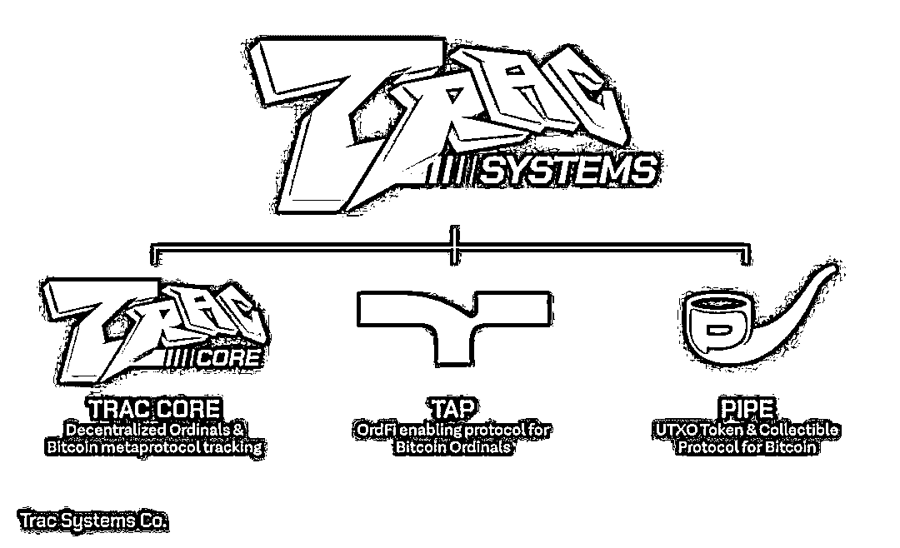

Runes 的构想来自 Ordinals 创始人 Casey。他看到 BRC20 的不足后，提出了一个同样建立在比特币 UTXO 模型上的代币协议设想。其设计理念和主要特点都围绕 UTXO 展开；不过目前 Runes 还停留在概念设计阶段。

虽然 Runes 尚未落地，比特币社区开发者 BennyTheDev 已在 2023 年 10 月基于 Runes 思想做出改进版 Pipe 协议。Pipe 发布后承接了 BRC20 带来的炒作热度，首轮炒作很快完成。

总体而言，Runes 与 Pipe 的出现，说明比特币社区仍在不断摸索同质化代币的实现路径。这些协议虽然处于早期，但已经显露出可能性，未来或许能给比特币生态带来更多手续费收入、开发者和用户。

3. Bitmap 与 BRC420

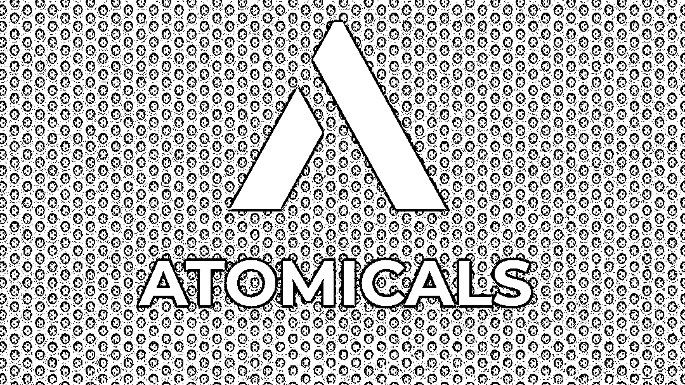

Bitmap.land 是比特币生态里首个元宇宙项目，依托 Ordinals 协议和 Bitmap Theory（位图理论）。

什么是 Bitmap Theory？

这一理论由推特用户 @blockamoto 在 2023 年 6 月 13 日提出。它把比特币区块中的每笔交易输入映射为地块（Parcel），进而组成街区或区域（District）。交易输入大小不同，映射出的地块大小也会有差异。

Bitmap.land 的思路是在地图上划分土地、绘制图案。用户通过铭刻把数据写入“聪”，从而获得某个比特币区块的所有权。

比特币区块链上的每个区块被切成四部分，分别对应不同的减半周期。用户能在 Bitmap.land 网站查看区块编号和颜色，颜色差异代表不同的售卖状态。

Bitmap 让用户拥有并记录单个区块，为每个区块增加了一个新维度。比特币链上的任意区块，都可以通过 Bitmap 成为元宇宙的一部分，为社区带来新的创造空间和所有权机会。

BRC-420 协议自 2023 年 11 月 13 日以来，随着 Ordinals 总铭文量突破 4000 万，成为比特币生态中较活跃的代币协议之一。它不走传统代币协议的老路，而是聚焦链上铭文模块化，在比特币上造出了新的资产类型。

它的首个通证俗称“蓝盒子”，市场价格从 0.15 美元一路涨到 1000 美元，开发者在短时间内获得了可观的链上版税收入。

BRC-420 是基于 Bitmap 的资产协议。它把多个铭文组合成复杂资产，形态从小型角色、宠物，一直到完整游戏脚本和虚拟机。由于资产在链上开源，任何客户端都能运行或校验。

总的来说，BRC-420 与相关 Bitmap 项目正在给比特币生态注入创新和活力。通过复杂、模块化的数字资产，它们为创作者、开发者和用户提供了新的经济机会与交互体验。随着团队持续投入，比特币生态中的全链游戏和元宇宙概念正一步步走向现实。

拓展阅读：

币安：什么是 Ordinals？
比特币闪电网络初学者指南
闪电网络白皮书英文版.pdf
闪电网络白皮书中文版.pdf

## 三、去中心化身份 DID 和钱包 @可达 Koda

### 3.1 去中心化身份：先弄清概念

DID，decentralized identifier，中文叫去中心化身份。它要解决的是：个人能否真正拥有、控制并管理自己的数字身份。这些权利应当完全归用户本人。

前面章节提过，Web2 时代，数字身份往往握在大公司或组织手中；进入 Web3，身份产权回到个人手里。借助区块链和去中心化身份，你的链上行为会被完整留存，有迹可循。

当然，事情有两面。交易公开可查，意味着你的链上资产和操作更容易被他人看见，隐私问题也随之而来。

目前，去中心化身份的主要载体是公钥和私钥，它们由区块链中的密码学规则生成。

公钥可以类比银行账户。你在链上生成公钥，相当于在银行开了户；公钥地址就是那串以 0x 开头的字符，好比账户对应的银行卡号。

私钥则是一长串无序数字与大小写字母的组合，通常很难背下来。它是去中心化身份里最关键的一环——私钥即产权。谁掌握私钥，谁就拥有其名下数字资产的产权。私钥只属于你本人，不属于任何组织或机构。理解时，可以把它看成银行卡密码。

钱包是生成、保存私钥的工具。只有经过你的授权，钱包才会调用其中私钥，完成数字资产交易。

大部分人注册钱包时还会碰到助记词。

助记词的出现，是因为私钥太长、不好记。它相当于一种更易读、易记的私钥表达形式。比如密码是 12345，再准备一个单词库：apple、orange、tom、june、july，让数字和单词一一对应。单词显然比长串字符更好读、更好记。

由于整个区块链共享同一套密码学规则，即使你使用的钱包公司倒闭，只要区块链网络还在运行，只要你还知道私钥，就能换一个新钱包工具登录并管理资产。

在 Web2，如果公司或平台破产、跑路，你放在里面的资产可能一起消失。到了 Web3，这种风险的概率会低很多。

使用钱包时还要设置钱包密码。这个密码主要用于登录钱包应用，类似 Web2 各类应用的密码。不同之处在于，同一个私钥可以在不同设备、不同钱包中使用，且每台设备可以设置不同的登录密码。

### 3.2 钱包的分类

钱包常涉及几个概念：中心化钱包、去中心化钱包、热钱包、冷钱包。下面逐一说明。

按私钥由谁掌握，钱包可分为中心化钱包和去中心化钱包。中心化钱包的私钥在机构手中；去中心化钱包的私钥归用户自己。

中心化钱包最常见的场景是交易所钱包。以币安为例，想在上面交易数字货币，先要注册账号密码，还要提交 Web2 世界的个人身份信息，流程和开股票证券账户差不多。这个过程中，你等于信任交易所，把钱包交给它保管。

从行业现状看，如果资产规模不大，头部中心化钱包的安全性反而可能优于去中心化钱包，因为币安的安全技术很强。但它也有短板：会受监管影响，有些人的账号可能因监管被冻结资产。

去中心化钱包又分冷钱包和热钱包，区分标准是私钥存储是否触网。

冷钱包指离线、不接触网络的钱包，常见形式是硬件钱包，类似银行的 U 盾。私钥的生成和使用都不碰网络，直接保存在不联网设备中，安全系数更高。

热钱包则是生成和使用过程会触网的钱包。比如常用的小狐狸钱包，创建和使用时都联网。

至于中心化钱包和去中心化钱包怎么选，中心化交易所钱包加冷钱包，是相对稳妥的组合。

热钱包安全性偏弱，也容易遭遇钓鱼，不建议存放大额资产。

## 四、DeFi 去中心化金融与稳定币

### 4.1 Web3 金融概述 @可达 Koda

#### 4.1.1 去中心化金融 @可达 Koda @馋嘴猫

当前 Web3 有两大基石：区块链技术和金融。区块链技术可以归入密码学与计算机的分支，而各类金融产品，在 Web3 里几乎都能找到对应形态。

所以这一章，我们先初步认识一些 Web3 金融概念和产品。

在 Web3，金融被称为去中心化金融，英文是 DeFi，全称 Decentralized Finance。

对大多数人来说，中心化金融其实已经足够便利：银行信用卡、支付宝、微信支付，日常使用都很顺手。

# Web3 真正靠什么支撑？

先不重复那套常见说法：大约十七亿成年人仍被挡在正规金融门外，银行网点与基础服务难以触达；但只要手上有一部联网手机，链上工具就有机会把现代金融的入口推到眼前。

这确实是正在发生的事。跨境汇款、金融基础设施薄弱的地区、某些特定支付场景，对链上资产有真实需求，而且规模还在涨。

可再往深问一层：这些场景是不是“缺了就完全转不动”？有加密工具，体验会更顺；没有它，无非成本增加、确认变慢，落后地区少几种金融选择罢了。

所以问题在于：Web3 内部有没有真正的硬需求，能长期托住整个行业？若找不到，地基就松，热度再高也可能只是泡沫，越吹越大，终有破的一天。

我的判断是：有。

支点在底层——BTC 这类由私钥掌控的链上原生资产，目前还看不到替代品。注意，不只是 BTC，而是“私钥归自己、不归平台”的资产类别。

BTC 常被批评挖矿耗电、环保压力大。ETH 在九月完成从工作量证明到权益证明的切换，实体矿机退出，能耗下降九成九以上，传统机构更容易接受。切换后，ETH 从每年约 4.4% 的固定增发逐步转向收缩，和 BTC 争夺“数字黄金”位置的苗头已经出现。

对账面财富很大的人来说，配一点真正由自己掌控的资产，几乎不用太多理由。

前几日朋友聊 BTC 估值，有人提出用“全球最富 1% 人群总资产的 1%”来框算：若真如此，BTC 单价上限能到多少万美元，可以自己算。

这个假设要修两处：其一，助记词丢失让几百万枚 BTC 实际无法动用，可流通量已低于 2100 万枚，单价会更高；其二，ETH 崛起后，富豪的加密储备不再只有 BTC，ETH 的节能属性更讨机构喜欢。所以那 1% 的估值大概率由 BTC 与 ETH 分摊，未来还可能加入别的储备资产。

为什么是“部分”？因为二者除了储值，还有别的用途在支撑市值。ETH 尤其明显：公链生态越大，它越像一台全球共享计算机，链上每个 DApp 都要用 ETH 付 gas；系统越繁荣，ETH 消耗和需求越强。

传统体系里，钱由政府和金融机构掌握；链上金融里，资产控制权理论上归私钥。产品形态像把旧金融重做一遍，但计价底座不同：传统用法币本位，链上金融用稳定币或 BTC、ETH 等 crypto 本位。Web3 的去中心化金融目前由两类载体承接：公司化运营、配合监管的 CEX；算法自动执行、类似比特币网络无人干预的 DEX。后文会分别讲稳定币、CEX、DEX 及相关产品。

#### 4.1.2 从底层需求看：DeFi 为何关键

既然自托管链上资产是相对扎实的需求，顺着它看上下游：这些板块围绕底层需求展开，建设它们有意义也有必要：

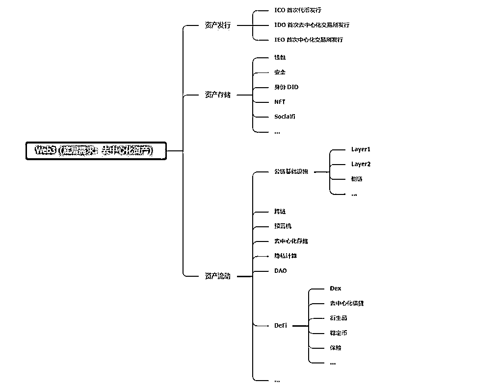

Web3 金融的演进一直围绕三条线：发币、存放、流转；比特币生态、以太坊生态和其他公链都在持续产出新故事。

#### 4.1.2.1 代币发行：IDO 与 IEO【新】

先看发行方式。前面已经学过 ICO，也就是首次代币发行；本节补上后来常见的另外两条路。

1.IDO，即首次去中心化交易所发行

它与 ICO 的差别在于融资和分发借 DEX 完成，所以也有人叫它“首次通过 DeFi 发行”。流程是：项目方把代币交给 DEX，用户把资金质押进流动性池，DEX 按质押比例完成代币分发与划转，智能合约全程执行。

IDO 的优势：

对用户来说，靠谱的 DEX 通常比项目方更稳，而且不要求 KYC，有钱包就能参加，省事高效。

对规模小、名气低的项目方来说，在 DEX 发币比上 CEX 门槛更低、花费更少。

2.IEO，即首次中心化交易所发行

IEO 与 IDO 的分水岭是平台是否去中心化。币安 Launchpad 是典型例子。

用户质押指定资产参与项目挖矿，拿到代币，等二级市场开放后卖出获利。某些明星项目上线 24 小时收盘涨幅甚至超过 3000%，参与热情自然高。

相比 IDO，IEO 对项目审核更严，用户要通过交易所 KYC，安全性在 ICO、IDO、IEO 中最高。

下面这张表对比三者的不同：

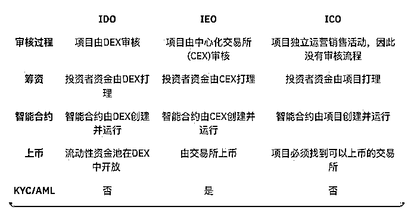

#### 4.1.2.2 资产存储：钱包、身份与恢复

1）钱包与安全

想把私钥资产放稳，交给 CEX 或托管方并不算真正安全。钥匙不在自己手上，资产就不真正属于自己。

钱包因此有需求，安全赛道也必不可少。

2）DID、NFT、SocialFi

为什么身份 DID 和资产存储有关？因为现有钱包对新手不友好，保管资产门槛高。今年以太坊在波哥大 Devcon 上，账户抽象被重点讨论，目标就是降低账户安全风险。大量 BTC 丢失，根子在私钥保管失误。

V 神受《魔兽世界》启发提出灵魂绑定代币 SBT，重要前景之一是助记词丢了以后恢复身份；这会牵涉链上 DID、社交关系，所以 NFT、社交图谱、SocialFi 也成了关键拼图。

#### 4.1.2.3 资产流动：扩容、跨链、预言机与 DeFi

资产要流动，自托管资产更依赖链上基础设施。

1）公链基础设施（一层、二层与侧链）

BTC 每秒 5-7 笔，约 10 分钟出一个块，6 个确认后才算稳妥；ETH 目前每秒 15-20 笔，仍不够用。于是新公链和扩容提速成为长期叙事，2017 年以来 EOS、Solana、Aptos 这些名字轮番登场，拼吞吐量的故事反复奏效。

一层、二层和侧链都走扩容路线，核心是让资产转得更快。

2）跨链

BTC 生态还弱。若想把 BTC 换成稳定币、赚利息，或抵押借出别的资产，又不想走中心化平台，跨链桥便有了用武之地。把 BTC 链上资产搬到以太坊或其他生态，能提高利用率；公链一多，链间通信也离不开跨链。

3）预言机

预言机偏 to B，普通人陌生。举例：在 AAVE 存入 1 枚 BTC，借走 1.5 万美元，BTC 暴跌时协议会清算抵押品，避免坏账。AAVE 怎么知道价格？靠预言机从多家 CEX、DEX 抓取行情喂给合约。

Chainlink 是目前龙头，口碑较稳；币安也入场做预言机，一家独大被打破，竞争对行业有利。

4）去中心化存储与隐私

去中心化存储用于放 DApp 前后端数据、NFT 元数据、公链备份、Web3 代码与社交数据。当前应用面不宽，盈利偏弱，Filecoin 已把重心转向计算。

隐私赛道保护交易信息和敏感数据，但一直没大火，可能要等以太坊二层 ZK-rollup 带动。

4）DAO

这里主要指项目基金会型 DAO，负责保管项目代币、核算支出等；社区型 DAO 的治理机制还不够成熟。更细内容留到第七部分。

5）DeFi（DEX、借贷、衍生品、稳定币、保险等）

DeFi 是重中之重。BTC 这类自托管资产，想脱离中心化机构实现效率最大化，绕不开 DeFi。

分类上，DEX 负责去中心化交易，如 Uniswap、Pancake；借贷有 AAVE、Maker；衍生品有 Dydx、Gmx；还有稳定币、去中心化保险——保险目前几乎没有像样项目。

回头看，公链、跨链、预言机、存储、隐私、DAO 等，大多在为 DeFi 打底；连资产保管环节也是 DeFi 的基础设施。因此，DeFi 可视为 Web3 最核心的应用层，当前基建大多围着它转。

GameFi 还没跑出确定模式。无论是给现有游戏塞入 DeFi 元素，还是做原生链游，都缺少优质且持久的样板。这个需求是否真实、重点在 Game 还是 DeFi、突破口在哪，仍需观察。眼下它更像 DeFi 的延伸，第六部分再展开。

Web3 定义仍有争议，但从底层需求找支点，再顺着脉络梳理板块，判断会更有底。

### 4.2 稳定币：链上金融的计价工具

先厘清一个词：cryptocurrency，简称 crypto。BTC、ETH 这些名字背后有多层含义；crypto 更接近货币、股票、债券这类金融产品层。BTC、ETH 都可叫 crypto。中文译成“加密货币”不够贴切，因为它不只有货币属性，某些场景像股票，某些场景像债券。

#### 4.2.1 稳定币是什么，解决哪些麻烦

稳定币 stablecoin 也是 crypto 的一种，核心在价格稳定。

多数 crypto 波动大，BTC、ETH 这种头部资产也一样，且 7×24 小时交易，价格随时变。

怎么获得 crypto？给网络做贡献、提供劳动，可拿网络奖励；作为金融产品，也能用法币买。

一旦用法币买，麻烦来了：crypto 全天候波动，又在链上运行，买卖双方很难即时成交。法币持有人想换 BTC 或 ETH，直接找人、找平台，可能协议刚谈好，买家还没打款，价格已经变了。

另一类场景是 Web3 内部交易必须用价格稳定的媒介，比如发工资。员工工资按美元等价发 crypto，第二天价格跌到十分之一，很多人受不了。不是所有人都以 crypto 计价。

再加上一些地区政策不允许法币直接买 crypto。

于是稳定币出现。

简单说，它是链上美元替身。最常用的是 USDT，所以大家把稳定币简称 U。有人问 U 是什么？就是与美元等价的稳定币。想买 crypto，可先在 CEX 换成稳定币，稳定币与美元 1:1，再用稳定币买币。

#### 4.2.2 稳住价格的三种做法

那怎么相信它真与美元等价？随便拿个数据库当然不够。目前主要三条路。

##### 4.2.2.1 法币抵押型

每存入 100 美元现金，发行 100 美元稳定币。

USDT 是市值最大的代表，由香港 bitfinex 平台关联的泰达公司发行。它承诺：用户拿 1 美元来买，背后应有 1 美元储备；换回美元时，公司兑付。稳定靠共识与对发行方的信任。

问题是储备到底多少，外界不清楚，也缺少公开审计。

优点：稳。

风险：中心化、发行方信用。

代表：USDT、USDC、BUSD。

##### 4.2.2.2 加密资产抵押型

用加密资产做抵押。BTC、ETH 波动虽大，折算美元后加安全垫，也能抵押。

以 DAI 为例，由 MakerDAO 发行。想借 1000 美元 DAI，需先存入 1500 美元 ETH 或 BTC。涨了都安全；若抵押品跌到 1000 美元，会被没收。靠这套规则让 DAI 维持 1000 美元价值。

优点：相对去中心化、透明。

风险：智能合约漏洞。

##### 4.2.2.3 算法型

靠供需算法调节。价格高于 1 美元就增发，把价格压下来；低于 1 美元就销毁，把价格推上去。

优点：完全去中心化。

缺点：不稳。

经典 UST 归零案例后文会拆。

#### 4.2.3 怎么挑稳定币？主流币种对比【新】

对个人，稳定压倒一切。

稳定币本身像中心化与去中心化的接口，行业现阶段仍需要信用背书。与美元 1:1 抵押的品种里，关键看抵押承诺是否受监管。市值前二的是 USDT 和 USDC，分别由两家中心化平台发行。

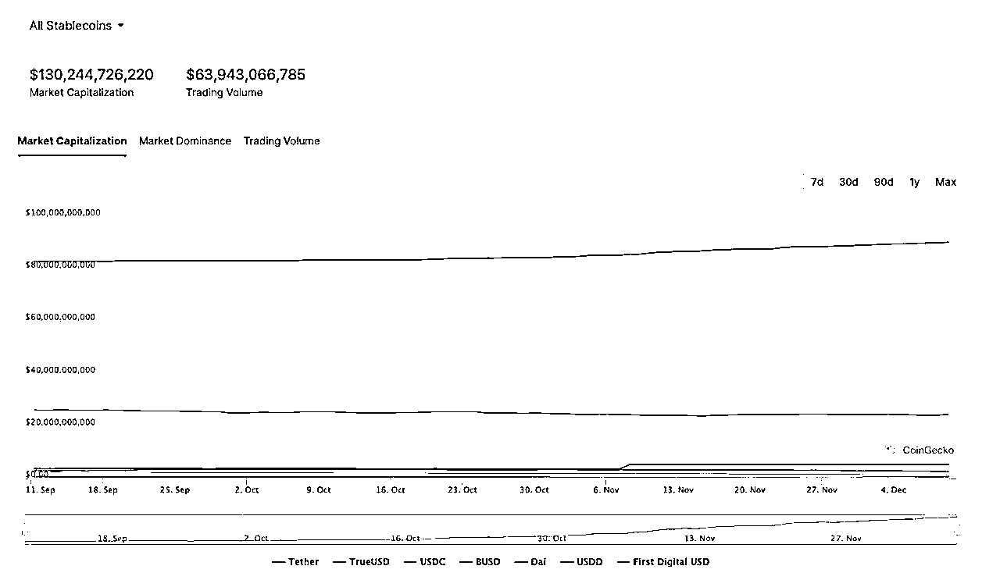

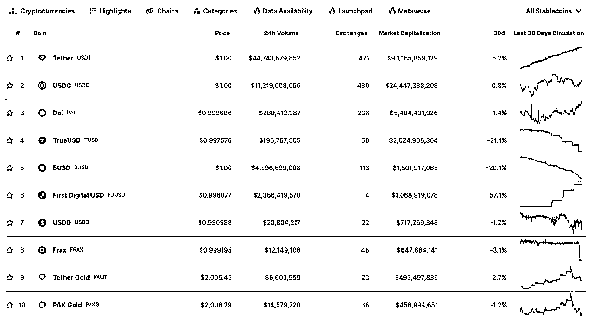

USDT 的泰达储备包括现金、商业票据、企业债、数字资产等；USDC 由 Coinbase 支持，储备现金、现金等价物、储蓄和短债，且受美国监管。

USDT 目前仍然是用户量最大的稳定币，但若把交易所信誉与监管第三方背书纳入考量，USDC 显然更值得信赖。以下为市值前三稳定币的历史价格曲线，从市场表现来看，USDC 同样优于 USDT。

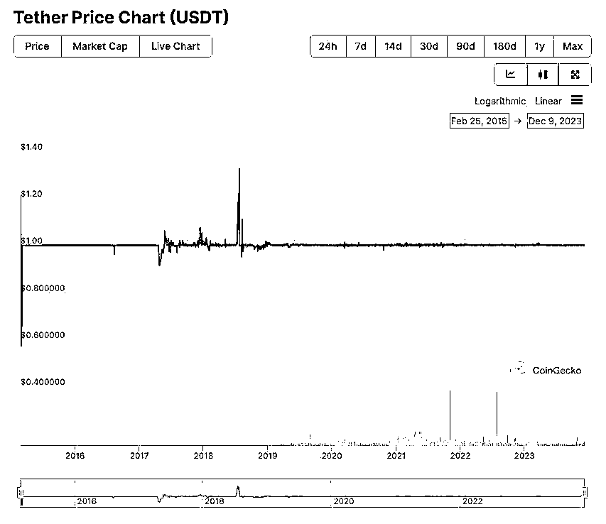

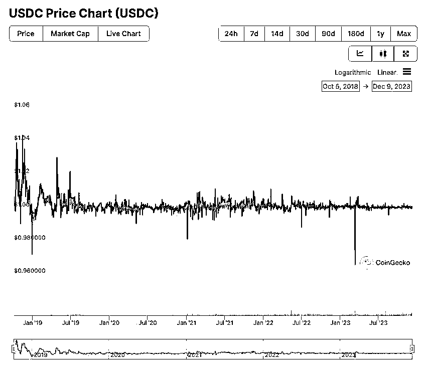

本节所述内容不构成投资建议。

拓展阅读：

Sector_Terra Ecosystem_Tony_PC_CN-39217846 (1).pdf

## 五、认识 NFT @可达 Koda @焦波｜水镜

这一节聊加密资产里绕不开的一块：NFT。

过去一年，想必大家在各类报道中频繁看到 NFT 的消息，国内数字藏品平台与产品也层出不穷。不过，仍有不少人对 NFT 感到陌生：它凭什么火起来？内在支撑是什么？跟国内数字藏品又差在哪里？对生财人而言，最实在的问题是——这里面有没有赚钱的空间？下面会涉及 NFT 相关工具、操作步骤，以及普通人参与其中的正确方式。作为一个新兴领域，机会之外，风险也必须提前说清楚。底线是：宁可不赚，也别亏。

### 5.1 NFT 究竟是什么？

#### 5.1.1 NFT 的概念与特征

这个词或许大家早有耳闻，可它具体指什么？先看定义。

NFT，英文全称 Non-Fungible Token，中文叫非同质化代币。它搭建在区块链之上，依据 ERC-721、ERC-1155 等通用协议，形成一种无法复制、无法篡改、也无法拆分的加密数字权益凭证。

每一个 NFT 都对应一份独一无二的数字资料，充当数字商品归属权的电子凭证或证书，可以承载画作、艺术品、音乐、视频、游戏道具以及其他创意作品。虽然作品本身能被无限次复制，但代表作品的 NFT 在底层链上留有完整轨迹，买家因此能获得归属证明。

通俗地讲，NFT 相当于一个去中心化的“数字权益证书”，既能对应数字资产，也能对应实物资产。它好比区块链世界里的“房产证”。链上数据难以篡改，所以 NFT 所记录的权利归属公开、透明、可查，且归属唯一。

基于以上特性，NFT 延伸出两个明显优势：

#### 5.1.2 NFT 的价值来源

看完前面的案例和定义，自然会追问：NFT 作为一种资产，到底有没有价值？甚至，它算不算资产？它确实有别于传统资产，但市场已经用行动给出了明确回答。

NFT 本质上是一种带有特殊属性的 Token，即代币。

在区块链诞生之前，世界上并不存在一个无法篡改的平台，能够全天候、跨国界、零门槛地完成交易——这一点至关重要。正是这种流动性，让全球玩家随时可以进场，有限的资金与资产在同一市场中博弈，NFT 因此带上了金融资产的色彩。

那么，它究竟有没有“价值”？

圈外人常拿“右键保存”开玩笑：库里花 18 万美金买的无聊猿，有人说我也能另存为当头像。没错，你能轻易拿到一部分使用权。但你保存的图片并不等于 NFT，它只是整个 NFT 资产里的一部分信息。你拿不到归属权，也拿不到归属权带来的回报。另存下来的小图能转手吗？不能，没人会买。

库里买的真是那张小图的使用价值吗？不是，他买的是资产归属权。假如日后市场价涨到 180 万，谁都能右键保存，但只有库里能卖出，并拿走这 180 万。

NFT 的内核是数字内容资产化，而资产化的关键，在于使用权与归属权的分离。以无聊猿为例，它可以被无数人复制，但真正持有它的人，全球也就几千个。

不妨想想房产：最重要的难道是其使用权吗？你可以自住、可以空置、也可以出租，但真正关键的，是你拥有这套房产的归属权。

在区块链世界里，数字资产的归属被清晰记载，公开透明、可追溯。唯有真正的持有者才能交易这份资产，并从中获取回报。理解得越深，你越会发现，这种逻辑才更贴近资产的本质。

至于 NFT 到底有没有价值，你可以自行判断。今天仍有不少人持怀疑态度，但事实是，NFT 已是一个百亿美元级别的市场，认可它的人越来越多。作为投资者，值得留意。

### 5.2 NFT 交易平台与藏品实操

这一节带大家看看 NFT 交易平台到底长什么样，再挑一个具体藏品，讲清收藏前必须掌握的关键信息。这些都是入门阶段最基础、也最必备的知识。

前面提过，眼下全球规模最大的 NFT 交易平台是 OpenSea。作为新手，记住这一个就够了。

OpenSea 网址：https://opensea.io/

打开后进入首页，每天都会展示一些 NFT 项目。顶部有搜索框，想找哪个项目直接搜。点右侧“STATS”按钮，会看到一个排名列表。OpenSea 依据成交额、销售增速、地板价等指标对平台内 NFT 持续排名。排在第一的是 Bored Ape Yacht Club，即大名鼎鼎的无聊猿，库里花 18 万美金买的就是它。

点进去，有几项关键数据，投资 NFT 时务必留意：

再点开某个具体 NFT，同样有不少重要信息。假如你想买一个 NFT，这些必须提前了解。

以某号无聊猿为例，当前标价是 XX 个以太坊。

往下翻，能看到该 NFT 在 OpenSea 上的历史成交价格曲线。下方的 offers 是市场上其他人的出价。如果这个 NFT 属于你，你可以选择接受其中某个报价，交易即告完成。

接着重点看“Properties”，也就是这个 NFT 的属性。每个 NFT 都有独特的属性组合，不同组合决定了它的稀有度。通常越稀有，价格越高。

以无聊猿为例，属性包括背景、衣服、耳环、眼睛、毛发、帽子等。每项属性后都有一个百分比，表示拥有该属性的无聊猿在总量 10000 个中的占比。占比越低，越稀有。

问题来了：各项属性稀有度不一，如何综合判断整体稀有度？

有工具可以帮忙：

一个是 NFTGO，用来查询 NFT，信息比 OpenSea 更全。比如能查到无聊猿系列自创建以来的完整价格走势，这一点 OpenSea 做不到。另一个是 BlockProbe，可以查具体 NFT 的稀有度排名等，也比较常用。

继续往下，“Details”板块展示该 NFT 在链上的核心信息：合约地址、Token ID（即 NFT 编号），以及协议标准 ERC-721。

再往下是历史交易记录，能看到谁出过什么价、何时以何价成交、从哪个钱包转到哪个钱包——这正是链上资产的一大特点：公开可溯、不可篡改，资产过去的每一步变动都清晰可见。

以上就是在全球最大 NFT 平台 OpenSea 上体验真实市场与具体藏品的过程。

海外 NFT 大多建立在以太坊等公链上，可以用虚拟货币在二级市场交易，带有一定金融属性。国内的数字藏品，实质上像是 NFT 的“缩水版”，多搭建在联盟链上。比如腾讯幻核的作品基于至信链，目前无法转送到其他平台，也就是说，不同平台铸造的数字藏品彼此不互通。此外，数字藏品不支持二次交易，通常只用于收藏或转赠，金融属性偏弱。目前国内数字藏品的二级交易，大多是不合规或偷换概念的操作。还有一个明显差异：国内数字藏品往往一张图发行几百上千份，而海外 NFT 除 PASS 卡类外，多数形象各不相同。

总体而言，NFT 在海外原生的机会更多；国内数字藏品也并非毫无空间，但后续要看政策方向、正规军的打法以及实际落地方式。

### 5.3 NFT 的盈利方式

当前 NFT 项目最常见的获利路径，是在一级市场参与铸造，并在盲盒开启前择机卖出。逻辑很像港股打新：每个 NFT 项目好比一只待上市的股票，先拿到白名单获得购买资格，再在上市阶段抛售获利。

目前多数优质项目在一级市场的胜率可观，收益相对确定，因此围绕好项目购买资格的白名单，竞争格外激烈。

最早的做法是靠时间和精力去“肝”白名单。热门项目门槛很高，比如要求邀请足够多的人，或在服务器聊天达到一定等级，可能耗费数天甚至数周；达标后再向官方申请，审核通过才能拿到白名单。

后来逐渐演变为抽奖与填表申请并行的模式。抽奖平台如 Premint、Alphabot、Superful 等，绑定 Discord、推特和钱包，完成指定交互后抽取某项目的白名单。填表申请多见于热门项目，官方可通过审核机制把控白名单质量。

也有人选择雇人完成这些繁琐耗力的工作，常见于经济欠发达地区，找时薪较低又能完成任务的兼职人员。

另一种是成为项目方的半官方人员，比如 Discord 管理员，通常基本能拿到白名单奖励。

最后一种是收购他人手中的白名单资格，获取购买权。这种方式风险最大：购买价格、对方是否履约、中途有无突发状况，都会影响最终收益。

预售阶段拿到白名单，可进可退。此时官方一般会在二级市场 OpenSea 公开对应 NFT 合集，可以自由买卖。若市场价格扣除手续费后高于铸造价，就有盈利空间。

举个例子：市场价 1 个以太，铸造价 0.3 个以太，扣除 OpenSea 税费（假设 10%）后，获利为 1×0.9−0.3=0.6 个以太，约合 400 美元。

拿到白名单也可以转卖给需要的人。热门项目的白名单价值不菲，比如上个月 KPR 白名单值 1000 美元，明天要发售的公鸡 NFT 也能卖到 300 美元以上。只要白名单有价值，出售就是稳赚的选择，当然也可能错失更大收益。

若市场价扣除手续费后低于铸造价，项目就进入“破发”阶段。港股打新也有类似情形，可能持续一段时间，也可能随市场价格回升而摆脱。

和港股打新一样，选对项目、投入后取得较好收益是共同目标，因此标的选择尤为关键，这里存在巨大的信息差。很多热门项目因白名单获取成本过高，最终收益可能平平；而一些人气不那么高的项目，白名单反而容易拿，只要市场价差足够，收益可能相当不错。

以上是一级市场打新的基础获利逻辑。还有哪些机会？

首先是二级市场买卖。总有一些 NFT 存在被低估的可能。比如盲盒开启后，某些稀有度不错的 NFT 因卖家不了解其价值而低价挂出，低价买入再转手，可以赚取差价。另外在牛熊转换之间，蓝筹 NFT 同样可能被低估，熊市买入、牛市卖出，收益也较为可观。

其次是信息差的机会。一个好项目知道的人不多，或坚定看好的人不多，此时通过大量投入资金或成本，可能获得巨大回报。

接着是劳力差的机会。前面说的白名单获取，就是可以通过劳动力差规模化放大的典型。圈内人时间宝贵，比起自己花时间邀请人、聊天、画画，他们更愿意花钱请人代劳。这些基础工作门槛不高，于是衍生出代肝、代邀请等产业链。对应的 Discord 账号、推特账号也可以批量生产并出售。一些项目为抬高门槛会限时开放 Discord 服务器，甚至进入这些服务器的账号也能卖到几百元。

然后是流量的机会。这个领域的流量很有价值，精准流量更是值钱。因此有专门在推特上做 NFT 项目推广的账号，以此获利。

社群的机会。通过提供项目资讯、分析，提高参与者的命中率，也相当有价值。这个领域项目太多，每天冒出十几个新项目，哪些值得投入、怎么投入性价比高，都是大家关心的问题。另外，如何批量做号以提升收益也很关键。社群若能提供这些价值，自然会受到认可和欢迎。

最后是项目方层面的机会，前提是海外市场，这里暂不展开。

### 5.4 NFT 市场的风险与适合人群

这个领域当然也有风险：

1）安全问题

黑客在这个圈子横行，骗局频发。若缺乏警惕和安全意识，很容易中招。一些官方团队自我保护意识不足或技术水平有限，Discord 服务器被黑后，粉丝接连受骗。身边赚了不少钱却因安全问题一夜归零的案例并不少见，务必重视。

2）二级市场风险

和股市一样，追涨杀跌是常态。但 NFT 市场波动更快，价格短时间内可能翻倍或腰斩。高位进场，多数结局是忍痛割肉。

3）流动性风险

一旦流动性不足，再低的价格也没人接手，形成有价无市。那些没有价值的 NFT，最终只是一堆卖不出去的图片。

4）摩擦成本

玩以太坊项目，铸造费之外还要支付不菲的 GAS。GAS 高峰期铸造，可能多花数十甚至数百美元。频繁操作未必增加收益，成本却大幅上升。

5）项目方作恶风险

发行门槛不高，不少项目方只想捞一笔就走，并非真心耕耘。他们常做虚假承诺和宣传，买完后才发现手里只是毫无价值的图片。

6）项目辨别能力不足的风险

看不懂项目，别人说什么好就跟着玩，缺乏独立了解和判断。差项目自然没收益；即便是好项目，一遇风险就恐慌抛售，也容易亏损。

7）买到假货的风险

人人都能铸造和上架 NFT，OpenSea 上充斥着非官方假货。辨别不了真假，很可能花大价钱买个假 NFT。

所以并非所有人都玩得转。哪些人不适合？

1）指望靠 NFT 一夜暴富的人。市场确有暴富故事，但存在幸存者偏差——赚大钱的人才会发声，亏钱的人默默舔伤。不要天天想着暴富，看到别人赚钱就患得患失、心态失衡。应在过程中持续迭代认知，才可能抓住大机会。

2）执行力不足的人。只看信息、很少实操，觉得这也麻烦那也麻烦，不愿钻研。捡钱机会来临时，可能因条件和经验不足而抓不住。

3）缺乏独立思考的人。见风就是雨，别人说什么信什么，不思考背后逻辑，也不深入了解项目。一有风吹草动就恐慌放弃。

4）基础问题解决能力弱的人。很多问题百度一下就有答案，或多试几次也能解决。若基础问题都等别人解答，效率低且成长慢。

5）安全意识薄弱的人。从不做防护，高风险项目也不用小号钱包尝试。

6）辨别能力不足的人。明显的骗局也看不出来，容易被利益诱惑，一冲动就上头。

7）赌性过强的人。经常不做分析就 ALL IN 某些项目，指望运气获得高收益。

反过来，具备相反特质的人更容易如鱼得水：有学习能力、有执行力，能在实践中复盘迭代、提升认知，从而抬高项目胜率。

## 六、GameFi 初探 @可达 Koda

这一节一起认识什么是 GameFi。

### 6.1 GameFi 的概念

看到 GameFi 这个词，大致就能猜到它在讲什么。

GameFi 是 game 与 fi 的合成词。后半部分的 fi 取自 DeFi，也就是去中心化金融。这个品类从出生起就长在价值网络上，金融属性几乎刻在基因里。

放到 Web3 语境看，链游有两个非常突出的标签。

第一，DeFi 被包装成了游戏。目前 Web3 里的游戏，绝大多数只是把去中心化金融嵌入游戏场景，再呈现在用户面前。玩家进入游戏后的核心目标仍是赚钱：抵押代币、抵押 NFT、购置 NFT 以换取收益，这些金融操作被拆解成了任务和玩法。

第二，游戏装备整体 NFT 化。传统网游里的道具归运营商掌握，GameFi 则完全不同——所有装备都是 NFT，而 NFT 的潜台词就是：产权属于用户。前面章节讲过一个旧式游戏的困境：公司可以没收装备、封禁账号，玩家对道具其实没有真正的产权；公司一旦跑路，道具也会跟着消失。链游把装备放进了用户自己的钱包，就算项目方没了下落，资产依然不会蒸发。

### 6.2 旧式游戏与 GameFi：五个维度的对照

下面从五个角度做一次详细对比。

1. 资产归属
旧式游戏资产归公司所有；在 GameFi 里，产权归属于玩家。

2. 购买方式
旧式游戏用法币购买游戏币、充值，交易在整个过程里形成内部闭环；链游则要用加密货币买装备。买入之后，因为装备是 NFT 或链上代币，天然能在全链流通，只要有交易平台、有人愿意接手，你在游戏中获得的代币或装备就能直接转为加密资产。

3. 游戏规则
旧式游戏的规则由公司单方面决定；GameFi 的规则由玩家和拥有治理权的用户共同迭代。这种共同制定，本身就是去中心化精神的一种体现。

4. 用户心智
这是两者分野最深的地方。旧式游戏本身已经是成熟的商业模式，用户愿意为快乐、心流、升级和成就感付费。GameFi 用户画像则和 DeFi 玩家高度重合——他们的目的是赚钱：投入 100 元，最好一周回本，甚至赚回 100 元，并不打算认真玩游戏。至少到现在，我还没看到谁是纯粹奔着“好玩”去使用链游的，这个赛道仍然是赚钱驱动。

5. 商业模式
旧式游戏从用户身上收割价值，方式很直接：提供游戏服务，换来快乐和成就，然后收取费用。GameFi 同样从用户口袋里赚钱，只不过路径换成了让用户相信自己能边玩边赚，再用 NFT 和代币完成价值回收。

至于两种模式谁更有生命力，后面用两个案例展开。

## 七、DAO：去中心化自治组织入门

接下来认识一下 Web3 世界里的一种组织形式：DAO。

### 7.1 DAO 究竟是什么？

2013 年，V 神在以太坊白皮书中第一次提出 DAO。全称由三个英文词构成：Decentralised、Autonomous、Organisation，中文分别对应去中心化、自治、组织。

有趣的是，DAO 的发音和中文的“道”相同。V 神对中国文化很有研究，在《去中心化社会，寻找 Web3 的灵魂》中引用过老子：道者，万物之奥，善人之宝，不善人之所宝。西方的 DAO 与东方的“道”，隔空产生了一种奇妙连接。

组织天然围绕共同目标而存在，因此每一种 DAO 在理论上也都有自己的共同目标。目前 DAO 普遍具备四个特点：

1. 不靠信任
DAO 建立在区块链、智能合约和数字钱包之上，组织里的信息都会被记录在链上。成员不需要信任某一个具体的人，只需要相信代码。

2. 信息公开
区块链让 DAO 的全部信息公开透明。相比传统组织形式，信息披露的真实性、全面性和数量级都会有很大提升。

3. 参与者拥有使用权
进入 DAO 的人便拥有使用权。组织里没有公司老板，只有发起人；发起人有影响力和号召力，但不拥有整个网络。

4. 进退自由
加入或退出组织，完全由本人决定，不需要向任何人申请。

### 7.2 DAO 与传统组织的差异

DAO 和传统组织的不同，可以从五个层面去看：

1. 结构：DAO 更讲究平等与直接民主；传统组织往往层级分明。
2. 决策：DAO 的任何变动都要成员投票；传统组织可能少数人说了算，也可能投票，取决于组织架构。
3. 执行：DAO 不需要可信中间人，投票统计和结果执行都由代码自动完成；传统组织即便允许投票，通常也要人工计票。
4. 服务：DAO 能够以去中心化方式自动分配慈善基金等资源；传统组织依靠人工处理或集中控制，更容易被操纵。
5. 活动：DAO 的所有事务公开；传统组织则习惯私密运作，不向公众敞开。

### 7.3 最早的 DAO：The DAO

严格来说，能满足上述四个条件的组织都能被称为 DAO。比特币可以看作一个 DAO，以太坊也可以；未来由社区成员自治管理的去中心化组织，同样能套用这个概念。

2016 年，以太坊社区成员发起全球第一个 DAO，名字很直白，就叫 The DAO。这是一个投资型 DAO，持有代币的人可以参与投资决策与分红。项目上线 28 天，就募到 1270 万枚 ETH，总价值约 1.5 亿美元。可惜好景不长，项目被黑客攻击，360 多万枚 ETH 被盗，最终直接促成以太坊硬分叉。

### 7.4 DAO 的双重价值载体

万向区块链董事长曾预言，DAO 会成为区块链应用大爆发阶段极为重要的商业组织形态。

在 DAO 的体系里，两个价值标志物缺一不可：一是 NFT，用它记录成员的行为、贡献与产权；二是基于这些记录发行的 token，用来做经济激励。一句话概括：用 NFT 创造价值，用 token 获得奖励。Play NFT → Earn Token。

## 八、Web3 监管：逻辑、政策与公司

### 8.1 监管为何不可避免

合规是每个行业都绕不开的话题，特别是 Web3 这种在金融领域快速创新、同时高速扩张的赛道。这一节要聊的是监管逻辑、主流国家政策，以及围绕合规生长出来的公司。

站在国家政府视角，监管理由主要有三条：金融管控、民众维权、税收。

金融管控。区块链诞生时瞄准的是去中心化的点对点支付。但点对点一旦普及，就会触碰监管盲区：洗钱、赌博、黑市交易、传销都可能借道而行。这些问题本来就属于传统金融监管的射程，不管 Web 发展到第几代，政府都不可能放手。圈内也因此分成两派：一派主张完全去中心化，认为任何资产都可以自由流转，个人产权和隐私优先；另一派则认为去中心化必须接受合规约束。

民众维权。Web3 自带金融货币系统，参与者的资产安全必然成为问题。比如 UST，很多人把它当成美元来用，可这层“美元”价值归零后，大量用户开始找政府维权。Luna 崩盘后，韩国政府也对 Terra 展开了调查。所以有一部分项目从第一天就选择合规路径，USDC 就是在监管背书下开展业务的典型。

税收。DAO 组织里流通的是加密货币，而税收体系建立在法币之上。不同国家正在建立自己的法规：有的对 Web3 行业收税，有的免税，尺度不一。

先看全球监管光谱：红色代表禁止，橙色代表敌对，黄色代表中立，浅绿色代表支持，深绿色代表全球领先者。有了它，就能建立全局视野。

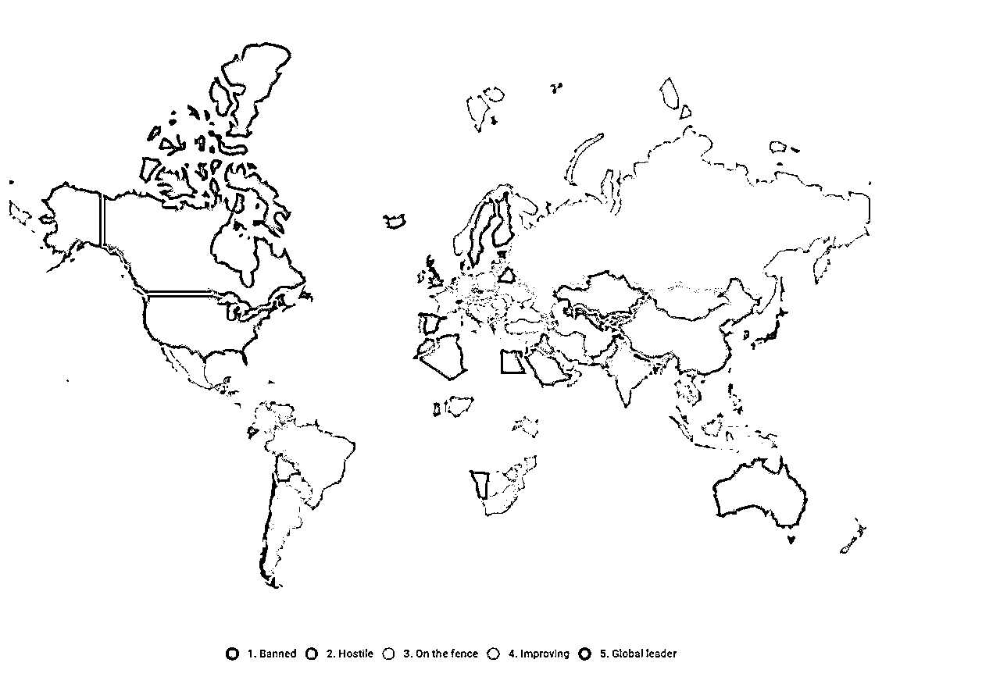

### 8.2 代表性国家与地区的监管做法

#### 美国：多部门联动，创新优先，力保全球领先

此前，一位美国议员的提案《确保 Web3 革命发生在美国》在圈内刷屏，后来衍生出“确保 Web3 发生在湾区”“确保 Web3 发生在大理”等各类戏仿。从这份提案能看出，美国的监管逻辑始终是创新驱动：鼓励创新，同时让法律快速跟进，服务产业发展。

2022 年 3 月，拜登签署《关于确保负责任地发展数字资产的行政令》，核心是负责任的创新，用加强监管引导加密行业良性发展，从而保持美国领先。政策从联邦到地方落地极快：国会、SEC 等部门接连推出多部涉 Web3 法案；科罗拉多、怀俄明、得克萨斯、加利福尼亚、俄亥俄等州的立法也比较友好；一些传统证券交易所甚至推出了加密基金。

2023 年，SEC 通过对 Coinbase 和 Binance 的诉讼，把一个争议极大的问题抛到司法和立法面前：到底哪些加密资产算证券？SEC 认为 95% 至 98% 的 Token 都是证券，也就是 Security Token。他们以保护投资者为出发点采取执法行动，本质上是想给行业一个清晰的规则框架，并对外明确信号：欺诈、洗钱以及对美国金融体系的滥用，都不被允许。

与此同时，市场走向规范，比特币的商品属性越发明确，价值不断被认可，这些都在推动华尔街资本进入。可以预判，大量法币资金会合规地流入 Web3 市场，极可能成为下一轮牛市的催化剂。灰度、贝莱德两家头部基金已经就比特币现货 ETF 的上市与交易规则和 SEC 进行了多轮协商；现货 ETF 一旦获批，就是一个冲刺信号。

落地执行可以从“定性 + 创新监管”这个框架来看。赌博、诈骗、传销这类传统违法违规问题，不管在 Web 几都该被管，不在讨论范围内。创新部分的差异主要体现在金融和税收上。

【Token 定性】
非货币化财产商品。

【金融规则】
ICO 由 SEC 监管；财政部下属金融犯罪执法网络对加密货币交易进行追踪，重点打击洗钱与恐怖融资；CFTC 会调查未经注册的加密期货交易；各州要求从业者持有金钱服务牌照。

【税务口径】
2021 年起，数字资产在税收层面被认定为证券，加密货币交易者须主动申报；IRS 会收集链上交易信息，打击逃税行为。

【其他】
美联储通常不承认加密货币是货币；OFAC 会把受制裁个人和组织加入黑名单，违反者可能面临重大民事或刑事处罚。

#### 中国：去币存链

中国把区块链技术和去中心化金融彻底分开对待：链技术层面大力支持，去中心化金融层面全面禁止。

十四五规划将区块链列为数字经济七大重点产业之一，使其成为数字经济和数字中国的重要载体。产业规划明确推动技术创新、平台创新、应用创新、监管创新，并在技术层面推进智能合约、共识算法、加密算法、分布式系统等方向。各部委发文也显示，要拥抱区块链、元宇宙等技术，助力产业升级与数字化转型。具体落地形式是联盟链和数字人民币。

【Token 定性】
不是货币，不具有法定货币同等法律地位。

【金融规则】
交易和 ICO 都被认定为非法金融活动，相关业务一律禁止。挖矿不符合节能减排和碳中和方向，同样被禁。主体设在境外、实际在境内开展业务的，也会被依法追责。

个人参与加密货币交易，财产安全不受法律保护。借 Web3 之名从事洗钱、赌博、传销、非法集资、网络诈骗等活动的，依法处理。由于 token 始终缺少明确的法律定性，各地法院对涉及加密资产的纠纷判决也不一致：有的案例认定其为合法标的物，有的则否定。

【税务口径】
目前主要针对联盟链，暂不涉及加密货币。

#### 欧盟：开放创新，环境友好

2020 年 9 月，瑞士立法机关批准《区块链法》，加密货币交易和交易所经营在瑞士取得合法地位。卢加诺市更进一步，把比特币、USDT 等稳定币以及本地发行的代币都纳入日常支付场景。瑞士带动的开放风气，也让欧盟整体对 Web3 和加密货币表现得非常友好。

【Token 定性】
token 属于合法财产。

【金融规则】
加密货币可能落入证券、货币、基金、虚拟货币四类属性，每一类都有对应法规；不同国家和地区也配套了相应的金融牌照。

【税务口径】
加密货币与法币之间的兑换需要纳税，但目前暂列为免税优惠；挖矿等服务性收入，各成员国有一定差异。

#### 韩国：为数字资产立法

韩国是全球主要的加密货币交易市场，加密热度极高。2021 年初，韩国推出 2237 亿韩元的元宇宙生态发展基金，用于搭建平台和培育人才。此前风靡一时的 LUNA 与 UST 稳定币项目，也出自韩国。

但频繁暴雷迫使政府改变态度。尹锡悦政府计划在 2023 年颁布《数字资产基本法》，对加密货币实行统一监管。

【Token 定性】
虚拟资产而非货币，可以合法持有和交易。

【金融规则】
ICO 被禁止；交易所合法，但须经政府审批注册，用户必须实名认证，方便监管。

【税务口径】
2023 年 1 月 1 日起，对资本利得征税 20%。

#### 新加坡：立法先行，友好支持

新加坡对区块链和加密货币的监管相当明确，对 Web3 始终保持友好，是行业里的先行者。全球大量 Web3 创业者聚集于此，其中不乏来自中国的团队。2022 年 4 月，新加坡金融管理局局长提出，希望新加坡成为一个负责任的全球加密货币中心，既要有创新参与者，也要有足够强大的风险管理能力。

【Token 定性】
按数字资产类型区分为证券型、支付型代币、实用型代币。

【金融规则】
金管局向合规企业发放牌照，允许开展业务。

【税务口径】
免征商品及服务税。

#### 东南亚：冷热不均

东南亚内部立场并不一致：泰国、马来西亚、菲律宾相对积极；印度、越南保持观望；印度尼西亚则偏保守。红极一时的 AXIE 项目，就诞生于越南，落地在菲律宾。

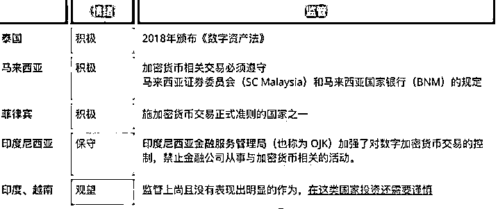

#### 南美洲与非洲：把加密资产看作出口

南美和非洲国家整体上非常欢迎 Web3 和加密货币。原因不难理解：这些国家的法币本身不稳定，货币体系又高度依赖美元，因此许多人把加密货币视为摆脱外部经济束缚的救生索。

萨尔瓦多在 2021 年 9 月正式承认比特币的法定货币地位，让它与美元拥有同等地位。政策落地后，该国 2021 年 GDP 增长 10.3%，旅游业增长 30%。今年，多米尼克也紧随其后，赋予加密货币法定货币地位，并与波场达成战略合作，波场网络成为该国指定的区块链基础设施。

### 8.3 数据安全公司的两条路线

面对监管合规，Web3 已经形成两种立场：一种坚持绝对去中心化，强调个人产权与隐私优先；另一种走合规派路线，认为去中心化必须在监管框架内运行。与之对应，行业里也自然分化出两类不同的数据安全公司。

# 保护隐私，还是服务监管？加密公司的分岔路

在加密行业里，公司大致分成两派。一派把去中心化和隐私当作底线，目标就是让用户的个人数据与资产更安全；另一派则站在监管一侧，替政府部门处理合规难题。

前者最常被提起的是 Tornado。它做的是链上资金混币：用户先把币放进去，后续交易就很难被第三方追查，转账等金融动作的隐私因此得到保护。以太坊联合创始人 Vitalik 曾用该工具给乌克兰捐款。

不过，2022 年 8 月，美国对 Tornado 采取制裁：美国个人与实体不得再为 tornado cash 协议提供任何服务，也不得与关联的以太坊地址互动。

华盛顿实施制裁的常见触发点，通常包括涉及外国政权、恐怖组织、毒品走私、大规模杀伤性武器扩散，或者被认定威胁美国国家安全、外交政策与经济利益。换言之，隐私类工具很容易撞上主权国家的监管边界。禁令落地后，不少 Web2 与 Web3 企业迅速中断了与 Tornado 的合作。

另一派公司天生就围绕政府需求做生意。比如 Elliptic（域名 www.elliptic.co），主攻链上反洗钱与制裁合规分析，服务涵盖钱包扫描、交易监控、案件调查等。Coinbase 这类大交易所是它的典型客户，其他需要对接各国监管规则的项目也构成其主要客群。国内可对照的是欧科云链，它的“链上天眼”方案用于协助公安机关破案。

学完这段，希望大家对各国监管思路有基本认识，并逐渐形成自己的判断。

## 九、未来与机会

这一章，我们把视角落到个人：Web3 能带来哪些机会？

前面章节读下来，你应该已经感觉到，这个赛道的成长空间还很大。如果感兴趣，可以按自己的爱好和长处参与。

但行业里收割者不少，二级市场和部分所谓 KOL 尤其要警惕，独立思考是底线。对刚入场的人来说，把“在变量里找相对确定的部分”当成原则，会比较稳。

围绕相对确定的部分，下面几条赚钱路径可以先记下来，眼下看不懂也没关系，以后回头再看：

1. 空投交互（撸毛）、打新、海外交易所返佣，三选一。这类事情确定性高，本质是用流动性换项目的推广预算，跟当年互联网淘客相似；区别在于竞争者少、单笔收益往往更可观。
2. 亦仁有个判断：新手常被当作猎物。他主要指散户在二级市场很难找到确定性，那里收割者密布。因此，除非你投资经验很足，否则不建议下场。二级市场里相对稳的标的，目前看只有 BTC 与 ETH。
3. 拿工资。进入这个行业工作，也是确定性不低的参与方式。

本章从创业、打工、投资三个角度，展示一些可能的赚钱路径。

### 9.1 了解机遇

做买卖或做投资，先要弄明白自己赚的是哪种钱；否则被割的就是自己。

我认为，在 Web3 里获得的收益大致来自两块：

1）金融层面：赚认知领先的钱。

很多人不理解 BTC、ETH 的价值，根源是对“价值”和“金融”没想透。想弄明白，可以先回答这几个问题：

1. 货币到底在解决什么？
2. 黄金凭什么有价值？
3. 金融的功能是什么？
4. 现代货币有哪些用途、对应哪些问题？
5. Web2 阶段我们赚的是什么钱？
6. BTC 与 ETH 各自解决什么？

这里说说我的理解。

问题一：在货币出现前，物品的价值缺少统一尺度。定价发生之后，价值才被感知。对象可以看得见，也可以看不见；可以实用，也可以不实用。人类反而更容易对无形、非实用之物形成共识。

问题二：几千年前没有法币，黄金承担货币角色。它解决的是物物交换的麻烦：假设甲有十把斧头，乙有十头牛，甲想用两把闲置斧头换两头牛，交易能成。但若甲想换更多东西，就会遇到“别人未必需要斧头”的难题。黄金逐渐被普遍接受，大家愿意拿各种物品换这种金属，黄金因此获得价值。它凭什么胜出？因为稀有、总量有限、性质稳定、耐久、易携带、可拆分——这些特性顺着人性。

问题三：资产本质是什么？当货币本身变成商品，资本就出现了。把货币视为稀缺资源，就能衍生金融产品：给风险定价，是保险与期货；给企业定价，是股票与债券；给房屋定价，是房产。经过货币定价，稀缺资源就成了普通人理解的资产。金融产品靠放贷收息提升全社会资源配置效率：闲钱进入金融机构，机构再以利息贷出，钱生钱。这个模式一旦运转，很难退场。

问题四：货币发行权归中心化政府后，政府除了定价，还受任期约束，大概率会用通胀刺激经济。新钱投放时，越早拿到的人越受益，越晚拿到的人越吃亏，普通人往往无感。通胀是双刃剑：经济繁荣可能加速，但普通人的劳动价值会被稀释。

问题五：按货币定义，你原有 1000 元，印钞后多给你 100 元，你赚还是亏？直觉说赚，实际相反。上一轮互联网浪潮中，美联储印钱，华尔街机构再把钱分发到全球。很多互联网公司不盈利也能高估值上市套现，原因就是市场钱多，本质是货币的击鼓传花。过去两年垃圾互联网概念股暴跌，根子也在这里。

问题六：Web3.0 的思想源头，是比特币与区块链带来的点对点电子支付系统；它要处理的就是主权货币的弊端，仅此而已。以太坊则把这种金融思路扩展到其他体系，是平台型工具。细节手册里有，这里不铺开。

若把 BTC 看成数字黄金，当它的总市值追平黄金总市值，一枚该值多少？《当比特币总市值等于黄金总市值的时候，比特币的价格是多少？》给过粗略估算：约 50 万美元。现价不足 2 万美元，约 25 倍空间。

若把加密资产与美元 M2 做类比。世界银行 2021 年数据显示，全球 GDP 接近 100 万亿美元。

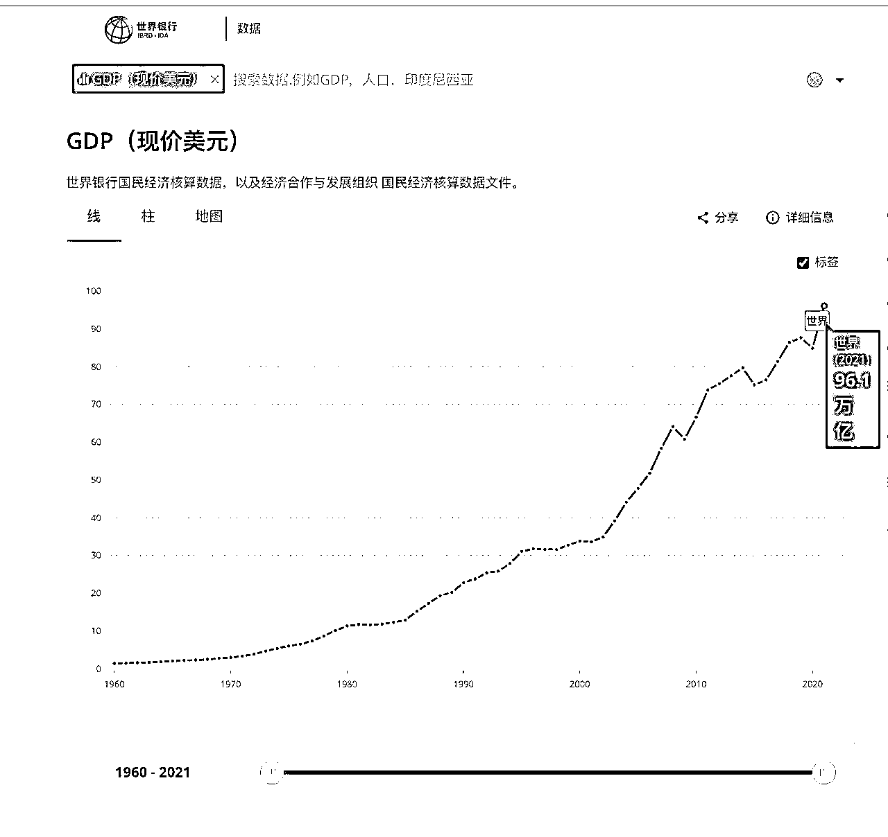

2020 年各国广义货币发行量约为 GDP 的 1.4 倍；考虑疫情放水，我估计实际可能到 2 倍，即 200 万亿美元。

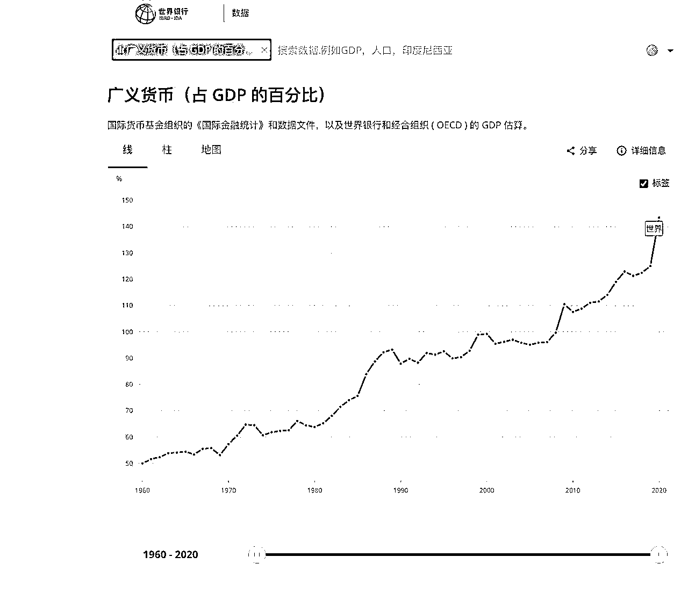

若加密资产最终拿下广义货币 30% 的份额，而当前总市值约 1 万亿美元，那么大盘还有约 60 倍空间。

这部分赚的是认知差：早形成共识的人，赚后形成共识的人的钱。Web3 与 Crypto 让普通人也有机会成为“最早拿到新货币的人”。

再说商业层面。我们赚的是 Web3 生态里那些增长快、又能持续产生利润的公司的成长回报。

生产、创造都能创造价值，因为它们解决人类问题、提高效率。那 Web3 解决什么？

互联网把信息流动成本压到近零；Web3.0 则把资产信息成本压到近零，是互联网变革的最后一块拼图。到今天，互联网主要提升了信息网络效率，还没有提升价值网络效率。在这样的背景下，细分领域出现百倍以上增长机会并不奇怪。

价值被创造后，货币会标记它，落到公司报表上就是两个字：盈利。

一家公司若能讲清：为谁服务、提供什么产品或服务、向谁收费、收多少；以及在客单价、用户规模、转化率、复购率、转介绍率、毛利率上是否具备长期优势，那它在 Web 几都算好公司。讲不清，在哪个 Web 时代都危险。

比如币安，表面是交易所，商业逻辑和腾讯很像——赌场与游戏在运营上没有本质区别，结果都是高毛利。毛利高，就能做平台；用户越多，上架项目越多，生态垄断越强，再拿钱投生态初创。它属于典型的双边市场模式。

上次参加活动，我听到一组数字：全球 Web3 开发者月活不足 2 万；国内活跃投资用户估计不到 20 万；全球用户也就几百万（从 Vitalik 的粉丝量也能侧面看出）。相对全球互联网用户，增长空间仍然很大。

币安这类跑通模式的公司，未来必然还会出现。它们不发股票，只发 Web3 世界自己形成共识的 token，也就是加密资产。眼下这个生态仍处在很早期。

### 9.2 路径一：创业

想做大的互联网创业者，最好参考风投机构的判断：风投看赛道，创业者管经营，专业分工。按风投的眼光，Web3.0 是重点方向之一。创业要去资金密集的地方。

具体切口要结合兴趣与比较优势，因人而异。从当前 Web3 演进架构看，和 Web2 没差别：底层公链、基础设施、应用层；技术型或市场型创业者，都能找到位置。

我本人对投资有兴趣也有积累，长期理想是做一家 Web3 的伯克希尔。短期我在内容营销和知识付费社群有积累，于是从 Web3 投资社群切入，解决新手入门痛点，把 RichDAO 的训练营与投资俱乐部跑通了收费。

有些伙伴可能没意识到，我们在生财有术里早已练出一套知识付费的商业技能，这就是比较优势。到了 Web3，我发现生财系伙伴的商业化与社群运营能力普遍很强，这是平台给我们的底子。

如果对各类从业者的赚钱方式感兴趣，这份资料总结得比较全，基本覆盖当前 Web3 主流变现路径（PDF 下载链接：Web3 航海｜实战工具包）：

币圈赚钱的十八般武艺.pdf

真正适合创业的人很少。也许有一部分写在基因里——爱创业的人往往更敢冒险、不爱循规蹈矩、也不满足于稳定。

马云在湖畔大学首期课程给创业者上的第一课，讲的是如何面对失败；优衣库创始人也写过《一胜九败》。

创业本来就是不断失败的过程，和 Web 几无关。创业者天生更乐观地面对失败。所以，得反复审视自己属于哪类人。

回到问题：Web3 创业还有哪些机会？

每个行业阶段都有该阶段的机会。Web3 从比特币、区块链技术起步，到以太坊成为去中心化应用平台，再到公链、游戏、NFT 等方向爆发，某种程度上是时代产物。

万象区块链董事长在近期演讲中判断：基础设施层已逐步成熟，应用层会迎来大爆发。我认同这个判断。现在底层公链与交易平台已形成垄断效应，头部团队资金充足；新玩家一旦冒头，就可能被收购。而且头部公司本身已经做得不错。

底层网络铺好后，基础设施层与应用层都可能跑出大结果。去年在公链和游戏赛道爆发的团队，并非一夜成功，而是提前布局、深耕了两三年。同理，现在各类基建和应用仍有不少创业窗口。

后来者完全可能靠现象级应用切入，甚至凭流量反攻底层公链，完成颠覆。

到目前为止，Web3 的网络演进和 Web1、Web2 一样：从底层协议到基础设施，Web2 后来借移动互联网迎来应用层爆发。

Web3 的应用层会被什么引爆？是价值网络能力的百倍提升，还是 VR、AR 或其他？没人知道。从人性底层看，社交和游戏是刚需，任何时代都存在，但具体以何种形式被颠覆，仍是未知。

这也正是成长型行业的魅力：让人期待。

### 9.3 路径二：打工

Web2 的增长已接近天花板。有同学问：Web3 有哪些岗位？

其实门槛没想象中高。不少 Web2 从业者觉得，Web3 在产品与市场上都被 Web2 碾压。但对打工人而言，无论 Web2 还是 Web3，底层工作能力没有差别。

因此岗位类型也接近，主要包括投资、技术开发、产品、数据分析、运营、设计等。

找 Web3 招聘信息，主要有四个入口：

1. 项目官网
2. Web3 招聘站点
3. 社交媒体
4. Web3 猎头

#### 9.3.1 渠道 1：项目官网

若发现某个项目不错，顺着官网通常就能找到招聘页。

#### 9.3.2 渠道 2：Web3 招聘网站

聚合类站点效率也高。

以 Web3.career（域名 Web3.career）为例，首页会列出最新岗位，很多支持远程。

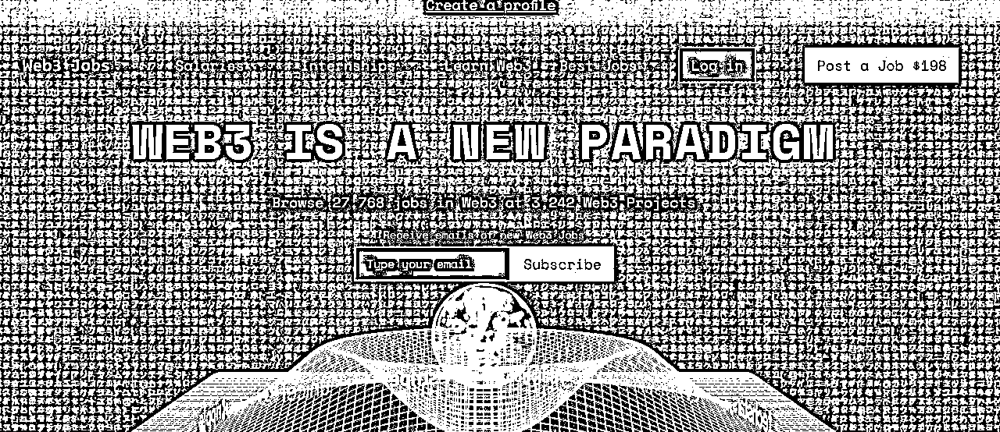

岗位分技术、非技术和兼职，也能看到高薪或热门职位。比如首个开发岗年薪可达 70 万–75 万美元，水平很高。

非技术岗包括市场拓展、社群运营、增长、HR、战略、营销等，年薪从十几万美元到几十万美元不等。

设计类涵盖产品设计、基金设计等，很多支持远程，年薪几万到 20 万美元。

岗位要求可归为两点：岗位能力与行业能力。

岗位能力是底层工作能力，跟 Web 几无关；无论做商务拓展、增长，还是产品、运营、营销，都能迁移。

行业能力则来自对行业的理解。读完本手册，你应已有初步认知。Web3 仍处早期，门槛没想象中高；学习能力强的人能较快入行。

我身边就有朋友 2021 年入行，2022 年所在项目上市——这是高速行业给个人的机会。后续加入团队、实践项目、持续学习，行业认知会不断提升。

#### 9.3.3 渠道 3：社交媒体

社交媒体也是找工作的阵地。Twitter、各类 Discord（注意骗子）、微信群，都可能直接触达项目核心成员。

很多创始人亲自运营 Twitter，老板有招人需求；看好某个项目，可以大胆私信。我身边有朋友就是通过 Twitter 联系创始人后拿到工作。

#### 9.3.4 渠道 4：猎头

现在也有专注 Web3 的猎头公司，但主要服务高薪岗位。招人公司通常只在“想招却难招”时才找第三方猎头。

#### 9.3.5 找工作的「道」

前面讲术，再讲几点道。

无论 Web 几，芒格给的三条原则都适用：

1. 不卖自己不信的东西
2. 不和不喜欢的人共事
3. 不为不敬佩的人打工

若不知道对什么感兴趣，先排除不感兴趣的；若认为打工就是赚钱、兴趣不重要，就找擅长的；若不知道擅长什么，让身边人帮你判断。

这套框架应能帮你找到更合适的工作。

再附上我们整理的 Web3 求职站点：

8 个值得收藏的 Web3 找工作网站

### 9.4 路径三：投资

再次强调：本文不提供投资建议。

前面说过，这是有 10 倍、百倍回报可能的赛道，但能否抓住，取决于个人能力。

这里的投资可以是时间与精力，也可以是资金。

没有本金，Web3 有很多需要花时间交互的项目；通过交互拿代币，后续可能变现。本质上类似做美团骑手，但投入产出比更高。

若用钱投资，重要前提是你自己有投资能力。

## 十、资产安全与投资理念

行业发展往往从无序走向有序，再回到无序，这是普遍规律。

Web3 早期同样混乱。这个行业离钱近，监管却未及时跟上，一度作恶成本极低。全球每天都发生大量盗窃与诈骗。

### 10.1 资产安全的重要性

《区块链日报》记者做过不完全统计：截至 2022 年，仅交易所就发生 28 起比特币被盗事件，损失达 120 万枚 BTC；按 2 万美元折算，超过 240 亿美元。这还未计入个人钱包被盗。

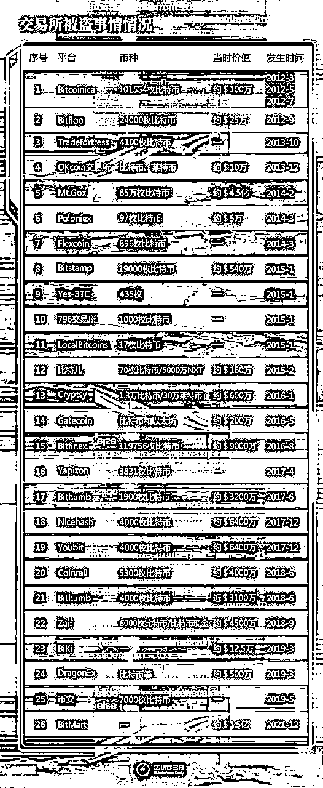

除了被盗，管理不善也会造成资产遗失。

区块链分析机构 Chainalysis 在 2020 年指出，至少 370 万枚 BTC 超过五年未被动用；加密数据公司 Glassnode 则推算，约 300 万枚比特币已经永久丢失（拓展阅读：《加密交易所历年被盗情况：超 120 万枚比特币、530 亿美元被盗》）。

# 钥匙失守，链上归零：Web3 安全防雷笔记

私钥记不起来，或者存放私钥的硬件损坏，账户里的币就可能永远动不了，最后变成链上沉睡资金。

Web3 一路走来，大额盗币并不稀奇：Mt.Gox 爆雷、以太坊 DAO 分叉，都是老玩家绕不开的历史。

我周围因误操作、疏忽而丢币的人不少，轻则几千上万，重则千万级。

把资产想成 10000 后面那串零，安全就是最前面的“1”；少了这个“1”，收益再花哨也可能一场空。

有个老板低价收了几十个 BTC，拿了几年；去年单枚冲到 6 万美元、四十多万元人民币，结果助记词放在云笔记，全部资产蒸发，数千万归零，实在可惜。

本讲就谈如何压低 Web3 资产风险，让自己少踩雷。

### 10.2 自托管钱包：把钥匙攥在自己手里

先懂诈骗和盗窃的底层逻辑：链上资产归私钥管，攻击者最终都围绕这把钥匙做文章。

作案路径主要有两类：

1. 直接套走私钥

云笔记存助记词、设备中木马等，都可能让私钥信息落到别人手里。

2. 借智能合约骗你点授权

这类更隐蔽：诱导你在钱包里不知不觉确认授权，对方拿到私钥使用权，随后扫空钱包。

由此提炼五条心法，务必记牢。下面用案例讲各场景怎么防雷。

#### 10.2.1 案例一：假蓝V钓鱼

人容易信权威。到了 Web3，面对大V就更容易放弃独立判断。骗子买粉包装成 Twitter 大V，在推文里塞钓鱼站点，不少用户中招，钱包被搬空。

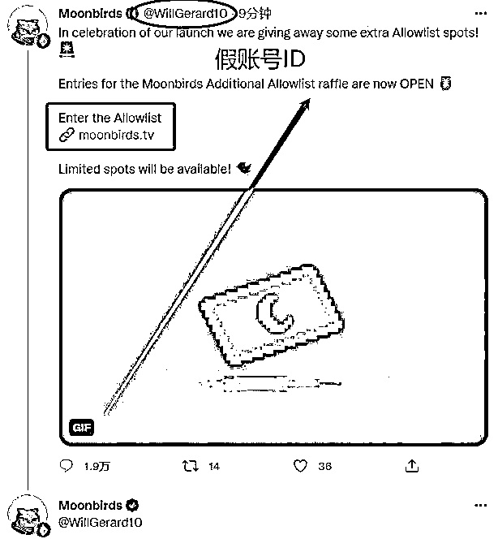

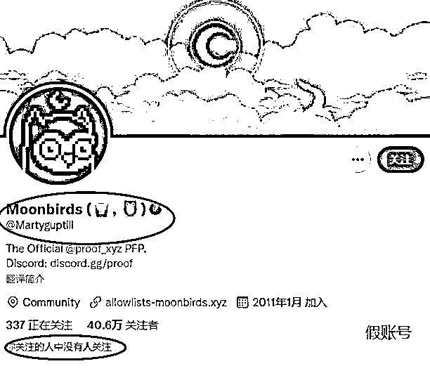

提醒几点：

1. 蓝V不等于可信。

2. 粉丝数与骗子身份无关，Twitter 粉丝可低成本造假；看账号更该看历史内容和互动，粉丝数看看就好。

3. 来路不明链接别点。

#### 10.2.2 案例二：周杰伦的无聊猿失窃

2022 年 4 月，周杰伦在 INS 说“哥被偷了”。好友送他的 BAYC #3738 被转走。

4 月 1 日，他把钱包交给朋友参与热点项目交互，朋友撞上钓鱼链接，资产损失。

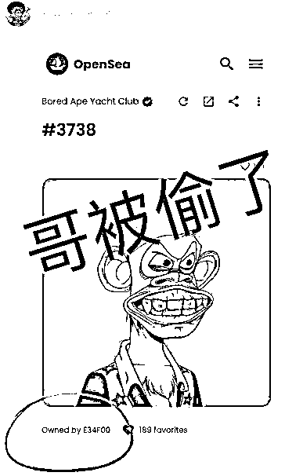

分析指出，关键动作是朋友点了 set approval for all 授权。

该授权等于把保险柜钥匙交出去：确认后对方可转走钱包全部资产。OpenSea 交易也要类似授权，平台才能撮合买卖。

因此每次签名都要看清钱包弹窗的小勾选项，看到“授权全部资产”尤其警惕。除该指令外还有几类：

MINT：铸造 NFT

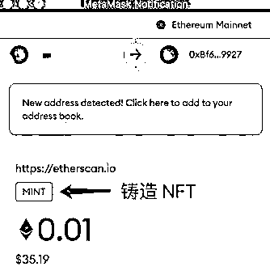

sending ETH：转出 ETH

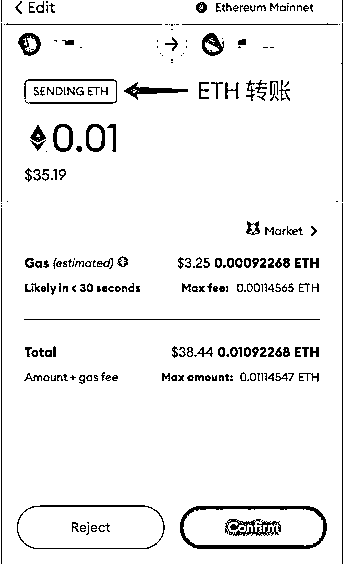

授权某地址管理某类 NFT，确认后该类 NFT 可被全部转走，骗子常用。

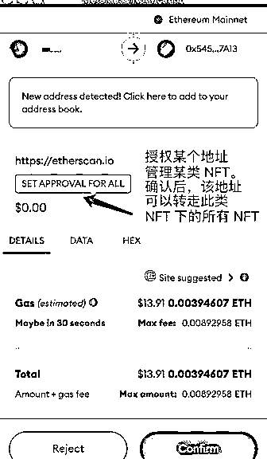

转移某个 NFT，确认后该 NFT 被转走。

#### 10.2.3 案例三：Discord 里的坑

Discord 骗子多，专盯新手。套路一：加的群本身就是假项目方，内容为骗服务；有人花大钱买假 NFT 即此。套路二：真群里有人冒充管理员私信。

对策：只从官方渠道拿 Discord 链接，确认进真群。找官方时防假官网、假 OpenSea 认证，图中蓝V是头像 P 的，不是官方认证。

对私信可立规：主动私聊你的都按骗子处理；开启安全私信设置屏蔽。

#### 10.2.4 案例四：假官网抢搜索排名，骗你填助记词

我踩过这个坑，所幸钱包没资产。

平时用 Google 搜 OpenSea，点第一条结果。站内要求填助记词，很多人被话术带走就填了。助记词就是资产控制权，泄露即全部可被转走；不少人因此清空。

假站高度仿官方，再用谷歌广告、SEO 排名诱导新手。记住：没有任何网站会要你输入助记词。

### 10.3 托管在中心化平台的安全

中心化交易所相对封闭，交互频率低，风险小些。把安全项全打开即可。

谷歌验证器丢失很麻烦，最好准备备用手机，两部都装并同步，做冗余。

### 10.4 三招守住 Web3 资产 @温格区块链

#### 第?条：官网下载，安全前提

Web3 应用只从官网下载。

听起来像废话，但去年到今年我身边数人因非官网下载丢币。

去年 8 月某天，社群学员说他三个钱包没领空投、没授权应用，却在 8 月 5 日被转走 15 ETH 和 0.1 BTC（约 34 万元），问原因。

我先问是否截图存私钥/助记词，或社交软件传过。他说没有；上次丢以太坊后很小心，还新下载钱包存资产。

我让他发被盗钱包转出地址。两个 ETH 地址和一个 BTC 地址，以太坊浏览器显示 8 月 5 日多笔转入，随后骗子经 Uniswap 换成 ETH；两地址分别 134 ETH 和 96 ETH，BTC 地址也被清空。

钱包真实、无授权、助记词没泄露，怎会无故被盗？我建议联系 imToken 客服。

回信后真相：他用了第三方渠道下载的 imToken App。他想起 6 月重装过，是在非小号下载。

我劝报警，虽知追回概率低；当地警方不接也不立案。

非小号是加密中文市场最大行情查询平台，这种平台都能出假下载，很多人因信任它中招。

还有案例：四年老玩家照样失误，丢 57 ETH，当时约 148 万元。

#### 第二条：资产分散，风控优先

11 月 FTX 暴雷，全球前三交易所。核心是创始人 SBF 挪用用户资产。

CoinDesk 文章分析 FTX 与 Alameda 资产负债表异常，危机发酵；币安创始人 CZ 发推称清仓 FTT 避险。市场恐慌，FTX 平台币两天从 20 美元跌到 2 美元。

风控强的人听风就提币；反应慢的被埋。我也中招：里面不到 1000 美元山寨币，没当回事，等想提已关闭。

类似者更多，身边社群被埋不低于 50 万的不少。没提币原因归纳为：以为交易所不会出事。

结果出大事。截图是电报群群主发言，很惋惜。

启示：交易所数据有一点异常，第一反应提币，别用“大所不会倒、别被 FUD、创始人厉害”安慰自己；这些不是充分条件。

提币几分钟，验证没问题再存回也无损失。

另：大部分资产放钱包，小部分放常用大所；我个人交易所资产不超 1/3。

#### 第三条：授权用完就撤销

有链上交互就及时取消授权。

2020 年后链上生态丰富，交易多，合约漏洞风险随之增加，参与过活动应撤销授权。

两个网址收藏：

https://revoke.cash/

https://etherscan.io/tokenapprovalchecker

其他注意：别扫陌生二维码；不明空投别领；App Store 也有假钱包。

很多人以为苹果店安全，但 TokenPocket 假货比真货还精致，见图。

更麻烦的是现在真 TokenPocket 在 App Store 搜不到。

YouTube 上还有骗局、类资金盘，社群成员近日遇到：

### 10.5 写在最后

几条心法，助你入局后心态稳。

1. 先选对，再把事做对

段永平的话：做正确的事，再把事情做对；即选择大于努力。多数人只顾埋头做事，忽略选择。

怎么选？先知道有哪些选项，保持头脑开放，大量输入新事物。

2. 输出倒逼学习

费曼学习法：讲到 8 岁孩子听懂才算掌握；多输出多交流，也帮助自己消化。

3. 悲观者可能正确，乐观者往往成功

Web3 风险与不确定性是任何新事物固有、个人改不了的事实；能做的是提升认知、控制风险，在好赛道抓机会。

悲观者也许对，乐观者常赢。

## 十一、新手入门路径 @阿布 Abo

本节聊低成本高回报两板块：撸空投、打新。

按“时间、资金、赔率”不可能三角，没有同时满足耗时少、资金门槛低、赔率高的完美事；只能选适合自己的。

撸空投和打新是用时间换资金与赔率：靠信息参与项目交互/打新，拿项目方一级筹码，再按标的、大盘、情绪在交易所卖出获利。这是散户少有的低成本拿优质一级筹码路径。

下面讲两个玩法及注意。需要强调的是

### 11.1 板块一：撸空投

#### 11.1.1 什么是撸空投？

撸空投又叫撸毛，英文 Airdrop。

项目方把 token 发到用户钱包，或通知用户去网站领取，通常奖励早期参与者。

像吃鸡游戏系统派飞机空投武器物资，通俗说天上掉馅饼。

Web3 领空投有前提：在项目方划定范围内，即满足其条件。

比如：

同时，不同项目加分/扣分不同，有项目把 IP 作女巫标准；同一电脑同 IP 多账号会被判恶意刷空投，而非真实用户。

#### 11.1.2 项目方为什么要发空投？

你可能问：谁愿意白送钱？

游戏里激励能理解，Web3 真发项目代币，商业上像亏本；但其诞生与行业背景相关。

根子在 Web2 与 Web3 分配方式不同。

Web2 公司打广告要找电视台、媒体/自媒体宣传。比如三主体：

公司 A：好枕头

媒介 B：电视平台

消费者 C：你

好枕头 A 要触达你，得给 B 广告费，通过广告让 C 知道产品；A 得知名度，B 得广告费，C 成为潜在客户。

Web3 把媒介 B 砍掉。

项目方要知名度、用户参与数、交易金额等活跃数据，需真实用户体验生态、贡献数据；数据上去可能拿更多融资，估值上升。

做项目的团队想换取增长，先得掏钱投入。这笔投入通常会被算进市场费用，代币奖励也属于其中一环，用来换用户、换数据、换生态活跃度。web3 的钱包机制让这类激励能够直达用户地址，不经过任何中转，这一点决定了整个玩法可以跑通。

所以，把视角换一下：大家并非单纯来占便宜，而是在充当项目的首轮体验者。说穿了，利益站在哪边，人的选择就会倾向哪边。web3 的很多规则还没定型，奖励标准大多握在团队手里，内部留一点“自留地”，不好听，却很真实。再加上监管缺位，手握内幕的人靠消息套利几乎毫无阻力——代价不大、风险可控、回报却很高，这几样东西平时很难同时具备，在这儿倒成了一种常态。

#### 11.1.3 空投的性价比怎么样？

把时间框定在 2023 年到 2024 年 3 月，市场通过代币分发送出的价值已经超过百亿美元。前面提到的几个例子，单账号收益基本都在万元级别，单项目的交互开销却只有几百块。所以，一级市场的代币奖励对新手来说，仍然是个比较友好的入口。

#### 11.1.4 为什么项目团队要追查女巫？

项目方之所以发奖励，是想吸纳真实用户来体验产品，让用户自掏腰包花 gas，在链上留下交易量和活跃度。可一旦交互就有奖励，必然会有人开着大批账号反复刷量，而且这个套利模型相当划算。

女巫（Sybil）这个词，源自一位名叫 Shirley Ardell Mason 的艺术家，她曾因多重人格障碍接受过治疗。放到链上语境里，就是指一个人伪装成许多身份，去操纵系统或争夺利益。项目方当然不愿意把奖励发给这类人，于是会按一定标准把可疑地址挑出来。常见的识别线索包括：多个账号在短时间内表现出高度一致性，比如金额接近、时间重叠、操作路径雷同；子项目查 IP 时出现地址重合；又或者项目方直接沿用生态内其他项目标记过的女巫名单。

除此之外，领奖还有硬性门槛。此前 Starknet 发放代币时公布的条件是：交互历史跨度超过 3 个月、交易总额超过 100 U、交互次数不少于 6 次、钱包里留有超过 0.005 ETH 的资金；时间截点是 2023 年 11 月 15 日。

所谓快照，就是在某个时间点给链上状态留个底，项目方再拿这个底账来核对你的交互记录是否达标。换句话说，你必须在 2023 年 11 月 15 日之前达到那 4 项要求，钱包才有资格领币。硬性条件之外，也常有加分项，例如交互次数更多、时间更久、金额更厚。有一点要提醒：每个项目对奖励资格和女巫的判定，都有自己的尺子。

#### 11.1.5 怎么避免被当成女巫？

想躲开女巫筛查，重点不是“怎么藏”，而是“怎么活得像真实用户”。查理·芒格说过一句很经典的话：如果知道自己在哪儿会出事，那就先别靠近那个地方。

真实用户不会做什么？不会同时开一堆号去刷同一个子项目；不会给每个号转一模一样的金额；不会在一台电脑上登录几十上百个账号；不会让同一个钱包给所有小号分钱；也不会在领完奖励后，把所有资产归集到同一个提币地址。

把这些反面行为倒过来，就成了一套防守思路：

1）从交易所提币出来再分给不同账号，是安全的，因为打款方是交易所的热钱包，这个地址通常被项目方视为白名单。反之，如果各账号把资金集中转到你个人在交易所的固定充值地址，一看就知道是批量控号。想避开这个风险，可以用 OKX 子账户来做归集。项目方如果不这样设计，几乎人人都会被误伤，空投根本发不出去，还要被社区追着骂；口碑一旦崩坏，机构评级也会受影响，没人愿意做这种自断后路的事。

2）指纹浏览器负责伪装设备配置，IP 负责伪装网络位置。两者叠加起来，你就能在一台电脑上同时操作“不同地区、不同配置”的多个环境，从而减少从设备和 IP 维度被关联到的概率。

3）别去网站上买 IP。价格贵是一回事，很多商家还会把同一个 IP 卖给好几个人，撞车风险极高，网速和稳定性也够让人崩溃。

4）别挂美国、韩国、俄罗斯、古巴等非安全区的节点，否则可能连奖励都拿不到。我自己用的比较多的是荷兰和日本。

#### 11.1.6 参与空投要避开哪些坑？

去年闪电网络放白名单那波，只要把三件套基础配置备齐，几乎零成本就能参与。项目方给申请用户发奖励，单号 300U，后来涨到了 1000U。我当时有个偏见：白来的东西大概没多大肉。结果朋友一口气开了 50 个号，分批次出货，一波下来直接到手几十万人民币。

#### 11.1.7 普通人靠空投赚钱，该从哪里入手？

11.1.7.1 空投的卡点与窗口期

新人一上来通常会踩到不少坑：三件套怎么获取、怎么安全保管；指纹浏览器和 IP 怎么搭、怎么用；不同链之间的资金如何周转；怎样分辨安全的交互网站；又该如何提前找到值得参与的项目。眼下正处在牛市初期，不少团队都选在这个时间窗口发币，想趁着行情热把估值卖高一点。大家都在忙着上车，所以谁先把这些基础问题解决好，谁就能决定这轮牛市里自己能分到多少。

11.1.7.2 新手最难迈过的一步

入门阶段最磨人的，是钱和时间都花了，正反馈却迟迟不来。这里面藏着两种心态：一种是“先相信后看见”，敢在别人犹豫时提前卡位；另一种是“先看见再相信”，非要等到真金白银落袋才肯加码。后一种通常更稳，但放在牛市初期，一味求稳只会耽误捡钱。

结合成本和时间效率，有三个办法值得试一试：

1）把获取信息变成习惯。工作不忙的时候，用 X（推特）替代微博、小红书和抖音，我手机里后三个软件都没装。同样是休闲，前者能持续给你输入有效信息，后者更多是在消磨时间。通勤或摸鱼时翻翻项目，晚上有电脑就动手交互，经验条就是这么一点点攒出来的。

2）靠近那些已经拿到结果的人。想办法认识有实盘经验、赚过大钱的 KOL、大户或工作室，向他们请教，把这件事当成一笔对自身认知的投资。这是我从入行一直坚持到今天的习惯，也因此认识了不少圈内老手，拿到过很多一手信息。这个圈子拼到最后就是认知差和信息差，只有不断靠近优质信源，赚钱的概率才会变大。

3）加入付费社群。付费群的核心价值不在收集信息，而在筛选信息。公开渠道的信息基本都能免费看到，难的是判断哪个机会能吃肉、哪个项目确定性足够高。这是我混了一年付费社群后最大的体会：如果你自认能独立判断，拿得住仓位，而且以前就靠这类操作赚到过钱，那这笔钱没必要花；如果你像我刚入圈那会儿一样，希望有人带着走，那付费就是值得的。

举个直观的例子。市场上有 A、B、C、D、E 五个项目，你判断 A、C、E 都值得做，于是把本金平均分成三份，各投 33%；某个付费社群研究之后只推 C，建议你把 70% 的子弹集中打过去。最后结果出来：A 的回报是 5 倍，C 是 10 倍，E 直接归零。按 100 元本金算，你的三仓组合结果是 A 赚 165 元、C 赚 330 元、E 亏损，总收益 495 元，约等于 5 倍；而集中打 C 的路径，70 元成本换回 700 元，整整 10 倍。两者在时间、精力和结果上的差距，一眼就能看出来。回头看，我敢在几个优质项目上重仓，离不开“有人指路”这几个字。很多时候你明明知道项目好，但信息不够充分，就算看好也不敢配仓位；等它跑出来，大多数人只剩一句“我当年也参与过”。广东有句俗话：“早知就冇乞丐。”天底下没有那么多“早知道”；所谓早知道，本质上就是拿到足够的信息做支撑，让你把标的看得更透，然后该止盈止盈、该加仓加仓。

### 11.2 版块二：打新

#### 11.2.1 打新到底是什么？

打新，就是在项目早期出手，用相对低的成本拿到团队的第一手筹码。很多人会问：它和撸空投的区别在哪？相同点是，两者都是通过早期介入来换取一级市场的资产；不同点则体现在好多个维度上。

空投是用 gas 和时间换未来的奖励。除了三件套（指纹浏览器、IP、电报）这一类的基建成本，其余开销主要是交互时消耗的 gas。发币时间不可控，快的一两个月，慢的一两年，所以空投的赔率更高，投入产出比也相当可观。打新则是在项目方公布规则之后，卡着时间点去指定页面 mint NFT。链上费用随行情波动，成本很难提前锁定；选对了标的，一晚上赚几倍不是梦，选错了，亏起来也很凶。

打新和空投还可以联动。比如 Runestone 之前表示，后续会给 11 万多个在 BTC 网络上 mint 过 3 张 NFT 的地址发空投，而且团队已经计划把父铭文打入中本聪地址——没人能再控制这个父铭文，所以项目不存在增发和通胀的可能。单号空投当时折合 0.0422 BTC，约 2800U，相当于市场白送了接近 2 万人民币，这还不算以后可能的额外奖励。如图：

#### 11.2.2 打新的类型和成本门槛

目前主流玩法有两类：NFT 打新和铭文打新。NFT 打新又分为白单轮和公售轮：白单轮是项目方给特定地址发放优先铸造资格，通常覆盖老用户或某些蓝筹 NFT 的持有者，价格更低，还能避开公售时的激烈竞争；公售轮则向所有人开放，大家拼手速、拼 gas。按现在的链上热度，以海外项目为例，mint 一张 NFT 的花费大约在 30 到 60U，折合人民币 200 到 400 元。听起来不便宜，但收益往往也对得起这个成本。

拿我上周打的一张图举例：mint 成本是 0.001 BTC，按当时价格折算约 60U。晚上 23:00 铸造，第二天早上 8:00 进入二级市场，价格最高冲到 250U，等于一夜涨了 4 倍多。我人在外面，晚上回来才挂单出手，最后在成本价 1.5 倍的位置卖出。那次打图主要是为了给朋友做演示，所以没上仓位。正常来说，只要标的选得准、卖出节奏拿捏得稳，类似项目赚 4 到 5 位数并不罕见。

#### 11.2.3 打新有哪些注意事项？

# 选修篇：Web3 进阶

## 十一、【项目拓展】进一步了解 Web3

### 11.1 Web3 的链上框架：公链、私链、联盟链 @可达 Koda

前面讲过，区块链网络按去中心化程度可以分成三种类型，这一节展开细说。

公链可以理解成一个完全开放的账本，理论上任何人都能随时接入，不需要许可。比特币就是全球第一条公链，也是最典型的代表：链上数据一旦生成就不可篡改，对所有人公开，人人都有份参与使用和建设。

受比特币和区块链技术启发，一些组织和个人开始按自己的需求改造这套玩法。私链就是站在公链反面的设计，中心化程度很高，只供特定机构内部使用。它借用了区块链的记账方式，但管理权仍然攥在中心化机构手里。

联盟链则夹在两者之间：由若干个组织或机构组成一个联盟，共同维护网络。联盟成员被允许参与记账，而外部人员想进入，需要得到联盟的许可。

拿银行打比方会更好懂：把比特币看成一家去中心化的全球银行；私链相当于某家银行内部的记账系统；联盟链则像是工商银行与花旗、德意志、北欧银行等同行共同搭起的跨行清算网络。数字人民币网络，实际上也可以归入联盟链的范畴。

三类链的差异，可以从几个维度来归纳：
- 去中心化程度：公链完全去中心化，联盟链是多中心协作，私链则是中心化集权。
- 准入条件：公链无需许可、自由进出；联盟链由联盟决定；私链仅限组织内部。
- 记账主体：公链由所有参与者共同记账；联盟链和私链由联盟或组织指定。
- 激励机制：公链靠代币激励；联盟链和私链主要以工资或其他内部形式激励。
- 共识机制：公链多用 PoW、PoS 等共识算法；联盟链和私链通常采用自制算法。
- 典型场景：公链有比特币、以太坊；联盟链有数字人民币；私链常见于企业内部记账和审计系统。

### 11.2 更进一步了解 DeFi @可达 Koda

#### 11.2.1 Web3 金融概览

11.2.1.1 几个可能颠覆认知的金融事实

之前我们讨论过一个问题：Web3 能做哪些 Web2 做不到的事？这个问题本身还是把 Web3 圈在了“互联网”的筐里。其实可以把视野再放大一些：Web3 到现在为止真正在解决的，是金融的效率问题。

它瞄准的基本盘，远不是不碰金融的互联网所能比的。世界银行 2021 年的统计显示，全球 GDP 接近 100 万亿美元。互联网产业只要不涉足金融领域，产值就很难超越这个数字，实际情况往往比这还要小得多。

还有一个值得注意的指标：2020 年，各国广义货币发行量大约是 GDP 的 1.4 倍；经历这两年的疫情放水之后，这个比例很可能已经到了 2 倍上下。如果按 200 万亿美元来估算，就很容易理解一个事实：只要有金融体系存在，资本收益就会稳定跑赢劳动收益。《21 世纪资本论》整本书讲的就是这一点。

然而，全球还有 17 亿人从未拥有过银行账户。许多第三世界国家的金融体系非常脆弱，货币汇率波动比中国股市还剧烈，常年陷入恶性通胀；几十亿人得不到可靠、便捷、低成本的金融服务。另一边，全球外汇交易市场每年规模高达几十万亿美元，跨境现金汇款加外汇兑换的摩擦损耗接近 10%，在部分落后地区，一笔转账可能要等好几个工作日才能到账。这些，都是区块链金融试图去填平的大坑。

拓展阅读：《新形式的数字货币：对货币和金融稳定的影响》

11.2.1.2 金融这个词怎么理解？

“金融”是一个从外部翻译进来的概念。我找到的通俗定义是：一切与钱挂钩的活动。当然，学术界还有其他各种更严谨的说法，这里就不展开了，感兴趣的话可以自己找来看。

# 钱这门生意

拆开来看，金融就是替钱做安排：投向哪、向谁借、借给谁、怎么做预算、怎么存、未来的现金流怎么估。按参与主体分，通常是个人、企业、政府三档。

我的看法是：金融产品看着花哨，骨子里仍属商业行为，只不过货架上摆的商品换成了钱。套路也不复杂——先找到价差，再把价差复制放大。所以看任何一款产品，我都会先问四句：服务的是谁？替对方解决了哪件事？利润从哪一方出？单价定在多少？

下面就用这四问，去对照手册里出现的各类产品。只作理解用，不带任何推荐或暗示。

### 11.2.1.3 金融究竟替谁解决了什么？

先看传统金融。我的答案是：它管的是社会资源能不能流到效率更高的地方。

麻烦在于，金融的核心商品——钱，本身就靠一群人共同认可。于是围绕钱长出来的产品，本质上都在围绕共识做生意。

这跟实业分得清。实业会留下看得见摸得着的东西：楼宇、机器、飞机、火箭。金融更多是在观念和契约层面把资源挪了位置。

也正因为金融顺着人的欲望走，这个行业一旦成型就很难退场。判断一门生意能不能活得久，我喜欢看一条：它究竟顺着人性，还是拧着人性。

白酒、香烟都在顺着人性，所以生命力强，政策能收紧一阵子，行业却不会消失。教育偏拧着人性，没有考试，多数人并不乐意学习；做这类商业活动，政策就是必须优先考虑的变量。各类互联网提效工具，绝大多数也谈不上刚需，人天生能懒则懒，抗拒改变。

到了 Web3，金融被叫作去中心化金融，英文 DeFi，全称 Decentralized Finance。

对大部分人来说，中心化金融已经足够顺手：银行信用卡、支付宝、微信，体验都不差。

我不打算把“全球 17 亿成年人接触不到金融体系、享受不到传统银行服务”当成唯一说辞，但这是正在发生的客观事实：加密货币能让其中持有智能手机的大部分人，用上现代金融的便利。尤其在第三世界国家、跨境支付以及某些特殊场景的支付中，真实需求确实存在，而且还在往上走。

#### 11.2.2 案例分析

### 案例一：三天归零的 UST，与套走 40 亿美金的创始人

上一节把稳定币分成法币型、质押型、算法型。算法型的软肋，恰恰就落在“稳定”两个字上。

下面这个案例发生在 5 月，够格写进 Web3 历史：UST 归零。一个 400 多亿美金市值的公链项目，72 小时内清零。

2021 年是公链集中爆发的一年，市值涨幅少则几十倍、多则上千倍。Terra 是其中相当特别的一条链，靠算法稳定币加双币模型，一度挤进 Web3 市值前十。

链上有两种代币：生态币 LUNA 与稳定币 UST。LUNA 从 2021 年约 1 美元一路涨到 100 多美元，5 月见顶后三天崩塌。两个代币合计近 400 亿美金，几乎全部蒸发。

UST 在 5 月 10 日脱锚，5 月 14 日报 0.17 美元，之后一路阴跌到零。

这里要提醒一句：LUNA 归零，还能用波动大来解释；可 UST 是稳定币，大家拿它当美元使。设想有人这几天没盯盘，以为自己账户里躺着一千万美金，五天缩成一百多万——这实在离谱。

崩盘到底怎么发生的？

Terra 2018 年成立，创始人 Do Kwon，韩国 90 后，斯坦福毕业，进过福布斯 30 位 30 岁以下商业精英榜。项目最初的设想，是锚定一揽子法币，在链上给出算法稳定币的支付方案。

起步阶段主攻韩国市场，再向东南亚延伸。它一度是韩国的国民稳定币，支付应用 chai（可以理解成韩国版支付宝）在监管框架下对接了 15 家大型银行。

几轮运作之后，Terra 生态市值进过 Web3 前十，链上锁仓资金达 181 亿美金。

最核心的代币是 UST。围绕它长出一整套：支付应用 chai、储蓄协议 Anchor（角色接近银行）、合成股票市场 Mirror（对标券商），再加上这些金融底座衍生出的各类应用——基本等于一家超级金融公司。而这些场景里的流通货币，统一是 UST。

一年百倍是怎么做到的？

一面是市场运作：创始人有精英光环，此前还有成功创业履历，资源拿得很容易。

另一面是机制设计，把人性里的贪婪用足了。算法稳定币的思路，是拿供需去压价格，让它贴着 1 美元。Terra 采用的是双币销毁铸造：UST 锚定 1 美元。双向铸造怎么讲？说白了，就是让两种代币互相销毁、互相铸出，借此调节供给量。

套利者反复搬砖，只要 LUNA 总市值撑得住，UST 就乖乖贴在 1 美元。反过来说，UST 生态做大之后，手续费等收益会回流给 LUNA——LUNA 相当于这套系统的股权——进而推高它的总市值。

生态靠什么起飞？20% 的存款利率。一枚稳定币给出 20%，在 Web2 里想都不敢想。于是大家抢着把真金白银换成一串代码。我当时身边不少人都把钱押了进去；老玩家消息灵，风向一变先撤。

用的人越多，LUNA 越涨，脱锚之前总市值最高到过 400 亿美元。5 月 9 日脱锚前，UST 187 亿，LUNA 204 亿。

坑就埋在这里：LUNA 的市值并不是堆真金白银，而 UST 与美元挂钩，1:1 可兑。

204 亿的 LUNA 能真换出多少现金？行情往上冲时也许全额兑现，行情往下塌时可能只剩两亿。这个道理，和股市、楼市的市值一样。

小区 100 套房，10 套挂牌。头一套 1000 万成交，全体业主便觉得自己那套也值 1000 万，小区总市值算成 10 亿。可真要落袋这 10 亿，得每套都按 1000 万卖掉、完成换手。

行情好时是这样：第二套 1100 万，买家一看一周浮盈 100 万，冲。极端情况下 100 套全卖掉，价格一路往上。

行情差时，1000 万就是天花板。剩下 9 个卖家挂 900 万，一个月没人接，降到 800、700、600，最后 500 万成交，小区市值缩成 5 亿。

房子挂牌量少、流动性弱，最容易懂。股票、加密货币同理——把“套”换成“股”或“枚”就行。

UST 与 LUNA 到了这种比例，LUNA 根本填不满 UST 的窟窿。行情一转差，204 亿的 LUNA 真能换出来买 UST 的现金也许只有 20 亿甚至更少，可 UST 那边挂着 187 亿。

用户把它当银行，忽然取不出钱，信用崩了，UST 被集中抛售，价格脱锚。

就在这期间，创始人趁 LUNA 高位用假币换真币，套走 40 亿美金，转成比特币这类硬通货，也兑成了别的稳定币。

Luna 事件当年上半年出圈，全过程跌宕：创始人套利 40 亿美金；有人靠 LUNA 赚了百倍、高位走人；有人卷进死亡螺旋、加百倍杠杆一夜暴富；也有人资产归零或只剩 1，抄底抄到破产。

热闹背后，确实让我想了很久。创始人视角、投资者视角、机制设计视角，各位大概都有话说。

留个讨论题：Luna 事件让你想到什么？

附一篇 Web3 机构头等舱关于 Terra 的付费研报：Terra 生态赛道解析.pdf

### 案例二：拆开 Uniswap 与 Aave 看结构

聊 DeFi 绕不开 Uniswap。它是目前全球最大的去中心化交易所，也确实把传统交易所那套逻辑掀翻了。

为了讲清它，先铺垫一下中心化交易所。

全球最知名的两家：Coinbase 与 Binance（币安）。

Coinbase 去年 4 月在纳斯达克挂牌，是第一家在证券市场上市的加密交易所；Binance 的交易量与用户数都居首位。

这类平台由中心化团队掌控，用户把资产放进去，实质是交给它们保管。

传统交易还需要一个角色——做市商。除手续费之外，做市商也会吃一部分价差。

看懂中心化所，再回头看 Uniswap。

它被称为 AMM（自动做市商）路线的去中心化交易所。作为跑在以太坊上的流动性协议，它支持免信任的代币互换：所有撮合由智能合约自动跑完，用户既不必依赖中介，也不必信任某个第三方——而传统交易所要靠做市商喂流动性。

那买卖双方怎么成交？靠一个角色：liquidity provider，流动性提供者，简称 LP。把自己的代币存入池子，就是在提供流动性。

在 Uniswap，人人都能做 LP，还能分走 0.3% 的交易手续费。这笔钱原本进的是中心化所做市商的口袋，如今谁都可以分一杯羹。

定价机制也不同：传统靠订单簿，价格由最高买价与最低卖价撮合；Uniswap 用一条数学式代替——x*y=K。这里 x、y 是池中两种代币各自的数量，K 是恒定值。

具体算法不展开，感兴趣可以看这个视频：哔哩哔哩：AMM 自动做市商和流动池类型介绍 无常损失 Uniswap Curve Balancer Bancor。

正是这套 AMM，让 Uniswap 坐到行业至今交易量第一的位置。

去中心化交易所还有个好处：用户不太担心资产安全。所以它一推出，就被安全要求高的用户偏爱。

另一个优势是上币自由：谁都能挂任意代币的交易对。中心化所上币要过审查、要交上币费，Uniswap 两样都不要。

前段时间全球前三的中心化交易所 FTX 出事，中心化平台的信任危机被放大，去中心化平台反倒被更多用户选择。我发稿时，Uniswap 用户数又刷了新高。

再说借贷协议。

它在 2020—2021 那轮牛市里很出风头，原因不复杂：机制轻，有资金需求、想加杠杆的投资者直接在链上抵押借钱。

以太坊生态里最知名的三家：MakerDAO、Compound、Aave。这里以 Aave 为例。

Aave 是去中心化借贷系统，没有中间人，用户可以借入、借出、赚利息。它跑在以太坊上，由智能合约自动执行，所以用户不用把资金托付给任何机构或个人。

拿生活场景类比好懂。

急需一笔大额贷款时，多数人找银行或贷款机构，递交房产证等材料，机构按房产估值核定额度。

房子市价 100 万，一般批不到七成，也就是 70 万。放款当日起息，借一年、利率 10%，到期本息合计 70+7=77 万。这是传统流程。

Aave 的流程：

在链上，抵押物换成 Web3 资产，而且只有部分数字资产被认可作抵押。

假设手里有 10 个 BTC，偏又急着用现金。二级市场价只有 16500 美金一枚，太便宜，我觉得三年后能到 10 万美金一枚，实在舍不得卖。这时候 Aave 就能帮上忙。

把 BTC 换成 wBTC（与 BTC 1:1 锚定），拿 10 个 wBTC 去 Aave 抵押，能借出超过 80% 额度的 USDT（理论上还能更高，只是为了避免被轻易清算，通常压在 80% 以下）。

从借款那刻起开始计息，一般没有固定期限，随时可还，还款时系统自动结算利息。结息用平台币还是 USDT，自己挑。

如果抵押品跌到盖不住借款怎么办？触发清算。

一般抵押品价值逼近借款额的 95%，系统就会提示：补仓，或者还款。没及时处理，平台便自动把抵押品卖出。

清算价往往低于抵押物价值，还要收较高手续费，所以一般人不会拖到被清算那一步。

借出来的钱究竟是谁的？

这平台本质是撮合，也可以理解成 P2P，只是合同由智能合约托管、自动执行。

Web3 里有句话：有些钱是大风刮来的。这梗常被提起，而 DeFi 里确实有不少现成例子。

2020 年，很多借贷协议还没什么名气，为了拉新设计了代币经济模型，让不少人真切体会了一把“钱从天降”。

MakerDAO、Aave、Compound 早期，借款不但不收利息，还倒给奖励。

没听错，是倒贴。严格说不是零息，而是利息远低于平台发的代币奖励。比如在 Compound 借款会产生利息，但因为你用了协议，平台发你 $COMP；Aave 则发 $AAVE。这些代币在 2020 到 2021 年，涨幅从几十倍到上百倍不等。

涨完之后，代币价值远超当初掏的利息。DeFi 里这种情形相当普遍。

借贷协议先聊到这儿。

DeFi 里还有别的协议，比如 YFI、LINK，都曾在 DeFi 赛道风光过。感兴趣可自行 Google，篇幅所限不再展开。

友情链接：

- Uniswap：https://uniswap.org/
- Aave：https://aave.com/

### 案例三：RWA 概念【新】

# RWA 崛起，NFT 走向何处

前面几讲，我们讨论了 DeFi 是什么、为何重要，也拆解了 LUNA 崩盘、Uniswap、AAVE 等案例。这一讲换一个视角，看看 2023 年热度攀升的新势力——RWA。

多数 DeFi 协议的回报，来自链上手续费、借贷利息、质押奖励和通胀激励。牛市里交易活跃、币价走高，收益增厚，利润再投入，形成自我强化。以 2023 年三、四季度为例，BTC 从 2.5 万美元冲到 4.4 万美元上方：参与者把 BTC 抵押借出稳定币，再买 BTC；抵押物升值后额度提高，继续借、继续买、继续押，价格被层层推高。熊市则相反，链上冷清、币价缩水、清算连锁，负反馈启动，场内相互博弈，DeFi 吸引力下降。

RWA 由此进入主流视野。真实世界资产，指现实中有形或无形的资产，如房产、债券、商品等，原本存在于链外。

在 Web3 语境里，RWA 通常指把线下资产做成代币，或以 NFT 形式存在：房产、债券、股票等映射上链，代币代表对应实物权益，可抵押、租赁、交易。USDT、USDC 就是典型，把美元映射为链上凭证。

2023 年上半年起，传统机构和大型企业密集试水。高盛数字资产平台 GS DAP 上线，帮欧洲投资银行发行 1 亿欧元两年期数字债券。PE 机构 Hamilton Lane 在 Polygon 上把 21 亿美元旗舰股权基金的一部分做成代币出售。西门子首次在链上发行 6000 万欧元数字债券。新加坡金管局（MAS）也计划与摩根大通、星展银行合作试点。

为什么金融与传统行业巨头甚至政府机构愿意拥抱 RWA？核心是连接传统金融与加密金融：链下资产上链，代币可赎回线下权益，现实与 DeFi 之间形成通道，流动性和市场效率提升。传统金融依赖中介、尽调、法规体系；有安全秩序，但效率低、机会少、成本高。举例来说，资产持有人若不愿付中介费，可能被监管挡在门外。DeFi 消除部分限制，提升效率，给持有人更多机会，也让散户触及高门槛资产，点燃上一轮牛市。但 DeFi 仍相对封闭，收益在系统内循环；RWA 引入更多元标的，甚至任何现实物品，催生新玩法。

RWA 潜力不小，那真实资产如何代币化？大致三步：链外规范化、信息桥接、RWA 协议供需。

（1）链外规范化：先确认资产价值，包括经济价值、所有权、法律保护程序。经济价值可用传统市场公允价、近期数据或其他指标，关键有公信力。所有权用契约、发票或其他持有证明。法律程序涉及清算、争议解决、强制执行等。

（2）信息桥接：规范化信息上链存储，涉及代币化、监管、Oracles。代币化是把信息转成代码，以代币元数据表示，可理解为特定编码；链上可访问元数据，实现经济价值和所有权透明。已有提案尝试建立代币化标准。

监管环节：需监管或被视作证券的资产，代币化需多方协作提供技术，合法合规上链；持牌证券代币发行商、加密 KYC 服务商等参与。Oracles，也就是常说的预言机：RWA 要准确反映真实价值，需外部数据；智能合约只能读本网络数据，Oracle 作为通信工具或数据库，把外部数据转成合约可识别的数值。想深入可读 Oracle Problem。

（3）RWA 协议供需：找或建 DeFi 协议连接供需、促进交易，贯穿全过程。供应端监督 RWA 发起；需求端放大投资者需求。因此多数 RWA 专用协议，既是项目最初的孵化入口，也是最终面向买方的交易场所。

以下项目仅作展示，并非投资建议。

（1）RealT：房地产代币化公司，解决房产流动性和交易成本。整套房可碎片化出售，普通投资者持有部分所有权。买 RealToken 相当于投资对应房产，会收到资产证明。即使 RealT 倒闭，RealToken 仍有效，持有人权益不受损。证明文件通过技术永久保存，不可篡改，不依赖第三方保管。资产证明和数据安全存储后，房价数据也上链：RealT 用预言机从市场抓取真实评估值，尽量客观反映房价，使房地产数据公开透明。

（2）MakerDAO：以太坊抵押债务平台，RWA 采用进展大。2014 年创建，开源 DAO，MKR 持有者参与治理；发行稳定币 DAI，全球市值第三。它发行全球首笔基于 DeFi 的现实资产贷款，早早布局。2020 年将 RWA 列为战略重点，发布指南和计划。除 DAI 外，通过提案将代币化房地产、发票、应收账款作为抵押品，扩大 DAI 发行。借款人把抵押资产存入“保险库”，借出 DAI 债务；保险库是智能合约，在还清前保管抵押品。抵押品价值高于阈值时借款人可控；低于阈值则拍卖变现，无信任偿还。2022 年与 BlockTower Credit 推出 2.2 亿美元基金支持现实资产。RWA 业务规模超 6.8 亿美元，其中 5 亿美元抵押品是美国国债；法国兴业银行借 700 万美元，由 4000 万欧元 AAA 级债券支持 OFH 代币。2022 年 12 月约 60% 收入来自 RWA。早期入场但概念此前不温不火；2023 年 DeFi 规模回升、传统巨头入局后重回视野。MakerDAO 经验丰富，有合作、DAI 价值支撑、发币经验，市场期待高。

（3）Centrifuge：2017 年推出，首个在 MakerDAO 做 RWA 的项目，结构化信贷链上生态，专注低流动性债务证券化与代币化。帮中小企业低门槛融资，让投资者从真实资产获收入。它模拟传统企业信贷，用 DeFi+NFT 减少中介和链下繁琐流程。融资流程：借款人打包链下真实资产，生成有法律效力的 NFT 抵押，获得带息 ERC20 代币；投资者用 DAI 购买；发起人到期赎回，投资人获收益。资金池分两档：进取档收益更高、风险更大；稳健档回报和风险都相对低。官网曾披露融资超 3.85 亿美元，TVL 同比翻倍；代币化资产整合进 DeFi，包括 MakerDAO 上 2.2 亿美元风险加权资产。

（4）Ondo Finance：由前高盛数字资产团队成员 Nathan Allman 与前高盛技术团队副总裁 Pinku Surana 创立，获 3400 万美元投资，投资方包括 Pantera Capital、Coinbase Ventures、Tiger Global、Wintermute 等。它通过贝莱德、PIMCO 等管理的高流动性 ETF，推出四类代币化基金：OMMF（货币市场）、OUSG（美国国债）、OSTB（短债）、OHYG（高收益债），再把基金代币化。用户需白名单、KYC、筛选后签认购文件，之后用稳定币或美元交易基金代币，并在许可 DeFi 协议中使用；年管理费 0.15%。Ondo 是少数构建公共信贷 RWA 市场的协议之一。链上资金可留在链上，通过较安全的固定收益产品赚取加密之外的回报。随着 DeFi 实际收益率下降、公共信贷利率上升，链上现金管理需求强。

延伸资料：RWA 币安研报.pdf

#### 11.2.3 DeFi 数据站点推荐 @馋嘴猫

最后推荐几个数据网站。通过它们能看 DeFi 在做什么、龙头项目有哪些、链上玩家如何获利。Web3 的好处是隐私计算尚未成熟，数据大多公开透明，有兴趣可自行挖掘。

DeFiLlama https://defillama.com/

Dune https://dune.com/browse/dashboards?tags=DeFi

巨鲸跟踪：Nansen 很强但贵；浅层了解更推荐 Debank。Debank https://debank.com/

来源：12 月 2 日《聊聊 Web3 世界最重要的应用——DeFi》@馋嘴猫

### 11.3 再探 NFT

#### 11.3.1 NFT 市场温度 @可达 Koda

2021 年堪称 NFT 元年。当年 3 月，佳士得拍卖会上，数字艺术家 Beeple 一件 NFT 拍出 6025 万美元，创纪录并引发轰动。此后 NFT 成为加密资产最热赛道之一。若你还没接触过，先看一组数据感受市场体量。Nonfungible.com 统计，2021 年全球 NFT 成交额 176 亿美元，已是百亿美元级市场。最大平台 OpenSea 当年成交 140 亿美元，相比 2020 年的 2170 万美元放大 646 倍。OpenSea 按成交金额扣 2.5% 作为服务费，一年仅这项收入就有 3.5 亿美元，折合 20 多亿元人民币。资金涌入后明星也参与：2022 年 8 月，NBA 球星库里以 55 枚 ETH 买下一只无聊猿，当时约 18 万美元。NFT 为加密世界带来大量新流量，关注度持续上升。把时间拉到 2023 年一季度，几组数据看市场：

1、一季度全市场 NFT 成交额突破 600 亿美元，增加约 67.9 亿美元。以太坊仍是最大市场，成交 583.8 亿美元，占 96.7%；日均成交额超 648.6 万美元居首。Solana 日均 116.3 万美元，Polygon 51.4 万美元，BNB Chain 仅 43.3 万美元。
2、新增项目超 46.4 万个，Polygon 占新增总数 74.5%。
3、截至一季度，累计铸造 NFT 超 1 亿个。Polygon 与 BNB Chain 新增铸造量合计占 76.7%，以太坊和 Solana 日均新铸造量低于均值。
4、一季度与 NFT 交互的钱包地址超 9272.4 万个，BNB Chain 和 Polygon 地址数分别增长 31.8% 和 21.8%，两者合计占总地址 83.2%。
5、蓝筹项目市值与均价双降且分化明显，但仍受资金关注，整体成交量平均涨 14.7%。
6、交易额、销量、用户规模增长上，Blur 爆发式增长；活跃用户量上 OpenSea 仍绝对领先，龙头地位明显。

整体看，NFT 资产规模和用户规模仍在快速扩张。不过近期恐慌声音不少：所谓“蓝筹三宝”Moonbirds、CloneX、Doodles 持续创新低并遭做空；市场缺少新故事主线，赚钱效应差，讨论“NFT 是否走向末日”的声音此起彼伏。抛开情绪，这些事件值得思考什么？

#### 11.3.2 NFT 的更多用途 @可达 Koda

NFT 最广为人知的形式是头像，即 PFP（Profile Picture），可把 NFT 当头像展示在社交页面。但除了换头像，NFT 还能做什么？

1）游戏：NFT 最早落地尝试是游戏。链上 NFT 可把玩家进度、成就与道具清单记下来；记录不可篡改且可无缝转移，保证物品所有权验证和真实性。游戏物品还可设计成跨游戏使用，或具备兑换价值。传统游戏通常不允许转让物品，很少支持交易或出售收集品，更别说跨游戏使用。NFT 提供了解决方案，让游戏内资产可转移到其他游戏。

2）艺术品

# NFT 到底能干什么？八个落地场景

在 NFT 不断拓宽的应用版图里，数字艺术品是热度蹿升最快的一块。通过这种载体，创作者能牢牢握住自己作品的版权；买家同样可以确认到手的藏品货真价实、来源可查，盗版与仿冒的空间被大大压缩。所有权凭证交由区块链背书，创作者于是不必再依附第三方机构寻求庇护，原本被中间人分走的部分，也能更多地回到自己手里。作品一旦完成代币化，无论创作、转手还是版税结算，整条链路都变得轻便。海外原生加密艺术平台中，Art Blocks 眼下声量最高。

3）音乐领域

音乐人长期被一个痛点困扰：作品被播放出去，报酬却常常落不进自己口袋。前些年盗版下载横行，后来流媒体让收听变得唾手可得，整个行业每年仍要蒸发数百万美元。现场演出的票务原本是重要进项，疫情又把这条路堵得更窄。区块链介入之后，听众点播艺人在链上发行的曲目，付款由加密、安全、不可改写的智能合约自动执行。链上账本公开透明，一首歌的每笔流转都留痕；无论艺人还是乐迷，都能查到它何时、在何处被播放。

4）票务

假票泛滥、黄牛扫票，一直是让人头疼的顽疾。NFT 把记录写进分布式账本，信息一旦上链便无法篡改，票据因此能在链上被单独核验与确认，造假手段难以施展。再进一步，把购票资格与链上某个特定身份绑定，还能设定每人限购，从源头上抑制大规模扫票。

5）域名

ENS（以太坊名称服务）做的事情，是把方便人阅读的名字，对应到区块链及非区块链资源中机器能识别的标识，例如以太坊地址。说白了，它把 .eth 这样的域名翻译成一串地址，让人不必再死记硬背；这些域名本身也能在二级市场转手。如今 DID 方向还长出了不少同类玩法，像 .bnb、.bit、.sol、.nft 等。

6）身份认证

NFT 天然携带某件商品或资产的专属信息，这让它很适合担任链上识别与认证的角色。每个人的属性与身份资料都是独一份的，NFT 能把病历、个人档案、学历信息、住址等转成数字形态，数据的管理权交回用户手中。区块链落地场景越多，拿 NFT 来存个人资料的人也会越多。

7）实物资产与文件凭证

现实中的资产和证明——房子、股票、合同、资质、执照、病历、出生与死亡证明等——都能借 NFT 完成代币化。拿房产举例，传统模式里土地权属和产权登记要填一堆文书，繁琐得很；NFT 则能把流程搬到线上，让房产在链上变成可流通的代币，在二级市场轻松易手。经纪人、银行、中介和律师这些环节，也就可以省掉了。

8）DAO 与社群权益

社区形态不断演化，不少传统运营方式正在朝完全去中心化的自治组织（DAO）转型。NFT 可以充当 DAO 或社群的通行证，持有者由此能进入私密信息区、参与互动，还有机会分享收益分红。

#### 11.3.3 NFT 是怎么发售的 @可达 Koda

这里简要捋一遍，一个 NFT 项目从筹备到开卖、再到售后各环节，机会都藏在哪儿。

项目刚有眉目时，团队通常会先注册一个推特账号放风，隔三差五贴出 NFT 预览图，并组织白名单活动。白名单是什么？可以把它当成一张优先购买的入场券——拿到手，基本就锁定了买到的资格。部分白名单还附赠免费铸造或折扣购买的福利。这套机制和港股打新中签后获得申购资格有点像。

时机成熟，官方会建起 Discord 服务器。Discord 像是微信群与论坛的混合体，一个服务器下可以开出许多类似群聊的频道，在国外相当流行，也几乎是每个 NFT 项目的运营标配。服务器里通常设有综合聊天、公告、灌水、粉丝作品、地区语言交流等分区。想拿白名单的人，得在 Discord 里完成官方布置的任务——拉新、刷聊天等级、交美术作品等——靠这些换取资格。

随后便进入预售与公售。预售阶段，白名单持有者可以抢先铸造。白名单名额一般占发行总量的 1/8 到 1/4，比如发行一万个 NFT，常规会放两千个以上的名额。

预售收尾后，通常 24 小时之内（也可能更短）就转入公售，向社会大众敞开，谁都有机会买。热门项目可能出现几万人争抢几百个 NFT 的场面，全凭手速。眼下多数项目卖的是盲盒形态的 NFT。公售过后一段时间，官方会公布揭盲时间，也就是大家说的“开图”。NFT 设有稀有度，越稀有越值钱，限量款甚至能卖到天价。

开图当天，成交量往往冲到顶点：大家把自认普通的 NFT 挂出来卖，大户则扫入稀有款。再往后，项目按官方 ROADMAP（路线图）推进，可能不如预期、价格跳水，也可能一路走高，跻身新一代蓝筹 NFT。

#### 11.3.4 NFT 的工具配备和操作流程 @焦波｜水镜

工具配备：

先备钱包。习惯用以太坊或 BSC 网络的人，多数会选小狐狸钱包。再就是 Discord 帐号，玩 NFT 离开它不行；推特帐号与邮箱同样少不了。

这套基础账号凑齐，就算完成一组。若想多赚一些，一般会准备几十组乃至上百组账号。

操作流程：

1）借 Discord、Premint 或推特参与官方的白名单任务；
2）拿到白名单后，在预售阶段看清行情，若收益确定就铸造（用对应钱包付铸造费和 GAS 费），再盯二级市场价格，逢高卖出；
3）若参与公售，以太坊上的项目往往需要向矿工支付更高的 GAS，以此换取更早铸造成功的机会。

这里分享 @陳拾柒｜Roy 在航行期做过的一次群内分享，用模拟方式还原了 NFT 交易的实战流程，方便大家加深体会：

12 月 9 日《NFT 交易在模拟环境下实战操作》@陳拾柒｜Roy

#### 11.3.5 NFT 高频术语 @焦波｜水镜

有几个高频术语，先混个脸熟：

#### 11.3.6 普通人玩 NFT 的稳妥姿势 @焦波｜水镜

普通人该怎么玩 NFT 才稳？

普通玩家本金有限，也扛不住大起大落和反复交易的手续费磨损。所以最稳妥的路径是一级市场：挑相对靠谱的项目，尽早把白名单拿到手，等铸造阶段确认有赚头再出手。

刚上手时，可以专挑 ETH 链上免费铸造的项目练手。免费铸造只需付点小额 GAS（通常 1～5 美元），可以反复走完整流程，快速攒经验。另一种打法是拿到白名单后直接转卖获利，安全性更高，代价是可能错过后续涨幅。当然，如果短期项目热度极高、溢价空间很大，果断出手也完全合理。

碰到收益确定性强的项目，抢到就是赚到，尽量别错过。以太坊项目可以用“没抢到也不消耗 GAS”的办法规避损耗；BSC 链与 SOL 链本身的网络费用就不高，这类机会可以放心冲。

还有些近乎零成本捡钱的机会，能参加就多参加。比如只要填一份表格，就有机会被列入白名单，而填表门槛不高，那就多填几份提高命中率；再比如参与小游戏赢取 NFT、破解谜题换取名额，不花什么成本，尽管去试。

若你有空闲时间、英文沟通也过得去，不妨去争取 Discord 社区的版主岗位，一般会以白名单作为酬劳；碰上好项目又应聘成功，回报相当可观。或者干脆不下场，改做“卖水人”——成批注册账号，代他人做拉新、陪聊、绘制插图之类的活，收入同样不差。

#### 11.3.7 经典 NFT 项目一览 @可达 Koda @焦波｜水镜

这一节挑几个经典项目简单聊聊，帮大家建立初步印象。

说到 NFT，绕不开《Everydays: The First 5000 Days》。从 2007 年 5 月起，艺术家 Beeple 每天在网上创作并发布一件新作品，前后坚持 5000 多天，最终用 5000 张图拼成了这幅巨作。

2021 年 3 月，该作品在佳士得拍出 6934 万美元，折合人民币约 4.5 亿。它是全球第一件在传统拍卖行成交的纯数字作品，也是 NFT 史上的一座重要坐标，直接点燃了随后的 NFT 热潮。

截至 2022 年 10 月 15 日，权威网站 NFTGO 按历史累计交易额排出的 NFT 市场 Top10 项目如下。

股票市场里有“蓝筹股”一说，指的是业绩扎实、长期稳健增长、稳居行业前列的公司股票，投资者往往觉得这类标的更值钱。

NFT 市场同样存在蓝筹项目：价格相对抗跌、经历过较长时间检验、获得投资者普遍认可。

下面挑两个有代表性的蓝筹 NFT 聊聊。

案例一：CryptoPunks

它同样是一座绕不过去的坐标。Punks 被公认为世界上第一个真正意义上的 NFT 系列。下图是 Punks 在 OpenSea 的首页，满屏都是像素小头像。

该系列 2017 年 6 月登陆以太坊，由一万个不规则像素头像构成，每个头像的特征组合都各不相同。Punks 分男性、女性、僵尸、猿猴、外星人等类别，并按类别与特征搭出一套稀缺性层级。凭借“历史第一”的光环，它在 NFT 市场备受追捧，持有者被视为加密世界的 OG 老炮。

巅峰时，Punks 地板价触及 100 以太，最便宜的头像也值 40 万美元，约合 200 多万人民币。成交价最高的是 CryptoPunk #3100，达 4200 以太，约 1600 万美元，人民币接近亿元级别，买主非富即贵。下图这只 5822 号 Punk，是目前成交价最高的外星人 Punk。

2022 年 2 月 12 日，它被人以 8000 以太买走，折合 2300 万美元。而五年前 Punk 首次成交价仅 8 以太，按美元算涨幅超过 14000 倍。

案例二：Bored Ape Yacht Club 无聊猿

简称 BAYC，即大名鼎鼎的无聊猿。其母公司 Yuga Labs 如今是 NFT 领域最顶级的公司，前文提到的 CryptoPunks 也已被其收入囊中。

无聊猿 2017 年 4 月上线以太坊，共一万个猿猴 NFT。猿猴有 7 类特征，不同组合决定了各自的稀有度：

自发行以来，无聊猿早已超出收藏品的范畴，围绕它长出了一个庞大的社区——无聊猿游艇俱乐部，NFT 相当于俱乐部的 VIP 门票。

比如，NBA 球星斯蒂芬·库里早前花 55 以太（约 18 万美元）买下一只穿粗花呢西装的无聊猿；美国脱口秀主持人吉米·法伦去年 11 月以近 22 万美元入手一只穿条纹 T 恤、戴心形墨镜的猿；获奥斯卡奖的说唱歌手 Eminem 最近也砸了近 46 万美元，买下一只有点像自己的猿猴。大家熟悉的库里、内马尔、贾斯丁·比伯、麦当娜、周杰伦、林俊杰、余文乐、陈柏霖、吴建豪等，也都是无聊猿的拥趸。

持有无聊猿还能不断收到新的价值馈赠。2022 年 3 月，母公司发行代币 APE，一上线就撑起几十亿美元流通市值。发币时，无聊猿持有者人人有份空投，且能直接在市场变现。当时有持有者打趣说，一辆保时捷从天而降。

BAYC 还与阿迪达斯联名推出元宇宙入场券，试水电影、剧集、音乐、游戏等新媒介；环球音乐也组建了 Kingship 虚拟乐队，成员由一只变异猿和三个无聊猿角色构成。此外，在大多数新 NFT 项目中，持有 BAYC 可直接获得白名单权益，价值进一步凸显。

还有件有意思的事：今年 4 月，李宁以 120 以太（约 240 万人民币）买下 4102 号无聊猿，并围绕它做了一系列产品设计与宣传，开辟出一种全新的 IP 玩法。NFT 绝不只是简单的小图片收藏。

2021 年首发时，无聊猿价格是 0.08 以太，约 190 美元；如今地板价约 80 以太。作为资产，它的涨幅已超过 500 倍。

BAYC 为何这么火？

一方面是社群共识的形成。随着 BAYC 走红，互联网上长出了独特的猿猴社群文化。持有者把无聊猿设成社交头像，用来标明身份；其他持有者看到后会迅速认亲，这也是网络上突然涌现大量猴子头像的原因。拥有这种 NFT 本身就是身份与地位的象征，而同层次的人聚在一起，也总能擦出火花。

不同属性的猴子还会各自抱团。BAYC 的 Discord 社区里设有众多细分频道，非官方群组也会自建社区。一个活跃旺盛的社区，是每个加密世界居民梦寐以求的，而无聊猿社区几乎能满足人们对社区的全部想象，在 NFT 圈尤其如此。

更特别的是，BAYC 团队愿意把无聊猿的版权整体交给社区成员。持有者可以用自己的 NFT 做各种周边——二次创作的艺术品、衣服、扑克牌等等——销售收入全部归自己，无需向项目方分成。

其他主流公认的蓝筹 NFT

除上述两个，目前公认的蓝筹 NFT 还有红豆 Azuki（圈友 @温虾米的头像就是红豆稀有款，价值不菲）、MAYC（变异猿，无聊猿衍生系列）、CLONEX（RTFKT 旗下 3D NFT，已被耐克收购）、Doodles（卡通风格）、Moonbirds（像素风格，俗称月鸟）等：

越来越多海外大牌也在布局 NFT。前面提到的 CLONEX 就是耐克收购的，用来拓展 Web3.0 运动品牌版图；阿迪达斯推出三万个「Into the metaverse」NFT，价格不低仍被一抢而空；Gucci 宣布与 Crypto Janky NFT 联手，发售限量系列；星巴克宣布会员体系将与 NFT 深度绑定，以 Web3.0 方式放大品牌价值；保时捷、雷诺等车企的 NFT 项目也在推进，即将揭开面纱……

眼下也有一些国内 Web2.0 品牌出海杀入 Web3.0，以 NFT 作为切入点，比如最早的 B 站、映客，之后的王老吉，以及近期的百度（Crypto Simeji、Dudulabs）、爱奇艺等。还有明星主题 NFT，比如周杰伦的 Phanta Bear、伊能静的 Theirsverse 等。

有人说 NFT 市场泡沫满天，泡沫早晚要破。NFT 市场确实因短期过热积累了大量泡沫。但回想互联网时代、移动互联网时代，类似的论调是不是也出现过？

只有高速成长的领域，才有资格产生泡沫；而在一轮轮挤泡沫之后，NFT 市场的价值反而会愈加清晰。那些只想赚快钱、没形成共识的 NFT 会被清洗出局，具备长久价值的蓝筹 NFT 则会被留下，凝聚成一个又一个共识群体。

# 被低估的入口：NFT、链游与 DAO

把时间拨到 2022 年：全球持币者占比约 4.2%，人数超过 3.2 亿；可其中真正玩过 NFT 的，只有大约 1%。

这组落差说明，NFT 的扩散潜力尚未释放。它天然更易传播，也能装下更丰富的价值，破圈能力甚至强于加密资产本身。市场远未饱和，未来数年大概率进入快车道。

元宇宙听上去仍远，但 NFT 作为其底座与核心，争议不大。数字资产的所有权被 NFT 记录，外力难以夺走；也正因如此，它才有望成为跨平行元宇宙的通行凭证。

品牌和公司正把 NFT 当作提升声量、影响力和社群黏性的工具。发行、运营 NFT 的能力，会逐渐成为多数组织的标配。公链、DApp 等 Web3 项目也爱用 NFT 冷启动；日后空投时，NFT 用户常能分到一份。GAL 银河女孩 NFT、Aptos 测试网 NFT、Hashflow NFT 等，都是近期收益不错的案例，也是我们重点跟的方向。

2023 年，NFT 又冒出不少新玩法与新范式，我们的思考也在加深。想跟进，可看 @焦波｜水镜 老师在 5 月高手分享中的 6 月 8 日《NFT 市场：PFP 已死？新的范式和机会展望》@焦波｜水镜。

部分素材来自 12 月 7 日《聊聊 Web3.0 里 NFT 的机会》@焦波｜水镜、6 月 8 日《NFT 市场：PFP 已死？新的范式和机会展望》@焦波｜水镜。

### 11.4 GameFi 入门：工具、特征与样本 @可达 Koda

#### 11.4.1 两件称手工具 @可达 Koda

摸 GameFi 时，有两样工具很省事。Coingecko 适合查游戏排名、市值排名；Footprint 更适合看趋势和活跃用户。它并非只服务游戏，而是综合数据平台，NFT 等也能拆开看，这里只是借游戏演示。

在 Footprint 上，熊市阶段全网日成交额大概三百多万美元，交易笔数也不多；日均游戏用户约 88 万。拿它和 Web2 游戏对比，向上空间很大。链游体量会随牛熊起落，这跟大盘环境紧密相关。

链游活跃项目方面，以太坊仍是去中心化公链里共识最强的一条，币安系流量更大。具体到链游，BNB 智能链拿走了很大的份额，排第一。原因不难理解：游戏特别吃效率，手续费、确认速度、链容量和性能都影响体验。BNB 智能链性能表现好，但去中心化程度未必赶得上以太坊。按公链看，BNB 链游戏用户 800 多万，以太坊 70 多万；这跟以太坊手续费偏高、速度偏慢关系很大。

GameFi 位于 Web3 的应用层。发展到今天，链游有两个显著特点：一是产权关系被改写。传统游戏里道具实际归发行方，平台能封能收，万一跑路，装备也可能一起没了。链游把道具做成 NFT，产权落到用户手里。二是多数 Web3 游戏内核仍是 DeFi，把金融产品塞进游戏场景，卖点是边玩边赚。

#### 11.4.2 两个样本复盘 @可达 Koda

案例一：一年千倍级的 AXIE

这节看 2021 年的老牌链游 AXIE，中文名阿谢，也是活到今天的项目。

图里，2020 年 4 月它约 0.146 美元，2021 年 11 月冲到 160 美元峰值，一年多翻了 1000 倍以上，幅度惊人。后来币价跌到峰值的约二十分之一，项目仍在运转。

只看走势，它比中概股还体面。即便都是泡沫，加密市场一年多走完一轮，涨幅千倍，跌幅和中概股接近，龙头还跌得更少。这侧面说明，Web3 这个 7×24 小时市场，效率极高。

按官方说法，Axie 让玩家用宠物 NFT 去养成、繁殖、对战、建国，社区开放，经济模型是边玩边赚。它的使命是以社区和 player-owned 为底座，做出好玩的体验；愿景是变成一个全球玩家来玩、来赚、来生活的数字国度。通俗点，像 QQ 宠物混搭神奇宝贝。

商业逻辑一句话：先掏钱买宠物拿到入场券，再让宠物在游戏里替你打工。

治理代币模型可以这样拆：系统里有游戏、玩家、社区、持币者，对应国家、百姓、政治家、资本家。规则像政府定的——进场先花代币买 3 只宠物当门票，繁殖要付费，场内交易抽 4.25% 的税；代币奖励百姓劳作，资本家锁仓拿利息，把币价往上推，形成正向循环。核心就两条：资产归用户，治理权也归用户。

国库账本公开透明；截图时，按这套模型跑下来，Axie 国库持仓账面价值已达 13.6 亿美元。

技术侧，团队自建以太坊侧链 Ronin 来补体验，前文提过；目的就是解决当时以太坊性能撑不起游戏的问题。

这些内容来自官方白皮书。给个方法：想弄懂 Web3 项目，去翻项目方白皮书，经典项目尤其值得。好项目的白皮书通常写得清楚。阿谢让我记住的一点，是它连玩法灵感来源都交代了，团队挺坦诚。大家可以从字里行间感受项目方的质地。

阿谢的成功，我归为三点：

1. 赛道本身有十倍以上增长空间。个体爆发离不开大势。全球传统游戏用户近 30 亿，而链游在 2021 年火爆前，全球可能只有几万人。按用户数算，这不是十倍，是万倍级空间。Axie 是基本面很好的排头兵；2021 年那波行情，带出多个几十倍、上百倍增长的链游。

2. 团队价值观正、能落地。投资人常说，不管投什么，团队都是第一要素，创业公司尤其如此。大概率成功的团队，概括就是价值观正、能落地。价值观正，是投资人在交流中感受到的氛围。阿谢不是一蹴而就：2018 年就开做，2020 年初连 100 万美元融资都拿不到，团队在熊市持续做事，熬过冬天才迎来春天。能落地，是基本面、基本功、基本素质，可以看成员是否在相关领域拿过成绩和结果。

3. 解决副业收入问题，游戏公会快速起盘。疫情让菲律宾很多人丢了工作；有人告诉他们，玩游戏每月能赚几百美元，比当地工资高 2—3 倍。于是各类游戏公会迅速崛起，团长组织大家打金，这个阶段靠游戏赚钱的人，有点像网约车司机或外卖骑手。

复盘时发现，2018 年项目起盘后，头部媒体和投资机构的线上内容都提过它。那怎么从一堆项目里挑出最头部？项目筛选有些方法启发，今天主要分享从线上收集信息后判断项目的思考框架：

案例二：2022 年跑出百倍的 STEPN

刚才的 AXIE 是链游开山样本，涨幅千倍；现在把镜头切到 2022 年上半年大火的 STEPN。

它主打 Move to Earn，一度很出圈，把不少新人带进 Web3。玩法是：手机装应用，记录每天步数；先花钱买虚拟 NFT 鞋，之后走路就能赚钱。刚推出时，买一双鞋，一周就能走回本金。

知名风险投资人朱啸虎也下场体验。他的评价是：经济模型设计不错，有机会跑通，未必是庞氏，值得体验学习；有点像健身房，买鞋的钱相当于会员费，跑得多的人让健身房亏，但大部分运动不足的人让健身房赚，比例还能动态调整。遗憾的是，这类模式在国内有监管风险。

朱啸虎买入后不久，项目崩盘；导火索正是它在中国被禁。

不过，它确实制造了巨大的造富效应。2022 年 3 月代币约 0.15 美元，仅 3 个月就逼近 4 美元，涨幅几十倍，这是二级市场价格。一级市场币安开盘价 0.01 美元。除了代币，NFT 鞋价也一路走高，一双能卖到上万元。行情快时，买双鞋几天回本。更夸张的是，它还带火了“代走”生意：有人替别人刷步数，一天进账几百元，像跑腿骑手。

那些在最高潮冲进去的人，结局可想而知：先尝到利息，再被拿走本金。回本时间从一周，很快改口成一个月；有人咬牙再等一个月，结果变成一年，越拖越久。

在我们看来，STEPN 跑出来不是撞大运。用挑项目的眼光看，创始人 Jerry 在游戏行业连续创业，做过成绩，移居澳洲后已接近财务自由，仍选择再开一局；这种背景的团队，成功率通常不低。

Yawn 在采访中还原过缘起：2020 年前后，Jerry 搬到他家同一条街，两人成了邻居。Yawn 瞥见 Jerry 车牌上的 crypto，猜到对方混币圈，便搭上了话。彼时 Jerry 的游戏公司已能自转，不用他天天盯。

两个差不多财务自由的人，日常就是喝点酒、晒晒太阳、东聊西扯，顺手做点 Web3 投资，舒舒服服过了一年多。某天聊到 2020 年大火的 Axie，竟聊出了 STEPN，创业初期的劲头重新上头，两人当场拍板。2021 年 8 月前后冒想法，9 月立项，10 月内测版就出来了。

由此可见，两位创始人在游戏和 Web3 里的旧积累，是项目能高速推进的前提。产品出来后，首批用户从哪来？他们去参加公链举办的创业赛，先圈到不足 3000 人；接着靠福利和活动持续运营，送 STEPN 代币、抽 iPhone，把留存做起来。

这同时说明，Web3 眼下用户盘子还小。重度用户更像散户投资者与产品体验官的合体：碰到好项目，花时间试，再用资金表态。这也再次呼应前文：进社区、亲自体验。真正有格局的 Web3 项目，早期往往会让首批用户赚到足够多。

相关阅读：《朱啸虎买的虚拟球鞋 StepN，是不是庞氏骗局？》

#### 11.4.3 资料与链接 @可达 Koda

Axie 白皮书：https://whitepaper.axieinfinity.com/

Axie 研报

Axie 研报.pdf

STEPN 研报

Stepn 研报.pdf

STEPN 创始人访谈：https://foresightnews.pro/article/detail/5503

STEPN 项目分析：https://www.geekpark.net/news/303753

眼下 Web3 链游大致能看到几条路线：

1. 给 DeFi 套壳；

2. 主打游戏性，只把资产和游戏币做成 NFT、代币，但这类作品和 Web2 游戏差距仍大；

3. 像 STEPN 这样的 X to earn。STEPN 火了之后，汽车 to earn、跳绳 to earn、唱歌 to earn，甚至睡觉 to earn 都冒出来过，但都没跑成。

大家可以想想：为什么？未来还可能长出哪些链游形态？

### 11.5 DAO 入门：版图与实例 @可达 Koda

#### 11.5.1 DAO 有哪些类型 @可达 Koda

Web3 发展至今，出于不同目标，衍生了多种 DAO 形态。

下面这张图做了归类：运营型、投资型、社交型、媒体型、NFT 收藏型，以及服务型 DAO 都在其中。

从理论上说，Web2 里各种组织都可以借区块链改造成 DAO，即去中心化组织。

现在多数 DAO，是围绕某个具体问题聚起来的一群人；区别在于，组织框架交给自动程序，资金换成了加密货币。规则越简单，越容易写成程序；规则越复杂，程序化的坑越多。

下面看几个 Web3 里有代表性的 DAO。

项目一：The LAO——投融资

网址：https://www.thelao.io/

The LAO 更像一支迷你私募，给 Web3 项目做投融资。它背后由美国特拉华州的一家公司实际运营；虽然挂着 Web3 去中心化组织的名头，日常仍受该州监管和合规要求约束。

它的门槛和治理方式是这样：成员上限 99 人；想加入，要投入 310 个 ETH，约合 300 多万美元，放进投资池，才能拿到会员资格，随后可提案、可投票。310 个 ETH 对应约 0.9% 的治理权或股权，投入越多，权重和收益分配越高。缺钱的项目也能提交资料，由 DAO 成员投票决定投不投：https://docs.thelao.io/

项目二：PleasrDAO——NFT 投资

网址：https://pleasr.org/#

前一个 DAO 投的是 Web3 创业公司，PleasrDAO 则把资金投向数字艺术品 NFT。成员多为 Web3 老玩家和 NFT 爱好者，大家凑在一起买经典 NFT。近来它还在试，把买下的 NFT 产权分散到社区。

项目三：CityDAO——买地

网址：https://www.citydao.io/

CityDAO 想做的事很直接：众筹买地，再在土地上建一座 Web3 城市。

背景在于，美国怀俄明州 2021 年 4 月通过地方立法，承认 DAO 可以合法注册为有限责任公司。之后，一位互联网公司创始人在 Twitter 上提出构想：组一个 DAO，去该州买地，再把土地搬上链、做成 NFT。

响应者不少，大家通过卖 NFT 来筹买地款。不到一个月，筹款超过 25 万美元；两个月后，第一块地完成交易。

项目四：PartyDAO——NFT 众筹

# 手头钱不多，Web3照样有得玩

网址：https://www.partybid.app/

Web3里有个挺妙的玩法：你看中了一件NFT，但钱包不够鼓怎么办？PartyDAO给出的答案是——凑份子。一群人把钱汇到一起，共同买下、共同持有这件数字藏品，骨子里就是"团购"的路数。举个例子，某只无聊猿标价近百万，单打独斗肯定拿不下；若有一千人响应，每人掏一千，这事就办成了。

项目五：MakerDAO——项目治理

还有一类，是我们平日频繁调用的Web3应用，它们背后的运营主体本身就以DAO的方式存在。比较出名的例子是MakerDAO——前面提过，它发行稳定币DAI，同时握有治理代币MKR，手里有MKR就等于拿到了参与社区决策的门票。类似地，当下规模最大的去中心化交易平台UNI，也是靠治理代币UNI搭起了DAO的治理框架。

项目六：BanklessDAO——知识付费

BanklessDAO是个相当典型的样本。它最早做付费订阅，把商业闭环跑通，之后又沿着"去中心化银行"的构想，在DAO的壳子里做成了知识付费这门生意，确实让一批人赚到了钱。RichDAO的运作思路，就曾向Bankless取经。下面这篇对Bankless的剖析很全面：《进化速度恐怖，社区规模最大的DAO：BanklessDAO》。

#### 11.5.2 关于DAO的思考

前面列举之外，还有形形色色聚焦单一问题、或因兴趣而聚拢的DAO。说白了，在Web3里任何组织形态都能冠以DAO之名——就连各国政府，理论上也可改造成DAO。可以说，DAO是Web3大厦的地基。

各类组织的机制走向成熟，多半靠一步步试错迭代，商业机构尤其如此。企业由小做大的历程，本身就跟机制升级相伴。而且大多数公司在起步阶段，往往是创始人一人说了算；等到体量膨胀，才开始设计组织架构、积累组织能力，这时候才有可能谈去中心化。上一章聊过的Axie、StepN等爆款链游，其白皮书里也写过：社区运作初期由项目方牵头，等项目走上正轨，再把所有权整体交还给社区。

给大家留个思考题：一家商业组织，究竟是一上来就搞去中心化，还是从集权慢慢过渡到分权，抑或始终维持集权更好？

## 十二、【案例分享】圈友实操经验分享

接下来是若干圈友的亲身经历。他们在Web3的潮水中浮浮沉沉，尝过甜头也吃过苦头，眼下渐渐摸到了适合自己的那条路。把这些身边故事摆出来，一头是想给大家拓一拓入门的视野，另一头也盼着诸位能从中捡到经验、记住教训。有些名词或情节此刻读不明白无妨，先搁在心里，日后翻回来再看。

有一点必须先讲清楚：以下所有内容，都不构成投资建议。

### 12.1 空投和打新是最基础的赚钱方式 @Start | 9527

就我目力所及，Web3领域里花几乎为零的本钱、最终斩获万倍收益的例子并不稀罕——造出万倍神话的窗口，处处都有。不过这里头有两个问题得掰开想：其一，机会落到你手里了吗？其二，钱真的进你口袋了吗？

接下来我拿自己实操过的若干项目当素材，各位不妨跟随一个普通玩家在Web3牌桌上的起落，顺带体会这个行当变幻莫测的脾性。

自然，在交了不少学费以后，我也总算做对了几件事，也就是下面这些进账的故事：

另外还有些零碎的好运，归归类，全都落在最朴素的盈利路径上——空投与打新。对大多数普通人而言，这类机会是够得着的。反倒是我自以为能挣钱的那些投资，经常把我拖进亏损的深坑。这句话，值得反复咀嚼。

这个赛道也沉淀出了一些风险偏低的参与姿势，此处只当参考，大致拆解如下：

可整个投资历程，始终绕不开对Web3生态的那份"手感"——非亲身蹚过、且形成了自己的投资准则，根本养不出来。你得能凭直觉判断：哪个标的值得下手，哪类回报更丰厚，什么才是十年后仍然活着的机会。倘若戴上投资人的眼镜打量这个行业，结果往往会更好看。

然而这种手感谈何容易。拿二十年前互联网的轨迹来映照今日的Web3也好，以2013年比特币问世以来的牛熊轮回作参照也罢，甚至把镜头拉到人类数千年文明史上观察，似乎都推不出下一步的风口在哪。于是，办法只剩一条：留在牌桌上。

你得扎进各种项目里去——Discord的社区氛围、推特上的发文与Space传播、白皮书、经济模型、钱包助记词、项目交互、整体操作流程，样样都得碰。

这个阶段允许用很小的代价去试错，譬如：

既然踏进了这条赛道，就该亲身感知它、认识它，从多个角度去参与。不管最终你判定它是庞氏骗局还是造富机会，只有真正下过场，你的判断才站得住脚。连试都没试过就断言这赛道是骗局、这项目是垃圾，这种结论并不负责。

等到你在这个行业里收到了反馈——赚了也好、亏了也罢——你才算真正推开了这扇门。

内容来源：5月25日《我所理解的Web3》@Start | 9527

### 12.2 切入L2链上数据，了解并参加项目 @阿布 Abo

我是2022年12月进的场，混了半年，本金5千上下，眼下回报已经翻了五倍有余。再把可预见的分配收益和其他权益算进来，一年内的预期进项大约8至10万人民币，这还没计入未来二层两大潜在空投，粗粗估一估，收成相当能看。

因为本钱有限，我挑选方向时只盯那些确定性足、门槛不算高、回报又诱人的领域。NFT倒卖、二级市场买币这些小成本尝试都跑过一圈后，我发现自己最合拍的还是撸毛。

不管各位最终挑哪条路，请务必结合自身条件，先把【本金】【固定开销】【可支配时间与精力】【预期回报】【极端风险承受力】这几项盘算清楚，再据此敲定落地计划：

眼下新老玩家一窝蜂都在撸毛，zkSync与StarkNet也成了Web3撸毛群体在下一轮牛市到来前，低成本囤积一级筹码的热门选择。下面就从L2数据入手，讲讲怎样摸清一个项目并参与其中。

#### 12.2.1 必备插件

小狐狸（MetaMask，Web3用户量最大的钱包，新手友好）：https://metamask.io/

配合小狐狸添加其他链的工具站：https://chainlist.org/

OKX钱包也能用，它省去了手动加链这一步。跟小狐狸比，长处是一眼就能看见并复制各链持仓与公钥地址；短处是某些冷门链不在支持之列。

若你只打算玩二层交互，优先推荐OKX钱包，对新手相当友善。当然，两个钱包都上手试试、挑个顺手的，也未尝不可。

OKX钱包下载入口：https://chrome.google.com/webstore/detail/okx-wallet/mcohilncbfahbmgdjkbpemcciiolgcge?hl=zh-CN

Gas fee查询：Gas fee即手续费。链上动作无论是挖矿、NFT买卖还是跨链，绝大多数都要付这笔钱。

这里推荐一款能查实时Gas的浏览器扩展：https://www.blocknative.com/gas-estimator?utm_campaign=Gas%20Platform&utm_source=share-extension

另有一个我常用的查Gas站点，手机电脑都能开：https://mct.xyz/gasnow

#### 12.2.2 必备网站

https://www.coingecko.com/

https://coinmarketcap.com/

两者定位几乎一样，随便选一个即可。下文拿CoinMarketCap当例子，它干的主要是读数据的活：币价、官网、推特、DC、白皮书、合约地址、市值、FDV、24小时成交额、流通量……基本齐全。

Layer 2研究与分析平台：https://l2beat.com/scaling/tvl

各链活跃度总览：https://app.artemis.xyz/dashboard

5月28日录得的日活是333——没看错，后面确实不带"k"。单从这点也能窥见公链在众人心里的分量。

若想查已发币L2项目的日活，也能在此处一眼看全。虽说光拿活跃数横向对比未必周全客观，但凭日活摸个大概，依然管用。

至于IP质量高低、到底要不要配IP，圈内至今没有统一口径。一方认为，L2里头已经发币的OP和ARB都没查过IP，何必再花钱买IP、装指纹浏览器；另一方则主张稳字当头，防个万一。对了，手里有IP和三件套需求的可以dd我哈哈。

我的判断是：假如你只碰那两个二层项目，其余小项目能忍住不碰；或者你手里也就3到5个号，那IP、指纹浏览器压根不在你现阶段的考虑清单上。

拿Chrome多开就够了，操作路径：打开Chrome——点右上角三点左侧的Google账号头像——在下方"其他个人资料"里点"添加"。

用谷歌多开去做二层项目，影响有限；而且多开状态下挂别区IP也无需指纹浏览器。碍于今天篇幅，这部分就按下不表了。

要问Web3里什么最要紧，答案无非资金安全。今日主题是Web3网站，这块我就不铺开讲，核心一句：君子不立于危墙之下。账户安危始终排第一，否则赚再多，到头来都是替黑客打工。

去交互陌生项目、领土狗空投时，操作完毕通常建议把授权撤销掉。

链上操作，免不了要翻项目数据，比如累计交易量多少、某段时间成交笔数几何，借此能读出市场对该项目是看多还是看空、内卷程度如何。

这个地址能把zkSync的总交易笔数（TX）、地址总量、活跃地址数等看得清清楚楚。假如你正打算做ZK的号，想估算当前人均TX，拿TX除一下地址总数即可。

#### 12.2.3 如何使用上述网站了解和参与项目

插件和网站备齐之后，关键就在于把它们用活，去挖你想了解的项目底细。

举个实例：假设你从零起步要摸清StarkNet，并动手交互，流程如下。

第一步：打开https://cryptorank.io/，把项目融资额查清楚。道理很简单，融资高的项目方手头宽裕，手头宽裕了才可能拿钱给用户发空投。

① 在页面右上角的搜索框敲入"StarkNet"：

② 点进去，融资情况、官方推特、Discord、白皮书等信息一览无余：

第二步：打开StarkNet看板https://dune.com/chaininsight/starknet-overview，用户规模、交易笔数等数据尽收眼底。

再前往https://foresightnews.pro/search/result?search=%20&search_type=mirror?ms_type=article

搜"StarkNet项目"，尽量多扒一些相关资料：

第三步：读完几篇研报或分析，你对该项目就有了骨架级的认识。接下来想学怎么上手交互，就把搜索词换成"StarkNet教程"。

提醒一句：查项目信息时不必卡日期；但找教程，时间范围最好锁在半年以内，三个月内更佳。项目一直在演进，部分子项目的前端界面也会变，翻旧教程容易看得一头雾水。

第四步：到Twitter搜索框敲入"StarkNet教程"，看看KOL们近期给出的交互建议、汇总了哪些要点等等。

#### 12.2.4 如何自主寻找教程

与其直接给鱼，不如教会钓鱼。下面列几个我平日找教程、扒项目常用的检索站：

https://foresightnews.pro/search/result?search=%20&search_type=mirror?ms_type=article

https://askmirror.xyz/

要学合约，关键词就敲"合约+教程"；想认识zkSync，就搜"zkSync项目"，跳出来的Mirror文章自行甄别着读。

踩着前人的肩膀往远看，比一个人瞎摸高效太多。

但要留个心眼：Mirror上的内容不能照单全收。那儿的文章是用户或博主自行发布的，出自人手，就难免夹带主观动机、甚至故意误导。所以我的做法是，把Mirror上相关项目教程通读一遍，项目方资料、子项目信息、融资规模、投资机构等都纳入视野。若想追官方推特、DC，直接去https://cryptorank.io/找即可。

项目有了基础认知后，碰上想不通的概念，不妨丢给GPT。比如前面那两个二层项目，你要弄明白StarkNet与StarkWare的分野，或者zkSync Era和zkSync Lite差在哪，直接问它便是：

对项目有了大致把握后，建议再去找身边做过该项目的人聊聊，听听他们的看法和交互心得。事实上，只要你人脉攒到一定规模，前面这些内容哪怕不学，也能拿到不少优质情报。所以说，多结交圈内人，对自己在这行走远路大有裨益。

内容来源：5月30日《手把手教你找L2链上数据及交互教程》@阿布 Abo

### 12.3 抓住BRC20生态，3个月锁定3百万利润 @路遥知马力

我是在2023年2月7日入圈的，靠抓住BRC20生态，三个月内锁定300万利润。下面主要聊聊：我作为一个Web3新手，撞上BRC20这种量级的机遇时，具体怎么操作、怎么想的。

#### 12.3.1 短短2个多月，BRC20经历了哪些阶段？

12.3.1.1 开荒阶段

推特上BitCloutCat、eth520eth等KOL一吆喝，社群跟着一扩散，敢为人先的开荒者便蜂拥而入。他们以每张2美元的代价，仅一天就把ORDI铸造殆尽；没过多久，MEME、PEPE、PUNK、SHIB这批老牌BRC20代币也相继被抢铸一空。

这一阶段我的做法与思考：「往钱多的地方扎，跟拿到结果的人走」——钱多的地方，自然就是Web3。2月刚进场，我便陆续加入了4个付费社群（生财也在此列），因为我笃信：有价值的情报，得先拿价值去换。巧的是，其中一个社群正好在传BRC20消息，于是我半推半就被按头Mint了75张PEPE铭文、50张MEME铭文。彼时我根本判断不了BRC20是长线价值还是纯投机，但我认准一点：跟着有结果的人，敢试才有戏。

12.3.1.2 OTC阶段

市场上从来不缺FOMO的人和胆大的玩家。瞧见这些新冒出来的无主代币，不少胆大者眼前一亮，场外交易（OTC）的需求随之冒头。到4月中旬，场外交易的热度一路上扬，ORDI市价被顶到每张50美元。OTC生态快速扩张，微信端头部@Ca1aba93、Discord端头部@ordswap源源不断地向市场输送流动性。

此时，新的BRC20无主代币依旧在按部就班地部署、铸造。成本低到什么程度？2聪足矣，半小时就能把100张RSSC铸出来。

这一阶段我的做法与思考：「信息差＋执行力」——项目早期信息鸿沟巨大，我借推特、社群、DC挖到了大量情报。多一个渠道，就多一件赚钱的家伙什。我曾把社群里5美元/张收来的WZRD，以80美元倒给DC上的法国人；也把DC里5美元/张收的SHIB，20美元卖给了社群的同胞。这样的转手，行情好时一天能走10单。

12.3.1.3 恶庄进场阶段

新叙事叠加财富效应，在源源不断拉新人下水的当口，也把豺狼引了进来。UniSat二级市场的开放，更是火上浇油。豺狼盯上动辄十倍以上的利润，专挑名字好炒的代币，拉上社区提前铸造数千张，再借社群资源，用文案故事、图片、表情包花式喊单，把流量哄起来抬轿子，等价格冲高便出货套现。

这一阶段，老练的猎手们会去扒有庄家介入的币种，顺势Mint打新这些炒作标的，在二级市场出手兑现，回头再加仓ORDI等老牌币。而刚入场的新人，被FOMO裹挟，不少人在二级市场接了盘。面对豺狼喊单的炒作币，五六个人就能造出千军万马的声势。于是庄家、猎手、新人全都卷进了FOMO情绪推高的Gas混战，一路冲到200+聪的新高度。

这一阶段我的做法与思考：「放下傲慢与偏见」——NALS这个早期炒作币铸造时，我沿着它的Mint地址一路追查，结果后20页清一色是老鼠仓（金额小得可怜）；

# 错失百倍后，我在 BRC20 这样翻盘

这篇笔记，记录我从踏空到翻身的完整经过，也整理了新人现阶段可以参考的操作框架。

复盘链上那些大宗买入记录时，我发现资金几乎都砸向刚上线的新项目，买家画像高度统一：新手、怕踏空、容易 FOMO。当时我带着偏见没有去 mint，后来只能眼睁睁看它被炒到百倍。经过这次教训，我把策略改成：遇到炒作热度高的项目，就用 50 到 100 的矿工费去抢，拿到手马上挂单卖出，通常能做成 10 倍以上的收益。后来这套思路在 insc 上同样跑通，500 美元打新，最终兑现 1 万美元。

#### 12.3.1.4 Gate 上币：从狂欢到反转

5 月初，Gate 宣布把 ordi、pepe、meme 等头部币种上架。消息一出，BRC20 玩家集体沸腾，以为终于等到“正规军”。ordi 上市前一晚，uni 的二级盘和 OTC 市场已经 FOMO 到极点，meme 一度被抢到 1000 美元一张。ordi 正式开盘后，不到半天，单张价格最高冲到 29000 美元。

没想到，Gate 随后把 bank 这种“垃圾币”也上了架。大家才反应过来，来的不是正规军，而是豺狼配虎豹。再加上提现受阻、频繁上新等操作，质疑声迅速蔓延。短短五天，Gate 的口碑就崩了，社区甚至组织起“反 Gate 联盟”，给它列了十宗罪。Gate 与链上之间的价格差，一度扩大到 20%～30%。

矿工费的涨落，最能反映市场的恐慌程度。这一轮折腾下来，亏钱的人不再执着于抢新或接盘，矿工费回到 30 聪。豺狼、虎豹、猎人和新人，全都安静下来，等下一个猎物出现。

当时我的原则是“从情绪里找空当”。具体来说：别忘初衷，赚到就变现；上涨期卖方占优，手里有筹码最重要；下跌期买方占优，现金才是王道。ordi 到 28 美元时，我出了一半仓位；后来在 7 到 12 美元之间又接了回来，还免费拿了 100 张 pepe、300 张 meme。当情绪把 uni 和 Gate 的价格差推到 30% 时，我用 2 万美元搬砖，赚了 30%。

#### 12.3.1.5 土狗出没：乱局怎么打

到了五月中旬，市场彻底混乱。新协议像雨后春笋一样往外冒：orc20、ltc20、drc20、brc721……项目方也来自四面八方：圈内大佬、出来创业的精英，连群友都组队发项目。机会太多，反而让人不知道往哪看。

更奇特的是，BRC20 让推特大 V 们学会了“喊单变现”。某个新热点出来，大 V 一喊、社群一转，半小时就能卖光。面对鱼龙混杂的推荐和信息源，大家能做的似乎只有闭眼抄作业。

这个阶段，我的方法可以概括成九个字：看情绪、筛项目、定打法。我重点打头矿，坚决不碰二级盘。ltc、orc、brc721 的头矿我都参与了，加上 oxbt 这类质地不错的新币，最后拿到了好几个百倍级别的结果。

#### 12.3.2 新老标的怎么选（DYOR）

再看看现阶段 BRC20 新手想用小资金博取高收益，需要建立哪些基本认知。

先说梯队：第一梯队是 ordi；第二梯队是 pepe、meme、$OG$；第三梯队是 SHIB、wzrd、domo、rssc、vmpx；第四梯队是其他币，涨到高位就变现，然后换仓到前三梯队。

动手之前，先记住两个目的：一是尽快把收益落袋，让生活先好起来；二是尽快拿回本金，然后只用利润去玩，别让生活被拖累。

选标的时，重点看六点：
1）部署越早越好；
2）海外用户占比越高越好；
3）项目方越强越好，rssc、wzrd、vmpx 就是典型；
4）持仓人数越多越好，至少要 1000 人；
5）按现在的流量，代币数量分配最少要 2.1 万份；
6）有没有庄家或炒作题材，比如 OXBT、nals、piza。

#### 12.3.3 新人起步的五个步骤

第一，把 unisat 和 xverse 钱包用熟，能正常收发 BTC 和铭文；
第二，至少掌握两种 Mint 工具，完整跑一遍 Mint 流程；
第三，学会看链上矿工费，根据拥堵情况合理设置，并能在链上确认交易已被打包；
第四，结合自己的情况，配置老币、等新项目打新、玩链上游戏，或者去 tw 抽代币；
第五，玩法再多，安全第一。

内容来源：6 月 1 日《BRC20，新人现阶段如何轻装上阵，以小博大？》@路遥知马力

## 十三、加餐资料包（实用工具）

### 13.1 站外资料

以下是站外资料整理，按流派和主题分类：

【综述导读】30 部必读的投资学经典

【价值流派】
- 格雷厄姆：《聪明的投资者》《证券分析》
- 费雪：《怎样选择成长股》
- 巴菲特传记：《滚雪球》
- 巴菲特：《巴菲特致股东的信》（附 1957-2019 中英版）
- 查理·芒格：《穷查理宝典》
- 彼得·林奇：《成功的投资》《战胜华尔街》《教你理财》
- 但斌：《时间的玫瑰》
- 邱国鹭：《投资中最简单的事》《投资中不简单的事》
- 李录：《现代化价值投资与中国》
- 张磊：《价值》
- 段永平：《段永平投资问答录》

【非价值流派】
- 索罗斯：《金融炼金术》
- 江恩：《华尔街 45 年》
- 利弗莫尔：《股票作手回忆录》
- 塔勒布：《黑天鹅：如何应对不可知的未来》《反脆弱：从不确定性中获益》《随机漫步的傻瓜》

【新手推荐书单】4 本
- 彼得·林奇点评版：《股票作手回忆录》
- 高清版：《海龟交易法则》
- 《裸 K 线交易法》
- 孟洪涛：《威科夫操盘法》（新）

A-E 组有：《澄明之境》《聪明的投资者》《定本酒田战法》《洞见：从科学到哲学打开人类的认知直相》《短线交易秘诀（原书第2版）》《断舍离（2019年新版）》

F-J 组收有：《非对称风险》《高级波段技术分析——价格行为交易系统之区间分析.zip01》《高级波段技术分析——价格行为交易系统之区间分析.zip02》《高盛帝国（套装上下册）》《How to DeFi（中文）》《海龟交易法则（珍藏版）》《黑天鹅：如何应对不可预知的未来（升级版）》《灰犀牛：如何应对大概率危机》

K-U 组包括：《纪律交易者》《交易心理分析》《克罗谈期货交易策略》《量价分析：量价分析创始人威科夫的盘口解读方法》《洛氏霍克交易法（清晰版）》《期货交易的绝招：行情规模与标志性K线！》

W-X 组里是：孟洪涛《威科夫操盘法》（新）、《威科夫操盘法》、《威科夫图表分析.zip01》、《威科夫图表分析.zip02》、《我靠吸引力法则赚到三千万》、《无止之境：中国平安成长之路》、《香帅的北大金融学课》、《新金融怪杰：华尔街精英访谈录》（舵手经典）、《薛兆丰经济学讲义》

Y-Z 组有：《亚当理论》《一个农民的亿万传奇》《一个期货老人的苦口忠告》《一个投机者的告白：安德烈·科斯托兰尼》《原则》《原则2：应对变化中的世界秩序》《止损》《自律的交易者》

Web3 类：《Web3 通识课》《Web3 探索指南》《Web3 监督学习小组：入门指南》
【火币报告】2022-2023 全球区块链产业全景与趋势.pdf
Layered Money_ From Gold and Do - Nik Bhatia zh.pdf

### 13.2 航海加餐

Web3 航海实战工具包：这是从航行期群聊中沉淀下来的实用工具合集，链接：Web3 航海｜实战工具包。

航海实战高手分享：多位老师在航行中做过分享，部分已并入正文；其余因篇幅未展开，可点击链接查看。

以下按时间倒序列出分享：

23 年 8 月航海
- 9/21 阿曾：《Web3 撸空投打造精品号》
- 9/14 青+五：《Web3 链上套利与免代码套利工具》
- 9/13 焦波｜水镜：《生财有术 Web3 入门航海答疑专场》
- 9/12 饭先生：《如何在 Web3 里面 work to earn》
- 9/7 Start|9527：《穿越 Web3 牛熊，这几个基础操作你必须知道》
- 9/5 可达 Koda：《web3 生存指南》

23 年 5 月航海
- 5/23 可达 Koda：《为什么 web3 值得关注》
- 5/25 Start|9527：《我所理解的 Web3》
- 5/30 阿布 Abo：《手把手教你找 L2 链上数据及交互教程》
- 6/1 路遥知马力：《BRC20，新人现阶段如何轻装上阵，以小博大？》
- 6/8 焦波｜水镜：《NFT 市场：PFP 已死？新的范式和机会展望》

23 年 2 月航海
- 3/3 可达 Koda：《如何在 Web3 领域寻找我们的机会？》
- 3/6 Start|9527：《新人进入 Web3 的正确姿势》
- 3/8 kangkang：《普通人参与 Web3 的低门槛方式》
- 3/10 焦波｜水镜：《NFT 打新的玩法》
- 3/13 温虾米：《Web3 空投研究》
- 3/15 子布：《从技术的角度看币圈的一些赚钱机会》
- 3/17 张秋兴：《Web3 资产安全篇》
- 3/20 Frank Lee #孔明：《加密行业投资规律，交易所/钱包选择注意事项和建议》
- 3/22 邓皆斌：《我的 Web3 入门之路》

22 年 11 月航海
- 12/2 馋嘴猫：《聊聊 Web3 世界最重要的应用——DeFi》
- 12/5 可达 Koda：《我们在 Web3.0 的赚钱机会》
- 12/7 焦波｜水镜：《聊聊 Web3.0 里 NFT 的机会》
- 12/9 陳拾柒｜Roy：《NFT 交易在模拟环境下实战操作》
- 12/12 Start|9527：《Web3 新人如何更快的参与到 Web3 的建设》
- 12/14 紫菜：《利用生财思维迅速在 web3 掘金》
- 12/16 俊一：《Web3 套利最重要的事》
- 12/19 kangkang：《Web3 入门到职业玩家的个人心法》
- 12/21 温格区块链：《价值百万的三条 Web3 资产安全锦囊》

最后提醒：以上内容只是信息整理，不构成投资意见，入市需谨慎。

