# 小红书达人变现 | 实操指南 202403

> 内容来源：[`jviztcgxxfy.feishu.cn/docx/XqHXdIlSmopWZqxkWvOcaQ8vnZb`](https://jviztcgxxfy.feishu.cn/docx/XqHXdIlSmopWZqxkWvOcaQ8vnZb)

出品方：生财有术团队

出品时间：2024 年 3 月 18 日

说明：内容贡献者排名不分先后。本指南旨在展现项目的多种可能性，助你加深理解并落地执行。

小贴士：如需快速定位到特定内容，可用 Ctrl + F/command + F 快捷键搜索「关键字/词」，直达所需章节。

# 开篇寄语

### Hi，

欢迎来到 3 月航海 | 小红书达人变现 | 实操指南，接下来的时光里，我们会频繁在这里相遇。

正式启程前，先来厘清几个基础问题：

**1）小红书达人变现项目究竟是什么？**

通俗来讲，就是用一个普通的小红书账号持续发笔记，把粉丝做到 1000 以上，然后申请入驻蒲公英平台成为达人。这一步完成后，品牌方和广告主就会主动找来，邀约你发布付费推广笔记。接一单广告的起步价是 100 元。

大白话总结：先在小红书把粉丝攒起来，再接广告赚取收入。

不过有两个关键点需要特别留意：

**2）哪些人适合做小红书达人变现？**

只要你对网络热点有一定敏感度、平时喜欢刷小红书，或者对在小红书创作内容有兴趣，基本都能上手尝试。

前期可以根据自己的实际情况挑选赛道；不知道怎么选的话，指南里给大家备好了方法论（见「2.1.1 如何选择合适赛道」）和推荐起步赛道（见「2.1.2 试水赛道」）。

不会剪视频？没关系，先从图文笔记做起。文案、故事、星座、热评分享这类领域，制作门槛低、上手快，完全不用在自己不擅长的事情上硬磕。

会视频剪辑？那更好办，可以借助这项技能去探索更多赛道和玩法，空间很大。

心态上也得做好建设——别太急躁、别总焦虑。稳住节奏，把时间当成朋友。

这个项目最核心的目标只有一个：把账号粉丝做到破千，才能入驻蒲公英接广告。有些号可能涨得慢一些，但只要坚持日更，或者换个号重新试一次，总能耗到突破瓶颈的那一天。

最后，希望大家在这次航行中不仅能拿到结果，还能结识并肩作战的伙伴。

以下内容由生财有术联合圈友共同编写，仅供航海船员及生财有术星球圈友学习使用。

也欢迎圈友在实践过程中持续反馈、共同打磨，可联系鱼丸（yuwan387）提交修改建议～

# 【改版须知】新手册使用指引

开始之前，先带大家快速掌握这版手册的正确用法，方便根据自身情况灵活使用。

整体来看，手册的步骤编排是按照「从 0 到 1 跑通一个小红书达人变现项目」的顺序展开的。你可以跟着航线图一块块推进，也可以按自己的需求挑着看。

需要特别说明的是：本次手册相比于往期航海，做了比较大的调整。以前的手册更侧重把所有可能玩法尽量铺开，让大家自由选择；而这次改版后的手册，拆成了「必修」和「选修」两大板块：

如果你还没接触过小红书运营项目：

建议正式动手前，先对项目全貌有个基本认知

【项目概述】了解小红书达人变现

如果你对项目整体已有一定概念：

请从航线图第一阶段开始推进，对应手册第二章的阅读

【项目实操 1/3】明确赛道，搭建小红书账号

基础准备工作做完，就可以进入航线图第二阶段，开始正式创作并发布笔记

【项目实操 2/3】创作爆款笔记，积累千粉，入驻蒲公英

持续创作的过程中，你会慢慢跑通整个流程，收获第一笔收入

【项目实操 3/3】持续创作，接取广告，完成变现

走完上面的环节，你对项目流程已经相当熟练了，接下来可以迈向下一阶段，思考如何拿到更好的成绩

【复盘优化】优化笔记与账号，提升变现

如果你已经跑通最小模型、想进一步放大收益：

建议重点关注选修篇的章节，解锁更多可能性

【拓宽赛道】尝试更多达人赛道

【拓宽变现】尝试更多达人变现方式

本次航海项目的完整航线图：

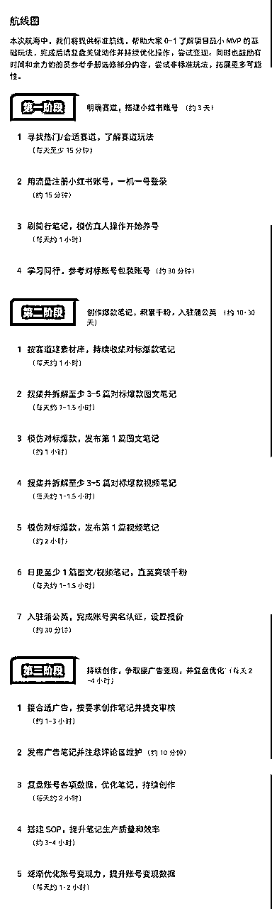

航线图与手册内容是一一对应的，你可以依据自己所处的实操阶段，灵活查阅对应章节。

以上所有航线图步骤，建议大家尽量在航海前两周内全部完成；完成航线图规定的动作后，也建议继续坚持重复关键动作，把日更变为习惯，甚至尝试再开新号，持续运营，赚到第一笔钱，然后赚到更多钱。

# 必修篇：跑通项目闭环，实现达人号变现

#### 章节概览

在必修篇中，我们会从认识「小红书达人变现」切入，手把手带你完成整个项目的学习与实操。你可以根据本板块的内容与步骤展开行动，顺利跑通项目的最小 MVP。

如果你是这个项目的新手，建议先对整个项目建立初步认识：

【项目概述】了解小红书达人变现

对项目有整体概念之后，就可以进入核心步骤，边学边做：

【项目实操 1/3】明确赛道，搭建小红书账号

【项目实操 2/3】创作爆款笔记，积累千粉，入驻蒲公英

【项目实操 3/3】持续创作，接取广告，完成变现

如果你已经赚到了第一块钱，可以积极复盘并持续优化，向更高的变现目标冲刺：

【复盘优化】优化笔记与账号，提升变现

必修篇的内容排布与航线图步骤完全对齐，按照手册顺序推进，就能把航线图上的任务逐一完成。

后续每个关键章节的概览中，我们也会配合航线图进行标注，提醒你别忘了完成对应步骤。

现在，就让我们正式开始吧！

## 一、【项目概述】认识小红书达人变现 @周恩俊

### 1.1 小红书达人变现是怎么一回事

小红书达人变现，指的是普通用户运营一个小红书账号，通过持续发布笔记将粉丝数做到 1000 以上，随后申请成为蒲公英平台的认证达人。达到这个身份后，就有机会收到品牌方和广告主的推广邀约，以付费合作的方式发布广告笔记。每接一单广告，最低收入为 100 元。

一句话概括：在小红书积累粉丝，靠接广告赚钱。

但有两点需要特别说明：

第一，这个项目和「小红书运营」不是一回事：

本项目会直接给出推荐赛道，明确核心变现路径为「突破千粉、入驻蒲公英接广赚钱」。新手带着清晰的方向入场，少走弯路、说干就干；

第二，这个项目和「小红书 IP」也不是一回事：

本项目不需要你搭建个人 IP，也不用成为某个垂直领域的大 V。我们要做的是找到热门赛道、持续产出爆款笔记、完成千粉目标，然后入驻蒲公英接广。变现路径更短、见效更快。

不足之处在于，走这条路接到的商单报价，比不上「小红书 IP 号」那么高；但好处也很明显，流程更简单、新手更容易收获正反馈。

当然，当你通过这个项目摸清了小红书达人的运作逻辑之后，也可以考虑做进阶的 IP 号，提升商单报价，打开更大的变现想象空间。

回到「小红书达人变现」项目上来，我们可以从各种渠道获取图片素材或混剪视频内容，选定一个有流量潜力的赛道，用笔记快速圈粉，成为小红书千粉博主，之后在后台接收品牌方的广告合作，挣取推广收益。

至于广告内容，品牌方会直接把文案和素材准备好，我们只要在约定时间内把推广笔记发出去，就能拿到相应的投放费用。

整个项目的运营链路是这样的：

注册账号 > 选定赛道 > 养号 > 参照对标账号完善包装 > 对标爆款持续产出笔记 > 坚持发布笔记 > 涨粉至 1000+ > 实名认证 > 入驻蒲公英 > 接广变现

项目平均变现速度：

选对赛道的情况下，10~15 天左右粉丝开始上涨，普遍 1 个月上下能达成千粉目标，随后入驻蒲公英、接广告挣钱。单账号单月的平均变现水平在 1500~2000 元区间。

关于佣金和提现：

广告邀约一般会通过小红书站内消息通知，合适的邀约直接点击同意即可，按商家的排版要求发布内容。广告佣金会直接进入小红书钱包，每月 9 号可提现，提现渠道为支付宝。

### 1.2 项目当前的市场情况

由于上市进展多次推迟，小红书近两年在商业化方面明显提速，普通人也因此有机会在平台上分到一杯羹。

很多人脑海中都有一个固有印象，觉得广告商只会投给那些粉丝体量巨大的大博主，小透明根本轮不上。但今年小红书调整了广告主入驻的门槛，以及博主接广告的隐性条件，现在只要粉丝到了 1000，开通蒲公英即可接触广告合作，门槛大大降低。

小红书的用户群体大多分布在一二线城市，其中女性用户占比超过 70%，整体素质较高、为内容买单的意愿也强，可以说是优质流量的聚集地。正因如此，大量广告主涌向这个平台投放营销内容，小红书达人项目的土壤由此变得肥沃。

嗅觉敏锐的那批人早已抢跑在前，通过在小红书接广告赚了很多轮。现阶段正是小红书达人井喷式增长的窗口期，未来还有很大的市场想象空间。

目前在小红书投放广告的品牌方数量庞大，但不少达人倾向于打造个人 IP 大号，担心接广告影响账号调性而不愿轻易接单。因此，即便只是千粉的素人号，现在入驻也能收到不少广告邀约。下面是部分账号近 30 天的后台数据。

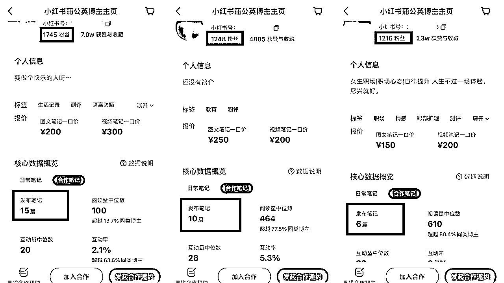

我们团队去年 5 月开始试水小红书达人项目，起初只有 5 个人参与，目前月收益已经做到 10W+。最开始测试阶段，为了多赚一些，凡是用够千粉的号都拼命接广告，结果不少账号因为营销笔记发太多，权重被直接降回普通等级。

后来我们控制了接单频率：每个号在入驻蒲公英的当月只接 10 条以内的广告，从第二个月开始再慢慢增加数量。这样一来，账号就能保持长线稳定的变现能力。

### 1.3 什么样的人适合做

「小红书达人变现」的素材可以在全网范围获取，基本不用担心创作源头的问题。因此这个项目的门槛不高，适合大多数想创业或发展副业的普通人，用来当作了解小红书平台的入门练习也很合适。

如果你对网络内容有一定敏感度、平时爱刷小红书，或者对在小红书上创作输出感兴趣，跑通项目的概率会更高一些。

目前入驻小红书蒲公英接广告的硬性条件有两个：

1. 账号粉丝数达到 1000 以上

2. 通过实名认证并且年满 18 周岁

年龄对于绝大多数人来说不是问题，关键还是涨粉。涨粉的前提是要持续发布笔记。当下最简单高效的做笔记方式，是找对标账号做内容二创，不需要绞尽脑汁憋原创。每天保持 2~5 条笔记的更新频率，时间再紧也要保证一天至少 1 条。

等到运营中期逐渐摸到感觉和方向，对平台及粉丝特点有了判断后，也非常鼓励大家去尝试原创，打造属于自己的爆款。但前提是：不要自嗨。

达成千粉后也不必急着入驻蒲公英，考虑到可能出现的掉粉波动，建议等粉丝积累到 1050 以上再去操作。入驻后依然不能断更，日更继续保持。笔记阅读量尽量做到 1000 以上，这样收到的广告邀约会更多。

内容来源：《小红书达人变现项目，单人月入 2W，团队月入 10W+保姆级教程详细拆解》@周恩俊

## 二、【项目实操 1/3】确定赛道，完成账号搭建

#### 章节概览

对小红书达人变现有了整体了解之后，接下来就要真正动手开干了。

再回顾一下项目的整体操作路径：

注册账号 > 选择赛道 > 养号 > 参照对标账号完善包装 > 对标爆款持续制作笔记 > 持续发布笔记 > 涨粉至 1000+ > 实名认证 > 入驻蒲公英 > 接广变现

本章咱们集中攻坚前 4 个环节，帮你把项目的基础设施打牢。

章节 2.1 确定赛道

这一小节会具体讲讲怎么挑选一个值得下场的赛道。为了减少大家的决策成本，我们还额外整理了 2 个推荐赛道，方便你快速上手尝试。

章节 2.2 注册账号

注册账号和确定赛道这两件事没有先后关系，可以并行处理。需要提醒的是，一个手机号就对应一个小红书账号，注册全程建议用移动流量操作。

章节 2.3 养号流程

养号在整个项目里起着至关重要的作用，一般需要养 2.5~3 天。在正式发布项目笔记之前，可以先做一个小测试，比如发一些日常、风景、干货类的内容，第二天浏览量过了 100 就算养号成功。

章节 2.4 收集对标账号

这个过程本质上也是在积累爆款素材。你可以通过刷小红书信息流、使用灰豚数据等工具，持续收集各个领域的对标账号和爆款内容。

章节 2.5 包装账号

头像、昵称、简介这些基础信息，都可以参考对标账号进行优化，从而完成账号整体包装。一个精心设置的账号呈现，对拉高账号权重和涨粉速度都有明显帮助。

正式进入本章节的学习吧，希望在这个阶段大家能稳扎稳打，把地基打得足够扎实。

#### 本章航线图

完成本章的学习和实操，就能通关航线图第一阶段。

第一阶段：确定赛道，搭建小红书账号（约 3 天）

1. 寻找热门或适合自己的赛道，掌握玩法逻辑（每天至少投入 15 分钟）

2. 用流量注册小红书账号，一机一号登录（约 15 分钟）

3. 刷同行笔记，模拟真实用户行为开始养号（每天约 1 小时）

4. 研究同行账号，参照对标完成账号的包装优化（约 30 分钟）

那么现在，就请迈出第一阶段的第一步吧。

### 2.1 赛道怎么选 @周恩俊

#### 2.1.1 如何锁定合适赛道

有句话说得好，选择大于努力，小红书达人项目也不例外。

赛道选对了，涨粉速度可能快出一大截，进而比同行更快一步入驻蒲公英、抢先变现。

结合我们团队的实际操作经验，目前涨粉速度较快的赛道有：娱乐明星、影视剪辑、动漫解说、盘点、星座、公基常识、本地生活服务、AI 绘画、抖音快手美食搬运、章鱼哥、正能量、情感、文案语录等等。

因为我们是矩阵式的多账号操作，前期测试时几乎把所有领域都试了一遍。目前来看，涨粉最快的还是上面提到的这些赛道。但话说回来，赛道选对只是第一步，笔记能不能爆才是真正的分水岭——如果笔记本身起不来流量，选任何赛道都涨不动粉。关于如何做出爆款笔记，下文【三、创作爆款笔记，积累千粉，入驻蒲公英】会有详细拆解。

那为什么会挑中这几个赛道？拿公基常识和章鱼哥这两个赛道来举例说明。

注意：

分析路径一：公基常识赛道

先说说公基常识。我们随机挑了一个已经入驻蒲公英并开始接单的账号来做案例拆解。这个账号目前粉丝在 7000 以上，9 月中下旬起号，11 月就突破千粉并成功入驻蒲公英，同时开始接广告。到目前为止总共接过 20 条广告，预估单条广告单价为 150~200 元，累计变现将近 3000~4000 元，已经相当于普通人一个月工资了。这个号单月平均变现能力在 1500~2000 元之间。如果做多账号矩阵，整体收益会更加可期。

这个公基常识账号的笔记形式很简单——一篇笔记放 3 道题目。题目来源可以直接搬运同行近期爆掉的笔记内容。制作流程方面，公基常识的配图也不需要多复杂：一张纯色或者浅底色的简洁模板，加上题目文字就行了。模板固定下来之后，后面要做的就是搬运题目，文案也只需要简单的复制粘贴。一天下来能做出很多组图文素材，制作成本非常低。对于新手来说，这个赛道特别友好。

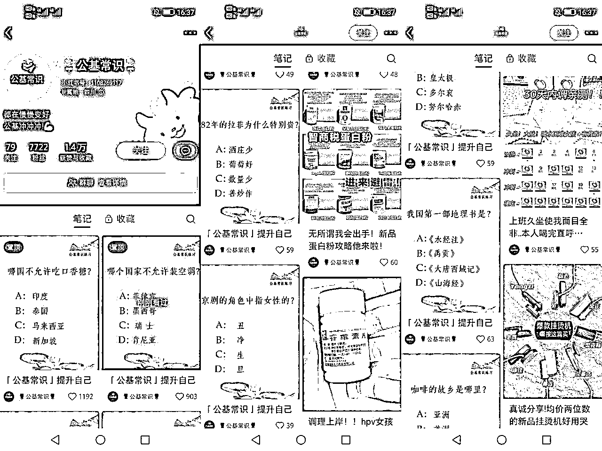

分析路径二：章鱼哥赛道

章鱼哥同样是一个轻松上手的图文赛道。以「人间清醒章鱼哥」这个账号为参照样本，它在今年 8 月才起号，目前粉丝量已经做到 3.9W。因为内容热度爆发快，账号整体数据一直保持得不错。截至现在，累计接了 75 条以上的广告，预估客单价在 200~500 元之间，这个账号的总变现已经达到 15000~30000 元左右。而且这类账号还能继续长线沉淀粉丝、后续再接广变现，账号的长期价值相当可观。

那章鱼哥这类笔记是怎么做出来的？

首先从影视剧平台、B 站、微博、百度等渠道找章鱼哥、海绵宝宝、蟹老板和派大星的图片，影视剧里可以直接截图。然后再去小红书搜同行，或者通过灰豚数据搜索，看看当下哪些章鱼哥语录正在爆。把热门语录摘下来，用美图秀秀把两张图片拼接起来，打上文字——就是把正在火的语录抄上去——一张全新的素材就诞生了，直接发小红书即可。

总体来看，选赛道时可以从以下几点入手：

在此基础上，再结合自身条件和兴趣偏好来做决定：

如果还是拿不定主意、不知道先做哪个赛道，可以直接看看下面推荐的两个试水赛道。

内容来源：《小红书达人变现项目，单人月入 2W，团队月入 10W+保姆级教程详细拆解》@周恩俊

#### 2.1.2 试水赛道推荐

试水赛道该怎么用

为了降低大家的启动门槛，结合近期小红书上各赛道的数据表现以及笔记的制作难度，我们挑了两位适合新手试水的选手：热评分享赛道和娱乐赛道。

核心目的只有一个：让大家尽快尝到一点甜头，把项目信心建立起来。

在掌握项目赛道的基础玩法之后，还是建议大家积极去寻找自己更感兴趣的赛道，也可以参考选修篇【六、尝试更多达人赛道】的内容探索更多可能。

试水赛道 1：热评分享

推荐理由：赛道数据表现亮眼，能有效带动粉丝关注和互动，制作流程还特别简单。

热评分享的玩法，就是把各大社交平台上点赞量极高的评论内容整理输出。这类评论天然容易吸引粉丝关注、引发话题讨论。制作方式甚至更简单——在抖音/小红书/微博等平台留意热门话题和热点事件，把高赞评论直接截图出来就可以当一条笔记。

下面这个账号用一个月涨了 4000+粉，最近一条笔记点赞 1.8W，内容全部来自抖音热门视频，涨粉速度非常惊人。

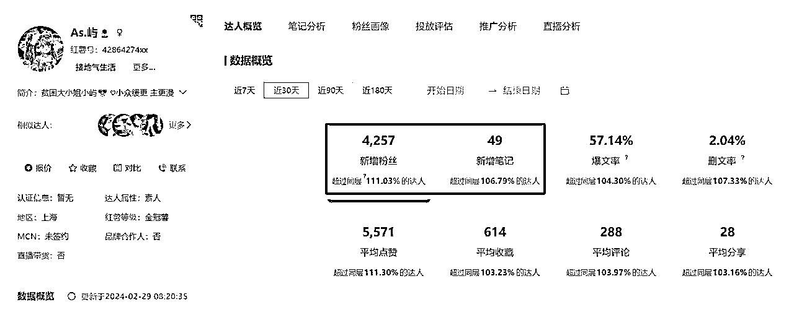

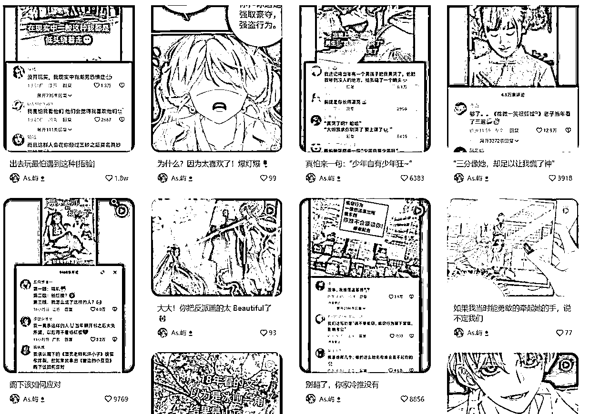

下面这个热评领域的账号，广告报价达到 180~220 元一条，基本每天都接广，2 月份接了 16 条广告，变现约 2800 元。

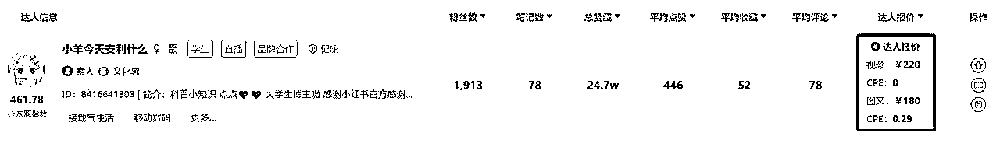

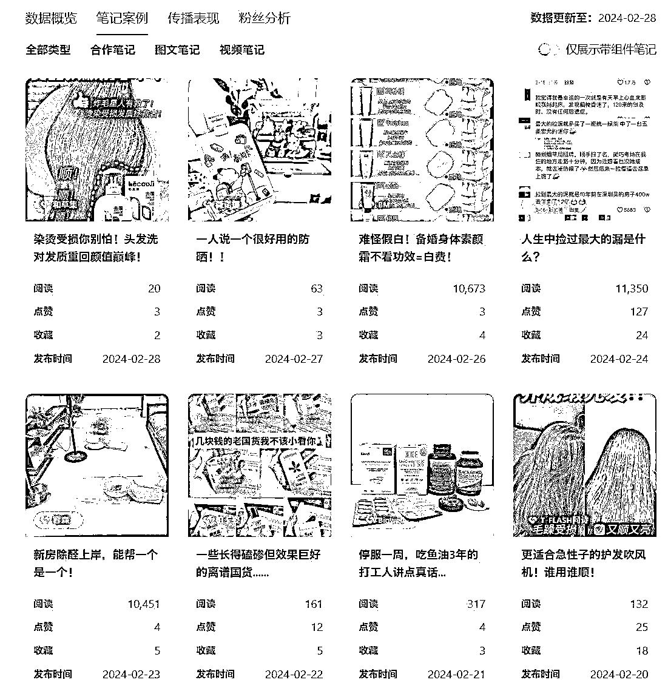

试水赛道 2：娱乐赛道

推荐理由：非常贴合小红书用户的浏览偏好，涨粉速度可观，话题范围广、素材来源多，制作门槛也比较低。

# 小红书娱乐号快速起量法

这个平台以女性、年轻受众为主，明星动向、圈内话题、突发热点对他们很有吸引力。娱乐方向受众面宽，账号往往起量更快。做内容时盯紧微博、抖音热搜榜，话题一冒头就迅速做成笔记，抢先把平台流量吃下来。

有个样本号，30天净增六千多关注。它并非纯原创：把站外内容拿来重做，一旦跑出爆款，涨粉曲线立刻变陡。选题既有生活娱乐，也涉及明星绯闻。

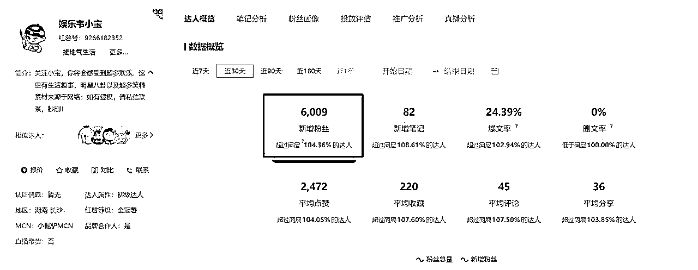

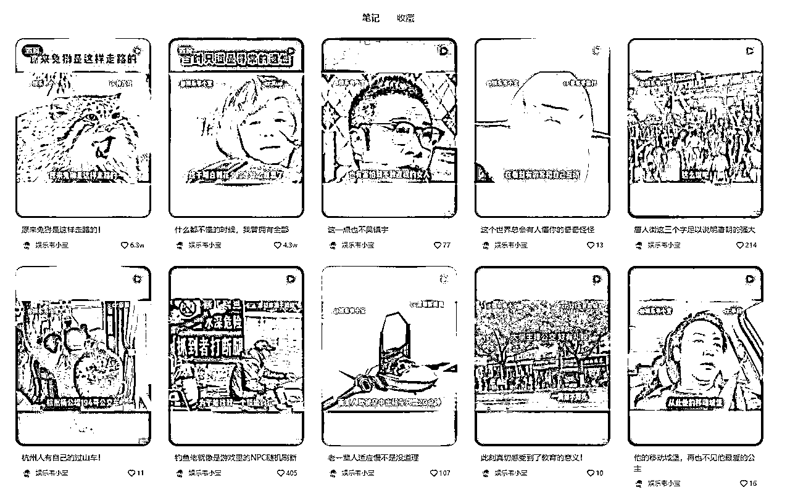

还有个号聚焦明星综艺，广告几乎不断档。单条合作价220—500元，单2月就接了13单，进账约2800元。

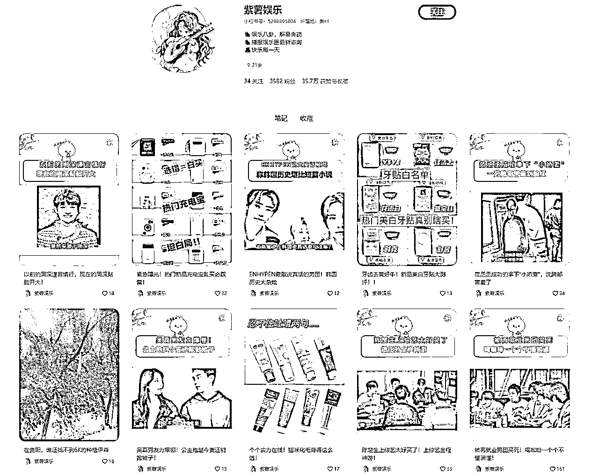

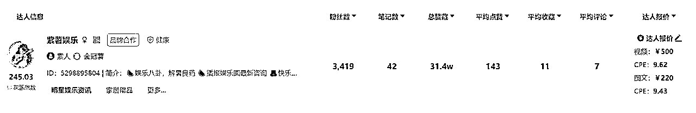

### 2.2 把账号开起来 @周恩俊

赛道定下来，下一步就是开号。

#### 第一步：手机号先备好

通常一个手机号对应一个小红书号。想批量铺号，可以借家人号码，或者线上申请新卡。刚入门先跑通一个号；流程熟悉后，再尝试多号、多领域矩阵。

电话卡建议：

#### 第二步：开始注册

注册时尽量全程走手机流量。号开好后，按后面的步骤养号。

注意：实名先别急着做。一张身份证只能绑一个号，认证后除非注销，否则无法解绑。更稳的节奏是等账号起势、粉丝过千，再补实名。

### 2.3 把号养起来 @周恩俊

第1天：注册全程用流量；号下来后，头像、昵称、简介都先放着，笔记也别刷。

第2天：开始养。只刷目标赛道内容，动作要像普通用户：点赞、收藏、关注、留言都做，每次停留20—30秒。每日累计半小时至一小时，可拆成早15分钟、午20分钟、晚15分钟；有空多泡一会儿更好。

第3天：上午照常养；下午看发现页，若同行内容能占到七成，基本算养成了。此时再改头像、昵称、简介。着急的话包装完就发；不赶时间就次日发。

小提醒：垂类账号最好先发一篇生活、风景或干货内容试水。次日“小眼睛”破100，说明号没问题，再发目标赛道笔记。

养号别偷懒。跳过它直接发作品，号常常没动静，起号会被拖慢。

教程出处：@周恩俊《小红书达人变现项目，单人月入 2W，团队月入 10W+保姆级教程详细拆解》

### 2.4 攒一批对标号 @周恩俊

哪些号值得学？热门赛道，爆款笔记点赞500以上可看；普通赛道，点赞200以上再参考。

#### 方法一：逛同行主页

养号还有一层价值：账号垂直度被养出来，首页刷新后同赛道内容会变多，找同行、找参考都省力。所以养完号要多逛同行主页，攒一批可借鉴的爆款方向。

#### 方法二：灰豚数据

首页同赛道内容不够时，可以用工具筛爆款。拿“灰豚数据”举例：优先看低粉爆文；近7天样本少，就把周期放宽到30、60甚至90天，参考池会更大。这个工具除了查笔记，也能查达人、看同行，还能筛相对可靠的MCN。

低粉爆文越新越好。素材别直接搬，先提关键词，去抖音等平台找同话题的不同素材，再做二创。达人榜单里可选涨粉榜，按条件锁定感兴趣的赛道，观察谁涨得快，从中挑对标对象。

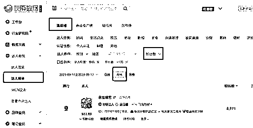

另外，在灰豚里查对标达人时，也能用笔记搜索：输入赛道关键词，叠加筛选条件，把爆款笔记找出来参考。

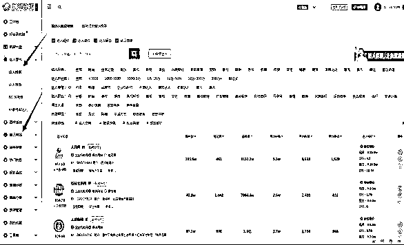

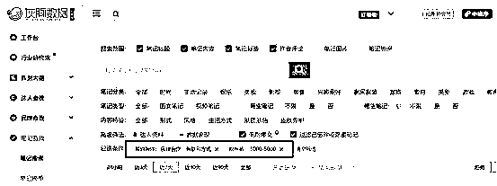

#### 方法三：其他数据平台

有专业号的，可进蒲公英后台，在博主广场按领域筛人。优先挑粉丝5000以内、近30天涨粉快的账号，这类同行近期起号动作更有研究价值。

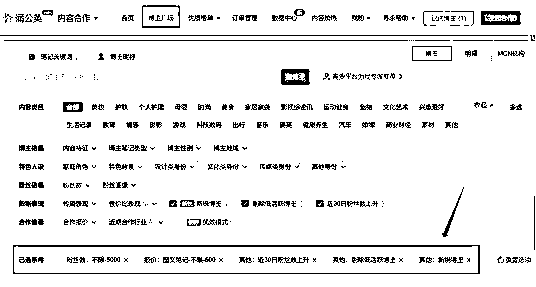

除灰豚、蒲公英外，下面这些渠道也能挖对标和素材，再拿来模仿。

小红书：从频道页、推荐发现页看种草广告；也可在蒲公英商家后台、灰豚后台找热门广告，顺线索找到近期起号的爆款。近一个月点赞破100的素材，或两个月内做到千粉的号，都可参考。

抖音：赛道定好后去搜，按半年内、点赞排序，100赞以上即可当素材参考。

快手：搜赛道关键词，按播放量、点赞量排，一个月内100赞以上可看。

知乎：搜目标关键词，按最多赞同排，半年内100赞以上可参考。

方法参考：@周恩俊 的《小红书达人变现项目，单人月入 2W，团队月入 10W+保姆级教程详细拆解》

### 2.5 把账号门面装好

包装就像营业前把门面收拾好，是访客对你的第一眼判断。用户决定关注谁，很少只凭一篇笔记；多数会点进主页，扫一眼昵称、头像、简介、背景图与过往作品，再决定要不要留下。

对创作者而言，资料填得越全，平台越容易给账号打标签。标签清楚，推来的流量更准；流量准，点击与浏览上去，权重也会跟着走高。包装时可参考前面筛出的对标号，围绕自己的赛道调整，把人物感立起来。

#### 2.5.1 头像

别太花哨，要和账号定位一致。可用图怪兽等站点做图，也可找无版权素材。商标类图片容易侵权，避开。

#### 2.5.2 昵称

名字要好认、好记、有点趣味，带赛道关键词更容易让人信服。复杂符号、生僻表达别用。美食号叫“小溪教你做美食”，用户一眼就明白内容方向。原文还列了4种命名公式，可照着套。

#### 2.5.3 简介

简介要回答：关注你能得到什么。穿搭号可写“小个子穿搭分享|感谢喜欢”。原文也给了简介公式，可按结构填。

有的号出过万赞爆款，粉丝却只有100，多半是内容不垂直、简介没给关注理由。写简介别过度谦虚，要把价值说清楚，不然用户凭什么留下？

## 三、【项目实操 2/3】做出爆款，冲千粉，入驻蒲公英

#### 本章要点

本章要做的，是持续在小红书发笔记，冲击爆款，逐步攒到千粉，达到蒲公英门槛并完成入驻。

入驻蒲公英需满足：①实名认证且年龄≥18岁；②粉丝数>1000。

按本章节奏，赛道选对后，一般10—15天开始起量，约1个月摸到千粉。核心动作拆解如下，相关问题本章逐一处理。

#### 本章路线图

学完并实操本章，路线图第二阶段即可完成。

第二阶段：创作爆款笔记，积累千粉，入驻蒲公英（约10-30天）

1.围绕赛道搭素材池，天天收对标爆款（日耗约1小时）
2.拆解3—5篇对标图文爆款（日耗1—1.5小时）
3.仿写对标爆款，发出首篇图文（约1小时）
4.拆3—5篇对标视频爆款（日耗1—1.5小时）
5.仿写对标爆款，发出首条视频（约2小时）
6.保持日更至少1条图文或视频，直到粉丝破千（日耗1—1.5小时）
7.开通蒲公英，完成实名并设报价（约30分钟）

接下来进入第二阶段实操。

### 3.1 图文笔记怎么做 @周恩俊

#### 3.1.1 图文二创教程

图文素材同样从对标号里来。攒对标号，其实就是在攒素材。找号方法回看【2.4 积累对标账号】。

挑素材：近期跑出数据的图文，点赞至少100+。

拿到素材后，对图片做二次加工。常用手法可归成以下几类，演示用美图秀秀，其他修图工具界面差不多，顺手即可。

调整画幅：把原图缩放或拉伸，既保住主体，又做出差异，让读者有新鲜感。

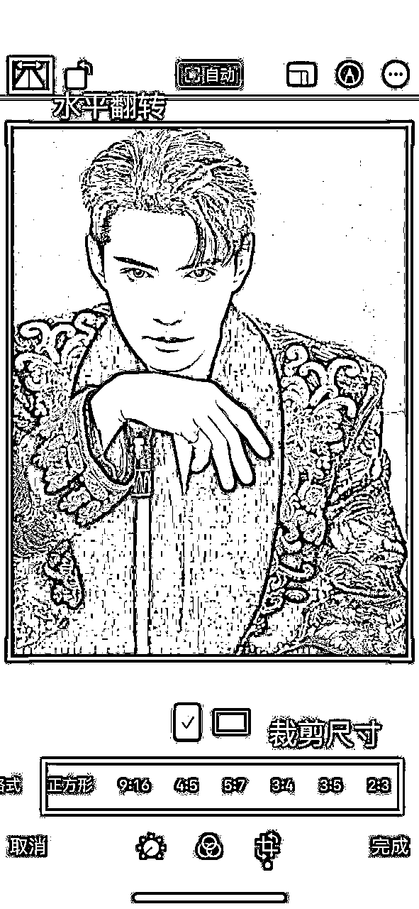

调色与饱和度：给原图做色彩变化，让观感和原片稍有区别，画面更丰富、更生动。

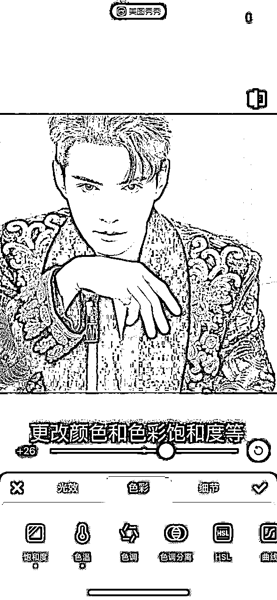

加效果：滤镜、光晕、阴影等都可以上，让图更耐看、更有辨识度。

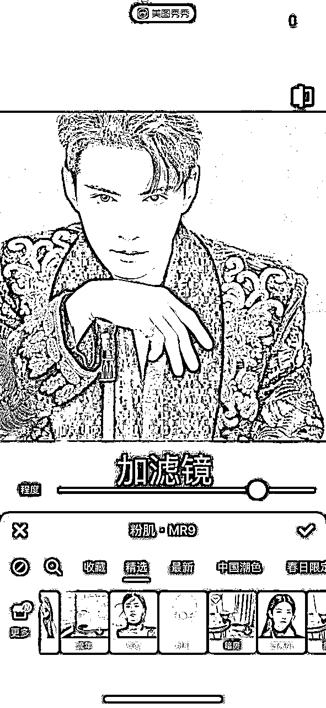

换背景：把原图背景替掉，主体保留、观感更新，内容变化也更多。

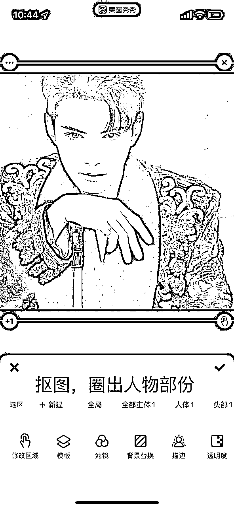

拼图/合图：多张图重新组合成一张，信息量更大，视觉也更丰富。

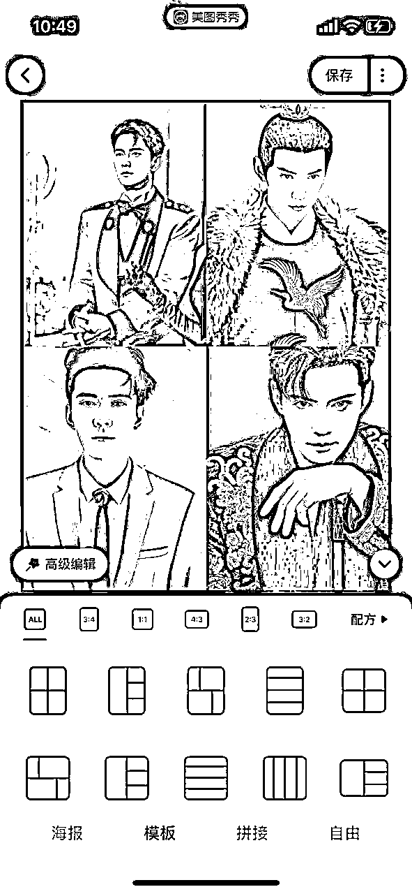

进阶工具：要复杂效果，可用Photoshop、GIMP等做修改优化。新手前期先把美图秀秀这类工具用熟，不必一上来就啃专业软件。

图片二创可记成一句：模板换、主体不换；滤镜加调色（对比度、色调、高光等）；再叠上镜像、文字、贴纸、拼图、抠图等。美图秀秀、图怪兽、稿定设计都能做。

具体怎么落地？下面用两个试水赛道演示。

方法整理自《小红书达人变现项目，单人月入 2W，团队月入 10W+保姆级教程详细拆解》，作者 @周恩俊。

#### 3.1.2 用两个试水赛道做图文

赛道一：热评分享赛道

教程已录成视频，方便对照：

热评分享赛道-图文笔记创作教程.mp4【在线播放】

视频讲的是热评图文怎么做：
00:00-01:00 在小红书找热评笔记与同行，观察对方呈现方式，挑一篇爆文，去抖音搜相关话题作品；
01:00-02:00 在抖音搜热门话题，截取作品画面；
02:00-03:30 用美图秀秀做素材，画幅裁成小红书3:4，给粉丝评论打马赛克。

赛道二：娱乐赛道

教程同样有视频：

娱乐赛道-图文笔记创作教程.mp4【在线播放】

视频讲的是娱乐图文怎么做：
00:00-01:30 在小红书搜娱乐笔记，参考同行图文形式；同时去抖音看同类做法，找到热话题后仿做；
01:30-02:55 在抖音筛图文，选合适图片，复制链接到微信去水印小程序，存原图；
02:55-06:40 用美图秀秀做素材，选拼图模式，背景尺寸调3:4，做背景模糊，再加文字；
06:40-07:20 正文可从抖音或小红书找，参考高赞作品，再用AI等工具二次加工。

### 3.2 视频笔记怎么做 @周恩俊

#### 3.2.1 视频二创教程

视频素材也来自对标号。攒对标号就是攒素材，找号方法回看【2.4 积累对标账号】。

挑素材：近期跑出数据的视频，点赞至少1000+。

单条视频直接处理，很容易被小红书系统识别，轻则违规提示、优化提示，重则影响账号权重；专业号还可能掉灰，拖累后续蒲公英入驻。所以处理素材时，建议一次混剪至少3条以上视频。多条一起剪，原创度才够。把选中的3条同时丢进剪映做二创即可。

视频二创常用：掐头去尾、加速、BGM、镜像、画中画、打乱顺序、抠图、文案贴纸、特效滤镜、转场、变音等。

具体操作不展开，可看生财有术“剪辑特训”航海教程，对新手友好。上述手法在教程里都有对应视频，比文字更直观。

剪完配文案和标签，就能在小红书发。具体怎么落地？下面用两个试水赛道演示。

来源同前：@周恩俊 的保姆级拆解教程。

#### 3.2.2 用两个试水赛道做视频

赛道一：热评分享赛道

教程视频如下：

热评分享赛道-视频笔记创作教程.mp4【在线播放】

视频讲的是热评视频怎么做：
00:00-00:40 参考同行做法，核心是单图加背景音乐；
00:40-02:10 先按图文方式做好图，打开剪映上传，设置时间变速，时长控制在10秒左右，配抖音热门音乐。

赛道二：娱乐赛道

教程视频如下：

娱乐赛道-视频笔记创作教程.mp4【在线播放】

视频讲的是娱乐视频怎么做：
00:00-01:25 在小红书搜娱乐笔记，参考同行视频素材，常见版式是卡通背景、中间放视频、顶部压标题；
01:25-03:00 做娱乐内容要挑近期爆的话题，也可去抖音看热搜，再看同行如何发同话题；
03:00-04:25 在抖音搜话题，选合适素材，复制链接，到微信小程序搜“提取视频内容”，保存文案，作为字幕；
04:25-08:30 在抖音搜话题，找多条视频，用微信“去水印小程序”保存，同时留意剪辑后的尺寸；
08:30-12:20 导入全部素材并加字幕。字幕可转音频，也可把原音频转文字，删原音频后用文字生成新音频，选文本朗读；
12:20-13:51 设素材背景图，比例16:9，在画布样式里选背景，视频裁成横屏3:4；
13:51-17:06 给视频顶部加标题，选文字模板或贴纸，整体再调效果。

### 3.3 发前自查，别踩违规线 @周恩俊 @吴小二

笔记做完，先自查一轮，别让违规影响流量。

#### 3.3.1 常见违规情况

发布前别急点发送，对照违规清单逐条排查，确认没踩线再发，免得账号被限流。

# 先保号，再谈接广

平台判视频违规，多数时候问题出在“加工痕迹不够”：系统一比对，发现和已有内容太像，笔记就会收到违规或优化提醒，要求调整后才继续给流量。偶尔被提醒一次，影响有限；真正麻烦的是反复踩线，把专业号弄成“掉灰”状态——后面蒲公英进不去，商单自然也会受牵连。

图文相对稳一些，因为图片通常是拿新模板重新套，只借鉴爆款思路，安全系数更高。但情感、正能量、星座这类图文也有雷区：负能量扩散、情绪表达过于偏激、沾上封建迷信等，都可能触发违规。系统一般会给整改方向，照着改完，影响通常不大。

后台常见通知，我按类型拆开说，顺带给处理动作。

**情形一：搬运与抄袭**
这是最高频的一类。根子还是二次加工不够，平台一比就发现同质化。处理思路是把改动做足：文案重写，图片换模板，视频拆顺序、多片段混剪。
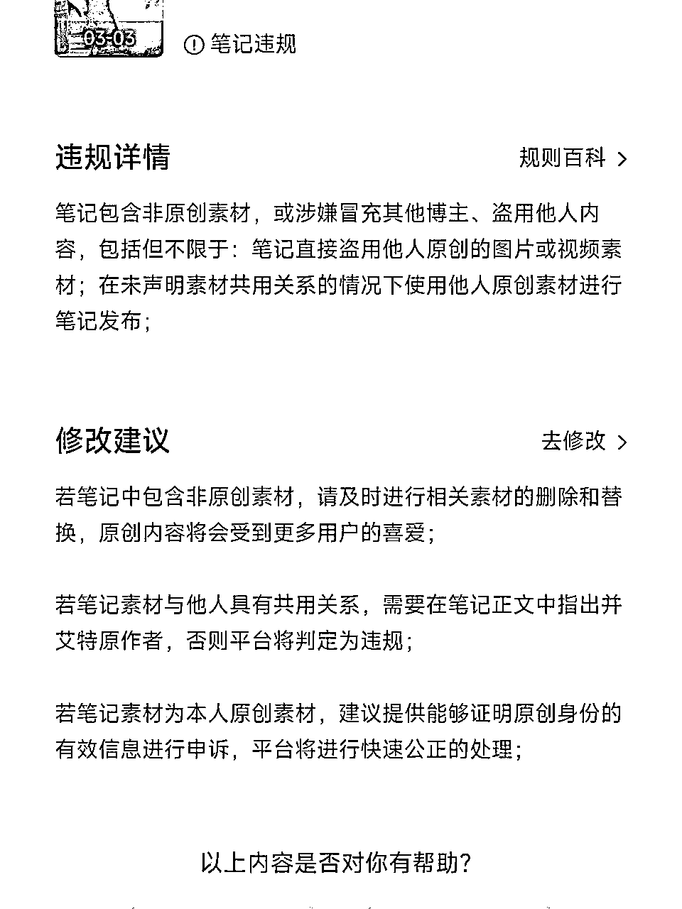

**情形二：站外导流**
有人正文不写联系方式，但粉丝私信要链接、加微信，也不能回；回了容易被认定为往站外引流。稳妥做法是不回复，必要时用辅助号处理。
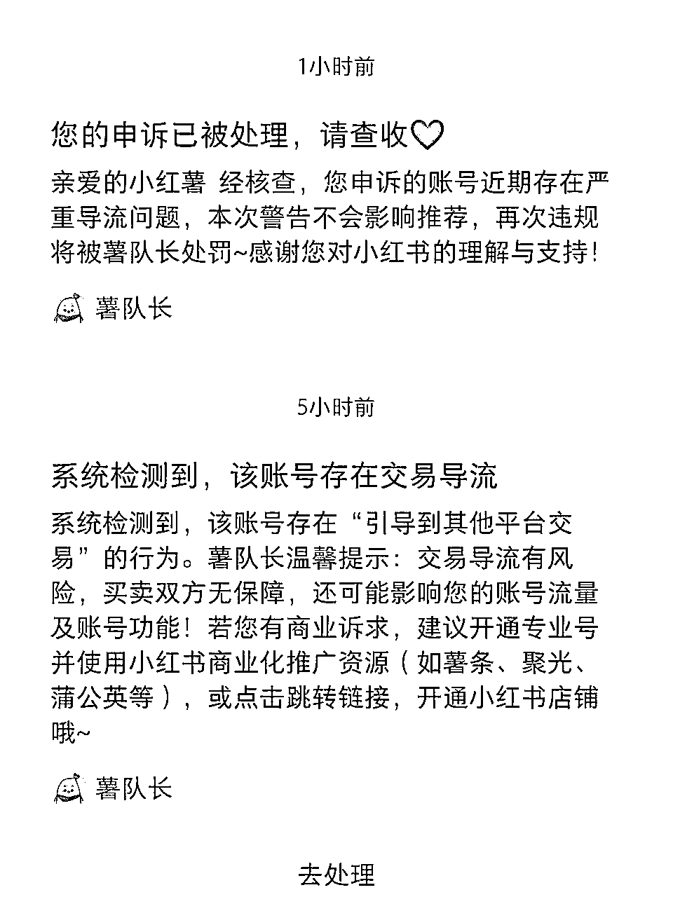

**情形三：互动数据异常**
连续点赞收藏也可能触发互动异常判定。可在简介写“请勿连赞”，或在笔记、评论区提醒一句。更别刷粉刷量，这是作弊，严重会封号，怎么算都不划算。
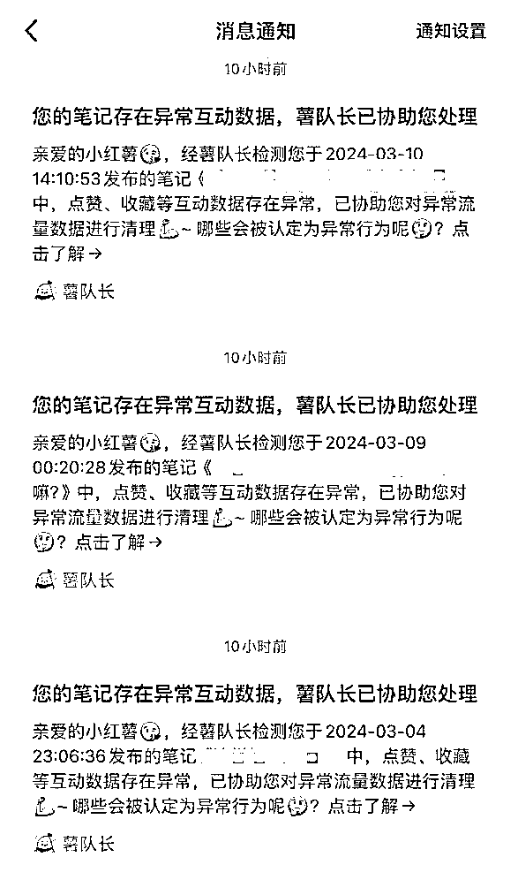

**情形四：低俗或不宜未成年**
问题多半出在素材或文案踩到敏感内容。发布前检查敏感词与不雅图；涉及性暗示、裸露、暴力以及侮辱性字眼（如 SB、贱人、垃圾这类）要避开。
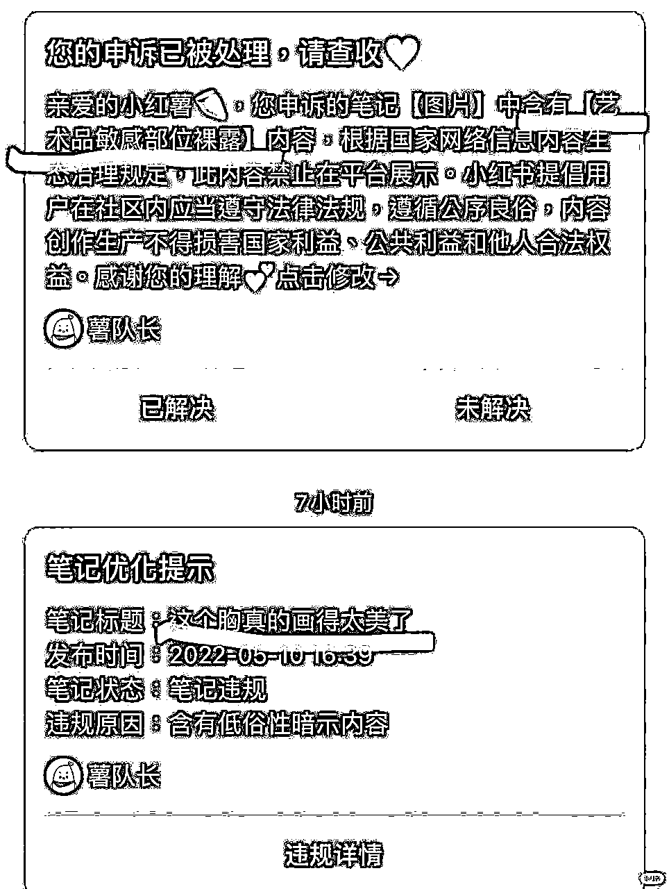

**情形五：商业笔记未报备**
有商家想省平台服务费，绕开蒲公英私下投放；这类没走官方报备的商业笔记，轻则被限流，重则账号等级下降。新手不建议私下接。
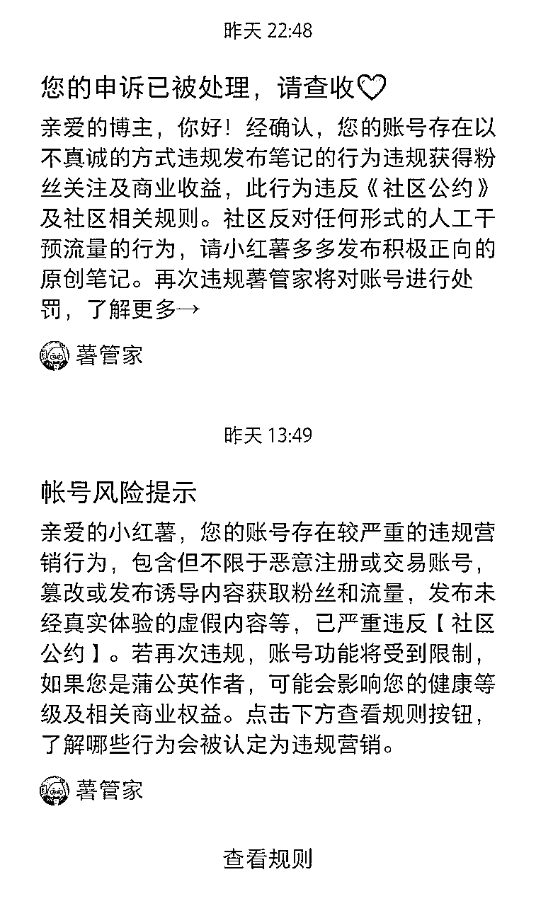

#### 3.3.2 功能被灰了，怎么申诉
若违规累积导致专业号掉灰，尽快申诉。尤其因原创度不足被罚：把剪辑、制作过程的截图留好，证明素材是你处理的，提交申诉争取恢复。能恢复最好。

先说明“专业号掉灰”：可理解为专业号身份被限制，入口或标识变灰，会妨碍蒲公英入驻和广告合作。

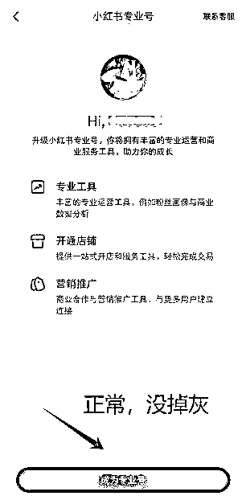

申诉有两个入口：一个在违规提醒里点进去；另一个见下图。

两个入口建议都提交，因为审核批次和人员可能不同，尺度也可能不一样。

话术可参考：称呼“薯大大”，说明自己投入很多、作品被限很受挫，附上剪辑记录截图，请求恢复功能；语气诚恳即可。话术只作参考，真正提高通过率的是证据图加合理说明。

#### 3.3.3 发之前，先把红线摸清
平时多翻平台规范，发布前用检测工具筛敏感词，从源头降低风险。重点看：社区公约（笔记内容、商单笔记怎么规范）；审核规则（首图、封面、标题、水印）；官方其他入口；敏感词、违禁词检测工具。稿件最好用不同工具交叉查。推荐两款工具。参考来源：周恩俊的变现教程、新手资料引流分享。

### 3.4 多号并进，把运气变成命中率 @思蒙 @周恩俊
刚开始不必只守一个号，2—3个一起跑更稳；精力够就多产内容、多开号。低门槛玩法拼的是出手次数，概率会随数量上升。做航海时你会发现，有人作品和你差不多，甚至谈不上多优秀，账号却爆了，这就是概率在起作用。

找对标、做笔记的技巧掌握后，剩下就是拼量。单篇爆的概率假设是1%，发十篇，或者做十个号，每个都保留这1%的机会，整体命中率自然更大。过程中也会看到，有的号起量顺，有的号一直没动静；前提是质量都过关、水平一致，这背后是账号体质和概率的共同结果。

跑一段时间后，把起量顺的号留下重点养，迟迟没起色的及时注销重开。它和常见矩阵的差别在于：这些号不挤在同一领域，而是分散到不同赛道。好处是能看出哪类内容涨粉更快、自己更顺手，后面就集中铺那个方向。赛道怎么挑？新手可先看前文推荐的两个方向，也可从选修篇“六、尝试更多达人赛道”里选更适合自己的去试。参考：6月8日思蒙的短剧CPS答疑。

### 3.5 破千粉后，进蒲公英

#### 3.5.1 进蒲公英要满足什么 @周恩俊
两个硬条件：完成实名认证，年龄满18岁；粉丝数超过1000。选对方向后，通常10—15天开始起粉，约一个月到千粉，之后可进蒲公英接商单；单号月均大概1500—2000元。

建议等到1050粉再入驻，留出掉粉缓冲；入驻后别断更，尽量日更，笔记阅读争取1000以上，邀约更多。实名认证可千粉后再做，不浪费名额；后续也可用家人身份完成。

#### 3.5.2 开通步骤 @周恩俊
第一步，升级个人专业号：我—创作中心—更多服务—开通专业号—成为专业号—我是个人—立即认证。
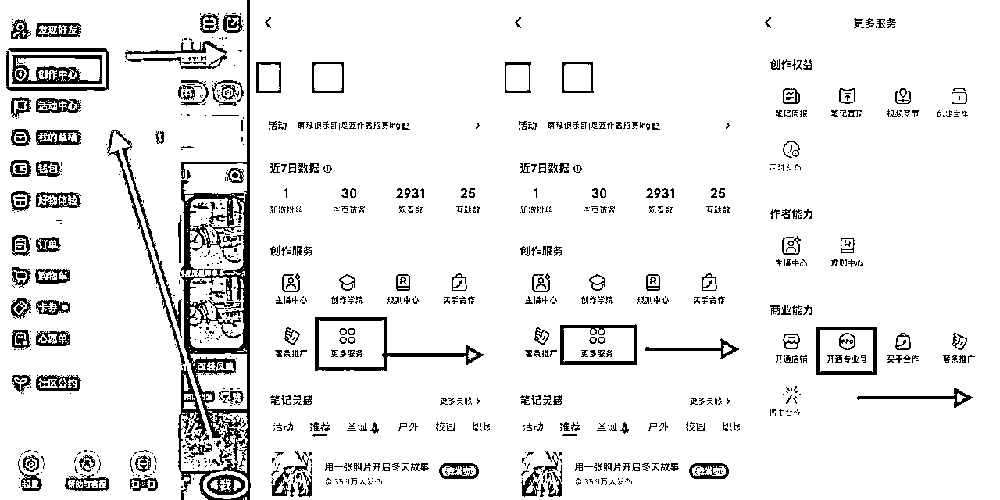
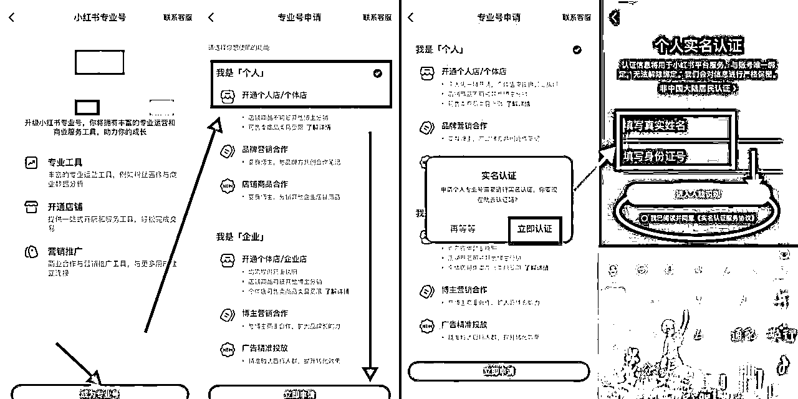

第二步，开通蒲公英内容合作：合作中心—更多服务—博主合作，再按后文设置报价填信息。
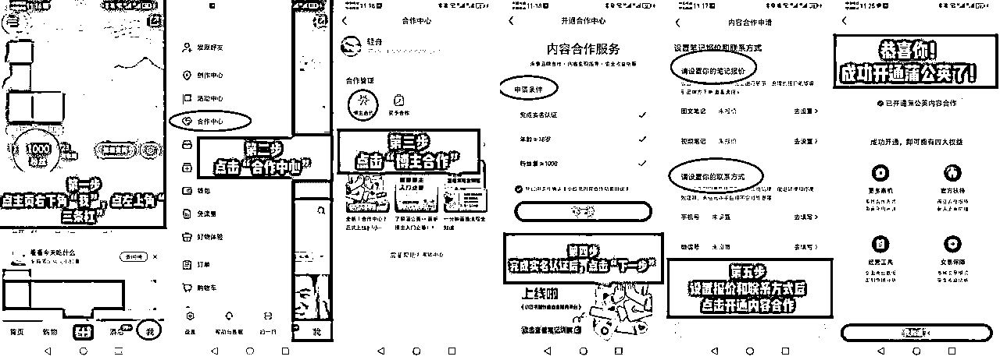

完成以上，就进蒲公英了。

#### 3.5.3 价格怎么标 @周恩俊 @北
没有统一公式；“粉丝数10%”不是万能答案。赛道、风格、数据、粉丝量都会影响价格，最终看供求。若档期长期排满，说明报低了可上调；若无人问津，就要下调。

图文泛领域起价建议150元；同行均价170—180也先别急着追，低一点更容易接到第一单。视频报价可同图文，因为邀约以图文为主；视频制作成本高，商家常一次做多张图分发。除非账号本身做视频且有植入位，才可能接到视频广告。

粉丝涨后再逐步提价；蒲公英每月可改一次，通常次月生效。可去商家版蒲公英后台、灰豚看同行报价。参考：周恩俊的变现教程、北的广告报价分享。

#### 3.5.4 开通后别松劲 @周恩俊
设置好报价基本就完成，人设标签先不用管。新号快则1—3天、慢则一周会收到品牌邀约。别松懈：持续日更、近期质量在线，平均阅读尽量1K以上，商单会更多。

补充“专业号掉灰”：就是账号的专业身份被平台限制，入口或标识变灰，后续蒲公英与商单都会受影响。
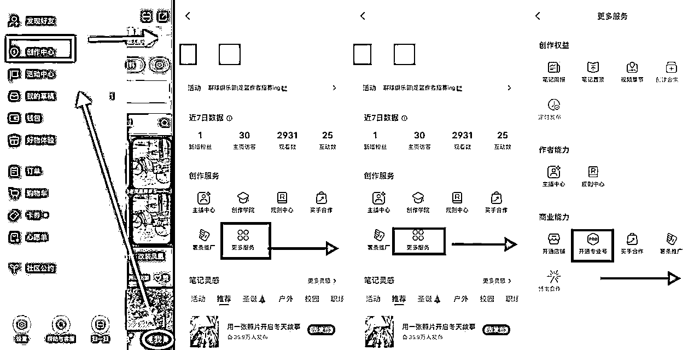

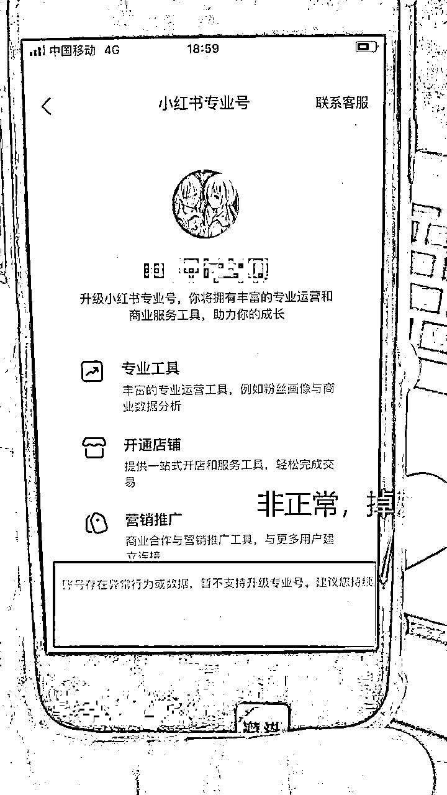

参考：周恩俊达人变现教程。

## 四、【项目实操 3/3】把内容持续做，把广告接下来

#### 章节概要
变现关键动作，是在蒲公英接商单。前面已过赛道、养号、包装、笔记制作；把这些动作重复到位，达到入驻门槛后就能接合适广告。本章讲怎么在蒲公英接广。

#### 本章航线图
完成后可走完航线图第三阶段前半段。第三阶段：持续创作、争取广告变现，每天2—4小时；接合适广告并按要求做笔记提交审核约1—3小时；发布广告笔记并维护评论区约10分钟。现在开始实操。

### 4.1 接广动作一览 @周恩俊
达人侧主要动作：1. 粉丝过千后开通蒲公英内容合作；2. 在商业合作通知里接品牌邀约，或去广场报名招募；3. 加品牌微信，等对方给图文素材；4. 确认订单，交笔记等社区审核；5. 审核过了、品牌确认后发布；6. 7天系统自动确认，收益到账；7. 次月9—10号在小红书钱包统一提现。参考周恩俊教程。
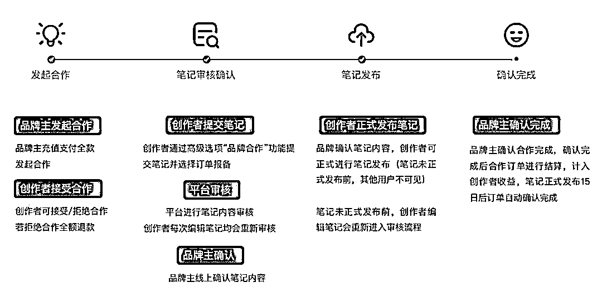

### 4.2 一单广告的完整走法
官方配套视频：http://xhslink.com/f3hoBD（蒲公英接广合作流程.mp4，在线播放）。

重点时间点：#00:17#查收合作邀约信息；#00:44#提交合作笔记；#01:16#修改合作笔记；#01:44#正式发布合作笔记。下面拆步骤。

#### 第一步：接受合作
品牌会在蒲公英筛选博主发邀约。达人从APP“消息通知—商业合作”查看，点“感兴趣”后私信品牌，拿微信聊细节。品牌也可跳过邀约，后台直接下单，达人同样在消息通知里看订单。觉得合适就接，开始做内容；APP端和PC端后台都能管理待接订单。
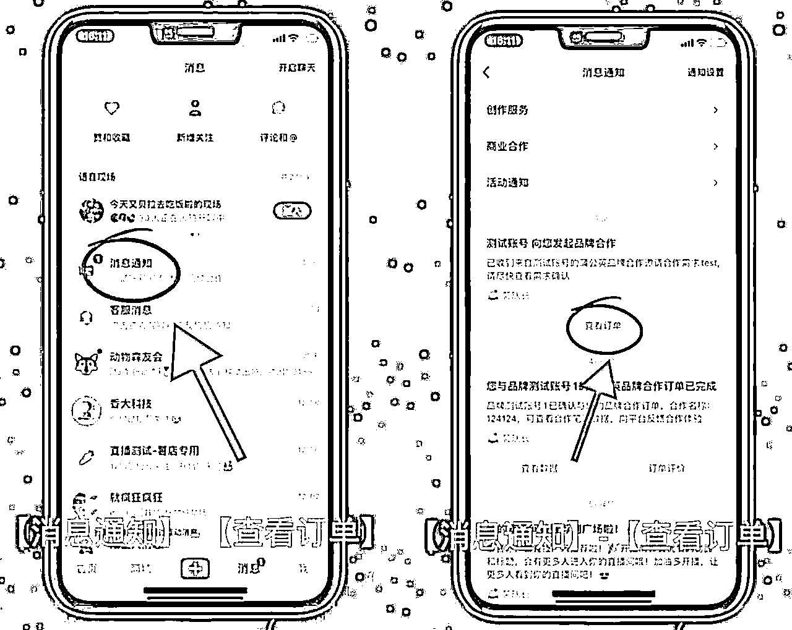
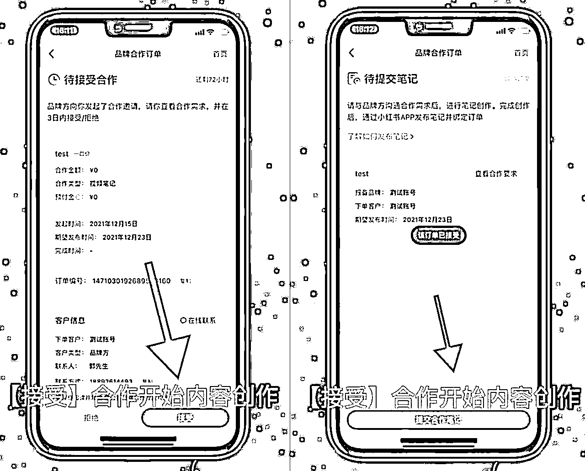

#### 第二步：创作笔记
加上商家（或PR）微信后，对方给素材。先自查敏感词、图片尺度。可照3.3.3的规范：社区公约（笔记内容、商单笔记）；审核规则（首图封面、标题、水印）；其他官方入口；多工具交叉查敏感词。推荐两款工具。

若发现敏感词、图片尺度过大或夸大表述，先改再和商家确认，达成一致再交审；没问题就直接用素材提交。还要谈发布时间：一天来3个邀约别全发，新号最好一条广告笔记后隔至少1天再发第二条；多个商家同时邀约就在微信里协商档期。

#### 第三步：提交笔记，等待审核通过
在APP编辑好笔记，点“高级选项—品牌合作”绑定订单，选对应订单，再回发布页提交。
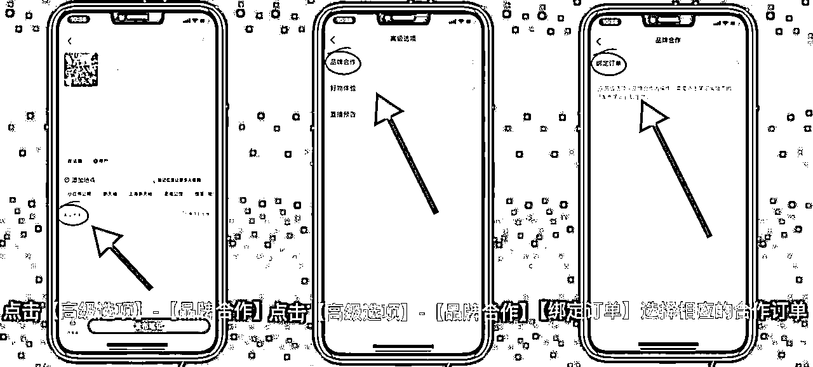
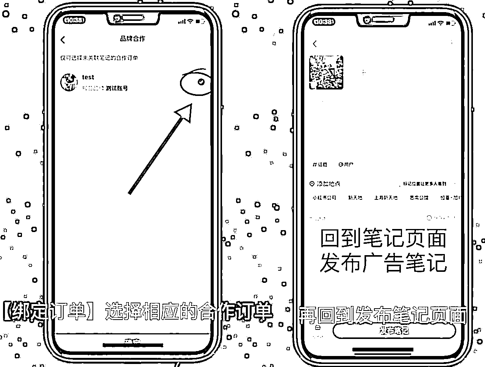

此时笔记未公开，进入平台和品牌审核。若未通过，消息通知和蒲公英后台会提示，按要求改。可让商家重给素材，重复第二步。图文直接在编辑页改后重交；视频要先解除笔记与订单关联：编辑页高级选项取消关联，回发布页重发时再绑订单。连续3次不过，建议放弃该单，在后台取消合作，平台不罚；但也要和商家、PR保持好关系，后续可能再合作。

#### 第四步：发布笔记，等待订单完成
审核放行后，到约定时间在APP消息通知点“前往发布”，也可从笔记详情左上角“合作品牌已确认”进入发布。

#### 第五步：收益到账，完成提现
品牌确认后款项到账；若品牌没主动确认，7天后系统自动确认。对接商家直接结算；对接PR可能抽佣，常见返点20—40元，能接受再合作，不接受可拒绝；并非所有PR都抽。发布后收益到账，按约定把分佣私发给PR。提现：次月9—10号在小红书钱包统一操作，扣10%税。
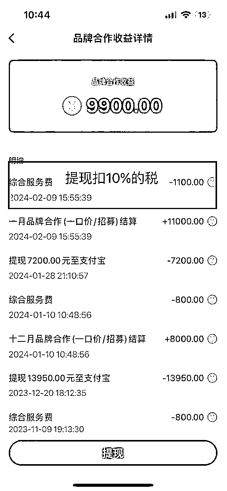

### 4.3 接单前先看风险 @周恩俊
遇到压价，日用百货等非医疗品可给点空间；医疗品或功效吹得过大的单子多留心，这类内容敏感点密集，发出去可能拖累账号。当然不必一概拒绝，判断风险再决定。

# 复盘优化，让小红书账号越做越赚

假设某天你收到了 3 个广告邀约，一股脑全发出去？不建议。新账号的发稿节奏很重要，发完一条广告合作笔记后，最好至少间隔 1 天再安排下一条。所以当多个商家同时找上门时，不妨在微信上把所有细节聊透，把不同笔记的发布排期错开协商好。

新号千万别连续轰炸广告内容，发得太密既伤账号权重，也会影响后续品牌的合作意愿。聪明人都会见好就收，广告内容中间穿插正常的账号笔记，把负面影响压到最小。

内容来源：《小红书达人变现项目，单人月入 2W，团队月入 10W+保姆级教程详细拆解》@周恩俊

## 五、【复盘优化】优化笔记与账号，提升变现

#### 章节概要

想要在项目里越走越赚？复盘优化就是那个关键的动作。

你既可以从数据里找出拖后腿的环节，然后针对性调整；也可以总结出自己屡试不爽的爆款规律，把它无限放大；落到这个项目上，你还有机会摸索出让账号变现能力再上一个台阶的方法。

在这一章里，我们就打算从这几个方向，给大家提供一些可以上手的复盘优化思路，帮你把项目成果拉到更大：

笔记该怎么调，数据才能回暖，爆文概率才能提高「5.1 优化笔记，提升数据」

怎么在更短的时间里做更多事「5.2 提升内容创作效率」

接不到广告的时候，用哪 3 招破局「5.3 接不到广告，如何解决？」

单个账号的变现效果怎么拉满「5.4 如何提高账号变现力？」

账号接到的广告数量如何往上提「5.5 如何提高广告数量？」

这些困惑，都会在这一章里逐个解开。

#### 本章航线图

踏踏实实学完这一章并动起来，你就走完了航线图第三阶段的后半段。

第三阶段：持续创作，争取接广告变现（每天 2-4 小时）

1. 好好复盘账号各项数据，优化笔记，持续创作（每天约 2 小时）

2. 把 SOP 搭起来，让笔记的生产速度和质量都提上去（约 3-4 小时）

3. 把账号变现力一点点优化到位，让变现数据稳步走高（每天约 1-2 小时）

现在，就跟着步骤实操起来吧。

### 5.1 优化笔记，提升数据

#### 5.1.1 笔记数据不佳，如何优化？

总有人问：我的浏览量一直在 100-300、300-500 这个区间打转，正常吗？

把话说明白：挺正常的。

只要浏览量不低于 50，落在 50-500 之间，对刚起号的新人来说，内容看得人少是非常普遍的现象。

毕竟你不是十万粉甚至更高量级的大博主，人家随便发一条笔记，自有大批铁粉捧场，浏览量高那是理所当然的，对吧？

所以心态才是第一道坎，一定要稳住。

接着，做数据对比的时候，别拿自己的短处和别人的长处硬碰。

比如，你发了不少笔记，每篇都有各自的数据表现，那就回看你自己的笔记里，哪些数据格外好，再琢磨琢磨背后的原因是什么。

再者，你可以把目光投向和自己等级相近的博主去做内容数据对比。

什么叫同等级？就是对方粉丝量大概在 500 左右，你也是 500 出头，这种对比才有参考价值。

你要是只有 500 粉，非要拿自己和 10000 粉的博主较量，得出的结论往往没有意义。

和他人对比时，把点赞收藏数、评论区都仔细看一遍。

为什么别人的评论区那么热闹，为什么人家的收藏量那么高？去翻翻他们的内容，看看他们是怎么引导互动的，然后照着学起来。

如果确认了数据确实不理想，可以从这几个方向自查优化：

1）小眼睛（阅读量）不佳

如果笔记发出去后 2-3 小时内阅读量不给力，或者阅读量长期停留在 100-200 甚至更低，就逐条对照下面的问题排查：

2）点赞、收藏、评论等互动数据不佳

互动数据上不去的，除去违规和玄学因素，大概率还是笔记内容本身的吸引力不够。

可以对照以下问题检查：

3）发布后修改笔记的注意事项

总有人纠结：笔记发完再改，曝光会受影响吗？

从已有数据来看，修改后阅读率确实会重新算。但只要别反反复复改动，对整篇笔记的影响不大。

不过要注意，改动后的笔记会重新进入审核流程，审核通过才会重新展示。有时候笔记里不小心带了敏感词，改掉重新发，或者把标题优化一下，数据反而比之前好。

但也有另一种情况：本来审核已经过了，平台也在正常推流量，你一动，审核人员看出了问题，反而被限流了，数据就直线往下掉。

万一有篇笔记爆了、你又想改点什么，忍住，别碰笔记本身，有条件就在置顶评论里补充说明。

#### 5.1.2 如何提高爆文概率

方法一：像素级对标爆款账号 @比比先森

1544_1692583964.mp4【在线播放】

1）爆款图文账号特点

图文爆款特点：

在小红书上混过一段时间的人，大概都有过这种疑惑：明明我学着别人的样子去做了，图片也费了心思，为什么人家的笔记动不动就刷屏，而我的点赞寥寥无几？

其实这里藏着一个很核心的点：我们总说照猫画虎，可很多人连“猫”都没找对，“虎”自然画得四不像。

新手在模仿爆款的时候，总是不自觉地加入自己的想法，最后成品和原作差了十万八千里。建议那些不太擅长制图的同学，先把对标对象定下来，尽量做到 1:1 复刻，先把审美和作图手感练出来。照着一笔一笔模仿，远比光看不练更能体会到细节上的门道。

2）如何按对标帐号创作爆款笔记

第一步：提升敏感度，寻精准对标

偶然发现一个做纪录片选题的博主，封面和内页的设计风格非常相似，数据动不动就是千赞甚至万赞，发布时间都在一个月以内，最让人在意的是，它和之前看到的那一堆同质化的纪录片风格完全不同，忍不住在心里犯嘀咕：这是小红书上刚冒出来的新玩法吗？

仔细琢磨之后发现，这个账号干脆利落地踩中了爆款笔记的四个维度：

第二步：像素级模仿，精准绘对标

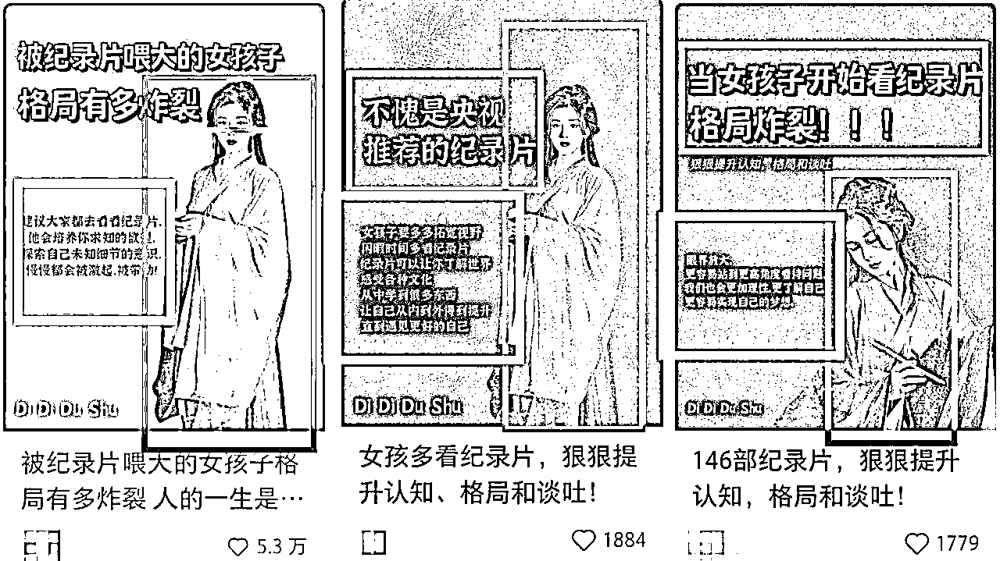

深色背景，左上角放着白色标题，左下角是小字补充，右边的主体是一个影视女明星。

把图片拆解完之后，去搜热度比较高的影视剧女主角，当时《梦华录》正火，就挑了刘亦菲当封面人物。

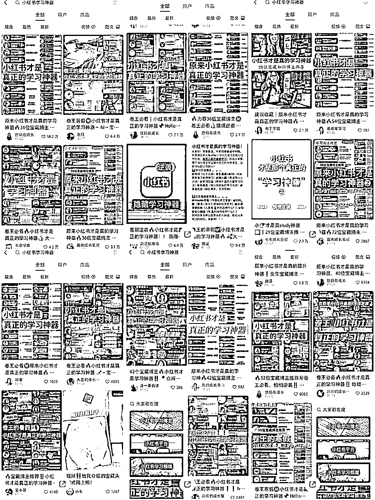

稿定设计 APP 里历史感浓重的背景模板特别多，随手一翻就找到了一款很有岁月质感的模板，氛围感一下就到位了，和纪录片选题特别搭。

接着开始往上加字，一开始按自己的想法排了一版。

常刷小红书的人会发现，那些爆款封面上的花字，大多看着清清楚楚、立体感强，黑白的搭配简洁又有力。而上面这版封面，黑白的描边显得有点拖沓冗余。

后来索性去黄油相机里找到同款花字，把主标题去掉，让主体更大，放在左半边，还特地动了动脑筋，把“不愧是央视推荐的纪录片”拆成“不愧是”和“央视推荐的”两行。

这样一来，一行变两行，封面上最抓人的引导词「不愧是」被完整放大，格外醒目！

读者的视线也会被顺势牵引，沿着「刘亦菲」——「不愧是」——「央视推荐的」——「背景或其他」一路扫过去，点击封面的动作就这么被自然引导出来了。

从最初版封面到最终爆款封面，优化思路可以概括为三点：

想要快速判断封面合不合适，有个小技巧：

把图片丢进微信聊天框，只给自己 1-2 秒的停留时间，看看能不能第一时间捕捉到封面的主体和标题关键词。

能捕捉到，说明这个封面是合格的。

要停下来再细看才能明白，那就说明封面欠点火候，排版、花字都得继续调整。

别光感动自己，这条路能少走不少弯路。

内容来源：《小红书新人博主，如何挖掘爆款的底层逻辑，打造 10w+赞爆款笔记？ 》

方法二：正文要埋互动理由 @许义

在正文里一定要埋好互动理由，也就是能触发用户做出行为的关键钩子。一篇笔记的互动指数上去了，流量开关才能打开，源源不断的流量才会涌进来。

比如下面这个旅行赛道的例子，当然，你也可以按自己的赛道类型，大胆抛出问题来激发互动。实在没头绪，就多去参考对标账号的做法：

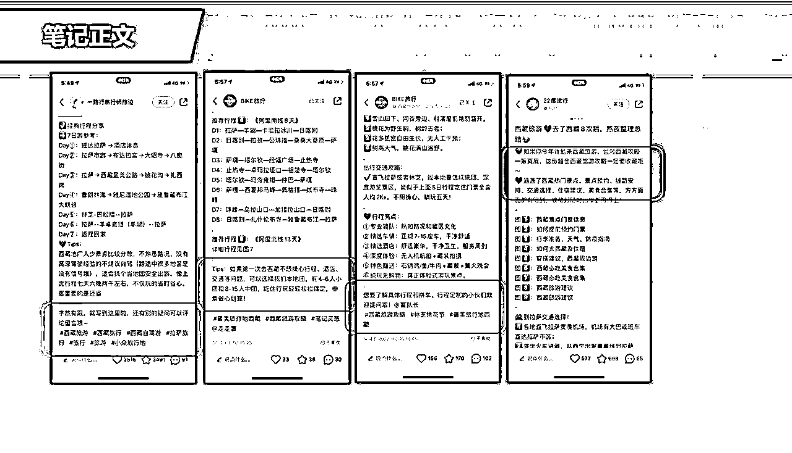

内容来源：《小红书 3 天新号粉丝破千的运营方法论》

方法三：推拉式评论，诱引高互动 @比比先森

笔记第一天数据平平，第二天突然 8000+ 点赞。

到了这个节点，关键就是怎么让数据一直涨下去，其中很好用的一招是：把评论区里的每一条评论都回复一遍。

但注意别一本正经地回复，要“绕个弯子”，用推拉的手法，勾着用户忍不住来回互动。

先简单说说小红书的算法逻辑：

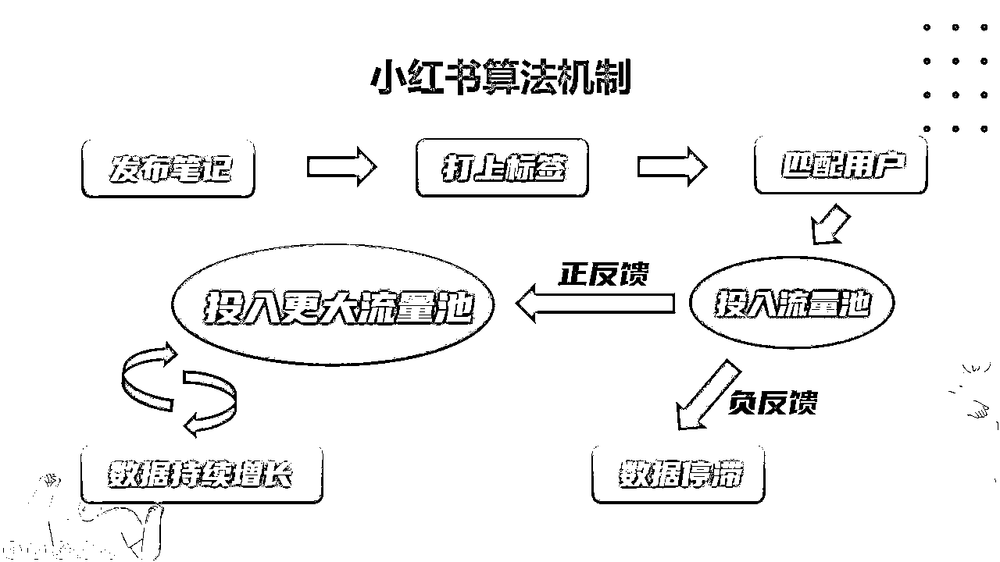

核心结论：用户的不同动作对爆款笔记的加权影响是：关注>评论＞收藏=点赞；互动量一旦上来，整体数据就会疯涨。

当天这条笔记的评论区互动可以分成三类：

别老是用肯定的陈述句回评论，可以试试「推拉式提问」，把问题抛回给用户，让互动自己滚起来，互动量自然就带上去了。

常见回复套路可以参考：

推拉式评论表格形式展示

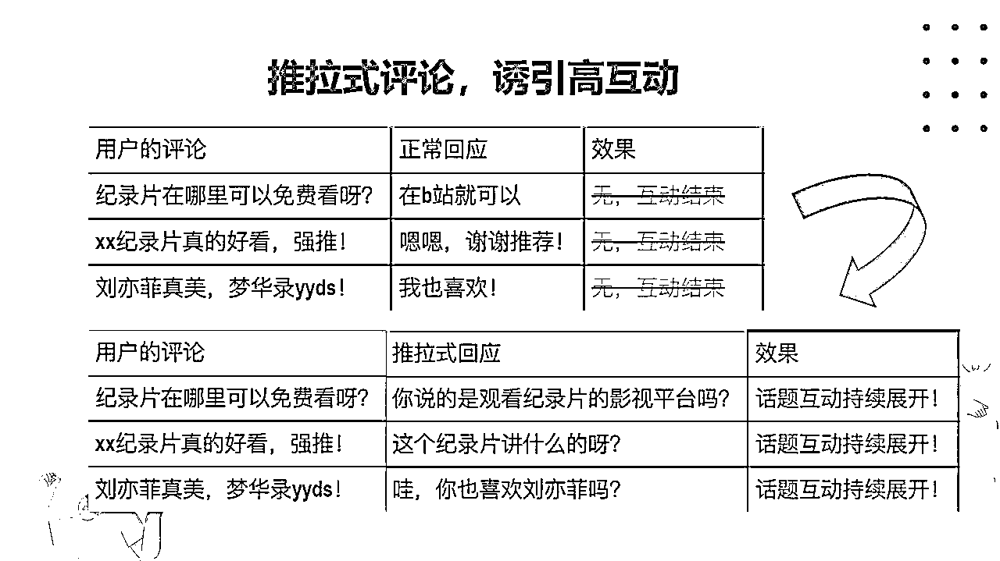

内容来源：《小红书新人博主，如何挖掘爆款的底层逻辑，打造 10w+赞爆款笔记？ 》

方法四：强化代入感 @梨云

刷小红书的时候刷到了十万赞的大爆款《公主学习法》，虽然心里不太喜欢这个调调，但多年练出来的敏感度告诉我，这篇笔记绝不简单。

耐着性子看完内容，整个人真的好像变成了公主在学习。再去评论区一看，清一色的好评。直觉告诉我，这是个能打的爆款选题。

马上照着这个选题写了自己的版本，结果爆了，将近 10w 赞。

但我没有高兴太久，开始琢磨它到底怎么火的。评论区里那句高赞留言“很好，现在已经是公主了”一下子点醒了我——这句话背后是什么？

是读者把自己彻底代入进去了，就像追小说一样，把学习的场景也一起代入……

代入感！

对，就是代入感！拿知识号来举例，不想学习、没状态是大多数学生的共同痛点，而这种看着不太正经的心理暗示，反而让学习变得有乐趣，体验感直线上升！

学习娱乐化，知识趣味化——如果这个假设成立，那我是不是能开辟一条别人没走过的赛道，成为唯一？

想到就干。我从评论区分析粉丝感兴趣的角色，然后照着去创作，发了一批脑洞大开的“学习法”试水。

结果，篇篇原创，篇篇爆款！

于是我开始提高这种娱乐化包装学习方法的比例，内容高度垂直统一，主页转粉率一下子逼近 30%！

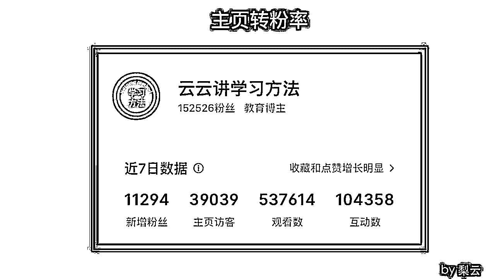

而这样垂直又爆款的内容，竟然引起了小红书官方的注意，直接在灵感笔记里单独给我开了一个新的话题位：

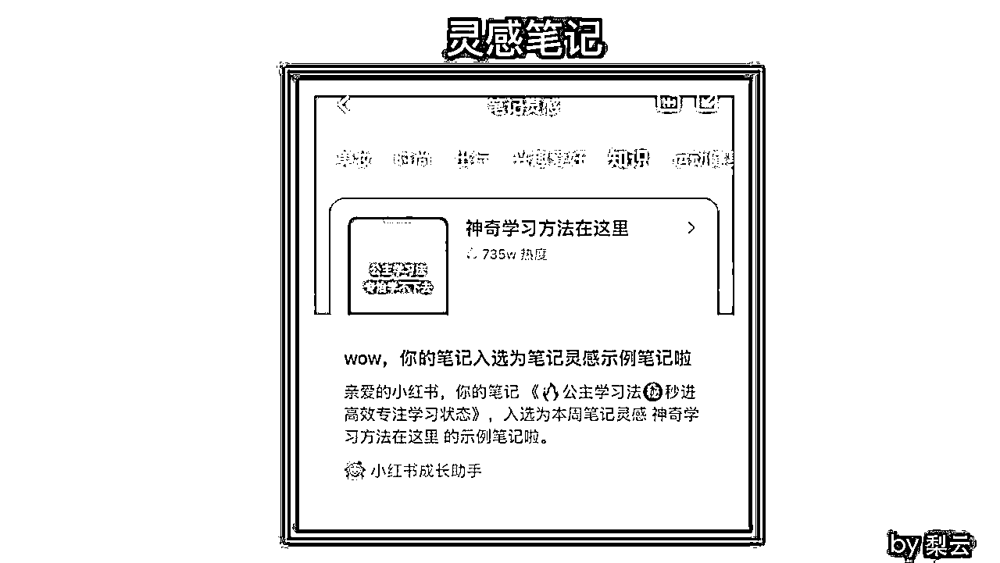

从模仿到原创，每一步都是爆款，我做对了什么？

内容来源：《小红书三个月涨粉 17w，变现 10w+，我做对什么？》

方法五：埋关键词 @云珞 YunL

思路：把关键词埋进标题和正文。

举个例子：你的定位是女频言情小说推荐。

关键词从哪里找？有 3 个办法：

方法 1：

在小红书搜索框里输入你的关键词，记下弹出的下拉词，如图。

【女频言情小说推荐】是你输入的关键词，【女强言情小说推荐】、【女生言情小说推荐】等就是你的下拉词，这些都可以放心用到标题和正文里：

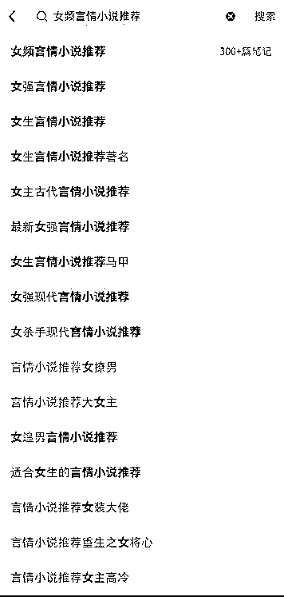

方法 2：

你输入的关键词是【小说】，那么综合、最热、最新筛选栏下面那一排词——像巨好看的小说、n 刷小说之类——都可以拿去当标题和正文的关键词：

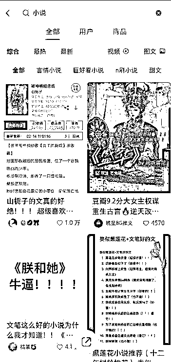

方法 3：

点开一篇高赞笔记，把它的标题和正文仔细读一遍，测试其中哪些词可能是关键词：

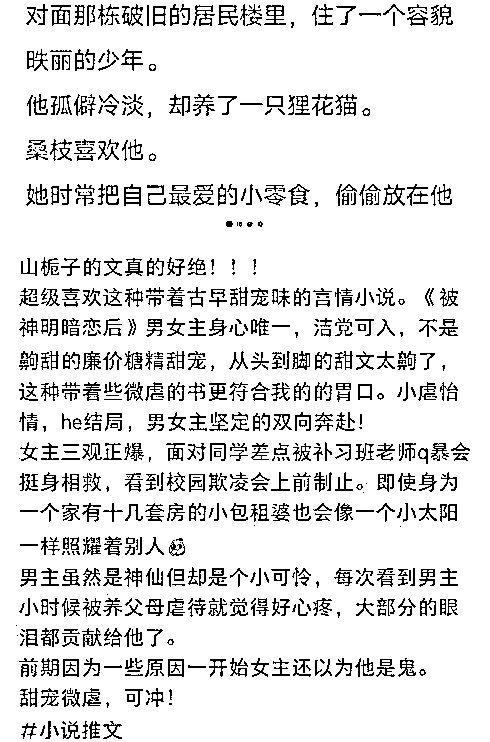

以这篇笔记为例，我推断【真的好绝】、【超级喜欢】、【甜文】、【双向奔赴】、【可冲】等都可能是它的关键词。

那具体怎么用呢？

1）先把自己的推荐理由老老实实写出来。

2）再把你收集到的关键词，安放到内容里合适的位置。

我来示范一下：选了一本叫《 XX（书名）》的言情小说。这本书我看过，非常喜欢，标题和正文会这么写——

第一稿：

标题：推荐一本女主言情争霸小说！！！

正文：

今天看了一本很好看的言情小说。

已经完结了。

这本书主要讲了女主穿越到异世界，带着金手指大杀四方。

女主本身非常有魅力，不只是靠金手指。

以前看过类似的小说，女主拿到金手指后，总偏向于宅斗、宫斗，或者辅助男主成为天下霸主。

但这本小说完全不一样，女主没有被古代同化，自己拿着金手指争霸天下，给百姓带去了幸福的生活。

而且完全不违和，非常符合常理。

男主男配们非常有魅力，感情戏也极好看。

第二稿：

标题：N 刷！！巨好看的言情小说，绝对不能错过（注意：小红书笔记标题最多 20 字，16-18 字最佳）

正文：

今天看了一本巨好看巨上头的言情小说。

已经完结了，真的好绝，我超级喜欢。

这本书主要讲了女主穿越到异世界，带着金手指大杀四方。

女主本身非常有魅力，不只是靠金手指。

以前看过类似的小说，女主拿到金手指后，总偏向于宅斗、宫斗，或者辅助男主成为天下霸主。

但这本小说完全不一样，女主没有被古代同化，自己拿着金手指争霸天下，给百姓带去了幸福的生活。

而且完全不违和，非常符合常理。

男主男配们非常有魅力，感情戏也极好看。

可冲！

看出第一稿和第二稿的差别了吗？

我把「n 刷、真的好绝、超级喜欢、可冲」这些词，自然地嵌进了标题和正文。

靠着这套方法，我经历过一篇笔记 1 小时破 100 赞，24 小时冲到千赞。

只要一篇笔记能 1 小时 100 赞，24 小时后冲上千赞基本是大概率事件。

当然，这招也不是次次灵验，还得看内容是不是贴合自己的定位、合不合读者口味。

有时候我的笔记是过了几天才到千赞，有时候也就几百赞。但总体来看，这个方法能明显抬高爆款的概率。

打个比方：你发了 100 篇笔记，用这个方法，千赞笔记能占到 20%，几百赞的大约占 50%，只有少量笔记数据平平（这个比例不精确，是我按自己的笔记大概估的。但要是你实操过小红书，就能明白这套方法的效率有多高）。

为什么加了关键词，笔记就像长了翅膀一样飞？你看我写的案例，内容本身并不复杂，就是把小说的亮点清晰地摆了出来。

#### 5.1.3 涨粉慢怎么办 @周恩俊

小红书的流量不是一下子哗啦给你的，除非出现大爆文，否则涨粉普遍要熬过 20 天到 1 个月才能达到千粉。

所以刚做账号发了没几篇就抱怨没涨粉，太正常了。多更新一周笔记，主页内容积累起来之后，就可以开始在笔记、评论区、简介里引导大家点关注了。

笔记引导示例：

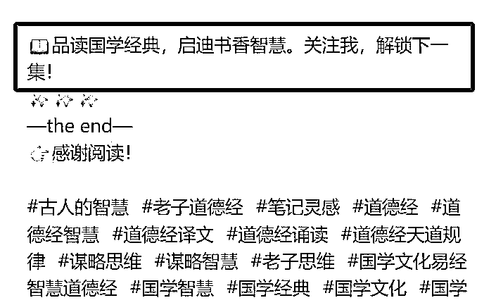

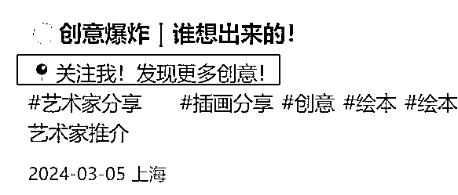

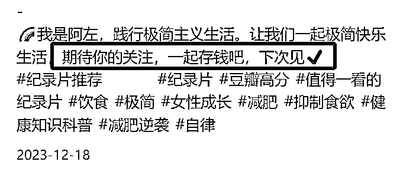

评论区引导示例：

简介引导示例：

总结一下，觉得涨粉慢的时候该怎么办：

1. 参照上文「5.1.2 如何提高爆文概率」的方向去产出笔记，出一篇大爆文，涨粉自然就快了；

2. 在笔记、评论区、简介里给关注一个理由；

3. 保持日更节奏，多攒笔记，耐心经营，量变自然会带来质变。

### 5.2 提升内容创作效率

#### 5.2.1 定期系统总结梳理 @子渝

做自媒体想持续输出有用、有干货的内容，一方面要不断整理自己的知识体系，做到有料可讲；另一方面也必须坚持边输入边输出。

所以建议你在内容创作的过程中，给自己建一个素材库，需要的时候随手就能调出来。

素材从哪里来？

就是你平时积累的对标账号、对标笔记。至于怎么积累，可以参考「2.4 积累对标账号」。

具体怎么整理：

内容来源：《中年宝妈“996”下班后当职场博主 聊聊我小红书从 0-1 到变现的过程》

#### 5.2.2 持续从优秀对标里汲取高点，获取灵感 @子渝

平台上的内容多如繁星，做得好的高手更是数不胜数。对于刚入局的萌新来说，最好的捷径就是多看、多想、多对标那些优秀的人，把学到的东西用到自己身上。

每天抽点时间，去刷一刷你所在领域的专业内容，看看别人在聊什么、在琢磨什么，把灵感记下来、整理好，提醒自己接下来去落地执行。

内容来源：《中年宝妈“996”下班后当职场博主 聊聊我小红书从 0-1 到变现的过程》

#### 5.2.3 打造能流水线出片的模板 @梨云

把内容模板做扎实了，既能帮你高效稳定地产出，又能顺带把数据拉起来。@梨云 自己摸索出一套版式，靠它收获了不少正向反馈。接下来就拆解她的做法。

做排版时，她没有局限于本领域，而是把一千多套版式翻了个遍——同行那里已经很难再挖出新点子了。随后她发挥平面设计的底子，自己原创了一套方案。模板拆开看就那几个模块，一个接一个打磨完善就行。

1）配色

主色挑了森系绿。不少人一看到这套配色就联想到她，于是她顺手把它定名“梨云绿”，提前卡住用户认知；再搭暖黄与纯白，整体呈现出温暖、惬意、岁月静好的调性。

2）封面

走直接、利落的大字报风格：两行文字把标题要害顶出来。目的在于收紧关键词，让用户扫一眼就明白这篇讲什么，从而迅速做出去留判断。

3）内页

她舍弃了“对标博主封面+文案排版”的旧路子，转为全图流。纯文字排版结构感偏弱，盯久了视觉容易累；全图流则能调字体颜色、贴图案装饰，可发挥的余地大得多。

内页由这些部分构成：大标题、导语、小标题、内容、底部标题。

大标题：可以充当整页内容的浓缩，帮读者预先判断这页主题，也可以每页保持统一，用来埋关键词、拉高搜索权重；它同时还是关键的广告位，能放品牌名。

导语：起铺垫功能，交代写这篇的缘由，也分担一部分共鸣责任。导语还能做行为引导，比如写上“宝子投稿”，暗示大家去评论区投稿，靠留言量撬动曝光增长。

小标题：负责提炼内容，用四个字把一句话收住，减轻读者阅读压力。

内容：通常控制在3行以内，走轻量路线，提升阅读愉悦感。措辞上可多用小红书女生偏爱的热门流行语和近期热梗，让文字显得鲜活，读者也更买账。

底部标题：这个细节很关键，也是她实操中总结出来的。许多人照抄她的模板，偏偏把这处漏掉了。其用途是以游戏化的语气提示用户继续翻页，降低读者因对当页无感而中途退出的概率。形式取自游戏里的指令式表达，常见句式是“开始+动词”“马上+动词”。这招相当好使，能勾起人不断下翻的欲望；只要内容站得住，停留时间上去了，赞藏评的概率自然水涨船高。

这套流程跑通以后，她开始发笔记。第一篇就冲过千赞，成了爆款。往后更停不下来，篇篇都爆。为了接住爆款引发的连锁效应，她启动日更，连续50天不断，涨到10万粉后才切换成隔日更新，眼下粉丝已达17万。内容来源：《小红书三个月涨粉17w，变现10w+，我做对什么？》

#### 5.2.4 把流程拆成SOP，省下制作时间 @杉木

注意：本小节分享的是一套SOP思路，各位可以照着它，把自家笔记的制作流程也SOP化，让流程更轻。

若想把效率再拔高一截，其中不少环节其实都能做成SOP，把时间开销压下去。

以拍摄和写内容为例。她习惯在周六、周日把下周待发的素材一次性备齐。若拍摄需要模特，她会事先把拍摄要点和参考案例梳理好发给对方，省得拍出一堆废片、白白耗掉时间。内容来源：《我是如何通过小红书，两个月带货营收30万＋》

### 5.3 接不到广告？先补齐这三处 @周恩俊 @北

#### 技巧一：别停下日更

顺利入驻蒲公英后，账号还得坚持日更，每天至少1—2篇，让数据维持活跃，这样接广的速度会更快。即便已经接到广告，后续也别断更，继续把账号活跃度撑住，品牌方的邀约才会接连不断。

#### 技巧二：把粉丝互动做活

要是你的阅读中位数偏低，却想尽快接广，那就得花些时间跟粉丝互动。见到留言或评论要及时回应，别把账号人设架得太高冷、一概不理，那样肯定行不通。及时互动有助于抬高账号数据活跃度，也更容易被品牌广告主看上。

#### 技巧三：人设与画面质感都得在线

人设感无需多讲，它跟前面说过的粉丝粘性、账号辨识度属于同一类议题。账号若体现不出人设，差异化自然就弱。

至于质感，直接看图更清楚。假如你是品牌方，下面这些账号你会投哪个、给谁的预算更高？

再看同类型博主，对比更直观：同一赛道、同一场景、粉丝量相当，你会选谁？

结果一目了然：质感更优的那个。因为产品搁进去会显得更高级。能让品牌显得更高端的笔记，必然更受广告主青睐。内容来源：《小红书达人变现项目，单人月入2W，团队月入10W+保姆级教程详细拆解》@周恩俊 《如何提高小红书广告变现力，一条合作笔记报价3-4W》@北

### 5.4 广告单价提不上去？从“高级感”找突破口 @北

有人运营时会察觉，广告量不算少，可报价始终上不去。若能在相同的创作周期里拿到更优报酬，那当然划算。这一节就谈谈怎么把广告单价抬高。

看上去高级的内容，往往让人感觉配得上更高价位。因此同样的内容，换个场景、换种拍摄风格，报价就会不同。另外，大品牌相对小品牌通常预算更充裕，也更看重格调，它们更乐意投放拍摄风格显高级的账号。

#### 技巧一：画面保持干净

不少大牌的合作brief里，涉及拍摄要求都会强调这点：妆造、着装、拍摄场景，尽量干净、整洁、明亮、大气。以下是部分要求截图。

场景干净、人干净、色彩干净。简约大方，往往自带高级感。

先查查你的拍摄场景里有没有乱七八糟的物件，有就清理掉。再看看颜色是不是过杂。有人把场景收拾整齐了仍觉得乱，问题多半出在颜色太杂。你的场景该有一个主色调，不能乱。若对这方面毫无头绪，那就从学起步：找背景布置得好看的账号，看人家怎么摆，跟着模仿。

#### 技巧二：先掌握九宫格构图

日常拍摄时把九宫格打开，能帮你拍出更协调的画面。同时要琢磨常见的主体位置，刻意去练。这块并不难，小红书上有大量教程和案例可学。

#### 技巧三：修图调色是加分项

学会调色，让画面显得更高级、更干净。她曾与一个知名电脑品牌合作，出稿后对方希望画面更精致。那时内容都已过审，能动的只剩滤镜。调完色再发过去，品牌便满意了。这项技能相当重要，小红书上教程一抓一大把，搜调色教程就有。关键还是平日多看好图、养审美，多修图，把本事练精。

内容来源：《如何提高小红书广告变现力，一条合作笔记报价3-4W》@北

### 5.5 广告数量怎么增加？先扩容广告位 @北

#### 5.5.1 扩大账号的广告位

你能接多少广告，取决于广告位有多大。就拿大学生、高中生干货分享赛道来说，很多人以为接不到什么广告，顶多接软件、课程类。可实际上，她接到的广告覆盖面很宽，科技、生活、护肤均有涉及，例如电脑、平板、手机、床垫、显示屏、眼霜、智能锁、代步车、汽车。这里放部分截图佐证。

为何一个非护肤博主能接到护肤品合作？为何一个非科技博主能接到科技产品合作？核心就是这句话：“你能接到的广告数量，取决于广告位大小，而不局限于赛道。”

1）理解广告位

她给出的定义是：产品植入的空间。下面分主动选择与被动增加两个方向展开。

2）被动增加广告位

很多时候，接广告是能倒推出来的。她记得和一位学员闲聊时，对方说想入手iPad配件，她直接支招：压根不用买，你发一篇以iPad为载体的笔记就成，不但省下采购开销，还能拿到品牌给的广告费。

这个转换很简单。打个比方：你原本想发“不想学习时能做的x件事”，改成“用iPad做的事”，再把相应画面拍下来即可。

图里能看出差别：前者是纯图配字，图取自网络，没有场景，仅作背景；后者是实拍场景图，呈现iPad的使用场景。当你想接iPad配件广告时，先想明白：iPad配件的植入空间在哪儿？自然是在iPad边上。那你的广告位就得把iPad亮出来，对应广告便水到渠成。

说得夸张些，一旦你摸透广告位导向的逻辑，很多东西都不用掏钱买，都能谈成合作；不但不花钱，还能捎带赚一笔。

3）主动增加广告位

如果你暂时没打算接某个品类，日常又该如何扩充广告位？最省事的办法是：让场景出现，再放大场景。

正如前面提过的反面案例，很多人的笔记压根没有场景。若你也没有场景，第一件事就是补上场景，把自制图文换成实拍。第二件事是放大场景。

举个简单的例子：读书博主。这个赛道不少人觉得广告变现空间窄，只能接图书置换或小额推广费。但这其实取决于你如何运营账号。假如你的场景里只有书，别无他物，品牌方就看不到与你合作的可能。

稍微扩一扩呢？把书桌框进去。广告空间瞬间就大了，因为桌面上能摆的东西太多：电子阅读器、显示屏、台灯，这些“能有的物件”，都可能化作广告机会。之前有位做读书博主的学员正是如此，略作调整，就接到了显示器和台灯的合作。

所以，若想拓宽广告范围，不妨试着放大拍摄场景。内容来源：《如何提高小红书广告变现力，一条合作笔记报价3-4W》@北

#### 5.5.2 提高广告复投率

方法一：优化品牌方体验感

执行时是否配合对方？有没有准时交稿？沟通态度是否友善？若你能让对方感到这次合作顺畅、舒心，品牌自然乐意再度牵手。

方法二：盯住投放效果

品牌跟你合作的数据漂亮，复投意愿自然更强。内容层面尽力而为即可，数据有时确实带点玄学成分；沟通层面尽量顺遂推进，尽人事，把能掌控的部分都做到位。

她在朋友圈见过不少PR、品牌方公开挂博主，他们自成圈子，会互通避雷信息。若每次合作都敷衍了事，早晚要凉。务必认真对待每一回合作，爱惜羽毛，讲诚信、担责任，攒下好的合作口碑。内容来源：《如何提高小红书广告变现力，一条合作笔记报价3-4W》@北

# 【选修篇】进阶赛道与玩法地图

#### 本章导读

把项目最小MVP跑通、基本摸清操作流程后，就可以翻翻选修篇的内容。不管你想试更多赛道，还是挖更多玩法，都可以重点读这一章节：

【拓宽赛道】尝试更多达人赛道
【拓宽变现】尝试更多达人变现方式
【高频问题】高频问题解答

若学有余力，欢迎尝试选修篇里的更多玩法；若前文尚未学完，建议先在必修篇把基本功打牢。下面的内容会助你进一步成长，来吧，开启你的冒险。

## 六、【拓宽赛道】更多达人赛道怎么挑 @周恩俊

#### 本章导读

对小红书达人项目而言，可玩的赛道其实相当丰富，但挑到契合自身、又受平台用户欢迎的赛道并不容易。前文「2.1.2 试水赛道」已为大家找了两个热门且适合新手尝试的方向；若你想选别的赛道、大胆试新玩法，就可以参考本章节的“其他热门赛道解析”。这些都是当下小红书上相对容易出结果的赛道。

例如：

赛道一：同城热点/本地服务
赛道二：公基常识
赛道三：情感、文案语录
赛道四：影视剪辑
赛道五：动漫解说
赛道六：星座
赛道七：章鱼哥

期待你在更多新赛道里玩出新天地。

### 赛道一：同城热点与本地服务

本地信息差领域的粉丝精准度很高。不管在哪个平台，用户刷到同城信息都会驻足，顺手就点关注。所选城市在小红书上流量越大越好，这个领域还能用矩阵方式铺不同城市。内容可从微博、抖音、公众号检索，主要是当天的资讯。

小红书号：3647547168，昵称：小鱼在广州，7天涨粉近5000；
小红书号：8466789459，昵称：长安城记，30天涨粉7500；
小红书号：3607952117，昵称：长沙本地通，2月接广变现2400；
笔记链接：http://xhslink.com/qeqWJC

该账号封面统一模板配大字，下方标注日期；正文分享当地今日及近期信息，用固定统一的文本框，主要围绕“吃喝玩乐行”，内容源自同城公众号、微博、抖音等平台。

### 赛道二：公基常识

公务员考试向来是热门话题，每年有数百万人报考。人多的地方流量就大，所以公基常识类账号涨粉极快，也容易出爆文。内容可从“公共基础知识”类APP下载，再套进素材模板；这个领域后期还能出售考公类资料。

小红书号：ywg9264，昵称：每日公基常识，7天涨粉7000；
小红书号：560639518，昵称：公基常识 每日一练，2月变现2700；
小红书号：8017983489，昵称：公基常识，1月变现3200；
笔记链接：http://xhslink.com/7WkWJC

该公基常识账号的笔记形式是一篇放3道题。题目可参照同行近期爆过的笔记，或从公共基础知识软件里复制。图片模板也简单：一张纯色简洁模板，或简单底色模板，再打上对应题目就行。模板固定后，剩下就是找题，文字复制粘贴即可。一天下来能做好多组图文素材，所以这个赛道相对省事，对新手小白格外友好。

### 赛道三：情感与文案语录

情感赛道流量大。无论抖音、微博还是小红书，这类文案内容都容易勾起情绪共鸣。素材来源也广，可从文案网站、抖音、微博、小红书等平台搬运，内容可以是鸡汤故事、心理情感、情感语录、感情故事等。

小红书号：5197164243，昵称：三十，2月变现3400；
小红书号：9035682353，昵称：白茶清欢，2月变现1300；
小红书号：4717878578，昵称：治愈文案管，7天涨1000粉
笔记链接：http://xhslink.com/LM8uKC

该账号素材统一为黑底白字，每篇笔记一张图，内容聚焦婚姻情感，容易打动人、激起共鸣。制作方式也简便：在稿定设计、美图秀秀等制图软件里挑一个简约背景，提取同行爆文内容，套进自家模板即可。

### 赛道四：影视剪辑

影视领域在抖音上大家都刷到过，男女老少都爱追剧，是自带爆款流量的领域。但这个赛道想干好，得会剪辑，最好能挑出影视片段里的爆点；若不会挑，就到站外参考其他博主的视频，做混剪二创。

小红书号：357097810，昵称：今天吃什么呢，30天涨粉2700；
小红书号：4829864915，昵称：羊咩咩爱聊剧，30天涨粉2.3W；
小红书号：2727645532，昵称：甜密观影，2月变现4080
笔记链接：http://xhslink.com/HchEKC

该账号内容定位于老剧。从视频能看出做了二创，主要是“视频垂直翻转、新增标题和字幕、加入星星爱心动画效果”，以此最大化提升原创度。

### 赛道五：动漫解说

# 动漫解说：门槛不高，赚钱也能走通

所谓动漫解说，是把动漫作品拆成可读、可听、可看的内容，用文字稿、音频或短视频来完成分析与讲解。它比影视解说更容易入门，原因在于可用的画面与故事线大多已经备好：截取画面，丢进剪映处理，再录一段配音，一条成品基本就成形了。想再省力，还能把写好的解说稿交给 AI 工具，由它生成对应的动漫画面。

样本账号（ID／博主／成绩）：3655783271「糖糖嗑漫」一个月新增关注 5600；744640531「青漫漫画」二月收入 2200；6645887333「情茶说漫」二月收入 2880。对应帖子：http://xhslink.com/fyY5KC

这些号通常按连续剧集的方式拆条发布，观众被剧情钩住，就会等下一期，关注自然更容易留下。制作链路也不复杂：找动漫画面，配解说声，叠字幕，加背景乐。片单可在番茄小说一类平台搜；把对应片段的讲解词转成文本。另一个办法是拿现成爆款解说的音频做转写，然后换画面、换配音，重新组合成一条新作品。

### 赛道六：星座——借情感认同沉淀关注

在小红书，很多人习惯用星座看运势、聊感情。这类作品之所以有黏性，是因为读者会对某个星座产生代入和认同。十二星座本身也适合做矩阵：同一套内容可以拆成多个号来铺。找素材时，去抖音、快手、小红书搜已有爆款，换成自己的版式即可，操作不重，新手也能上手。

样本：10705383641「星逃小玩子」一个月新增关注 1000；735581912「文咸鱼～」二月收入 1400；2087306583「白羊座文案馆」二月收入 1500。参考帖子：http://xhslink.com/kcmcLC

视频类做法：先从抖音挑风景片段，再收集星座类爆文，把文字排进画面，加人物讲解与背景乐，一条视频就能完成。

图文类参考帖子：http://xhslink.com/ab0cLC。图文号更省事：固定版式，把爆款内容提出来，替换成自己的版式即可。

### 赛道七：章鱼哥——用情绪共鸣撬流量

这个方向围绕《海绵宝宝》中的章鱼哥展开：截取角色图，搭配治愈系文字，或写贴近年轻人日常处境的句子。制作上只是把两张图上下拼在一起，再配文案。它起量往往快，因为文字容易戳中情绪，而章鱼哥面对工作和生活的态度，又很像打工人眼中的自己。

样本：6238058056「沫沫云」二月收入 2100；6367008669「櫻桃丸釨的碎碎念」二月收入 2500；2735142379「章鱼哥发疯日常」一个月新增关注 8433。参考帖子：http://xhslink.com/tznTCD

作品风格偏治愈与“发疯文学”，单篇常见五张以上图，形式为上下双图加文字。文案可以去抖音、小红书搜，也可以专门找《海绵宝宝》的经典台词。

## 七、收入别只盯接广：达人变现的更多尝试

先说结论：这轮航海更建议走常规达人路线——关注者到一千后进入蒲公英，接品牌合作。其他方式多多少少带风险，在对平台规则不够熟之前，不建议贸然尝试。当然，如果你读到这里发现某条路正好适合自己的现状，也清楚可能付出的代价（例如引流被限流，甚至封号），那可以小步试。

小红书对普通创作者相对友好，因此涌入的人越来越多。可没有货源、没有产品的博主，怎么接住流量并换成收入？先看层级：按关注者规模，大致分五档——素人（不足 5 千）、初级达人（5 千至 5 万）、腰部达人（5 万至 50 万）、头部达人（50 万至 100 万）、知名 KOL（超过 100 万）。层级不同，广告报价也不同。

（蒲公英报价截图，仅作参考）

### 7.1 无费置换：商家给产品，博主出体验@谢无敌

有些商家预算有限，或商品本身价值不算高，会找博主做“无费置换”：品牌把产品或服务免费给到博主，博主发一篇体验帖做推广，除此之外不再支付费用。常见如出版社寄书，博主写读后感或书单；探店博主免费吃一顿。关注者还不多时，这类合作比较适合练手。

### 7.2 有费合作：商家付费投软广@谢无敌

当关注者积累到一定量，会有品牌私信来谈付费软广，发布后给相应报酬。形式不止一种：有费置换、有费寄拍、有费探店或参展等。不同行业门槛差别很大，有的领域五十个关注就能合作，有的要过万。通常关注者越多，报价越高；广告费常见为关注者数量的 10%—20%，还会看近期活跃度、垂直程度、品牌匹配度、关注者黏性等。

### 7.3 通告平台与 PR 微信群：主动找合作@谢无敌

前两种更像等品牌上门，这一种是主动出击。微信小程序里有一批通告平台，PR 和中介会在上面发招募，找博主接单，比如螃蟹通告、萌通告、布偶通告、试盒等。也可以在小红书搜“通告”“PR”，有意识地加一些 PR 微信群；对方有单子会在群里发。要留心：前三种合作都不属于小红书正规渠道，平台并不允许；再加上合作方质量参差，既有违规风险，也有交易风险，需要自己筛选。

### 7.4 邮箱邀约：省掉抽成，也省不掉风险@大芝

除了走蒲公英，还有不少广告会通过邮箱找上门。绕开平台能少交 10% 抽成，报价可以实给；可对博主和品牌来说，也少了第三方背书，风险随之上升。特别要提醒：把邮箱放在简介里，本质上就是引流动作，可能被系统检测。关注者少时如果已经留了邮箱，尽量别频繁改简介。作者原本简介长期写邮箱没出问题，后来一条视频爆了，手一动改了简介，重新提交审核就触发检测，被判引流，简介被清空。简介每周只能改三次，次数用完，当周就空着，可能从主页点关注的人也因此漏掉一部分。

资料参考：《低粉变现+打造爆款视频的秘籍》

### 7.5 好物体验：申请试用，免费拿产品@谢无敌

点开个人主页左上角，会看到“好物推荐”入口；申请通过后，写一篇试用帖就能免费拿到商品。几百到几千关注的小博主更适合；如果账号调性与商品匹配度高，被选中的概率更大。它不算直接赚钱，但相当于省下一笔试用成本。

### 7.6 知识变现：用课程和专栏收费@谢无敌

这条路更适合知识类博主：手里最好有成熟的课程产品，再通过开通专栏来收费。比如 PPT 课、写作课、瑜伽课、育儿课等。一般要关注者过万才能开；几千关注也能试着申请，有机会通过。开通后，主页会显示专栏入口。

### 7.7 带货收入：直播或小清单赚佣金@谢无敌

小红书的带货主要有两种：直播卖货，或用小清单卖别人的商品拿佣金。前提是完成专业号认证，并且关注者达到一千以上。选品中心里商品按类目陈列，每个商品旁会标佣金比例，点开还能看具体合作规则。

笔记带货：商家邀约，达人分佣@木子蟹

小红书企业认证店铺近期上线了“店铺邀约达人带货”，逻辑类似抖音精选联盟。对有选品感觉、会写爆款帖的人是好消息：不用自己垫钱采购、发货、售后，只要和商家谈好佣金，领免费样品；样品到后拍摄、拆箱、试用、写帖，等帖子起量后分佣。建议用多个账户做矩阵带货，佣金机会更多。

资料参考：《小红书如何”开源节流”运营变现》

### 7.8 小红书店铺：0 关注也能先开店@谢无敌

小红书推行“号店一体”后，0 关注就能申请店铺。不过个人店对经营类目限制较多，申请前要仔细核对可卖类目。具体操作可看「小红书店铺」航海手册《12 月航海｜小红书店铺｜实战手册》。

### 7.9 分销引流：选品后把用户带到私域@谢无敌

纯博主也能做选品：挑中不错的商家，谈分销合作。举例，母婴博主看上一款奶瓶，就可以和卖奶瓶的商家谈好分成；再用优质种草帖吸引用户，帖子爆了，评论区常有人问在哪买。此时把用户引到自己或商家的私域，再做转化。

### 7.10 探店/旅行达人：做同城精准流量@木子蟹

线下探店或旅行体验分享，本质是帮实体商家引流，做同城精准曝光，商家获得客流，达人获得收入。拍摄素材从哪来？可以上 BOSS 直聘、实习僧、青团社，发布面向大学生的校内线上兼职；按学历和专业筛摄影相关学生，找审美和设计能力不错的人，简单培训后到现场拍摄。素材有了，再按客户需求写帖打卡，完成变现。

资料参考：《小红书如何”开源节流”运营变现》

以上是除常规达人接广外，目前较常见的十种收入方式。不管选哪条，底层仍然是内容：真诚分享、提供价值，用户才会愿意付费。还要注意：部分带货方式有平台门槛，比如品牌合作权限要关注者达到 1K 才能申请；知识付费则要求你有课程产品、分销货源或服务。

## 八、集中答疑：达人项目常见疑问 @周恩俊

问：达人变现与普通小红书运营差在哪？
答：这个项目会直接给出推荐赛道，并把核心赚钱方式定为“先冲到一千关注，进蒲公英接广告”。新手方向更清楚，少纠结，能快速开干。

问：它和做小红书 IP 有何不同？
答：这个项目不要求先立 IP，也不要求成为某个领域的大 V；重点在于找热门赛道、发能爆的帖子，把关注做到一千，然后进蒲公英接合作，路径更短、更快。代价是单条商单价格通常低于 IP 号；好处是更简单，适合新手先拿到正反馈。等达人玩法摸熟，再往 IP 号升级，提高报价，空间也更大。

问：企业专业号必须开吗？
答：不一定。用灰豚数据也能看，主要用来对标别人的爆款帖，或辅助定位。

问：企业专业号是不是也要一千关注才能进蒲公英？
答：不用。企业专业号属于蓝 V，本身就有蒲公英权限；普通号才要求一千关注以上。

问：安卓机能多开吗？
答：更建议一机一号。多开容易触发异常，影响流量。

问：播放过万的视频被判违规怎么办？
答：先检查二创含量够不够。如果二次创作程度高，可以申诉；说明帖子由本人原创编辑制作、并非搬运，并附上制作记录截图，请平台复核移除违规。

问：帖子删多了会影响账号吗？
答：删得太多容易拉低账号权重。审核通过的尽量隐藏，不通过的再删；能藏就藏，少删为妙。

问：某个号不给浏览量，能换类目吗？换的话要不要重新养号几天再发？
答：如果刚开始发、时间还不长，不必急着换，先观察第二天浏览情况；仍不行再考虑换。换类目前建议先养号，让系统多推你想做领域的偏好，再发作品。

问：正常操作每天发几条？
答：一个人可管 3—5 个号，每个号每天能发 2 条就发 2 条；时间紧至少 1 条，时间宽裕可多发。也可以看同领域做得好的同行，前期一天发几条，有的单号一天能发 5—6 条。

问：只有赞和评论，关注不涨怎么办？
答：在评论区、视频末尾、简介里做关注引导。新号主页作品少，用户刚来不清楚你是做什么的，不关注很正常；内容最好做成上中下集，让人愿意等下一篇。

问：能用电脑定时发布吗？会不会影响流量？
答：不建议定时发，可能影响流量；也尽量别存草稿箱，做好就立即发。

问：蒲公英的普通、优秀、异常等级怎么理解？
答：优秀：账号内容与流量状态健康，除基础接单权限外，还能获得平台主动推荐的品牌合作机会；普通：内容与流量状态不稳定，近期有平台不鼓励的行为，比如发布不合适、导向不佳、无真实体验、违规推广内容，或数据作假、营销动机异常等；异常：内容和流量状态异常，近期有大量平台不鼓励行为，比如不实信息、不友好或不合适内容、数据作假等。

以上就是达人项目操作中常见的问题与处理办法。
资料参考：《小红书达人变现项目，单人月入 2W，团队月入 10W+保姆级教程详细拆解》@周恩俊
