# 📕旅游：新手从零到一实操指南（2024.3）

> 资料源：龙哥盟飞书文档《3 月航海｜📕旅游｜实战手册》

3 月航海 · 📕旅游 · 实操指引

整理方：龙哥盟团队
成稿时间：2024 年 3 月 10 日
阅读提示：贡献者排序不分先后。本手册想让你看到这门生意的多种可能，从而更清晰地理解与上手。若想精准跳到某段，可用 Ctrl+F（Mac 用 Command+F）检索词汇。

# 开篇：先把三件事想明白

欢迎加入本期📕旅游实操指南，往后这段日子，我们会在同一片海域反复碰面。

动手之前，先把三个疑问理清：这门生意本质是什么？此刻入场赢面有多大？谁更适合做？

先定性：简单说，就是替线下旅行社在📕获客。把有意向的人加到🛰️，再转交旅行社签单；若你本身熟悉旅游业务，也可自行成交，分成比例更高。

先看大盘行情：疫情过后，行业近两年回暖明显。23 年前六个月，国内出游 23.84 亿人次，同比涨幅 63.9%；旅游创收 2.3 万亿元，同比涨 95.9%。2024 年春节，国内出游 4.74 亿人次，出境游订单涨幅 388%。境内境外两头热，新人此时进场正合适。

再看平台侧：QuestMobile 于 2020 年发布的报告里，📕带货平均转化率为 21.4%，抖音 8.1%、快手 2.7%、🧣 9.1%，差距明显。此外，它还是用户旅行决策的首选参考地，63.7% 的人会在这里拍板。图文门槛低、接受度高，普通人上手不难，变现空间却不小。

哪些人适合？想找个能长跑的副业，或想在爆发中的旅游赛道切一块蛋糕，这个组合值得一试。对刚入局的朋友来说，本期最务实的目标就是：把基本功练扎实，让引流跑通。

有一点务必留心：平台近期严查外链导流，新手不摸清规则就容易被判违规，严重时还会丢号。建议备两个及以上账号，一个出状况，另一个还能顶上。

本期还为大家准备了 9 家供应商，覆盖长滩和澳洲、日本、斯里兰卡，以及西安、云南、贵州、北京、川藏。学完【章节 2.2】的挑选方法后，定一个目的地即可，具体名册见“旅行社名单 & 产品资料（3 月航海）”。

最后，愿这趟航程里，你既有实打实的收获，也能遇到一群并肩的同行者。

本手册由龙哥盟与圈友共同打磨，仅供航海船员及星球成员学习。实践中若有想法，欢迎随时反馈，帮助我们迭代，可联系鱼丸（yuwan387）。

# 手册用法：本版更新说明

开读之前，先花一分钟弄清用法，方便按需取用。

全书步骤围绕“从零跑通一个📕旅游项目”铺开。你可以顺着航线图一步步做，也可以挑自己缺的部分读。

与往期相比，这次改版幅度不小。旧版侧重展示丰富玩法，供人自由挑选；新版则划成【必修】与【选修】两块。

首次接触这门生意：
建议先摸清整体面貌，读【项目概述】📕旅游赛道的机会与玩法。

对项目已有基本印象：
那就从航线图第一阶段动手，即从第二章读起，按序跑完全流程。
【实操 1/3】选定 1 个目的地，搭好供应商
【实操 2/3】做出📕爆款笔记，把流量批量导进🛰️
【实操 3/3】在🛰️里完成转化
【复盘优化】持续迭代笔记，让爆款更多

已跑通 MVP、想放大规模：
重点研读以下内容，解锁更多打法。
【项目放大】4 种把规模做大的办法
【项目拓展】更多盈利玩法

本航海项目的【航线图】如下：

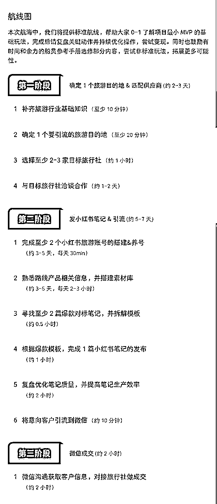

航线图与手册彼此咬合，你可对照自身进度，选学对应环节。

第一、二阶段的步骤，最好在航海头两周内走完。之后重心转向复盘、优化与提效，多发优质内容，把引流与签单的几率撑大。

# 必修篇：先跑通最小 MVP

### 章节概要

必修篇先从【项目基本情况】与【项目基础玩法步骤】讲起，带你建立全局认识，再动手完成 0 到 1，跑通最小 MVP。

若你是新手，正式开干前，先大致了解项目面貌：
【项目概述】📕旅游赛道的机会与玩法

有整体概念后，再按核心步骤实操：
【项目实操 1/3】选定 1 个目的地，搭好供应商
【项目实操 2/3】做出📕爆款笔记，把流量批量导进🛰️
【项目实操 3/3】在🛰️里完成转化
【复盘优化】持续迭代笔记，让爆款更多

必修篇的排布与航线图逐一呼应，顺着读下去，就能把航线图上的任务逐个拿下。

后续每个关键节点的概要里，也会点明对应的航线图任务。

那咱们这就启程。

## 一、【项目概述】📕旅游赛道的机会与玩法

### 章节概要

本章带你认识这门生意。为了信息给得更足，我们从两个维度展开：

1. 📕旅游赛道的红利有多大？
2. 📕旅游项目怎么玩？

读完，你会对项目形成基础判断，也更容易找准自己的切入点。

### 1.1 📕旅游这块蛋糕有多大？@渡

#### 1.1.1 旅游行业的现状与机会

##### 1.1.1.1 行业当前格局

把镜头拉远，先看旅游大盘。疫情过后，被压制的出行欲望集中爆发，景区挤满人，宾馆与民宿一床难订。

数字更直观：23 年前六个月，国内出游 23.84 亿人次，同比涨幅 63.9%；旅游创收 2.3 万亿元，涨 95.9%。人次与收入同步攀升，回暖态势稳固。

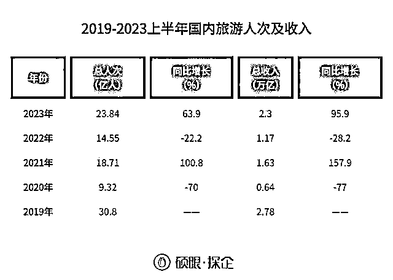

行业内部还能再分：国内游与境外游，两边的境况并不相同。

先说国内。眼下这一块厮杀激烈：入场者多、产品雷同、价位低。走低价路线的国内团体游，最好绕开——客户来回比价，你会疲于奔命；利润也薄，一单到手不过几十上百块，月月都得签够几十乃至上百单，才谈得上体面收入。真要冲这个量，每月新增好友少说以百计，甚至过千，新手基本撑不住。

当然，挤归挤，国内游并非没有机会：
1. 国内地接社好对接。跟海外相比，没资源的新人找一家可靠的国内社合作，难度小得多；
2. 用户池子大。在📕发一篇热门目的地攻略，数据轻松破万，海外线路很难做到这个量级；
3. 也能卖贵的。低价品虽然挤，但定制路线、精品小团、亲子研学这类，单价常在几千到上万，成一单佣金几百到上千。

再说出境。以我自己的操作经验，海外线路反而是眼下更好切的方向，理由有三：
1. 找靠谱的海外合作方本身就难，这道坎筛掉了多数人，所以📕上做海外获客的同行少，竞争相对小；
2. 海外自助出游门槛高，客人更倾向报团。语言障碍、生活习惯差异大，客人一旦有出行打算，多半选跟团或定制，成交概率随之提高；
3. 海外客单价高，佣金也厚。比例上跟国内差不多，但基数大，且极少有人单独出行，跟团一单常过千，定制单甚至能到几千。

总的来看：若能对接国内做高价、品质稳的地接社，或海外能接上稳定后端，2024 年内，旅游仍算一门值得投入的副业。

但也得打个预防针：这个项目对新人确实友好，肯下功夫，通常会有回音；可国内太挤，海外签单又慢，从开口咨询，到办签、订票、打款，常常拖过一个月，成交也没那么容易。

所以新人得把预期放平，当长线生意养。本期航海，能把引流基础夯实，就算达标；若你自带行业经验或资源，则可放开手脚多试。

##### 1.1.1.2 普通人的切入口

旅游正快速升温，借📕切入这条赛道，是相当不错的机会——需求旺，政策层面也有扶持。

普通人怎样搭上这班车，赚到属于自己的那份？先看我和一位导游的对话：

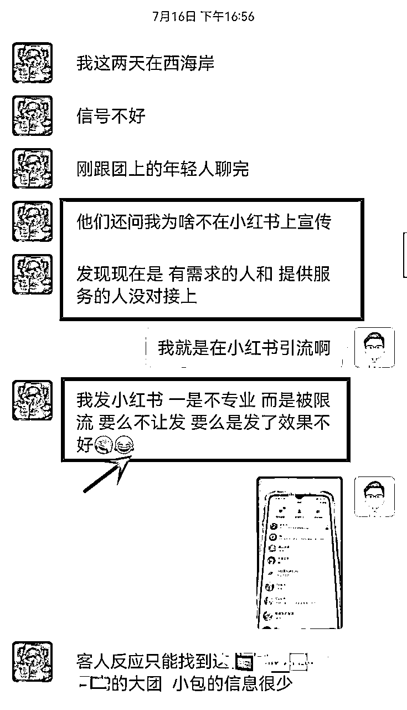

这段对话里，你读出了什么？

这也是我跟不少旅游圈朋友交流后的共识：导游和旅行社想玩📕，玩不转！

我曾带一位做旅游的朋友做号。她天天忙着调度车辆、协调导游、安抚游客，电话响个不停，压根静不下心做内容，没撑多久就停了。

机会恰恰在这儿：替那些不会做、腾不出手做线上的旅行社，把网络获客这摊事接过来。

旅行社急需外部帮手，还有一层原因：

眼下流量大头攥在携程、途牛这类平台手里，抽成不低。旅行社的处境类似美团商家——不合作没单子，合作了只剩薄利。忙活半天，钱大头进了平台口袋，有苦难言。

你若能给他们带客源，等于送来活水，对方自然乐意跟你搭伙。

#### 1.1.2 为什么锁定📕？

既然要帮旅行社做线上获客，渠道就得挑对。为什么偏偏是📕？

##### 1.1.2.1 数据侧的答案

📕用户规模未必最大，转化效率却相当惊人。QuestMobile 于 2020 年发布的报告里，其带货平均转化率为 21.4%，抖音 8.1%、快手 2.7%、🧣 9.1%，差距明显。

早在 2020 年，它就已坐稳旅行决策参考的头把交椅，63.7% 的人靠它拍板。

不少人的路径是：在别处看产品，带着疑问来📕抠细节，确认服务和条款再下单；玩完回来，又在这里发好评或避雷帖。

同时，82.2% 的人更爱看短图文来做旅行判断，而这正是📕的拿手好戏。

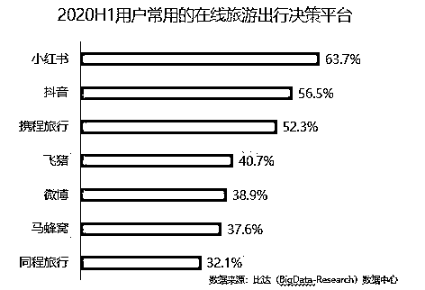

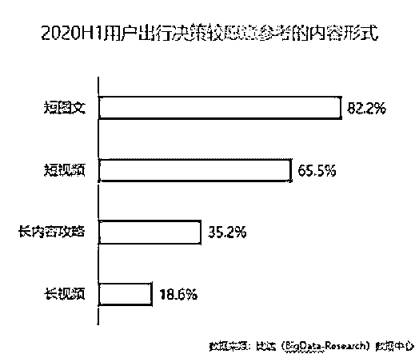

这几年平台在旅游上持续加码，叠加天然的种草基因，它始终是旅游网络渠道里的重要一极。2022 年📕还专门成立旅游公司，布局力度可见一斑。

##### 1.1.2.2 实战侧的答案

📕做旅游，红利能有多猛？

我们刚起号那会儿，首篇笔记发出去，浏览量才几十，竟然就签了一单！当时惊得我跟朋友感慨：这哪是风口，分明是龙卷风，猪上了天，大象也跟着飞！

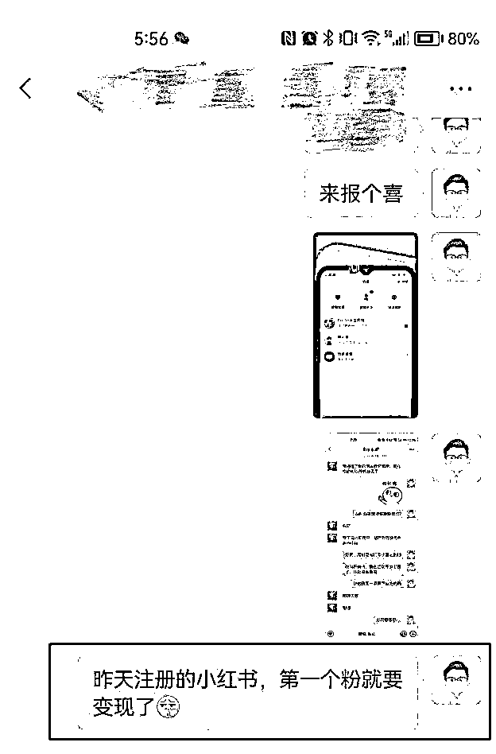

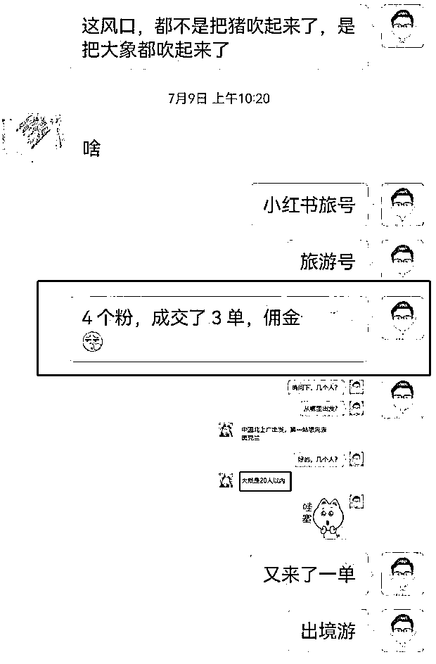

后来读到同行一篇文章，讲了个案例：一支 20 人团，18 位是在📕报的名。

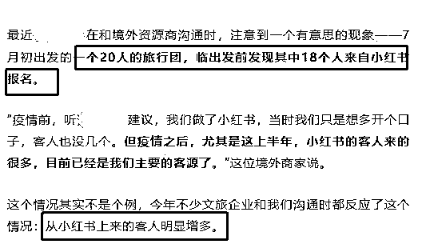

2023 年，论左右用户的选择，📕确实是最锋利的工具。

### 1.2 项目落地怎么走？

#### 1.2.1 第一步：定好目的地，搭好供应商 @易寒

正式引流前，先定 1 个目的地，并找到对口的旅行社供应商。

为什么非得先定目的地和合作方？

其一，带货先看选品。选品既关联账号定位，也影响成单快慢——低客单成交快、利润薄；高客单周期长、回报厚；还要按季节挑品。这部分在【章节 2.2】细讲。

其二，咱们是旅游门外汉，强项只在引流。路线怎么挑、笔记图片哪里来、🛰️上怎么谈，都得靠旅行社托底。

那么在项目里，旅行社具体怎么配合？

1. 选品——给路线建议。季节不同，热门路线也不同，例如寒暑假亲子游最吃香。可以让对方推荐几条当季好卖的线路。
2. 内容——供给笔记素材。笔记素材有相当比重来自旅行社的产品包，含路线文案与景点高清图。
3. 成交——协助答疑。客户到了🛰️，会抛出一堆产品问题；碰上答不了的，就请教对方员工，帮着把单拿下。

跟团游的话，前期把培训材料吃透，九成问题自己就能应付，剩下的再找人，效率更高。

本期航海对接的旅行社，主打中高价位的跟团与定制产品。我们只需把人引到🛰️、建好群，签单交给对方，操作负担明显轻。

4. 交付&返佣——产品交付与佣金结算。客户付完钱，后续服务归旅行社。但旅游是面对面服务，变数多，钱没真正落袋前都不算稳；只有交付让客人满意，佣金才踏实。所以旅行社的履约质量至关重要。

佣金通常在客人出发当日结算。

这里要多留个心眼：旅游行业水不浅。合作方若不靠谱、投诉不断，佣金就有风险——能否足额？能否准时？

感兴趣可以上抖音看看 up 主“superB 太”近期关于云南跟团的系列视频，坑连着坑，游客根本防不住。

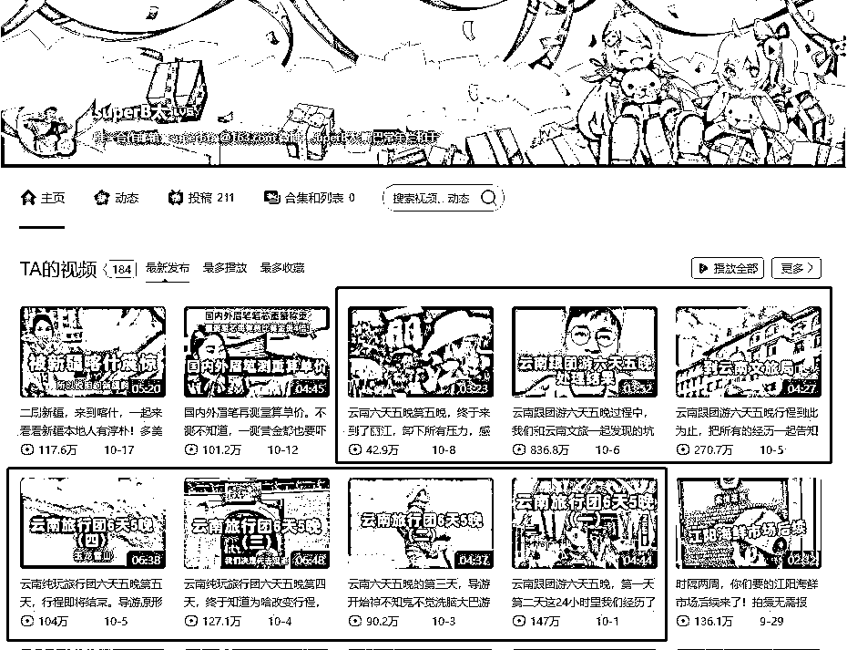

所以说，挑一家有保障的旅行社，是项目跑顺的前提。

为了让新人更快出结果，本期航海已筛出几家合作方；若你想自己找，后面的实操章节也给了具体方法。

#### 1.2.2 第二步：把📕流量批量导进🛰️ @渡

引流这一步，是项目里的重中之重。做这行，流量是打头的 1，后面才轮到各种 0；它同样最耗时间。

因此整个航海期，大半精力都该砸在一件事上——把📕这块流量做起来。

📕和其他平台差在哪？

它的内容逻辑，是以 IP 为核心的“图片+文字”软种草。由此带来几个特征：

1. 人设权重高。平台极看重人设。作为种草社区，博主在用户眼中更像“值得信任的陌生人”。若用户从你的主页与笔记里，判断你真实、不装、可靠或懂行，她才愿意进一步接触，甚至掏钱。

2. 内容更真、更立体。账号由人设五件套（头像、名字、背景图、简介、个人资料）加笔记构成。用户因某一篇认识你，再翻主页看其他内容，每篇都在给人设添砖加瓦，也让信息传递更完整。硬广会被限流，用户也不买账，所以笔记要走真实、接地气的路子。

3. 图文为主。虽说平台在推视频，但用户仍习惯看图文；且图文制作难度低于视频，多数创作者会优先选它。

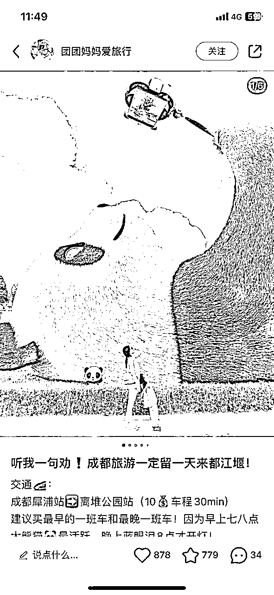

写笔记时，锁定你的客群、紧扣关键词，爆款概率才高。流量进来后，钩子也得埋好——它决定了有多少潜在客人愿意主动私信。这些咨询者，再引到🛰️私域去转化。

再提醒一句：平台对导流的审核一天严过一天，但路总归比坎多。操作时除了翻手册实操部分，也建议在群里多交流。

#### 1.2.3 第三步：在🛰️里完成转化 @小掌柜

人从📕加到🛰️，接下来就是签单环节。两个动作最关键：

1. 摸清客户情况，推荐合适路线。好友通过后要尽快打招呼，先问清“哪天出发”“几个人”“玩几天”这类基本信息，再对症推线路。
2. 及时答疑，推动成交。客人看完介绍，必然有疑问，此时回复快、答得专业，就是临门一脚。

需要警惕的是：引流与在🛰️里转化，最大的雷是“封号”。哪些行为容易触发？怎么规避？实操环节会详细拆解。

出处：《零基础做📕旅游号，头一周成交 6.2 万的经验拆解》

## 二、【实操 1/3】选定 1 个目的地，配好供应商 @易寒 @渡

### 章节概要

# 旅游起盘：锁定目的地，筛出好旅行社

操盘📕旅游号，旅行社是绕不过去的合作方。后端既有实力又稳定，成单率会明显抬升，后面复制放大也更有底。这一节聚焦两件事：怎样挑旅游产品（也就是目的地），怎样跟旅行社把合作谈下来，最终锁定一家可靠的后端。跟旅行社搭上线并不算难，难的是层层沟通筛选出真正靠谱的后端；初次建联前，先补一点行业常识，聊起来才不费劲。选品，就是选出1个旅游目的地，为📕账号定位打基础。

赚钱这次准备了7家相对稳妥的旅行社，供你挑选，目标是尽快把项目跑起来、完成最小MVP。如果你手里已有可信的旅行社资源，也能照本节方法去谈。

### 本章航线图：四步走完第一阶段

学完并做完本章，航线图第一阶段就完成了：锁定一个旅游目的地，并匹配好供应商，预计2-3天。

1. 用不少于10分钟补旅游行业常识
2. 花至少20分钟敲定唯一要引流的目的地
3. 大约1小时圈定2-3家目标旅行社
4. 留出1-2天跟这些旅行社谈合作

接下来按这四步动手筹备。

### 2.1 先弄懂旅游行业的底层常识

找旅行社之前，先懂一点旅游常识和行业术语。不然沟通费劲，对方甚至不接茬，合作更无从谈起。

新手先抓两个点：
1. 旅游行业基本的供应链关系
2. 旅游行业主要的产品类型

#### 2.1.1 旅游供应链的上游与下游

我们主要接触旅行社，分两类：组团社、地接社。

2.1.1.1 组团社：负责签约。客户报名时签合同的就是组团社；签完可能把团交给目的地社执行。比如你在成都C社报了青岛团，落地后接你的司机、导游和车来自青岛D社，成都C就是组团社，青岛D就是地接社。

2.1.1.2 地接社：落地执行方。它们在目的地与酒店、景区、车队、餐厅、司机、导游长期签约，拿协议价；因为扎根本地，导游更专业，对客户人身和财物安全也更有保障。地接给结算价，组团加价卖出。📕项目可直接找地接，省掉中间差价。

#### 2.1.2 三类主流旅游产品

旅游产品主要分三类：散客拼团、独立成团、私人定制。

2.1.2.1 散客拼团：也叫散拼、跟团游。固定时段系统游览某地，比如海南六日、厦门五日这类线路。交通、住宿、餐饮打包，省心；有导游随行，减少陌生地的不安。但为推广多选大众热门景点，游览偏浅，走马观花，难细品沿途风光；价格最亲民。

2.1.2.2 独立成团：也叫包团游。通常20人以上熟人团体，不跟外人混拼；按客户要求和预算定方案，交通食宿可调。团建、研学、考察、会议等需求都适用，客户不用太操心，旅行社设计方案，省去不熟当地的困扰。组团社可能直连地接，也可能整团交给供应商；预算受限时，资源选择偏经济。人数多且预算略高于散拼时，旅行社常推荐这种。

2.1.2.3 私人定制：也叫小包团。亲友或同好出游，旅行社量身做方案。人数不限，但建议10人内、最多20人，超出分批。主题鲜明：亲近自然、城市观光、山水休闲、极限挑战、荒野露营、别墅休养等；餐宿有特色，非资源限制时选当地社会餐厅；方案写清酒店餐厅名称、房型、菜单。按爱好、时间、花费定制，让旅行更有意义。注意：把当地最好食宿等同于定制，是部分定制师的误区，作者不认同。组团社会多渠道找供应商或地接，甚至目的地直采，反复推敲或实地考察，重视客户体验；这类客户会被当作重点客户对待。

### 2.2 确定唯一引流目的地

#### 2.2.1 为何先定目的地？

带货先选品，目的地就是旅游项目的“品”。先定目的地，才能按当地景点和产品倒推📕笔记选题。

#### 2.2.2 如何挑到合适目的地？

目的地会影响成交，也影响笔记呈现。主要看两个维度：

1. 熟悉度。熟悉或喜欢，产品资料上手快，笔记快，答疑快，成交也快；不熟就要补课，否则内容技巧多感情少，偏硬，转化弱。越熟，文字越真，信任感越强，写笔记能带情绪价值；客户问起能专业解答，甚至语音沟通，语音建立的信任远胜冷冰冰的文字。

2. 竞争度。📕盘子有限，每个目的地受众有限，做的人多就要抢客户。用灰豚数据平台的【投放关键词分析】看。航海准备了9个目的地：长滩、澳洲、日本、斯里兰卡、西安、云南、贵州、北京、川藏。入口：灰豚首页左侧-热门内容-关键词分析-输入目的地名。

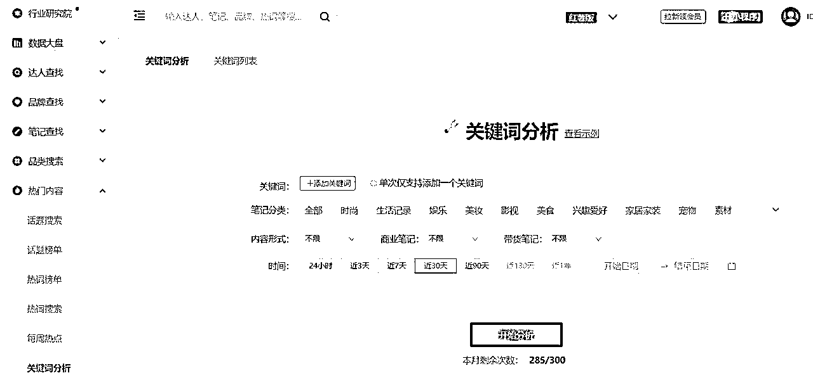

重点看CPE（用户互动计费）和CPM（每千人展示成本），它们代表关键词付费竞争，数值越高越卷。日本CPE为0.12、CPM为10；澳洲CPE为0.2、CPM为10，初步看澳洲竞争更强。也可看笔记数与阅读总量、互动总量：阅读和互动越大，受众越多；越小越小众。笔记数/阅读总量或笔记数/互动总量的比值越大，竞争越小。长滩阅读9万、互动5593；澳洲阅读180.5万、互动10.1万，澳洲受众更大，长滩更小众。斯里兰卡笔记106/阅读8.6万=0.12%，云南3015/1299.6万=0.02%，斯里兰卡比值更大，竞争更小。结论：新人优先竞争小的目的地，但还要结合熟悉度综合判断。

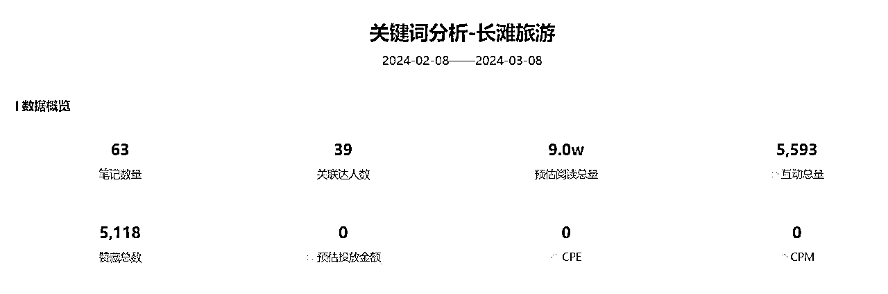

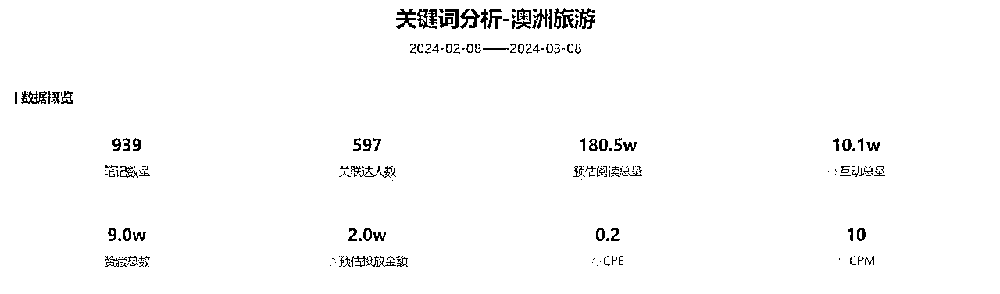

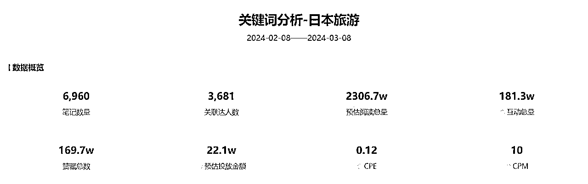

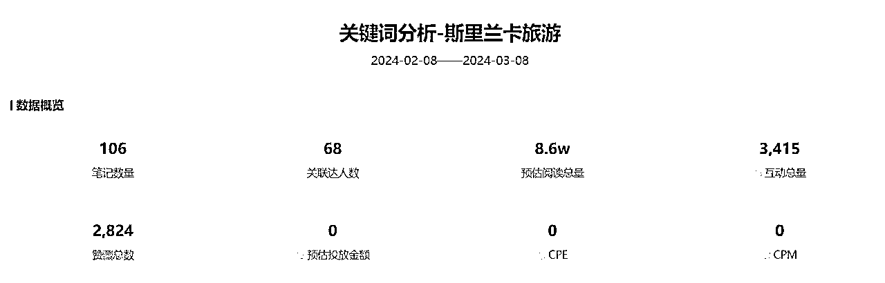

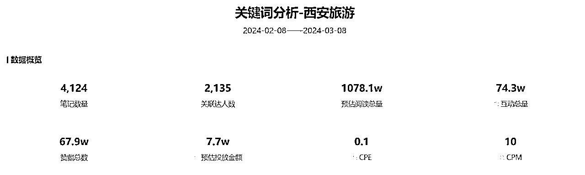

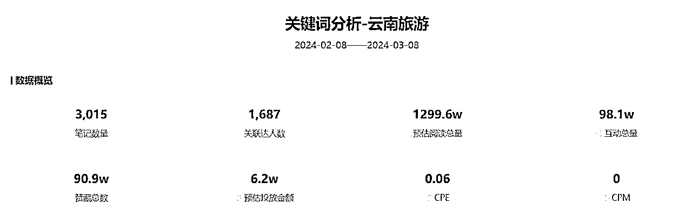

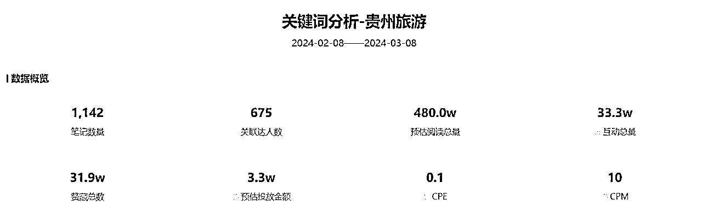

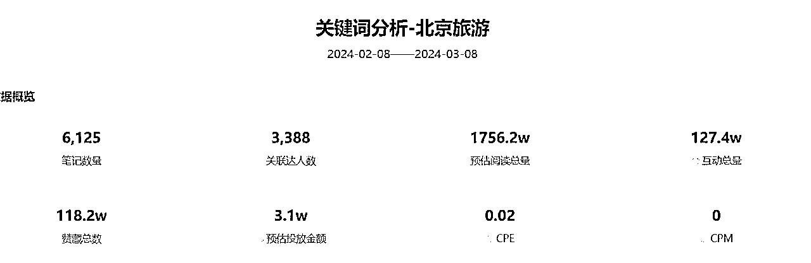

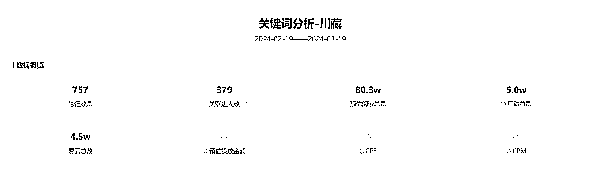

#### 2.2.3 为何只做一个目的地？

精力有限，学精一个目的地已要花不少时间；再学其他，容易贪多嚼不烂。也建议一个月内别换，一个月时间有限，中途换又得重新花时间。📕讲垂直，越垂直粉丝越准，变现越快；新号乱发，短期难建立信任。

为聚焦笔记制作能力，我们筛了9家旅行社供应商，按需选1家，并熟悉资料。资料入口：旅行社名单 & 产品资料（3月航海）。

### 2.3 敲定一家合作旅行社

#### 2.3.1 怎么挑旅行社？

旅行社选择与淡旺季节点有关，要选当季热门目的地，再找对应旅行社。西安4月到10月是旺季，其余淡季；据西安国旅数据，淡季客流仅旺季的1/6甚至1/9。冬季东北、三亚旺，所以冬天做东北或三亚，其他时间做西安。

淡旺季可按自然季节或节假日分：5月至10月偏旺，11月至次年4月偏淡。但地域差异大：东北雪乡、三亚冬季正旺；境外北半球同我们，南半球澳新相反，澳新10月至次年4月旺、4月至10月淡。按节假日，元旦、春节、五一、十一、寒暑假（1-2月、7-8月）都旺。

#### 2.3.2 旅行社资源去哪找？

分国内、国外。国内较容易；本期链接几家供练手。

2.3.2.1 国内：新疆、云南、西安、贵州、北京、呼伦贝尔、东北等热点游客多。多问亲友，总能找到旅游从业者；不行就上门找目标城市旅行社老板谈——不花一分钱多一个网络销售，对方乐意。也可在龙哥盟星球发帖找圈友；📕发帖或通过博主问是否需要分销。

2.3.2.2 国外：问亲友谁在海外留学或工作，让其推当地华人旅行社🛰️。口碑很关键，跨国合作要保服务质量，让朋友多打听。

#### 2.3.3 合作方式怎么定？

拿佣金有两种：引流合作、同行合作。

2.3.3.1 引流合作：📕加到客户🛰️后，把旅行社人员拉群，旅行社成交，你盯结果；成交有佣金，不成交0。比例低，约5%。还有旅行社找大学生、宝妈批量做号，10元一篇、5元一个🛰️，甚至无佣金。

2.3.3.2 同行合作：你懂专业知识，独立答疑，从笔记到收款基本全包，佣金15%-20%。最简单是做跟团游，也是本期推荐；线路固定，半天培训就能接咨询。定制游较难，新手不推荐，要熟悉目的地酒店、景点、餐饮、行程，需人带，最快1个月、最久3个月。去旅行社上班可免费学还有工资；业余找工作人员手把手带也行。定制游类似做攻略，门槛不高但要学习。选同行模式，先只做一个目的地深入，别同时学多个。

#### 2.3.4 洽谈要谈哪些内容？

2.3.4.1 产品佣金：各产品不同，通常3%-20%，散拼约8%-10%。误区：价格高不等于佣金高。新景点或自费项目（如演出）推广期返佣高，含这些的产品佣金高；知名景点或演出返佣少甚至0（长恨歌少，兵马俑、华清池0）。定制游无固定价，可按销售额比例；散拼有固定价，通常标明金额。

2.3.4.2 后端支持：逐项确认旅行社能提供哪些支持。

2.3.4.3 结算日期与支付方式：
1. 结算日期：常见月结；也有单笔，客人出发当天结清。
2. 支付方式：一般🛰️转账。

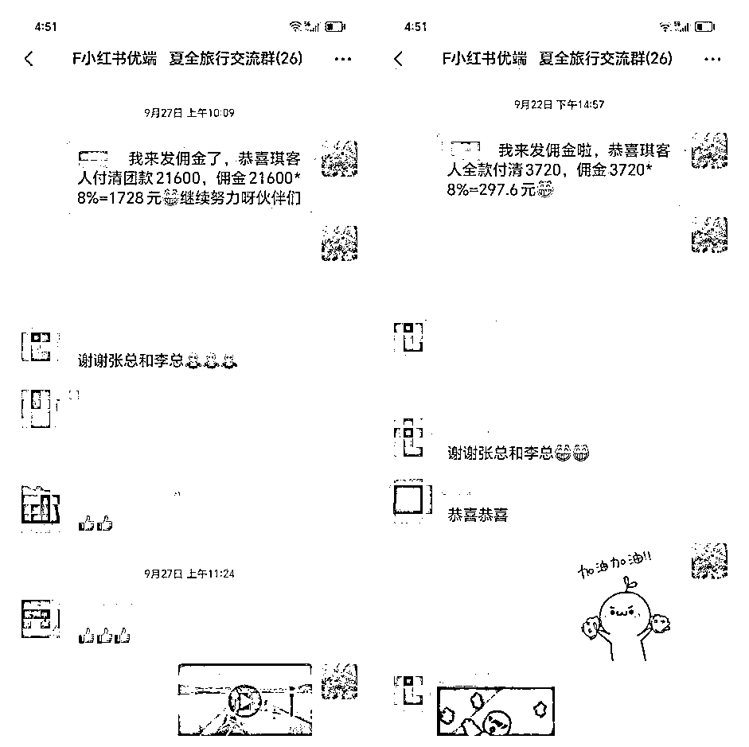

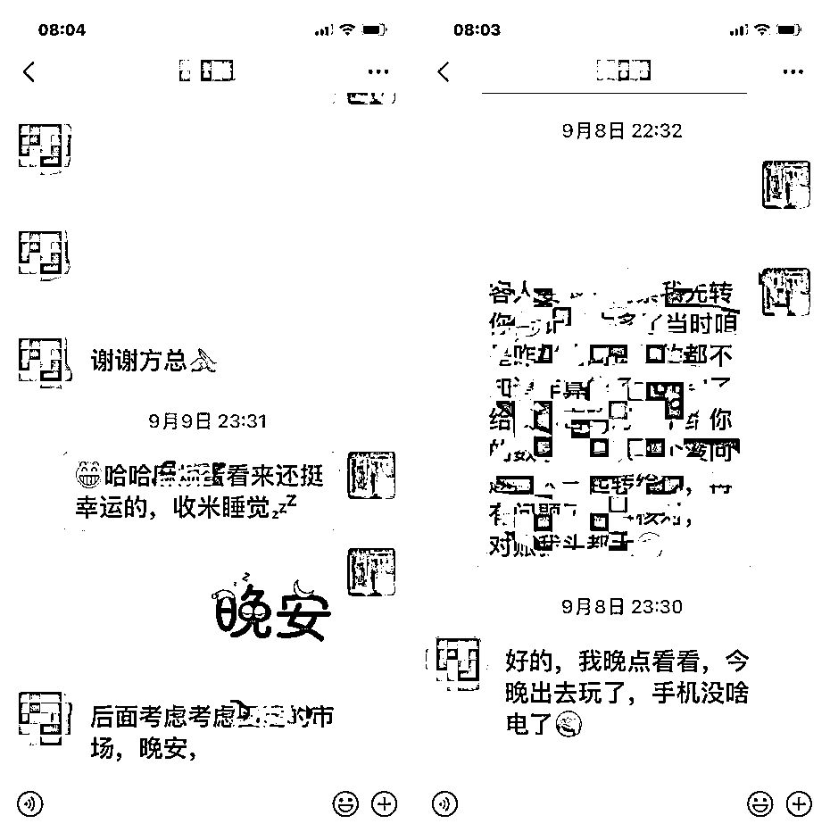

#### 2.3.5 洽谈避坑清单

2.3.5.1 是否正规：先查资质，有资质可放心合作。第一步，登录国家文旅部官网：https://mr.mct.gov.cn/

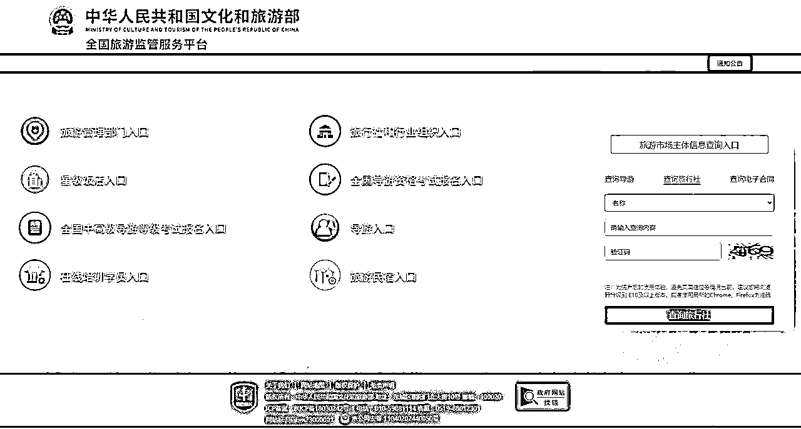

第二步，找到旅游市场主体信息查询入口 -> 查询旅行社 -> 输入名称、经营许可证号、统一社会信用代码，三选一即可。

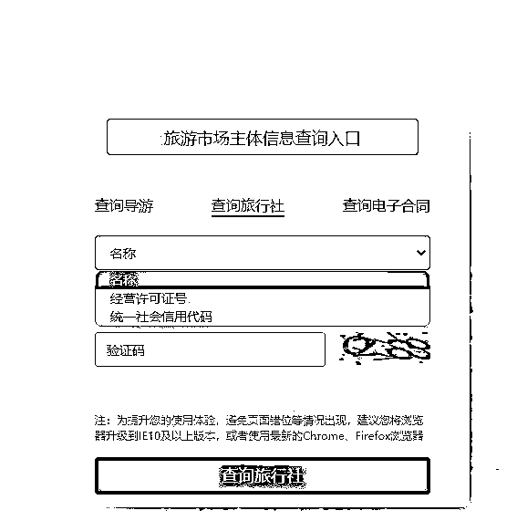

第三步，看结果，正规社一定有经营许可证。

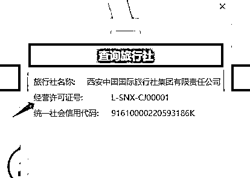

2.3.5.2 是否KB团、推自费：看口碑。KB（keepback，返点团）即购物团，香港、云南是重灾区，新闻多。

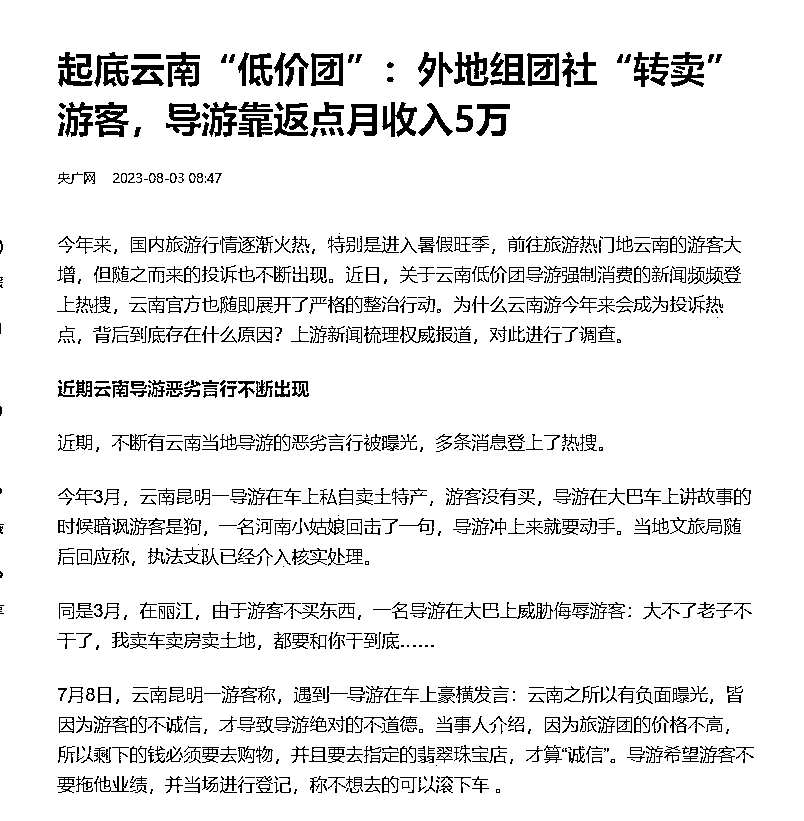

现在更隐蔽，抖音低价团常标0购物纯玩，靠“加点”让导游推自费，自费远超团费，导游拿回扣。这类团评价差、投诉多，但合同方是旅行社，客户后续找旅行社。做不做自行决定。

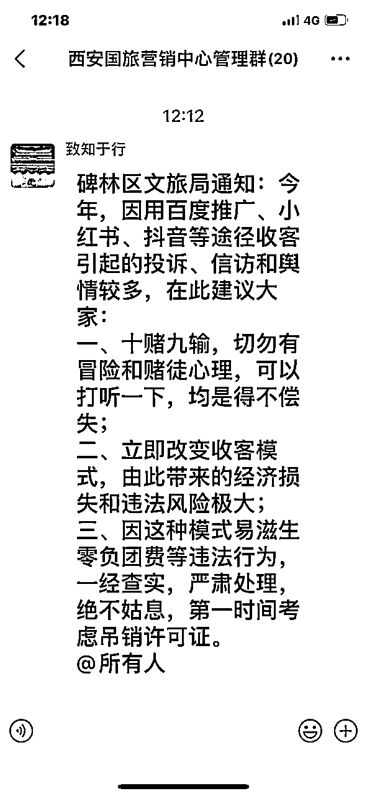

2.3.5.3 佣金能否及时返：旅行社拖欠严重，甚至说不拖欠开不成。可能把拖欠习惯带到佣金上。客人钱进旅行社账户，不进你私账，拖欠难制约。避免两法：选口碑好的；一开始约定单笔结算，这单不结就不给下一单。

2.3.5.4 后续服务质量：确保0购物纯玩；导游可能为业绩强制购物，最伤体验、最砸口碑。游玩、住宿、团餐质量要与行程单宣传一致，提前聊清。投诉及时处理，否则客户在📕发黑材料。在途客人每两天问一次，有情况直接找老板，把不满解决在萌芽中。

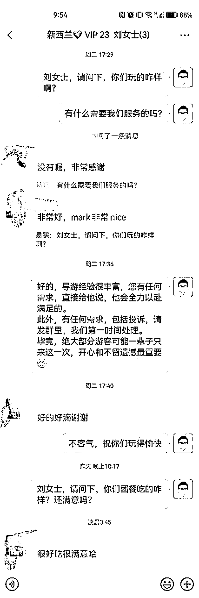

## 三、【实操 2/3】📕爆文导流，把客户带进🛰️ @渡

### 章节概要

说句实在话，整个项目里分量最重的一节就在这里，后续投入时间最多的也是它。等旅游图文的制作套路被你摸熟以后，别停下，反复回看数据、持续更新帖子，让爆文产出的频率一点点抬上去。

本节要拿下的就三块：先把账号立稳、把人设找准；再把图文发出去；最后把有意向的人沉淀进🛰️。

玩过📕的人，看一遍基本就能动手；完全没接触过也没关系，按下面给出的顺序走，你的首条帖子很快就能上线。

### 本章航线图

把本节学完并动手做完，航线图的第二阶段——发布📕内容并完成导流（预计 5 到 7 天）就达成了。

1. 建好不低于两个旅游类📕号，并完成养号（3 至 5 天，每日半小时）
2. 把线路产品的信息吃透，同时把资料仓库搭起来（3 至 5 天，每日两到三小时）
3. 挑出不少于两条高流量参照帖子，把它的结构拆明白（半小时左右）
4. 照拆出来的框架，写完并发出你的第一条图文（约一小时）
5. 把有购买意向的人引到🛰️上（十分钟上下）

那就从现在开始，按顺序动手吧。

### 3.1 把📕账号搭起来并做完整包装

#### 3.1.1 手里至少备两个号

眼下📕对往站外引流的排查越来越紧，旅游又属于偏敏感的类目。刚开始摸不清规则的时候，账号被系统盯上、判定违规乃至封禁都不稀奇。稳妥的做法是注册两个号，留一个做备用小号，帮主号分担导流动作。

第一步：把手机卡备齐

两个号意味着两张卡。手里只有一张，可以借家人的名字办，或者线上申请一张新卡，流程不复杂。

我自己走的是电信副卡这条路：装宽带的主卡能额外开两到三张副卡，具体数量看套餐档位，副卡与主卡共享流量，用起来省心。

第二步：怎么登录

两个号一起运营，很多人第一反应是：一部手机够不够用？

答案是看你手机有没有自带应用分身。部分安卓机型（红米就是其中之一）支持这个功能，一部机器挂两个号完全可行，我长期这么用，至今没遇到异常。

若手机不具备分身能力，千万别去装第三方多开工具，那类软件封号概率很高。此时只能再添一台设备专门登录，二手平台花三四百块收一台，日常操作绰绰有余。

第三步：把个人实名认证做掉

个人号能够申请成为旅行博主。有个前提必须清楚：同一张身份证仅可绑定一个账号，认证完成后想解除，唯一办法是把该号注销。

通常只给主号做认证，负责导流的那个小号保持未认证状态即可。

操作路径：点“我”—左上角三条杠—进创作中心—创作服务里的更多服务—开通专业号—成为专业号—选个人后点立即申请—填实名资料—最后在类目里挑“出行-旅行博主”。

第四步：把号养起来

刚注册的号，每天抽半小时以上做“养号”动作：像普通用户那样浏览同赛道的内容，顺手点关注、给赞、留几句评论。坚持三到五天基本就够。

#### 3.1.2 定位怎么定，主页怎么包装

3.1.2.1 先说定位

账号起步阶段，四成力气应该花在定位上，选题、内容、导流都排在它后面。

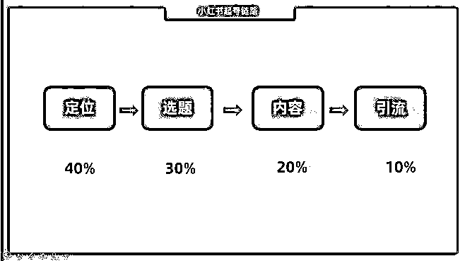

定位这件事，抓住三个词就够：垂直、精准、细分。

说到底，找定位就是找人群——你希望谁来关注你，你的内容打算呈现给哪一类人。

举个例子：我主打青年旅行，客群锁定 18 到 28 岁，那么 IP 形象就要贴合这群人的审美与偏好，产出的内容也得是能促使他们私信询价、最终下单的那一类。

细分方向定下来以后，无论是人设包装还是内容制作，准星都要对着这批人。

再举个例：假如确定做西安亲子游，后端也有产品能承接成交，那就把 IP 往目标人群喜欢的方向塑造，例如“爱遛娃的宝妈”这种人设，内容则对准宝妈们爱看、看了容易心动的题材。

在📕，不管你切的是哪个赛道，定位都必须往垂直和细分上靠，转化才会准，变现才走得通。

3.1.2.2 再说包装

包装账号，相当于开门做生意前先把店面拾掇一遍。

原则只有一个字：简。做云南线路，头像、名字、介绍就都围着云南转。

很少有人仅凭某条内容就点下关注。对方通常会点进主页，把名字、头像、介绍、背景图和过往帖子扫一遍，之后才做决定。

所以主页呈现得用点心——它既影响别人愿不愿意关注你，也在相当程度上左右着对方会不会来找你下单。

对博主而言，资料填得越完整，账号权重往往也越高。

逻辑不难理解：信息越全，平台越容易给你打上明确标签；标签清晰，推来的流量就更对口；流量对口，愿意点开内容的人自然变多，各项数据往上走，权重也跟着水涨船高。

下面按名字、头像、介绍、背景图、主页版式这几个部分逐一拆开讲。

名字是别人接触你的第一道门。对方往往先看这几个字，来判断你是什么身份、干哪一行。

最常见的翻车方式有两种：一是起得太含蓄，二是过分个性，结果别人从名字里读不出你的业务，甚至完全看不明白。好名字能靠关键词替你带来搜索曝光。

下面几种取名公式可以直接拿来用：

总之，名字要能直接折射定位，让人扫一眼就知道你能帮他解决什么。

取名还有几条红线：咱做的是个人号，名字里必须透出“人”的气息或身份。别用大而空的类目名，像“XX 旅行”“XX 定制游”“云南旅游”“XX 周边游”这类，一来没有个人味道，二来本就只对企业号开放。

头像要么走文字路线，要么真人露脸。

文字头像与名字作用类似，一眼传递业务属性；真人出镜则能缩短心理距离，让人觉得真实可信，信任感随之建立。

走 IP 人设路线的号，尤其推荐真人露脸，也可以把名字或地域元素做成头像。

不少同行偏爱拿风景图当头像。风景虽与赛道沾边，但画面里既没人也没地名，辨识度和记忆点都偏弱，这里不太推荐。

会去看介绍的人，多半是从某条内容跳进主页，想多了解你一点。因此那几行字分量不轻，它常常直接决定对方关不关注。

一段合格的介绍要回答四件事：你是什么人、做哪一行、为什么值得关注、能给对方带来什么。

举例：

1. 我是谁、干什么、能给什么：在新西兰做了 8 年司导，接私人定制行程与本地跟团，一支新西兰旅行服务团队
2. 实力佐证：新西兰旅游协会 TAANZ 会员
3. 差异卖点：只做高品质纯玩，累计接待超 5000 人，陈道明、靳东等明星也在其中

排版上，三到四行最舒服，多用短句，数字适当点缀。

介绍栏也有敏感区：“私人订制”“定制游”单独出现没问题，“专注 XX 旅游”也能写；但“提供私人订制服务”“专注私人订制旅行”这类组合，我们实测会被判违规，落笔时务必绕开。

背景图可以放与产品、人设、场景相关的内容。

1. 用文字直接列出你能提供的服务
2. 选一张出片的标志性景点，主做哪个目的地就放哪里的景
3. 放有真人出镜的旅行照，画面要讲究，别堆得太满
4. 放线下旅行社的门店实拍
5. 也可以放些像朋友圈那样的生活与旅行打卡，尽量贴着你的 IP 领域，用来拉近和用户的关系

帖子的封面要能显出你的调性。整体风格保持稳定，配色协调不花哨；设计可以优化，但别天天换模样。

下面看几个装修到位的旅游号示例：

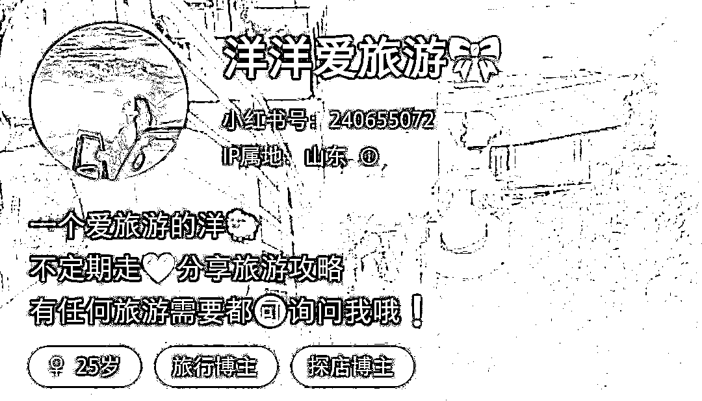

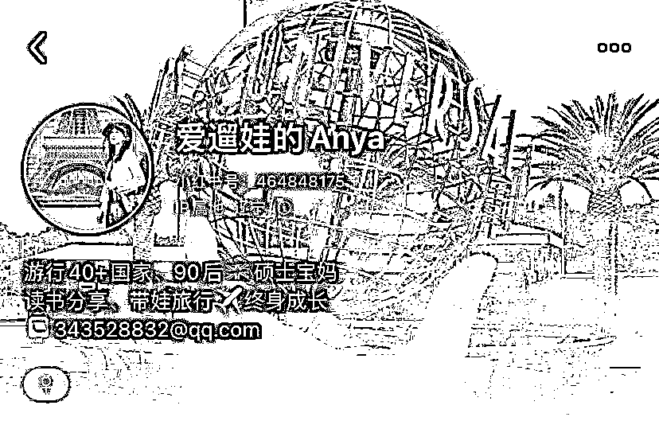

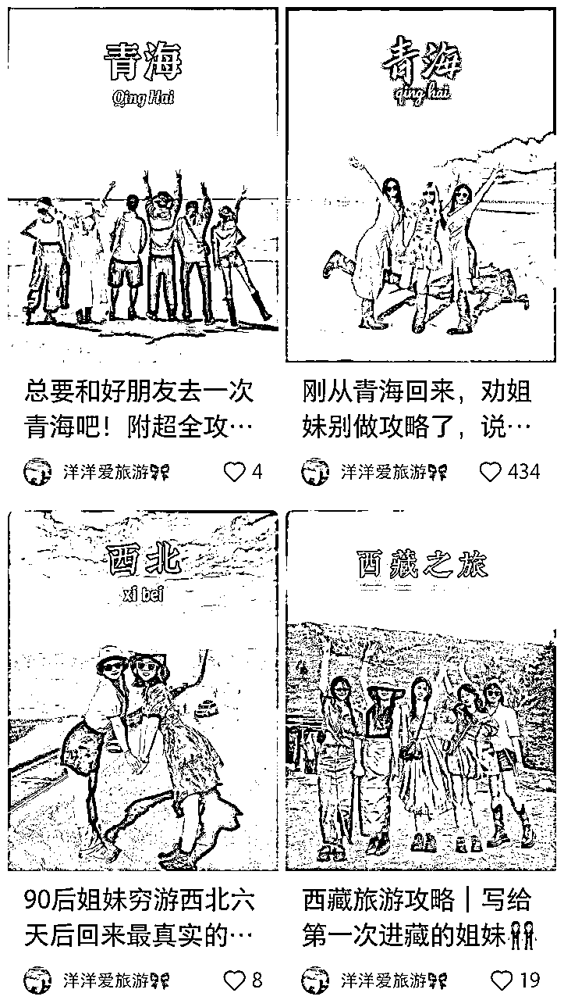

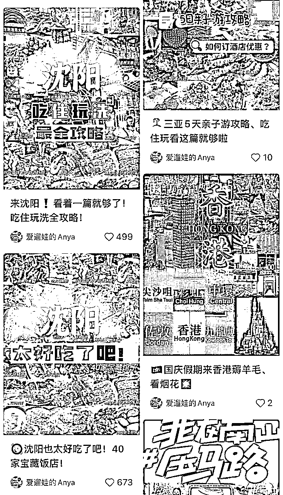

### 3.2 发出你的第一条引流图文

### 小节概要

这一节带你走完首条图文的发布流程，这也是整个项目的一个关键节点。本节要完成的事：

摸清所选线路产品的各项信息

学会搭资料库，并且往后能持续往里补

掌握旅游图文从制作到发布的完整链路

想练到十分钟出一条帖子的手感，前期的重复练习绕不过去。手熟了，爆文自然来。

#### 3.2.1 先定用哪条线路引流

目的地此前已经敲定，但同一个地方往往挂着好几条线路产品。

动笔之前，得先把具体产品挑出来：可以只写一条线路，也可以把多条打包成合集。

#### 3.2.2 把线路信息吃透

下笔之前，先拿旅行社给的线路资料过一遍；不够的话，再去携程、途牛、百度这些地方补。

关于散拼团，这几项必须弄清楚：

1. 这条线路上都有哪些景点？
2. 每个景点特别在哪？
3. 散拼团多久发一次？
4. 出发集合定在几点？
5. 一个团最多收多少人？
6. 报价是多少，成人与儿童差多少？
7. 行程里留没留自由活动时间？
8. 配不配导游讲解？
9. 是否包含接送？

#### 3.2.3 把景点文案与图片资料库建起来

干旅游这一行，自建资料库是基本功。一条帖子最核心的东西无非两块：景点介绍文字和对应图片。以西安散拼团为例，内容必然会写到团里包含的景点、各个景点怎么玩，再配上图。

所以前期查景点资料的时候，顺手归档进文件夹。往后写内容直接翻出来用，复制粘贴就行，不必每回都上网现搜景点介绍和玩法，那样太耗时间。

还是拿西安散拼团举例：产品里有华山一日游、兵马俑一日游，那就各建一个文档，把两个景点的信息分别装进去。像华山的介绍文字、有哪些玩法、西上北下与北上西下怎么区分，这些都要提前收进对应资料夹，写的时候直接取用。

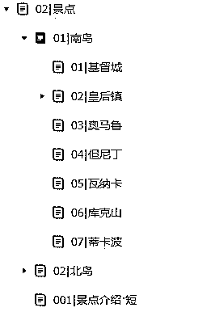

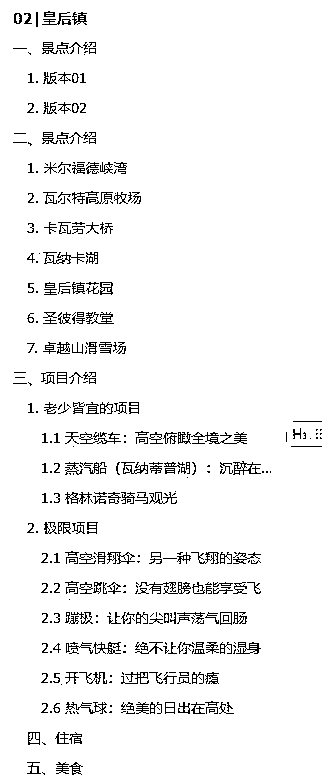

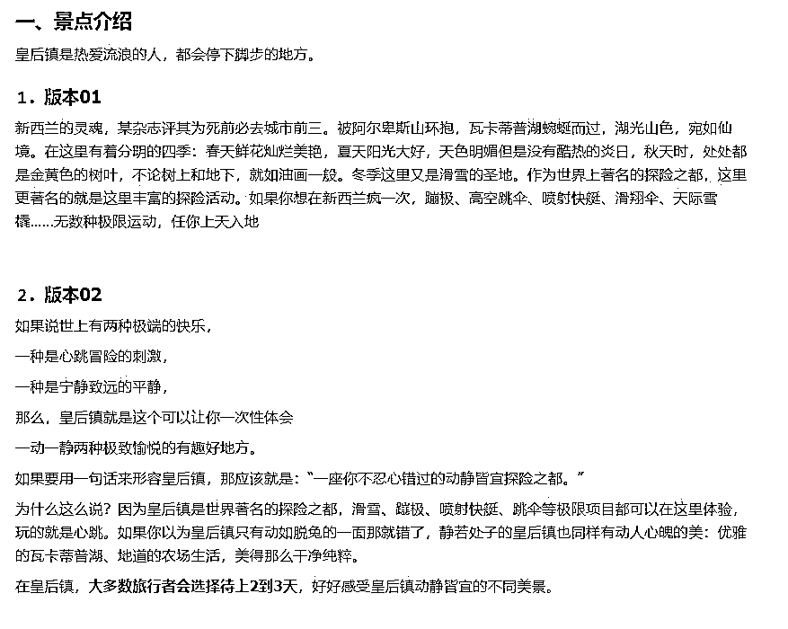

文字之外，图片归类同样关键。一个目的地景点众多，每次发帖都要配图，临时翻找极费工夫。最省事的办法是攒一批，或者每遇到一张好看的景点图就立刻丢进对应文件夹，下回直接上传。

图片大致分两层来存：一层按景点本身归档；另一层收每个景点会牵扯到的吃、景、住、玩和用车这几类素材。

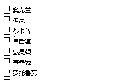

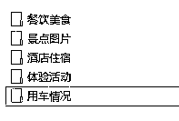

#### 3.2.4 图文怎么创作、怎么发布

想写出被平台认可的内容，前提是搞懂用户爱看什么。已经跑出来的爆文恰好就是答案。去找这类帖子做拆解，是小号快速起量的必修课。

第一步：锁定高流量的参照帖

1）参照帖从哪儿挖？

假设做“华山一日游”，就把关键词丢进📕搜索框，从结果页里挑出适合自己模仿的那几条。

打开数据亮眼的那篇，正文末尾通常挂着话题标签。点进自己赛道的话题，顺着标签能捞到更多高流量帖子。

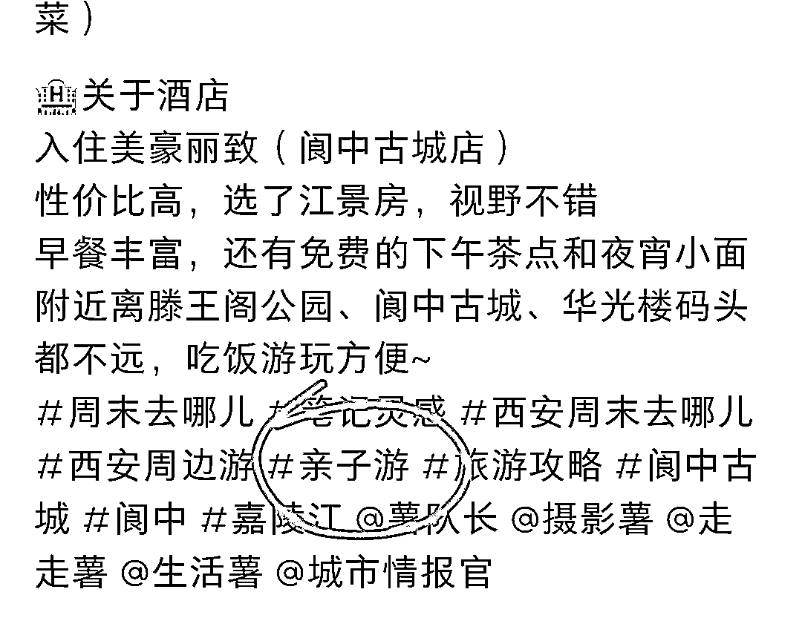

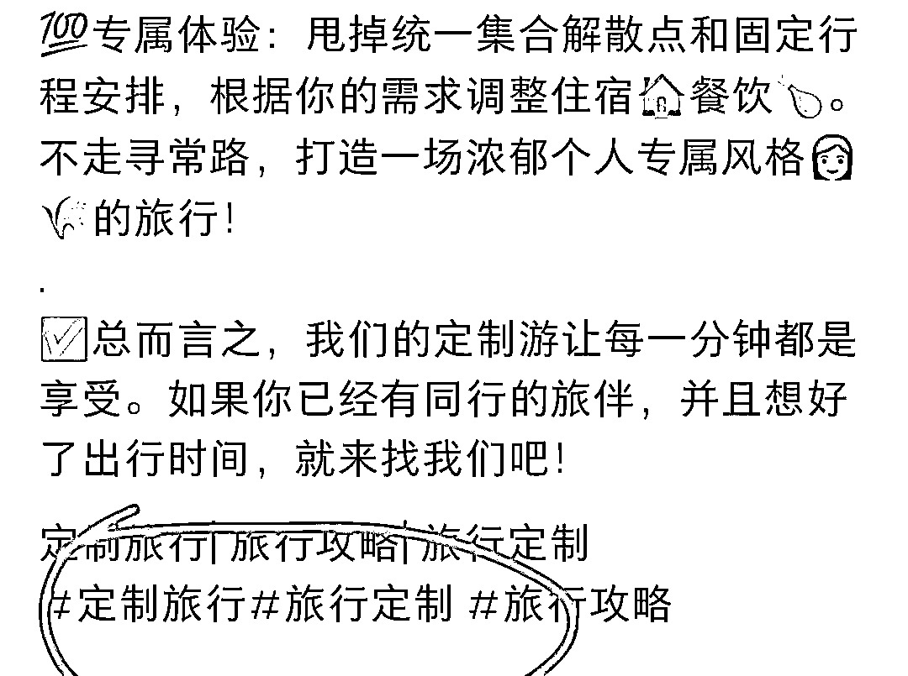

当你反复浏览与自身风格接近的内容，系统的发现页就会按你的口味推送同类帖子，你从中再挑出调性对得上的参照对象。

也可以借灰豚、千瓜这类工具筛“低粉爆文”，照着它们做，二次跑出好数据的几率明显更高。

（这类功能要会员，淘宝或闲鱼买个账号即可，影响不大）

2）什么样的帖子值得参考？

通常互动过百算小爆，破千就是大爆。挑参照对象时，优先往大爆那档选。

还有些帖子赞藏平平，评论区却挤满精准询价，评论数与赞藏接近一比一甚至反超，这种同样值得重点研究。

再瞄一眼发布时间，三个月以内最理想。若是季节性产品——冬季滑雪泡汤、夏季避暑这类——翻出往年同期的爆文来参考也无妨。

至于腰尾部甚至百万粉大号的爆文，参考价值其实有限，那些数据多半靠粉丝基数堆出来，你学不来。

【附】高流量图文的通用结构拆解

把大量爆文拆完之后，我总结出旅游赛道的一套通用骨架，照着填，出效果并不难。

平台上的旅游内容大致分三种：产品型、攻略型、人设型。

三者各有侧重：

产品型围绕你卖的东西展开，比如某地的特色景点、酒店或旅行套餐，靠卖点铺陈把用户引向咨询下单。

攻略型提供实用信息：行程怎么排、去哪玩、怎么玩、哪里值得去、住哪、吃什么。它起量快，但转化偏弱，得和产品型互相配合，转化率才上得去。

人设型讲的是你的身份、业务、能提供什么、与同行有何区别，主要作用是建立信任，一般置顶一条就够。

三者之中，重心必须放在【产品型】上——别忘了，我们的目标是把产品卖出去。

把产品讲清楚这件事很关键：内容层面就能过滤掉那些并非你目标客群的咨询，既减轻你和旅行社的负担，也让合作方的业务效率更高，配合起来更顺。

还有一点，挑参照帖时要核对对方的产品与你的是否同类。你卖高客单，却去模仿低价跟团游的帖子，引来的咨询多半也是低价客群，压根不是你要的人。

模板一：产品型内容

这类帖子的打法，说到底是把线路亮点和服务内容摊开来讲。它冲着转化去，直白描述产品，通常以单条线路或线路合集的形式呈现。赞藏数字未必好看，评论却往往不少，内容多是询问线路细节，来的客户也相对精准。

下面拿一篇典型帖子逐层拆解：

1）基础信息

链接：http://xhslink.com/6fYuSw

数据：赞：44 藏：43 评：233

2）标题怎么写的

7~10 月土耳其夏日限定小团 1 人可拼

套路拆解：时间+卖点

“7-10 月”点出出行季节；“限定小团”暗示成团人数少、整体品质更好；“1 人可拼”则说明单人也能报名，不设人数门槛。

3）图片分析

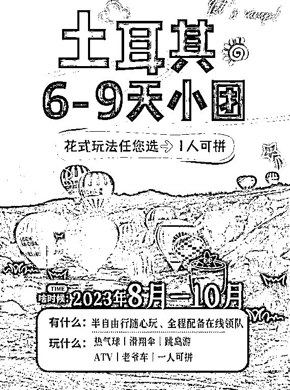

首图用当地标志性的热气球做背景，把行程景点、游玩天数、小团形式、出行月份、体验项目以及服务保障等信息一次性摆清楚，用户扫一眼就能掌握全貌。不足之处是通篇只放了一张图，缺其他画面补充，可以再搭几张别的景点照片。

4）文本分析

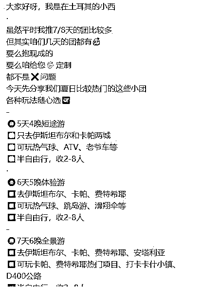

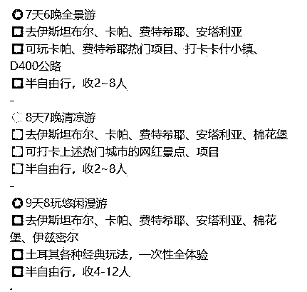

这是一条产品型帖子，用多线路合集的形式呈现。开场简单交代了线路与团期丰富、支持单独定制、还有不同主题玩法，把业务面铺得比较全。

往下就是各条游玩线路的逐一罗列，用合集突出产品多样、选择空间大。

短板在收尾：没有补上自身特色，比如从业多少年、服务过多少客人、能提供哪些配套，这些本可以进一步强化专业感与信任度，把咨询转化再推一把。

5）评论区分析

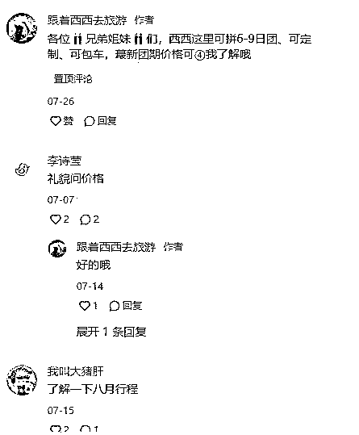

博主自己在评论区置顶了一条，把产品亮点和可提供的服务再讲一遍，引导大家留言提问，咨询量和评论数因此被带动起来。

模板二：攻略型内容

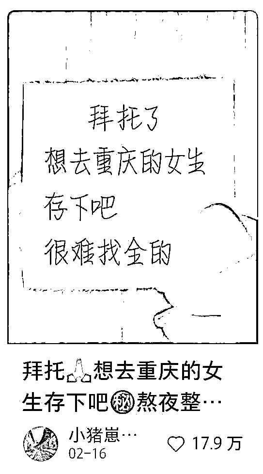

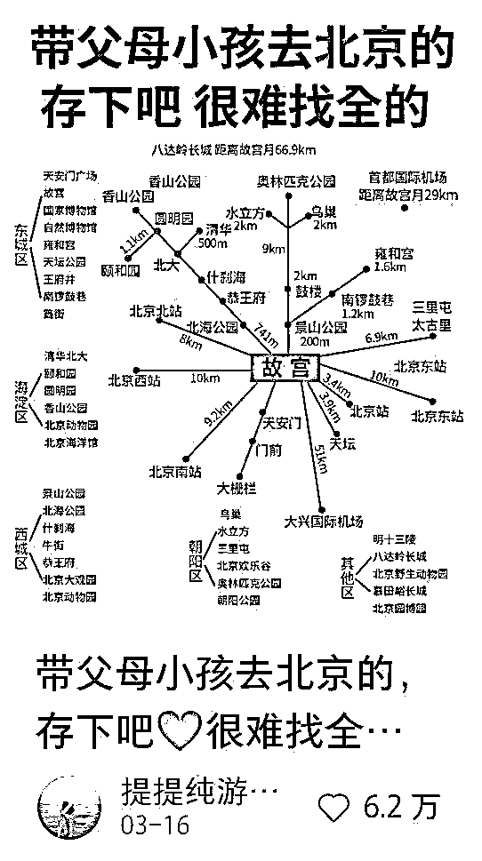

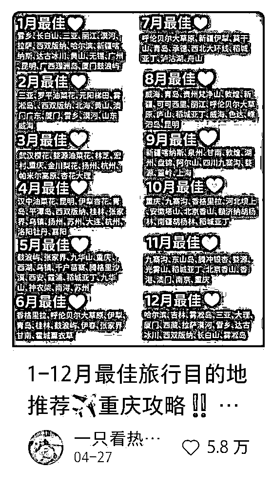

攻略型的关键词是“多”和“全”。在首图或标题里，用画面或文字传递“我这篇信息量很大”，单凭这一点就足以让大部分人停下来。

同样拿一条典型帖子拆开看：

1）基础信息

2）标题怎么写的

谁懂啊！终于有人把土耳其旅游说清楚了

套路拆解：情绪+悬念

“谁懂啊”负责把情绪顶起来，“终于……说清楚”则吊住好奇心，让人忍不住点开。

3）图片分析

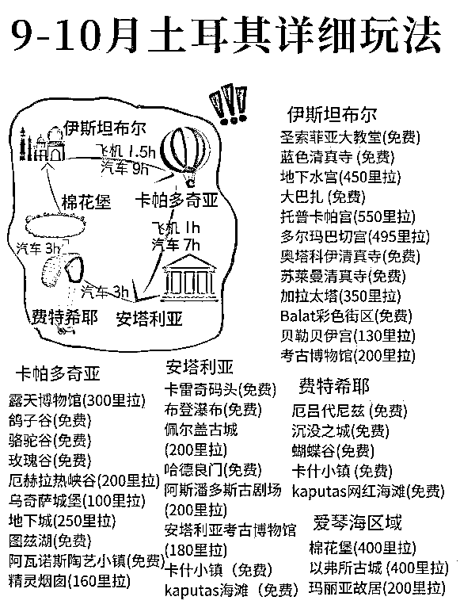

封面设计逻辑：把“景点收不收费”和“路线图”当成信息骨架，读者扫一眼就能抓住重点，知道景点怎么玩，进而觉得这篇内容够全，愿意先收藏。

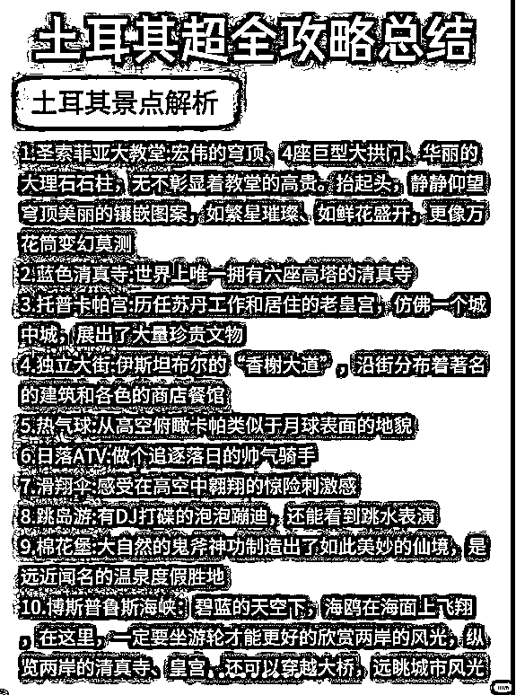

余下配图：按单个景点、天气状况、游玩提醒、随身物品等逐项铺开，让读者感到信息密度足，产生点赞和收藏的冲动。这类图文很适合批量复制，文字部分再结合自己的真实体验做二次打磨。

4）文字部分拆解

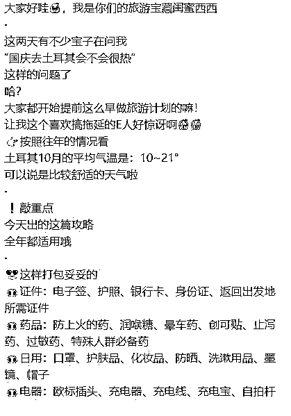

此类内容往往站在普通游客视角，讲天气、交通、餐饮、行李清单等实用信息。中段会细说抵达后的吃住行、随身要带什么、路线怎么走、有哪些当地美食，把读者疑问逐个消化。

5）留言区拆解

该篇作者把一条自评放在最上面，借产品卖点和可提供的服务做说明，吸引读者留言询问。咨询与互动量因此被带起来。

模板三：信任型人设内容

这类内容的数据往往不算亮眼，重点在于交代“我是谁、做什么、能提供什么、专业度如何”，让读者看完后产生信任。用得好，会明显抬高产品内容的成交效率。

下面借一个典型案例逐项拆解：

1）案例信息

2）标题剖析

我们叫「知日生」，做日本旅行设计已经30年

标题套路：自我身份+深耕年限。

“知日生”先亮明团队是谁；“专注”二字传递业务聚焦与专业底子；“30年”交代资历，让读者感知到经验、能力和水平都有积累，信任感自然上来。

3）配图剖析

首图承担业务介绍功能：服务范围、特色主题一目了然，版式和文字不绕弯，顾客能迅速判断你能做什么、能给什么服务。

后面几张图用风景照、美食照呈现目的地风貌与餐饮习惯，表达直给，让读者直观感受景点状态。

4）文字部分剖析

这篇属于人设型内容，围绕“我是谁、特色在哪、能交付什么服务”展开。开篇先交代身份：一个深耕日本旅行设计的工作室，30年经验，先把信任和专业感立住，消解顾客部分顾虑。同时点明会带大家深入当地文化和景点，而非匆匆打卡。

后文落在服务上：特色线路、优势、可体验的项目、与别家的差异。读者能迅速知道线路有哪些、服务包含什么、能获得怎样的经历，是一份不错的人设内容范本。

5）留言区拆解

此类内容可由小号或作者本人在留言区发问，比如“咨询能拿到什么方案”，把互动带起来，数据也会更好看。人设内容虽不以直接成交为目的，但读者了解后信任度和精准度都高，稍加引导对成交很有帮助。

第二步：素材筹备

这一步围绕对标内容，把图片与文字材料备好：

1）图片渠道

图片可从自建图库取，也能在百度、携程、📕搜。注意：除旅行社直供的图，其余尽量避开真人露脸。若确实需要真人图，别在国内平台找，容易被当事人刷到并投诉。可私信或到其内容下留言，说明会标注出处，争取授权；对方同意概率不低，也等于多一次曝光。

2）文字材料渠道

文字材料大致分两类：

①旅行社给的产品资料，整理进自己的库；

②从百度、携程、途牛、📕、知乎等渠道搜集，也可让ChatGPT帮忙。

第三步：图片制作

1.封面怎么做

怎样对标爆款做细致拆解，再做出封面？

像素级模仿，精准对标：

整张图可拆成四块：

1.四格真实景点照，其中一格真人入镜；

2.正中放主标题“XX6日轻奢游”，副标题写行程主要景点；

3.主标题下方放“人均1000+”，把低价亮出来；

4.主标题左上方写行程服务亮点。

拆完后按模板选素材，操作是：

1.从第二步建好的图库中挑4张目的地实景照，其中一张可带真人，背影或正面均可，先确认版权，用稿定设计或WPS拼成四格；

2.在封面中央找笔刷图形做底，在底上排主标题和副标题：主标题写“XX（目的地，可为单个景点，如华山）几日（散拼团多为1日游）轻奢游”；副标题写目的地下级小景点或玩法，如华山可写索道、滑道、西上北下、东峰日出、山顶帐篷；

3.主标题下方写“人均XXX（散拼团多在300左右）”；

4.主标题上方写一日游可提供的服务，如往返接送、吃、喝、门票打包。

封面从初稿到爆款，可归纳为三步：

判断封面行不行，有个快招：把图发到聊天窗口，自己只看1—2秒，看能不能立刻抓到画面主体和标题关键词。能，就合格；若还要停下来找，说明排版、花字要再改。提醒：别自嗨，少绕弯。

2.余下配图与去重

平台图文现在最多可发18张，减去封面还有17张。建议多传几张，让读者更全面了解目的地，包括攻略、风景、玩项目、酒店、餐饮、车辆等，越全越好。

制图会碰到来源、制作、去重。来源和制作前面讲过，这里只讲去重：

第一个办法：加滤镜或改尺寸。

（加滤镜示意）

（改尺寸示意）

第二个办法：两图拼一图。以新西兰但尼丁为例，找4张照片标1、2、3、4，可1+2、1+3、1+4、2+3、2+4、3+4，四张变六张。再在图上加字，不同内容用不同颜色、字号，去重效果也不错。

第四步：正文撰写

旅游内容框架并不复杂，通常由这些块组成：

①读者痛点；②自我介绍；③景点介绍；④行程线路；⑤行程亮点；⑥产品细节；⑦亮点细节。

几乎所有旅游内容都绕不开这些块，开头可按偏好设计。建议三种开头：

第1种：痛点切入。开头先抛目的地可能遇到的问题，比如人挤人、太疲惫，再自然接到本篇主题。

后面接景点介绍+线路+亮点+产品细节+亮点细节，最后放自我介绍。

第2种：先自我介绍。开篇打招呼、亮身份，让读者先建立初步信任，再往下引。

第3种：景点切入。这是目前平台刷到最多的写法，直接说清本篇目的地。

景点切入后，继续线路、亮点、产品细节、亮点细节，最后补自我介绍。

注意：景点介绍别像官方账号那样硬搬资料，容易像广告；写得活一点，减少判营销的风险。

你会注意到，中段骨架几乎不用动。把模板搭好后，等熟悉景点和产品，写一篇时直接往里填内容即可；手熟后十分钟就能出一篇能带来客资的内容。

旅游内容最耗时的是找图和了解产品信息。这三块素材够了，写起来并不慢；但前期必须花时间建自己的素材库，库建好后会轻松很多。

第五步：拟标题

平台标题一般20字，最佳做法是大关键词（如西安）+小关键词（如华山）组合；也可把领域内不同关键词的爆款标题记录下来，拆解后再拼成新题。

旅游关键词大致有：

①地域：国内、境外；

②月份：1月、2月或12—1月；

③节假日：寒假、暑假、国庆、五一、春节、元旦等；

④季节：春、夏、秋、冬；

⑤景点：大关键词如桂林、宁波、厦门、深圳、西安、云南、长沙；小关键词如西安的华山、兵马俑；

⑥天数：5天4晚、2天1晚等；

⑦主题：徒步、星空、露营、滑雪、蹦极等；

⑧酒店：星星酒店、野奢酒店，适合有一定知名度的酒店；

⑨其他：目的地独有特色，如西安长恨歌演出。

随后到平台搜词。可搜西安相关景点词，如“兵马俑”；也可搜大关键词“西安”、小关键词“华山”“长恨歌”等。把搜出来的内容里的爆款标题记录下来：

这一步很关键。平台流量主要来自搜索，搜索结果要出现你的内容，正文和标题就得和搜索词相关；标题对搜索词权重影响很大。

另外，可把“推荐、知识、分享、如何、搭配、新手、怎么做、必备、教程、技巧、步骤”等词灵活穿插。

也可用数字型标题，如“2个方法、10大、4个要点”，例如“来新疆旅游必打卡的3个地方”。起题思路和👸号、知乎相近。

结合上述方法，以旅游攻略类内容为例，标题可这样拟：

另外再列几个反面样本——内容不差，但标题没给读者点击理由，等于好内容被埋没：

第六步：发布

以上完成后，按目标人群活跃时段选发布时间，或观察同赛道爆款的发布时点，判断读者活跃时间，再点发布。

#### 3.2.5 散拼团产品的内容制作要点

3.2.5.1 把低价亮出来

无论什么产品，“低价”都是强流量密码。散拼团客单低，完全可把价格直接写进内容，明示价格有助于提升成交。

3.2.5.2 与干货攻略搭配

攻略就是干货内容，作用是起号、抬账号权重、吸流量。起号初期可多发，因为这类内容容易起数据，如旅游攻略、避坑、景点介绍等。

3.2.5.3 预留转化入口

1.在攻略里插入行程建议，做行程速览，每天从哪到哪；

2.结尾做简短自我介绍：我是XXX，什么情况下可以找我，我能提供什么。别太直白，写得含蓄些；

3.在留言区做小剧场，用小号或朋友模仿真实用户留言，或在文中写“留下时间+人数”等引导，再把那条留言置顶；

4.写产品内容。读者从攻略点进主页，再看产品内容时，也能完成成交。

### 3.3 怎样在规则内把客户导到🛰️？

### 本节要点

这里的关键词是“合规”。平台对导流并不宽松，这几乎是所有创作者的难点；不熟悉规则，轻则判违规，重则封号。

但也不用慌。平台虽不鼓励导流，仍会留一些缝隙给创作者，这是平台和创作者之间的默契。找到缝隙、抓住它，个人号依然能拿到目标客户。

下面看相对安全的导流操作：

#### 3.3.1 钩子怎么设置？

钩子可用粉丝感兴趣的文档，用内容筛客户。例如先引到群聊，再在群里做🛰️导流。

#### 3.3.2 可用导流路径有哪些？

平台对交易导流管得严，隔一阵就得换加🛰️的方法。

既然要加🛰️，就要有被封号的心理准备。同时运营多个号，封一个还有别的。一机一卡一号，用手机流量上网，别共用同一个WiFi，否则可能被连坐。

目前实测下来，有几条路径效果尚可，分享如下：

注意：平台风控变化快，下面方法随时可能失效，多关注航海群，多和同行交流。

3.3.2.1 路径一：收藏夹

用小号发一条含🛰️号的内容，再用大号收藏，并把收藏列表公开。

客户来问时，用话术引对方去看收藏。

3.3.2.2 路径二：群聊配合小助手

顾客私信后，简单聊几句就邀请进群。

进群后，小号在群里和顾客互动，用图片发我们的🛰️，或向顾客要他的🛰️。

号码别写原词，换种说法，否则会被屏蔽；发🛰️也要走图片，直接发会不显示，或把号码分段发。

这里注意：顾客咨询后，你把入群链接发过去，要马上点同意，并在群里用小号发联系方式。回复要快，否则通过率会掉到三到四成；及时回，通过率可到七到八成。

3.3.2.3 路径三：PK组件

把🛰️号藏进PK组件，操作：打开📕→点底部中央的加号→添加图文内容→在编辑页找到投票→互动组件→点PK组件→填写PK标题和观点→发布，之后在PK信息里就能看到藏的联系方式。

这里注意：平台规则改得快，手册未必能同步更新，导流问题多留意群内讨论。

3.3.2.4 路径四：📕ID

把📕号设成🛰️号，私聊时引导对方看ID，比如：“免费定制行程看📕号”，或“看📕号，给你发行程和报价”。懂的人自然懂，就看她加不加。

注意：📕ID只能改一次，可改成自己的🛰️号。最好用英文+数字或纯英文，用户才容易反应过来；纯数字不易分辨，长度控制在8位以内。

3.3.2.5 路径五：瞬间

瞬间是挺好用的导流位，可按自己的喜好和实际情况，把🛰️信息融进去。

3.3.2.6 路径六：留言区配合小号

在留言区艾特小号并置顶，小号发一条带🛰️的内容。

3.3.2.7 路径七：一对一私聊

前期咨询少时可用。顾客私信来问，直接说：“你V多少，我给你发具体行程和报价。”

在🛰️私聊场景里，可以用一张类似🛰️登录页的截图，通过画面提醒对方“该加🛰️了”。同时，最好让对方把内容分几条发过来，不然一次性发太长，容易在传输时被吞消息。

#### 3.3.3 引流避坑指南：这4个坑别踩

1. 选题太宽泛，引来的客户不够精准

这次航海做的是散拼团路线，所以笔记从选题到文案表达，都必须围绕“散拼团”来展开，这样来咨询的用户才更对路。如果笔记内容没有紧扣这个主题，吸引来的人往往意向不高，很难谈成单。既耗时间和精力，还要冒着风险换来一堆低质量线索，最终成交率也很低。

2. 文案太像广告，容易被限流

个人号最好站在素人游客的视角写内容，文字要口语化，不要硬邦邦地卖产品，同时要留意避开平台的高危词。一旦内容被系统判定为营销痕迹太重，就可能被限流，甚至收到违规提醒，这点必须小心。另外，个人号文末尽量不要出现“关注”、“留言”这类字眼，被系统检测到的几率很大。

3. 引流动作太激进，账号容易被判违规

在📕私信里引流时，别因为想留住一个顾客就急着发🛰️号，保护账号永远要放在第一位。可以先引导顾客进群，或者引导对方关注📕 ID；如果对方实在不愿意跟过去，那就放弃这个客户。特别注意：在📕 1V1 私聊中引流，一天不能超过10个人，一旦超过就很容易被系统识别，可能造成违规甚至封号。

4. 回复不及时，客户说走就走

不管是在📕回复私信、通过好友申请，还是加上🛰️之后的跟进，都要尽可能在第一时间回应。及时回复能明显提高好友通过率，也直接影响最终成单率。

## 四、实操最后一环：🛰️成交

### 本章速览

这一期推荐的旅游产品普遍客单价比较高，直接成交并不容易。但我们通常不需要亲自死磕销售，而是把客户对接给旅行社工作人员去成交，我们从中赚取佣金。所以，就算你完全没有销售经验，也不用担心。我们要完成的，其实是一套很轻的流程：先通过沟通拿到客户的基本信息和核心诉求；然后判断客户意向，再把意向不错的客户拉群对接给旅行社；后面的事就交给专业人士处理。接下来，我们就一起看看客户被引流到🛰️后，真正的成交过程是怎样推进的。

### 本章任务路径

当你学完本章内容并完成对应实操，就完成了整体路线图中的第三阶段：🛰️成交（大约需要2小时）。这个阶段的任务很清晰——先和客户🛰️沟通，获取信息，再对接给旅行社促成成交，预计用时也是2小时。现在就动手吧。

### 4.1 🛰️成交的操作流程和技巧

第一步：先问清客户的基本信息

客户加上🛰️之后，不要急着推销，先问一些基础信息，既是为了了解对方，也是为了筛选意向。比如出发日期、出行天数、出行人数、有没有老人或儿童、想去的景点有哪些、预算大概是多少，等等。如果聊下来意向不错，就可以把这些信息同步给旅行社对接人员，由他们接手后续成交。

参考话术：

你好，请问是通过📕来咨询 XX 旅游的吗？

您计划什么日期出发？

一共几个人？打算玩几天？

有没有老人或小孩同行？

比较想去哪些景点？

想了解跟团游，还是定制游？

定制游的预算是 XX 元/天，这个价格在您的预算范围内吗？

……

好的，那我先拉个群，让我这边的当地同事/导游给您详细介绍下具体行程。

第二步：把客户信息同步给旅行社人员

当你在聊天里大致摸清客户信息、判断出对方有意向后，就去航海大群里找到负责这条线路的旅行社工作人员，先添加对方🛰️，再把你们的聊天记录同步转发过去。让旅行社人员来判断客户是否值得跟进；如果对方也觉得意向OK，就可以进入拉群环节。

第三步：拉群，让专业的人上场

把客户和旅行社工作人员拉进同一个群，然后在群里 @ 一下工作人员，简单介绍客户情况和工作人员身份。例如：“@旅行社工作人员 XX导游您好，这个小姐姐想了解 2.1-2.10 日的跟团游具体行程，主要想去 XX 景点，不想去 XX 景点，麻烦您帮忙介绍一下。”引导完之后，接下来的事交给旅行社就好。

佣金结算方面，旅行社在群里完成成交后，一般是一个月结算一次；也有一单一结的，客户出发当天，人走了账也就清了。

### 4.2 🛰️成交避坑指南：防止被封号

在🛰️上成交，最需要警惕的就是封号。到底哪些操作容易被封？又该怎么防范？

情况一：加好友太频繁

🛰️加好友，不管是被动加还是主动加，旅游客户的入口无非这几种：🛰️号、二维码、手机号、🐧号。其中，主动用手机号去添加客户是最敏感的，数量一多肯定被限制。笔记爆了之后，想加你的客户会特别多，这时候最直接又稳妥的办法是让客户主动来加你。这样不光安全，通过率也更高。我们通常会直接给出🛰️号，让对方主动添加——顺便还能筛掉一批意向一般的用户。

情况二：网络环境不健康

比如多个🛰️号共用一个WiFi，或者同一个IP下挂过不少有问题的号；再比如IP长期不变、频繁换设备、异地登录等等，都容易让账号被盯上。另外，经常群发广告、连续加人、异地收款、快进快出的转账等操作，也会影响账号正常使用。碰到这类情况，及时更换网络环境或者换IP，一般就能缓解。

情况三：新号注册完就批量加人

刚注册的🛰️号，不要马上用于业务，先养一段时间。平时拿它正常消费、付款，模拟真实的生活使用场景。不然不管主动加人还是被人加，数量多了都会被限制。

## 五、复盘优化：持续迭代，让爆款越来越多

### 本章速览

掌握笔记发布的基础流程以后，接下来的重点就不再是“发出去”，而是不断迭代笔记质量、提升生产效率，用更好的内容换取更多曝光，最后把曝光转化为客户。这一章会从两个方向展开：一是优化笔记内容本身。内容创作没有捷径，刚开始发的那几篇数据不好再正常不过，不用焦虑。只要持续复盘、不断调整，爆款自然会来。二是提高生产效率。与其死磕一篇大爆款，不如先产出多篇小爆款，对我们来说性价比更高。效率一旦提上来，量变就能引发质变。具体怎么优化质量、怎么提升效率？我们往下看。

### 本章任务路径

完成本章的学习和实操后，你就完成了整个路线图第二阶段（发📕引流笔记，约耗时5-7天）里的“复盘优化”任务。这一阶段要做的事是：复盘并优化笔记内容，同时想办法提升笔记生产效率，预计花2小时左右。现在就开始吧。

### 5.1 笔记数据不好，如何找准问题？

先别急着喊限流。很多人的浏览量只有100-300，或者300-500，就怀疑账号出问题了。可以明确告诉你：这是正常的。只要浏览量不低于50，在50-500这个区间，基本都属于正常范围。数据上不去，更多还是内容质量本身不够好。判断笔记数据好不好，可以用三个方法：先跟自己比，看看自己发过的笔记里，哪些数据更好，再倒推原因；再和同量级的博主比，如果对方粉丝500左右，你也差不多500，这才有可比性。不要拿500粉的号去和1万粉的号比，这种对比没有参考意义。对比的时候，多看对方的点赞藏和评论量，为什么别人评论多、收藏多？看他们的内容结构，看他们怎么引导互动，能模仿的地方就尽量模仿。如果确认数据确实不佳，就按下面几个方向逐一排查。

#### 5.1.1 小眼睛（阅读量）不佳怎么办

如果笔记发布后2-3小时内阅读量就不理想，或者阅读量长期停留在100-200、甚至不到100，可以对照以下几个常见问题一一检查。

#### 5.1.2 点赞、收藏、评论等互动数据不佳怎么办

互动数据不好，只要不是违规问题，也不是所谓的“玄学”，那十有八九还是笔记内容质量没达到用户的期待。可以对照以下几个方面自查。

#### 5.1.3 发布后修改笔记，要注意什么

不少人问：笔记发出去再修改，会不会影响曝光？从我们观察的数据来看，修改后阅读率确实会重新计算。但只要不是频繁地改，对这条笔记的整体影响不大。需要留意的是，修改之后笔记会进入重新审核，审核通过才能重新展示。有时候笔记里有敏感词，或者标题不理想，改完之后重发，数据反而会变好。但也有一种情况：原本已经过审、正在正常推流，改完之后审核人员觉得有问题，反而被限流，数据就下去了。所以，如果某篇笔记已经爆了，想修改时一定要克制——不要动原文，有什么要补充的，可以直接写在置顶评论里。

### 5.2 笔记违规、被限流，这样处理

如果遇到限流，可以试着连续申诉3天，说不定能解除。如果是轻度违规，比如小眼睛一直卡在50以内，可以申诉3次，同时联系客服，再尝试申请解除。尤其是引流类笔记，火了以后很容易被判违规——几乎每篇爆款都经历过违规。遇到这种情况千万不要放弃，一定要坚持申诉。申诉有两个入口：

两个入口最好一起申诉，因为背后的审核人员可能不是同一批，判定标准也会不一样。就我个人经历来看，违规笔记里面只有一条没有得到回复，其余全部恢复了，包括评论超过5000的爆款笔记也都回来了。当然，申诉话术不能直接照搬，因为每个人的情况不一样。拿我自己经常遇到的两类违规来说，我一般会这样写：“我是按照咱们官方视频中推荐的，让客户留下自己喜欢的产品，并未刻意引导，请官方核实。”（官方确实有相关视频，专门教怎么正确引导评论。）如果是图片文字太多被误判，我会写：“我的图片上文字比较多，可能是被机器识别出来误判了，实际并没有违规，请人工核实后予以恢复，感谢官方。”总的来说，只要不是特别明显的违规，基本都能申诉通过。重点是，把自己的行为尽量往合理的方向解释。

补充一点：如果账号数据出现明显的异常走低，而且一周后还没有恢复，那就注销重来，别拖。我之前测试时有个1.6万粉的账号，连续一周每天只涨几十个粉丝，我直接注销重新做，结果用了10篇帖子就涨了7600粉。

### 5.3 如何提升笔记的爆款率？

#### 5.3.1 流量优化：标题服务系统，封面吸引用户

标题是给系统看的。系统通过识别标题里的关键词，把笔记推给精准人群，用户在搜索结果里能不能看到你，也取决于系统对标题的识别。因此，标题在创作时要同时照顾系统规则和用户的搜索习惯。至于怎么写好标题，可以回看【章节3.2.4第五步：写标题】，再结合下面【章节5.3.3关键词优化】一起学。封面是给用户看的。旅游赛道和很多赛道不同，图片或视频必须足够美，能让人产生“好想去”的感觉。旅游本来就是一种通过视觉激发向往的内容，如果画面太普通，用户很难被触动。有个做法国旅游的朋友，很用心地发了很多笔记，小眼睛却只有几十个。我帮他看了看，问题就在首图上——用户看到封面后，根本不想点进去。

同类笔记在搜索列表里排成一排，用户凭什么点你？就是因为你的首图和其他笔记不一样。从某种程度上说，首图好不好看，决定了用户点不点击，至少能占90%的因素。举一个最简单的例子：下面这两张首图，你会点开哪一个？

左边那张色彩灰暗，看着就压抑；右边那张阳光明媚，心情也变好了。做📕旅游博主，审美提升是绕不开的功课。对普通人来说，最快的提升方式就是多看、多观察、多总结。

#### 5.3.2 把评论区经营起来

笔记不是发完就算完事，后面最关键的动作是经营好评论区。一个热闹、有引导性的评论区，既是获得更多推荐流量的关键，也是提高转化率的点睛之笔。先简单说下📕的推荐算法：

核心结论是：用户动作对爆款笔记的积极影响排序为 关注 > 评论 > 收藏 = 点赞。也就是说，互动量越高，笔记的数据增长越快。所以，笔记发布后，可以先用自己的小号，或者让朋友帮忙，在评论区留下几条评论，帮笔记提升评分，争取更多推荐。其次，只要有用户来留言，尽量做到每一条都回复，因为回复评论也会计入CES评分。除此之外，评论区还有一个重要作用，就是提升转化。很多时候用户自己都不知道要什么，甚至根本没想过要咨询；但当你直接告诉大家可以留言咨询，或者看到别人已经在评论区这么做了，他就更容易跟着做。如果你想引导用户私聊或进粉丝群，可以先回复某一条评论，告诉对方“私我”或“进群”，然后把这条评论置顶。这样后面来的用户看到后，就会有更大的概率做同样的动作。

具体可以这样操作：

1. 主动在评论区留言互动。直接引导用户留言，再把这层楼置顶。把转化信息放在评论区里，比放在笔记正文中更容易避开系统对营销引流动作的检测，同时也能引导用户按照你的节奏在评论区留言。

2. 用回复来做引导。当有用户在评论区留言，或者用小号留言之后，可以回复这些评论，引导对方私聊或进群，然后选择其中一条回复置顶。

注意：回复中尽量不要直接用“私信”“咨询我”这类词，语音风格尽量像一个普通个人号。不过我们测试过，把“私信”里的“信”字换成符号，目前是安全的。

#### 5.3.3 关键词优化：吃透搜索流量

搜索是📕旅游笔记的主要流量来源，而且搜索流量的85%以上都非常精准；更难得的是，几年前发的内容到现在依然能被搜到。很多女生是直接把📕当成百度、谷歌来用的，遇到任何问题都先搜一下。旅游也不例外，她们会直接搜索目的地。所以你只要把用户会搜的关键词找出来，把内容做好，等着她们来搜就行了。只要用户一搜，你的笔记就有机会出现。

第一步：找到行业里各个细分领域的垂直关键词。除了前面【3.3.4第五步】里提到的旅游赛道关键词，你还可以通过数据平台（下面用灰豚数据举例）查看更多相关关键词，做更精细化的关键词布局。

（平台一般需要开通会员。如果你打算长期在这个赛道深耕，建议开一个。）

第二步：找到关键词之后，再做布局优化。以“重庆”这个词为例，可以这样安排：

1.在标题和正文里，把大关键词和小关键词搭配使用；

2.在首图上加入关键词。我们观察到，目前📕算法在内容审核时，图片的权重在不断增加。首图带关键词，能提高被系统推荐的概率；

3.在文章结尾记得加上相关话题，为笔记继续引流，增加曝光机会。

这里要特别提醒：千万不要堆砌关键词。比如一篇笔记里堆上十几二十个关键词，系统会直接判定为广告；如果长期这么干，账号还有可能被降权。

第三步：做好关键词复盘。每发一篇笔记，就做一次数据分析；每发五篇笔记，再做一个阶段复盘。根据数据反馈，去调整下一步的关键词布局。具体分析方法也很简单：打开“创作中心”的“数据中心”，查看单篇笔记的数据，重点分析观众来源里的“首页推荐”和“搜索数据”。如果“首页推荐”占比高，说明笔记正在被算法推荐；如果“搜索”来源占比高，说明你的关键词布局没有问题。反过来，如果搜索流量占比比较低，可能存在两种情况：一是笔记进入了推荐流量池，这种情况笔记数据应该非常好；二是关键词没布局好，那就按照上面第二步重新优化。

#### 5.3.4 不同笔记类型怎么搭配

我把📕旅游笔记大致分为三种类型：

第一种：流量笔记，也就是干货笔记。它的职责是起号、提升账号权重、吸引流量。起号初期可以多发一些，因为这种笔记非常容易跑出数据。但它的缺点也很明显——转化偏弱，大多数用户看完点赞、收藏就走了，连评论都很少。比如旅游攻略、避坑指南、景点介绍等等。

第二种：赚钱笔记。它有两种呈现方式：一是直接展示产品，也就是产品型笔记，比如某个景点、几天几夜的行程、包含什么项目、价格多少；二是晒用户聊天截图，用聊天内容去引导转化。

第三种：人设笔记。它的作用是增强用户信任感，也可以叫“故事名片笔记”。把从业经历、旅行社资质等放上去，然后置顶。这类笔记看起来数据一般，可能没有多少互动、点赞和评论，但它会在潜移默化中建立信任，而这种信任能明显拉高赚钱笔记的转化率。

除了故事名片，干货笔记同样能提升信任感。只要内容足够真诚、足够专业、足够细致，能给用户带来真正的价值，用户也会慢慢信任你。流量笔记、赚钱笔记、人设笔记是相辅相成的——流量笔记和人设笔记就像给赚钱笔记保驾护航的保镖。先有流量和信任，用户才会通过赚钱笔记来找你成交。具体配比上，故事名片有一篇置顶就够了；攻略类笔记总体占比在20%左右，但前期可以多写一些，占据40%左右；到了后期，可以偶尔晒一下客户转账截图，剩下的就写产品展示类笔记。以上是个人号的玩法。等账号做起来后，更建议大家去注册企业号，搭配企业号一起玩。

### 5.4 笔记生产提速指南

#### 5.4.1 素材库的扩容方案

想让笔记出得更快，关键是学会“批量做”，而批量的根基在于素材库。除了 3.2.3 讲过的最基础的图文素材，还有三类素材也值得专门建库：选题、标题和关键词。

1.选题库

刷对标账号、翻📕首页时，看到表现抢眼的爆款选题，随手收进选题库。这样做笔记时能直接调用，团队里的人也好上手。

2.标题库

在📕，标题直接影响点不点得进来。新手想快速拟出一个爆款标题并不容易，标题库就是为了解决这个难题：平时撞见好标题就囤起来，写笔记时把核心关键词套进去、微调一下。拿“带娃去北京请一定要慎重啊！！”来说，换成“带娃去西安请一定要慎重啊！！”或者任意目的地，用不了 1 分钟，一个爆款标题就诞生了。

3.关键词库

3.2.4 里讲过关键词怎么挖、旅游赛道有哪些高频词。找到之后把这些词归拢起来，后续写标题、做正文关键词布局时，随取随用。

#### 5.4.2 作图工具怎么选

1.WPS 作图

我对 PS 并不熟，审美也普通，但 WPS 用着很顺手。它能批量出图，会员不贵，字体版权也不用提心吊胆。内容排好版，点一下输出，图片就成批生成，底稿是 Word 还是 PPT 都不妨碍。我个人的习惯是拿 PPT 来排📕图片，效率很高。

2.稿定设计作图

稿定设计对📕新人很友好，网页端和客户端都有。打开后在首页找“📕”板块，里面堆满了爆款封面和好用的内页模板。挑一款合眼缘的，把自己的图片和文字替换上去就完事了。

# 选修篇：更多玩法与赛道延伸

### 章节速览

项目的最小 MVP 落地，操作流程基本熟练之后，就可以翻开选修篇了。不管是想把盘子继续做大，还是想开发新玩法，这一章都值得精读：

【项目放大】放大项目的具体路径

【项目拓展】更多变现思路

项目还能玩出什么新花样？往下看。

## 六、【项目放大】项目放大的四条路径

### 章节速览

项目已经跑通 0-1，后端旅行社能稳定成交，这时候就可以琢磨放大这件事了。📕旅游项目常见的放大方式有：

矩阵号运营

付费投放

📕直播

朋友圈运营

下面逐个拆解这几种玩法，看看哪种跟你最对味。

### 6.1 矩阵号运营的门道 @渡

想在旅游赛道长期做下去，矩阵号几乎绕不开。下面从三个角度来聊。

#### 6.1.1 账号从哪儿来

这一步主要是备手机号和手机。矩阵号的第一步就是多注册几个📕号，自己或家人的手机号都能拿来注册，流程跟前面说的两个账号注册一样。电信宽带能一拖三，四个手机号共用一份套餐；号还不够用，就去网上办张电信 29 元月租的卡，每月 100 多 G 流量。手机可以在闲鱼、拼多多或淘宝收二手，没必要买贵，三四百元就够使。红米手机支持应用双开，一台机器就能登两个📕号。

#### 6.1.2 笔记如何上量

##### 6.1.2.1 单人模式

项目前期想全力投入、精力够用、追求快速起量的个人，适合单人模式。核心动作有两个：

①素材库搭建

3.2.3 和 5.4.1 已经讲透了图片库、文案库、选题库、标题库、关键词库的搭法，这里直接跳过。

②多账号发布：主账号+矩阵号

先确保有一个认真打理的账号：前期的笔记已经持续在发，平均每周 2-3 篇，而且成功往🛰️引过流。有了这个基础，就可以复制打法，把矩阵号同步带起来。笔记只要首图、标题、关键词和正文没大毛病，一个号周更 2-3 篇就能跑出不错的流量。剩下的精力拿去搭矩阵号，从素材库里取内容，用其他小号批量发。

精力别均摊到每个号上，那样很可能一个都养不起来。理想的搭配是 1+N：1 个主账号搭配 N 个矩阵号。

主账号是流量的基本盘，也是将来和旅行社谈合作的门面，必须用心维护。容易惹风险的动作尽量交给矩阵号执行，比如评论区引流、群里索要🛰️。导到一个算一个，导到两个算一双；万一被系统察觉，注销重开就行。

还要注意：矩阵号不等于把所有号做成一个模子。各账号的主页风格和内容要有区分度，否则高度同质化的内容容易被判抄袭。每个号的笔记都要保证一定的原创性，比如封面模板错开、行文框架换一换。

下面展示的是差异化矩阵号的典型样例：

不同账号可以走不同的定位，封面风格、账号简介、笔记内容都不该雷同。

反过来，同质化就是几个账号的封面统一、文案也统一，几乎不改动，只是把一篇笔记从 A 号搬到 B 号，这种操作很容易被认定为抄袭。

##### 6.1.2.2 协作模式

如果是团队作战，可以把📕流量前端拆成模块，分工处理。

流量前端大致分为三个环节，需要 3 个人协作：

①写笔记（需 2 个人）

这个环节包含【素材库搭建＋撰写笔记】两部分。

1 个人专管素材库。搭建素材库费时间，但思考强度不大，适合交给专人负责。在飞书上把选题库、标题库、关键词库、图片库、文案库都整理好，写笔记的人来了直接用。

1 个人专管撰写笔记。以素材库为基础，每天产出不同风格、不同框架的笔记，把差异化和原创度稳住。

②发笔记

发布可以由写笔记的人来，也可以由后面负责引流的人操作。引流的人需要把手机和账号拿在手里，因为后续要回复评论、私信、群聊，还要做转化。写笔记的人发布，用电脑登录即可；引流的人发布，手机直接搞定。

③引流（需 1 个人）

矩阵号引流有个省力做法：多号共用一个群聊。把不同账号吸引来的目标用户拉进同一个群，引流的人集中通过群聊承接转化。

### 6.2 付费投放：聚光从开通到避坑 @陈铭 ivy @小掌柜

先同步一条私信导流的最新规则：

1.2024 年 1 月 2 日之前，私信导流按原有方式执行；

2.2024 年 1 月 2 日至 1 月 22 日为过渡期，消耗达标 1000 才允许私信导流（满 1000 消耗的客户，需要手动在专业号后台开通私信通功能）；

3.1 月 22 日之后，私信导流要同时满足两点：消耗达到 1000+私信通已经开通。

#### 6.2.1 什么阶段适合投？

1.后端转化稳定，想继续扩大业务

付费投放的前提是后端的转化能力已经成熟。后端没稳住之前，投流只会放大亏损。

2.个人号引流受限，需要靠投放换私信白名单

做号的目的终归是引流。规模小的时候没事，账号稍微做大就容易被限流、封号；付费投放能让你放心引流，笔记流量也更稳。（新手暂时不必碰投放。）

#### 6.2.2 聚光怎么投？

##### 6.2.2.1 先激活聚光功能

聚光只对企业号开放，所以企业认证是第一步。（留意：认证企业的经营范围要和投放的广告类目一致。）

企业号下来后，📕销售会打电话来问要不要充值聚光。从联系你的销售里挑一个顺眼的开户充值就行，首充最低 5000。充完花不完也能退，发邮件到📕官方邮箱即可，一般一周左右到账。

连续投放三天后，可以让销售去和社区沟通，给私信开白。开白之后就可以放心发🛰️号，文字或图片都行，系统不再提示违规。

想一直留在白名单里，开白后两次投放间隔别超过 7 天，每周消耗不要低于 100。

##### 6.2.2.2 学会算这笔账

想把流量引到私域成交的人，多少都纠结过这几个问题：

投出去的钱花得值不值？ROI 怎么算？还要不要继续？

这里介绍两种算法。

第一种，按投产比。

聚光后台能看到单个私信的成本。

假设小明的私信单价是 10 元/个，那么投 1000 元能拿到 100 个私信；加微率按 40% 算，有 40 人加到🛰️；成交率按 10% 算，有 4 人成交；客单价 3000 元，4 单合计 12000 元，ROI 就是 1000:12000，约 1:12。这个回报算很不错，可以继续投。

第二种，按单个流量价格。

按 1000 元换 40 个加微来算，每个加微成本为 25 元。假设小明🛰️每多 10 人就有 1 人成交，单量 3000 元，那每个加微的价值就是 300 元。花 25 元买进一个流量，能带回 300 元的回报，ROI 是 25:300，也是 1:12。这笔生意划算，值得继续。

账算明白了，接着看怎么投。

##### 6.2.2.3 正式开投

投放不建议找📕官方运营；即便要找，价格底线一定要咬死。

我们的经验是自己摸索，把每个私信、每次引流的成本算清楚，把出价攥在自己手里。

1.出价怎么控

出价分两部分，可以参考前面算 ROI 的方法，倒推自己能接受的价位。个人建议放在 20-30 元/个私信。有的运营会让你出 50 元/个，你觉得贵就可以拒绝，最终出价由你自己说了算。

前期出价可以低一些，跑一段时间再根据数据往上调。

官方运营常给的建议是：拿 3-5 篇笔记，铺 3-5 个计划，先跑一周。每个计划每天最低消耗 100，这样 100×3×7=2100，一周烧掉 2100。运营还会说：计划好不容易跑起来，别随便停，否则影响效果；一两天看不出东西，最好长期跑。可一个号这么烧钱实在肉疼，所以分享一个省钱玩法。

投之前先圈定 3-5 篇笔记，每篇单独建一个计划，各计划错开投放日期。

比如：

笔记 1，计划 1，周一投；

笔记 2，计划 2，周二投；

笔记 3，计划 3，周三投；

照这个节奏类推。也可以一个计划放 3 篇笔记同时跑，每日限量 100 元。

按这种赛马逻辑跑一周，总花费 500-700 元，哪个计划、哪篇笔记更出效果，一眼就看得出来。后面专投数据好的就行。

还有一种玩法：选一篇好笔记，搭几个不同出价的计划，观察哪个出价的展位最优、成本最划算。

2.笔记怎么挑

付费流量和免费流量的底层逻辑完全不同。免费流量不用算 ROI，发“免费领资料”也可以，哪怕来的人转化不了，能把粉丝、权重做上去就值。投放则必须想明白：什么样的笔记能带来愿意掏钱的人？精准比什么都重要。

所以选投放笔记，第一件事就是盯同行。

同行长期花钱投哪些笔记，说明这些笔记之间大概率藏着“能带来客户”的共性。他们早用真金白银投过票了。

可以专门花一天，泡在自己赛道的笔记流里，把右下角标着“赞助”的投放内容重点记下来，用 Excel 做好记录。

记完之后开始分析共性：这些笔记都在讲什么主题？标题有什么共同点？封面有哪些相似元素？

把提炼出来的共性加进自己的投放笔记里。原本自然流量还不错的笔记，按同行的投放共性改一改再投；也可以新写。我更倾向于在旧笔记上微调后再投。

观察同行时，还要学会找异常，并拆解背后的规律。

你会发现同一个选题，有的笔记能爆，有的就是不温不火。知道怎么对很重要，知道怎么错同样重要，能帮我们避开无效动作。

还有一种异常：一个号大部分笔记数据平平，其中某一篇却特别亮眼。这篇为什么跑出来？值得分析，然后照着学。

看完同行，再看自己。哪些笔记以前带来过不少买单人，优先拿来投。

聚光后台每天都有投放数据。我关心的是：每日消费、点击价格、点击率、评论、私信价格、私信开口价格。

可以单独建一张 Excel 表，把每个账号的账密、每天的投放笔记和数据都记下来。

刚开始投，我会按前一天的投放效果决定当天投什么、投多少。跑 1-2 周后基本能摸出规律：什么笔记配什么计划能稳定出效果，把计划设好，复制执行就够省心了。

#### 6.2.3 聚光避坑要点

##### 6.2.3.1 容易踩的坑

1.如果目标是导流私域，千万别选“产品种草”，否则买来的只是大量无用的点赞和收藏。直接选“客资收集”。

2.推广目标建议选“私信开口量”。如果选了“私信咨询量”，开口成本会更贵。

（新号前期可以先跑咨询量，把账户数据盘活。）

内容来源：如何让你的钱花的有价值？📕聚光投放实战攻略

### 6.3 📕直播的机会与操作 @易寒

#### 6.3.1 直播红利在哪里

2023 年下半年，📕官方猛推直播，扶持力度空前，这波红利在当年格外显眼。

但要记牢一句话：直播是锦上添花，不是雪中送炭。

必须先有一定量的好笔记，再谈开播。笔记没写或者质量不过关，直接开播很难有成效。

一来，要借助笔记把账号标签立起来，平台才知道该推哪类流量给你；二来，直播政策送的是笔记曝光量，笔记缺位或者内容不够硬，送来的曝光也白白浪费。

#### 6.3.2 直播实操怎么走

先看一个典型的直播画面：

从后往前数，画面总共分三层。

这就是旅游直播间常见的布景模板，可以照着这个标准搭。

软件方面，目前流行“直播加加”，在应用商店直接下载。三层画面的具体操作，直播加加的使用说明里讲得很详细，这里就不展开了。

### 6.4 朋友圈运营：自己搞定成交

高客单价产品，朋友圈运营和人设打造必须放到最高优先级。

客户刚加过来，大概率不会立刻下单；旅游又是“隔一段时间才出发”的品类，这中间的空窗期，就要靠朋友圈慢慢影响他。

私域运营的核心，是为了传递专业和靠谱，同时促进转介绍和复购。所有动作都应该围绕这几个目标展开。

随手举几个例子。

1.客户评价（逻辑跟人设帖相通：呈现服务体验、专业度、靠谱感，也能带来转介绍）

2.个人朋友圈（发日常琐事、吃饭、喝酒、玩）。朋友圈背后要是一个活生生的人，而不是发广告的机器；还有一点，这个号一定要是女号！

3.用户常问的共性问题，比如收付款方式、资质、安全问题，可以在朋友圈里统一说明。

内容来源：高客单出境游，万字保姆级 SOP 教程，手把手带着做

## 七、【项目拓展】更多变现思路 @渡

### 章节速览

如果你已经吃透📕旅游的玩法，对这个行业还有好奇心，不如看看下面 7 种进阶变现方向：

研学文旅

国内定制游

接商家广告

卖旅游卡

周末徒步

本地周末亲子游

亲子研学旅游

境外高客单游

接下来逐个拆解这些玩法的商业路径、适合人群和操作要点。

### 7.1 研学文旅：让旅行增加教育含量

#### 7.1.1 玩法拆解

1.研学文旅是什么？

研学文旅把教育和旅行绑在一起，侧重点在“学”。让孩子背起行囊去研学，旅行因此被赋予教育意义，产品附加值也跟着抬升。

# 📕旅游赛道：8种变现玩法拆解

研学旅行通常分为两类。第一类以行程为依托，把教育内容嵌进旅途：照样会去不同城市，但每到一处都安排课程或动手环节。常见方向包括：

- 传统文化类：走进纪念馆和博物馆、体验非遗手工、接触传统礼仪；
- 自然探索类：结合课本内容出行，观察地质地貌、了解自然保护；
- 地方文化类：走进古村落，看民居建筑、感受民俗，了解宗族祠堂背后的地方传统。

第二类更偏重学习，游玩比重不大。例如去清华、北大参观，或参加冬令营、夏令营，多数时间待在同一地点上课、做活动。

2.研学文旅怎么起步？

先在📕注册一个旅游类账号，持续发布笔记，把感兴趣的人加到🛰️私域；后续交给专业后端人员跟进成交，你从中赚取佣金。

#### 7.1.2 哪些人更适合做

1.手头有研学文旅方向的旅行社资源；
2.清楚家长这类目标客户的真实诉求。

#### 7.1.3 落地要点

1.对接研学文旅旅行社

这个方向属于旅游大赛道里的细分分支。目前真正专注后端的机构偏少：大型机构如新东方文旅，普通个体很难谈下合作；小型机构中，交付稳的也不多。所以想找到可靠的上游合作方，确实要花些功夫。

2.运营📕笔记

动笔前先研究家长关心什么。研学旅行和普通旅游不同，买单的人多是父母，他们更关注孩子能收获什么、有哪些可参与的环节、对成长和认知有没有实际帮助。

### 7.2 国内定制游

#### 7.2.1 玩法说明

1.定制游是什么？

这种模式最早在国外走红，核心是游客说了算，按照个人偏好来规划路线。业内把它看作减少中间环节、突出个性化服务的一种方式。近些年，国内选择定制游的人也在增多。

2.定制游怎么做？

在📕发布笔记，把有定制需求的人引导到🛰️私域，后端旅行社负责协助成交；订单完成后，按金额比例抽取佣金。

#### 7.2.2 哪些人适合

适合手里有旅行社后端资源、熟悉项目流程、并且懂得🛰️成交的人；或者有靠谱旅行社愿意花时间带你入行。

#### 7.2.3 实操重点

1.搞定供应链

和散拼团类似，第一步都是找一家靠谱的旅行社做后端。寻找渠道也差不多，但要多问一句：对方有没有定制游业务。定制游还算新，不少传统社并未开展。

2.📕笔记引流

围绕定制游搭建人设五件套，可以走定制师个人IP，也可以做其他个人IP。笔记关键词围绕“定制游+目的地”展开：

1.人设类：如“为什么要做私人定制游”，配旅行社营业执照；
2.产品类：如“定制游是什么”“XX高端定制游5天4晚”；
3.攻略类：如“XX必去的10个景点”“XX旅游攻略大全”“XX旅游省钱攻略”“定制游和跟团游有什么区别”。

3.🛰️成交

先摸清顾客情况：不管对方问“有定制游吗”“什么价格”“能安排导游吗”，都先简短回一句“有的，需要先了解一些您的信息”。有的顾客一上来就报人数，但下面几项不全，仍然要补齐：

1：哪天出发？
2：几个人（有没有小孩、65岁以上老人；如果超过70岁，不建议接，部分保险买不了）；
3：玩几天？
4：想去哪些地方？

掌握这些基础信息，就能快速判断能不能接。

初步判断可做后，再介绍定制游：比如每人每天800—1200元的预算能否接受；讲清楚定制游的特点和包含的服务（门票、导游、景点、车辆司机等）。顾客仍觉得合适，就按需求先排一版初步行程——记住只是初步（有人会空手套行程）。初步行程和预算都谈拢，再收定制费用；款到后拉群，由旅行社专业人员详细介绍并细化方案。

### 7.3 接商单广告

#### 7.3.1 玩法说明

在📕做旅行类纯博主，用图文或视频记录旅途见闻和感受。粉丝积累到一定量后，品牌方会主动来谈合作；粉丝满1000，也可以向官方申请达人身份，走官方渠道接广告。

#### 7.3.2 哪些人适合

适合常年在各地旅行的数字游民，喜欢带娃出行或旅居的宝妈，以及一二线城市爱出门、熟悉本地景点玩法的本地人——性质有点像探店。

#### 7.3.3 实操重点

1.出行+拍摄剪辑

做旅行博主，说难也难，说易也易：关键是要走出去，拍照片或录视频，再整理成笔记发布，慢慢树立真实的旅行IP。外形条件好是加分项，颜值在这个赛道有天然优势。

2.把粉丝做起来

纯靠广告变现，对粉丝量有门槛，所以前期收入不会太理想。需要坚持发高质量内容涨粉，等出现爆款，或者账号定位足够垂直，商家自然会来谈合作。粉丝超过1000后，可申请达人，通过官方渠道接单。

### 7.4 销售旅游卡

#### 7.4.1 玩法说明

在📕发笔记销售旅游一卡通，既有地方版，也有全国版，单价低，把客户引到🛰️完成交易。

#### 7.4.2 哪些人适合

1.旅行博主；
2.手里有一卡通渠道的新手。

#### 7.4.3 实操重点

1.发布📕笔记

一卡通的打法不复杂：拍实物图，列出卡内覆盖的景区；如果景区太多，就挑几个知名度高的写，再用数字说明总量（例如全国500家5A级景区），最后强调价格优势，形成鲜明对比。

2.做好引流

在正文和评论区让用户知道你有卡源，并且能通过你购买。

### 7.5 民宿酒店代订

#### 7.5.1 玩法说明

在📕发布民宿、酒店图片，把有需求的人引到私域，替对方完成预订，从中赚取差价。

#### 7.5.2 哪些人适合

1.民宿或酒店经营者；
2.能拿到优惠房价的人。

#### 7.5.3 实操重点

1.找到品质不错、拍照好看的住宿资源；
2.手头有足够多的优质图片可用于发笔记（视觉美感很关键）。

### 7.6 周末徒步

#### 7.6.1 玩法说明

在📕发布本地周末徒步的图文或视频。既可以做徒步纯博主，后期接广告；也可以自己就是商家，招募本地居民报名付费徒步活动。

#### 7.6.2 哪些人适合

1.本身就是商家，或专业徒步机构；
2.热爱周末徒步的人；
3.愿意牵头组局、招募同伴一起走的人。

#### 7.6.3 实操重点

1.先确定变现路径

是接广告，还是做招募。

2.再倒推笔记怎么设计

如果走广告路线，就真人出镜、真实分享，标题里加上本地标签，方便本地商家和品牌方发现你。

如果走招募路线，可以用“每周一山”做系列选题，或者在笔记里写清具体时间和集合地点，例如“11.10日，XXX徒步招募”，让当天有空、又对徒步有兴趣的人直接来问。

### 7.7 同城周末亲子游

#### 7.7.1 玩法说明

同城周末亲子游和周末徒步的逻辑接近，同样分成广告路线和商家路线。

广告路线是分享自己周末带娃出行的路线和攻略，靠本地亲子类商家合作变现；
商家路线则是自己作为活动组织方，通过发布亲子活动内容，吸引本地宝妈报名参与，从而实现变现。

#### 7.7.2 哪些人适合

1.有孩子、也有时间遛娃的宝妈；
2.亲子活动商家。

#### 7.7.3 实操重点

1.先确定变现路径

接广告，还是做招募。

2.再倒推笔记怎么设计

走广告路线，就带娃真人出镜、真实分享，标题里加本地标签，方便本地商家和品牌方发现你。

如果你本身就是商家，可以晒真实活动反馈、介绍不同亲子主题的玩法、发布每周遛娃招募信息，逐步立住本地周末亲子游IP，再把📕上的目标客户引到🛰️。

### 7.8 境外高客单游

#### 7.8.1 玩法说明

在📕发布境外游产品，跟团游或定制游都可以（客单价普遍偏高），然后把用户引到私域完成成交。

#### 7.8.2 哪些人适合

1.有境外旅行社供应链资源；
2.具备高客单转化能力的人。

#### 7.8.3 实操重点

1.对接境外旅行社

整个玩法最难的一关，是找到愿意跟你合作的靠谱境外社。要么你本人就在当地，要么有门路硬的朋友帮你牵线；否则对方基本不会理你。

2.解决佣金回流

境外佣金如何汇回境内，涉及跨境资金往来，也是一道坎。

3.🛰️成交

当地有没有人能帮你做客服、跟进客户。境外旅行社人员时薪普遍不低，通常不愿意替你承担转化工作，嫌麻烦。但如果你没有该国旅游或常驻经验，顾客的问题你答不上来，成交就会很吃力。

