# 闲鱼二手书实战手册202403

旧书生意

3月航海 | 闲鱼卖旧书 | 实战手册

出品方：龙哥盟团队
出品时间：2024年2月27日
阅读说明：内容贡献者排名不分先后。本手册希望呈现一个项目的多种可能性，帮你更好地理解并上手操作。
提示：想快速定位内容，可用 Ctrl+F / Command+F 输入关键词搜索。

# 写在开船之前

欢迎来到3月航海·闲鱼卖旧书专场。之后这段时间，我们应该会在这里频繁碰面。

动手之前，先把两个问题说清楚：

1）这门生意是什么？现在进场还行不行？

它的玩法其实很轻：你去图书网站或者同行店里找书，把书挂到自己的闲鱼号上；买家下单后，再去孔夫子网下单，把买家的地址填进去，让那边直接发货。从头到尾你不需要碰书，也不用压货。选品这一环，可以参考图书网站的热门，也可以直接看看闲鱼同行在卖什么。

为什么当下有空间？国家在提倡资源回收利用，高校教材不再强制统一订购，学生可以自行选择；经济环境也让越来越多人愿意买旧书。闲鱼在2022年12月开放了图书类目的商家入驻，这两年算是一个比较热的小赛道。

但有个前提必须先讲：出版物许可证是硬门槛。没证就卖书，账号大概率保不住。办证一般要1-2周，所以越早办越好，别等要上架了才发现卡在资质上。具体操作见2.1节。

2）什么样的人适合来做？

① 想找第一份副业的新手。目前还在红利期，更容易拿到结果。
② 想长期稳定运营的工作室。出版物许可证挡住了一批人，预计2-3年内不会太卷。

如果你愿意精细化运营，这生意可以做很久：不需要天天选品，人工操作不算重，账号风险可控，已经挂上去的链接也能持续使用。

当然，红利之外也有边界：
1、天花板明显，别指望一夜暴富；
2、客单价不高，又是手动上架，整体效率有限；客服还占时间，买家的问题都得一一回复。

最后，希望大家这次航行既拿到收获，也能认识一群同路人。

以下内容由龙哥盟联合圈友制作，仅供航海船员及龙哥盟星球圈友学习使用。也欢迎大家在实践中持续反馈，一起把手册补得更好；有修改建议可以联系鱼丸（yuwan387）。

# 【更新提示】手册怎么读更高效

开始之前，先交代一下阅读方式，方便你按自己的情况灵活使用。

整本手册的顺序，是照着“从0到1走通一个闲鱼无货源旧书项目”来排的。你可以对着航线图，按顺序动手，也可以按自己的进度跳着看。

这里要特别说明：本次手册和过往航海相比，改版幅度比较大。以前倾向于把各种玩法都摊开让大家自由挑选；这次拆成了两大块：必修和选修。

如果你还没有接触过闲鱼旧书：

建议正式实操前，先对项目全貌有个基本认知——去读【项目概述】了解闲鱼旧书项目。

如果你已经大致了解整体情况：

请直接进入航线图第一阶段，从手册第二章开始读——【项目实操 1/3】完成账号准备和赛道确认。

做完前期准备，就可以进入第二阶段，正式铺货：先去【项目实操 2/3】做选品和上架，再去【项目实操 3/3】学销售和发货。

走过这一轮，流程基本就熟了。接下来进入第三阶段，学怎么把成绩做得更好——【运营和优化】持续提高曝光和出单概率。

如果你已经跑通MVP，想放大这门生意：

重点看下面几章，找更多玩法——【项目拓展】更多的选品方法，拓展品类和货源；【项目放大】了解怎样进一步放大生意；【案例拆解】看看当前比较热门的赛道情况。

本航海项目的航线图如下：

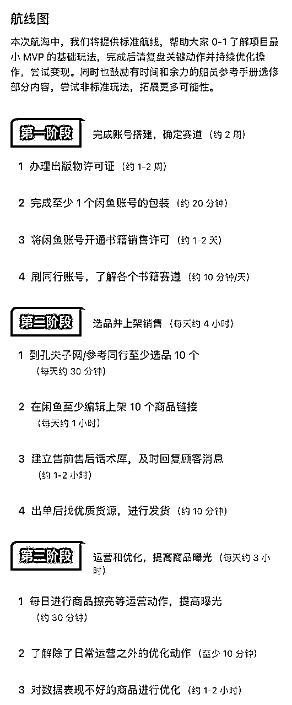
航线图和手册内容是一一配套的。找到自己所在的环节，去学对应的章节就好。

上面的航线图任务，建议在航海前两周全部完成。把这些动作走完之后，重心就该放到实践上了：多选品、多上架、多运营，把出单的概率一点点抬上去。

# 必修篇：把最小MVP跑出来

#### 本章导读

这一章从认识闲鱼开始，一步步带你走完整条旧书项目链路。跟着章节内容实操，就能把最小MVP跑通。

如果你刚接触这个项目，建议先看全貌：

【项目概述】了解闲鱼平台、了解闲鱼旧书项目

有了整体概念之后，再按核心步骤学实操：

【项目实操 1/3】完成账号准备和多刷同行账号

【项目实操 2/3】进行旧书选品和商品上架销售

【项目实操 3/3】掌握已上架商品的运营和优化技能

必修篇的航线图与手册顺序是同步的，按手册的章节往下走，就能逐项完成航线图任务。后面每个关键步骤的章节导读里，也会提示对应的航线图。

那么，正式开始。

## 一、【项目概述】读懂旧书这门生意

#### 本章导读

这一章，我们一起来认识闲鱼无货源旧书项目。

闲鱼现在处于什么阶段？平台有什么特点？旧书市场行情怎么样？为什么选闲鱼而不是别的平台？这些问题，都会在这一章里找到答案。

我们会先看闲鱼的市场趋势，把它和其他电商平台做对比；再分析二手书的市场需求，以及无货源玩法的优势和短板，把项目的整体前景讲清楚。

这次航海的核心目标，就是教大家从0到1跑通闲鱼无货源旧书项目。所以，先把项目全貌理解透，是很有必要的。一起来看。

### 1.1 闲鱼是个怎样的平台

#### 1.1.1 平台大盘与用户结构

先看数据：闲鱼注册用户超过4亿，月活突破1亿，2021年全年交易额达到5000亿。用户画像非常年轻：90后超过60%，95后超过36%，折算下来大约3300万。这也让闲鱼成了主流APP里年轻用户占比最高的一个。

如今闲鱼在扶植职业卖家，既保证了货源稳定，也给买家提供了更丰富的选择，同时推动平台走向标准化。它最早是单一的C2C闲置交易区，现在已经发展成C2B2C全链条的闲置经济生态。近两年职业卖家持续涌入，说明平台需要更多有实力的商户来做大交易量、带动市场。

另外，电商正在从城市向农村渗透，普及度高、使用方便、成本更低，闲鱼在电商里算是成本最低的一类，市场状态有点类似早期的淘宝。总体来看，它有这几个优势：

1\. 制度相对宽松

2\. 可做的类目比较多

3\. 上手容易，完善资料就能开干

4\. 保证金不是强制门槛

目前闲鱼在推“7天无理由退货”和“描述不符退货”，分别要交500元和200元保证金，但目前都不强制。如果你不打算开通这两项服务，可以先不交。如果上架时闲管家提示“不开通7天无理由，无法上架”，到时候再开通就行。保证金后面关闭服务可以提现退回。

5\. 平台给的流量相对稳定

闲鱼各账号之间的流量差距不大：这段时间这个号出单多，过一阵子可能另一个号表现更好，整体分发比较均衡。

#### 1.1.2 和主流电商平台比一比

闲鱼虽然也算电商，但比别的电商平台简单：不用刷单，竞争相对小，也没有保证金压力。闲鱼和其他主流电商的差异，看下面这张表会更直观。

闲鱼 VS 其他主流电商对比图。

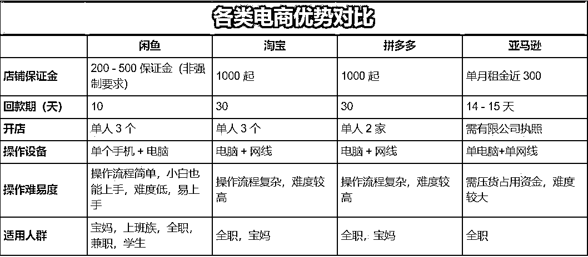
再和自媒体、短视频这类方向做个对比：

当然，不是说那些不好做。行行出状元，每个人找到适合自己的就行。

闲鱼的相对优势是：

1\. 操作门槛低，不需要多强的文案、编辑、剪辑能力，按后面教的方法和流程走就行；

2\. 一部手机就能搞定，随时随地可以开工；

3\. 电商离变现近，能较快获得正反馈。

比较适合没怎么接触过互联网、想尝试做副业、多一份额外收入的朋友。

总结一下闲鱼上做无货源项目的优势：

内容来源：《闲鱼电商｜小航海学习手册》

### 1.2 旧书生意为什么值得做 @老瞿 Qu

前面说过，闲鱼的操作门槛不高；再从下面几个角度看，旧书市场的需求也在明显变大：

（1）超过80%的高校教材开放采购

据不完全统计，在国家鼓励资源回收利用的背景下，目前80%以上的高校已经放开了教材预订。也就是说，学生可以在学校订教材，也可以自己想办法解决，学校不干预。这给大学生购买旧书提供了可能。

（2）大学生对旧书的认可度在上升

高校学生对旧书的接受度一年比一年高，主要是因为教材在大学里的使用率不高，大家越来越愿意买旧书。加上国家对盗版打击力度加大，旧书又比新书便宜得多，一般是标价的1-4折，性价比很突出。

（3）消费降级带来额外利好

这几年经济环境大家都有感受。做闲鱼旧书店铺的过程中会发现，随着消费降级，越来越多的家长给孩子买旧字典，旧字典在闲鱼上已经成了小爆款，供不应求。

（4）学校周边旧书店批量倒下，电商优势凸显

学校旁边的旧书店老板普遍年纪偏大，疫情三年里绝大多数关了门。学生没法出校，哪怕只隔一道校门；而老板们电商运营能力弱，很难转到线上。如今网购普及，学生从网上买旧书的习惯已经养成。

在旧书的几种玩法里，闲鱼无货源是目前最推荐的一种。闲鱼正处于红利期；相比之下，淘宝和拼多多的旧书生意更难做，不建议轻易进场。

如果你是一个人做，建议拿家人的身份证再办一个出版物许可证，凑齐2个证开6个账号。管理6个账号基本是单人极限，精细化运营下来，预估一年利润能做到20-50万。

比如开学季，单账号每天的销售额能到1000-2000元，平时在500左右，利润率在30%-50%。

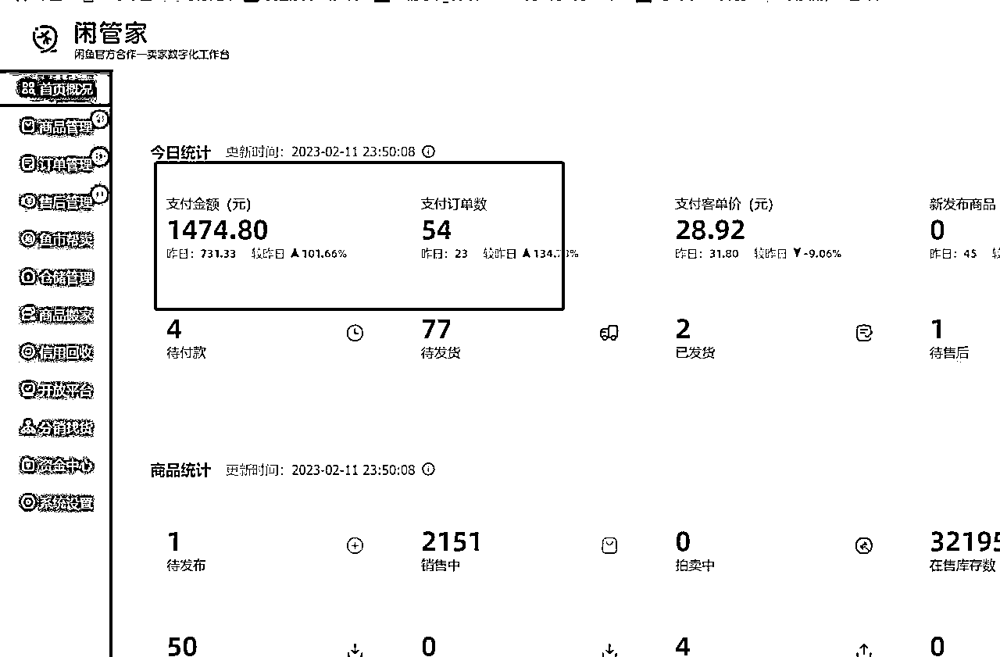
闲鱼一个号最多发布500本书，这个数量只适合挑爆款来卖，所以无货源更合适，能避免压货。

另外，官方有时会在开学季推活动，可以留意动态及时放大。比如之前就有过：上架满500本书，同时开通7天无理由退货和描述不符退货，就能解锁上架3000本的权限。

闲鱼无货源旧书玩法的优势，可以归纳成5点：

（1）正处在红利期

普通用户在闲鱼只能发5本书。2020年9月之前，网上有个突破发布数量的bug，现在已经修复。2021年闲鱼官方邀请了200多个商家内测，认证出版物许可证后可发3000本；2022年申请通道几乎全年关闭，直到12月才重新打开。目前闲鱼APP已经支持提交出版物许可证认证，可以确定这个类目还有得做。变化点在于：一个号开了鱼小铺，最多发布500本书。

（2）书籍上架后不用反复选品

闲鱼上最好卖的是大学教材和小说。教材一般3-5年才换一次版本，小说的生命周期更长。商品一旦上架，后续的选品精力就能省下来，不用每天忙个不停。

（3）售后比较少

图书本身属性加上价格不高，售后率基本在10%以下；我们实操下来，不到5%的订单会产生售后。对比圈子里卖投影仪那种品类，售后问题会多出不少。

（4）成本低

无货源模式的所有优势它都有：不用垫资，没有资金压力，也没有库存风险。

（5）起号难度低

目前商家数量不算多，起号相对容易。一个人第一个月做到5K利润、第二个月过万，只要执行力跟上，问题不大（带人实测的结果）。

但任何项目都不可能十全十美。说完优势，对应的短板也列一下：

（1）前期上书需要时间积累，得有耐心

这个项目要做精细化运营：首图用实拍图效果更好，文案每个账号尽量标准化又要有差异，每天上架20-30本。强烈不建议用群控软件，效果很差。所以前期会有一段铺货期，一般上到300-500本之后，账号才会比较稳定地出单。

（2）不能躺赢

客单价比较低，大概20-30元。订单多了以后，买书、发货要花不少精力，比短视频带货等项目琐碎。

（3）不能搬运

不能直接搬运别人的账号内容，被举报之后很容易封号。

（4）单账号天花板有限

目前跑得最好的号，旺季一个月利润1-2万，淡季平均5000左右，跟短视频带货那种爆一条视频赚几十万的没法比，赚的是辛苦钱。

内容来源：《深耕行业2年后，分享咸鱼二手书无货源、绝版二手书等5种项目玩法》

### 1.3 单账号的三种盈利思路 @亦萌

闲鱼旧书一个号，主要有三种赚钱模式：

低利润爆单：单件利润不高，但爆单之后量大，一款一天能出5-10单。

套装高利润：同类书籍、教材+习题、小说套装、主题书单等，组合起来利润更高。

垂类高利润：只盯一个细分高利润赛道，出单量不大，但一本能赚30-50。

这三种里，做成任何一种就够吃了。如果目前一个都不占，那这次航海就要选定一个方向去优化。如果已经做好了其中一项，下一步要考虑的就是怎么放大。

### 1.4 高排名、高曝光的底层逻辑是什么？

很多做闲鱼的玩家都想知道：曝光怎么才能涨？

这里直接说透：闲鱼高排名、高曝光的底层逻辑，一句话就能概括——做对平台有贡献的事。

你做了让平台受益的事，平台自然愿意持续给你更多展示、更多曝光和更高的排名。平台因此越来越好，用的人越来越多，反馈越来越正面，这对平台是极其有利的循环。

落到具体动作上，其实就是：给平台用户好的体验，让用户更加信任平台。围绕“做对平台有贡献的事”这个核心，之后的选品、编辑上架、客服、订单处理等每个环节，都是在这条主线上展开的。

内容来源：《闲鱼电商｜小航海学习手册》

## 二、【项目实操 1/3】动手前的准备

#### 本章导读

了解完整体情况之后，就要正式启动了。在闲鱼上正常运营的第一步，是把前期资料和账号都准备好。

所以这一章整理了开卖前要筹备的事项，一共六项：

办理出版物许可证

下载项目所需APP

设置闲鱼APP权限

完善闲鱼账号

在闲鱼开通书籍销售许可

多刷闲鱼旧书同行账号

这里面最重要的是出版物许可证，它是这个项目的必备资质，一定要办下来并在闲鱼完成认证。没有证就卖旧书，违规率很高，账号很大概率会被直接封掉。

#### 本章航线图

完成这一章的学习和操作，就能完成航线图第一阶段：完成账号搭建，多刷同行链接（约2周）。

1\. 办理出版物许可证（约1-2周）

2\. 完成3个闲鱼账号的包装和权限设置（约1小时）

3\. 给3个闲鱼账号开通书籍销售许可（约1-2天）

4\. 刷同行账号，了解不同书籍赛道（约10分钟/天，共约1小时）

现在就开始吧。

### 2.1 先把出版物许可证办下来 @老瞿 Qu @一游

营业执照和出版物许可证，是开通闲鱼图书店铺缺一不可的资质，可以看作入局这个领域的通行证。有门槛的领域，天然就能筛掉一半以上的人。

做这个项目的第一步，就是办理出版物许可证、注册闲鱼账号。一个自然人最多办3个支付宝账号，对应3个闲鱼号，并且出版物许可证、支付宝、闲鱼这三者的主体必须一致。目前淘宝上办证的价格大多在1100-5000元，也有更贵的，一般是一个个体户加一个出版物许可的组合。

线下办证确实最靠谱，但也真的难办。办个体户倒简单，有个商业地址就行；出版物许可证对商铺面积、消防都有要求，有些大城市甚至已经不再受理，所以线下周期特别长，费用基本奔着大几千去，有些地址每年还要再交几千块。因此不太建议走线下，很多人试过之后基本都放弃了。

线上办证的话，周期大概2-7天。后期维护成本是：营业执照每年年报50元，出版物年检150元，需要注销的话再花150元。

最后强调一下防假证：淘宝上存在假证。拿到证之后，先去官网验证或者打电话给工商局核实，再确认收货，不要用对方发来的“官网”。他们的常见套路就是搭一个山寨网站给你查。要通过百度去确认那是不是真的政府官网。

办证这件事，新手最容易卡在“选哪家代办”。淘宝上营业执照加出版物许可证的报价五花八门，真正的问题是：谁能办得稳？

目前代办常见做法，一是钻政策空子，二是靠关系走通道。刚下证往往正常，过段时间注册地址被注销，就出现地址异常。

很多代办会把注册地放在偏远区域集中挂靠。这个片区只要有一户被举报，工商可能对整个区域排查，随后成批注销，其他商户也跟着遭殃。

所以别把代办的口头保证当保险。能不能一直稳，很大程度看有没有投诉、有没有被监管盯上。

怎么处理？先认清：这行本身踩线。线下办不成，又想靠项目挣钱，代办基本绕不开。好在地址异常对闲鱼店日常出单影响通常不大，平台眼下审核偏松。

因此不必反复内耗。先赚能赚的钱，出状况再处理。挑代办看三点：
1. 报价你能接受
2. 出证别太慢
3. 已有卖家拿它通过闲鱼认证
满足就办。

再提醒：认证通过不等于证件永久安全。先上架运营，后续真异常再补救。

建议优先找稳定、肯管售后的服务商。证若出问题，最坏花约300元年审费，让对方补办许可证，在不影响店铺经营时替换。带售后的报价会高，做生意都要利润；淘宝那种低得离谱的，反而更容易跑路。

风险提示：别拿这套证去开🛰️收款码，有风险。

圈友 @老瞿 在星球写过办证答疑，可看《闲鱼二手书航海，办理〈出版物许可证〉相关问题解答》。

如果下证偏慢也别慌。先少量上书练流程；普通号最多5本，正好养号，同时把鱼小铺开出来，证到直接接上。

资料出处：《如何在闲鱼开通图书店铺之劝导新手办理营业执照加出版物许可证不纠结篇》、《深耕行业 2 年后，分享咸鱼二手书无货源、绝版二手书等 5 种项目玩法》

### 2.2 开工前的软件准备 @老瞿 Qu @小嵩

先把工具备齐。闲鱼客户端风控偏严，最好一机一号；一台手机频繁换号，容易异常，严重时闲鱼币都用不了。想稳，可以专门备一台，比如闲鱼淘二手红米7/8约200元，同档配置也行。

绑定闲鱼的支付宝要和执照同一个人。

一张出版物许可证最多支持3个闲鱼店；每个店绑一个支付宝，一张身份证可开3个支付宝。所以只用自己的资料做，办一张证就够，不用重复办。

电脑端可用闲管家集中管理，能关联6个号，更方便；但它更适合家里或工作室，上班仍要带手机，免得漏单。

闲管家界面展示：

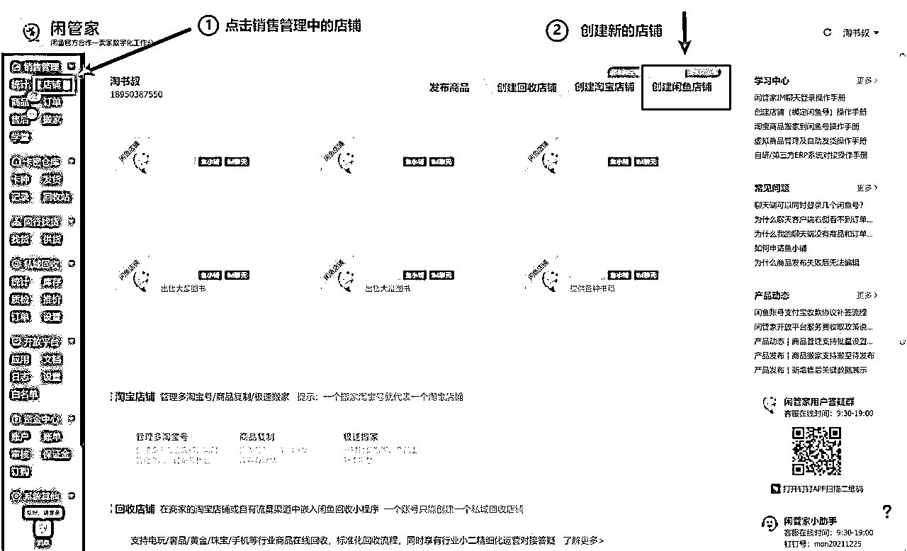

资料出处：《深耕行业 2 年后，分享咸鱼二手书无货源、绝版二手书等 5 种项目玩法》、《加入龙哥盟一年，终于实现副业月入过万》、5 月 30 日《单账号单周出 100 单，如何从 0-1 实现闲鱼二手书变现？》@一棵茶树

### 2.3 闲鱼客户端的权限设置

#### 2.3.1 定位权限

设为永不允许。若之前已授权，或你要买本地货、把闲置卖给附近人，保持开启也无妨。

#### 2.3.2 消息通知打开

务必开启，前期客户消息要快回，否则容易丢单。

#### 2.3.3 允许后台 App 刷新

允许后台刷新，照片权限给全部。（图为苹果，安卓照提示操作。）

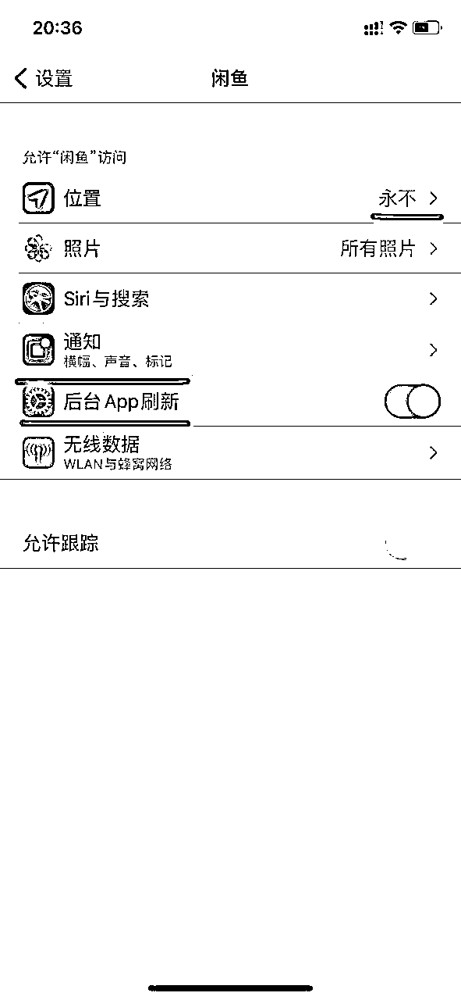

资料出处：《闲鱼电商｜小航海学习手册》

### 2.4 闲鱼账号完善

未用过闲鱼，可直接用常用支付宝或淘宝登录，简单。

#### 2.4.1 个人资料完善

登录后进“我的”，点“编辑资料”。

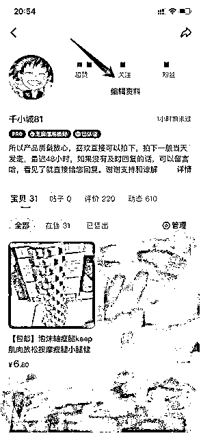

资料完善到85%以上。头像可用店名设计；比如“一三书屋”，免费字体做好截图当头像；文艺卡通或美女图也可。其余按实填。

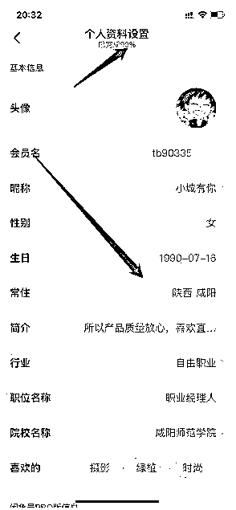

#### 2.4.2 实名认证完善

下拉完成实人认证、支付宝实名、芝麻信用授权，按提示走。

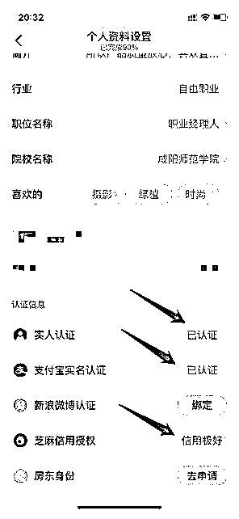

#### 2.4.3 鱼小铺的开通@亦萌

新手常疑惑：别人能多规格多库存，自己不行，因为少了鱼小铺。官方说明如下。

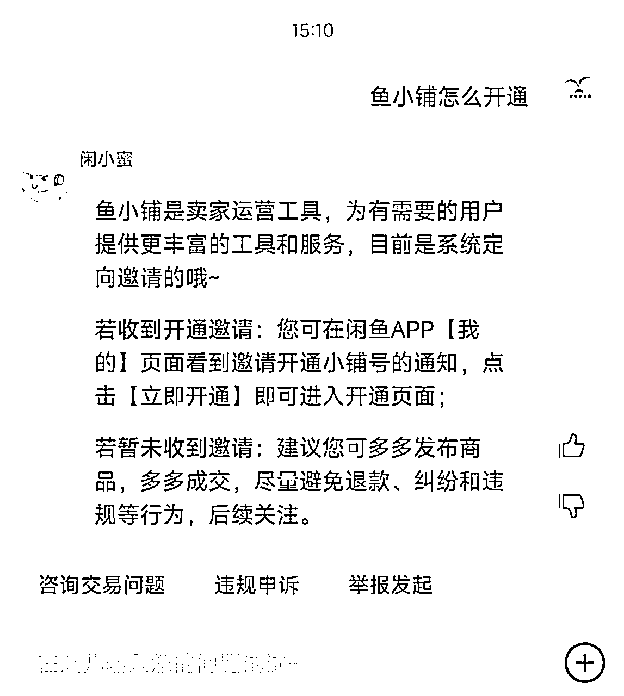

实测每天发5条，连续2到3天会收邀请，类似下图。

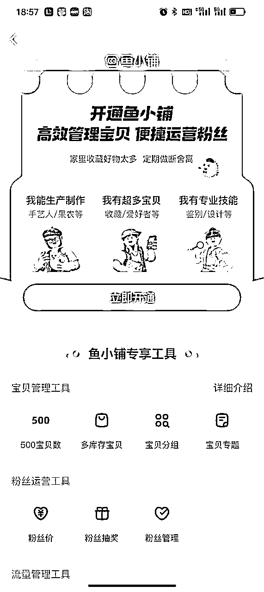

收到后按需决定。判断角度：

1. 不开：最多50个产品，库存默认1，卖出即下架，需手动重上；书种多，50不够且费时，做二手书建议开。开了可500+、设库存，售出链接不下架，利于爆单成交。

2. 不开只能单一价，无法多规格低价引流，也难卖高利润套装。闲鱼买家重便宜，首页价影响点击；套装如1234册、教材加习题，一次写清更提效，建议开。

3. 唯一顾虑：产品多但少动销，会影响店铺动销率和优质判断。综合看，利大于弊。

开通时资料填“二手书实体店店主”等不重要，不影响出单。

常用功能：

1. 深库存宝贝：最多2个规格，库存小于1万，可设不同SKU和价格。

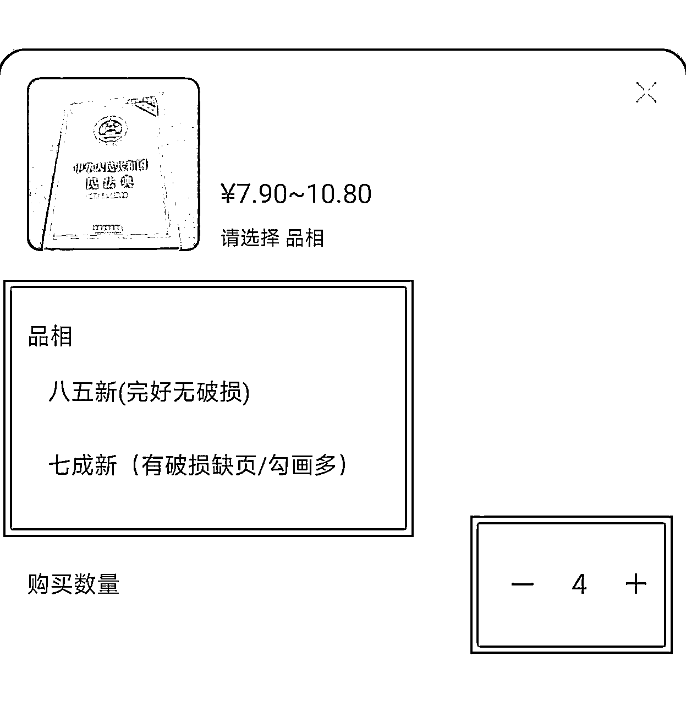

2. 发布宝贝数：上限破50到500+，一键擦亮最多500个。

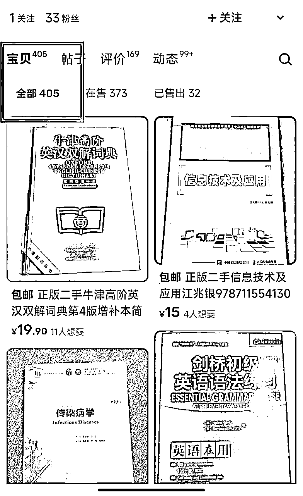

3. 宝贝分组：除3个系统组，可自建其他分组。路径：我的-鱼小铺工作台-常用工具-管理创建分组。

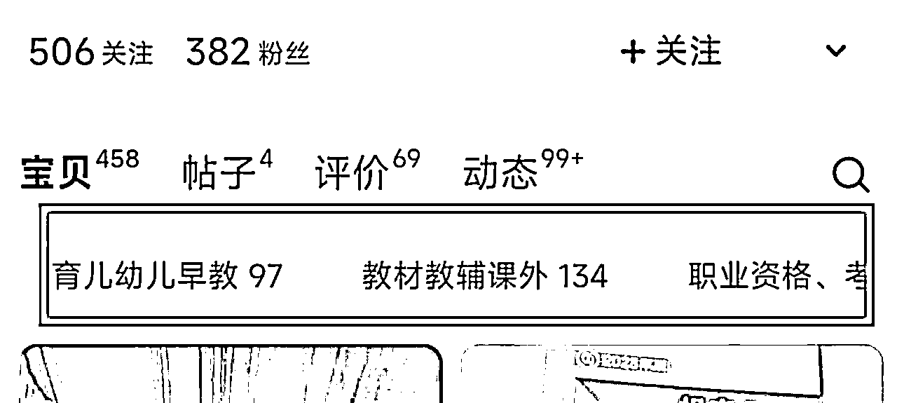

4. 宝贝专题：可上新及自定义专题。路径：我的-鱼小铺工作台-常用工具-管理创建专题。

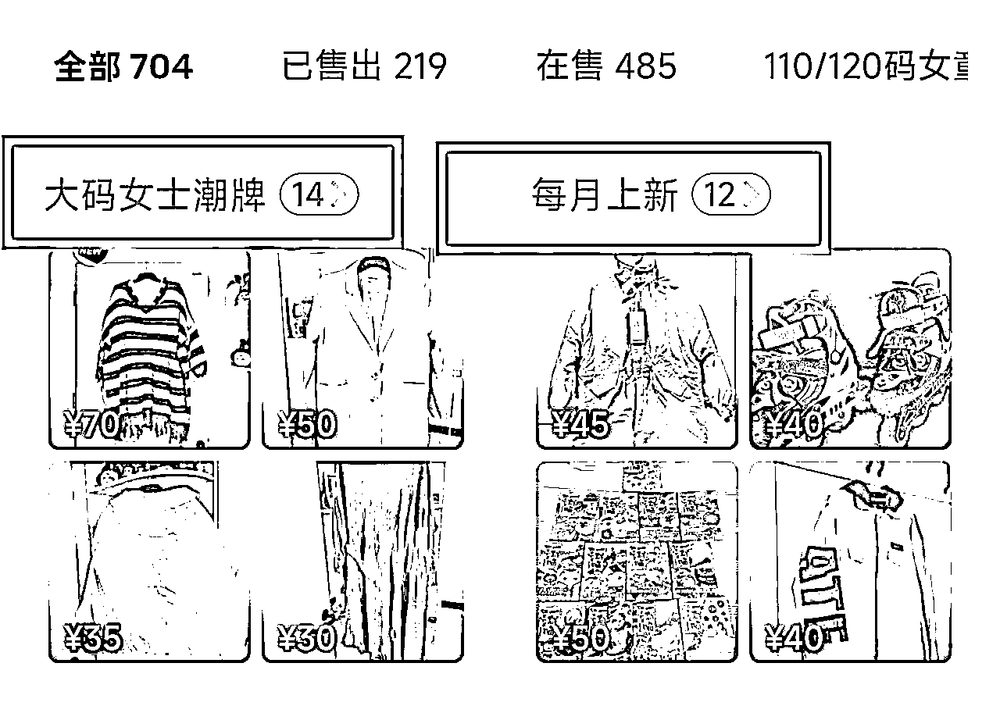

5. 宝贝置顶：长按宝贝即可设置。

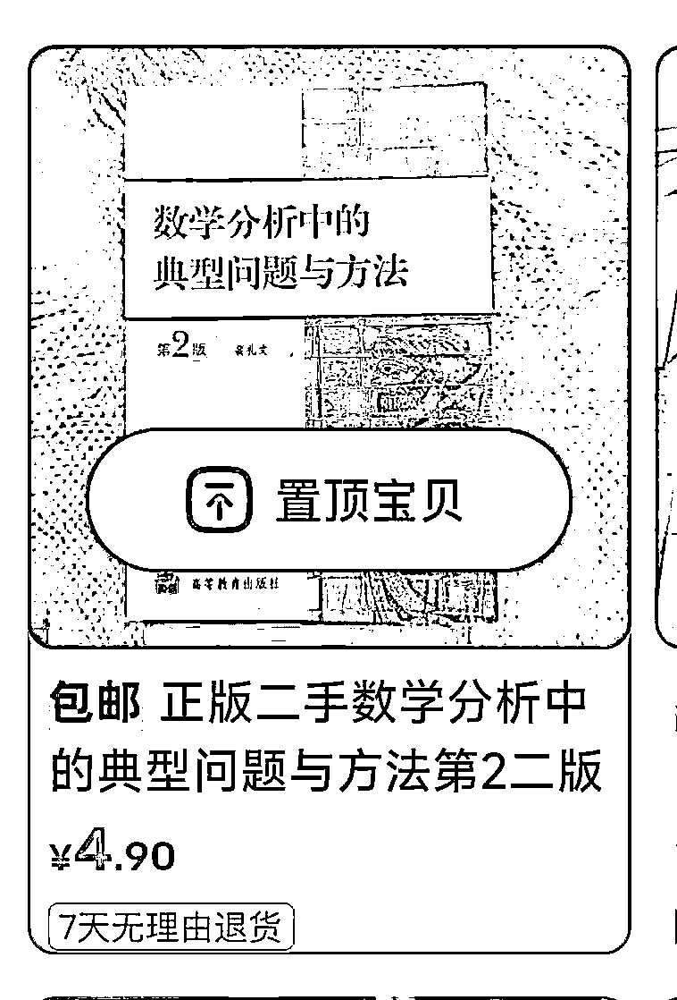

#### 2.4.4 注意事项

芝麻分尽量650以上，700左右更佳，越高越好。支付宝首页搜“芝麻信用”可查。点“去涨分”按提示；平时多用花呗并按时还，补全身份信息。分低可先借亲友高分账号。

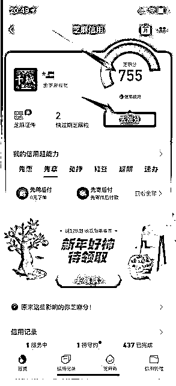

资料出处：《闲鱼电商｜小航海学习手册》

### 2.5 申请开通书籍销售许可 @老瞿 Qu @小嵩

闲鱼“我的”页找到“认证招商”，点“经营资质”，选“企业/个体工商户经营资质”，按步骤传执照。

现在基本全面开放，审核几分钟到1到2天都正常，不用焦虑。重点：出版物编号要把文字加数字全写，如图整段划线，不能只填数字；审核不过多半这里错。平台对证照审核总体好过。

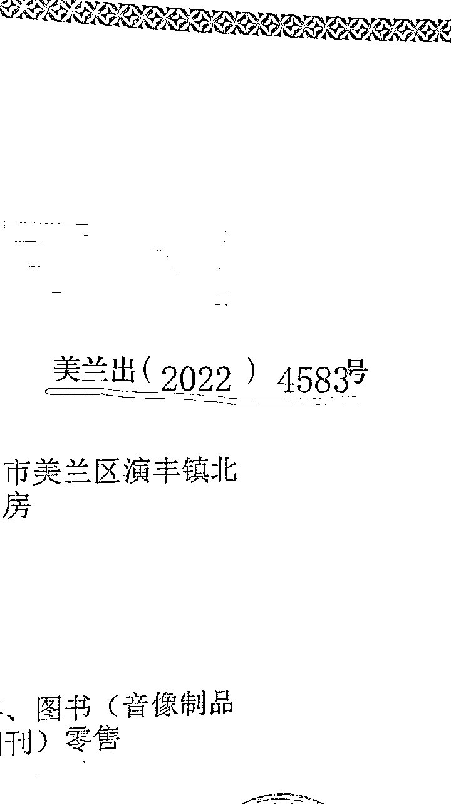

没过就看具体原因；入口随版本变，核心路径“认证招商-经营资质”：

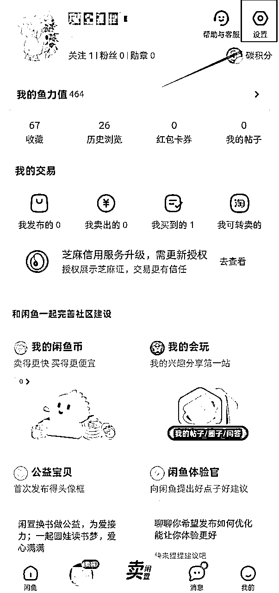

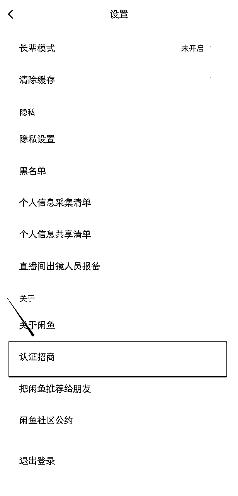

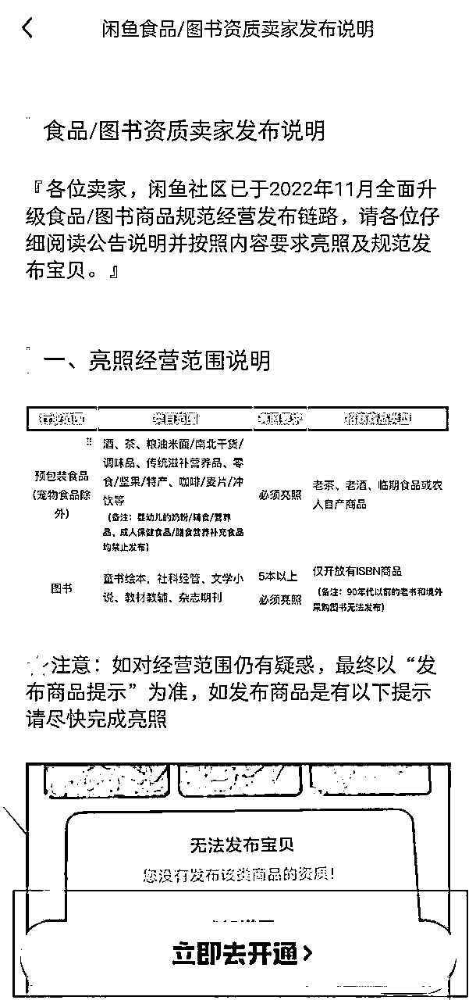

通过后建议隔天再上书。当天别急着大量上，系统有延迟，容易被误判无证违规；申诉麻烦，稳妥隔天再上。

资料出处：《加入龙哥盟一年，终于实现副业月入过万》

### 2.6 多刷同行账号，养号的同时，积累对标账号 @亦萌

同行是最好的老师。刷同行能找对标和选品，也让闲鱼识别你的喜好，推更多二手书。搜“二手书”切到“用户”找同行。进店看“想要”多的链接，研究标题、内容、图片，刷到首页自动推二手书。

目的有两个：
1. 让闲鱼认定你关注二手书，主动推热门选品。
2. 大量看链接，建立好链接、好店、好选品的感觉。

注意：别用主号关注同行，易被拉黑或取消；用小号或建对标库。

a. 首页点二手书链接，进连续推荐页，一直下滑，能找到更多产品和同行。

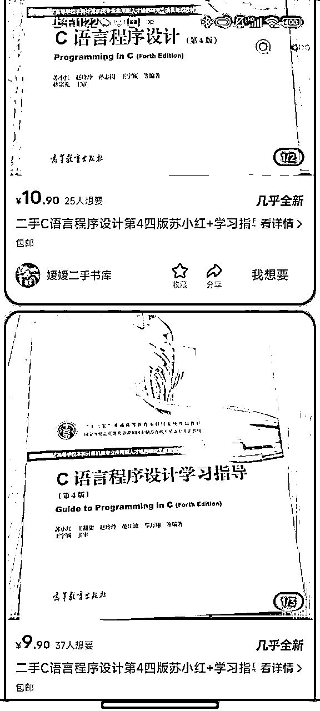

b. 详情页一直下拉，会出现“为你推荐”，也推同类产品。

## 三、【项目实操 2/3】挑书与发布

### 3.1 怎样快速挑品

#### 本节要点

账号就绪后开始上架。无货源书从哪来、什么好卖？较可靠做法：看孔夫子畅销榜，再看闲鱼同行热卖。选品避开违禁书防封；发货注意品相和孔网商家避坑，降低售后。

#### 本节路线图

完成3.1即可完成第二阶段选品上架，约1天。
1. 到孔夫子网或对照闲鱼同行，至少选10个，每天约30分钟。

开始挑你想上架的二手书。

闲鱼图书上限500，而书种千万级，SKU太多，适合打爆款畅销书。畅销信息看孔夫子销量榜。

#### 3.1.1 根据孔夫子的二手书畅销排行榜选品 @老瞿 Qu

以教材为例，需求最大。打开 https://www.kongfz.com/

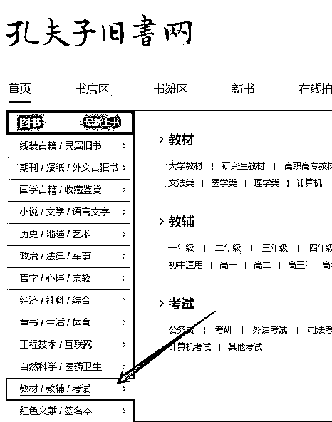

点教材，再按销量。我照此逐本上。想差异化可跳前几页，从第10页开始有时更好。

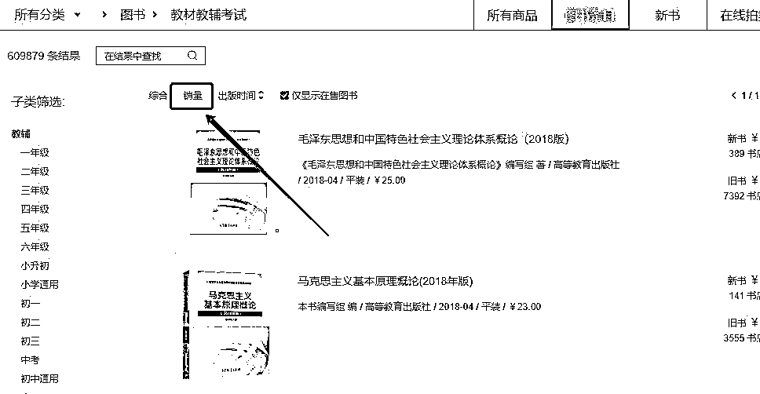

每页50本，教材100页，一年上不完。多数货源来自孔网，利润30%到50%，上架按此控价；若孔网无货或进价高就放弃。

#### 3.1.2 根据闲鱼同行的动态和评价选品@亦萌

这些是市场验证、真有人付款的近期热点。优先上，尤其连续2天出单或同日2单以上，属小爆款。

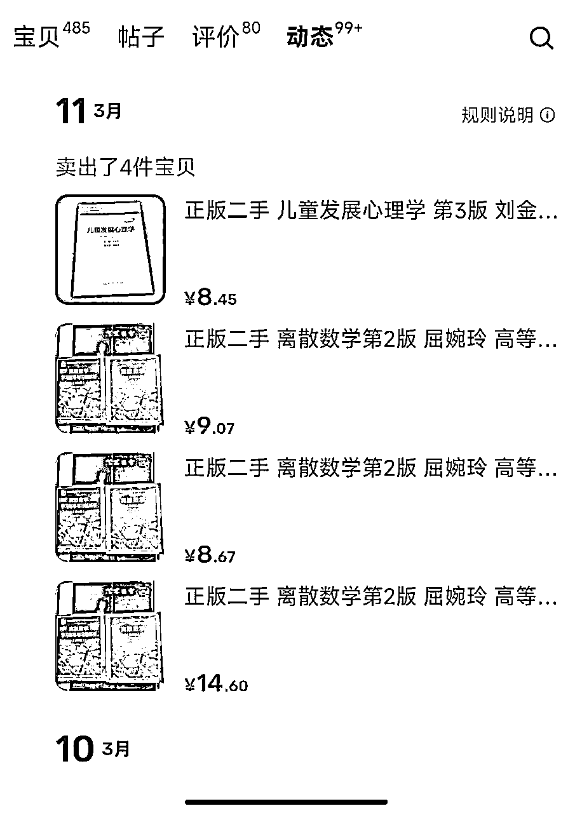

看不到动态就看评价，点开每条能看卖出的产品；评价不显示近期单量，但可参考。

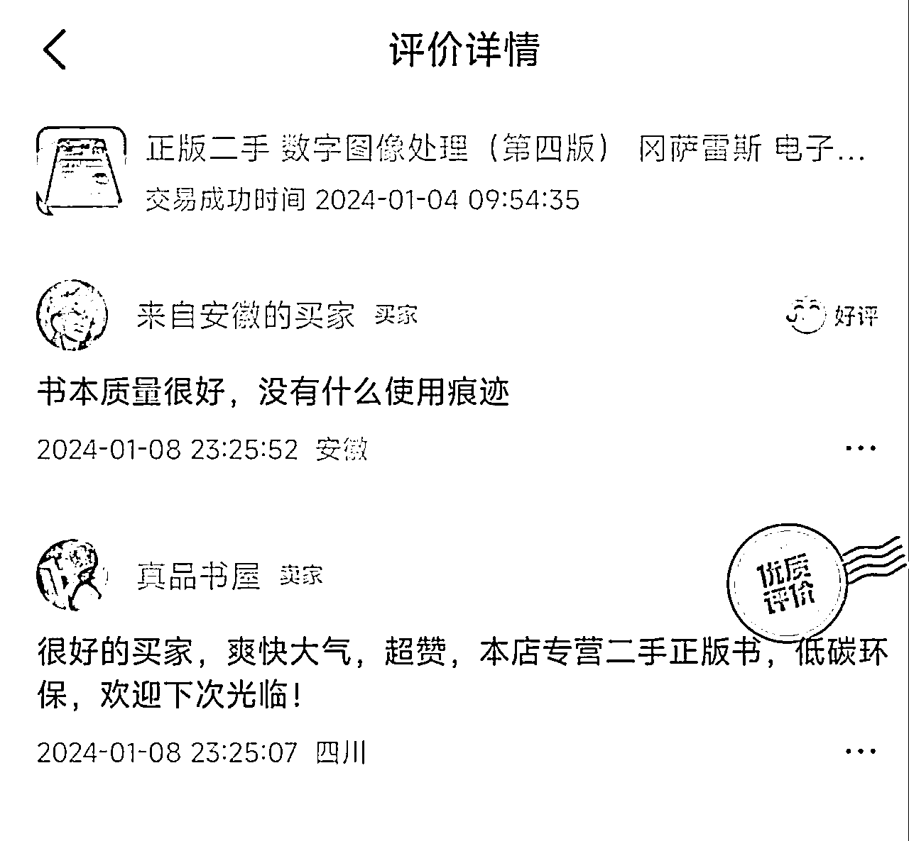

再看想要数，我一般看大于30，可按精力放宽到50、100；精力越少标准越高。此类链接未必最近热，但可能反复爆，先挂着等流量。

#### 3.1.3 选品注意事项：不卖违禁书籍 @老瞿 Qu

方法说完，实操前先避雷，防封号。宗教、政治、风水、股票、婴幼儿奶粉、保健品、酒水谨慎；PDF电子、盗版影印也注意。看表格截图。

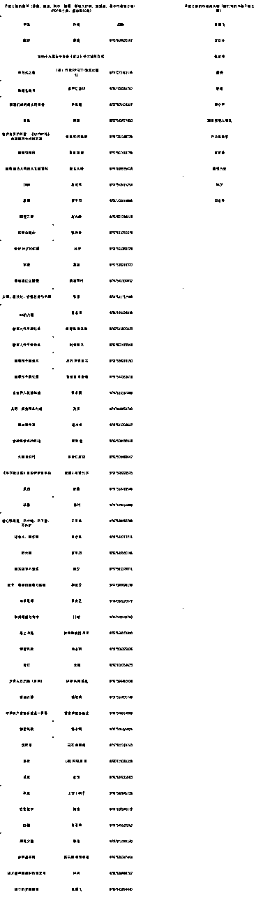

#### 3.1.4 孔夫子避坑商家 @flame

圈友@flame牵头、续航群船员共同更新“孔夫子商家避坑表”，记录踩坑商家和踩坑点。选品对照查；运营踩坑欢迎补充。

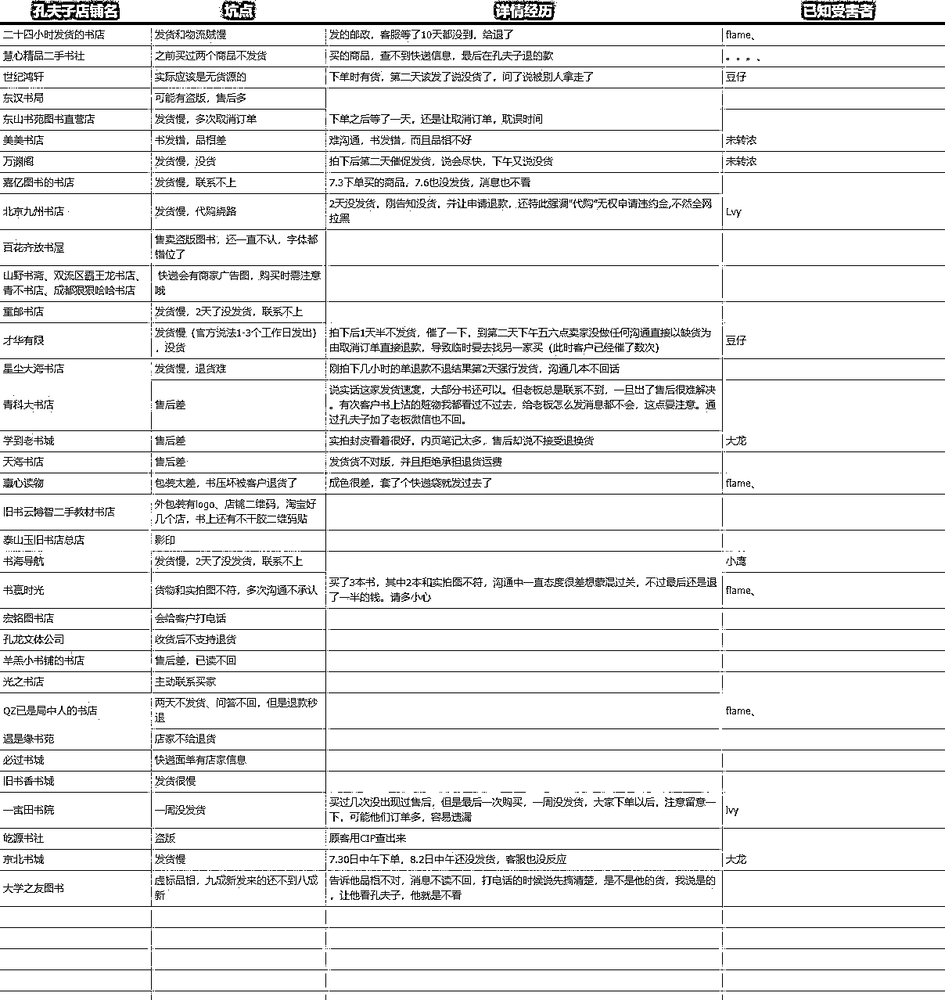

孔夫子商家避坑表

### 3.2 在闲鱼发布商品 @老瞿@大闵

#### 本节要点

编辑上架目标：让有需求的用户进店浏览并下单。怎么让更多人看到并成交？关键在四个要点；另附技巧和注意。继续看。

#### 本节路线图

完成本节，完成第二阶段，每天约4小时。
1. 至少编辑10个商品链接，每天约1小时。

开始上架。

#### 3.2.1 一个好的主图怎么制作

主图决定第一眼是否停留。能抓眼球的主图通常有这些特点——

一张让人想点的主图，到底长什么样？

闲鱼二手书赚钱全流程拆解

以《三体》为例就会发现一个规律：那些能在二手书平台冲上排名前列、被大量买家标记“想要”的链接，封面图几乎都有同一个套路——书本放在画面正中，并且使用真实拍摄的照片。至于详情页内的其他图片，不需要自己花心思去拍，直接参考闲鱼上销量好的同类目商品图就行。

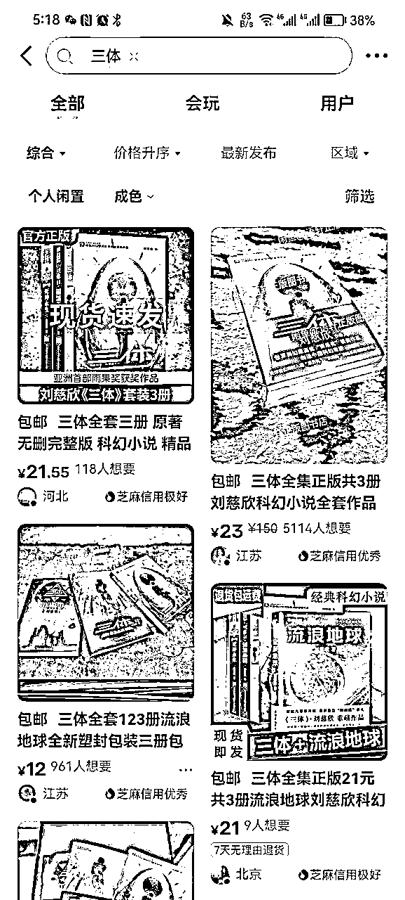

封面图可以直接到孔网去找一张合适的实景图来用。

想快速拿到无水印的图片，@亦萌 分享过三条路径：

1. 谷歌浏览器+油猴插件，再配合孔网的去水印工具；
2. 把孔网或闲鱼同行的图片保存下来，自己裁掉水印部分；
3. 在闲鱼上把同行图片点开放大后截图，图片上下会带黑边，裁掉黑边即可。

除此之外，配图方面还有一些小技巧：

#### 3.2.2 标题怎么打更容易吸引流量

1. 那些流量表现好的标题，基本都靠关键词堆积：尽可能把用户可能搜索到的各种叫法塞进标题里，让顾客无论用什么词搜，都有机会翻到你的商品。只要满足基础的搜索规则就行（比如二手书相关词汇），30个字尽量用满。标题的核心就是把“用户会搜索的词”和“能够吸引点击的词”组合在一起。想进一步优化SEO，可以在星球内搜索“SEO”，有不少相关经验帖可以参考。比如：书名-作者-出版社-ISBN编码，按这个顺序把字数填满。

参考示例：二手正版三体3 死神永生三 刘慈欣 重庆出版社 9787229030933

2. 把“二手正版”“正版二手”“正版好品相”“毕业了卖书”“正版捡漏”这类词放在标题开头，还可以用【】括起来做强调。逻辑不复杂：买家搜完一本书之后，如果各家图片看起来差不多，就看谁的标题更能刺激点击。

3. “书名+作者+第几版+出版社”这套组合写完，标题字数基本也够了。标题本质上是为了被搜索到。这个话题深入讲可以讲一节课，但对新手来说，前期把重要信息写全就行。书这个类目不像其他商品那样词藻复杂，买家搜书时基本都是搜书名，再加上作者、版次这类属性词，已经足够用了。

闲鱼和淘宝里销量好的同类商品标题都是经过验证的，直接拿来参考，简单改动就能变成自己的。操作方法：找到卖得好的标题后，词序保持不动，“二手书”“正版”“推荐”这些词也原样保留，只把书名、出版信息、作者和编号替换成自己的书的信息。

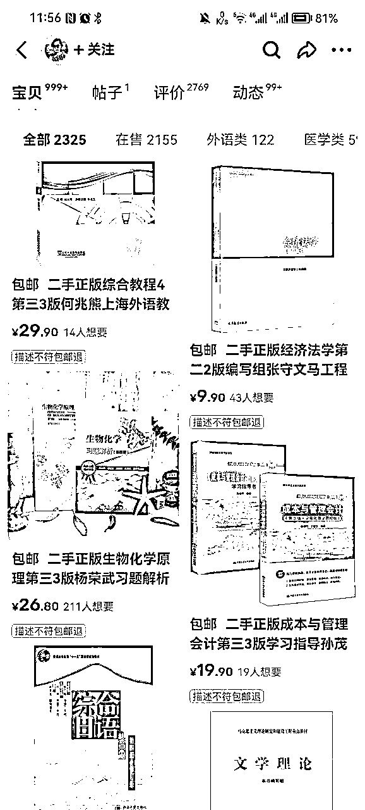

#### 3.2.3 产品介绍怎么写更高效

图片的问题前面已经说清楚了，详情页里的配图可以参考闲鱼市场上动销好的商品。接下来专门讲文字版的产品介绍。

1. 万能公式

产品介绍有个通用模板：把信息写到足够详细，买家想了解的内容都能看到，客服需要反复解释的地方就少了，你的时间成本也降下来了。另外，如果介绍能做到类似图二那样简洁明了，买家一眼看到重点，决策成本会大幅降低，转化率也会更理想。

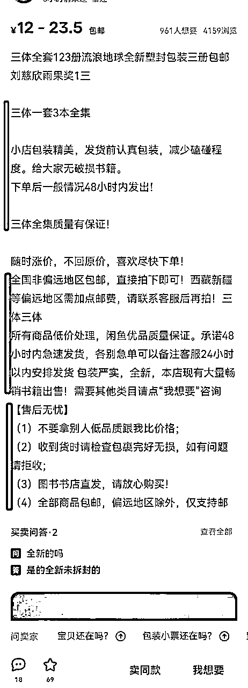

2. 参考同行 @大闵

最快的方式是去看同行怎么写，然后在此基础上做优化。

先打消顾虑：明确说书是正版；
再降低心理预期：说明品相、教材有字迹很正常；
最后把规则讲清楚：售后退换、不讲价、偏远地区不包邮等。这些没有标准话术，把条款说清楚就行。

还可以加一些感性的内容，帮买家强化购买二手书的理由。比如卖童书时，可以从环保角度切入、提支持正版对孩子身心有益、盗版童书可能带来的伤害等。搜索“给孩子买二手书的意义”等关键词，组合出一套合适的话术并不难。百度其实能解决九成以上的问题。

举个自己的例子，我卖二手绘本时，会在话术最后加一句：

“我最怕看见诚实的人被迫说谎，正直的人被迫弯腰，直言者被迫噤声，理想主义者亲眼见到理想破碎。道远知骥，世伪知贤。我们改变不了别人，但我们可以做最好的自己，拒绝盗版，至少，我们要给孩子一个干干净净的美好世界。”

这段话不是我写的，是抄来的。每个人都有不同的语言风格，我自己属于比较矫情的那类，所以用这种话，你也可以创造属于你自己的版本。

但要注意，别写那种拒人千里之外的描述。比如一上来就写“二手书不是新书，事妈绕道”——做生意不是来跟买家battle的，没必要。你不是大学生毕业处理几本书，而是把这件事当成一份小事业来做。

3. 几个编辑技巧，帮你快速出单 @老瞿 Qu

1. SKU可以这样设置：价格二十元以内的书，单规格就够了；超过二十元的，建议用多规格SKU。
2. 提供一个附加服务，比如代找书，怕麻烦的买家就会把找书的需求委托给你。
3. 发动身边朋友在对应商品页面点几个“想要”，帮助链接排名往上走。
4. 闲鱼编辑上架的注意事项 @老瞿 Qu

#### 3.2.4 定价怎么定更稳 @大闵 @诗和远方 @豆仔

1. 按利润来定价

二手书的定价没那么难，核心是把前期投入加上人工成本算清楚。并不存在“必须加价30%”的铁律。孔网有些旧书卖得比新书还贵，这种情况下再加价30%，买家凭什么买？

没有统一的硬性标准，因为店铺是你的、生意是你的，盈亏自己扛，销量自己负责。有些书就是热那么一阵子，我加1块钱也会卖。不同场景需要不同判断。对标同行的时候，参考淘宝同类商品的售价来比较即可。

另外要小心：孔网很多商家的低价书每次只挂一本，有些是真的只有一本，有些则是故意拿来引流的。如果按最低价×预期利润来定价，你上架的时候或许还有货，但等真正有人要买时，那本低价书可能早就被别人拍走了，你反而要倒贴钱。

比较稳妥的做法是：先看看要上架的书在哪个价格区间分布最多，定一个相对稳定的基础价，再乘以利润作为最终售价，这样能避免纠纷和亏损。

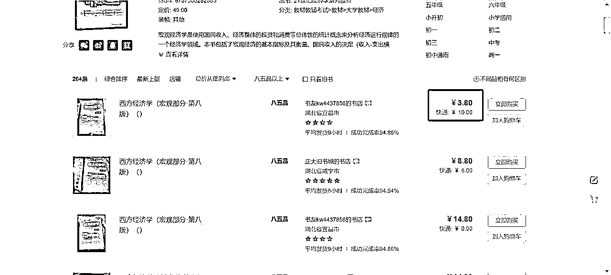

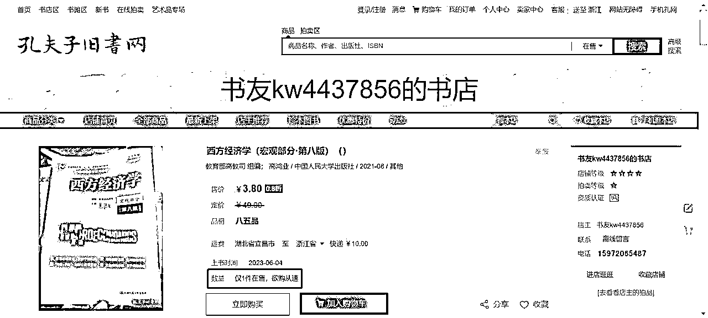

2. 多规格时按单本定价还是按合集定价？

如果设置了多规格，买家点进链接首先看到的是价格区间。当多规格里包含合集价格时，就会拉高价格区间的上限。这时候要分情况看：

① 封面图是单本书实拍：如果主图是单册实拍图，但多规格里设置了合集SKU，建议先把合集去掉。这样买家看到的价格上限就是这本书的真实价格。他真想要、或者价格在可接受范围内，自然会点“我想要”来沟通。不去掉的话，有些买家会误以为价格上限就是这本书的售价。

② 封面图是合集实拍：如果主图展示的是整套合集的实拍图，那保留合集的SKU就没有问题。

内容来源：6月8日《闲鱼二手书 照着抄就可以见到效果的实操干货》@大闵、7月6日《在闲鱼卖教辅书的几种选品技巧》@诗和远方、6月27日《闲鱼二手书新人21天跑通项目闭环的经验分享》@豆仔。

#### 3.2.5 闲鱼上架怎么操作 @老瞿 Qu

电脑端上架需要用闲管家，这是闲鱼官方的后台管理工具：https://www.goofish.pro/product/all。手机端也能上架，但需要扫ISBN码，电脑网页端的效率会高不少。

店铺或链接的流量还没做起来之前，加价范围控制在10%-20%比较好，等积累了一些订单再慢慢往上调，这样前期跑流量更容易。流量稳定之后，日常上架在孔网或淘宝价格基础上加价30%-50%即可。

具体步骤：

【第一步】进入「闲管家」后台，在店铺管理中点击【创建店铺】。

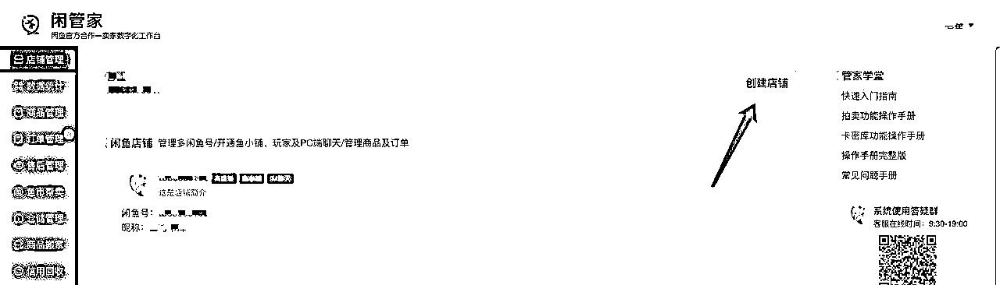

01 选择行业：选图书行业，点下一步。

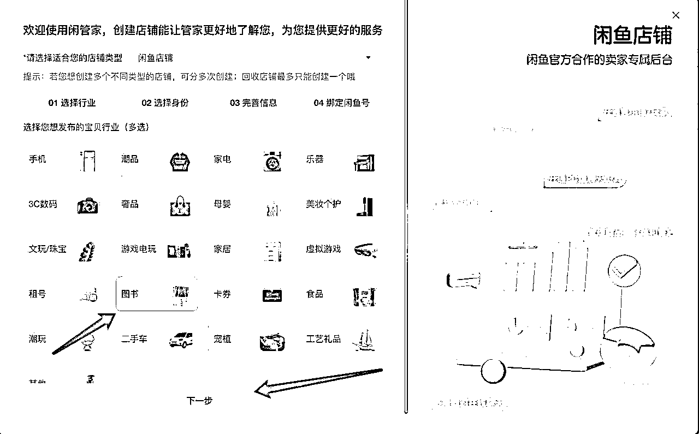

02 选择身份：选实体店主，再点下一步。

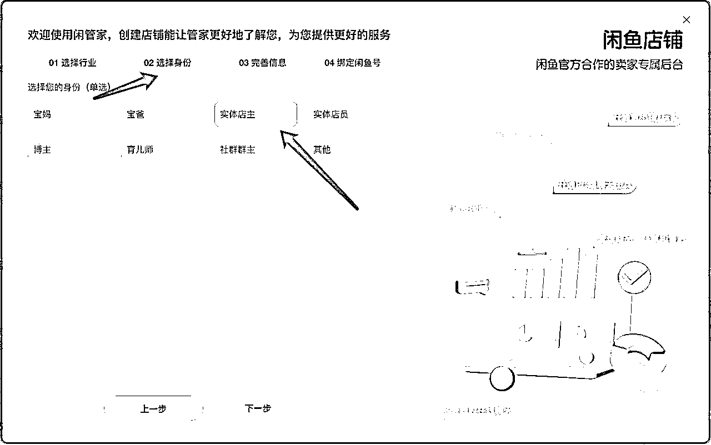

03 完善信息：填好店铺名称、简介、地址这些内容。

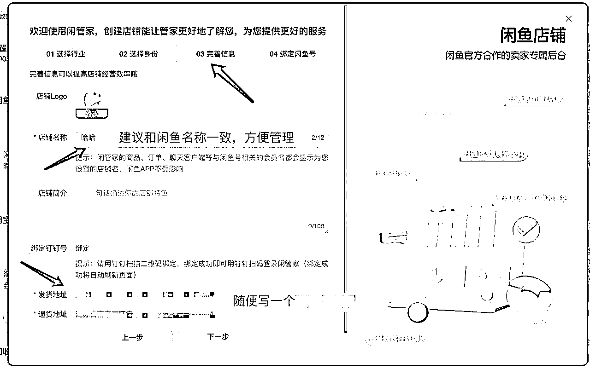

04 绑定闲鱼号：点击绑定闲鱼号，开店就完成了。

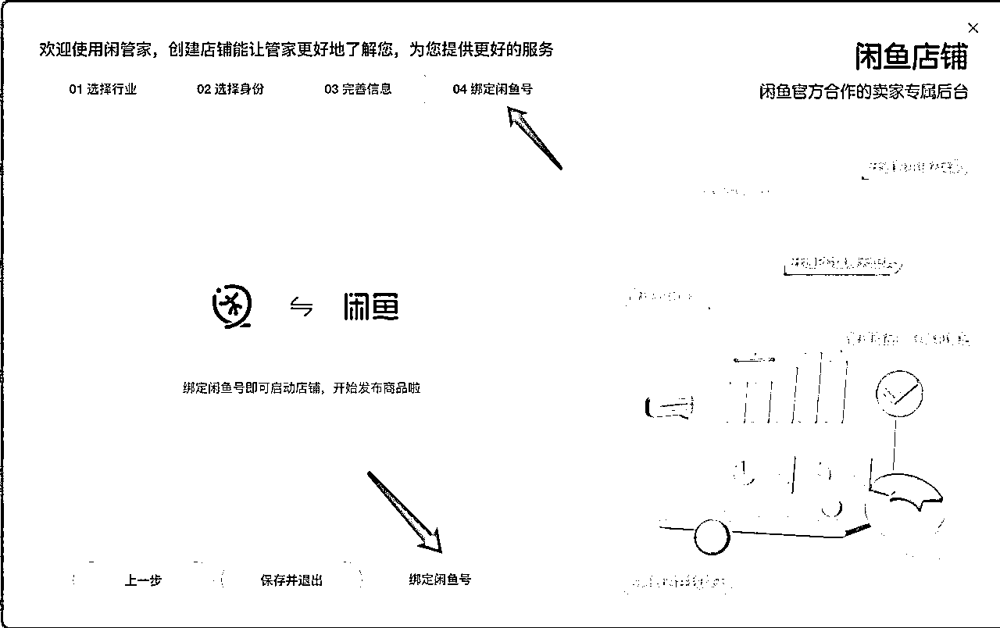

接着正常登录就行。

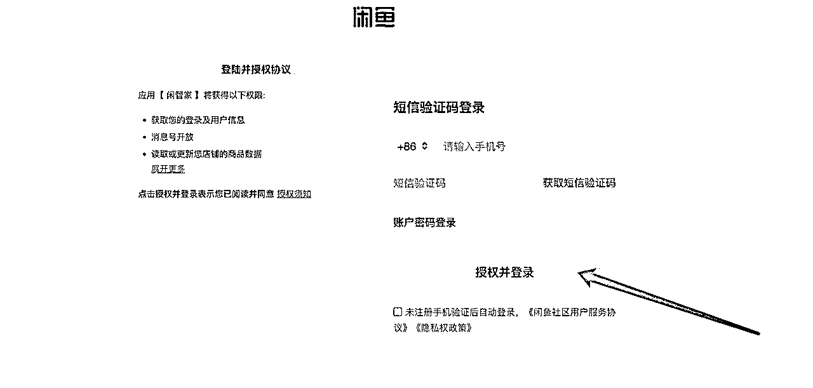

【第二步】登录闲鱼账号，点商品管理，新建商品。

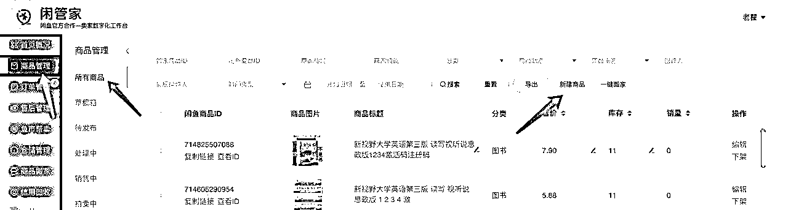

【第三步】商品类型选一口价；商品分类选图书（以教材为例，这里选学习考试）。

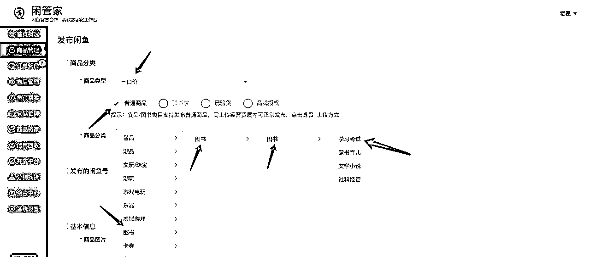

【第四步】在「发布的闲鱼号」这里，选好你要发布商品的账号。

【第五步】把基本信息填完整。

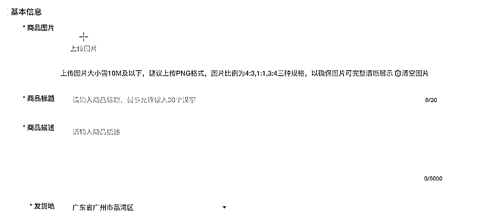

其中：

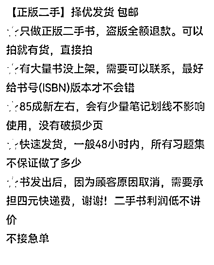

【第六步】在「价格库存」处，填好价格再调一下库存。价格可以参考孔网商家的售价（书本价格+运费）加40%来定，保证利润在30%以上。

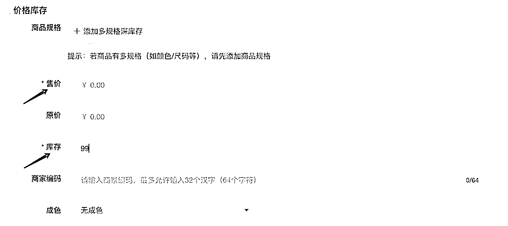

以《毛泽东思想和中国特色社会主义理论体系概论》（2018版）为例：点价格排序，把总价从低到高排列，品相选八五品以上，以商家的售价作为基础加40%。

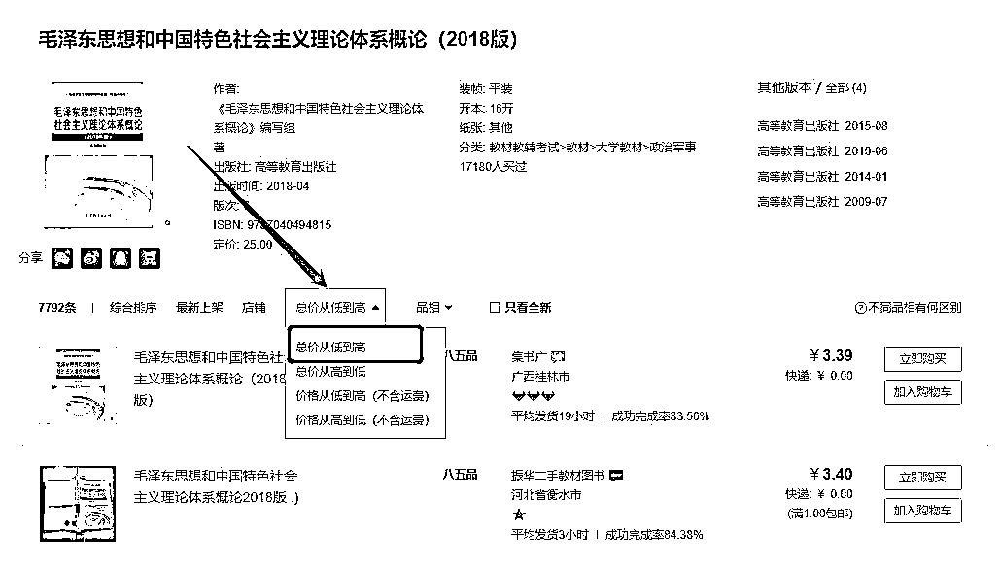

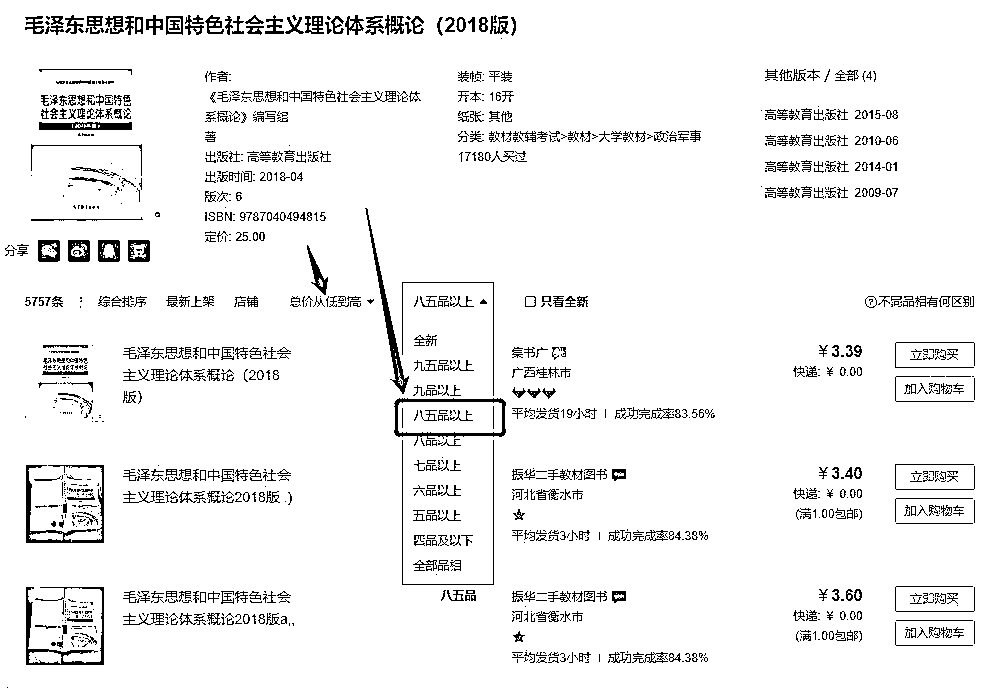

全部填好之后点「立即发布」，再点「确定」，这本书就上架完成了。

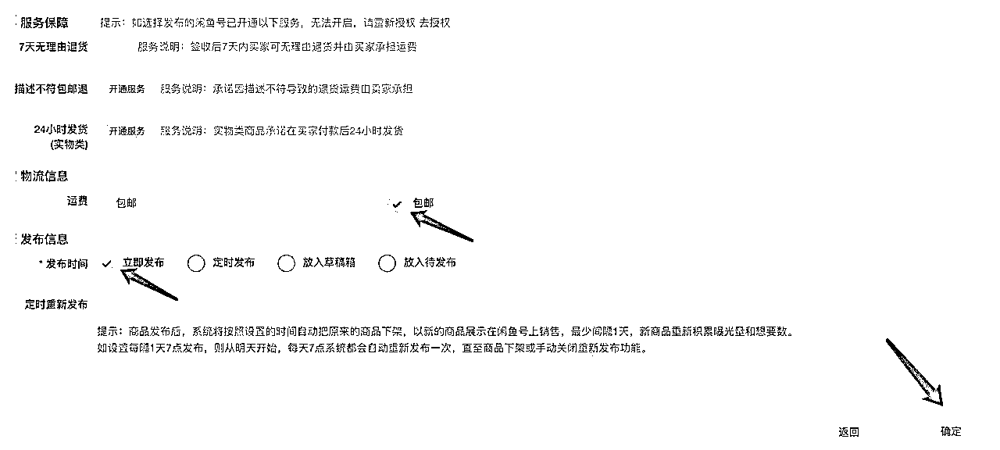

整个流程熟练之后，一小时传20个链接很轻松。其他品类操作方法相同。

ISBN码的获取有两种方式：

1. 从家里找一本书来扫ISBN码，然后在正文描述中把自动出现的内容删掉，每次上架都这样弄。
2. 更精确的方法是：到 https://products.aspose.app/barcode/zh-hans/generate/isbn 这个网址生成条形码，截图保存，然后扫描时从相册选图。不过闲鱼审核比较严格的时候，会禁止从外部链接扫码，所以更推荐第一种方式。

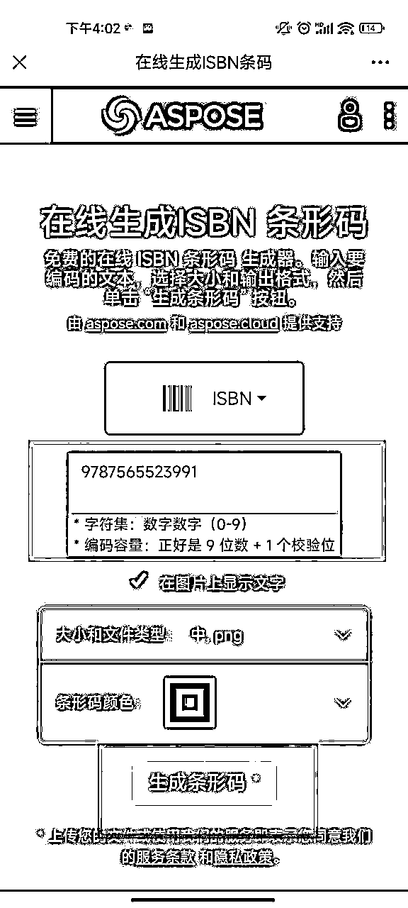

总的来说，手机端上架比电脑端麻烦不少。建议大家优先用闲管家来操作。

内容来源：《深耕行业2年后，分享咸鱼二手书无货源、绝版二手书等5种项目玩法》。

## 四、【项目实操 3/3】商品销售和发货

#### 章节概要

有顾客前来咨询，反应要快，避免客户流失；出单之后也要尽早安排发货，减少买家的等待时间，客户的满意度才会更高。

这一章节聊聊两件事：闲鱼售前售后客服的常用话术，以及优质货源怎么对接：

客服端：及时回复、主动跟进售后问题；
发货端：出单后尽快在货源平台下单，把快递信息回填好。

具体怎么落地，往下看就行。

#### 本章航线图

完成本章的学习和实操，就相当于完成了航线图的第二阶段：选品并上架销售（约1天）。

1. 建立售前售后话术库，及时回复顾客消息（约1-2小时）；
2. 出单后找优质货源并发货（约10分钟）。

### 4.1 闲鱼客服话术怎么准备 @老瞿 Qu

在闲鱼上，能不能做到快速回复、有效回复，会直接影响转化率。

客服工作的核心：洞察用户问题背后的真实需求，主动引导客户成交，而不是被客户牵着走，争取在4句话内让对方完成付款。最重要的一点：凡是来咨询的，都尽量拿下。

以下是我收集了市面上常见话术、并且经过测试后觉得好用的，整理出来供参考：

#### 4.1.1 售前咨询回复话术

欢迎语：欢迎欢迎亲！小店专营正版书籍，喜欢直接拍下即可。

客户：[书是全新或者正版吗]
回复：亲，我们的书都是学生那边回收后做过消毒翻新的。品相大概七八九成新，不会有破损、明显污渍或无法使用的情况，可能带一点笔记，但不影响阅读，发货时会择优。

客户：[在吗？/你好/还有吗？]
回复：在的/你好/还有，能拍就说明有货，拍下后最迟X小时内发走，喜欢直接拍下就好。

客户：[多久发货？发什么快递？]
回复：一般下午X点前下单当天就能发出，快递根据库存随机安排，最迟不超过X小时。

客户：[可以拍照吗？]
回复：仓库离得比较远，没办法每本书都拍照哈。发货的时候我们会选品相好的发，您可以放心购买。

客户：[有货吗？品相如何？]
回复：能拍就说明有货，成色大约7-9成新，无破损、明显污渍或无法使用的情况，会有一些笔记，不影响阅读。发货时会优选。

另外，如果出现已经改价但买家迟迟没有付款的情况，点右上角三个点“···”选择“关闭订单”，再按提示选择关闭即可。

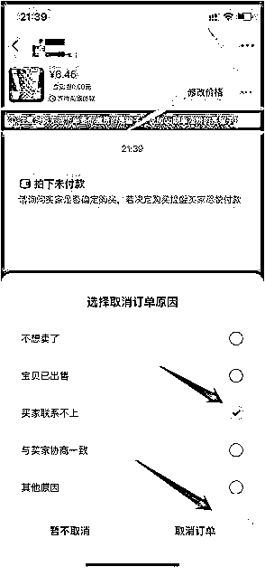

如果客户想买别的书、或者一次买多本，需要我们新上链接，可以在原有链接基础上操作：让客户拍下但不付款，我们来改价，改完之后再让他付款。

“拍下不付款”的意思就是：客户点击“立即购买”，进入下单页面，选了商品但没付钱。当客户拍下不付款时，我们界面右下角会出现“修改价格”。

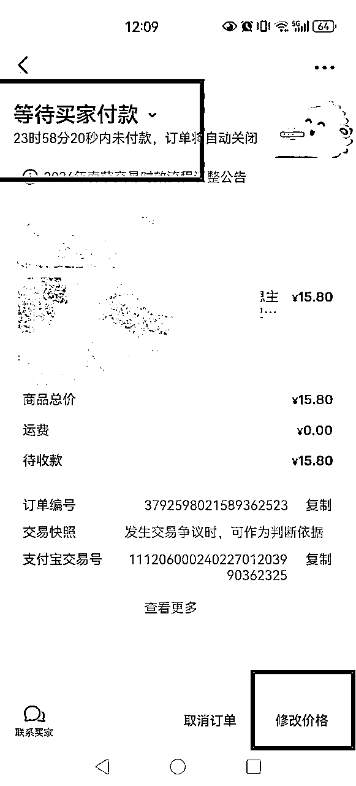

改完价格之后，系统会向对方推一条消息，叫做“价格已修改”，客户看到后付款就可以了。

#### 4.1.2 售后问题回复话术

客户：[怎么没有快递物流消息？/还没有发货的吗？]
回复：仓库正在为您的商品进行出库、核对版本和封面，同时打包，会尽快发出。如果因为品相不好或版本有误发不了货，我们会第一时间通知您。

客户：[我的快递怎么还没送到？]
回复：亲，各站点的配送时效不同，还请您耐心等待。如果超过3天没有物流动静，请给我留言，我看到后会第一时间联系快递公司查询。

客户：[书籍有空包/破损/无法使用的情况/直接给差评怎么处理？]
回复：亲，麻烦把快递包裹和书籍一起拍照过来。如果可以拒收请尽量拒收，我们会核实是发货时没有检查出来还是快递途中破损，然后尽快为您提供满意的解决方案。

客户：[我不想要了可以退货退款吗？]
回复：亲，如果还没有收到货，需要您承担发货运费。二手书本身价格就很低，运费往往比书价还高，所以申请退款时麻烦把运费扣除，并且拒收包裹，这边收到退回的包裹后给您退款，谢谢理解。如果已经签收，支持7天无理由退货，但需要自理运费。

客户：[包裹里怎么有拼多多卡片？]
处理方式：在平台商家那边采购时就可以提前说明：给朋友买的，不要放价格单，也不要发短信。另外，尽量不在拼多多平台选货源。

如果卡片还是发出去了，怎么跟客户解释：我们不止在这一个平台有店，那边也开了店，应该是新来的同事不小心弄错了，我们已经提醒过了，产品质量可以放心，没有问题。

如果最后发现拼多多上更便宜，给客户退差价就行。这种情况出现概率很低，1000单里也没几单，因为大家真正在意的是产品本身，而不是在哪个平台买的。

以上是闲鱼上最常见的几类问题和应对，其他具体问题可以在航海中随时交流。

### 4.2 商品发货

#### 4.2.1 订单产生后怎么操作 @老瞿 Qu @小嵩@亦萌

订单来了以后，去孔网或者淘宝下单采购，等上家发货后，再把快递单号填回闲鱼进行发货。

客户下单后，我们在“等待发货”区域能看到收货地址，点一下订单详情。

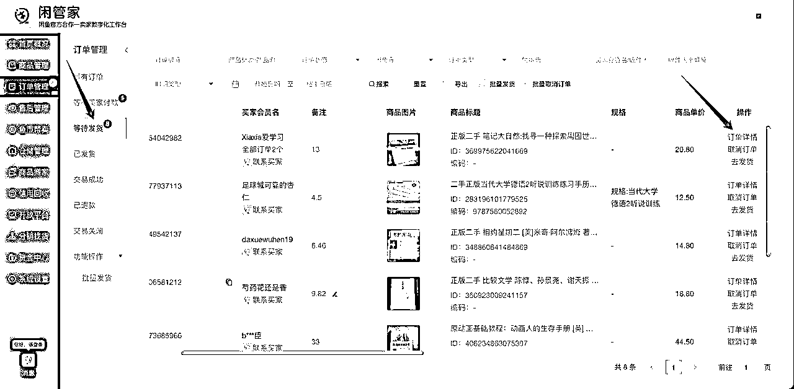

把地址复制出来，然后去上家（孔网、淘宝对应店铺）下单。上家发货后，复制快递单号回到闲鱼填写。

但有的时候单号填进去，闲鱼会提示“无法发货”“单号已用”之类，怎么处理？

可以选“我已寄件”，再选择“其他”，填上邮政/极兔/指定的快递名称，然后录单号。

或者选“无需寄件”，再点“我已发货”，然后跟客户私聊把单号发过去，并解释：闲鱼平台不显示这个单号，可以复制链接到浏览器里查看。

话术：亲，您的订单已发货，单号是——。因为闲鱼平台不显示这个单号，请您复制单号到浏览器查看物流进度。

手机端的操作方式：复制孔网单号，打开闲鱼App，路径是“我的—我卖出的—待发货—找到指定订单—去发货—我已寄出—填写单号”，通常快递公司会自动匹配，提交确认即可。

内容来源：《深耕行业2年后，分享咸鱼二手书无货源、绝版二手书等5种项目玩法》《加入龙哥盟一年，终于实现副业月入过万》。

#### 4.2.2 怎么找到优质货源 @老瞿 Qu @豆仔

不同店铺的二手书品相会有差异，怎么挑出品相更好、售后问题更少的货源呢？以孔网为例，可以综合品相、发货时长、成功完成率、店铺好评率这几个维度来筛选，中差评内容也可以顺带看看。其他平台同样可以参考这些数据指标。

操作方法：先按「总价从低到高」排序，然后查看对应店铺的发货时间、成功完成交易率和好评率。发货时间越短、交易率越高越值得选择。比如优先选12小时内发货、成功完成率和好评率在90%以上的店铺。

# 闲鱼卖二手书：下单、售后、运营一篇讲透

打开任意一本书的售卖页，先看「店铺评价」。好评率要挑高的，再抽几条买家留言细读，辅助判断更有底。

有个坑要注意：卖家描述里标了“缺页”之类的，基本就是问题书，别下单。

聊天时对方说“店要倒了，介意勿拍”，也千万别拍——不然售后出了问题，想找人都找不着。

内容来源：6 月 27 日《闲鱼二手书新人 21 天跑通项目闭环的经验分享》@豆仔

#### 4.2.3 怎么把下单成本压到最低？@亦萌

1.下单前装一个“孔夫子”app，付款走农行卡免收手续费。我实测目前只有农行免费，别的银行大家也可以试试。

2.买单本书时，从“书目”入口进去，找到对应的图，把收货地址改成客户的，再按价格从低到高排列。

找不到就改关键词，减少限定词，比如去掉版本——很多商家上架时很粗糙，搜太细反而找不到。

3.要买好几本，尽量凑在同一家店，邮费能省则省。

4.买得多可以谈，先拍下别付款，让商家改价，还能顺手拿张优惠券。

### 4.3 售后流程怎么跑？@老瞿 Qu @亦萌

1.售后的通用流程。

先记牢：咱们是中间人，心态稳住。

所以不必在闲鱼上跟买家纠缠。出现售后，让买家把快递面单和问题书摆一起拍张合照发过来（既确认货是自家的，回头找上家也有证据）。

照片拿到后转给上家，上家怎么安排，我们就怎么回买家；买家回了什么，再原样转给上家。一来一回，并不复杂。

再说，平台购物一般都有运费险。闲鱼买家因自己的原因退货，运费他们自理，反过来想我们还赚了笔运费险。质量问题的话，按上面的方式转达给上家就行。

个人看法：少折腾，只要利润允许就协商解决，直接赔付也行，把精力腾出来多赚点。

售后问题处理参考如下：

2.售后处理原则：把自己当传声筒。

买家怎么说，你就怎么转给上家，看上家回不回。

对方回了并妥善解决，不外乎两种结果：一是书价不低，上家愿意出退回的邮费；二是书本身不值钱，上家让你直接仅退款。

还有一种可能：上家不理你。先给他留言，然后提交【仅退款】，在理由栏里再补一句：麻烦看下我给您的留言，问题是……，您出邮费，我寄回去。

这之后又有两种结果。一是上家拒绝了，但他必须给出理由，也算联系上人了；如果拒了又给不出有效方案，就点“投诉”，把问题丢给孔夫子官方处理。二是他一直不理，到期系统自动退款。

最后一种可能：上家不认账，觉得书没问题，但买家觉得有问题。

咱们夹在中间，如果书不贵，试着给买家退点钱，让他收下来。

买家非要退，书价又不低，那就自己出邮费，寄回上家或者寄到你自己手里。

书实在便宜，就认了这一本。我一般10块以内的不想折腾。不过这种情形其实很少，大多数上家和买家都讲道理。遇到恶劣的卖家，拉黑就是，下次不买。

3.怎么把售后处理成加分项，反客为主，让买家满意甚至变成回头客？

买家上门时通常带着情绪，所以第一件事是态度到位，先把对方的火气安抚下来。

“亲，您别急，我这边品质和服务都有保证，您放心，我一定给你处理好。”

一句定心的话，对方的语气和情绪就稳下来了，后续对话自然顺畅。

接着按上面的方法去找上家，同时把进展同步给买家。要是上家一时联系不上，又能肯定是上家的责任，我们可以先给买家补发或者退款。

补发时，条件允许就发品相更好的，成本顾得上就升级到9新或95新，再顺水推舟卖个好：“我专门让其他仓库给您赶紧补发，这次特地挑了本成色更好的，给您添麻烦，实在不好意思，感谢理解。”

重点：咱们的情绪永远要比买家稳定，不管是处理方案还是心理上都能给买家托底。

给出方案之后，记得补一句：“您可以关注我一下，老客户复购都有优惠，而且我这边服务和质量都有保障，您放心，以后我都给您安排好。”

当然，售后不保证次次圆满，买家的素质参差不齐，咱们的沟通能力也各有高低。尽力做好过程，结果顺其自然就好。

## 五、【运营与优化】如何把曝光和出单率持续做上去

#### 章节概要

链接上架后能一直用，但不代表上完就能不管。后续要做的，是把商品维护好。维护运营里的门道不少，可能某一个小细节就是转化率的分水岭。

这一章，我们聊怎么让上架商品获得更多曝光、被更多目标人群看到：

商品维护：每天擦亮、及时回消息、完成曝光任务

商品优化：根据实际降价、更新商品、人工干预等

同时会讲不同数据表现下该怎么具体优化，希望能启发你。最后还整理了准备长期做这个项目的注意事项。

#### 本章航线图

学完本章并动手练习，就能走完航线图第三阶段——用运营和优化把曝光做上去。

1.每天做擦亮这类固定动作，为链接争取曝光（约30分钟）

2.摸清日常运营之外、还有什么优化玩法（至少10分钟）

3.把数据不理想的链接逐个优化掉（约1-2小时）

假如你已经有几本书在售，那就动手记录数据，试着做运营优化吧。

### 5.1 闲鱼链接的三个核心数据@亦萌

曝光数：链接出现在多少人眼前。

浏览数：多少人点进来看了详情。

想要数：多少人点了“我想要”，代表想咨询、问价或直接拍下。

曝光到底意味着什么？这个问题很多人问过。

关于曝光，我的立场从未变：不必紧盯着涨。把观测周期设为14天，不用太较真。我们要的是能精准触达目标人群的曝光。那些持续出单的卖家，曝光数据未必漂亮，但流量入口几乎全是对的人。

曝光和成交不是一回事，有关联但不必划等号。当你把选品做到位，最典型的表现就是：曝光看起来平平，订单却没断过。

怎么让曝光更精准？顺着平台的喜好办事，让它把你记进关键词。

例如你专营二手书，就不要往账号里混入别的闲置，让平台识别出你的垂直属性。

一段时间后，系统倾斜过来的流量，就是需要买书的那批人。

等订单陆续成交，平台会认为这条链接能打，于是把它推荐给更多同类需求的人。

有用户主动搜索时，你的商品也有机会排在前面。

我们要的正是这种连点开的人都是潜在买家的流量。那种推给无关路人的曝光，看着有数字，实际没意义。

所以不必天天看曝光数字，不妨回头检查基本功——图片是否够好、标题是否有力、定价是否合理、选品是否踩中当季需求。

这比一味盯着曝光数值有价值多了。持续做优化、持续上新，剩下的交给时间。商品、账号、用户需求都遵循流量波动规律，只要路子对，坚持下来自然见效果。

当然，这不等于曝光与订单彼此无关——流量足够精准之后，两者会形成正反馈。

有的卖家做到曝光6000甚至破万，订单就跟着爆发；不过这种效应，根子上还是流量精准。

最后再强调一遍：别把高曝光当KPI，新手尤其要克制。

先磨好基本功，把链接打理到位，让该跑的动作都转起来，结果自然会浮现。

### 5.2 商品怎么运营，曝光才会高

#### 5.2.1 每天擦亮

可以选晚上00点过后，也可以早上起来做。

回到首页，依次点“我的”“我发布的”，就能看到“一键擦亮”按钮。

#### 5.2.2 前期消息及时回 @老瞿 Qu

打开闲鱼通知，尽量及时回复，避免用户流失。不知道怎么答的问题，去淘宝或其它闲鱼店找同款咨询一下，答案就有了。同行就是你的免费顾问。

#### 5.2.3 快捷回复设置，把运营效率提上来@亦萌

先把流程拆开，再针对各环节的常见问题配好回复，用输入法的快捷回复功能快速应答。

从第一次询单到签收后的反馈，可以切三段：售前咨询、售出跟踪、售后答疑。每段里再挑出高频出现的疑问，给每类问题准备好一套答复模板。

电脑端也留档，方便用闲管家的电脑版客服工具直接引用。

手机输入法大多内置“常用语设置”，我一直在用讯飞，别的输入法也有类似功能。把常用语按类别整理好，回消息就特别顺手。

买家买之前的典型问题：正版吗？有货吗？大概多久能发？价格多少？走什么快递？可以少点吗？

付款到收货之间：为什么还不发？物流一直不动？手机号写错了？地址要换？想退能行吗？

售后高发问题：到手成色差别大、怕是盗版、拍错了要退、卖家寄错书。

你可以结合自己经常碰到的情况，把这些话术分好类、一次性备完，之后碰上对应场景，点两下就发出去，既快又不费脑。

话术别想得太复杂，按照你日常沟通的习惯写进去即可。

配置完成后，每次直接调用想用的那条话术发送。这么做的意义就是快，省出来的时间拿去做更精细的选品，综合收益会更好。

#### 5.2.4 怎么拿高曝光

真没诀窍，把细节做好：

#### 5.2.5 运营期间有哪些注意点

1.实用技巧

2.闲鱼违规封号雷区

下面总结了一批高频违规情形，能躲就躲。

内容来源：《闲鱼电商｜小航海学习手册》

### 5.3 怎么通过优化把曝光提上去

优化的奥义，就是给平台制造一种“你家商品很抢手”的错觉。

闲鱼的流量绝大多数是自然分发。账号冷启动阶段，就拿小号点几个“想要”或者拍几单，先把数据垫一垫；另外图书品类数量庞大，单个账号的500个上架位却很有限，因此没有销量的链接要定期清掉。

可以追热点。比如最近《三体》《灌篮高手》热度高，对应的二手书也会跟着走俏，可以顺势调整一下主力书目，但畅销大盘整体变动不会太大。

平台这才愿意持续给商品喂曝光、给展现，最后的订单数和利润也才会慢慢变大。

#### 5.3.1 三个具体优化玩法@老瞿 @诗和远方

5.3.1.1 更新、降价、优化标题

围绕平台规则来安排动作，例如：

1、每天下架没流量商品20-30个

2、每天上新20-30个

3、每天挑20-30个商品降价

4、每天挑20-30个商品改标题

5、用闲鱼币给部分商品做推广

6、闲鱼币增加曝光

这里展开讲三点。

1）闲鱼币增加曝光

说明：急速卖是花闲鱼币做推广的方式，每次消耗1000-6000币，具体看你选多少人、推多久。

入口在闲鱼首页右上角的签到里，进入后页面左下角能看到急速卖；点进去会列出全部商品。注意：只推荐给曝光量/浏览量不超过25的链接投放。数据不太行的，先把曝光、浏览、想要这几个指标养起来，再谈极速卖。

首页签到入口

找到急速卖

选择要推广的商品

选择推广人数和时间

2）闲鱼币抵扣推广

作用：开启后，买家下单时能按自己的闲鱼币额度抵扣一部分金额，相当于给了张打折券；对商品链接来说，也能加速曝光。

入口：闲鱼首页右上角的签到，找到后点进去，页面下方右侧就是闲鱼币抵扣。点开可以看到未开启和已开启抵扣的宝贝。刚上架的商品，可以把抵扣都打开，加快曝光。

怎么设置？我的习惯是：想要数超过20或30的链接，关掉抵扣；想要数还是0，或者低于10、20的，打开抵扣。具体线划在哪里，你按自己的实际情况定。

首页签到入口

找到闲鱼币抵扣

未开启抵扣宝贝

已开启抵扣宝贝

小技巧：藏短板+拉曝光。新链接最尴尬的就是“我想要”为零。顾客浏览时，价格旁边立着一排刺眼的数字，除非主图或价位足够勾人，否则没人愿意点进去。打开抵扣后，这个位置会换成“可抵xxx闲鱼币”，顺带把短板藏住了，也把曝光拉起来了。

3）单规格、多规格图书降价

为什么要拿降价当抓手？因为它的曝光效应比擦亮、急速卖、闲鱼币抵扣更直接。当降价幅度到达一定程度，展示页右下角自动挂出“累计降价22%、48%”一类的标签，不好看的想要数据被遮住，眼球也赚到了。

具体操作上，单规格商品每次降一分就足够；多规格商品则按住引流款SKU的报价往下调，最终效果殊途同归。

单规格降价展示

多规格降价展示

小建议：上新时不妨把引流价挂得高一点，比如12到16元；等链接上架了再手动调到6到8元，累计降价xx%的效果就有了。再提醒一句：引流价最好别压到5元以下，并不是越便宜越有利。

5.3.1.2 人工干预

在闲鱼搜索那些标题为“一分钱”“教训”的链接，评论区通常还有“互”“虎”这类谐音字，背后都是懂行的商家。我们的目的，是借他们的手完成人工干预，把账号活跃度拉起来，顺便优化自己的商品。

会发这类内容、留这类言的商家，一般都懂这个玩法，动作比较快，直接找他们更省事。

找到目标商家后，可以从“一分钱”或“教训”链接进入，也可以点留言者的头像跳进主页，随便挑一个商品打开。

点商品右下角的“我想要”，弹出私聊窗口后发一句：“来3个”。一般操作3到5个链接就合适。

再回到商家主页，点开另一款商品，发一条“还有吗？”“在吗？”或“想要”，尽量模拟真实买家的语气。

就这样挨个主页跑、挨个商品聊，直到搞定最后一个链接，结尾发一句：“完了，记得及时来”，也可以换成别的说法。

一天找3到8个这样的商家操作就够。会有部分不回复，但整体量还是够用的。

注意事项

1.优先选“想要数”偏少的链接，同时锁定留言里带“互”或谐音字的商家。

2.按上面的方法，先把人找对、先给对方做完，速度很快；对方看你已经操作过了，下次也更愿意来捧场。

3.自己发“一分钱”“教训”的商品，或者在留言、私聊中带“互”“互相要”这些词，容易被判定违规。

4.每天找3到8个商家，每家操作3到5个链接即可。

5.完全不用买那种一分钱的商品，也能完成全部操作；对方硬性要求购买的，建议跳过。偶尔买上几个也无妨。

5.3.1.3 朋友助攻

找身边好友按上述方法帮自己店铺做数据。操作的时候尽量用独立的手机、单独的流量或专用WIFI，降低关联风险。

# 闲鱼二手书：数据要会看，证照要会办

做闲鱼二手书，有几个小动作可以先落地：请一位靠得住的朋友，借他的手机打开闲鱼，到你店里挑三到五个宝贝，用0.01元的象征价走一遍下单流程，权当小演练。数量别贪多，平台风控很敏感，做过了头反而会被判违规。上架和调整的时段尽量踩在闲鱼人气旺的时候：上午八点前后、中午十一点半前后、晚上八点前后。这几个点既赶上流量高峰，也能避开多数人的上班时间，操作更从容。以上只是参考，最后还得结合自己的实际情况，筛出最适合自己的打法，目标只有一个——让宝贝尽快拿到更多展现和点击。参考来源包括《闲鱼电商｜小航海学习手册》《深耕行业2年后，分享咸鱼二手书无货源、绝版二手书等5种项目玩法》，以及7月11日《闲鱼二手书的数据分析及优化方法》@诗和远方。

#### 5.3.2 用数据结果反推调整 @诗和远方

先弄清几个关键数据维度。把它们放在一起看，经常能看出单看某一项发现不了的问题。

**5.3.2.1 展现和点击都不错，“想要”却不多**

当曝光和浏览都漂亮，说明首图、价格锚点和搜索词已经把人带进了详情页。可“想要”上不去，通常逃不开三种情形：一是标价偏高；二是买家只是随手点开；三是前端引流价和后端实际售价差得太离谱，用户有种被忽悠的感觉。

调整前数据

调整后数据

以《西方哲学史》为例：展现和点击都拿得出手，“想要”却停在3。首图与引流价没大毛病，书本身也有人找，问题出在详情页的价格区间——6.66到42.86元，顶格价几乎追平新书。买家一算账，觉得买旧书不划算，转身就走。

调整办法：①这本书先别惦记赚钱，甚至只留一两块利润，等“想要”攒起来再逐步加价，比如每成交一本上调五毛；②若最高价来自合集规格，先把合集选项撤掉，让买家第一眼只看到单本价格，等后期想要多了或有人问合集，再补回去；③每天把价格下调一分钱，用降价动作持续换展现；④配合超级擦亮、急速卖、闲鱼币抵扣等工具。

调整案例拆解

6.28调整前

6.28调整后

6.30早上数据

7.1早上数据

上面的案例里，我选了《生理学第8版》。起初是1518次展现、10个点击。6月28日大幅下调前端价，同时参照孔网进价重新定标价；随后一两天又微调了一两次前端价，到6月30日上午拿到1809次展现、11个点击、1个“想要”。7月1日展现升到1959，点击和“想要”没再涨。这本书转化不理想，我个人认为首图没选好也占了很大原因，可以换图再试。

**5.3.2.2 展现、点击、想要都不差，就是不出单**

这种情况说明首图还行、前端价合适、“想要”也过得去，那为什么没成交？可能有几类原因：①买家来比价，你的标价高于同行；②对方只是闲逛，购买意愿不强；③进价本身高，成本加利润要压到40多元，买家觉得不如添点钱买新书。

举例来说，《托马斯微积分》在孔网最低拿货35元，标39.68元完全合理；这本书最早标45元以上，后来逐步调到39.68元。

书籍数据分析：首图是手持书，光线尚可，正面视角，挑得没问题；前端价7.56元合理；展现1069、点击49，展现/点击≤25，我觉得算健康；“想要”10个。后来数据变成展现1233、点击69、“想要”16个。到7月1日，这本书仍没出单，至今只有一位顾客来问。

竞对分析：我搜了闲鱼同行，标价大多在30—88元；卖30元和35元的各只有一家，都是个人卖家。标30元的卖家有65次点击、7人想要、不包邮，截至6.29上午11:40；标35元的卖家有18次点击、4人想要、不包邮。对比自己的数据和同行，算是不错的。没成交大概率是买家那边付费能力偏弱，可能转头去买影印版。

7.1号数据

7.3号数据

调整办法：①把标价压到进价，或只加0.5—2元，先冲“想要”和出单概率；②每天坚持改前端价规格，每次降一分；③用超级擦亮、急速卖。调整之后：这类书通常很难起量，持续投入回报低；时间多就每天降一分，没空就放着别管。

**5.3.2.3 展现少、点击少，甚至没人点**

原因主要有两种：①书本身需求弱或需求很低，上架一两天没展现比较正常；②卖这本书的同行太多，分不到多少流量。

调整办法：①大幅下调前端价规格，比如原来前端价是9.89元，可以直接降到6.86元，这样商品首页会出现累计降价22%、48%、52%之类的标签。好处是首图不差时，买家看到大降价会有想点进来的冲动，展现和点击会慢慢把链接带起来。

②用超级擦亮：每天一次，一次只能擦10本，可以给没展现的书加曝光，也能配合大幅下调前端价规格一起用；几天后仍没点击或没“想要”，考虑下架。③用急速卖、闲鱼币抵扣。调整之后：有展现、有点击且数据不错，就按其他分类继续调；展现仍低于50，可以选择下架。

**5.3.2.4 利润太薄的书怎么调**

有些书出单还不错，但标价利润只有1—2元，直接下架可惜，留着又赚得太少。可以这样提高利润，同时给链接加展现：①微调前端价规格，比如原来6.86元，改成6.85元；②每出一单或两单，把售价往上抬0.5—1元。两步要同时做，这样链接显示的是降价效果，自己的利润也能变多；新增其他规格时，每次尽量把前端价规格降一分，避免被系统误判为提价。

举例：我这本《新高中英语词汇》八五新，进价将近10元，利润只有3.97元。可以把售价改成14.48元，同时把“更多书籍咨询客服”规格略降到6.75元。

改前：

改后：

内容来源：7月11日《闲鱼二手书的数据分析及优化方法》@诗和远方

### 5.4 项目复盘：提前避开这些坑 @老瞿 Qu

#### 章节概要

闲鱼无货源二手书难度不算高，但不确定性不少。本章汇总5条注意事项，归结起来就是：守平台规矩、做细活、别轻易转实体……希望大家提前知道，实操时少踩坑。若还有别的避坑点没收录，欢迎航海期间多交流。

#### 5.4.1 先接受可能被封号这件事

心理准备不够、把项目想得太容易，坚持十几天没见预期就容易打退堂鼓。可这个项目跟短视频带货一样，谁没做废过几个号？做闲鱼二手书，封号、废号也是常事。

#### 5.4.2 平台规则要心存敬畏

信息爆炸又浮躁，很多人都想抄近路。做二手书若用软件批量铺货，一天撞上几本违禁书、几次重复铺货处罚，7天封号，项目直接停摆。成熟平台都在打压粗暴玩法，只有守规矩，平台才可能让你赚到钱。

#### 5.4.3 别把技术手段当救命稻草

我见过很多做闲鱼二手书的人，都是一本本手动上架；我们工作室也是找大学生精选图片后上传。同时期起步、一上来就靠各种技术的人，反而没拿到大结果。为什么？用户到闲鱼先搜书，出现下面这个界面。

先想一下：如果是你，会点哪个链接？大概率直接淘汰1和3，在2、4里选。1和3没有“想要”，价格还高，图片也没亮点；选2是因为实拍图真实、还上了热门榜，人都有从众心理；选4是因为便宜、至少有几个想要、图片也顺眼。系统采集上架的书：质量通常比手动差；批量铺货一天几百本，没心思做数据，比如挑几个商品点想要；更不会前期压价、等销量和想要起来再涨价。细做没有捷径，也别卖盗版新书，官方会管，容易封号。

#### 5.4.4 别急着迷恋实体，轻易转有货源

有人一上来就想搞二手书仓库，愿景很美。实业兴邦没错，但等有能力再考虑，前期先做轻成本。我1000平方米的二手仓库，还不如在小区开工作室做30个闲鱼账号卖无货源二手书赚得多。实体投入大、累、成本高、利润薄。

#### 5.4.5 自己当项目的掌舵人

常有人问：上架500本一个月能赚多少？做几个号才能月入过万？辞职做二手书行不行？一上来就开工作室一年赚30万可不可以？……这些问题没有标准答案，项目本身就充满不确定。与其到处找答案，不如先动手：注册账号、上架书籍，慢慢你对项目的掌控感会越来越强。内容来源：《聊聊你做闲鱼二手书项目失败的100种可能性》《闲鱼二手书无货源模式拆解（精细化运营）》。

## 六、执照与出版许可证：从办证到年审再到注销 @老瞿 @大唐 @亦萌

做二手书的小伙伴常接到政府电话或短信，提醒年审、申报或证照异常，不知怎么处理；找代办又怕乱收费。为了让大家安心、少被坑，今天把“出版物经营许可证”从办证、年审到注销的操作讲透。

### 6.1 办证

办证分线下和代办两条路。

#### 6.1.1 线下办理

线下最稳，但最难。个体户执照简单，有商业地址即可；出版许可证要求仓库或商铺，对面积、消防有规定，大城市有些已停办。结果周期长、费用大几千；借用地址每年还要再付几千。做无货源二手书不推荐线下，很多人试过最后放弃。

#### 6.1.2 代办公司办理

代办多在淘宝找，或朋友、群友介绍。淘宝选等级高、好评多的。代办多靠政策漏洞或偏远地区关系办理。刚办通常没问题，后面可能地址被注销、异常。任何代办保证都不牢靠，看运气，看有没有投诉、有没有被更高层关注。

#### 6.1.3 代办有风险，怎么找靠谱的

先承认这行擦边。线下办不了又想赚钱，只能找代办。好消息是地址异常对闲鱼店铺运营基本没影响，闲鱼审核约等于没有，有证就行。先别纠结，赚能赚的钱，遇问题解决问题。找相对稳定、朋友办过、承诺平台能审核通过的。最好走淘宝或闲鱼下单，出问题好处理。证出问题最坏是付约300元年审费重办一个，不影响店铺经营就替换。包售后价格会高，低价跑路风险大。合理价1000—2000元，太高没意义，承诺太多是空话，太低是坑。没更好选择时，接受特殊行业存在，别太烦心，把精力放在赚钱上。风险提示：办出的执照别做其他商业用途，仅用于开店卖书。

### 6.2 证照每年的公示与审核

代办办的是个体户执照+出版许可证两个证。年审不同，操作见6.2.1和6.2.2。

#### 6.2.1 营业执照：工商年报申报

自行操作，每年一次，6月30日前完成，0申报即可。

**6.2.1.1 具体操作指南**

第一步：电脑或平板浏览器打开“国家企业信用信息公示系统”（网址：https://www.gsxt.gov.cn/index.html）。

第二步：点“企业信息填报”，选执照所在地区。

第三步：以山西为例（其他地区大同小异），用工商联络员登录，或用电子营业执照小程序扫码登录；扫码若没有对应执照，先下载电子营业执照再扫码；联络员忘了账号密码可点重置修改。

第四步：登录后点“年度报告填写”。

第五步：填信息，不会填可对照企查查、天眼查。

1.特种设备信息，没有写无或0，记得存一下。

2.企业基本信息，需改则改，记得存一下。

3.网站网店信息，没有提交无，记得存一下。

4.对外投资信息，没有提交无，记得存一下。

5.资产状况信息，有就写没有就不写，记得存一下。

6.对外担保信息，没有默认填无，记得存一下。

7.有就写没有就不写，记得存一下。

8.社保信息，有就写没有就不写，记得存一下。

9. 确认展示内容没有异常后，按下“保存并公示”按钮，这一步就完成了。

第6步：点击提交，年度报告对外公示到此结束。

联系电话必须填真实号码，不过信息一旦公开，难免会接到不少推销或骚扰电话，因此建议留一个真实但平时不常用的备用号。

6.2.1.2 填报须知：

① 各地申报页面和填写项目会有些差别，但总体逻辑一致，按0申报处理就行。

② 每年6月属于填报拥堵期，页面偶尔会打不开，多刷新几次，并且尽量早点完成。

#### 6.2.2 出版物经营许可证：证照年度审查

出版物经营许可证一般从第二年开始进入年审环节，截止时间按证照办理日期推算，各地规定并不统一。

多数地方集中在每年1月至3月完成。

年审要跑线下政务服务中心行政审批局递交材料，所以通常还是交给代办公司处理，市场价大约200-300元，会随行情小幅波动。

### 6.3 税务申报

通常个体工商户执照办下来后，税务并不会自动开通；代办也没必要给自己加活，所以一般不用太担心报税这件事。

不过近期有圈友反馈，少数地区出现了执照自动开通税务的情形。遇到这种情况，先向代办确认是否真的开通，也可以致电当地税务部门核实。若确实开通了，就要登录当地电子税务局做0申报。

“最近江西安远部分个体户被发现自动开通了税务。若你的执照仍在经营，建议自查税务登记状态，可拨打安远县税务电话07973732916咨询。如果已经开通，请按时申报，零申报同样属于正常申报。有疑问可随时联系。”

#### 6.3.1 申报操作指引

税务申报通常按季度进行，全年共四次：

1月处理上一年10-12月（第四季度）的税务；

4月处理1-3月（第一季度）的税务；

7月处理4-6月（第二季度）的税务；

10月处理7-9月（第三季度）的税务。

操作流程如下：

1. 百度检索“国家税务总局XX省电子税务局”，执照注册在哪个省就选哪个省，下面以江苏为例。

2. 在页面右上角找到“登录”并点击。

3. 可用官方App扫码，也可输入企业信息登录。首次登录必须填写法人信息；密码忘了就点“忘记密码”重设。

4. 登录成功后，首页会直接呈现“待办”事项。

5. 点“进入申报”，再点“一键0申报”，申报就完成了。

注意：各地页面和填报项目存在差异，核心原则仍是0申报。

### 6.4 证照异常

#### 6.4.1 出版物经营许可证为何会异常

办理出版物许可时，要先有一个个体工商户或企业作为申请主体，再以该主体去申领许可证。换句话说，必须落到一个经营地址上，而这个地址正是办证过程中的关键。

不少地方的主管部门会到地址现场核查，对面积、消防、书架摆放，甚至进书凭证都有要求。正因为门槛不低，很多人才不得不委托代办。

代办常见的做法是：在偏远城市借助地方扶持政策、政策空隙或人脉关系操作。他们提供的地址往往并非自有，许多是租来的，甚至并不真实。一旦同一区域内商家因盗版销售或订单纠纷被反复举报，就容易引起监管注意；问题严重的，整片区域可能被集中清理，去年海南就出现过类似情况。

常见疑问有几个：

证是不是假的？其实证本身是真的，只是被主管部门吊销后，等同于你手中没有有效证书。被吊销的原因，是查出办证过程违规。

开网店也需要实体地址吗？按现行要求，注册公司或个体户确实要有商业属性的办公场所，这也是便于管理。

代办说不会上门核查，能信吗？代办为了成单当然会这么讲。但工商会不会实地看，主要看几点：第一，有没有投诉，投诉集中就必查；第二，当地工商部门的勤勉程度和考核需要；第三，同片区是否有其他商户被查，进而引发区域整治。

所以代办说“大概率不查”并非全无依据，但他们也无法打包票。

#### 6.4.2 出版物经营许可证异常后的处理

6.4.2.1 建议三年内注销

如果接到主管部门电话，先联系原代办处理；若代办失联，再找其他代办试试。仍解决不了的话，建议在异常发生一年左右办理注销，因为当地工商可能会联系你，并提醒不处理会影响信用记录。

不必过度紧张，对方也是履行工作职责。稳妥起见，三年内找代办注销，再重新办一张即可。目前我手上有十几张证，还没碰到信用方面的问题。

6.4.2.2 证照异常后闲鱼还能用吗

以亲身经历来看，即便证已注销，闲鱼平台通常也不会受影响。

如果不巧被闲鱼系统识别到证照异常，一般只是扣20分、封7天，之后可以重新办证替换。

如果闲鱼号被永久封禁，可以先尝试注销账号，或者看看能否与支付宝解绑。

但很可能既注销不了，也无法解绑。

这种情况下，就算你补办新证，原来的闲鱼号也无法继续使用。原本一张证能支撑三个闲鱼店铺，现在只剩两个可用。若还想多开店，只能请别人再办证。

6.4.2.3 证照异常会影响征信吗

一般来说，只要在异常后三年内完成注销，基本不会有大问题。老瞿的常规做法是异常后1-2年内销掉。

6.4.2.4 证照异常能否修复

通常不做修复。因为多数情形下，修复成本比重新办一张还高，所以一般直接注销。当前注销费用约200-300元，各地略有差异。

当然，也可以回头找原代办沟通扯皮，能否免费处理，就看对方良心和你的沟通能力了，有些公司会同意免费销户。

### 6.5 证照注销

#### 6.5.1 注销步骤

要注销出版物经营许可证，只需让代办把对应的个体工商户执照注销即可。

执照一旦销掉，关联的出版物许可也会随之失效。

市面上注销执照的费用通常在200-300元，具体按地区而定。

#### 6.5.2 注销结果如何核实

按代办要求交完材料并完成注销后，可到国家企业信用信息公示系统查询。

步骤如下：

1. 打开 https://www.gsxt.gov.cn

2. 输入证照名称或统一社会信用代码进行查询（系统偶尔不稳定，可能需要多刷新）。

3. 状态栏显示“注销”或“撤销”，就说明已经销户成功。

# 选修篇：玩法扩展与赛道精选

章节概要

当项目最小MVP跑通、整体流程也熟悉之后，就可以翻开选修篇了。

无论你想把项目继续做大，还是寻找更多新玩法，本章都值得细读：

【项目拓展】掌握更多选品思路，拓宽品类与货源

【项目放大】看看生意还能怎样继续放大

【案例拆解】了解当下热门赛道的实际情形

现在，一起发掘项目的更多可能吧～

## 七、【项目拓展】选品新思路与落地步骤

章节概要

除了在孔夫子网选品，还有4条新路径可以尝试：

参考淘宝店铺销量来选品

锁定优质闲鱼店铺来选品

从高校官网推荐书单里选品

按顾客推荐书单来选品

如果你已经把孔夫子网选品玩熟了，不妨试试这些新方法。若发现更多选品技巧，也欢迎在航海群内交流分享。

### 7.1 借淘宝店铺销量榜选品 @老瞿 Qu

在淘宝搜二手书店铺，挑一家专营二手书的大店，同样看销量排序，再照着它的热销榜挑书，依次上架。

### 7.2 锁定闲鱼高销量同行选品 @一游 @老瞿 Qu

先找到一家优质同行，把它相关在售商品作为参考，逐一上架。这样做的好处是：这些品已经过同行验证，同时也能降低违规风险。

具体做法：

### 7.3 从高校官网教材公示找书单@诗和远方

多数大学在开学前都会让学生自行购买或统一订购指定教材。只要摸清需求，就知道上什么书更容易出单——有需求才有市场。

挑选方法：

每所高校官网都会公示本校教材选用情况，公告页下方通常附有下载文件，常见格式为Excel或PDF。

直接在百度检索“2023秋大学教材选用公示”，页面会列出各校公示链接。这里以南京理工大学泰州科技学院为例，公告下方可见附件：

附件：南京理工大学泰州科技学院2023年秋季学期拟选用教材清单.xls

按这个思路还能继续收集其他学校的推荐书目。偶然发现有的学校官网挂出了《2022秋全国大中专教学用书汇编》，顺着线索又找到了《2023秋全国大中专教学用书汇编》，其中汇总了2023届大一新生所需的全部教材名单。表格放在文末，需要的可自行下载。

### 7.4 按顾客类型挖书单@诗和远方

大致可把顾客分成四类：大一新生、考研备考生、专业考试生、个人专业爱好者。

1. 大一新生推荐书单

大一新生主要依据学校提供的自购清单来配书。可参考《2023秋全国大中专教学用书汇编》，结合近期销量较好的专业，上架同专业书籍。

购买特点：消费能力偏弱，喜欢砍价。比如标价160多元的书，会直接问130或100能不能出。

避坑：遇到大一新生团购，先确认对方是否真要，再决定帮不帮找。只要对方确定要，后面即便压价，主动权也在你手里。

大学新生书单：

2. 考研备考生推荐书单

建议把考研群体作为重点。他们购书意愿强、付费意识好，通常找齐合集后就会直接下单，最多要求稍微优惠一点。

购买特点：购书意愿强、多本下单、付费能力强、发货要求快。

成单技巧：报完价后可以顺势送句祝福，例如“提前祝您考研上岸，蒙的都对，考上心仪的大学”。详细话术见文末。

考研备考生书单：

3. 行业从业/职称考试生

这类人同样有购书需求。比如医药销售从业者，很多人缺乏专业背景，会买相关书籍补知识；参加职称考试或专业证书考试的人，也会购买考试推荐用书。行业从业者和职称考试人员大多有工作经验、收入较稳定，更容易成交，而且往往直接下单。

从截图看，下单顾客很可能在医院上班。对这类从业者来说，自动成交概率很高，也是后续值得重点发力的方向。

购买特点：直接下单/不议价、对书本质量要求不高。

4. 专业爱好者推荐书单

特点：要的书多、基本不议价，可以适当报高。

这类顾客既不是从业者，也不是科班学生，买书纯粹出于个人兴趣。他们通常会问某个专业有哪些书，让你帮忙推荐，很少指定具体书名或作者。由于数量多，他们一般不会逐家比价，所以报价时可以相对高一些。

购买特点：直接下单/不议价、对书本质量要求不高。

附录1：高校官网书单资料

## 附录：高校官网书单资料

23秋《教目》电子数据.xlsx

2023-2024-1学期全日制本科生教材选用情况公示.xlsx

2023-2024第一学期教材征订表-物信学院.xls

2023-2024学年第01学期本科课程教材选用表.xls

本科教材选用审批汇总表2023-2024(1)（公示）.pdf

附件2：2023-2024学年第一学期本科选课表.xls

附件-数统学院2023-2024-1教材选用汇总表.pdf

中宣部 教育部组织编写的已出版马工程重点教材目录（2023年4月）.xlsx

2023秋全国大中专教学用书汇编.xlsx

附录2：考研参考书目

## 附录2：考研参考书目

23考研参考书目

资料出处：《深耕行业2年后，分享咸鱼二手书无货源、绝版二手书等5种项目玩法》、7月6日《在闲鱼卖教辅书的几种选品技巧》@诗和远方

## 八、【项目放大】四种做大生意的方式 @老瞿 Qu

#### 章节概要

如果你已经能够稳定变现，接下来就该思考怎样把项目做大、把收益抬高。常见路径有这几种。

下面逐一看看具体做法。

### 8.1 多账号运营

单账号的上限并不高：淡季利润约5000元/月，旺季可到1-2万元/月。一个人做精细化运营，最多大概能管6个账号。

### 8.2 工作室运营

把采购、发货这类机械环节外包出去，也就是雇成本较低的劳动力。比如我们把工作室设在小区，请本小区宝妈来做，在南京每月只需3000元，不用包吃住，也不缴社保和公积金。

### 8.3 多平台运营

1. 转转

转转是目前第二大二手交易平台。实战测试下来，流量约为闲鱼的三分之一到五分之一。如果不想多开闲鱼号，可以同步在转转发布，进一步拉升销量。

2. 淘宝

淘宝更考验运营能力，二手书赛道现在也卷，没有货源的情况下不建议贸然进入。拼多多则更被称作“电商的坟墓”。不过激活码类商品适合在淘宝和拼多多开店，只要你能找到货源，目前利润很可观。

### 8.4 转做有货源模式

不少人会想：是不是也能自己收点二手书？从实战结果看，规模没起来之前，不建议自建实体仓库，主要原因有三：

1. 二手书的链路比普通电商更长。普通电商不涉及回收，二手书却要等毕业季收货、开学季卖出，不是想进什么就能进什么，流程更繁琐。

2. 学校废品回收竞争激烈，需要打通校内废品收购站或学生流量，这离不开资源积累。

3. 二手书品类庞杂，而且按吨回收，导致书种极多。比如一个10万册的仓库，可能有2-4万种书，对仓库管理要求很高，否则找书困难，发货效率会被拖慢，这些都要投入人工和系统成本。

所以，建议至少做到20-30吨以上的体量再考虑建仓，否则各项成本很难摊薄。

闲鱼旧书五大实操玩法复盘

出处：《深耕行业 2 年后，分享咸鱼二手书无货源、绝版二手书等 5 种项目玩法》

## 九、热门类目拆解：五个真实案例

#### 本章速览

这一章里，几位群友分享了目前实操中比较常见的旧书类目，包括大学教材、小说文学、少儿杂志、大学英语激活码以及畅销套装书，这些方向相对容易跑通。另外还有一个门槛稍高的选项——有货源的绝版书，如果感兴趣，也可以看看。下面我们结合具体案例逐一梳理。

根据多数卖家的实际反馈，闲鱼上销量最稳定的其实是大学教材、小说和文学。教材受学期影响大，开学季会冲高，学期中段容易回落；小说和文学则常年有人买。另外，少儿杂志、激活码和畅销套装书，也是可以拓品的几个方向。

### 9.1 大学教材、小说与文学（新手最常见）@老瞿@诗和远方

这种店的核心竞争力就是“量大”。在春秋开学和毕业季前后，集中上传大学教材，正好踩中需求波峰；平时则用热门小说和文学书把出单量撑住。案例见下：

想进一步了解教材选品和客服话术，可以看：6.3 高校官网推荐书单@诗和远方；6.4 顾客推荐书单@诗和远方。小说文学类选书技巧，则参考：3.1.1 根据孔夫子旧书网畅销榜选品@老瞿 Qu；6.1 按淘宝店铺销量选品@老瞿 Qu；6.2 对标闲鱼爆单店铺选品@一游@老瞿 Qu。

### 9.2 少儿期刊杂志@老瞿

群里有伙伴实测过，少儿杂志当前销量势头很好。如果能从出版社或经销商那里拿到正规授权，这个项目特别适合做私域：信任建立起来后，可以持续推荐不同系列，甚至按孩子的成长周期长期预定。而且由出版方直发，基本没有盗版争议。参考案例：

### 9.3 大学英语激活码@小嵩

这套操作在淘宝已经很成熟，头部卖家月利润能到六位数；如今闲鱼上也有不少小卖家跟进，有的把激活码和旧书一起卖，有的干脆单独开个店只卖码。核心前提是能拿到低价货源，而它的优势几乎是天然的：不发货、无物流、虚拟交付，买家几分钟就能确认收货，售后负担极轻。接下来，小嵩教练会一步步拆解在闲鱼操作激活码项目的方法。先看案例：

1. 和旧书相比，激活码项目有几个天然优势：
1. 交付更干净，不需要反复找实物图；
2. 来咨询的人基本已确定要买，转化路径短；
3. 码一发出，交易即完成；
4. 资金回笼快。

此外，收码的范围比收书窄得多，操作起来也省心。能不能低价收到码，主要看货源渠道。我最初尝试直接联系在校学生，但体验并不好：有时候联系不上，有时候收到的码是已激活或过期的。后来我改走中间人，一位住在大学旁边的宝妈，把价格、利润和售后责任都谈妥之后，我只负责卖，轻松很多。收码的流程是把书背后的激活码剪下来：

2. 什么是大学生英语激活码

这里提到的激活码，来自外研社出版的《新视野大学英语》系列，目前许多高校都在用第三版。整套书分四个级别，每个级别又分“读写”和“视听说”两种。每本书背后都带一个激活码，用于开通配套的在线学习平台。学生需要用它登录U校园、交作业、攒学分。问题在于，这个码的有效期只有一个学期，不少人真正去激活时才发现已经过期，只能再掏钱买一个新的，所以市场需求一直很旺。

3. 激活码上架步骤

1）进入闲管家，在“商品管理”里选择“新建商品”。

商品分类勾选“图书”，再选“学习考试”。

2）商品主图：可在孔网或淘宝找书影后自行加字，更推荐自己拍/自己做图，以免和同行重复。

3）商品标题：围绕“新视野大学英语第三版”“读写/视听说”“智慧版/思政智慧版”“第1/2/3/4册”“激活码/U校园”等词组合即可，比如：

新视野大学英语第三版 读写 视听说 思政智慧版 1 2 3 4 激活码

新视野大学英语第三版思政智慧视听说读写综合训练激活码注册码

新视野大学英语第三版 读写思政版 1 2 3 4 激活码 U校园 智慧版

新视野大学英语 U校园 读写 视听说教程 思政智慧版 1 2 3 4 激活码

4）商品详情：写清楚“本商品是激活码，不是实体书；拍下后联系客服在线发送，无需物流；请确认好版本，保证能注册，无效可退；若不知道用哪个版本，请把U校园课程中心‘未激活’页面截图发给客服；拍错不支持退换；收到码后请尽快激活，超过7天不处理售后；激活码刮开后不支持退换”。

5）图书信息里ISBN栏填《新视野大学英语》对应的ISBN码。

这里可以添加多个SKU。

填好后，点击“立即发布”并确认。

重点提醒：激活码分“智慧版”和“思政智慧版”两大类，每个大类下又分“读写”和“视听说”两个版本，价格不同；细分还有1/2/3/4册的差别，发码时千万核对清楚。前期拿不准，就请买家发U校园未激活截图或书本照片来识别。示例见下：

4. 销售环节的小技巧

1）定价策略：上架时先标3.8—10.8元引流，也可以直接挂多规格SKU，把每个版本的价格标清楚。个人建议前一种玩法，转化效果更好。

2）沟通话术：报价前，先让买家发U校园未激活页面截图，确认版本再谈价；也可以直接说明“全新码、不掺书本、包激活，激活不了退款”。

3）交付方式：闲鱼聊天页面不能发带二维码的图，建议把对方发来的码图录成小视频，或把码串提取成文字发过去。

4）售后处理：由于码有时效，卖出去后要提醒对方尽快激活、尽快交作业。遇到砍价，可告知多买可优惠，每张少1—2元，走量非常有用。买家激活后，在订单里选“无需寄件”发货即可。

5）引导好评：激活成功时，顺势请对方推荐给同学，并请给个好评。常用的话术是“祝学习进步，学业有成，感谢支持！”

5. 常见问题

1）激活码上架到哪个类目？

建议选“学习考试”。ISBN直接填9787513588188，不管哪个版本，都能归到《新视野大学英语》这本书的类目里，平台判违规的概率比较低。

定价有两种做法：要么标最低价3.88元，再低容易触发引流嫌疑；要么开多规格SKU，把各版本价格一一列出。两种都行。详情图可去淘宝、拼多多找，也可以自己拍书的照片，别大家都用同一张图，避免限流。

2）买家到底该拍哪个版本？

下单前，让买家发送书本照片或U校园未激活截图，再按对应版本报价；如果你自己看不懂，可以把图发给淘宝/拼多多卖家帮忙看。买家付款后，去淘宝拍下同版本激活码，再把码转发过来。注意，闲鱼聊天系统里发不了带二维码的图片，会被判违规。解决办法是：把图片录成视频，或者用提取文字的方式把码串发过去，也可以给二维码打码再发，但一定要小心别发错数字。

3）聊天窗口的应对

买家拍下后，可以提前说一句：为了避开激活码过期，我们这边都是现刮现发，请稍等，包激活。码发出去后，顺手补一条好评引导语即可。

以上便是大学英语激活码项目的完整复盘。这个项目在闲鱼上有个隐患：部分店铺上架后会被系统直接判违规下架，但也有店铺安然无恙，概率不定。若有稳定货源，把它放到淘宝等其他平台做，胜算更大——已经有卖家在淘宝实现了单日2000多单的成绩。

案例来源：5月25日《二手书行业不经意发现的商机——大学英语激活码》@小嵩

### 9.4 畅销套装书@老瞿@豆仔

1）小说类

像《龙族》这类小说有大量死忠粉，闲鱼上已经有人专门盯着一部作品卖。不过这类书盗版也多，对卖家的鉴别水平和进货渠道要求不低。好处是单客消费高，利润空间可观。案例：

2）其他类

教材套装这个细分领域竞争激烈，但“套装”的运营思路完全能复制。它适合精细操作：开多个SKU能增加曝光概率；目标人群通常是对某个领域有深度需求的人，套装/系列书正好对口；客单价也会拉高。缺点是前期要找资料、找图，比较耗时。

案例来源：6月27日《闲鱼二手书新人21天跑通项目闭环的经验分享》@豆仔

### 9.5 绝版书有货源玩法@一游

对于刚入门的朋友，我依然更倾向于“无货源”模式，有货源对新手来说太“重”，不容易跑起来。但如果你本身就有货源，绝版书倒是个值得考虑的方向。这类书市面上极其少见，因为不再重印，货源也难收；加上它需要更严格的鉴定、修复、清洁流程，售价经常高于原价。接下来，我从平台分工、找书渠道、选品和注意事项四个方面展开。

1. 平台分工

做绝版书基本绕不开两个平台：孔网（孔夫子旧书网）和多抓鱼。理论上，任何平台都能挂售，但圈子里的通用玩法是多抓鱼收书、孔夫子卖书。

先看多抓鱼。它的核心业务是旧书回收和交易，具体包括：

1. 闲置书寄到仓库，平台估价后给回收价；
2. 用户可以浏览、搜索、购买其他卖家的旧书；
3. 部分城市设有线下门店，可店内挑选；
4. 下单后预约，平台安排快递上门取书。

它的吸引力在于：交易流程顺畅、安全，还有环保意义。平台设有鉴定环节，会对书籍真实性和品相做把关，所以买家更放心。

为什么从多抓鱼买入？

5. 买价合理，平台回收评估后定价，能捡到低价绝版书；
6. 书目覆盖广，各种类型、各年龄段的书都有，是公认最全的旧书渠道；
7. 手机和电脑都能操作，省时间；
8. 质量有保障，鉴定部门会验正版，品相至少八五新。

为什么到孔夫子卖出？

9. 买家画像更准：孔网聚集了大量旧书爱好者，愿意为绝版书出高价的概率更高。反观闲鱼，全品类都能卖，用户追求性价比，主流买家是宝妈、学生、白领，付费意愿有限。所以绝版书放孔网更合适。
10. 平台背书更强：有严格质检，能打击盗版，容易取得信任，成交价格也会更高。
11. 发布效率高：扫描书背后的编码条形码，系统自动回填书目信息，你只要再传实拍图、填价格、标品相这三项。
12. 个人开店门槛低：摆书摊不需要营业执照和保证金，成交后平台收5%手续费，运费不收。

对我来说，孔网最大的优势是“售前售后都省心”。买家都是老书友，很少咨询，也不用反复解释。特别适合时间零散、想发展副业的人。

2. 绝版书从哪里找？

1）废品站淘书

先看住地附近的废品回收站，和老板谈按斤选书。我常用的价格是2元一斤，拿孔网数据库扫码查价，有利可图的就拎走。这套玩法在一二三线城市都有人做。

2）孔夫子线上收书

从孔夫子👸号进入“孔网服务”，点击“上门收书”，系统会按定位展示附近想卖闲置书的人。看他们发的图片，先扫码查有没利润，再约当地交易。

3）闲鱼搜“搬家 书”

搜索“搬家 书”可以找到很多离城打包出书的人，类似资源很多。同样用孔网数据库逐本扫价，能捡漏就收。

4）图书馆换书（目前只确认深圳）

深圳图书馆长期有换书活动，在深圳的小伙伴可以留意。我基本每个月拿一批成本很低的书过去，优先换绝版书。

5）怎么判断是不是绝版？

最简单的判断依据是价格：现价明显高于原价，多半就是绝版书。用孔网APP扫书后条形码，看最低售价即可。

3. 如何选品

选品目标很明确：单本利润至少50元。下面两种方法本质上都是“孔网看行情、多抓鱼收书”。

1）从同行店铺里找灵感

首先拿一册绝版书去孔网搜，找到一个卖这本书的店铺，点进去看他还上架了哪些书。然后打开多抓鱼网页版，逐本对比售价和回收价，有利润差就返回孔网复核；确认可行后再去多抓鱼下单，没货就设到货提醒。操作路径：

13. 登录孔夫子旧书网，输入一本绝版书，如《宋朝军制初探》，ISBN码：9787101069754

14. 选择一个店铺，点击进入

15. 点击“所有商品”

16. 打开多抓鱼网页版

17. 把店铺里的书名粘贴进多抓鱼搜索框，看有没有价差

18. 比如这里看到可以262元卖出，就回孔网再核一下行情是否真实

19. 确认没问题后，去多抓鱼设置到货提醒，一旦有货直接买

小提醒：多抓鱼新号有权重优势，一个号尽量在一周内添加满1000本到货提醒，这样更容易抢到书。

2）从孔网图书分类入口随手翻

打开孔网官网首页，随便选一个图书分类进去，按价格从高到低找那些售价显著高于原价的旧书，这通常就是绝版书。后续在多抓鱼收书的操作和第一种相同。

20. 访问孔网官网：https://www.kongfz.com/

21. 任意挑一个类目点击进入。

22. 按价格排序，就能发现绝版书。

4. 注意事项

1）书籍上架到孔夫子旧书网

卖绝版书，品控和售后细节不能松

做有货源的绝版书，上架阶段的每个细节都会影响买家体验，下面这几条要特别留意。

23. 严格把控书籍品相：上传书籍时，必须把书况交代清楚，例如有没有划线、破损、污渍等。不要刻意隐瞒，也不用遮遮掩掩，如实描述才能减少后续麻烦。

24. 图片清晰、描述详细：上架时，每本书的图片数量不能少于3张，且必须拍清楚；同时配上详细的文字说明。如果条件允许，尽量多拍几张展示书籍实际状态的照片，让买家看得明明白白。

25. 价格标注要明确：在描述中把价格写清楚，并注明是否包含划线或其他瑕疵。这样做能帮买家更准确地评估书籍的实际价值，避免因信息不透明而引发不必要的纠纷。

26. 退换货政策：二手书市场有自己的特殊性，如果书籍没有质量问题，卖家完全有理由拒绝退货。但要是买家态度诚恳，且确实有个人原因想退，也可以适当通融。不过邮费需要买家自行承担，卖家不负责。

至于后续的上架、擦亮等操作，航海手册里都有提及，这里就不展开细讲了，直接点击链接跳转即可：https://search01.shengcaiyoushu.com/docx/R8eUd7TcModS7RxYaogceiZgnOb

2）快递环节

前期单量不多时，可以直接用孔夫子提供的在线发货；等单量上来，再和本地快递站洽谈，一般能把价格谈到4-6元一件。

以上就是有货源绝版书玩法的全部要点。如果你手上有货源，又对绝版书感兴趣，不妨按这套思路试试看。

内容来源：6月1日《二手书行业的另一种玩法——有货源的绝版书》@一游

