# 闲鱼高客单：从零跑通与放大（202403版）

> 资料出处：`https://jviztcgxxfy.feishu.cn/docx/JN3fde4amognunxEJ1LcoYI5nsh`

手册制作：龙哥盟团队  
定稿：2024 年 3 月 10 日  
使用提示：作者排序不分先后；这里展示一种项目可能性，便于理解与实操。  
想快速找内容，Windows 用 Ctrl+F，Mac 用 Command+F，输入关键词定位。

# 开篇：先弄清三个问题

欢迎来到 3 月航海计划。接下来一段时间，我们会围绕“闲鱼高客单带货”反复交流。动手前，先把几个基础问题说透。

1）这个项目是什么？现在做还有没有机会？

链路并不复杂：先找合作商家（例如拼多多）的货，搬到闲鱼；买家拍下后，你再去商家那里代拍。全程不囤货，本质是一件代发、赚差价。

高客单和低客单的差异，主要在两点：

- 单笔利润更厚，投入时间通常更少；
- 更依赖货源：上家稳不稳、拿货价有没有优势，会直接影响结果。

为了提高出单效率，本期航海会提供一批优质高客单货源（详见【3.1.2 闲鱼高客单热门选品推荐】）。

闲鱼不是新平台，但过去两年外部环境反复、经济承压、消费收紧，二手市场反而被推高。2023 年 11 月，闲鱼升级为淘天集团一级业务，用户已超过 5 亿，二手电商整体向上，2024 年这条赛道仍有空间。

2）哪些人适合做？

新手可以把它当作第一份副业；只要货源不差，拿到结果并不算难。想全职投入也可以，多开几家店、做矩阵化运营，把规模放大。

当然，增长之外也有局限，开始前要有心理准备：

1、天花板看得见，别幻想一夜暴富；  
2、商品要手动发布，客服也占时间，得持续回消息，整体效率不会特别高。

最后，希望你这趟既能拿到成果，也能认识一群一起往前走的伙伴。

以下内容由龙哥盟联合圈友制作，仅供航海船员以及龙哥盟星球圈友学习使用。  
也欢迎圈友实操后持续反馈，和我们一起把内容做得更完善；可联系鱼丸（🛰️号 yuwan387）提修改建议。

# 【更新提示】手册怎么用

开始前，先简单说说打开方式，方便你按自己的情况灵活安排。

手册整体按从 0 到 1 跑通闲鱼高客单带货的顺序来写。你可以对照航线图一步步做，也可以按实际需求挑章节看。

要提醒的是：这次手册相较过往航海改版较大。以前尽量多展示玩法，让大家自由挑；这次分成必修和选修两大块：

如果你还没接触过闲鱼高客单带货：

建议正式实操前，先了解业务全貌。

【项目概述】摸清闲鱼高客单带货。

如果你对业务整体已有大致了解：

可以从手册第二章开始，完成航线图第一阶段的任务。

【实操 1/3】完成项目准备工作。

前期准备做完，再进入航线图第二阶段，正式上架售卖。

【实操 2/3】选品和上架。

【实操 3/3】商品销售和发货。

走完上一环节，你已经熟悉业务流程，接下来可以完成航线图第三阶段，学习如何做出更好的成绩。

【运营和优化】如何持续提高曝光和出单率。

如果你已经跑通 MVP，想把业务放大：

可以重点阅读以下章节，拓展更多玩法：

更多选品方法；  
放大生意的方法；  
热门赛道案例拆解。

本航海项目的航线图如下：

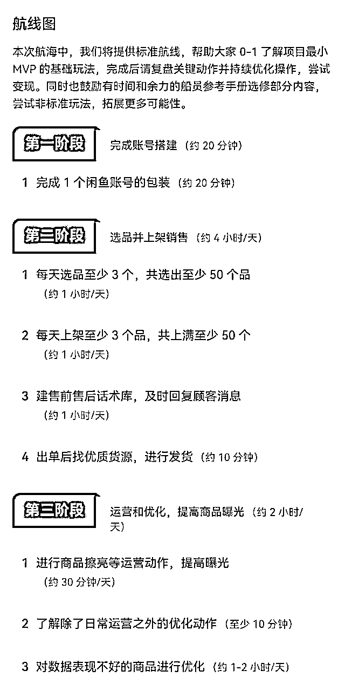

航线图和手册互相配合，你可以按自己所在的环节，学习对应步骤。

以上航线图步骤，建议在航海前两周完成；全部动作做完后，建议把重心放到实践上，多挑货、多发布、多运营，提升出单概率。

# 必修篇：先跑通最小 MVP

#### 章节概要

这一章从认识闲鱼平台开始，一步步带你走完闲鱼高客单带货的完整流程。你可以按本章步骤实操，跑通最小 MVP。

如果你是本项目新手，建议正式实操前先了解业务全貌：

【项目概述】摸清闲鱼高客单带货。

如果你对业务已有大致了解，就可以按核心步骤开始学习实操：

【实操 1/3】完成项目准备工作。  
【实操 2/3】选品和上架。  
【实操 3/3】商品销售和发货。

在必修篇中，航线图与手册顺序对应。按手册顺序学习，就能逐一完成航线图上的每个任务。

后续每个关键步骤的章节概要里，也会提到相关航线图，提醒你完成对应步骤。

接下来，正式开始吧！

## 一、【项目概述】了解闲鱼高客单带货项目 @凌心

#### 章节概要

这一章会带你逐步认识闲鱼高客单带货。

闲鱼平台现在发展得怎么样？平台有什么特点？新手如何切入闲鱼电商？为什么要在闲鱼做高客单带货？这些问题都会在本章解决。

本次航海的重点，是教大家如何从 0 到 1 跑通闲鱼高客单带货。

因此，先了解整体业务概况很有必要，一起来看。

### 1.1 认识闲鱼平台

#### 1.1.1 闲鱼市场趋势

疫情之后，经济下行，大众消费降级，能少花就少花、能不花就不花的心态，推动了二手市场进一步发展。

2023 年 11 月，1688 和闲鱼升级为淘天集团的一级业务；截至目前，闲鱼用户规模突破 5 亿。现在，闲鱼🛰️小程序订单已支持买家🛰️支付，官方也在积极尝试开发更多支付方式。

闲鱼用户超过 5 亿，二手电商全面崛起，因此 2024 年闲鱼电商赛道依然有无限可能。

#### 1.1.2 各类电商平台对比

闲鱼属于电商平台。和其他电商平台相比，它操作更简单，不用刷单，竞争相对小，也不需要保证金。各主流电商的对比可以看下表，会更清晰直观，方便你对平台形成更好的认识。

闲鱼 VS 其他主流电商对比图：

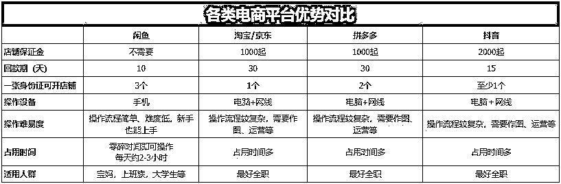

### 1.2 新手怎么入门闲鱼电商？

新手建议从杂货型店铺入门，比一上来就只做一个类目更容易出成绩。

什么叫杂货型店铺：一个闲鱼店铺里什么产品都有。比如货架上可能同时出现商用串串柜、平冷操作台、工业除湿机、烘干机、爆米花机；也可能摆着行李箱、抽气泵、幕布、显示器、电磁炉。再往外扩，养殖设备、宠物用品、五金工具、乐器、玩具、厨房家电、冷柜酒柜冰箱、商业办公用品都能上。没有特别的品类限制，只要在闲鱼平台允许的规则内，就可以上架不同品类。

什么叫只做一个类目的店：一个闲鱼店铺只上架一个品类的产品。比如做商用厨具，那么这个闲鱼店铺只上架相应品类的产品。

为什么建议新手先做杂货型店铺？

因为闲鱼本身就是二手属性平台，和传统淘宝、拼多多、京东或抖店不一样。二手属性本来就比较杂乱，闲鱼对店铺是否只做一个类目没有特殊要求。

闲鱼当然可以只做一个类目，但不太适合新手。很多新手一开始并不知道自己或自己的店铺适合卖什么产品。就像上学时，你学过语文、数学、英语，也接触过音乐、美术、体育，之后才发现自己更喜欢或更擅长数学。

同理，操作闲鱼店铺时，一开始你可能也不知道这个店铺适合卖什么类型的产品。那就先做杂货型店铺，什么产品都去上架测试（按照操作方法来）。时间久了，你会慢慢发现店铺里某一类产品出单不错；后期想收窄类目，就可以逐步向那个方向靠拢，这样做成单类目店的概率会更高。

另外，杂货型店铺是可以一直做下去的。至少我做了四年多闲鱼杂货型店铺，一直做得还不错。

温馨提示：一定要做高价杂货，也就是客单价在三位数或四位数。

### 1.3 为什么在闲鱼做高客单？

在闲鱼卖低价商品，虽然容易出单，但利润低，顾客比较计较，售后也更多。一单利润 3—5 块钱，就算一天出一百单，利润也就三五百块钱。还需要不停回复顾客、下单、上传单号，占用时间比较多。对于把闲鱼电商当副业的圈友来说，需要花费一定时间和精力。

而在闲鱼卖高客单商品，出单量相对低价商品会少一些，但一单利润比较高。一单利润可以高达三位数、四位数，甚至五位数。折算下来的时间成本比较低，哪怕一天只出一单，三位数利润到手，对把闲鱼电商当副业的圈友来说也比较合适。

### 1.4 闲鱼平台高排名&高曝光的底层逻辑

无论是闲鱼、📕还是抖音等平台，背后都是机器算法。我们在平台上操作，一定要符合平台的算法机制。按照平台算法去操作，就会获得推流和曝光，得到比较不错的反馈；否则，推流和曝光就会相对较低。

做符合平台规则的事，做平台喜欢的事，做好产品的曝光、点击和转化，提升店铺权重，那么在闲鱼平台就更容易获得不错的排名和曝光。

落到具体要做的事情，就是：

## 二、【实操 1/3】完成项目准备工作 @凌心

章节概要

了解完闲鱼高客单带货的整体情况后，就要正式启动了。在闲鱼上卖货的前提，是完成前期账号准备。

闲鱼高客单带货一般不涉及资质类目，所以前期筹备比较简单，主要包括：

一部手机；  
一个正常使用的淘宝/支付宝账号；  
闲鱼 APP、拼多多下载；  
闲鱼 APP 权限设置；  
闲鱼账号注册与完善。

完成账号搭建后，可以多刷同行账号，了解各个高客单赛道。

#### 本章航线图

完成本章学习和实操，即可完成航线图第一阶段：完成账号搭建（约 20 分钟）。

1.完成账号搭建（约 20 分钟）。

那么现在，就开始完成简单的筹备任务吧。

### 2.1 基本软件/工具准备

1.需要的设备：一部手机（一机一卡一号）。

2.下载的软件：闲鱼 APP、拼多多。

3.一个正常使用的淘宝或支付宝账号，用于注册闲鱼店铺。

### 2.2 闲鱼 APP 的权限设置

下面用安卓机举例，苹果机按屏幕提示走即可。

1.允许查看我的关注、粉丝列表。

打开闲鱼 APP，点右下角“我的”，右上角“设置”往下拉，有隐私设置。建议这里拉成灰色，保护自己的客户资源。

2.允许查看我的动态范围。

同样在隐私设置里，建议选择不可见。这样顾客查询不到自己的上货动态、销售状态，同时也能预防同行查看自己的爆款产品。

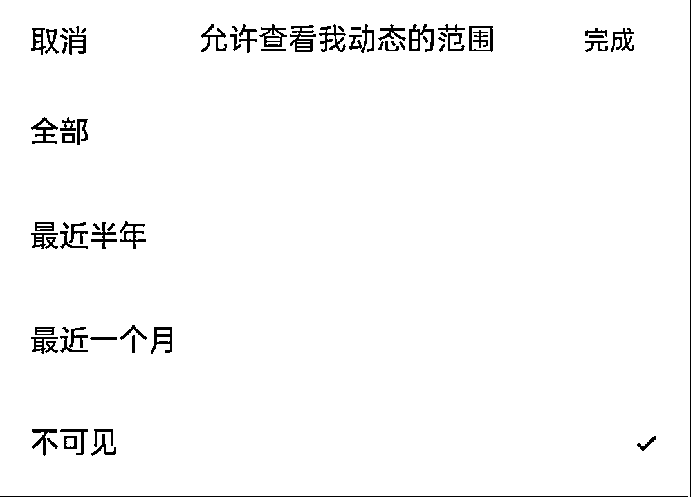

3.开启闲鱼消息通知。

很重要，务必打开，前期消息务必及时回复。

路径：我的 -> 设置 -> 消息通知 -> 打开闲鱼消息通知。

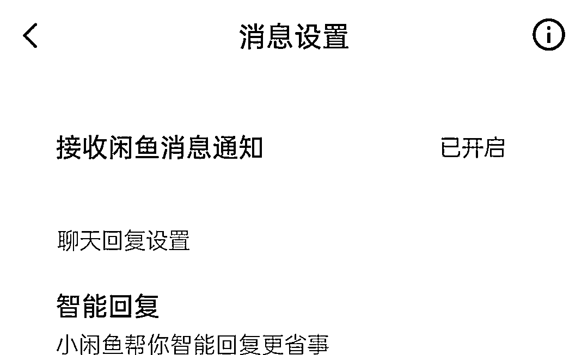

4.手机设置闲鱼消息的专属通知。

打开手机设置 -> 通知与状态栏 -> 应用通知设置 -> 点击闲鱼软件图标 -> 打开允许通知 -> 在消息通知里设置闲鱼 APP 的专属铃声以及其他重要设置，例如：免打扰时允许通知提醒等。

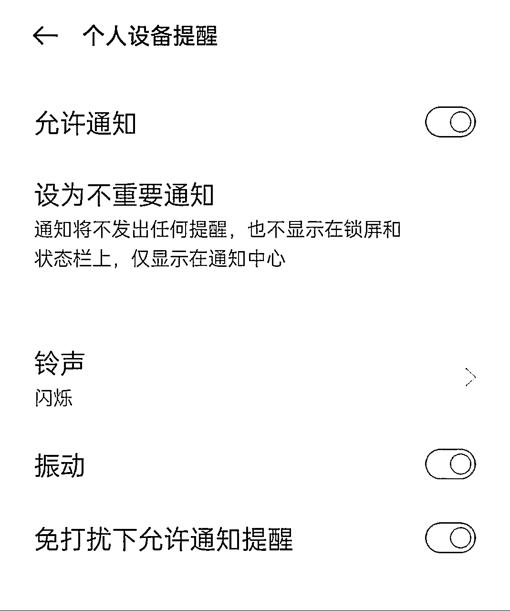

### 2.3 闲鱼账号完善

路径：我的 -> 设置 -> 个人资料。

这里要把信息完善到百分之八九十以上，能填写的建议都填写。具体步骤如下：

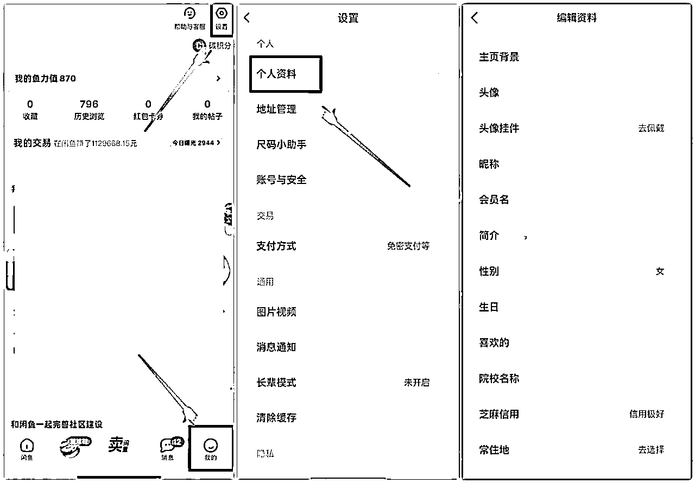

1.主页背景。

杂货型店铺对背景图没有过多要求，可以不更改，或者放自己喜欢的正能量文字。

2.头像。建议以女性头像为主，经过测试，女性头像更容易出单。

3.昵称。

用女性化的名字，或者根据店铺属性设置名字，比如：某某杂货铺、某某厂家，不做过多的要求。

4.简介。

简介可以写自己的经营理念，也可以介绍店铺。

比如：

厂家直营：专卖各种商用配套设备，包括平冷操作台、饮料柜、鲜花柜、麻辣烫柜等，需要咨询店主即可；

主做工厂门店清仓特价促销产品，品质放心有保障！

诚信经营，芝麻信用极好，请放心购买！

认识即缘分，也是一种朋友，坦诚相待，用心服务和经营，欢迎前来咨询下单！

……等等。

## 三、【实操 2/3】选品和上架 @千城

### 3.1 如何快速选品

#### 章节概要

账号准备完成后，就要开始上架高客单商品啦。怎么选择好卖的商品？

闲鱼高客单选品其实没有那么复杂。最常用的方式就是：把自己当成买二手商品的用户，想想自己会搜哪些产品；或者日常生活中看到的一些高客单产品，都可以随时打开闲鱼验证。把选品融入生活，把选品当成一个习惯。

具体怎么在闲鱼验证选品，本章会给出五条判断维度。

选品时注意不要卖违禁商品，避免封号；另外，高客单的售后也很关键，需要把控货源质量。

#### 本章航线图

完成 3.1 章节的学习和实操，即可完成航线图第二阶段：选品并上架销售（约 4 天）。

1.每天选品至少 3 个，共选出至少 50 个品（约 1 小时/天）。

接下来就开始选出你想上架的高客单商品吧。

这期闲鱼航海带大家做的是高客单商品，下面讲高客单选品方法。

闲鱼的高客单选品和普通选品方法没有太大区别，主要有 2 点小差异：

1.高客单选品时，需要筛选价格范围，价格太低（比如低于 100 元）的品就不用看；

2.高客单选品时，判断某个品能不能跟，判断标准（比如同行单天出售件数、想要数）可以适当降低，因为高客单商品单量等数据普遍会比低客单少。

#### 3.1.1 高客单怎样选品

首先，我们需要把自己当成买二手产品的用户，想想自己会去搜索、关注哪些产品；或者日常生活中看到的一些高客单产品，都可以及时打开闲鱼，根据下面的判断维度进行选品判断。把选品融入生活，把选品当成一个习惯。

然后，我们要去闲鱼结合数据验证，这个选品到底要不要上架。

闲鱼选品不同于淘宝有专门的生意参谋，📕、抖音有蝉妈妈之类平台做具体数据分析；闲鱼选品没有平台推出的数据参考。因此，我们进行选品时，更多是借助平台给出的一些数据来验证。

一般来说，在闲鱼做高客单选品，判断标准主要参考这些点：

下面解释一下，一个不错的选品长什么样：

3.1.1.1 应季

应季，是闲鱼高客单选品判断的第一个维度。我们需要先从大局观上分析，这个产品是否适合当下用户需求。

比如露营车，开年、开春、夏季都合适，到了秋季、冬季，产量自然会下降；

再比如，夏天出售电热毯、暖风机，冬季出售落地扇、吊扇、空调扇，很显然不合适。

当然，电脑显示屏、货架这类四季可以出售的产品例外。

3.1.1.2 卡价格

因为我们要选择的是高客单产品，价格这块自然尤为重要。选品时，除了知道露营车、空调扇等大件明显属于高客单，也需要通过一些常见热销产品，筛选其中属于高客单部分的规格产品。

所以，这里进行卡价格就很重要。如下图所示，我们搜索产品时，可以根据想选择的产品价格，点击“筛选”里的“价格”，填写一个合适的最低价，然后查看。

比如手机壳，一般都是几块、几十块，但通过筛选价格，我们得到了多个具体规格的高客单手机壳。

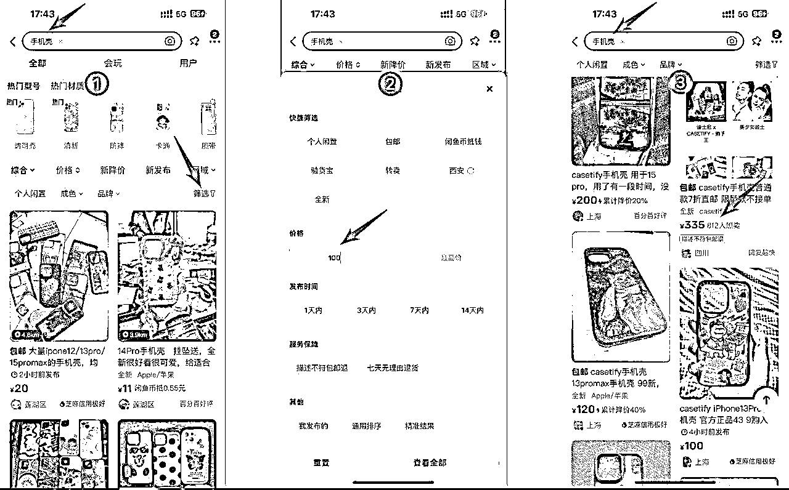

这个时候可以继续结合应季、想要数、同行动态、多家情况，做进一步评定。

3.1.1.2 想要数

“想要数”代表这个产品市场如何，有多少用户咨询过这个产品。想要数越多，证明这个产品市场需求越大。不过具体这个产品是否可以，还需要结合下面两个依据进行判断得出结论。

补充一个点：如下图画圈所示的，没有直接显示想要数，一般主图好看，我们也可以点击查看，因为系统提示或者部分开通了闲鱼币抵扣所以隐藏了。

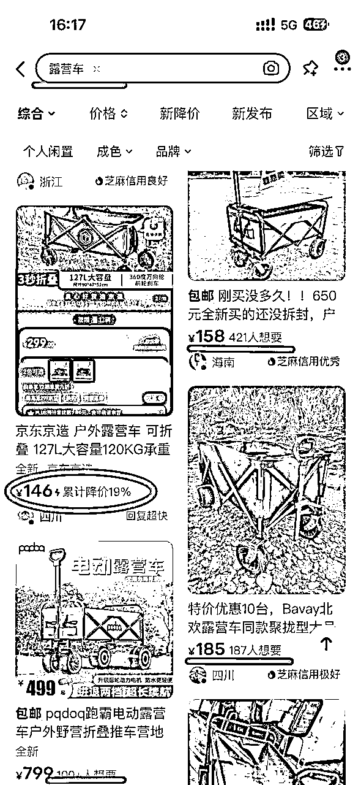

想要数：浏览数 ≥ 1:10。

查看想要数的时候，点击进入产品，如果发现想要数：浏览数 ≥ 1:10，或者接近这个比例，相对来说这个产品市场需求更大，可操作空间越大。相当于来了 10 个人，就有一个人咨询，外加可能付款的人。

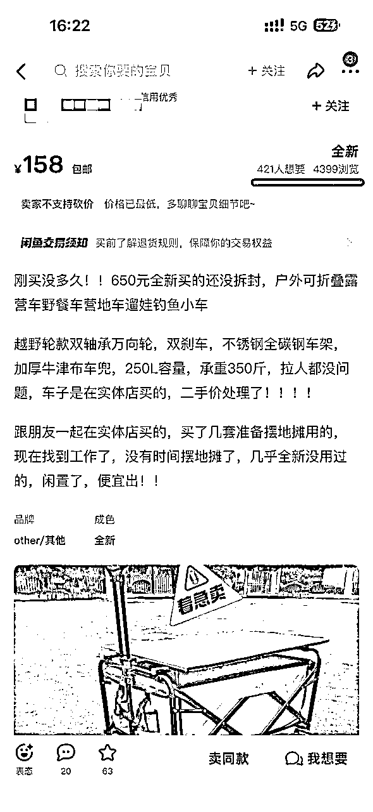

这个时候务必搭配“查看动态出售情况”。如果出售情况比较好，这种产品一般蓝海产品的可能性比较大。具体判别蓝海产品，可以查看多家情况：少量满足，想要数：浏览数指数，外加动态出售可以，这个品一般就是蓝海品，市场更好，优先可以操作。

3.1.1.3 同行动态

“同行动态”显示这个产品近期出售情况如何，也就是转化数据怎么样。近期越多，自然越好，选品的时候更为重要。

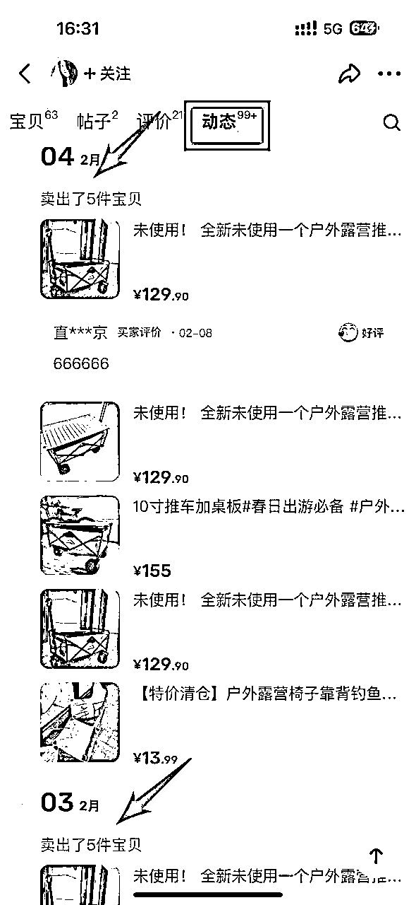
## 日销三件，够不够格入场？

先摸竞品的日走量。若某家店铺两三天里都能保持日均成交三单以上，这个水平就挺能打了，而且这类店越多，信号越明确。不过单店数据不足以定论，接着要做多店核对：当两三家同时做到日均破三单，这款产品才值得进入备选池。

反过来说，日成交不足两单的店铺，再多看几家仍是同样状态，这类产品通常可以直接排除。

### 卖家把成交记录藏了，还怎么估？

有些店铺收藏热度不低，却把出售动态关掉了，这种情况该怎么打分？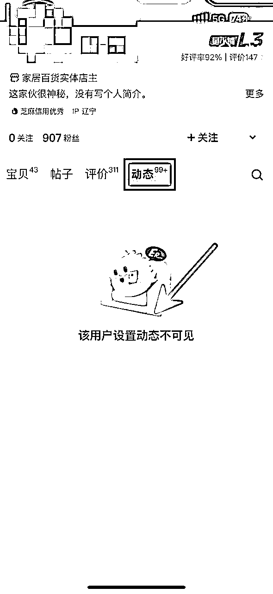
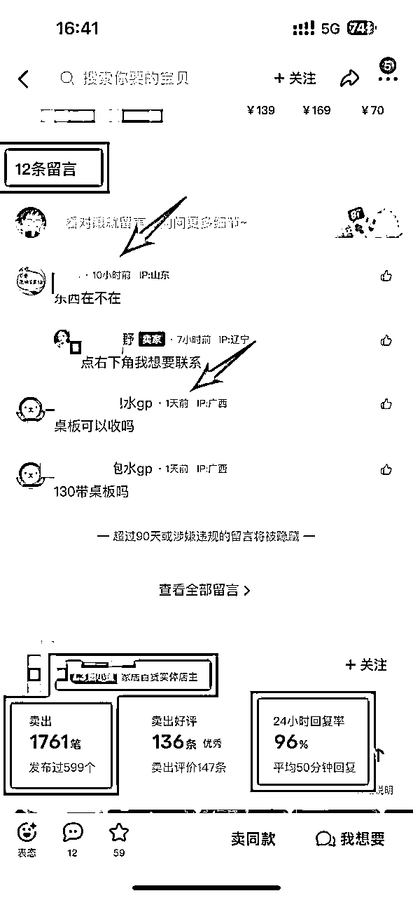
别凭直觉，可以借店铺公开的其他信号来补位。建议按这个次序看：

1）其一，鱼小铺层级有没有到L3。这个等级由买家好评量累积评定，能爬到L3，多半意味着近期出货频繁、品质也过关，拿它当第一项参照比较稳妥。尚未开通鱼小铺的店也不用急着排除——只要后面几项表现稳当，同样可以视作近期市场反馈不错的候选。

2）其二，盯留言区的时间戳。它反映这款商品最近有没有人问。假如一周内冒出两条以上新的咨询，说明需求端仍有热度。

3）其三，响应率能否稳住90%以上。响应越积极，通常说明店铺生意运转良好，是值得投入精力深耕的对象；低于80%基本可以略过不看。

4）其四，已售件数。这个数字越高越理想；若只有个位数、而且好几家都这样，那这款产品恐怕需求有限。当然，刚上架就爆单的特例也存在，这时得把前面几项指标放在一起权衡。

### 3.1.1.4 多店交叉验证

单店样本难免撞上偶然性，因此要把前面那套判断横向铺开，多挑几家"想要数"表现好的对手，核对它们的实际成交动态。假若两三家都能维持日均三单以上，并且符合上文提到的动态标准，这个款就值得纳入备选。

到这里，高客单闲鱼选品的判断逻辑就交代完了。方法在手，筛选标准自然也清晰了。

#### 3.1.2 闲鱼高客单热门类目与货源清单

闲鱼能跑通的高客单方向其实不少。这里梳理了一份现阶段相对容易上手的类目参考，刚接触闲鱼的新手不妨从这几个方向试水。具体商品仍要按"选品判断标准"逐条筛一遍。
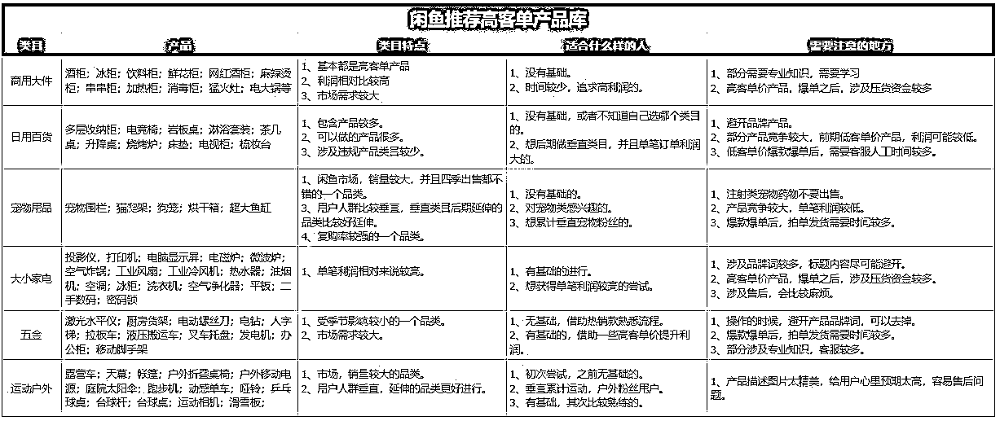

本期航海聚焦【商用大件】的选品与供货。货盘清一色走高单价、高利润路线，单笔利润三位数、四位数很常见，批发订单甚至能摸到五位数；均为线下实体店同款，品质与售后都比较扎实，老客转介绍也频繁，做久了会越来越省心。建议先把选品方法吃透（详见【3.1 如何快速选品】），再按自身需要挑选。

本期航海供货清单如下：

闲鱼高客单带货｜航海提供的货源清单（表格中仅为商品及价格展示）

需要的船员可前往该闲鱼店铺自取：

具体货源链接，统一放在闲鱼店铺"制冷设备工厂直销"内，直接到店下单，下单时在对话框备注：赚钱航海下单，收件人填写客户的收货信息，即可一件代发。（该闲鱼账号不作答疑，有问题请到航海群提问）

新手起步阶段常常找不到选品方向，教练额外整理了一批拼多多选品链接，供大家参考（非指定下单链接）：拼多多精选选品合集
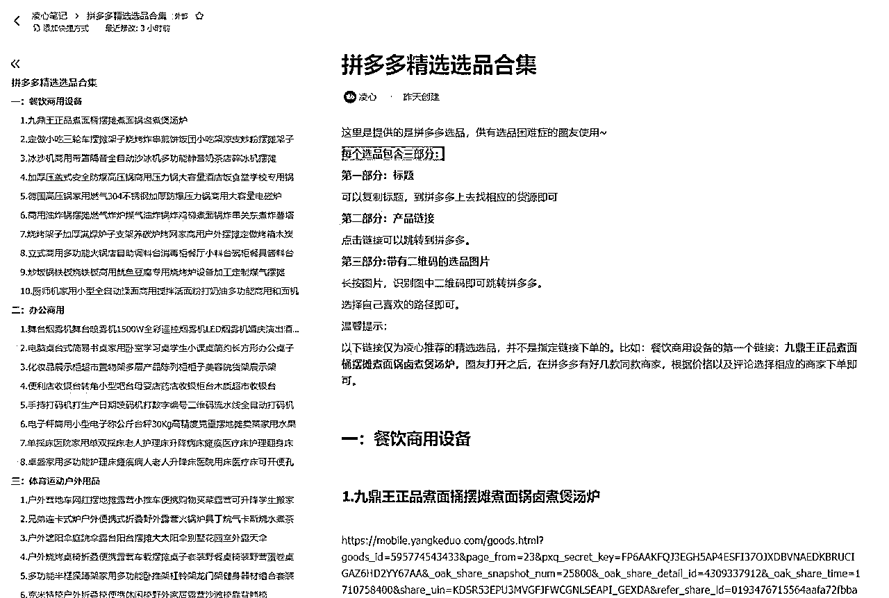

（手机端打开体验更佳）

#### 3.1.3 闲鱼选品：这些违禁项要避开

选品方法学会后先别急着动手。为避免实操中触发账号违规甚至封号，这里列一下闲鱼常见的违禁与注意事项：

完整【违禁品清单】请见附录：千城：闲鱼社区信息发布规范详情

### 3.2 闲鱼商品怎么上架

#### 本节要点

发布环节的要害只有一条：把市场上有对应需求的买家尽量引到你的店铺，最后促成付款。

那怎样才能让上架的商品被更多人看见并成交？答案就藏在闲鱼的上架方式里。这个环节中，有四件事最关键：

此外还附上若干编辑手法与避坑提醒，帮你把商品顺利挂出去。这些内容分别怎么撬动流量？往下读就知道。

#### 本章航线图

本节内容学完并动手做完，就达成了航线图的第二阶段：选品并上架销售（每日约4小时）。

1. 每日至少上架3个产品，累计满50个（每天约1小时）

现在就动手，把你筛出来的商品整理上架吧。

高客单商品的挂法，与其他品类并无二致。下面一起看看：

#### 3.2.1 上架要点：让出单快起来

发布动作的核心目标：把有需求的买家尽可能带进店铺并完成付款。

怎么实现？说白了，就是让挂出去的商品多拿平台流量、多被看见、多成单。

上架这一步很关键，其中三点最要紧：

另外，还可以按后文提到的单品规范，给商品换标题、换首图、多链接铺开，为单品争取更多曝光机会与流量（单品铺4条左右链接即可）。

#### 3.2.2 商品发布怎么操作

3.2.2.1 首图怎么做

一张好首图，必须在第一眼就勾住闲鱼买家的目光。这类图通常具备这些特征：

好首图长啥样？

拿"商用冰柜"来说，排名靠前的商品，首图多半把产品摆在画面正中，款式与细节都清晰可见，让人忍不住点进去。
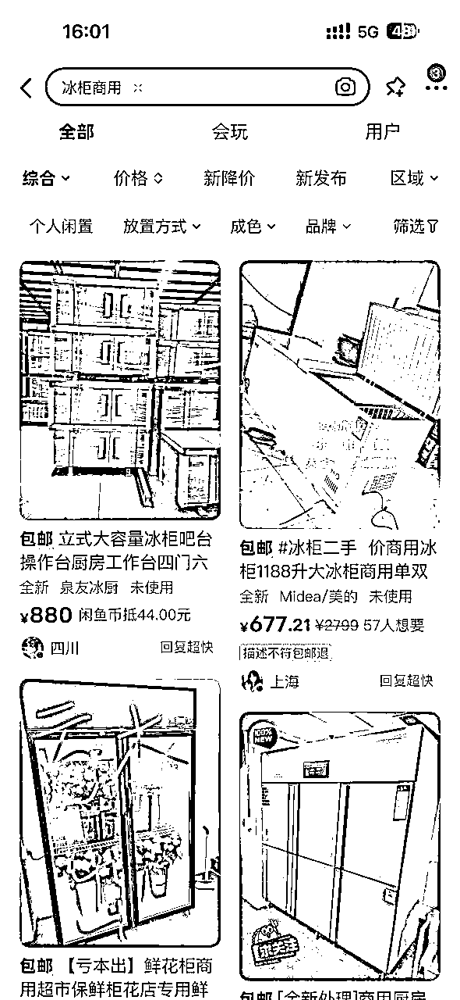

再看那些"想要数"偏低的链接，图片往往模糊，观感很差。两下一比，用户自然先点上面的，所以首图尽量照前面说的标准来做。
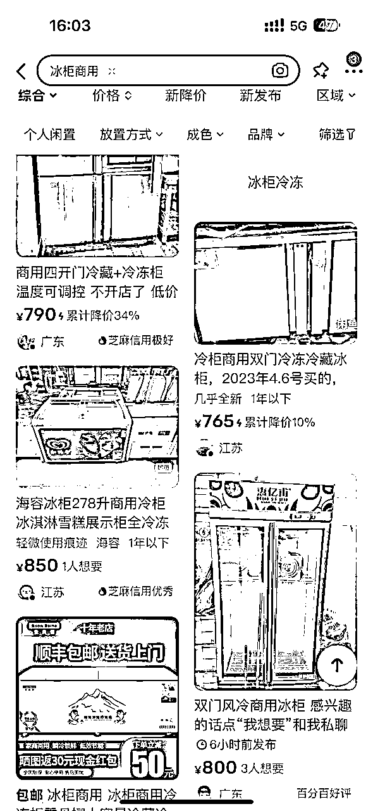

至于详情页里的其余图片，照着成交动态好的同行配图来就行，不必费太多心思。

好首图去哪找？

分享一个成本很低的路子：直接上淘宝、1688、拼多多、淘特这类电商平台搜产品，从商品介绍和买家评价里挑符合条件的图。
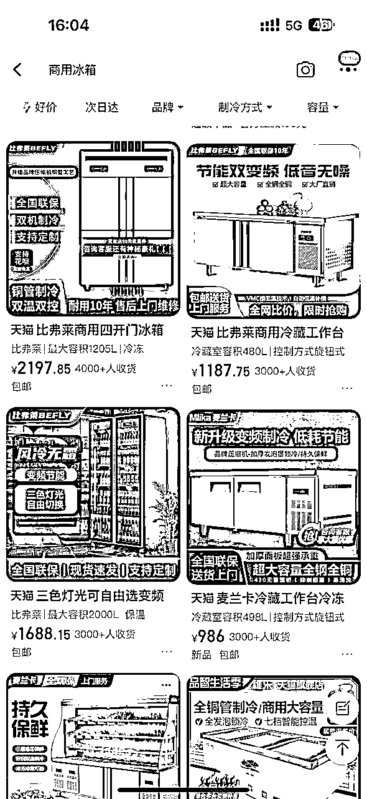
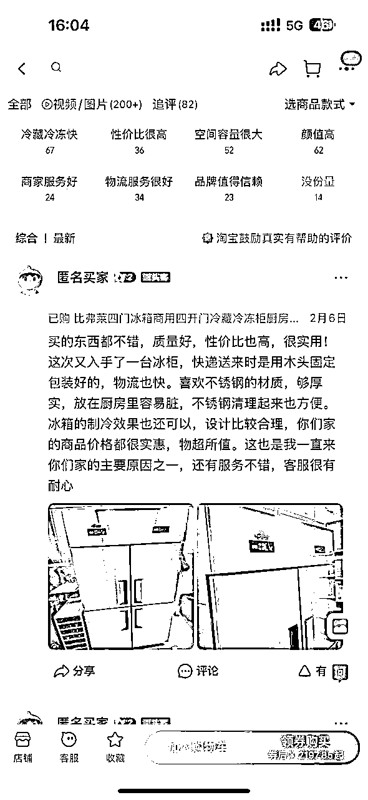

当然，这办法很基础，对付闲鱼卖家已经绰绰有余。若想做出差异化，可在原图基础上再加工一道，比如叠加特效、做拼图，市面常见的修图工具就能搞定，这里不再赘述。

3.2.2.2 标题怎么写

好标题长什么样？

想拿到较多流量的标题，常见打法是堆叠产品关键词，让买家无论用哪种叫法搜索，都能刷到你的商品。

比如"商用冰箱"，又叫冰柜、冷藏冰柜、卧式冰柜、冰箱——把这些别名，连同用户可能搜的词：厂家直发、厨房、个人出、商超倒闭、全新，全部串进一句即可。

示例：全新包邮商用冰柜冷藏冰箱厂家直发厨房商超使用卧式冰柜大容量（尽量把30个字符填满）

怎么快速写出合格标题？

省事的思路：找闲鱼同类商品里销量靠前的标题，再叠上淘宝同类热销款标题。卖得好的标题大多打磨过，借鉴过来稍作改动，就能变成自己的标题，相当省力。
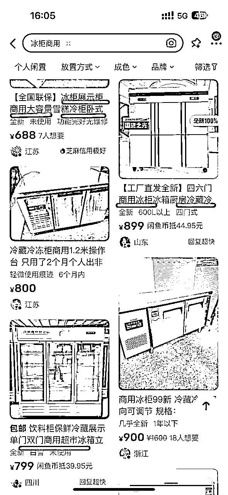

3.2.2.3 详情文案怎么写

配图前面说过，参照闲鱼成交动态好的同行配图即可。这里重点讲文字版详情该怎么写。

好详情长什么样？

一般如示例所示：先交代商品为何出售、给买家一个理由，再做简要介绍；然后列出具体规格与价格；最后说明售后情况。
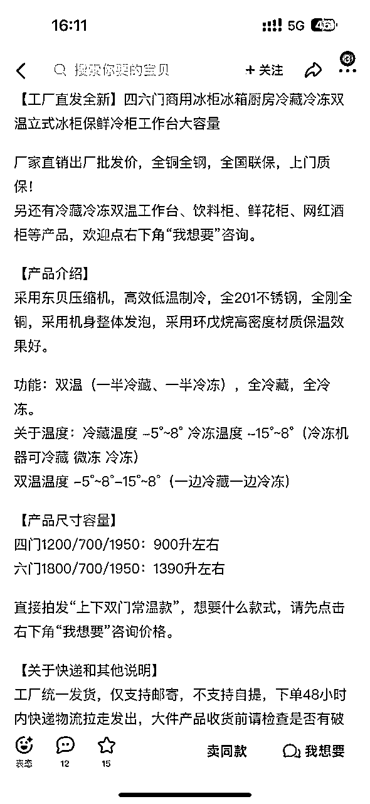

好详情怎么写？

有个通用框架：

详情足够细致，买家想了解的都已呈现，客服压力就小，时间成本随之下降。

同时详情要简明，让买家一眼锁定需要的信息，降低决策成本，转化率也能跟着提升。

照下图这样处理就好，清楚明白。规格最多列3到5个，别让买家挑花眼，最后犹豫着流失。（确实需要多规格的，精简呈现即可）
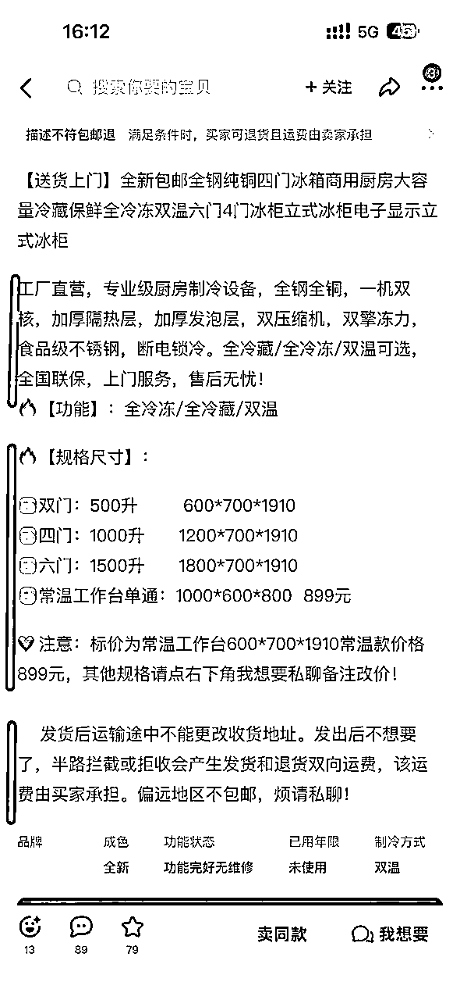

3.2.2.4 商品发布流程

图片、标题、详情都按前面的要求备齐，就可以动手发布了。

1. 进入闲鱼首页，点中间那个"卖闲置"。
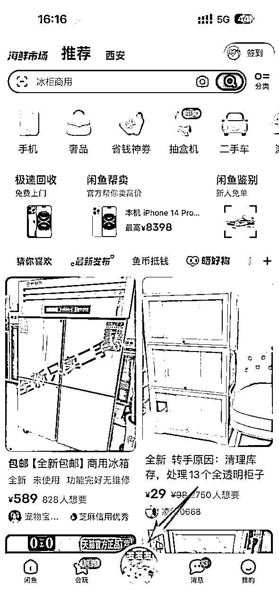

2. 点最底部的"发闲置"。
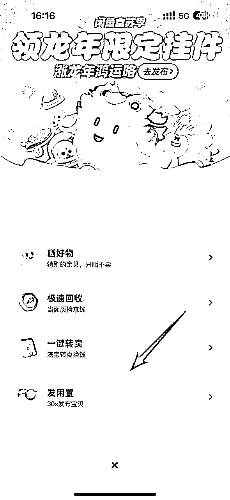

3. 把准备好的图片与文字内容复制进来。首图和图片排序千万注意：

第1张为首图，实拍图比例尽量1:1或3:4，画质要高清完整；

第2至7张可选产品全貌、局部细节、效果图；

第8至9张可以放品牌参数或仓库照片，用来增强信任。

4. 逐项填好商品下方的信息：

定位：可填真实发货地，也可挑人口密集的一二线城市，如杭州、上海、北京、深圳、广州，别发到小城市。

分类：商品是什么就归什么类。

品牌：选"其他"即可。

成色：按实际选，通常为全新。

价格：填最低规格的价格就行；其他规格怎么拍，在文案中写清楚提示；原价可按市场价填，也可留空。

运费：一般设包邮。

24小时发货+描述不符包邮退：大件通常不建议开，具体按自身情况调整。
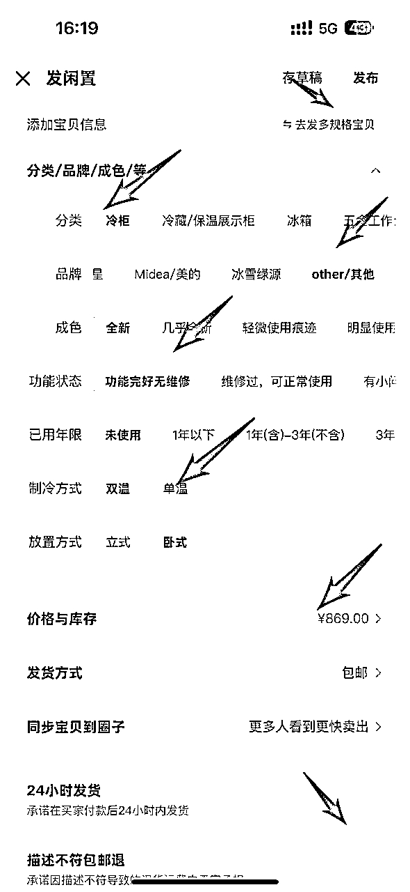

账号里如果冒出"去发布多规格宝贝"和"价格与库存"，那是【鱼小铺】的专属权限，通常成交几单后就会收到官方开通邀请。但新手前期不建议开，开了可能拖累商品曝光和出单，详见【4.2.1 出单后第一个动作——重新上架】里"为什么不建议新人开通鱼小铺"的说明。

5. 一切就绪，点右上角"发布"按钮完成。
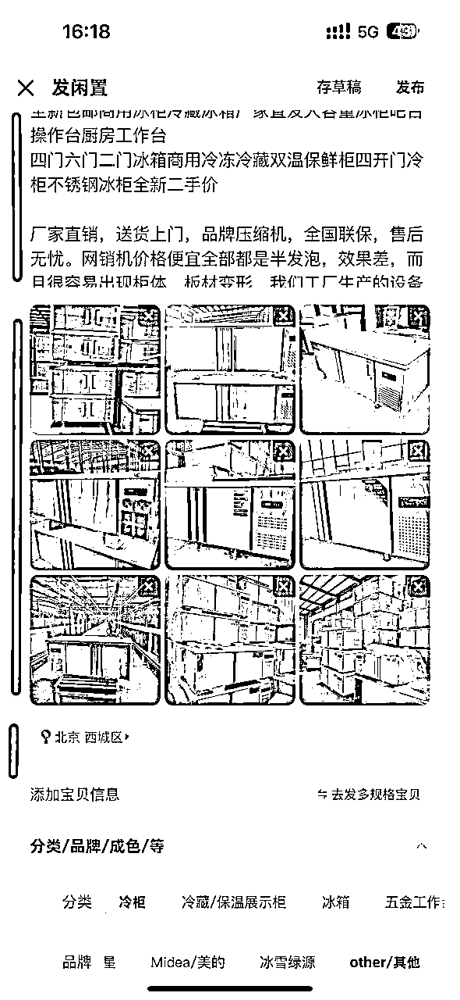

#### 3.2.3 编辑小技巧：快速出单

一句话总结：把闲鱼上卖得好的商品，压一压价格，稍作修改后直接搬到自己店。

具体步骤如下：

这种打法出单相对更快，操作也更简单。

#### 3.2.4 发布注意事项

1. 标题里别带品牌词，图片也尽量避开。
2. 标题与内容中不要出现"无添加""联系""🛰️"等引向站外的词。
3. 发布地可挑人口密集的一线城市。
4. 上传时段首选早上8点前后，其次是晚上8点前后，退而求其次选中午11点半左右。
5. 单日挂5条左右链接足矣，别贪多，免得被判定成营销号。

内容来源：闲鱼电商 | 小航海学习手册

## 四、【实操 3/3】商品销售和发货 @凌心

#### 本节要点

一旦有顾客来问，得马上跟进，别让客户溜走；成交之后也要尽快发货，缩短对方等待，客户满意度才上得去。

本章围绕两件事展开：售前售后客服的常用话术，以及两种货源（拼多多与航海）的发货方式。

闲鱼客服：回复要及时，售后问题主动跟进处理。

出单发货：尽快到对应货源平台下单，并把快递信息回填到位。

每个环节的具体做法，接着往下看。

#### 本章航线图

学完并实操本章，航线图第二阶段——选品并上架销售（约4天）即可完成。

1. 搭建售前售后话术库，顾客消息及时回（每天约1小时）
2. 成交后对接优质货源安排发货（约10分钟）

### 4.1 闲鱼客服回复话术

下面以"商用大件"为例，把闲鱼最常见的提问与对应答法整理出来，供大家参考思路。

#### 4.1.1 售前话术

客户：[在吗？]

回复：在的在的，让您久等了，不好意思，键盘都快被我敲穿了，老板想看哪一款？

客户：[可以自提吗？]

回复：

话术1：老板，我们是厂家直营，没有门市，散客接待不了哦。厂家直营售后更靠谱！货给您包邮到家，一般三天上下能到，您拍下我就安排。

话术2：老板，您急用吗？这边暂时没现货，您下单后我立刻从最近的仓库给您发，三天左右到。要的话尽快拍，我马上安排。

客户：[全新未拆封吗？]

回复：都是全新的。厂家直发，质量和售后都有保障，看中的话拍下，我尽快给您安排。

客户：[你电话多少？打电话说]

回复：老板，您把号码发我就行。

提醒：在闲鱼留电话或🛰️有违规封号风险。别主动把自己的联系方式给买家，让对方把号码发过来即可。

客户：[你不是发布在郑州吗？怎么是江苏发货？]

回复：

话术1：老板，我们是厂家直销，郑州那边老客户不少、反馈也好，所以展示地就填了郑州。货您放心用，顺丰（或某某快递）包邮到家，一般三天能到。

话术2：老板，我们全国多仓发货，郑州暂时没现货，得从江苏调过来。您要的话直接拍下，我给您加急处理。

话术3：老板，展示城市是系统随机分配的，我们仓库在江苏。

客户：[某某产品多少钱？]

回复：老板，这款（此处简洁补充产品卖点与售后）+报价。

客户：[某某产品最低多少钱？]

回复：老板，您需要多大规格、什么配置、几台、收货地址在哪？（先摸清需求再报价，守住利润底线的前提下可以适当让一点，哪怕只买一台也有得赚）

客户：[有淘宝店铺吗？有其他店铺吗？]

回复：老板，工厂现在不做淘宝了，淘宝运营成本太高，羊毛出在羊身上，成本最终会转到买家头上。我们厂主营批发，走的是量，质量有保证的同时价格很有优势。之所以在闲鱼上架，是因为闲鱼开店不花钱，成本压下来，您到手价更低。期待您用得好，帮忙推荐给朋友呀~

客户：[哪一款好用]（纠结选哪种款式）

回复：先讲清买家纠结的两款各自的优劣，再帮他做决定。甲款也有人选，价格相对乙款更低；不过若您更看重体验，乙款会更好，顾客反馈都不错。您看更中意哪款？拍下后我改价，咱们早点排单、早点发货。

客户：[你家的比其他家卖得贵]

回复：

话术1：老板，什么产品都有高有低。我们是工厂直发，做的是实体店品质，用料扎实、质量有保障，不是网红款，您放心拍。

话术2：老板，有些同行确实卷得厉害，拿瑕疵品当正品卖，售后没保障。时间一长出问题，您找谁去？我们是做实体店的直发厂家，用料和售后您尽管放心。

客户：[我再考虑一下哈]

回复：老板，理解您的顾虑，买一件称心的东西确实要多想想。我相信咱家产品您是认可的，不然也不会聊这么久。方便说说您现在主要卡在哪吗？是产品本身，还是价格？

客户：[怎么拍？价钱不对啊？]

回复：

①点右上角"立即购买"。

②确认购买。

③页面会要求输入支付密码，先别输，直接返回。

④稍等片刻，我改好价，您再付款即可。

催单话术：

话术1：老板，喜欢的话直接拍下付款就好，这款走得挺快，您早点拍，我尽快给您安排出货！

话术2：老板眼光真准，您挑的这款是厂里最畅销的，买的人多、经常断货，眼下只剩两三台了，怕一会儿又被抢光，您拍下，我马上安排发货！

客户拍下未付款怎么办？

可以在下午发货前的一两个小时发条消息问问：老板，这款您还要吗？今天拍下的话，我好给您打包发出。

#### 4.1.2 售后话术

显示派送：

老板您好呀，刚帮您查了物流，您在小店买的宝贝已经到您所在的城市了，快递员近期会上门派件，留意一下信息哈。有任何问题可以找我，也可以直接联系快递员，电话XXXX~

显示签收：

老板您好呀，您的宝贝已经显示签收啦，用着还满意吗？满意的话麻烦给个好评哈，太感谢了。

更细的售后处理，详见【4.3 售后处理流程】。

以上就是闲鱼日常里最高频的问题与答法。

若碰到拿不准怎么回的情况，有两个办法：

1. 去淘宝或其他闲鱼店铺找同款商品咨询，套取信息——同行就是最好的客服老师；
2. 到航海群里一起交流~

### 4.2 商品出单发货

#### 4.2.1 出单后第一个动作——重新上架

宝贝成交后的第一件事：重新上架。路径是闲鱼"我的"—"我发布的"—右上角"已下架宝贝"—点重新发布即可，马上重新上架，流量会明显放大！！

这一招适合还没开通鱼小铺的新手卖家。

鱼小铺是面向卖家的运营工具，提供更丰富的功能与服务，目前由系统定向邀请，一般出几单后就会收到邀请。新手前期先别急着开通。

新人先别急着开通鱼小铺，真实数据可能会让你意外

平台方一般会建议“能用就开”，给出的理由主要有三个：单个商品的库存可以多备一些，被拍下后不用重新上架；后台有数据分析功能；最多能上架 500 个商品。

但我们把测试结果拿出来看，目前开通鱼小铺的店铺里，超过 80% 都出现了曝光和订单明显下滑，关掉之后情况才慢慢好转。问题出在动销率上：动销率低，意味着一个月内卖不出去的商品占店铺总商品数比例偏高。平台看到这样的店铺，会觉得你不会经营，于是减少推流、压低权重。

所以前期不如先把 50 个商品位全部填满，再持续优化、上新品，同时把又老又差的链接淘汰掉，流量反而会越做越高。一切以实际测试为准，不亲手跑跑数据，光听官方宣传没有用。换个角度想，50 个商品都做不好，凭什么 500 个就能做好？商品数量和出单概率并不是简单的正比关系。我们精细化操作 50 个产品，单店月产出做到五位数并不难。

#### 4.2.2 出单后的发货流程

之前提到过，闲鱼带货本质就是一件代发、赚差价的生意。所以闲鱼这边一出单，就要尽快去货源方下单。货源主要分两类：一是其他电商平台的商品，尤其以拼多多为主；二是航海项目方提供的货源。

4.2.2.1 电商平台货源发货流程

客户在闲鱼拍下后，你到对应的电商平台（比如拼多多）去下一单，收货地址填客户的信息，收货电话可以留你自己的。

拼多多商家发货后，把他们的快递单号填回闲鱼订单即可。

具体路径：闲鱼「我的」—「我卖出的」—找到对应订单—点击「去发货」—选择「我已寄出」—填上单号—提交。

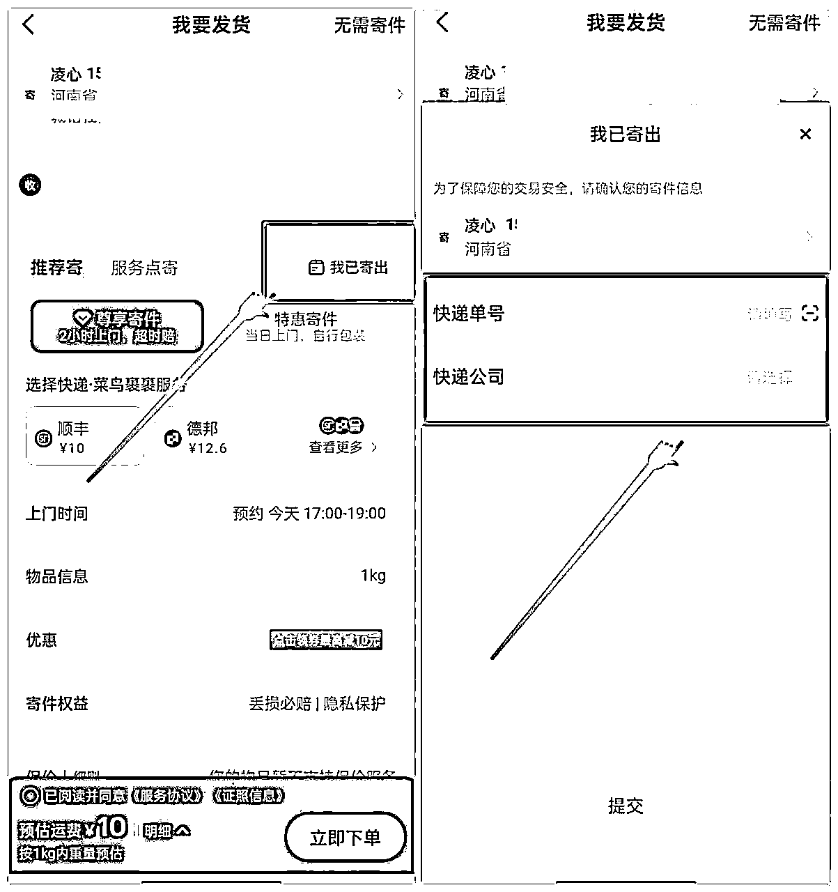

这里有一点要注意：拼多多有可能会给客户发短信，解决方法如下：

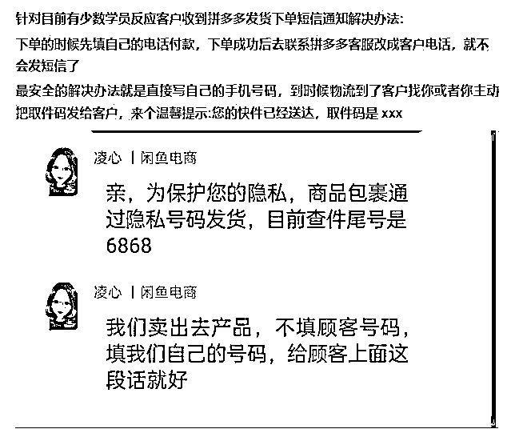

4.2.2.2 航海供给货源发货流程

本期航海提供的是「商用大件」类优质货源。下单地址是厂家专门为航海开通的闲鱼店铺，需要的话可以扫下方二维码，也可以直接搜索店铺名「制冷设备工厂直销」，进店下单。

赚钱的圈友记得在聊天界面发送“赚钱”备注，方便区分。

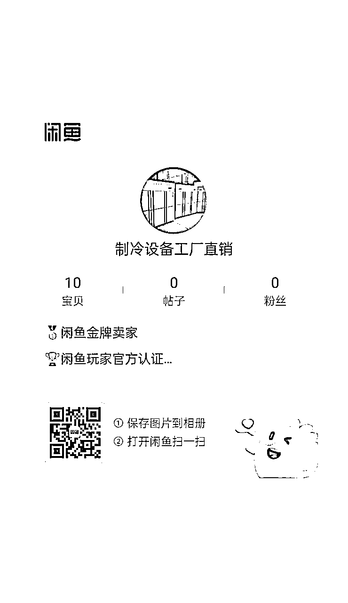

注意：下单时填写的收件人信息，一定要填客户的收件信息。

### 4.3 售后处理流程

售后问题类型很多，不用慌，对应的处理方式就是：把自己当成“中间人”，客户反馈什么问题，就原样同步给供货商家。别自己揽决策，也别擅自承诺。

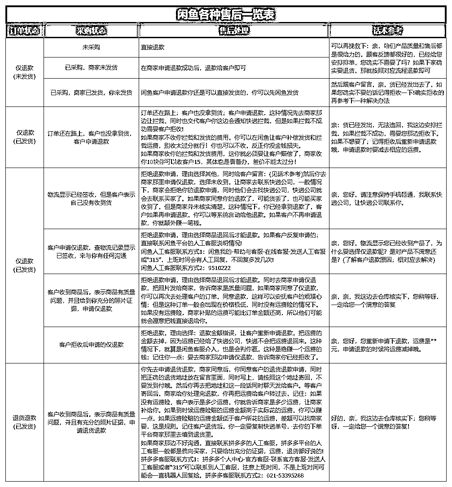

附表格源文件：闲鱼高客单带货 | 售后问题一览表 | 3 月航海

## 五、运营与优化：持续提高曝光和出单率 @凌心 @老瞿

#### 章节概要

链接上架后虽然可以长期用，但绝不意味着可以放养。商品需要靠日常维护才能稳住转化率，细节没做到位，可能就是一个影响成交的关键漏洞。这一章聊的是怎么让已上架商品得到更多曝光，让更精准的买家看到你：日常维护方面，包括每天擦亮、及时回复、完成平台给的曝光任务；商品优化方面，包括视情况降价、更新商品信息等。章节末尾还整理了长期做这个项目需要避开的坑，建议认真看完。

#### 本章航线图

把这一章学到手并跟着做，就能走完航线图第三阶段：运营和优化。每天大约花 2 小时提升商品曝光：擦亮等日常运营约 30 分钟；了解日常以外的优化玩法至少 10 分钟；复盘数据差的商品并调整，约 1～2 小时。如果你手头已经有商品在卖了，不妨从今天开始记录数据，试着做运营和优化。

### 5.1 商品日常运营

#### 5.1.1 每天擦亮产品

擦亮可以放在凌晨零点，也可以早上起床后顺手做。操作路径：闲鱼「我的」—「我发布的」—左上角「一键擦亮」。

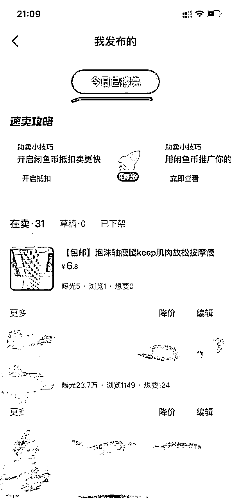

#### 5.1.2 前期消息及时回复

只要有人来咨询，尽量第一时间回复。手机和闲鱼 App 的提醒权限要提前设置好，具体做法可以参考【章节 2.2 闲鱼 APP 的权限设置】。万一不知道怎么答，就去淘宝或其他闲鱼店铺找同款商品咨询，把同行当客服、当老师，信息自然就有了。

#### 5.1.3 运营期间注意事项

这里补充两块内容：一是有用的运营小技巧，二是闲鱼常见的违规封号点。下面这些红线，尽量别踩。

### 5.2 如何通过优化获得高曝光

想让商品拿到更高曝光，下面几点可以重点做：

1. 每天都上新，至少发 3 个，新手阶段先发满 50 个。

2. 图片要清晰，比例尽量 1:1 或 3:4。

3. 标题多花心思写，别随便填。

4. 把「闲鱼币抵扣」打开，也就是允许买家抵扣 5% 或 10% 货款，平台会因此给到额外曝光。

5. 用「急速卖」：花闲鱼币推广宝贝，提高成交概率，一般适合已经卖爆的链接，效果更好。

6. 看数据做优化：曝光低、咨询也少，就改商品文案；改完两三天还是没变化，就把发布地址换掉再试。

7. 每个商品都要有低价引流款。店铺商品通常分成两类：低价引流款＋利润款。

什么叫低价引流？举个例子：我们提供的选品里，有一款麻辣烫柜正常售价是 1999 元，但闲鱼上很多同行只卖 1300 元。你直接标 1999，价格上毫无优势。怎么解决？去拼多多搜“麻辣烫柜”，找一款价格在 1300 元左右的同类商品拿来当引流款，这就是低价引流的打法。

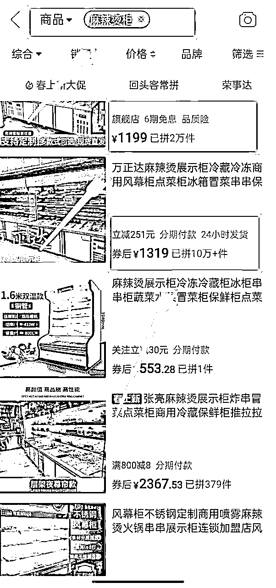

不过低价引流要控制尺度，价格压得太狠或和利润款差得太多，反而会拉低转化。适度才是关键。

### 5.3 复盘注意事项 @老瞿 @凌心

#### 5.3.1 做好短期内不出单的心态准备

如果一开始就把项目想得太简单，心理预期又高，十几天没出单就很容易崩盘。每个闲鱼商家的上货节奏、细节、选品和店铺流量都不一样，出单自然有快有慢。从我这边带过的圈友看，有的三天到十天能出，也有拖到一个月才开张的。但有一点可以确定：只要按方法持续执行，这个项目最终一定能开单变现。

#### 5.3.2 对平台的规则要有敬畏之心

现在信息多、诱惑也多，总有人想走捷径。有的朋友做闲鱼高客单价，嫌一个一个上架太慢，就找软件批量操作、多店铺货，一天堆上去几百个品，结果曝光没有，反而被限流、封号，最后没有正反馈就只能放弃。其实慢一点，反而更快。各大成熟平台都在打压粗放操作，只有顺着平台规则来，它才愿意让你持续赚钱。

#### 5.3.3 点进来看的有多少人下单（转化率）

客户已经点进来看你的商品，却一句话不说就退出去，问题往往出在详情页。大多数人一开始就是靠「描述＋图片」来判断产品。人脑天生懒，描述太简单，他就得自己猜：这个有没有某功能？是什么材质？……

一旦要猜，他很可能切换到别家去，甚至懒得问你。而描述写得清楚，他就不用猜，即使还有不确定的地方，也会主动来确认。有些顾客其实已经看完描述，但还是会再问一遍，不是没看，而是想跟你复核一下。

提升转化，先做好两点（左图是反例，右图是正面案例）：

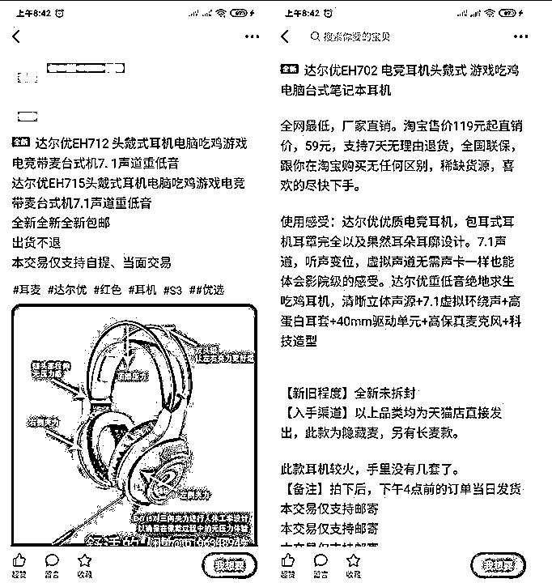

第一，描述尽量详细。不知道怎么写就抄作业：看同行怎么写，再参考淘宝的「问大家」和「评价」。「问大家」能看出顾客购买前关心什么，「评价」能看出大家用完之后是什么感受。

第二，图片尽量放满九张，并且要有实拍图。做得久了你就会发现，图片再精美，顾客还是更想看实拍。去拼多多或淘宝的评价里挑几张拍得干净的实拍图放上去。

这两点做到位，大部分顾客基本能留住。如果描述里写明“商品还在就能直接拍”，有人甚至会直接下单。

最后还要看询单转化率。顾客来咨询，意味着购买意向已经很强了，能不能让他付钱，就在考验你的接待能力。刚开始聊失败一两次很正常，慢慢复盘总结就好。聊天技巧涨得慢不要急，多到群里交流，我也会给建议。但有两件基础事，现在就能做好：

第一，回复要及时。换位想想，你自己买东西时，两个店铺商品都差不多，一个秒回，一个半天不理，你更愿意买谁？不忙的时候就常刷新闲鱼，忙的话就自己安排时间，比如晚上多盯一会儿。

第二，提前了解商品。如果你之前认真写了描述，大部分常见问题心里已经有数。比如卖拖把，顾客很可能问“拖把多少厘米”，答得上来，成交率就高。当然，不可能一开始就想到所有问题，先把最基础的了解清楚：尺寸、容量、发货时间、发货地等等。后面随着咨询慢慢补，不会的直接问淘宝或拼多多客服。

从买家能不能看到，到最后付款，每个环节都做好，出单就是水到渠成。只要有一个环节掉链子，店铺就很难起来。

#### 5.3.4 不要迷恋实体行业，轻易转做有货源玩法

有人一入行就想囤货、发货、招代理，把事业版图想得很大。说实话，实业当然值得尊重，但那是等有实力之后再说的事。前期最好选轻成本玩法。我自己搞过 1000 平的仓库，赚得还不如在小区开工作室、操作 30 个闲鱼号多。实体生意投入大、又累、成本高，利润还薄。

#### 5.3.5 自己要做项目的负责人

很多新人喜欢直接问“一个闲鱼店铺能赚多少”“几个号能月入过万”“能不能辞职全职做”“一上来搞工作室年入 30 万行不行”。这些问题其实没有固定答案，项目本身就充满不确定性。与其到处找答案，不如先自己迈两步：注册账号、上架商品。一步步做下来，你对项目的掌控感自然会变强。

内容参考：《聊聊你做闲鱼二手书项目失败的 100 种可能性》《闲鱼二手书无货源模式拆解（精细化运营）》

### 5.4 项目避坑建议

1. 多账号同设备频繁切换。同一台手机上登录两个或更多闲鱼账号，还经常换来换去，很容易被系统识别，轻则降权，重则封号。

2. 出单后不要改发布地址、一口价或标题。无论什么时候，只要链接已经出过单，或者曝光数据不错、有咨询，产品的发布地址和标题都别动。一旦改动，权重直接清零。打个比方：你在北京生活，大家都认识你是张三；突然你改名李四、搬去上海，之前积累的认知和口碑就归零了。

3. 别为了改价去直接编辑商品，应该让客户拍下后再改价。新手常犯的错：商品标注价 100，客户要的是另一个规格 150，就直接编辑原链接改价，让客户付款。这一单虽然成交了，但之后这个链接通常就没咨询、没订单了。原因是动销率：成交后动销率上升、权重增强；一旦你重新编辑再发布，权重就从零开始了。再补充一点：链接被拍下后会自动变成“已下架”，直接点“重新上架”就好，这样不会影响权重。

4. 不要只敢卖几块、几十块的低价商品。很多新手觉得低价品容易出单，却没想透一个问题：做闲鱼是为了利润，还是为了订单量？一单赚 5 块，一天 100 单，利润 500，还累得半死；另一单赚 200，一天 3 单，利润 600，还轻松。你选哪个？

5. 上架几个品没出单，别急着放弃。总有人来问：教练，我上了几个商品，曝光少、也没人咨询，怎么回事？再问上架多久？对方说一个月，才 5 个品。这很正常。刚开始别想太多，按方法和要求先把 50 个品上满，说不定出单早就来了。

6. 不要在闲鱼做站外引流。市面上有些课程教你去闲鱼加粉丝、再引流卖粉。记住：任何平台都不允许站外引流，道理很简单，谁愿意自己的流量白给别家？

7. 千万别卖假货。有个朋友曾花钱进了一个闲鱼团队，被带着卖高仿品，刚开始订单很猛，不到半个月就违规，流量直接崩了。我不评判别人的做法，但对所有伙伴都说：要做就做长期合法、能细水长流的生意。平台对假货打击很严格，别贪一时快感。

# 选修篇：更多玩法和赛道推荐

#### 章节概要

项目跑通最小 MVP、基本流程都摸熟之后，就可以翻翻选修篇了。不管你是想放大现有项目，还是探索其他玩法，这部分都值得重点看：更多选品方法，帮你拓宽品类和货源；放大生意的方法，教你怎么把盘子做大；热门赛道案例拆解，了解现在哪些方向更火。现在就来看看项目还能玩出什么新可能。

## 六、更多选品方法 @千城

#### 章节概要

必修篇里已经教过最简单的高效选品，这里再补充几条路径：日常选品法、产品分类选品法、市场热销法、参考同行源源不断选品法。如果你已经跑过 0 到 1，就可以试一试。发现新玩法也欢迎来航海群分享。

### 6.1 日常选品法（适用所有人）

把日常生活变成选品现场。遇到合适场景，就顺手打开闲鱼，按【3.1 如何快速选品】里的判断标准过一遍。保持对商品的好奇心，看到什么都可以想：这能不能成为我一个要卖爆的单品？把选品变成习惯，融入生活。

「日常选品法」上手简单，可以优先用。注意别只靠这一种，不然容易钻进死胡同，效率也不高。平时看到、想到就及时记下来，再去验证就行。

### 6.2 产品分类选品法（适用于没接触过以及有些基础的）

在闲鱼自带的商品分类里找。闲鱼首页有一个分类入口，点右上角进入后，能看到大类目和下面具体商品，不过只展出一部分。你可以根据大类目往生活里延伸：这个类目下还会有什么东西？然后按【2.1 选品的判断标准】去搜索、筛选，留下符合要求的商品。

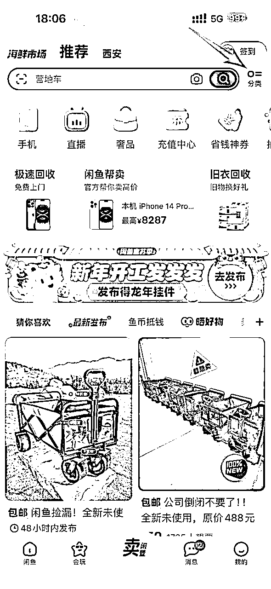

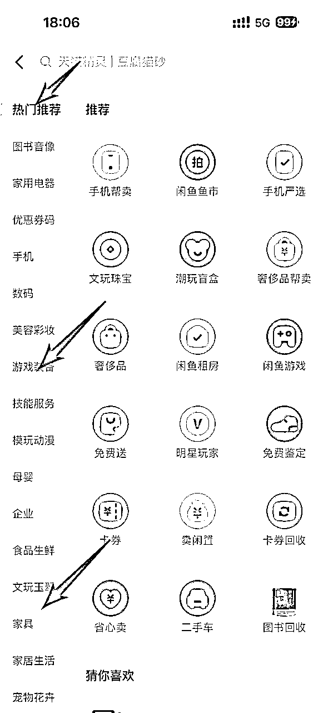

另外可以借助淘宝官方发布的 TOP20 万无线端流量词，看看具体类目下近期什么产品热销，相当于一个选品参考。

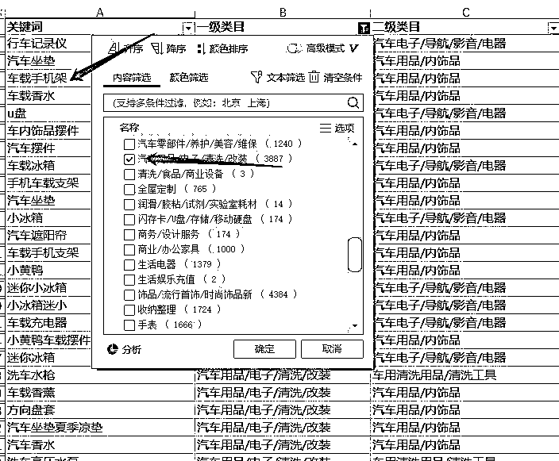

使用时筛选一个类目，系统会自动列出下面的具体商品，再去验证就行。另外推荐几个还不错的类目：机动车周边、电脑/手机/相机周边、数码配件、家纺布艺、绿植及周边、收纳整理、饰品、箱包、玩具、婴童用品、家具饰品、智能设备、灯具、厨房用品。附件里有淘宝 TOP20 万词汇下载，有兴趣可以搜索验证。

#### 6.2.1 类目词选品法，适用于所有人

搜索一个大类目词，比如“运动用品”，下面所有相关商品都会带出来。看到某个产品，可以参考「想要数」判断热度，或者换位思考：如果你是买家，会在闲鱼搜这个东西吗？然后再去搜索验证。

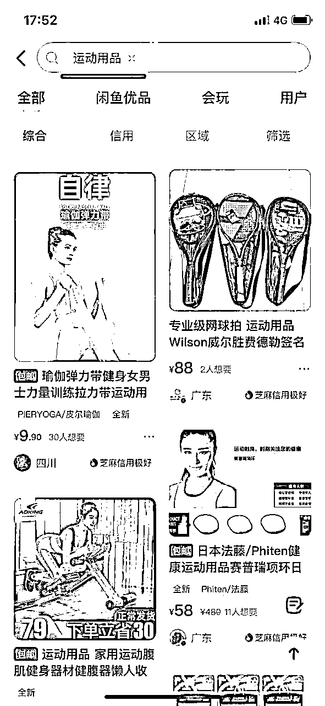

这类大类目特别多，厨房用品、酒店用品、母婴用品……换一个词就是一批新商品，能挖出很多平时想不到的品。简单看两个例子，搜索后往下拉就能看到：

厨房用品：夹缝收纳置物架、懒人抹布、不锈钢厨房置物架；

酒店用品：枕头、三件套、床单。

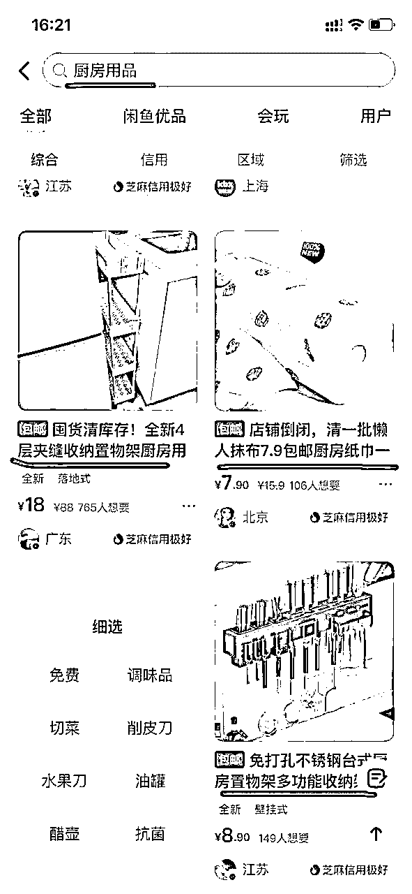

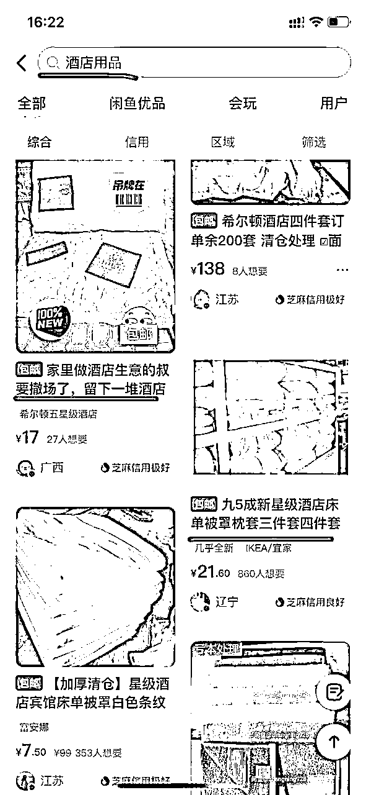

把看到的品逐个记下来，回到首页逐一搜索，再按选品标准判断是否值得做。这个方法有一定难度，但可选类目多，能挖出更多产品，挺值得尝试。注意：挑中的产品一定要及时记录，不然过会儿就忘了。

### 6.3 市场热销法

也可以参考其他主流平台，看看它们近期卖得火的产品，再拿到闲鱼验证。热门产品会随市场热度不断更新，过段时间又会出现一波新爆品。以拼多多为例：

# 闲鱼选品放大：跟同行挖新品，靠多账号增量

做闲鱼，选品不能只靠拍脑袋。平台热榜、其他电商的成交数据、同行动态，都能变成线索。先看平台榜单：从首页点进顶部大类，页面下方会出现排行榜；再点进去，就能看到该品类近期卖得快的商品。这个清单按市场热度滚动更新，过一阵会换一批新爆款。拼多多上近期搜索量高、下单量大的商品，拿到闲鱼按判断标准过一遍，符合条件就能直接上架。

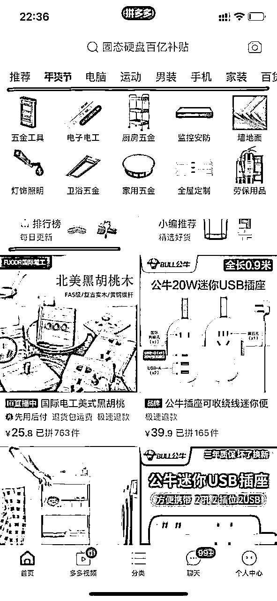

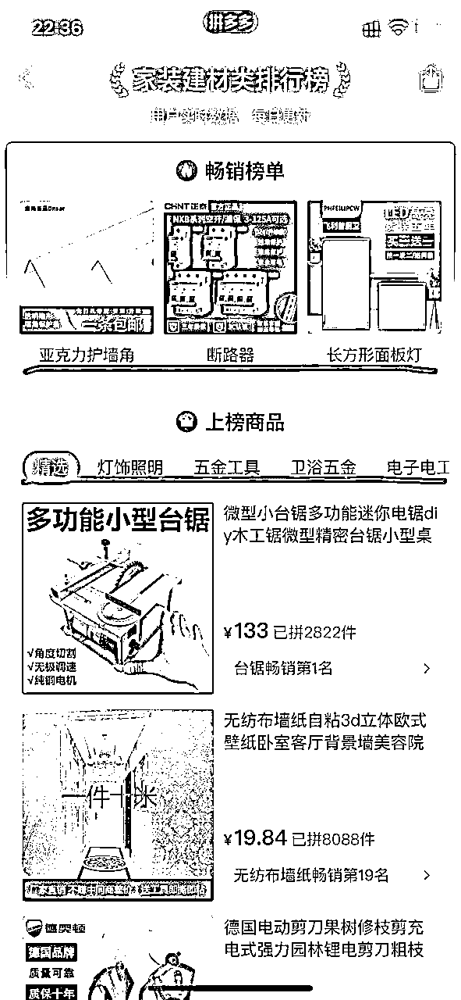

淘特的入口逻辑和拼多多差不多：

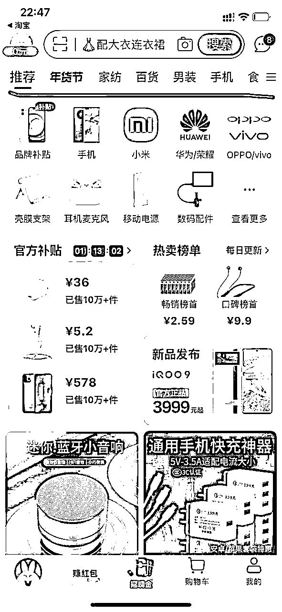

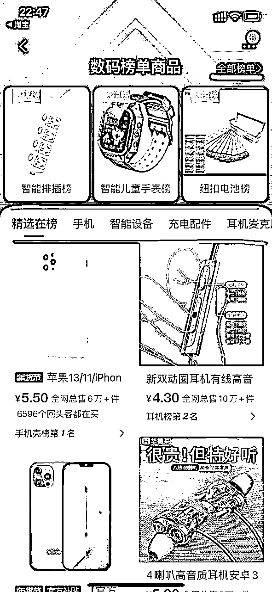

其他平台也能用类似思路：盯各自首页，或者用平台自带的数据工具。淘宝可以看生意参谋，也可以找第三方商品查询工具；抖查查、飞瓜、蝉妈妈这些，自己搜一下就能用。

闲鱼爆款验证还能借工具。像如翼闲鱼助手，会每天采集闲鱼市场的爆款，支持按时间、想要数、价格筛选，用来做选品参考也可以。工具有费用，按个人情况决定；不过前面几种方法其实已经够用。

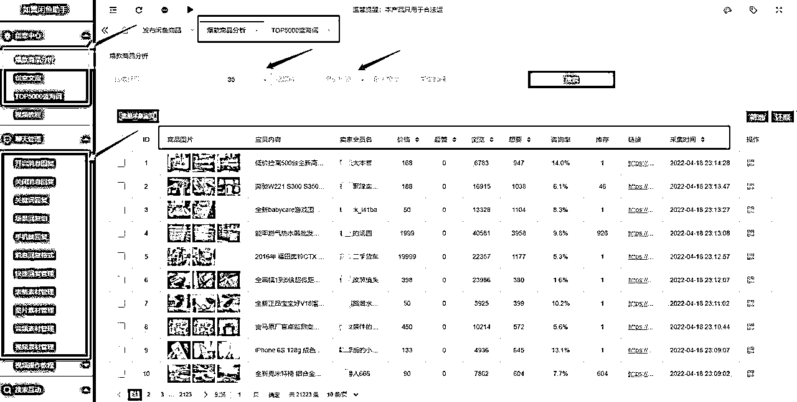

附：软件介绍

### 6.4 跟同行找新品：人人都能上手的循环选品法

这个方法和前面三个方法不冲突，可以任意组合。具体做法是：先找到一个同行，再顺着他卖得好的品，把周边不错的产品补进自己的选品库。以“滚轴”为例，搜“滚轴”并按验证方法查看同行动态，会发现同行那里滚轴出得不错，单天能到6单以上；“弹力带”和“瑜伽垫”的表现也可以。

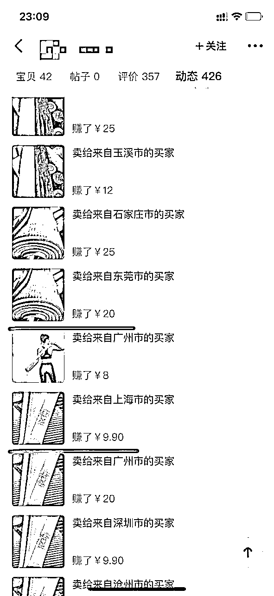

发现新品就马上记下来，先验证，再继续找下一批。比如从滚轴这个品出发，又看到两个新方向，就及时记录、逐个验证；验证过程中，还可能从新的同行动态里发现别的卖得好的商品。这样一圈圈找下去，周边符合闲鱼选品验证条件的品会不断被补充进选品库。时间一长，库里的品越来越多，你对闲鱼适合卖什么的判断也会越来越准。这个方法本身不难，和上面任意一个方法搭配都行；通常找到一个好品后，很容易顺着找到多个不错的品。

### 6.5 四套选品方法怎么选

四种方法的难易程度可以这样看：

1. 日常换位思考选品——门槛低，谁都能上手。
2. 分类选品法——稍有难度，适合零接触但具备一点基础的人。
3. 借其他平台热销榜选品——难度中等，适合有一定基础的人。
4. 跟着同行持续挖新品——上手简单，人人可用。

排在第四的这套打法，和前面任何一个方法都能组合；找到一个好品后，往往容易带出很多不错的品。之前没接触过的，建议多练方法1、2、4；有接触、有部分经验的，可以加上方法3一起练，最后挑一两个最适合自己的方法，持续选出闲鱼上的好品。拼多多找对标店铺爆款的做法也已包含在内，目前不需要付费工具。

## 七、放大生意的思路 @凌心

如果你已经能稳定变现，接下来就该考虑把项目放大、增加收益。常见方式有下面几种，一起看具体怎么做。

### 7.1 多账号运营怎么做

做高客单产品并精细化运营，单账号一个月大致能做出几千到一万多；如果时间和精力允许，也可以多账号操作。实践下来的上限是，一个人可以带7到8个账号，前提是一机一卡一网络。做法上差别不大，主要看精力怎么分配。

### 7.2 多平台怎么铺

1. 转转：在二手交易平台里，转转目前排第二，实测流量大约是闲鱼的三分之一到五分之一。如果不想多开闲鱼号，可以把商品同步发到转转，进一步拉销量。
2. 淘宝和拼多多：这两个平台更考验运营能力；没有给力货源时，不太建议贸然投入。

### 7.3 转有货源怎么转

想转有货源模式，供应链优化是核心：要和供应商建立稳定合作，保证货源跟得上、质量靠得住。

## 八、高客单热门赛道案例拆解 @千城

最后一部分，教练整理了几个常见且相对优质的高客单赛道：运动户外、宠物用品、日用百货、大小家电、五金。这些高客单类目的玩法差异没有那么大，所以本章只做简要说明和案例展示，五个案例供大家参考。

### 案例一：户外类目怎么运营

户外用品在5月进入春季旺季，销量通常会往上走；入秋转冬后需求会回落，季节性比较明显。建议多拓几个品类，比如围炉煮茶用的炉子，也可以看看同行淡季在卖什么。

1. 资质门槛：户外类目能做的产品不少，其中有不少高客单价商品，而且不需要额外资质，例如露营车、天幕、帐篷。
2. 案例参考：

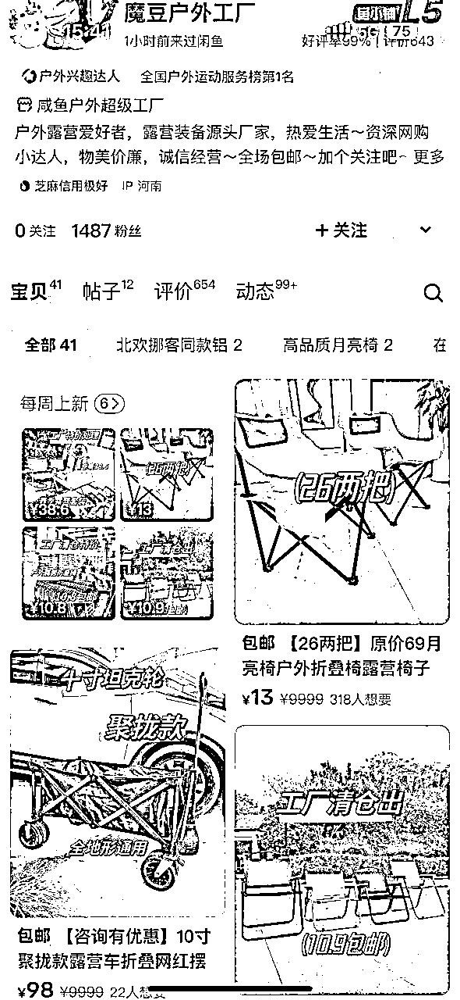

3. 常见热门产品：户外折叠桌、天幕、帐篷、登山杖、睡袋。
4. 供货渠道：1688、拼多多。

### 案例二：宠物消费怎么选

宠物用品一年四季都能卖，尤其是猫砂、尿垫这类易耗品；猫笼、狗笼以及部分狗粮虽然单价高，也值得做。不过竞争一定存在，更建议先从猫砂、猫粮这类小客单、复购高的产品入手，再逐步做高客单。

1. 操作门槛：除了注射类宠物用品，吃的、用的都不需要任何资质。
2. 案例参考：

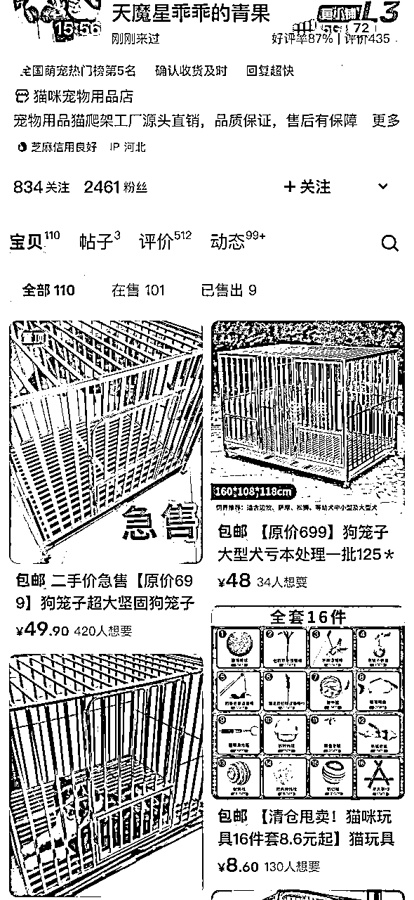

3. 常见热门产品：猫爬架、猫笼子、狗笼子、乌龟、鱼缸、水泵；价位偏高的宠物有银渐层猫、缅因。
4. 供货渠道：拼多多、1688。

### 案例三：日用百货怎么挑

这个类目要看清产品规格、大小、质量、材质，还有收货地址，提前核对清楚，避免售后。大件商品售后更麻烦，发货前必须检查到位。

1. 操作门槛：这是电商里比较大的一个类目，包含的产品非常多。医疗机械类别碰，剩下的比如电竞椅等都可以做，并且不需要资质。
2. 案例参考：

3. 常见热门产品：电竞椅、岩板桌、货架、遮阳窗帘、床垫、升降写字桌、卫浴、吸顶灯。
4. 供货渠道：1688、拼多多。

### 案例四：大小家电怎么做

和日用百货一样，大小、材质要提前检查好，同时要盯紧产品最新评价，及时把控质量。这个类目客单价高，投入资金会更多，但整体利润也相对更高。

1. 操作门槛：闲鱼不要求3C认证这类材料，像演示里的风扇，无需任何资质就能直接操作。
2. 案例参考：

3. 常见热门产品：显示屏、电磁炉、微波炉、电视机、冰箱、空调、热水器。
4. 供货渠道：拼多多、1688。

### 案例五：五金类目怎么稳

五金整体属于一年四季都能卖的产品，操作关键是质量必须把控住，减少售后，店铺才能开得久。

1. 操作门槛：很多人平时不太关注这个品类，但其中不少产品表现不错，而且四季可售、无需任何资质。
2. 案例参考：

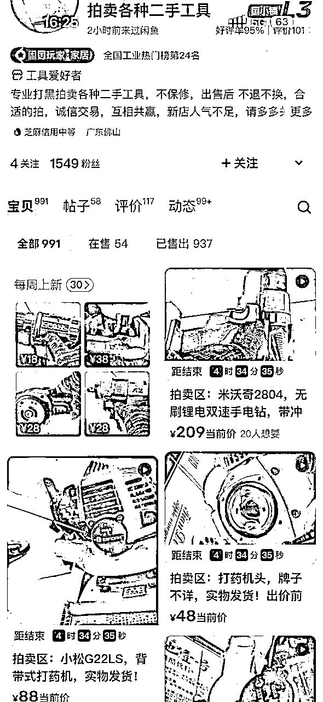

3. 常见热门产品：电钻、电动扳手、水平仪、切割机。
4. 供货渠道：1688、拼多多、淘宝。

